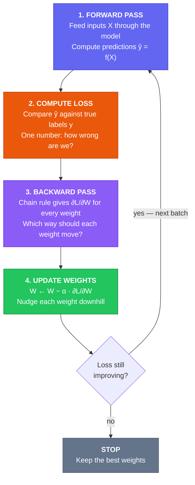
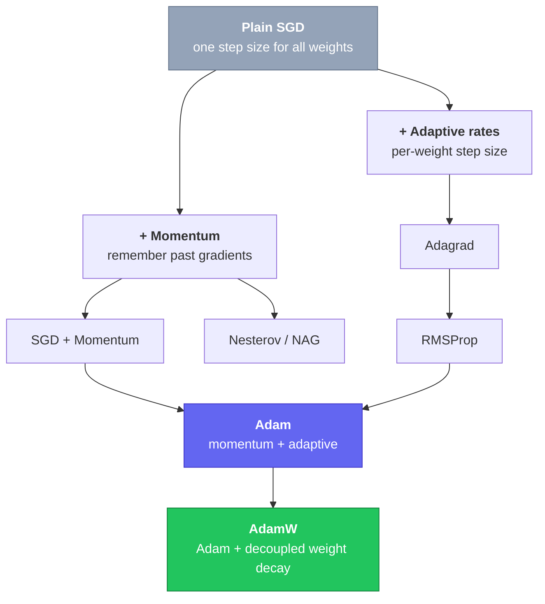
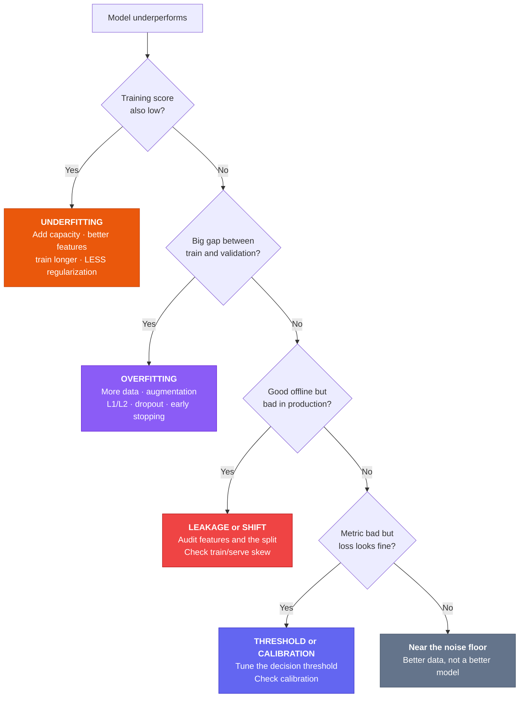

# Chapter 8 — Core Concepts & Terminology

> "A language that doesn't affect the way you think about programming is not worth knowing."
> — Alan Perlis. The same is true of ML vocabulary: these concepts shape how you *think*.

---

## What You'll Learn

After reading this chapter, you will be able to:

- **Part A** — Use the core vocabulary precisely: features, labels, train/validation/test splits (random, stratified, by time, by group), models, parameters vs hyperparameters — and spot **data leakage** before it destroys a project
- **Part B** — Explain the training loop end to end: forward pass → loss → gradient → weight update; choose a loss function; explain what the learning rate, the optimizer and the batch size each control
- **Part C** — Diagnose why a model fails: overfitting vs underfitting, the bias–variance tradeoff, how regularization fixes it, and why *generalization* is the only score that matters
- Read a model's probability output, choose a decision threshold, and know when not to trust it
- Answer the interview questions that come from all three parts

---

## How to Read This Chapter

The chapter is three short books, in the order you actually need them:

```
  PART A — THE VOCABULARY       §8.1–8.6   What the words mean
  PART B — THE MECHANICS        §8.7–8.11  How learning happens
  PART C — THE CENTRAL TENSION  §8.12–8.16 Why models fail
```

Each part ends with a **Checkpoint** — questions with hidden answers. If you can't answer them,
re-read that part before moving on; every part builds on the one before it.

**Four things to look for as you read:**

| Marker | What it means |
|---|---|
| **★★★ / ★★ / ★** | Critical for interviews (know cold) / high priority / good to know. Skim ★ on a first pass; never skim ★★★ |
| **Quick check** | A question to answer *before* revealing the answer. Attempting it and getting it wrong beats reading the answer — do not skip these |
| **Interview** | The question as it actually gets asked, what to say, and the follow-up that catches people out |
| **Your turn** | A worked example with the last steps removed. Fill them in |

**Two examples run through the whole chapter.** A table of **house sales** (Part A and B) and a
study-for-an-exam analogy we'll call the **Exam Model** (introduced in §8.3, reused everywhere
after). Reusing them is deliberate — it means each new idea costs you one concept, not two.

> **Notation.** This chapter writes the learning rate as **α**. The learning-rate schedules in
> Chapter 14 and [Ch 16 §1.3](#content/16_deep_learning) write it as **η**. Same quantity — both
> symbols are standard in the literature.

---

## Part A — The Vocabulary

*What the words mean. §8.1–8.6.*

---

## 8.1 Data: The Foundation of ML ★


### Simple Explanation

<details>
<summary><strong>Read as text</strong> — teaching with examples, and garbage in, garbage out</summary>

Imagine you want to teach your little brother to tell dogs from cats. You wouldn't just *describe*
them — you'd show him **hundreds of pictures**, and each time say "this one is a dog" or "this one
is a cat."

Those pictures are **data**. The more he sees (and the better their quality), the faster he learns.
But if you accidentally label a cat as "dog," he gets confused. That's why **data quality matters
more than anything else** in ML.

Think of it like cooking: even the world's best chef can't make a great meal from rotten
ingredients. **Garbage in, garbage out.**

</details>

### What Data Looks Like

<details>
<summary><strong>Read as text</strong> — the house sales table</summary>

This table is our running example for the rest of the chapter.

```
┌─────────────────────────────────────────────────────────────────┐
│                  THE HOUSE SALES DATASET                        │
├───────────┬───────────┬──────────────┬───────────┬──────────────┤
│ House ID  │ Sq Feet   │  # Bedrooms  │  Age(yrs) │ Price ($)    │
│           │ (feature) │  (feature)   │ (feature) │ ← LABEL      │
├───────────┼───────────┼──────────────┼───────────┼──────────────┤
│    1      │   1,500   │      3       │    10     │  250,000     │
│    2      │   2,200   │      4       │     5     │  370,000     │
│    3      │     900   │      2       │    30     │  150,000     │
│    4      │   3,100   │      5       │     2     │  520,000     │
│   ...     │    ...    │     ...      │    ...    │    ...       │
└───────────┴───────────┴──────────────┴───────────┴──────────────┘
  ↑                                                      ↑
Each row = one example / data point / observation    What we predict
```

</details>

### Data Quality Beats Algorithm Choice

<details>
<summary><strong>Read as text</strong> — six data problems and where they are fixed</summary>

> Low-quality data + best algorithm → mediocre results.
> High-quality data + simple algorithm → often great results.

| Problem | What it looks like |
|---|---|
| **Missing values** | Some cells are empty |
| **Noise** | Random errors in measurement |
| **Duplicates** | The same row appears several times |
| **Imbalance** | 990 "not fraud" rows to 10 "fraud" rows |
| **Distribution shift** | Training data ≠ the real-world data you'll see |
| **Label errors** | A human mislabelled it |

*(Where they are fixed: missing values, outliers and duplicates in [Ch 9 — Data Preprocessing](#content/09_data_preprocessing);
imbalance in [Ch 10 §10.11](#content/10_supervised_learning); distribution shift in §8.12.)*

</details>

---

## 8.2 Features and Labels ★★


<details>
<summary><strong>Read as text</strong> — the maths line and the shapes of X and y</summary>

> **Maths in one line:** `ŷ = f(x)`, learned so that `f(xᵢ) ≈ yᵢ` for every row i — the features
> `x` are what the model reads, the label `y` is what its prediction `ŷ` must match.

Stacked up, the features form a table **X** with n rows (examples) and d columns (features), and the
labels form a column **y** of n answers. In the house table of §8.1, each `x` is
`[SqFt, Beds, Age]` (d = 3) and `y` is the price.

</details>

### Features (X) — The Inputs

<details>
<summary><strong>Read as text</strong> — the guessing game, seven feature types and the clock trap</summary>

**Simple:** You're playing a guessing game. Your friend is thinking of a fruit and you can ask
questions: "What colour is it? How big? Sweet or sour?" Each answer is a **feature** — a clue that
helps you guess. Features are just the clues you hand the model.

**Official Definition:**
> A **feature** (input variable, predictor, attribute) is an individual measurable property of the
> thing being observed. Features are the independent variables fed as input to a model.

| Type | Meaning | Examples |
|---|---|---|
| **Continuous numerical** | Any number in a range | `age=25.3`, `price=450.99`, `height=180.2cm` |
| **Discrete numerical** | Whole numbers only | `bedrooms=3`, `clicks=100` |
| **Categorical (nominal)** | Named groups, **no** natural order | `color=red`, `city=London` |
| **Ordinal** | Categories **with** a natural order | `size=S/M/L`, `rating=1–5 stars` |
| **Binary** | Exactly two values | `spam=Yes/No`, `is_active=True/False` |
| **Temporal** | Date/time — parts like hour and weekday **wrap around** | `hour=14`, `day_of_week=3` |
| **Text / Image** | Unstructured — must be converted first | text → tokens → embeddings; images → arrays of pixel values |

> ⚠️ **The temporal trap:** hour 23 and hour 0 are one hour apart, but numerically they look 23
> apart. Encode a cyclical feature as two columns, `sin(2π·hour/24)` and `cos(2π·hour/24)` — points
> on a clock face. Hours 23 and 0 are then 0.26 apart, exactly as far as hours 0 and 1. You need
> both: the sine alone gives hours 3 and 9 the same value (0.71). Use 7 instead of 24 for weekdays.

</details>

### Labels (y) — The Output

<details>
<summary><strong>Read as text</strong> — the answer, and one house with two tasks</summary>

**Simple:** Back to the guessing game — the **label** is the actual answer. Clues were "red, small,
sweet"; the answer was "strawberry." During training we show the model both the clues *and* the
answer so it can learn the connection. Later we give only the clues and ask: *now you tell me.*

**Official Definition:**
> A **label** (target variable, dependent variable, output) is what we are trying to predict. In
> supervised learning the training data includes both features and labels; in unsupervised learning
> there are no labels.

```
  Feature vector (x)             Label (y)

  [SqFt=1500, Beds=3, Age=10] → Price = $250,000   (regression)
  [SqFt=1500, Beds=3, Age=10] → Sold in 30 days?   (classification)
  [Email text, sender, links] → Spam = Yes/No      (classification)
  [Daily sales history]       → Next week's sales  (time series)
```

Notice that the *same* house features support both a regression task (predict the price) and a
classification task (predict whether it sells quickly). The task is defined by the label you
choose, not by the data.

</details>

---

## 8.3 Training, Validation & Test Sets ★★


### Simple Explanation — The Exam Model

<details>
<summary><strong>Read as text</strong> — textbook, practice test and real exam</summary>

This analogy runs through the rest of the chapter, so it's worth thirty seconds. You're studying
for a big exam:

- Your **textbook** is full of practice problems *with* answers. You study these every day.
  → the **training set**: the model learns from it.
- Your **practice test** is problems you haven't studied. You try them to check whether you
  actually understand or merely memorised.
  → the **validation set**: it checks you *while* you're still studying.
- The **real exam** happens once, at the end. You can't go back and study after seeing it.
  → the **test set**: it tells you how you'll do in the real world.

The one unbreakable rule: **never peek at the real exam while studying.** If you do, your score
stops meaning anything.

```
                    YOUR FULL DATASET (100%)
    ┌──────────────────────────────────────────────────┐
    │ [████████████████████████████] [██████] [██████] │
    └──────────────────────────────────────────────────┘
                     │                   │        │
                     ▼                   ▼        ▼
                 Training           Validation   Test
                    70%                 15%       15%

  Training    → teach the model
  Validation  → tune the model
  Test        → measure FINAL performance (untouched!)

  KEY RULE: never let test data influence a training decision.
  Peek at the test score and re-tune, and the test set is
  no longer a fair measure — you have contaminated it.
```

**Official Definition:**
> The **training set** fits the model parameters. The **validation set** tunes hyperparameters and
> selects the model architecture. The **test set** provides an unbiased estimate of final
> performance on unseen data.

</details>

### How to Split

<details>
<summary><strong>Read as text</strong> — the standard error and hold-out sizes</summary>

How big must a holdout be? Big enough that its score is not luck.

> **Maths in one line:** `SE = √(p(1 − p) / n)` — the *standard error*: an accuracy p measured on n
> held-out rows is uncertain by about ± SE, so the number of rows, not the percentage, sets how
> precise a holdout is.

At p = 90%: 100 test rows give ± 3.0 percentage points, 1,000 rows ± 0.95, and 10,000 rows ± 0.3.
Double the SE for a roughly 95% range — so "90%" on 100 test rows really means "somewhere from 84% to
96%".

| Dataset size | Split | Why |
|---|---|---|
| **< 10K rows** | 70 / 15 / 15, or use cross-validation | A single small holdout is statistically noisy |
| **10K – 1M rows** | 80 / 10 / 10 | 10% is a comfortably large holdout |
| **> 1M rows** | 98 / 1 / 1 | 1% of 1M is still 10,000 rows — plenty |

The rule behind the table: you need a holdout large enough to *measure* reliably, not a fixed
percentage. Past a few thousand examples, extra validation rows buy you almost nothing — so give
them to training instead.

</details>

### Random, Stratified, Time or Group Split?

<details>
<summary><strong>Read as text</strong> — which rows go to each set</summary>

The table above says *how many* rows go to each set. Just as important is *which* rows. Ask two
questions: **what will the model see in production**, and **which rows are not independent of each
other**?

| Your data | Split | Why |
|---|---|---|
| Independent rows, classes roughly balanced | **Random** (shuffled) | Every row is an independent sample |
| Classification with a rare class | **Stratified** — `train_test_split(..., stratify=y)` | Every set keeps the class ratio, so 5% fraud stays 5% |
| Rows have a time order and you predict the future | **By time** — sort by date, cut | Train on the past, test on the future — exactly what production does |
| Several rows per patient, user or house | **By group** — `GroupShuffleSplit` | Each group lands on one side only |

The last two are where leakage hides (§8.4). With little data, swap the single validation set for
**k-fold cross-validation**, which comes in the same four flavours —
[Ch 13 §13.7](#content/13_model_evaluation).

A 70/15/15 split is two cuts: 70% vs 30%, then the 30% in half. Here it is on 2,000 transactions with
exactly 100 frauds (5%), first at random, then stratified:

</details>

```python
# A 70/15/15 train/validation/test split, random vs stratified, on data with a rare class (5% fraud).
import numpy as np
from sklearn.model_selection import train_test_split

rng = np.random.default_rng(0)
n = 2000
X = rng.normal(size=(n, 3))                    # 3 features per transaction
y = np.zeros(n, dtype=int)
y[rng.choice(n, size=100, replace=False)] = 1  # exactly 100 frauds = 5%

def split_70_15_15(X, y, seed, stratify):
    # Cut 1: 70% train, 30% held out. Cut 2: the held-out 30% in half.
    X_tr, X_tmp, y_tr, y_tmp = train_test_split(
        X, y, test_size=0.30, random_state=seed, stratify=y if stratify else None)
    X_va, X_te, y_va, y_te = train_test_split(
        X_tmp, y_tmp, test_size=0.50, random_state=seed, stratify=y_tmp if stratify else None)
    return y_tr, y_va, y_te

for stratify in (False, True):
    print("stratified split:" if stratify else "random split:")
    for name, part in zip(("train", "valid", "test"), split_70_15_15(X, y, 0, stratify)):
        print(f"  {name:<6}{len(part):>5} rows {part.sum():>4} frauds  {part.mean():.1%}")

# Repeat with 100 different seeds: how far can the TEST fraud rate drift?
for stratify in (False, True):
    rates = [split_70_15_15(X, y, s, stratify)[2].mean() for s in range(100)]
    label = "stratified" if stratify else "random"
    print(f"{label:<11} test fraud rate over 100 seeds: {min(rates):.1%} to {max(rates):.1%}")

assert all(split_70_15_15(X, y, s, True)[2].sum() == 15 for s in range(20))
```

**Output:**

```
random split:
  train  1400 rows   74 frauds  5.3%
  valid   300 rows   14 frauds  4.7%
  test    300 rows   12 frauds  4.0%
stratified split:
  train  1400 rows   70 frauds  5.0%
  valid   300 rows   15 frauds  5.0%
  test    300 rows   15 frauds  5.0%
random      test fraud rate over 100 seeds: 2.7% to 8.7%
stratified  test fraud rate over 100 seeds: 5.0% to 5.0%
```

<details>
<summary><strong>Read as text</strong> — continued: 8 to 26 frauds versus always 15</summary>

A random test set held anywhere from 8 to 26 frauds, depending only on the seed — so any fraud
metric measured on it would swing too. Stratifying pins it at 15 every time. Stratify by default for
classification; it costs nothing.

</details>

---

## 8.4 Data Leakage — The Cardinal Sin ★★★


### Simple Explanation

<details>
<summary><strong>Read as text</strong> — the answer key, and why a high score hides it</summary>

**Leakage = your model saw the answer key.**

A student studies using a practice test — but someone left the answers printed at the bottom of the
page. The student scores 100%. Everyone is thrilled, until the real exam, where there is no answer
key, and the student fails.

The student never learned the subject. They learned to read the bottom of the page.

That is data leakage. Somewhere in your training data there is a shortcut — a clue that gives away
the answer. Your model finds it (models are excellent at finding shortcuts), scores beautifully in
testing, and collapses in production because that clue doesn't exist in the real world.

```
   WHAT YOU SEE                        WHAT IS ACTUALLY HAPPENING
   ─────────────                       ──────────────────────────

   Test accuracy: 99% ✅               Model learned a shortcut
   "Ship it!"                          only present in your data
        │                                        │
        ▼                                        ▼
   Deploy to production ────────────►  Real accuracy: 61% ❌
                                       Shortcut gone. Model lost.
```

**Official Definition:**
> **Data leakage** is the use of information during training that would not legitimately be
> available at inference time, producing over-optimistic validation scores and poor real-world
> performance.

**Why it is so dangerous:** almost every other bug makes your score go *down*, so you notice it.
Leakage makes your score go *up*. It looks like success. Nobody investigates a 99% accuracy — they
celebrate it. You find out after deployment.

</details>

### The Four Ways It Sneaks In

<details>
<summary><strong>Read as text</strong> — target, temporal, group and preprocessing leakage</summary>

| Type | The story | Why it's cheating | Fix |
|---|---|---|---|
| **Target leakage** | Predicting *"will this patient get diabetes?"* — and one column is `takes_insulin`. Accuracy: 99%. | Insulin is prescribed *after* a diagnosis. The column is a consequence of the answer, not a clue you have before it. | Ask of every feature: "would I know this **before** the event?" If no, drop it. |
| **Temporal leakage** | Predicting Wednesday's stock price with a random split — so Friday's data landed in training. | The model is predicting the past using the future. It cannot time-travel in production. | Split by **time**: train on Jan–Sep, test on Oct–Dec. |
| **Group leakage** | The same patient's two X-rays: one in train, one in test. The model scores brilliantly. | It memorised *the patient*, not the disease. New patients break it. Exact duplicate rows are the extreme case. | Split by **group**, so a patient appears on only one side (`GroupShuffleSplit`, `GroupKFold`). De-duplicate first. |
| **Preprocessing leakage** | Scaling, imputing or *selecting features* on the whole dataset (`scaler.fit(X)`) and *then* splitting. | The statistics were computed partly from test rows. Test data quietly leaked into training. | Split **first**, fit only on train (wrap in a `Pipeline`). |

</details>

### Leakage in Numbers

<details>
<summary><strong>Read as text</strong> — the diabetes simulation</summary>

**Target leakage.** The diabetes story from the table, simulated: 2,000 patients, three honest
features (age, BMI, glucose) and the leaked `takes_insulin`. "Production" means scoring patients who
are *not yet diagnosed* — so nobody is on insulin yet.

</details>

```python
# Target leakage: a column created AFTER the answer (takes_insulin) makes a diabetes model look near-perfect.
import numpy as np
from sklearn.linear_model import LogisticRegression
from sklearn.model_selection import train_test_split

rng = np.random.default_rng(0)
n = 2000
age = rng.uniform(20, 80, n)
bmi = rng.normal(27, 5, n)
glucose = rng.normal(100, 15, n)
risk = 0.03 * (age - 50) + 0.10 * (bmi - 27) + 0.05 * (glucose - 100) - 1.0
diabetes = (rng.random(n) < 1 / (1 + np.exp(-risk))).astype(int)        # the label
# Insulin is prescribed AFTER a diagnosis: most diagnosed patients take it, almost nobody else.
takes_insulin = np.where(diabetes == 1, rng.random(n) < 0.95, rng.random(n) < 0.01).astype(int)

X_leaky = np.column_stack([age, bmi, glucose, takes_insulin])
X_honest = X_leaky[:, :3]
tr, te = train_test_split(np.arange(n), test_size=0.25, random_state=0, stratify=diabetes)
# In production we score UNDIAGNOSED patients, so nobody is on insulin yet.
X_prod = X_leaky[te].copy()
X_prod[:, 3] = 0

print(f"{'model':<22}{'train':>7}{'test':>7}{'production':>12}")
scores = {}
for name, X, X_live in [("with takes_insulin", X_leaky, X_prod),
                        ("without it (honest)", X_honest, X_honest[te])]:
    model = LogisticRegression(max_iter=1000).fit(X[tr], diabetes[tr])
    scores[name] = [model.score(X[tr], diabetes[tr]), model.score(X[te], diabetes[te]),
                    model.score(X_live, diabetes[te])]
    print(f"{name:<22}" + "".join(f"{s:>{w}.1%}" for s, w in zip(scores[name], (7, 7, 12))))
print(f"always say 'no': {1 - diabetes[te].mean():.1%} (the baseline to beat)")

leak, ok = scores["with takes_insulin"], scores["without it (honest)"]
assert leak[1] > 0.95 and abs(leak[0] - leak[1]) < 0.03   # near-perfect, and NO train-test gap
assert leak[2] < ok[2] - 0.05                             # ...then it collapses in production
```

**Output:**

```
model                   train   test  production
with takes_insulin      97.8%  97.4%       67.6%
without it (honest)     73.9%  76.2%       76.2%
always say 'no': 67.4% (the baseline to beat)
```

<details>
<summary><strong>Read as text</strong> — continued: the insulin leak in production, and the X-ray setup</summary>

With the leak, train and test agree (97.8% vs 97.4%) — no gap, so an overfitting check passes
(§8.13). In production the leaky model scores 67.6%, no better than always answering "no" (67.4%),
because the one column it leaned on is now always 0. The honest model's 76.2% holds up. Notice that
the honest model *loses* on the test set — pick models by test score alone and you would ship the
leak.

**Group leakage.** The X-ray story: 100 patients, 5 scans each. A patient's scans share a personal
"fingerprint" (their anatomy); the disease shows only weakly. A 1-nearest-neighbour model — a pure
memoriser — is scored three ways.

</details>

```python
# Group leakage: 5 X-rays per patient. A random row split puts the same patient on both sides.
import numpy as np
from sklearn.model_selection import GroupShuffleSplit, train_test_split
from sklearn.neighbors import KNeighborsClassifier

rng = np.random.default_rng(0)

def make_patients(n_patients, scans=5):
    anatomy = rng.normal(0, 3, size=(n_patients, 10))       # each patient's unique "fingerprint"
    sick = rng.integers(0, 2, n_patients)                    # one diagnosis per patient
    signal = np.zeros((n_patients, 10))
    signal[:, 0] = 1.5 * sick                                # the disease shows weakly in one feature
    X = np.repeat(anatomy + signal, scans, axis=0) + rng.normal(0, 0.5, (n_patients * scans, 10))
    return X, np.repeat(sick, scans), np.repeat(np.arange(n_patients), scans)

X, y, patient_id = make_patients(100)                        # 500 scans from 100 patients
X_new, y_new, _ = make_patients(40)                          # production: 40 patients never seen

model = KNeighborsClassifier(n_neighbors=1)                  # a model that can memorise
tr, te = train_test_split(np.arange(len(y)), test_size=0.2, random_state=0)
random_split = model.fit(X[tr], y[tr]).score(X[te], y[te])
shared = len(set(patient_id[tr]) & set(patient_id[te]))

tr, te = next(GroupShuffleSplit(n_splits=1, test_size=0.2, random_state=0).split(X, y, patient_id))
group_split = model.fit(X[tr], y[tr]).score(X[te], y[te])
assert not set(patient_id[tr]) & set(patient_id[te])         # no patient on both sides
production = model.score(X_new, y_new)

print(f"random row split : {random_split:.0%}  ({shared} patients appear in both train and test)")
print(f"split by patient : {group_split:.0%}")
print(f"new patients     : {production:.0%}  <- what production will see")
assert random_split > group_split + 0.2 and abs(group_split - production) < 0.15
```

**Output:**

```
random row split : 100%  (70 patients appear in both train and test)
split by patient : 53%
new patients     : 50%  <- what production will see
```

<details>
<summary><strong>Read as text</strong> — continued: why 100% fell to 53%: it learned people</summary>

The random split scores 100%: every test scan's nearest neighbour is another scan of the *same
patient*, so the model copies that patient's diagnosis. Split by patient and the score falls to 53%
— the same as on brand-new patients (50%, a coin flip). The model never learned the disease; it
learned to recognise people. The lower number is the honest one.

</details>

### The Most Common Mistake, in Code

<details>
<summary><strong>Read as text</strong> — wrong, right and best</summary>

The scaler mistake, wrong vs right vs best — then the same mistake with a step that looks at the
labels:

</details>

```python
# Preprocessing leakage: fitting a step on ALL rows before splitting. Mild for a scaler, severe for feature selection.
import numpy as np
from sklearn.feature_selection import SelectKBest, f_classif
from sklearn.linear_model import LogisticRegression
from sklearn.model_selection import cross_val_score, train_test_split
from sklearn.pipeline import Pipeline
from sklearn.preprocessing import StandardScaler

rng = np.random.default_rng(0)
X = rng.normal(50, 10, size=(400, 2))
y = (X[:, 0] + X[:, 1] + rng.normal(0, 10, 400) > 100).astype(int)

# ❌ WRONG — the scaler peeked at the test set
scaler = StandardScaler().fit(X)                 # mean computed from ALL rows
X_tr, X_te, y_tr, y_te = train_test_split(scaler.transform(X), y, random_state=0)
wrong = LogisticRegression().fit(X_tr, y_tr).score(X_te, y_te)
mean_all = scaler.mean_[0]

# ✅ RIGHT — split first, then learn only from train
X_tr, X_te, y_tr, y_te = train_test_split(X, y, random_state=0)
scaler = StandardScaler().fit(X_tr)              # mean computed from TRAIN only
right = LogisticRegression().fit(scaler.transform(X_tr), y_tr).score(scaler.transform(X_te), y_te)

# ✅ BEST — a Pipeline refits the scaler on the training part of every split it is given
pipe = Pipeline([("scale", StandardScaler()), ("model", LogisticRegression())])
best = pipe.fit(X_tr, y_tr).score(X_te, y_te)
print(f"scaler mean: all rows {mean_all:.2f} vs train only {scaler.mean_[0]:.2f}")
print(f"test accuracy: wrong {wrong:.3f}  right {right:.3f}  pipeline {best:.3f}")

# Same mistake, but the step looks at y: keep the 20 of 5,000 PURE-NOISE features most linked to y.
noise = np.random.default_rng(1)                 # a second seeded generator
X_noise = noise.normal(size=(100, 5000))
y_coin = noise.integers(0, 2, 100)               # coin-flip labels: nothing to learn, truth is ~50%
X_top = SelectKBest(f_classif, k=20).fit_transform(X_noise, y_coin)   # ❌ chosen with ALL rows
leaky_cv = cross_val_score(LogisticRegression(), X_top, y_coin, cv=5).mean()
pipe = Pipeline([("select", SelectKBest(f_classif, k=20)), ("model", LogisticRegression())])
honest_cv = cross_val_score(pipe, X_noise, y_coin, cv=5).mean()   # ✅ re-selected inside each fold
print(f"pure noise, 5-fold CV: selected on all rows {leaky_cv:.0%}  inside the pipeline {honest_cv:.0%}")

assert abs(wrong - right) < 0.02                 # scaler leak: tiny effect here
assert leaky_cv > 0.75 and honest_cv < 0.65      # selection leak: accuracy invented from noise
```

**Output:**

```
scaler mean: all rows 49.29 vs train only 49.40
test accuracy: wrong 0.820  right 0.820  pipeline 0.820
pure noise, 5-fold CV: selected on all rows 91%  inside the pipeline 47%
```

<details>
<summary><strong>Read as text</strong> — continued: fit on train, transform on both</summary>

The rule in one line: **`fit` on train, `transform` on both.** Never `fit` on test.

How much a leak hurts depends on what the leaked step learned. A scaler learns only a mean and a
spread from X, so here the damage is invisible (0.820 either way) — it is still a bug, and the habit
is what matters. A step that looks at the **labels** is far worse: picking the 20 "best" of 5,000
random columns using every row turns coin-flip labels into 91% cross-validated accuracy. Re-select
inside each fold and the honest 47% — chance — comes back. A `Pipeline` prevents this kind of
*preprocessing* leakage; it cannot stop target, temporal or group leakage, which live in the data
and the split.

</details>

### How to Catch It

<details>
<summary><strong>Read as text</strong> — four checks and the rule of thumb</summary>

1. **Score too good?** 99% on a hard problem means leakage until proven otherwise. Be suspicious of
   success, not just of failure.
2. **Drop your best feature.** If accuracy collapses — 97% to 76% in the diabetes demo above — that
   feature was doing most of the work. Inspect it. It is probably a disguised label.
3. **Say the timestamp out loud.** For each feature: *"At 9:00 a.m. on Monday, when I must make this
   prediction, do I already have this value?"* If no → leakage.
4. **Audit the split.** Does any patient, user or house ID appear on both sides? Is any training row
   dated *after* a test row? Are there exact duplicates across the boundary? Each "yes" is a leak.

> **Rule of thumb:** if a feature would not exist at the exact moment you make the prediction, it is
> leakage. Leakage is routinely confused with overfitting — the two are compared side by side in
> **§8.13**. Full preprocessing recipe in
> [Ch 9 — A Leakage-Safe Pipeline](#content/09_data_preprocessing); group, time-series and nested
> cross-validation in [Ch 13 §13.7](#content/13_model_evaluation).

</details>

---

## 8.5 The Model ★


### Simple Explanation

<details>
<summary><strong>Read as text</strong> — the recipe-making machine and ŷ = f(x; W)</summary>

Think of a model as a **recipe-making machine**. You feed ingredients in one side (the features),
the machine follows its internal recipe (the maths), and a prediction comes out the other side.

At first the recipe is terrible — random guesses. But every time you say "that was wrong, here's the
right answer," it tweaks the recipe slightly. After thousands of examples the recipe gets good, and
the machine predicts well even for ingredients it has never seen.

The "recipe" is just numbers, called **weights** (or parameters). Training is the process of
adjusting those numbers until the guesses match reality.

```
              ┌──────────────────────────────────┐
Features ──►  │    f(X) = prediction             │ ──► Prediction
  (X)         │    where f is learned from data  │       (ŷ)
              │    and shaped by parameters W    │
              └──────────────────────────────────┘
```

> **Maths in one line:** `ŷ = f(x; W)` — the model is a function of the input `x` whose shape is
> set by the parameters `W`; training chooses `W`, prediction just evaluates `f`.

**Official Definition:**
> A **model** is a mathematical representation that maps inputs to outputs using a set of learned
> parameters. The *form* of the model (linear, tree, neural net) is its **architecture** or
> **hypothesis class**.

</details>

### Algorithm vs Model — the Recipe and the Result

<details>
<summary><strong>Read as text</strong> — recipe, result, parameters and hyperparameters</summary>

Beginners use "algorithm" and "model" as synonyms; interviewers notice. The **algorithm** is the
learning procedure. The **model** is what that procedure produces — the thing you save and deploy.
Using the four houses of §8.1 and square feet alone:

| Word | What it is | House example |
|---|---|---|
| **Algorithm** | The learning recipe | Linear regression: "find the straight line with the smallest squared error" |
| **Model** | What training produces; it makes the predictions | `price ≈ 168 × SqFt − 1,800` |
| **Parameters** | The numbers inside the model, learned from data | `168` (dollars per sq ft) and `−1,800` |
| **Hyperparameters** | Settings you choose before training (§8.6) | None for plain least squares; Ridge regression adds a penalty strength λ (§8.15) |

The same algorithm run on different data gives a different model. **Training** runs the algorithm
once (or on a schedule) and is slow; **inference** evaluates the finished model on one new house —
`168 × 2,000 − 1,800 = 334,200` dollars for a 2,000 sq ft house — and is fast. §8.7 opens up the
training step.

</details>

### Inductive Bias — Every Model Makes Assumptions

<details>
<summary><strong>Read as text</strong> — the built-in assumptions of four algorithms</summary>

If a teacher said "connect these dots," you'd probably draw a straight line. Your friend might draw
a curve. A small child might zigzag through every dot. Each of you brought a **built-in assumption**
about what the right answer looks like. Every ML algorithm brings one too.

| Algorithm | Its built-in assumption |
|---|---|
| **Linear Regression** | y is a weighted sum of the features — a straight line (a flat plane with several features) |
| **Decision Tree** | Data can be split by axis-aligned rectangular boundaries |
| **KNN** | Similar inputs have similar outputs — nearby points share a class |
| **Neural Network** | Weak assumptions: with enough neurons it can approximate almost any continuous function (the *universal approximation theorem* — which says nothing about how much data or training that takes). Architectures add their own: a CNN assumes nearby pixels belong together |

> Choosing a model = choosing which assumptions you're comfortable with. **Wrong assumptions mean
> even infinite data won't save you** — a straight line never fits a U-shape, however many points
> you add. No algorithm is best at everything — that's the No Free Lunch theorem, covered in
> [Ch 7](#content/07_introduction).

</details>

---

## 8.6 Parameters vs Hyperparameters ★★


### Simple Explanation

<details>
<summary><strong>Read as text</strong> — the bike analogy, the maths and the comparison table</summary>

Learning to ride a bike:

- **Parameters** are your balance and muscle memory. They adjust automatically as you practise — you
  never consciously think "tilt 3 degrees left." In ML, **weights are parameters the model learns by
  itself from data.**
- **Hyperparameters** are the choices you make *before* you start: which bike, how high the seat,
  training wheels or not. You pick them before practice and they don't change during it. In ML,
  **learning rate or number of layers are hyperparameters that YOU choose.**

> **Maths in one line:** `W* = argmin_W Loss_train(W; h)` — for a fixed hyperparameter setting h,
> training finds the parameters W* that make the training loss smallest (*argmin* = "the W that
> minimises"); you then keep the h whose W* scores best on validation.

| | **Parameters** | **Hyperparameters** |
|---|---|---|
| What | Numbers *inside* the model | Settings chosen *before* training |
| Who sets them | Learned from data | You do — or a tuning search does |
| When they change | Continuously, during training | Fixed for a single training run |
| Examples | Neural-net weights `w₁=0.34, w₂=-1.2`; linear-regression coefficients; tree split thresholds | Learning rate `0.001`; trees in a forest `100`; max tree depth `5`; layers `3`; dropout rate `0.3` |
| Bike analogy | Your balance — adjusts itself | Seat height — you set it beforehand |

> The validation set (§8.3) exists precisely to tune hyperparameters. Parameters are fitted on
> **train**; hyperparameters are selected on **validation**; nothing at all is fitted on **test**.

In scikit-learn you can see the split in the code: hyperparameters are the constructor arguments
(`DecisionTreeRegressor(max_depth=4)`), and learned parameters are attributes ending in an
underscore that exist only after `fit` (`coef_`, `intercept_`, `tree_`). Below, 1,000 made-up
houses: the tree's depth is tuned on validation, and the test set is used once.

</details>

```python
# Parameters are learned by fit(); hyperparameters are set by you and chosen on the validation set.
import numpy as np
from sklearn.linear_model import LinearRegression
from sklearn.tree import DecisionTreeRegressor

rng = np.random.default_rng(0)
n = 1000
sqft, beds, age = rng.uniform(800, 3200, n), rng.integers(1, 6, n), rng.uniform(0, 50, n)
X = np.column_stack([sqft, beds, age])
price = 150 * sqft + 10_000 * beds - 1_500 * age + 20_000 + rng.normal(0, 40_000, n)
tr, va, te = np.split(rng.permutation(n), [700, 850])        # 70 / 15 / 15

def mae(model, rows):
    return np.mean(np.abs(model.predict(X[rows]) - price[rows]))

# Hyperparameters go in the constructor; learned parameters appear after fit() and end in "_".
lin = LinearRegression().fit(X[tr], price[tr])
print(f"linear regression: {lin.coef_.size + 1} parameters, weights "
      f"{np.round(lin.coef_).astype(int).tolist()}, intercept {lin.intercept_:,.0f}")

print(f"\n{'max_depth':>9}{'learned splits':>16}{'train MAE':>11}{'valid MAE':>11}")
results = {}
for depth in [1, 2, 4, 6, 8, 12, 20]:                        # the hyperparameter we tune
    tree = DecisionTreeRegressor(max_depth=depth, random_state=0).fit(X[tr], price[tr])
    splits = int((tree.tree_.feature >= 0).sum())             # parameters: one threshold per split
    results[depth] = (tree, mae(tree, va))
    print(f"{depth:>9}{splits:>16}{mae(tree, tr):>11,.0f}{mae(tree, va):>11,.0f}")

best = min(results, key=lambda d: results[d][1])
print(f"\nchosen on validation: max_depth={best}, test MAE (reported once) {mae(results[best][0], te):,.0f}")
print(f"linear regression on the same validation set: {mae(lin, va):,.0f}")
assert 1 < best < 20                                         # too shallow underfits, too deep overfits
assert mae(lin, va) < results[best][1]                       # the right assumption (a straight line) wins
```

**Output:**

```
linear regression: 4 parameters, weights [151, 11420, -1601], intercept 13,988

max_depth  learned splits  train MAE  valid MAE
        1               1     58,668     52,115
        2               3     43,705     39,210
        4              15     33,940     34,741
        6              62     27,258     35,578
        8             195     17,263     40,723
       12             577      2,055     46,409
       20             699          0     45,979

chosen on validation: max_depth=4, test MAE (reported once) 39,810
linear regression on the same validation set: 27,364
```

<details>
<summary><strong>Read as text</strong> — continued: one hyperparameter, many parameters</summary>

How to read it (errors in dollars):

- **One hyperparameter, many parameters.** Each extra level of depth lets the tree learn more split
  thresholds — from 1 to 699. Training error falls all the way to 0, but validation error is lowest
  at depth 4 and rises after it: too shallow underfits, too deep memorises (§8.13).
- **Test once, expect a little worse.** The winner's test MAE (39,810) is above its validation MAE
  (34,741) — partly the luck of 150 rows, partly because the best of seven validation scores
  flatters the winner. That is why the test set is kept separate.
- **The right assumption beats tuning.** The true prices really are a weighted sum, so plain linear
  regression — 4 parameters, nothing to tune — wins (27,364). Its weights land near the hidden
  150 per sq ft, 10,000 per bedroom and −1,500 per year of age. That is inductive bias (§8.5) at work.

</details>

### Parametric vs Non-Parametric Models

<details>
<summary><strong>Read as text</strong> — fixed size versus grows with the data</summary>

A **parametric** model has a fixed number of parameters, set by its form rather than by how much
data you have: the linear model above has 4 numbers whether it sees 700 houses or 7 million. A
**non-parametric** model grows with the data: the depth-20 tree grew 699 splits — one leaf for each
of the 700 training houses — and KNN simply stores every training row.

| | Parametric | Non-parametric |
|---|---|---|
| Size of the model | Fixed by its form | Grows with the data |
| Examples | Linear and logistic regression, neural networks | KNN, decision trees, kernel SVMs |
| Strength | Fast, needs less data, easy to read | Few assumptions about the shape of the answer |
| Risk | Wrong form → underfits | Memorises noise unless limited (depth, k) |

"Non-parametric" does **not** mean "no parameters" — a tree's split thresholds are parameters. It
means their *number* is not fixed in advance. KNN must keep its training data at prediction time; a
tree keeps only its splits.

</details>

---

## Checkpoint A — Vocabulary

<details>
<summary><strong>1.</strong> You're predicting whether a house sells within 30 days. One of your features is <code>final_sale_date</code>. What's wrong?</summary>

**Target leakage.** A sale date only exists *after* the house has sold, so it is unavailable at
prediction time — and it gives away the answer. Apply the timestamp test from §8.4: at the moment
you must predict, do you have this value? No. Drop it.
</details>

<details>
<summary><strong>2.</strong> Which of these is a hyperparameter: the coefficient on <code>SqFt</code>, or the number of trees in a random forest?</summary>

**The number of trees.** You choose it before training and it stays fixed. The coefficient on
`SqFt` is a *parameter* — the model learns it from data.
</details>

<details>
<summary><strong>3.</strong> You have 2 million rows. Is a 70/15/15 split a good idea?</summary>

No — it's wasteful. 15% of 2M is 300,000 validation rows, far more than needed to measure
performance reliably. A 98/1/1 split still gives you 20,000 rows each for validation and test while
handing 560,000 extra rows to training (1.96M instead of 1.4M). At 20,000 rows an accuracy near 90%
is pinned to about ± 0.2 points (§8.3).
</details>

<details>
<summary><strong>4.</strong> In KNN, is <code>k</code> (the number of neighbours) a parameter or a hyperparameter? What does KNN learn?</summary>

**`k` is a hyperparameter** — you pick it before "training" and compare values on validation. KNN
learns **no weights at all**: fitting just stores the training rows, and prediction searches them.
That makes it **non-parametric** (§8.6) — its size grows with the data.
</details>

<details>
<summary><strong>5.</strong> You predict next month's customer churn from three years of monthly snapshots. A colleague shuffles the rows and splits 80/10/10. What goes wrong, and what do you do instead?</summary>

**Temporal leakage.** A random split mixes the months, so rows from later months land in training
while earlier months sit in test. The model learns from the future it is meant to predict, and the
test score is too optimistic.
**Split by time:** for example, train on months 1–30, validate on 31–33, test on 34–36. That is
exactly the situation production will be in: learn from the past, predict the next month.
</details>

---

## Part B — The Mechanics

*How learning actually happens. §8.7–8.11.*

Part A gave you the nouns: data, features, labels, a model, and the parameters inside it. It never
said **how those parameters get their values** — the model just "learns from data," which is not an
explanation.

Part B is that explanation. Everything here is one loop, repeated: guess, measure the error, work
out which way to move, move a little. §8.7 is the loop itself; §8.8–8.11 each zoom into one box of
it.

---

## 8.7 The Training Loop ★★★


<details>
<summary><strong>Read as text</strong> — why this loop is the heart of the chapter</summary>

This is the most important section in the chapter. Understand the training loop and you understand
how machine learning actually works.

</details>

### Simple Explanation

<details>
<summary><strong>Read as text</strong> — the blindfolded throw, the four steps and the loop</summary>

You're learning to throw a basketball into a hoop, blindfolded:

1. **You throw** — the **forward pass**. The model takes the input and makes its best guess.
2. **Your friend says how far off you were** — "two feet left!" That's the **loss**: one number
   saying how wrong the guess was.
3. **You work out the adjustment** — "throw a bit more right." That's the **backward pass**: calculus
   tells the model which direction to move each of its numbers.
4. **You adjust** — the **weight update**. Each internal number is nudged slightly in the direction
   that reduces the error.
5. **Repeat thousands of times** until you're sinking shots consistently.

**What to notice:** it is a *cycle*. Nothing happens once — the four steps repeat for every batch,
and the whole sequence repeats for every epoch.

> **Maths in one line:** `W ← W − α · ∂L/∂W`, once per batch — predict, score the error with the loss
> L, find which way each weight W should move (the gradient ∂L/∂W), then step a small amount α
> (the learning rate) that way.



One pass through **all** batches in the dataset is one **epoch** (§8.11).

</details>

### When Does the Loop Stop?

<details>
<summary><strong>Read as text</strong> — three stopping rules and training vs inference mode</summary>

"Repeat until the loss stops improving" hides a real decision. Three options, in increasing order of
how much people actually use them:

| Rule | How it works | Downside |
|---|---|---|
| **Fixed epoch count** | Train for exactly N epochs | You guessed N. Too few underfits, too many overfits |
| **Convergence threshold** | Stop when the loss changes by less than ε | Noisy mini-batch losses trigger it early |
| **Early stopping** ✓ | Watch **validation** loss; stop when it stops falling and restore the best checkpoint | Needs a validation set — which you have (§8.3) |

Early stopping is the default in practice, and it is also a regularizer — that's why it reappears in
§8.15.

> **Training mode vs inference mode.** During training the model updates its weights; at inference
> it only runs the forward pass. Some layers deliberately *behave differently* in the two modes —
> dropout switches off at inference (§8.15), and batch normalization switches from the current
> batch's statistics to stored running averages ([Ch 14 §14.7](#content/14_neural_networks)).
> Forgetting to flip the mode is a classic production bug.

</details>

### Concrete Walk-Through (One Real Step)

<details>
<summary><strong>Read as text</strong> — one real step on a house: forward pass, loss, chain rule, update</summary>

**Task:** from our house dataset — given a house's size, predict whether it **sells within 30 days**
(`1 = yes`, `0 = no`).

**Model:** one weight `w`, one bias `b`, a sigmoid on top. We measure size in *hundreds* of square
feet, so a 2,500 sq ft house is `size = 25`.

$$\hat{y} = \sigma(w \cdot \text{size} + b)$$

Start untrained: `w = 0`, `b = 0`. Training example: a 2,500 sq ft house that **did** sell fast, so
`size = 25`, `y = 1`.

**Step 1 — Forward pass.** Plug the input in.

- raw = `0 × 25 + 0 = 0`
- ŷ = `sigmoid(0) = 0.5`

The model says 50/50. It knows nothing yet.

**Step 2 — Loss.** How wrong is 0.5 when the answer is 1? Binary cross-entropy simplifies to
$-\log(\hat{y})$ when `y = 1`:

$$\text{loss} = -\log(0.5) \approx 0.693$$

**Step 3 — Gradients.** Which direction reduces the loss? This is the step people wave at, so let's
actually do it.

The weight `w` doesn't touch the loss directly. It reaches it through a chain:

```
   w  ──►  raw = w·size + b  ──►  ŷ = σ(raw)  ──►  loss = −log(ŷ)
        (link 1)              (link 2)          (link 3)
```

The **chain rule** says: to get the effect of `w` on the loss, multiply the three local effects
together.

$$\frac{\partial L}{\partial w} \;=\; \underbrace{\frac{\partial L}{\partial \hat{y}}}_{\text{loss} \leftarrow \text{prediction}} \times \underbrace{\frac{\partial \hat{y}}{\partial \text{raw}}}_{\text{prediction} \leftarrow \text{raw}} \times \underbrace{\frac{\partial \text{raw}}{\partial w}}_{\text{raw} \leftarrow w}$$

That's all backpropagation is: **walking that chain backwards through the model, multiplying local
slopes as you go.** A deep network just has more links in the chain.

Now the nice part. For a sigmoid paired with binary cross-entropy, the first two factors are ugly
individually — but their product collapses. With `y = 1` (our house):

$$\frac{\partial L}{\partial \hat{y}} \times \frac{\partial \hat{y}}{\partial \text{raw}} = \left(\frac{-1}{\hat{y}}\right) \times \bigl(\hat{y}(1-\hat{y})\bigr) \;=\; \hat{y} - 1 \;=\; \hat{y} - y$$

(For `y = 0` the loss is $-\log(1-\hat{y})$ and the same algebra gives $\hat{y} - 0$, so the
result is $\hat{y} - y$ for either label.) And $\partial\,\text{raw}/\partial w$ is just `size`. So:

- `∂loss/∂w = (ŷ − y) × size = (0.5 − 1) × 25 = −12.5`
- `∂loss/∂b = (ŷ − y) × 1    = −0.5`

**"Prediction minus truth."** That cancellation is exactly *why* sigmoid is paired with
cross-entropy and softmax with categorical cross-entropy — the gradient stays clean and does not
vanish when the model is confidently wrong. Swap in MSE and the cancellation is lost (§8.8 explains
what breaks).

A negative gradient on `w` means *the loss would fall if w were larger*. So nudge `w` up.

**Step 4 — Update** with learning rate `0.01`:

- `w ← 0 − 0.01 × (−12.5) = 0.125`
- `b ← 0 − 0.01 × (−0.5)  = 0.005`

**Step 5 — Re-check.** Same input, updated weights:

- raw = `0.125 × 25 + 0.005 = 3.13`
- ŷ = `sigmoid(3.13) ≈ 0.958` — the model is now 96% confident.

That is **one** training step: loss fell from `0.693` to about `0.043`. Repeat across many examples
and many epochs and the model converges.

**Run it yourself** — the same step in code, then a brute-force check of the chain rule and two
contrasts: a house that did *not* sell fast, and the same house measured in raw square feet.

</details>

```python
# One training step by hand (§8.7): forward pass, loss, chain-rule gradients, update, re-check
import numpy as np

def sigmoid(z):
    return 1 / (1 + np.exp(-z))

def bce(w, b, size, y):                       # binary cross-entropy of one example
    y_hat = sigmoid(w * size + b)
    return float(-(y * np.log(y_hat) + (1 - y) * np.log(1 - y_hat)))

def train_step(w, b, size, y, lr):
    y_hat = float(sigmoid(w * size + b))      # 1. forward pass
    loss = bce(w, b, size, y)                 # 2. loss
    dw = (y_hat - y) * size                   # 3. backward pass: (y_hat - y) x input
    db = (y_hat - y) * 1
    return w - lr * dw, b - lr * db, y_hat, loss, dw, db    # 4. update

# 1. The chapter's example: w = b = 0, a 2,500 sq ft house (size = 25) that sold fast (y = 1)
w, b, y_hat, loss, dw, db = train_step(0.0, 0.0, size=25, y=1, lr=0.01)
print(f"forward : y_hat = {y_hat:.3f}   loss = {loss:.3f}")
print(f"backward: dL/dw = {dw:.1f}   dL/db = {db:.1f}")
print(f"update  : w = {w:.3f}   b = {b:.3f}")
print(f"re-check: y_hat = {float(sigmoid(w * 25 + b)):.3f}   loss = {bce(w, b, 25, 1):.3f}")

# 2. Check the chain rule by brute force: nudge w up and down, see how the loss moves
h = 1e-6
numeric = (bce(h, 0.0, 25, 1) - bce(-h, 0.0, 25, 1)) / (2 * h)
print(f"finite-difference dL/dw = {numeric:.4f}  (chain rule said -12.5)")
assert abs(numeric - (-12.5)) < 1e-4

# 3. Contrast: the same house but it did NOT sell fast (y = 0) -> the push flips sign
w0, b0, _, loss0, dw0, _ = train_step(0.0, 0.0, size=25, y=0, lr=0.01)
print(f"y = 0   : loss = {loss0:.3f}   dL/dw = {dw0:+.1f}   w moves to {w0:+.3f}")

# 4. Contrast: measure size in raw sq ft (2,500) instead of hundreds -> a 100x larger gradient
_, _, _, _, dw_raw, _ = train_step(0.0, 0.0, size=2500, y=1, lr=0.01)
print(f"size in sq ft: dL/dw = {dw_raw:.1f}  (100x the -12.5 above, same learning rate)")
```

**Output:**

```
forward : y_hat = 0.500   loss = 0.693
backward: dL/dw = -12.5   dL/db = -0.5
update  : w = 0.125   b = 0.005
re-check: y_hat = 0.958   loss = 0.043
finite-difference dL/dw = -12.5000  (chain rule said -12.5)
y = 0   : loss = 0.693   dL/dw = +12.5   w moves to -0.125
size in sq ft: dL/dw = -1250.0  (100x the -12.5 above, same learning rate)
```

<details>
<summary><strong>Read as text</strong> — continued: what the last line shows</summary>

The last line is the quick check below in numbers: the input's scale multiplies the gradient.

> Every remaining section in Part B zooms in on one box of this loop. §8.8 is Step 2, §8.9 and §8.10
> are Steps 3–4, and §8.11 is the "for each batch" line at the top. The full matrix form of
> backpropagation across many layers is [Ch 14 §14.5](#content/14_neural_networks).

</details>

<details>
<summary><strong>Quick check.</strong> In the walk-through the gradient on <code>w</code> was −12.5 but on <code>b</code> only −0.5. Both weights sit in the same model. Why is one 25× larger?</summary>

Because the chain's last link differs. `∂raw/∂w = size = 25`, while `∂raw/∂b = 1`. Both share the
same `(ŷ − y) = −0.5` factor, so the input value scales the gradient.

**This is the whole argument for feature scaling.** A feature measured in the thousands produces
gradients thousands of times larger than one measured in units, so a single learning rate cannot
suit both. Hold that thought for §8.9.
</details>

<details>
<summary><strong>Read as text</strong> — continued: the interview answer and the so-what</summary>

> **Interview —** *"Walk me through what happens in one training step."*
>
> **Say:** Forward pass produces a prediction; the loss scores it; backpropagation applies the chain
> rule backwards through the network to get each weight's gradient; the optimizer steps each weight
> against its gradient. Repeat per batch, and one sweep of all batches is an epoch.
>
> **They follow up with:** *"So what does backprop actually compute?"* — not the update, just the
> **gradients**. Applying them is the optimizer's job (§8.10). Conflating the two is the classic slip.

**So what:** every training bug you will ever debug lives in one of these four boxes — a bad
forward pass, the wrong loss, gradients that vanish or explode, or a bad step size.

</details>

---

## 8.8 Loss Functions — Measuring "How Wrong" ★★★


### Simple Explanation

<details>
<summary><strong>Read as text</strong> — the golf-score idea, three houses and the definition</summary>

Remember the blindfolded basketball game? The **loss function** is the friend who tells you exactly
how far off each throw was. Without that feedback you'd never improve.

A loss of 0 means perfect. A big loss means you were way off. The **entire goal of training** is to
make this number small — like a golf score, lower is better.

```
  Reality:    House actually sold for  $300,000
  Prediction: Model said               $250,000
  Error:      $50,000 off  ← one loss value

  Across 3 houses:
    |250K − 300K| = 50K
    |380K − 370K| = 10K
    |140K − 200K| = 60K
    MAE = (50K + 10K + 60K) / 3 = $40,000 average error
```

**Official Definition:**
> A **loss function** (or cost function) maps a prediction and a ground-truth label to a scalar
> representing "how bad" the prediction is. Training optimizes the model parameters to minimize the
> expected loss over the training distribution.

> **Maths in one line:** `L = (1/n) Σᵢ ℓ(ŷᵢ, yᵢ)` — score each of the n predictions ŷ against its
> label y with a penalty ℓ (squared error for numbers, −log of the correct class's probability for
> classes), then average into one number that training pushes down.

</details>

### Regression Losses — Predicting a Number

<details>
<summary><strong>Read as text</strong> — MAE, MSE, RMSE and Huber, with their curves</summary>

All three differ only in **how hard they punish large errors**.

**MAE — Mean Absolute Error.** Average of absolute errors.

$$\text{MAE} = \frac{1}{n} \sum_{i=1}^{n} |\hat{y}_i - y_i|$$

Errors count proportionally — a 50-unit error costs 10× a 5-unit error. Robust to outliers, but the
gradient is ±1 everywhere regardless of how close you are, which means the optimizer keeps taking
the same-sized step near the optimum and can **oscillate around it** instead of settling. (MSE
doesn't have this problem: its gradient shrinks as the error shrinks — see §8.9.)

**MSE — Mean Squared Error.** Average of squared errors.

$$\text{MSE} = \frac{1}{n} \sum_{i=1}^{n} (\hat{y}_i - y_i)^2$$

Squaring punishes big errors *disproportionately* — a 50-unit error costs **100×** a 5-unit one
(2500 vs 25). Smooth and differentiable everywhere, so it's the default for gradient-based
optimizers, and it has a closed-form solution for linear regression.

**RMSE — Root Mean Squared Error.** $\sqrt{\text{MSE}}$. Ranks models identically to MSE, so it
changes nothing during training — its job is **reporting**. MSE is in squared units (an MSE of
"40,000 squared dollars" means nothing to anyone); RMSE is back in dollars (√40,000 = 200 dollars, a
typical error size). RMSE is never below MAE, and the gap grows when a few errors are much bigger
than the rest.

**Huber Loss.** Quadratic for small errors, linear for large ones, switching at a threshold **δ**:

$$
L_\delta(e) =
\begin{cases}
\tfrac{1}{2}\,e^2 & \text{if } |e| \le \delta \\
\delta\bigl(|e| - \tfrac{1}{2}\delta\bigr) & \text{if } |e| > \delta
\end{cases}
\qquad \text{where } e = \hat{y} - y
$$

You get MSE's smooth gradient near zero *and* MAE's outlier robustness. `δ = 1.0` is the usual
default (PyTorch's `HuberLoss`). Standard in object-detection bounding-box regression, where it
appears as "Smooth L1".

> **Predict first.** The chart below plots all three against prediction error. Before you look:
> which one grows fastest as the error gets large, and which is a straight line either side of zero?

```chart
{
  "type": "line",
  "data": {
    "labels": [-3,-2.5,-2,-1.5,-1,-0.5,0,0.5,1,1.5,2,2.5,3],
    "datasets": [
      {
        "label": "MAE — |error|",
        "data": [3,2.5,2,1.5,1,0.5,0,0.5,1,1.5,2,2.5,3],
        "borderColor": "rgba(99, 102, 241, 1)",
        "fill": false,
        "tension": 0,
        "pointRadius": 0
      },
      {
        "label": "MSE — error²",
        "data": [9,6.25,4,2.25,1,0.25,0,0.25,1,2.25,4,6.25,9],
        "borderColor": "rgba(239, 68, 68, 1)",
        "fill": false,
        "tension": 0.3,
        "pointRadius": 0
      },
      {
        "label": "Huber Loss (δ = 1)",
        "data": [2.5,2.0,1.5,1.0,0.5,0.125,0,0.125,0.5,1.0,1.5,2.0,2.5],
        "borderColor": "rgba(34, 197, 94, 1)",
        "borderDash": [5,5],
        "fill": false,
        "tension": 0.3,
        "pointRadius": 0
      }
    ]
  },
  "options": {
    "plugins": { "title": { "display": true, "text": "Loss Functions — MAE (linear), MSE (quadratic), Huber (hybrid)" } },
    "scales": {
      "y": { "title": { "display": true, "text": "Loss" }, "beginAtZero": true },
      "x": { "title": { "display": true, "text": "Prediction Error (ŷ - y)" } }
    }
  }
}
```

</details>

<details>
<summary><strong>Quick check.</strong> You're predicting delivery times. Most are 20–40 min, but a handful of orders got stuck in a blizzard and took 6 hours. Which regression loss, and why not the other two?</summary>

**MAE or Huber.** The blizzard orders are genuine outliers you don't want dictating the model. MSE
squares them, so a 300-minute error contributes ~225× as much as a 20-minute one and the fit bends
toward a handful of freak events. Pick **Huber** if you also want smooth convergence near the
optimum — it behaves like MSE for small errors and like MAE for large ones. **RMSE isn't a choice
here at all**: it ranks models identically to MSE, so it's a reporting format, not a training
objective.
</details>

<details>
<summary><strong>Read as text</strong> — continued: what the program checks</summary>

**Run it yourself** — the three houses from the Simple Explanation, checked against scikit-learn,
then a fourth house the model misprices by 800K. Watch how much of each loss that one house owns.

</details>

```python
# MAE, MSE, RMSE and Huber on the chapter's three houses, then one badly mispriced house joins
import numpy as np
from sklearn.metrics import mean_absolute_error, mean_squared_error

def huber(e, delta):                          # quadratic inside +-delta, straight line outside
    a = np.abs(e)
    return np.where(a <= delta, 0.5 * e**2, delta * (a - 0.5 * delta))

def report(name, y_true, y_pred, delta=50.0):
    e = y_pred - y_true                       # errors, in thousands of dollars
    mae, mse = float(np.mean(np.abs(e))), float(np.mean(e**2))
    print(f"{name}: MAE = {mae:.1f}K   MSE = {mse:,.1f} K^2   RMSE = {np.sqrt(mse):.1f}K")
    # library check: scikit-learn agrees with the hand formulas
    assert np.isclose(mae, mean_absolute_error(y_true, y_pred))
    assert np.isclose(mse, mean_squared_error(y_true, y_pred))
    return np.abs(e), e**2, huber(e, delta)

# 1. The chapter's three houses (thousands of dollars)
y_true = np.array([300.0, 370.0, 200.0])      # what each house sold for
y_pred = np.array([250.0, 380.0, 140.0])      # what the model said
report("3 houses ", y_true, y_pred)

# 2. A fourth house sold for 1,200K but the model said 400K: one 800K error
ab, sq, hub = report("+ outlier", np.append(y_true, 1200.0), np.append(y_pred, 400.0))
print("share of the total loss caused by the one outlier house:")
for name, per_house in [("MAE", ab), ("MSE", sq), ("Huber (delta = 50K)", hub)]:
    print(f"  {name:<19} {per_house[-1] / per_house.sum():.1%}")

# 3. RMSE is never below MAE; the gap grows when errors are uneven
for e in ([40.0, 40.0, 40.0], [0.0, 0.0, 120.0]):
    e = np.array(e)
    print(f"errors {e.tolist()}: MAE = {np.mean(np.abs(e)):.1f}  RMSE = {np.sqrt(np.mean(e**2)):.1f}")
```

**Output:**

```
3 houses : MAE = 40.0K   MSE = 2,066.7 K^2   RMSE = 45.5K
+ outlier: MAE = 230.0K   MSE = 161,550.0 K^2   RMSE = 401.9K
share of the total loss caused by the one outlier house:
  MAE                 87.0%
  MSE                 99.0%
  Huber (delta = 50K) 92.7%
errors [40.0, 40.0, 40.0]: MAE = 40.0  RMSE = 40.0
errors [0.0, 0.0, 120.0]: MAE = 40.0  RMSE = 69.3
```

<details>
<summary><strong>Read as text</strong> — continued: why one outlier owns MSE</summary>

Under MSE the one bad house is 99% of the loss, so the optimizer spends almost all its effort on
it. Huber sits between MSE and MAE, and its δ sets where "small error" ends.

</details>

### Classification Losses — Predicting a Class

<details>
<summary><strong>Read as text</strong> — binary and categorical cross-entropy, with the loss curve</summary>

Both are built on one idea: **the predicted probability of the correct class should be high.**
Throughout, `log` means the natural log (`ln`), as in [Ch 16 §1.4](#content/16_deep_learning).

**Binary Cross-Entropy (Log Loss).** Two classes. Pair with a **sigmoid** output.

$$L = -\bigl[\,y\,\log(\hat{y}) + (1 - y)\,\log(1 - \hat{y})\,\bigr]$$

`y ∈ {0, 1}` is the true label, `ŷ = P(class = 1)`. When `y = 1` only `-log(ŷ)` matters; when `y = 0`
only `-log(1−ŷ)` does. Its defining property: it **savagely punishes confident wrong answers.**

| True label | Prediction | Loss |
|---|---|---|
| 1 | 0.9 | 0.105 |
| 1 | 0.5 | 0.693 |
| 1 | 0.1 | 2.303 |
| 1 | 0.01 | **4.605** |

**Categorical Cross-Entropy.** The same idea over **K** classes. Pair with a **softmax** output.

$$L = -\sum_{i=1}^{K} y_i\,\log(\hat{y}_i)$$

`y` is one-hot, so every term except the true class is zero and the sum collapses to
$-\log(\hat{y}_\text{true})$ — literally *"how surprised were you by the right answer?"* If the truth
is Cat and softmax gives (Cat 0.70, Dog 0.20, Bird 0.10), loss = `-log(0.70) ≈ 0.357`; a confident
Cat 0.95 gives `≈ 0.051`.

> **Sparse categorical cross-entropy** is the same maths with the label passed as an integer (`3`)
> instead of a one-hot vector (`[0,0,0,1,0,…]`). Pure memory optimization — use it when K is large.

```chart
{
  "type": "line",
  "data": {
    "labels": [0.01,0.05,0.1,0.2,0.3,0.4,0.5,0.6,0.7,0.8,0.9,0.95,0.99],
    "datasets": [{
      "label": "Binary Cross-Entropy Loss = -log(ŷ) when true label = 1",
      "data": [4.605,2.996,2.303,1.609,1.204,0.916,0.693,0.511,0.357,0.223,0.105,0.051,0.010],
      "borderColor": "rgba(239, 68, 68, 1)",
      "backgroundColor": "rgba(239, 68, 68, 0.1)",
      "fill": true,
      "tension": 0.4,
      "pointRadius": 3
    }]
  },
  "options": {
    "plugins": { "title": { "display": true, "text": "Cross-Entropy Loss — Confident & Wrong = HUGE Loss, Confident & Right = Tiny Loss" } },
    "scales": {
      "y": { "title": { "display": true, "text": "Loss" }, "beginAtZero": true },
      "x": { "title": { "display": true, "text": "Model's Predicted Probability for the Correct Class" } }
    }
  }
}
```

</details>

### Why Not Just Use MSE for Classification? ★★★

<details>
<summary><strong>Read as text</strong> — the dying gradient and the non-convex surface</summary>

You *could* feed probabilities to MSE. Almost nobody does, for two reasons.

**1. The gradient dies exactly when you need it most.** Recall from §8.7 that sigmoid + cross-entropy
collapses to a clean `(ŷ − y)`. Pair sigmoid with MSE instead (loss $(\hat{y}-y)^2$) and the σ′ term
**survives**:

$$\frac{\partial L_{\text{MSE}}}{\partial \text{raw}} = 2(\hat{y}-y)\cdot\underbrace{\hat{y}(1-\hat{y})}_{\sigma'(\text{raw})}$$

When the model is confidently wrong — say `ŷ = 0.01` but the truth is `1` — that factor is
`0.01 × 0.99 ≈ 0.0099`. The gradient is crushed to near zero, so **the most badly wrong predictions
generate almost no learning signal.** Cross-entropy has no such factor: the worse the prediction,
the larger the push.

| ŷ (truth = 1) | σ′ = ŷ(1 − ŷ) | MSE push on raw | Cross-entropy push `ŷ − y` |
|---|---|---|---|
| 0.5 | 0.25 | −0.25 | −0.50 |
| 0.1 | 0.09 | −0.16 | −0.90 |
| 0.01 | **0.0099** | **−0.0196 — stuck** | **−0.99 — strongest** |

**2. MSE with a sigmoid is non-convex**, so optimization can stall in a flat region. Cross-entropy
with a sigmoid is convex in the raw score — for logistic regression that makes the whole problem one
basin with reliable descent. (A deep network is still non-convex in its weights whatever loss you
pick — [Ch 14 §14.4](#content/14_neural_networks).)

> **The one-line version:** cross-entropy punishes confident mistakes with a *bigger* gradient;
> MSE punishes them with a *smaller* one. That's backwards.

</details>

### Reading Loss Values — A Scale Anchor

<details>
<summary><strong>Read as text</strong> — 0.693 = ln 2 and the sanity-check table</summary>

A loss of `0.693` has appeared twice already. It isn't a coincidence:

$$-\log(0.5) = \ln 2 \approx 0.693$$

**0.693 is the cross-entropy of a coin flip** — the loss of a binary model that has learned nothing.
That gives you a free sanity check on any training run:

| Binary cross-entropy | What it means |
|---|---|
| ≈ **0.693** | Model is guessing. If it sits here, something is broken |
| ≈ 0.35 | On average about 70% on the right answer — learning |
| ≈ 0.05 | Very confident and right — or overfitting (check validation) |
| **training** loss rising | Learning rate too high |
| **validation** loss rising | Past the early-stopping point — overfitting begins (§8.13) |

For K classes the "knows nothing" baseline is `ln K` — with 10 classes, `≈ 2.303`.

These anchors assume **balanced** classes. With 10% positives, a model that just predicts `0.1` for
everyone already scores `0.325` — so compare your loss against that base-rate number, not 0.693.

**Run it yourself** — every number in this section: the loss table, the Cat example, the MSE-vs-
cross-entropy push and the "knows nothing" baselines (checked with scikit-learn's `log_loss`).

</details>

```python
# Cross-entropy with the chapter's numbers: the loss table, the Cat example, the "knows nothing"
# baselines, and why MSE barely pushes a confidently wrong prediction
import numpy as np
from sklearn.metrics import log_loss

# 1. Binary cross-entropy when the true label is 1: loss = -ln(y_hat)
for y_hat in [0.9, 0.5, 0.1, 0.01]:
    print(f"truth 1, predicted {y_hat:<4} -> loss {-np.log(y_hat):.3f}")

# 2. Categorical: truth = Cat, softmax says (Cat 0.70, Dog 0.20, Bird 0.10)
y_onehot = np.array([1, 0, 0])
probs = np.array([0.70, 0.20, 0.10])
print(f"Cat at 0.70 -> loss {-(y_onehot * np.log(probs)).sum():.3f};  Cat at 0.95 -> {-np.log(0.95):.3f}")

# 3. "Knows nothing" baselines: ln 2 (balanced, 2 classes), ln 10 (10 classes), base rate (imbalanced)
y = np.array([1] * 10 + [0] * 90)                    # 10% positives
base = log_loss(y, np.full(100, 0.1))                # predict the base rate 0.1 for everyone
print(f"ln 2 = {np.log(2):.3f}   ln 10 = {np.log(10):.3f}   base rate 10% -> {base:.3f}")
assert np.isclose(base, -(0.1 * np.log(0.1) + 0.9 * np.log(0.9)))

# 4. Push on the raw score (logit) when the truth is 1: CE gives (y_hat - y); MSE adds 2 * y_hat(1 - y_hat)
print("y_hat | sigma' = y_hat(1-y_hat) | CE push | MSE push | CE / MSE")
for y_hat in [0.5, 0.1, 0.01]:
    ce = y_hat - 1
    mse = 2 * (y_hat - 1) * y_hat * (1 - y_hat)
    print(f"{y_hat:5} | {y_hat * (1 - y_hat):23.4f} | {ce:7.3f} | {mse:8.4f} | {ce / mse:6.1f}x")
```

**Output:**

```
truth 1, predicted 0.9  -> loss 0.105
truth 1, predicted 0.5  -> loss 0.693
truth 1, predicted 0.1  -> loss 2.303
truth 1, predicted 0.01 -> loss 4.605
Cat at 0.70 -> loss 0.357;  Cat at 0.95 -> 0.051
ln 2 = 0.693   ln 10 = 2.303   base rate 10% -> 0.325
y_hat | sigma' = y_hat(1-y_hat) | CE push | MSE push | CE / MSE
  0.5 |                  0.2500 |  -0.500 |  -0.2500 |    2.0x
  0.1 |                  0.0900 |  -0.900 |  -0.1620 |    5.6x
 0.01 |                  0.0099 |  -0.990 |  -0.0196 |   50.5x
```

<details>
<summary><strong>Read as text</strong> — continued: the 50× gap</summary>

The last column is the whole argument: the more confidently wrong the model is, the more
cross-entropy out-pushes MSE — about 50× at `ŷ = 0.01`, matching [Ch 14 §14.4](#content/14_neural_networks).

</details>

### Two Practical Notes

<details>
<summary><strong>Read as text</strong> — class imbalance and numerical stability</summary>

**Class imbalance.** With 990 negatives to 10 positives, a model can drive the loss down by ignoring
the minority class entirely. The fixes — class weights in the loss, resampling, and why accuracy is
the wrong metric here — are covered in [Ch 10 §10.11](#content/10_supervised_learning).

**Numerical stability.** Never compute softmax yourself and then take its log: if a probability
underflows to `0`, `log(0) = −∞` and the run dies in NaNs. Frameworks provide a fused, stable
version — pass raw scores and set `from_logits=True` (TensorFlow), or use `nn.CrossEntropyLoss`
(softmax case) or `nn.BCEWithLogitsLoss` (sigmoid case) on logits in PyTorch, which apply the
log-softmax / log-sigmoid internally. The stable formula is in [Ch 16 §1.4](#content/16_deep_learning).

</details>

<details>
<summary><strong>Quick check.</strong> A binary classifier predicts 0.02 for an example whose true label is 1. Compare how much that example teaches the model under cross-entropy versus MSE.</summary>

**Cross-entropy learns a lot; MSE learns almost nothing.**

- **Cross-entropy:** loss is `−log(0.02) ≈ 3.9` — very large — and the gradient w.r.t. the raw score
  is just `(ŷ − y) = −0.98`, a strong push in the right direction.
- **MSE:** the gradient carries the extra `2σ′ = 2 × ŷ(1−ŷ) = 2 × 0.02 × 0.98 ≈ 0.039` factor, so
  the push is `−0.98 × 0.039 ≈ −0.038` — about **4%** of cross-entropy's (25× weaker). The most
  badly wrong example produces one of the weakest signals.

That inversion — *confidently wrong should push hardest, and under MSE it pushes least* — is the
whole argument. It's also why the sigmoid + cross-entropy pairing from §8.7 exists: the σ′ term
cancels.
</details>

### Two More You'll Meet

<details>
<summary><strong>Read as text</strong> — KL divergence and hinge loss</summary>

**KL Divergence** measures how far one distribution `Q` sits from another `P`:

$$D_{\text{KL}}(P \,\|\, Q) = \sum_i P(i)\,\log \frac{P(i)}{Q(i)}$$

It is **not symmetric** — conventionally `P` is the target and `Q` the model's approximation. It
equals cross-entropy minus the target's own entropy, which is a constant (zero for a one-hot `P`), so
the gradients are identical. Use it when the *target itself is a distribution*: teacher–student
distillation, variational autoencoders, and the KL penalty that keeps a policy close to a reference
in RL (PPO, RLHF).

**Hinge Loss** is the max-margin loss behind SVMs, using `y ∈ {−1, +1}` and a raw score `ŷ`:

$$L = \max(0,\ 1 - y \cdot \hat{y})$$

Once a prediction clears the margin (`y·ŷ ≥ 1`) the loss is exactly zero — it doesn't reward extra
confidence. Rare in modern deep learning, still standard in classical SVMs.

</details>

### Loss Comparison at a Glance

<details>
<summary><strong>Read as text</strong> — the which-loss table</summary>

| Loss | Task | Pair with | Outlier sensitivity | When to use |
|---|---|---|---|---|
| **MAE** | Regression | — | Low | Target has real outliers; want a robust fit |
| **MSE** | Regression | — | High | Big errors must be punished; clean data |
| **RMSE** | Regression (reporting) | — | High | You want error in the original units |
| **Huber** | Regression | — | Medium | MSE's smoothness with MAE's robustness |
| **Binary CE** | 2-class | Sigmoid | — | Labels are 0 / 1 |
| **Categorical CE** | K-class | Softmax | — | One correct class out of K |
| **Sparse CE** | K-class, large K | Softmax | — | Save memory — integer labels |
| **KL Divergence** | Distribution matching | Softmax / probabilistic | — | Distillation, VAEs, RL policies |
| **Hinge** | Binary | Linear score | — | SVMs, margin-based classifiers |

</details>

### Loss vs. Metric — Optimize One, Report the Other ★★

<details>
<summary><strong>Read as text</strong> — loss vs metric, and the interview answer</summary>

The number the optimizer minimizes is usually **not** the number you actually care about. You train
on a smooth stand-in (the **loss**) but judge the model by a real-world score (the **metric**).

> A **loss** (objective / surrogate) is the differentiable function minimized during training. A
> **metric** is the — often non-differentiable — quantity used to evaluate the model for the task.

Why the split? Accuracy, F1 and AUC are flat or discontinuous in the parameters: nudging one weight
rarely changes them, so their gradient is zero almost everywhere and gradient descent has nothing to
follow. We minimize a differentiable surrogate that *tracks* the metric instead.

| Task | Loss you optimize | Metric you report |
|---|---|---|
| Classification | Cross-entropy | Accuracy · F1 · ROC-AUC |
| Regression | MSE · Huber | MAE · RMSE · R² |
| Ranking / retrieval | Pairwise / softmax loss | NDCG · MRR · Recall@k |

> **Interview —** *"Why do we optimize cross-entropy but report F1?"*
>
> **Say:** F1 is non-differentiable — its gradient is zero almost everywhere, so gradient descent
> has nothing to follow. Cross-entropy is a smooth surrogate that tracks it, so we optimize the
> surrogate and evaluate on the metric that reflects the business goal.
>
> **They follow up with:** *"Your loss improved but F1 didn't. What now?"* — surrogate–metric
> mismatch. Tune the decision threshold first (cheapest, §8.16), then class weights, then a loss
> better aligned to the metric. Do **not** just train longer.

**So what:** picking a loss is picking what your model is allowed to care about. Every later
complaint that "the model optimizes the wrong thing" traces back to this choice.

</details>

---

## 8.9 Gradient Descent — How We Minimize Loss ★★


### Simple Explanation

<details>
<summary><strong>Read as text</strong> — walking downhill in fog, the picture and the update rule</summary>

You're standing on a mountain in thick fog. You can't see the bottom, but you **can** feel which way
the ground slopes under your feet. So you take a small step **downhill**. Feel the slope again, step
again. Eventually you reach the valley.

That's **gradient descent**. The "gradient" is just a formal word for "which way is downhill." The
model keeps stepping in the direction that reduces the loss until it reaches the lowest point it can
find.

The **learning rate** is your step size. Baby steps? You'll get there eventually — after forever.
Giant leaps? You'll jump clean over the valley. You need steps that are *just right*.

**What to notice:** the curve is the *loss*, and the horizontal axis is the *weights* — not the data.
Training is a walk across this surface.

```
Loss                                    ← we want to minimize this
 │
 │   ●  ← start (random weights, high loss)
 │    \
 │     \  ← each step follows the slope
 │      \
 │       ○  ← local minimum (can get trapped!)
 │
 │              ○  ← global minimum (ideal!)
 │
 └──────────────────────────────── Model weights

  At each step:
    gradient       = slope of the loss here
    step direction = opposite of the gradient (downhill)
    step size      = learning rate × gradient
```

**Official Definition:**
> **Gradient Descent** is a first-order iterative optimization algorithm for finding a local minimum
> of a differentiable function. It steps repeatedly in the direction of the negative gradient of the
> function at the current point.

> **Maths in one line:** `w ← w − α · ∇L(w)` — the gradient ∇L points uphill, so subtract it; the
> learning rate α sets how far each step goes.

</details>

### One Weight Is a Lie — The Gradient Is a Vector

<details>
<summary><strong>Read as text</strong> — one slope per weight</summary>

That picture has one weight, so the "slope" is a single number. A real model has thousands to
billions of weights, and you cannot draw that.

The **gradient** ∇L is a *vector* with **one component per parameter** — each component answering
"if I nudge only this weight, how does the loss respond?"

$$\nabla L = \left[\frac{\partial L}{\partial w_1},\ \frac{\partial L}{\partial w_2},\ \dots,\ \frac{\partial L}{\partial w_n}\right]$$

It points in the direction of **steepest increase**, which is why every update subtracts it. Nothing
else changes: the same rule runs in 175 billion dimensions as in one.

</details>

### Why Feature Scaling Matters Here

<details>
<summary><strong>Read as text</strong> — the thin valley vs the round bowl</summary>

§8.7's quick check showed the gradient is scaled by the input value. Now see the consequence. Suppose
one feature is `bedrooms` (1–5) and another is `sq_ft` (500–5,000):

```
  UNSCALED — seen from above               SCALED — seen from above
  a long, thin valley                      a round bowl

  ╭──────────────────────────────╮         ╭────────────╮
  │ ●╲  ╱╲  ╱╲  ╱╲  ╱╲           │         │            │
  │   ╲╱  ╲╱  ╲╱  ╲╱  ╲─→ ★      │         │  ● ───→ ★  │
  ╰──────────────────────────────╯         ╰────────────╯
  zig-zags across the narrow               walks straight
  axis, crawls along the long one          to the minimum

  ● = start   ★ = minimum
```

With wildly different scales, one weight's gradient dwarfs the other's. A learning rate small enough
to be safe on the big one is far too small for the small one, so descent zig-zags down a narrow
ravine and takes many more steps. Scaling makes the bowl round, and a single learning rate suits
every weight. §8.10's program runs exactly this valley. *(Scaling methods:
[Ch 09 Step 4](#content/09_data_preprocessing).)*

</details>

### Local Minima, Saddle Points, and Convexity

<details>
<summary><strong>Read as text</strong> — convex vs non-convex, and saddle points</summary>

The diagram warns you can get trapped in a local minimum. That's true in one dimension — and
mostly **not** the thing that bites you in practice.

| | What it means | Does it matter? |
|---|---|---|
| **Convex loss** | One single basin — linear and logistic regression, SVMs | Gradient descent with a small enough learning rate is *guaranteed* to reach the global minimum |
| **Non-convex loss** | Many basins — every neural network | No guarantee. You get *a* good minimum, not *the* best one |
| **Local minimum** | Lower than everything nearby | Rare in high dimensions — needs the curve to bend upward in **every** direction at once |
| **Saddle point** | Down in some directions, up in others | **The real obstacle.** Common in high dimensions, and gradients go near-zero there so training appears to stall |

This is why momentum and adaptive optimizers (§8.10) matter: they carry speed through the flat
regions around saddle points instead of grinding to a halt in them.

</details>

### Concrete Numerical Example

<details>
<summary><strong>Read as text</strong> — gradient descent on (w − 5)², step by step</summary>

**Setup.** Back to house prices. One weight `w` = price per 100 sq ft, in thousands of dollars. For
our data the best value happens to be `w = 5` (5 thousand dollars per 100 sq ft), and to keep the
arithmetic small we use the simplest loss with its minimum there:

$$L(w) = (w - 5)^2$$

We'll pretend we don't know the answer and let gradient descent find it, starting from `w = 0`.

**Gradient.** Differentiate the loss with respect to `w`:

$$\frac{\partial L}{\partial w} = 2(w - 5)$$

At `w = 0` the gradient is `2(0 − 5) = −10`. At `w = 5` it is `0` — we've arrived.

**Update rule** (learning rate α = 0.1):

$$w_{\text{new}} = w_{\text{old}} - \alpha \cdot \frac{\partial L}{\partial w}$$

| Step | `w` | Loss `(w−5)²` | Gradient `2(w−5)` | Update calculation | New `w` |
|:---:|---:|---:|---:|---|---:|
| 0 | 0.000 | 25.000 | −10.000 | `0.000 − 0.1 × (−10.000)` | 1.000 |
| 1 | 1.000 | 16.000 | −8.000 | `1.000 − 0.1 × (−8.000)` | 1.800 |
| 2 | 1.800 | 10.240 | −6.400 | `1.800 − 0.1 × (−6.400)` | 2.440 |
| **3** | **2.440** | ? | ? | ? | ? |
| **4** | ? | ? | ? | ? | ? |

> **Your turn.** Fill in rows 3 and 4 before reading on. You need three things per row: the loss
> `(w−5)²`, the gradient `2(w−5)`, and the update `w − 0.1 × gradient`.

</details>

<details>
<summary>Show rows 3–4 and the rest of the run</summary>

| Step | `w` | Loss `(w−5)²` | Gradient `2(w−5)` | Update calculation | New `w` |
|:---:|---:|---:|---:|---|---:|
| 3 | 2.440 | 6.554 | −5.120 | `2.440 − 0.1 × (−5.120)` | 2.952 |
| 4 | 2.952 | 4.194 | −4.096 | `2.952 − 0.1 × (−4.096)` | 3.362 |
| 5 | 3.362 | 2.684 | −3.277 | `3.362 − 0.1 × (−3.277)` | 3.689 |
| ⋮ | | | | | |
| 10 | 4.463 | 0.288 | −1.074 | `4.463 − 0.1 × (−1.074)` | 4.571 |
| 20 | 4.942 | 0.0033 | −0.115 | `4.942 − 0.1 × (−0.115)` | 4.954 |
| 30 | 4.994 | 0.00004 | −0.012 | `4.994 − 0.1 × (−0.012)` | 4.995 |

If your arithmetic drifted, the usual cause is forgetting that subtracting a negative gradient
*increases* `w`. Notice the pattern: every step closes exactly 20% of the remaining gap to 5, so
$w_k = 5\,(1 - 0.8^k)$.
</details>

<details>
<summary><strong>Read as text</strong> — continued: why it moves toward 5 and why the steps shrink</summary>

**Why it moves toward 5.** The gradient is negative (loss falls as `w` grows toward 5). Subtracting a
negative number *adds* to `w`, so each step moves right. If a step ever overshoots past 5 (a bigger α
does that — next subsection), the gradient flips positive and pulls `w` back.

**Why the steps shrink by themselves.** The gradient *is* `2(w − 5)`. As `w` approaches 5, `|w − 5|`
shrinks, so the gradient shrinks, so the step shrinks. Gradient descent naturally slows as it nears a
minimum — no manual tuning required. (This is exactly what MAE lacks — §8.8.)

</details>

### Learning Rate — The Step Size

<details>
<summary><strong>Read as text</strong> — crawl, converge or diverge, and why there is a cliff</summary>

The learning rate α is the one hyperparameter you will tune most often, and the one that fails most
spectacularly.

> **Predict first.** Three runs on the loss above: α = 0.01, α = 0.1, α = 1.05. One converges
> smoothly, one crawls, one blows up. Sketch the three curves in your head, then check the chart.

**What to notice:** the red line doesn't just converge slowly — it climbs. Too large a step
overshoots the valley and lands *higher* than it started, every time.

```chart
{
  "type": "line",
  "data": {
    "labels": [0,1,2,3,4,5,6,7,8,9,10,11,12,13,14,15,16,17,18,19,20],
    "datasets": [
      {
        "label": "lr = 0.01 (too small — crawls)",
        "data": [25.0,24.0,23.1,22.1,21.3,20.4,19.6,18.8,18.1,17.4,16.7,16.0,15.4,14.8,14.2,13.6,13.1,12.6,12.1,11.6,11.1],
        "borderColor": "rgba(150, 150, 150, 0.9)",
        "borderWidth": 1.5,
        "tension": 0.3,
        "pointRadius": 0,
        "fill": false
      },
      {
        "label": "lr = 0.1 (just right)",
        "data": [25.0,16.0,10.24,6.554,4.194,2.684,1.718,1.1,0.704,0.45,0.288,0.184,0.118,0.076,0.048,0.031,0.02,0.013,0.008,0.005,0.003],
        "borderColor": "rgba(99, 102, 241, 1)",
        "borderWidth": 2.5,
        "tension": 0.3,
        "pointRadius": 0,
        "fill": false
      },
      {
        "label": "lr = 1.05 (too large — diverges)",
        "data": [25.0,30.2,36.6,44.3,53.6,64.8,78.5,94.9,114.9,null,null,null,null,null,null,null,null,null,null,null,null],
        "borderColor": "rgba(239, 68, 68, 1)",
        "borderWidth": 1.5,
        "tension": 0.3,
        "pointRadius": 0,
        "fill": false
      }
    ]
  },
  "options": {
    "plugins": { "title": { "display": true, "text": "Gradient descent on L(w) = (w − 5)², three learning rates (computed)" } },
    "scales": {
      "y": { "title": { "display": true, "text": "Loss" }, "min": 0, "max": 80 },
      "x": { "title": { "display": true, "text": "Training Step" } }
    }
  }
}
```

**Why there is a cliff.** Each step multiplies the gap `(w − 5)` by `(1 − 2α)`. While that factor is
between −1 and 1 the gap shrinks; at α = 1 it is exactly −1 and `w` bounces between 0 and 10 forever;
beyond that every bounce is bigger than the last. The safe ceiling is set by how *steep* (curved) the
loss is: twice as steep, half the largest usable α. That is why the steepest direction of a loss
decides the learning rate for every weight (§8.10's valley shows the cost).

**Run it yourself** — the table above (including your rows 3 and 4), the chart's three runs, and
the cliff.

</details>

```python
# Gradient descent on L(w) = (w - 5)^2: the chapter's table, then learning rates that crawl, converge and diverge
import numpy as np

def descend(lr, steps, w=0.0):
    ws = [w]
    for _ in range(steps):
        w = w - lr * 2 * (w - 5)              # w_new = w - lr * dL/dw, with dL/dw = 2(w - 5)
        ws.append(w)
    return np.array(ws)

# 1. The chapter's run: lr = 0.1 from w = 0 (the table rows, including 3 and 4)
ws = descend(0.1, 31)
for k in [0, 1, 2, 3, 4, 5, 10, 20, 30]:
    w = ws[k]
    print(f"step {k:2d}: w = {w:.3f}  loss = {(w - 5)**2:8.5f}  grad = {2 * (w - 5):+7.3f}  new w = {ws[k + 1]:.3f}")
assert np.allclose(ws, 5 * (1 - 0.8 ** np.arange(32)))   # each step closes 20% of the gap to 5

# 2. The chart's three runs: loss after 0, 5, 10 and 20 steps
for lr, label in [(0.01, "too small"), (0.1, "just right"), (1.05, "too large")]:
    loss = (descend(lr, 20) - 5) ** 2
    print(f"lr = {lr:<4} ({label:<10}): " + "  ".join(f"step {k}: {loss[k]:7.3f}" for k in (0, 5, 10, 20)))

# 3. Why: each step multiplies the gap (w - 5) by (1 - 2*lr). Watch w for four steps:
for lr in [0.5, 0.9, 1.0, 1.05]:
    print(f"lr = {lr:<4} factor {1 - 2 * lr:+.2f}  w: " + ", ".join(f"{w:.2f}" for w in descend(lr, 4)))
```

**Output:**

```
step  0: w = 0.000  loss = 25.00000  grad = -10.000  new w = 1.000
step  1: w = 1.000  loss = 16.00000  grad =  -8.000  new w = 1.800
step  2: w = 1.800  loss = 10.24000  grad =  -6.400  new w = 2.440
step  3: w = 2.440  loss =  6.55360  grad =  -5.120  new w = 2.952
step  4: w = 2.952  loss =  4.19430  grad =  -4.096  new w = 3.362
step  5: w = 3.362  loss =  2.68435  grad =  -3.277  new w = 3.689
step 10: w = 4.463  loss =  0.28823  grad =  -1.074  new w = 4.571
step 20: w = 4.942  loss =  0.00332  grad =  -0.115  new w = 4.954
step 30: w = 4.994  loss =  0.00004  grad =  -0.012  new w = 4.995
lr = 0.01 (too small ): step 0:  25.000  step 5:  20.427  step 10:  16.690  step 20:  11.143
lr = 0.1  (just right): step 0:  25.000  step 5:   2.684  step 10:   0.288  step 20:   0.003
lr = 1.05 (too large ): step 0:  25.000  step 5:  64.844  step 10: 168.187  step 20: 1131.481
lr = 0.5  factor +0.00  w: 0.00, 5.00, 5.00, 5.00, 5.00
lr = 0.9  factor -0.80  w: 0.00, 9.00, 1.80, 7.56, 2.95
lr = 1.0  factor -1.00  w: 0.00, 10.00, 0.00, 10.00, 0.00
lr = 1.05 factor -1.10  w: 0.00, 10.50, -1.05, 11.66, -2.32
```

<details>
<summary><strong>Read as text</strong> — continued: two surprises, schedules and the interview answer</summary>

Two surprises worth remembering: α = 0.5 lands on the minimum in one step (it happens to match this
curve's steepness exactly, so the factor is 0), and α = 0.9 overshoots on *every* step yet still
converges — overshooting is fine as long as each bounce is smaller than the last.

> The learning rate doesn't have to stay fixed — **learning-rate schedules** lower it as training
> progresses (big steps early, tiny steps late, often after a short warmup). The basics are in
> [Ch 14 §14.13](#content/14_neural_networks); warmup + cosine and the newer warmup–stable–decay
> schedule are in [Ch 16 §1.3](#content/16_deep_learning).

> **Interview —** *"Does gradient descent find the global minimum?"*
>
> **Say:** Only if the loss is convex — linear regression, logistic regression, SVMs. Neural network
> losses are non-convex, so you reach *a* good local minimum, not provably *the* best one. In
> practice that's usually fine: empirically, the minima SGD finds in large networks tend to be of
> similar quality.
>
> **They follow up with:** *"So is it getting stuck in local minima?"* — usually **no**. A true local
> minimum requires the surface to curve upward in every one of millions of directions at once.
> **Saddle points** are the real stalls, and momentum is what carries you through them.

**So what:** almost every "my model won't train" report is a learning rate that's too high, features
that aren't scaled, or both — and both are visible in the loss curve within ten epochs.

</details>

---

## 8.10 Optimizers — Smarter Gradient Descent ★★

![Infographic: optimizers from SGD to AdamW. Shows the Adam update w <- w - alpha x m-hat / (sqrt(v-hat) + epsilon) with its defaults (0.001, 0.9, 0.999, 1e-8), a family tree from plain SGD through momentum (SGD + Momentum, Nesterov) and adaptive rates (Adagrad, RMSProp) merging into Adam and then AdamW, a race on a thin valley over 60 steps (SGD at lr 0.019 ends at 0.80, momentum below 0.1 at step 39, Adam at step 24 then wobbles, SGD at lr 0.021 blows up, scaled SGD reaches 0.00002 in 10 steps) and a which-optimizer table.](diagrams/core08_info_optimizers_ai.png)

### Simple Explanation

<details>
<summary><strong>Read as text</strong> — smart shoes, the family tree, SGD and momentum</summary>

Plain gradient descent walks downhill in the fog wearing the same shoes on every terrain.
**Optimizers** are smart shoes that adjust themselves:

- On **flat ground**, where progress is slow, they take bigger steps.
- On **steep rocky terrain**, where things change fast, they take smaller, careful ones.
- **Momentum** is a ball rolling downhill — it builds speed and rolls straight through small bumps
  instead of getting stuck in them.
- **Adam** combines all of it. It's the "just use this one" default that works nearly everywhere.

**What to notice:** every optimizer below is plain SGD plus one of two ideas — remember past
gradients (momentum), or give each weight its own step size (adaptive). Adam does both.

> **Maths in one line:** `w ← w − α · m̂ / (√v̂ + ε)` (Adam) — step along a smoothed gradient m̂
> (momentum), divided by that weight's typical gradient size √v̂, so every weight moves by roughly α
> per step whatever the scale of its gradient.



**SGD** is the baseline — the update rule you already saw in §8.9:

$$w \leftarrow w - \alpha \times \frac{\partial L}{\partial w}$$

Simple and memory-efficient, but it uses one learning rate for every weight, is sensitive to feature
scale, and converges slowly on ill-conditioned problems.

**SGD with Momentum** accumulates a velocity term, so consistent directions build up speed:

$$v \leftarrow \beta \times v + \frac{\partial L}{\partial w} \qquad w \leftarrow w - \alpha \times v$$

with $\beta \approx 0.9$. That number is not arbitrary: a decay of β remembers roughly the last
$1/(1-\beta)$ gradients, so **β = 0.9 ≈ "remember the last 10 steps."** Raise it to 0.99 and you're
remembering about 100 — smoother, but slower to change direction. Momentum is what carries you across
the flat regions around saddle points (§8.9).

> This is PyTorch's form. [Ch 16 §1.2](#content/16_deep_learning) writes the averaged form
> $v \leftarrow \beta v + (1-\beta)\,\partial L/\partial w$ — the same idea; its velocity is 10×
> smaller at β = 0.9, so its matching learning rate is 10× larger.

</details>

### The Adaptive Family

<details>
<summary><strong>Read as text</strong> — Adagrad, RMSProp, Adam, AdamW and the valley race</summary>

**Adagrad** gives each weight its own learning rate by dividing by the square root of *all* its past
squared gradients. Rarely-updated weights get big steps, frequently-updated ones get small steps —
excellent for sparse features. Its flaw is fatal for deep learning: that sum only ever **grows**, so
the effective learning rate decays toward zero and training stops prematurely.

**RMSProp** fixes exactly that by replacing the running *sum* with a running *average* (an
exponential decay). The denominator can now shrink again, so learning never dies. Historically
popular for RNNs and non-stationary objectives; today it is mostly the stepping stone to Adam.

**Adam** = RMSProp's adaptive rates **+** momentum. It keeps a running average of the gradient (`m`)
and of the squared gradient (`v`), then divides the step by $\sqrt{v}$:

$$w \leftarrow w - \alpha \times \frac{\hat{m}}{\sqrt{\hat{v}} + \epsilon}$$

The consequence is the useful part: **every weight moves by roughly α per step, whatever the size of
its gradient.** A weight with tiny gradients gets a much bigger step than SGD would give it; a weight
with large or noisy (sign-flipping) gradients gets a smaller one. Like a GPS adjusting your speed for
each road type.

```
  Adam defaults (PyTorch; work well in almost every case):
    α  = 0.001   learning rate
    β₁ = 0.9     momentum decay   (≈ remembers the last 10 gradients)
    β₂ = 0.999   variance decay   (≈ remembers the last 1,000 squared gradients)
    ε  = 1e-8    prevents divide-by-zero   (Keras uses 1e-7)
```

**Bias correction** is the hat on $\hat{m}$ and $\hat{v}$. Both averages start at 0, so early on they
are far too small (after step 1, `m` is 10× and `v` 1,000× too small). Dividing by $1 - \beta^t$ at
step `t` scales them back up: a first gradient of 0.2 gives `m = 0.02 → m̂ = 0.02 / 0.1 = 0.2` and
`v = 0.00004 → v̂ = 0.00004 / 0.001 = 0.04`, so the first step is `α × 0.2 / √0.04 = α`. Worked steps
and code: [Ch 14 §14.5](#content/14_neural_networks) and [Ch 16 §1.2](#content/16_deep_learning).

**AdamW** looks like a footnote and isn't. Adding L2 regularization (§8.15) to the *loss* works fine
under SGD, but under Adam that penalty passes through the same $\sqrt{\hat{v}}$ division as
everything else — so weights with large gradients get **less** regularization, which is backwards.
AdamW **decouples** it: the penalty is applied straight to the weight, outside the adaptive
machinery.

$$\underbrace{w \leftarrow w - \alpha\frac{\hat{m}}{\sqrt{\hat{v}}+\epsilon}}_{\text{Adam step}} \;-\; \underbrace{\alpha\lambda w}_{\text{decay, applied directly}}$$

Here λ is the `weight_decay` setting (PyTorch's `AdamW` default is 0.01). That single change is why
AdamW, not Adam, is the default optimizer for Transformers and LLMs. (A few recent frontier runs use
newer optimizers such as Muon — see [Ch 16 §1.2](#content/16_deep_learning).)

| Optimizer | Tuning effort | Convergence speed | Best for |
|---|---|---|---|
| **SGD** | Easy | Slow | Large-scale linear models |
| **SGD + Momentum** | Medium | Medium–Fast | CNNs, when you're willing to tune |
| **RMSProp** | Medium | Fast | Historically RNNs; superseded by Adam |
| **Adam** | Easy | Fast | The default for almost everything |
| **AdamW** | Easy | Fast | Transformers and LLMs |

> **Rule of thumb:** start with Adam at `lr=0.001` (AdamW if you're using weight decay). It rarely
> fails badly. Switch to SGD+Momentum only when you're chasing the last 1% of performance.

**What to notice in the chart:** this is the long, thin valley from §8.9 — one weight 100× steeper
than the other, which is what unscaled features produce. Plain SGD's learning rate must stay below
the steep direction's ceiling (here 2/100 = 0.02), so it crawls along the gentle one. Momentum
builds speed along the floor; Adam rescales each weight so both directions move. Both get low far
sooner — but at a fixed learning rate they wobble near the bottom instead of settling, which is what
learning-rate schedules fix. The learning rates are hand-picked, so read the *shapes*, not a ranking.

```chart
{
  "type": "line",
  "data": {
    "labels": [0,3,6,9,12,15,18,21,24,27,30,33,36,39,42,45,48,51,54,57,60],
    "datasets": [
      {
        "label": "SGD (lr 0.019)",
        "data": [16.0,11.38,8.61,6.86,5.69,4.84,4.19,3.67,3.24,2.87,2.55,2.26,2.01,1.79,1.6,1.42,1.27,1.13,1.01,0.9,0.8],
        "borderColor": "rgba(150, 150, 150, 0.9)",
        "borderWidth": 1.5,
        "tension": 0.3,
        "pointRadius": 0,
        "fill": false
      },
      {
        "label": "SGD + Momentum (lr 0.005, β 0.9)",
        "data": [16.0,11.82,6.66,7.57,6.72,3.6,2.68,2.58,1.44,0.67,0.66,0.44,0.12,0.09,0.12,0.03,0.0,0.04,0.03,0.01,0.02],
        "borderColor": "rgba(234, 88, 12, 1)",
        "borderWidth": 1.5,
        "tension": 0.3,
        "pointRadius": 0,
        "fill": false
      },
      {
        "label": "Adam (lr 0.2)",
        "data": [16.0,6.69,6.04,2.5,2.49,1.09,0.37,0.52,0.04,0.18,0.23,0.13,0.24,0.13,0.12,0.08,0.03,0.03,0.0,0.01,0.0],
        "borderColor": "rgba(99, 102, 241, 1)",
        "borderWidth": 2.5,
        "tension": 0.3,
        "pointRadius": 0,
        "fill": false
      }
    ]
  },
  "options": {
    "plugins": { "title": { "display": true, "text": "Loss on the valley 0.5·(w1² + 100·w2²) — computed runs, hand-picked learning rates" } },
    "scales": {
      "y": { "title": { "display": true, "text": "Loss" }, "beginAtZero": true },
      "x": { "title": { "display": true, "text": "Training Step" } }
    }
  }
}
```

**Run it yourself** — the chart's three runs, then two contrasts: push SGD's learning rate just past
the ceiling, and give plain SGD a round bowl (scaled features) instead.

</details>

```python
# SGD vs momentum vs Adam on a long, thin valley L = 0.5*(w1^2 + 100*w2^2) - what unscaled features look like
import numpy as np

def run(kind, lr, H=(1.0, 100.0), start=(-4.0, 0.4), steps=60, beta=0.9, b1=0.9, b2=0.999, eps=1e-8):
    H, w = np.array(H), np.array(start)       # H: steepness of each direction (w2 is 100x steeper)
    v, m, s = np.zeros(2), np.zeros(2), np.zeros(2)
    losses = [0.5 * float((H * w * w).sum())]
    for t in range(1, steps + 1):
        g = H * w                             # gradient of the valley
        if kind == "sgd":
            w = w - lr * g
        elif kind == "momentum":              # v <- beta*v + g ;  w <- w - lr*v
            v = beta * v + g
            w = w - lr * v
        else:                                 # Adam, with bias correction
            m, s = b1 * m + (1 - b1) * g, b2 * s + (1 - b2) * g * g
            w = w - lr * (m / (1 - b1**t)) / (np.sqrt(s / (1 - b2**t)) + eps)
        losses.append(0.5 * float((H * w * w).sum()))
    return np.array(losses)

def first_below(L, level=0.1):
    hits = np.flatnonzero(L < level)
    return f"step {int(hits[0])}" if hits.size else "never"

# 1. The chart's three runs (hand-picked learning rates, 60 steps)
for kind, lr in [("sgd", 0.019), ("momentum", 0.005), ("adam", 0.2)]:
    L = run(kind, lr)
    print(f"{kind:<8} lr={lr:<5}: loss at step 0/10/20/40/60 = "
          + " / ".join(f"{L[k]:.2f}" for k in (0, 10, 20, 40, 60)) + f"   first below 0.1: {first_below(L)}")

# 2. SGD's ceiling: the steep direction diverges once lr > 2/100 = 0.02
L = run("sgd", 0.021)
print(f"sgd      lr=0.021: loss at step 60 = {L[60]:,.0f}  (the steep direction blew up)")
assert L[60] > L[0]

# 3. Scale the features first: in a round bowl plain SGD can take big steps
L = run("sgd", 0.5, H=(1.0, 1.0), start=(-4.0, 4.0))
print(f"round bowl, sgd lr=0.5: loss {L[0]:.0f} -> {L[10]:.5f} after 10 steps")
assert L[10] < 0.001
```

**Output:**

```
sgd      lr=0.019: loss at step 0/10/20/40/60 = 16.00 / 6.42 / 3.83 / 1.73 / 0.80   first below 0.1: never
momentum lr=0.005: loss at step 0/10/20/40/60 = 16.00 / 5.21 / 2.60 / 0.03 / 0.02   first below 0.1: step 39
adam     lr=0.2  : loss at step 0/10/20/40/60 = 16.00 / 2.36 / 0.55 / 0.11 / 0.00   first below 0.1: step 24
sgd      lr=0.021: loss at step 60 = 741,673  (the steep direction blew up)
round bowl, sgd lr=0.5: loss 16 -> 0.00002 after 10 steps
```

<details>
<summary><strong>Read as text</strong> — continued: Adam's wobble and the cheapest fix</summary>

Adam dips below 0.1 at step 24 yet is back at 0.11 at step 40 — the wobble. And the last line is
the cheapest fix of all: the same plain SGD, on scaled features, is done in 10 steps.

</details>

<details>
<summary><strong>Quick check.</strong> Your loss curve is jagged and progress is slow. You're on plain SGD with one learning rate. Which optimizer property would help most, and why?</summary>

**Adaptive per-parameter rates** (RMSProp, Adam). A single global step size cannot suit weights whose
gradients differ by orders of magnitude — the steep weight bounces across the valley while the gentle
one barely moves, which is what a jagged, slow curve looks like.

**Momentum** helps too, by smoothing the direction, but it doesn't fix the underlying scale mismatch.
And note the cheaper fix you should try first: **scale your features** (§8.9). Adam papers over
unscaled inputs; it doesn't make them a good idea.
</details>

<details>
<summary><strong>Read as text</strong> — continued: the interview answer and the so-what</summary>

> **Interview —** *"Why is Adam the default, and when would you not use it?"*
>
> **Say:** Adam combines momentum with per-parameter adaptive step sizes, so it converges fast with
> almost no tuning — which is why it's the sane default. You'd move to SGD+Momentum for the last
> few points of accuracy on vision models, where well-tuned SGD often generalizes as well or slightly
> better.
>
> **They follow up with:** *"Adam or AdamW for a Transformer?"* — **AdamW**. In plain Adam an L2
> penalty gets divided by the same adaptive denominator as the gradient, so heavily-updated weights
> get regularized least. AdamW applies the decay directly to the weight instead.

**So what:** the optimizer decides how fast you get there; the loss decides where "there" is. Don't
debug one by changing the other.

</details>

---

## 8.11 Epochs, Batches, and Iterations ★


### Simple Explanation

<details>
<summary><strong>Read as text</strong> — flashcards, the three terms and counting updates</summary>

You have a box of 1,000 flashcards:

- You can't study all 1,000 at once, so you grab a stack of 100. That stack is a **batch**.
- You study the stack, quiz yourself and adjust. That's one **iteration** — one round of study and
  improvement.
- Once you've been through all 10 stacks, that's one **epoch** — every card seen exactly once.
- Then you shuffle and go again, because once is never enough.

These three terms get confused constantly. Here's exactly what each means.

> **Maths in one line:** `updates = epochs × ⌈N / B⌉` — with N examples and batch size B, one epoch
> is ⌈N/B⌉ batches (round up: the last batch may be smaller), and each batch is one weight update.

```
YOUR TRAINING DATA: 1,000 examples, batch size = 100

┌────────────────────────────────────────────────────────────────┐
│                        EPOCH 1                                 │
│  Iteration 1:  examples [1–100]    → forward → loss → update   │
│  Iteration 2:  examples [101–200]  → forward → loss → update   │
│  ...                                                           │
│  Iteration 10: examples [901–1000] → forward → loss → update   │
│                                                                │
│  1 EPOCH = 10 iterations = every example seen exactly once     │
└────────────────────────────────────────────────────────────────┘
                            │
                            ▼ (shuffle, then repeat)
┌────────────────────────────────────────────────────────────────┐
│                        EPOCH 2                                 │
│  Iteration 11: examples [543–642]  → forward → loss → update   │
│  ...                                                           │
└────────────────────────────────────────────────────────────────┘
```

(After the shuffle, "examples [543–642]" means *whichever* 100 examples landed in that slot.)

| Term | Definition | Typical value |
|---|---|---|
| **Epoch** | One complete pass through the entire training dataset | From ~1 (LLM pre-training) to hundreds |
| **Batch (mini-batch)** | A subset of the data used for **one** weight update | 32, 64, 128, 256 |
| **Iteration** | One forward + backward pass on one batch | ⌈dataset_size / batch_size⌉ per epoch |

$$\text{Total weight updates} = \text{epochs} \times \left\lceil \frac{\text{dataset size}}{\text{batch size}} \right\rceil$$

For example, 10,000 / 32 = 312.5, so one epoch is **313** batches (312 full ones plus one of 16), and
50 epochs give 50 × 313 = **15,650** weight updates (15,600 if the last partial batch is dropped).

**Three details that trip people up:**

- **Why shuffle between epochs?** If the data is ordered — all the cheap houses first, say — then
  every batch is unrepresentative, and consecutive updates all pull the same way. The model learns
  the *ordering* as much as the pattern. Shuffling makes each batch a fair random sample.
- **The last batch is usually smaller.** 1,000 examples with batch size 300 gives three batches of
  300 and one of 100. That final small batch produces a noisier gradient, so libraries offer
  `drop_last=True` to discard it. Harmless either way with large datasets; worth setting when batches
  must be a fixed size (e.g. BatchNorm fails on a final batch of one example).
- **Why 32, 64, 128, 256?** Powers of two are the convention because they line up with GPU memory
  layout and warp/tile sizes. There's nothing mathematically special about them — 100 works fine, and
  in practice the speed difference is often small.

</details>

### Why Not Use the Whole Dataset Every Update?

<details>
<summary><strong>Read as text</strong> — batch GD vs mini-batch vs SGD, with the loss chart</summary>

Batch size is the single knob controlling how many examples feed each update — and it drives speed,
noise, memory and convergence all at once.

| Variant | Examples per update | Pros | Cons |
|---|---|---|---|
| **Batch GD** | All N | Smoothest path; exact gradient every step | Only one update per epoch; every update must process the whole dataset |
| **SGD** | 1 | Cheapest per update, so many updates per epoch; the noise can escape shallow minima | Very jumpy; never settles at a fixed learning rate; poor GPU use |
| **Mini-batch GD** | 32 – 512 typically | Good speed *and* stability; GPU-friendly | Adds a hyperparameter (batch size) |

**What everyone actually uses:** mini-batch GD — still confusingly called "SGD" in most libraries.
You pick the batch size (Keras's `fit` defaults to 32; PyTorch's `DataLoader` defaults to 1, so you
always set it), usually paired with the Adam optimizer from §8.10.

**What to notice in the chart:** the x-axis is **epochs** — passes over the same 1,000 examples, so
every line has seen the same data. With the same learning rate (0.1), Batch GD makes 1 update per
epoch, mini-batch (B = 64) makes 16 and SGD makes 1,000. Batch GD glides smoothly but needs many
epochs. SGD gets close within one epoch but never settles — single-example noise keeps kicking it
between 0.25 and 0.44. Mini-batch reaches the floor (0.241, the noise in the data) in one epoch and
stays there, which is exactly why it won.

```chart
{
  "type": "line",
  "data": {
    "labels": [0,1,2,3,4,5,6,7,8,9,10],
    "datasets": [
      {
        "label": "Batch GD (B = 1,000: 1 update/epoch)",
        "data": [2.574,1.716,1.173,0.83,0.614,0.477,0.39,0.335,0.3,0.278,0.265],
        "borderColor": "rgba(34, 197, 94, 1)",
        "fill": false,
        "tension": 0.3,
        "borderWidth": 2,
        "pointRadius": 2
      },
      {
        "label": "SGD (B = 1: 1,000 updates/epoch)",
        "data": [2.574,0.273,0.342,0.262,0.283,0.443,0.247,0.331,0.362,0.329,0.264],
        "borderColor": "rgba(239, 68, 68, 0.9)",
        "fill": false,
        "tension": 0,
        "borderWidth": 1.5,
        "pointRadius": 2
      },
      {
        "label": "Mini-batch GD (B = 64: 16 updates/epoch)",
        "data": [2.574,0.243,0.241,0.241,0.241,0.241,0.242,0.241,0.242,0.241,0.241],
        "borderColor": "rgba(99, 102, 241, 1)",
        "fill": false,
        "tension": 0.3,
        "borderWidth": 2,
        "pointRadius": 2
      }
    ]
  },
  "options": {
    "plugins": {
      "title": { "display": true, "text": "Training loss per epoch, same data and learning rate (0.1) — computed" },
      "legend": { "position": "bottom" }
    },
    "scales": {
      "y": { "title": { "display": true, "text": "Training loss (MSE)" }, "beginAtZero": true, "max": 2.7 },
      "x": { "title": { "display": true, "text": "Epoch" } }
    }
  }
}
```

**Run it yourself** — the chart's three runs (a linear regression on 1,000 examples), with the
updates-per-epoch arithmetic checked, then the update counts used in this section and in *Part B in
One Picture* below.

</details>

```python
# Batch GD vs mini-batch vs SGD on 1,000 examples: updates per epoch, and training loss after each epoch
import numpy as np

rng = np.random.default_rng(0)
N = 1000
X = np.c_[rng.standard_normal((N, 2)), np.ones(N)]          # two features + a bias column
y = X @ np.array([1.2, -0.8, 0.5]) + 0.5 * rng.standard_normal(N)

def mse(w):
    return float(np.mean((X @ w - y) ** 2))

def train(batch_size, lr=0.1, epochs=10, seed=0):
    order_rng, w = np.random.default_rng(seed), np.zeros(3)
    losses, updates = [mse(w)], 0
    for _ in range(epochs):
        idx = order_rng.permutation(N)                       # reshuffle every epoch
        for start in range(0, N, batch_size):                # the last batch may be smaller
            b = idx[start:start + batch_size]
            grad = 2 * X[b].T @ (X[b] @ w - y[b]) / len(b)   # average gradient over the batch
            w = w - lr * grad
            updates += 1
        losses.append(mse(w))
    return np.array(losses), updates

best = mse(np.linalg.lstsq(X, y, rcond=None)[0])
print(f"lowest possible training loss (noise floor) = {best:.3f}")
for name, B in [("Batch GD", N), ("Mini-batch", 64), ("SGD", 1)]:
    L, updates = train(B)
    print(f"{name:<10} B={B:<4} updates/epoch={updates // 10:<4} loss after epoch 1/2/5/10 = "
          + " / ".join(f"{L[e]:.3f}" for e in (1, 2, 5, 10)))
    assert updates // 10 == -(-N // B)                        # ceil(N / B) batches per epoch

# The arithmetic from the text: total updates = epochs x ceil(N / B)
for n, b, e in [(1000, 64, 10), (10_000, 32, 50), (10_000, 64, 23)]:
    print(f"N={n:,} B={b} epochs={e}: {-(-n // b)} batches/epoch -> {e * -(-n // b):,} updates "
          f"({e * (n // b):,} with drop_last)")
```

**Output:**

```
lowest possible training loss (noise floor) = 0.241
Batch GD   B=1000 updates/epoch=1    loss after epoch 1/2/5/10 = 1.716 / 1.173 / 0.477 / 0.265
Mini-batch B=64   updates/epoch=16   loss after epoch 1/2/5/10 = 0.243 / 0.241 / 0.241 / 0.241
SGD        B=1    updates/epoch=1000 loss after epoch 1/2/5/10 = 0.273 / 0.342 / 0.443 / 0.264
N=1,000 B=64 epochs=10: 16 batches/epoch -> 160 updates (150 with drop_last)
N=10,000 B=32 epochs=50: 313 batches/epoch -> 15,650 updates (15,600 with drop_last)
N=10,000 B=64 epochs=23: 157 batches/epoch -> 3,611 updates (3,588 with drop_last)
```

### Batch Size and Learning Rate Move Together

<details>
<summary><strong>Read as text</strong> — the scaling rules and the generalization trade</summary>

The most useful practical fact in this section: **you cannot change the batch size in isolation.**

A batch's gradient is an *average* over its examples. Average over 4× more examples and the estimate
gets less noisy — roughly half the noise — so you can safely take bigger steps. Keep the old, timid
learning rate and you've mostly just made training slower: 4× fewer updates per epoch, each no
bigger than before.

> **Scaling rules:** multiply the batch size by *k*, then multiply the learning rate by *k* for SGD
> (the **linear scaling rule**) or by about √*k* for Adam-style optimizers (the **square-root rule**).
> Both are starting points that break down past a "critical" batch size, so confirm with a short
> sweep. Very large batches also need **warmup** — a big step on random initial weights is
> destructive. See [Ch 14 §14.13](#content/14_neural_networks) and
> [Ch 16 §1.9](#content/16_deep_learning).

There's a subtler trade too. Small batches inject gradient noise, and that noise acts like a mild
regularizer — it tends to steer training toward flatter minima that generalize slightly better.
Very large batches can converge to sharper minima and generalize *worse*, even at identical training
loss. Bigger is not automatically better.

</details>

<details>
<summary><strong>Quick check.</strong> You move training from one GPU (batch 64) to eight GPUs (batch 512) and keep everything else the same. Training gets worse. Why?</summary>

**The learning rate is now too small for the batch.** Each update averages over 8× more examples,
so the gradient estimate is much less noisy and supports a much larger step — but you're still
taking the old timid one. Scale it up: ×8 for SGD (linear scaling rule) or about ×2.8 (√8) for Adam,
with **warmup** so that first big step doesn't wreck the random initial weights.

Two secondary effects: you now get 8× *fewer* weight updates per epoch, and you lose the small-batch
gradient noise that mildly helps generalization.
</details>

<details>
<summary><strong>Read as text</strong> — continued: the interview answer and the so-what</summary>

> **Interview —** *"If you double the batch size, what else do you change?"*
>
> **Say:** The learning rate — roughly double it for SGD under the linear scaling rule, or about
> ×1.4 for Adam under the square-root rule, because the larger batch gives a less noisy gradient
> estimate and supports a bigger step. Activation memory also roughly doubles (the weights and
> optimizer state do not change).
>
> **They follow up with:** *"Any downside to a very large batch?"* — fewer weight updates per epoch,
> the need for warmup, and the loss of the small-batch gradient noise that helps generalization.

**So what:** batch size is not just a memory setting. It silently couples to your learning rate and
to how well the model generalizes.

</details>

---

## Part B in One Picture

![Infographic recap of Part B: one training loop (forward, loss, backward, update) surrounded by its five knobs, which are loss, learning rate, optimizer, batch size and stopping rule, each with its section. A table follows one illustrative run on 10,000 houses with batch 64 and Adam: validation loss is best at epoch 18 (0.132), training stops at epoch 23 and restores the epoch-18 weights, and 157 iterations per epoch x 23 epochs gives 3,611 weight updates. A pick-by-question table maps each question to its knob.](diagrams/core08_info_part_b_map_ai.png)

<details>
<summary><strong>Read as text</strong> — one illustrative run and its five knobs</summary>

Everything in Part B is one loop with five knobs. Here is a complete (illustrative) run, with every
term named:

```
  TRAINING RUN — 10,000 houses, batch 64, Adam, up to 30 epochs
  ────────────────────────────────────────────────────────
  Epoch  Train   Val     What is happening
  ────────────────────────────────────────────────────────
    1    0.690   0.688   ≈ ln 2 — knows nothing yet    §8.8
    2    0.512   0.516   large gradients, big steps    §8.9
    5    0.245   0.259   Adam settled per-weight rates §8.10
   12    0.098   0.141   still improving on both       §8.7
   18    0.061   0.132   val best — watch this         §8.13
   23    0.038   0.149   5 epochs no better → stop,    §8.7
                         restore the epoch-18 weights
  ────────────────────────────────────────────────────────
  ⌈10,000 ÷ 64⌉ = 157 iterations/epoch
  × 23 epochs run = 3,611 weight updates               §8.11
```

Read it once more and name the knob behind each line: the **loss** decides what "wrong" means
(§8.8), the **learning rate** decides step size (§8.9), the **optimizer** decides how the step is
computed (§8.10), the **batch size** decides how much data informs it (§8.11), and the **stopping
rule** decides when to quit (§8.7). That is the entire mechanics of training.

Part C explains why the two columns diverged at epoch 18.

</details>

---

## Checkpoint B — Mechanics

<details>
<summary><strong>1.</strong> Put these in the order they happen inside one training step: weight update, loss, gradient, forward pass.</summary>

**Forward pass → loss → gradient (backward pass) → weight update.** You cannot compute the loss
without a prediction, cannot compute a gradient without a loss, and cannot update without a
gradient. (§8.7)
</details>

<details>
<summary><strong>2.</strong> You're predicting house prices and your data contains a few wildly mispriced outliers. MSE or MAE?</summary>

**MAE** (or Huber). MSE squares errors, so a single house that's 2M dollars off contributes 400× as
much as one that's 100K dollars off (20² = 400) — training would bend the whole model toward those
few bad rows. MAE treats errors proportionally; Huber gives you MAE's robustness with MSE's smooth
gradient.

*If you said MSE* — that's the right instinct for clean data, where its smooth shrinking gradient
converges better. The outliers are what flip the answer. (§8.8)
</details>

<details>
<summary><strong>3.</strong> 20,000 training examples, batch size 64, 30 epochs. How many weight updates?</summary>

`20,000 / 64 = 312.5`, so each epoch is **313** batches (312 full ones plus a final batch of 32) ×
`30 epochs` = **9,390 updates** — or 9,360 if `drop_last` discards the partial batch.

*The trap is answering 30.* Epochs are passes over the data; updates happen once per **batch**. Get
this backwards and nothing about learning-rate tuning will make sense. (§8.11)
</details>

<details>
<summary><strong>4. Looking back.</strong> Your loss won't drop below 0.69 no matter how long you train. Name two suspects — one from Part B, one from Part A.</summary>

**0.693 is `ln 2` — the loss of a coin flip**, so the model has learned nothing at all (§8.8).

- **Part B suspect:** the learning rate. Too high and it diverges or oscillates without settling; too
  low and it hasn't moved yet. Also check feature scaling (§8.9).
- **Part A suspect:** the *data*. Wrong label column, shuffled labels, or features with no
  relationship to the target — no optimizer can fix a dataset with no signal (§8.1, §8.2).

Rule out the data first. It's cheaper, and it's more often the culprit.
</details>

---

## Part C — The Central Tension

*Why models fail, and what to do about it. §8.12–8.16.*

Part B got the loss down. That is not the same as having a good model.

Everything so far measured performance on data the model **trained on** — and a model can score
perfectly there by memorising, which is worth nothing. Part C is about the gap between the training
score and reality: why it opens, how to read it, and how to close it.

---

## 8.12 Generalization — The Actual Goal ★★


<details>
<summary><strong>Read as text</strong> — the goal and the generalization gap in one line</summary>

Everything in Part C follows from one idea, so we start with it rather than end with it.

> **Maths in one line:** `generalization gap = test error − training error` — how much worse the
> model does on data it has never seen than on data it trained on. Small gap: it learned a pattern.
> Large gap: it memorised.

</details>

### Simple Explanation

<details>
<summary><strong>Read as text</strong> — the exam analogy, Model A vs Model B and the i.i.d. assumption</summary>

If you memorise every problem in your textbook you'll ace the homework. But what happens when the
teacher sets a **new** problem you've never seen? *That's* the real test. Can you apply what you
learned to something brand new?

In ML that ability is called **generalization**. A model scoring 99% on training data and 60% on new
data is useless — it memorised answers instead of learning rules. A model scoring 92% on training and
91% on new data actually *understands* the pattern and will work in production.

> **The whole point of ML is not to do well on the training data. It is to do well on data you have
> never seen.** Every remaining section in this chapter is a consequence of that sentence.

```
  MODEL A                               MODEL B
  ────────────────────────────          ────────────────────────────
  Training accuracy: 99.9%             Training accuracy: 92%
  Test accuracy:     65%               Test accuracy:     91%

  Model A MEMORIZED the training data.   Model B GENERALIZED. ✓
  It is useless in the real world.       It will work on new data.
```

**Official Definition:**
> **Generalization** is a model's ability to produce accurate predictions on new, unseen data drawn
> from the same distribution as the training data. It is the fundamental goal of supervised machine
> learning. **Generalization gap = test error − training error.**

Two things in that definition do real work:

- **"the same distribution"** is the **i.i.d. assumption** — training and test data are *independent
  and identically distributed*. Everything in Part C rests on it. Break it and no amount of modelling
  helps (see distribution shift below).
- **The generalization gap** is the number you will actually watch. In Model A above it's 34.9
  points; in Model B, 1 point. §8.13 is entirely about reading that gap, and §8.15 about shrinking it.

</details>

### Six Levers That Improve Generalization

<details>
<summary><strong>Read as text</strong> — the six levers and when to use each</summary>

They compound — use several together.

| Lever | Why it works | Use when |
|---|---|---|
| **1. More data** | Every extra labelled example is one more constraint the model must satisfy, leaving fewer free parameters for memorising noise. Doubling the dataset often beats a fancier architecture. | You have a realistic path to more labels |
| **2. Simpler model** | Fewer parameters → less capacity to memorise. A linear model with 10 features cannot memorise a million rows; a 100-layer network can. | Training error is already low but test error is much higher |
| **3. Regularization** | Adds a penalty for complexity, so the model must justify every bit of flexibility it uses. Covered in depth in **§8.15**. | Almost always — it's the default tool |
| **4. Data augmentation** | Generates new examples via label-preserving transforms — effectively multiplying the dataset for free. Images: crop, flip, rotate, colour jitter, Mixup. Text: synonym swap, back-translation. Audio: time/pitch shift, noise. | The domain has obvious invariances (a flipped cat is still a cat) |
| **5. Cross-validation** | Evaluates on *k* held-out splits instead of one. It doesn't *reduce* overfitting — it **measures** it accurately, which is what lets you choose correctly between models ([Ch 13 §13.7](#content/13_model_evaluation)). | The dataset is small, so a single holdout is noisy |
| **6. Meaningful features** | Adding *arbitrary* features makes overfitting worse — they're extra parameters for fitting noise. Adding *meaningful* ones (interactions, log transforms, BMI from height+weight) helps, because the model can now describe the data with less complexity. | Classical ML on structured data |

</details>

### Distribution Shift — When the i.i.d. Assumption Breaks

<details>
<summary><strong>Read as text</strong> — covariate shift, label shift and concept drift</summary>

Generalization assumes test data is drawn from the **same distribution** as training data. When that
assumption breaks, everything above stops applying — and it breaks constantly, because the world
does not hold still.

```
  TRAINING DATA:              REAL-WORLD DATA:
  ─────────────────           ─────────────────────────
  Photos taken in daylight    Photos taken at night / in rain
  Healthy adults              Patients with comorbidities
  English text 2020–2022      Slang from 2025
```

Three flavours, with different fixes:

| Type | What moved | Example | Response |
|---|---|---|---|
| **Covariate shift** | The **inputs** P(X) | Trained on daylight photos, deployed at night | Retrain with representative data; augment |
| **Label shift** | The **class balance** P(y) | Fraud jumps from 1% to 8% during a holiday | Reweight, or recalibrate the threshold (§8.16) |
| **Concept drift** | The **relationship** P(y\|X) | "Cheap flight" meant £50 in 2019, £120 in 2026 | Retrain on recent data; use a rolling window |

**No amount of regularization fixes any of these** — the model learned the old world correctly. The
operational answer is **monitoring**: track the input distribution and the live metric, alert when
they move, and retrain on a schedule. A model is not a deliverable, it's a running service.

</details>

<details>
<summary><strong>Quick check.</strong> A loan-default model is fine for a year, then decays steadily. Interest rates have doubled in that time. Which kind of shift, and what's the fix?</summary>

**Concept drift** — the *relationship* P(y|X) moved. An income-to-repayment ratio that meant "safe" at
3% rates means something different at 6%. The inputs may look statistically similar, so an
input-distribution monitor alone would miss this.

**Fix:** retrain on recent data, ideally on a rolling window, and monitor the *live metric* rather
than only the input distribution. Note the tell: **gradual decay** points to drift; a **step change on
day one** points to leakage or train/serve skew instead.
</details>

<details>
<summary><strong>Read as text</strong> — continued: the interview question and the so-what</summary>

> **Interview —** *"Your model scored 91% offline and does 68% in production. What happened?"*
>
> **Say:** Three candidates, cheapest to check first. **Data leakage** (§8.4) — was a feature
> unavailable at prediction time? **Train/serve skew** — is production preprocessing identical to
> training? **Distribution shift** — has the input data or the relationship moved since training?
>
> **They follow up with:** *"How would you tell them apart?"* — leakage shows a suspiciously high
> *offline* score with no train/val gap; skew shows up by re-scoring the production inputs through
> the training pipeline; drift shows up as a gradual decay rather than a step change on day one.

**So what:** generalization is a claim about a *distribution*, not about a dataset. When the
distribution moves, your score was never wrong — it just stopped being relevant.

</details>

---

## 8.13 Overfitting and Underfitting ★★★


### Simple Explanation

<details>
<summary><strong>Read as text</strong> — the three students, the symptom table and why capacity is relative</summary>

This is the **Goldilocks problem** of machine learning. Back to the Exam Model (§8.3) — three
students:

- **The Lazy Student (Underfitting).** Barely studies. Learns one fact: "stuff happened in the past."
  Bad grade, because they didn't learn enough. The model is **too simple** to capture the pattern.
- **The Memorizer (Overfitting).** Memorises the entire textbook word-for-word, including typos and
  page numbers. On the test, a question phrased slightly differently leaves them lost. They memorised
  the *textbook*, not the *subject*. The model learned the training data too perfectly — noise and
  all — and can't handle anything new.
- **The Smart Student (Just Right).** Understands the concepts. A new phrasing is fine, because they
  learned the *underlying ideas*.

How to spot which one you have — and what to do about it:

| Symptom | Diagnosis | What to do |
|---|---|---|
| Bad on training **and** validation, small gap | **Underfitting** | **Add capacity:** bigger/deeper model, more or better features, train longer, **reduce** regularization, lower bias algorithm |
| Great on training, much worse on validation | **Overfitting** | **Add constraint:** more data, augmentation, L1/L2, dropout, early stopping, simpler model, feature selection |
| Good on both, close together | **Just right** ✓ | Ship it — then monitor for drift (§8.12) |
| Great on training **and** validation, bad in production | **Not either — that's leakage or shift** | See §8.4 and §8.12 |

> ⚠️ **The two prescriptions are opposites.** Adding dropout to an underfitting model makes it
> worse. Diagnose *before* you reach for a fix — this is the single most common wasted week in ML.

**Overfitting is relative, not absolute.** A 10-million-parameter network is not "an overfitting
model" — it overfits *1,000 rows* and can generalize well on *10 million*. Capacity is only ever too
large **relative to the amount of data**, which is why "get more data" is a fix at all.

</details>

### The Goldilocks Problem

<details>
<summary><strong>Read as text</strong> — the three fits, the chart, the definitions and the setup</summary>

**What to notice:** the straight line misses the points altogether. The other two both go through or
near every point — the difference between them is what happens *between* the points, and that is
exactly where new data lands.

```
UNDERFITTING              JUST RIGHT               OVERFITTING
────────────              ──────────               ───────────
Model too simple          Model fits               Model too complex
("lazy student")          the real pattern         ("memorizer")

  y                         y                         y
  │  * *  *                 │  * *  *                 │  *  *  *
  │     *  *                │    ╭──╮                 │  *╮  ╭╗╮*
  │        *                │   /  \*                 │ *  ╰╯ ╰╯ *
  │─────────                │──╯    ╰──               │╯           ╰
  └───────── x              └──────────  x            └─────────── x
  Flat line misses          Curve captures            Curve follows
  all pattern               the pattern               every bump

  Train acc: 60%            Train acc: 90%            Train acc: 99%
  Test  acc: 58%            Test  acc: 88%  ← GOAL    Test  acc: 62%
```

```chart
{
  "type": "line",
  "data": {
    "labels": [0,0.5,1,1.5,2,2.5,3,3.5,4,4.5,5,5.5,6,6.5,7,7.5,8,8.5,9,9.5,10],
    "datasets": [
      {
        "label": "Underfitting (best straight line)",
        "data": [2.63,2.69,2.76,2.82,2.89,2.95,3.01,3.08,3.14,3.21,3.27,3.34,3.4,3.47,3.53,3.6,3.66,3.72,3.79,3.85,3.92],
        "borderColor": "rgba(239, 68, 68, 1)",
        "borderWidth": 2, "tension": 0, "pointRadius": 0, "fill": false
      },
      {
        "label": "Just Right (smooth cubic)",
        "data": [0.04,1.01,1.85,2.59,3.21,3.72,4.13,4.45,4.67,4.8,4.85,4.82,4.72,4.55,4.31,4.01,3.66,3.25,2.8,2.3,1.77],
        "borderColor": "rgba(34, 197, 94, 1)",
        "borderWidth": 3, "tension": 0.4, "pointRadius": 0, "fill": false
      },
      {
        "label": "Overfitting (hits every point, wiggles between)",
        "data": [0.5,2.0,1.3,1.0,2.9,4.55,4.0,3.45,5.1,6.25,5.2,3.95,4.9,5.7,4.3,2.6,3.1,3.95,2.6,1.25,2.1],
        "borderColor": "rgba(168, 85, 247, 1)",
        "borderWidth": 2, "tension": 0.4, "pointRadius": 0, "fill": false
      },
      {
        "label": "Training points",
        "data": [0.5,null,1.3,null,2.9,null,4.0,null,5.1,null,5.2,null,4.9,null,4.3,null,3.1,null,2.6,null,2.1],
        "borderColor": "transparent",
        "backgroundColor": "rgba(100, 100, 100, 0.8)",
        "showLine": false, "pointRadius": 5
      }
    ]
  },
  "options": {
    "plugins": { "title": { "display": true, "text": "Underfitting vs Just Right vs Overfitting" } },
    "scales": {
      "y": { "title": { "display": true, "text": "y" }, "beginAtZero": true },
      "x": { "title": { "display": true, "text": "x" } }
    }
  }
}
```

**Official Definitions:**
> **Overfitting**: the model learns the training data too well, including its noise, and fails to
> generalize.
>
> **Underfitting**: the model is too simple to capture the underlying pattern in the data.

**The same story in numbers.** Twenty noisy points from a smooth curve (`y = sin 2πx` plus noise
with standard deviation 0.3), fitted by a straight line (degree 1), a cubic (degree 3) and a
degree-15 polynomial. Because the labels carry noise of variance 0.3² = 0.09, no model can score a
test MSE below 0.09 — that is the *noise floor* you will meet again in §8.14.

</details>

```python
# Under- vs overfitting in numbers: polynomials of degree 1, 3 and 15 on the same 20 noisy points
import numpy as np
from numpy.polynomial import Polynomial

rng = np.random.default_rng(0)
def f(x):
    return np.sin(2 * np.pi * x)          # the true pattern
noise = 0.3                               # label noise, so no model can beat MSE = 0.3² = 0.09

x_train = rng.uniform(0, 1, 20)
y_train = f(x_train) + rng.normal(0, noise, 20)
x_test = rng.uniform(0.1, 0.9, 1000)      # new points inside the training range
y_test = f(x_test) + rng.normal(0, noise, 1000)

print(f"noise floor (best possible test MSE) = {noise**2:.2f}")
print("degree  train MSE  test MSE     gap")
train, test = {}, {}
for degree in (1, 3, 15):
    model = Polynomial.fit(x_train, y_train, degree)
    train[degree] = np.mean((model(x_train) - y_train) ** 2)
    test[degree] = np.mean((model(x_test) - y_test) ** 2)
    print(f"{degree:6d}  {train[degree]:9.3f}  {test[degree]:8.3f}  {test[degree] - train[degree]:6.3f}")

assert train[1] > train[3] > train[15]    # more capacity always fits the training set better...
assert min(test, key=test.get) == 3       # ...but the middle model wins on new data
assert all(t > noise**2 for t in test.values())   # nobody gets under the noise floor on new data
```

**Output:**

```
noise floor (best possible test MSE) = 0.09
degree  train MSE  test MSE     gap
     1      0.332     0.301  -0.031
     3      0.036     0.127   0.091
    15      0.012     0.661   0.649
```

<details>
<summary><strong>Read as text</strong> — continued: reading the output row by row</summary>

Read it row by row. **Degree 1** is the lazy student: both errors high (0.33 and 0.30) and the gap
is about zero — the classic underfitting signature. **Degree 3** is close to the floor on new data
(0.127). **Degree 15** has the *best* training score (0.012) and the *worst* test score (0.661): a
gap of 0.649, the memorizer. Notice that two training scores sit **below** the 0.09 floor — a model
can "explain" some of the noise in data it has seen, but never in data it hasn't.

</details>

### How to Detect: The Learning Curve

<details>
<summary><strong>Read as text</strong> — the learning curve, rules of thumb and the data-size curve</summary>

Plot training and validation score against **epochs**. The *shape* tells you which problem you have.

> **Predict first.** In the chart below, training accuracy climbs steadily to 99.9%. Sketch what the
> validation curve does — and mark the epoch where you would stop.

**What to notice:** it isn't the height of either curve, it's the moment they *separate*. Before that
point the model is learning the pattern; after it, it is memorising noise.

> **Rules of thumb, not laws.** A train–validation gap of roughly 10 points or more usually means
> overfitting; both scores being low usually means underfitting. The right threshold depends on the
> task — on a hard problem with irreducible noise, a 10-point gap can be perfectly healthy.

```chart
{
  "type": "line",
  "data": {
    "labels": [1,2,3,4,5,6,7,8,9,10,12,14,16,18,20,25,30,35,40,50],
    "datasets": [
      {
        "label": "Training Accuracy",
        "data": [55,65,72,78,83,87,90,92,94,95,96,97,97.5,98,98.5,99,99.5,99.7,99.8,99.9],
        "borderColor": "rgba(99, 102, 241, 1)",
        "borderWidth": 2,
        "tension": 0.4,
        "pointRadius": 0,
        "fill": false
      },
      {
        "label": "Validation Accuracy",
        "data": [54,64,71,76,80,83,85,86,86.5,86,85,84,83,82,81,78,75,72,70,65],
        "borderColor": "rgba(239, 68, 68, 1)",
        "borderDash": [5,5],
        "borderWidth": 2,
        "tension": 0.4,
        "pointRadius": 0,
        "fill": false
      }
    ]
  },
  "options": {
    "plugins": { "title": { "display": true, "text": "Overfitting — Training Keeps Rising but Validation Falls After Epoch ~10" } },
    "scales": {
      "y": { "title": { "display": true, "text": "Accuracy (%)" }, "min": 50, "max": 100 },
      "x": { "title": { "display": true, "text": "Epoch" } }
    }
  }
}
```

> **The other learning curve.** Plotting score against **dataset size** rather than epochs answers a
> different and very practical question: *would more data help?* If the two curves have converged,
> more rows won't move them — you need a better model. If a gap remains, collecting data will pay.
> That curve, and how to read it, is [Ch 13 §13.9](#content/13_model_evaluation).

</details>

### Overfitting vs Data Leakage — Don't Confuse Them ★★★


<details>
<summary><strong>Read as text</strong> — where the score drops, and why regularization cannot fix leakage</summary>

These get mixed up constantly in interviews. Both produce a suspiciously high score, but they are
**different failures with different fixes**. In Exam Model terms:

- **Overfitting** = the student memorised the practice test too hard.
- **Data leakage** (§8.4) = the practice test had the answers printed on it.

The fastest way to tell them apart is to look at *where* the score drops:

| | Train | Validation / Test | Production |
|---|---|---|---|
| Healthy model | 92% | 90% | 89% |
| **Overfitting** | 99% | **71%** ← drops here | 70% |
| **Data leakage** | 99% | **98%** ← no drop! | **61%** ← drops here |

**Overfitting leaves a visible train↔test gap**, so validation catches it *before* you ship.
**Leakage leaves no gap at all** — the contamination is in the test set too, so both scores look
wonderful and the collapse waits for production.

| | Overfitting | Data Leakage |
|---|---|---|
| What's broken | The **model** — it memorised noise | The **data / split** — the exam was rigged |
| Train↔test gap | Large | None (that's the trap) |
| Caught by | Validation curves | Only production, or a careful audit |
| Fix | Regularization, dropout, early stopping, simpler model, more data | Fix the split; drop the leaked feature |

> **The insight interviewers look for:** *regularization does not fix leakage.* A leaked feature is
> genuinely predictive **within your dataset**, so the model is behaving correctly by using it. No
> modelling trick rescues you — you must repair the data pipeline. Equally, no amount of clean data
> fixes an over-flexible model.

They are also **independent**: you can have neither, either, or both. A leaky model often shows a
*small* train–test gap, which is exactly why it fools people who only check for overfitting.

</details>

<details>
<summary><strong>Your turn.</strong> Four models, four sets of numbers. Diagnose each before revealing.</summary>

| | Train | Validation | Production |
|---|---|---|---|
| **A** | 64% | 62% | 61% |
| **B** | 99% | 70% | 69% |
| **C** | 97% | 96% | 62% |
| **D** | 91% | 89% | 88% |

**A — Underfitting.** All three low, all three close. The model can't fit even the training data.
Add capacity or features; do *not* regularize.

**B — Overfitting.** 29-point train↔validation gap, and validation matches production. Validation
caught it before shipping — that's the system working. Regularize, get more data, or simplify.

**C — Data leakage.** No train↔validation gap at all, then a 34-point collapse in production. The
contamination reached the validation set too, so validation lied. Regularization will not help;
audit the features and the split (§8.4).

**D — Healthy.** Small gaps, consistent all the way to production. Ship it, then monitor for drift.

*The one people get wrong is C* — the instinct is "overfitting" because the training score is high.
The tell is that validation **didn't** drop.
</details>

<details>
<summary><strong>Read as text</strong> — continued: the interview question and the so-what</summary>

> **Interview —** *"Your model gets 99% on train and 60% on test. What's happening and what do you
> do?"*
>
> **Say:** Overfitting — the 39-point gap is the signature. Fixes in rough order of cost: more data
> or augmentation, then regularization (L1/L2, dropout), early stopping, then a simpler model.
>
> **They follow up with:** *"And if the test score were also 99%, but production was 60%?"* — that's
> **not** overfitting, it's leakage or distribution shift, and no amount of regularization fixes
> either. Knowing that distinction is what they're actually testing.

**So what:** the gap between your two scores is a diagnosis, not a grade. Read it before you touch
the model.

</details>

---

## 8.14 The Bias–Variance Tradeoff ★★★

![Infographic on the bias-variance tradeoff: a 2x2 dartboard grid (low or high bias by low or high variance: the goal, overfitting, underfitting, worst case), an error-versus-complexity chart where bias squared falls from 9.0 to 0.2, variance rises from 0.2 to 9.0 and total error is a U with minimum 4.3 above a 1.0 noise floor, a double-descent inset peaking at 0.58 at the interpolation threshold and falling to 0.155, and a measured table for degrees 1, 3, 9 and 15 (totals 0.290, 0.109, 0.124, 0.161).](diagrams/core08_info_bias_variance_ai.png)

<details>
<summary><strong>Read as text</strong> — the bridge to §8.13 and the decomposition in one line</summary>

§8.13 gave you the symptom and the fix. This is the theory that explains *why* those are the fixes —
and it's the vocabulary interviewers use.

> **The bridge, in one line:** **bias is underfitting** and **variance is overfitting**, described in
> the language of error rather than the language of symptoms. Same phenomenon, two dialects — and
> you'll be expected to speak both.

> **Maths in one line:** `E[(y − f̂(x))²] = (E[f̂(x)] − f(x))² + Var[f̂(x)] + σ²` — train the model
> on many different training sets and score each on a new point x: the average squared error splits
> into **bias²** (how far the *average* model is from the truth f), **variance** (how much the models
> disagree with each other) and **σ²** (the noise in the label itself).

</details>

### Simple Explanation

<details>
<summary><strong>Read as text</strong> — the dartboard, the formula and the house-price example</summary>

You're throwing darts at a target:

- **High Bias** — your darts all land in the same spot, but that spot is far from the bullseye. You
  are *consistently wrong in the same way*. The model made a wrong assumption and stuck to it.
- **High Variance** — your darts scatter all over the board. Sometimes close, sometimes wild. You are
  *inconsistent*. The model is so sensitive that tiny changes to the training data give wildly
  different predictions.
- **Just Right** — darts clustered tightly around the bullseye. Consistent *and* accurate.

And the fourth case nobody mentions: **high bias *and* high variance** — scattered darts, none of
them near the bullseye. A badly-specified model trained on too little data manages both at once.

```
                  LOW VARIANCE          HIGH VARIANCE
                (consistent)            (scattered)
              ┌────────────────────┬────────────────────┐
              │      ┌───┐         │      ┌───┐         │
  LOW BIAS    │      │ ✷ │  ✷=all  │      │✷ ✷│  spread │
  (on target) │      │ ✷ │  on the │      │ ✷ │  around │
              │      └───┘  centre │      └───┘  centre │
              │   ✓ THE GOAL       │   OVERFITTING      │
              ├────────────────────┼────────────────────┤
              │      ┌───┐         │      ┌───┐         │
  HIGH BIAS   │      │   │ tight   │      │✷  │ spread  │
  (off target)│      │   │ but     │      │  ✷│ AND     │
              │      └───┘ ✷✷ off  │      └───┘ ✷ off   │
              │   UNDERFITTING     │   WORST CASE       │
              └────────────────────┴────────────────────┘
```

The tricky part: **fixing one usually makes the other worse.** A very simple model has high bias and
low variance; a very complex one has low bias and high variance. The art is finding the sweet spot.

$$\underbrace{\mathbb{E}\big[(y-\hat f(x))^2\big]}_{\text{expected test error}} = \text{Bias}^2 + \text{Variance} + \underbrace{\sigma^2}_{\text{irreducible noise}}$$

The expectation is over *training sets* (and the label noise): imagine collecting a fresh training
set, retraining, and predicting the same new point — again and again.

```
                     Bias²   +   Variance   +   Irreducible Noise
                           │             │                 │
                    Error from      Error from         Random noise
                    wrong           sensitivity to     in the data —
                    assumptions     the specific       can NEVER
                    (too simple)    training set       be removed
                                    (too complex)

  ON OUR HOUSE DATA (§8.1: house 1 is 1,500 sqft and sold for $250K):
  ─────────────────────────────────────────────────────────────────
  HIGH BIAS (flat horizontal line):
    Predicts the average price, about $320K, for EVERY house.
    $70K too high for house 1, $200K too low for the 3,100 sqft house 4.
    Wrong in the same systematic way, whichever training set it saw.

  HIGH VARIANCE (wiggly curve through every training point):
    Predicts $248K for house 1 when trained on set A.
    Predicts $301K for the SAME house when trained on set B.
    Wildly sensitive to which houses happened to land in training.

  GOOD (smooth curve):
    Predicts ~$252K for house 1, whichever training set it saw. ✓
```

</details>

### The Tradeoff Visualized

<details>
<summary><strong>Read as text</strong> — the U-curve, the noise floor and the caveat</summary>

> **Predict first.** Bias² falls as complexity rises; variance rises. Their sum is a curve — where
> does its minimum sit, and can it ever reach zero?

**What to notice:** three things. Bias² and variance cross; total error is **U-shaped** with its
minimum where neither is extreme; and the whole U sits on top of a flat **noise floor** it can never
break through. If your target error is below that floor, no model will ever reach it — that's a data
problem, not a modelling problem.

```chart
{
  "type": "line",
  "data": {
    "labels": ["1 (simplest)","2","3","4","5","6","7","8","9","10 (most complex)"],
    "datasets": [
      {
        "label": "Bias²",
        "data": [9.0,6.5,4.5,3.0,2.0,1.3,0.8,0.5,0.3,0.2],
        "borderColor": "rgba(99, 102, 241, 1)",
        "backgroundColor": "rgba(99, 102, 241, 0.15)",
        "fill": true,
        "tension": 0.4,
        "pointRadius": 0
      },
      {
        "label": "Variance",
        "data": [0.2,0.3,0.5,0.8,1.3,2.0,3.0,4.5,6.5,9.0],
        "borderColor": "rgba(234, 88, 12, 1)",
        "backgroundColor": "rgba(234, 88, 12, 0.15)",
        "fill": true,
        "tension": 0.4,
        "pointRadius": 0
      },
      {
        "label": "Irreducible Noise (floor)",
        "data": [1.0,1.0,1.0,1.0,1.0,1.0,1.0,1.0,1.0,1.0],
        "borderColor": "rgba(120, 120, 120, 0.9)",
        "borderDash": [6,4],
        "borderWidth": 1.5,
        "fill": false,
        "tension": 0,
        "pointRadius": 0
      },
      {
        "label": "Total Error (Bias² + Variance + Noise)",
        "data": [10.2,7.8,6.0,4.8,4.3,4.3,4.8,6.0,7.8,10.2],
        "borderColor": "rgba(239, 68, 68, 1)",
        "borderWidth": 2.5,
        "fill": false,
        "tension": 0.4,
        "pointRadius": 3
      }
    ]
  },
  "options": {
    "plugins": { "title": { "display": true, "text": "Bias-Variance Tradeoff — Sweet Spot at Medium Complexity, Noise Floor Below" } },
    "scales": {
      "y": { "title": { "display": true, "text": "Error" }, "beginAtZero": true },
      "x": { "title": { "display": true, "text": "Model Complexity" } }
    }
  }
}
```

**Official Definition:**
> The **bias–variance tradeoff** is the property that the variance of the parameter estimates across
> samples can be reduced by increasing the bias of those estimates. Expected squared error =
> Bias² + Variance + Irreducible Noise.

> **A caveat worth knowing.** This decomposition is *exact* for squared-error loss. For 0-1 loss and
> cross-entropy the analogous split exists but isn't as clean — bias and variance still describe the
> behaviour usefully, they just don't add up quite so tidily. Say "for squared error" in an interview
> and you'll sound like you've read the proof.

**Measure it yourself.** The decomposition is not just a picture — you can compute every term.
Take the sine-curve problem from §8.13, keep the 20 training inputs fixed, draw the noise 500 times,
refit each polynomial every time, and score all 500 fits on the same new points:

</details>

```python
# Bias-variance decomposition, measured: refit each polynomial on 500 fresh training sets
import numpy as np
from numpy.polynomial import Polynomial

rng = np.random.default_rng(0)
def f(x):
    return np.sin(2 * np.pi * x)          # same true pattern and noise as the degree 1/3/15 demo
noise = 0.3
x = np.linspace(0, 1, 20)                 # 20 training inputs, held fixed; only the noise changes
x_grid = np.linspace(0.1, 0.9, 41)        # new points every model is scored on

print("degree  bias²  variance  noise  sum    measured MSE")
total = {}
for degree in (1, 3, 9, 15):
    preds, sq_err = [], []
    for _ in range(500):                  # 500 training sets = 500 fresh draws of the noise
        y = f(x) + rng.normal(0, noise, x.size)
        pred = Polynomial.fit(x, y, degree)(x_grid)
        y_new = f(x_grid) + rng.normal(0, noise, x_grid.size)   # fresh labels to test on
        preds.append(pred)
        sq_err.append((y_new - pred) ** 2)
    preds = np.array(preds)
    bias2 = np.mean((preds.mean(axis=0) - f(x_grid)) ** 2)   # average model vs the truth
    variance = np.mean(preds.var(axis=0))                     # spread across training sets
    mse = np.mean(sq_err)
    total[degree] = bias2 + variance + noise**2
    print(f"{degree:6d}  {bias2:5.3f}  {variance:8.3f}  {noise**2:5.2f}  {total[degree]:5.3f}  {mse:12.3f}")
    assert abs(total[degree] - mse) < 0.05 * mse   # the three parts add up (to sampling error)

assert min(total, key=total.get) == 3            # the U-curve: lowest at moderate complexity
```

**Output:**

```
degree  bias²  variance  noise  sum    measured MSE
     1  0.193     0.007   0.09  0.290         0.290
     3  0.005     0.014   0.09  0.109         0.110
     9  0.000     0.033   0.09  0.124         0.127
    15  0.000     0.071   0.09  0.161         0.162
```

<details>
<summary><strong>Read as text</strong> — continued: what the measured numbers show</summary>

Bias² collapses from 0.193 to zero once the model is flexible enough to bend like a sine wave, while
variance climbs tenfold, 0.007 → 0.071. Their sum plus the 0.09 floor matches the directly measured
error in every row, and the total is a **U**, lowest at degree 3. (Variance here only reflects the
noise, because the inputs were held fixed; in §8.13's demo the inputs were random too — one reason
degree 15 did so much worse there.)

</details>

### Deep Double Descent — When Bigger Beats the U-Curve ★★

<details>
<summary><strong>Read as text</strong> — the second descent, the chart and why it matters</summary>

The classic story above says test error follows a **U**: too simple underfits, too complex overfits.
Modern deep networks break the right half of that U — keep growing the model *past* the point where
it perfectly memorises the training set, and test error often falls a **second** time.

> **Deep double descent** is the empirical finding that as model size (or training time) grows past
> the **interpolation threshold** — the point where the model can first fit the training set
> perfectly (zero training error) — test error first rises, as classical theory predicts, then falls
> again, sometimes below the classical sweet spot.

The name comes from Belkin et al. (2019); Nakkiran et al. (2019, *"Deep Double Descent"*) showed it
across modern deep networks, both as model size grows and as training runs for more epochs — and
found a range of model sizes where *more data* temporarily made test error worse.

**What to notice:** the classical U is still there on the left — it just isn't the end of the story.
The peak sits around the **interpolation threshold**, where the model first becomes big enough to
memorise the training set perfectly.

```chart
{
  "type": "line",
  "data": {
    "labels": ["0.1","0.2","0.3","0.5","0.7","0.9","1.0","1.1","1.3","1.6","2","3","5","8","12","20"],
    "datasets": [
      {
        "label": "Test error",
        "data": [0.62,0.44,0.34,0.27,0.31,0.44,0.58,0.47,0.36,0.30,0.26,0.22,0.19,0.17,0.16,0.155],
        "borderColor": "rgba(239, 68, 68, 1)",
        "backgroundColor": "rgba(239, 68, 68, 0.08)",
        "borderWidth": 2.5,
        "fill": true,
        "tension": 0.4,
        "pointRadius": 3
      },
      {
        "label": "Training error",
        "data": [0.58,0.40,0.28,0.18,0.10,0.04,0.00,0.00,0.00,0.00,0.00,0.00,0.00,0.00,0.00,0.00],
        "borderColor": "rgba(99, 102, 241, 1)",
        "borderDash": [5,4],
        "borderWidth": 2,
        "fill": false,
        "tension": 0.4,
        "pointRadius": 0
      },
      {
        "label": "Classical theory predicts this",
        "data": [null,null,null,0.27,0.31,0.44,0.58,0.66,0.74,0.82,0.88,0.93,0.96,0.98,0.99,1.0],
        "borderColor": "rgba(148, 163, 184, 0.9)",
        "borderDash": [2,4],
        "borderWidth": 1.5,
        "fill": false,
        "tension": 0.4,
        "pointRadius": 0
      }
    ]
  },
  "options": {
    "plugins": {
      "title": { "display": true, "text": "Deep Double Descent — Test Error Falls Again Past the Interpolation Threshold (capacity = 1.0)" },
      "legend": { "position": "bottom" }
    },
    "scales": {
      "y": { "title": { "display": true, "text": "Error" }, "beginAtZero": true, "max": 1.05 },
      "x": { "title": { "display": true, "text": "Model capacity (relative to dataset size)" } }
    }
  }
}
```

**Why it matters.** It explains why heavily over-parameterized networks — far more weights than
training examples — can still generalize, against the naive "more parameters ⇒ more variance ⇒
worse." The leading explanation is **implicit regularization**: among the many weight settings that
fit the training data perfectly, SGD tends to land on smooth, small-weight ones. Two cautions. The
peak is worst with noisy labels and little regularization, and well-tuned regularization or early
stopping can flatten it. And frontier LLMs are mostly a different story: they see trillions of
tokens, most of them only once, so their training and held-out losses stay close — their behaviour
is described by **scaling laws** ([Ch 17 §3.7](#content/17_llm)) rather than by this curve.

</details>

<details>
<summary><strong>Quick check.</strong> You train the same model on two random halves of your data and get very different predictions for the same house. Bias or variance? What do you do?</summary>

**High variance.** The model is keying on whichever specific rows it happened to see rather than the
underlying pattern — that instability across samples *is* the definition of variance.

Fixes are the overfitting fixes (§8.13), because **variance is overfitting** in the other dialect:
more data, regularization, a simpler model, or **bagging** — averaging many high-variance models is
precisely a variance-reduction technique ([Ch 12 §12.5](#content/12_key_algorithms)).

*If you said bias* — bias would show up as both halves agreeing with each other and both being
wrong. Agreement is the giveaway.
</details>

<details>
<summary><strong>Read as text</strong> — continued: the interview question, ensembles and the so-what</summary>

> **Interview —** *"Explain the bias–variance tradeoff to a non-technical stakeholder."*
>
> **Say:** Bias is being consistently wrong in the same way — the model is too simple to see the
> pattern. Variance is being inconsistent — it changes its mind depending on which data it happened
> to see. Simple models have the first problem, complex models the second, and we tune for the
> middle. There's also a floor of pure randomness we can never remove.
>
> **They follow up with:** *"Then doesn't a 100-billion-parameter model just overfit?"* — not if it
> has the data to match. LLMs train on trillions of tokens (Chinchilla's rule of thumb is about 20
> tokens per parameter, and recent models go well past it), mostly seen once, so there are far more
> constraints than parameters ([Ch 17 §3.7](#content/17_llm)). And even networks big enough to
> memorise often generalize: past the interpolation threshold, **deep double descent** shows test
> error falling again, helped by SGD's implicit preference for simple solutions.

> **In practice.** Ensembles are the tradeoff made actionable: **bagging** (random forests) averages
> many high-variance models to cut variance; **boosting** stacks weak learners to cut bias. Both are
> in [Ch 12 §12.5–12.6](#content/12_key_algorithms).

**So what:** "make the model bigger" and "make the model simpler" are both correct advice — for
opposite diagnoses. §8.13 tells you which one you have.

</details>

---

## 8.15 Regularization — Controlling Complexity ★★★


<details>
<summary><strong>Read as text</strong> — the cure, in one line</summary>

§8.13 was the symptom, §8.14 the theory. This is the cure.

> **Maths in one line:** `total loss = data loss + λ × penalty(w)`, with penalty `Σ|w|` for L1 or
> `Σw²` for L2 — the model now has to trade fitting the data against keeping its weights small, and
> λ sets the exchange rate.

</details>

### Simple Explanation

<details>
<summary><strong>Read as text</strong> — the teacher's rules and the λ trade-off</summary>

Remember the Memorizer? Regularization is the teacher who adds rules that make memorising
impossible:

- **L1 and L2** — *"keep your answers short."* The teacher penalises long, complicated answers. L1
  says "cross out any fact you don't truly need" (drives weights to exactly zero). L2 says "keep all
  your facts but tone down the dramatic ones" (shrinks everything, eliminates nothing).
- **Dropout** — *"study with random pages missing."* During training we randomly switch off some
  neurons, so the network can't rely on any single memorised path.
- **Early stopping** — *"put the book down when your practice score starts dropping."*

Technically, regularization adds a **complexity penalty** to the loss. The model is punished for
being more complicated than it needs to be.

$$\text{Total Loss} = \text{Data Loss} + \lambda \times \text{Complexity Penalty}$$

```
  λ (lambda) controls the trade-off:
    λ = 0      → no regularization  (overfitting risk)
    λ = large  → heavy penalty      (underfitting risk)
    λ = "best" → found by trying values on the validation set (see "Choosing λ" below)
```

</details>

### The Four Main Techniques

<details>
<summary><strong>Read as text</strong> — the four tools and a worked set of weights</summary>

| Technique | Penalty / mechanism | Effect on the model | Use when |
|---|---|---|---|
| **L1 (Lasso)** | $\text{loss} + \lambda \sum \lvert w \rvert$ | Forces many weights to **exactly zero** → automatic feature selection | You suspect only a few features truly matter |
| **L2 (Ridge)** | $\text{loss} + \lambda \sum w^2$ | Shrinks **all** weights toward zero, rarely to zero → smooth, less sensitive model | All features probably matter a little |
| **Dropout** | Randomly zero a fraction *p* of activations on each training pass (common starting points: 0.1 in Transformers, 0.3–0.5 in large fully connected layers); use the full network at inference | The network can't depend on any single neuron → more robust | Neural networks |
| **Early stopping** | Monitor validation loss; stop once it hasn't improved for a set number of epochs (the *patience*) and restore the best checkpoint | Caps effective capacity without touching the loss formula | Almost always — it's nearly free |

The difference between L1 and L2 is easiest to see on actual weights:

| Stage | Weights |
|---|---|
| Before | `[ 2.10, 0.30, −4.20, 0.050, 1.80, −0.010 ]` |
| After **L1** (Lasso) | `[ 1.70, 0.00, −3.80, 0.000, 1.40,  0.000 ]` ← sparse, **exact zeros** |
| After **L2** (Ridge) | `[ 1.68, 0.24, −3.36, 0.040, 1.44, −0.008 ]` ← all shrunk, **none zero** |

For standardized, uncorrelated features both have a simple closed form. **L1 subtracts** the same
amount from every weight's size and stops at zero (here 0.4 — so 0.30, 0.050 and −0.010 vanish while
−4.20 only drops to −3.80). **L2 divides** every weight by the same factor (here 1.25 — so the big
weights lose the most in absolute terms, −4.20 → −3.36, and nothing reaches zero). The program below
reproduces the table with scikit-learn, then adds the case that trips L1 up — two copies of the same
feature:

</details>

```python
# L1 vs L2 on the same six weights: L1 subtracts a fixed amount, L2 shrinks by a fixed factor
import numpy as np
from sklearn.linear_model import Lasso, Ridge

w_before = np.array([2.10, 0.30, -4.20, 0.050, 1.80, -0.010])
n = 100
rng = np.random.default_rng(0)
Q, _ = np.linalg.qr(rng.normal(size=(n, 6)))
X = np.sqrt(n) * Q            # 6 orthogonal features, each with mean square 1 (no overlap at all)
y = X @ w_before              # noise-free, so unregularized least squares gives w_before exactly

lasso = Lasso(alpha=0.4, fit_intercept=False).fit(X, y)        # L1: subtract 0.4 from every |w|, stop at 0
ridge = Ridge(alpha=0.25 * n, fit_intercept=False).fit(X, y)   # L2: divide every w by 1 + 0.25

def show(name, w):
    print(f"{name:7s}" + " ".join(f"{v + 0.0:7.3f}" for v in np.round(w, 3)))

show("before", w_before)
show("L1", lasso.coef_)
show("L2", ridge.coef_)
print(f"zeros: L1 = {np.sum(np.abs(lasso.coef_) < 1e-9)}, L2 = {np.sum(np.abs(ridge.coef_) < 1e-9)}")
assert np.allclose(lasso.coef_, np.sign(w_before) * np.maximum(np.abs(w_before) - 0.4, 0))
assert np.allclose(ridge.coef_, w_before / 1.25)

# Contrast: the same feature included twice (perfectly correlated copies)
x1 = X[:, 0]
X_dup = np.column_stack([x1, x1])
y_dup = 2.0 * x1
w_l1 = Lasso(alpha=0.4, fit_intercept=False).fit(X_dup, y_dup).coef_
w_l2 = Ridge(alpha=0.25 * n, fit_intercept=False).fit(X_dup, y_dup).coef_
show("dup L1", w_l1)          # all the weight on one copy, the other zeroed
show("dup L2", w_l2)          # the weight shared equally
assert np.allclose(w_l1, [1.6, 0.0]) and np.isclose(w_l2[0], w_l2[1])
```

**Output:**

```
before   2.100   0.300  -4.200   0.050   1.800  -0.010
L1       1.700   0.000  -3.800   0.000   1.400   0.000
L2       1.680   0.240  -3.360   0.040   1.440  -0.008
zeros: L1 = 3, L2 = 0
dup L1   1.600   0.000
dup L2   0.889   0.889
```

<details>
<summary><strong>Read as text</strong> — continued: correlated features, and scale your features first</summary>

The last two rows are the correlated-feature problem in miniature. L1 gives all the weight to
whichever copy it happens to visit first and zeroes the other — an arbitrary choice that can flip
between runs on real, nearly-identical features. L2 shares it evenly. Combining the two is exactly
what **Elastic Net** is for.

> **Scale your features first.** The penalty is on the *size* of each weight, and a weight's size
> depends on the feature's units: measure a distance in millimetres instead of metres and its weight
> must be 1,000× smaller to mean the same thing — so the penalty treats the two very differently.
> Standardize before L1/L2 (the `Pipeline` from §8.4 does it without leakage).

</details>

### Why L1 Hits Exactly Zero and L2 Never Does ★★★

<details>
<summary><strong>Read as text</strong> — the gradient argument, the geometry and dropout</summary>

Everyone repeats this fact; far fewer can explain it. The answer is in the **gradient of the
penalty** — how hard each one pulls a weight toward zero as that weight gets small.

| | Penalty | Its gradient | As `w → 0` |
|---|---|---|---|
| **L1** | $\lambda\lvert w\rvert$ | $\pm\lambda$ — **constant** | Pull stays at full strength |
| **L2** | $\lambda w^2$ | $2\lambda w$ — **proportional to w** | Pull fades away to nothing |

Now run the two in your head, starting from the same weight with the same first pull:

```
  L2: w = 0.100 → pull 0.010 → w = 0.090 → pull 0.009 → w = 0.081 ...
      the pull is always 10% of w, so it shrinks as fast as the weight does.
      After 20 steps w ≈ 0.012 — it approaches zero forever and never arrives.

  L1: w = 0.100 → pull 0.010 → w = 0.090 → pull 0.010 → w = 0.080 ...
      the pull is the SAME at every step.
      After 10 steps w = 0 exactly — and the penalty holds it there.
```

**L2 is a spring** — it pulls hardest when the weight is large, and lets go as it approaches zero.
**L1 is a constant force** — it pulls just as hard at `w = 0.001` as at `w = 5`, so it drives small
weights all the way to zero and pins them there. A weight only survives L1 if its *data* gradient is
strong enough to fight back against λ every single step.

That's why L1 doubles as **automatic feature selection**: features that don't earn their keep get
their weights zeroed, and a zero weight means the feature is genuinely, structurally ignored.
(Real solvers, such as scikit-learn's coordinate descent, implement this as **soft-thresholding** —
shrink |w| by the penalty and clip at zero — so a weight lands on exactly 0 instead of jittering
around it. Plain SGD with an L1 term only gets *near* zero.)

> **The geometric version** (same fact, different picture): the L1 constraint region is a diamond
> with sharp **corners** on the axes, and corners lie *on* an axis — where a coordinate is exactly
> zero. The L2 region is a circle, which has no corners, so the optimum almost never lands exactly on
> an axis. Either explanation is a complete answer; the gradient one is easier to say out loud.

> **Elastic Net** combines both penalties, giving L1's sparsity with L2's stability when features are
> correlated. Covered in [Ch 12 §12.2](#content/12_key_algorithms).

And dropout is easiest to see as a picture — a different random subnetwork on every pass:

```
  Training pass 1:        Training pass 2:
  ● ● ●  ● ●             ●  ●  ●  ●  ●
    ↓ ↓  ↓                ↓  ↓     ↓
  ● ○ ●  ○ ●  ← dropped  ●  ●  ○  ●  ○  ← different ones dropped
    ↓    ↓                ↓        ↓
  ●   ●    ●             ●    ●       ●

  The network must work even when parts of it vanish,
  so it can't put all its faith in one memorised path.
```

> **The detail people forget: dropout must be switched off at inference** — and the activations
> rescaled, or the layer's output would suddenly be much larger than during training. Modern
> frameworks use **inverted dropout**: they divide by the keep-probability *during training*, so
> inference needs no adjustment at all. This is the training-mode-vs-inference-mode distinction from
> §8.7, and forgetting to call `model.eval()` is a genuine production bug.

</details>

### Which One Should You Reach For?

<details>
<summary><strong>Read as text</strong> — a default order, and L2 vs weight decay</summary>

Regularizers are not interchangeable. A workable default order:

1. **More data or augmentation**, if either is available — it fixes the cause, not the symptom.
2. **Early stopping** — nearly free; its only setting is the patience. Always worth having on.
3. **L2 / weight decay** — the standard first penalty. With Adam, use **AdamW** (§8.10).
4. **Dropout** — for neural networks, when L2 alone isn't enough.
5. **L1** — when you specifically want sparsity or feature selection, not just shrinkage.
6. **Simplify the model** — the honest answer when nothing else closes the gap.

> **L2 penalty vs weight decay — same thing, until Adam.** With plain SGD, the penalty's gradient
> 2λw turns each update into `w ← (1 − 2ηλ)·w − η·∇loss` (η = learning rate): every weight first
> shrinks by the same small fraction — which is literally "weight decay." Under Adam the 2λw term is
> divided by Adam's per-weight scale like any other gradient, so weights with large gradients barely
> decay. **AdamW** applies the decay directly to the weight instead (§8.10; worked through in
> [Ch 14 §14.7](#content/14_neural_networks) and [Ch 16 §1.2](#content/16_deep_learning)).

</details>

### Early Stopping in Practice

<details>
<summary><strong>Read as text</strong> — when to stop, and the chart</summary>

Train and validation loss both fall at first. The moment validation loss turns upward, the model has
started memorising. Stop there and restore the weights from the best epoch.

**What to notice:** training loss keeps falling all the way to epoch 29 — it never warns you. Only
the validation curve turns.

```chart
{
  "type": "line",
  "data": {
    "labels": [1,3,5,7,9,11,13,15,17,19,21,23,25,27,29],
    "datasets": [
      {
        "label": "Training Loss",
        "data": [2.5,1.8,1.3,0.95,0.7,0.52,0.39,0.29,0.22,0.17,0.13,0.10,0.08,0.06,0.05],
        "borderColor": "rgba(99, 102, 241, 1)",
        "borderWidth": 2,
        "tension": 0.4,
        "pointRadius": 0,
        "fill": false
      },
      {
        "label": "Validation Loss (STOP here at epoch 15!)",
        "data": [2.6,1.9,1.4,1.05,0.82,0.68,0.60,0.56,0.58,0.62,0.68,0.76,0.85,0.96,1.10],
        "borderColor": "rgba(239, 68, 68, 1)",
        "borderDash": [5,5],
        "borderWidth": 2,
        "tension": 0.4,
        "pointRadius": 0,
        "fill": false
      }
    ]
  },
  "options": {
    "plugins": { "title": { "display": true, "text": "Early Stopping — Stop at Epoch ~15 Where Validation Loss is Lowest" } },
    "scales": {
      "y": { "title": { "display": true, "text": "Loss" }, "beginAtZero": true },
      "x": { "title": { "display": true, "text": "Epoch" } }
    }
  }
}
```

</details>

### Choosing λ — Too Little vs Too Much

<details>
<summary><strong>Read as text</strong> — the λ sweep on the validation set</summary>

Too little regularization and the model overfits. Too much and it underfits — it can't even fit the
training data. λ (or the dropout rate, or the early-stopping patience) is a **hyperparameter**, so
by the rule from §8.6 it is chosen on the **validation set**: pick the value where validation loss
bottoms out.

```chart
{
  "type": "line",
  "data": {
    "labels": [0.0001,0.001,0.005,0.01,0.05,0.1,0.3,1.0,3.0,10.0,30.0],
    "datasets": [
      {
        "label": "Training loss",
        "data": [0.02,0.03,0.04,0.06,0.10,0.14,0.22,0.35,0.55,0.78,0.95],
        "borderColor": "rgba(99, 102, 241, 1)",
        "fill": false,
        "tension": 0.4,
        "pointRadius": 0
      },
      {
        "label": "Validation loss",
        "data": [0.85,0.70,0.55,0.42,0.28,0.22,0.25,0.40,0.60,0.80,0.97],
        "borderColor": "rgba(239, 68, 68, 1)",
        "fill": false,
        "tension": 0.4,
        "pointRadius": 0
      }
    ]
  },
  "options": {
    "plugins": { "title": { "display": true, "text": "Regularization Strength vs Loss — Sweet Spot Minimizes Validation Loss" } },
    "scales": {
      "x": { "title": { "display": true, "text": "Regularization strength λ (log scale)" }, "type": "logarithmic" },
      "y": { "title": { "display": true, "text": "Loss" }, "beginAtZero": true }
    }
  }
}
```

</details>

<details>
<summary><strong>Quick check.</strong> You have 2,000 rows and 5,000 candidate features, and you suspect only a handful matter. Which regularizer, and why not the other?</summary>

**L1 (Lasso).** With more features than rows the model can fit anything, and you want most
coefficients driven to **exactly zero** so the useless features are structurally removed. L1's
constant ±λ pull does that; L2 would shrink all 5,000 toward zero but keep every one of them, giving
you a dense model that still uses noise features.

**The caveat:** with correlated features L1 arbitrarily keeps one and zeroes its neighbours, which is
unstable across re-runs. **Elastic Net** (L1 + L2) is the standard answer there.
</details>

<details>
<summary><strong>Read as text</strong> — continued: the interview question and the so-what</summary>

> **Interview —** *"L1 vs L2 — when would you use each, and why does L1 zero weights out?"*
>
> **Say:** L2 shrinks all weights smoothly and is the default; L1 drives weights to exactly zero, so
> it doubles as feature selection when you believe only a few features matter. The reason is the
> penalty's gradient: L1's is a constant ±λ that keeps pulling at full strength all the way to zero,
> while L2's is 2λw, which fades as the weight shrinks — so L2 approaches zero asymptotically and
> never arrives.
>
> **They follow up with:** *"What if features are correlated?"* — L1 arbitrarily picks one of a
> correlated group and zeroes the rest, which is unstable. **Elastic Net** (L1 + L2) is the fix.

**So what:** regularization buys generalization by spending training accuracy. If your training
score didn't drop at all, your λ isn't doing anything.

</details>

---

## 8.16 Probability, Thresholds & Calibration ★★

![Infographic on thresholds and calibration: logits Cat 3.2, Dog 1.1, Bird -0.5 pass through softmax to 0.87, 0.11, 0.02 (temperature 2 gives 0.66, 0.23, 0.10, same winner); predict 1 if p is at least t, with t* = C_alarm / (C_alarm + C_miss) = 1/101; a 1-percent fraud threshold table where 0.5 gives recall 0.10 and cost 88,847 and 0.01 gives recall 0.84 and the lowest cost 31,946; and a reliability diagram where the overconfident model is right only 72 percent of the time when 95 percent sure (ECE 11.6 vs 0.8 percent).](diagrams/core08_info_thresholds_calibration_ai.png)

<details>
<summary><strong>Read as text</strong> — the decision rule in one line</summary>

> **Maths in one line:** `predict 1 if p ≥ t, else 0` — a model gives a probability p; it only
> becomes a decision once *you* choose the threshold t, and p is only worth thresholding if it is
> honest (calibrated).

</details>

### Simple Explanation

<details>
<summary><strong>Read as text</strong> — probabilities as confidence</summary>

Someone shows you a blurry photo and asks "cat or dog?" You wouldn't say "DEFINITELY a cat." You'd
say "pretty sure it's a cat — 80% — but it could be a dog."

Models do the same. Instead of one hard answer they output **probabilities**: "87% cat, 11% dog, 2%
bird." These always sum to 100%.

This is useful because it tells you **how confident** the model is. "51% cat, 49% dog" means it's
basically guessing; "99% cat" means it's sure. You can route the uncertain cases to a human.

</details>

### From Raw Scores to Probabilities

<details>
<summary><strong>Read as text</strong> — logits, sigmoid, softmax and temperature</summary>

Three terms get used constantly in this chapter and elsewhere. Here they are, defined.

**Logits** are the model's **raw output scores** — any real number, positive or negative, with no
constraint to sum to anything. They are not probabilities and must not be read as such.

**Sigmoid** squashes a single logit into `(0, 1)` — used for **binary** classification:

$$\sigma(z) = \frac{1}{1 + e^{-z}}$$

`σ(0) = 0.5`, `σ(3.13) ≈ 0.958` — exactly the numbers from §8.7's walk-through.

**Softmax** does the same job for **K classes**, exponentiating each logit and normalising so they
sum to 1:

$$\text{softmax}(z)_i = \frac{e^{z_i}}{\sum_{j=1}^{K} e^{z_j}}$$

```
  Input: photo of a furry animal

  Logits (raw scores):   Cat = 3.2    Dog = 1.1    Bird = −0.5
                                  ↓ softmax
  Probabilities:         Cat = 0.87   Dog = 0.11   Bird = 0.02
                                  ↓ argmax
  Predicted class:       CAT   (87% confident)

  Probabilities MUST sum to 1.0:  0.87 + 0.11 + 0.02 = 1.00
```

Softmax is a *soft* version of argmax: the largest logit gets most of the probability, but not all of
it. Exponentiating preserves the ranking but exaggerates the gaps, so a small lead in logits becomes
a large lead in probability. Here a 2.1-point lead in logits (3.2 vs 1.1) becomes an eight-to-one
lead in probability (0.87 vs 0.11), because e^2.1 ≈ 8.2.

Dividing the logits by a **temperature** T before the softmax changes how confident the output is
without ever changing the winner — T > 1 softens, T < 1 sharpens. Keep that in mind: it is exactly
the knob that *temperature scaling* turns to fix an overconfident network (below), and the same
"temperature" you set when sampling from an LLM.

</details>

```python
# Softmax by hand: logits -> probabilities, and what a temperature T does to them
import numpy as np

def softmax(z, T=1.0):
    e = np.exp((z - z.max()) / T)       # subtracting the max avoids overflow; the result is unchanged
    return e / e.sum()

def sigmoid(z):
    return 1 / (1 + np.exp(-z))

classes = ["Cat", "Dog", "Bird"]
logits = np.array([3.2, 1.1, -0.5])

for T in (1.0, 2.0, 0.5):               # T = 1 is plain softmax; T > 1 softens, T < 1 sharpens
    p = softmax(logits, T)
    shown = "  ".join(f"{c} = {v:.2f}" for c, v in zip(classes, p))
    print(f"T = {T}:  {shown}   sum = {p.sum():.2f}   argmax = {classes[p.argmax()]}")
    assert classes[p.argmax()] == "Cat"  # temperature never changes the winner

# Sigmoid is just softmax over two classes, with logits [z, 0]
z = 3.13
print(f"sigmoid(0) = {sigmoid(0):.3f}   sigmoid({z}) = {sigmoid(z):.3f}   softmax([{z}, 0])[0] = {softmax(np.array([z, 0.0]))[0]:.3f}")
assert np.isclose(sigmoid(z), softmax(np.array([z, 0.0]))[0])
```

**Output:**

```
T = 1.0:  Cat = 0.87  Dog = 0.11  Bird = 0.02   sum = 1.00   argmax = Cat
T = 2.0:  Cat = 0.66  Dog = 0.23  Bird = 0.10   sum = 1.00   argmax = Cat
T = 0.5:  Cat = 0.98  Dog = 0.01  Bird = 0.00   sum = 1.00   argmax = Cat
sigmoid(0) = 0.500   sigmoid(3.13) = 0.958   softmax([3.13, 0])[0] = 0.958
```

<details>
<summary><strong>Read as text</strong> — continued: sigmoid is two-class softmax</summary>

(At T = 2 and T = 0.5 the shown values add to 0.99 only because of rounding.) The last line is worth
remembering: **sigmoid is the two-class special case of softmax** — a binary model is a softmax
whose second logit is pinned at 0.

</details>

### The Decision Threshold — 0.5 Is a Choice, Not a Law

<details>
<summary><strong>Read as text</strong> — when 0.5 is wrong, and the cost-optimal threshold</summary>

A probability is not a decision. Turning one into a class needs a rule:

- **Multi-class:** take **argmax** — the class with the highest probability.
- **Binary:** compare against a **threshold**, conventionally 0.5.

That 0.5 is a *default*, not a law, and it is frequently the wrong choice:

| Situation | Better threshold | Why |
|---|---|---|
| Cancer screening | **Low** (e.g. 0.1) | A missed case is far worse than a false alarm — favour recall |
| Spam filtering | **High** (e.g. 0.9) | Binning a real email is worse than letting spam through — favour precision |
| 1% fraud rate | **Low** | At 0.5 the model may never predict fraud at all and still score 99% accuracy |

> **Moving the threshold is free.** It requires no retraining — you already have the probabilities.
> It is the first thing to try when the loss looks fine but precision/recall doesn't (§8.8). How to
> pick it from a precision–recall or ROC curve is [Ch 13 §13.4–13.5](#content/13_model_evaluation).

**When the probabilities are calibrated, the best threshold has a formula.** Flag a case when the
expected cost of ignoring it beats the expected cost of flagging it: `p × C_miss > (1 − p) × C_alarm`,
i.e. when

$$p > t^* = \frac{C_\text{alarm}}{C_\text{alarm} + C_\text{miss}}$$

If a missed fraud costs 100× a false alarm, t* = 1/101 ≈ 0.01 — nowhere near 0.5. Here is that
fraud model, with the same probabilities cut at different thresholds:

</details>

```python
# Threshold sweep on a 1%-fraud problem: same model, same probabilities, very different decisions
import numpy as np

rng = np.random.default_rng(0)
n = 100_000
y = rng.random(n) < 0.01                    # True = fraud (1% base rate)
score = rng.normal(0, 1, n) + 2.0 * y       # fraud scores sit 2 standard deviations higher
# Turn the score into a calibrated probability with Bayes' theorem (prior 1%, two Gaussians)
p = 1 / (1 + np.exp(-(np.log(0.01 / 0.99) + 2.0 * score - 2.0)))

ranks = p.argsort().argsort() + 1           # AUC = chance a random fraud outranks a random legit case
n_pos, n_neg = int(y.sum()), int((~y).sum())
auc = (ranks[y].sum() - n_pos * (n_pos + 1) / 2) / (n_pos * n_neg)
print(f"{n_pos} fraud cases out of {n:,}   AUC = {auc:.3f}   accuracy of 'never fraud' = {1 - y.mean():.1%}")

cost_miss, cost_alarm = 100, 1              # a missed fraud costs 100x a false alarm
print("threshold  flagged  caught  precision  recall  total cost")
cost = {}
for t in (0.5, 0.2, 0.1, 0.05, 0.01, 0.002):
    flag = p >= t
    tp = int((flag & y).sum())
    fp = int(flag.sum()) - tp
    cost[t] = cost_miss * (n_pos - tp) + cost_alarm * fp
    print(f"{t:9.3f}  {flag.sum():7,d}  {tp:6d}  {tp / flag.sum():9.2f}  {tp / n_pos:6.2f}  {cost[t]:10,d}")

assert min(cost, key=cost.get) == 0.01      # t* = 1 / (1 + 100) ≈ 0.01 wins, as the formula predicts
```

**Output:**

```
987 fraud cases out of 100,000   AUC = 0.920   accuracy of 'never fraud' = 99.0%
threshold  flagged  caught  precision  recall  total cost
    0.500      146      99       0.68    0.10      88,847
    0.200      700     255       0.36    0.26      73,645
    0.100    1,808     394       0.22    0.40      60,714
    0.050    3,919     545       0.14    0.55      47,574
    0.010   16,672     826       0.05    0.84      31,946
    0.002   43,150     955       0.02    0.97      45,395
```

<details>
<summary><strong>Read as text</strong> — continued: reading the threshold sweep</summary>

A good ranker (AUC 0.92) that, at the default 0.5, catches only 99 of 987 frauds — 10% recall. Each
step down the table trades precision for recall, and the total cost bottoms out at the formula's
t* ≈ 0.01, then rises again once false alarms swamp the savings. The formula only works because these
probabilities are calibrated by construction; feed it an overconfident model's numbers and its "0.01"
is no longer the cost-optimal cut-off. That is why the next topic matters.

</details>

### Calibration — Are Those Probabilities Trustworthy?

<details>
<summary><strong>Read as text</strong> — the confidence table, ECE and post-hoc fixes</summary>

A confidence number is only useful if it's *honest*.

> A model is **well-calibrated** if, among all the cases where it says "70% confident," it is
> actually correct about 70% of the time.

| When the model says it is… | Well-calibrated model is right | Overconfident model is right |
|---|---|---|
| 50% sure | 51% | 50% |
| 60% sure | 59% | 54% |
| 70% sure | 70% | 58% |
| 80% sure | 81% | 63% |
| 95% sure | 94% ✓ | **72%** ✗ |

Plotting stated confidence against how often the model is right gives a **reliability diagram**: a
calibrated model hugs the diagonal, an overconfident one sags below it. (Ch 13 also plots the binary
version — predicted probability against the actual positive rate — where overconfidence shows as a
curve *flatter* than the diagonal.) Averaging the gaps gives the **Expected
Calibration Error (ECE)** — if the five rows hold equal numbers of predictions, ECE = average gap =
(1 + 1 + 0 + 1 + 1) / 5 = **0.8%** for the calibrated model and (0 + 6 + 12 + 17 + 23) / 5 =
**11.6%** for the overconfident one.

**Why deep nets drift overconfident.** Cross-entropy rewards confidence on correct answers and never
stops, so a high-capacity network keeps pushing probabilities toward 0 and 1 long after the ranking
has stopped improving (Guo et al., 2017). Not every model fails the same way: **Naive Bayes** is
over-confident too, while SVMs, AdaBoost-style boosted trees and random forests are *under*-confident
— they push scores away from 0 and 1 (Niculescu-Mizil & Caruana, 2005). Gradient boosting trained on
log loss is usually close to calibrated, and **logistic regression** is calibrated almost by
construction. Per-model detail: [Ch 13 §13.12](#content/13_model_evaluation).

This matters wherever the *number itself* is consumed rather than just the ranking — an expected-loss
calculation, a medical risk score, a bet size. A "95% safe" that is really 72% safe gets people hurt.

**The fix is post-hoc and cheap** — fit a small correction on a held-out set, no retraining:
**temperature scaling** (divide a network's logits by one learned T > 1, the softmax knob from above),
**Platt scaling** (a logistic regression on the model's scores) or **isotonic regression** (any
non-decreasing step curve; needs more data). Platt and temperature scaling are strictly increasing,
so they fix the numbers without changing the ranking or the AUC; isotonic can merge nearby scores
into ties, so its AUC can move slightly. Measuring calibration (reliability diagrams, ECE, Brier
score) and fixing it properly is [Ch 13 §13.12](#content/13_model_evaluation).

</details>

<details>
<summary><strong>Quick check.</strong> A fraud model (1% fraud) has excellent AUC but catches almost no fraud in production. Nothing is wrong with the training. What is it?</summary>

**The decision threshold.** Excellent AUC means the model *ranks* well — fraudulent cases really do
get higher scores. But at a 1% base rate, very few cases exceed 0.5, so at the default threshold the
model almost never says "fraud" and still scores 99% accuracy by saying "not fraud" every time.

**Fix:** lower the threshold — free, no retraining, you already have the probabilities. Pick it from
a precision–recall curve using the actual cost of a miss versus a false alarm
([Ch 13 §13.5](#content/13_model_evaluation)); if the probabilities are calibrated, t* =
C_alarm / (C_alarm + C_miss) gives it directly. In the sweep above, moving from 0.5 to 0.01 lifts
recall from 10% to 84%.

*If you said "retrain with class weights"* — that's a reasonable second step, but it's far more
expensive than moving a number, and it doesn't address the fact that 0.5 was never the right cut-off.
</details>

<details>
<summary><strong>Read as text</strong> — continued: the interview question</summary>

> **Interview —** *"The model says it's 95% confident. Do you trust it?"*
>
> **Say:** Not without checking calibration. Accuracy only scores the thresholded decision and AUC
> only the *ranking* — a model can rank perfectly and still have meaningless probability values. I'd
> plot a reliability diagram and compute ECE or Brier score; if it's overconfident, fix it with
> temperature or Platt scaling on a held-out set rather than retraining.
>
> **They follow up with:** *"When does it actually matter?"* — whenever the probability itself feeds
> a decision: expected-cost calculations, thresholding under class imbalance, risk scoring, or
> anything a human is asked to act on. If you only need a ranking, calibration is optional.

</details>

### Bayes' Theorem — Updating a Belief with Evidence

<details>
<summary><strong>Read as text</strong> — the formula, the disease test and the link to precision</summary>

*"Given what I've observed, how should I change my mind?"*

$$P(A \mid B) = \frac{P(B \mid A) \times P(A)}{P(B)}$$

| Term | Name | Plain meaning |
|---|---|---|
| $P(A \mid B)$ | Posterior | What I believe **after** seeing the evidence |
| $P(B \mid A)$ | Likelihood | How likely this evidence is *if* A were true |
| $P(A)$ | Prior | What I believed **before** |
| $P(B)$ | Evidence | How likely this evidence is overall |

**Worked example.** A disease affects 1% of the population. A test is 95% accurate (both
sensitivity and specificity). You test positive. What's the chance you have the disease?

$$P(\text{Disease} \mid \text{Test+}) = \frac{0.95 \times 0.01}{(0.95 \times 0.01) + (0.05 \times 0.99)} = \frac{0.0095}{0.059} \approx 0.161$$

**Only 16%** — because the disease is rare, the *prior* dominates. Out of 10,000 people, 100 have the
disease (95 test positive) but 9,900 don't (495 still test positive). The false positives outnumber
the true ones 5 to 1.

> **Same arithmetic, different name.** 95 / (95 + 495) = 16% is exactly this test's **precision**.
> That is why precision collapses on rare classes even for a good model — on the 1%-fraud sweep above
> it never got past 68%. Bayes' theorem is also the engine of the **Naive Bayes** classifier
> ([Ch 12 §12.9](#content/12_key_algorithms)); the full treatment is
> [Ch 6 §3.4](#content/06_math_fundamentals).

**So what:** a model outputs a number, not a decision. You still have to choose the threshold — and
check that the number means what it says.

</details>

---

## Checkpoint C — The Central Tension

<details>
<summary><strong>1.</strong> Train 99%, validation 98%, production 61%. Overfitting or leakage?</summary>

**Leakage.** Overfitting shows a *gap between train and validation* — here there is none, so
validation never warned you. The collapse only appears in production, which is the signature of a
shortcut that exists in your dataset but not in the real world. Regularization won't help; fix the
split or drop the leaked feature. (§8.4, §8.13)
</details>

<details>
<summary><strong>2.</strong> Train 62%, validation 60%. Should you add dropout?</summary>

**No — that's underfitting**, and dropout would make it worse. Both scores are low with almost no
gap: the model can't even fit the data it has seen. Increase capacity, train longer, add better
features, or reduce existing regularization. (§8.13)
</details>

<details>
<summary><strong>3.</strong> Five very different models — from logistic regression to a large boosted ensemble — all plateau at the same validation error, and doubling the data didn't move it. What might be going on?</summary>

You may have hit the **irreducible noise floor** (§8.14). Expected error = Bias² + Variance + noise,
and no model gets below that last term — which is why changing the model (bias) and adding data
(variance) both stopped helping. To check, estimate the noise directly: have two people label the
same few hundred examples. If careful annotators disagree on, say, 8% of them, the labels themselves
carry noise of that order — and no model scored against those labels can get far below it.
The remaining fix is better *data* — cleaner labels, more informative features — not a better model.
</details>

<details>
<summary><strong>4. Looking back.</strong> You add L2 regularization and the training score barely moves. What does that tell you?</summary>

**Your λ is too small to be doing anything.** Regularization works by *spending* training accuracy to
buy generalization — if training performance is unchanged, no trade was made (§8.15).

Turn λ up and watch the two curves: training loss should rise a little while validation loss falls.
The sweet spot is the λ that minimises **validation** loss — which is exactly why hyperparameters are
tuned on validation and never on test (§8.3, §8.6).
</details>

<details>
<summary><strong>5. Looking back.</strong> A binary classifier reports 0.693 training loss after 50 epochs. Is this a Part A, B or C problem?</summary>

**Almost certainly A or B, and definitely not C.** `0.693 = ln 2` is the loss of a coin flip (§8.8),
so the model has learned *nothing* — there is no generalization story to tell yet, which rules out
Part C entirely. (If the classes are imbalanced it is even worse: with 10% positives, simply
predicting the base rate already scores 0.325.)

Check in this order: the **data** (right label column? any signal at all? §8.1–8.2), then the
**mechanics** (learning rate far too high or too low, features unscaled — §8.9). Reaching for dropout
here would be diagnosing a Part C problem you don't have.
</details>

---

## Debugging Flow — My Model Is Bad, Now What?


<details>
<summary><strong>Read as text</strong> — the decision flowchart and why this order</summary>

Part C in one procedure. Work top to bottom; each step rules something out before you spend effort on
the next.



| If you land on… | Read | Why this order |
|---|---|---|
| Underfitting | §8.13 | Cheapest to confirm — one number tells you |
| Overfitting | §8.13, §8.15 | Validation already caught it, so you have the evidence |
| Leakage / shift | §8.4, §8.12 | Expensive to find, so rule out the easy cases first |
| Threshold / calibration | §8.16 | Free to fix — no retraining needed |
| Noise floor | §8.14 | The conclusion only after everything else is excluded |

</details>

---

## Reference

---

## Common Mistakes to Avoid

The mistakes below account for most broken ML projects. Each one is a rule from this chapter being
quietly violated.

| # | Mistake | Why it bites | Section |
|:--:|---|---|:--:|
| 1 | **Fitting a scaler/encoder before splitting** | The transform learned statistics from the test rows. Your test score is fiction. Fit on train, transform on both — or use a `Pipeline`. | §8.4 |
| 2 | **Random-splitting time-series data** | The model trains on the future to predict the past. It cannot do that in production. Split by time. | §8.4 |
| 3 | **Using a feature that only exists after the event** | Classic target leakage. Apply the timestamp test: at prediction time, do I actually have this value? | §8.4 |
| 4 | **Tuning on the test set** | Every peek-and-retune turns the test set into a second validation set. Your final number is optimistic and you have nothing left to measure with. | §8.3 |
| 5 | **Celebrating 99% accuracy** | On a hard problem this is leakage until proven otherwise. Be suspicious of success, not just of failure. | §8.4 |
| 6 | **Trying to optimize accuracy or F1 directly** | Non-differentiable, zero gradient almost everywhere. Optimize a smooth surrogate loss, report the metric. | §8.8 |
| 7 | **Reporting MSE as if it were an error** | MSE is in *squared* units. "40,000 dollars²" means nothing to anyone. Report RMSE or MAE. | §8.8 |
| 8 | **Using MSE on data with genuine outliers** | Squaring lets a handful of extreme rows dominate the whole fit. Use MAE or Huber. | §8.8 |
| 9 | **Blaming the model when validation is flat and both scores are low** | That's underfitting. Adding dropout or L2 makes it worse. Add capacity, not constraints. | §8.13 |
| 10 | **Reaching for regularization to fix leakage** | A leaked feature is genuinely predictive inside your dataset, so the model is behaving correctly. No modelling trick saves you — repair the pipeline. | §8.13 |
| 11 | **Assuming more parameters always means more overfitting** | Past the interpolation threshold, deep double descent says test error can fall again. | §8.14 |
| 12 | **Trusting a confidence score you never checked** | Models are routinely miscalibrated — deep nets and Naive Bayes usually overconfident. A "95%" that is really 72% is dangerous in medicine or finance. Plot a calibration curve. | §8.16 |
| 13 | **Changing the batch size and nothing else** | Batch size is coupled to the learning rate. Multiply one, multiply the other. | §8.11 |
| 14 | **Leaving dropout on at inference** | Predictions become random. Call `model.eval()` — the train/inference mode distinction is real. | §8.7, §8.15 |
| 15 | **Using plain Adam with L2 for a Transformer** | Under Adam the L2 penalty's gradient is divided by the adaptive denominator, so the weights with the largest gradients get regularized least. Use **AdamW**. | §8.10, §8.15 |
| 16 | **Applying L1/L2 to unscaled features** | The penalty is on weight *size*, and a weight's size depends on the feature's units — so the penalty hits features unevenly. Standardize first (inside a `Pipeline`). | §8.15 |
| 17 | **Leaving the threshold at 0.5 on a rare class** | A good ranker can still catch only 10% of frauds at 0.5. Pick the threshold from costs; with calibrated probabilities t* = C_alarm / (C_alarm + C_miss). | §8.16 |

---

## Interview Rapid-Fire

Every interview question from this chapter, in one place. Cover the answers and work down the list.

| # | Question | The one-line answer | § |
|:--:|---|---|:--:|
| 1 | Several X-rays per patient — how do you split? | By patient (`GroupShuffleSplit` / `GroupKFold`). A random row split puts the same patient on both sides and inflates the score | 8.3, 8.4 |
| 2 | Walk me through one training step | Forward → loss → backprop for gradients → optimizer applies them. Backprop computes gradients, it does **not** update | 8.7 |
| 3 | Why cross-entropy and not MSE for classification? | MSE + sigmoid keeps a σ′ factor that crushes the gradient exactly when the model is confidently wrong; CE doesn't, and it's convex in the raw score | 8.8 |
| 4 | Why optimize cross-entropy but report F1? | F1 is non-differentiable — zero gradient. CE is a smooth surrogate that tracks it | 8.8 |
| 5 | Does gradient descent find the global minimum? | Only for convex losses. For nets you get *a* good minimum; **saddle points**, not local minima, are the real stalls | 8.9 |
| 6 | Why is Adam the default, and when not to use it? | Momentum + per-parameter rates, fast with little tuning. Well-tuned SGD+Momentum can generalize slightly better on vision | 8.10 |
| 7 | Adam or AdamW for a Transformer? | **AdamW** — decoupled weight decay, so regularization isn't divided by the adaptive denominator | 8.10 |
| 8 | If you double the batch size, what else changes? | The learning rate (roughly double it) and memory. Fewer updates per epoch; may need warmup | 8.11 |
| 9 | 91% offline, 68% in production — why? | Leakage, train/serve skew, or distribution shift. Distinguish by *where* the score drops | 8.12 |
| 10 | 99% train, 60% test — diagnose it | Overfitting. More data → regularization → early stopping → simpler model | 8.13 |
| 11 | And if test were 99% but production 60%? | Leakage or shift — **not** overfitting. Regularization cannot fix it | 8.4, 8.13 |
| 12 | Explain bias–variance to a non-technical stakeholder | Consistently wrong (too simple) vs inconsistent (too sensitive), plus a floor of pure randomness. Formally, expected squared error = Bias² + Variance + σ² | 8.14 |
| 13 | Doesn't a 100B-parameter model just overfit? | Not with trillions of training tokens, mostly seen once; and past the interpolation threshold deep double descent lets test error fall again | 8.14 |
| 14 | L1 vs L2, and why does L1 zero weights? | L1's gradient is a constant ±λ that keeps pulling to zero; L2's is 2λw and fades. Corners of a diamond vs a circle | 8.15 |
| 15 | The model says 95% confident — trust it? | Not without a calibration check. AUC measures ranking, not honesty. Fix with temperature/Platt scaling | 8.16 |
| 16 | Great AUC, but the fraud model catches almost nothing — why? | The 0.5 threshold. Lower it; with calibrated probabilities the cost-optimal cut-off is C_alarm / (C_alarm + C_miss) | 8.16 |

> Full worked answers to many of these are in [Chapter 32 (Interview Questions)](#content/32_interview_questions) and
> [Chapter 34 (Google Top 10 ML Topics)](#content/34_google_top10_ml_interview).

---

## Glossary

Every term defined in this chapter, in one place.

| Term | One-line definition | § |
|---|---|:--:|
| **Adam / AdamW** | Adaptive optimizer; AdamW decouples weight decay from the adaptive step | 8.10 |
| **Algorithm** | The learning procedure (e.g. least squares); running it on data produces a model | 8.5 |
| **Argmax** | Picking the highest-probability class in multi-class prediction | 8.16 |
| **Backpropagation** | Walking the chain rule backwards through the model to get every gradient | 8.7 |
| **Backward pass** | Using the chain rule to compute the gradient of the loss w.r.t. every weight | 8.7 |
| **Batch (mini-batch)** | The subset of examples used for one weight update | 8.11 |
| **Bayes' theorem** | Posterior = likelihood × prior ÷ evidence — how to update a belief with evidence | 8.16 |
| **Bias** | Error from wrong assumptions — the model is systematically wrong | 8.14 |
| **Bias–variance tradeoff** | Reducing one usually increases the other; total error is minimized in between | 8.14 |
| **Calibration** | Whether a stated confidence matches the real hit rate | 8.16 |
| **Chain rule** | Multiplying local slopes along a path to get an overall derivative | 8.7 |
| **Concept drift** | The input→output relationship itself changes over time | 8.12 |
| **Convex loss** | A single basin, so gradient descent is guaranteed to reach the optimum | 8.9 |
| **Covariate shift** | The input distribution P(X) changes between training and production | 8.12 |
| **Cross-entropy** | The standard classification loss; punishes confident wrong answers hard | 8.8 |
| **Cross-validation** | Evaluating on *k* rotating held-out splits instead of one | 8.12 |
| **Cyclical encoding** | Encoding a wrap-around feature (hour, weekday) as sin and cos, so 23:00 sits next to 00:00 | 8.2 |
| **Data leakage** | Training on information unavailable at prediction time | 8.4 |
| **Decision threshold** | The cut-off turning a probability into a class. 0.5 is a choice, not a law | 8.16 |
| **Distribution shift** | Real-world data no longer matches the training distribution | 8.12 |
| **Double descent** | Test error falling a second time past the interpolation threshold | 8.14 |
| **Dropout** | Randomly disabling neurons during training to prevent co-dependence | 8.15 |
| **Early stopping** | Halting at the epoch with the best validation loss | 8.15 |
| **Elastic Net** | L1 + L2 together: sparsity plus stability on correlated features | 8.15 |
| **Epoch** | One complete pass through the whole training set | 8.11 |
| **Expected Calibration Error (ECE)** | The average gap between stated confidence and actual accuracy, across confidence bins | 8.16 |
| **Feature (X)** | An individual measurable input property | 8.2 |
| **Forward pass** | Running inputs through the model to produce predictions | 8.7 |
| **Generalization** | Performing well on unseen data — the actual goal of ML | 8.12 |
| **Generalization gap** | Test error − training error | 8.12 |
| **Gradient descent** | Iteratively stepping downhill along the negative gradient | 8.9 |
| **Group leakage** | The same patient, user or house in both train and test, so the model memorises the entity | 8.4 |
| **Group split** | Keeping every row of one patient, user or house on the same side of the split | 8.3 |
| **Hyperparameter** | A setting *you* choose before training (learning rate, depth, λ) | 8.6 |
| **i.i.d. assumption** | Train and test data are independent and identically distributed | 8.12 |
| **Inductive bias** | The assumptions an algorithm builds in about the solution's shape | 8.5 |
| **Inference** | Using the trained model to predict on a new input — fast, unlike training | 8.5 |
| **Interpolation threshold** | The model size at which training error first hits zero; the double-descent peak sits around it | 8.14 |
| **Inverted dropout** | Dividing kept activations by the keep-probability during training, so inference needs no rescaling | 8.15 |
| **Irreducible noise** | Randomness in the data that no model can ever remove | 8.14 |
| **Isotonic regression** | Post-hoc calibration with any non-decreasing step curve; flexible but needs more data, and its ties can shift AUC slightly | 8.16 |
| **Iteration** | One forward + backward pass over one batch | 8.11 |
| **L1 / Lasso** | Penalty on \|w\|; drives weights to exactly zero (feature selection) | 8.15 |
| **L2 / Ridge** | Penalty on w²; shrinks all weights, eliminates none | 8.15 |
| **Label (y)** | The value being predicted | 8.2 |
| **Label shift** | The class balance P(y) changes between training and production | 8.12 |
| **Learning curve** | Training and validation score plotted against epochs (or dataset size) | 8.13 |
| **Learning rate (α)** | How large a step each weight update takes | 8.9 |
| **Logits** | Raw model output scores, before sigmoid or softmax. Not probabilities | 8.16 |
| **Loss function** | A scalar measuring how wrong a prediction is; training minimizes it | 8.8 |
| **Metric** | The (often non-differentiable) score you actually report | 8.8 |
| **Model** | A function mapping inputs to outputs via learned parameters | 8.5 |
| **Momentum** | Accumulating gradient history so updates build speed | 8.10 |
| **Non-parametric model** | A model whose number of parameters grows with the data (KNN, an unpruned tree) | 8.6 |
| **Optimizer** | The rule that turns gradients into weight updates (SGD, Adam…) | 8.10 |
| **Overfitting** | Learning the training data's noise; big train↔test gap | 8.13 |
| **Parameter** | A number *inside* the model, learned from data (a weight) | 8.6 |
| **Parametric model** | A model with a fixed number of parameters, set by its form (linear regression) | 8.6 |
| **Platt scaling** | Post-hoc calibration: a logistic regression fitted on the model's scores | 8.16 |
| **Regularization** | Any penalty or constraint that discourages complexity | 8.15 |
| **Reliability diagram** | Stated confidence vs actual accuracy, bin by bin; a calibrated model lies on the diagonal | 8.16 |
| **Saddle point** | Down in some directions, up in others — the real cause of stalled training | 8.9 |
| **Sigmoid** | Squashes one logit into (0,1) for binary classification | 8.16 |
| **Soft-thresholding** | How solvers apply L1: shrink each \|w\| by the penalty and clip at zero | 8.15 |
| **Softmax** | Turns K logits into K probabilities that sum to 1 | 8.16 |
| **Stratified split** | A split that keeps the class ratio the same in every set | 8.3 |
| **Temperature (T)** | Dividing logits by T before softmax: T > 1 softens, T < 1 sharpens, the winner never changes. *Temperature scaling* learns T on held-out data to fix overconfidence | 8.16 |
| **Test set** | Held out entirely; touched **once**, for the final number | 8.3 |
| **Time-based split** | Train on the past, test on the future — required when the model predicts forward in time | 8.3 |
| **Train/serve skew** | Production preprocessing differs from the preprocessing used in training | 8.12 |
| **Training set** | The data the model fits its parameters on | 8.3 |
| **Underfitting** | Too simple to capture the pattern; both scores low | 8.13 |
| **Validation set** | Used to tune hyperparameters and choose models | 8.3 |
| **Variance** | Error from over-sensitivity to the particular training sample | 8.14 |
| **Weight decay** | Shrinking every weight by a fixed fraction each step; identical to L2 under SGD, not under Adam | 8.15 |

---

## Key Takeaways

```
╔══════════════════════════════════════════════════════════════════╗
║  CORE CONCEPTS — COMPLETE CHEAT SHEET                            ║
║  ─────────────────────────────────────────────────────────────── ║
║  PART A — VOCABULARY                                             ║
║  Data         = examples (rows) described by features (columns)  ║
║  Features (X) = inputs; Labels (y) = what we predict             ║
║  Train/Val/Test = study / tune / final exam (use test ONCE!)     ║
║  Which rows: random · stratified · by time · by group            ║
║  Data Leakage = model saw the answer key; score goes UP, so it   ║
║                 hides. Fit on train, transform on both.          ║
║                 No gap: 97.8% train, 97.4% test, 67.6% in prod   ║
║  Label leaks are worst: selecting features on ALL rows made      ║
║                 coin-flip labels score 91% in cross-validation   ║
║  Algorithm = the recipe; Model = f(X; W), what it produces       ║
║  Inductive Bias = assumptions baked into every algorithm         ║
║  Parameters = learned; Hyperparameters = you choose them         ║
║  Parametric = fixed # of params; non-parametric grows with data  ║
║  ─────────────────────────────────────────────────────────────── ║
║  PART B — MECHANICS                                              ║
║  Training Loop = forward pass → loss → backward → update W       ║
║  Loss         = scalar measuring how wrong predictions are       ║
║  MSE punishes outliers; MAE/Huber resist them; RMSE reports      ║
║  Cross-Entropy = classification loss (punishes confident errors) ║
║  0.693 = ln 2 = 'knows nothing' — but only for 50/50 classes     ║
║  Optimize the loss, REPORT the metric — they differ on purpose   ║
║  Gradient Descent = step downhill; learning rate = step size     ║
║  On (w−5)²: each step × (1−2α) — α < 1 converges, α > 1 diverges ║
║  Adam         = adaptive optimizer (default choice, lr=0.001)    ║
║  Epoch = one full pass; Batch = examples per update              ║
║  ─────────────────────────────────────────────────────────────── ║
║  PART C — THE CENTRAL TENSION                                    ║
║  Generalization = performing well on UNSEEN data (the real goal) ║
║  Overfitting  = memorized training data, fails on new data       ║
║  Underfitting = too simple, fails everywhere                     ║
║  Overfitting shows a train↔test GAP; leakage shows NO gap        ║
║  Bias  = systematic error from wrong assumptions                 ║
║  Variance = error from sensitivity to the training sample        ║
║  Expected sq. error = Bias² + Variance + Noise (the floor)       ║
║  Double descent: past zero train error, test error can fall again║
║  Regularization = penalty on complexity (L1/L2/Dropout/EarlyStop)║
║  L1 zeroes weights (constant pull); L2 only shrinks (fading pull)║
║  Standardize before L1/L2; with Adam use AdamW, not Adam + L2    ║
║  Softmax = logits → probabilities; temperature never flips argmax║
║  Probability   = confidence — but check it is CALIBRATED (ECE)   ║
║  Threshold 0.5 is a CHOICE — move it for imbalance or cost       ║
║  Best threshold (calibrated p): t* = C_alarm / (C_alarm + C_miss)║
╚══════════════════════════════════════════════════════════════════╝
```

**Where the rest lives:** No Free Lunch and baselines → [Chapter 7](#content/07_introduction).
Preprocessing and scaling → [Chapter 9](#content/09_data_preprocessing). Cross-validation mechanics,
metric selection and calibration → [Chapter 13](#content/13_model_evaluation). Weight initialization,
learning-rate schedules and batch norm → [Chapter 14](#content/14_neural_networks) for the basics,
[Chapter 16 §1.3–1.8](#content/16_deep_learning) for depth.

---

## Review Questions — Test Your Understanding

1. You have a dataset of 50,000 rows. What's a reasonable train/validation/test split, and why?
2. What's the difference between a parameter and a hyperparameter? Give one example of each.
3. Your model has 95% training accuracy but 60% test accuracy. What's happening, and name two fixes.
4. Your model has 99% training, 98% validation, and 61% production accuracy. Now what's happening?
5. Why do we use mini-batches instead of the full dataset for each gradient update?
6. A model predicts house prices. Should you use MAE or Binary Cross-Entropy? Why?
7. Explain the learning rate in one sentence. What happens if it's too large? Too small?
8. Why do we optimize cross-entropy but report F1?
9. Write out the three components of total expected error. Which one can you never remove?
10. A medical model says "95% confident" but is right 72% of the time. What is this called and how do you fix it?
11. You have 50,000 reviews written by 3,000 users and want a test set. Why is a random row split risky, and what do you use instead?
12. Your model scores 99% on a random row split of X-ray images, 5 per patient. What do you check, and what score do you expect after fixing it?
13. You retrain the same linear-regression code on next month's data. Did the algorithm change? Did the model?
14. Is a decision tree parametric or non-parametric? Does it need its training data at prediction time?
15. Why does a learning rate of 1.05 diverge on L(w) = (w − 5)² while 0.9 converges, even though 0.9 overshoots on every step?
16. A bigger network beats a medium one on test error, even though the medium one was at the bottom of the classic U-curve. What is the phenomenon, and where does its peak sit?
17. Compute softmax of the logits [2, 1, 0]. If you divide the logits by a temperature T = 2 first, what changes — and what doesn't?
18. A missed fraud costs 50× a false alarm and your probabilities are calibrated. What threshold should you use?

<details>
<summary>Answers</summary>

1. **80/10/10.** With 50K rows, 10% = 5,000 examples — plenty to measure validation and test
   performance reliably (at 90% accuracy the standard error is about ±0.4 points), leaving the
   maximum for training. (§8.3)
2. **Parameter:** learned from data during training, e.g. a neural-net weight or a regression
   coefficient. **Hyperparameter:** set by you before training, e.g. learning rate, number of layers,
   λ. Parameters are fitted on train; hyperparameters are selected on validation. (§8.6)
3. **Overfitting** — the 35-point train↔test gap is the signature. Fixes: more training data,
   regularization (L1/L2/dropout), a simpler model, early stopping, data augmentation. (§8.13)
4. **Data leakage.** There is *no* train↔validation gap, so overfitting is ruled out — validation was
   contaminated too. Only production reveals it. Regularization won't help: fix the split or drop the
   leaked feature. (§8.4, §8.13)
5. Mini-batches balance **stability** (a single example gives a very noisy gradient) against
   **speed** (the full dataset is slow and memory-hungry for every single update), and they map
   efficiently onto GPU parallelism. (§8.11)
6. **MAE.** Predicting a price is regression — a continuous number. Binary cross-entropy is for
   two-class classification. If the data has genuine price outliers, MAE or Huber beats MSE. (§8.8)
7. The learning rate controls how big each step is during gradient descent. **Too large:** it
   overshoots the minimum and bounces or diverges. **Too small:** it converges correctly but
   extremely slowly. (§8.9)
8. Accuracy and F1 are non-differentiable — flat or discontinuous in the parameters, so their
   gradient is zero almost everywhere and gradient descent has nothing to follow. Cross-entropy is a
   smooth surrogate that *tracks* the metric. (§8.8)
9. **Bias² + Variance + Irreducible Noise.** The noise floor can never be removed by any model — if
   you're near it, you need better data, not a better model. (§8.14)
10. **Overconfidence / poor calibration.** Fix it after training on a held-out set with
    **temperature scaling**, **Platt scaling** or **isotonic regression**, and verify with a
    reliability diagram and ECE. (§8.16)
11. One user writes many reviews, so a random split puts the same user's writing style on both sides
    and the test score is inflated (group leakage). Split by user — `GroupShuffleSplit` for a single
    holdout, `GroupKFold` for cross-validation. (§8.3, §8.4)
12. **Group leakage** — the same patient appears in train and test, so the model can recognise the
    patient instead of the disease. Re-split by patient (`GroupShuffleSplit` / `GroupKFold`). Expect
    the score to drop — in the chapter's demo from 100% to 53%, matching the 50% on brand-new
    patients. The lower number is the honest one. (§8.4)
13. The **algorithm** (least squares) is the same; the **model** is new, because its parameters were
    re-learned from different data. (§8.5)
14. **Non-parametric** — the number of splits grows with the data unless you cap it with
    hyperparameters like `max_depth`. Unlike KNN, it does **not** need the training data at
    prediction time; it keeps only its splits and leaf values. (§8.6)
15. Each step multiplies the gap to the minimum by (1 − 2α). For α = 0.9 that is −0.8: the weight
    jumps past 5 every step, but each bounce is smaller, so it converges. For α = 1.05 it is −1.1:
    each bounce is 10% *bigger*, so it diverges. Any α between 0 and 1 converges. (§8.9)
16. **Deep double descent.** Test error rises to a peak around the **interpolation threshold** — the
    size at which the model can first fit the training set perfectly — then falls again as the model
    grows further, sometimes below the classical sweet spot. (§8.14)
17. e² : e¹ : e⁰ = 7.39 : 2.72 : 1, so the probabilities are **0.665, 0.245, 0.090**. With T = 2 the
    logits become [1, 0.5, 0] and the probabilities **0.506, 0.307, 0.186** — less confident, but the
    first class still wins. Temperature changes confidence, never the ranking, which is why
    temperature scaling can fix calibration without touching accuracy. (§8.16)
18. t* = C_alarm / (C_alarm + C_miss) = 1 / (1 + 50) = **1/51 ≈ 0.02**. Flag any case with a fraud
    probability above about 2% — at 0.5 you would let most frauds through. (§8.16)
</details>

---

**Previous:** [Chapter 7 — Introduction](#content/07_introduction) | **Next:** [Chapter 9 — Data Preprocessing](#content/09_data_preprocessing)


