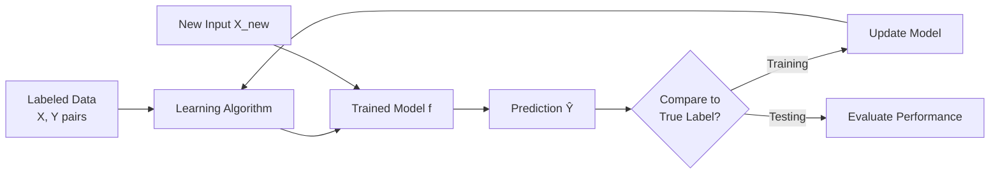
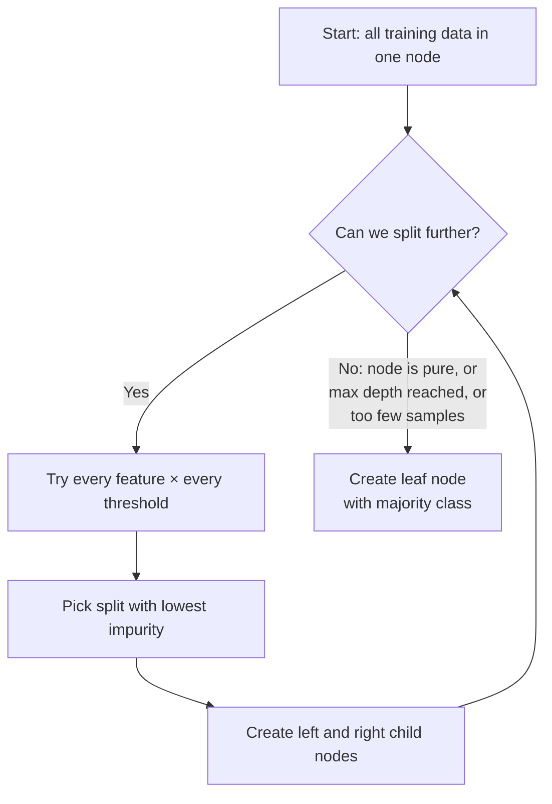
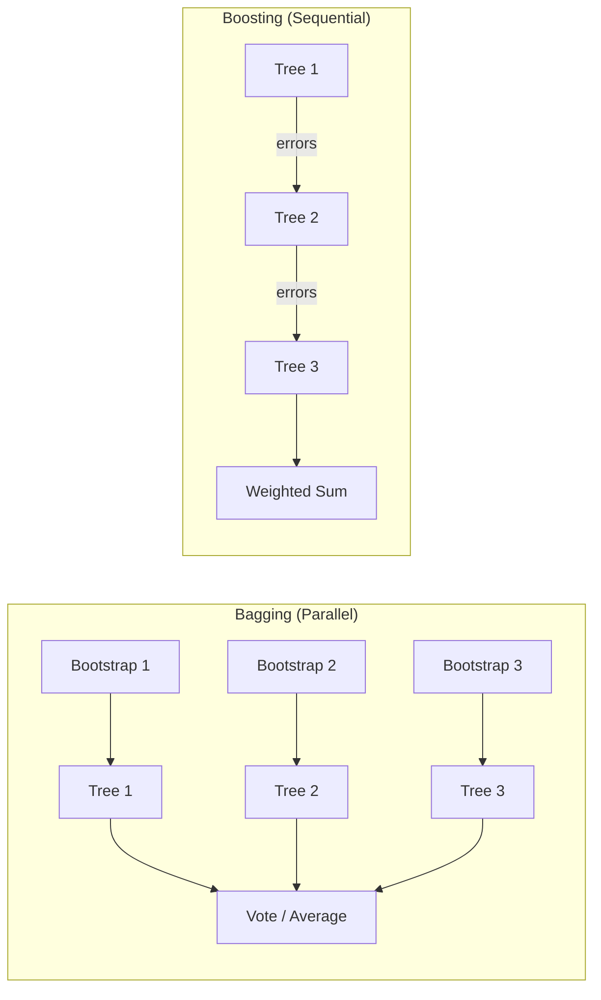
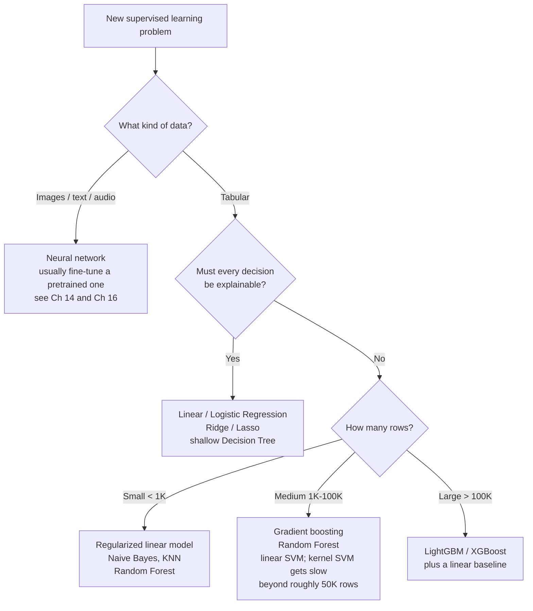
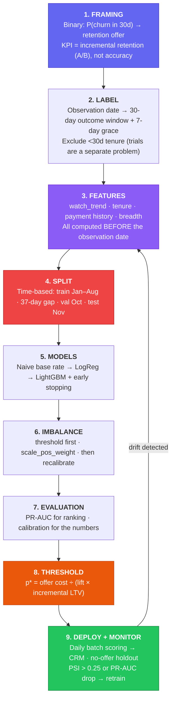

# Chapter 10 — Supervised Learning

> "Supervised learning is the workhorse of machine learning."
> — a paraphrase of Andrew Ng's message in talks such as *Opportunities in AI* (Stanford, 2023)

---

## What You'll Learn

After reading this chapter, you will be able to:
- Explain supervised learning and how it differs from other ML paradigms
- Distinguish classification from regression and choose the right framing for a problem
- Explain how Logistic Regression, KNN, Decision Trees, SVMs and ensembles work — what each **assumes**, when to reach for it, and how each one fails
- Interpret logistic-regression coefficients as log-odds
- Choose between bagging and boosting, and validate a forest without a holdout
- Use feature importance and SHAP values to explain individual predictions
- Handle class imbalance without falling into the "99% accuracy" trap
- Walk an end-to-end supervised project, from problem framing to monitoring

**How this chapter relates to its neighbours:**

| For… | Go to |
|---|---|
| The *mechanics* — loss, gradients, overfitting, regularization | [**Ch 8**](#content/08_core_concepts) |
| The *math and implementation* of each algorithm | [**Ch 12**](#content/12_key_algorithms) |
| *Metrics* — ROC, PR, cross-validation, tuning | [**Ch 13**](#content/13_model_evaluation) |
| **This chapter** | **Which algorithm, why, and how to run a real project** |

**Markers:** ★★★ = know cold for interviews · ★★ = high priority · ★ = good to know.

**Quick check** boxes are retrieval practice — attempt before revealing.

**Interview** boxes give the question, what to say, and the follow-up trap.

---

## 10.1 What is Supervised Learning?


<details>
<summary><strong>Read as text</strong> — solved examples, the house-price walk-through and the training loop</summary>

You give the model a stack of solved examples — inputs paired with their correct answers — and it figures out the pattern connecting them. Once trained, it can predict answers for inputs it has never seen before.

Think of it like studying for an exam with the answer key. You see hundreds of practice problems with solutions, notice the patterns, and use those patterns on the actual test where you don't have the answers.

> **Supervised Learning** is a machine learning paradigm where the algorithm learns a mapping function $f: X \rightarrow Y$ from a labeled training dataset of $(x_i, y_i)$ pairs, and is evaluated on its ability to generalize that mapping to unseen inputs.

> **Maths in one line:** `ŷ = f(x)`, learned from pairs (xᵢ, yᵢ) so that ŷ ≈ y — find a function f that turns the features x into a prediction ŷ close to the true label y, including for x it has never seen.

```
  Training Phase:
  ─────────────────────────────────────────────────────────────────
  Example 1:  [2000 sqft, 3 beds, suburb]  →  $350,000   (labeled)
  Example 2:  [800 sqft, 1 bed, downtown]  →  $275,000   (labeled)
  Example 3:  [3500 sqft, 5 beds, rural]   →  $420,000   (labeled)
                        ⋮
  Example N:  [features]                   →  [label]    (labeled)
                   │
                   │  Model learns the mapping: features → label
                   ▼
  Prediction Phase:
  ─────────────────────────────────────────────────────────────────
  New input: [1500 sqft, 2 beds, suburb] → $310,000 ← predicted!
```

The word "supervised" comes from the supervisor — the labels. Without labels, you're doing unsupervised learning ([Ch 11](#content/11_unsupervised_learning)). With labels, the model has a teacher checking its work during training.



</details>

### Why Supervised Learning Dominates

<details>
<summary><strong>Read as text</strong> — six everyday applications and why labels are the hard part</summary>

Most real-world ML applications are supervised learning:

| Application | Input (X) | Output (Y) | Type |
|---|---|---|---|
| Email spam filter | Email text, metadata | Spam / Not spam | Classification |
| House price estimation | Sqft, beds, location | Price in dollars | Regression |
| Medical diagnosis | Symptoms, lab results | Disease present / absent | Classification |
| Weather forecasting | Temp, pressure, humidity | Tomorrow's temperature | Regression |
| Credit scoring | Income, history, debt | Default / No default | Classification |
| Recommendation rating | User profile, item features | Star rating (1-5) | Regression |

Supervised learning works so well because labeled data encodes human knowledge directly. The hard part is usually getting enough high-quality labels, not the algorithm itself.

</details>

---

## 10.2 The Two Flavors: Classification vs Regression


<details>
<summary><strong>Read as text</strong> — label or number, and the loss and metrics that follow</summary>

Every supervised learning problem falls into one of two categories, depending on what the output looks like.

> **Classification** predicts a discrete category from a finite set of classes. **Regression** predicts a continuous numerical value.

> **Maths in one line:** classification outputs `ŷ ∈ {class 1, …, class K}`, regression outputs `ŷ ∈ ℝ` (any real number) — the type of the answer y, not the algorithm, decides which one you are doing.

The distinction is simple: if the answer is a label ("spam", "cat", "malignant"), it's classification. If the answer is a number on a continuous scale (a price of 342,000 dollars, 23.5 degrees, 4.7 stars), it's regression.

```
                      SUPERVISED LEARNING
                              │
              ┌───────────────┴───────────────┐
              ▼                               ▼
       CLASSIFICATION                    REGRESSION
              │                               │
  Output = discrete label              Output = continuous number
              │                               │
  "Which category?"                    "How much / how many?"
              │                               │
  ┌─────────────────────┐            ┌──────────────────────┐
  │ Examples:           │            │ Examples:            │
  │ - Spam / Not Spam   │            │ - House price: $350K │
  │ - Cat / Dog / Bird  │            │ - Temperature: 23.5°C│
  │ - Benign / Malignant│            │ - Stock return: 4.2% │
  │ - Positive sentiment│            │ - Time to failure: 8d│
  └─────────────────────┘            └──────────────────────┘
              │                               │
  Loss: Cross-Entropy               Loss: MSE / MAE
  Metrics: Accuracy, F1, AUC        Metrics: RMSE, R², MAE
```

</details>

### Classification Subtypes

<details>
<summary><strong>Read as text</strong> — binary, multi-class and multi-label</summary>

**Binary classification** has exactly two classes — yes/no, spam/not-spam, positive/negative. The model outputs a probability for one class, and you threshold it (typically at 0.5) to get the final prediction.

**Multi-class classification** has three or more mutually exclusive classes — the input belongs to exactly one. A handwritten digit recognizer (0-9) is multi-class: each image is one and only one digit.

**Multi-label classification** allows multiple labels per input simultaneously. A movie can be Action AND Comedy AND Thriller. Each label is an independent binary decision.

```
  BINARY:        Spam ─── or ─── Not Spam
                 (one probability, one threshold)

  MULTI-CLASS:   Cat ─── or ─── Dog ─── or ─── Bird
                 (softmax: probabilities sum to 1, pick the highest)

  MULTI-LABEL:   [Action: ✓] [Comedy: ✓] [Horror: ✗] [Thriller: ✓]
                 (sigmoid per label: each is independent)
```

| Property | Multi-class | Multi-label |
|---|---|---|
| Labels per input | Exactly 1 | 0 or more |
| Output activation | Softmax | Sigmoid (per label) |
| Loss function | Categorical cross-entropy | Binary cross-entropy (per label) |
| Probabilities sum to 1? | Yes | No |
| Example | Digit recognition (0-9) | Movie genre tagging |

</details>

### When Is It Actually Ambiguous?

<details>
<summary><strong>Read as text</strong> — star ratings, age brackets and the rule of thumb</summary>

Sometimes the line between classification and regression blurs. Star ratings (1-5) are discrete, but treating them as regression often works better because 4 stars is closer to 5 than to 1 — the ordering matters. (A third option, **ordinal regression**, keeps the answers discrete *and* respects their order.) Age prediction could be regression (predict 34.2 years) or classification (predict age bracket: 30-40). The right choice depends on what decision you'll make with the output.

**Rule of thumb:** If the output has a natural ordering and the gaps between values matter, lean toward regression. If the categories are fundamentally different kinds of things, use classification.

</details>

---

## 10.3 How Models Learn: Loss Functions & Optimization

![Map infographic of three supervised-learning rules with links to Ch 8: the loss matches the output (binary sigmoid plus binary cross-entropy, multi-class softmax plus categorical cross-entropy, multi-label sigmoid per label, regression linear plus MSE, MAE or Huber); labels dictate the split (stratified, time-based, GroupKFold), with a random 10% split of 1,000 rows and 10 positives holding no positives in 35.4% of splits; each family has its own regularization knobs (C = 1/lambda so C 0.01 is strong, alpha = lambda, max_depth, learning_rate plus early stopping, dropout and AdamW weight decay).](diagrams/sup10_info_training_essentials_ai.png)

<details>
<summary><strong>Read as text</strong> — the loss must match the output, and the multi-label trap</summary>

Training a model is a game of "warmer, colder." The model guesses, a loss function scores how wrong the guess was, and the optimizer nudges the dials in whatever direction lowers the score — thousands of times over. Pick the wrong scorekeeper and the model gets very good at the wrong thing.

> **Maths in one line:** `L(θ) = (1/n) Σᵢ loss(yᵢ, f_θ(xᵢ))`, then repeat `θ ← θ − α·∇L(θ)` — score how wrong the predictions are on average, then move every dial θ a small step downhill (α is the learning rate).

→ **Full treatment: [Ch 8](#content/08_core_concepts) §8.7 (the training loop), §8.8 (loss functions), §8.9–8.10 (gradient descent and optimizers).**

The supervised-learning–specific point is narrow but important: **the loss must match the output type**, and the output layer must match the loss.

| Task | Output layer | Loss | Notes |
|---|---|---|---|
| Binary classification | Sigmoid | Binary cross-entropy | One score, thresholded ([§8.16](#content/08_core_concepts)) |
| Multi-class (one label) | Softmax | Categorical cross-entropy | Classes compete — probabilities sum to 1 |
| **Multi-label** (many labels) | **Sigmoid per label** | **Binary CE per label, summed or averaged** | Classes do **not** compete — a photo can be *beach* **and** *sunset* |
| Regression | Linear (no activation) | MSE, MAE or Huber | MAE or Huber when genuine outliers shouldn't dominate ([§8.8](#content/08_core_concepts)) |

> ⚠️ **The multi-label trap.** Reaching for softmax when labels aren't mutually exclusive forces the model to split one unit of probability across labels that should all be able to score 0.9. Ask: *can a single example carry two labels at once?* If yes, sigmoid per label.

</details>

---

## 10.4 The Training Pipeline: Train / Val / Test Splits


<details>
<summary><strong>Read as text</strong> — why labels dictate how you split</summary>

You wouldn't judge a chef by the one dish they've rehearsed a thousand times — you'd ask for something new. Models need the same honest test: a set to learn from, a set to make tuning decisions against, and a final set kept sealed for one unbiased grade.

→ **Full treatment: [Ch 8](#content/08_core_concepts) §8.3 (splits and sizing) and §8.4 (data leakage — the four types, the `fit`/`transform` rule, and how to catch it). Cross-validation mechanics: [Ch 13 §13.7](#content/13_model_evaluation).**

What is *specific to supervised learning* is that your labels dictate **how** you split. Three cases where a random split is simply wrong:

| Situation | Wrong | Right | Why |
|---|---|---|---|
| **Imbalanced classes** | Random split | **Stratified** split / `StratifiedKFold` | A random 10% test set of a 1%-positive dataset may contain almost no positives, making the score meaningless |
| **Time-ordered data** | Random split | **Time-based** split — train on the past, test on the future | A random split lets the model see the future to predict the past. It cannot do that in production |
| **Repeated entities** | Random split | **Group** split (`GroupKFold`) by patient / user / device | The same patient in train *and* test means you measured memorisation, not learning |

The last two are **leakage**, and leakage is invisible in the score — the number just comes out flatteringly high (the case study in §10.13 uses a time-based split for exactly this reason). The first is **noise**: the score swings wildly from split to split, and with zero positives in the test set recall and AUC cannot even be computed.

How bad is "almost no positives"? Simulate it — 1,000 rows, 10 of them positive, a 10% test set:

</details>

```python
# Random vs stratified 10% test split of a 1%-positive dataset: how many positives reach the test set?
import math
import numpy as np

rng = np.random.default_rng(0)
y = np.array([1] * 10 + [0] * 990)            # 1,000 rows, 10 positives (1%)
pos, neg = np.flatnonzero(y == 1), np.flatnonzero(y == 0)

random_counts, strat_counts = [], []
for _ in range(1000):
    test = rng.choice(len(y), size=100, replace=False)                 # plain random 10%
    random_counts.append(int(y[test].sum()))
    test = np.concatenate([rng.choice(pos, 1, replace=False),          # stratified: 10% of each class,
                           rng.choice(neg, 99, replace=False)])        # what stratify=y does
    strat_counts.append(int(y[test].sum()))

for name, counts in [("random", random_counts), ("stratified", strat_counts)]:
    c = np.array(counts)
    print(f"{name:<10} positives in test: min {c.min()}, max {c.max()}; "
          f"none at all in {np.mean(c == 0):.1%} of 1,000 splits")

exact = math.comb(990, 100) / math.comb(1000, 100)
print(f"theory: P(random test set has no positive) = {exact:.3f}")
assert set(strat_counts) == {1} and abs(np.mean(np.array(random_counts) == 0) - exact) < 0.05
```

**Output:**

```
random     positives in test: min 0, max 6; none at all in 35.4% of 1,000 splits
stratified positives in test: min 1, max 1; none at all in 0.0% of 1,000 splits
theory: P(random test set has no positive) = 0.347
```

<details>
<summary><strong>Read as text</strong> — continued: what the simulation shows</summary>

More than a third of random splits leave the test set with **no positives at all**, and the rest hold anywhere from 1 to 6. In scikit-learn the fix is one argument: `train_test_split(X, y, test_size=0.1, stratify=y)`.

</details>

<details>
<summary><strong>Quick check.</strong> You're predicting hospital readmission. Each patient has 3–8 visit records, and you split randomly by row. Your AUC is 0.94. Why is that number not trustworthy?</summary>

**Group leakage.** The same patient appears in both train and test, so the model can memorise *that patient* — their baseline vitals, their comorbidities — rather than learning what predicts readmission. New patients, who are the entire point, will break it.

**Fix:** split by `patient_id` with `GroupKFold` so every patient falls entirely on one side. Expect the AUC to drop; that lower number is the honest one. ([Ch 8 §8.4](#content/08_core_concepts))
</details>

---

## 10.5 Overfitting, Underfitting, and Regularization

<details>
<summary><strong>Read as text</strong> — each family's regularization knobs, and which way C turns</summary>

Every modelling decision — algorithm choice, hyperparameters, regularization — is ultimately about this tradeoff.

> **Maths in one line:** `minimise  training loss(θ) + λ · penalty(θ)` with `penalty = Σθ²` (L2) or `Σ|θ|` (L1) — a bigger λ forces a simpler model: more training error, often less overfitting.

→ **Full treatment: [Ch 8](#content/08_core_concepts) §8.13 (diagnosing over/underfitting, with the symptom → fix table), §8.14 (bias–variance), §8.15 (regularization, including why L1 zeroes weights and L2 doesn't).**

The part [Ch 8](#content/08_core_concepts) *can't* give you is that every algorithm family exposes regularization through different knobs. This is the translation table:

> 📖 **Reading ahead is fine here.** This table names algorithms — Random Forest, Gradient Boosting — that aren't explained until **§10.8** (trees themselves come in §10.6). That's deliberate: it's a reference table you'll come back to. Skim it now for the *shape* of the idea (every family has capacity knobs, and they look nothing alike), and return once you've met the algorithms. Nothing later depends on you memorising it today.

| Family | The knobs | What actually controls capacity | Symptom when you get it wrong |
|---|---|---|---|
| **Linear / Logistic** | `C` (`LogisticRegression`, `SVC`) or `alpha` (`Ridge`, `Lasso`, `ElasticNet`); L1 vs L2 via `l1_ratio` (older code: `penalty`) | `C` is the **inverse** of λ — smaller `C` means *more* regularization, which trips people up constantly. `alpha` **is** λ — bigger `alpha` means more. Ridge = L2, Lasso = L1, Elastic Net = both | Train and val scores both mediocre and nearly equal → too much regularization (`C` too small, or `alpha` too big) |
| **Decision Tree** | `max_depth`, `min_samples_leaf`, `min_samples_split` | Structural limits, not a penalty term — an unbounded tree will memorise every row | Train accuracy 100%, val far below → depth is unbounded |
| **Random Forest** | `n_estimators`, `max_features`, plus the tree knobs above | More trees never overfits (it only averages more); `max_features` is the real diversity knob | Adding trees stops helping → raise diversity (lower `max_features`), not `n_estimators` |
| **Gradient Boosting** | `learning_rate` × `n_estimators`, `max_depth`, `reg_alpha` / `reg_lambda` (XGBoost/LightGBM names for L1/L2) | More trees **does** overfit here. A small `learning_rate` plus early stopping is the dominant strategy | Val loss falls, bottoms out, then *climbs* → you passed the early-stopping point |
| **Neural networks** | Dropout rate, `weight_decay`, width/depth, early stopping | Capacity is mostly **architecture** — parameter count sets the ceiling, and dropout plus `weight_decay` pull back from it. Dropout randomly silences a fraction of units each step, so no unit can rely on any other; `weight_decay` shrinks weights toward zero every update | Train loss → 0 while val loss rises → raise dropout, or stop earlier |

> ⚠️ **The single most confusing knob in sklearn:** in `LogisticRegression` and `SVC`, `C=0.01` is *strong* regularization and `C=100` is *weak* — `C` is `1/λ`. (`Ridge` and `Lasso` use `alpha`, which is λ itself, so there the direction flips back.) Getting this backwards silently produces an underfit model that looks like a bad algorithm choice.

> ⚠️ **Use AdamW, not Adam + L2.** With Adam, an L2 penalty gets divided by the same per-parameter scaling the optimizer applies to gradients, so the amount of regularization each weight actually receives is not what you asked for. AdamW *decouples* the decay and applies it directly to the weights. See [Ch 8 §8.10](#content/08_core_concepts) and [Ch 16 §1.2](#content/16_deep_learning).

> **Interview —** *"Random Forest and Gradient Boosting are both tree ensembles. Why does adding trees overfit one but not the other?"*
>
> **Say:** Random Forest **averages** independent trees — more trees reduce variance and the error levels off at a plateau, so extra trees are just wasted compute. Boosting builds trees **sequentially**, each fitting the previous residuals, so more trees keep reducing training error and eventually fit noise.
>
> **They follow up with:** *"So how do you control boosting?"* — a small learning rate plus early stopping on a validation set, then `max_depth` and the L1/L2 terms.

> ↪ **Both of these are unpacked properly in [§10.8](#content/10_supervised_learning).** If the bagging-vs-boosting distinction doesn't land yet, that is expected — read on and come back.

</details>

---

## 10.6 Classification Algorithms

![Infographic on logistic regression as a scorecard, with a strip naming the five classifiers' assumptions (straight line, neighbours agree, rectangles, wide road, independent clues). Spam example: bias -3.0, FREE +0.8, MONEY +1.2, 5 links x 0.3 = +1.5, known sender 0 sum to z = 0.5, the sigmoid gives P = 0.622, above the 0.5 threshold so SPAM; a table shows MONEY's +1.2 multiplying the odds by e^1.2 = 3.32 from starts of 0.018, 0.500 and 0.953; log-loss 0.693 is a coin flip and 4.605 is confidently wrong.](diagrams/sup10_info_logistic_regression_ai.png)

<details>
<summary><strong>Read as text</strong> — five algorithms, five assumptions in one table</summary>

Five algorithms cover almost every classification problem you'll meet. This section is the **survey**: what each one assumes, when to reach for it, and how it fails. The full math and implementation detail for each lives in [Ch 12](#content/12_key_algorithms).

**The whole section in one table** — skim this first, then read the entries:

| Algorithm | The one-line idea | It assumes… | Reach for it when | …so it breaks when |
|---|---|---|---|---|
| **Logistic Regression** | A scorecard: each feature adds or subtracts points, and the total becomes a probability | Classes are separable by a **straight line** (in log-odds) | You need speed, calibrated probabilities, or to *explain* the decision | The boundary is genuinely curved |
| **KNN** | Ask the nearest few neighbours and go with the majority | **Nearby points share a label** — and "nearby" is measured meaningfully | The data is small, low-dimensional, and "similar things cluster" is true | Dimensions grow, or features aren't scaled |
| **Decision Tree** | A game of twenty questions, each splitting the remaining possibilities | Classes fall into **rectangular, axis-aligned regions** | You need a human-readable rule set | Left unpruned — it memorises |
| **SVM** | Draw the widest road between two groups | A **wide margin** separates the classes — in the input space or a kernel-implied one | Data is high-dimensional or wide-but-short (text) | The dataset is large — kernel SVMs slow down sharply beyond roughly 50K rows |
| **Naive Bayes** | Count how often each clue appears in each class, then multiply the evidence | Features are **independent given the class** | Text classification, or you need a baseline in five minutes | Features are strongly redundant |

> **How to read an algorithm entry.** Columns 3 and 5 are the same fact stated twice — *an algorithm breaks precisely when its assumption stops being true of your data.* That is the whole game, and it is why "which algorithm is best?" has no answer without seeing the data ([Ch 8 §8.5](#content/08_core_concepts), inductive bias). Each entry below repeats its assumption on an **Assumes:** line, so you can find it fast.

</details>

### Logistic Regression ★★★


#### Simple Explanation

<details>
<summary><strong>Read as text</strong> — the scorecard, the sigmoid and the log-odds view</summary>

Think of a **points-based scorecard**, like the ones lenders use. Every feature either adds points
or takes them away: an email containing "FREE" adds points toward *spam*, a known sender takes
points away. Add up all the points and you get one number — high means "probably spam," low means
"probably fine."

The only wrinkle is that a raw point total can be any number at all (−7, +340), and you need a
*probability* between 0 and 1. So the total gets squeezed through an S-shaped curve — the
**sigmoid** — which maps any number onto the 0–1 range. Very negative totals land near 0, very
positive totals near 1, and a total of zero lands at exactly 0.5.

That is the entire algorithm: **add up weighted evidence, squash it into a probability.**

> **Logistic Regression** is a linear classifier that models the posterior probability $P(y=1|x)$ by applying the logistic sigmoid to a linear combination of features, trained by minimizing binary cross-entropy.

> **Maths in one line:** `P(y=1 | x) = σ(z) = 1 / (1 + e^(−z))` with `z = w₀ + w₁x₁ + … + wₙxₙ` — add up weighted evidence z, squash it into a probability; the decision boundary is the straight line where z = 0 (P = 0.5).

Despite the name, it classifies. It takes a weighted sum of features, pushes it through a sigmoid to get a probability, and thresholds.

**Assumes:** the two classes can be separated by a **straight line** — more precisely, that the log-odds are linear in the features. Curved boundaries need engineered features or a different model.

$$z = w_0 + w_1 x_1 + \dots + w_n x_n \qquad \hat{y} = \sigma(z) = \frac{1}{1 + e^{-z}}$$

```
  Example — spam detection:

    w₀ = -3.0  (bias)
    has_word_FREE:    w₁ = +0.8
    has_word_MONEY:   w₂ = +1.2
    num_links:        w₃ = +0.3
    is_known_sender:  w₄ = -0.5

    Email: FREE=1, MONEY=1, links=5, known=0
      z = -3.0 + 0.8 + 1.2 + 1.5 + 0 = 0.5
      ŷ = σ(0.5) = 0.622  → SPAM at threshold 0.5
```

**What the weights actually mean — the log-odds view.**

You just computed `z = 0.5` and turned it into a probability of 0.622. That raises the obvious
next question — and it is the one interviewers actually ask: *the weight on MONEY is `+1.2`.
What does "+1.2" mean?*

It is tempting to answer "+1.2 probability" or "+1.2 percent." Both are wrong, and saying
either is an audible tell. The correct answer needs one idea first: **odds**.

**Odds** are just the bookmaker's way of stating a chance. Instead of "75% likely" you say
"3 to 1 on" — for every 1 time it fails, it happens 3 times. The arithmetic is
$\text{odds} = P / (1 - P)$, so $0.75 / 0.25 = 3$.

With that in hand, undo the sigmoid and rearrange the model. What falls out is:

$$\log\underbrace{\frac{P(y=1)}{1 - P(y=1)}}_{\text{odds}} = w_0 + w_1x_1 + \dots + w_nx_n$$

The right-hand side is the ordinary linear score. The left-hand side is *not* a probability —
it is the **log of the odds**. That is the whole reveal: the weights were never acting on
probability at all. They were adding up log-odds all along, and the sigmoid existed only to
convert that total back into a probability at the very end.

**Logistic regression is linear in the log-odds**, not in the probability. That single fact gives you the interpretation:

| | Meaning |
|---|---|
| **Odds** | `P / (1−P)`. A probability of 0.75 is odds of 3 — "3 to 1 on" |
| **A coefficient wᵢ** | A one-unit increase in `xᵢ` adds `wᵢ` to the log-odds |
| **e^wᵢ — the odds ratio** | …which **multiplies the odds by e^wᵢ** |

So `MONEY` with `w = +1.2` means: seeing that word multiplies the odds of spam by `e^1.2 ≈ 3.3`, holding everything else fixed. That is a sentence you can say to a regulator or a product manager — and it's why logistic regression still wins in credit scoring and medicine.

> ⚠️ The coefficient is **not** "+1.2 probability" and not a percentage-point change. The effect on probability depends on where you start — the sigmoid is steep in the middle and flat at the ends.

Run the scorecard and watch both facts — the fixed odds ratio and the moving probability — plus the log-loss that training minimises:

</details>

```python
# Logistic regression by hand: score -> sigmoid -> probability, what one weight does to the odds, and the log-loss
import numpy as np

def sigmoid(z):
    return 1 / (1 + np.exp(-z))

def odds(p):
    return p / (1 - p)

w0 = -3.0
w = np.array([0.8, 1.2, 0.3, -0.5])   # FREE, MONEY, num_links, is_known_sender
x = np.array([1, 1, 5, 0])            # the email from the text

z = w0 + w @ x
p = sigmoid(z)
print(f"z = {z:.1f}  ->  P(spam) = {p:.3f}  ->  {'SPAM' if p >= 0.5 else 'NOT SPAM'} at threshold 0.5")

# The odds view: switch MONEY off, keep everything else fixed
x_off = x.copy()
x_off[1] = 0
p_off = sigmoid(w0 + w @ x_off)
ratio = odds(p) / odds(p_off)
print(f"MONEY = 0: P = {p_off:.3f}, odds = {odds(p_off):.3f}")
print(f"MONEY = 1: P = {p:.3f}, odds = {odds(p):.3f}   odds ratio = {ratio:.2f} = e^1.2")
assert np.isclose(ratio, np.exp(1.2))

# Same +1.2, three starting points: the odds ratio is fixed, the probability jump is not
for z_start in [-4.0, 0.0, 3.0]:
    p0, p1 = sigmoid(z_start), sigmoid(z_start + 1.2)
    print(f"start P = {p0:.3f}  ->  add MONEY: P = {p1:.3f}   (odds x {odds(p1) / odds(p0):.2f})")

# Log-loss (binary cross-entropy, natural log) for this one prediction
for y in [1, 0]:
    loss = -(y * np.log(p) + (1 - y) * np.log(1 - p))
    print(f"true label {y}: log-loss = {loss:.3f}")
print(f"coin flip, P = 0.5: log-loss = {-np.log(0.5):.3f}")
print(f"confidently wrong, P = 0.99 but label 0: log-loss = {-np.log(1 - 0.99):.3f}")
```

**Output:**

```
z = 0.5  ->  P(spam) = 0.622  ->  SPAM at threshold 0.5
MONEY = 0: P = 0.332, odds = 0.497
MONEY = 1: P = 0.622, odds = 1.649   odds ratio = 3.32 = e^1.2
start P = 0.018  ->  add MONEY: P = 0.057   (odds x 3.32)
start P = 0.500  ->  add MONEY: P = 0.769   (odds x 3.32)
start P = 0.953  ->  add MONEY: P = 0.985   (odds x 3.32)
true label 1: log-loss = 0.474
true label 0: log-loss = 0.974
coin flip, P = 0.5: log-loss = 0.693
confidently wrong, P = 0.99 but label 0: log-loss = 4.605
```

<details>
<summary><strong>Read as text</strong> — continued: odds vs probability, threshold, multi-class and why cross-entropy</summary>

The same word adds **3.9 points** of probability to an email that starts at 1.8%, **26.9 points** to one that starts at 50%, and **3.3 points** to one already at 95.3% — yet the odds are multiplied by 3.32 every time. The log-loss lines show what training punishes: 0.693 is a model that learned nothing ([Ch 8 §8.8](#content/08_core_concepts)), and a confidently wrong answer (4.605) costs almost ten times this email's loss if it really is spam (0.474).

**Threshold.** The 0.5 default is a choice, not a law — lower it for recall, raise it for precision ([Ch 8 §8.16](#content/08_core_concepts)).

**Multi-class** uses softmax over `K` classes (softmax, or multinomial, regression); probabilities are positive and sum to 1. scikit-learn's `LogisticRegression` does this automatically when `y` has three or more classes.

> **Interview —** *"Why is it called logistic *regression* if it does classification?"*
>
> **Say:** Because it *is* a regression — a linear regression on the **log-odds**. The sigmoid is just the inverse link that maps that unbounded linear score back to a probability. Classification happens afterwards, when you apply a threshold.
>
> **They follow up with:** *"So what does a coefficient of 0.7 mean?"* — a one-unit increase in that feature multiplies the **odds** by `e^0.7 ≈ 2`, holding others fixed. Say "odds," not "probability" — that's the discriminator.

> **Why cross-entropy and not MSE?** Minimizing BCE is exactly maximum-likelihood estimation for a yes/no (Bernoulli) outcome, and it is convex in the weights. MSE on a sigmoid is non-convex, and its gradient almost vanishes when the model is confidently wrong — the moment it most needs to learn. The gradient argument, with numbers, is in [**Ch 8 §8.8**](#content/08_core_concepts) ("Why Not Just Use MSE for Classification?"); the full algorithm card is [**Ch 12 §12.3**](#content/12_key_algorithms).

</details>

---

### K-Nearest Neighbors (KNN) ★

![Infographic comparing KNN and decision trees. KNN stores every example and lets the K nearest vote; for new student Q (30 hours, 520 questions, K = 3) raw units rank B 29.73, A 32.02, E 60.21 and predict Fail, while min-max scaling ranks E 0.185, C 0.518, B 0.734 and predicts Pass, because the questions term (up to 462,400) dwarfs hours (625). The decision tree asks yes/no questions (income over 50K, age over 30, college degree) to reach Approve, Review or Deny, scores splits with Gini = 1 - sum of p squared, needs no scaling, and without a depth limit scores 1.00 on training rows.](diagrams/sup10_info_knn_and_decision_trees_ai.png)

#### Simple Explanation

<details>
<summary><strong>Read as text</strong> — ask the neighbours, choosing K, and the scaling flip</summary>

You've just moved to a new street and want to know whether the neighbourhood votes left or right.
The simplest possible method: knock on the **five nearest doors** and ask. Whatever most of them
say, that's your guess.

That is KNN, complete. There is no training, no equation, no learned weights — the algorithm just
*keeps every example it has ever seen* and, when you hand it something new, looks up the closest
few and takes a vote. It is sometimes called a **lazy** learner for exactly this reason: it does no
work upfront and all of its work at prediction time.

Two consequences follow immediately, and both matter. Because "closest" means measuring distance,
**every feature has to be on a comparable scale** — otherwise one big-numbered feature drowns out
the rest. And because it searches the whole training set on every query, it gets slow exactly when
your data gets big.

> **KNN** is a non-parametric, instance-based algorithm: classify a new point by finding the K closest training examples and taking the majority vote.

> **Maths in one line:** `d(a, q) = √( Σⱼ (aⱼ − qⱼ)² )` for every stored point a, then `ŷ = majority label of the K smallest d` — no training at all; the stored data *is* the model.

**Assumes:** nearby points share a label. There is no training phase — the training set *is* the model.

```chart
{
  "type": "scatter",
  "data": {
    "datasets": [
      {
        "label": "The 3 votes counted",
        "data": [{"x":5,"y":5},{"x":4.2,"y":4.4},{"x":5,"y":5},{"x":5.9,"y":5.5},{"x":5,"y":5},{"x":5.2,"y":3.7}],
        "borderColor": "rgba(120, 120, 120, 0.9)",
        "backgroundColor": "transparent",
        "showLine": true, "borderWidth": 2, "borderDash": [5, 4], "pointRadius": 0
      },
      {
        "label": "Class A — too far to vote",
        "data": [{"x":3,"y":6.2},{"x":7.2,"y":6.8},{"x":2.2,"y":7.4},{"x":7.8,"y":8}],
        "backgroundColor": "rgba(99, 102, 241, 0.25)",
        "borderColor": "rgba(99, 102, 241, 0.4)",
        "pointStyle": "circle", "pointRadius": 7, "borderWidth": 1
      },
      {
        "label": "Class B — too far to vote",
        "data": [{"x":3.4,"y":2.6},{"x":6.8,"y":2.2},{"x":2,"y":3}],
        "backgroundColor": "rgba(234, 88, 12, 0.25)",
        "borderColor": "rgba(234, 88, 12, 0.4)",
        "pointStyle": "triangle", "pointRadius": 8, "borderWidth": 1
      },
      {
        "label": "Nearest 3 → Class A (1 vote)",
        "data": [{"x":5.9,"y":5.5}],
        "backgroundColor": "rgba(99, 102, 241, 1)",
        "borderColor": "rgba(30, 30, 30, 1)",
        "pointStyle": "circle", "pointRadius": 11, "borderWidth": 3
      },
      {
        "label": "Nearest 3 → Class B (2 votes)",
        "data": [{"x":4.2,"y":4.4},{"x":5.2,"y":3.7}],
        "backgroundColor": "rgba(234, 88, 12, 1)",
        "borderColor": "rgba(30, 30, 30, 1)",
        "pointStyle": "triangle", "pointRadius": 12, "borderWidth": 3
      },
      {
        "label": "New point to classify",
        "data": [{"x":5,"y":5}],
        "backgroundColor": "rgba(239, 68, 68, 1)",
        "borderColor": "rgba(30, 30, 30, 1)",
        "pointStyle": "rectRot", "pointRadius": 13, "borderWidth": 3
      }
    ]
  },
  "options": {
    "plugins": { "title": { "display": true, "text": "KNN with K=3 — Only the 3 Linked Points Get a Vote → Class B Wins 2–1" } },
    "scales": {
      "y": { "title": { "display": true, "text": "Feature 2" }, "min": 1, "max": 9 },
      "x": { "title": { "display": true, "text": "Feature 1" }, "min": 1, "max": 9 }
    }
  }
}
```

The three dashed spokes are the whole algorithm. Measured from the new point, the
distances are **1.00** (Class B), **1.03** (Class A) and **1.32** (Class B) — and the
*fourth*-closest point is way back at **2.33**. That gap is why K=3 is unambiguous here.
Count the linked points only: **B=2, A=1 → predict B**. Every faded point is ignored
entirely, no matter how obvious the overall pattern looks to your eye.

**Choosing K:** `K=1` is maximally sensitive to noise with a jagged boundary; `K=5` (scikit-learn's default) is a good start; `K=√n` is a common rule of thumb for the upper end; `K=n` always predicts the majority class. Pick the final K by cross-validation ([Ch 13 §13.7](#content/13_model_evaluation)), and use an **odd** K for binary problems to avoid ties.

| Distance metric | When |
|---|---|
| Euclidean | Default, continuous features |
| Manhattan | High-dimensional or sparse data |
| Cosine | Text and document similarity |

> ⚠️ **KNN requires feature scaling.** It is pure distance, so income measured in tens of thousands will completely drown out `number_of_children`. This is not optional ([Ch 9, Step 4](#content/09_data_preprocessing)).

**Example — a 3-NN vote, before and after scaling.**

Five people sat a certification exam, each described by hours studied and practice questions solved. A new candidate $Q$ has studied **30 hours** and solved **520 questions**. Will she pass?

| Student | Hours studied | Questions solved | Result |
|---|---|---|---|
| A | 5 | 500 | Fail |
| B | 8 | 540 | Fail |
| C | 28 | 900 | Pass |
| D | 32 | 1,200 | Pass |
| E | 35 | 460 | Pass |

**On the raw numbers.** Euclidean distance from $Q$ — for B that is
$\sqrt{(30-8)^2 + (520-540)^2} = \sqrt{884} = 29.73$:

| Rank | Neighbour | Distance | Result |
|---|---|---|---|
| 1 | B | 29.73 | Fail |
| 2 | A | 32.02 | Fail |
| 3 | E | 60.21 | Pass |
| 4 | C | 380.01 | Pass |
| 5 | D | 680.00 | Pass |

3-NN = {B, A, E} → **Fail, Fail, Pass → predicts Fail** ❌

**That answer should bother you.** Q studied 30 hours. The two "nearest" students the model
picked, A and B, studied **5 and 8** hours — nothing like her. Meanwhile C, who studied 28
hours, was ranked *fourth*. How did a candidate with 30 hours end up neighbours with people
who barely studied?

The answer is in the arithmetic. The hours term can contribute at most
$25^2 = 625$ to any of those distances; the questions term contributes up to
$680^2 = 462{,}400$ — roughly **740 times more**. Hours never stood a chance. The distance
formula was, in effect, sorting on questions alone and ignoring the column you cared about.

**After min-max scaling** onto $[0, 1]$ using the training ranges (hours 5–35, questions
460–1,200), which puts $Q$ at $(0.833, 0.081)$:

| Rank | Neighbour | Scaled position | Distance | Result |
|---|---|---|---|---|
| 1 | E | (1.000, 0.000) | 0.185 | Pass |
| 2 | C | (0.767, 0.595) | 0.518 | Pass |
| 3 | B | (0.100, 0.108) | 0.734 | Fail |
| 4 | A | (0.000, 0.054) | 0.834 | Fail |
| 5 | D | (0.900, 1.000) | 0.921 | Pass |

3-NN = {E, C, B} → **Pass, Pass, Fail → predicts Pass** ✅

Same five points, same $K$, same metric — the opposite answer. Nothing about the model
changed; only the units did. And the scaled answer is the sensible one: E studied 35 hours
and passed on modest practice, which is exactly the pattern $Q$ matches.

Run the whole example — both tables, plus two contrasts:

</details>

```python
# KNN before and after scaling: same five students, same K, opposite answer
import numpy as np

names = np.array(["A", "B", "C", "D", "E"])
X = np.array([[5, 500], [8, 540], [28, 900], [32, 1200], [35, 460]], dtype=float)  # hours, questions
y = np.array(["Fail", "Fail", "Pass", "Pass", "Pass"])
Q = np.array([30, 520], dtype=float)

def knn_vote(Xt, Qt, k, digits):
    d = np.sqrt(((Xt - Qt) ** 2).sum(axis=1))            # Euclidean distance to every student
    order = np.argsort(d)
    print("  ranked:", ", ".join(f"{names[i]} {d[i]:.{digits}f}" for i in order))
    votes = [str(v) for v in y[order[:k]]]
    winner = max(set(votes), key=votes.count)
    print(f"  {k}-NN votes {votes} -> {winner}")
    return winner

print("Raw units:")
raw = knn_vote(X, Q, k=3, digits=2)

lo, hi = X.min(axis=0), X.max(axis=0)                     # min-max: fit on the training rows
Xs, Qs = (X - lo) / (hi - lo), (Q - lo) / (hi - lo)
print(f"Min-max scaled, Q = ({Qs[0]:.3f}, {Qs[1]:.3f}):")
scaled = knn_vote(Xs, Qs, k=3, digits=3)
assert (raw, scaled) == ("Fail", "Pass")

# Contrast 1: standardising (z-scores) instead of min-max also fixes it
mu, sd = X.mean(axis=0), X.std(axis=0)
print("Standardised:")
knn_vote((X - mu) / sd, (Q - mu) / sd, k=3, digits=3)

# Contrast 2: K = n lets everyone vote, so it always predicts the majority class
print("K = 5, raw units:")
knn_vote(X, Q, k=5, digits=2)
```

**Output:**

```
Raw units:
  ranked: B 29.73, A 32.02, E 60.21, C 380.01, D 680.00
  3-NN votes ['Fail', 'Fail', 'Pass'] -> Fail
Min-max scaled, Q = (0.833, 0.081):
  ranked: E 0.185, C 0.518, B 0.734, A 0.834, D 0.921
  3-NN votes ['Pass', 'Pass', 'Fail'] -> Pass
Standardised:
  ranked: E 0.450, C 1.335, B 1.753, A 1.991, D 2.377
  3-NN votes ['Pass', 'Pass', 'Fail'] -> Pass
K = 5, raw units:
  ranked: B 29.73, A 32.02, E 60.21, C 380.01, D 680.00
  5-NN votes ['Fail', 'Fail', 'Pass', 'Pass', 'Pass'] -> Pass
```

<details>
<summary><strong>Read as text</strong> — continued: what the run shows</summary>

Either scaler gives the same neighbours in the same order here. The last case is the
other way to get a "right" answer for the wrong reason: with `K = 5` every student votes,
so the model just returns the majority class. In scikit-learn the fix is one line —
`make_pipeline(MinMaxScaler(), KNeighborsClassifier(n_neighbors=3))` — so the scaler is
fitted on training rows only.

*Takeaway: for KNN, feature scaling is not preprocessing hygiene — it is part of the model's definition of "near".*

</details>


---

### Decision Trees ★★★

#### Simple Explanation

<details>
<summary><strong>Read as text</strong> — twenty questions, Gini, and why forests fix overfitting</summary>

A decision tree is a game of **twenty questions**. "Is the transaction over ₹500?" — yes. "Was it
made after midnight?" — yes. "Is the country new for this card?" — yes. *Probably fraud.*

Each question splits the remaining cases into two smaller piles, and the tree keeps asking until
a pile is pure enough to call. The clever part is that nobody writes the questions: the algorithm
tries **every feature at every threshold** and picks whichever split separates the classes best,
then repeats inside each new pile.

This is why trees are the go-to when someone needs to *see* the reasoning — the finished model is
a flowchart you can read aloud. It is also why an unrestrained tree is dangerous: keep asking
questions long enough and you end up with one leaf per training row, which is memorisation
dressed up as learning.

> A **Decision Tree** recursively partitions the feature space with axis-aligned splits. Each internal node tests a feature against a threshold; each leaf holds a prediction.

> **Maths in one line:** `Gini = 1 − Σₖ pₖ²` (pₖ = share of class k in a node) — try every feature × threshold and keep the split whose two children have the lowest size-weighted impurity; a pure node scores 0, a 50/50 node 0.5.

**Assumes:** the classes can be separated by rectangular, axis-aligned regions.

```
                   Is income > $50K?
                  /                  \
                YES                   NO
                 │                    │
        Is age > 30?           Has college degree?
         /        \              /             \
       YES         NO          YES              NO
        │           │           │                │
    "Approve"   "Review"    "Review"         "Deny"
```

**How does it pick each question?** It tries every feature at every threshold and keeps the split that makes the children **purest** — measured by Gini or entropy (§10.7). Then it recurses, stopping when a node is pure, hits `max_depth`, or has too few samples.



> **Interview —** *"Why does a single decision tree overfit, and why does a Random Forest fix it?"*
>
> **Say:** An unbounded tree keeps splitting until every leaf is pure, so it ends up memorising individual rows — classic high variance. A Random Forest trains many trees on bootstrap samples with a random feature subset at each split, then averages, and averaging decorrelated high-variance models cancels much of that variance.
>
> **They follow up with:** *"Why the random feature subset — isn't bootstrapping enough?"* — no. With one dominant feature every tree splits on it first and the trees end up near-identical, so averaging buys little. `max_features` forces the diversity that makes averaging work.

**Why that follow-up answer is true.** Averaging only helps when the things you average make
**different** mistakes — 100 doctors from the same school share one blind spot, 100 doctors
from 100 schools cancel each other's errors. For $n$ trees with error variance $\sigma^2$ and
pairwise correlation $\rho$, the average keeps a floor of $\rho\sigma^2$ however large $n$
gets; only lowering $\rho$ helps, and `max_features` is the knob that lowers it. That is also
why more trees never overfit a Random Forest — they only shrink the part *above* the floor.
The formula and a worked example are in [§10.8, Bagging](#content/10_supervised_learning).

</details>

---

### Support Vector Machines (SVMs) ★★

![Infographic comparing SVM and Naive Bayes. SVM finds the widest empty road: boundary x1 + x2 = 10 with edges at 8 and 12, road width 2.83 = 2/||w||, four support vectors on the edges; hinge loss is 0 for f of 2.25 or 1, 0.5 at f 0.5, 1 at f 0 and 3 at f -2; C = 0.01 widens the road to 7.13 with 14 of 15 points as support vectors. Naive Bayes multiplies clues for 'free money': spam 0.3 x 0.8 x 0.7 = 0.168 vs ham 0.7 x 0.1 x 0.05 = 0.0035, giving 97.96% spam; counting 'money' twice gives 99.85% and an unseen word gives 100%, hence Laplace smoothing.](diagrams/sup10_info_svm_and_naive_bayes_ai.png)

#### Simple Explanation

<details>
<summary><strong>Read as text</strong> — the widest road, support vectors and the kernel trick</summary>

Two groups of houses sit on either side of an empty field, and you must paint a dividing line.
Lots of lines would separate them — but the *safest* line is the one that leaves the **widest
possible gap** on both sides. Squeeze the line right up against one group and a single new house
could end up on the wrong side.

An SVM finds that widest-gap line. The strange and useful consequence is that **only the houses
right at the edge of the gap matter at all**. Move a house deep inside its own group and the line
doesn't budge; move one at the boundary and the whole line shifts. Those boundary cases are the
**support vectors**, and they are the only data the finished model actually depends on.

And when no straight line can work — one group forming a ring around the other, say — the SVM
lifts the data into a higher-dimensional space where a flat divider *does* work, using a shortcut
called the **kernel trick** that never has to build that bigger space explicitly.

> A **Support Vector Machine** finds the hyperplane that maximizes the margin — the distance between the boundary and the nearest points of each class (the support vectors). The **kernel trick** extends it to non-linear boundaries.

> **Maths in one line:** `margin width = 2 / ‖w‖`, and training minimises `½‖w‖² + C · Σᵢ max(0, 1 − yᵢ(w·xᵢ + b))` — make the road as wide as possible (small ‖w‖) while paying a hinge-loss fine for every point inside the road or on the wrong side.

**Assumes:** classes are separable by a wide margin, in the input space or in some kernel-implied space.

The core idea is elegant: among all lines separating two classes, choose the one with the widest gap. That maximum-margin hyperplane tends to generalize best.

```chart
{
  "type": "scatter",
  "data": {
    "datasets": [
      {
        "label": "Margin edge (upper)",
        "data": [{"x":0,"y":12},{"x":10,"y":2}],
        "borderColor": "rgba(120, 120, 120, 0.8)",
        "backgroundColor": "transparent",
        "showLine": true, "borderWidth": 2, "borderDash": [6, 4], "pointRadius": 0
      },
      {
        "label": "Margin edge (lower)",
        "data": [{"x":0,"y":8},{"x":8,"y":0}],
        "borderColor": "rgba(120, 120, 120, 0.8)",
        "backgroundColor": "transparent",
        "showLine": true, "borderWidth": 2, "borderDash": [6, 4], "pointRadius": 0
      },
      {
        "label": "Decision boundary",
        "data": [{"x":0,"y":10},{"x":10,"y":0}],
        "borderColor": "rgba(239, 68, 68, 1)",
        "backgroundColor": "transparent",
        "showLine": true, "borderWidth": 3, "pointRadius": 0
      },
      {
        "label": "Class A",
        "data": [{"x":2.5,"y":10.5},{"x":5,"y":9.5},{"x":7.5,"y":7},{"x":9,"y":5.5},{"x":3.5,"y":9.5}],
        "backgroundColor": "rgba(99, 102, 241, 0.45)",
        "borderColor": "rgba(99, 102, 241, 0.7)",
        "pointStyle": "circle", "pointRadius": 7, "borderWidth": 1
      },
      {
        "label": "Class B",
        "data": [{"x":2,"y":4},{"x":4,"y":2},{"x":6,"y":1.5},{"x":1,"y":5.5},{"x":7,"y":0.5},{"x":3.5,"y":3}],
        "backgroundColor": "rgba(234, 88, 12, 0.45)",
        "borderColor": "rgba(234, 88, 12, 0.7)",
        "pointStyle": "triangle", "pointRadius": 8, "borderWidth": 1
      },
      {
        "label": "Support vectors — these 4 decide everything",
        "data": [{"x":4,"y":8},{"x":6.5,"y":5.5},{"x":5,"y":3},{"x":2.5,"y":5.5}],
        "backgroundColor": "rgba(22, 163, 74, 0.9)",
        "borderColor": "rgba(30, 30, 30, 1)",
        "pointStyle": "rectRot", "pointRadius": 12, "borderWidth": 3
      }
    ]
  },
  "options": {
    "plugins": { "title": { "display": true, "text": "SVM — The Widest Possible Road Between Two Classes" } },
    "scales": {
      "y": { "title": { "display": true, "text": "Feature 2" }, "min": 0, "max": 12 },
      "x": { "title": { "display": true, "text": "Feature 1" }, "min": 0, "max": 10 }
    }
  }
}
```

Read it as a road. The solid red line is the **boundary**; the two dashed lines are the
edges of the widest empty corridor you can slide between the classes. The four green
diamonds are the **support vectors** — the only points *touching* the edges, and the only
points the model actually depends on.

That last part is the property interviewers probe: **delete any faded point and the
boundary does not move.** Only by moving a support vector — or adding a new point inside
the corridor — can you change the answer. A trained SVM can throw the rest of the training
set away.

**The Kernel Trick**

Real-world data is rarely linearly separable. SVMs handle this with kernels — functions that implicitly map data to a higher-dimensional space where a linear separator exists.

```
  Original 1D space:       ● ● ○ ○ ○ ● ●    ← no line can separate!

  Mapped to 2D (x → x²):
     x²│
       │ ●           ●      ← NOW separable by a line!
       │   ●       ●
       │     ○ ○ ○
       └──────────── x

  Common kernels:
  ┌────────────┬────────────────────────┬────────────────────────┐
  │ Linear     │ K(x,y) = x·y           │ just the dot product   │
  │ Polynomial │ K(x,y) = (x·y + c)^d   │ degree-d polynomial    │
  │ RBF/Gauss  │ K(x,y) = exp(-γ‖x-y‖²) │ most popular (default) │
  └────────────┴────────────────────────┴────────────────────────┘

  RBF kernel can model virtually any decision boundary shape.
  γ controls how "local" each support vector's influence is:
    small γ → smooth boundary (may underfit)
    large γ → wiggly boundary (may overfit)
```

</details>

### SVM: The C Knob and Soft Margins

<details>
<summary><strong>Read as text</strong> — hinge loss and the C knob</summary>

Under the hood an SVM minimizes the **hinge loss**. With labels $y\in\{-1,+1\}$ and score $f(x)=w^\top x+b$:

$$L=\max\big(0,\;1-y\,f(x)\big)$$

You pay **zero** penalty only when a point is correctly classified *with margin* — $y f(x)\ge 1$. Inside the margin or misclassified, the loss grows linearly. That is precisely why an SVM cares about points near the boundary and ignores easy points far from it.

Real data isn't perfectly separable, so the **soft margin** allows controlled violations, traded off by **C**:

| `C` | Behaviour | Risk |
|---|---|---|
| **Large** | Punish violations hard → narrow margin, tight fit | Overfitting |
| **Small** | Tolerate violations → wider margin, stronger regularization | Underfitting |

> ⚠️ Note this is the **same `C` inversion** as logistic regression (§10.5): larger `C` means *less* regularization.

Run it on the chart's own points — the road, the support vectors, hinge loss, and what a small `C` does:

</details>

```python
# The SVM chart's own points: fit a (near) hard-margin linear SVM, read off the road, and score points with hinge loss
import numpy as np
from sklearn.svm import SVC

A = [[2.5, 10.5], [5, 9.5], [7.5, 7], [9, 5.5], [3.5, 9.5], [4, 8], [6.5, 5.5]]   # class +1
B = [[2, 4], [4, 2], [6, 1.5], [1, 5.5], [7, 0.5], [3.5, 3], [5, 3], [2.5, 5.5]]  # class -1
X = np.array(A + B, dtype=float)
y = np.array([1] * len(A) + [-1] * len(B))

svm = SVC(kernel="linear", C=1e6).fit(X, y)       # huge C = (almost) no violations allowed
w, b = svm.coef_[0], svm.intercept_[0]
print(f"f(x) = {w[0]:.2f}*x1 + {w[1]:.2f}*x2 {b:+.2f}   ->  boundary x1 + x2 = {-b / w[0]:.1f}")
print(f"margin width 2/||w|| = {2 / np.linalg.norm(w):.2f}")
sv = sorted(tuple(float(v) for v in s) for s in svm.support_vectors_)
print("support vectors:", sv)

# Hinge loss max(0, 1 - y*f(x)) for four points of class A (y = +1)
for point, note in [((7.5, 7), "far on the correct side"), ((6, 6), "on the edge of the road"),
                    ((5.5, 5.5), "inside the road"), ((5, 5), "exactly on the boundary"),
                    ((3, 3), "on the wrong side")]:
    f = w @ np.array(point) + b
    print(f"  {str(point):<10} f = {f:+.2f}  hinge = {max(0.0, 1 - f):.2f}   {note}")

# Delete every non-support point and refit: the boundary does not move
keep = svm.support_
svm2 = SVC(kernel="linear", C=1e6).fit(X[keep], y[keep])
assert np.allclose(svm2.coef_, svm.coef_, atol=1e-3) and np.isclose(svm2.intercept_[0], b, atol=1e-3)
print(f"refit on the {len(keep)} support vectors only -> same boundary")

# Soft margin: a small C tolerates violations and buys a wider road
soft = SVC(kernel="linear", C=0.01).fit(X, y)
print(f"C = 0.01: margin width = {2 / np.linalg.norm(soft.coef_[0]):.2f}, support vectors = {len(soft.support_)}")
```

**Output:**

```
f(x) = 0.50*x1 + 0.50*x2 -5.00   ->  boundary x1 + x2 = 10.0
margin width 2/||w|| = 2.83
support vectors: [(2.5, 5.5), (4.0, 8.0), (5.0, 3.0), (6.5, 5.5)]
  (7.5, 7)   f = +2.25  hinge = 0.00   far on the correct side
  (6, 6)     f = +1.00  hinge = 0.00   on the edge of the road
  (5.5, 5.5) f = +0.50  hinge = 0.50   inside the road
  (5, 5)     f = +0.00  hinge = 1.00   exactly on the boundary
  (3, 3)     f = -2.00  hinge = 3.00   on the wrong side
refit on the 4 support vectors only -> same boundary
C = 0.01: margin width = 7.13, support vectors = 14
```

<details>
<summary><strong>Read as text</strong> — continued: what the fit shows, multi-class and when to pick an SVM</summary>

The solver recovers exactly the chart: boundary $x_1 + x_2 = 10$, edges at 8 and 12, and the
four green diamonds as the only support vectors. A point on the edge of the road ($f = 1$) costs
nothing; halfway into the road it costs 0.5, on the boundary 1, and on the wrong side the fine
keeps growing linearly. With `C = 0.01`
the road widens from 2.83 to 7.13 and 14 of the 15 points become support vectors — wider and
more tolerant, exactly the "small `C`" row of the table.

**Multi-class:** SVMs are binary at heart. Extend with **one-vs-rest** (one classifier per class) or **one-vs-one** (one per class pair, then vote). scikit-learn's `SVC` uses one-vs-one internally; `LinearSVC` uses one-vs-rest.

→ **The kernel trick, the margin objective, and the C/gamma tradeoff: [Ch 12 §12.7](#content/12_key_algorithms).**

> **Interview —** *"When would you pick an SVM over gradient boosting?"*
>
> **Say:** Rarely on tabular data — boosting usually wins. SVMs remain attractive when the feature count is large relative to the sample count (text, genomics), where the maximum-margin objective generalizes well, and when the dataset is small enough that O(n²)–O(n³) training is acceptable.
>
> **They follow up with:** *"What's the kernel trick actually doing?"* — computing inner products in a high-dimensional space **without ever constructing the coordinates**, so you get a non-linear boundary at the cost of a kernel evaluation.

</details>

---

### Naive Bayes ★

#### Simple Explanation

<details>
<summary><strong>Read as text</strong> — multiply the clues, and why the naive lie still works</summary>

Imagine sorting post into "junk" and "real" by looking for tell-tale words. From past post you
know roughly how often "winner" shows up in junk versus real mail, and the same for "invoice,"
"free," "meeting." A new letter arrives: you check each word, multiply the evidence together, and
whichever pile scores higher wins.

That is Naive Bayes. It is called *naive* because of one deliberate lie: it pretends every word is
**independent** of every other. In reality "New" and "York" travel together, so the model
double-counts them. The remarkable thing is that this barely matters — you only need the *right
pile to score highest*, not the score itself to be accurate. The lie makes the maths trivially
cheap, and the ranking usually survives.

That combination — nearly free to train, surprisingly hard to beat on text — is why it remains the
baseline you build in five minutes before trying anything clever.

> **Naive Bayes** is a probabilistic classifier based on Bayes' theorem with the "naive" assumption that features are conditionally independent given the class label.

> **Maths in one line:** `P(y | x₁…xₙ) ∝ P(y) · P(x₁|y) · P(x₂|y) · … · P(xₙ|y)` — start from how common each class is, multiply in how likely each clue is under that class, and pick the class with the bigger product.

**Assumes:** every feature is **independent of every other, given the class**. It is the boldest assumption of the five — and the one most often false — which is exactly why the algorithm is named after it.

$$P(y|x_1,...,x_n) = \frac{P(y) \prod_{i=1}^n P(x_i|y)}{P(x_1,...,x_n)}$$

The "naive" assumption — that features are independent — is almost never true in practice. Email words are definitely correlated ("Nigerian" and "prince" tend to appear together). Yet Naive Bayes works surprisingly well anyway, especially for text classification. This is one of the great paradoxes of ML: a model built on a clearly wrong assumption can still make accurate predictions.

```
  Why it works for spam detection (illustrative probabilities):

  P(spam | "free money") ∝ P("free"|spam) × P("money"|spam) × P(spam)
                         = 0.8 × 0.7 × 0.3
                         = 0.168

  P(ham | "free money")  ∝ P("free"|ham) × P("money"|ham) × P(ham)
                         = 0.1 × 0.05 × 0.7
                         = 0.0035

  Normalize: P(spam | "free money") = 0.168 / (0.168 + 0.0035) = 97.96%  → SPAM
```

The same arithmetic in code, plus what happens with weaker evidence, with the independence
lie, and with a word the model has never seen in one class:

</details>

```python
# Naive Bayes by hand: multiply the clues, normalise, and watch the "naive" independence lie at work
prior = {"spam": 0.3, "ham": 0.7}
p_word = {"spam": {"free": 0.8, "money": 0.7, "lottery": 0.2},
          "ham":  {"free": 0.1, "money": 0.05, "lottery": 0.0}}   # "lottery" never seen in ham

def p_spam(words):
    score = {}
    for c in prior:
        score[c] = prior[c]
        for word in words:
            score[c] *= p_word[c][word]
    return score, score["spam"] / (score["spam"] + score["ham"])

score, p = p_spam(["free", "money"])
print(f"spam score = {score['spam']:.4f}   ham score = {score['ham']:.4f}")
print(f"P(spam | 'free money') = {p:.2%}")
assert abs(p - 0.168 / (0.168 + 0.0035)) < 1e-12

print(f"only 'free'                     -> P(spam) = {p_spam(['free'])[1]:.2%}")
print(f"'money' counted twice (the lie) -> P(spam) = {p_spam(['free', 'money', 'money'])[1]:.2%}")
print(f"one word never seen in ham      -> P(spam) = {p_spam(['lottery'])[1]:.2%}  <- why Laplace smoothing exists")
```

**Output:**

```
spam score = 0.1680   ham score = 0.0035
P(spam | 'free money') = 97.96%
only 'free'                     -> P(spam) = 77.42%
'money' counted twice (the lie) -> P(spam) = 99.85%
one word never seen in ham      -> P(spam) = 100.00%  <- why Laplace smoothing exists
```

<details>
<summary><strong>Read as text</strong> — continued: Laplace smoothing, NB variants and all five side by side</summary>

Counting one clue twice — which is what correlated words do — pushes 97.96% to 99.85%
without adding any real evidence; that is why Naive Bayes probabilities come out too
extreme. And one zero wipes out the whole product. **Laplace smoothing** adds a small count
(usually 1) to every word in every class so no likelihood is ever exactly 0.

Where do those likelihoods come from? From counting words in labelled emails. Pick the
variant by feature type — **Multinomial** NB for word counts (the text default),
**Bernoulli** NB for present/absent features, **Gaussian** NB for continuous ones. A full
counting-and-smoothing example is in [Ch 12 §12.9](#content/12_key_algorithms).

**Strengths and limitations — all five side by side:**

| | Best at | Watch out for |
|---|---|---|
| **Logistic Regression** | Speed at scale; well-calibrated probabilities; coefficients readable as odds ratios; strong baseline on sparse text | Linear boundaries only (can't learn XOR); needs feature engineering for curves; sensitive to outliers |
| **KNN** | Zero training time; no distributional assumptions; any boundary shape; multi-class free; trivially updated | Slow at prediction, $O(n \times d)$ per query for $n$ stored rows and $d$ features; stores the whole training set; destroyed by high dimensions; gives no feature importance |
| **Decision Tree** | Fully interpretable — you can trace any decision; no scaling needed; can split on numeric and categorical features (scikit-learn's trees still need categories encoded as numbers); captures interactions automatically | Overfits badly if unbounded; unstable (small data change → very different tree); biased toward high-cardinality features; diagonal boundaries need many steps |
| **SVM** | Effective in high dimensions; memory-efficient (stores only support vectors); kernels give non-linear boundaries; robust when classes separate cleanly | Slow on large data, roughly $O(n^2)$–$O(n^3)$ for kernel SVMs; no native probabilities (needs Platt scaling); requires scaling; `C` and kernel need real tuning |
| **Naive Bayes** | Extremely fast to train and predict; works on small training sets; excellent on text; handles sparse high-dimensional data; fairly robust to irrelevant features (their likelihoods are similar in every class, so they roughly cancel) | The independence assumption is usually false; probabilities are poorly calibrated (too extreme); can't learn feature interactions; unseen words give $P=0$ without **Laplace smoothing** |

> **Reading this table well:** notice that the "watch out for" column is mostly a restatement of each
> algorithm's **assumption**. KNN's weakness in high dimensions *is* its assumption that distance
> means something. Naive Bayes' calibration problem *is* the independence lie. Match the assumption
> to your data and most of these limitations stop mattering.

**Closing the loop on §10.6.** Go back to the table at the top of this section and read only
column 3. Those five assumptions *are* the section — everything between them and here was
justification. If you can state each algorithm's assumption from memory, you can re-derive when
it wins and how it fails without memorising either.

**See the assumptions win and lose.** All five algorithms on two tiny 2-D datasets — one
where a straight line is the right boundary, one where one class forms a ring around the other:

</details>

```python
# Five classifiers on two tiny 2-D datasets: each one wins where its assumption holds
import numpy as np
from sklearn.datasets import make_blobs, make_circles
from sklearn.model_selection import train_test_split
from sklearn.pipeline import make_pipeline
from sklearn.preprocessing import StandardScaler
from sklearn.linear_model import LogisticRegression
from sklearn.neighbors import KNeighborsClassifier
from sklearn.svm import SVC
from sklearn.tree import DecisionTreeClassifier
from sklearn.naive_bayes import GaussianNB

datasets = {
    "blobs (straight boundary)": make_blobs(n_samples=200, centers=2, cluster_std=1.5, random_state=0),
    "rings (curved boundary)": make_circles(n_samples=200, factor=0.5, noise=0.1, random_state=0),
}
models = {
    "Logistic Regression": make_pipeline(StandardScaler(), LogisticRegression()),
    "KNN (K=5)": make_pipeline(StandardScaler(), KNeighborsClassifier(n_neighbors=5)),
    "SVM (RBF kernel)": make_pipeline(StandardScaler(), SVC(kernel="rbf")),
    "Decision Tree (no limit)": DecisionTreeClassifier(random_state=0),
    "Decision Tree (depth 3)": DecisionTreeClassifier(max_depth=3, random_state=0),
    "Naive Bayes (Gaussian)": GaussianNB(),
}
results = {}
for dname, (X, y) in datasets.items():
    X_tr, X_te, y_tr, y_te = train_test_split(X, y, test_size=0.3, random_state=0, stratify=y)
    print(dname)
    for mname, model in models.items():
        model.fit(X_tr, y_tr)
        tr, te = model.score(X_tr, y_tr), model.score(X_te, y_te)
        results[dname, mname] = (tr, te)
        print(f"  {mname:<25} train {tr:.2f}   test {te:.2f}")

assert results["rings (curved boundary)", "Logistic Regression"][1] < 0.6    # a straight line can't split rings
assert results["rings (curved boundary)", "SVM (RBF kernel)"][1] >= 0.95
assert all(results[d, "Decision Tree (no limit)"][0] == 1.0 for d in datasets)  # memorises every row
```

**Output:**

```
blobs (straight boundary)
  Logistic Regression       train 0.91   test 0.87
  KNN (K=5)                 train 0.91   test 0.87
  SVM (RBF kernel)          train 0.92   test 0.87
  Decision Tree (no limit)  train 1.00   test 0.87
  Decision Tree (depth 3)   train 0.94   test 0.85
  Naive Bayes (Gaussian)    train 0.90   test 0.87
rings (curved boundary)
  Logistic Regression       train 0.54   test 0.43
  KNN (K=5)                 train 0.99   test 1.00
  SVM (RBF kernel)          train 0.99   test 1.00
  Decision Tree (no limit)  train 1.00   test 0.98
  Decision Tree (depth 3)   train 0.91   test 0.87
  Naive Bayes (Gaussian)    train 0.99   test 1.00
```

<details>
<summary><strong>Read as text</strong> — continued: reading the bake-off results</summary>

Read it against column 3 of the opening table:

- **Blobs:** when the true boundary is a straight line, nearly everything ties at 0.87 on test — so take the simplest, most explainable model (logistic regression). The unlimited tree scores 1.00 on training rows and no better on test: memorisation, not learning.
- **Rings:** logistic regression drops to coin-flip level (0.43) because no straight line separates a ring from its centre. KNN and the RBF SVM bend to fit. A depth-3 tree reaches only 0.87 — a circle built from axis-aligned rectangles needs many steps.
- **The surprise:** Gaussian Naive Bayes scores 1.00 on rings. It fits a separate spread per class — the inner ring is tight, the outer ring wide — so its boundary is curved (quadratic), not straight.

</details>

<details>
<summary><strong>Quick check.</strong> A colleague reports that logistic regression gets 71% accuracy on their dataset while a decision tree gets 94%. They conclude logistic regression is "a weak algorithm." What is the better explanation, and what would you look at?</summary>

**Nothing is wrong with logistic regression — its assumption doesn't fit their data.** Logistic regression can only draw a straight boundary (in log-odds); a tree can carve out rectangles. A large gap in *that* direction is evidence the true boundary is non-linear, not evidence that one algorithm is better than another.

**What to look at:** plot the decision boundary, or just add interaction and polynomial features to the logistic model. If the gap largely closes, you've confirmed the diagnosis — and you now have an interpretable model that works. If it doesn't close, the structure is genuinely tree-shaped and you should use the tree.

**The trap in the opposite direction:** make sure the 94% is a *validation* score. An unpruned tree scores ~100% on its own training rows, so any number measured on training data proves nothing — compare train vs validation before believing either model (§10.5).
</details>

---

## 10.7 Decision Tree Splits: Gini vs Entropy ★★

![Infographic comparing Gini impurity (1 - sum p squared, range 0 to 0.5, sklearn default) and entropy (-sum p log2 p, range 0 to 1 bit), the gain formula, and a worked 20-email split: parent 8 spam / 12 legit with Gini 0.48; candidate A 'contains free?' gives children 7/1 (Gini 0.2188) and 1/11 (Gini 0.1528), weighted 0.1792, gain 0.3008, chosen; candidate B 'sent after midnight?' gives 5/5 (0.50) and 3/7 (0.42), weighted 0.46, gain 0.02. A table of Gini vs entropy for 100/0, 90/10, 70/30 and 50/50 mixes, info gain 0.5052 vs 0.0303 bits, and the note that the criteria disagree only about 2% of the time.](diagrams/sup10_info_gini_vs_entropy_ai.png)

<details>
<summary><strong>Read as text</strong> — Gini, entropy, the gain formula and the 20-email split by hand</summary>

At each node the tree asks: *"which feature, at which threshold, gives the best split?"* It tries them all and keeps the one producing the **purest** children. So everything hinges on how you measure purity.

The two standard measures, **Gini impurity** and **entropy**, answer the same question — *how mixed are the classes in this node?* — and both hit **zero** for a pure node and **maximum** for a 50/50 mix.

> **Maths in one line:** `gain = impurity(parent) − Σₖ (nₖ / n) · impurity(childₖ)` — a split is worth the drop in impurity it buys, with each child weighted by its share of the parent's n rows.

**Gini impurity** — the chance of mislabelling a randomly picked row if you labelled it at random according to the node's class mix ($p_i$ = share of class $i$ in the node, $C$ = number of classes):

$$\text{Gini}(S) = 1 - \sum_{i=1}^{C} p_i^2$$

**Entropy** — the average number of bits needed to encode a row's class label; **information gain** is the entropy the split removes ($S_k$ = the rows that land in child $k$):

$$\text{Entropy}(S) = -\sum_{i=1}^{C} p_i \log_2(p_i) \qquad \text{IG} = \text{Entropy}(\text{parent}) - \sum_{k} \frac{|S_k|}{|S|}\,\text{Entropy}(S_k)$$

| Node composition | Gini | Entropy | Meaning |
|---|---|---|---|
| 100 / 0 (pure) | **0.00** | **0.00 bits** | Already know the class — best possible |
| 70 / 30 | 0.42 | 0.88 bits | Fairly mixed |
| 50 / 50 | **0.50** | **1.00 bit** | Maximum uncertainty — worst possible |

**What to notice in the chart:** the two curves have the same *shape* and the same zeros — they differ mainly in scale (Gini tops out at 0.5, entropy at 1.0). That's why the choice between them rarely matters.

```chart
{
  "type": "line",
  "data": {
    "labels": ["0%","10%","20%","30%","40%","50%","60%","70%","80%","90%","100%"],
    "datasets": [
      {
        "label": "Gini Impurity",
        "data": [0.0, 0.18, 0.32, 0.42, 0.48, 0.50, 0.48, 0.42, 0.32, 0.18, 0.0],
        "borderColor": "rgba(99, 102, 241, 1)",
        "backgroundColor": "rgba(99, 102, 241, 0.1)",
        "fill": true,
        "tension": 0.4,
        "pointRadius": 2
      },
      {
        "label": "Entropy (in bits)",
        "data": [0.0, 0.47, 0.72, 0.88, 0.97, 1.0, 0.97, 0.88, 0.72, 0.47, 0.0],
        "borderColor": "rgba(234, 88, 12, 1)",
        "backgroundColor": "rgba(234, 88, 12, 0.1)",
        "fill": true,
        "tension": 0.4,
        "pointRadius": 2
      }
    ]
  },
  "options": {
    "plugins": { "title": { "display": true, "text": "Gini vs Entropy — Both Peak at a 50/50 Mix and Hit Zero When Pure" } },
    "scales": {
      "y": { "title": { "display": true, "text": "Impurity Score" }, "beginAtZero": true },
      "x": { "title": { "display": true, "text": "% of Class 1 in Node (Binary Classification)" } }
    }
  }
}
```

**Example — how it works (how the tree actually picks a question).**

A node holds **20 emails: 8 spam, 12 legitimate**. Its Gini is

$$\text{Gini} = 1 - (0.4^2 + 0.6^2) = \mathbf{0.48}$$

— almost as mixed as a node can be. Two candidate questions are on the table.

**Candidate A — "does it contain the word *free*?"**

| Child | Spam | Legit | $n$ | Gini |
|---|---|---|---|---|
| Yes | 7 | 1 | 8 | $1 - (0.875^2 + 0.125^2) = 0.2188$ |
| No | 1 | 11 | 12 | $1 - \big((\tfrac{1}{12})^2 + (\tfrac{11}{12})^2\big) = 0.1528$ |

Weight each child by its share of the rows, then subtract from the parent:

$$\tfrac{8}{20}(0.2188) + \tfrac{12}{20}(0.1528) = 0.1792 \qquad \text{gain} = 0.48 - 0.1792 = \mathbf{0.3008}$$

**Candidate B — "was it sent after midnight?"**

| Child | Spam | Legit | $n$ | Gini |
|---|---|---|---|---|
| Yes | 5 | 5 | 10 | $1 - (0.5^2 + 0.5^2) = 0.5000$ |
| No | 3 | 7 | 10 | $1 - (0.3^2 + 0.7^2) = 0.4200$ |

$$\tfrac{10}{20}(0.5000) + \tfrac{10}{20}(0.4200) = 0.4600 \qquad \text{gain} = 0.48 - 0.46 = \mathbf{0.0200}$$

```
  parent Gini 0.48
    ├─ A "contains free?"   -> 0.1792   gain 0.3008  ◀ chosen
    └─ B "sent after midnight?" -> 0.4600  gain 0.0200
```

Candidate A wins by a factor of **15**, and you can see why without the arithmetic: it produces
one nearly-pure spam child and one nearly-pure legit child, while B leaves a 5/5 coin-flip on one
side. That is the whole algorithm — try every feature at every threshold, score each with this
same three-line calculation, keep the largest gain, then recurse inside both children.

*Takeaway: a tree does not "know" which feature matters; it brute-forces every split and keeps whichever one buys the biggest drop in impurity.*

</details>


### Does the Choice Matter?

<details>
<summary><strong>Read as text</strong> — the comparison table, both measures on the same splits and the photo-finish</summary>

| Property | Gini | Entropy |
|---|---|---|
| Range (binary) | [0, 0.5] | [0, 1.0] |
| Computation | Faster — no logarithm | Slightly slower |
| sklearn default | ✓ | Available via `criterion='entropy'` |
| Tendency (multi-class, small effect) | Tends to isolate the largest class in its own branch | Tends to favour more balanced groups |
| **Practical difference** | **They pick a different split only ~2% of the time (Raileanu & Stoffel, 2004)** | |

**In short: use the default.** If someone is tuning `criterion` before tuning `max_depth`, they are optimising the wrong thing.

**Example — how it works (scoring the same two splits with both measures).**

Take the 20-email node from above and re-run both candidates with entropy instead of Gini.
Parent entropy is $0.9710$ bits.

| Candidate | Weighted Gini | Gini gain | Weighted entropy | Info gain |
|---|---|---|---|---|
| A — "contains *free*" | 0.1792 | **0.3008** | 0.4657 bits | **0.5052 bits** |
| B — "sent after midnight" | 0.4600 | 0.0200 | 0.9406 bits | 0.0303 bits |

Different scales, identical verdict: A by a mile, under both. That is the normal case, and the
reason is visible in the raw impurity values — near a 50/50 mix entropy is almost exactly
**twice** Gini, and the ratio only drifts upward toward pure nodes, where both are small anyway:

| Class mix | Gini | Entropy | Entropy ÷ Gini |
|---|---|---|---|
| 100 / 0 | 0.00 | 0.000 bits | — |
| 90 / 10 | 0.18 | 0.469 bits | 2.61 |
| 70 / 30 | 0.42 | 0.881 bits | 2.10 |
| 60 / 40 | 0.48 | 0.971 bits | 2.02 |
| 50 / 50 | 0.50 | 1.000 bits | 2.00 |

Two measures that are near-multiples of each other will rank almost anything the same way.
Raileanu & Stoffel (2004) found the two criteria disagree in only about **2%** of cases. You can
check it by brute force: take every two-class node of up to 40 rows, list every possible binary
split, and compare every pair of candidate splits (about **4.0 million** pairs, ties excluded).
The two criteria crown a different winner in **2.4%** of them.

**And when they do disagree, it is a photo-finish.** A node of 40 rows (19 fraud / 21 legit,
Gini $0.4988$, entropy $0.9982$ bits):

| Candidate | Children (fraud / legit) | Gini gain | Info gain |
|---|---|---|---|
| A | (3 / 13) and (16 / 8) | **0.110208** | 0.168733 |
| B | (10 / 2) and (9 / 19) | 0.110060 | **0.169039** |

Gini prefers A by 0.13%; entropy prefers B by 0.18%. Both splits are, for any practical purpose,
equally good — the criteria are not disagreeing about quality, they are breaking a tie.

Run both examples — by hand, and through scikit-learn's own tree with each `criterion`:

</details>

```python
# Gini vs entropy: score the chapter's splits by hand, then check which one sklearn's tree picks
import numpy as np
from sklearn.tree import DecisionTreeClassifier

def gini(counts):
    p = np.array(counts) / sum(counts)
    return 1 - np.sum(p ** 2)

def entropy(counts):
    p = np.array([c for c in counts if c > 0]) / sum(counts)
    return -np.sum(p * np.log2(p))

def gain(impurity, parent, children):
    n = sum(parent)
    return impurity(parent) - sum(sum(c) / n * impurity(c) for c in children)

def node(pos, neg, a_yes, b_yes):
    """pos/neg rows; feature A says 'yes' to a_yes=(pos, neg) of them, feature B to b_yes."""
    y = np.r_[np.ones(pos), np.zeros(neg)]
    A = np.r_[np.arange(pos) < a_yes[0], np.arange(neg) < a_yes[1]]
    B = np.r_[np.arange(pos) < b_yes[0], np.arange(neg) < b_yes[1]]
    return np.c_[A, B].astype(float), y

cases = {  # parent (pos, neg), split A children, split B children
    "20 emails": ((8, 12), [(7, 1), (1, 11)], [(5, 5), (3, 7)]),
    "40 rows, photo-finish": ((19, 21), [(3, 13), (16, 8)], [(10, 2), (9, 19)]),
}
for name, (parent, A, B) in cases.items():
    print(f"{name}: parent Gini {gini(parent):.4f}, entropy {entropy(parent):.4f} bits")
    for label, kids in (("A", A), ("B", B)):
        print(f"  split {label}: Gini gain {gain(gini, parent, kids):.6f}   info gain {gain(entropy, parent, kids):.6f}")
    X, y = node(*parent, A[0], B[0])
    for crit in ("gini", "entropy"):
        tree = DecisionTreeClassifier(max_depth=1, criterion=crit, random_state=0).fit(X, y)
        pick = "AB"[tree.tree_.feature[0]]
        print(f"  sklearn criterion='{crit}' splits on {pick}  (root impurity {tree.tree_.impurity[0]:.4f})")

# Self-checks: both criteria pick A for the emails; they disagree on the 40-row node
X, y = node(8, 12, (7, 1), (5, 5))
assert all(DecisionTreeClassifier(max_depth=1, criterion=c).fit(X, y).tree_.feature[0] == 0 for c in ("gini", "entropy"))
X, y = node(19, 21, (3, 13), (10, 2))
assert DecisionTreeClassifier(max_depth=1, criterion="gini").fit(X, y).tree_.feature[0] == 0
assert DecisionTreeClassifier(max_depth=1, criterion="entropy").fit(X, y).tree_.feature[0] == 1
```

**Output:**

```
20 emails: parent Gini 0.4800, entropy 0.9710 bits
  split A: Gini gain 0.300833   info gain 0.505235
  split B: Gini gain 0.020000   info gain 0.030305
  sklearn criterion='gini' splits on A  (root impurity 0.4800)
  sklearn criterion='entropy' splits on A  (root impurity 0.9710)
40 rows, photo-finish: parent Gini 0.4988, entropy 0.9982 bits
  split A: Gini gain 0.110208   info gain 0.168733
  split B: Gini gain 0.110060   info gain 0.169039
  sklearn criterion='gini' splits on A  (root impurity 0.4988)
  sklearn criterion='entropy' splits on B  (root impurity 0.9982)
```

<details>
<summary><strong>Read as text</strong> — continued: why Gini is the default</summary>

sklearn's tree does exactly the hand calculation — and on the 40-row node the two criteria
really do send it down different branches, for a difference of about 0.1%.

**So why is Gini the default?** Cost. Gini needs squares; entropy needs a logarithm per class,
and a tree evaluates this millions of times while scanning candidate thresholds. In a tight loop
the logarithm makes entropy roughly 3× slower per evaluation; in a full scikit-learn tree fit
(50,000 rows × 20 features) the gap shrank to roughly 20%, because sorting and scanning the data
dominate. The honest summary is "cheaper, but not a reason to lose sleep either way".

*Takeaway: Gini and entropy nearly always agree on the winner; pick the default and spend your tuning budget on `max_depth` instead.*


→ **Another worked split (the Maple Street listings), plus pruning and cost-complexity: [Ch 12 §12.4](#content/12_key_algorithms).**

</details>

<details>
<summary><strong>Quick check.</strong> A node has 40 fraud and 60 legit. Compute its Gini. Is this a good node to stop at?</summary>

$$\text{Gini} = 1 - (0.4^2 + 0.6^2) = 1 - (0.16 + 0.36) = \mathbf{0.48}$$

That's very close to the 0.5 maximum, so the node is almost maximally mixed — **a poor place to stop.** A leaf here would predict "legit" and be wrong 40% of the time. The tree should keep splitting if any feature can separate the classes. If `max_depth` or `min_samples_leaf` is what stopped it, check on validation data whether that limit is too tight (§10.5).
</details>

<details>
<summary><strong>Read as text</strong> — continued: the interview answer</summary>

> **Interview —** *"Gini or entropy — which should you use?"*
>
> **Say:** It almost never matters; they choose a different split only about 2% of the time, and then the two candidates are nearly tied. Gini is sklearn's default because it avoids a logarithm and is marginally faster. Both are zero for a pure node and maximal at a 50/50 mix.
>
> **They follow up with:** *"Then what actually controls tree quality?"* — the **depth and leaf-size constraints**, not the impurity criterion. `max_depth`, `min_samples_leaf`, and for ensembles `max_features`. That's where the tuning effort belongs.

</details>

---

## 10.8 Ensemble Methods: Bagging, Boosting, Stacking

![Infographic on bagging and random forests: training data fans out into four bootstrap bags (about 63.2% of rows with duplicates, 36.8% out-of-bag), each grows a tree that sees a random feature subset per split, and all trees feed a vote or average. Shows Var(average) = rho x sigma^2 + (1 - rho) x sigma^2 / B, a worked example where five independent trees guessing a 30-minute delivery (34, 27, 31, 26, 33) average 30.2 while correlated trees (35, 36, 34, 37, 35) average 35.4, and a forest of 100 trees reaching 89.4% accuracy vs 79.8% for one tree with an OOB score of 88.2%.](diagrams/sup10_info_bagging_random_forest_ai.png)

#### Simple Explanation

<details>
<summary><strong>Read as text</strong> — the jar of sweets, bagging vs boosting and why one tree is fragile</summary>

Ask one person to guess the number of sweets in a jar and they'll probably be well off. Ask a
hundred people and **average their guesses**, and the average is often startlingly close — the
people who guessed too high cancel out the people who guessed too low. That is an ensemble.

The two main flavours differ in *how* they assemble the crowd:

- **Bagging** asks everyone **independently and at the same time**, then averages. Each model sees
  a slightly different slice of the data, so they make different mistakes, and the mistakes cancel.
  Random Forest works this way.
- **Boosting** works like a **relay of students**. The first attempts the whole exam and gets some
  questions wrong. The second doesn't restudy everything — it focuses precisely on what the first
  got wrong. The third focuses on what still isn't fixed. Each one specialises in the previous
  one's failures. XGBoost and LightGBM work this way.

That single difference explains almost everything else about them. Bagging can be run in
**parallel** and mainly cuts *variance* — it makes a jittery model stable. Boosting must run
**sequentially** and mainly cuts *bias* — it makes a weak model sharp. And because boosting keeps
chasing remaining errors, it will eventually start chasing **noise**, which is why it needs early
stopping and bagging largely doesn't.

> **Ensemble methods** combine multiple models to produce a single, stronger model. The core insight: a group of diverse, imperfect models often outperforms any single model, just as a committee of experts typically makes better decisions than any individual.

One decision tree is fragile — change a few training examples and you get a noticeably different tree. But combine a hundred trees, each trained on slightly different data, and much of the noise cancels out. This is the wisdom of crowds, applied to algorithms.

```
  SINGLE DECISION TREE:                RANDOM FOREST (100 TREES):
  ──────────────────────               ─────────────────────────
  Flip 5 of 500 training labels →      Flip the same 5 labels →
  10.8% of test predictions change     2.6% of test predictions change

  Test accuracy: 79.8%                 Test accuracy: 89.4%
  Variance: HIGH                       Variance: LOW

  (one synthetic dataset — the program after the OOB section reproduces these numbers)
```

</details>

### Bagging (Bootstrap Aggregating)

<details>
<summary><strong>Read as text</strong> — bootstrap samples, random features, the five-tree example and OOB error</summary>

> **Bagging** trains multiple instances of the same model on different bootstrap samples (random samples with replacement) from the training data, then aggregates their predictions by voting (classification) or averaging (regression).

> **Maths in one line:** `Var(average of B models) = ρσ² + (1 − ρ)σ²/B` — averaging B models (each with variance σ², pairwise correlation ρ) shrinks only the part of their error they do *not* share.

Each model gets a different random subset of the training data (sampling with replacement means some examples appear multiple times, others are left out). Because each model sees different data, they make different errors, and averaging cancels out the noise.

```
  Training Data (N examples)
         │
         │  Sample N examples WITH REPLACEMENT (bootstrap)
         │
    ┌────┴─────┬──────────┬──────────┬──── ... ──┐
    ▼          ▼          ▼          ▼            ▼
  Sample 1   Sample 2   Sample 3   Sample 4    Sample B
  (has dups) (has dups)
    │          │          │          │            │
  Tree 1     Tree 2     Tree 3     Tree 4      Tree B
    │          │          │          │            │
    └──────────┴──────────┴──────────┴────────────┘
                          │
              Classification → majority VOTE
              Regression     → AVERAGE
```

**Random Forest = Bagging + Random Feature Selection**

> **Random Forest** extends bagging by also randomly selecting a subset of features at each split, which decorrelates the trees and makes the ensemble more effective.

Without random feature selection, all trees would split on the same dominant feature first, making them highly correlated — and averaging correlated models doesn't help much. By forcing each split to consider only a random subset of features, trees are forced to explore different patterns.

```
  Random feature selection at each split:
  ─────────────────────────────────────────────────────
  Total features: 20

  Classification: try √20 ≈ 4 random features per split
                  (sklearn default max_features='sqrt')
  Regression:     sklearn default uses ALL 20 (max_features=1.0,
                  i.e. plain bagged trees); Breiman's classic
                  p/3 ≈ 7 is the value worth trying

  This is the key innovation that makes Random Forest work.
  Without it, you just have bagged trees (usually less effective).
```

**Example — how it works (five trees guessing a delivery time).**

A parcel really takes **30 minutes**. Five bagged trees, each grown on a different bootstrap
sample, guess:

| Tree | Prediction | Error |
|---|---|---|
| 1 | 34 | +4 |
| 2 | 27 | −3 |
| 3 | 31 | +1 |
| 4 | 26 | −4 |
| 5 | 33 | +3 |

Every single tree is wrong; the average tree is off by **3.0 minutes**. But the ensemble
averages to $151 / 5 = 30.2$ — an error of **0.2 minutes**. Nobody got it right and the
committee nearly did, because the overshoots (+4, +1, +3) cancelled the undershoots (−3, −4).
In squared-error terms the mean individual error is $10.2$ and the ensemble's is $0.04$.

**Now break the assumption.** Suppose all five trees split on the same dominant feature first,
so they are near-copies of each other and all lean the same way:

| Tree | Prediction | Error |
|---|---|---|
| 1 | 35 | +5 |
| 2 | 36 | +6 |
| 3 | 34 | +4 |
| 4 | 37 | +7 |
| 5 | 35 | +5 |

Average tree error: **5.4 minutes**. Ensemble average: $177 / 5 = 35.4$ — error **5.4 minutes**.
Identical. Averaging bought **nothing**, because there was nothing to cancel; in squared terms
it shaved just 3.4%. The theory says the same thing — with $B$ models of variance $\sigma^2$ and
average pairwise correlation $\rho$ (the same formula as in §10.6's decision-tree entry):

$$\operatorname{Var}(\bar{f}) = \rho\,\sigma^2 + \frac{1 - \rho}{B}\,\sigma^2$$

The second term is the part bagging kills, and more trees shrink it. The first term does not
move at all — at $\rho = 1$ you can average a thousand trees and still be 5.4 minutes late.

```
  rho = 0  ->  variance falls like 1/B   (averaging works)
  rho = 1  ->  variance does not fall    (averaging is a no-op)
```

Bootstrapping alone leaves $\rho$ high, because every tree still gets to split on the single
strongest feature first. That is precisely the gap `max_features` fills: forcing each split to
consider a random subset of features pushes $\rho$ down, which is what makes the averaging in the
formula actually pay out.

*Takeaway: bagging reduces variance only to the extent its models make **different** mistakes — which is why Random Forest decorrelates the trees on purpose.*


**Key hyperparameters:**
- `n_estimators`: Number of trees (sklearn default 100; 100–1000 is typical — more never overfits, it just stops helping)
- `max_depth`: Maximum tree depth (default `None` = grow until leaves are pure; cap it to regularize)
- `max_features`: Features considered per split — the decorrelation knob (`'sqrt'` is the classification default; regression defaults to all features, so try `max_features=0.33`)
- `min_samples_leaf`: Minimum samples in a leaf (prevents tiny, overfit leaves)

**Out-of-Bag (OOB) Error — a free validation set**

Bootstrap sampling has a useful side effect. For one particular row, each of the $N$ draws misses it with probability $1 - \frac{1}{N}$, so all $N$ draws miss it with probability $\left(1 - \frac{1}{N}\right)^N$. That leaves out roughly **37%** of the data every time — each tree trains on only about **63.2%** of the distinct rows:

$$\lim_{N \to \infty}\left(1 - \tfrac{1}{N}\right)^{N} = e^{-1} \approx 0.368$$

Those left-out rows are that tree's **out-of-bag** samples — data it genuinely never saw. So for every training row, you can collect the predictions of only the trees that excluded it and score them. The result is an honest validation estimate **without holding anything out and without cross-validation**.

```
  Row 42 is IN the bootstrap for trees:  1, 2, 5, 7, ...
  Row 42 is OUT of the bootstrap for:    3, 4, 6, 8, ...
                                          └─ only these vote
                                        on row 42's OOB prediction

  Repeat for every row → OOB score ≈ cross-validation, at almost no extra cost
```

Set `oob_score=True` in scikit-learn. It's especially valuable on small datasets, where surrendering 20% to a validation set genuinely hurts. Note it is a **bagging** tool. Plain gradient boosting trains every tree on all the rows, so nothing is out-of-bag. Stochastic boosting (`subsample < 1`) does leave rows out of each tree, and sklearn reports an OOB loss for it, but those rows already shaped the earlier trees through the residuals — so it is not an honest estimate of the whole model.

The program below checks the 63.2% figure by simulation, then measures the claims from the top of this section — accuracy, stability and the free OOB score:

</details>

```python
# Random forest vs one tree: the 63.2% bootstrap share, the free OOB score, and stability when 5 labels change
import numpy as np
from sklearn.datasets import make_classification
from sklearn.model_selection import train_test_split
from sklearn.tree import DecisionTreeClassifier
from sklearn.ensemble import RandomForestClassifier

# 1) A bootstrap of N rows (drawn WITH replacement) contains ~63.2% of the distinct rows
rng = np.random.default_rng(0)
for N in (10, 100, 1_000):
    samples = np.sort(rng.integers(0, N, size=(2000, N)), axis=1)   # 2,000 bootstraps of size N
    distinct = 1 + np.sum(np.diff(samples, axis=1) != 0, axis=1)     # distinct rows in each one
    print(f"N={N:>5,}: share of rows picked {np.mean(distinct) / N:.3f}   theory {1 - (1 - 1 / N) ** N:.3f}")
print(f"limit: 1 - 1/e = {1 - np.exp(-1):.3f}, so each tree never sees {np.exp(-1):.1%} of the rows")

# 2) One tree vs a forest -- then flip just 5 of the 500 training labels and refit both
X, y = make_classification(n_samples=1000, n_features=10, n_informative=6, flip_y=0.05, random_state=0)
X_tr, X_te, y_tr, y_te = train_test_split(X, y, test_size=0.5, random_state=0)
y_tr2 = y_tr.copy()
y_tr2[:5] = 1 - y_tr2[:5]
models = {
    "single tree":   lambda: DecisionTreeClassifier(random_state=0),
    "random forest": lambda: RandomForestClassifier(n_estimators=100, oob_score=True, random_state=0),
}
acc = {}
for name, make in models.items():
    before, after = make().fit(X_tr, y_tr), make().fit(X_tr, y_tr2)
    acc[name] = before.score(X_te, y_te)
    changed = np.mean(before.predict(X_te) != after.predict(X_te))
    print(f"{name:<14} test accuracy {acc[name]:.3f}   test predictions that changed {changed:.1%}")
print(f"forest OOB accuracy {before.oob_score_:.3f}  <- estimated without touching the test set")
assert acc["random forest"] > acc["single tree"] + 0.05
assert abs(before.oob_score_ - acc["random forest"]) < 0.05
```

**Output:**

```
N=   10: share of rows picked 0.655   theory 0.651
N=  100: share of rows picked 0.635   theory 0.634
N=1,000: share of rows picked 0.632   theory 0.632
limit: 1 - 1/e = 0.632, so each tree never sees 36.8% of the rows
single tree    test accuracy 0.798   test predictions that changed 10.8%
random forest  test accuracy 0.894   test predictions that changed 2.6%
forest OOB accuracy 0.882  <- estimated without touching the test set
```

<details>
<summary><strong>Read as text</strong> — continued: reading the output</summary>

Three things to read off it. The 63.2% is already accurate at a few hundred rows. The forest is
about 10 points more accurate *and* about 4× less jumpy than one tree. And the OOB estimate
(0.882) lands within about a point of the real test accuracy (0.894) without spending a single
test row.

</details>

<details>
<summary><strong>Quick check.</strong> Why does bagging get OOB error for free but gradient boosting doesn't?</summary>

Bagging trains each tree on a **bootstrap sample**, so ~37% of rows are excluded from each tree and can act as its private validation set.

Boosting trains **sequentially**, each tree fitting the previous ensemble's residuals. Plain boosting uses every row for every tree, so nothing is held out. Even with row subsampling, a row skipped by tree 50 has already shaped trees 1–49 through the residuals, so it is not a clean validation point. Boosting instead relies on an **explicit validation set with early stopping** — which is also its main regularization mechanism (§10.5).
</details>

### Boosting: Sequential Error Correction

![Infographic on boosting: the gradient boosting loop (start from the mean 30, compute residuals, fit a small tree, add eta times it) with F_m = F_(m-1) + eta x h_m. An AdaBoost round on 10 rows moves the 3 wrong rows from 30% to 50% of the weight (0.167 each vs 0.071 for the 7 right rows, alpha = 0.424). A staircase shows parcel P3 (truth 44) predicted 30, 37, 40.5, 41.7 with eta = 0.5 while SSE falls 312, 91.5, 36.4, 11.0. A table contrasts XGBoost (level-wise, 2nd-order gain + L1/L2), LightGBM (leaf-wise, 255-bin histogram + EFB) and CatBoost (symmetric trees, ordered boosting).](diagrams/sup10_info_boosting_gradient_boosting_ai.png)

<details>
<summary><strong>Read as text</strong> — AdaBoost's reweighting, drawn and in numbers</summary>

> **Boosting** builds models sequentially, where each new model focuses on correcting the errors made by the previous models. The final prediction is a weighted combination of all models.

> **Maths in one line:** `α = ½ · ln((1 − ε) / ε)` — in AdaBoost a learner with weighted error ε gets a vote α (lower error, louder vote); then each misclassified row's weight is multiplied by e^α and each correct row's by e^−α.

While bagging reduces variance (each tree makes different random errors that cancel out), boosting reduces bias (each new tree specifically targets what the ensemble still gets wrong).

The diagram below is **AdaBoost** (Freund & Schapire, mid-1990s), the original boosting algorithm. Its weak learner is usually a **stump** — a one-split tree, scikit-learn's default in `AdaBoostClassifier`:

```
  Round 1:  Train tree on data, equal weights
            ┌──────┐
            │Tree 1│ → predictions → Errors on examples 3, 7, 12
            └──────┘
                  │
                  ↓ Increase weight of misclassified examples
  Round 2:  Train tree on REWEIGHTED data
            ┌──────┐
            │Tree 2│ → focuses on examples 3, 7, 12
            └──────┘
                  │
                  ↓ Reweight again
  Round 3:  Train tree on new REWEIGHTED data
            ┌──────┐
            │Tree 3│ → focuses on whatever is still wrong
            └──────┘
                  │
  Final: weighted sum of all trees (better trees vote louder)
```

**Example — how it works (one AdaBoost round in numbers).**

Ten rows start with weight 0.1 each. Stump 1 gets 3 of them wrong, so $\varepsilon = 0.3$.

| Step | Calculation | Result |
|---|---|---|
| Vote for stump 1 | $\alpha = \tfrac{1}{2}\ln(0.7/0.3)$ | 0.424 |
| Each wrong row | $0.1 \times e^{0.424}$ | 0.153 |
| Each right row | $0.1 \times e^{-0.424}$ | 0.065 |
| Renormalise (total was 0.917) | divide by 0.917 | wrong **0.167**, right **0.071** |

The 3 wrong rows now carry $3 \times 0.167 = 0.50$ of the total weight — exactly half. That is
no accident: AdaBoost reweights so that the stump it just trained would score a coin-flip on the
new weights, which forces the next stump to find a *different* pattern. It is also why AdaBoost
is sensitive to label noise — a mislabelled row is wrong round after round, so its weight keeps
growing.

*Takeaway: AdaBoost turns "focus on the mistakes" into arithmetic — upweight what was wrong, give each learner a vote based on its accuracy, add them up.*

</details>

### Gradient Boosting ★★★

<details>
<summary><strong>Read as text</strong> — residual fitting, the learning rate and three rounds by hand</summary>

> **Gradient Boosting** extends boosting by training each new tree to predict the negative gradient of the loss with respect to the current predictions — which, for squared error, is simply the residual $y - F(x)$. Each tree is therefore a small step of gradient descent in function space.

> **Maths in one line:** `F_m(x) = F_{m−1}(x) + η · h_m(x)`, where h_m is a small tree fitted to the residuals y − F_{m−1}(x) — each round adds a shrunken correction (η = learning rate) for whatever error is left.

Each tree doesn't just "focus on errors" — it literally predicts the remaining gap between the current ensemble's prediction and the true value. The ensemble gradually converges on the correct answer. AdaBoost turns out to be a special case: gradient boosting with an exponential loss.

```
  Predicting house price (true = $300K):

  Tree 1 predicts: $200K          residual = $100K
  Tree 2 predicts residual: $60K  residual = $40K
  Tree 3 predicts residual: $25K  residual = $15K
  Tree 4 predicts residual: $10K  residual = $5K
  Tree 5 predicts residual: $3K   residual = $2K
  ...
  Final: $200K + $60K + $25K + $10K + $3K + ... ≈ $300K ✓
```

```chart
{
  "type": "bar",
  "data": {
    "labels": ["After Tree 1", "After Tree 2", "After Tree 3", "After Tree 4", "After Tree 5", "After Tree 6"],
    "datasets": [
      {
        "label": "Cumulative Prediction ($K)",
        "data": [200, 260, 285, 295, 298, 299.5],
        "backgroundColor": "rgba(34, 197, 94, 0.7)",
        "borderColor": "rgba(34, 197, 94, 1)",
        "borderWidth": 1
      },
      {
        "label": "Remaining Residual ($K)",
        "data": [100, 40, 15, 5, 2, 0.5],
        "backgroundColor": "rgba(239, 68, 68, 0.7)",
        "borderColor": "rgba(239, 68, 68, 1)",
        "borderWidth": 1
      }
    ]
  },
  "options": {
    "plugins": { "title": { "display": true, "text": "Gradient Boosting — Each Tree Shrinks the Residual (Target = $300K)" } },
    "scales": {
      "y": { "title": { "display": true, "text": "Value ($K)" }, "beginAtZero": true },
      "x": { "title": { "display": true, "text": "Boosting Round" } }
    }
  }
}
```

**Example — how it works (three rounds, with the learning rate made explicit).**

The sketch above adds each tree's correction in full. Real gradient boosting starts from a
constant and multiplies every correction by a **learning rate** $\eta$ first — the single most
important knob in the algorithm. Three parcels, predicting delivery time in minutes from
distance, depth-1 trees (stumps), $\eta = 0.5$:

| Parcel | Distance (km) | Actual (min) |
|---|---|---|
| P1 | 2 | 20 |
| P2 | 5 | 26 |
| P3 | 9 | 44 |

**Round 0.** With squared error the best constant guess is the mean: $F_0 = 30$ for all three.
Residuals are $-10, -4, +14$, so $\text{SSE} = 312$.

**Round 1.** Only two stumps are possible. Splitting at `distance < 7` leaves 18 of residual
error unexplained; `distance < 3.5` leaves 162 — so the tree asks *"under 7 km?"* and each leaf
predicts its mean residual: $-7$ left, $+14$ right. Then the brake goes on:
$F_1 = F_0 + 0.5 \times h_1$.

| | $F_0$ | $h_1$ | $F_1$ | new residual |
|---|---|---|---|---|
| P1 | 30 | −7 | 26.5 | −6.5 |
| P2 | 30 | −7 | 26.5 | −0.5 |
| P3 | 30 | +14 | 37.0 | +7.0 |

SSE: 312 → **91.5**. Notice P3 landed on 37, not 44 — halfway to what the stump recommended,
because $\eta = 0.5$.

**Round 2.** Refit on the new residuals; `distance < 7` still wins, with leaves $-3.5$ and $+7$.

| | $F_1$ | $h_2$ | $F_2$ | new residual |
|---|---|---|---|---|
| P1 | 26.5 | −3.5 | 24.75 | −4.75 |
| P2 | 26.5 | −3.5 | 24.75 | +1.25 |
| P3 | 37.0 | +7.0 | 40.50 | +3.50 |

SSE: 91.5 → **36.375**.

**Round 3 — and now the tree changes its question.** P2 has been dragged too far down alongside
P1, so the best stump is no longer *"under 7 km?"* but *"under 3.5 km?"*, isolating P1 with
$-4.75$ and giving P2 and P3 their shared mean of $+2.375$.

| | $F_2$ | $h_3$ | $F_3$ | new residual |
|---|---|---|---|---|
| P1 | 24.75 | −4.75 | 22.375 | −2.375 |
| P2 | 24.75 | +2.375 | 25.938 | +0.063 |
| P3 | 40.50 | +2.375 | 41.688 | +2.313 |

SSE: 36.375 → **10.99**.

```
  SSE by round:  312 -> 91.5 -> 36.4 -> 11.0 -> 4.6 -> 1.3 -> ...
  Reaches ~0 by round 20. Training error never stops falling.
```

The same three rounds as a program — then scikit-learn's `GradientBoostingRegressor` with the
same settings, which lands on exactly the same numbers, and a contrast run at $\eta = 1$:

</details>

```python
# Gradient boosting by hand on the 3 parcels (stumps, eta = 0.5) -- then sklearn reproduces it
import numpy as np
from sklearn.ensemble import GradientBoostingRegressor

distance = np.array([2.0, 5.0, 9.0])
actual = np.array([20.0, 26.0, 44.0])

def best_stump(x, r):
    """Try both cut points; each leaf predicts its mean residual. Keep the lower SSE."""
    best = None
    for cut in (3.5, 7.0):
        left = x < cut
        h = np.where(left, r[left].mean(), r[~left].mean())
        sse = np.sum((r - h) ** 2)
        if best is None or sse < best[0]:
            best = (sse, cut, h)
    return best[1], best[2]

def boost(eta, rounds, verbose=False):
    F = np.full(3, actual.mean())                # round 0: the mean, 30
    sse = [np.sum((actual - F) ** 2)]
    for m in range(1, rounds + 1):
        cut, h = best_stump(distance, actual - F)  # fit a stump to the residuals...
        F = F + eta * h                            # ...but only take eta of its advice
        sse.append(np.sum((actual - F) ** 2))
        if verbose:
            print(f"round {m}: 'distance < {cut}?'  F = {F.round(3).tolist()}  SSE = {sse[-1]:.3f}")
    return F, sse

F3, _ = boost(0.5, 3, verbose=True)
gbr = GradientBoostingRegressor(n_estimators=20, learning_rate=0.5, max_depth=1, random_state=0)
gbr.fit(distance.reshape(-1, 1), actual)
staged = list(gbr.staged_predict(distance.reshape(-1, 1)))
print("sklearn after round 3:", staged[2].round(3).tolist())
assert np.allclose(staged[2], F3)                # sklearn's round 3 == ours

for eta in (0.5, 1.0):
    _, sse = boost(eta, 20)
    print(f"eta={eta}: SSE " + " -> ".join(f"{s:.1f}" for s in sse[:6]) + f" ... round 20: {sse[20]:.6f}")
```

**Output:**

```
round 1: 'distance < 7.0?'  F = [26.5, 26.5, 37.0]  SSE = 91.500
round 2: 'distance < 7.0?'  F = [24.75, 24.75, 40.5]  SSE = 36.375
round 3: 'distance < 3.5?'  F = [22.375, 25.938, 41.688]  SSE = 10.992
sklearn after round 3: [22.375, 25.938, 41.688]
eta=0.5: SSE 312.0 -> 91.5 -> 36.4 -> 11.0 -> 4.6 -> 1.3 ... round 20: 0.000000
eta=1.0: SSE 312.0 -> 18.0 -> 4.5 -> 1.1 -> 0.3 -> 0.1 ... round 20: 0.000000
```

<details>
<summary><strong>Read as text</strong> — continued: the learning-rate brake and the Big Three libraries</summary>

Two things to take from the trajectory. First, **the learning rate is a brake, not a detail**. At
$\eta = 1$ round 1 jumps straight to the group means (23, 23, 44) and training error falls
*faster* — 18 instead of 91.5. That is exactly the problem: each tree's full, noisy opinion is
baked in at once. With a small $\eta$ every tree is only a small vote, later trees can revise
earlier ones, and in practice (Friedman's shrinkage results) test error improves, at the cost of
needing more trees. Second, **training error falls all the way to zero** at either rate — three
points and unlimited stumps will always get there. That is memorisation, and it is why boosting
needs a validation set and early stopping in a way that bagging does not.

*Takeaway: each round fits the leftover error, but only $\eta$ of it — small steps, many of them, and stop before the model starts fitting noise.*


**The Big Three Implementations.** All three are gradient-boosted trees exactly as above; they differ
in engineering tricks. (Early stopping, the learning-rate trade-off and level- vs leaf-wise growth,
drawn out: [Ch 12 §12.6](#content/12_key_algorithms).)

| Library | How trees grow | Signature trick | Reach for it when |
|---|---|---|---|
| **XGBoost** | Level-wise by default (`grow_policy='depthwise'`); leaf-wise optional | Split score uses the gradient **and** its curvature (2nd order), with L1/L2 penalties built in; histogram split-finding (`tree_method='hist'`) is the default since 2.0 | You want the most battle-tested option |
| **LightGBM** | **Leaf-wise** — always splits the leaf with the biggest loss drop | **Histogram binning** (`max_bin` = 255) + bundling sparse features (EFB) + optional row sampling by gradient size (GOSS) | Large data, speed matters; control overfitting with `num_leaves` |
| **CatBoost** | **Symmetric (oblivious)** — one shared question per level | **Ordered target statistics**: a category is encoded using only *earlier* rows' labels; **ordered boosting** applies the same idea to residuals | Many high-cardinality categorical features |

Gradient-boosted trees are still the model to beat on tabular/structured data. If you're working
with a spreadsheet-like dataset and need maximum accuracy, start here (the 2026 picture, including
tabular foundation models such as TabPFN: [Ch 12 §12.10](#content/12_key_algorithms)). Inside
scikit-learn, `HistGradientBoostingClassifier` / `Regressor` is the LightGBM-style histogram
version; the older `GradientBoostingClassifier` / `Regressor` used in this section is exact but much slower on
large data.

</details>

### Bagging vs Boosting — Side by Side

![Comparison infographic of three ensemble styles: bagging (trees in parallel feeding a vote or average, cuts variance, robust to noisy labels, e.g. Random Forest), boosting (trees in a chain passing errors forward into a weighted sum, cuts bias, needs early stopping, e.g. XGBoost and LightGBM) and stacking (tree, logistic, kNN and naive Bayes feed out-of-fold predictions to a logistic-regression meta-learner). A scoreboard shows the meta-learner scoring 0.798 on in-sample predictions (tree weight +6.2) vs 0.884 on out-of-fold predictions (kNN weight +4.4), with the best single model kNN at 0.886, plus a pick-by-need table.](diagrams/sup10_info_bagging_vs_boosting_stacking_ai.png)

<details>
<summary><strong>Read as text</strong> — the comparison table, the diagram and the interview answer</summary>

```
┌────────────────────┬──────────────────────┬──────────────────────┐
│ Property           │ BAGGING              │ BOOSTING             │
├────────────────────┼──────────────────────┼──────────────────────┤
│ Trees built        │ In PARALLEL          │ SEQUENTIALLY         │
│ Each tree focuses  │ Random subset of data│ Previous errors      │
│ Reduces            │ VARIANCE             │ BIAS                 │
│ Overfitting risk   │ Low                  │ Higher               │
│ Training speed     │ Fast (parallelizable)│ Slower (sequential)  │
│ Sensitivity to     │ Low                  │ High (can amplify    │
│ noisy labels       │                      │ label noise)         │
│ Example algorithms │ Random Forest        │ XGBoost, LightGBM,   │
│                    │                      │ AdaBoost, CatBoost   │
└────────────────────┴──────────────────────┴──────────────────────┘
```



> **Interview —** *"Bagging or boosting — which reduces bias and which reduces variance?"*
>
> **Say:** **Bagging reduces variance** — it averages many independent high-variance models, so their idiosyncratic errors cancel. **Boosting reduces bias** — each new weak learner fits what the ensemble still gets wrong, progressively correcting systematic error.
>
> **They follow up with:** *"So which do you reach for first on tabular data?"* — boosting (XGBoost/LightGBM) usually gives the higher ceiling, but Random Forest is more forgiving: it needs almost no tuning, can't overfit by adding trees, and gives you OOB error for free. Start with RF as a strong baseline, then try boosting if the accuracy matters.

</details>

### Stacking: Ensembling Different Model Types

<details>
<summary><strong>Read as text</strong> — the meta-learner, its two layers and why its inputs must be out-of-fold</summary>

> **Stacking** (stacked generalization) trains a "meta-learner" on the predictions of multiple diverse base models. The meta-learner learns how much to trust each base model.

> **Maths in one line:** `ŷ = g(f₁(x), f₂(x), …, f_K(x))` — the meta-learner g takes the K base models' predictions as its features; those training features must be **out-of-fold** predictions.

Instead of combining 500 trees (like Random Forest), stacking combines fundamentally different algorithms — a tree, a linear model, a neural network, and an SVM, for instance. The diversity of approaches is the strength.

```
  LAYER 1 (base learners — their training-set predictions come from cross-validation):
  ┌────────────────┐  ┌─────────────────┐  ┌──────────────┐
  │ Random Forest  │  │ Neural Network  │  │ Logistic Reg │
  │ pred: 0.82     │  │ pred: 0.91      │  │ pred: 0.75   │
  └────────┬───────┘  └────────┬────────┘  └──────┬───────┘
           │                   │                   │
           └───────────────────┼───────────────────┘
                               ▼
  LAYER 2 (meta-learner — trained on Layer 1 outputs):
                    ┌─────────────────┐
                    │   Final Model   │  → prediction: 0.88
                    │ (e.g., Logistic │
                    │  Regression)    │
                    └─────────────────┘

  A plain meta-learner learns one weight per base model,
  e.g. "trust the neural net most, the tree a little".
  Feed it the original features too (sklearn: passthrough=True)
  and it can learn WHEN to trust which model.
```

**Important:** the base learners' predictions used to train the meta-learner must be
**out-of-fold** — each row's prediction comes from a copy of the model that never saw that row
(5-fold cross-validation is the usual recipe). Train it on ordinary in-sample predictions instead
and the meta-learner learns to trust whichever base model *memorised* the training set best. The
program shows both:

</details>

```python
# Stacking: train the meta-learner on OUT-OF-FOLD predictions, or it trusts whichever model memorised best
import numpy as np
from sklearn.datasets import make_classification
from sklearn.model_selection import train_test_split, cross_val_predict
from sklearn.linear_model import LogisticRegression
from sklearn.tree import DecisionTreeClassifier
from sklearn.neighbors import KNeighborsClassifier
from sklearn.naive_bayes import GaussianNB

X, y = make_classification(n_samples=1000, n_features=10, n_informative=6, flip_y=0.05, random_state=0)
X_tr, X_te, y_tr, y_te = train_test_split(X, y, test_size=0.5, random_state=0)
base = {"tree": DecisionTreeClassifier(random_state=0), "logistic": LogisticRegression(),
        "knn": KNeighborsClassifier(n_neighbors=15), "naive_bayes": GaussianNB()}

cols = {"in-sample": [], "out-of-fold": [], "test": []}
for name, model in base.items():
    cols["out-of-fold"].append(cross_val_predict(model, X_tr, y_tr, cv=5, method="predict_proba")[:, 1])
    model.fit(X_tr, y_tr)
    cols["in-sample"].append(model.predict_proba(X_tr)[:, 1])     # the leaky way
    cols["test"].append(model.predict_proba(X_te)[:, 1])
    print(f"base {name:<12} test accuracy {model.score(X_te, y_te):.3f}")
P = {k: np.column_stack(v) for k, v in cols.items()}

acc = {}
for way in ("in-sample", "out-of-fold"):
    meta = LogisticRegression().fit(P[way], y_tr)
    acc[way] = meta.score(P["test"], y_te)
    weights = "  ".join(f"{n}={c:+.1f}" for n, c in zip(base, meta.coef_[0]))
    print(f"meta on {way:<11} test accuracy {acc[way]:.3f}   weights: {weights}")
assert acc["out-of-fold"] > acc["in-sample"] + 0.05
```

**Output:**

```
base tree         test accuracy 0.798
base logistic     test accuracy 0.818
base knn          test accuracy 0.886
base naive_bayes  test accuracy 0.856
meta on in-sample   test accuracy 0.798   weights: tree=+6.2  logistic=+0.4  knn=+1.6  naive_bayes=+0.8
meta on out-of-fold test accuracy 0.884   weights: tree=+0.6  logistic=-0.4  knn=+4.4  naive_bayes=+1.3
```

<details>
<summary><strong>Read as text</strong> — continued: reading the output</summary>

The unpruned tree is perfect on its own training rows, so the leaky meta-learner hands it almost
all the weight (+6.2) — and inherits its 0.798 test accuracy. On out-of-fold predictions the same
meta-learner correctly backs kNN instead, scoring 0.884. Notice also what stacking did *not* do:
it did not beat the best single model (0.886). Gains from stacking are usually small; it is a
staple of winning Kaggle solutions, but in production the extra models rarely pay for their
complexity. In scikit-learn, `StackingClassifier` / `StackingRegressor` do the out-of-fold step for
you (5-fold by default, logistic or ridge regression as the default meta-learner).

*Takeaway: stacking learns how much to trust each model — and it can only learn that honestly from predictions the models made on rows they had not seen.*

</details>

---

## 10.9 Regression Algorithms

![Infographic on linear regression and regularization: a scatter of house prices with the line price = 30K + 150 x sqft and the worked example 2000 sqft, 3 beds, 10 years old = $380,000; the formulas Ridge w = w_OLS / (1 + lambda) and Lasso w = sign(w_OLS) x max(|w_OLS| - lambda/2, 0); a weight-vs-lambda chart where Ridge curves shrink 4.8 to 0.436 and 2.1 to 0.191 without reaching zero while Lasso lines hit zero at lambda 4.2 and 9.6; a table for lambda 0, 1, 4 and 10; and the five linear-regression assumptions.](diagrams/sup10_info_linear_regression_regularization_ai.png)

### Linear Regression

<details>
<summary><strong>Read as text</strong> — the formula, the normal equation and the house-price example</summary>

> **Linear Regression** models the relationship between input features and a continuous output as a linear function. The parameters are found by minimizing the sum of squared residuals (OLS) or equivalently by minimizing MSE.

$$\hat{y} = w_0 + w_1 x_1 + w_2 x_2 + \dots + w_n x_n$$

> **Maths in one line:** `w* = argmin_w Σᵢ (yᵢ − ŷᵢ)² = (XᵀX)⁻¹Xᵀy` — pick the weights that make the squared misses as small as possible; for ordinary least squares there is even a closed-form answer (the normal equation).

This is the simplest and most interpretable regression model. Each weight $w_i$ tells you: "For every 1-unit increase in feature $x_i$, the predicted output changes by $w_i$ units, holding everything else constant."

```
  House Price = $30,000
              + $150 × (square feet)
              + $20,000 × (# bedrooms)
              - $1,000 × (age in years)

  A 2000 sqft, 3-bed, 10-year-old house:
  = 30,000 + 150(2000) + 20,000(3) - 1,000(10)
  = 30,000 + 300,000 + 60,000 - 10,000
  = $380,000
```

→ **Solving for the weights by hand on four apartments (closed form, residuals, VIF): [Ch 12 §12.2](#content/12_key_algorithms).**

```chart
{
  "type": "line",
  "data": {
    "labels": [500, 800, 1000, 1200, 1500, 1800, 2000, 2200, 2500, 3000],
    "datasets": [
      {
        "label": "Linear Fit: Price = 150 × SqFt + 30K",
        "data": [105, 150, 180, 210, 255, 300, 330, 360, 405, 480],
        "borderColor": "rgba(99, 102, 241, 1)",
        "fill": false, "tension": 0, "pointRadius": 0, "borderWidth": 2
      },
      {
        "label": "Actual House Prices",
        "data": [95, 140, 190, 195, 270, 310, 320, 380, 420, 510],
        "borderColor": "transparent",
        "backgroundColor": "rgba(234, 88, 12, 0.8)",
        "showLine": false, "pointRadius": 6
      }
    ]
  },
  "options": {
    "plugins": { "title": { "display": true, "text": "Linear Regression — House Price ($K) vs Square Footage" } },
    "scales": {
      "y": { "title": { "display": true, "text": "Price ($K)" }, "beginAtZero": true },
      "x": { "title": { "display": true, "text": "Square Feet" } }
    }
  }
}
```

</details>

### Types of Regression Problems

<details>
<summary><strong>Read as text</strong> — simple, multiple, polynomial and multivariate</summary>

| Type | Formula | When to Use |
|---|---|---|
| **Simple** | $y = w_1x + w_0$ | One feature, linear relationship |
| **Multiple** | $y = w_0 + \sum w_i x_i$ | Multiple features, linear relationship |
| **Polynomial** | $y = w_0 + w_1x + w_2x^2 + w_3x^3$ | Non-linear, but add $x^2, x^3$ as new features |
| **Multivariate** | $Y = XW + B$ | Predict multiple outputs simultaneously |

**Polynomial regression** is just linear regression with engineered features. You add $x^2$, $x^3$, etc. as new columns, and the linear model can now fit curves. But be careful — high-degree polynomials overfit wildly outside the training range.

</details>

### Assumptions of Linear Regression

<details>
<summary><strong>Read as text</strong> — the five assumptions in one paragraph</summary>

Five assumptions — **linearity** (in the weights, so $x^2$ or $\log x$ features are allowed), **independent errors**, **constant error variance**, **normal errors** (the residuals, not $y$) and **no multicollinearity**. For prediction only linearity really matters; the other four protect inference (standard errors, p-values, reading a weight as an effect), and on ML problems multicollinearity is the one that bites. → **What breaks when each one fails, and how to spot and fix it: [Ch 12 §12.2](#content/12_key_algorithms).**

</details>

### Regularization: Ridge, Lasso, and Elastic Net

<details>
<summary><strong>Read as text</strong> — the penalties, the comparison table and scikit-learn's alpha</summary>

When linear regression overfits — too many features relative to samples, or correlated features — regularization constrains the model by penalizing large weights.

> **Maths in one line:** `Ridge: w = w_OLS / (1 + λ)` · `Lasso: w = sign(w_OLS) · max(|w_OLS| − λ/2, 0)` — for standardized, uncorrelated features, Ridge *divides* every weight by the same factor, while Lasso *subtracts* the same amount from every weight and stops at zero.

$$\text{Ridge (L2): } \mathcal{L} = \text{MSE} + \lambda \sum w_i^2 \qquad \text{Lasso (L1): } \mathcal{L} = \text{MSE} + \lambda \sum |w_i|$$

$$\text{Elastic Net: } \mathcal{L} = \text{MSE} + \lambda_1 \sum |w_i| + \lambda_2 \sum w_i^2$$

| | Effect on weights | Best when | Correlated features |
|---|---|---|---|
| **Ridge (L2)** | Shrinks all toward zero, none reach it | Many features each contribute a little | Handles them well — spreads weight across the group |
| **Lasso (L1)** | Drives some to **exactly zero** → built-in feature selection | Few features matter, the rest are noise | Poorly — picks one arbitrarily and zeroes its neighbours |
| **Elastic Net** | Both | Correlated features **and** you want selection | The standard fix for Lasso's instability (and for p > n, where Lasso keeps at most n features) |

→ **Why L1 reaches exactly zero and L2 never does — the gradient argument — is [Ch 8 §8.15](#content/08_core_concepts).** In one line: L1's pull is a constant ±λ all the way in, while L2's is 2λw and fades as the weight shrinks.

In scikit-learn λ is called `alpha` (`Ridge`, `Lasso`, `ElasticNet` with `l1_ratio` for the mix), and each class scales its loss slightly differently, so the same `alpha` is not the same strength across classes. For `LogisticRegression` the knob is `C = 1/λ` (§10.5).

**Example — how it works (two weights, both penalties).**

Two standardized, uncorrelated features whose unregularized (OLS) weights are **4.8** (feature A)
and **2.1** (feature B). Turn up λ and watch both formulas above play out — the program also
checks scikit-learn against them and shows how to convert λ into each class's `alpha`:

</details>

```python
# Ridge divides every weight by the same factor; Lasso subtracts the same amount and stops at zero
import numpy as np
from sklearn.linear_model import LinearRegression, Ridge, Lasso

rng = np.random.default_rng(0)
n = 200
Z = rng.standard_normal((n, 2))
Q, _ = np.linalg.qr(Z - Z.mean(axis=0))           # two centred, uncorrelated columns
X = Q * np.sqrt(n)                                # so that mean(x^2) = 1 for each feature
noise = rng.standard_normal(n)
noise -= noise.mean()
noise -= X @ np.linalg.lstsq(X, noise, rcond=None)[0]   # noise the features cannot explain
y = X @ np.array([4.8, 2.1]) + noise
w_ols = LinearRegression().fit(X, y).coef_
print(f"OLS weights: {w_ols.round(3).tolist()}")

# Loss = MSE + lam * penalty. sklearn scales it differently: Ridge alpha = n*lam, Lasso alpha = lam/2
print(" lam |  Ridge A  Ridge B |  Lasso A  Lasso B")
for lam in (0, 1, 2, 4, 6, 8, 10):
    r = Ridge(alpha=n * lam).fit(X, y).coef_ if lam else w_ols
    l = Lasso(alpha=lam / 2).fit(X, y).coef_ if lam else w_ols
    print(f"{lam:>4} | {r[0]:>8.3f} {r[1]:>8.3f} | {l[0]:>8.3f} {l[1]:>8.3f}")
    assert np.allclose(r, w_ols / (1 + lam), atol=1e-6)                                    # divide
    assert np.allclose(l, np.sign(w_ols) * np.maximum(np.abs(w_ols) - lam / 2, 0), atol=1e-6)  # subtract
```

**Output:**

```
OLS weights: [4.8, 2.1]
 lam |  Ridge A  Ridge B |  Lasso A  Lasso B
   0 |    4.800    2.100 |    4.800    2.100
   1 |    2.400    1.050 |    4.300    1.600
   2 |    1.600    0.700 |    3.800    1.100
   4 |    0.960    0.420 |    2.800    0.100
   6 |    0.686    0.300 |    1.800    0.000
   8 |    0.533    0.233 |    0.800    0.000
  10 |    0.436    0.191 |    0.000    0.000
```

<details>
<summary><strong>Read as text</strong> — continued: ratio vs gap, and the weight-vs-λ chart</summary>

Ridge keeps the **ratio** A : B fixed at 4.8 : 2.1 — it never chooses between features, it just
turns the whole model down. Lasso keeps the **gap** fixed (A − B stays 2.7 until B hits zero), so
the weaker feature dies first: B is gone at λ = 4.2, A only at λ = 9.6. That is feature selection,
in two lines of arithmetic. (The two formulas are exact only for uncorrelated features. In general
Ridge still has a closed form, $(X^\top X + n\lambda I)^{-1}X^\top y$ for the MSE-based loss used here, but
Lasso has none — scikit-learn solves it by coordinate descent; see [Ch 12 §12.2](#content/12_key_algorithms).)

**What to notice in the chart:** the Lasso lines are straight and hit zero, then *stay* there; the Ridge lines fall fast at first and then approach zero without ever arriving. That is the entire difference, drawn.

```chart
{
  "type": "line",
  "data": {
    "labels": ["0", "1", "2", "3", "4", "5", "6", "7", "8", "9", "10"],
    "datasets": [
      {
        "label": "Ridge: weight of Feature A",
        "data": [4.8, 2.4, 1.6, 1.2, 0.96, 0.8, 0.686, 0.6, 0.533, 0.48, 0.436],
        "borderColor": "rgba(99, 102, 241, 1)",
        "fill": false, "cubicInterpolationMode": "monotone", "pointRadius": 3
      },
      {
        "label": "Ridge: weight of Feature B",
        "data": [2.1, 1.05, 0.7, 0.525, 0.42, 0.35, 0.3, 0.263, 0.233, 0.21, 0.191],
        "borderColor": "rgba(99, 102, 241, 0.5)",
        "borderDash": [5,5],
        "fill": false, "cubicInterpolationMode": "monotone", "pointRadius": 3
      },
      {
        "label": "Lasso: weight of Feature A",
        "data": [4.8, 4.3, 3.8, 3.3, 2.8, 2.3, 1.8, 1.3, 0.8, 0.3, 0.0],
        "borderColor": "rgba(239, 68, 68, 1)",
        "fill": false, "tension": 0, "pointRadius": 3
      },
      {
        "label": "Lasso: weight of Feature B",
        "data": [2.1, 1.6, 1.1, 0.6, 0.1, 0.0, 0.0, 0.0, 0.0, 0.0, 0.0],
        "borderColor": "rgba(239, 68, 68, 0.5)",
        "borderDash": [5,5],
        "fill": false, "tension": 0, "pointRadius": 3
      }
    ]
  },
  "options": {
    "plugins": { "title": { "display": true, "text": "Ridge vs Lasso — Two Uncorrelated Features (OLS Weights 4.8 and 2.1) as λ Increases" } },
    "scales": {
      "y": { "title": { "display": true, "text": "Weight Value" }, "beginAtZero": true },
      "x": { "title": { "display": true, "text": "Regularization Strength (λ)" } }
    }
  }
}
```

*Takeaway: Ridge turns every weight down by the same factor and never reaches zero; Lasso subtracts a fixed amount, so weak features hit exactly zero and drop out.*

</details>

### Tree-Based Regression

![Infographic on tree-based regression: a decision tree predicts the mean target of each leaf, a random forest averages trees and gradient boosting sums residual trees. A chart of y = 3x + noise trained on x from 0 to 10 shows that beyond the training range the truth reaches 60 and linear regression 59.5 at x = 20, while tree (30.6), boosting (30.4) and forest (30.0) stay flat because the largest training y is 31.4. Tables list MAE, MSE, RMSE, R^2 and MAPE with their caveats, and 1-5 ratings of speed, accuracy and interpretability for linear, random forest, gradient boosting and neural net models.](diagrams/sup10_info_tree_regression_metrics_ai.png)

<details>
<summary><strong>Read as text</strong> — splits, leaf means and why trees cannot extrapolate</summary>

Decision trees, Random Forests, and Gradient Boosting all work for regression — you just change the split criterion from Gini/entropy to squared error (variance reduction — sklearn's `criterion='squared_error'`), and leaf nodes output the mean target value instead of a class.

```
  Decision Tree Regression:
  - Splits partition feature space into rectangular regions
  - Each leaf outputs the MEAN of training targets in that region

  Feature 2
     │  Region A  │  Region B  │  Region C
     │  ŷ=$180K   │  ŷ=$310K   │  ŷ=$450K
     │  * * *     │ * * * *    │   * * *
     │────────────┤            ├───────────
     │            │ * * * *    │
     └──────────────────────────────────── Feature 1

  Random Forest Regression:
  → Average of all trees' predictions

  Gradient Boosting Regression:
  → Sum of all trees' residual predictions
  → State of the art for tabular regression (XGBoost, LightGBM)
```

**The one thing tree models cannot do: extrapolate.** Every leaf predicts an average of training
targets, and any input beyond the edge of the training data falls into the same edge leaves. So
past the training range a tree, a forest and a boosted ensemble all predict a **flat line** — a
forest can never predict more than the largest target it saw. A linear model happily continues the
trend. This matters for anything that grows over time (prices, traffic, sales): a forest trained on
last year's range cannot forecast a new record.

</details>

```python
# Trees cannot extrapolate: beyond the training range their prediction goes flat
import numpy as np
from sklearn.linear_model import LinearRegression
from sklearn.tree import DecisionTreeRegressor
from sklearn.ensemble import RandomForestRegressor, GradientBoostingRegressor

rng = np.random.default_rng(0)
x = rng.uniform(0, 10, 200).reshape(-1, 1)       # training data only covers x in [0, 10]
y = 3 * x.ravel() + rng.normal(0, 1, 200)
x_new = np.array([[5.0], [10.0], [15.0], [20.0]])

models = {
    "linear":   LinearRegression(),
    "tree":     DecisionTreeRegressor(max_depth=5, random_state=0),
    "forest":   RandomForestRegressor(n_estimators=100, random_state=0),
    "boosting": GradientBoostingRegressor(random_state=0),
}
print(f"{'x':<9}" + "".join(f"{v:>8.0f}" for v in x_new.ravel()))
print(f"{'truth':<9}" + "".join(f"{3 * v:>8.1f}" for v in x_new.ravel()))
preds = {}
for name, model in models.items():
    preds[name] = model.fit(x, y).predict(x_new)
    print(f"{name:<9}" + "".join(f"{p:>8.1f}" for p in preds[name]))
print(f"largest y seen in training: {y.max():.1f}")
for name in ("tree", "forest", "boosting"):
    assert preds[name][2] == preds[name][3] <= y.max() + 1e-9   # x=15 and x=20 get the same answer
```

**Output:**

```
x               5      10      15      20
truth        15.0    30.0    45.0    60.0
linear       14.9    29.8    44.7    59.5
tree         15.4    30.6    30.6    30.6
forest       15.4    30.0    30.0    30.0
boosting     15.6    30.4    30.4    30.4
largest y seen in training: 31.4
```

<details>
<summary><strong>Read as text</strong> — continued: reading the output and the fixes</summary>

Inside the training range (x = 5, 10) all four models are fine. At x = 15 and 20 the three tree
models freeze at about 30 while the truth climbs to 45 and 60. Common fixes: model the *change*
or the ratio instead of the level (de-trend the target), or put a linear model underneath and let
the trees fit its residuals.

*Takeaway: tree ensembles interpolate brilliantly and extrapolate not at all — check whether your test inputs will leave the training range.*

</details>

### Regression Evaluation Metrics

<details>
<summary><strong>Read as text</strong> — MAE, MSE, RMSE, R² and MAPE</summary>

| Metric | Formula | Interpretation |
|---|---|---|
| **MAE** | $\frac{1}{n}\sum\|y_i-\hat{y}_i\|$ | Average absolute error in original units |
| **MSE** | $\frac{1}{n}\sum(y_i-\hat{y}_i)^2$ | Penalizes large errors more |
| **RMSE** | $\sqrt{MSE}$ | In original units; most common |
| **R-squared** | $1 - \frac{SS_{res}}{SS_{tot}}$ | Share of variance explained — at most 1, and **negative** if worse than predicting the mean |
| **MAPE** | $\frac{100\%}{n}\sum\|\frac{y_i-\hat{y}_i}{y_i}\|$ | % error (unit-free, but undefined at $y=0$) |

Here $SS_{res} = \sum (y_i - \hat{y}_i)^2$ is the model's squared error and $SS_{tot} = \sum (y_i - \bar{y})^2$ is the squared error of always predicting the mean $\bar{y}$.

```
  R² = 0.85  "The model explains 85% of the variance."
  R² = 0.0   "No better than always predicting the mean."
  R² < 0.0   "WORSE than predicting the mean." (yes, this happens on test data)
```

→ **All five computed on one five-house example, plus how to choose between them: [Ch 13 §13.6](#content/13_model_evaluation).**

</details>

### Regression Algorithm Comparison

<details>
<summary><strong>Read as text</strong> — the ratings chart and the interview answer</summary>

Rough, subjective ratings for typical tabular data — a starting point, not a benchmark:

```chart
{
  "type": "bar",
  "data": {
    "labels": ["Linear Regr.", "Ridge/Lasso", "Polynomial", "Decision Tree", "Random Forest", "Grad. Boosting", "SVR", "Neural Net"],
    "datasets": [
      {
        "label": "Speed (5=fastest)",
        "data": [5, 5, 4, 4, 3, 3, 2, 1],
        "backgroundColor": "rgba(34, 197, 94, 0.7)",
        "borderColor": "rgba(34, 197, 94, 1)", "borderWidth": 1
      },
      {
        "label": "Accuracy (5=best)",
        "data": [2, 3, 3, 2, 4, 5, 4, 4],
        "backgroundColor": "rgba(99, 102, 241, 0.7)",
        "borderColor": "rgba(99, 102, 241, 1)", "borderWidth": 1
      },
      {
        "label": "Interpretability (5=most)",
        "data": [5, 5, 3, 5, 2, 2, 2, 1],
        "backgroundColor": "rgba(234, 88, 12, 0.7)",
        "borderColor": "rgba(234, 88, 12, 1)", "borderWidth": 1
      }
    ]
  },
  "options": {
    "plugins": { "title": { "display": true, "text": "Regression Algorithms — Speed vs Accuracy vs Interpretability" } },
    "scales": {
      "y": { "title": { "display": true, "text": "Rating (1-5)" }, "beginAtZero": true, "max": 5 },
      "x": {}
    }
  }
}
```

> **Interview —** *"When would linear regression be the right choice over gradient boosting?"*
>
> **Say:** When you need the **coefficients themselves** — a regulated setting where you must state "each extra bedroom adds $20,000, holding size constant" — or when the relationship really is close to linear and the dataset is small, where a flexible model would just fit noise. Also when predictions must go **beyond the training range**: trees go flat there, a linear trend keeps going. And it's the honest baseline: if boosting can't beat it, the extra complexity isn't earning anything.
>
> **They follow up with:** *"What breaks that coefficient interpretation?"* — **multicollinearity**. With correlated features the individual weights become unstable and can even flip sign, while predictions stay fine. Ridge stabilises them by spreading weight across the correlated group.

</details>

---

## 10.10 Feature Importance & Model Explainability (SHAP)

![Infographic comparing impurity (MDI) and permutation feature importance for a house-price model. MDI, measured on training data: Square Feet 0.42, Location 0.28, Bedrooms 0.16, Age 0.09, Bathrooms 0.05. Permutation, on held-out data: validation R squared drops from a 0.88 baseline to 0.61 (SqFt), 0.74 (Location), 0.82 (Beds), 0.86 (Age), 0.87 (Baths), so importances 0.27, 0.14, 0.06, 0.02, 0.01. A random house_id column fools MDI (0.098 above beds 0.054) but not permutation (0.006 plus or minus 0.005).](diagrams/sup10_info_global_feature_importance_ai.png)

#### Simple Explanation

<details>
<summary><strong>Read as text</strong> — global vs local questions and the restaurant bill</summary>

A loan application is rejected. The applicant asks why — and *"the model says so"* is not an
answer you can give a customer, a regulator, or a judge.

There are two different questions hiding here, and mixing them up is the usual mistake:

- **"What does this model care about in general?"** — that's **feature importance**. One ranked
  list for the whole model: credit score matters most, postcode barely at all.
- **"Why was *this particular person* rejected?"** — that's **SHAP**. A separate breakdown for
  every single prediction, showing which features pushed this decision up and which pushed it down.

The useful mental image for SHAP is **splitting a restaurant bill**. Several people ate together
and the total is fixed; the question is what each person fairly owes. SHAP does the same for a
prediction: the model output is the bill, and each feature gets charged its fair share — and the
shares always add back up to exactly the prediction, so nothing is left unexplained. ("Fair" has a
precise meaning: a feature's share is how much it moves the prediction when it joins the others,
averaged over every possible order of joining.)

Understanding WHY a model makes its predictions is often as important as the predictions themselves. In healthcare, finance, and legal applications, you can't just say "the model says so" — you need to explain the reasoning.

</details>

### Tree-Based Feature Importance

<details>
<summary><strong>Read as text</strong> — impurity importance, its formula and its high-cardinality bias</summary>

> **Impurity-based feature importance** (also called **MDI**, mean decrease in impurity) adds up how much each feature reduces impurity — Gini or entropy for classification, variance (squared error) for regression — over every split in every tree, weights each split by the share of training rows that reach it, and normalizes the totals to sum to 1.

> **Maths in one line:** `MDI(j) ∝ Σ over splits on feature j of (rows at node / all rows) × impurity drop` — a feature scores high if the trees split on it often, near the top, with big drops.

```
  Random Forest feature importance for house price prediction:

  Square Feet:  ████████████████████  0.42  ← most important
  Location:     ██████████████        0.28
  # Bedrooms:   ████████              0.16
  Age:          █████                 0.09
  # Bathrooms:  ██                    0.05

  Interpretation: 42% of all the variance reduction the forest
  achieved came from splits on square feet; location gave 28%.
  It says what the trees USED on the training data — not how
  much predictions on new data depend on each feature.
```

**Warning:** Impurity-based importance is biased toward high-cardinality features (continuous features, or columns with many unique values). They offer more candidate split points, so some split on them reduces training impurity by chance — and because MDI is measured on the *training* data, those noise-fitting splits count. A random ID column with 10,000 unique values can look "important" even though it has no predictive value.

```chart
{
  "type": "bar",
  "data": {
    "labels": ["Square Feet", "Location", "# Bedrooms", "Age", "# Bathrooms"],
    "datasets": [{
      "label": "Feature Importance",
      "data": [0.42, 0.28, 0.16, 0.09, 0.05],
      "backgroundColor": ["rgba(99,102,241,0.8)","rgba(99,102,241,0.65)","rgba(99,102,241,0.5)","rgba(99,102,241,0.35)","rgba(99,102,241,0.2)"],
      "borderColor": "rgba(99, 102, 241, 1)",
      "borderWidth": 1
    }]
  },
  "options": {
    "indexAxis": "y",
    "plugins": { "title": { "display": true, "text": "Impurity-Based Feature Importance — House Price Model" } },
    "scales": {
      "x": { "title": { "display": true, "text": "Importance (sums to 1.0)" }, "beginAtZero": true, "max": 0.5 }
    }
  }
}
```

</details>

### Permutation Importance (More Reliable)

<details>
<summary><strong>Read as text</strong> — shuffle one column, measure the R² drop, and the correlated-twins blind spot</summary>

> **Permutation importance** measures how much the model's performance degrades when a single feature's values are randomly shuffled, breaking the relationship between that feature and the target.

> **Maths in one line:** `importance(j) = score(validation data) − score(validation data with column j shuffled)` — how much worse the model gets when feature j is turned into noise.

The idea is beautifully simple: take a trained model, shuffle one feature column so it becomes random noise, and measure how much the score drops. Big drop = important feature. It is model-agnostic (works with any model), and because it is measured on **held-out data**, a split that only fitted training noise earns nothing. For the house-price model the score is **R²** (accuracy only exists for classifiers):

```
  Procedure:
  1. Compute baseline R² on validation data: 0.88
  2. For each feature:
     a. Shuffle that feature column (break its relationship with y)
     b. Recompute R²
     c. Importance = baseline R² − shuffled R²

  Results:
  Shuffle Square Feet:  R² → 0.61  → importance = 0.27  ← crucial!
  Shuffle Location:     R² → 0.74  → importance = 0.14
  Shuffle # Bedrooms:   R² → 0.82  → importance = 0.06
  Shuffle Age:          R² → 0.86  → importance = 0.02
  Shuffle # Bathrooms:  R² → 0.87  → importance = 0.01

  One shuffle is noisy, so sklearn's permutation_importance
  repeats it n_repeats times (default 5): report mean ± std.
```

```chart
{
  "type": "bar",
  "data": {
    "labels": ["Baseline", "Shuffle SqFt", "Shuffle Location", "Shuffle Beds", "Shuffle Age", "Shuffle Baths"],
    "datasets": [{
      "label": "Validation R² After Shuffling",
      "data": [0.88, 0.61, 0.74, 0.82, 0.86, 0.87],
      "backgroundColor": ["rgba(34,197,94,0.7)","rgba(239,68,68,0.8)","rgba(234,88,12,0.7)","rgba(99,102,241,0.6)","rgba(99,102,241,0.4)","rgba(99,102,241,0.3)"],
      "borderColor": ["rgba(34,197,94,1)","rgba(239,68,68,1)","rgba(234,88,12,1)","rgba(99,102,241,1)","rgba(99,102,241,1)","rgba(99,102,241,1)"],
      "borderWidth": 1
    }]
  },
  "options": {
    "plugins": { "title": { "display": true, "text": "Permutation Importance — Bigger Drop = More Important Feature" } },
    "scales": {
      "y": { "title": { "display": true, "text": "Validation R²" }, "min": 0.5, "max": 0.95 },
      "x": {}
    }
  }
}
```

**Its blind spot — correlated features.** If `sqft` and `num_rooms` carry the same information, shuffling one barely hurts because the model still has the other, so *both* can look unimportant. Shuffling also invents unrealistic rows (a 3,000 sqft studio). Shuffle correlated features together as a group, or drop one first.

**Try it — a random ID fools impurity importance, not permutation importance:**

</details>

```python
# Impurity (MDI) vs permutation importance: a useless random ID column fools only one of them
import numpy as np
from sklearn.ensemble import RandomForestRegressor
from sklearn.inspection import permutation_importance
from sklearn.model_selection import train_test_split

rng = np.random.default_rng(0)
n = 600
sqft     = rng.uniform(800, 3000, n)
downtown = rng.integers(0, 2, n)
beds     = rng.integers(1, 6, n)
age      = rng.uniform(0, 60, n)
house_id = rng.permutation(n)                 # unique per row: pure noise, 600 distinct values
price = 100*sqft + 70_000*downtown + 8_000*beds - 1_000*age + rng.normal(0, 50_000, n)

names = ["sqft", "downtown", "beds", "age", "house_id"]
X = np.column_stack([sqft, downtown, beds, age, house_id])
X_tr, X_te, y_tr, y_te = train_test_split(X, price, test_size=0.3, random_state=0)

rf = RandomForestRegressor(n_estimators=50, random_state=0).fit(X_tr, y_tr)
perm = permutation_importance(rf, X_te, y_te, n_repeats=5, random_state=0)   # drop in R^2 on held-out data

print(f"test R^2 = {rf.score(X_te, y_te):.3f}")
print(f"{'feature':<9} {'impurity (train)':>16} {'permutation (test)':>19}")
for name, mdi, pm, sd in zip(names, rf.feature_importances_, perm.importances_mean, perm.importances_std):
    print(f"{name:<9} {mdi:>16.3f} {pm:>12.3f} ± {sd:.3f}")

i = names.index("house_id")
assert rf.feature_importances_[i] > rf.feature_importances_[names.index("beds")]  # MDI is fooled
assert abs(perm.importances_mean[i]) < 0.01                                         # permutation is not
```

**Output:**

```
test R^2 = 0.625
feature   impurity (train)  permutation (test)
sqft                 0.578        0.848 ± 0.048
downtown             0.123        0.335 ± 0.021
beds                 0.054        0.038 ± 0.007
age                  0.147        0.075 ± 0.011
house_id             0.098        0.006 ± 0.005
```

<details>
<summary><strong>Read as text</strong> — continued: what the random house_id shows</summary>

**What to notice:** the pure-noise `house_id` gets an MDI of 0.098 — more than `beds` (0.054), which really does move the price — while its permutation importance is 0.006 ± 0.005, i.e. nothing. MDI also ranks the continuous `age` (0.147) above the yes/no `downtown` (0.123); permutation shows downtown matters over 4× more (0.335 vs 0.075). And a drop of 0.848 when the test R² is only 0.625 is not a bug: with `sqft` shuffled, R² goes negative (0.625 − 0.848 = −0.223).

</details>

### SHAP Values: Explaining Individual Predictions

![Infographic on SHAP values: prediction = base value + one signed share per feature, like splitting a restaurant bill fairly. Waterfall for one house: base value 250K, Square Feet 2100 +40K, Location Downtown +35K, Age 25 years -15K, Bedrooms 4 +8K, Bathrooms 2 +2K, prediction 320K. Compares exact SHAP (all 2^M subsets, 32 for 5 features), TreeSHAP (exact and fast for tree ensembles) and KernelSHAP (any model, sampled, slow); for a linear model phi = w x (x - average x) = 100 x (2100 - 1700) = 40,000.](diagrams/sup10_info_shap_values_ai.png)

<details>
<summary><strong>Read as text</strong> — base value plus fair shares, the 320K house and how Shapley values are computed</summary>

> **SHAP (SHapley Additive exPlanations)** assigns each feature an importance value for each individual prediction, based on Shapley values from cooperative game theory. The sum of all SHAP values plus the base value equals the model's prediction.

> **Maths in one line:** `prediction = base value + φ₁ + φ₂ + … + φ_M` — every prediction is the average prediction (the base value) plus one signed contribution φⱼ per feature, and nothing is left over.

Feature importance tells you "in general, square footage matters most." SHAP tells you "for THIS specific house, square footage pushed the price up by 40K dollars, but the age pulled it down by 15K dollars."

```
  "Why did the model predict $320K for THIS house?"

  Base value (average prediction):     $250,000
  + Square Feet = 2100 sqft            +$40,000  (large → price up)
  + Location = Downtown                +$35,000  (premium → up)
  + Age = 25 years                     -$15,000  (old → price down)
  + Bedrooms = 4                        +$8,000  (more beds → up)
  + Bathrooms = 2                       +$2,000
  ──────────────────────────────────────────────
  Final prediction:                    $320,000  ✓

  Every prediction decomposes into additive feature contributions.
```

```chart
{
  "type": "bar",
  "data": {
    "labels": ["Base ($250K)", "+ SqFt (+$40K)", "+ Location (+$35K)", "- Age (-$15K)", "+ Beds (+$8K)", "+ Baths (+$2K)"],
    "datasets": [{
      "label": "SHAP Contribution ($K)",
      "data": [250, 40, 35, -15, 8, 2],
      "backgroundColor": ["rgba(99,102,241,0.5)","rgba(34,197,94,0.7)","rgba(34,197,94,0.7)","rgba(239,68,68,0.7)","rgba(34,197,94,0.6)","rgba(34,197,94,0.5)"],
      "borderColor": ["rgba(99,102,241,1)","rgba(34,197,94,1)","rgba(34,197,94,1)","rgba(239,68,68,1)","rgba(34,197,94,1)","rgba(34,197,94,1)"],
      "borderWidth": 1
    }]
  },
  "options": {
    "plugins": { "title": { "display": true, "text": "SHAP — Why Did the Model Predict $320K for This House?" } },
    "scales": {
      "y": { "title": { "display": true, "text": "Contribution ($K)" } },
      "x": {}
    }
  }
}
```

**How the fair share is computed.** Add the features one at a time, in some order, and record how much the prediction moves when feature *j* joins. Average that jump over every possible order — that average is φⱼ, the Shapley value. A "prediction that knows only some features" is the average prediction over a **background dataset** (typical rows), with the known features fixed to this row's values. Exact computation needs all 2^M subsets of features — 32 for 5 features, about 10³⁰ for 100 — so in practice:

- **TreeSHAP** computes *exact* Shapley values for tree ensembles in polynomial time, O(T·L·D²) for T trees with L leaves and depth D — fast enough for millions of rows. It is built into XGBoost and LightGBM (`pred_contribs=True` / `pred_contrib=True`) and into the `shap` library as `shap.TreeExplainer`.
- **KernelSHAP** works for any model, but approximates by sampling subsets — slow.
- **For classifiers**, tree SHAP values usually add up in **log-odds** (the raw margin), not in probability.
- **Global view from local values:** average |φⱼ| over many rows gives a SHAP feature ranking (the `shap` library's beeswarm and bar plots).

**Try it — exact SHAP values by brute force** (the `shap` library can't run in the browser; 5 features means only 32 subsets, so we can just enumerate them):

</details>

```python
# Exact SHAP values by brute force: every feature's fair share of (prediction - base value)
import numpy as np
from itertools import combinations
from math import factorial

names = ["sqft", "downtown", "age", "beds", "baths"]
background = np.array([[1400, 0,  5, 2, 1],      # 4 typical houses; their average
                       [1600, 1, 15, 3, 2],      # prediction is the base value
                       [1800, 0, 10, 3, 2],
                       [2000, 1, 10, 4, 2]], dtype=float)
house = np.array([2100, 1, 25, 4, 2], dtype=float)   # the house we explain

def price(X):                      # a linear price model, in dollars
    X = np.atleast_2d(X)
    return 17_000 + 100*X[:, 0] + 70_000*X[:, 1] - 1_000*X[:, 2] + 8_000*X[:, 3] + 8_000*X[:, 4]

def value(f, S):                   # v(S): average prediction when features in S are fixed to the house's values
    X = background.copy()
    X[:, list(S)] = house[list(S)]
    return f(X).mean()

def shapley(f):
    M = len(house); phi = np.zeros(M)
    for i in range(M):
        others = [j for j in range(M) if j != i]
        for k in range(M):
            for S in combinations(others, k):          # every coalition without feature i
                w = factorial(k) * factorial(M - k - 1) / factorial(M)
                phi[i] += w * (value(f, S + (i,)) - value(f, S))
    return phi

def explain(f, title):
    base, pred, phi = f(background).mean(), f(house)[0], shapley(f)
    print(title)
    print(f"  base value  {base/1000:8.1f}K")
    for n, p in zip(names, phi):
        print(f"  {n:<10} {p/1000:+8.1f}K")
    print(f"  prediction  {pred/1000:8.1f}K   base + sum = {(base + phi.sum())/1000:.1f}K")
    assert np.isclose(base + phi.sum(), pred)      # additivity: nothing left unexplained
    return phi

phi = explain(price, "Linear model (the chapter's house):")
assert np.allclose(phi, [40_000, 35_000, -15_000, 8_000, 2_000])   # = w_i * (x_i - mean_i)

def price_mix(X):                  # contrast: downtown premium grows with size (an interaction)
    X = np.atleast_2d(X)
    return price(X) + 100*(X[:, 0] - 1700) * X[:, 1]

phi2 = explain(price_mix, "With a sqft x downtown interaction:")
assert np.allclose(phi2[2:], phi[2:])           # features outside the interaction keep their share
```

**Output:**

```
Linear model (the chapter's house):
  base value     250.0K
  sqft          +40.0K
  downtown      +35.0K
  age           -15.0K
  beds           +8.0K
  baths          +2.0K
  prediction     320.0K   base + sum = 320.0K
With a sqft x downtown interaction:
  base value     255.0K
  sqft          +67.5K
  downtown      +42.5K
  age           -15.0K
  beds           +8.0K
  baths          +2.0K
  prediction     360.0K   base + sum = 360.0K
```

<details>
<summary><strong>Read as text</strong> — continued: what to notice and how MDI, permutation and SHAP compare</summary>

**What to notice:** the linear model reproduces the waterfall above exactly. For a linear model SHAP has a closed form, φⱼ = wⱼ × (xⱼ − average xⱼ) — for square feet, 100 × (2100 − 1700) = 40,000. With the interaction, the extra 35K it creates for this house (40K here minus 5K on an average house) is **shared** between the two features that cause it — +27.5K to sqft, +7.5K to downtown, not necessarily 50/50 — while age, beds and baths keep their shares. Additivity holds both times.

**How the three compare** — SHAP is the standard tool for explaining individual decisions, but none of the three handles correlated features well:

| Property | Impurity (MDI) | Permutation | SHAP |
|---|---|---|---|
| Scope | Global only | Global only | **Local**, and global via mean absolute SHAP |
| Model-agnostic? | Trees only | **Yes** | **Yes** (KernelSHAP); TreeSHAP is the fast tree version |
| Measured on | Training data | **Held-out data** | Whichever rows you explain |
| Theoretically grounded? | Weak | Moderate | **Strong (Shapley axioms)** |
| Computational cost | Free (by-product of training) | Moderate (re-score per shuffle) | Cheap with TreeSHAP; expensive with KernelSHAP |
| Correlated features? | Credit split unpredictably | Twins hide each other | Credit shared between twins |

</details>

<details>
<summary><strong>Quick check.</strong> A random forest ranks <code>customer_id</code> as its second-most-important feature. What went wrong, and which importance method would have avoided it?</summary>

**Impurity-based (Gini) importance is biased toward high-cardinality features.** A near-unique ID offers an enormous number of candidate split points, so it can reduce impurity on the training data almost by chance — while carrying no real signal.

Two things to do: **drop the ID** (it's also a leakage risk, [Ch 8 §8.4](#content/08_core_concepts)), and switch to **permutation importance** or **SHAP**, both of which measure the effect on *held-out predictions* rather than on training-set impurity.
</details>

<details>
<summary><strong>Read as text</strong> — continued: the interview answer</summary>

> **Interview —** *"Your stakeholder asks why the model rejected *this specific* applicant. What do you show them?"*
>
> **Say:** Feature importance answers a *global* question — which features matter across the whole model. For a single decision you need a **local** explanation: **SHAP values**, which split this prediction's distance from the base value (the average prediction) across the individual features, and sum exactly to that difference.
>
> **They follow up with:** *"Isn't the tree's built-in importance enough?"* — no, for two reasons: it's global rather than per-prediction, and impurity-based importance is biased toward high-cardinality features. Use permutation importance or SHAP.

</details>

---

## 10.11 Class Imbalance: The 99% Trap

![Infographic on the 99% class-imbalance trap: with 9,900 legit and 100 fraud rows, always predicting legit scores 99.0% accuracy and 0% recall. A cheapest-first ladder: right metrics (precision, recall, PR-AUC), move the threshold from 0.5 to 0.1 for free, class weights (fraud 50, legit 0.505), and resampling with SMOTE only last and only inside training folds. Confusion matrix at threshold 0.1: TP 85, FN 15, FP 300, TN 9,600, so recall 85%, precision 22% and an FPR of only 3%. Results on fresh data show PR-AUC stays 0.45 whether the threshold or weights change.](diagrams/sup10_info_class_imbalance_ai.png)


<details>
<summary><strong>Read as text</strong> — the smoke detector, the definition and the 99% accuracy trap</summary>

Picture a smoke detector that stays silent no matter what. In a building that almost never catches fire, it looks 99.9% "accurate" — and it is also completely worthless. That is the trap of imbalanced data: when one class dominates, a lazy model can post sky-high accuracy while missing every one of the rare cases you actually built it to catch.

> **Class imbalance** occurs when the distribution of classes in the training data is highly skewed. Standard classifiers optimized for accuracy will be biased toward the majority class and fail to learn the minority class.

> **Maths in one line:** `accuracy of "always predict the majority class" = share of the majority class` — on 99/1 data, a model that does nothing scores 99%.

This is one of the most common and most dangerous gotchas in applied ML. If 99% of your data belongs to one class, a model that always predicts that class achieves 99% accuracy while being completely useless for the task you actually care about.

```
  Fraud detection dataset:
    9,900 legitimate transactions  (99%)
      100 fraudulent transactions  (1%)

  Naive model: ALWAYS predict "legitimate"
    Accuracy = 99.0%   ← impressive!
    Fraud recall = 0%  ← catches zero fraud. Completely useless.

  This is why accuracy is a TERRIBLE metric for imbalanced datasets.
```

</details>

### Severity Levels

<details>
<summary><strong>Read as text</strong> — imbalance bands, and why the count of positives matters</summary>

```
  Rule-of-thumb bands (a convention, not a standard):

  Mild      (60/40 – 80/20):  usually fine; check per-class recall
  Moderate  (80/20 – 95/5):   report precision / recall / PR-AUC;
                              tune the threshold
  Severe    (95/5 – 99/1):    + class weights; stratify every split
  Extreme   (beyond 99/1):    + consider resampling or framing it as
                              anomaly detection; get more positives
```

The **count** of positives matters as much as the ratio: 1% of 10 million rows is 100,000 positives — plenty to learn from — while 1% of 1,000 rows is 10, which is almost nothing.

```chart
{
  "type": "bar",
  "data": {
    "labels": ["Balanced\n(50/50)", "Mild\n(70/30)", "Moderate\n(90/10)", "Severe\n(97/3)", "Extreme\n(99.5/0.5)"],
    "datasets": [
      {
        "label": "Majority Class %",
        "data": [50, 70, 90, 97, 99.5],
        "backgroundColor": "rgba(34, 197, 94, 0.7)",
        "borderColor": "rgba(34, 197, 94, 1)",
        "borderWidth": 1
      },
      {
        "label": "Minority Class %",
        "data": [50, 30, 10, 3, 0.5],
        "backgroundColor": "rgba(239, 68, 68, 0.7)",
        "borderColor": "rgba(239, 68, 68, 1)",
        "borderWidth": 1
      }
    ]
  },
  "options": {
    "plugins": { "title": { "display": true, "text": "Class Imbalance Severity — How Skewed Is Your Data?" } },
    "scales": {
      "x": { "stacked": true },
      "y": { "stacked": true, "title": { "display": true, "text": "% of Dataset" }, "max": 100 }
    }
  }
}
```

</details>

### Solutions

<details>
<summary><strong>Read as text</strong> — right metrics, a free threshold move and class weights, cheapest first</summary>

Work through them **in order of cost**: measure honestly first, then try the free fix before the expensive ones.

**Solution 1: Use the Right Metrics**

Don't rely on accuracy. Use these instead (full treatment: [Ch 13 §13.3–13.5](#content/13_model_evaluation)):

| Metric | Formula | What It Measures |
|---|---|---|
| **Precision** | $\frac{TP}{TP+FP}$ | Of those predicted positive, how many really are? |
| **Recall** | $\frac{TP}{TP+FN}$ | Of all actual positives, how many did we catch? |
| **F1 Score** | $\frac{2 \times P \times R}{P + R}$ | Harmonic mean of precision and recall |
| **AUC-ROC** | Area under ROC curve | Overall discrimination ability |
| **AUC-PR** | Area under PR curve | Better than ROC for severe imbalance; a random model scores the prevalence (0.01 here), not 0.5 |

**Solution 2: Adjust the Decision Threshold** — free: no retraining, you already have the probabilities.

```
  Default: predict fraud if P(fraud) > 0.5
  Better:  predict fraud if P(fraud) > 0.1
           (lower threshold → catch more)

  Use the Precision-Recall curve to pick the threshold for
  your own cost of false positives vs false negatives.
```

With **calibrated** probabilities there is a formula. Flag a case when the expected cost of missing it beats the cost of a false alarm, $p \cdot C_{FN} > (1-p) \cdot C_{FP}$, which gives the threshold $t^* = \frac{C_{FP}}{C_{FP} + C_{FN}}$. If a missed fraud costs 9× a false alarm, $t^* = \frac{1}{1+9} = 0.1$. Otherwise, pick the threshold from the PR curve on **validation** data, never on the test set ([Ch 8 §8.16](#content/08_core_concepts)).

```
  Confusion matrix for fraud detection (threshold = 0.1):

                          Predicted
                      Fraud        Legit
  Actual   Fraud  │   85 (TP)  │   15 (FN)  │   Recall    = 85/100 = 85%
           Legit  │  300 (FP)  │ 9600 (TN)  │
                                                Precision = 85/385 = 22%

  Low precision is often acceptable in fraud detection:
  investigating 300 false alarms to catch 85 out of 100 frauds
  may be a good trade-off.
```

**Solution 3: Class Weights**

Tell the algorithm that misclassifying the minority class is much more costly. Many sklearn classifiers (logistic regression, SVMs, decision trees, random forests, `HistGradientBoostingClassifier`) accept `class_weight='balanced'`, which gives class $c$ the weight $w_c = \frac{n_{samples}}{n_{classes} \times n_c}$. XGBoost and LightGBM offer `scale_pos_weight` ≈ negatives ÷ positives instead.

```
  weight_fraud = 10000 / (2 × 100)  = 50
  weight_legit = 10000 / (2 × 9900) ≈ 0.505

  Each class now carries the same total weight:
  100 × 50 = 5,000   and   9,900 × 0.505 ≈ 5,000.
  One missed fraud now costs as much as ~99 legitimate
  mistakes (50 / 0.505), so the model can't ignore fraud.
```

**Side effect:** weighting makes the model behave as if fraud were 50% common, so its predicted probabilities come out inflated. That is fine for ranking, but wrong wherever P(fraud) is used as a probability — recalibrate on unweighted held-out data ([Ch 13 §13.12](#content/13_model_evaluation)).

**Try it — the trap and the first three fixes, on the chapter's 9,900 / 100 data:**

</details>

```python
# The 99% trap: accuracy loves the do-nothing model; recall and PR-AUC expose it
import numpy as np
from sklearn.dummy import DummyClassifier
from sklearn.linear_model import LogisticRegression
from sklearn.metrics import accuracy_score, precision_score, recall_score, average_precision_score
from sklearn.utils.class_weight import compute_class_weight

rng = np.random.default_rng(0)
def make(n_legit=9_900, n_fraud=100, gap=1.8):     # the chapter's 99/1 fraud data, 2 features
    X = np.vstack([rng.normal(0, 1, (n_legit, 2)), rng.normal(gap, 1, (n_fraud, 2))])
    y = np.r_[np.zeros(n_legit, int), np.ones(n_fraud, int)]
    return X, y
X_train, y_train = make()
X_test, y_test = make()                            # a fresh 10,000 rows to score on

w = compute_class_weight(class_weight="balanced", classes=np.array([0, 1]), y=y_train)
print(f"balanced weights: legit {w[0]:.3f}, fraud {w[1]:.1f}")

dummy = DummyClassifier(strategy="most_frequent").fit(X_train, y_train)
plain = LogisticRegression(tol=1e-8).fit(X_train, y_train)      # tight tol: same fit on any sklearn version
weighted = LogisticRegression(class_weight="balanced", tol=1e-8).fit(X_train, y_train)

rows = [("always 'legit'", dummy, 0.5), ("LogReg, t=0.5", plain, 0.5),
        ("LogReg, t=0.1", plain, 0.1), ("LogReg balanced, t=0.5", weighted, 0.5)]
print(f"{'model':<23}{'acc':>6}{'prec':>6}{'recall':>7}{'PR-AUC':>7}{'flagged':>8}")
res = {}
for name, m, t in rows:
    p = m.predict_proba(X_test)[:, 1]
    pred = (p >= t).astype(int)
    res[name] = (accuracy_score(y_test, pred), recall_score(y_test, pred))
    print(f"{name:<23}{res[name][0]:>6.3f}{precision_score(y_test, pred, zero_division=0):>6.2f}"
          f"{res[name][1]:>7.2f}{average_precision_score(y_test, p):>7.2f}{pred.sum():>8d}")

mean_p = [m.predict_proba(X_test)[:, 1].mean() for m in (plain, weighted)]
print(f"mean P(fraud): plain {mean_p[0]:.3f}, balanced {mean_p[1]:.3f}, true rate {y_test.mean():.3f}")
assert res["always 'legit'"] == (0.99, 0.0)                     # 99% accurate, catches nothing
assert res["LogReg balanced, t=0.5"][1] > res["LogReg, t=0.5"][1]
```

**Output:**

```
balanced weights: legit 0.505, fraud 50.0
model                     acc  prec recall PR-AUC flagged
always 'legit'          0.990  0.00   0.00   0.01       0
LogReg, t=0.5           0.992  0.74   0.28   0.45      38
LogReg, t=0.1           0.981  0.29   0.61   0.45     213
LogReg balanced, t=0.5  0.881  0.08   0.98   0.45    1289
mean P(fraud): plain 0.011, balanced 0.169, true rate 0.010
```

<details>
<summary><strong>Read as text</strong> — continued: what to notice, then resampling and SMOTE inside the folds</summary>

**What to notice:**

- Doing nothing scores **0.990** accuracy and catches no fraud. The real model scores barely more (0.992) while catching only 28% of fraud — accuracy cannot tell these two apart.
- Moving the threshold to 0.1 (free) lifts recall from 0.28 to 0.61. Balanced weights push recall to 0.98, but by flagging 1,289 rows at 8% precision: weights behave like a much lower threshold.
- PR-AUC is **0.45 in all three logistic rows** — thresholds and weights move the operating point, not the ranking. The do-nothing model's 0.01 is the floor (the prevalence).
- The weighted model's average P(fraud) is 0.169 against a true rate of 0.010 — the calibration side effect, in one number.

**Solution 4: Resampling**

```
  OVERSAMPLING (increase minority):
  ─────────────────────────────────────────────────
  Random Oversampling: duplicate minority examples
    Pro: simple
    Con: can overfit to duplicated examples

  SMOTE (Synthetic Minority Over-sampling Technique):
    Creates NEW synthetic examples by interpolating
    between a minority example and one of its k nearest
    minority neighbours (k = 5 by default)

    minority_1: [2, 3]
    minority_2: [4, 7]
    synthetic:  [3, 5]  ← x₁ + λ·(x₂ − x₁), λ random in [0, 1];
                          here λ = 0.5, the midpoint

    Pro: avoids exact duplication
    Con: can create noisy examples in overlapping regions

  UNDERSAMPLING (reduce majority):
  ─────────────────────────────────────────────────
  Random Undersampling: randomly remove majority examples
    Pro: faster training
    Con: loses potentially useful data

  Combinations exist too (e.g., SMOTE-Tomek: SMOTE, then
  remove borderline pairs) — all in the imbalanced-learn library.
```

**Use it last, not first.** Resampling distorts probabilities just like weights do. A 2022 simulation study of logistic-regression risk models (van den Goorbergh et al., *JAMIA*) found that undersampling, oversampling and SMOTE all produced strongly over-estimated minority probabilities with no gain in ROC-AUC — and that simply shifting the threshold gave similar sensitivity and specificity. And resample **only the training data, inside each CV fold** — never before splitting, or synthetic neighbours of test rows leak into training ([Ch 8 §8.4](#content/08_core_concepts)). imbalanced-learn's `Pipeline` does this for you:

```python
# Illustrative — needs `pip install imbalanced-learn` (not available in the browser)
from imblearn.over_sampling import SMOTE
from imblearn.pipeline import Pipeline       # its samplers run only during fit = training folds only
from sklearn.datasets import make_classification
from sklearn.linear_model import LogisticRegression
from sklearn.model_selection import StratifiedKFold, cross_val_score

X, y = make_classification(n_samples=10_000, weights=[0.99], random_state=0)
pipe = Pipeline([("smote", SMOTE(k_neighbors=5, random_state=0)),
                 ("clf", LogisticRegression(max_iter=1000))])
cv = StratifiedKFold(n_splits=5, shuffle=True, random_state=0)
print(cross_val_score(pipe, X, y, cv=cv, scoring="average_precision").mean())
```

</details>

### Reading a ROC Curve

<details>
<summary><strong>Read as text</strong> — TPR vs FPR, AUC as ranking quality, and why ROC flatters imbalance</summary>

The **ROC curve** plots TPR (recall) $= \frac{TP}{TP+FN}$ against FPR $= \frac{FP}{FP+TN}$ — of all real negatives, how many you wrongly flagged — as the threshold sweeps from 1 down to 0. Each threshold gives one confusion matrix, hence one point; the whole curve summarizes the model's *ranking*, not one operating point. The full treatment is in [Ch 13 §13.4](#content/13_model_evaluation).

> **AUC** = the probability that a randomly chosen positive is scored higher than a randomly chosen negative. It measures **ranking quality**: 1.0 is perfect, 0.5 is a coin flip.

**Caveat — imbalance:** ROC can look deceptively good when negatives vastly outnumber positives. A huge $TN$ keeps FPR tiny even when there are *many* false positives. In the confusion matrix above, 300 false alarms give FPR = 300 / 9,900 = 3% — which looks excellent — while precision is only 22%. On heavily imbalanced data, prefer the **Precision-Recall curve** (precision is not inflated by a large $TN$); see [Ch 13 §13.5](#content/13_model_evaluation).

</details>

<details>
<summary><strong>Quick check.</strong> Fraud is 0.5% of transactions. Your model scores 99.5% accuracy. Before reading further — what has it almost certainly learned, and which two numbers would you ask for instead?</summary>

**It has almost certainly learned to predict "not fraud" every single time.** That strategy scores exactly 99.5% and catches zero fraud, which is why accuracy is meaningless on imbalanced data.

Ask for **precision and recall** on the positive class — or better, **PR-AUC**, which summarises the trade-off across all thresholds and, unlike ROC-AUC, doesn't get flattered by the enormous true-negative count ([Ch 13 §13.5](#content/13_model_evaluation)).
</details>

<details>
<summary><strong>Read as text</strong> — continued: the interview answer</summary>

> **Interview —** *"You have 99% accuracy on a fraud model. Are you happy?"*
>
> **Say:** No — with a 1% positive rate, always predicting "not fraud" scores 99%. Accuracy is the wrong metric on imbalanced data. I'd look at precision, recall and **PR-AUC**, and confirm the confusion matrix shows the model actually predicts the positive class at all.
>
> **They follow up with:** *"So how do you fix it?"* — in order of cost: **move the threshold** (free, [Ch 8 §8.16](#content/08_core_concepts)), then **class weights** (`class_weight='balanced'` in sklearn, `scale_pos_weight` in XGBoost/LightGBM), then **resampling** (SMOTE, undersampling) — and recalibrate after either of the last two. And critically — resample **inside** the cross-validation folds, never before splitting, or you leak synthetic neighbours of test rows into training ([Ch 8 §8.4](#content/08_core_concepts)).

</details>

---

## 10.12 Algorithm Selection Guide

![Map infographic for choosing a supervised algorithm. Decision map: images, text or audio go to a fine-tuned pretrained neural network; tabular data that must be explained goes to linear or logistic regression, Ridge or Lasso, or a shallow tree; otherwise by rows: under 1K regularized linear, Naive Bayes, KNN or random forest; 1K to 100K gradient boosting, random forest or linear SVM; over 100K LightGBM or XGBoost plus a linear baseline. Workflow: baseline, simple, powerful (gradient boosting), complex (neural nets only if needed), ensemble. A star table compares train speed, accuracy and interpretability, and key numbers note kernel SVM slowing beyond about 10K to 100K rows and TabPFN results.](diagrams/sup10_info_algorithm_selection_map_ai.png)

Choosing an algorithm isn't about finding "the best" one — it's about finding the best one for YOUR problem, given your data, your constraints, and your goals.



The same map works for classification and regression — only the loss and the metric change.

### Full Algorithm Comparison

| Algorithm | Train speed | Typical accuracy | Interpretable? | Best for |
|---|:--:|:--:|:--:|---|
| **Logistic Regression** | ★★★★★ | ★★★ | High | Binary classification, text, baseline |
| **Naive Bayes** | ★★★★★ | ★★★ | High | Text classification, small data |
| **KNN** | ★★★★★ | ★★★ | Medium | Small data, any boundary shape (but slow to predict) |
| **Decision Tree** | ★★★★★ | ★★★ | **Highest** | When you must explain every decision |
| **Random Forest** | ★★★★ | ★★★★ | Medium | General tabular — the forgiving default |
| **Gradient Boosting** | ★★★ | ★★★★★ | Medium | Maximum accuracy on tabular data |
| **SVM (linear)** | ★★★★ | ★★★★ | Medium | Linear, high-dimensional data |
| **SVM (RBF)** | ★★ | ★★★★ | Low | Non-linear data; training is ~O(n²)–O(n³), so it gets slow beyond roughly 50K rows |
| **Linear Regression** | ★★★★★ | ★★ | **Highest** | Regression baseline |
| **Ridge / Lasso** | ★★★★★ | ★★★ | **Highest** | Regularized regression, feature selection |
| **Neural Network** | ★ | ★★★★★ | Low | Images, text, audio — unstructured data |

→ **Time and space complexity per algorithm, the scaling rules, a detailed selection flowchart, and the per-algorithm hyperparameter priority order: [Ch 12 §12.10–12.11](#content/12_key_algorithms).**


### The Practical Workflow

For any new supervised learning problem, follow this sequence:

```
  1. BASELINE   Predict the majority class / the mean.
                Sets the floor. If you can't beat it,
                something is wrong with the data.

  2. SIMPLE     Logistic / Linear Regression.
                Fast, interpretable, surprisingly
                competitive. Shows what linear can do.

  3. POWERFUL   Gradient Boosting (XGBoost / LightGBM).
                Usually the best on tabular data.

  4. COMPLEX    Neural networks — only if GBM isn't enough.
                For images, text, audio. Needs more data,
                compute and tuning.

  5. ENSEMBLE   Stack your best diverse models.
                For the last 0.5%. Common in competitions,
                rare in production.
```

**The uncomfortable truth:** for tabular data (spreadsheets, databases), gradient-boosted trees — XGBoost, LightGBM, CatBoost — are still the default: fast to train, strong out of the box, cheap to serve. Earlier deep tabular models (TabNet, TabTransformer, FT-Transformer, 2019–2021) gave mixed results. The 2025–26 change is **tabular foundation models**: TabPFN v2 (*Nature*, January 2025) beat tuned tree ensembles on datasets of up to 10,000 rows, and its authors report that TabPFN-2.5 (November 2025) leads the TabArena benchmark on datasets of up to 100,000 rows. Neural networks still dominate images, text and audio. More in [Ch 12 §12.10](#content/12_key_algorithms).

---


## 10.13 Case Study: Churn Model for YouTube Premium ★★★

![Workflow infographic of the YouTube Premium churn case study (illustrative numbers): nine steps in order, framing with an A/B-tested retention KPI, a label that settles after 37 days (30-day window plus 7-day grace), features known before the observation date, a time split (train Jan to Aug, 37-day gap, validate Oct, test Nov), models from base rate PR-AUC 0.032 to logistic 0.235 to boosted trees 0.388, imbalance handled threshold first, evaluation by PR-AUC and calibration, threshold p* = 2 / (0.25 x 80) = 0.10, and deployment with PSI above 0.25 triggering retraining and a drift loop back to features. A profit table over 200,000 subscribers peaks at threshold 0.10 with 11,748 offers and +8,564.](diagrams/sup10_info_churn_case_study_ai.png)

<details>
<summary><strong>Read as text</strong> — why the order of the nine steps matters</summary>

End-to-end worked example walking the full ML pipeline that a Google interviewer expects. All numbers in it — churn rate, offer cost, lifetime value — are **illustrative**, not YouTube's real figures.

**Read this section for the *order*, not the details.** What separates a strong ML design
answer from a weak one is almost never the algorithm — it's whether you did things in the
right sequence. Each step below exists because **skipping it silently ruins every step after
it.** That's the logic of the whole pipeline:

| Step | The question it answers | If you skip it |
|---|---|---|
| **1. Framing** | What decision does this model drive, and what does success mean in dollars? | You optimise a metric nobody asked for |
| **2. Label** | What exactly counts as "churn," measured over what window? | Your target is ambiguous, so the model learns noise |
| **3. Features** | What did we know *before* the outcome happened? | **Leakage** — brilliant offline scores, worthless in production |
| **4. Split** | How do we simulate predicting the future? | Random splits let the model see the future and inflate every number |
| **5. Models** | Is the complexity buying anything? | You can't tell whether the fancy model helped |
| **6. Imbalance** | Is the rare class getting learned at all? | The model predicts "nobody churns" and scores 97% |
| **7. Evaluation** | Is the ranking good *and* are the probabilities honest? | You pick a threshold on numbers that don't mean what you think |
| **8. Threshold** | Where do we cut, given what an offer costs and a save earns? | The default 0.5 gets used — a business decision made by accident |
| **9. Production** | How do we know when it stops working? | It silently decays and no one notices for a quarter |

> **The thread running through all nine:** steps 1–2 define the *target*, steps 3–4 protect
> against **leakage and time travel**, steps 5–7 measure honestly, and steps 8–9 convert a
> probability into a decision and keep it alive. If an interviewer interrupts you at any point,
> being able to say *why this step exists* is worth more than the details inside it.

</details>

---

### Step 1 — Problem Framing and Business Metric

<details>
<summary><strong>Read as text</strong> — the business question, model framing and north-star metric</summary>

*Why this step: a model is only useful if it changes a decision. Naming the decision first is what tells you the label, the metric, and eventually the threshold — get this wrong and everything downstream optimises the wrong thing.*

**Business question:** Which subscribers are likely to cancel YouTube Premium in the next 30 days, so we can target them with a retention offer (e.g., discounted renewal)?

**Why this matters:** Keeping a subscriber is usually much cheaper than winning a new one — the widely quoted range is 5–25× (Harvard Business Review, 2014), varying a lot by industry. A small retention offer that keeps a paying subscriber for several more months pays for itself many times over; Step 8 turns that into a threshold.

**Model framing:** Binary classification (churn = 1 / retained = 0). Output P(churn) per subscriber; business teams select a threshold based on offer economics.

**North-star business metric:** Incremental retention rate among model-targeted users, measured via A/B test. PR-AUC is the ML proxy metric — validate it against the actual business lift.

</details>

---

### Step 2 — Label Definition

<details>
<summary><strong>Read as text</strong> — the churn label, its windows, new subscribers and censoring</summary>

*Why this step: "churn" sounds obvious until you try to write it in SQL. Is a lapsed card churn? Someone who resubscribes two days later? Every ambiguity you leave here becomes label noise that no model can recover from — a fuzzy target caps your accuracy before training starts.*

**What is "churn"?** A subscriber is labeled churned (y = 1) if their subscription lapses within 30 days of the observation date AND they do not re-subscribe within 7 days (to exclude brief accidental lapses).

**Observation window vs outcome window:**

```
  TIME AXIS
  ──────────────────────────────────────────────────────
  [── Observation window ──] [── Outcome window ──]
       (features computed)      (label determined)

  |--- 90 days history ----| 30-day forward label |

  Example:
    Observation date: Jan 1
    Features:         user behavior Oct–Dec 31
    Label:            did user churn Jan 1–Jan 31?
```

**New subscribers:** someone 10 days into a free trial has no 90-day history, and "trial → paid" is a different question from churn. For a first model, exclude tenure < 30 days (handle trial conversion separately); for tenure of 30–90 days, use per-day rates plus `tenure_days` so the model knows the history is short.

**Censoring:** a label is known only once its whole outcome window has passed — 30 days plus the 7-day re-subscribe grace period. So the newest usable observation date is 37 days before today; anything later is unlabelled, not "retained".

</details>

---

### Step 3 — Data Sources and Feature Engineering

<details>
<summary><strong>Read as text</strong> — why every feature must predate the outcome</summary>

*Why this step: this is where models die. Every feature must have been **observable before the outcome window opened** — otherwise you're feeding the model the answer. Leakage here produces a 0.95 AUC offline and a useless model in production, and it is one of the most common failures in real projects and interviews.*

</details>

#### Behavioral (most predictive)

<details>
<summary><strong>Read as text</strong> — the behavioural features</summary>

| Feature | Computation | Leakage risk? |
|---|---|---|
| `watch_hours_30d` | Sum of watch time past 30 days | No |
| `watch_trend` | `watch_7d / (watch_30d/4)` — is engagement falling? | No |
| `days_since_last_watch` | Days since last session | No |
| `downloads_30d` | Offline downloads (a Premium perk) | No |
| `music_streams_30d` | YouTube Music streams | No |
| `premium_feature_breadth` | # distinct Premium-only features used | No |

</details>

#### Billing and Account

<details>
<summary><strong>Read as text</strong> — billing features and the leakage checks</summary>

| Feature | Notes |
|---|---|
| `tenure_days` | Days since subscription start |
| `price_paid` | Discounted vs full price? |
| `failed_payment_count` | Historical failed charges |
| `plan_type` | Individual / Family / Student |

**Critical leakage checks:**

```
  WRONG: Include watch_hours from inside the 30-day outcome window
  RIGHT: Use only behavior before the observation cutoff

  WRONG: billing_status='cancelled' recorded at feature time
  RIGHT: Features computed strictly before the label window opens

  WRONG: mean_encode(country) using all labels including val/test
  RIGHT: Fit encoder only on training fold; apply to val/test

  GOLDEN RULE: Every feature must be observable on the
  observation date in a live production scoring run.
```

</details>

---

### Step 4 — Time-Based Train / Val / Test Split

<details>
<summary><strong>Read as text</strong> — the time split and the 37-day gap</summary>

*Why this step: in production the model always predicts forward in time. Your evaluation has to imitate that. A random split scatters future rows into training, so the model gets to peek at the period it's being tested on — and every number you report afterwards is optimistic.*

For temporal data, never use random splits.

```
  TIMELINE (observation dates)
  ─────────────────────────────────────────────────────────
  |──────── Train ────────|─ gap ─|─── Val ───|── Test ───|
  |  Jan – late Aug 2023  | 37 d  |  Oct 2023 |  Nov 2023 |
  |  Learn historical     |       |  Tune HP, |  Final    |
  |  patterns             |       |  pick     |  eval     |
  ─────────────────────────────────────────────────────────

  WHY NOT RANDOM SPLIT?
  A random split leaks future patterns into training: a user's
  November behavior informs predictions on their October label.
  All metrics inflate; the model fails in production.

  WHY THE GAP?
  A label needs 37 days to settle (30-day window + 7-day grace).
  A training row observed on Sep 30 is labelled by the same
  October cancellation that the Oct 1 validation row is scored
  on. Leave at least 37 days between the last training date and
  the first validation date (and again before test, if you
  retrain on train + val).
```

</details>

---

### Step 5 — Baseline → Logistic Regression → Gradient Boosted Trees

<details>
<summary><strong>Read as text</strong> — base rate, logistic regression and a LightGBM configuration</summary>

*Why this step: you climb the ladder so that every rung has to justify itself. Without a baseline you have no idea whether 0.71 PR-AUC is excellent or embarrassing, and without the linear model you can't tell whether the boosted trees earned their complexity — or just their maintenance cost.*

**Naive baseline:** Predict P(churn) = population base rate (~3%). Sets the floor — its PR-AUC equals the base rate, about 0.03.

**Logistic Regression:** Fast and interpretable (coefficients are directly readable by stakeholders), and well-calibrated — *unless* you reweight the classes, as below; `class_weight='balanced'` inflates its probabilities, so recalibrate before Step 8. Good for establishing the linear ceiling.

**LightGBM (primary model):** Captures non-linear interactions (e.g., low watch time is a churn signal only if tenure > 6 months) without explicit feature engineering. A typical production configuration (illustrative — LightGBM isn't loaded by the in-browser runner):

```python
import lightgbm as lgb

lgb_model = lgb.LGBMClassifier(
    n_estimators=1000,
    learning_rate=0.05,
    num_leaves=63,
    subsample=0.8,
    subsample_freq=1,      # without this, LightGBM silently ignores subsample
    colsample_bytree=0.8,
    scale_pos_weight=30,   # ~97/3 ratio -> upweight minority ~30x (inflates probabilities)
    random_state=42
)
lgb_model.fit(
    X_train, y_train,
    eval_set=[(X_val, y_val)],
    callbacks=[lgb.early_stopping(50), lgb.log_evaluation(100)]
)
```

**Try it — the ladder on synthetic churn data.** scikit-learn's `HistGradientBoostingClassifier` (inspired by LightGBM) stands in for LightGBM; the logistic regression is exactly the pipeline described above:

</details>

```python
# Step 5's ladder on synthetic churn data: base rate -> logistic regression -> gradient-boosted trees
import numpy as np
from sklearn.pipeline import Pipeline
from sklearn.preprocessing import StandardScaler
from sklearn.linear_model import LogisticRegression
from sklearn.ensemble import HistGradientBoostingClassifier   # sklearn's LightGBM-style booster
from sklearn.metrics import average_precision_score

rng = np.random.default_rng(0)
n = 40_000
month       = rng.integers(1, 12, n)                 # observation month 1..11
watch_trend = rng.lognormal(0, 0.5, n)               # last week vs a normal week (1.0 = steady)
tenure      = rng.integers(1, 49, n)                 # months subscribed
failed_pay  = rng.poisson(0.2, n)
breadth     = rng.integers(0, 5, n)                  # Premium features used
# the hidden rule: a watch-time slump signals churn ONLY for subscribers past month 6
logit = -6.0 + 1.0*failed_pay - 0.3*breadth + 5.0*((watch_trend < 0.6) & (tenure > 6))
y = (rng.random(n) < 1 / (1 + np.exp(-logit))).astype(int)
X = np.column_stack([watch_trend, tenure, failed_pay, breadth])

train, test = month <= 8, month == 11     # time split: Jan-Aug train | Sep gap | Oct val (unused) | Nov test
print(f"churn rate {y.mean():.3f}; train rows {train.sum()}, test rows {test.sum()}")

lr = Pipeline([("scaler", StandardScaler()),
               ("clf", LogisticRegression(C=0.1, class_weight="balanced", max_iter=500))])
gbt = HistGradientBoostingClassifier(learning_rate=0.05, max_iter=300, random_state=0)
scores = {"base rate": np.full(test.sum(), y[train].mean())}
for name, model in [("logistic regression", lr), ("boosted trees", gbt)]:
    scores[name] = model.fit(X[train], y[train]).predict_proba(X[test])[:, 1]

pr = {name: average_precision_score(y[test], s) for name, s in scores.items()}
for name, v in pr.items():
    print(f"{name:<20} PR-AUC {v:.3f}")
assert abs(pr["base rate"] - y[test].mean()) < 1e-9   # a constant score's PR-AUC = prevalence
assert pr["boosted trees"] > pr["logistic regression"] > pr["base rate"]
```

**Output:**

```
churn rate 0.032; train rows 29179, test rows 3591
base rate            PR-AUC 0.032
logistic regression  PR-AUC 0.235
boosted trees        PR-AUC 0.388
```

<details>
<summary><strong>Read as text</strong> — continued: what the PR-AUC ladder shows</summary>

**What to notice:** the base rate scores a PR-AUC of 0.032 — exactly the churn rate, the floor every model must beat. Logistic regression reaches 0.235: it sees "watch time falling → churn" but can only draw one straight line through it. The boosted trees reach 0.388 because they find the hidden rule — a slump matters only after month 6 — without being told. That gap is the complexity earning its keep; had the two tied, you would ship the logistic regression.

</details>

---

### Step 6 — Class Imbalance Handling

<details>
<summary><strong>Read as text</strong> — the 97% trap and the fixes, cheapest first</summary>

*Why this step: at a 3% base rate the loss function barely notices the churners. Left alone, the model takes the easy win — predict "nobody churns" — and looks excellent on accuracy while being worth nothing. This step forces the rare class to matter.*

At ~3% monthly churn, a naive model achieves 97% accuracy by predicting "no churn" everywhere — completely useless.

**Do not use accuracy.** Strategies, cheapest first:

1. **Threshold adjustment** — derive the cut from offer economics (Step 8) instead of using 0.5.
2. **`scale_pos_weight≈30`** (LightGBM/XGBoost) or `class_weight='balanced'` (sklearn) — easy, usually sufficient; recalibrate afterwards, because Step 8 does arithmetic on the probabilities.
3. **Resampling (SMOTE etc.)** — rarely needed here: at YouTube's scale even 3% is a large number of churners to learn from. If you use it, resample only the training folds (§10.11).

</details>

---

### Step 7 — Evaluation: PR-AUC and Calibration

<details>
<summary><strong>Read as text</strong> — accuracy vs recall, PR-AUC and calibration</summary>

*Why this step: two different things have to be true, and one metric can't check both. **Ranking** decides who gets targeted — that's PR-AUC. **Calibration** decides whether "0.30" really means a 30% chance — and Step 8 does arithmetic on those numbers, so if they're inflated the threshold you derive will be wrong.*

```
  10,000 subscribers: 9,700 retained, 300 churned (3%)

  Naive "always no churn":  Accuracy  = 97%  -> useless
  Good churn model:         Recall    = 70%  (catches 210 of 300)
                            Precision = 40%  (flags 525; 210 churn)
                            Accuracy  ≈ 96%  (below naive!)
                              = (210 + 9,385 correct) / 10,000
  -> The real model is far more useful despite lower accuracy.
```

**Primary metrics:**

| Metric | Why for churn |
|---|---|
| **PR-AUC** | Best summary for imbalanced data; ROC-AUC is optimistic when negatives dominate |
| **Precision / recall at top-K%** | If the budget covers the top 5% by P(churn): precision@5% = what fraction of them really churn; recall@5% = what fraction of all churners they contain |
| **Calibration** | P(churn)=0.30 should mean 30% actually churn — needed for cost-benefit thresholds ([Ch 13 §13.12](#content/13_model_evaluation)) |

</details>

---

### Step 8 — Threshold Selection Tied to Offer Economics

<details>
<summary><strong>Read as text</strong> — p* from offer cost, lift and lifetime value</summary>

*Why this step: the model outputs a probability, but the business needs a yes/no. Somebody has to choose the cut — and if you don't, the library's default of 0.5 chooses it for you. That default encodes the assumption that a false positive and a false negative cost the same, which here they emphatically do not.*

The optimal threshold is not 0.5 — derive it from business costs.

> **Maths in one line:** `p* = offer_cost / (retention_lift × incremental_LTV)` — flag a subscriber when the expected value of the offer, p × lift × LTV, beats its cost.

```
  THRESHOLD SELECTION (illustrative numbers)
  ──────────────────────────────────────────────────────────────
  Given:
    offer_cost      = $2  per user flagged (paid even if they
                          would have stayed anyway)
    incremental_LTV = $80 per retained subscriber (several more
                          months of subscription revenue)
    retention_lift  = 25% of churners who receive the offer stay

  Expected value of flagging a user with churn probability p:
    EV(p) = p × 0.25 × 80 − 2  =  20p − 2
    Break-even: 20p = 2   →   p* = 0.10

  Over a whole threshold sweep:
    Revenue = TP × retention_lift × incremental_LTV
    Cost    = (TP + FP) × offer_cost
    Profit  = Revenue − Cost
  Pick the t that maximizes Profit, subject to ops capacity
  (if the budget caps the number of offers, take the top-K).
  ──────────────────────────────────────────────────────────────

  The cost of the offer moves the cut: an $8 credit gives
  p* = 8 / 20 = 0.40. Cheap offer → low threshold, high recall;
  expensive offer → high threshold, high precision.
```

The formula only works on **calibrated** probabilities. A model trained with `scale_pos_weight=30` and not recalibrated reports inflated scores, and the same cut then flags far too many people:

</details>

```python
# Step 8: the profit-maximising threshold for a calibrated model is p* = offer_cost / (lift x LTV)
import numpy as np

offer_cost, incremental_LTV, retention_lift = 2.0, 80.0, 0.25    # illustrative unit economics
p_star = offer_cost / (retention_lift * incremental_LTV)
print(f"break-even p* = {offer_cost} / ({retention_lift} x {incremental_LTV:.0f}) = {p_star:.2f}")

rng = np.random.default_rng(0)
p = rng.beta(0.6, 19.4, 200_000)          # each subscriber's true churn probability (mean 3%)
churned = rng.random(p.size) < p          # what actually happens next month

def profit(score, t):
    flagged = score >= t
    saved = retention_lift * churned[flagged].sum()          # expected churners kept by the offer
    return saved * incremental_LTV - flagged.sum() * offer_cost, flagged.sum()

inflated = 30 * p / (1 + 29 * p)          # same ranking, odds x30 (e.g. scale_pos_weight=30, not recalibrated)
print(f"{'threshold':>9} {'flagged':>8} {'profit (calibrated)':>20} {'profit (inflated)':>18}")
grid = [0.0, 0.05, 0.10, 0.15, 0.20, 0.30, 0.50]
for t in grid:
    (pc, fc), (pi, _) = profit(p, t), profit(inflated, t)
    print(f"{t:>9.2f} {fc:>8d} {pc:>20,.0f} {pi:>18,.0f}")

best = max(grid, key=lambda t: profit(p, t)[0])
print(f"best threshold on calibrated scores: {best:.2f}")
assert best == 0.10                                         # the formula's p*
assert profit(inflated, p_star)[0] < profit(p, p_star)[0]   # same cut on inflated scores loses money
```

**Output:**

```
break-even p* = 2.0 / (0.25 x 80) = 0.10
threshold  flagged  profit (calibrated)  profit (inflated)
     0.00   200000             -284,540           -284,540
     0.05    40184              -10,128           -226,990
     0.10    11748                8,564           -196,808
     0.15     3391                5,618           -171,426
     0.20      950                2,660           -148,306
     0.30       70                  380           -107,306
     0.50        0                    0            -39,034
best threshold on calibrated scores: 0.10
```

<details>
<summary><strong>Read as text</strong> — continued: what the profit sweep shows</summary>

**What to notice:** on calibrated scores the profit peaks exactly at the formula's p* = 0.10 (11,748 offers, about 8,600 dollars of profit per 200,000 subscribers). Offering to everyone loses about 285,000; the default 0.5 flags nobody and earns nothing. On the inflated scores *every* threshold in the grid loses money — the ranking is identical, only the numbers are wrong, which is exactly why Step 7 checks calibration.

</details>

---

### Step 9 — Deployment, Monitoring, and Retraining

<details>
<summary><strong>Read as text</strong> — deployment, monitoring signals, PSI and retraining</summary>

*Why this step: a churn model degrades by default. Prices change, competitors launch, and — uniquely here — **your own retention offers change the behaviour you're predicting**. Without monitoring, the model quietly stops working and the first sign is a bad quarter.*

**Deployment:** Daily batch scoring pipeline reads from the feature store, applies saved transformers, outputs P(churn) per subscriber to the CRM. Marketing triggers the offer for users above threshold who are not on a suppression list (to prevent offer fatigue). Keep a small random **no-offer holdout**: it gives clean labels for retraining (offers change who churns) and the control group for the A/B test.

**Monitoring:**

| Signal | Threshold | Action |
|---|---|---|
| Feature PSI | > 0.1 watch; > 0.25 significant | Investigate; likely retrain |
| Score distribution shift | Mean P(churn) drifts > 20% relative | Check pipeline + feature bugs |
| PR-AUC on rolling holdout | Drop > 5 pp from baseline | Trigger retraining |
| Actual churn rate diverges | Large gap vs predicted | Recalibrate probabilities |

PSI (Population Stability Index) rules of thumb: < 0.1 = stable; 0.1–0.25 = moderate drift; > 0.25 = significant shift (some teams use 0.2). The thresholds in this table are starting points to tune, not standards.

**Retraining:** a monthly schedule plus a drift-triggered retrain is a sensible default. Labels take 37 days to mature, so retraining much more often adds little; user behaviour and prices change fast enough that much less often lets the model go stale.

</details>

---

### Full Pipeline Summary

<details>
<summary><strong>Read as text</strong> — the nine-box flowchart, the interview answer and the so-what</summary>

**What to notice:** every arrow is a decision that could sink the project, and only two of the nine boxes are about the model. That ratio is the real lesson of the case study.



> **Interview —** *"Walk me through how you'd build a churn model."*
>
> **Say:** Follow the nine steps above in order. The signals that separate a strong answer: **define the label window explicitly** (churn *within what period*, measured *from when*), **split by time** rather than randomly, **evaluate with PR-AUC** rather than accuracy on a rare positive, and **set the threshold from unit economics** — offer cost against incremental lifetime value — not from 0.5.
>
> **They follow up with:** *"How do you know the model is working after launch?"* — you don't measure it by AUC, you measure it by an **A/B test on incremental retention**. A model that ranks perfectly but targets users who would have stayed anyway creates no value — the next step up is an **uplift model**, which predicts how much the offer *changes* each user's churn risk rather than the risk itself.

**So what:** the modelling is steps 5–6 of nine. Framing, labelling, splitting, thresholding and monitoring are where projects actually succeed or fail.

</details>

---

## Key Takeaways

```
╔════════════════════════════════════════════════════════════════╗
║  SUPERVISED LEARNING — COMPLETE SUMMARY                        ║
║  ────────────────────────────────────────────────────────────  ║
║  Supervised = learn from labeled (input, output) pairs         ║
║  Classification = discrete labels; Regression = continuous     ║
║  Multi-class → softmax;  Multi-label → sigmoid per label       ║
║  ────────────────────────────────────────────────────────────  ║
║  Loss must match the output type (§10.3)                       ║
║  Split by TIME / GROUP / STRATA, not always at random          ║
║  Rare class? STRATIFY: 10 positives in 1,000 rows → a random   ║
║     100-row test set has NO positive 35% of the time           ║
║  sklearn's C is 1/lambda — small C means MORE regularization   ║
║     (but Ridge/Lasso alpha IS lambda — bigger = stronger)      ║
║  ────────────────────────────────────────────────────────────  ║
║  LogReg  = linear in the LOG-ODDS; e^w is the odds ratio       ║
║  KNN     = vote of K nearest (lazy; MUST scale features)       ║
║  Tree    = recursive splits by Gini/entropy (both ~equal)      ║
║  SVM     = maximum-margin hyperplane + kernel trick            ║
║  N.Bayes = Bayes + independence; Laplace-smooth the zeros      ║
║  ────────────────────────────────────────────────────────────  ║
║  Bagging  = parallel trees on bootstraps → cuts VARIANCE       ║
║             ~37% left out per tree → free OOB validation       ║
║  Boosting = sequential trees on residuals → cuts BIAS          ║
║             no bootstrap, so no OOB — use early stopping       ║
║  AdaBoost = reweight rows so last round's errors hold 50%      ║
║  Stacking = diverse models + a meta-learner trained on         ║
║             OUT-OF-FOLD predictions, never in-sample ones      ║
║  ────────────────────────────────────────────────────────────  ║
║  Ridge (L2) shrinks weights; Lasso (L1) zeroes them            ║
║     Ridge DIVIDES each weight; Lasso SUBTRACTS a constant      ║
║  Elastic Net = the fix when features are correlated            ║
║  Trees can't extrapolate: flat beyond the training range       ║
║  ────────────────────────────────────────────────────────────  ║
║  Impurity importance is biased → prefer permutation or SHAP    ║
║  SHAP: base value + sum of SHAP values = the prediction        ║
║  Imbalance: threshold first, then weights, then resampling     ║
║             — and resample INSIDE the CV folds                 ║
║  Weights / resampling inflate P(y=1) → recalibrate before use  ║
║  ────────────────────────────────────────────────────────────  ║
║  Tabular: baseline → linear → GBM. Only then anything fancier  ║
║  Threshold from economics: p* = cost / (lift × LTV)            ║
║     — valid only on CALIBRATED probabilities                   ║
╚════════════════════════════════════════════════════════════════╝
```

---

## Review Questions — Test Your Understanding

**1.** You're building a model to predict whether a customer will churn (yes/no). Is this classification or regression? Binary or multi-class?

<details>
<summary>Answer</summary>

Binary classification. The output is a discrete label with exactly two classes (churn / no churn). You'd use binary cross-entropy loss and, because churners are usually rare, evaluate with precision, recall, F1 and PR-AUC rather than accuracy (§10.11, §10.13).
</details>

**2.** A movie can be tagged as Action, Comedy, AND Thriller simultaneously. Is this multi-class or multi-label? What activation function and loss function should you use?

<details>
<summary>Answer</summary>

Multi-label classification. Each label is an independent binary decision, so use sigmoid activation (not softmax) on each output neuron, and binary cross-entropy loss per label. The probabilities do NOT need to sum to 1.
</details>

**3.** Your model achieves 98% training accuracy but only 72% validation accuracy. What's happening, and what are three concrete things you can try?

<details>
<summary>Answer</summary>

This is overfitting (high variance). The 26-point gap between training and validation performance means the model memorized training noise instead of learning generalizable patterns. Three fixes: (1) Get more training data, (2) Add regularization (L1/L2, dropout, increase min_samples_leaf), (3) Reduce model complexity (fewer trees, shallower depth, fewer features).
</details>

**4.** Your Random Forest says "user_id" is the most important feature for predicting churn. Should you trust this? Why or why not?

<details>
<summary>Answer</summary>

No. Impurity-based importance is biased toward high-cardinality features. user_id has a unique value for every row, giving the tree many possible split points, which artificially inflates its importance score. Use permutation importance instead — shuffle the user_id column and check if accuracy actually drops. It almost certainly won't, confirming user_id is not truly predictive.
</details>

**5.** When would you choose Lasso over Ridge regression? Give a concrete scenario.

<details>
<summary>Answer</summary>

Choose Lasso when you suspect only a few features truly matter and the rest are noise. For example: predicting house price with 200 features (including many irrelevant ones like "seller's favorite color"). Lasso will drive the noisy feature weights to exactly zero, performing automatic feature selection. Ridge would shrink all 200 weights but keep them all non-zero.
</details>

**6.** You have a dataset with 500 samples and 50 features. Which algorithm would you try first and why? Which would you avoid?

<details>
<summary>Answer</summary>

Try first: Logistic Regression or Ridge/Lasso. With only 500 samples and 50 features, you're at high risk of overfitting. Linear models with regularization are robust in this regime. Avoid: deep neural networks (need much more data), KNN (curse of dimensionality with 50 features — distance becomes meaningless in high dimensions), deep decision trees (will overfit 500 samples easily).
</details>

**7.** Your dataset has 1,000 rows and only 10 positives. With a random 10% test split, the AUC sometimes comes out as "nan". Why, and what's the fix?

<details>
<summary>Answer</summary>

About 35% of random 100-row test sets contain no positive at all — P = C(990, 100) / C(1000, 100) ≈ 0.347 — and AUC is undefined when only one class is present. Stratify the split (`train_test_split(..., stratify=y)` or `StratifiedKFold`) so every test set keeps 10% of the positives — exactly one here (§10.4).
</details>

**8.** In AdaBoost, a stump has weighted error 0.3 on ten rows that each weigh 0.1. What do the wrong and right rows weigh after one update?

<details>
<summary>Answer</summary>

The stump's vote is α = ½·ln(0.7/0.3) = 0.424. Wrong rows: 0.1·e^0.424 = 0.153; right rows: 0.1·e^−0.424 = 0.065; total 0.917. After renormalising, each wrong row weighs 0.167 and each right row 0.071 — the 3 wrong rows now hold exactly 50% of the weight, so the next stump must focus on them (§10.8).
</details>

**9.** You stack an unpruned decision tree with logistic regression, kNN and naive Bayes, and train the logistic-regression meta-learner on each model's predictions for its own training rows. What goes wrong?

<details>
<summary>Answer</summary>

The unpruned tree is ~100% accurate on its own training rows, so the meta-learner gives it almost all the weight and the stack collapses to the tree's test accuracy (0.798 vs 0.884 with out-of-fold predictions in §10.8's program). Use `cross_val_predict` or `StackingClassifier`, so every row's prediction comes from a model that never saw it.
</details>

**10.** OLS weights are 4.8 and 2.1 (standardized, uncorrelated features; loss = MSE + λ·penalty). At λ = 4, what do Ridge and Lasso give, and at what λ does Lasso drop each feature?

<details>
<summary>Answer</summary>

Ridge divides: 4.8/5 = 0.96 and 2.1/5 = 0.42 — both shrink, neither reaches zero. Lasso subtracts λ/2 = 2: 4.8 − 2 = 2.8 and 2.1 − 2 = 0.1. Lasso zeroes the second feature at λ = 4.2 and the first at λ = 9.6 (§10.9).
</details>

**11.** A random forest trained on house prices up to 1.2M is asked to price a 3M mansion. What will it predict, and why?

<details>
<summary>Answer</summary>

At most about 1.2M — in practice the mean of the most expensive leaves. Every tree routes the mansion to its top-end leaves, and each leaf predicts an average of training prices. Trees interpolate; they cannot extrapolate. For trending targets, de-trend or fit a linear model first and let the trees fit its residuals (§10.9).
</details>

**12.** A house-price model has a base value of 250K and predicts 320K for one house. Four of its five SHAP values are +40K, +35K, −15K and +8K. What is the fifth, and which property did you use?

<details>
<summary>Answer</summary>

**+2K.** SHAP values are additive: base value + all SHAP values = the prediction, so the fifth is 320 − 250 − (40 + 35 − 15 + 8) = 70 − 68 = +2K. This "nothing left unexplained" property is what makes SHAP usable for explaining a single decision (§10.10).
</details>

**13.** A retention offer costs 2 dollars, a saved subscriber is worth 80 dollars, and 25% of churners who get the offer stay. Your churn model was trained with `scale_pos_weight=30`. Above what churn probability should you send the offer, and what must you do first?

<details>
<summary>Answer</summary>

Break-even is p* = 2 / (0.25 × 80) = **0.10**: flag users whose churn probability is above 10%. But that only holds for **calibrated** probabilities. Upweighting the positives inflates the scores, so first recalibrate on unweighted held-out data (Platt scaling or isotonic regression). Otherwise the same 0.10 cut flags far too many users — in §10.13's simulation, every threshold lost money on the inflated scores.
</details>

---

**Previous:** [Chapter 9 — Data Preprocessing](#content/09_data_preprocessing) | **Next:** [Chapter 11 — Unsupervised Learning](#content/11_unsupervised_learning)

