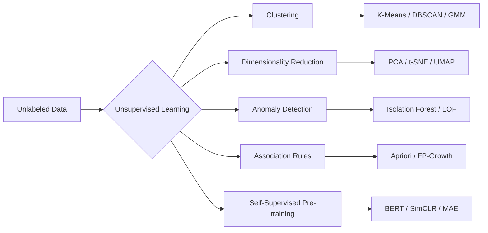
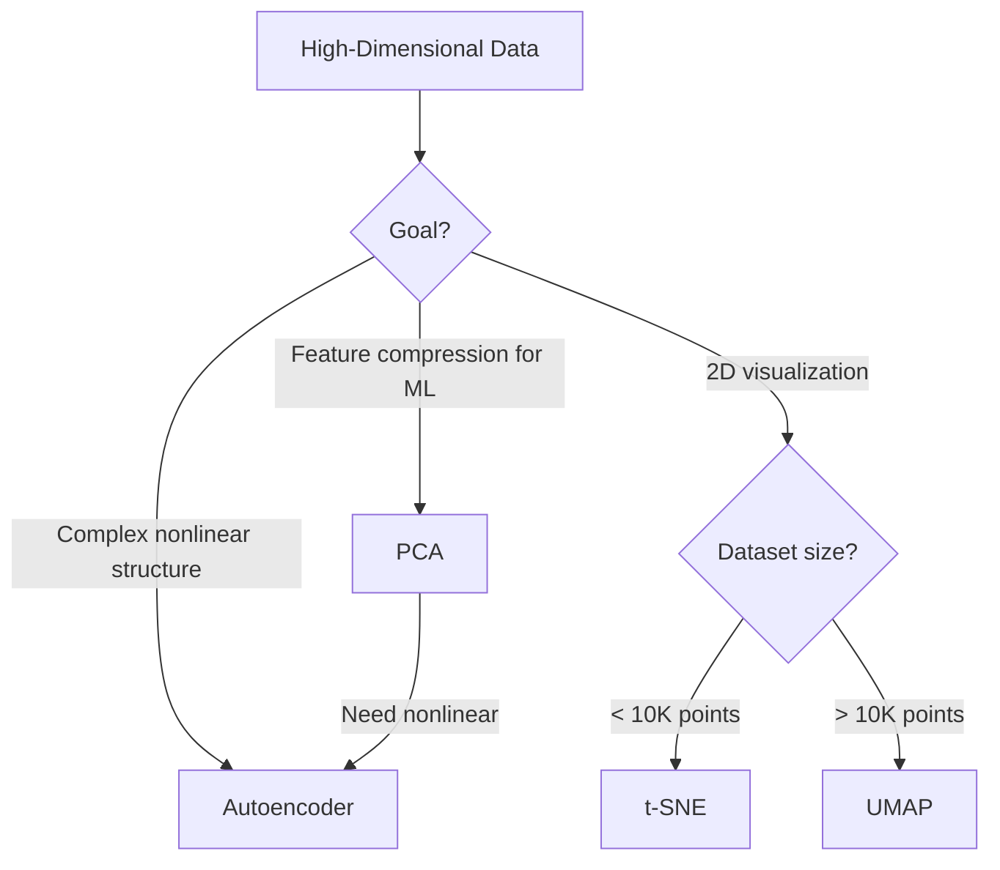
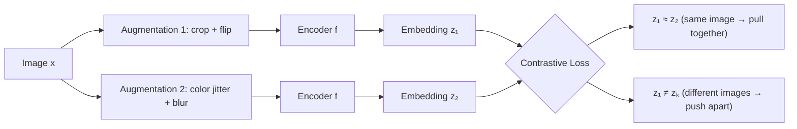
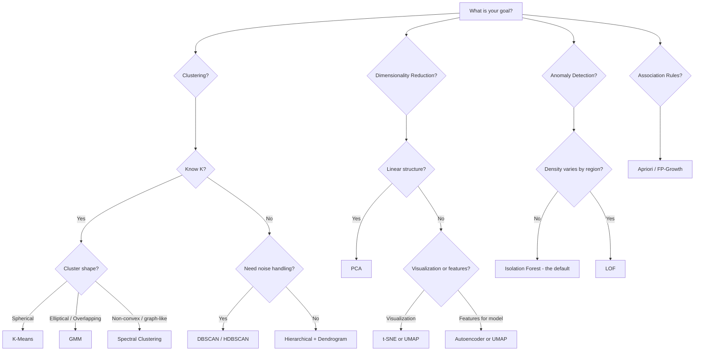

# Chapter 11 — Unsupervised Learning

---

## What You'll Learn

After this chapter you will be able to:
- Distinguish unsupervised from supervised learning and name core task families
- Explain why high-dimensional data breaks distance-based methods
- Select among K-Means, K-Medoids, Hierarchical, DBSCAN, HDBSCAN, Spectral Clustering, and GMM for a given problem
- Choose K with the elbow, Silhouette, Davies-Bouldin and the gap statistic — and score against labels with ARI/NMI when you have them
- Apply PCA, Kernel PCA, t-SNE, UMAP, and autoencoders for dimensionality reduction
- Detect anomalies with Isolation Forest and Local Outlier Factor
- Mine association rules with Apriori and FP-Growth
- Describe self-supervised learning and its role in modern AI

**Markers:** ★★★ = know cold for interviews · ★★ = high priority · ★ = good to know.

**Quick check** boxes are retrieval practice — attempt before revealing.

**Interview** boxes give the question, what to say, and the follow-up trap.

---

## 11.1 What is Unsupervised Learning? ★


<details>
<summary><strong>Read as text</strong> — inputs with no answer key, the five task families and the catch</summary>

Supervised learning gets a dataset of input-output pairs and learns the mapping ([Ch 10](#content/10_supervised_learning)). Unsupervised learning gets inputs only — no targets, no answer key. The algorithm must find structure on its own: which data points are similar, what the underlying distribution looks like, whether the data lives on a lower-dimensional surface.

This is closer to how humans learn most things. Nobody labeled every object you ever saw; you noticed that some things look alike and grouped them yourself.

> **Unsupervised learning** discovers hidden structure, patterns, or representations in data that carries no labeled responses. Core objectives include clustering, dimensionality reduction, density estimation, and generative modeling.

```
  SUPERVISED                        UNSUPERVISED
  ──────────────────────────        ──────────────────────────
  Data + labels                     Data only (no y)
  Learns input → output             Discovers hidden structure
  Judged on ground truth            Judged on internal metrics

  Tasks:                            Tasks:
   - Classification                  - Clustering
   - Regression                      - Dimensionality reduction
   - Sequence labeling               - Anomaly detection
                                     - Density estimation
                                     - Association rules

  Examples:                         Examples:
   "Is this email spam?"             "What segments exist?"
    (label: spam / not spam)          (no answer key at all)
   "Predict house price"             "Compress 784 dims to 32"
    (label: $450,000)
```



**Where it is used:** grouping near-duplicate web pages, segmenting customers by behaviour, compressing features before another model, and flagging unusual transactions for a human to review — jobs where labels are missing, expensive, or out of date by the time you get them.

**The catch:** there is no answer key, so there is no single "accuracy". You judge the result with internal scores such as Silhouette (§11.9), against a few labels if you have them, or by whether it helps a downstream task. And an unsupervised method always returns *something* — even on pure noise.

</details>

---

## 11.2 The Curse of Dimensionality ★★


#### Simple Explanation

<details>
<summary><strong>Read as text</strong> — the empty skyscraper, the definition and the vanishing contrast</summary>

Finding your friend along a single street is easy; finding them somewhere in a whole city is harder; finding them scattered across the floors of a skyscraper is harder still. Now imagine a space with a thousand such directions — everything ends up impossibly far apart, and every point sits at roughly the same distance from every other. That emptiness is exactly what breaks algorithms that rely on the idea of "nearby."

> **The curse of dimensionality** refers to the collection of phenomena that arise when analyzing data in high-dimensional spaces — phenomena that do not occur in low-dimensional settings, including data sparsity, distance concentration, and exponential growth of the volume to be sampled.

> **Maths in one line:** `(D_max − D_min) / D_min → 0 as d → ∞` — in many dimensions the farthest point is hardly farther away than the nearest one, so "nearest" stops meaning anything.

Add one feature and you add an entire axis. The volume of the space grows exponentially, but your dataset does not. With enough dimensions, every point becomes roughly equidistant from every other point, and distance-based algorithms (KNN, K-Means, DBSCAN) lose their discriminative power.

</details>

### Why Distances Break Down

<details>
<summary><strong>Read as text</strong> — nearest vs farthest as the dimension grows</summary>

Scatter $n$ random points uniformly through a $d$-dimensional unit cube and drop in one query point. Call $D_{\min}$ and $D_{\max}$ the distances from the query to its nearest and its farthest point. As $d$ grows, the gap between them shrinks relative to the distances themselves (Beyer et al., 1999, *"When Is 'Nearest Neighbor' Meaningful?"*):

$$\frac{D_{\max} - D_{\min}}{D_{\min}} \;\longrightarrow\; 0 \quad \text{as } d \to \infty$$

Don't take that on trust — measure it. 1,000 random points and one query, for four values of $d$:

</details>

```python
# Distance concentration: as dimension d grows, the nearest point is barely closer than the farthest
import numpy as np

rng = np.random.default_rng(0)
n = 1000                                     # random points in the unit cube [0, 1]^d
contrast = {}
print("    d   nearest   farthest   (max - min) / min")
for d in [2, 10, 100, 1000]:
    X = rng.random((n, d))
    q = rng.random(d)                        # one query point
    dist = np.sqrt(((X - q) ** 2).sum(axis=1))
    contrast[d] = (dist.max() - dist.min()) / dist.min()
    print(f"{d:>5} {dist.min():>9.2f} {dist.max():>10.2f} {contrast[d]:>12.2f}")

# Contrast case: still 1,000 features, but the data really lives on a 2-D sheet
# (two hidden factors spread linearly across all 1,000 features, plus a little noise)
Z = rng.random((n, 2))
X = Z @ rng.normal(size=(2, 1000)) + 0.01 * rng.normal(size=(n, 1000))
dist = np.sqrt(((X[1:] - X[0]) ** 2).sum(axis=1))
sheet = (dist.max() - dist.min()) / dist.min()
print(f"1000 features, 2-D structure: (max - min) / min = {sheet:.2f}")

assert contrast[2] > 10 * contrast[1000] and sheet > 10 * contrast[1000]
```

**Output:**

```
    d   nearest   farthest   (max - min) / min
    2      0.01       1.33       134.62
   10      0.47       2.11         3.48
  100      3.35       4.65         0.39
 1000     12.17      13.55         0.11
1000 features, 2-D structure: (max - min) / min = 54.06
```

<details>
<summary><strong>Read as text</strong> — continued: the 11% gap, intrinsic dimension and the empty centre</summary>

Read the last column. In 2-D the farthest point is about 136 times as far away as the nearest (1.33 against 0.01). In 1,000-D the nearest point is 12.17 away and the farthest only 13.55 — **just 11% farther**. Every point sits in a thin shell at nearly the same distance, so "my nearest neighbours" is barely better than a random sample. KNN's entire premise collapses.

The last line is the hopeful part. Those 1,000 features were built from just **2 hidden factors**, and the contrast stays large (54). The curse is driven by the data's **intrinsic** dimension — how many independent directions it really varies in — not by the number of columns. That is why distance-based methods can still work on images and embeddings, whose points lie near a much lower-dimensional surface, and why reducing dimensions first (PCA, §11.11) helps.

```
  Filling a space with evenly spaced points (10 per axis):

  1D (line):      10 points suffice
  2D (square):    10² = 100 points
  3D (cube):      10³ = 1,000 points
  10D:            10¹⁰ = 10 billion points
  100D:           10¹⁰⁰ — more than atoms in the universe
```

A second way to see the emptiness: fit a ball of radius 0.5 inside the unit cube, touching every face (its volume is $\pi^{d/2} r^d / \Gamma(d/2 + 1)$). In 2-D the ball covers 78.5% of the square. In 10-D it covers **0.25%** of the cube — almost all the volume has moved out into the $2^d$ corners, far from the centre.

```chart
{
  "type": "bar",
  "data": {
    "labels": ["1-D", "2-D", "3-D", "5-D", "10-D", "20-D"],
    "datasets": [{
      "label": "% of the cube's volume inside its inscribed ball (radius 0.5)",
      "data": [100, 78.54, 52.36, 16.45, 0.249, 0.0000025],
      "backgroundColor": ["rgba(34,197,94,0.7)","rgba(34,197,94,0.7)","rgba(99,102,241,0.7)","rgba(234,88,12,0.7)","rgba(239,68,68,0.7)","rgba(239,68,68,0.7)"],
      "borderColor": ["rgba(34,197,94,1)","rgba(34,197,94,1)","rgba(99,102,241,1)","rgba(234,88,12,1)","rgba(239,68,68,1)","rgba(239,68,68,1)"],
      "borderWidth": 1
    }]
  },
  "options": {
    "plugins": { "title": { "display": true, "text": "Curse of Dimensionality — the Centre Empties Out (2-D: 78.5%, 10-D: 0.25%, 20-D: 0.0000025%)" } },
    "scales": {
      "y": { "title": { "display": true, "text": "% of volume inside the ball" }, "beginAtZero": true },
      "x": { "title": { "display": true, "text": "Number of dimensions" } }
    }
  }
}
```

</details>

### Remedies

<details>
<summary><strong>Read as text</strong> — five remedies and where else this shows up</summary>

| Strategy | How it helps |
|---|---|
| **Feature selection** | Remove uninformative or redundant features |
| **PCA / UMAP** | Project to a lower-dimensional subspace |
| **Regularization** | Penalize model complexity, implicitly reduce effective dimensionality |
| **Collect more data** | Fill the space more densely |
| **Domain knowledge** | Engineer fewer, more meaningful features |

> **Where else this shows up:** the same effect is what kills KNN in high
> dimensions — see the KNN-specific treatment in
> [Ch 12 §12.8](#content/12_key_algorithms). Regularization as a general defence
> against model complexity is [Ch 8 §8.15](#content/08_core_concepts).
> PCA and UMAP, the two projection remedies, are §11.11 and §11.13 below.

</details>

<details>
<summary><strong>Quick check.</strong> You have 5,000 samples and 2,000 features. A colleague says "just use K-Means, it's unsupervised so overfitting isn't a concern." What's wrong with that reasoning?</summary>

Overfitting isn't the problem — **distance concentration** is. With 2,000 dimensions and only 5,000 points, the space is essentially empty, so every pair of points ends up at roughly the same distance. K-Means assigns points by *nearest centroid*, and when "nearest" stops being meaningful, the assignments are close to arbitrary.

You'll still get clusters — K-Means always returns K of them. They just won't mean anything. That's the danger: unsupervised methods fail **silently**.

**Fix:** reduce first (PCA to ~50 dims, §11.11), then cluster. And sanity-check the result with Silhouette (§11.9) — a near-zero score is the tell.
</details>

---

## 11.3 Clustering Overview ★


<details>
<summary><strong>Read as text</strong> — what clustering is</summary>

Clustering is probably the most intuitive unsupervised task. You hand the algorithm unlabeled data, and it discovers natural groupings. Customer segmentation, document topic grouping, image categorization, gene expression profiling — all clustering problems.

> **Clustering** partitions a dataset into groups (clusters) such that objects within a cluster are more similar to each other than to objects in other clusters. The definition of "similar" depends on the chosen distance metric and algorithm.

</details>

### Taxonomy of Clustering Methods

<details>
<summary><strong>Read as text</strong> — the five families and how to judge any result</summary>

```
┌────────────────────────────────────────────────────────────────┐
│ PARTITIONAL      K-Means, K-Medoids                            │
│ One point → one cluster. You must choose K.                    │
├────────────────────────────────────────────────────────────────┤
│ HIERARCHICAL     Agglomerative, Divisive                       │
│ Builds a merge tree. Cut it anywhere to get any K.             │
├────────────────────────────────────────────────────────────────┤
│ DENSITY-BASED    DBSCAN, HDBSCAN, OPTICS                       │
│ Clusters = dense regions. Any shape. Flags noise.              │
├────────────────────────────────────────────────────────────────┤
│ GRAPH-BASED      Spectral Clustering                           │
│ Clusters = well-connected parts of a similarity graph.         │
├────────────────────────────────────────────────────────────────┤
│ MODEL-BASED      GMM (Gaussian Mixture Models)                 │
│ Each cluster is a distribution. Soft assignments.              │
└────────────────────────────────────────────────────────────────┘
```

The five families answer the question "what *is* a cluster?" differently —
a ball of points, a branch of a tree, a dense region, a connected piece of
a graph, or a probability distribution. That choice drives everything else.

Whichever family you pick, judge the result the same way: internal scores such as
Silhouette, Davies-Bouldin and the gap statistic, plus ARI/NMI when you have some
labels (§11.9). ARI, the Adjusted Rand Index, scores agreement with the true
groups: 1 = perfect, about 0 = no better than random. Most methods here are
distance-based, so **scale your features first**
([Ch 9](#content/09_data_preprocessing)) — otherwise the column with the
biggest numbers decides the clusters.

</details>

---

## 11.4 K-Means Clustering ★★★


#### Simple Explanation

<details>
<summary><strong>Read as text</strong> — the magnets, inertia J and Lloyd's algorithm</summary>

Imagine dropping a handful of magnets onto a scatter of iron filings: each filing snaps to its nearest magnet, then you slide every magnet to the middle of its own pile, and repeat until nothing moves. That settling process *is* K-Means — it hunts for K natural centers and glues each point to the closest one, tightening the groups on every pass.

> **K-Means** partitions $n$ observations into $K$ clusters by iteratively assigning each point to the nearest centroid and recomputing centroids as the mean of assigned points, minimizing the within-cluster sum of squares (WCSS, called **inertia** in scikit-learn):
>
> $$J = \sum_{k=1}^{K} \sum_{x_i \in C_k} \| x_i - \mu_k \|^2$$

> **Maths in one line:** `J = Σₖ Σ_{x ∈ Cₖ} ‖x − μₖ‖²` — add up every point's squared distance to its own centroid $\mu_k$; K-Means keeps moving points and centroids to make that total smaller.

**Assumes:** clusters are **spherical, similar in size, and similar in density** — and that you already know how many there are. Most K-Means failures trace back to one of those four, or to features measured on different scales.

The algorithm — usually called **Lloyd's algorithm** — is dead simple. Place K center points (centroids). Assign every data point to its nearest centroid. Move each centroid to the mean of its assigned points. Repeat until nothing changes. That is the entire algorithm. One pass measures $n$ points against $K$ centroids in $d$ dimensions, so it costs $O(nKd)$, and $I$ passes cost $O(nKdI)$.

</details>

### The Algorithm Step by Step

<details>
<summary><strong>Read as text</strong> — the four steps drawn out</summary>

```
  STEP 1: Place K = 3 centroids (at random, or with K-Means++)
  ┌──────────────────────────────────────────────┐
  │  ·  ·  ·                   ·  ·  ·           │
  │  ·  ·  ·  ★₁               ·  ·  ·  ★₂       │
  │  ·  ·  ·                   ·  ·  ·           │
  │                                              │
  │               ·  ·  ·  ·                     │
  │               ·  ·  ·  ·  ★₃                 │
  └──────────────────────────────────────────────┘

  STEP 2: Assign every point to its nearest centroid
  ┌──────────────────────────────────────────────┐
  │  ●  ●  ●                   ▲  ▲  ▲           │
  │  ●  ●  ●  ★₁               ▲  ▲  ▲  ★₂       │
  │  ●  ●  ●                   ▲  ▲  ▲           │
  │                                              │
  │               ■  ■  ■  ■                     │
  │               ■  ■  ■  ■  ★₃                 │
  └──────────────────────────────────────────────┘
     ● → ★₁        ▲ → ★₂        ■ → ★₃

  STEP 3: Move each centroid to the mean of its points
  ┌──────────────────────────────────────────────┐
  │  ●  ●  ●                   ▲  ▲  ▲           │
  │  ●  ●★₁●                   ▲  ▲★₂▲           │
  │  ●  ●  ●                   ▲  ▲  ▲           │
  │                                              │
  │               ■  ■  ■  ■                     │
  │               ■  ■★₃■  ■                     │
  └──────────────────────────────────────────────┘
     each ★ jumps to the centre of its own group

  STEP 4: Repeat steps 2-3 until nothing changes
          (assignments stable, centroids stop moving)
```

</details>

### Worked Example — Customer Segmentation

<details>
<summary><strong>Read as text</strong> — six customers traced by hand to J = 427</summary>

Suppose we have 6 customers described by two features: annual spending (in thousands of dollars) and visit frequency (visits/month).

| Customer | Spending | Visits |
|---|---|---|
| A | 10 | 2 |
| B | 12 | 3 |
| C | 50 | 8 |
| D | 55 | 9 |
| E | 30 | 5 |
| F | 32 | 6 |

**K=2, random init:** $\mu_1 = A = (10,2)$, $\mu_2 = D = (55,9)$.

**Iteration 1 — Assign:**
- $d(B, \mu_1) = \sqrt{(12-10)^2+(3-2)^2} = \sqrt{5} \approx 2.2$ → Cluster 1
- $d(E, \mu_1) = \sqrt{(30-10)^2+(5-2)^2} = \sqrt{409} \approx 20.2$; $d(E, \mu_2) = \sqrt{(30-55)^2+(5-9)^2} = \sqrt{641} \approx 25.3$ → Cluster 1
- $d(F, \mu_1) = \sqrt{500} \approx 22.4$; $d(F, \mu_2) = \sqrt{538} \approx 23.2$ → Cluster 1
- C, D → Cluster 2 ($d(C, \mu_2) = \sqrt{26} \approx 5.1$, against $\approx 40.4$ to $\mu_1$)

Cluster 1 = {A, B, E, F}, Cluster 2 = {C, D}

**Recompute centroids:** $\mu_1 = (\frac{10+12+30+32}{4}, \frac{2+3+5+6}{4}) = (21, 4)$, $\mu_2 = (\frac{50+55}{2}, \frac{8+9}{2}) = (52.5, 8.5)$

**Iteration 2 — Reassign with new centroids:** E and F are now ~9.1 and ~11.2 from $\mu_1=(21,4)$, against ~22.8 and ~20.7 from $\mu_2=(52.5,8.5)$, so they stay in Cluster 1; A, B, C and D don't move either. Assignments stable → converged.

**Inertia:** Cluster 1 contributes $125 + 82 + 82 + 125 = 414$ (A, B, E, F) and Cluster 2 contributes $6.5 + 6.5 = 13$, so $J = 427$.

Final clusters: **Budget shoppers** {A, B, E, F} and **Premium shoppers** {C, D}.

Notice that spending (10–55) is far bigger than visits (2–9), so it dominates every distance. Here the two features happen to agree, but on real data **standardise first** ([Ch 9](#content/09_data_preprocessing)) or K-Means simply clusters on whichever column has the biggest numbers.

Now run it — the same two starting centroids, then two worse starts, then a brute-force check over every possible split:

</details>

```python
# Lloyd's K-Means by hand on the six customers, then the same data in scikit-learn
import warnings
from itertools import combinations
import numpy as np
from sklearn.cluster import KMeans

warnings.filterwarnings("ignore", message="libc not found")   # harmless notice in the browser build

names = "ABCDEF"
X = np.array([[10, 2], [12, 3], [50, 8], [55, 9], [30, 5], [32, 6]], dtype=float)

def groups(labels):
    return " | ".join("".join(n for n, l in zip(names, labels) if l == k) for k in sorted(set(labels)))

def lloyd(mu, show=False):
    for it in range(1, 100):
        dist = np.linalg.norm(X[:, None, :] - mu[None, :, :], axis=2)   # n x K distances
        labels = dist.argmin(axis=1)                                     # 1. assign
        new_mu = np.array([X[labels == k].mean(axis=0) for k in range(len(mu))])  # 2. update
        J = ((X - new_mu[labels]) ** 2).sum()                            # inertia
        if show:
            print(f"iter {it}: {groups(labels):<9} centroids {new_mu.round(2).tolist()}  J = {J:.2f}")
        if np.allclose(new_mu, mu):
            return labels, J
        mu = new_mu

print("Start at A and D (the text's example):")
labels, J_ad = lloyd(X[[0, 3]], show=True)

print("Other starts -> other local optima:")
for start in ["AB", "EF"]:
    labels, J = lloyd(X[[names.index(c) for c in start]])
    print(f"  start {start}: {groups(labels):<9} J = {J:.2f}")

# Brute force: every split of 6 points into 2 groups (fine for n = 6, hopeless for real n)
def sse(idx):
    return ((X[idx] - X[idx].mean(axis=0)) ** 2).sum()
best = min(sse(list(s)) + sse([i for i in range(6) if i not in s])
           for r in range(1, 6) for s in combinations(range(6), r))
print(f"global optimum J = {best:.2f}")

km = KMeans(n_clusters=2, n_init=10, random_state=0).fit(X)   # k-means++, best of 10
print(f"sklearn: {groups(km.labels_)}  inertia_ = {km.inertia_:.2f}")
assert abs(J_ad - best) < 1e-9 and abs(km.inertia_ - best) < 1e-6
```

**Output:**

```
Start at A and D (the text's example):
iter 1: ABEF | CD centroids [[21.0, 4.0], [52.5, 8.5]]  J = 427.00
iter 2: ABEF | CD centroids [[21.0, 4.0], [52.5, 8.5]]  J = 427.00
Other starts -> other local optima:
  start AB: AB | CDEF J = 489.25
  start EF: ABE | CDF J = 544.67
global optimum J = 427.00
sklearn: CD | ABEF  inertia_ = 427.00
```

<details>
<summary><strong>Read as text</strong> — continued: two worse starts and the local-optimum trap</summary>

The run reproduces the hand trace: J = 427 after one move, unchanged on the second pass. The two other starts are the real lesson. Starting both centroids among the budget shoppers (A and B) ends in {A, B} vs {C, D, E, F} with J = 489.25. Starting at E and F splits that pair — they are only 2.2 apart — and K-Means stops there with J = 544.67. Every point is already nearest to its own centroid, so Lloyd's sees nothing to fix, even though moving F across to {A, B, E} would drop J straight to 427: it only compares distances to the *current* centroids. Brute force confirms 427 is the best possible, and scikit-learn's 10 k-means++ restarts find it.

</details>

### K-Means++ Initialization

<details>
<summary><strong>Read as text</strong> — spreading the seeds with D(x)² and the O(log K) guarantee</summary>

Standard random initialization can place centroids close together, leading to poor convergence. K-Means++ fixes this:

1. Choose the first centroid uniformly at random from data points
2. For each remaining point, compute $D(x)$ = distance to nearest existing centroid
3. Choose next centroid with probability proportional to $D(x)^2$
4. Repeat until K centroids are chosen

This spreads centroids apart. In the original paper (Arthur & Vassilvitskii, 2007) it typically made K-Means about **2× faster**, sometimes with far lower final error, and it comes with a guarantee random starts lack: the expected inertia is within a factor $O(\log K)$ of the best possible. It is scikit-learn's default (`init='k-means++'`, implemented as "greedy" k-means++, which tries several candidates at each step and keeps the best).

</details>

### Does It Always Converge?

<details>
<summary><strong>Read as text</strong> — why J never rises, and why that is only a local optimum</summary>

Yes — and the reason is worth knowing, because the guarantee is weaker than it
first sounds.

Both halves of each iteration can never **increase** the inertia $J$. Reassigning a
point to a nearer centroid cannot increase its squared distance, and moving a
centroid to the mean of its members is exactly the point that minimises their
summed squared distance. So $J$ never increases. There are only finitely
many ways to partition $n$ points into $K$ groups, and no partition can repeat
(that would need $J$ to increase), so the algorithm **must** halt.

```
  GUARANTEED          Inertia never increases
                      Terminates in finite steps

  NOT GUARANTEED      That you found the best clustering
```

What you land on is a **local** optimum determined by the initialisation — the
E-and-F start in the program above is one. Finding the *globally* optimal K-Means
clustering is **NP-hard**, so in practice you buy quality with restarts:
scikit-learn's `n_init` runs the whole algorithm that many times from different
seeds and keeps the lowest-inertia result. Since version 1.4 the default is
`n_init='auto'`, which means **one** run with k-means++ (10 with `init='random'`),
so pass `n_init=10` yourself when you want restarts.

> This is the same shape of guarantee EM gives for GMMs (§11.8) — monotonic
> improvement toward a local optimum, never a promise of the global one.

</details>

### K-Medoids — When the Mean Doesn't Work

<details>
<summary><strong>Read as text</strong> — a real data point as the centre, any metric, and PAM's cost</summary>

K-Means is welded to Euclidean distance, because the step "move the centroid to
the **mean**" is only the error-minimising move for squared Euclidean error.
Swap in cosine or Manhattan distance and the two halves stop optimising the same
objective. **K-Medoids** fixes this by changing what a cluster centre *is*.

| | K-Means | K-Medoids |
|---|---|---|
| Centre is | The **mean** — usually not a real data point | A **medoid** — an actual data point |
| Distance metric | Euclidean only (in practice) | **Any** metric, even non-numeric |
| Outliers | Drag the mean toward them | Barely move the medoid |
| Cost per iteration | $O(nKd)$ | $O(K(n-K)^2)$ for classic PAM's swap step |
| Scale | Millions of points | Thousands |

The classic algorithm is **PAM** (Partitioning Around Medoids): pick $K$ points as
medoids, assign every point to its nearest medoid, then repeatedly try swapping a
medoid with a non-medoid and keep the swap if total cost drops.

Two things follow from the centre being a real data point. First, it is
**interpretable** — "this cluster's representative is *customer 4471*" is
something you can show a stakeholder, whereas a mean of one-hot features is
often meaningless. Second, it is **robust**: one customer with a ₹10 crore order
will yank a mean centroid across the space, but the medoid barely shifts.

**Reach for K-Medoids when:** your distance is not Euclidean (cosine on text,
Jaccard on sets, edit distance on strings, Gower on mixed types), outliers are
present and you can't remove them, or you need a real exemplar per cluster. The
price is PAM's quadratic-or-worse cost per iteration, so it caps out in the low
thousands of points (faster variants such as FastPAM, or CLARA's sampling, push
that further). It is not in core scikit-learn; the `scikit-learn-extra` package
provides `KMedoids`.

</details>

### Strengths and Limitations

<details>
<summary><strong>Read as text</strong> — the checklist and the spherical-clusters interview question</summary>

```
  ✓ Simple, fast — O(nKdI) for n points, K clusters, d features, I iterations
  ✓ Scales to millions of points
  ✓ Well-understood, deterministic given fixed init
  ✗ Must specify K in advance (elbow / Silhouette / gap statistic, §11.9)
  ✗ Assumes spherical, equally-sized clusters
  ✗ Sensitive to outliers (outliers pull centroids)
  ✗ Sensitive to feature scale (standardise first)
  ✗ Finds only convex cluster boundaries
  ✗ Result depends on initialization (run multiple times)
```

> **Interview —** *"Why can K-Means only find spherical clusters?"*
>
> **Say:** Because every point goes to its **nearest centroid** under Euclidean distance. That rule carves the space into **Voronoi cells**, which are convex by construction — so the boundary between any two clusters is always a straight line (a hyperplane). A crescent or a ring is not convex, so no assignment of centroids can reproduce it.
>
> **They follow up with:** *"So could you just swap in cosine distance?"* — not safely. K-Means alternates "assign to nearest" with "move centroid to the **mean**," and the mean is only the SSE-minimising centre for **Euclidean** distance. Change the metric and the two halves stop optimising the same objective. Use **K-Medoids** (see above — it picks an actual data point as the centre, so any metric works) or **spherical K-Means** for cosine.

</details>

<details>
<summary><strong>Quick check.</strong> You run K-Means twice on identical data and get two different clusterings. Is this a bug?</summary>

**No — it's expected.** K-Means converges to a **local** optimum that depends on where the centroids started. Different random initialisations land in different basins.

**What to do:** run it multiple times and keep the lowest-inertia result. That's exactly what scikit-learn's `n_init` does — but since version 1.4 its default `'auto'` means a **single** run with k-means++, so set `n_init=10` (and a `random_state`) when you want restarts and reproducibility. It's also why **K-Means++** initialisation matters — spreading the initial centroids apart makes bad basins much less likely.
</details>

---

## 11.5 Hierarchical Clustering ★★


#### Simple Explanation

<details>
<summary><strong>Read as text</strong> — piles merged into a tree, the dendrogram and divisive clustering</summary>

Lay every item out on a table as its own tiny pile. Find the two piles that look most alike and push them together. Do it again — pairs become clumps, clumps become bigger clumps — until everything sits in a single heap. Now keep a record of the order in which things merged, and you have a tree.

The tree is the real prize. Nothing forced you to decide how many groups you wanted before you started, because you effectively built every grouping at once. Slice the tree near the bottom and you get many small, tightly related groups; slice it near the top and you get a handful of broad ones. It is one picture read at different zoom levels, rather like a family tree showing siblings, cousins and distant branches all at once.

That merge-tree has a name: a **dendrogram**.

> **Agglomerative hierarchical clustering** starts with each observation as a singleton cluster and iteratively merges the two closest clusters until a single cluster remains. The merge history forms a binary tree called a **dendrogram**, which can be cut at any height to produce a partition into $K$ clusters.

> **Maths in one line:** `D_single(A, B) = min ‖a − b‖,  D_complete(A, B) = max ‖a − b‖  (a ∈ A, b ∈ B)` — merge the two clusters with the smallest D, again and again; the linkage you pick (below) decides what "close" means for whole groups.

**Assumes:** the data has a genuine **nested** structure — that groups sit inside larger groups. It will happily build a tree over data with no hierarchy at all, which is why the dendrogram must be judged, not trusted.

The big advantage: you do not need to specify K upfront. Build the full tree, then cut it wherever makes sense. The dendrogram gives you a view of cluster structure at every granularity simultaneously.

**Divisive** clustering runs the other way — start with one cluster and keep splitting it (bisecting K-Means is one way) — but when people say "hierarchical clustering" they almost always mean the agglomerative, bottom-up version.

</details>

### Agglomerative Algorithm

<details>
<summary><strong>Read as text</strong> — five points merged step by step</summary>

Five points, A to E, using **single linkage** (cluster distance = closest pair):

```
  START: n singleton clusters {A}, {B}, {C}, {D}, {E}

  Step 1: Merge two closest → {A,B}    (dist=1.2)
  Step 2: Merge two closest → {C,D}    (dist=1.5)
  Step 3: Merge {A,B} + {E}  → {A,B,E} (dist=2.8)
  Step 4: Merge {A,B,E} + {C,D} → all  (dist=4.1)
```

</details>

### Reading the Dendrogram

<details>
<summary><strong>Read as text</strong> — merge heights and where to cut</summary>

Those four merges draw a tree. Height = the distance at which a merge happened,
so short joins mean "these were very similar" and tall joins mean "these were
only forced together at the end."

```
 height
       │
   4.1 ┤          ┌───────────────────┐
       │          │                   │
   2.8 ┤     ┌────┴─────┐             │
       │     │          │             │
   1.5 ┤     │          │          ┌──┴──┐
   1.2 ┤  ┌──┴──┐       │          │     │
       │  │     │       │          │     │
     0 └──┴─────┴───────┴──────────┴─────┴──
          A     B       E          C     D
```

**How to cut it.** Draw a horizontal line at any height and count the vertical
branches it crosses — that count is your number of clusters, and each severed
branch is one cluster.

| Cut at height | Branches crossed | Clusters you get |
|---|---|---|
| 3.5 | 2 | {A, B, E} and {C, D} |
| 2.0 | 3 | {A, B}, {E}, {C, D} |
| 1.3 | 4 | {A, B}, {C}, {D}, {E} |

Note that **E joins {A, B} at height 2.8** — much later than A and B joined each
other at 1.2. That tall join is the tree telling you E is a loose member of that
group, something a flat K-Means labelling would never reveal.

</details>

### Linkage Criteria

<details>
<summary><strong>Read as text</strong> — single, complete, average and Ward</summary>

How do you measure the "distance" between two clusters containing multiple points?

| Linkage | Definition | Behavior |
|---|---|---|
| **Single** | $\min$ distance between a point in A and a point in B | One close pair is enough to join two groups, so clusters "chain" along thin lines of points; finds elongated shapes, hurt by noise |
| **Complete** | $\max$ distance between a point in A and a point in B | Compact clusters of similar diameter |
| **Average** | Mean of all pairwise distances between A and B | Compromise between single and complete |
| **Ward's** | Merge the pair whose union raises the total within-cluster sum of squares least: $\frac{\lvert A\rvert\lvert B\rvert}{\lvert A\rvert+\lvert B\rvert}\lVert\mu_A-\mu_B\rVert^2$ | Compact, similar-sized, roughly spherical clusters (K-Means' objective, built greedily); Euclidean only; scikit-learn's default |

The linkage is not a detail — it changes the tree. The dendrogram above is exactly what single linkage builds for five points on a line at A = 0, B = 1.2, E = 4.0, C = 8.1, D = 9.6. Rebuild it, cut it, then swap the linkage:

</details>

```python
# Agglomerative clustering: rebuild the A-B-E-C-D dendrogram, cut it, and compare linkages
import numpy as np
from scipy.cluster.hierarchy import linkage, fcluster

names = ["A", "B", "E", "C", "D"]
x = np.array([[0.0], [1.2], [4.0], [8.1], [9.6]])    # five points on a line

def cut(Z, t):
    labels = fcluster(Z, t=t, criterion="distance")
    return sorted("".join(n for n, l in zip(names, labels) if l == c) for c in set(labels))

Z = linkage(x, method="single")
members = dict(enumerate(names))
for k, (a, b, h, size) in enumerate(Z):
    left, right = sorted([members[int(a)], members[int(b)]])
    members[len(names) + k] = left + right
    print(f"merge {left:>3} + {right:<3} at height {h:.2f}")
assert np.allclose(Z[:, 2], [1.2, 1.5, 2.8, 4.1])

for t in [3.5, 2.0, 1.3]:
    print(f"cut at {t}: {cut(Z, t)}")

print("Same points, other linkages (merge heights, then a cut at 3.5):")
for method in ["single", "complete", "average", "ward"]:
    Z2 = linkage(x, method=method)
    print(f"  {method:<8} {np.round(Z2[:, 2], 2).tolist()}  -> {cut(Z2, 3.5)}")
```

**Output:**

```
merge   A + B   at height 1.20
merge   C + D   at height 1.50
merge  AB + E   at height 2.80
merge ABE + CD  at height 4.10
cut at 3.5: ['ABE', 'CD']
cut at 2.0: ['AB', 'CD', 'E']
cut at 1.3: ['AB', 'C', 'D', 'E']
Same points, other linkages (merge heights, then a cut at 3.5):
  single   [1.2, 1.5, 2.8, 4.1]  -> ['ABE', 'CD']
  complete [1.2, 1.5, 4.0, 9.6]  -> ['AB', 'CD', 'E']
  average  [1.2, 1.5, 3.4, 7.12]  -> ['ABE', 'CD']
  ward     [1.2, 1.5, 3.93, 11.03]  -> ['AB', 'CD', 'E']
```

<details>
<summary><strong>Read as text</strong> — continued: one cut, two answers, the O(n²) wall and when to use it</summary>

The first seven lines reproduce the merges and the cut table above. The last four are the warning: the **same** five points and the **same** cut at 3.5 give 2 clusters under single or average linkage but 3 under complete or Ward, because complete linkage measures E to {A, B} by its *farthest* member (A, 4.0 away) instead of its nearest (B, 2.8). Pick the linkage first; read heights only within that linkage. (SciPy reports a Ward merge height as $\sqrt{2\Delta}$, not the $\Delta$ in the table: joining E to {A, B} costs $\Delta = \tfrac{2 \cdot 1}{3}(4.0 - 0.6)^2 \approx 7.71$, printed as 3.93.)

**Complexity:** a naive implementation takes $O(n^3)$ time. Libraries such as SciPy use $O(n^2)$-time algorithms for the common linkages (a minimum spanning tree for single, the nearest-neighbour chain for complete, average and Ward), but all of them need the $O(n^2)$ pairwise distances — at $n$ = 10,000 that is about 50 million pairs, roughly 400 MB as 8-byte floats. That memory wall makes hierarchical clustering impractical beyond about 10,000 points. For larger data, use K-Means or DBSCAN as a first pass.

> **Interview —** *"When would you choose hierarchical clustering over K-Means?"*
>
> **Say:** Three situations. (1) You genuinely don't know K — the dendrogram shows you the structure at **every** granularity at once, so you decide after looking. (2) The data has a real **nested** hierarchy (taxonomies, org charts, phylogenies) and that nesting is itself the finding. (3) The dataset is small enough that the $O(n^2)$ distance matrix fits comfortably, and you want a deterministic result with no initialisation lottery.
>
> **They follow up with:** *"And when would you not?"* — anything above ~10k points; the $O(n^2)$ distance matrix alone becomes the blocker. Also note the merges are **greedy and irreversible**: a bad early merge can never be undone, so hierarchical clustering isn't automatically "better," just more informative at small scale.

</details>

---

## 11.6 DBSCAN ★★★


#### Simple Explanation

<details>
<summary><strong>Read as text</strong> — towns at night, the core-point rule and the one-density assumption</summary>

Look down at a country from a plane at night. Towns show up as dense patches of light and you can pick them out instantly — without being told how many towns to expect, and without any of them being round. A town might sprawl along a coastline or snake down a valley. A single farmhouse glowing out in the dark countryside is not a tiny town; it is just a farmhouse.

That is the whole idea. A cluster is a **crowded region**, not a ball around a centre. A point with plenty of neighbours packed close by sits in the thick of a crowd. A point with few neighbours of its own, but which is close to someone in the thick of it, is on the fringe. A point with nothing much around it belongs to no crowd at all — and, unusually, is allowed to say so.

> **DBSCAN (Density-Based Spatial Clustering of Applications with Noise)** groups together points that are closely packed — defined by a minimum number of points ($\text{minPts}$) within a radius ($\varepsilon$). Points in low-density regions are labeled as noise. It requires no pre-specification of the number of clusters and can discover clusters of arbitrary shape.

> **Maths in one line:** `p is core  ⇔  |N_ε(p)| ≥ minPts,  N_ε(p) = {q : d(p, q) ≤ ε}` — a point is in the thick of a crowd when its ε-circle (itself included) holds at least minPts points.

**Assumes:** clusters are **dense regions separated by sparse ones**, and that a *single* density threshold (ε, minPts) fits every cluster. When one cluster is much sparser than another, that single threshold cannot serve both — which is exactly the gap HDBSCAN fills.

K-Means forces you to choose K and assumes round clusters. DBSCAN says: "clusters are dense regions separated by sparse regions." It figures out how many clusters exist, finds them regardless of shape, and explicitly marks outliers as noise.

</details>

### Three Point Types

<details>
<summary><strong>Read as text</strong> — core, border and noise</summary>

```
  CORE POINT (●):   ≥ minPts points within radius ε (itself included)
                    Forms the backbone of a cluster

  BORDER POINT (○): < minPts points within ε,
                    but within ε of at least one core point
                    Lives on the edge of a cluster

  NOISE POINT (×):  Not core, and not within ε of any core point
                    Belongs to no cluster — an outlier
```

</details>

### Algorithm

<details>
<summary><strong>Read as text</strong> — expand from core points, label the rest</summary>

1. Pick an unvisited point $p$.
2. Find all points within distance $\varepsilon$ of $p$.
3. If $|\text{neighbors}| \geq \text{minPts}$, $p$ is a **core point** — start a new cluster. Expand the cluster by repeatedly adding every point within $\varepsilon$ of a core point already in it (density-reachable points); newly added core points keep expanding, border points do not.
4. Otherwise, label $p$ **noise for now**. If a later expansion reaches it — it lies within $\varepsilon$ of some core point — it becomes a **border point** of that cluster.
5. Repeat until all points are visited. Whatever is still labelled noise is noise.

</details>

### Worked Example — Tracing DBSCAN by Hand

<details>
<summary><strong>Read as text</strong> — ten points, ε = 2, minPts = 3 traced by hand</summary>

Ten points, $\varepsilon = 2$, $\text{minPts} = 3$.

> **State your convention first.** Here minPts **counts the point itself** — that
> is what scikit-learn's `min_samples` does — so minPts = 3 means "me plus at
> least two others." Other texts exclude the point, and write the identical rule
> as minPts = 2. Interviewers differ, so say which one you mean before you start.

| Point | P1 | P2 | P3 | P4 | P5 | P6 | P7 | P8 | P9 | P10 |
|---|---|---|---|---|---|---|---|---|---|---|
| $x$ | 1 | 2 | 2 | 1 | 3 | 5 | 5 | 7 | 8 | 7 |
| $y$ | 1 | 1 | 2 | 2 | 3 | 5 | 6 | 7 | 7 | 8 |

```chart
{
  "type": "scatter",
  "data": {
    "datasets": [
      {
        "label": "Core (≥ 3 neighbours incl. itself)",
        "data": [{"x":1,"y":1},{"x":2,"y":1},{"x":2,"y":2},{"x":1,"y":2},{"x":7,"y":7},{"x":8,"y":7},{"x":7,"y":8}],
        "backgroundColor": "rgba(99, 102, 241, 0.8)",
        "pointRadius": 9
      },
      {
        "label": "Border (too few, but reached by a core point)",
        "data": [{"x":3,"y":3}],
        "backgroundColor": "rgba(234, 88, 12, 0.9)",
        "pointStyle": "triangle", "pointRadius": 12
      },
      {
        "label": "Noise (too few, and no core point in reach)",
        "data": [{"x":5,"y":5},{"x":5,"y":6}],
        "backgroundColor": "rgba(239, 68, 68, 1)",
        "borderColor": "rgba(30, 30, 30, 1)",
        "pointStyle": "rectRot", "pointRadius": 11, "borderWidth": 2
      }
    ]
  },
  "options": {
    "plugins": { "title": { "display": true, "text": "DBSCAN — the Three Point Types, Worked Out Below" } },
    "scales": {
      "y": { "title": { "display": true, "text": "y" }, "min": 0, "max": 9 },
      "x": { "title": { "display": true, "text": "x" }, "min": 0, "max": 9 }
    }
  }
}
```

**Step 1 — count neighbours.** For each point, list everything inside the radius.

| Point | Neighbours within $\varepsilon=2$ (distance) | Count (with itself) |
|---|---|---|
| P1 | P2 (1.00), P3 (1.41), P4 (1.00) | 4 |
| P2 | P1 (1.00), P3 (1.00), P4 (1.41) | 4 |
| P3 | P1 (1.41), P2 (1.00), P4 (1.00), P5 (1.41) | 5 |
| P4 | P1 (1.00), P2 (1.41), P3 (1.00) | 4 |
| P5 | P3 (1.41) | 2 |
| P6 | P7 (1.00) | 2 |
| P7 | P6 (1.00) | 2 |
| P8 | P9 (1.00), P10 (1.00) | 3 |
| P9 | P8 (1.00), P10 (1.41) | 3 |
| P10 | P8 (1.00), P9 (1.41) | 3 |

Nothing is borderline: every pairwise distance in this data is either $\le 1.41$
or $\ge 2.24$, so no verdict hangs on a rounding decision.

**Step 2 — classify.** Ask the count question first; only if it fails do you ask
the anchor question.

| Point | Count | Verdict | Reason |
|---|---|---|---|
| P1, P2, P4 | 4 | **Core** | $4 \ge 3$ |
| P3 | 5 | **Core** | $5 \ge 3$ — the densest point here |
| P8, P9, P10 | 3 | **Core** | exactly 3, clearing the bar by nothing |
| P5 | 2 | **Border** | fails the count, but core point P3 is 1.41 away |
| P6 | 2 | **Noise** | fails the count, and neighbour P7 is not core |
| P7 | 2 | **Noise** | fails the count, and neighbour P6 is not core |

**Step 3 — the clusters.** Core points within $\varepsilon$ of each other merge;
each border point then joins the cluster of a core point that reached it.

- **Cluster 1:** {P1, P2, P3, P4} core **+** P5 border — 5 points
- **Cluster 2:** {P8, P9, P10} — all three core
- **Noise:** P6, P7

Two things are worth pausing on. P6 and P7 are **1.00 apart** — closer to each
other than P5 is to P3 — and yet *both* are noise: proximity alone builds nothing,
because a cluster has to be anchored by a **core** point and neither of them
qualifies. And Cluster 2 clears the threshold exactly, so raising minPts to 4
would turn all three of those points into noise as well.

*Takeaway: DBSCAN's three-way label falls out of two questions asked in order — "do I have minPts neighbours?" (core, or not), and if not, "is a core point within ε of me?" (border, or noise). Density has to be anchored, and reachability flows only through core points.*

Check the trace — and nudge one knob at a time:

</details>

```python
# DBSCAN by hand vs scikit-learn on the ten-point example (eps = 2, minPts = 3)
import numpy as np
from sklearn.cluster import DBSCAN

P = np.array([[1, 1], [2, 1], [2, 2], [1, 2], [3, 3],
              [5, 5], [5, 6], [7, 7], [8, 7], [7, 8]], dtype=float)
names = [f"P{i}" for i in range(1, 11)]

def by_hand(eps, min_pts):
    D = np.linalg.norm(P[:, None, :] - P[None, :, :], axis=2)
    count = (D <= eps).sum(axis=1)                 # neighbours within eps, itself included
    core = count >= min_pts
    near_core = (D[:, core] <= eps).any(axis=1)    # is some core point within eps?
    kind = np.where(core, "core", np.where(near_core, "border", "noise"))
    return count, core, kind

count, core, kind = by_hand(eps=2, min_pts=3)
for n, c, k in zip(names, count, kind):
    print(f"{n:>3}: count {c} -> {k}")

db = DBSCAN(eps=2, min_samples=3).fit(P)
sk_core = np.isin(np.arange(len(P)), db.core_sample_indices_)
assert (sk_core == core).all()
print("sklearn labels (-1 = noise):", db.labels_.tolist())

# Edge cases: nudge one knob at a time
for eps, m in [(2, 4), (1, 3)]:
    labels = DBSCAN(eps=eps, min_samples=m).fit(P).labels_
    print(f"eps={eps}, minPts={m}:", labels.tolist())
```

**Output:**

```
 P1: count 4 -> core
 P2: count 4 -> core
 P3: count 5 -> core
 P4: count 4 -> core
 P5: count 2 -> border
 P6: count 2 -> noise
 P7: count 2 -> noise
 P8: count 3 -> core
 P9: count 3 -> core
P10: count 3 -> core
sklearn labels (-1 = noise): [0, 0, 0, 0, 0, -1, -1, 1, 1, 1]
eps=2, minPts=4: [0, 0, 0, 0, 0, -1, -1, -1, -1, -1]
eps=1, minPts=3: [0, 0, 0, 0, -1, -1, -1, 1, 1, 1]
```

<details>
<summary><strong>Read as text</strong> — continued: scikit-learn agrees, and two edge cases</summary>

The by-hand counts match scikit-learn's core points exactly, and the labels say the same thing: cluster 0 = P1–P5, cluster 1 = P8–P10, and `-1` (noise) for P6 and P7. The first edge case confirms the claim above: with minPts = 4, P8, P9 and P10 (each counting only 3) stop being core, and the whole second cluster dissolves into noise. With ε = 1 instead, P5 loses its only core neighbour (P3 is 1.41 away) and becomes noise, while P9 and P10 drop from core to **border** points of P8's cluster.

</details>

### DBSCAN vs K-Means

<details>
<summary><strong>Read as text</strong> — the comparison box and shapes K-Means cannot draw</summary>

```
┌──────────────────────────┬────────────────────────────────────┐
│ K-Means                  │ DBSCAN                             │
├──────────────────────────┼────────────────────────────────────┤
│ Must specify K           │ K discovered automatically         │
│ Only convex clusters     │ Arbitrary shape clusters           │
│ All points assigned      │ Noise points explicitly flagged    │
│ Sensitive to outliers    │ Robust to outliers                 │
│ O(nKdI) — very fast      │ ~O(n log n) with a spatial index   │
│                          │ (low dims); O(n²) worst case       │
│ Deterministic given init │ Deterministic (border pts may vary)│
└──────────────────────────┴────────────────────────────────────┘

  Shapes DBSCAN handles that K-Means cannot:

   Ring:          Crescents:       Interleaved spirals:
   ·●●●●·          ●●●              ●●●   ○○○
  ●·····●          ●●●●  ○○○       ●●●  ○○○
  ●·····●          ●●●●   ○○○     ●●●  ○○○
   ·●●●●·          ●●●
```

The ring case is run for real at the end of §11.6.1: K-Means scores an ARI of 0.00 on two nested rings, DBSCAN 1.00.

</details>

### Choosing ε and minPts

<details>
<summary><strong>Read as text</strong> — minPts ≈ 2·d, the k-distance knee and the 60%-noise question</summary>

**Rule of thumb for minPts:** $2 \times d$ where $d$ = number of dimensions (never below 3; go higher for large or noisy data). For 2D data, minPts = 4 is a common starting point — the original DBSCAN paper's choice.

**Choosing ε with a k-distance plot:**
1. For each point, compute the distance to its $k$-th nearest neighbour, with $k = \text{minPts} - 1$. (A point is core exactly when that distance is $\le \varepsilon$, because minPts counts the point itself.)
2. Sort these distances in ascending order and plot.
3. The "elbow" in the plot suggests a good ε.

```chart
{
  "type": "scatter",
  "data": {
    "datasets": [
      {
        "label": "Distance to the 4th nearest neighbour (k = 4, i.e. minPts = 5)",
        "data": [{"x":0,"y":0.099},{"x":1,"y":0.108},{"x":2,"y":0.116},{"x":3,"y":0.12},{"x":4,"y":0.12},{"x":5,"y":0.122},{"x":6,"y":0.125},{"x":7,"y":0.132},{"x":8,"y":0.135},{"x":9,"y":0.141},{"x":10,"y":0.15},{"x":11,"y":0.15},{"x":12,"y":0.151},{"x":13,"y":0.151},{"x":14,"y":0.153},{"x":15,"y":0.156},{"x":16,"y":0.159},{"x":17,"y":0.162},{"x":18,"y":0.17},{"x":19,"y":0.171},{"x":20,"y":0.174},{"x":21,"y":0.175},{"x":22,"y":0.177},{"x":23,"y":0.178},{"x":24,"y":0.182},{"x":25,"y":0.183},{"x":26,"y":0.183},{"x":27,"y":0.185},{"x":28,"y":0.198},{"x":29,"y":0.198},{"x":30,"y":0.199},{"x":31,"y":0.199},{"x":32,"y":0.205},{"x":33,"y":0.215},{"x":34,"y":0.215},{"x":35,"y":0.215},{"x":36,"y":0.225},{"x":37,"y":0.226},{"x":38,"y":0.227},{"x":39,"y":0.232},{"x":40,"y":0.232},{"x":41,"y":0.233},{"x":42,"y":0.233},{"x":43,"y":0.24},{"x":44,"y":0.24},{"x":45,"y":0.249},{"x":46,"y":0.264},{"x":47,"y":0.265},{"x":48,"y":0.269},{"x":49,"y":0.27},{"x":50,"y":0.273},{"x":51,"y":0.274},{"x":52,"y":0.275},{"x":53,"y":0.281},{"x":54,"y":0.283},{"x":55,"y":0.294},{"x":56,"y":0.345},{"x":57,"y":0.359},{"x":58,"y":0.359},{"x":59,"y":0.398},{"x":60,"y":0.415},{"x":61,"y":0.421},{"x":62,"y":0.443},{"x":63,"y":0.444},{"x":64,"y":0.488},{"x":65,"y":0.522},{"x":66,"y":0.552},{"x":67,"y":0.573},{"x":68,"y":0.587},{"x":69,"y":0.712},{"x":70,"y":1.032},{"x":71,"y":1.337},{"x":72,"y":1.534},{"x":73,"y":1.534},{"x":74,"y":1.583},{"x":75,"y":2.072},{"x":76,"y":2.147},{"x":77,"y":2.444},{"x":78,"y":2.711},{"x":79,"y":3.018},{"x":80,"y":3.636},{"x":81,"y":4.079}],
        "borderColor": "rgba(99, 102, 241, 1)",
        "backgroundColor": "rgba(99, 102, 241, 0.15)",
        "showLine": true, "fill": true, "pointRadius": 2, "borderWidth": 2
      },
      {
        "label": "Suggested ε ≈ 0.69 (the knee)",
        "data": [{"x": 0, "y": 0.69}, {"x": 81, "y": 0.69}],
        "borderColor": "rgba(239, 68, 68, 1)",
        "backgroundColor": "transparent",
        "showLine": true, "pointRadius": 0, "borderWidth": 2, "borderDash": [6, 4]
      }
    ]
  },
  "options": {
    "plugins": { "title": { "display": true, "text": "DBSCAN k-Distance Plot — Read ε Off the Knee, Not by Guessing" } },
    "scales": {
      "y": { "title": { "display": true, "text": "Distance to 4th nearest neighbour" }, "beginAtZero": true },
      "x": { "title": { "display": true, "text": "Points, sorted by that distance" } }
    }
  }
}
```

Read it left to right. For most of the curve the line is low and almost flat — those are
points sitting comfortably inside a dense region, whose 4th neighbour is close by. Then it
turns sharply upward: those few points on the right are far from everything, which is
precisely what "noise" means. **The knee is the boundary between the two populations**, so
taking ε at the knee (here **≈ 0.69**) keeps the dense points connected while leaving the
stragglers outside.

**Real-world use case:** geographic clustering of delivery addresses into zones. Addresses form arbitrary shapes around cities — DBSCAN naturally captures this while labeling remote rural addresses as noise.

> **Interview —** *"You run DBSCAN and 60% of your points come back as noise. What went wrong?"*
>
> **Say:** Almost always one of three things. (1) **Features aren't scaled** — DBSCAN is built on a distance radius, so a feature measured in dollars swamps one measured in years and ε means nothing. Scale first. (2) **ε is too small** — check the k-distance plot; if your chosen ε sits well below the elbow, most points fail the density test. (3) **minPts is too high** for how dense the data actually is.
>
> **They follow up with:** *"What if you fix all three and clusters still fragment?"* — that's the signature of **varying density**: one global ε cannot serve both a dense cluster and a sparse one. That's exactly the problem HDBSCAN solves (§11.6.1).

</details>

<details>
<summary><strong>Quick check.</strong> With ε = 1.0 and minPts = 4: point P has 6 neighbours within ε. Point Q has 2 neighbours within ε, one of which is P. Point R has 1 neighbour within ε, and that neighbour is Q. Classify P, Q and R.</summary>

- **P is a core point** — it meets minPts (6 ≥ 4) within ε.
- **Q is a border point** — it fails minPts (2 < 4), but it lies within ε of P, which *is* a core point.
- **R is noise** — it fails minPts, and its only neighbour Q is a **border** point, not a core point. Border points cannot recruit others into a cluster.

That last one is the trap: reachability propagates **only through core points**. This is also why DBSCAN's output can be mildly order-dependent — a border point sitting within ε of two different clusters is assigned to whichever one claims it first.
</details>

### 11.6.1 HDBSCAN

<details>
<summary><strong>Read as text</strong> — mutual reachability, the MST pipeline and DBSCAN vs HDBSCAN</summary>

> **HDBSCAN (Hierarchical DBSCAN)** extends DBSCAN by replacing the single global density threshold ε with a variable-density framework. It transforms pairwise distances into **mutual reachability distances**, builds a **minimum spanning tree** over those distances, extracts a full cluster hierarchy (a dendrogram over density levels), converts it to a **condensed tree**, and selects clusters that are most stable across the density range. The result: clusters of differing density are found correctly, and no single ε needs to be tuned.

DBSCAN's main weakness is its single global ε. If some clusters are dense and others are sparse, no single ε works for both — tight ε misses sparse clusters, loose ε merges dense ones. HDBSCAN solves this by asking "at what density level does each cluster fall apart?" and keeping only clusters that persist across a meaningful density range. It has been in scikit-learn since version 1.3 as `sklearn.cluster.HDBSCAN` (main knob `min_cluster_size`, default 5).

**Mutual reachability distance** between points $a$ and $b$:

$$d_{\text{mreach}}(a, b) = \max\bigl(\text{core-dist}_k(a),\; \text{core-dist}_k(b),\; d(a,b)\bigr)$$

where $\text{core-dist}_k(p)$ is the distance from $p$ to its $k$-th nearest neighbour ($k$ = `min_samples`). A point in a sparse region has a large core distance, so every distance *from* it is pushed up to at least that value — sparse points are moved apart while dense regions keep their true distances. The MST built on these distances therefore follows density, not raw distance.

**Algorithm pipeline:**

```
  1. Turn distances into mutual reachability distances
     (min_samples = k sets each point's core distance)

  2. Build a Minimum Spanning Tree (MST) over those distances
     ┌──────────────────────────────────────────────────┐
     │   ●──●──●                         ●──●           │
     │      │                            │              │
     │   ●──●──●─────────────────────────●──●──●        │
     │   dense group A    long edge     dense group B   │
     └──────────────────────────────────────────────────┘
       the long edge crosses a low-density gap

  3. Cut the MST's edges from longest to shortest; each cut
     splits a group in two → a full cluster hierarchy
     (single linkage on mutual reachability distances)

  4. Condense the hierarchy: a split that sheds fewer than
     min_cluster_size points is not a new cluster — those
     points just "fall out" of their parent as noise

  5. Keep the most stable clusters. With λ = 1 / distance:
       stability(C) = Σ over points p in C of (λ_p − λ_birth)
     λ_birth = level where C appears, λ_p = level where p
     leaves C. Pick the non-overlapping clusters with the
     largest total stability; points in none of them → noise
```

**DBSCAN vs HDBSCAN:**

| Property | DBSCAN | HDBSCAN |
|---|---|---|
| Density threshold | Single global ε | Variable (per-cluster density) |
| Parameters | ε, minPts | min_cluster_size (+ optional min_samples, defaults to min_cluster_size) |
| Cluster hierarchy | None | Full condensed tree |
| Handles varying density | No — struggles | Yes — core strength |
| Noise handling | Yes | Yes |
| Determinism | Yes (border pts may vary) | Yes |
| Complexity | ~$O(n \log n)$ with an index in low dimensions; $O(n^2)$ worst case | Similar in low dimensions; approaches $O(n^2)$ in high dimensions |
| Best when | Clusters have uniform density | Clusters differ in density |

**When to prefer HDBSCAN:** datasets with clusters at multiple scales (e.g., a few tight urban clusters plus broader suburban groups), or when DBSCAN consistently splits one cluster or merges two depending on ε.

**Shape and density in one run.** First the ring test from the DBSCAN vs K-Means box, then three blobs — two tight ones 1.5 apart and one loose one — where no single ε is right:

</details>

```python
# Shape and density: K-Means vs DBSCAN on two rings, then DBSCAN vs HDBSCAN on blobs of unequal density
import warnings
import numpy as np
from sklearn.cluster import DBSCAN, HDBSCAN, KMeans
from sklearn.datasets import make_blobs, make_circles
from sklearn.metrics import adjusted_rand_score as ari

warnings.filterwarnings("ignore", message="libc not found")   # harmless notice in the browser build

def summary(labels):
    sizes = sorted(np.bincount(labels[labels >= 0]).tolist(), reverse=True)
    return f"cluster sizes {sizes}, noise = {(labels == -1).sum()}"

# 1) Two rings, one inside the other (200 points each)
X, y = make_circles(n_samples=400, factor=0.4, noise=0.05, random_state=0)
km = KMeans(n_clusters=2, n_init=10, random_state=0).fit_predict(X)
db = DBSCAN(eps=0.2, min_samples=5).fit_predict(X)
print(f"rings  K-Means ARI = {round(ari(y, km), 2) + 0.0:.2f}  |  DBSCAN ARI = {ari(y, db):.2f}")  # + 0.0 avoids "-0.00"

# 2) Two tight blobs close together + one loose blob (100 points each)
X2, y2 = make_blobs(n_samples=[100, 100, 100], centers=[[0, 0], [1.5, 0], [6, 0]],
                    cluster_std=[0.15, 0.15, 1.0], random_state=0)
for eps in [0.2, 0.5, 1.0]:
    print(f"DBSCAN eps={eps}:".ljust(17), summary(DBSCAN(eps=eps, min_samples=5).fit_predict(X2)))
hd = HDBSCAN(min_cluster_size=15).fit_predict(X2)
print("HDBSCAN:".ljust(17), summary(hd))
assert hd.max() + 1 == 3
```

**Output:**

```
rings  K-Means ARI = 0.00  |  DBSCAN ARI = 1.00
DBSCAN eps=0.2:   cluster sizes [100, 100], noise = 100
DBSCAN eps=0.5:   cluster sizes [100, 100, 68, 6], noise = 26
DBSCAN eps=1.0:   cluster sizes [200, 99], noise = 1
HDBSCAN:          cluster sizes [100, 100, 94], noise = 6
```

<details>
<summary><strong>Read as text</strong> — continued: every ε fails differently, HDBSCAN finds all three</summary>

On the rings, K-Means scores an ARI of 0.00 (no better than chance — it cuts both rings in half with a straight line) and DBSCAN a perfect 1.00. On the blobs, every ε fails in a different way: **0.2** keeps the two tight blobs but throws the whole loose blob (100 points) away as noise; **0.5** shreds the loose blob into two pieces plus 26 noise points; **1.0** finally holds the loose blob together but merges the two tight blobs into one cluster of 200. HDBSCAN, with no ε at all, returns the three real groups and calls only 6 points noise.

</details>

---

## 11.7 Spectral Clustering ★


#### Simple Explanation

<details>
<summary><strong>Read as text</strong> — the party, the Laplacian, the five steps and the moons before and after</summary>

Picture a crowded party. You could group people by who is standing physically closest — but that lumps together two strangers who happen to share a doorway. Group them instead by *who is talking to whom*, and the real cliques appear, even when their members are scattered across the room. Spectral clustering does the second thing: it stops asking "who is nearby?" and starts asking "who is connected?"

> **Spectral Clustering** maps data into a low-dimensional Euclidean embedding derived from the eigenvectors of a graph Laplacian, then applies k-means (or another partitioner) in that embedding space. It finds clusters defined by connectivity structure rather than Euclidean proximity, enabling it to separate non-convex, manifold-shaped clusters that k-means and sometimes DBSCAN cannot handle.

**Assumes:** clusters are **connected in the similarity graph**, even if they are nowhere near convex. It cares about *who is linked to whom*, not about raw distance — which is why it solves the moons and K-Means cannot.

The core insight: if you build a similarity graph over the data and look at how that graph is connected, clusters correspond to weakly connected components or near-disconnected subgraphs. The graph Laplacian's eigenvectors expose this connectivity structure.

> **Maths in one line:** `fᵀ L f = ½ Σᵢⱼ Wᵢⱼ (fᵢ − fⱼ)²` with `L = D − W` — this is small only when strongly linked points get similar values, so the eigenvectors of L with the smallest eigenvalues give each well-connected group its own (nearly) constant value.

That identity is the whole reason it works. If the graph fell apart into $k$ completely separate pieces, $L$ would have exactly $k$ eigenvalues equal to **0**, and their eigenvectors would be built from the indicator vectors "1 on this piece, 0 elsewhere" — so every point in a piece gets the same row in $U$, and the clusters can be read straight off. Real clusters are joined by a few weak edges, so those eigenvalues are only *close* to 0, and the rows only *nearly* coincide. That is still plenty for k-means.

**Algorithm:**

```
  1. Build an n×n similarity (affinity) matrix W
     Gaussian kernel:  W_ij = exp(−‖x_i − x_j‖² / (2σ²))
     or a k-nearest-neighbour graph (sparse, usually more robust)

  2. Compute degree matrix D (diagonal):
     D_ii = Σ_j W_ij   (sum of row i in W)

  3. Form the graph Laplacian:
     Unnormalized:   L = D − W
     Normalized:     L_sym = D^(−1/2) L D^(−1/2) = I − D^(−1/2) W D^(−1/2)
                     L_rw  = D^(−1) L   (random-walk variant)

  4. Take the eigenvectors of the k SMALLEST eigenvalues of L
     (the first one, eigenvalue 0, is kept, not skipped)
     They form the columns of an n×k matrix U

  5. Each row of U is a k-dim representation of the data point
     (Ng–Jordan–Weiss: rescale each row of U to length 1)
     Run k-means on the rows of U to get cluster assignments
```

**Why the eigenvectors work — interlocking moons example:**

```chart
{
  "type": "scatter",
  "data": {
    "datasets": [
      {
        "label": "Moon 1 (true group)",
        "data": [{"x":0.95,"y":0.11},{"x":-0.88,"y":0.23},{"x":-0.85,"y":0.58},{"x":0.87,"y":0.4},{"x":-0.83,"y":0.38},{"x":-0.73,"y":0.84},{"x":0.43,"y":0.96},{"x":-0.47,"y":0.87},{"x":-0.22,"y":1.01},{"x":0.12,"y":1.02},{"x":-0.82,"y":0.68},{"x":-0.79,"y":0.55},{"x":0.89,"y":0.39},{"x":0,"y":0.95},{"x":-0.99,"y":-0.05},{"x":-1.1,"y":0.04},{"x":-0.28,"y":0.9},{"x":-0.62,"y":0.8},{"x":-0.88,"y":0.5},{"x":0.8,"y":0.59},{"x":0.64,"y":0.64},{"x":0.94,"y":0.17},{"x":-0.15,"y":1.01},{"x":0.98,"y":0.01},{"x":-0.02,"y":1.04},{"x":0.96,"y":0.37},{"x":0.28,"y":0.93},{"x":0.56,"y":0.88},{"x":0.67,"y":0.73},{"x":0.22,"y":0.95}],
        "backgroundColor": "rgba(99, 102, 241, 0.75)",
        "pointRadius": 5
      },
      {
        "label": "Moon 2 (true group)",
        "data": [{"x":0.41,"y":-0.33},{"x":0.72,"y":-0.36},{"x":1.32,"y":-0.43},{"x":1.51,"y":-0.32},{"x":0.99,"y":-0.6},{"x":0.17,"y":0.25},{"x":0.15,"y":-0.11},{"x":0.53,"y":-0.34},{"x":1.85,"y":-0.11},{"x":1.2,"y":-0.62},{"x":0.23,"y":-0.15},{"x":1.76,"y":-0.17},{"x":0.72,"y":-0.5},{"x":1.94,"y":0.22},{"x":0.07,"y":0.35},{"x":1.48,"y":-0.45},{"x":0.12,"y":0.27},{"x":1.16,"y":-0.48},{"x":0.36,"y":-0.19},{"x":1.9,"y":0.03},{"x":1.56,"y":-0.26},{"x":0,"y":0.46},{"x":0.07,"y":0.01},{"x":1.82,"y":0.04},{"x":2.04,"y":0.48},{"x":1.89,"y":0.39},{"x":1.03,"y":-0.54},{"x":1.95,"y":0.28},{"x":0.91,"y":-0.47},{"x":0.18,"y":-0.12}],
        "backgroundColor": "rgba(234, 88, 12, 0.75)",
        "pointStyle": "triangle", "pointRadius": 6
      }
    ]
  },
  "options": {
    "plugins": { "title": { "display": true, "text": "BEFORE — Original Feature Space: the Moons Interlock, So No Straight Line Separates Them" } },
    "scales": {
      "y": { "title": { "display": true, "text": "Feature 2" } },
      "x": { "title": { "display": true, "text": "Feature 1" } }
    }
  }
}
```

Run plain k-means on those coordinates and it fails — it can only cut with a straight
line, so it slices both crescents in half. Measured against the true groups it scores
an **Adjusted Rand Index of 0.24** — far from the 1.00 of a perfect split.

Now rebuild each point's coordinates from the eigenvectors of the graph Laplacian
(a 7-nearest-neighbour graph and $L_{sym}$, each point's row rescaled to length 10 for
the plot) and draw the same 60 points again:

```chart
{
  "type": "scatter",
  "data": {
    "datasets": [
      {
        "label": "Moon 1 (same points)",
        "data": [{"x":8.45,"y":-5.35},{"x":6.19,"y":-7.86},{"x":6.28,"y":-7.78},{"x":8.33,"y":-5.54},{"x":6.21,"y":-7.83},{"x":6.41,"y":-7.67},{"x":7.83,"y":-6.22},{"x":6.98,"y":-7.16},{"x":7.46,"y":-6.66},{"x":7.64,"y":-6.45},{"x":6.35,"y":-7.73},{"x":6.28,"y":-7.78},{"x":8.33,"y":-5.54},{"x":7.8,"y":-6.26},{"x":6.19,"y":-7.86},{"x":6.19,"y":-7.86},{"x":7.55,"y":-6.56},{"x":6.59,"y":-7.52},{"x":6.24,"y":-7.82},{"x":8.2,"y":-5.72},{"x":8.08,"y":-5.89},{"x":8.45,"y":-5.35},{"x":7.47,"y":-6.65},{"x":8.94,"y":-4.47},{"x":7.59,"y":-6.51},{"x":8.43,"y":-5.38},{"x":7.73,"y":-6.34},{"x":7.91,"y":-6.12},{"x":8.04,"y":-5.94},{"x":7.72,"y":-6.36}],
        "backgroundColor": "rgba(99, 102, 241, 0.75)",
        "pointRadius": 5
      },
      {
        "label": "Moon 2 (same points)",
        "data": [{"x":8.83,"y":4.69},{"x":8.29,"y":5.6},{"x":6.46,"y":7.63},{"x":6.07,"y":7.94},{"x":7.35,"y":6.78},{"x":9.62,"y":2.72},{"x":9.3,"y":3.67},{"x":8.49,"y":5.28},{"x":5.57,"y":8.3},{"x":6.86,"y":7.27},{"x":9.08,"y":4.19},{"x":5.77,"y":8.17},{"x":7.81,"y":6.25},{"x":5.46,"y":8.38},{"x":9.67,"y":2.54},{"x":6.27,"y":7.79},{"x":9.67,"y":2.54},{"x":6.8,"y":7.33},{"x":9.05,"y":4.26},{"x":5.49,"y":8.36},{"x":5.93,"y":8.05},{"x":10,"y":0.31},{"x":9.49,"y":3.16},{"x":5.52,"y":8.34},{"x":5.44,"y":8.39},{"x":5.45,"y":8.39},{"x":7.16,"y":6.98},{"x":5.46,"y":8.38},{"x":7.42,"y":6.7},{"x":9.3,"y":3.67}],
        "backgroundColor": "rgba(234, 88, 12, 0.75)",
        "pointStyle": "triangle", "pointRadius": 6
      }
    ]
  },
  "options": {
    "plugins": { "title": { "display": true, "text": "AFTER — Spectral Embedding: the Same 60 Points Collapse Into Two Blobs (ARI = 1.00)" } },
    "scales": {
      "y": { "title": { "display": true, "text": "Eigenvector 2" } },
      "x": { "title": { "display": true, "text": "Eigenvector 1" } }
    }
  }
}
```

**That is the whole trick.** Nothing was added to the data and no labels were used — the
points were simply re-described using the connectivity of the neighbour graph instead of
raw distance. In that new space the two groups are far apart and convex, so ordinary
k-means separates them perfectly: **ARI goes from 0.24 to 1.00.**

Spectral clustering is therefore not really a clustering algorithm at all. It is a
**change of coordinates**, followed by k-means.

In the similarity graph, points within each crescent are densely connected to their neighbors; cross-crescent connections are weak (large Euclidean distance → near-zero W). The Laplacian captures this — its eigenvectors encode "which group does this node belong to?" structurally.

Here is that pipeline — steps 1–5 above, by hand with numpy, on exactly the 60 points in the charts — followed by scikit-learn's version:

</details>

```python
# Spectral clustering by hand on the 60 moon points: K-Means fails, Laplacian eigenvectors fix it
import warnings
import numpy as np
from sklearn.cluster import KMeans, SpectralClustering
from sklearn.datasets import make_moons
from sklearn.metrics import adjusted_rand_score as ari
from sklearn.neighbors import kneighbors_graph

warnings.filterwarnings("ignore", message="libc not found")   # harmless notice in the browser build

X, y = make_moons(n_samples=60, noise=0.06, random_state=1)   # the 60 points in the chart above
km = KMeans(n_clusters=2, n_init=10, random_state=0).fit_predict(X)
print(f"K-Means on raw coordinates:     ARI = {ari(y, km):.2f}")

# 1. similarity graph: link each point to its 7 nearest (itself included, as sklearn does)
A = kneighbors_graph(X, n_neighbors=7, include_self=True).toarray()
W = 0.5 * (A + A.T)                                   # make it symmetric
# 2-3. degrees and the normalised Laplacian  L_sym = I - D^-1/2 W D^-1/2
d = W.sum(axis=1)
L_sym = np.eye(len(X)) - W / np.sqrt(np.outer(d, d))
# 4. eigenvectors with the smallest eigenvalues
vals, vecs = np.linalg.eigh(L_sym)
print("3 smallest eigenvalues:", ", ".join(f"{v:.3f}" for v in np.clip(vals[:3], 0, None)))
U = vecs[:, :2]
U = U / np.linalg.norm(U, axis=1, keepdims=True)      # rows scaled to length 1 (Ng-Jordan-Weiss)
# 5. ordinary K-Means on the new coordinates
by_hand = KMeans(n_clusters=2, n_init=10, random_state=0).fit_predict(U)
fiedler = (vecs[:, 1] > 0).astype(int)                # K = 2 shortcut: sign of 2nd eigenvector
print(f"by hand, K-Means on eigenvectors: ARI = {ari(y, by_hand):.2f}")
print(f"by hand, sign of 2nd eigenvector: ARI = {ari(y, fiedler):.2f}")

for name, kw in [("7-NN graph", dict(affinity="nearest_neighbors", n_neighbors=7)),
                 ("10-NN graph", dict(affinity="nearest_neighbors", n_neighbors=10)),
                 ("RBF, gamma=1 (default)", dict(affinity="rbf", gamma=1.0))]:
    sc = SpectralClustering(n_clusters=2, random_state=0, **kw).fit(X)
    print(f"sklearn, {name:<22} ARI = {ari(y, sc.labels_):.2f}")
assert ari(y, by_hand) == 1.0
```

**Output:**

```
K-Means on raw coordinates:     ARI = 0.24
3 smallest eigenvalues: 0.000, 0.007, 0.024
by hand, K-Means on eigenvectors: ARI = 1.00
by hand, sign of 2nd eigenvector: ARI = 1.00
sklearn, 7-NN graph             ARI = 1.00
sklearn, 10-NN graph            ARI = 0.87
sklearn, RBF, gamma=1 (default) ARI = 0.24
```

<details>
<summary><strong>Read as text</strong> — continued: the eigengap, the graph choice, the cost and when to use it</summary>

The second-smallest eigenvalue is 0.007 — almost 0, which says the graph is *almost* two separate pieces — while the third (0.024) is clearly bigger; that jump (the "eigengap") is itself a hint that K = 2. For K = 2 you don't even need k-means: the **sign of the second eigenvector** splits the moons perfectly (the classic "Fiedler vector" cut). The last three lines show that the graph is everything. With 10 neighbours a few edges leak across the moons (ARI 0.87), and with scikit-learn's default RBF affinity (`gamma=1`) the graph is so blurred that spectral clustering does no better than K-Means (0.24).

**Computational cost and practical notes:**

```
  Similarity matrix W:  O(n²) storage when dense
  Eigendecomposition:   O(n³) dense — the dominant cost
                        far cheaper on a sparse k-NN graph with
                        an iterative solver (ARPACK / LOBPCG / AMG)
                        that finds only the few eigenvectors needed
  k-means on embedding: O(n·k²·iterations)  (k clusters, k dims)

  Rough practical limits:
    ~10,000 points    with a dense W
    ~100,000 points   with a sparse k-NN graph + iterative solver
```

| Property | K-Means | DBSCAN | Spectral Clustering |
|---|---|---|---|
| Cluster shape | Spherical/convex | Arbitrary (density-connected) | Any (graph-connected) |
| Requires K | Yes | No | Yes |
| Handles noise | No | Yes | No (all points assigned) |
| Non-convex manifolds | No | Partially | Yes |
| Computational cost | $O(nKdI)$ — fast | ~$O(n \log n)$ in low dimensions | $O(n^3)$ with a dense $W$ — slow |
| Best for | Large, globular clusters | Arbitrary shape, noise | Manifold-shaped, small-medium data |

**When to use:** image segmentation (pixel similarity graphs), social-network community detection, and any setting where clusters are defined by topology rather than proximity — particularly two-moon / interlocking-ring datasets. Avoid on large $n$ unless using a sparse affinity matrix.

> **Interview —** *"K-Means fails on two interlocking crescents but spectral clustering handles them. Why?"*
>
> **Say:** K-Means separates clusters with a straight boundary, and the crescents aren't linearly separable — they interleave. Spectral clustering never works in the original space. It builds a **similarity graph**, so two points on opposite tips of the same crescent are connected through a **chain of near neighbours** even though they're far apart in Euclidean terms. The Laplacian's eigenvectors encode that connectivity, and in the resulting embedding the two crescents become linearly separable — so the k-means at the end succeeds.
>
> **They follow up with:** *"Then why not always use it?"* — cost. The affinity matrix is $O(n^2)$ to store and the eigendecomposition is $O(n^3)$, which caps you around 10k points with a dense $W$. You also still have to supply K, it assigns every point (no noise bucket), and the result depends heavily on how you build the graph. DBSCAN gets you arbitrary shapes far more cheaply — spectral earns its cost when clusters are **connected but not dense**.

</details>

---

## 11.8 Gaussian Mixture Models ★★★


#### Simple Explanation

<details>
<summary><strong>Read as text</strong> — fuzzy groups, the mixture formula and soft assignment</summary>

Real groups have blurry edges — a person might be mostly "city commuter" yet a little "weekend hiker." Gaussian Mixture Models embrace that fuzziness. Instead of forcing each point into a single bucket, they describe the whole dataset as a blend of overlapping bell-shaped clouds and give every point a membership probability in each one.

> **Maths in one line:** `p(x) = Σₖ πₖ · N(x | μₖ, Σₖ)` — the data's density is a weighted blend of K bell-shaped clouds; a point's membership in cloud k is cloud k's share of that blend at the point.

> A **Gaussian Mixture Model (GMM)** represents the data distribution as a weighted sum of $K$ multivariate Gaussian distributions. Each component $k$ has parameters $(\pi_k, \mu_k, \Sigma_k)$ — mixing weight, mean, and covariance. Training uses the Expectation-Maximization (EM) algorithm to maximize data likelihood.

**Assumes:** the data was **generated by a mixture of Gaussians** — elliptical blobs, each with its own centre, shape and weight. Real data is rarely exactly Gaussian, but the assumption is far looser than K-Means', which is the same model frozen to spheres with hard assignment.

$$p(x) = \sum_{k=1}^{K} \pi_k \;\mathcal{N}(x \mid \mu_k, \Sigma_k)$$

K-Means makes a hard assignment: each point belongs to exactly one cluster. GMM makes a soft assignment: each point has a probability of belonging to each cluster. A customer near the boundary of two segments is not forced into one — GMM says "65% segment A, 35% segment B." This is more honest and more useful.

</details>

### GMM vs K-Means

<details>
<summary><strong>Read as text</strong> — the undecided points and the side-by-side table</summary>

```chart
{
  "type": "scatter",
  "data": {
    "datasets": [
      {
        "label": "P(component B) ≤ 0.25 — safely A",
        "data": [{"x":1.94,"y":3.14},{"x":2.32,"y":2.48},{"x":2.11,"y":3.55},{"x":2.38,"y":0.2},{"x":1.71,"y":0.43},{"x":-0.85,"y":1.87},{"x":1.23,"y":1.46},{"x":3.53,"y":2.56},{"x":2.45,"y":2.35},{"x":2.44,"y":3.21},{"x":2.95,"y":2.62},{"x":1.36,"y":2.91},{"x":1.72,"y":3.49},{"x":1.13,"y":2.26},{"x":2.39,"y":1.08},{"x":1.94,"y":3.17},{"x":2.78,"y":-0.21},{"x":2.65,"y":2.34},{"x":2.48,"y":1.32},{"x":2.13,"y":2.22},{"x":2.39,"y":3.93},{"x":1.84,"y":2.01},{"x":0.58,"y":3.97},{"x":3.07,"y":2.51},{"x":2.62,"y":2.15},{"x":2.2,"y":2.45},{"x":2.34,"y":1.82},{"x":1.77,"y":4},{"x":2.91,"y":2.47},{"x":2.05,"y":1.29},{"x":3.05,"y":2.89}],
        "backgroundColor": "rgba(99, 102, 241, 0.65)",
        "pointRadius": 5
      },
      {
        "label": "P(component B) ≥ 0.75 — safely B",
        "data": [{"x":4.12,"y":3.86},{"x":4.93,"y":5.17},{"x":4.61,"y":4.07},{"x":4.78,"y":4.41},{"x":4.15,"y":5.18},{"x":4.23,"y":4.88},{"x":6.52,"y":3.99},{"x":4.4,"y":4.49},{"x":5,"y":3.31},{"x":5.46,"y":6.32},{"x":4.74,"y":4.1},{"x":3.96,"y":4.62},{"x":6.28,"y":3.39},{"x":6.08,"y":5.82},{"x":5.26,"y":4.85},{"x":6.95,"y":4.1},{"x":4.41,"y":2.95},{"x":5.04,"y":5.78},{"x":5.96,"y":3.36},{"x":4.14,"y":3.8},{"x":5.29,"y":4.09},{"x":5.21,"y":4.6},{"x":4.7,"y":4.26},{"x":5.21,"y":4.22},{"x":5.5,"y":6.17},{"x":5.59,"y":4.36},{"x":5.85,"y":5.01},{"x":4.85,"y":2.59},{"x":4.63,"y":3.62},{"x":5.64,"y":6.56},{"x":5.22,"y":3.52},{"x":3.83,"y":4.24}],
        "backgroundColor": "rgba(234, 88, 12, 0.65)",
        "pointStyle": "triangle", "pointRadius": 6
      },
      {
        "label": "Undecided (0.25 – 0.75) — GMM says so, k-means cannot",
        "data": [{"x":3.73,"y":2.45},{"x":3.59,"y":2.73},{"x":3.36,"y":3.32},{"x":3.91,"y":2.96},{"x":3.41,"y":4.06},{"x":3.75,"y":3.19},{"x":3.31,"y":4.69}],
        "backgroundColor": "rgba(34, 197, 94, 0.95)",
        "borderColor": "rgba(30, 30, 30, 1)",
        "pointStyle": "rectRot", "pointRadius": 11, "borderWidth": 2
      }
    ]
  },
  "options": {
    "plugins": { "title": { "display": true, "text": "GMM Soft Assignment — the 7 Green Points Are Genuinely Between Clusters" } },
    "scales": {
      "y": { "title": { "display": true, "text": "Feature 2" } },
      "x": { "title": { "display": true, "text": "Feature 1" } }
    }
  }
}
```

The blue and orange points are easy — both algorithms agree on those. The **7 green
diamonds** are the interesting ones. K-means would stamp each with a single label and give
you no hint that it was a close call. GMM reports the truth: the most balanced point here
sits at (3.75, 3.19) with **P(B) = 0.54** — an almost perfect coin-flip. (The colours come
from a two-component GMM whose components share one covariance matrix.)

Why that matters in practice: if these are customers and you are about to spend money on a
segment-specific campaign, the green points are the ones to *exclude*, or to test on. A hard
assignment hides that risk; a soft one lets you act on it.

| Property | K-Means | GMM |
|---|---|---|
| Assignment | Hard (one cluster) | Soft (probabilities) |
| Cluster shape | Spherical | Elliptical (full covariance) |
| Objective | Minimize inertia | Maximize log-likelihood |
| Algorithm | Lloyd's | Expectation-Maximization |
| Speed | Faster | Slower (matrix ops per iteration) |
| Output | Cluster labels | Cluster probabilities per point |
| Model selection | Elbow / Silhouette | BIC / AIC |

</details>

### The EM Algorithm (Intuition)

<details>
<summary><strong>Read as text</strong> — E-step, M-step and k-means as a special case</summary>

1. **E-step (Expectation):** Given current parameters, compute the probability that each point belongs to each Gaussian ("responsibilities").
2. **M-step (Maximization):** Given responsibilities, update each Gaussian's mean, covariance, and mixing weight to maximize likelihood.
3. Repeat until log-likelihood converges.

GMM generalises K-Means. Give every component the **same** covariance $\sigma^2 I$ and **equal** weights, then let $\sigma^2 \to 0$: each responsibility snaps to 0 or 1, the E-step becomes "assign each point to its nearest mean", the M-step becomes "average the points you own", and EM *is* K-Means.

```chart
{
  "type": "bar",
  "data": {
    "labels": ["Point A (deep in cluster 1)", "Point B (where all three overlap)", "Point C (between 2 and 3)"],
    "datasets": [
      {
        "label": "Cluster 1",
        "data": [0.95, 0.35, 0.05],
        "backgroundColor": "rgba(99, 102, 241, 0.7)",
        "borderColor": "rgba(99, 102, 241, 1)", "borderWidth": 1
      },
      {
        "label": "Cluster 2",
        "data": [0.03, 0.40, 0.70],
        "backgroundColor": "rgba(234, 88, 12, 0.7)",
        "borderColor": "rgba(234, 88, 12, 1)", "borderWidth": 1
      },
      {
        "label": "Cluster 3",
        "data": [0.02, 0.25, 0.25],
        "backgroundColor": "rgba(34, 197, 94, 0.7)",
        "borderColor": "rgba(34, 197, 94, 1)", "borderWidth": 1
      }
    ]
  },
  "options": {
    "plugins": { "title": { "display": true, "text": "GMM Soft Assignments — Each Point Gets a Probability Vector (Sums to 1)" } },
    "scales": {
      "x": { "stacked": true },
      "y": { "stacked": true, "title": { "display": true, "text": "Probability" }, "max": 1 }
    }
  }
}
```

</details>

### The EM Algorithm (E-step / M-step)

<details>
<summary><strong>Read as text</strong> — the two update equations and what breaks EM</summary>

The intuition above becomes concrete with two update equations you should be able to write on a whiteboard.

**E-step (responsibilities).** With the current parameters fixed, compute how much each component $k$ "owns" each point $x_i$:

$$\gamma_{ik}=\frac{\pi_k\,\mathcal{N}(x_i\mid\mu_k,\Sigma_k)}{\sum_{j}\pi_j\,\mathcal{N}(x_i\mid\mu_j,\Sigma_j)}$$

Each $\gamma_{ik}\in[0,1]$ and $\sum_k \gamma_{ik}=1$ — a soft assignment of point $i$ across the components.

**M-step.** With responsibilities fixed, re-estimate every component using responsibility-weighted averages. Let $N_k=\sum_i\gamma_{ik}$ be the effective number of points owned by component $k$:

$$N_k=\sum_i\gamma_{ik}, \qquad \mu_k=\frac{1}{N_k}\sum_i\gamma_{ik}\,x_i$$

$$\Sigma_k=\frac{1}{N_k}\sum_i\gamma_{ik}(x_i-\mu_k)(x_i-\mu_k)^\top, \qquad \pi_k=\frac{N_k}{N}$$

You alternate E and M until the log-likelihood stops improving.

**What to remember for interviews:**
- EM **never decreases** the data log-likelihood from one iteration to the next — it never makes the fit worse.
- It converges to a **local optimum**, so it is sensitive to initialization; a standard trick is to seed the means with a quick **k-means** run (scikit-learn's default, `init_params="kmeans"`).
- The responsibilities are **soft assignments** ($\gamma_{ik}$ spread across components), in contrast to k-means' **hard assignments** (each point to exactly one center).

> **Interview —** *"Is EM guaranteed to converge? Does that mean it finds the best fit?"*
>
> **Say:** It converges, but not to the best fit — and the gap between the two is the whole point. Each EM iteration **provably cannot decrease** the data log-likelihood, so as long as the likelihood stays bounded the sequence settles down. But it settles at a **local** optimum (strictly, a stationary point). Different initialisations give different final fits, which is why the standard recipe is to seed the means with a quick k-means run and take the best of several restarts (`n_init` in scikit-learn).
>
> **They follow up with:** *"What breaks EM in practice?"* — **singular covariance**, which is exactly when the likelihood is *not* bounded. If one component collapses onto a single point, its $\Sigma$ shrinks toward zero, the density at that point goes to infinity, and the likelihood diverges. Libraries defend against this by adding a small ridge to the diagonal (`reg_covar`, default `1e-6`, in scikit-learn). Watch for it when a component ends up owning only one or two points — the program after the worked example below shows a collapse happening.

</details>

<details>
<summary><strong>Quick check.</strong> You fit a GMM with K=3. One point comes back with responsibilities [0.34, 0.33, 0.33]. What is the model telling you, and what would K-Means have said about the same point?</summary>

The GMM is saying **"I have no idea"** — the point sits where all three components explain it about equally well, so its position carries almost no information about cluster membership. That is genuinely useful: you can threshold on max-responsibility and route ambiguous points to manual review.

**K-Means would have said "cluster 1"** with total confidence, because a hard assignment has no way to express uncertainty. The point would look identical to one sitting dead centre in cluster 1.

This is the core argument for soft assignment: it distinguishes *confident* from *arbitrary* decisions, and the boundary cases are usually the ones that matter.
</details>

### Worked Example — One E-Step in Actual Numbers

<details>
<summary><strong>Read as text</strong> — x = 6 by hand, the four-point table and the k-means tie</summary>

A 1-D mixture of two Gaussians, caught mid-fit:

| Component | $\pi_k$ | $\mu_k$ | $\sigma_k^2$ | $\sigma_k$ |
|---|---|---|---|---|
| A ($k=1$) | 0.7 | 4 | 4 | 2 |
| B ($k=2$) | 0.3 | 8 | 9 | 3 |

Data: $x=\{2,\,4,\,6,\,11\}$. Densities to **6 decimals**, responsibilities to **3**.

$$\mathcal{N}(x \mid \mu,\sigma^2)=\frac{1}{\sqrt{2\pi\sigma^2}}\exp\!\left(-\frac{(x-\mu)^2}{2\sigma^2}\right)$$

**E-step for $x=6$** — chosen deliberately, because it lies *exactly 2 away from
both means*.

Component A:

$$\tfrac{1}{\sqrt{2\pi\cdot4}}=0.199471,\quad -\tfrac{(6-4)^2}{2\cdot4}=-0.5,\quad e^{-0.5}=0.606531$$

$$\mathcal{N}_A(6)=0.199471\times0.606531=0.120985$$

Component B:

$$\tfrac{1}{\sqrt{2\pi\cdot9}}=0.132981,\quad -\tfrac{(6-8)^2}{2\cdot9}=-0.2222,\quad e^{-0.2222}=0.800737$$

$$\mathcal{N}_B(6)=0.132981\times0.800737=0.106483$$

Weight each by its prior, then normalise so the two shares sum to 1:

$$\pi_A\mathcal{N}_A=0.7(0.120985)=0.084690,\qquad \pi_B\mathcal{N}_B=0.3(0.106483)=0.031945$$

$$\gamma_A=\frac{0.084690}{0.116635}=\mathbf{0.726},\qquad \gamma_B=\frac{0.031945}{0.116635}=\mathbf{0.274}$$

**Equidistant, yet nowhere near 50/50 — why?** Two effects stack. A is narrower,
so its peak is taller ($0.199$ vs $0.133$) and it wins on raw density even though
$x=6$ is a full $1\sigma$ from $\mu_A$ but only $0.67\sigma$ from $\mu_B$. Then
the prior, $0.7$ against $0.3$, widens the gap further.

**All four points:**

| $x_i$ | $\pi_A\mathcal{N}_A$ | $\pi_B\mathcal{N}_B$ | Sum | $\gamma_{iA}$ | $\gamma_{iB}$ |
|---|---|---|---|---|---|
| 2 | 0.084690 | 0.005399 | 0.090089 | 0.940 | 0.060 |
| 4 | 0.139630 | 0.016401 | 0.156031 | 0.895 | 0.105 |
| 6 | 0.084690 | 0.031945 | 0.116635 | **0.726** | **0.274** |
| 11 | 0.000305 | 0.024197 | 0.024503 | 0.012 | 0.988 |

**M-step — closing the loop on $\mu_A$.** With $N_A=\sum_i\gamma_{iA}$:

$$N_A=0.940+0.895+0.726+0.012=2.573$$

$$\mu_A^{\text{new}}=\frac{\sum_i\gamma_{iA}x_i}{N_A}=\frac{1.880+3.580+4.356+0.132}{2.573}=\frac{9.948}{2.573}=\mathbf{3.87}$$

and $\pi_A^{\text{new}}=N_A/N=2.573/4=0.643$. (These sums use the rounded $\gamma$'s; unrounded,
$N_A=2.574$ — the same $\mu_A=3.87$ and $\pi_A=0.643$.) Feed both back into the E-step and
go round again — that loop *is* EM.

**Against k-means.** At $x=6$ k-means hits an exact tie, $|6-4|=|6-8|=2$, and has
to break it arbitrarily. Send the 6 left and $\mu_A=\text{mean}\{2,4,6\}=4.00$;
send it right and $\mu_A=\text{mean}\{2,4\}=3.00$. A coin flip moves the centre a
whole unit. The GMM never flips.

```
  GMM     A ████████████████████░░░░░░░  B    0.726 / 0.274
  k-means A ███████████████████████████  B    1.000 / 0.000
                        ...or 0.000 / 1.000, on a coin flip
```

*Takeaway: "soft assignment" is not a metaphor — 0.726 literally enters the mean as 0.726 of a data point. That one line of arithmetic is the whole difference between EM and k-means.*

**Run it.** The program repeats the E-step and M-step above, then keeps iterating from the
same start. With only four points, component B slowly abandons 2, 4 and 6, ends up owning
$x=11$ alone, and its variance collapses toward zero — the likelihood climbs *every* round
(as EM promises) but heads to infinity: the singular-covariance failure from the interview
box, live. A variance floor — the idea behind scikit-learn's `reg_covar` — stops it.

</details>

```python
# One EM round by hand on x = {2, 4, 6, 11}; then more rounds -- watch B collapse onto x = 11
import numpy as np

x = np.array([2.0, 4.0, 6.0, 11.0])

def e_step(pi, mu, var):
    dens = np.exp(-(x[:, None] - mu) ** 2 / (2 * var)) / np.sqrt(2 * np.pi * var)
    w = pi * dens                                   # pi_k * N(x_i | mu_k, var_k), shape (4, 2)
    return w / w.sum(axis=1, keepdims=True), np.log(w.sum(axis=1)).sum()

def m_step(gamma, floor=0.0):
    N_k = gamma.sum(axis=0)
    mu = gamma.T @ x / N_k
    var = np.maximum((gamma * (x[:, None] - mu) ** 2).sum(axis=0) / N_k, floor)
    return N_k / len(x), mu, var

start = (np.array([0.7, 0.3]), np.array([4.0, 8.0]), np.array([4.0, 9.0]))   # A, B
gamma, ll = e_step(*start)
for xi, g in zip(x, gamma):
    print(f"x={xi:>4.0f}   gamma_A={g[0]:.3f}   gamma_B={g[1]:.3f}")
assert np.allclose(gamma.sum(axis=1), 1)            # each row is a soft assignment
pi, mu, var = m_step(gamma)
print(f"M-step: N_A={gamma[:, 0].sum():.3f}   mu_A={mu[0]:.2f}   pi_A={pi[0]:.3f}")

pi, mu, var = start
lls = []
print("\nround  log-lik   mu_B   var_B")
for r in range(1, 8):
    gamma, ll = e_step(pi, mu, var)
    lls.append(ll)
    print(f"{r:>5}  {ll:7.3f}  {mu[1]:6.3f}  {var[1]:.4f}")
    pi, mu, var = m_step(gamma)
assert all(b >= a for a, b in zip(lls, lls[1:]))    # EM never lowers the likelihood
print(f"next var_B = {var[1]:.4f}: B owns x=11 alone, so the likelihood heads to infinity")

pi, mu, var = start                                 # same start, variances floored at 1.0
for r in range(100):
    gamma, ll = e_step(pi, mu, var)
    pi, mu, var = m_step(gamma, floor=1.0)
print(f"\nwith a floor: pi_A={pi[0]:.2f}  mu=({mu[0]:.2f}, {mu[1]:.2f})  "
      f"var=({var[0]:.2f}, {var[1]:.2f})  log-lik={ll:.3f}")
```

**Output:**

```
x=   2   gamma_A=0.940   gamma_B=0.060
x=   4   gamma_A=0.895   gamma_B=0.105
x=   6   gamma_A=0.726   gamma_B=0.274
x=  11   gamma_A=0.012   gamma_B=0.988
M-step: N_A=2.574   mu_A=3.87   pi_A=0.643

round  log-lik   mu_B   var_B
    1  -10.122   8.000  9.0000
    2   -9.852   9.146  8.3768
    3   -9.792   9.465  6.6734
    4   -9.727   9.777  5.2422
    5   -9.601  10.155  3.7324
    6   -9.223  10.625  1.7646
    7   -7.476  10.988  0.0582
next var_B = 0.0000: B owns x=11 alone, so the likelihood heads to infinity

with a floor: pi_A=0.75  mu=(4.00, 11.00)  var=(2.67, 1.00)  log-lik=-8.896
```

<details>
<summary><strong>Read as text</strong> — continued: why the rising likelihood is a warning sign</summary>

The rising log-likelihood is not "a better model" here — it is a component shrinking onto
one point. A big jump in likelihood together with a variance near zero is the signature.

</details>

### Choosing K for a GMM — BIC and AIC

<details>
<summary><strong>Read as text</strong> — BIC vs AIC, parameter counts and covariance shape</summary>

Adding a component can never lower the best achievable likelihood, so "pick the K with
the highest likelihood" always says *more*. Information criteria charge a price per
parameter instead:

> **Maths in one line:** `BIC = p·ln n − 2·ln L̂,  AIC = 2p − 2·ln L̂` — a misfit score
> ($-2\ln\hat L$) plus a charge for every free parameter $p$; **lower is better**. Fit K = 1, 2, 3, … and keep the minimum.

Here $\hat L$ is the maximised likelihood and $n$ the number of points. For $K$ components
with full covariance in $d$ dimensions, $p=(K-1)+Kd+K\,d(d+1)/2$ — weights, means and
covariances. In 2-D that is $6K-1$: 5 parameters for $K=1$, 11 for $K=2$.

BIC's charge per parameter, $\ln n$, beats AIC's 2 once $n \ge 8$, so BIC picks fewer
components; AIC tends to over-split. BIC is the usual default for GMMs (`gm.bic(X)` in
scikit-learn).

The covariance shape is a second knob, and it changes $p$ too:

| `covariance_type` | Each cluster is… | Covariance parameters |
|---|---|---|
| `"full"` (default) | Any ellipse, own size and tilt | $K\,d(d+1)/2$ |
| `"tied"` | Ellipses sharing one shape | $d(d+1)/2$ |
| `"diag"` | Axis-aligned ellipses | $Kd$ |
| `"spherical"` | Circles, own radius | $K$ |

Two long, thin, tilted clusters show both knobs at work. K-means, and GMMs that may only
use circles or axis-aligned ellipses, cut the stripes the wrong way; only full covariance can
tilt its ellipses to match. ARI (§11.9) scores each result against the true stripes —
1.00 is perfect, 0 is chance.

</details>

```python
# GMM vs k-means on two long, thin, tilted clusters -- then BIC/AIC to choose K
import warnings
import numpy as np
from sklearn.cluster import KMeans
from sklearn.mixture import GaussianMixture
from sklearn.metrics import adjusted_rand_score

warnings.filterwarnings("ignore", message="libc not found")   # harmless notice in the browser
rng = np.random.default_rng(0)
stretch = np.array([[3.0, 0.0], [0.0, 0.4]])        # sd 3 along the stripe, 0.4 across it
t = np.radians(30)
tilt = np.array([[np.cos(t), np.sin(t)], [-np.sin(t), np.cos(t)]])
A = rng.normal(size=(150, 2)) @ stretch
B = rng.normal(size=(150, 2)) @ stretch + [4, 2]
X = np.vstack([A, B]) @ tilt
y = np.repeat([0, 1], 150)                          # which stripe each point came from

km = KMeans(n_clusters=2, n_init=10, random_state=0).fit(X)
print(f"k-means           ARI = {adjusted_rand_score(y, km.labels_):.2f}")
for cov in ["spherical", "diag", "full"]:
    gm = GaussianMixture(2, covariance_type=cov, n_init=3, random_state=0).fit(X)
    print(f"GMM {cov:<9}     ARI = {adjusted_rand_score(y, gm.predict(X)):.2f}")

unsure = (gm.predict_proba(X).max(axis=1) < 0.9).sum()   # gm = the 'full' model
print(f"points the full GMM is < 90% sure about: {unsure} of {len(X)}")

print("\nK    BIC    AIC")
bic = {}
for k in range(1, 6):
    g = GaussianMixture(k, n_init=3, random_state=0).fit(X)
    bic[k] = g.bic(X)
    print(f"{k}  {g.bic(X):5.0f}  {g.aic(X):5.0f}")
best = min(bic, key=bic.get)
print(f"lowest BIC -> K = {best}")
assert best == 2
```

**Output:**

```
k-means           ARI = 0.26
GMM spherical     ARI = 0.30
GMM diag          ARI = 0.33
GMM full          ARI = 0.97
points the full GMM is < 90% sure about: 4 of 300

K    BIC    AIC
1   2442   2423
2   2256   2215
3   2287   2224
4   2305   2220
5   2334   2227
lowest BIC -> K = 2
```

<details>
<summary><strong>Read as text</strong> — continued: reading the ARI and BIC results</summary>

Full covariance recovers the stripes (ARI 0.97 against 0.26–0.33). BIC bottoms out at the
true K = 2 by a clear margin; AIC agrees this time, but only just (2215 against 2220 at
K = 4) — its weaker penalty in miniature.

</details>

---

## 11.9 Evaluating Clusters ★★★


#### Simple Explanation

<details>
<summary><strong>Read as text</strong> — the kitchen analogy, compactness and separation</summary>

Someone reorganises your kitchen while you are out, and you come home to judge whether they did a good job. There is no official correct layout to check against — no answer key. All you can do is open the drawers and ask two questions. Does everything inside a drawer genuinely belong together? And is each drawer clearly different from the one beside it?

Clustering leaves you in exactly that position. In supervised learning you compare predictions against the truth and count how many you got right; here there is no truth to compare against, so "how many did we get right?" is not even a well-formed question. What you can measure is **compactness** — points in a group sitting close to one another — and **separation**, groups sitting well away from other groups. Good clusterings are tight on the inside and well spaced on the outside.

> **Maths in one line:** `s(i) = (b(i) − a(i)) / max(a(i), b(i))` — the silhouette: how much nearer point i sits to its own cluster (a) than to the next-nearest one (b), scaled to lie between −1 and +1.

> **Cluster evaluation** quantifies how well a clustering captures the structure in data. **Internal metrics** (Silhouette, Davies-Bouldin, Calinski-Harabasz, inertia) require only the data and cluster labels. **External metrics** (Adjusted Rand Index, Normalized Mutual Information) compare against ground-truth labels when available.

Without labels, you cannot simply compute accuracy. You need metrics that measure cluster compactness (how tight each cluster is) and separation (how far apart clusters are from each other).

> **Contrast with supervised evaluation:** when you *do* have ground truth, you
> use accuracy, precision/recall, ROC-AUC and cross-validation — all covered in
> [Ch 13](#content/13_model_evaluation). Everything below exists precisely
> because that machinery is unavailable here.

</details>

### Silhouette Score

<details>
<summary><strong>Read as text</strong> — a(i), b(i), the score scale and its cost</summary>

For each point $i$:
- $a(i)$ = mean distance to other points in the same cluster (compactness)
- $b(i)$ = mean distance to the points of the nearest *other* cluster — the one whose mean distance to $i$ is smallest (separation)

$$s(i) = \frac{b(i) - a(i)}{\max(a(i),\; b(i))} \;\;\in [-1, 1]$$

| Score | Interpretation |
|---|---|
| $s \approx +1$ | Point is well inside its cluster, far from neighbors |
| $s \approx 0$ | Point is on the boundary between clusters |
| $s < 0$ | Point is likely assigned to the wrong cluster |

The **overall Silhouette Score** is the mean over all points. A common rule of thumb
(Kaufman & Rousseeuw's):

```
  > 0.70  → Strong cluster structure
  > 0.50  → Reasonable structure
  > 0.25  → Weak — interpret with caution
  < 0.25  → No meaningful structure found
```

**Cost:** it needs every pairwise distance — $O(n^2)$. On large data, score a random sample
(`silhouette_score(X, labels, sample_size=10_000, random_state=0)` in scikit-learn).

</details>

<details>
<summary><strong>Quick check.</strong> A point has $a(i) = 8.0$ (mean distance inside its own cluster) and $b(i) = 3.0$ (mean distance to the nearest other cluster). Compute its silhouette and say what it means.</summary>

$$s(i) = \frac{b - a}{\max(a, b)} = \frac{3.0 - 8.0}{\max(8.0, 3.0)} = \frac{-5.0}{8.0} = -0.625$$

Strongly negative, so this point is **on the wrong side**: it sits closer, on average, to a *neighbouring* cluster than to its own.

One such point is noise. **Many** of them means the clustering itself is wrong — usually K is off, or the cluster shapes violate the algorithm's assumptions (K-Means on non-spherical data). Plot the per-point silhouettes, not just the mean: a healthy-looking average of 0.55 can hide one entirely negative cluster.
</details>

### Worked Example — Silhouette by Hand

<details>
<summary><strong>Read as text</strong> — six points, point A in full and the misplaced F</summary>

Six points, already assigned to two clusters. Everything below is rounded to
**3 decimals**.

| Point | $x$ | $y$ | Assigned cluster |
|---|---|---|---|
| A | 1 | 1 | 1 |
| B | 2 | 1 | 1 |
| C | 1 | 2 | 1 |
| D | 8 | 8 | 2 |
| E | 9 | 8 | 2 |
| F | 4 | 4 | 2 |

**Point A, in full.**

$a(A)$ — mean distance to the *rest of its own cluster*:

$$d(A,B)=1.000,\qquad d(A,C)=1.000 \;\Longrightarrow\; a(A)=\frac{2.000}{2}=1.000$$

$b(A)$ — mean distance to the *nearest other cluster* (with $K=2$ there is only
one candidate, cluster 2):

$$d(A,D)=\sqrt{98}=9.899,\quad d(A,E)=\sqrt{113}=10.630,\quad d(A,F)=\sqrt{18}=4.243$$

$$b(A)=\frac{9.899+10.630+4.243}{3}=\frac{24.772}{3}=8.257$$

$$s(A)=\frac{b(A)-a(A)}{\max\big(a(A),\,b(A)\big)}=\frac{8.257-1.000}{8.257}=\mathbf{0.879}$$

**Now all six.**

| Point | Cluster | $a(i)$ | $b(i)$ | $s(i)$ |
|---|---|---|---|---|
| A | 1 | 1.000 | 8.257 | **0.879** |
| B | 1 | 1.207 | 7.575 | **0.841** |
| C | 1 | 1.207 | 7.608 | **0.841** |
| D | 2 | 3.328 | 9.446 | **0.648** |
| E | 2 | 3.702 | 10.177 | **0.636** |
| F | 2 | 6.030 | 3.818 | **−0.367** |

$$\bar{s}=\frac{0.879+0.841+0.841+0.648+0.636-0.367}{6}=\frac{3.478}{6}=\mathbf{0.580}$$

**Reading the scale.** $s \to +1$: the point sits deep inside its own cluster and
far from any other. $s \approx 0$: it is on the fence, about as close to a
neighbouring cluster as to its own. $s < 0$: it is, on average, **nearer to
another cluster than to its own** — the label is probably wrong.

That last case is exactly **F**. It sits $6.030$ from its own clustermates but
only $3.818$ from cluster 1. And it damages the score twice over: parked at
$(4,4)$ it inflates $a(D)$ and $a(E)$ while deflating $b$ for A, B and C. Move F
into cluster 1 and the mean silhouette jumps from $0.580$ to $\mathbf{0.753}$,
with F itself swinging from $-0.367$ to $+0.367$.

*Takeaway: never report the mean silhouette alone. One misplaced point held a 0.75 clustering down at 0.58 — and the average is precisely the number that hides which point was at fault.*

</details>

### Elbow Method (Inertia / WCSS)

<details>
<summary><strong>Read as text</strong> — inertia against K and where it bends</summary>

Plot inertia (within-cluster sum of squares) vs K. As K grows, inertia keeps falling — it reaches 0 at K = n, one point per cluster — so its minimum is useless. The "elbow" — where the rate of decrease sharply levels off — suggests a good K.

```chart
{
  "type": "line",
  "data": {
    "labels": [1, 2, 3, 4, 5, 6, 7, 8],
    "datasets": [{
      "label": "Inertia (WCSS)",
      "data": [20000, 15000, 10500, 6000, 4800, 4200, 3900, 3700],
      "borderColor": "rgba(99, 102, 241, 1)",
      "backgroundColor": "rgba(99, 102, 241, 0.1)",
      "fill": true,
      "tension": 0.3,
      "pointRadius": 5,
      "pointBackgroundColor": ["rgba(99,102,241,1)","rgba(99,102,241,1)","rgba(99,102,241,1)","rgba(239,68,68,1)","rgba(99,102,241,1)","rgba(99,102,241,1)","rgba(99,102,241,1)","rgba(99,102,241,1)"]
    }]
  },
  "options": {
    "plugins": { "title": { "display": true, "text": "Elbow Method — Sharp Bend at K=4 Suggests 4 Clusters" } },
    "scales": {
      "y": { "title": { "display": true, "text": "Inertia (WCSS)" }, "beginAtZero": true },
      "x": { "title": { "display": true, "text": "Number of Clusters (K)" } }
    }
  }
}
```

</details>

### Davies-Bouldin Index

<details>
<summary><strong>Read as text</strong> — scatter over centroid distance, lower is better</summary>

$$DB = \frac{1}{K} \sum_{i=1}^{K} \max_{j \neq i} \frac{S_i + S_j}{d_{ij}}$$

where $S_i$ is the average distance of points in cluster $i$ to its centroid (its *scatter*), and $d_{ij}$ is the distance between centroids $i$ and $j$. **Lower is better** (0 is the floor) — it penalizes clusters that are wide ($S$ large) and close together ($d$ small).

</details>

### Calinski-Harabasz Index

<details>
<summary><strong>Read as text</strong> — between vs within spread, worked to 33.39</summary>

The third standard internal score, also called the *variance ratio criterion*: spread
**between** clusters divided by spread **within** them, each per degree of freedom — the
same shape as an ANOVA F-statistic.

$$CH = \frac{\sum_k n_k \lVert c_k - c\rVert^2 \,/\, (K-1)}{\sum_k \sum_{x \in k} \lVert x - c_k\rVert^2 \,/\, (n-K)}$$

Here $c_k$ is the centroid of cluster $k$, $n_k$ its size and $c$ the overall mean.
**Higher is better.** Like Davies-Bouldin, it works from centroids and needs no pairwise
distances — $O(nd)$, against silhouette's $O(n^2)$ — so both stay cheap on big data.

On the six silhouette points with F moved into cluster 1: the two centroids are $(2, 2)$
(4 points) and $(8.5, 8)$ (2 points), the overall mean is $(4.17, 4)$, so the between-cluster
spread is $104.33$ and the within-cluster spread is $12 + 0.5 = 12.5$:

$$CH = \frac{104.33 / (2-1)}{12.5 / (6-2)} = \frac{104.33}{3.125} = \mathbf{33.39}$$

**Run it** — the silhouette worked example, checked against scikit-learn, and all three
internal scores for both labellings of the six points:

</details>

```python
# Silhouette for point A by hand, then all six points with scikit-learn -- and what moving F does
import numpy as np
from sklearn.metrics import calinski_harabasz_score, davies_bouldin_score, silhouette_samples

names = list("ABCDEF")
P = np.array([[1, 1], [2, 1], [1, 2], [8, 8], [9, 8], [4, 4]], dtype=float)
labels = np.array([1, 1, 1, 2, 2, 2])

d = np.linalg.norm(P - P[0], axis=1)                # distances from A to everyone
a_A = d[1:3].mean()                                 # B, C: the rest of cluster 1
b_A = d[3:6].mean()                                 # D, E, F: the other cluster
s_A = (b_A - a_A) / max(a_A, b_A)
print(f"by hand: a(A)={a_A:.3f}  b(A)={b_A:.3f}  s(A)={s_A:.3f}")

s = silhouette_samples(P, labels)
assert np.isclose(s[0], s_A)                        # the library agrees with the hand calculation
print("sklearn:", "  ".join(f"{n}={v:.3f}" for n, v in zip(names, s)), f"  mean={s.mean():.3f}")

moved = np.array([1, 1, 1, 2, 2, 1])                # F moved into cluster 1
s2 = silhouette_samples(P, moved)
print(f"F moved: s(F)={s2[5]:.3f}  mean={s2.mean():.3f}")

print("\nlabelling        silhouette  Davies-Bouldin  Calinski-Harabasz")
for name, lab in [("F in cluster 2", labels), ("F in cluster 1", moved)]:
    print(f"{name}     {silhouette_samples(P, lab).mean():.3f}       "
          f"{davies_bouldin_score(P, lab):.3f}           {calinski_harabasz_score(P, lab):.2f}")
assert calinski_harabasz_score(P, moved) > calinski_harabasz_score(P, labels)
```

**Output:**

```
by hand: a(A)=1.000  b(A)=8.257  s(A)=0.879
sklearn: A=0.879  B=0.841  C=0.841  D=0.648  E=0.636  F=-0.367   mean=0.580
F moved: s(F)=0.367  mean=0.753

labelling        silhouette  Davies-Bouldin  Calinski-Harabasz
F in cluster 2     0.580       0.430           13.97
F in cluster 1     0.753       0.233           33.39
```

<details>
<summary><strong>Read as text</strong> — continued: all three scores agree</summary>

All three agree that moving F is the better clustering — silhouette up, Davies-Bouldin
down, Calinski-Harabasz up. Agreement like this is what you hope for; on real data they
often disagree, which is why the next sections combine them.

</details>

### The Gap Statistic — The Elbow, Made Objective

<details>
<summary><strong>Read as text</strong> — clustering vs pure noise and the standard-error rule</summary>

The elbow method has an honest weakness: **the elbow is often not there.** On real
data the inertia curve frequently bends smoothly, and two people reading the same
plot pick different K. Worse, the elbow can't tell you the answer is **K = 1** —
that the data has no cluster structure at all — which is a real and common finding.

The **gap statistic** fixes both by asking a sharper question: *is the clustering
at this K better than clustering pure noise would be?*

```
  1. Cluster your data for each K; record log(inertia_K)

  2. Generate B reference datasets (tens to a hundred; R's clusGap
     defaults to B = 100) drawn uniformly at random over the
     bounding box of your data — data with, by construction,
     NO cluster structure

  3. Cluster each reference set the same way; average their
     log(inertia_K) to get the null expectation

  4. Gap(K) = E*[log inertia_K] − log inertia_K
             └─ noise baseline ─┘   └─ your data ─┘
```

A large gap means your data compresses at this K *far better than structureless
data would*. You pick the smallest K that is not meaningfully beaten by the next
one, using the standard-error rule:

$$\text{choose the smallest } K \text{ such that } \text{Gap}(K) \ge \text{Gap}(K+1) - s_{K+1}$$

where $s_{K+1}=\text{sd}_{K+1}\sqrt{1+1/B}$ — the standard deviation of the reference
runs' $\log(\text{inertia})$, scaled up slightly for the sampling error.

| | Elbow | Gap statistic |
|---|---|---|
| Decision | Read off a plot by eye | Explicit inequality |
| Can return K = 1? | **No** | **Yes** — its key advantage |
| Cost | One clustering per K | $(B+1)$ clusterings per K |
| Fails when | The curve is smooth | Reference distribution is a bad null (e.g. strongly non-box-shaped data) |

**Practical read:** use the elbow to get oriented quickly, Silhouette to sanity-check
the shape of the result, and the gap statistic when the decision actually matters —
particularly when you need to defend the claim that there *are* real clusters.

</details>

### Combining Metrics for K Selection

<details>
<summary><strong>Read as text</strong> — five values of K scored three ways</summary>

Do not rely on a single metric. Use Elbow + Silhouette + Davies-Bouldin together:

```
  K │ Inertia │ Silhouette │ Davies-Bouldin │ Verdict
  ──┼─────────┼────────────┼────────────────┼──────────────
  2 │  15,000 │   0.71     │     0.42       │ Too coarse
  3 │  10,500 │   0.68     │     0.38       │ Good
  4 │   6,000 │   0.74     │     0.31       │ ← Best (all agree)
  5 │   4,800 │   0.61     │     0.45       │ Marginal gain
  6 │   4,200 │   0.55     │     0.52       │ Diminishing returns
```

```chart
{
  "type": "bar",
  "data": {
    "labels": ["K=2", "K=3", "K=4", "K=5", "K=6"],
    "datasets": [
      {
        "label": "Silhouette Score",
        "data": [0.71, 0.68, 0.74, 0.61, 0.55],
        "backgroundColor": ["rgba(99,102,241,0.6)","rgba(99,102,241,0.6)","rgba(34,197,94,0.8)","rgba(99,102,241,0.6)","rgba(99,102,241,0.6)"],
        "borderColor": ["rgba(99,102,241,1)","rgba(99,102,241,1)","rgba(34,197,94,1)","rgba(99,102,241,1)","rgba(99,102,241,1)"],
        "borderWidth": 1
      }
    ]
  },
  "options": {
    "plugins": { "title": { "display": true, "text": "Silhouette Score by K — K=4 Yields Best Cluster Coherence" } },
    "scales": {
      "y": { "title": { "display": true, "text": "Silhouette Score" }, "beginAtZero": true, "max": 1.0 },
      "x": { "title": { "display": true, "text": "Number of Clusters" } }
    }
  }
}
```

</details>

### External Metrics — When You *Do* Have Labels

<details>
<summary><strong>Read as text</strong> — ARI, NMI, AMI and why not accuracy</summary>

Sometimes ground-truth groupings exist: a labelled benchmark, a human-curated
sample, or an old rule-based segmentation you're trying to replace. Then you can
score the clustering directly — but **not with accuracy**, because cluster labels
are arbitrary. If the truth is `{A, A, B, B}` and your model outputs `{1, 1, 0, 0}`,
that is a *perfect* clustering even though every label "disagrees." External
metrics are built to be invariant to that relabelling.

**Adjusted Rand Index (ARI).** Look at every *pair* of points and ask whether the
two labellings agree about them — same cluster in both, or different in both.
The raw Rand Index is that agreement rate; the *adjusted* version subtracts the
agreement you'd expect from random chance:

$$\text{ARI}=\frac{\text{RI}-\mathbb{E}[\text{RI}]}{\max(\text{RI})-\mathbb{E}[\text{RI}]}$$

| ARI | Meaning |
|---|---|
| 1.0 | Identical clusterings (up to relabelling) |
| ~0.0 | No better than random assignment |
| < 0 | Worse than random |

The chance correction is the whole point: with many clusters, a random labelling
scores a deceptively high *raw* Rand Index, so only the adjusted form is safe.

**Normalized Mutual Information (NMI).** An information-theoretic alternative:
how much does knowing the cluster label tell you about the true label? Mutual
information $I(U;V)$ normalised into $[0, 1]$:

$$\text{NMI}(U,V)=\frac{I(U;V)}{\operatorname{mean}\bigl(H(U),\,H(V)\bigr)}$$

Plain NMI is **not** chance-adjusted: a labelling that carries no information still
scores above 0, and that floor rises as K grows. **Adjusted Mutual Information (AMI)**
subtracts the expected chance value, exactly as ARI does for the Rand Index, so random
labels score about 0 at any K.

| Metric | Based on | Reach for it when |
|---|---|---|
| **ARI** | Agreement over point *pairs* | Default choice; large, roughly balanced clusters |
| **NMI** | Shared information | Common in papers; fair only when K is small and clusters are large |
| **AMI** | NMI minus its chance level | Unbalanced clusters with some small ones; comparing runs with **different K** |

The program checks all three claims — relabelling costs nothing, raw RI and NMI drift
upward on pure noise as K grows, ARI and AMI stay at 0 — and then shows what labels
reveal that internal scores miss:

</details>

```python
# Scoring clusters against labels: relabelling is free, chance agreement is not
import warnings
import numpy as np
from sklearn.cluster import KMeans
from sklearn.datasets import make_moons
from sklearn.metrics import (accuracy_score, adjusted_mutual_info_score, adjusted_rand_score,
                             normalized_mutual_info_score, rand_score, silhouette_score)

warnings.filterwarnings("ignore", message="libc not found")   # harmless notice in the browser
f2 = lambda v: f"{round(v, 2) + 0.0:.2f}"                      # +0.0 turns -0.00 into 0.00

truth = np.array([0, 0, 1, 1])                      # {A, A, B, B}
pred = np.array([1, 1, 0, 0])                       # the same grouping, names swapped
print(f"relabelled: accuracy={f2(accuracy_score(truth, pred))}  "
      f"ARI={f2(adjusted_rand_score(truth, pred))}  NMI={f2(normalized_mutual_info_score(truth, pred))}")
assert adjusted_rand_score(truth, pred) == 1.0

rng = np.random.default_rng(0)
y = np.repeat(np.arange(10), 50)                    # 500 points in 10 true groups
print(f"\n{'random labels':<14}{'RI':>6}{'ARI':>7}{'NMI':>7}{'AMI':>7}")
for K in (2, 10, 100):
    guess = rng.integers(0, K, size=500)            # carries no information at all
    scores = [rand_score(y, guess), adjusted_rand_score(y, guess),
              normalized_mutual_info_score(y, guess), adjusted_mutual_info_score(y, guess)]
    print(f"{'K = ' + str(K):<14}{f2(scores[0]):>6}" + "".join(f"{f2(v):>7}" for v in scores[1:]))

X, y_moon = make_moons(n_samples=300, noise=0.05, random_state=0)
km = KMeans(n_clusters=2, n_init=10, random_state=0).fit(X)
print(f"\n{'two moons':<14}{'silhouette':>11}{'ARI':>7}")
for name, lab in [("true moons", y_moon), ("k-means cut", km.labels_)]:
    print(f"{name:<14}{f2(silhouette_score(X, lab)):>11}{f2(adjusted_rand_score(y_moon, lab)):>7}")
```

**Output:**

```
relabelled: accuracy=0.00  ARI=1.00  NMI=1.00

random labels     RI    ARI    NMI    AMI
K = 2           0.50   0.00   0.01   0.00
K = 10          0.82   0.00   0.03   0.00
K = 100         0.89   0.00   0.27   0.00

two moons      silhouette    ARI
true moons           0.33   1.00
k-means cut          0.49   0.24
```

<details>
<summary><strong>Read as text</strong> — continued: the two moons, a caveat and the interview answer</summary>

Read the last two lines carefully. On two interlocking moons the **correct** answer gets
the *lower* silhouette (0.33) and k-means' wrong straight cut the higher one (0.49),
because silhouette rewards compact, convex blobs. Only the external score (ARI 1.00 vs
0.24) tells the truth. Davies-Bouldin and Calinski-Harabasz share this bias — on the same
moons they also prefer the wrong cut (DB 0.78 vs 1.17, CH 442 vs 194). For non-convex or
density-based clusters (DBSCAN, §11.6), lean on plots and stability instead.

> **Careful:** an external metric measures agreement with *one particular* set of
> labels, not correctness. Customers can be validly segmented by spend, by
> lifecycle stage, or by channel — a clustering that scores ARI ≈ 0 against the
> spend labels may still be the more useful segmentation. Low ARI means
> *"different from this labelling,"* not *"wrong."*

> **Interview —** *"You have no labels. How do you convince me your clustering is any good?"*
>
> **Say:** Three layers, in order. (1) **Internal metrics** — Silhouette, Davies-Bouldin and the elbow, and I want them to *agree*; any single one is easy to fool. (2) **Stability** — re-run on bootstrap samples or different seeds; if the cluster assignments churn, the structure isn't real. (3) **Interpretability** — profile each cluster on features I did *not* cluster on. If the segments differ in ways a domain expert recognises and can name, that's the strongest evidence available.
>
> **They follow up with:** *"And if you had a small labelled sample?"* — then score it with **ARI or AMI**, not accuracy, because cluster labels are arbitrary and accuracy would punish a perfect-but-relabelled clustering.

</details>

---

## 11.10 Dimensionality Reduction Overview ★★


<details>
<summary><strong>Read as text</strong> — 784 pixels, two families, the method table and the chooser</summary>

A 28x28 grayscale image has 784 pixel values, but the actual degrees of freedom — the "intrinsic dimensionality" — are far fewer. A handwritten digit can be described by stroke angle, thickness, slant, loop size. Dimensionality reduction finds that compact description.

> **Dimensionality reduction** transforms data from a high-dimensional space to a lower-dimensional space while preserving as much meaningful structure as possible. It serves two purposes: **feature compression** (for downstream models) and **visualization** (projecting to 2D/3D for human inspection).

There are two families. **Feature selection** keeps a subset of the original columns, so
the result stays easy to explain — covered in
[Ch 09, Step 5](#content/09_data_preprocessing). **Feature extraction** builds new axes
from combinations of *all* the columns — every method below. Either way, fewer dimensions
also eases the curse of dimensionality (§11.2).

| Method | Linear? | Preserves | Use for | Speed |
|---|---|---|---|---|
| **PCA** | Yes | Global variance | Feature reduction | Fast |
| **t-SNE** | No | Local neighbors | 2-D visualization | Slow |
| **UMAP** | No | Local + global | Visualization *and* features | Medium |
| **Autoencoder** | No | Learned representation | Complex data | Slow (must train) |
| **LDA** (Linear Discriminant Analysis) | Yes | Class separation | Supervised reduction | Fast |

*LDA is the odd one out — it needs labels, so it is supervised. It is listed
here because it is the standard "reduce dimensions when you **do** have labels"
answer, and interviewers like to contrast it with PCA. With C classes it gives at
most C − 1 components.*



</details>

---

## 11.11 PCA — Principal Component Analysis ★★★


#### Simple Explanation

<details>
<summary><strong>Read as text</strong> — the tilted plate, the eigen formula and what PCA assumes</summary>

Photograph a flat, tilted plate and from most angles it looks like a squashed oval — edge-on, just a line — but from the one right angle, face-on, you see its full circular shape in 2-D and lose almost nothing. PCA finds those most-informative viewing angles for your data: the directions along which the points spread out the most. Keep just enough of them to capture the picture, and you can throw the rest away.

> **Maths in one line:** `C v = λ v`,  explained-variance ratio `= λᵢ / Σⱼ λⱼ` — the principal components are the eigenvectors of the covariance matrix C, and each eigenvalue λ is the variance of the data along its component.

> **PCA** finds an orthogonal linear transformation that projects data onto a new coordinate system where axes (principal components) are ordered by the amount of variance they explain. PC1 captures maximum variance, PC2 the maximum remaining variance orthogonal to PC1, and so on. All principal components are uncorrelated.

**Assumes:** the interesting structure is **linear**, and that **high variance means high information**. Both can be false — variance is not importance, and a feature measured in a larger unit will dominate the top components unless you standardize first.

PCA asks: "What direction in feature space has the most spread?" That direction becomes PC1. Then: "What direction, perpendicular to PC1, has the next most spread?" That is PC2. And so on. You keep only the top $k$ components that capture, say, 95% of total variance, and discard the rest.

> **Prerequisites:** PCA is built on eigenvalues/eigenvectors and SVD. If those
> are shaky, read the plain-language primer first —
> [Ch 6 §1.4–1.6](#content/06_math_fundamentals) covers eigendecomposition, SVD
> and a gentler first pass at PCA. This section is the operational version.

</details>

### PCA Step by Step

<details>
<summary><strong>Read as text</strong> — centre, covariance, eigendecompose, sort, project</summary>

1. **Center the data:** subtract the mean of each feature (and **standardise** as well when features come in different units — see the interview box below).
2. **Compute the covariance matrix** of the centred $X$ ($n$ rows, one column per feature):

$$C = \frac{1}{n-1} X^\top X$$

3. **Eigendecompose** the covariance matrix: $C\mathbf{v} = \lambda \mathbf{v}$
   - Eigenvectors $\mathbf{v}_i$ = principal component directions
   - Eigenvalues $\lambda_i$ = variance explained by each component
4. **Sort** eigenvectors by eigenvalue (largest first).
5. **Project:** $X_{\text{reduced}} = X \cdot V_k$ (centred $X$), where $V_k$ = matrix of top $k$ eigenvectors.
6. **Reconstruct (optional):** $\hat{X} = X_{\text{reduced}} V_k^\top + \text{mean}$. The total squared error this leaves equals $(n-1)$ times the sum of the eigenvalues you dropped.

</details>

### Worked Example — 2-D Down to 1-D

<details>
<summary><strong>Read as text</strong> — five points by hand: 98.3% kept, the scores and the loss</summary>

Five points, two features (say hours studied and exam score):

| Point | $x$ | $y$ |
|---|---|---|
| A | 2 | 1 |
| B | 3 | 3 |
| C | 4 | 3 |
| D | 5 | 5 |
| E | 6 | 8 |

**Step 1 — centre.** Both means are $\bar{x} = \bar{y} = 20/5 = 4$, so subtract $(4, 4)$:

$$(-2,-3),\quad (-1,-1),\quad (0,-1),\quad (1,1),\quad (2,4)$$

**Step 2 — covariance matrix.** With $n - 1 = 4$:

$$\sigma_x^2=\tfrac{10}{4}=2.5,\qquad \sigma_y^2=\tfrac{28}{4}=7.0,\qquad \sigma_{xy}=\tfrac{16}{4}=4.0$$

$$C=\begin{bmatrix} 2.5 & 4.0 \\ 4.0 & 7.0 \end{bmatrix}$$

**Step 3 — eigenvalues.** Solve $\lambda^2 - (\text{trace})\lambda + \det = 0$, where
trace $= 9.5$ and $\det = 2.5(7.0) - 4.0^2 = 1.5$:

$$\lambda=\frac{9.5\pm\sqrt{9.5^2-4(1.5)}}{2}=\frac{9.5\pm\sqrt{84.25}}{2}$$

$$\lambda_1 = 9.34,\qquad \lambda_2 = 0.16$$

Sanity check: they sum to the trace (9.5) and multiply to the determinant (1.5). ✓

**Step 4 — how much do we keep?**

$$\frac{\lambda_1}{\lambda_1+\lambda_2}=\frac{9.34}{9.5}=\mathbf{98.3\%}$$

One component carries almost everything, so dropping to 1-D is nearly free.

**Step 5 — the PC1 direction.** Solve $(C - \lambda_1 I)\mathbf{v} = 0$:

$$(2.5 - 9.34)a + 4.0\,b = 0 \;\Rightarrow\; b = 1.71\,a$$

Normalising $(1,\; 1.71)$ to unit length gives

$$\mathbf{v}_1=(0.505,\; 0.863)$$

Both components positive — PC1 points up and to the right, the direction the cloud
actually stretches.

**Step 6 — project.** Dot each centred point with $\mathbf{v}_1$:

| Point | Centred | Projection onto PC1 |
|---|---|---|
| A | $(-2,-3)$ | $-2(0.505) - 3(0.863) = -3.60$ |
| B | $(-1,-1)$ | $-1.37$ |
| C | $(0,-1)$ | $-0.86$ |
| D | $(1,1)$ | $1.37$ |
| E | $(2,4)$ | $4.46$ |

Two numbers per point became one, and the ordering A → B → C → D → E is preserved.

**Two checks worth remembering.** The variance of those projections is
$37.35/4 = 9.34$ — exactly $\lambda_1$. That is not a coincidence: *the eigenvalue
**is** the variance along its component.* And the information you threw away, the
total squared reconstruction error, is $0.64 = 4 \times \lambda_2$ — exactly
$(n-1)\lambda_2$. The discarded eigenvalues are precisely your loss.

**Run it** — the same five points through the covariance route, the SVD route and
scikit-learn. All three agree on the eigenvalues; the PC1 vector may come back as
$\mathbf{v}_1$ or $-\mathbf{v}_1$ depending on the library (both describe the same axis),
so compare after fixing the sign:

</details>

```python
# PCA of the five-point example three ways: covariance eigenvectors, SVD and scikit-learn
import numpy as np
from sklearn.decomposition import PCA

X = np.array([[2, 1], [3, 3], [4, 3], [5, 5], [6, 8]], dtype=float)
n = len(X)
Xc = X - X.mean(axis=0)                             # step 1: centre
C = Xc.T @ Xc / (n - 1)                             # step 2: covariance
lam, V = np.linalg.eigh(C)                          # step 3: eigenpairs (ascending order)
lam, V = lam[::-1], V[:, ::-1]                      # largest first
print(f"C = [[{C[0, 0]}, {C[0, 1]}], [{C[1, 0]}, {C[1, 1]}]]")
print(f"eigen:   lambda = {lam[0]:.2f}, {lam[1]:.2f}   PC1 explains {lam[0] / lam.sum():.1%}")

U, S, Vt = np.linalg.svd(Xc, full_matrices=False)   # the practical route
print(f"SVD:     lambda = {S[0]**2 / (n - 1):.2f}, {S[1]**2 / (n - 1):.2f}   (sigma^2 / (n-1))")

pca = PCA().fit(X)                                  # centres internally
ev = pca.explained_variance_
print(f"sklearn: lambda = {ev[0]:.2f}, {ev[1]:.2f}   ratio {pca.explained_variance_ratio_[0]:.3f}")

# Each method may return v or -v -- the same axis. Compare after fixing the sign.
flip = lambda v: v * np.sign(v[0])
for v in (Vt[0], pca.components_[0]):
    assert np.allclose(flip(v), flip(V[:, 0]))
v1 = flip(V[:, 0])
print(f"PC1 = ({v1[0]:.3f}, {v1[1]:.3f}) from all three, up to sign")

z = Xc @ v1                                         # step 6: project to 1-D
print("scores:", "  ".join(f"{p}={v:.2f}" for p, v in zip("ABCDE", z)))
print(f"variance of the scores = {z.var(ddof=1):.2f} = lambda_1")

X_hat = np.outer(z, v1) + X.mean(axis=0)            # rebuild 2-D points from PC1 alone
err = ((X - X_hat) ** 2).sum()
print(f"reconstruction error = {err:.2f} = (n-1) * lambda_2 = {(n - 1) * lam[1]:.2f}")
assert np.isclose(err, (n - 1) * lam[1])
```

**Output:**

```
C = [[2.5, 4.0], [4.0, 7.0]]
eigen:   lambda = 9.34, 0.16   PC1 explains 98.3%
SVD:     lambda = 9.34, 0.16   (sigma^2 / (n-1))
sklearn: lambda = 9.34, 0.16   ratio 0.983
PC1 = (0.505, 0.863) from all three, up to sign
scores: A=-3.60  B=-1.37  C=-0.86  D=1.37  E=4.46
variance of the scores = 9.34 = lambda_1
reconstruction error = 0.64 = (n-1) * lambda_2 = 0.64
```

### Scree Plot — How Many Components?

<details>
<summary><strong>Read as text</strong> — the scree chart and three rules for choosing k</summary>

```chart
{
  "type": "bar",
  "data": {
    "labels": ["PC1", "PC2", "PC3", "PC4", "PC5", "PC6"],
    "datasets": [
      {
        "label": "Variance Explained (%)",
        "data": [42, 25, 15, 9, 5, 4],
        "backgroundColor": ["rgba(99,102,241,0.8)","rgba(99,102,241,0.8)","rgba(99,102,241,0.8)","rgba(99,102,241,0.4)","rgba(99,102,241,0.4)","rgba(99,102,241,0.4)"],
        "borderColor": "rgba(99, 102, 241, 1)",
        "borderWidth": 1,
        "order": 2
      },
      {
        "label": "Cumulative %",
        "data": [42, 67, 82, 91, 96, 100],
        "type": "line",
        "borderColor": "rgba(234, 88, 12, 1)",
        "backgroundColor": "transparent",
        "tension": 0.3,
        "pointRadius": 4,
        "borderWidth": 2,
        "order": 1
      }
    ]
  },
  "options": {
    "plugins": { "title": { "display": true, "text": "PCA Scree Plot — Keep PC1-PC4 for 91% Variance Explained" } },
    "scales": {
      "y": { "title": { "display": true, "text": "Variance Explained (%)" }, "beginAtZero": true, "max": 100 },
      "x": { "title": { "display": true, "text": "Principal Component" } }
    }
  }
}
```

Common rules for choosing $k$:
- Keep enough PCs to explain **90-95%** of total variance.
- Look for an **elbow** in the scree plot.
- Kaiser's rule: keep PCs with eigenvalue > 1 (when using correlation matrix) — each kept component carries more variance than one standardised feature.

In scikit-learn, `PCA(n_components=0.95)` keeps the fewest components that reach 95% of the variance; `pca.explained_variance_ratio_.cumsum()` gives the cumulative curve.

</details>

### PCA Limitations

<details>
<summary><strong>Read as text</strong> — linear only, scaling, leakage and the interview answer</summary>

- **Linear only:** cannot capture curved or nonlinear manifolds.
- **Variance ≠ importance:** the direction of maximum variance is not always the most informative for the task.
- **Sensitive to scaling:** standardize features first (zero mean, unit variance) unless they already share one meaningful unit — see the interview box below.
- **Interpretability:** principal components are linear combinations of all original features — they may be hard to name.
- **Fit on training data only:** PCA *learns* a mean and directions, just like a scaler. Fit it on the training split (inside a `Pipeline`) and only `transform` validation and test data, or you leak information — see the leakage-safe pipeline in [Ch 09](#content/09_data_preprocessing).

> **Interview —** *"Do you standardise before PCA? Why?"*
>
> **Say:** Yes, essentially always. PCA maximises **variance**, and variance carries units. Put salary in rupees next to age in years and salary's variance is larger by a factor of millions — PC1 comes out as "salary," not because it matters most but because its scale is biggest. Standardising to zero mean and unit variance puts every feature on equal footing, which is equivalent to running PCA on the **correlation** matrix instead of the covariance matrix.
>
> **They follow up with:** *"When would you skip it?"* — when features already share units and their relative scale is genuinely meaningful: pixel intensities, or a set of sensors all reading the same quantity. Damping a genuinely high-variance channel there would throw away real signal. **Centring, though, is never optional** — PCA is defined on mean-centred data, and skipping it makes PC1 point at the mean rather than the direction of spread.

Both traps in numbers — salary in rupees next to age in years (correlation 0.67), then a
second pair of closely related features analysed with and without centring:

</details>

```python
# Why PCA needs scaling (and centring): age in years next to salary in rupees
import numpy as np
from sklearn.decomposition import PCA
from sklearn.preprocessing import StandardScaler

rng = np.random.default_rng(0)
age = rng.normal(40, 10, size=500)                           # years
salary = 50_000 * age + rng.normal(0, 600_000, size=500)     # rupees, rises with age
X = np.column_stack([age, salary])
print(f"corr(age, salary) = {np.corrcoef(age, salary)[0, 1]:.2f}")

for name, data in [("raw", X), ("standardised", StandardScaler().fit_transform(X))]:
    pca = PCA().fit(data)
    w = np.abs(pca.components_[0])                           # the sign of a PC is arbitrary
    print(f"{name:<13} PC1 = {w[0]:.3f}*age + {w[1]:.3f}*salary   "
          f"explains {pca.explained_variance_ratio_[0]:.1%}")
assert w[0] > 0.7 and w[1] > 0.7                             # standardised: equal footing

# Skip centring and the top singular vector points at the MEAN, not along the spread
Y = np.column_stack([age, age + rng.normal(0, 3, size=500)]) + [0, 100]
v_raw = np.abs(np.linalg.svd(Y, full_matrices=False)[2][0])
v_ok = np.abs(PCA().fit(Y).components_[0])
m = Y.mean(axis=0) / np.linalg.norm(Y.mean(axis=0))
print(f"\nno centring: v1 = ({v_raw[0]:.2f}, {v_raw[1]:.2f})   mean direction = ({m[0]:.2f}, {m[1]:.2f})")
print(f"centred:     v1 = ({v_ok[0]:.2f}, {v_ok[1]:.2f})   the direction of spread")
```

**Output:**

```
corr(age, salary) = 0.67
raw           PC1 = 0.000*age + 1.000*salary   explains 100.0%
standardised  PC1 = 0.707*age + 0.707*salary   explains 83.6%

no centring: v1 = (0.28, 0.96)   mean direction = (0.27, 0.96)
centred:     v1 = (0.69, 0.73)   the direction of spread
```

<details>
<summary><strong>Read as text</strong> — continued: what scaling and centring changed</summary>

Unscaled, PC1 is 100% salary and age gets a weight of 0.000; standardised, the two
correlated features share PC1 equally ($0.707 = 1/\sqrt{2}$), and it explains 83.6% — for
two standardised features with correlation $r$ that share is exactly $(1+r)/2$. Without
centring, "PC1" is just the direction of the mean.

</details>

<details>
<summary><strong>Quick check.</strong> Your scree plot shows explained variance [42%, 25%, 15%, 9%, 5%, 4%]. You need 90% of the variance. How many components, and what compression did you achieve?</summary>

Cumulative: 42, **67**, **82**, **91**, 96, 100.

You need **4 components** — PC1–PC4 reach 91%, clearing the 90% bar (three would give only 82%).

From 6 features to 4 is a modest 33% reduction. That's the honest read: this dataset has variance spread fairly evenly, so PCA isn't buying much. PCA pays off when the scree plot drops off a **cliff** — e.g. [80%, 12%, 4%, ...], where two components capture almost everything.

**The tell:** a nearly flat scree plot means the features are close to uncorrelated, and there is no low-dimensional structure for PCA to find.
</details>

<details>
<summary><strong>Read as text</strong> — continued: eigenfaces, a real-world use</summary>

**Real-world use:** face images ("eigenfaces"). A 256×256 face image has 65,536 pixel features, yet aligned faces can be reconstructed recognisably from on the order of a hundred components (the exact number depends on the dataset). Storing about 100 numbers per face instead of 65,536 is roughly 650× smaller per image — the shared component images are stored once.

</details>

### PCA via SVD (the practical route)

<details>
<summary><strong>Read as text</strong> — X = UΣVᵀ, λ = σ²/(n−1) and why libraries prefer it</summary>

In practice you rarely build the covariance matrix and eigendecompose it by hand — you run an **SVD** on the centered data, which is what libraries usually do under the hood.

**Step 1 — center.** Subtract each column's mean from $X$ (shape $n\times p$) so every feature has zero mean.

**Step 2 — factor.** Take the singular value decomposition:

$$X = U\Sigma V^\top$$

- **Principal directions** = columns of $V$ (the right singular vectors).
- **Projected scores** (coordinates in PC space) = $U\Sigma$ (equivalently $XV$).

**Relationship to the covariance route.** Substitute the SVD into the covariance matrix:

$$C=\frac{1}{n-1} X^\top X = \frac{1}{n-1} V\Sigma^\top U^\top U\Sigma V^\top = V\,\frac{\Sigma^2}{n-1}\,V^\top$$

So PCA's eigenvectors are exactly the columns of $V$, and each eigenvalue (variance along that PC) is $\lambda_i=\sigma_i^2/(n-1)$. The **explained-variance ratio** of component $i$ is

$$\frac{\sigma_i^2}{\sum_j \sigma_j^2}$$

**Why SVD is the preferred route:**
- **Numerically stable** — it avoids forming $X^\top X$, which **squares the condition number** and amplifies round-off error.
- **Works when $p \gg n$** (far more features than samples), where the $p\times p$ covariance matrix is enormous and rank-deficient.
- It is the workhorse of **scikit-learn's `PCA`**: exact LAPACK SVD, or randomized SVD for large data. Since version 1.5 the default `svd_solver="auto"` also picks a covariance-eigendecomposition solver for tall, narrow data (fewer than 1,000 features and at least 10× as many rows), where it is much faster — at the cost, scikit-learn's docs note, of some numerical stability.

</details>

### 11.11.1 Kernel PCA


<details>
<summary><strong>Read as text</strong> — the kernel trick, the four steps and when to use it</summary>

> **Kernel PCA** applies the kernel trick to PCA: instead of computing principal components in the original feature space, it implicitly maps data to a high-dimensional (possibly infinite-dimensional) feature space $\phi: \mathbb{R}^d \to \mathcal{H}$ via a kernel function $k(x_i, x_j) = \langle \phi(x_i), \phi(x_j) \rangle$, then performs standard PCA in $\mathcal{H}$. The result is a nonlinear dimensionality reduction — the low-dimensional embedding can capture curved manifolds and nonlinear structure that linear PCA misses entirely.

Standard PCA finds directions of maximum **linear** variance. If the meaningful structure in your data lies on a curved surface — a sphere, a spiral, a manifold — those directions are useless. Kernel PCA maps the data to a space where that curved structure becomes linear, then extracts principal components there.

**The kernel trick in brief:**

You never need to compute $\phi(x)$ explicitly. All computations reduce to evaluating the kernel:

$$k(x_i, x_j) = \begin{cases} \exp\!\left(-\frac{\|x_i - x_j\|^2}{2\sigma^2}\right) & \text{RBF / Gaussian} \\ (x_i \cdot x_j + c)^p & \text{polynomial} \\ \tanh(\alpha\, x_i \cdot x_j + c) & \text{sigmoid} \end{cases}$$

**Algorithm:**

```
  1. Compute the n×n kernel matrix K,  K_{ij} = k(x_i, x_j)

  2. Center K in feature space:
     K_c = K − 1_n K − K 1_n + 1_n K 1_n
     (where 1_n is the n×n matrix with all entries 1/n)

  3. Eigendecompose K_c:  K_c α = λ α
     Sort eigenvalues descending; scale each α so that λ·‖α‖² = 1
     (this makes the implied feature-space direction unit length).

  4. Project a point x onto the d-th principal component:
     z_d(x) = Σ_i α_i^(d) · k(x_i, x)
     (for a new x, centre its kernel values k(x_i, x) the same way first)
```

No explicit $\phi(x)$ is ever computed. The entire method operates on the $n \times n$ kernel matrix. (scikit-learn's `KernelPCA(kernel="rbf", gamma=...)` writes the RBF kernel as $\exp(-\gamma\lVert x_i-x_j\rVert^2)$, so $\gamma = 1/(2\sigma^2)$.)

**Comparison — Linear PCA vs Kernel PCA vs Autoencoders:**

| | Linear PCA | Kernel PCA | Autoencoder |
|---|---|---|---|
| **Mapping** | Linear projection | Nonlinear, via a kernel | Nonlinear, via a network |
| **Solution** | Closed-form | Closed-form (eig of $K$) | Gradient descent |
| **Hyperparameters** | Just the number of components | Kernel and its $\sigma$ (or degree $p$) must be tuned | Architecture + learning rate |
| **Cost** | $O(nd\cdot\min(n,d))$ for the SVD | $O(n^3)$ time, $O(n^2)$ storage | $O(\text{epochs} \cdot n)$ |
| **Optimum** | Always global | Always global | Local optima possible |
| **Interpretability** | Interpretable PCs | PCs live in feature space | Latent code is opaque |
| **Manifolds** | Linear only | Nonlinear | Nonlinear |
| **Best for** | Linear structure, or as a preprocessing step | Small $n$ with a kernel that fits the geometry | Large $n$ — images, sequences |

**When to use Kernel PCA:**
- Data lies on a known nonlinear manifold (circles, spirals, Swiss roll)
- Dataset is small-to-medium ($n \lesssim 10{,}000$) — the $O(n^2)$ kernel matrix is feasible
- You have a domain-motivated kernel (e.g., string kernels for sequences, graph kernels for molecules)
- Linear PCA loses structure (residuals are large) but an autoencoder is overkill

**When not to use it:** large $n$ (kernel matrix becomes expensive to store and eigendecompose), or when you lack intuition for the right kernel — a badly chosen kernel performs worse than linear PCA.

</details>

---

## 11.12 t-SNE ★★

![Infographic comparing t-SNE and UMAP: t-SNE keeps neighbours with Gaussian/Student-t similarities and perplexity 5-50 (default 30) but has no transform; UMAP builds a neighbour graph (n_neighbors 15, min_dist 0.1), is usually several times faster and can transform new points. Demo: three clusters with gaps 10.2 and 90.0 in 10-D (ratio 8.8) come out 55.5 and 55.2 apart after t-SNE at perplexity 5 (ratio 1.0, trustworthiness 0.96); a tight cluster (sigma 0.261) and a 20x wider one (sigma 5.220) get the same probabilities and are drawn the same size. Includes a pick-by-need table, common mix-ups and the trap of reading gaps or feeding t-SNE output to a classifier.](diagrams/unsup11_info_tsne_vs_umap_ai.png)

#### Simple Explanation

<details>
<summary><strong>Read as text</strong> — the class-photo picture, the definition and the KL maths</summary>

Think of the end-of-term school photograph. Hundreds of pupils, tangled together by friendships, rivalries and shared classes, and all of it has to be flattened onto one flat sheet of paper. A thoughtful photographer seats friends beside friends, so every little huddle you see in the picture is a real huddle in life.

t-SNE is that photographer, working on data with hundreds or thousands of dimensions. It draws a flat 2-D picture in which points that were neighbours in the original space remain neighbours on the page, so the natural groups finally become visible as separate clumps.

But read the result the way you read a class photo. Who is sitting next to whom is meaningful. The width of the gap between two clumps, and how large a clump looks, are artefacts of the seating — not facts about your data.

> **t-SNE (t-distributed Stochastic Neighbor Embedding)** is a nonlinear dimensionality reduction technique that models pairwise similarities in high-dimensional space as conditional probabilities and finds a low-dimensional (typically 2D) embedding that minimizes the KL divergence between those probabilities and corresponding probabilities in the low-dimensional space. It uses a Student-t distribution in the low-dimensional space to address the "crowding problem."

**Assumes:** only **local** neighbourhoods are worth preserving. It makes no promise at all about global geometry, so distances *between* the blobs it draws — and their sizes — carry no meaning.

t-SNE is purpose-built for visualization. It takes your 784-dimensional MNIST digits and produces a 2D scatter plot where the 0s cluster together, the 1s cluster together, and so on. It is spectacularly good at revealing cluster structure that is invisible in raw feature space.

> **Maths in one line:** `KL(P‖Q) = Σ p_ij · log(p_ij / q_ij)` — move the 2-D points until their similarities $q_{ij}$ match the high-D similarities $p_{ij}$. Tearing real neighbours apart (big $p$, small $q$) costs a lot; putting strangers close together (small $p$, big $q$) costs almost nothing — so neighbourhoods survive and big gaps do not.

</details>

### How It Works (Intuition)

<details>
<summary><strong>Read as text</strong> — Gaussian neighbours, Student-t tails and KL in three steps</summary>

1. In high-D, convert distances to probabilities: nearby points get high probability, distant points get low probability (using a Gaussian kernel). Each point gets its **own** Gaussian width $\sigma_i$, chosen so that it has the same effective number of neighbours — that number is the **perplexity** (below).
2. In low-D (2D), do the same using a **Student-t distribution** (one degree of freedom). Its heavier tails let points that were only *moderately* far apart in high-D sit *much* farther apart in 2-D. That fixes the **crowding problem**: a 2-D page has far less room around each point than 784-D space, and with a Gaussian everything would be squashed into one crowded ball.
3. Minimize the **KL divergence** between the high-D and low-D probability distributions using gradient descent. The cost is **non-convex**, so different random starts settle in different local minima — two runs can give two different-looking pictures.

</details>

### Critical Caveats

<details>
<summary><strong>Read as text</strong> — the five caveats and what the program tests</summary>

```
  ⚠ VISUALIZATION ONLY — never feed t-SNE output to a model
  ⚠ Distances BETWEEN clusters are meaningless
  ⚠ Cluster SIZES in the plot are meaningless
  ⚠ Results vary run to run (random start + non-convex cost)
  ⚠ Perplexity changes the picture — always try several
```

**Run it — the gaps are not real.** Three clusters in 10-D sit 10 and 90 apart (a 9× difference). After t-SNE the two gaps come out about equal, while almost every point keeps its real neighbours (*trustworthiness* ≈ the share of 2-D neighbours that were true neighbours, 1.0 = all):

</details>

```python
# t-SNE keeps neighbours, not gaps: clusters 10 and 90 apart come out at similar distances
import warnings
import numpy as np
from sklearn.manifold import TSNE, trustworthiness
warnings.filterwarnings("ignore", message="libc not found")   # harmless notice in the browser build

rng = np.random.default_rng(0)
centres = np.zeros((3, 10))
centres[1, 0], centres[2, 0] = 10, 100           # gap A-B = 10, gap B-C = 90
X = np.vstack([c + rng.normal(size=(20, 10)) for c in centres])   # 3 clusters x 20 points, 10-D
labels = np.repeat([0, 1, 2], 20)

def gaps(Z):                                     # distances between the cluster centres
    m = [Z[labels == k].mean(axis=0) for k in range(3)]
    return np.linalg.norm(m[0] - m[1]), np.linalg.norm(m[1] - m[2])

ab, bc = gaps(X)
print(f"original 10-D  : A-B = {ab:5.1f}, B-C = {bc:5.1f}, ratio B-C / A-B = {bc / ab:4.1f}")
for perp in (5, 15):
    Y = TSNE(perplexity=perp, random_state=0).fit_transform(X)
    ab2, bc2 = gaps(Y)
    kept = trustworthiness(X, Y, n_neighbors=5)  # 1.0 = every 2-D neighbour was a real neighbour
    print(f"t-SNE, perp {perp:2d} : A-B = {ab2:5.1f}, B-C = {bc2:5.1f}, ratio B-C / A-B = {bc2 / ab2:4.1f}, trustworthiness = {kept:.2f}")
    assert kept > 0.9 and bc2 / ab2 < bc / ab / 2   # neighbours kept, the 9x gap ratio is not
```

**Output:**

```
original 10-D  : A-B =  10.2, B-C =  90.0, ratio B-C / A-B =  8.8
t-SNE, perp  5 : A-B =  55.5, B-C =  55.2, ratio B-C / A-B =  1.0, trustworthiness = 0.96
t-SNE, perp 15 : A-B =  30.1, B-C =  28.4, ratio B-C / A-B =  0.9, trustworthiness = 0.97
```

<details>
<summary><strong>Read as text</strong> — continued: the gaps change with perplexity</summary>

The far cluster no longer looks far, and the gap sizes change with perplexity (55 vs 30) although the data did not. (Exact numbers vary slightly between scikit-learn versions; the conclusion does not.)

</details>

### Perplexity

<details>
<summary><strong>Read as text</strong> — effective neighbours, the formula and why cluster sizes lie</summary>

The perplexity parameter (typically 5-50, scikit-learn's default 30; it must be smaller than the number of points) controls how many neighbors each point "attends to." Think of it as a soft version of K in KNN.

> **Maths in one line:** `Perp(P_i) = 2^H(P_i)`, where `H = −Σ_j p_j|i · log₂ p_j|i` — the effective number of neighbours. Spread the probability evenly over 30 neighbours and the perplexity is exactly 30.

- **Low perplexity (5-10):** focuses on very local structure, may fragment real clusters
- **Medium perplexity (30-50):** good balance, usually produces clear clusters
- **High perplexity (100+):** more global, but fine clusters can blur into blobs

Always run t-SNE at **multiple perplexity values** and check whether the clusters are consistent.

**Run it — what perplexity does to each point.** t-SNE binary-searches a width $\sigma_i$ for every point until its neighbour distribution has the target perplexity. A point in a tight cluster gets a small $\sigma$, a point in a spread-out cluster a large one — and they end up with *identical* neighbour probabilities. That is exactly why cluster sizes in the plot mean nothing:

</details>

```python
# Perplexity in t-SNE: each point gets its own Gaussian width so it "sees" the same effective number of neighbours
import numpy as np

def neighbour_probs(d, sigma):              # p(j | i) for the neighbours at distances d
    w = np.exp(-(d**2 - d.min()**2) / (2 * sigma**2))   # shifted so the nearest weight is 1 (no underflow)
    return w / w.sum()

def perplexity(p):                          # 2 ** entropy (in bits)
    p = p[p > 0]
    return 2 ** -(p * np.log2(p)).sum()

def sigma_for(d, target):                   # binary search - t-SNE does this once per point
    lo, hi = 1e-4, 1e4
    for _ in range(200):
        mid = (lo * hi) ** 0.5
        lo, hi = (lo, mid) if perplexity(neighbour_probs(d, mid)) > target else (mid, hi)
    return mid

# 1. Perplexity = an effective neighbour count: uniform over k neighbours gives exactly k
for k in (5, 30):
    print(f"uniform over {k:2d} neighbours -> perplexity {perplexity(np.full(k, 1 / k)):.1f}")

# 2. Same perplexity (5) for a point in a tight cluster and one in a cluster 20x more spread out
tight = 0.1 * np.arange(1, 41)              # 40 neighbours at 0.1, 0.2, ..., 4.0
spread = 20 * tight                         # the same layout, 20x wider
p_t, p_s = (neighbour_probs(d, sigma_for(d, 5)) for d in (tight, spread))
print(f"tight : sigma = {sigma_for(tight, 5):.3f}, nearest 5 hold {p_t[:5].sum():.0%} of p")
print(f"spread: sigma = {sigma_for(spread, 5):.3f}, nearest 5 hold {p_s[:5].sum():.0%} of p")
assert np.allclose(p_t, p_s)                # identical probabilities -> identical-looking clusters
print("-> identical neighbour probabilities, so t-SNE draws both clusters the same size")

# 3. Raising perplexity widens the neighbourhood
for target in (2, 5, 30):
    p = neighbour_probs(tight, sigma_for(tight, target))
    n90 = int(np.searchsorted(np.cumsum(p), 0.9)) + 1
    print(f"perplexity {target:2d}: 90% of the probability sits on the nearest {n90:2d} neighbours")

# 4. Edge case: perplexity cannot exceed the number of neighbours (sklearn needs perplexity < n_samples)
print(f"max possible with 40 neighbours: {perplexity(np.full(40, 1 / 40)):.0f}")
```

**Output:**

```
uniform over  5 neighbours -> perplexity 5.0
uniform over 30 neighbours -> perplexity 30.0
tight : sigma = 0.261, nearest 5 hold 96% of p
spread: sigma = 5.220, nearest 5 hold 96% of p
-> identical neighbour probabilities, so t-SNE draws both clusters the same size
perplexity  2: 90% of the probability sits on the nearest  2 neighbours
perplexity  5: 90% of the probability sits on the nearest  4 neighbours
perplexity 30: 90% of the probability sits on the nearest 25 neighbours
max possible with 40 neighbours: 40
```

### Run PCA First — The Step Everyone Skips

<details>
<summary><strong>Read as text</strong> — 784 → 50 → 2, three reasons and the interview answer</summary>

Standard practice on high-dimensional data is **not** to hand your raw features to
t-SNE or UMAP. Reduce with PCA first — typically to **~50 components** — and run
the nonlinear method on that.

```
  784 dims ──PCA──► 50 dims ──t-SNE──► 2 dims
             (fast, linear)   (slow, nonlinear)
```

Three reasons:

1. **Speed.** t-SNE's cost is driven by pairwise distance computations across
   dimensions. Going 784 → 50 before the expensive part is a large saving.
2. **Denoising.** The dropped components are mostly low-variance noise. Removing
   them usually makes the *embedding cleaner*, not worse.
3. **Distance quality.** In very high dimensions the neighbourhoods t-SNE is built
   on are already degraded by distance concentration (§11.2). Dropping the noisy
   directions first makes those neighbourhoods more reliable.

scikit-learn's own documentation recommends exactly this (PCA for dense data,
TruncatedSVD for sparse data, to about 50 dimensions), and UMAP pipelines often do
the same for speed. Keep enough components for ~90–95% of variance, or just take 50 as the
default. Only skip it when you already have few features, or when you have
specific reason to believe the signal lives in the low-variance directions.

> **Interview —** *"Your teammate reduced 500 features to 2 with t-SNE and fed those into a classifier. It scored well in validation. What do you tell them?"*
>
> **Say:** Don't ship it. t-SNE is a **visualisation** technique, and using it as a feature transform is wrong for three concrete reasons. (1) It has **no `transform` method for new data** — the embedding is optimised for the points it was fitted on, so there's no principled way to place an unseen point (scikit-learn's `TSNE` only has `fit_transform`). Re-fitting on train + test together means test data shaped the training representation — leakage. (2) It's **stochastic and non-convex** — a different seed gives a different embedding, so the model isn't reproducible. (3) It preserves only **local** neighbourhoods; distances between clusters and cluster sizes are both meaningless, so any classifier boundary drawn in that space is built on distorted geometry.
>
> **They follow up with:** *"So what should they use instead?"* — **PCA** for a deterministic linear projection with a proper `transform`, or **UMAP**, which does expose `transform` for unseen points. Keep t-SNE for the plot in the slide deck.

</details>

---

## 11.13 UMAP ★★

#### Simple Explanation

<details>
<summary><strong>Read as text</strong> — the neighbour graph, the loss and the global-structure myth</summary>

UMAP first draws a "who is near whom" network: every point is linked to its 15 or so nearest neighbours, with stronger links to closer ones. Then it lays that network out flat on paper, pulling linked points together and actively pushing unlinked points apart — like untangling a knotted string of beads on a table.

> **UMAP (Uniform Manifold Approximation and Projection)** is a nonlinear dimensionality reduction technique grounded in Riemannian geometry and algebraic topology. It constructs a weighted k-nearest-neighbour graph of the high-dimensional data, then optimizes a low-dimensional layout whose own graph matches it as closely as possible (measured by cross-entropy). It is usually faster than t-SNE, can embed new points with `transform`, and can be used for feature engineering (not just visualization).

> **Maths in one line:** `loss = Σ [ w_ij·log(w_ij / v_ij) + (1 − w_ij)·log((1 − w_ij) / (1 − v_ij)) ]` — $w_{ij}$ is the link strength in the high-D graph, $v_{ij} = 1/(1 + a\,d_{ij}^{2b})$ the 2-D similarity ($a, b$ come from `min_dist`). The first term pulls linked points together (like t-SNE); the second pushes unlinked points apart.

UMAP is the default replacement for t-SNE in most workflows. It produces similar visualizations, is usually several times faster on large datasets, and — critically — it can place new points into an existing map, so its output can be used as input features for downstream models.

**A common myth.** UMAP is often said to preserve global structure "much better" than t-SNE. Kobak & Linderman (*Nature Biotechnology*, 2021) showed that most of that difference comes from **initialisation**: UMAP starts from a graph-based layout, while older t-SNE tools started from random points. Give t-SNE a PCA start (scikit-learn's default since version 1.2) and the gap largely closes. Either way, never read exact gaps or cluster sizes from a UMAP plot.

</details>

### UMAP vs t-SNE

<details>
<summary><strong>Read as text</strong> — the eight-row comparison table</summary>

| Property | t-SNE | UMAP |
|---|---|---|
| Speed | $O(n^2)$ exact, $O(n \log n)$ Barnes-Hut — slow in practice | Approximate k-NN graph — usually several times faster |
| Local structure | Excellent | Excellent |
| Global structure | Poor with a random start; better with PCA init | Somewhat better (mostly thanks to its init) |
| Gaps and cluster sizes | Meaningless | Still unreliable — don't measure them |
| New points | No `transform` | `transform` places them in the map |
| Use as features | No | Yes (with caution) |
| Scalability | scikit-learn's version gets slow beyond tens of thousands of points | Handles millions |
| Key parameter | `perplexity` | `n_neighbors`, `min_dist` |

</details>

### UMAP Parameters

<details>
<summary><strong>Read as text</strong> — n_neighbors, min_dist and running it locally</summary>

- **`n_neighbors`** (default 15): controls the balance between local and global structure. Small values emphasize local; large values capture more global topology.
- **`min_dist`** (default 0.1): controls how tightly points are packed in the embedding. Smaller = tighter clusters, larger = more uniform spread.

UMAP lives in the separate `umap-learn` package, which the in-browser Python on this site does not include — run this one locally (`pip install umap-learn`):

</details>

```python
# UMAP in practice: fit on training data, then place NEW points with transform (t-SNE cannot)
from sklearn.datasets import load_digits

X, y = load_digits(return_X_y=True)              # 1,797 handwritten digits, 64 pixels each
X_train, X_new = X[:1500], X[1500:]
try:
    import umap                                  # pip install umap-learn
except ImportError:
    umap = None
    print("umap-learn is not installed here - run this locally after: pip install umap-learn")

if umap is not None:
    reducer = umap.UMAP(n_neighbors=15, min_dist=0.1, random_state=0)   # the defaults + a seed
    emb_train = reducer.fit_transform(X_train)   # shape (1500, 2)
    emb_new = reducer.transform(X_new)           # shape (297, 2): new points land in the same map
    print(emb_train.shape, emb_new.shape)
```

<details>
<summary><strong>Read as text</strong> — continued: when to use which</summary>

**When to use which:**

- Quick visualization of a large dataset → **UMAP**
- Small dataset, publication-quality local structure → **t-SNE** (either is fine; try both)
- Need reduced features for a downstream classifier → **UMAP** or **PCA** (never t-SNE)

> **In production:** once embeddings are your features, the next problem is
> searching them at scale. Approximate-nearest-neighbour indexes (HNSW, IVF-PQ),
> hybrid search and reranking are covered in
> [Ch 28](#content/28_semantic_search).

</details>

---

## 11.14 Autoencoders ★★

![Infographic on autoencoders: an hourglass network Input 784 -> 256 -> 64 -> 32 bottleneck -> 64 -> 256 -> Output 784 (encoder f, decoder g) trained on loss = ||x - x_hat||^2. A reconstruction-error bar chart shows three new normal rows at 0.020, 0.017 and 0.030 under a threshold of 0.124 and a row with one sign flipped at 0.654 flagged as an anomaly. A table compares bottleneck sizes with PCA as a linear autoencoder on 5 features: k=1 0.494 vs 0.704 too narrow, k=2 0.032 vs 0.654 just right, k=5 0.000 vs 0.000 copies all.](diagrams/unsup11_info_autoencoders_ai.png)

#### Simple Explanation

<details>
<summary><strong>Read as text</strong> — the movie-summary analogy, the bottleneck and the loss</summary>

Imagine describing a whole movie to a friend in one sentence, then asking them to rebuild the plot from just that summary. If they can, your sentence captured what actually mattered. An autoencoder plays both roles at once: it squeezes the input through a tiny bottleneck and then tries to reconstruct the original from it — a pressure that forces the bottleneck to keep only the essential information.

> An **autoencoder** is a neural network trained to reconstruct its input through a bottleneck layer of lower dimensionality. The encoder $f: \mathbb{R}^d \to \mathbb{R}^k$ compresses the input; the decoder $g: \mathbb{R}^k \to \mathbb{R}^d$ reconstructs it. Training minimizes reconstruction loss $\mathcal{L} = \|x - g(f(x))\|^2$, forcing the bottleneck to learn a compact, informative representation.

The bottleneck is the key. The network cannot simply memorize all 784 pixel values in 32 neurons — it must learn which features matter. After training, the encoder is a nonlinear dimensionality reducer. The bottleneck activations are your compressed features.

> **Maths in one line:** `x̂ = g(f(x)),  loss = ‖x − x̂‖²` — squeeze $x$ into $k < d$ numbers, rebuild it, and pay for every difference. If $k \ge d$ there is no squeeze: the network can learn to copy its input and learns nothing useful (unless noise or a sparsity penalty supplies the pressure instead — the Denoising and Sparse variants below).

</details>

### Architecture

<details>
<summary><strong>Read as text</strong> — the 784 → 32 → 784 hourglass diagram</summary>

```
  ENCODER               BOTTLENECK          DECODER
  ───────────────       ──────────          ───────────────
  Input 784 dims                            Output 784 dims

  ┌─────────────┐       ┌────────┐          ┌─────────────┐
  │   28×28     │ ────► │ 32 dims│ ───────► │ Rebuilt     │
  │   image     │       │(latent)│          │   28×28     │
  └─────────────┘       └────────┘          └─────────────┘

  784 → 256 → 64 → 32   bottleneck   32 → 64 → 256 → 784

  Loss = ||input − output||²
  The 32-dim bottleneck IS the learned representation.
```

</details>

### Variants

<details>
<summary><strong>Read as text</strong> — denoising, VAE, sparse and convolutional</summary>

| Variant | Idea | Use Case |
|---|---|---|
| **Denoising AE** | Add noise to input, reconstruct clean original | Robust feature learning; image denoising |
| **Variational AE (VAE)** | Bottleneck encodes a distribution ($\mu, \sigma$), sample $z \sim \mathcal{N}(\mu, \sigma^2)$ | Generative modeling (image synthesis, drug design) — [Ch 16 §5.1](#content/16_deep_learning) |
| **Sparse AE** | Penalize activations to enforce sparsity | Interpretable features; model interpretability |
| **Convolutional AE** | Use conv layers instead of dense | Image data (preserves spatial structure) |

> **Going deeper:** autoencoders are neural networks, so the training mechanics
> (backprop, optimizers, normalization) live in
> [Ch 14](#content/14_neural_networks), and the **VAE** as a *generative* model —
> alongside diffusion and GANs — is covered in
> [Ch 16 §5.1](#content/16_deep_learning). This section covers only their use as a
> nonlinear dimensionality reducer and anomaly detector.

</details>

### Autoencoders vs PCA

<details>
<summary><strong>Read as text</strong> — linear autoencoder = PCA, fraud detection and what the program tests</summary>

A **linear** autoencoder — one hidden layer of $k$ units, no activation function, squared-error loss — at its best fit learns the same $k$-dimensional subspace as PCA, so it gives the same reconstructions (its weights need not be the orthogonal principal axes themselves, just a basis of the same subspace). A deep autoencoder with nonlinear activations can capture curved manifolds that PCA cannot. But PCA has a closed-form solution (eigendecomposition or SVD) — no training needed, no hyperparameters beyond $k$, always finds the global optimum.

**Real-world use:** Fraud detection — train an autoencoder on normal transactions only. Fraudulent transactions produce high reconstruction error because the model has never seen that pattern. Threshold on reconstruction error to flag anomalies.

**Run it — reconstruction error as an anomaly score.** PCA is the simplest (linear) autoencoder: `transform` encodes, `inverse_transform` decodes. Train it on normal rows only, then score new rows. The odd row has perfectly ordinary values in every column — it just breaks the pattern *between* columns, which a per-column check cannot see:

</details>

```python
# Reconstruction error as an anomaly score, with PCA as a linear autoencoder (encode = project to k dims, decode = map back)
import numpy as np
from sklearn.decomposition import PCA

rng = np.random.default_rng(0)
W = rng.normal(size=(2, 5))                        # 5 features driven by 2 hidden factors
def normal_rows(n):
    return rng.normal(size=(n, 2)) @ W + 0.1 * rng.normal(size=(n, 5))

X_train = normal_rows(500)                         # train on NORMAL transactions only
new_normal = normal_rows(3)
odd = normal_rows(1)
odd[0, 0] = -odd[0, 0]                             # flip the sign of ONE feature

def autoencoder(k):                                # returns a function: rows -> reconstruction error
    pca = PCA(n_components=k).fit(X_train)
    return lambda X: ((X - pca.inverse_transform(pca.transform(X))) ** 2).sum(axis=1)

err = autoencoder(2)                               # bottleneck 5 -> 2 -> 5
threshold = np.percentile(err(X_train), 99)
print(f"bottleneck 2: threshold (99th pct of training error) = {threshold:.3f}")
for name, x in [("new normal 1", new_normal[:1]), ("new normal 2", new_normal[1:2]),
                ("new normal 3", new_normal[2:]), ("one sign flipped", odd)]:
    e = err(x)[0]
    print(f"  {name:16s}: error = {e:.3f} -> {'ANOMALY' if e > threshold else 'normal'}")
z = np.abs((odd - X_train.mean(axis=0)) / X_train.std(axis=0)).max()
print(f"  largest |z-score| in the odd row = {z:.2f} -> a per-feature 3-sigma rule sees nothing")
assert err(odd)[0] > threshold > err(new_normal).max() and z < 3

for k in (1, 2, 5):                                # too narrow / just right / no bottleneck at all
    e = autoencoder(k)
    print(f"bottleneck {k}: mean normal error {e(X_train).mean():.3f}, odd row error {e(odd)[0]:.3f}")
```

**Output:**

```
bottleneck 2: threshold (99th pct of training error) = 0.124
  new normal 1    : error = 0.020 -> normal
  new normal 2    : error = 0.017 -> normal
  new normal 3    : error = 0.030 -> normal
  one sign flipped: error = 0.654 -> ANOMALY
  largest |z-score| in the odd row = 1.10 -> a per-feature 3-sigma rule sees nothing
bottleneck 1: mean normal error 0.494, odd row error 0.704
bottleneck 2: mean normal error 0.032, odd row error 0.654
bottleneck 5: mean normal error 0.000, odd row error 0.000
```

<details>
<summary><strong>Read as text</strong> — continued: too narrow, just right, no squeeze</summary>

The last three lines are the whole story of the bottleneck. Too narrow (1) and even normal rows reconstruct badly, so the odd row barely stands out. No bottleneck (5 of 5) and the model copies *everything* perfectly — the anomaly included. Only the right squeeze (2, the true number of hidden factors) makes normal cheap and abnormal expensive.

</details>

---

## 11.15 Anomaly Detection ★★

![Infographic comparing Isolation Forest and LOF for anomaly detection. Isolation Forest isolates points with random cuts, scoring s = 2^(-E(h(x)) / c(n)) with c(256) = 10.24; a lone point isolated in 2 cuts scores 0.87 while the dense cluster averages about 0.43. A score scale shows that contamination only moves the threshold: auto (s > 0.5) flags 34 of 303, 0.05 (s > 0.55) flags 16, 0.01 (s > 0.66) flags 4, with 3 real anomalies. LOF with k = 10 scores a tight blue cluster 1.05, a sparse orange cluster 1.03 and the outlier 3.70. Includes a pick-by-question table (Isolation Forest, LOF, One-Class SVM, autoencoder, z-score or IQR), common mix-ups and the trap that k = 20 exceeds a 16-point cluster so all 16 orange points score 2.07 and are flagged.](diagrams/unsup11_info_anomaly_detection_ai.png)


#### Simple Explanation

<details>
<summary><strong>Read as text</strong> — the night-watchman analogy, the definition and the score</summary>

A night watchman who has worked the same building for ten years has probably never caught a burglar. What he has instead is an exact sense of how the place sounds at two in the morning — the lift, the boiler, rain on the skylight. He needs no catalogue of burglars to recognise that tonight there is a noise that does not belong.

Most rare events work this way. Fraud, a failing machine, an intrusion on the network: you hold millions of examples of ordinary and almost none of the thing you are actually hunting, and next month's version of it will not resemble last month's anyway. So you stop trying to learn the anomaly. You learn **normal** in as much detail as you can, then flag whatever refuses to fit it.

> **Anomaly detection** (outlier detection) identifies observations that deviate significantly from the majority of data. In unsupervised anomaly detection, the model learns a representation of "normal" behavior from unlabeled data and flags points that are statistically unlikely under that model.

Most data is normal. Anomalies are rare by definition. You usually cannot collect enough labeled anomalies to train a supervised classifier — and the types of anomalies change over time. Unsupervised anomaly detection learns what "normal" looks like and flags anything that deviates.

> **Maths in one line:** `s(x) = 2^(−E[h(x)] / c(n))` (Isolation Forest) — count how many random cuts it takes to isolate $x$, divide by the typical count $c(n)$; few cuts → $s$ near 1 → anomaly.

</details>

### Isolation Forest

<details>
<summary><strong>Read as text</strong> — random cuts, the score s(x, n) and how to read it</summary>

> **Isolation Forest** detects anomalies by randomly partitioning the feature space with axis-aligned splits. Anomalies, being few and different, are isolated in fewer splits (shorter path length). Normal points, being clustered in dense regions, require more splits.

**Assumes:** anomalies are **few and different**, so random axis-aligned cuts isolate them in fewer splits than normal points. It also assumes a *global* notion of "unusual" — when density varies across the data, reach for LOF instead.

```
  WHY IT WORKS:

  Feature 2
     │  ●●●●●         ← Normal points: packed together,
     │  ●●●●●            need many random splits to isolate
     │  ●●●●●            any single one (path length ≈ 12)
     │  ●●●●●
     │
     │              ×   ← Anomaly: isolated with just 2 splits!
     │                     (path length ≈ 2)
     └──────────────────────── Feature 1
```

**Anomaly score:**

$$s(x, n) = 2^{-\frac{E[h(x)]}{c(n)}}$$

where $h(x)$ = the path length of point $x$ in one tree (the number of splits from the root to the leaf that isolates it), $E[h(x)]$ = its average over all trees, and $c(n) = 2H(n-1) - \frac{2(n-1)}{n}$ = the average path length for a sample of $n$ points, used to normalise ($H(i) \approx \ln i + 0.5772$; $n$ is the number of points each tree is grown on — 256 by default in scikit-learn).

| Score $s$ | Reading |
|---|---|
| Close to 1 | Isolated in very few cuts — **anomaly** |
| About 0.5 or below | A typical path length — **normal** |
| Everyone ≈ 0.5 | No point stands out — the data has no clear anomalies |

**Run it — the score, and what `contamination` really changes.** scikit-learn's `score_samples` returns **minus** this $s$ (lower = more abnormal). With the default `contamination='auto'` it flags $s > 0.5$; with a number it moves the threshold so that share of the training points is flagged. The trees themselves never change:

</details>

```python
# Isolation Forest: the paper's score s(x, n), sklearn's version of it, and what `contamination` really changes
import numpy as np
from sklearn.ensemble import IsolationForest

def c(n):                                   # average path length of an unsuccessful search in a BST of n points
    return 2 * (np.log(n - 1) + 0.5772156649) - 2 * (n - 1) / n

cn = c(256)                                 # sklearn grows each tree on 256 points by default
print(f"c(256) = {cn:.2f}")
for h in (2, cn, 15):
    print(f"  average path E[h(x)] = {h:5.2f}  ->  s = 2^(-{h:.2f} / {cn:.2f}) = {2 ** (-h / cn):.2f}")

rng = np.random.default_rng(0)
X = np.vstack([rng.normal(0, 1, size=(300, 2)),          # 300 normal points around (0, 0)
               [[6, 6], [-5, 5], [6, -4]]])               # 3 planted anomalies = rows 300, 301, 302
iso = IsolationForest(random_state=0).fit(X)
s = -iso.score_samples(X)                   # sklearn returns MINUS the paper's score
print(f"\nnormal points : mean s = {s[:300].mean():.2f}, max s = {s[:300].max():.2f}")
print(f"planted points: s = {', '.join(f'{v:.2f}' for v in s[300:])}")

flagged = np.flatnonzero(iso.predict(X) == -1)   # contamination='auto' flags s > 0.5
print(f"contamination='auto': {len(flagged)} flagged -> rows {flagged[-3:].tolist()} among them")
assert set(flagged) == set(np.flatnonzero(s > 0.5)) and {300, 301, 302} <= set(flagged)

for rate in (0.01, 0.05):                   # same forest (same seed), only the threshold moves
    iso_r = IsolationForest(contamination=rate, random_state=0).fit(X)
    assert np.allclose(iso_r.score_samples(X), iso.score_samples(X))
    print(f"contamination={rate}: {(iso_r.predict(X) == -1).sum():2d} flagged, threshold s > {-iso_r.offset_:.2f}")
```

**Output:**

```
c(256) = 10.24
  average path E[h(x)] =  2.00  ->  s = 2^(-2.00 / 10.24) = 0.87
  average path E[h(x)] = 10.24  ->  s = 2^(-10.24 / 10.24) = 0.50
  average path E[h(x)] = 15.00  ->  s = 2^(-15.00 / 10.24) = 0.36

normal points : mean s = 0.43, max s = 0.66
planted points: s = 0.82, 0.82, 0.81
contamination='auto': 34 flagged -> rows [300, 301, 302] among them
contamination=0.01:  4 flagged, threshold s > 0.66
contamination=0.05: 16 flagged, threshold s > 0.55
```

<details>
<summary><strong>Read as text</strong> — continued: the default threshold over-flags</summary>

All three planted points score above 0.8 while normal points average 0.43. But notice the default: `contamination='auto'` flagged **34 of 303** points (11%) on data that has only 3 real anomalies, because a fixed 0.5 cut-off knows nothing about your data. In practice you choose the threshold yourself — from review capacity or an expected anomaly rate.

</details>

### Local Outlier Factor — When "Normal" Is Relative

<details>
<summary><strong>Read as text</strong> — relative density, the chart, the three steps and the formula</summary>

Isolation Forest asks a **global** question: how easy is this point to separate
from everything else? That misses a whole class of anomaly. Consider a city with
a dense downtown and a sparse suburb. A house 200 m from its nearest neighbour is
unremarkable in the suburb and deeply strange downtown — but globally it sits at a
middling density, so a global method shrugs.

**LOF** asks a **relative** question instead: *is this point in a sparser
neighbourhood than its own neighbours are?*

```chart
{
  "type": "scatter",
  "data": {
    "datasets": [
      {
        "label": "Dense cluster — LOF ≈ 1.05 (normal)",
        "data": [{"x":3,"y":7.13},{"x":2.88,"y":6.6},{"x":2.8,"y":6.55},{"x":3.03,"y":7.6},{"x":2.78,"y":6.72},{"x":3.22,"y":7.16},{"x":3.05,"y":6.58},{"x":2.99,"y":7.31},{"x":2.4,"y":6.79},{"x":2.14,"y":6.42},{"x":2.17,"y":6.89},{"x":2.43,"y":7.12},{"x":3.07,"y":6.92},{"x":1.87,"y":6.76},{"x":2.98,"y":7.05},{"x":2.31,"y":6.79},{"x":2.56,"y":6.64},{"x":3.48,"y":6.64},{"x":2.99,"y":7.4},{"x":2.74,"y":6.95},{"x":3.05,"y":7.03},{"x":2.45,"y":7.03}],
        "backgroundColor": "rgba(99, 102, 241, 0.65)",
        "pointRadius": 5
      },
      {
        "label": "Sparse cluster — LOF ≈ 1.03 (also normal!)",
        "data": [{"x":6.34,"y":1.05},{"x":7.44,"y":1.21},{"x":8.44,"y":1.4},{"x":9.73,"y":1.08},{"x":6.21,"y":2.41},{"x":7.33,"y":2.42},{"x":8.49,"y":2.42},{"x":9.79,"y":2.28},{"x":6.22,"y":3.45},{"x":7.36,"y":3.38},{"x":8.44,"y":3.48},{"x":9.74,"y":3.61},{"x":6.07,"y":4.57},{"x":7.41,"y":4.45},{"x":8.45,"y":4.64},{"x":9.78,"y":4.72}],
        "backgroundColor": "rgba(234, 88, 12, 0.65)",
        "pointStyle": "triangle", "pointRadius": 7
      },
      {
        "label": "The outlier — LOF = 3.7",
        "data": [{"x":5.1,"y":6.6}],
        "backgroundColor": "rgba(239, 68, 68, 1)",
        "borderColor": "rgba(30, 30, 30, 1)",
        "pointStyle": "rectRot", "pointRadius": 14, "borderWidth": 3
      }
    ]
  },
  "options": {
    "plugins": { "title": { "display": true, "text": "LOF — Density Is Judged Locally, So the Sparse Cluster Is Still 'Normal'" } },
    "scales": {
      "y": { "title": { "display": true, "text": "Feature 2" } },
      "x": { "title": { "display": true, "text": "Feature 1" } }
    }
  }
}
```

Compare the red diamond with the orange triangles, because that contrast is the entire
argument for LOF. Measure each point's distance to its **10th-nearest neighbour**: the red
point's is 2.25, and the orange points' run from 2.22 to 3.64. A global rule like "flag
anything whose neighbours are more than *d* away" therefore cannot flag the red point without
also flagging 15 of the 16 orange points — they are just as far from their own neighbours.

LOF asks a relative question instead, and the numbers come out the other way round (all
computed with $k = 10$ neighbours): the orange points score **1.03** because their neighbours
are *equally* spread out, while the red point scores **3.7** because it is markedly emptier
around it than around the tight blue neighbours it is being compared against.

*Rule of thumb: LOF ≈ 1 is normal, LOF well above 1 is an outlier. There is no universal cutoff — calibrate it on your own data.*

It is built in three steps, each defined over a point's $k$ nearest neighbours:

1. **$k$-distance** — the distance to the $k$-th nearest neighbour.
2. **Local reachability density (lrd)** — roughly the inverse of the average
   distance from $x$ to its neighbours. High lrd = tightly packed. (The distance
   used is smoothed by the neighbour's own $k$-distance — the *reachability distance*
   $\max(k\text{-distance}(o),\, d(x, o))$ — which stops a single very close
   neighbour from distorting the estimate.)
3. **LOF** — the average lrd of the neighbours, divided by the lrd of $x$:

$$\text{LOF}_k(x)=\frac{\frac{1}{|N_k(x)|}\sum_{o \in N_k(x)} \text{lrd}_k(o)}{\text{lrd}_k(x)}$$

| LOF value | Reading |
|---|---|
| $\approx 1$ | Same density as its neighbours — **normal** |
| $\gg 1$ (say > 1.5, scikit-learn's default cut-off) | Much sparser than its neighbours — **outlier** |
| $< 1$ | *Denser* than its neighbours — deep inside a cluster |

Because it is a **ratio against the local baseline**, LOF adapts to each region's
density automatically — the same idea that separates HDBSCAN from DBSCAN (§11.6.1).

**Run it — the chart's numbers, and the one setting that breaks them.** The same 39 points as
the chart. The last line shows the classic trap: $k$ must be **smaller than the smallest group
you want to call normal**. scikit-learn's default `n_neighbors=20` is larger than the 16-point
orange cluster, so every orange point's "neighbourhood" reaches into the other clusters:

</details>

```python
# LOF on the chart's 39 points: relative density finds the red point; a global distance rule cannot
import warnings
import numpy as np
from sklearn.neighbors import LocalOutlierFactor, NearestNeighbors
warnings.filterwarnings("ignore", message="libc not found")   # harmless notice in the browser build

blue = [(3, 7.13), (2.88, 6.6), (2.8, 6.55), (3.03, 7.6), (2.78, 6.72), (3.22, 7.16), (3.05, 6.58), (2.99, 7.31),
        (2.4, 6.79), (2.14, 6.42), (2.17, 6.89), (2.43, 7.12), (3.07, 6.92), (1.87, 6.76), (2.98, 7.05),
        (2.31, 6.79), (2.56, 6.64), (3.48, 6.64), (2.99, 7.4), (2.74, 6.95), (3.05, 7.03), (2.45, 7.03)]
orange = [(6.34, 1.05), (7.44, 1.21), (8.44, 1.4), (9.73, 1.08), (6.21, 2.41), (7.33, 2.42), (8.49, 2.42),
          (9.79, 2.28), (6.22, 3.45), (7.36, 3.38), (8.44, 3.48), (9.74, 3.61), (6.07, 4.57), (7.41, 4.45),
          (8.45, 4.64), (9.78, 4.72)]
red = [(5.1, 6.6)]
X = np.array(blue + orange + red)
B, O, R = slice(0, 22), slice(22, 38), 38       # 22 blue, 16 orange, 1 red

def lof_scores(k):
    return -LocalOutlierFactor(n_neighbors=k).fit(X).negative_outlier_factor_

lof = lof_scores(10)
print(f"LOF, k=10 : blue mean {lof[B].mean():.2f}, orange mean {lof[O].mean():.2f}, red {lof[R]:.2f}")
assert lof[R] > 1.5 > lof[O].max() and lof[R] == lof.max()

# A global rule on the SAME 10 neighbours: "flag points whose 10th neighbour is far away"
dist10 = NearestNeighbors(n_neighbors=11).fit(X).kneighbors(X)[0][:, 10]   # column 0 is the point itself
print(f"10th-neighbour distance: red {dist10[R]:.2f}, orange {dist10[O].min():.2f} to {dist10[O].max():.2f}")
print(f"  -> to flag red, a global cut-off would also flag {(dist10[O] >= dist10[R]).sum()} of 16 orange points")

# Edge case: k larger than the orange cluster (16 points) - sklearn's default k = 20
lof20 = lof_scores(20)
print(f"LOF, k=20 : orange mean {lof20[O].mean():.2f}, red {lof20[R]:.2f}  "
      f"-> {(lof20[O] > 1.5).sum()} orange points now look like outliers")
```

**Output:**

```
LOF, k=10 : blue mean 1.05, orange mean 1.03, red 3.70
10th-neighbour distance: red 2.25, orange 2.22 to 3.64
  -> to flag red, a global cut-off would also flag 15 of 16 orange points
LOF, k=20 : orange mean 2.07, red 2.09  -> 16 orange points now look like outliers
```

<details>
<summary><strong>Read as text</strong> — continued: cost and the novelty=True gotcha</summary>

**Trade-off:** LOF needs neighbour queries for every point, so it costs
$O(n^2)$ naively (better with a spatial index) and degrades in high dimensions
along with all distance-based methods. Choose it when densities genuinely vary;
choose Isolation Forest when they don't, or when $n$ is large.

**API gotcha:** by default scikit-learn's `LocalOutlierFactor` only scores the data it was
fitted on (`fit_predict`). To score *new* points — the usual production case — create it with
`novelty=True`, fit on clean data, then call `predict` or `decision_function`.

</details>

### Other Methods

<details>
<summary><strong>Read as text</strong> — the five-method table, real-world uses and how to evaluate</summary>

| Method | Mechanism | Best for |
|---|---|---|
| **Isolation Forest** | Short path in random trees = anomaly | General purpose, high-D, fast |
| **Local Outlier Factor** | Compare point's local density to neighbors' density | Local anomalies in uneven density |
| **One-Class SVM** | Learn a boundary enclosing normal data; `nu` ≈ the share of training points allowed outside it | Small, clean datasets (kernel cost grows fast with $n$) |
| **Autoencoder** | High reconstruction error = anomaly | Complex data (images, sequences) |
| **Statistical (Z-score, IQR)** | Points beyond threshold from center ([Ch 09, Step 2](#content/09_data_preprocessing)) | Simple, univariate data |

**One-Class SVM in one line:** its `nu` is an upper bound on the fraction of training points
treated as outliers. scikit-learn's default is `nu=0.5` — half the data — so always set it
near your expected anomaly rate.

**Real-world examples:**

- **Credit card fraud:** normal spending patterns vs. sudden large purchases in a new country
- **Network intrusion:** normal traffic patterns vs. port scanning or DDoS signatures
- **Manufacturing:** normal sensor readings vs. vibration anomalies indicating equipment failure
- **Healthcare:** normal vital signs vs. sudden changes predicting cardiac events

> **Interview —** *"How do you evaluate an anomaly detector when you have almost no labelled anomalies?"*
>
> **Say:** Never with accuracy — if 0.1% of events are anomalies, predicting "normal" for everything scores 99.9%. Use **precision@k**: take the top-k most anomalous scores, the number your analysts can realistically review in a day, and measure how many are genuine. That matches how the system is actually consumed. Across thresholds, use **PR-AUC** rather than ROC-AUC, because ROC is dominated by the huge negative class and looks flattering even for a weak detector ([Ch 13 §13.5](#content/13_model_evaluation)).
>
> **They follow up with:** *"What about the `contamination` parameter?"* — it's the expected anomaly *rate*, and it sets the score threshold, not the model (the Isolation Forest program above: same scores, different cut-off). It's a business decision disguised as a hyperparameter: raise it and you catch more fraud but bury analysts in false positives. Set it from review capacity and the cost ratio of a miss versus a false alarm, then validate with whatever labelled sample you can assemble.

</details>

---

## 11.16 Association Rule Learning ★★

![Infographic on association rules: support, confidence and lift, with lift(A => B) = P(A and B) / (P(A) x P(B)). Five receipts T1-T5 feed an Apriori ladder at min support 0.6: level 1 all 5 items frequent; level 2 counts 10 pairs and keeps {Diapers, Beer}, {Bread, Milk} and {Milk, Butter} at 0.6 while {Bread, Butter} is 0.4; level 3 {Bread, Milk, Butter} is pruned unseen, so 15 itemsets are counted instead of 31. A table lists Diapers => Beer (support 0.60, confidence 1.00, lift 1.67), Bread => Milk (0.75, lift 0.94), Milk => Butter (0.75, 1.25), Butter => Milk (1.00, 1.25) and Beer => Bananas (1.00, 1.00), with the trap that an item in every basket has confidence 1.00 but lift 1.00.](diagrams/unsup11_info_association_rules_ai.png)

#### Simple Explanation

<details>
<summary><strong>Read as text</strong> — the receipts analogy, the banana trap and lift</summary>

Pile up a month of supermarket receipts and hunt for pairs of items that keep turning up on the same slip. Pasta and tomatoes. Torches and batteries. Spot enough of these and you can rearrange the shelves, fill the "customers also bought" panel, and post the right voucher to the right household.

There is a trap, though, and it is worth seeing early. Bananas appear on nearly every receipt. So *everything* seems to predict bananas — pasta and bananas, torches and bananas, shampoo and bananas. Counting raw co-occurrence just re-discovers the popular items over and over again.

What you really want to know is whether two things appear together **more often than they would by chance**. That one correction is what separates a genuine buying pattern from a statement about how popular bananas are.

> **Association rule learning** discovers interesting relations (rules) between variables in large databases. A rule $\{A\} \Rightarrow \{B\}$ means that transactions containing item $A$ tend to also contain item $B$. The strength of a rule is measured by **support**, **confidence**, and **lift**.

This is the classic "people who bought X also bought Y" analysis behind supermarket shelf placement, product bundles and cross-selling campaigns. (Large-scale recommenders today mostly use collaborative filtering and learned embeddings instead — see the two-tower model in [Ch 26](#content/26_ml_system_design).)

> **Maths in one line:** `Lift(A ⇒ B) = P(A and B) / (P(A) · P(B))` — how many times more often A and B land in the same basket than they would if shoppers picked them independently; 1 = no relationship.

</details>

### Key Metrics

<details>
<summary><strong>Read as text</strong> — support, confidence and lift with their formulas</summary>

**Support** — How frequently does the itemset appear?

$$\text{Support}(\{A, B\}) = \frac{|\text{transactions containing both A and B}|}{|\text{total transactions}|}$$

**Confidence** — Given A was purchased, how often was B also purchased?

$$\text{Confidence}(A \Rightarrow B) = \frac{\text{Support}(A \cup B)}{\text{Support}(A)}$$

Careful with the notation: $A \cup B$ is the *itemset* holding both A and B, so $\text{Support}(A \cup B)$ counts baskets containing **both** — not baskets containing either one.

**Lift** — Is the association stronger than random chance?

$$\text{Lift}(A \Rightarrow B) = \frac{\text{Confidence}(A \Rightarrow B)}{\text{Support}(B)}$$

Confidence depends on the direction of the rule; lift does not — $\text{Lift}(A \Rightarrow B) = \text{Lift}(B \Rightarrow A)$.

| Lift value | Interpretation |
|---|---|
| Lift > 1 | Positive association — buying A makes B more likely |
| Lift = 1 | Independent — no relationship |
| Lift < 1 | Negative association — buying A makes B less likely |

</details>

### Worked Example

<details>
<summary><strong>Read as text</strong> — {Diapers} → {Beer} by hand and the 100%-confidence trap</summary>

```
  5 transactions:
  T1: {Bread, Milk, Butter}
  T2: {Bread, Diapers, Beer}
  T3: {Milk, Diapers, Beer, Butter}
  T4: {Bread, Milk, Diapers, Beer}
  T5: {Bread, Milk, Butter}

  Rule: {Diapers} → {Beer}
  Support({Diapers, Beer})    = 3/5 = 0.60
  Support({Diapers})          = 3/5 = 0.60
  Confidence                  = 0.60/0.60 = 1.00 (100%!)
  Support({Beer})             = 3/5 = 0.60
  Lift                        = 1.00/0.60 = 1.67
```

Lift = 1.67 > 1 — buying diapers makes beer 67% more likely than baseline: a positive association (in a toy set of 5 baskets — real rules need far more data before you trust them).

> **Interview —** *"A rule has 100% confidence. Is it a strong rule?"*
>
> **Say:** Not necessarily — confidence alone is a **trap**, because it ignores how common the consequent already is. Suppose 95% of all transactions contain bread. Then `{Anything} ⇒ {Bread}` will show ~95% confidence for almost any antecedent, purely because bread is everywhere. That's not an association, it's a base rate.
>
> **They follow up with:** *"So what do you check?"* — **lift**, which divides confidence by the consequent's own support. Lift ≈ 1 means independence no matter how high the confidence. In the bread example lift ≈ 0.95/0.95 ≈ 1, so there's no relationship at all. Always read support, confidence and lift **together**: support says the rule is common enough to matter, confidence says it's reliable, and lift says it's more than coincidence.

</details>

<details>
<summary><strong>Quick check.</strong> In a supermarket, 80% of transactions contain milk. A rule {Cereal} ⇒ {Milk} has confidence 0.82. Compute the lift and decide whether to act on this rule.</summary>

$$\text{Lift} = \frac{\text{Confidence}}{\text{Support(Milk)}} = \frac{0.82}{0.80} = 1.025$$

Lift ≈ **1.03**, which is essentially 1 — cereal buyers take milk at very nearly the *baseline* rate for the whole store.

**Do not act on it.** The 82% confidence looks impressive but is almost entirely explained by milk being in 80% of baskets anyway. Moving the cereal next to the milk would gain you close to nothing.

This is the single most common misreading of association rules: high confidence on a very popular consequent.
</details>

### The Apriori Algorithm

<details>
<summary><strong>Read as text</strong> — the pruning principle, level by level</summary>

The challenge: with $n$ items, there are $2^n - 1$ possible non-empty itemsets. Brute-force enumeration is impossible for a real catalog.

**Apriori principle:** if an itemset is infrequent, all its supersets are also infrequent. This lets you prune the search space massively.

```
  Same 5 transactions, min support = 0.6 (i.e. 3 of 5):

  Level 1: count single items, keep those ≥ 0.6
           {Bread}=0.8 ✓   {Milk}=0.8 ✓
           {Diapers}=0.6 ✓ {Beer}=0.6 ✓ {Butter}=0.6 ✓

  Level 2: build candidate pairs from frequent singles
           (all 10 pairs; only 3 reach 0.6), e.g.
           {Bread,Milk}=0.6 ✓    {Milk,Butter}=0.6 ✓
           {Diapers,Beer}=0.6 ✓
           {Bread,Butter}=0.4 ✗  ← counted, below 0.6: dropped

  Level 3: {Bread,Milk,Butter}? Its subset {Bread,Butter}
           is already infrequent, so Apriori discards it
           WITHOUT ever counting it — that is the whole trick.

  No frequent itemsets left → stop. Then turn each frequent
  itemset into rules and filter those by confidence.
```

**Run it — the metrics and Apriori on the same 5 baskets.** The rules at the end hold a surprise: {Bread, Milk} is a *frequent* pair, yet its lift is below 1 — bread buyers take milk slightly *less* often than shoppers in general. Frequent does not mean associated:

</details>

```python
# Support, confidence and lift on the chapter's 5 baskets, then Apriori level by level (min support 0.6)
from itertools import combinations

T = [{"Bread", "Milk", "Butter"}, {"Bread", "Diapers", "Beer"}, {"Milk", "Diapers", "Beer", "Butter"},
     {"Bread", "Milk", "Diapers", "Beer"}, {"Bread", "Milk", "Butter"}]

def support(items, baskets=T):
    return sum(set(items) <= t for t in baskets) / len(baskets)

def rule(A, B, baskets=T):                        # support, confidence and lift of A => B
    s_ab = support(A | B, baskets)
    conf = s_ab / support(A, baskets)
    return s_ab, conf, conf / support(B, baskets)

def show(sets):
    return ", ".join("{" + ", ".join(sorted(s)) + "}" for s in sorted(sets, key=sorted)) or "none"

print("{Diapers} => {Beer}: support %.2f, confidence %.2f, lift %.2f" % rule({"Diapers"}, {"Beer"}))

# Apriori: a candidate is counted only if every one of its subsets is already frequent
MIN, items = 0.6, sorted(set().union(*T))
level, cands, prev, found, counted = 1, [frozenset([i]) for i in items], [], [], 0
while cands:
    keep = [c for c in cands if level == 1 or all(frozenset(s) in prev for s in combinations(c, level - 1))]
    prev = [c for c in keep if support(c) >= MIN]
    counted, found = counted + len(keep), found + prev
    print(f"level {level}: candidates {len(cands):2d}, pruned unseen {len(cands) - len(keep)}, "
          f"counted {len(keep):2d} -> frequent: {show(prev)}")
    level += 1
    cands = list({a | b for a in prev for b in prev if len(a | b) == level})
brute = [set(c) for r in range(1, 6) for c in combinations(items, r) if support(c) >= MIN]
assert sorted(map(sorted, found)) == sorted(map(sorted, brute))
print(f"itemsets counted: Apriori {counted}, brute force {2 ** len(items) - 1}")

# Rules from the frequent pairs: confidence depends on direction, lift does not
for pair in sorted(sorted(f) for f in found if len(f) == 2):
    for a, b in (pair, pair[::-1]):
        _, conf, lift = rule({a}, {b})
        print(f"  {{{a}}} => {{{b}}}: confidence {conf:.2f}, lift {lift:.2f}")

# The banana trap: an item in EVERY basket gets 100% confidence and lift exactly 1
s, c, l = rule({"Beer"}, {"Bananas"}, [t | {"Bananas"} for t in T])
print(f"{{Beer}} => {{Bananas}} (bananas in every basket): confidence {c:.2f}, lift {l:.2f}")
assert c == 1.0 and l == 1.0
```

**Output:**

```
{Diapers} => {Beer}: support 0.60, confidence 1.00, lift 1.67
level 1: candidates  5, pruned unseen 0, counted  5 -> frequent: {Beer}, {Bread}, {Butter}, {Diapers}, {Milk}
level 2: candidates 10, pruned unseen 0, counted 10 -> frequent: {Beer, Diapers}, {Bread, Milk}, {Butter, Milk}
level 3: candidates  1, pruned unseen 1, counted  0 -> frequent: none
itemsets counted: Apriori 15, brute force 31
  {Beer} => {Diapers}: confidence 1.00, lift 1.67
  {Diapers} => {Beer}: confidence 1.00, lift 1.67
  {Bread} => {Milk}: confidence 0.75, lift 0.94
  {Milk} => {Bread}: confidence 0.75, lift 0.94
  {Butter} => {Milk}: confidence 1.00, lift 1.25
  {Milk} => {Butter}: confidence 0.75, lift 1.25
{Beer} => {Bananas} (bananas in every basket): confidence 1.00, lift 1.00
```

<details>
<summary><strong>Read as text</strong> — continued: 15 vs 31 itemsets and the metrics chart</summary>

On 5 items Apriori counts 15 itemsets instead of 31; on a real catalogue of thousands of items the saving is what makes the problem solvable at all.

```chart
{
  "type": "bar",
  "data": {
    "labels": ["Support\n(how common?)", "Confidence\n(how reliable?)", "Lift\n(vs random?)"],
    "datasets": [{
      "label": "{Diapers} → {Beer}",
      "data": [0.60, 1.00, 1.67],
      "backgroundColor": ["rgba(99,102,241,0.7)", "rgba(34,197,94,0.7)", "rgba(234,88,12,0.7)"],
      "borderColor": ["rgba(99,102,241,1)", "rgba(34,197,94,1)", "rgba(234,88,12,1)"],
      "borderWidth": 1
    }]
  },
  "options": {
    "plugins": { "title": { "display": true, "text": "Association Rule Metrics — {Diapers} → {Beer} (Lift = 1.67, Positive Association)" } },
    "scales": {
      "y": { "title": { "display": true, "text": "Score" }, "beginAtZero": true, "max": 2.0 },
      "x": {}
    }
  }
}
```

</details>

### Apriori vs FP-Growth — what you actually need

<details>
<summary><strong>Read as text</strong> — two scans, no candidates — the interview answer</summary>

Apriori's weakness is that it rescans the database once per itemset length. **FP-Growth**
fixes that by compressing the transactions into a prefix tree (an *FP-tree*) and mining it
recursively — **two scans total, no candidate generation**; its authors (Han et al., 2000)
reported it about an order of magnitude faster than Apriori. Rule scoring afterwards is
identical; only the itemset-discovery step differs.

That one paragraph is the whole interview answer. Reach for FP-Growth by default at
production scale, and Apriori only when the data is small and you want each pruning step to
be visible.

> **Why this section is short.** Market-basket mining is classic data-mining rather than
> modern ML, and in ML interviews it usually surfaces as a *reasoning* question — "this
> rule has 100% confidence, is it good?" — not an implementation one. Learn support,
> confidence and lift cold; treat the tree mechanics as reference.

</details>

---

## 11.17 Self-Supervised Learning ★★★

![Infographic on self-supervised learning: hide part of the data and predict it, with loss = -log P(hidden part | visible part). Three mini panels show the families: generative (The cat sat on the (MASK) -> mat; an image grid where MAE hides 75% of patches), contrastive (two views of one dog pulled together, a car pushed apart) and self-distillation (a student predicts an EMA teacher). A pipeline runs huge unlabelled data -> pre-train -> small labelled set -> fine-tune, with the ULMFiT result that 100 labels matched up to 100x more labelled data from scratch. A table compares generative (BERT, GPT, MAE), contrastive (SimCLR, CLIP, MoCo) and self-distillation (BYOL, DINO) by strength and weakness.](diagrams/unsup11_info_self_supervised_ai.png)

#### Simple Explanation

<details>
<summary><strong>Read as text</strong> — cover a word, guess it — the data is its own label</summary>

Here is a way to learn a language with no teacher at all. Open any book, cover one word with your thumb, guess what is underneath, then lift your thumb and see whether you were right. Nobody had to mark your work, because the page was both the question and the answer. Do that a few billion times and you end up knowing an extraordinary amount about how the language fits together.

That is the trick in full. Labelling data by hand is slow and expensive, so instead you hide part of the data you already have and train the model to predict the hidden part back. The missing piece **is** the label, and it costs nothing.

Cover the next word and you get GPT. Cover words in the middle and you get BERT.

> **Self-supervised learning** is a paradigm where the model generates its own supervisory signal from the structure of unlabeled data. By solving a pretext task (e.g., predicting masked tokens, predicting the next frame, matching augmented views), the model learns general-purpose representations that transfer to downstream tasks with minimal labeled data.

> **Maths in one line:** `loss = −log P(hidden part | visible part)` — hide part of the data and score the model on how much probability it gives to what was really there; the data itself supplies the answer (for text: the next word, as in [Ch 07, Type 3](#content/07_introduction)).

This is the paradigm behind almost every modern foundation model. GPT, Gemini, Claude, BERT and CLIP are all pre-trained with self-supervised objectives on massive unlabeled (or naturally paired, like image + caption) corpora, then fine-tuned or prompted for specific tasks.

> **This section is a bridge, not the full story.** It shows *why* self-supervision
> is an unsupervised technique. The depth lives elsewhere: the contrastive loss
> (NT-Xent / InfoNCE) in [Ch 16 §4.1](#content/16_deep_learning), SimCLR in
> §4.2, CLIP and SigLIP in §4.3, DINO and MAE in §4.4; next-token pre-training
> and the whole LLM pipeline in [Ch 17 §3.1](#content/17_llm).

</details>

### Why It Matters

<details>
<summary><strong>Read as text</strong> — supervised vs self-supervised and the ULMFiT evidence</summary>

```
  SUPERVISED                     SELF-SUPERVISED
  ──────────────────────         ──────────────────────
  1M labeled images              1B unlabeled images
  Paid human annotation          Essentially free (scraped)
  Good at ONE task               General features that
                                 transfer to many tasks
```

The evidence that made NLP switch: **ULMFiT** (Howard & Ruder, 2018) pre-trained a language model on unlabelled text, then fine-tuned it on a classification task. With only **100 labelled examples** it matched a model trained from scratch on up to **100× more** labelled data.

</details>

### Pretext Tasks in NLP

<details>
<summary><strong>Read as text</strong> — masked tokens (BERT) and next-token prediction (GPT)</summary>

**Masked Language Modeling (BERT):**

- Input: "The cat sat on the [MASK]"
- Target: predict "mat"
- The mask IS the label — no human annotation needed. BERT hides 15% of the tokens ([Ch 16 §3.5](#content/16_deep_learning)).

**Next-Token Prediction (GPT):**

- Input: "The cat sat on"
- Target: predict "the"
- Every token in the corpus provides a free training signal.

</details>

### Pretext Tasks in Vision

<details>
<summary><strong>Read as text</strong> — MAE and contrastive learning with SimCLR</summary>

**Masked Autoencoders (MAE):**

- Mask 75% of image patches randomly
- Train the model to reconstruct the missing patches
- The original pixels are the labels.

**Contrastive Learning (SimCLR, CLIP):**



The core idea: two augmented views of the same image should produce similar embeddings; views from different images should produce dissimilar embeddings. No labels needed — the augmentation creates the positive/negative pairs. (The loss itself, with worked numbers, is in [Ch 16 §4.1](#content/16_deep_learning).)

</details>

### CLIP — Connecting Vision and Language

<details>
<summary><strong>Read as text</strong> — image–caption pairs and zero-shot classification</summary>

CLIP (Contrastive Language-Image Pre-training) extends contrastive learning across modalities:

- Pairs: (image, caption) from the internet
- Train image encoder and text encoder jointly so matching pairs have similar embeddings
- Result: zero-shot image classification — describe any category in text, and CLIP can classify images into it without task-specific training. Details and the SigLIP variant: [Ch 16 §4.3](#content/16_deep_learning).

</details>

### The Three Families — One Table to Hold It All

<details>
<summary><strong>Read as text</strong> — generative, contrastive and self-distillation compared</summary>

Every self-supervised method is answering the same question — *what free signal can I extract
from unlabelled data?* — in one of three ways:

| Family | The pretext task | Examples | Strength | Weakness |
|---|---|---|---|---|
| **Generative** | Hide part of the input, reconstruct it | BERT (masked), GPT (next-token), MAE (masked patches) | Dense signal — every token/patch teaches something | Spends capacity on details that may not matter (exact pixels) |
| **Contrastive** | Pull two views of the same item together, push different items apart | SimCLR, CLIP, MoCo | Learns what makes things *different* — excellent linear-probe features | Needs many negatives, so large batches or a memory bank |
| **Self-distillation** | A student network predicts a slowly-updated teacher's output | BYOL, DINO | No negatives needed at all | Needs architectural tricks to stay stable (DINO: centering + sharpening) |

**How to choose in one line:** generative objectives dominate language (the tokens *are* the
task); in vision, contrastive and self-distillation methods give the best off-the-shelf
features, because reconstructing exact pixels wastes effort on texture nobody needs (MAE's
masked reconstruction still shines once you fine-tune).

</details>

### The Collapse Problem ★★★

![Infographic on representational collapse in contrastive learning: six different inputs all map to one constant vector, giving loss near 0 and a linear probe at chance. Three fixes are shown: negatives (SimCLR, MoCo) push other images apart; asymmetry (BYOL) uses a predictor, stop-gradient and an EMA teacher; regularisation (Barlow Twins, VICReg) decorrelates dimensions and keeps variance. The InfoNCE loss -log of exp(sim(z_i, z_j)/tau) over the sum across the batch is given, plus key numbers: SimCLR batches 4096-8192, MoCo tau 0.07, CLIP tau learned from 0.07, SimCLR best tau 0.1-0.5, and a 256 batch being much weaker than 4096. Diagnose collapse by an embedding std near 0 across a batch.](diagrams/unsup11_info_collapse_problem_ai.png)

<details>
<summary><strong>Read as text</strong> — the constant-vector shortcut, three fixes, temperature and the batch-size question</summary>

This is the question interviewers reach for, because it separates people who *used* SimCLR
from people who understand it.

Contrastive learning asks the encoder to map two augmented views of one image to nearby
embeddings. There is a degenerate way to do that perfectly: **output the same constant vector
for every input.** Distance between views is then exactly zero, the objective is minimised,
and the model has learned precisely nothing. That failure is **representational collapse**.

Three ways to prevent it:

| Method | The fix | Cost |
|---|---|---|
| **Negatives** (SimCLR, MoCo) | The loss also *pushes apart* different images, so a constant output is heavily penalised | Needs many negatives — SimCLR used batches of 4096–8192, MoCo keeps a queue |
| **Asymmetry** (BYOL) | Student predicts an exponential-moving-average teacher; the extra predictor head and stop-gradient break the symmetry that makes collapse an attractor | No negatives, but stability depends on those tricks |
| **Regularisation** (Barlow Twins, VICReg) | Explicitly penalise correlated or low-variance embedding dimensions | Simple objective, needs tuning |

**Temperature.** The InfoNCE loss divides similarities by a temperature $\tau$. Common
values are small: MoCo uses 0.07 and CLIP *learns* its temperature starting from 0.07, while
SimCLR found roughly 0.1–0.5 works best, depending on batch size and training length
([Ch 16 §4.1](#content/16_deep_learning)). Low $\tau$ sharpens the distribution, concentrating
the penalty on the *hardest* negatives — the ones most easily confused with the positive; too
low and training can become unstable. It is a small constant with a large effect on the
features you get.

> **Interview —** *"Why does SimCLR need such large batch sizes when supervised training doesn't?"*
>
> **Say:** Because in contrastive learning the **batch supplies the negatives**. Each image's negatives are the other images in the same batch, so batch size directly sets how many contrasts the loss can draw per step — and the quality of the representation depends on seeing hard negatives. A batch of 256 gives a much weaker signal than 4096.
>
> **They follow up with:** *"How would you avoid needing a huge batch?"* — MoCo keeps a **queue** of embeddings from previous batches with a momentum-updated encoder, so the negative pool is decoupled from batch size. Or drop negatives altogether and use BYOL/DINO, which prevent collapse with asymmetry instead.

</details>

<details>
<summary><strong>Quick check.</strong> You train a contrastive model. Training loss drops smoothly to near zero, but a linear probe on the learned features performs at chance. What almost certainly happened, and how would you confirm it in one line of code?</summary>

**Representational collapse.** The encoder found the shortcut: emit (nearly) the same vector for every input. Two views of one image are then trivially identical, so the loss goes to zero while the features carry no information — which is exactly why a linear probe is at chance.

**Confirm it:** compute the standard deviation of the embeddings across a batch — `z.std(dim=0).mean()`. If it's near zero, every input maps to the same point. A healthy model also has low off-diagonal correlation between embedding dimensions.

**Fix:** check that negatives are actually in the loss (a batch-size or masking bug is a common culprit), verify the stop-gradient if you're using BYOL-style asymmetry, and confirm the augmentations are strong enough that the task isn't trivially solvable.
</details>

---

## 11.18 Algorithm Selection Guide ★★

![One-page map for choosing an unsupervised algorithm, grouped by goal with each card naming its assumption. Clustering: K-Means (spherical, equal-size blobs), GMM (mixture of Gaussians), Spectral Clustering (connected in a similarity graph), DBSCAN / HDBSCAN (one global density / density may vary), Hierarchical + Dendrogram (truly nested data). Dimensionality reduction: PCA (linear, scaled features), t-SNE or UMAP for pictures, Autoencoder or UMAP for model features. Anomaly detection: Isolation Forest as the default (anomalies few and different) and LOF (unusual is relative to local density). Association rules: Apriori / FP-Growth. A pick-by-question table and a scalability strip (K-Means, PCA, Isolation Forest scale well; Hierarchical, Kernel PCA, Spectral are poor beyond about 10K points) close with the rule: name the assumption before the algorithm.](diagrams/unsup11_info_selection_guide_ai.png)

Choosing the right unsupervised algorithm depends on the task, data characteristics, and computational constraints.



### Quick Comparison Table

The column that actually decides your choice is **"It assumes"** — every algorithm below
works beautifully when its assumption holds and fails when it doesn't. "Breaks when" is the
same sentence read backwards.

| Algorithm | Task | It assumes | Breaks when | K required? | Handles noise? | Scalability |
|---|---|---|---|---|---|---|
| K-Means | Clustering | Spherical, equal-size, equal-density blobs | Clusters are elongated, unequal, or non-convex | Yes | No | Excellent |
| K-Medoids (PAM) | Clustering | Same blobs as K-Means, but the centre is a real point; any distance metric | Same shape limits; also slow past ~10K | Yes | Robust to them | Poor (>10K) |
| Hierarchical | Clustering | Data is genuinely nested (shape depends on linkage) | There is no hierarchy — it builds one anyway | No (cut tree) | No | Poor (>10K) |
| DBSCAN | Clustering | Dense regions of any shape split by sparse ones; one global density | Clusters have very different densities | No | Yes | Good |
| HDBSCAN | Clustering | Dense regions of any shape; density may vary | Data is uniformly dense with no real gaps | No | Yes | Good |
| Spectral Clustering | Clustering | Clusters are connected in the similarity graph (any shape) | Graph is badly built, or $n$ is large | Yes | No | Poor (>10K dense) |
| GMM | Clustering | Data came from a mixture of Gaussians (elliptical clusters) | Clusters are strongly non-Gaussian | Yes | No | Moderate |
| PCA | Dim. reduction | Structure is linear; variance = information | Structure is curved, or you forgot to scale | Choose # PCs | N/A | Excellent |
| Kernel PCA | Dim. reduction | Structure is linear *after* the kernel map | Wrong kernel, or $n$ is large | Choose # PCs | N/A | Poor (>10K) |
| t-SNE | Visualization | Only local neighbourhoods matter | You read distance or size between blobs | N/A | N/A | Poor (scikit-learn, >~50K) |
| UMAP | Dim. red. / viz | Data lies on a manifold, locally connected | You read exact gaps or sizes; `n_neighbors` badly chosen | N/A | N/A | Good |
| Isolation Forest | Anomaly det. | Anomalies are few, different, globally unusual | Density varies — local outliers are missed | N/A | Detects them | Excellent |
| Local Outlier Factor | Anomaly det. | "Unusual" is relative to local neighbours | $k$ exceeds the size of a normal group, or data is very high-D | N/A | Detects them | Moderate (a neighbour search per point) |
| Apriori | Assoc. rules | Frequent itemsets are rare enough to prune | Data is dense with long frequent patterns | N/A | N/A | Moderate |
| FP-Growth | Assoc. rules | Transactions share prefixes worth compressing | The FP-tree exceeds memory | N/A | N/A | Good |

```chart
{
  "type": "radar",
  "data": {
    "labels": ["Speed", "Flexibility\n(cluster shape)", "Handles\nOutliers", "No K\nRequired", "Scalability"],
    "datasets": [
      {
        "label": "K-Means",
        "data": [5, 2, 1, 1, 5],
        "borderColor": "rgba(99, 102, 241, 1)",
        "backgroundColor": "rgba(99, 102, 241, 0.15)",
        "borderWidth": 2
      },
      {
        "label": "DBSCAN",
        "data": [3, 5, 5, 5, 3],
        "borderColor": "rgba(234, 88, 12, 1)",
        "backgroundColor": "rgba(234, 88, 12, 0.15)",
        "borderWidth": 2
      },
      {
        "label": "GMM",
        "data": [3, 4, 2, 1, 3],
        "borderColor": "rgba(34, 197, 94, 1)",
        "backgroundColor": "rgba(34, 197, 94, 0.15)",
        "borderWidth": 2
      }
    ]
  },
  "options": {
    "plugins": { "title": { "display": true, "text": "Clustering Algorithm Comparison (5 = Best)" } },
    "scales": {
      "r": { "beginAtZero": true, "max": 5 }
    }
  }
}
```

---

## Key Takeaways

```
╔════════════════════════════════════════════════════════════════╗
║  UNSUPERVISED LEARNING — COMPLETE SUMMARY                      ║
║  ────────────────────────────────────────────────────────────  ║
║  No labels. You find structure, then must justify it.          ║
║  Curse of dimensionality: in high-D all points look equally    ║
║  far apart — reduce dimensions or gather more data.            ║
║  What counts is INTRINSIC dimension: 1,000 uniform columns     ║
║  give a distance contrast of 0.11; 1,000 columns built from    ║
║  2 hidden factors still give 54.                               ║
║  ────────────────────────────────────────────────────────────  ║
║  CLUSTERING                                                    ║
║  K-Means    = K spherical blobs; fast; you must pick K         ║
║  K-Medoids  = centre is a real point; any metric; robust       ║
║  Hierarchy  = merge tree; cut at any height to get any K       ║
║  DBSCAN     = dense regions; any shape; flags noise; needs ε   ║
║  HDBSCAN    = DBSCAN with no global ε; varying density         ║
║  Spectral   = graph Laplacian eigenvectors, then k-means       ║
║  GMM        = soft assignment via EM; elliptical clusters      ║
║  ────────────────────────────────────────────────────────────  ║
║  K-Means and EM both converge — but only to a LOCAL optimum.   ║
║  sklearn's n_init='auto' is ONE k-means++ run: set n_init=10.  ║
║  Pick GMM's K with BIC (lower = better), never raw likelihood. ║
║  Judge clusters with Silhouette + Elbow + Davies-Bouldin +     ║
║  Calinski-Harabasz — and remember these internal scores all    ║
║  favour convex blobs. The gap statistic is the objective       ║
║  elbow, and the only method that can answer "K = 1, there      ║
║  is no structure."                                             ║
║  With labels, score with ARI or AMI — never accuracy.          ║
║  ────────────────────────────────────────────────────────────  ║
║  DIMENSIONALITY REDUCTION                                      ║
║  PCA        = linear, fast, max variance. SCALE FIRST.         ║
║  Eigenvalue = variance along that PC; dropped ones = your loss ║
║  Kernel PCA = kernel trick on PCA; nonlinear; O(n³)            ║
║  t-SNE      = visualization ONLY; never use as features        ║
║  UMAP       = usually faster; has transform(), so usable as    ║
║               features (with care)                             ║
║  t-SNE/UMAP plots: neighbours are real, gaps and sizes are not ║
║  Perplexity = effective number of neighbours (try 5-50)        ║
║  Autoencoder= nonlinear compression; the VAE variant generates ║
║  Run PCA to ~50 dims BEFORE t-SNE or UMAP.                     ║
║  ────────────────────────────────────────────────────────────  ║
║  ANOMALY DETECTION                                             ║
║  Isolation Forest = anomalies isolate in fewer random splits   ║
║  LOF = density RELATIVE to neighbours; use when density varies ║
║        (keep k below the size of the smallest normal group)    ║
║  Autoencoder = train on normal data only; high reconstruction  ║
║        error = anomaly. The bottleneck is what makes it work.  ║
║  contamination sets the THRESHOLD, never the model.            ║
║  Evaluate anomalies with precision@k and PR-AUC, not accuracy  ║
║  ────────────────────────────────────────────────────────────  ║
║  ASSOCIATION RULES                                             ║
║  Apriori = frequent itemsets by downward-closure pruning;      ║
║  read Support, Confidence and Lift together.                   ║
║  High confidence means nothing without lift > 1.               ║
║  Frequent does not mean associated: check lift.                ║
║  FP-Growth = 2 scans, no candidates, ~10x faster than Apriori  ║
║  ────────────────────────────────────────────────────────────  ║
║  Self-supervised learning makes labels out of the data         ║
║  itself — the paradigm behind GPT, BERT and CLIP.              ║
║  Contrastive learning needs negatives, asymmetry or a          ║
║  regulariser, or the encoder collapses to one constant vector. ║
╚════════════════════════════════════════════════════════════════╝
```

---

## Review Questions

**1.** A retailer has customer purchase data with no labels and wants to identify natural customer segments. Which algorithm would you start with, and how would you choose K?

<details>
<summary>Answer</summary>

Start with **K-Means** — it is fast, simple, and works well when clusters are roughly spherical. Use the **Elbow method** (plot inertia vs K) combined with **Silhouette Score** (pick K with the highest silhouette) to select K. If the data has irregular cluster shapes or outliers, switch to **DBSCAN** which determines K automatically and handles noise.
</details>

**2.** Why does GMM use soft assignments instead of hard assignments? Give a real-world scenario where this matters.

<details>
<summary>Answer</summary>

GMM assigns each point a **probability of belonging to each cluster**, reflecting genuine uncertainty about borderline points. In **customer segmentation**, a customer who shops for both luxury and budget items should not be forced into one segment. GMM says "60% premium, 40% budget" — this enables better-targeted marketing for ambiguous customers rather than misclassifying them entirely.
</details>

**3.** What is the Apriori principle, and why is it computationally essential?

<details>
<summary>Answer</summary>

The Apriori principle states: **if an itemset is infrequent, all its supersets are also infrequent**. This is essential because with $n$ items there are $2^n$ possible itemsets — exhaustive enumeration is impossible. Apriori prunes the search by never generating supersets of infrequent itemsets, reducing the combinatorial explosion to a manageable search.
</details>

**4.** How does Isolation Forest detect anomalies without labeled data?

<details>
<summary>Answer</summary>

Isolation Forest builds random trees by selecting a random feature and a random split value at each node. **Anomalies are isolated in fewer splits** (shorter average path length) because they sit in sparse regions where a single random cut can separate them. Normal points in dense clusters require many splits. The anomaly score is derived from the average path length across all trees — shorter path = higher anomaly score.
</details>

**5.** Explain contrastive learning in self-supervised learning. Why are no labels needed?

<details>
<summary>Answer</summary>

Contrastive learning creates **positive pairs** by applying two different augmentations (crop, color jitter, flip) to the same image, and **negative pairs** from different images. The model is trained to produce similar embeddings for positive pairs and dissimilar embeddings for negative pairs. No labels are needed because the **augmentation itself defines what should match** — two views of the same image should be similar. The data provides its own supervisory signal.
</details>

**6.** A t-SNE plot of your customer embeddings shows cluster A far away from clusters B and C, and B drawn twice as large as C. What can you conclude?

<details>
<summary>Answer</summary>

Only that points **inside** each blob are genuine neighbours of each other. The gap between blobs and their drawn sizes carry no information: t-SNE's cost barely penalises moving far-apart groups closer or further, and each point's Gaussian width $\sigma_i$ is tuned to the same perplexity, which normalises every region's density. In §11.12's program a gap ratio of 8.8 came out as about 1. Re-run with another perplexity and seed; if you need real distances between groups, measure them in the original space or in PCA space.
</details>

**7.** You train an autoencoder on normal transactions and use reconstruction error as a fraud score. Why does the bottleneck size matter so much?

<details>
<summary>Answer</summary>

The bottleneck is what makes "normal" cheap and "abnormal" expensive to reconstruct. Too narrow, and even normal rows reconstruct badly, so anomalies hardly stand out. Too wide (as many units as inputs), and the network can copy any input — anomalies included — so every error is near zero. In §11.14's program (5 features driven by 2 hidden factors) the odd row stands out only with a bottleneck of 2: error 0.654 against a mean normal error of 0.032. With a bottleneck of 1 it is 0.704 against 0.494 — lost in the noise — and with 5 both are 0.000. Pick the size on held-out normal data, and set the threshold from a percentile of normal errors.
</details>

**8.** Why can't one ε serve both a tight and a loose cluster in DBSCAN, and what does HDBSCAN do instead?

<details>
<summary>Answer</summary>

ε is one global density threshold. Set it small and the loose cluster dissolves into noise; set it large and nearby tight clusters merge. In §11.6.1's demo, ε = 0.2 threw the whole loose blob (100 points) away as noise, while ε = 1.0 merged the two tight blobs into one cluster of 200. **HDBSCAN** builds the whole hierarchy over every density level (mutual-reachability distances → minimum spanning tree → condensed tree) and keeps the clusters that stay stable longest, so it needs only `min_cluster_size` and no ε.
</details>

**9.** Why can't you choose the number of GMM components by maximum likelihood, and what do you use instead?

<details>
<summary>Answer</summary>

Adding a component can never lower the maximised likelihood, so "highest likelihood" always prefers more components — and a component that collapses onto a single point even sends it to infinity. Use an information criterion that charges for parameters: $\text{BIC} = p \ln n - 2 \ln \hat{L}$ (or $\text{AIC} = 2p - 2 \ln \hat{L}$), where $p$ is the number of parameters and $\hat{L}$ the maximised likelihood. Fit K = 1, 2, 3, … and keep the lowest. BIC's per-parameter penalty $\ln n$ exceeds AIC's 2 once $n \ge 8$, so BIC picks fewer components and is the usual default for GMMs (§11.8).
</details>

**10.** Cluster 1 = (1,1), (2,1), (1,2), (4,4); cluster 2 = (8,8), (9,8). Compute the Calinski-Harabasz index.

<details>
<summary>Answer</summary>

Centroids (2, 2) and (8.5, 8); overall mean (4.17, 4). Between-cluster spread = 4·(2.17² + 2²) + 2·(4.33² + 4²) = 104.33. Within-cluster spread = 12 + 0.5 = 12.5. With $k = 2$ clusters and $n = 6$ points:

$$\text{CH} = \frac{104.33 / (k - 1)}{12.5 / (n - k)} = \frac{104.33 / 1}{12.5 / 4} = 33.39$$

Higher is better, and this beats the 13.97 you get when (4, 4) sits in cluster 2 instead — so this labelling is the better one (§11.9).
</details>

---

**Previous:** [Chapter 10 — Supervised Learning](#content/10_supervised_learning) | **Next:** [Chapter 12 — Key ML Algorithms Deep Dive](#content/12_key_algorithms)
