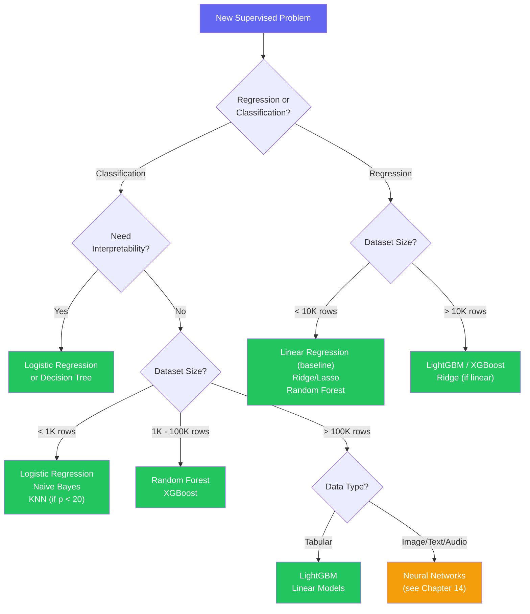

# Chapter 12 — Key ML Algorithms Deep Dive

---

## What You'll Learn

After this chapter you will be able to:
- Fit Linear and Logistic Regression by hand and read their coefficients correctly
- Explain how Decision Trees choose splits and why pruning matters
- Describe how Random Forest reduces variance through bagging and feature randomization
- Follow a Gradient Boosting run round by round, and know when to stop it
- Explain what the kernel trick buys you in an SVM — and what it costs
- Know when KNN and Naive Bayes are the right tool, and when they fall apart
- Pick the right algorithm for any tabular problem using a decision framework

**Markers:** ★★★ = know cold for interviews · ★★ = high priority · ★ = good to know.

### How this chapter works

Eight algorithms, one format. Every algorithm gets the **same seven-part card**, so you
learn the shape once and then just fill it in:

| Part | What it is |
|---|---|
| **In one line** | The algorithm's personality — the thing to remember when tired |
| **Predict first** | A question *before* the explanation. Guess, then open it. Guessing wrong is the point |
| **How it works** | The core maths, step by step, and one picture |
| **On Maple Street** | The worked example, on the same dataset every time |
| **The knobs** | The hyperparameters that actually matter |
| **Boss fight** | The real interview question, what to say, and the follow-up trap |
| **Stat card** | Speed · Accuracy · Interpretability · Scaling · Killer weakness |

Stat-card scale: **●●●** best in class · **●●○** solid · **●○○** weak.

---

## 12.1 Meet the Panel ★

![Map infographic introducing the eight algorithms as a panel of specialists with personas and tiers (Linear Regression honest accountant, Logistic Regression odds-maker, Decision Tree interrogator, Random Forest committee, Gradient Boosting perfectionist, SVM border guard, KNN gossip, Naive Bayes tally clerk), the four-row Maple Street table (units A to D: size, price, renovated, pro photos, walk score, sold in 30 days) plus new Unit E (2,200 sq ft, renovated, 3 photos, walk 0.4), a pick-by-question table and the seven-part card format.](diagrams/algo12_info_meet_the_panel_ai.png)

<details>
<summary><strong>Read as text</strong> — eight specialists, one spreadsheet</summary>

Eight algorithms. Think of them as eight specialists who all get handed the same
spreadsheet and each come back with an answer in their own style.

| Algorithm | Its personality in one line | Tier |
|---|---|:---:|
| **Linear Regression** | The honest accountant — adds up each feature's contribution and shows its working | ★★★ |
| **Logistic Regression** | The odds-maker — same sum, squashed into a probability | ★★★ |
| **Decision Tree** | The interrogator — plays Twenty Questions until it is confident | ★★★ |
| **Random Forest** | The committee — hundreds of over-confident interrogators, averaged into something sensible | ★★★ |
| **Gradient Boosting** | The perfectionist — fixes its own mistakes, one small correction at a time | ★★★ |
| **SVM** | The border guard — draws the widest possible no-man's-land between the two sides | ★★ |
| **KNN** | The gossip — asks the nearest neighbours and goes with the majority | ★★ |
| **Naive Bayes** | The tally clerk — counts clues and multiplies them, pretending they are unrelated | ★★ |

The first five earn their ★★★ because they cover almost every tabular problem you
will meet, and every one of them shows up in interviews. The last three are worth
knowing precisely because of *where they break*.

</details>

### The Maple Street dataset

<details>
<summary><strong>Read as text</strong> — the four apartments, Unit E and the two questions</summary>

Every worked example in this chapter uses the **same four apartments**. That is
deliberate: when the data never changes, the only thing changing is the algorithm,
and you can actually compare them.

| Unit | Size | Price | Renovated | Pro photos | Walk score | Sold in 30 days? |
|---|---|---|:---:|:---:|:---:|:---:|
| **A** | 1,000 sq ft | $200k | no | 1 | 0.3 | ✗ |
| **B** | 1,500 sq ft | $250k | no | 2 | 0.5 | ✗ |
| **C** | 2,000 sq ft | $400k | yes | 4 | 0.4 | ✓ |
| **D** | 2,500 sq ft | $450k | yes | 5 | 0.8 | ✓ |

And one new listing that keeps turning up:

> **Unit E** — 2,200 sq ft · renovated · 3 pro photos · walk score 0.4 · not yet sold.

Two questions run through the whole chapter:

- **Regression — what is Unit E worth?** → Linear Regression (§12.2), Gradient Boosting (§12.6)
- **Classification — will Unit E sell within 30 days?** → everything else

When four rows are not enough (impurity, bagging, out-of-bag error), we zoom out to
**100 listings across the city**, of which 30 sold within 30 days.

Naive Bayes (§12.9) is the one exception — its natural home is text, so it gets a spam
filter instead. Forcing it onto apartments would teach you less, not more.

</details>

### Where this sits in the curriculum

<details>
<summary><strong>Read as text</strong> — links to the chapters before and after this one</summary>

| Topic | Where |
|---|---|
| First introduction to these algorithms | [Ch 10 — Supervised Learning](#content/10_supervised_learning) |
| Regularization mechanics (Ridge / Lasso) | [Ch 8 §8.15](#content/08_core_concepts) |
| Class imbalance, SHAP, feature importance | [Ch 10 §10.10–10.11](#content/10_supervised_learning) |
| ROC, AUC, thresholds, calibration, tuning search | [Ch 13 — Model Evaluation](#content/13_model_evaluation) |
| Neural networks | [Ch 14 — Neural Networks](#content/14_neural_networks) |

Chapter 10 gave you the "what." This chapter gives you the "how" and "why" — the
mechanics, the knobs, and the failure modes.

</details>

---

## 12.2 Linear Regression ★★★

> **In one line:** the honest accountant — it adds up each feature's contribution and shows its working.


<details>
<summary><strong>Read as text</strong> — the weighted sum, in words and in maths</summary>

You already do this in your head. If every extra bedroom tends to add about 30K dollars to a
price and every year of age knocks a little off, you can price a new listing by adding
up those per-feature effects. That is the entire model: a weighted sum where each
weight says how hard one feature pushes the answer up or down.

> **Maths in one line:** `ŷ = w₀ + w₁x₁ + … + w_p·x_p`, with the weights chosen to make `Σ (yᵢ − ŷᵢ)²` as small as possible — add up each feature's push, and pick the pushes whose squared misses on the training rows are smallest.

> **Linear Regression** fits $\hat{y} = \mathbf{w}^\top \mathbf{x} + b$ to minimize the sum of squared residuals between predicted and observed values.

</details>

<details>
<summary><strong>Predict first.</strong> You fit a line through the four Maple Street apartments, with an intercept. Before computing anything — what must the four residuals add up to?</summary>

**Exactly zero.**

It is not a coincidence and it is not approximate. It falls straight out of the
intercept formula $w_0 = \bar{y} - w_1\bar{x}$, and it holds for *every* OLS fit that
includes an intercept.

That makes it a free bug detector. Sum your training residuals; if the total is not
~0, either the intercept was suppressed (`fit_intercept=False`), the model has not
converged, or you are accidentally looking at **test-set** residuals — which do not
have to sum to zero.
</details>

### How it works

<details>
<summary><strong>Read as text</strong> — OLS, the gradient and the normal equation</summary>

Stack the training rows into a matrix $X$ ($n$ rows, one column per feature, plus a
first column of 1s so that $w_0$ rides along as the intercept). Then

$$\hat{y} = w_0 + w_1 x_1 + \cdots + w_p x_p = \mathbf{w}^\top \mathbf{x}, \qquad \hat{\mathbf{y}} = X\mathbf{w}$$

The weights are not chosen — they are **solved for**. *Ordinary least squares* (OLS)
picks the $\mathbf{w}$ with the smallest mean squared error, and the gradient of that
error is just the residuals sent back through the features:

$$\text{MSE}(\mathbf{w}) = \frac{1}{n}\lVert X\mathbf{w} - \mathbf{y}\rVert^2, \qquad \nabla_{\mathbf{w}}\,\text{MSE} = \frac{2}{n}\,X^\top (X\mathbf{w} - \mathbf{y})$$

Set the gradient to zero and you get the **normal equation**, solved in one shot:

$$X^\top X\,\mathbf{w}^* = X^\top\mathbf{y} \quad\Longrightarrow\quad \mathbf{w}^* = (X^\top X)^{-1}X^\top\mathbf{y}$$

In words: at the best fit the residuals are *orthogonal* to every column of $X$. The
intercept's column is all 1s, so the residuals must sum to zero — that is the
Predict-first answer above. With a single feature the normal equation shrinks to a
formula worth computing once by hand:

$$w_1 = \frac{\sum (x_i - \bar{x})(y_i - \bar{y})}{\sum (x_i - \bar{x})^2}, \qquad w_0 = \bar{y} - w_1\bar{x}$$

</details>

### On Maple Street

<details>
<summary><strong>Read as text</strong> — the slope by hand, the residuals, R² and Unit E</summary>

Size in hundreds of sq ft, price in thousands of dollars:

| Size $x$ | Price $y$ | $x - \bar{x}$ | $y - \bar{y}$ | product | $(x-\bar{x})^2$ |
|---|---|---|---|---|---|
| 10 | 200 | −7.5 | −125 | 937.5 | 56.25 |
| 15 | 250 | −2.5 | −75 | 187.5 | 6.25 |
| 20 | 400 | +2.5 | +75 | 187.5 | 6.25 |
| 25 | 450 | +7.5 | +125 | 937.5 | 56.25 |
| **mean 17.5** | **mean 325** | | | **Σ = 2250** | **Σ = 125** |

$$w_1 = \frac{2250}{125} = 18, \qquad w_0 = 325 - 18(17.5) = 10$$

$$\boxed{\text{price} = 10 + 18 \times \text{size}}$$

Read the slope in units: **each extra 100 sq ft adds $18,000**.

| Unit | predicted | actual | residual |
|---|---|---|---|
| A | 190 | 200 | +10 |
| B | 280 | 250 | −30 |
| C | 370 | 400 | +30 |
| D | 460 | 450 | −10 |

Residuals sum to **exactly zero**, as promised. (The sum of squared errors, SSE, is
2,000; no other straight line does better on this data.)

**How good is the fit? R².** Compare those squared misses with the ones made by the
laziest possible model, "always predict the mean, 325" — its squared misses are the
total sum of squares, SST:

$$R^2 = 1 - \frac{\text{SSE}}{\text{SST}} = 1 - \frac{\sum (y_i - \hat{y}_i)^2}{\sum (y_i - \bar{y})^2} = 1 - \frac{2{,}000}{42{,}500} = \mathbf{0.953}$$

Size explains about 95% of the variation in these four prices. Two catches interviewers
probe: training R² **never goes down** when you add a feature — even pure noise — so
compare models with **adjusted R²**, $1 - (1 - R^2)\frac{n-1}{n-p-1}$ for $n$ rows and
$p$ features (here $1 - 0.047 \times \tfrac{3}{2} = 0.929$), or better, on a validation
set; and on a test set R² can go negative. → *R² next to MAE and RMSE:* [Ch 13 §13.6](#content/13_model_evaluation).

**Pricing Unit E** (2,200 sq ft): $10 + 18(22) = 406$ → **406 thousand dollars**.

With more features the same normal equation does the job, and each weight becomes that
feature's effect **holding the others fixed**. That clause is where the trouble starts.

Every number above, four ways — plus a preview of that trouble:

</details>

```python
# OLS on Maple Street four ways (hand formula, normal equation, lstsq, scikit-learn) + R²
import numpy as np
from sklearn.linear_model import LinearRegression

size = np.array([10, 15, 20, 25.0])          # hundreds of sq ft
price = np.array([200, 250, 400, 450.0])     # thousands of dollars

# 1) the one-feature hand formula
w1 = np.sum((size - size.mean()) * (price - price.mean())) / np.sum((size - size.mean()) ** 2)
w0 = price.mean() - w1 * size.mean()

# 2) normal equation (XᵀX) w = Xᵀy and 3) least squares, on the design matrix [1, size]
X = np.c_[np.ones(4), size]
w_normal = np.linalg.solve(X.T @ X, X.T @ price)     # solve it; never invert explicitly
w_lstsq = np.linalg.lstsq(X, price, rcond=None)[0]

# 4) scikit-learn
model = LinearRegression().fit(size.reshape(-1, 1), price)
w_sk = (model.intercept_, model.coef_[0])

for name, (a, b) in [("hand formula", (w0, w1)), ("normal eq.", w_normal),
                     ("lstsq", w_lstsq), ("sklearn", w_sk)]:
    print(f"{name:13s} w0 = {a:5.1f}   w1 = {b:5.1f}")
    assert np.allclose([a, b], [10, 18])

resid = price - (w0 + w1 * size)
assert abs(resid.sum()) < 1e-9                      # intercept => residuals sum to zero
sse = np.sum(resid ** 2)
sst = np.sum((price - price.mean()) ** 2)
r2 = 1 - sse / sst
print(f"\nresiduals {resid.round(1).tolist()}  sum = {round(resid.sum(), 9) + 0.0}")
print(f"SSE = {sse:.0f}   SST = {sst:.0f}   R² = {r2:.3f}   (sklearn .score: {model.score(size.reshape(-1, 1), price):.3f})")
print(f"Unit E (22): {w0 + w1 * 22:.0f} thousand dollars")

# Contrast: add an exact copy of size -> perfect multicollinearity
X2 = np.c_[np.ones(4), size, size]
print(f"\nrank of [1, size, size copy] = {np.linalg.matrix_rank(X2)} for 3 columns -> XᵀX has no inverse")
for label, w in [("lstsq (smallest weights)", np.linalg.lstsq(X2, price, rcond=None)[0]),
                 ("all credit to size", np.array([10, 18, 0.0])),
                 ("absurd split", np.array([10, 30, -12.0]))]:
    print(f"  {label:25s} w = {np.round(w, 1).tolist()}   SSE = {np.sum((price - X2 @ w) ** 2):.0f}")
```

**Output:**

```
hand formula  w0 =  10.0   w1 =  18.0
normal eq.    w0 =  10.0   w1 =  18.0
lstsq         w0 =  10.0   w1 =  18.0
sklearn       w0 =  10.0   w1 =  18.0

residuals [10.0, -30.0, 30.0, -10.0]  sum = 0.0
SSE = 2000   SST = 42500   R² = 0.953   (sklearn .score: 0.953)
Unit E (22): 406 thousand dollars

rank of [1, size, size copy] = 2 for 3 columns -> XᵀX has no inverse
  lstsq (smallest weights)  w = [10.0, 9.0, 9.0]   SSE = 2000
  all credit to size        w = [10.0, 18.0, 0.0]   SSE = 2000
  absurd split              w = [10.0, 30.0, -12.0]   SSE = 2000
```

<details>
<summary><strong>Read as text</strong> — continued: one fit, three weight vectors</summary>

Three very different weight vectors, one identical fit. When two columns carry the same
information the data simply cannot say how to split the credit between them.

</details>

### The five assumptions, in one table

<details>
<summary><strong>Read as text</strong> — what each assumption protects, and how to fix it</summary>

OLS always returns *some* line. Whether you can trust what it tells you rests on five
assumptions — and they protect different things:

| Assumption | If it fails | Spot it → fix it |
|---|---|---|
| **Linearity** — the target really is a weighted sum of the features | Predictions are biased | Curved residual-vs-fitted plot → add squared, interaction or log features |
| **Independent errors** | Standard errors too small, p-values too optimistic | Time-ordered data with autocorrelated residuals → time-aware model |
| **Constant error variance** (homoscedasticity) | Weights still fine; confidence intervals wrong | Residuals fan out as predictions grow → log-transform the target, weighted least squares |
| **Normal errors** | Only small-sample intervals and p-values suffer | Q–Q plot; with large $n$ it hardly matters |
| **No multicollinearity** | Weights unstable and unreadable | VIF above 10 → drop, combine, or Ridge (below) |

For **prediction**, only the first one really matters. The other four protect
**inference** — standard errors, p-values, and reading a weight as an effect. On ML
problems the one that bites is the last, because people *do* read the weights.

</details>

### The one assumption that bites: multicollinearity

<details>
<summary><strong>Read as text</strong> — VIF, why predictions survive, and the fixes</summary>

If `size` and `n_rooms` move together, the model cannot tell which deserves the credit —
many splits of it fit almost equally well (with an exact copy, *exactly* equally well,
as above). So the split becomes wildly unstable: in the program below, resampling the
same 30 listings swings the `size` weight from +13 to −7 — bigger flats apparently
*worth less* — while the predicted price of Unit E stays between 405 and 414. **Variance
Inflation Factor** puts a number on it: $\text{VIF}_j = 1/(1 - R_j^2)$, where $R_j^2$
comes from regressing feature $j$ on all the others. Above 5 deserves a look; above
**10** is serious.

> **The part people get wrong:** multicollinearity damages **interpretation**, not
> **prediction**. The fitted values stay accurate and test performance can be
> excellent. It only hurts the moment someone reads a coefficient as an effect size.

**Fixes, in order:** drop one of the pair · combine them (`sqft_per_room`) · or use
**Ridge**, whose L2 penalty stabilises the split by shrinking correlated coefficients
*toward each other* (on standardised features, two identical copies get exactly equal
weights). Prefer Ridge over Lasso here — Lasso tends to keep one of the pair and zero the
other, and *which* one it keeps can flip with a small change in the data.

</details>

```python
# Multicollinearity: coefficients swing, predictions do not — and Ridge calms the swing
import numpy as np

rng = np.random.default_rng(0)
n = 30
size = rng.uniform(8, 30, n)                      # hundreds of sq ft
n_rooms = size / 4 + rng.normal(0, 0.1, n)        # rooms track size almost exactly
price = 10 + 18 * size + rng.normal(0, 20, n)     # truth: only size matters
X = np.c_[size, n_rooms]

r2 = np.corrcoef(size, n_rooms)[0, 1] ** 2        # with two features, R_j² = corr²
print(f"corr(size, n_rooms) = {np.sqrt(r2):.3f}   VIF = 1/(1 - R²) = {1 / (1 - r2):.0f}")

def fit(X, y, lam=0.0):
    """OLS (lam=0) or Ridge; centring first keeps the intercept unpenalised."""
    Xc, yc = X - X.mean(0), y - y.mean()
    w = np.linalg.solve(Xc.T @ Xc + lam * np.eye(X.shape[1]), Xc.T @ yc)
    return y.mean() - X.mean(0) @ w, w

unit_e = np.array([22, 5.5])                      # 2,200 sq ft, 5.5 rooms
print("\n          ------- OLS -------------   ---- Ridge (λ = 30) -----")
print("resample  w_size  w_rooms  Unit E      w_size  w_rooms  Unit E")
rows = []
for k in range(4):                                 # 4 bootstrap resamples of the same 30 listings
    idx = rng.integers(0, n, n)
    b, w = fit(X[idx], price[idx])
    br, wr = fit(X[idx], price[idx], lam=30.0)
    rows.append([w[0], b + unit_e @ w, wr[0], br + unit_e @ wr])
    print(f"   {k + 1}      {w[0]:6.1f}  {w[1]:7.1f}  {b + unit_e @ w:6.1f}"
          f"      {wr[0]:6.1f}  {wr[1]:7.1f}  {br + unit_e @ wr:6.1f}")

spread = np.ptp(np.array(rows), axis=0)            # max - min of each column
print(f"\nspread of w_size: OLS {spread[0]:.1f} vs Ridge {spread[2]:.1f}   "
      f"spread of Unit E: OLS {spread[1]:.1f} vs Ridge {spread[3]:.1f}")
assert spread[0] > 10 * spread[2]                  # the split is unstable; Ridge fixes it
assert spread[1] < 10                              # ...but the prediction never was
```

**Output:**

```
corr(size, n_rooms) = 0.999   VIF = 1/(1 - R²) = 347

          ------- OLS -------------   ---- Ridge (λ = 30) -----
resample  w_size  w_rooms  Unit E      w_size  w_rooms  Unit E
   1        10.9     28.9   413.6        16.6      4.3   413.4
   2         2.3     64.0   409.4        17.0      4.7   409.8
   3        13.1     23.1   408.5        17.2      4.5   408.5
   4        -7.1    101.3   405.3        16.3      5.3   404.1

spread of w_size: OLS 20.2 vs Ridge 1.0   spread of Unit E: OLS 8.3 vs Ridge 9.3
```

<details>
<summary><strong>Read as text</strong> — continued: what the resamples show</summary>

A VIF of 347 is far past the danger line. The OLS `size` weight wanders over a range of
20 and even turns negative; Ridge pins it near 17 — yet in every row the two models
price Unit E almost identically (at most 1.2 apart).

</details>

### Solving it at scale, and regularizing it

<details>
<summary><strong>Read as text</strong> — closed form vs gradient descent, and the regularized variants</summary>

**The closed form** is one shot and exact, but costs $O(np^2 + p^3)$ and needs
$X^\top X$ to be invertible — fine up to a few thousand features. Libraries never
literally invert it: `np.linalg.lstsq` and scikit-learn's `LinearRegression` use an
SVD-based least-squares solver, which also copes with a singular $X^\top X$ by returning
the smallest-weight answer (the 9 / 9 split above).

**Gradient descent** repeats $\mathbf{w} \leftarrow \mathbf{w} - \eta\,\frac{2}{n}X^\top(X\mathbf{w} - \mathbf{y})$.
Each step costs only $O(np)$, it works on mini-batches and streams (online learning),
and it needs **scaled features** — on raw Maple Street sizes, `lr=0.01` blows up (see
*From scratch* below).

Regularized variants — **Ridge** (L2, shrinks all weights; still has a closed form,
$(X^\top X + \lambda I)^{-1}X^\top\mathbf{y}$, invertible for any $\lambda > 0$),
**Lasso** (L1, zeroes some outright; no closed form, so scikit-learn solves it by
coordinate descent), **Elastic Net** (both) — are the standard defence against
overfitting and collinearity here.

→ *Full regularization mechanics:* [Ch 8 §8.15](#content/08_core_concepts).

</details>

### The knobs

<details>
<summary><strong>Read as text</strong> — the knobs, the boss fight and the stat card</summary>

| Knob | Typical | What it does |
|---|---|---|
| `alpha` (Ridge / Lasso) | CV over `[0.01 … 100]`; default 1.0 | Penalty strength — the λ above. The only knob that really matters |
| `fit_intercept` | `True` | Leave it on unless your data is already centred |
| `l1_ratio` (Elastic Net) | 0.5 (the default) | Mix between L1 and L2 |

> **Boss fight —** *"Your linear model scores well, but the coefficients flip sign when you retrain on slightly different data. What is going on?"*
>
> **Say:** Classic **multicollinearity**. Two or more features carry nearly the same information, so many weight combinations produce almost the same predictions. The optimiser lands on one of them, and a small change in the data tips it to a different one. I would compute **VIF** per feature and look for anything above 10.
>
> **They follow up with:** *"Is the model broken?"* — for **prediction**, no. $\hat{y}$ is stable and test performance is fine; only the *attribution* between the correlated features is unstable. It breaks the moment anyone reads the coefficients as effect sizes. Fix by dropping one, combining them, or switching to **Ridge** — and prefer Ridge over Lasso here, because Lasso tends to keep one of the pair and zero the other, and a small change in the data can flip which one survives.

| Speed | Accuracy | Interpretability | Needs scaling? | Killer weakness |
|:---:|:---:|:---:|:---:|---|
| ●●● | ●○○ | ●●● | For regularization or gradient descent | Can only fit straight lines |

```python
from sklearn.linear_model import LinearRegression
model = LinearRegression().fit(X_train, y_train)
print(f"R² = {model.score(X_test, y_test):.3f}")
print(f"Coefficients: {dict(zip(feature_names, model.coef_))}")
```

</details>

<details>
<summary><strong>From scratch</strong> — gradient descent in eight lines, and why you scale first.</summary>

```python
# Linear regression by gradient descent on Maple Street — and why you scale first
import numpy as np

def linear_regression_gd(X, y, lr=0.01, epochs=1000):
    X = np.c_[np.ones(len(X)), X]          # add bias column
    w = np.zeros(X.shape[1])
    for _ in range(epochs):
        grad = (2 / len(X)) * X.T @ (X @ w - y)
        w -= lr * grad
    return w                                # w[0] = intercept, w[1:] = coefficients

size = np.array([10, 15, 20, 25.0])         # hundreds of sq ft
price = np.array([200, 250, 400, 450.0])    # thousands of dollars

# 1) Standardise, descend, then convert the weights back to raw units
mu, sd = size.mean(), size.std()
w = linear_regression_gd((size - mu) / sd, price, lr=0.1, epochs=500)
w1 = w[1] / sd
w0 = w[0] - w1 * mu
print(f"scaled,  lr=0.1,   500 epochs: w0 = {w0:6.2f}  w1 = {w1:6.2f}")
assert abs(w0 - 10) < 1e-6 and abs(w1 - 18) < 1e-6

# 2) Raw sizes with a small lr: stable, but the intercept crawls
w = linear_regression_gd(size, price, lr=0.002, epochs=1000)
print(f"raw,     lr=0.002, 1000 epochs: w0 = {w[0]:6.2f}  w1 = {w[1]:6.2f}   <- not there yet")

# 3) Raw sizes with the default lr=0.01: every step overshoots and the weights explode
with np.errstate(over="ignore", invalid="ignore"):
    w = linear_regression_gd(size, price, lr=0.01, epochs=100)
print(f"raw,     lr=0.01,  100 epochs: |w1| ~ 10^{np.log10(abs(w[1])):.0f}   <- diverged")
```

**Output:**

```
scaled,  lr=0.1,   500 epochs: w0 =  10.00  w1 =  18.00
raw,     lr=0.002, 1000 epochs: w0 =   3.75  w1 =  18.32   <- not there yet
raw,     lr=0.01,  100 epochs: |w1| ~ 10^77   <- diverged
```

Why raw sizes misbehave: on this data the largest stable learning rate is about
$2 / 677 \approx 0.003$ (677 is the largest eigenvalue of $\tfrac{2}{n}X^\top X$), while
the intercept direction has an eigenvalue of only about 0.18 — so a step size small
enough not to explode moves the intercept at a crawl. Standardising makes the two
directions comparable, and `lr=0.1` lands on exactly 10 and 18.
</details>

---

## 12.3 Logistic Regression ★★★

> **In one line:** the odds-maker — the same weighted sum, squashed into a probability.


<details>
<summary><strong>Read as text</strong> — the sigmoid over a weighted sum, in words and in maths</summary>

Despite the name this is a **classification** algorithm. Take the linear score
$z = \mathbf{w}^\top\mathbf{x}$, push it through the sigmoid, and you get a number
between 0 and 1 you can call a probability.

> **Maths in one line:** `ln(p / (1 − p)) = z = w₀ + w₁x₁ + … + w_p·x_p`, so `p = σ(z) = 1 / (1 + e^(−z))` — the weighted sum predicts the log-odds, and the sigmoid turns it back into a probability between 0 and 1.

> **Logistic Regression** models the probability of a binary outcome by applying the logistic (sigmoid) function to a linear combination of features, trained by minimizing binary cross-entropy.

</details>

<details>
<summary><strong>Predict first.</strong> A logistic model gives a feature a coefficient of −0.69. A listing currently has a 50% chance of selling fast. One extra unit of that feature — what is the new probability? (It is not 25%.)</summary>

$e^{-0.69} \approx 0.5$, so the **odds** are halved — not the probability.

At $p = 0.5$ the odds are $\frac{0.5}{0.5} = 1$. Halving gives odds of 0.5, and
converting back:

$$p = \frac{0.5}{1 + 0.5} = \mathbf{0.333}$$

So it drops from 50% to **33%**. Halving the odds only looks like halving the
probability when the probability is already very small. Hold on to that — it is the
single most-tested idea in this section.
</details>

### How it works

<details>
<summary><strong>Read as text</strong> — the sigmoid, maximum likelihood and the log-loss gradient</summary>

$$\sigma(z) = \frac{1}{1 + e^{-z}} \quad \text{where} \quad z = w_0 + w_1 x_1 + \cdots + w_p x_p$$

```
  P(y=1)
   1.00 |                                    * * * * * * *
        |                              * * *
   0.75 |                            *
        |                          *
   0.50 | - - - - - - - - - - - -*        <- z = 0 gives exactly 0.5 (default threshold)
        |                      *
   0.25 |                    *
        |              * * *
   0.00 |* * * * * * *
        +--------------------------------------------------> z
        -6          -3           0           3           6
```

It maps any real number into $(0,1)$, sits at 0.5 when $z = 0$, and has the tidy
derivative $\sigma'(z) = \sigma(z)(1-\sigma(z))$.

**Training is maximum likelihood.** The model gives row $i$ a probability $\hat{p}_i$ of
being a 1. The probability it assigns to the label that actually happened is
$\hat{p}_i^{\,y_i}(1-\hat{p}_i)^{1-y_i}$ — that is $\hat{p}_i$ when $y_i = 1$ and
$1 - \hat{p}_i$ when $y_i = 0$. Multiply over the rows, take minus the log, average, and
out comes **binary cross-entropy** (log-loss):

$$\mathcal{L} = -\frac{1}{n}\sum_{i=1}^{n} \left[ y_i \log(\hat{p}_i) + (1 - y_i) \log(1 - \hat{p}_i) \right]$$

So minimising log-loss *is* maximising the likelihood. Its gradient is strikingly
simple: the sigmoid's derivative $\hat{p}(1-\hat{p})$ cancels against the
$1/\hat{p}$ and $1/(1-\hat{p})$ that the logs produce, leaving "error × input":

$$\frac{\partial \ell_i}{\partial z_i} = \hat{p}_i - y_i \qquad\Longrightarrow\qquad \nabla_{\mathbf{w}}\mathcal{L} = \frac{1}{n}X^\top(\hat{\mathbf{p}} - \mathbf{y})$$

where $\ell_i$ is row $i$'s term of $\mathcal{L}$. A sale predicted at 0.9 pushes with only
0.1; a sale predicted at 0.1 pushes with 0.9 — confident mistakes drive the learning.
Setting the gradient to zero has no closed-form solution, so the weights are found
iteratively: gradient descent, or a quasi-Newton method such as L-BFGS (scikit-learn's
default solver).

**Why not MSE?** On a sigmoid, MSE is non-convex in the weights, and its gradient keeps
an extra $\hat{p}(1-\hat{p})$ factor that almost vanishes when the model is confidently
wrong. Log-loss is convex here — one basin.
→ *Full treatment of loss functions:* [Ch 8 §8.8](#content/08_core_concepts).

</details>

### On Maple Street

<details>
<summary><strong>Read as text</strong> — scoring Unit E and the four known units</summary>

Predicting **"sells within 30 days"** from three features. The four Maple Street rows
alone cannot pin the weights down (they are perfectly separable — see *Regularization*
below), so these were fitted on the city listings:

```
  Features:  pro_photos (count), renovated (0/1), walk_score (0-1)
  Weights:   w0 = -9.0,  w_photos = 1.8,  w_reno = 3.2,  w_walk = 4.5

  Unit E:    pro_photos = 3,  renovated = 1,  walk_score = 0.4

  z = -9.0 + 1.8(3) + 3.2(1) + 4.5(0.4)
    = -9.0 + 5.4 + 3.2 + 1.8
    = 1.4

  P(sells fast) = sigmoid(1.4) = 1 / (1 + e^-1.4) = 0.80

  0.80 > 0.5  ->  SELLS FAST
```

The same weights get all four known units right: A–D score $z = -5.85, -3.15, 3.2, 6.8$,
which the sigmoid turns into 0.003, 0.041, 0.961 and 0.999 — two clear no's (A, B) and
two clear yes's (C, D).

</details>

### What the weights actually mean — the log-odds view

<details>
<summary><strong>Read as text</strong> — odds ratios, and the 24× trap</summary>

This is the reason logistic regression stays the default whenever a decision must be
*explained*. Invert the sigmoid:

$$p = \frac{1}{1 + e^{-z}} \quad\Longrightarrow\quad \frac{p}{1-p} = e^{z} \quad\Longrightarrow\quad \ln\!\left(\frac{p}{1-p}\right) = z = w_0 + w_1x_1 + \cdots$$

So logistic regression is **linear — but in the log-odds**, not in the probability.
That one sentence answers most follow-ups. Exponentiating a weight gives the **odds
ratio**:

| $w_j$ | $e^{w_j}$ | Reading |
|---|---|---|
| $+0.69$ | 2.0 | One more unit **doubles** the odds |
| $+0.10$ | 1.11 | One more unit raises the odds ~11% |
| $0$ | 1.0 | No effect |
| $-0.69$ | 0.5 | One more unit **halves** the odds |

On Maple Street `renovated` has weight $3.2$, and $e^{3.2} \approx 24.5$: a renovated
apartment has roughly **24× the odds** of selling within 30 days, holding everything
else fixed.

**The trap:** "so it multiplies the *probability* by 24?" No. Unit E shows it. Without
the renovation its score would be $1.4 - 3.2 = -1.8$: probability 0.14, odds 0.17. With
it: probability 0.80, odds 4.06. The odds went up exactly 24.5×; the probability only
about 5.7×. How much the probability moves depends entirely on where you started:

| Starting $p$ | Starting odds | ×24.5 odds | New $p$ |
|---|---|---|---|
| 0.01 | 0.0101 | 0.247 | **0.198** (≈20×) |
| 0.50 | 1.0 | 24.5 | **0.961** (<2×) |
| 0.90 | 9.0 | 220 | **0.995** (barely moves) |

The odds ratio is **constant**; the probability change is not. That is exactly why
coefficients are reported in log-odds space — it is the only scale on which a
feature's effect is one stable number.

</details>

### Four practical notes

<details>
<summary><strong>Read as text</strong> — boundary, threshold, imbalance and multiclass</summary>

**The decision boundary is always straight.** It is the set where $z = 0$ (for the
default 0.5 threshold; for threshold $t$ it is $z = \ln\frac{t}{1-t}$) — a line in 2D and
a hyperplane above that. For a renovated Maple Street listing it is
$-9 + 3.2 + 1.8\,\text{photos} + 4.5\,\text{walk} = 0$: at walk score 0.4 the line sits at
2.2 photos, so Unit E's 3 photos put it on the "sells" side. Non-linear pattern? Add
polynomial features or change model.

**0.5 is rarely the right threshold.** Lower it when a miss is expensive (fraud, cancer
screening), raise it when a false alarm is expensive (spam). → *Choosing it from the
ROC or PR curve:* [Ch 13 §13.4–13.5](#content/13_model_evaluation).

**Imbalanced classes** are handled with `class_weight='balanced'`, resampling, or
threshold tuning. → *All three, compared:* [Ch 10 §10.11](#content/10_supervised_learning).
One thing worth carrying here, because it is easy to miss:

> `class_weight` and threshold tuning attack the same problem from opposite ends.
> Reweighting **distorts the predicted probabilities** — they no longer match the true
> base rate — whereas moving the threshold leaves them intact and only changes where
> you cut. If anything downstream consumes the *probability* (pricing, risk scoring,
> bidding), prefer threshold tuning, and do not stack both without re-checking
> calibration ([Ch 13 §13.12](#content/13_model_evaluation)).

**Multiclass** works via one-vs-rest ($K$ binary models) or **softmax**, which
generalises the sigmoid to $K$ classes directly. scikit-learn uses softmax by default for
3+ classes (every solver except `liblinear`), and it is the standard output layer in
neural networks ([Ch 14](#content/14_neural_networks)).

</details>

### Regularization — C is 1/λ, and it is on by default

<details>
<summary><strong>Read as text</strong> — C = 1/λ, scaling first, and separable data</summary>

scikit-learn's `LogisticRegression` is **regularized out of the box**. With the default
L2 penalty it minimises

$$\tfrac{1}{2}\lVert\mathbf{w}\rVert^2 + C\sum_{i=1}^{n}\ell_i \qquad (\text{the intercept is not penalised})$$

Divide through by $C$ and you see that $C$ plays the role of $1/\lambda$: **smaller `C`
means a stronger penalty**, and the default `C=1.0` is a real penalty, not "off" — in the
*From scratch* program below it shrinks the weights by roughly 10–20% on 1,000 rows. Two
consequences interviewers probe:

- **Scale your features.** The penalty treats every weight alike, so a feature measured
  in big units needs only a small weight and escapes most of the penalty. Standardise
  first.
- **Separable data needs it.** If some line splits the classes perfectly — on the four
  Maple Street rows, `renovated` alone does — the likelihood keeps improving as the
  weights grow, so unregularized weights run off to infinity and every probability is
  pushed to 0 or 1. The penalty keeps them finite; the program shows the weights growing
  as `C` rises.

Since scikit-learn 1.8 the *type* of penalty is chosen with `l1_ratio` (0 = L2, 1 = L1,
in between = elastic net); the old `penalty` argument is deprecated, and `C=np.inf`
switches regularization off.

</details>

### The knobs

<details>
<summary><strong>Read as text</strong> — the knobs, the boss fight and the stat card</summary>

| Knob | Typical | What it does |
|---|---|---|
| `C` | CV over `[0.01 … 100]`; default 1.0 | **Inverse** regularization, $C = 1/\lambda$ — smaller `C` means *more* penalty |
| `l1_ratio` (scikit-learn ≥ 1.8; older: `penalty`) | 0 (= L2) | 1 (= L1) for built-in feature selection; needs `solver='saga'` or `'liblinear'` |
| `class_weight` | `None` / `'balanced'` | Reweights the loss for imbalance |
| `max_iter` | 1000 | Default is 100; raise it (and scale features) if you see a convergence warning |

> **Boss fight —** *"A logistic regression gives `renovated` a coefficient of 3.2. Explain what that means to a product manager."*
>
> **Say:** Exponentiate it: $e^{3.2} \approx 24$. A renovated apartment has about **24 times the odds** of selling within 30 days, holding everything else constant. I would phrase it in odds, not probability, because odds is what the coefficient actually fixes.
>
> **They follow up with:** *"So renovating makes a sale 24× more likely?"* — no, and this is the distinction they are testing. Odds are not probability. If the baseline probability is 1%, multiplying the odds by 24 takes it to about **20%** — roughly 20×. If the baseline is already 50%, it goes to **96%** — under 2×. The odds ratio is constant; the effect on probability depends entirely on where you started.

| Speed | Accuracy | Interpretability | Needs scaling? | Killer weakness |
|:---:|:---:|:---:|:---:|---|
| ●●● | ●●○ | ●●● | Yes | Straight-line boundary only |

```python
from sklearn.linear_model import LogisticRegression
model = LogisticRegression(C=1.0, max_iter=1000).fit(X_train, y_train)
probs = model.predict_proba(X_test)[:, 1]   # P(class = 1)
```

</details>

<details>
<summary><strong>From scratch</strong> — the whole algorithm in ten lines, checked against scikit-learn.</summary>

```python
# Logistic regression by gradient descent (numpy) vs scikit-learn — and what C does
import numpy as np
from sklearn.linear_model import LogisticRegression

def sigmoid(z): return 1 / (1 + np.exp(-z))

def logistic_regression_gd(X, y, lr=0.01, epochs=1000):
    X = np.c_[np.ones(len(X)), X]
    w = np.zeros(X.shape[1])
    for _ in range(epochs):
        p = sigmoid(X @ w)
        grad = X.T @ (p - y) / len(X)      # (p - y) times x, averaged over rows
        w -= lr * grad
    return w

# 1,000 synthetic city listings drawn from the §12.3 weights
rng = np.random.default_rng(0)
n = 1000
X = np.c_[rng.integers(0, 5, n), rng.integers(0, 2, n), rng.uniform(0, 1, n)]  # photos, renovated, walk
w_true = np.array([-9.0, 1.8, 3.2, 4.5])
y = (rng.uniform(size=n) < sigmoid(w_true[0] + X @ w_true[1:])).astype(float)
print(f"{n} listings, {y.mean():.0%} sold within 30 days\n")

mu, sd = X.mean(0), X.std(0)                       # scale first, then undo it
ws = logistic_regression_gd((X - mu) / sd, y, lr=0.5, epochs=3000)
w_gd = np.r_[ws[0] - np.sum(ws[1:] * mu / sd), ws[1:] / sd]

print(f"{'':16s}{'w0':>7s}{'photos':>8s}{'reno':>7s}{'walk':>7s}")
show = lambda name, w: print(f"{name:16s}" + "".join(f"{v:7.2f}" for v in w))
show("true weights", w_true)
show("numpy GD", w_gd)
for C in [1e6, 1.0, 0.01]:                          # C = 1/λ: big C = weak penalty
    m = LogisticRegression(C=C, tol=1e-10, max_iter=10000).fit(X, y)
    w_sk = np.r_[m.intercept_, m.coef_[0]]
    show(f"sklearn C={C:g}", w_sk)
    if C == 1e6:
        assert np.allclose(w_gd, w_sk, atol=0.02)    # same maximum-likelihood answer

# Contrast: the four Maple Street rows are perfectly separable -> no finite best weights
X4 = np.array([[1, 0, 0.3], [2, 0, 0.5], [4, 1, 0.4], [5, 1, 0.8]])
y4 = np.array([0, 0, 1, 1.0])
print()
for C in [1, 100, 10000]:
    m = LogisticRegression(C=C, tol=1e-10, max_iter=10000).fit(X4, y4)
    print(f"Maple Street only, C={C:<6d} weight norm {np.linalg.norm(m.coef_):5.1f}   "
          f"P(B sells) = {m.predict_proba(X4[1:2])[0, 1]:.4f}")
```

**Output:**

```
1000 listings, 35% sold within 30 days

                     w0  photos   reno   walk
true weights      -9.00   1.80   3.20   4.50
numpy GD          -9.50   1.82   3.25   5.45
sklearn C=1e+06   -9.50   1.82   3.25   5.45
sklearn C=1       -8.21   1.61   2.80   4.43
sklearn C=0.01    -2.76   0.74   0.53   0.39

Maple Street only, C=1      weight norm   1.0   P(B sells) = 0.2461
Maple Street only, C=100    weight norm   3.7   P(B sells) = 0.0155
Maple Street only, C=10000  weight norm   7.2   P(B sells) = 0.0003
```

Gradient descent and scikit-learn with a negligible penalty land on the same weights,
close to the true ones (1,000 noisy rows cannot pin them exactly). The default `C=1`
already shrinks every weight; `C=0.01` crushes them. On the four separable rows the
weights keep growing with `C` and the probabilities harden toward 0 and 1 — with no
penalty they would never stop.

Compare the loop with the linear regression version: the gradient has the same shape,
$X^\top(\text{prediction} - y)/n$ (the linear one carries an extra 2 from
differentiating the square), and the only real change is the sigmoid. That is not a
coincidence: both are *generalized linear models* fitted by maximum likelihood with
their natural ("canonical") link — identity for Gaussian noise, logit for a yes/no
outcome — and every such model has this gradient.
</details>

---

## 12.4 Decision Trees ★★★

> **In one line:** the interrogator — it plays Twenty Questions until it is confident enough to commit.

![Infographic on decision trees: gain = G(parent) minus the weighted child Gini, with Gini G = 1 - sum of pk squared; a split of 100 listings (30 fast, Gini 0.420) on photos at least 3 into 60 listings with 5 fast (Gini 0.153) and 40 with 25 fast (Gini 0.469), weighted 0.279 and gain 0.141; a depth-versus-accuracy chart where training climbs from 71.1 to 100 percent while validation peaks at 86.0 percent at depth 5 and falls to 78.7 percent fully grown; and a knobs table of defaults and typical values.](diagrams/algo12_info_decision_trees_ai.png)

<details>
<summary><strong>Read as text</strong> — Twenty Questions, in words and in maths</summary>

Each yes/no question splits the cases still in play into purer and purer groups. The
only real skill is picking which question to ask at each step.

> **Maths in one line:** `gain = G(parent) − Σₖ (nₖ / n) · G(childₖ)`, with Gini `G = 1 − Σ pₖ²` — at each node, ask the question whose children are purest once each child is weighted by its share of the rows.

> **Decision Tree (CART)** recursively partitions the feature space into axis-aligned regions by choosing splits that maximize impurity reduction (Gini or information gain). Predictions are the majority class or mean value in each leaf.

</details>

<details>
<summary><strong>Predict first.</strong> Of 100 city listings, 30 sold within 30 days. What is the Gini impurity of that group — and what would it be if all 100 had sold fast?</summary>

$$G = 1 - \sum p_k^2 = 1 - (0.3^2 + 0.7^2) = 1 - 0.58 = \mathbf{0.42}$$

If all 100 sold fast, $G = 1 - 1^2 = \mathbf{0}$. **Zero means pure**, and the worst
possible value for two classes is 0.5 (a perfect 50/50 split).

So the tree's whole job is to drive 0.42 down toward 0. Keep that number — the next
example starts from it.
</details>

### How it works

<details>
<summary><strong>Read as text</strong> — greedy splits, Gini vs entropy, and regression leaves</summary>

At every node the algorithm tries every threshold on every feature (for a number, the
midpoints between its sorted distinct values), keeps the split with the largest
impurity reduction, and then repeats inside each child. It is **greedy** — the best
question *now*, with no look-ahead — because finding the truly optimal tree is
NP-complete (Hyafil & Rivest, 1976).

**Gini impurity:** $G = 1 - \sum_{k} p_k^2$  ·  **Entropy:** $H = -\sum_{k} p_k \log_2 p_k$

Both measure "how mixed are the classes here?", where $p_k$ is the share of class $k$ in
the node. With entropy the reduction is called **information gain**,
$H(\text{parent}) - \sum_k \frac{n_k}{n} H(\text{child}_k)$. In practice the two produce
near-identical trees; Gini is scikit-learn's default and marginally faster because it
skips the logarithm. → *Side by side, with numbers:* [Ch 10 §10.7](#content/10_supervised_learning).

A leaf predicts its majority class (and its class shares as `predict_proba`). For
**regression** the impurity is the variance of the targets (`criterion='squared_error'`)
and a leaf predicts their mean — so a regression tree can never predict outside the
range of targets it was trained on.

</details>

### On Maple Street (all 100 city listings)

<details>
<summary><strong>Read as text</strong> — the "3 or more photos?" split, worked by hand</summary>

```
  Parent node: 100 listings (30 sold fast, 70 slow)
  Gini(parent) = 1 - (0.3^2 + 0.7^2) = 0.420

  Candidate split: "3 or more pro photos?"

  Left  (fewer than 3):  60 listings (5 fast, 55 slow)
    Gini(left)  = 1 - (5/60)^2 - (55/60)^2 = 0.153

  Right (3 or more):     40 listings (25 fast, 15 slow)
    Gini(right) = 1 - (25/40)^2 - (15/40)^2 = 0.469

  Weighted Gini after split = (60/100)(0.1528) + (40/100)(0.4688)
                            = 0.0917 + 0.1875 = 0.279

  Gini reduction = 0.420 - 0.279 = 0.141   <- a good split

  The algorithm tests EVERY feature and EVERY threshold,
  then keeps the largest reduction.
```

Note the right-hand child is *less* pure than the parent (0.469 vs 0.420). That is
fine — only the **weighted** average has to improve. Scored with entropy instead, the
same split gains 0.251 bits (0.881 → 0.630) and still wins.

The program below gives those 100 listings concrete photo counts (0–5), scores all five
possible thresholds by hand, and lets scikit-learn's depth-1 tree pick its own:

</details>

```python
# The 100-listing split by hand (every threshold) vs a depth-1 scikit-learn tree
import numpy as np
from sklearn.tree import DecisionTreeClassifier

# 100 city listings: (pro photos, how many listings, how many sold fast)
counts = [(0, 15, 0), (1, 20, 1), (2, 25, 4), (3, 15, 8), (4, 15, 10), (5, 10, 7)]
photos = np.concatenate([[k] * n for k, n, _ in counts])
fast = np.concatenate([[1] * f + [0] * (n - f) for _, n, f in counts])

def gini(y):
    p = y.mean()
    return 1 - p ** 2 - (1 - p) ** 2

parent = gini(fast)
print(f"parent: {len(fast)} listings, {fast.sum()} fast, Gini = {parent:.3f}\n")
print("split            left (n, fast)   right (n, fast)   weighted Gini   gain")
best = None
for t in [0.5, 1.5, 2.5, 3.5, 4.5]:                 # midpoints between the distinct values
    L, R = fast[photos < t], fast[photos >= t]
    weighted = len(L) / 100 * gini(L) + len(R) / 100 * gini(R)
    gain = parent - weighted
    print(f"photos >= {t}    ({len(L):3d}, {L.sum():2d})        ({len(R):3d}, {R.sum():2d})"
          f"         {weighted:.4f}       {gain:.4f}")
    if best is None or gain > best[1]:
        best = (t, gain)
print(f"\nby hand: best split is photos >= {best[0]} (gain {best[1]:.3f})")

tree = DecisionTreeClassifier(max_depth=1, random_state=0).fit(photos.reshape(-1, 1), fast)
t = tree.tree_
print(f"sklearn: threshold {t.threshold[0]}, node sizes {t.n_node_samples.tolist()}, "
      f"Gini {np.round(t.impurity, 3).tolist()}")
assert t.threshold[0] == best[0]
ent = DecisionTreeClassifier(max_depth=1, criterion="entropy", random_state=0).fit(photos.reshape(-1, 1), fast)
print(f"entropy criterion picks threshold {ent.tree_.threshold[0]} too")
```

**Output:**

```
parent: 100 listings, 30 fast, Gini = 0.420

split            left (n, fast)   right (n, fast)   weighted Gini   gain
photos >= 0.5    ( 15,  0)        ( 85, 30)         0.3882       0.0318
photos >= 1.5    ( 35,  1)        ( 65, 29)         0.3407       0.0793
photos >= 2.5    ( 60,  5)        ( 40, 25)         0.2792       0.1408
photos >= 3.5    ( 75, 13)        ( 25, 17)         0.3237       0.0963
photos >= 4.5    ( 90, 23)        ( 10,  7)         0.3844       0.0356

by hand: best split is photos >= 2.5 (gain 0.141)
sklearn: threshold 2.5, node sizes [100, 60, 40], Gini [0.42, 0.153, 0.469]
entropy criterion picks threshold 2.5 too
```

<details>
<summary><strong>Read as text</strong> — continued: the library picks the same question</summary>

"photos ≥ 2.5" is "3 or more photos": the library's first question is exactly the one
worked by hand, with the same three impurities.

</details>

### The overfitting problem

<details>
<summary><strong>Read as text</strong> — why trees overfit, pre-pruning rules and post-pruning</summary>

Left alone — scikit-learn's defaults are `max_depth=None` and `min_samples_leaf=1` — a
tree keeps splitting until every leaf is pure. That is 100% training accuracy and a
memorised training set.

```
  max_depth = 2 (broad rules)         Fully grown (memorises noise)
  ───────────────────────────         ─────────────────────────────
        [photos >= 3?]                      [photos >= 3?]
        no/       \yes                      no/       \yes
  [renovated?]   [walk > 0.5?]        [walk > 0.45?]     [...]
   no/   \yes     no/    \yes          /          \
  Slow   Fast    Slow    Fast    [size > 2,140?]  [...]
                                   /         \
                                [...]      [...]   ... and so on, until
                                                   every leaf is pure
  A few rules that hold up            Tiny leaves that fit the noise.
  on new data.                        Fails on new data.
```

**Pre-pruning** stops it early — these are your main regularization controls:

| Stopping rule | Default | Typical value | What it does |
|---|---|---|---|
| `max_depth` | `None` (no limit) | 5–10 | **Start here** — biggest single effect on overfitting |
| `min_samples_leaf` | 1 | 10 | Every leaf must keep at least 10 samples |
| `min_samples_split` | 2 | 20 | Only split nodes holding at least 20 samples |
| `max_leaf_nodes` | `None` | 50 | Cap the total number of leaves |

**Post-pruning** grows the full tree first, then cuts back whatever did not earn its
complexity, via `ccp_alpha` (default 0 = no pruning). Use
`cost_complexity_pruning_path()` to get candidate values and cross-validate over them.

All three on one noisy dataset — depth 1 vs depth 5 vs fully grown, then a leaf-size
limit and post-pruning:

</details>

```python
# Depth 1 vs depth 5 vs a fully grown tree: training accuracy climbs, validation peaks then falls
import numpy as np
from sklearn.datasets import make_classification
from sklearn.model_selection import train_test_split
from sklearn.tree import DecisionTreeClassifier

# 1,000 rows, 6 features (3 informative), 10% of labels flipped at random = noise to memorise
X, y = make_classification(n_samples=1000, n_features=6, n_informative=3, n_redundant=0,
                           flip_y=0.1, random_state=0)
X_tr, X_va, y_tr, y_va = train_test_split(X, y, test_size=0.3, random_state=0)

print("max_depth  leaves  train acc  val acc")
val = {}
for depth in [1, 2, 3, 4, 5, 6, 8, 10, 15, None]:
    tree = DecisionTreeClassifier(max_depth=depth, random_state=0).fit(X_tr, y_tr)
    val[depth] = tree.score(X_va, y_va)
    label = depth if depth else f"None ({tree.get_depth()})"
    print(f"{label!s:>9}  {tree.get_n_leaves():6d}  {tree.score(X_tr, y_tr):9.1%}  {val[depth]:7.1%}")

best = max(val, key=val.get)
print(f"\nbest validation depth: {best} ({val[best]:.1%})   fully grown: {val[None]:.1%}")
assert val[best] > val[None] and val[best] > val[1]

# Pre-pruning alternative: no depth cap, but every leaf keeps >= 10 training rows
leafy = DecisionTreeClassifier(min_samples_leaf=10, random_state=0).fit(X_tr, y_tr)
print(f"min_samples_leaf=10 : {leafy.get_n_leaves():3d} leaves, val {leafy.score(X_va, y_va):.1%}")

# Post-pruning: grow fully, then try each ccp_alpha where the tree actually changes
alphas = DecisionTreeClassifier(random_state=0).cost_complexity_pruning_path(X_tr, y_tr).ccp_alphas
pruned = [DecisionTreeClassifier(ccp_alpha=a, random_state=0).fit(X_tr, y_tr) for a in alphas]
best_p = max(pruned, key=lambda t: t.score(X_va, y_va))
print(f"best ccp_alpha={best_p.ccp_alpha:.4f}: {best_p.get_n_leaves():3d} leaves, val {best_p.score(X_va, y_va):.1%}"
      f"   ({len(alphas)} candidate alphas)")
```

**Output:**

```
max_depth  leaves  train acc  val acc
        1       2      71.1%    65.3%
        2       4      71.7%    66.0%
        3       8      83.6%    82.7%
        4      15      87.3%    84.7%
        5      26      89.1%    86.0%
        6      36      91.6%    84.7%
        8      59      94.4%    83.7%
       10      79      96.9%    81.3%
       15      98      99.3%    81.7%
None (21)     106     100.0%    78.7%

best validation depth: 5 (86.0%)   fully grown: 78.7%
min_samples_leaf=10 :  37 leaves, val 83.3%
best ccp_alpha=0.0057:  11 leaves, val 85.7%   (54 candidate alphas)
```

<details>
<summary><strong>Read as text</strong> — continued: the depth curve, the boss fight and the stat card</summary>

Training accuracy climbs all the way to 100%, but validation peaks at depth 5 and then
slides as the tree spends its extra leaves on the 10% of flipped labels. Post-pruning
reaches almost the same validation accuracy as the best depth with **11 leaves instead
of 26**. (Choosing $\alpha$ on the same validation set it is scored on flatters it a
little — in practice, cross-validate.) The chart plots the table:

```chart
{
  "type": "line",
  "data": {
    "labels": ["1","2","3","4","5","6","8","10","15","full (21)"],
    "datasets": [
      {
        "label": "Training Accuracy",
        "data": [71.1,71.7,83.6,87.3,89.1,91.6,94.4,96.9,99.3,100],
        "borderColor": "rgba(99, 102, 241, 1)",
        "fill": false,
        "tension": 0.4,
        "pointRadius": 3
      },
      {
        "label": "Validation Accuracy",
        "data": [65.3,66.0,82.7,84.7,86.0,84.7,83.7,81.3,81.7,78.7],
        "borderColor": "rgba(239, 68, 68, 1)",
        "borderDash": [5,5],
        "fill": false,
        "tension": 0.4,
        "pointRadius": 3
      }
    ]
  },
  "options": {
    "plugins": { "title": { "display": true, "text": "Decision Tree Depth vs Accuracy — Validation Peaks Then Drops" } },
    "scales": {
      "y": { "title": { "display": true, "text": "Accuracy (%)" }, "min": 50, "max": 100 },
      "x": { "title": { "display": true, "text": "max_depth" } }
    }
  }
}
```

> **Boss fight —** *"Why prune a tree afterwards instead of just setting `max_depth` up front?"*
>
> **Say:** Because pre-pruning is **greedy and blind**. A `max_depth` cap stops every branch at the same level, and `min_samples_split` refuses a split that looks weak *right now* — even when that split would have unlocked a very strong one just below it. Post-pruning grows the full tree first, so it can see what a branch eventually delivers, then removes what did not earn its complexity.
>
> **They follow up with:** *"How does `ccp_alpha` decide?"* — it minimises $R_\alpha(T) = R(T) + \alpha|T|$, where $R(T)$ is the total impurity (or error) of the leaves and $|T|$ the leaf count. Sweeping $\alpha$ from 0 upward produces a nested sequence of ever-smaller subtrees; `cost_complexity_pruning_path()` returns the $\alpha$ values where the tree actually changes, and you cross-validate over those. In practice, pre-pruning for speed plus a cross-validated `ccp_alpha` for quality is the usual combination.

| Speed | Accuracy | Interpretability | Needs scaling? | Killer weakness |
|:---:|:---:|:---:|:---:|---|
| ●●● | ●○○ | ●●● | **No** | Huge variance — a single tree is rarely competitive |

That last point is the whole reason §12.5 and §12.6 exist: everything good about trees,
without the variance.

</details>

---

## 12.5 Random Forest ★★★

> **In one line:** the committee — hundreds of over-confident interrogators, averaged into something sensible.


<details>
<summary><strong>Read as text</strong> — the committee idea, the variance formula and the definition</summary>

Ask one expert and you get one confident answer that might be wildly off. Ask hundreds
who each studied slightly different books and looked at slightly different clues, then
take a vote — the individual quirks cancel and the consensus is far steadier.

> **Maths in one line:** `Var(average of B trees) = ρσ² + (1 − ρ)σ²/B` — with B trees of variance σ² and correlation ρ, more trees shrink only the second term; only making the trees *disagree* (smaller ρ) shrinks the first.

> **Random Forest** is an ensemble of decision trees trained on bootstrap samples with random feature subsets at each split. Predictions are aggregated by vote or average. Decorrelating the trees reduces ensemble variance while adding little bias.

→ *Bagging vs boosting vs stacking, and where that formula comes from:* [Ch 10 §10.8](#content/10_supervised_learning). This section adds the mechanics.

</details>

<details>
<summary><strong>Predict first.</strong> Random Forest uses bootstrap sampling <em>and</em> random feature subsets. Bootstrapping alone already makes the trees different — so why bother with the second one?</summary>

Because different *data* is not enough when one feature is dominant.

If `pro_photos` is the strongest predictor, then every tree — no matter which rows it
saw — splits on `pro_photos` first. The trees end up looking almost the same, and
averaging near-identical trees reduces variance by almost nothing.

Forcing each split to consider only a random subset of features means some trees
*cannot* use `pro_photos` at the root and must find the second-best structure. Now the
trees genuinely disagree, their errors are less correlated, and averaging actually
cancels them.

**Bagging gives diverse data; feature subsampling gives diverse structure. You need both.**
</details>

### The two sources of randomness

<details>
<summary><strong>Read as text</strong> — bootstrap samples and random feature subsets</summary>

**Bootstrap sampling.** Each tree gets $N$ rows (the dataset size) drawn *with replacement*, so it sees
~63.2% of the unique rows. The other ~36.8% are **out-of-bag** for that tree.

```
  Original: [1, 2, 3, 4, 5, 6, 7, 8, 9, 10]

  Tree 1 sample: [2, 2, 5, 7, 3, 9, 1, 4, 4, 6]  -> OOB: {8, 10}
  Tree 2 sample: [8, 1, 3, 3, 7, 2, 9, 5, 6, 6]  -> OOB: {4, 10}
  Tree 3 sample: [4, 7, 1, 8, 2, 5, 3, 9, 7, 1]  -> OOB: {6, 10}
```

**Feature subsampling.** At each split only a random subset of features is considered —
`'sqrt'` (i.e. $\sqrt{p}$) for classification. Note sklearn's **regression** default is
`1.0` (all features); Breiman's classic $p/3$ heuristic is worth trying to decorrelate
the trees, but it is *not* the library default.

</details>

### Out-of-bag error — free cross-validation

<details>
<summary><strong>Read as text</strong> — why about a third of rows sit out, and the out-of-bag vote</summary>

Why is it always about a third? For one specific row, the chance of dodging a single
draw is $1 - \frac{1}{N}$, and there are $N$ independent draws:

$$\left(1 - \frac{1}{N}\right)^{N} \;\xrightarrow[N \to \infty]{}\; e^{-1} \approx 0.368$$

It converges almost immediately — even at $N = 100$ it is already 0.366. So ~63% of
rows train each tree and ~37% stay out, forming a ready-made validation set at zero
cost.

```
  Listing #10 was OOB for trees {1, 2, 3}
  Tree 1 predicts: Fast
  Tree 2 predicts: Slow
  Tree 3 predicts: Fast
  OOB prediction for #10: Fast (2 vs 1)

  OOB accuracy across all rows ≈ cross-validation accuracy.
  Turn it on with oob_score=True.
```

> **Why boosting gets nothing equivalent:** OOB works because bagged trees are
> **independent** — a row held out of tree 7 is still judged honestly by tree 7.
> Gradient boosting builds trees **sequentially** on the residuals of all previous
> trees, so every tree has already been influenced by every row. No untouched subset
> is left, which is exactly why GBMs need an explicit validation set and
> `early_stopping_rounds` (§12.6). (Stochastic boosting with `subsample < 1` does report a
> per-round OOB *improvement*, but scikit-learn's own docs call it pessimistic — do not pick
> the tree count with it.)

</details>

### Feature importance — and its famous trap

<details>
<summary><strong>Read as text</strong> — MDI vs permutation importance, and two boss fights</summary>

**MDI** (the sklearn default) sums Gini reduction across every split on a feature.
Free, but biased toward high-cardinality features. **Permutation importance** shuffles
one feature and measures the accuracy drop — slower, model-agnostic, trustworthy. Use
permutation for anything you report.

→ *MDI vs permutation vs SHAP, in full:* [Ch 10 §10.10](#content/10_supervised_learning).

> **Boss fight —** *"Your Random Forest ranks `listing_id` as the second most important feature. What happened?"*
>
> **Say:** That is the signature of **MDI bias**. The default importance sums Gini reduction over every split on a feature, and a high-cardinality column like an ID offers a near-unique value per row — so it can carve out almost pure leaves and rack up impurity reduction, purely by memorising. It is not predictive; it is a measurement artifact of the metric.
>
> **They follow up with:** *"How would you confirm it, and what would you use instead?"* — confirm with **permutation importance** on a held-out set: shuffling a genuinely useless ID will barely move validation accuracy, even though MDI loved it. Then drop the column, because an ID also invites leakage. More generally, MDI is biased toward high-cardinality and continuous features, so use permutation importance for reporting and SHAP when I need per-prediction explanations.

> **Boss fight —** *"Your Random Forest outputs 0.9 for a listing. Can you tell the business there is a 90% chance it sells fast?"*
>
> **Say:** Not without checking calibration first. A Random Forest's output is the **fraction of trees voting yes** (strictly, scikit-learn averages each tree's leaf class fractions), which is a vote share, not a probability. Forests are systematically **under-confident** at the extremes — averaging many trees pulls scores toward the middle, so true 99% cases often come out around 0.9 (Niculescu-Mizil & Caruana, 2005, describe this for bagging and random forests). I would plot a reliability diagram: bucket the predictions and compare each bucket's mean prediction against its actual observed frequency.
>
> **They follow up with:** *"How do you fix it?"* — wrap it in `CalibratedClassifierCV` on **held-out** data, using Platt scaling for limited data and isotonic regression once you have more than ~1,000 calibration samples. Both are monotonic, so they fix the numbers without reshuffling the ranking: Platt (a strictly increasing sigmoid) leaves the calibrated model's AUC exactly unchanged, while isotonic (a step function) can merge nearby scores into ties, which may nudge AUC slightly. Full methods in [Ch 13 §13.12](#content/13_model_evaluation).

</details>

### The knobs

<details>
<summary><strong>Read as text</strong> — the knobs, the scorecard and what the program tests</summary>

| Knob | Typical | What it does |
|---|---|---|
| `n_estimators` | 100–500 (default 100) | More is always safer; diminishing returns past ~200 |
| `max_depth` | `None`, or 10–30 | `None` grows deep; cap it to regularize |
| `max_features` | `'sqrt'` (classification) | Regression defaults to 1.0 — try 0.33 to decorrelate |
| `min_samples_leaf` | 1–5 | Higher = simpler trees |

| Speed | Accuracy | Interpretability | Needs scaling? | Killer weakness |
|:---:|:---:|:---:|:---:|---|
| ●●○ | ●●○ | ●○○ | **No** | Uncalibrated vote-share "probabilities" |

**Run it.** 500 synthetic city listings where `renovated`, `pro_photos` and `walk_score`
really drive a fast sale and `listing_id` is pure noise. One fit gives the OOB estimate;
cross-validation needs five. Then the boss-fight trap, live:

</details>

```python
# Random Forest: OOB accuracy is free cross-validation, and MDI importance falls for an ID column
import numpy as np
from sklearn.ensemble import RandomForestClassifier
from sklearn.inspection import permutation_importance
from sklearn.model_selection import cross_val_score, train_test_split

rng = np.random.default_rng(0)
N = 500                                              # city listings
renovated = rng.integers(0, 2, N)                    # 2 distinct values
pro_photos = rng.integers(0, 6, N)                   # 6 distinct values
walk_score = rng.integers(0, 11, N) / 10             # 11 distinct values
listing_id = rng.permutation(N)                      # 500 distinct values, pure noise
logit = 2 * renovated + 0.8 * pro_photos + 2 * walk_score - 4
sold_fast = (rng.random(N) < 1 / (1 + np.exp(-logit))).astype(int)
X = np.column_stack([renovated, pro_photos, walk_score, listing_id])
names = ["renovated", "pro_photos", "walk_score", "listing_id"]

# 1) Bootstrap: share of distinct rows a tree sees, averaged over 200 samples
seen = np.mean([len(np.unique(rng.integers(0, N, N))) / N for _ in range(200)])
print(f"a bootstrap sample holds {seen:.1%} of the rows; theory 1 - (1 - 1/N)^N = {1 - (1 - 1/N)**N:.1%}")

# 2) OOB (one fit) vs 5-fold CV (five fits)
rf = RandomForestClassifier(n_estimators=50, min_samples_leaf=5, oob_score=True, random_state=0)
rf.fit(X, sold_fast)
cv = cross_val_score(RandomForestClassifier(n_estimators=50, min_samples_leaf=5, random_state=0),
                     X, sold_fast, cv=5).mean()
print(f"OOB accuracy {rf.oob_score_:.3f}  vs  5-fold CV {cv:.3f}")

# 3) MDI vs permutation importance (permutation measured on held-out rows)
X_tr, X_te, y_tr, y_te = train_test_split(X, sold_fast, random_state=0)
rf2 = RandomForestClassifier(n_estimators=50, random_state=0).fit(X_tr, y_tr)
mdi = rf2.feature_importances_
perm = permutation_importance(rf2, X_te, y_te, n_repeats=5, random_state=0).importances_mean
for i in np.argsort(-mdi):
    print(f"  {names[i]:<11} MDI {mdi[i]:.3f}   permutation {perm[i]:+.3f}")
assert abs(rf.oob_score_ - cv) < 0.05
assert np.argmax(mdi) == 3 and perm[3] < perm[:3].min()   # MDI's favourite is the least useful
```

**Output:**

```
a bootstrap sample holds 63.4% of the rows; theory 1 - (1 - 1/N)^N = 63.2%
OOB accuracy 0.722  vs  5-fold CV 0.726
  listing_id  MDI 0.439   permutation +0.018
  pro_photos  MDI 0.227   permutation +0.102
  walk_score  MDI 0.223   permutation +0.064
  renovated   MDI 0.111   permutation +0.114
```

<details>
<summary><strong>Read as text</strong> — continued: why listing_id fools MDI</summary>

`listing_id` tops the MDI ranking — 500 distinct values give it endless split points to
memorise with — yet shuffling it costs the least held-out accuracy of all four features
(1.8 points, against 6–11 for the real drivers).

</details>

---

## 12.6 Gradient Boosting ★★★

> **In one line:** the perfectionist — it fixes its own mistakes, one small correction at a time.


<details>
<summary><strong>Read as text</strong> — the perfectionist idea, the update rule and the definition</summary>

Build a weak model, look at exactly where it is wrong, then train the next model
specifically to patch those errors — and keep stacking tiny corrections until almost
nothing is left to fix.

> **Maths in one line:** `F_m(x) = F_{m−1}(x) + η · h_m(x)` — each new small tree h_m is fit to what is still wrong (the residuals y − F_{m−1}(x) for squared error), and the model takes only an η-sized step toward it.

> **Gradient Boosting** builds an additive ensemble of shallow trees sequentially. Each new tree is fit to the negative gradient of the loss with respect to the current ensemble's predictions (the residuals, for squared error). The prediction is the weighted sum of all trees.

Where Random Forest averages deep, independent trees to cut **variance**, boosting adds
shallow, dependent trees to cut **bias** — the two ensembles attack opposite halves of the
error ([Ch 10 §10.8](#content/10_supervised_learning)).

</details>

<details>
<summary><strong>Predict first.</strong> You train with <code>early_stopping_rounds=10</code>. Validation loss bottoms out at round 150, drifts upward, and training halts at round 160. How many trees should your final model use?</summary>

**150**, not 160.

The extra 10 rounds only *proved* that 150 was the best; they are overfit trees and
must be discarded. The mistake is **failing to roll back** — if you predict with all
160, you are deliberately using the trees early stopping just told you were harmful.
XGBoost and LightGBM expose `best_iteration` for exactly this; some APIs roll back
automatically and some do not, so check rather than assume.

Second trap: **do not report that validation score as your result.** You used it to
choose the tree count, so it is now optimistically biased. You need three splits —
train, validation (for stopping), and a test set touched exactly once.
</details>

### How it works

<details>
<summary><strong>Read as text</strong> — the residual chain and the formal update</summary>

```
  Target: 100

  Tree 1 (shallow, weak): predicts 70    --> residual = 30
  Tree 2 fits residual:   predicts 22    --> residual = 8
  Tree 3 fits residual:   predicts 6     --> residual = 2
  Tree 4 fits residual:   predicts 1.5   --> residual = 0.5

  Final = 70 + 22 + 6 + 1.5 = 99.5
```

Formally, at iteration $m$:

$$F_m(\mathbf{x}) = F_{m-1}(\mathbf{x}) + \eta \cdot h_m(\mathbf{x})$$

where $h_m$ is fit to the pseudo-residuals $r_i = -\frac{\partial L(y_i, F_{m-1}(x_i))}{\partial F_{m-1}(x_i)}$ and $\eta$ is the learning rate. For squared error $L = \frac{1}{2}(y - F)^2$ that derivative is just $y_i - F_{m-1}(x_i)$ — the ordinary residual. Other losses (log-loss, absolute error) give other "residuals", which is why the method is called *gradient* boosting.

</details>

### On Maple Street — three rounds, every number checked

<details>
<summary><strong>Read as text</strong> — three boosting rounds by hand, and three lessons</summary>

The sketch above hides two things that matter: how one tree fits residuals across
*many* rows at once, and where the learning rate actually enters.

Same four Maple Street apartments (§12.1), but this time the only feature is **Small** (units A, B)
vs **Large** (units C, D). Prices in hundreds of thousands of dollars, squared-error loss,
depth-1 trees (stumps), $\eta = 0.5$:

| Unit | Size | Price $y$ |
|---|---|---|
| A | Small | 2.0 |
| B | Small | 2.5 |
| C | Large | 4.0 |
| D | Large | 4.5 |

**Round 0 — the starting guess.** With squared error, the best constant is the mean:
$F_0 = 3.25$ for everyone.

| | $y$ | $F_0$ | residual |
|---|---|---|---|
| A | 2.0 | 3.25 | **−1.25** |
| B | 2.5 | 3.25 | −0.75 |
| C | 4.0 | 3.25 | +0.75 |
| D | 4.5 | 3.25 | **+1.25** |

Sum of squared residuals: **4.25**.

**Round 1 — fit a stump to those residuals.** The only split available is Small vs
Large, and the stump predicts the *mean residual* in each leaf: Small
$= \frac{-1.25 - 0.75}{2} = -1.0$, Large $= +1.0$. Now apply the learning rate — **this
is the step the sketch above skips**:

$$F_1 = F_0 + 0.5 \times h_1$$

| | $F_0$ | $h_1$ | $F_1$ | new residual |
|---|---|---|---|---|
| A | 3.25 | −1.0 | **2.75** | −0.75 |
| B | 3.25 | −1.0 | 2.75 | −0.25 |
| C | 3.25 | +1.0 | 3.75 | +0.25 |
| D | 3.25 | +1.0 | **3.75** | +0.75 |

SSE: 4.25 → **1.25**. We moved *halfway* to the stump's suggestion, not all the way —
that is what $\eta$ buys.

**Round 2.** Refit on the new residuals: Small $=-0.5$, Large $=+0.5$.

| | $F_1$ | $h_2$ | $F_2$ | new residual |
|---|---|---|---|---|
| A | 2.75 | −0.5 | **2.50** | −0.50 |
| B | 2.75 | −0.5 | 2.50 | 0.00 |
| C | 3.75 | +0.5 | 4.00 | 0.00 |
| D | 3.75 | +0.5 | **4.00** | +0.50 |

SSE: 1.25 → **0.50**.

**Round 3.** Small $=-0.25$, Large $=+0.25$ → $F_3 = 2.375,\, 2.375,\, 4.125,\, 4.125$.
SSE: 0.50 → **0.3125**.

```
  SSE by round:  4.25 → 1.25 → 0.50 → 0.3125 → ...
                                            ↓
                          floor at 0.25 (irreducible)
```

**Three lessons the one-liner cannot teach:**

1. **The learning rate is a brake, not a detail.** Each round the model moves half the
   distance the stump recommends. At $\eta = 1$ it would jump straight to the group
   means in one round — fast, with no chance to course-correct.
2. **Error falls monotonically, with sharply diminishing returns.** 4.25 → 1.25 is
   enormous; 0.50 → 0.3125 is not. That is exactly the curve early stopping watches. On
   this toy data the curve even has a closed form: SSE after $m$ rounds $= 0.25 + 4(1-\eta)^{2m}$.
3. **It converges to a floor, not to zero.** Predictions approach the group means
   (2.25 and 4.25), leaving ±0.25 inside each group. One binary feature simply cannot
   separate two apartments of the same size class — that residual is **irreducible**.
   Chasing it is precisely what overfitting looks like.

**Run it** — the three rounds by hand, checked against scikit-learn, then $\eta = 1$ (no
brake) and $\eta = 0.1$ (heavy brake):

</details>

```python
# Gradient boosting by hand on Maple Street: stumps fit to residuals, eta = 0.5, checked against sklearn
import numpy as np
from sklearn.ensemble import GradientBoostingRegressor

size = np.array([0, 0, 1, 1])            # 0 = Small (A, B), 1 = Large (C, D)
y = np.array([2.0, 2.5, 4.0, 4.5])       # price, in hundreds of thousands of dollars

def boost(eta, rounds=3):
    F = np.full(4, y.mean())             # round 0: every unit gets the mean, 3.25
    sse = [((y - F) ** 2).sum()]
    for _ in range(rounds):
        r = y - F                        # residuals = negative gradient of (y - F)^2 / 2
        h = np.where(size == 0, r[size == 0].mean(), r[size == 1].mean())  # stump: mean residual per leaf
        F = F + eta * h                  # take only an eta-sized step
        sse.append(((y - F) ** 2).sum())
    return F, sse

F3, sse = boost(eta=0.5)
print("eta=0.5: SSE", " -> ".join(f"{s:g}" for s in sse))
print("         F3 =", [round(float(v), 4) for v in F3])

gb = GradientBoostingRegressor(n_estimators=3, learning_rate=0.5, max_depth=1)
gb.fit(size.reshape(-1, 1), y)
sk = gb.predict(size.reshape(-1, 1))
print("sklearn  F3 =", [round(float(v), 4) for v in sk])
assert np.allclose(sk, F3)

for eta in (1.0, 0.1):                   # contrast: no brake, and a heavy brake
    _, s = boost(eta)
    print(f"eta={eta}: SSE", " -> ".join(f"{v:.4g}" for v in s))
floor = ((y - np.array([2.25, 2.25, 4.25, 4.25])) ** 2).sum()
print(f"floor with one binary feature: {floor:g}")
_, s200 = boost(0.1, rounds=200)
assert abs(s200[-1] - floor) < 1e-9      # even a slow learner gets there, given enough rounds
```

**Output:**

```
eta=0.5: SSE 4.25 -> 1.25 -> 0.5 -> 0.3125
         F3 = [2.375, 2.375, 4.125, 4.125]
sklearn  F3 = [2.375, 2.375, 4.125, 4.125]
eta=1.0: SSE 4.25 -> 0.25 -> 0.25 -> 0.25
eta=0.1: SSE 4.25 -> 3.49 -> 2.874 -> 2.376
floor with one binary feature: 0.25
```

<details>
<summary><strong>Read as text</strong> — continued: what a slower learning rate costs</summary>

At $\eta = 0.1$ three rounds only get SSE down to 2.376 — same destination, slower walk: it
needs 20 rounds to reach the 0.3125 that $\eta = 0.5$ hit in three. That is the
learning-rate trade-off below, in miniature.

</details>

### Early stopping — the mechanics

<details>
<summary><strong>Read as text</strong> — patience, the best iteration and the roll-back</summary>

Training loss keeps falling forever, so it can never tell you when to stop. Early
stopping watches a *separate* validation set instead.

```
  round   train loss   valid loss
    50       0.42         0.45
   100       0.31         0.38
   150       0.24         0.34   <- best
   160       0.23         0.35
   170       0.22         0.35
   180       0.21         0.36
   190       0.20         0.37   <- no improvement for 4 checks
                                    STOP, roll back to 150
```

1. Fit tree $m$, score the validation set.
2. If it improved, remember $m$ as the best iteration.
3. If it has **not** improved for `early_stopping_rounds` consecutive rounds, halt.
4. **Roll back** to the best iteration — the step people forget.

`early_stopping_rounds` is a patience counter, not a limit. Too low (say 5) and normal
noise halts you early; too high and you burn compute. Roughly **10–50**, scaled
inversely with the learning rate.

</details>

### The learning rate tradeoff

<details>
<summary><strong>Read as text</strong> — the learning rate vs number of trees rule</summary>

```
  Large eta (0.3)   Learns fast, needs fewer trees, can overshoot -> overfits
  Small eta (0.01)  Learns slowly, needs many trees, more robust -> usually better

  ROUGH RULE: learning_rate x n_estimators ~ constant
    eta=0.1 + 100 trees   ~   eta=0.01 + 1000 trees

  Best practice: small learning rate + many trees + early stopping.
```

</details>

### XGBoost vs LightGBM vs CatBoost


<details>
<summary><strong>Read as text</strong> — the three libraries, two ways to grow a tree and two boss fights</summary>

All three are gradient-boosted trees with the same core loop; they differ in how they
grow trees, find splits and handle categories.

| | Its trick | Why it matters | Reach for it when |
|---|---|---|---|
| **XGBoost** | Second-order (Newton) steps with built-in L1/L2 on leaf weights; **level-wise** growth by default | Balanced trees; safest on small data. Uses the same **histogram** split search as LightGBM (`tree_method="hist"`, the default since 2.0) | You want the most battle-tested option |
| **LightGBM** | **Histogram binning** (≤ 255 bins per feature by default) + **leaf-wise** growth, plus row/feature-bundling tricks (GOSS, EFB) | Split search scans *bins*, not every unique value, so training is fast and memory-light | Large data (>100K rows), speed matters |
| **CatBoost** | **Ordered target statistics** — encodes a category using only the labels of rows that come *earlier* in a random permutation (and **ordered boosting** applies the same idea to residuals) | Kills the target-encoding leakage that quietly overfits standard target encoding. **Oblivious** (symmetric) trees also make inference very fast | Many high-cardinality categorical features |

**Level-wise vs leaf-wise growth:**

```
  Level-wise (XGBoost):              Leaf-wise (LightGBM):
  ──────────────────────             ─────────────────────────
          root                               root
         /    \                             /    \
        A      B                           A      B
       / \    / \                         / \
      C   D  E   F                       C   D
                                        / \
  Grows all nodes at                   G   H  <-- always splits
  each depth level.                    highest-loss leaf next.

  Safer on small data.                Faster convergence.
  Balanced tree structure.            Can overfit small data
                                      (control via num_leaves).
```

> **Boss fight —** *"How do you tune `learning_rate` and `n_estimators`?"*
>
> **Say:** Never independently — they trade off directly, since the model's total movement is roughly $\eta \times$ (number of trees). The standard recipe is to **fix the learning rate and let early stopping choose the tree count**. I start at $\eta = 0.1$ with a deliberately generous `n_estimators` (say 5,000) and `early_stopping_rounds`, so the data picks the count. Then, if I can afford the compute, I drop to $\eta = 0.03$ and re-run — a smaller rate usually generalises slightly better, it just needs proportionally more trees.
>
> **They follow up with:** *"Why not just grid-search both?"* — it wastes most of the grid. Because the product is what matters, a grid over both spends its budget re-testing equivalent combinations ($\eta{=}0.1$/100 trees behaves much like $\eta{=}0.01$/1000). Early stopping finds the right count for a given $\eta$ in a **single** fit, so you only ever search over $\eta$.

> **Boss fight —** *"XGBoost, LightGBM, CatBoost — how do you choose?"*
>
> **Say:** I default to **LightGBM** for speed on large data: histogram binning plus leaf-wise growth train fast and light, and the accuracy is usually within noise of the others. (XGBoost's `hist` mode — its default since 2.0 — closed much of the old speed gap, so I benchmark on my own data rather than quote a multiplier.) I switch to **CatBoost** when the dataset is dominated by high-cardinality categorical features, because its ordered target statistics handle the target-encoding leakage that would otherwise quietly overfit. I reach for **XGBoost** when I want the most battle-tested option or need its ecosystem. Honestly, with equal tuning effort the three usually land close together — features and validation design matter far more than the library.
>
> **They follow up with:** *"What is the catch with LightGBM's leaf-wise growth?"* — it overfits more readily on small data. It keeps splitting the single highest-loss leaf, so it can grow deep, narrow branches that chase a handful of rows. The control is **`num_leaves`**, not `max_depth`, and the rule of thumb is to keep `num_leaves` below $2^{\text{max\_depth}}$. On a few thousand rows, level-wise XGBoost is often the safer default.

</details>

### The knobs

<details>
<summary><strong>Read as text</strong> — the tuning order, the scorecard and what the program tests</summary>

Tune roughly in this order — and stop when the gains go quiet.

| Order | Knob | Typical |
|:---:|---|---|
| 1 | `learning_rate` + `n_estimators` (via early stopping) | 0.1 → then 0.03 |
| 2 | `max_depth` (XGBoost) / `num_leaves` (LightGBM) | 3–8 / < $2^{\text{depth}}$ |
| 3 | `subsample` (LightGBM: also set `subsample_freq=1`), `colsample_bytree` | 0.6–0.9 |
| 4 | `reg_alpha`, `reg_lambda` | only if still overfitting |

| Speed | Accuracy | Interpretability | Needs scaling? | Killer weakness |
|:---:|:---:|:---:|:---:|---|
| ●●○ | ●●● | ●○○ | **No** | Sequential — cannot parallelise across trees; overfits without early stopping |

**Run it** — the recipe from the boss fight: a generous `n_estimators`, a validation set
for early stopping, and a third, untouched test set for the number you report:

</details>

```python
# LightGBM early stopping: a generous n_estimators, and the validation set picks the real tree count
import lightgbm as lgb
from sklearn.datasets import make_classification
from sklearn.metrics import log_loss
from sklearn.model_selection import train_test_split

X, y = make_classification(n_samples=3000, n_features=20, n_informative=6, flip_y=0.1, random_state=0)
X_train, X_rest, y_train, y_rest = train_test_split(X, y, test_size=0.4, random_state=0)
X_val, X_test, y_val, y_test = train_test_split(X_rest, y_rest, test_size=0.5, random_state=0)

for eta in (0.1, 0.03):
    model = lgb.LGBMClassifier(n_estimators=5000, learning_rate=eta, num_leaves=31,
                               subsample=0.8, subsample_freq=1,  # subsample does nothing unless subsample_freq > 0
                               colsample_bytree=0.8, random_state=0, verbose=-1)
    model.fit(X_train, y_train, eval_X=X_val, eval_y=y_val,   # LightGBM < 4.7: eval_set=[(X_val, y_val)]
              callbacks=[lgb.early_stopping(50, verbose=False)])
    ran = len(model.evals_result_["valid_0"]["binary_logloss"])
    test_ll = log_loss(y_test, model.predict_proba(X_test))  # uses best_iteration_ automatically
    print(f"eta={eta}: ran {ran} rounds, best_iteration_={model.best_iteration_}, test log-loss {test_ll:.3f}")
    assert ran == model.best_iteration_ + 50                   # 50 = the patience counter

# contrast: no early stopping, just "lots of trees"
full = lgb.LGBMClassifier(n_estimators=1000, learning_rate=0.1, num_leaves=31, random_state=0, verbose=-1)
full.fit(X_train, y_train)
print(f"no early stopping, 1000 trees: train log-loss {log_loss(y_train, full.predict_proba(X_train)):.3f}, "
      f"test log-loss {log_loss(y_test, full.predict_proba(X_test)):.3f}")
```

**Output:**

```
eta=0.1: ran 97 rounds, best_iteration_=47, test log-loss 0.324
eta=0.03: ran 190 rounds, best_iteration_=140, test log-loss 0.316
no early stopping, 1000 trees: train log-loss 0.000, test log-loss 0.791
```

<details>
<summary><strong>Read as text</strong> — continued: what the run shows, and the subsample trap</summary>

Three lessons in four lines: the patience counter ran 50 rounds past the best and then
rolled back; cutting $\eta$ by ~3× needed ~3× the trees and scored slightly better; and
1,000 unchecked trees drove training loss to zero while test loss more than doubled.

> **Silent trap:** in LightGBM, `subsample` (alias `bagging_fraction`) is **ignored** unless
> `subsample_freq` (alias `bagging_freq`) is above 0 — its default is 0. Many copy-pasted
> configs set `subsample=0.8` and get no row sampling at all.

</details>

---

## 12.7 Support Vector Machines ★★

> **In one line:** the border guard — it draws the widest possible no-man's-land between the two sides.

![Support Vector Machines infographic: the soft-margin objective min one-half norm-w squared plus C times the summed hinge loss; a six-point sketch with blue points (1,1), (2,1), (1,2) and orange points (4,4), (5,4), (4,5), boundary x1 + x2 = 5.5, edges x1 + x2 = 3 and 8, support vectors (2,1), (1,2), (4,4), w = (0.4, 0.4), b = -2.2 and width 2/norm-w = 3.536; the kernel trick lifting two rings with x3 = x1 squared + x2 squared so the outer ring sits above a flat plane; and a test-accuracy table (linear 0.47, lifted 1.00, RBF gamma 0.01 0.47, gamma 1 1.00, gamma 1000 0.89).](diagrams/algo12_info_svm_ai.png)

<details>
<summary><strong>Read as text</strong> — the widest-corridor idea, the objective and the definition</summary>

Any number of lines can separate two classes. SVM picks the one with the most clearance
on both sides, on the theory that the roomiest boundary is the one most likely to
survive contact with new data.

> **Maths in one line:** `min ½‖w‖² + C · Σᵢ max(0, 1 − yᵢ(w·xᵢ + b))` — keep the corridor wide (small ‖w‖, since its width is 2/‖w‖) while paying a hinge penalty for every point inside the corridor or on the wrong side; C sets the price.

> **SVM** finds the hyperplane that maximizes the margin between classes. Only the points on or inside the margin — the **support vectors** — determine the solution.

</details>

<details>
<summary><strong>Predict first.</strong> You train an SVM on 10,000 listings, then delete every training point <em>except</em> the support vectors and retrain. What changes?</summary>

**Nothing.** You get the identical boundary.

This is the defining property of SVM: the solution depends *only* on the support vectors —
the points on or inside the margin. Every point comfortably on the correct side contributes
nothing — you could delete 9,950 of 10,000 rows and get the same model.

It is also the practical catch. Which points are support vectors is not known until
you have solved the problem, and solving it means building an $n \times n$ kernel
matrix. Hence $O(n^2)$–$O(n^3)$ training, and hence kernel SVM's collapse above roughly
50K rows (scikit-learn's own docs call it impractical beyond tens of thousands of samples).
</details>

### How it works

<details>
<summary><strong>Read as text</strong> — the margin, support vectors and why a small w means a wide corridor</summary>

$$\min_{\mathbf{w}, b} \frac{1}{2} \|\mathbf{w}\|^2 \quad \text{subject to} \quad y_i(\mathbf{w}^\top \mathbf{x}_i + b) \geq 1 \; \forall i$$

```
  Feature 2
      |    o o   /   <- margin
      |   o o  //
      |       ///    <- decision boundary
      |      ////
      |     //  * *
      |    /  * * *
      +------------- Feature 1

  o = slow sale,  * = fast sale

  Support vectors are the points ON the margin.
  Only they define the hyperplane.
```

The margin width is $\frac{2}{\|\mathbf{w}\|}$, so **a smaller $\|\mathbf{w}\|$ is a
wider corridor** — minimising $\|\mathbf{w}\|^2$ *is* maximising the margin, written in
a form a quadratic solver can chew on.

</details>

### Soft margins — the C knob

<details>
<summary><strong>Read as text</strong> — slack, hinge loss and what C does</summary>

Real data is rarely cleanly separable, so slack variables $\xi_i \ge 0$ let points sit inside
the margin (or even on the wrong side) at a price:

$$\min_{\mathbf{w}, b, \xi} \frac{1}{2}\|\mathbf{w}\|^2 + C \sum_i \xi_i \quad \text{subject to} \quad y_i(\mathbf{w}^\top \mathbf{x}_i + b) \geq 1 - \xi_i$$

At the optimum each slack is exactly the **hinge loss** $\xi_i = \max\big(0,\, 1 - y_i(\mathbf{w}^\top \mathbf{x}_i + b)\big)$:
zero for a point safely outside the margin, growing linearly as it intrudes. So a soft-margin
SVM is simply "hinge loss + L2 penalty" — the loss itself is defined in [Ch 8 §8.8](#content/08_core_concepts).

```
  Small C (0.01)           Large C (1000)
  ───────────────          ───────────────
  Wide margin, some        Narrow margin, few
  errors allowed           errors allowed
  More regularization      Less regularization
  Usually generalizes      Can overfit to
  better                   outliers

  C is how angry the model gets about a misclassified point.
    Low C  = relaxed teacher, tolerates mistakes
    High C = strict teacher, no mistake allowed
```

</details>

### The kernel trick

<details>
<summary><strong>Read as text</strong> — lifting two rings into 3-D, the kernels and gamma</summary>

When the data is not linearly separable, map it into a higher-dimensional space where
it is — without ever computing that mapping.

```
  PROBLEM: not linearly separable in 2D

  x2 |   o o o o o
     |  o  * * *  o     Can't draw a straight line!
     |  o  * * *  o     (* = inner cluster round the origin,
     |   o o o o o       o = ring around it)
     +------------------> x1

  SOLUTION: add feature x3 = x1^2 + x2^2

  x3 |             o o o o   (far from origin -> high x3)
     |  * * * *              (close to origin -> low x3)
     +-------------------> x1

  Now separable with a flat plane.
  The RBF kernel does this implicitly, in infinite dimensions.
```

| Kernel | Formula | Use when |
|---|---|---|
| Linear | $\mathbf{x}^\top \mathbf{z}$ | High-dimensional data (text, genomics) |
| Polynomial | $(\mathbf{x}^\top \mathbf{z} + c)^d$ | Known polynomial structure |
| RBF (Gaussian) | $\exp(-\gamma\|\mathbf{x} - \mathbf{z}\|^2)$ | **Default.** Works for most non-linear data |

**High `gamma`** gives each point a small influence radius → wiggly boundary → overfits.
**Low `gamma`** gives a smooth boundary → underfits. (scikit-learn's default,
`gamma='scale'`, is $1 / (p \cdot \operatorname{Var}(X))$ — sensible only once features are
scaled.) Always tune `C` and `gamma` **together**, in log-space: `C ∈ [0.01 … 1000]`,
`gamma ∈ [0.001 … 10]`.

**Run it** — first the margin formula on six points you can check by eye, then the
kernel trick on two rings no straight line can split:

</details>

```python
# SVM: margin = 2/||w|| on six points, then the kernel trick and gamma on data no line can split
import numpy as np
from sklearn.datasets import make_circles
from sklearn.model_selection import train_test_split
from sklearn.svm import SVC

# 1) Hard margin on six points (a huge C means "no violations allowed")
X = np.array([[1, 1], [2, 1], [1, 2], [4, 4], [5, 4], [4, 5]], dtype=float)
y = np.array([-1, -1, -1, 1, 1, 1])
svm = SVC(kernel="linear", C=1e6).fit(X, y)
w, b = svm.coef_[0], svm.intercept_[0]
margin = 2 / np.linalg.norm(w)
print(f"w = {np.round(w, 3).tolist()}, b = {b:.3f}, margin 2/||w|| = {margin:.3f}")
print("support vectors:", svm.support_vectors_.astype(int).tolist())
print("y(w.x + b) on them:", np.round(y[svm.support_] * (X[svm.support_] @ w + b), 3).tolist())
assert abs(margin - 5 / np.sqrt(2)) < 1e-3          # gap between the lines x1+x2=3 and x1+x2=8

# 2) Two rings: no straight line works in 2-D
Xc, yc = make_circles(n_samples=400, noise=0.1, factor=0.4, random_state=0)
Xtr, Xte, ytr, yte = train_test_split(Xc, yc, random_state=0)
lift = lambda A: np.column_stack([A, (A ** 2).sum(axis=1)])   # add x3 = x1^2 + x2^2
for name, model, tr, te in [
    ("linear, 2-D", SVC(kernel="linear"), Xtr, Xte),
    ("linear, lifted x3", SVC(kernel="linear"), lift(Xtr), lift(Xte)),
    ("RBF, 2-D", SVC(kernel="rbf"), Xtr, Xte)]:
    model.fit(tr, ytr)
    print(f"{name:<18} test accuracy {model.score(te, yte):.2f}")

# 3) gamma: the radius of each point's influence
for gamma in (0.01, 1, 1000):
    m = SVC(kernel="rbf", C=1, gamma=gamma).fit(Xtr, ytr)
    print(f"gamma={gamma:<5} train {m.score(Xtr, ytr):.2f}  test {m.score(Xte, yte):.2f}  support vectors {len(m.support_)}")
```

**Output:**

```
w = [0.4, 0.4], b = -2.200, margin 2/||w|| = 3.536
support vectors: [[2, 1], [1, 2], [4, 4]]
y(w.x + b) on them: [1.0, 1.0, 1.0]
linear, 2-D        test accuracy 0.47
linear, lifted x3  test accuracy 1.00
RBF, 2-D           test accuracy 1.00
gamma=0.01  train 0.51  test 0.47  support vectors 296
gamma=1     train 1.00  test 1.00  support vectors 40
gamma=1000  train 1.00  test 0.89  support vectors 295
```

<details>
<summary><strong>Read as text</strong> — continued: reading the output, a boss fight and the scorecard</summary>

Read it back: $w = (0.4, 0.4)$ gives a corridor $2/\|w\| = 3.536$ wide, and only three of
the six points hold it up (each sits at exactly $y(w \cdot x + b) = 1$). On the rings, the
hand-made $x_3$ lift and the RBF kernel both go from coin-flip to perfect. And `gamma`
shows both failure modes — at 0.01 the boundary is too smooth to bend round the inner
ring; at 1000 it hugs individual points: perfect on training, worse on test, and almost
every training point (295 of 300) has become a support vector.

> **Boss fight —** *"What does the kernel trick actually save you? Be concrete."*
>
> **Say:** It avoids ever materialising the high-dimensional feature vectors. A degree-2 polynomial kernel on $p$ features corresponds to a space of roughly $p^2/2$ terms — with $p = 1{,}000$ that is ~500,000 dimensions per data point. The trick works because the SVM's optimisation only ever needs **dot products** between points, never the points themselves. So $K(x_i, x_j) = (x_i^\top x_j + c)^2$ gives the dot product in that 500,000-dimensional space using an $O(p)$ operation in the original one.
>
> **They follow up with:** *"So it is free?"* — no, the cost moves rather than disappears. You now build an $n \times n$ **kernel matrix**, so cost scales with the number of **samples** instead of features. That is the whole reason SVMs are excellent on wide, small data (text: huge $p$, modest $n$) and poor on tall data — at $n = 1$M the kernel matrix alone is $10^{12}$ entries. (A *linear* SVM — `LinearSVC` — skips the kernel matrix and scales to millions of rows.)

| Speed | Accuracy | Interpretability | Needs scaling? | Killer weakness |
|:---:|:---:|:---:|:---:|---|
| ●○○ | ●●○ | ●○○ | **Yes — mandatory** | Kernel SVM: roughly $O(n^2)$–$O(n^3)$ training; impractical beyond roughly 50K rows |

</details>

---

## 12.8 K-Nearest Neighbors ★★

> **In one line:** the gossip — it asks the nearest neighbours and goes with the majority.


<details>
<summary><strong>Read as text</strong> — the lazy-learner idea, the definition and the vote rule</summary>

There is no training step at all. KNN memorises every example and does all its thinking
at prediction time.

> **KNN** is a non-parametric, instance-based (lazy) algorithm. It stores the training set and classifies a new point by majority vote among its $K$ closest neighbours.

> **Maths in one line:** `ŷ(q) = majority class among the K training points with the smallest d(q, xᵢ) = √Σⱼ (qⱼ − xᵢⱼ)²` — measure the distance from the query q to every stored point, keep the K closest, let them vote (or average them, for regression).

</details>

<details>
<summary><strong>Predict first.</strong> You forget to scale your features before running KNN. Does that merely make predictions less confident — or can it actually flip the answer?</summary>

**It flips answers.** Routinely.

Distance sums across features, so a feature measured in thousands drowns a feature
measured in tens *entirely*. A 24-year age gap can count for less than a ₹1,000 rent
difference — and the "nearest" neighbours end up being the ones that are nearest in the *units* you
happened to use.

Scaling is not a nicety for KNN. It is part of the algorithm's definition of "near."
The worked example below flips a prediction with nothing changed but the units.
</details>

### How it works

<details>
<summary><strong>Read as text</strong> — distance metrics and the cost per query</summary>

**Euclidean (L2):** $d(A,B) = \sqrt{\sum_j (a_j - b_j)^2}$ — the default, fine for
almost everything. **Manhattan (L1)** sums absolute differences instead and is
occasionally steadier in high dimensions. Both are cases of the **Minkowski** distance
$\big(\sum_j |a_j - b_j|^r\big)^{1/r}$ with $r = 1$ or $r = 2$ — scikit-learn's default is
`metric='minkowski'` with power `p=2` (its name for $r$), i.e. Euclidean. For text and
embeddings, use **cosine** distance ($1 - \cos\theta$), which compares direction and
ignores length.

Cost: no training, but every prediction computes $n$ distances in $p$ dimensions —
$O(np)$ per query, with the whole training set held in memory.

</details>

### The scaling example that flips the answer

<details>
<summary><strong>Read as text</strong> — five buildings, unscaled vs min-max scaled</summary>

Five buildings; classify a new one, $Q$ = (52 years old, ₹33,000/month), with $K = 3$.
Class **B** = needs renovation, **A** = move-in ready.

| Point | Age | Rent | Class |
|---|---|---|---|
| P1 | 25 | 30,000 | A |
| P2 | 30 | 35,000 | A |
| P3 | 50 | 32,000 | **B** |
| P4 | 55 | 38,000 | **B** |
| P5 | 28 | 34,000 | A |

**Unscaled.** Rent spans thousands and age spans tens, so the age term is numerically
invisible:

| Neighbour | Distance | Class |
|---|---|---|
| P3 | 1,000.0 | B |
| P5 | 1,000.3 | A |
| P2 | 2,000.1 | A |
| P1 | 3,000.1 | A |
| P4 | 5,000.0 | B |

3-NN = {P3, P5, P2} = B, A, A → **predicts A** ✗

Look at what happened: **P5 (28 years old) beat P4 (55 years old)** as a neighbour of a
52-year-old building, purely on rent. P5 is 24 years away from $Q$ but only ₹1,000 in rent;
P4 is just 3 years away but ₹5,000 in rent. The 24-year gap added a mere 0.3 to a distance
of 1,000.

**Scaled** (min-max onto [0, 1] using the five training buildings' min and max — age 25–55,
rent 30,000–38,000 — so $Q$ becomes (0.900, 0.375)):

| Neighbour | Scaled position | Distance | Class |
|---|---|---|---|
| P3 | (0.833, 0.250) | 0.142 | B |
| P4 | (1.000, 1.000) | 0.633 | B |
| P2 | (0.167, 0.625) | 0.775 | A |
| P5 | (0.100, 0.500) | 0.810 | A |
| P1 | (0.000, 0.000) | 0.975 | A |

3-NN = {P3, P4, P2} = B, B, A → **predicts B** ✓

Same data, same $K$, same metric — **opposite answer**. Only the units changed. (Note the
scaler learned its min and max from the training buildings only; $Q$ is transformed with
those numbers, never refit on it.)

</details>

```python
# KNN: same 5 buildings, same K=3, same metric -- min-max scaling flips the prediction
import warnings
warnings.filterwarnings("ignore", message="libc not found")   # harmless notice from the in-browser build
import numpy as np
from sklearn.neighbors import KNeighborsClassifier
from sklearn.pipeline import make_pipeline
from sklearn.preprocessing import MinMaxScaler

names = ["P1", "P2", "P3", "P4", "P5"]
X = np.array([[25, 30000], [30, 35000], [50, 32000], [55, 38000], [28, 34000]], dtype=float)  # age, rent
labels = np.array(["A", "A", "B", "B", "A"])     # B = needs renovation
Q = np.array([52, 33000], dtype=float)

def knn(Xs, q, k=3):
    d = np.sqrt(((Xs - q) ** 2).sum(axis=1))      # Euclidean distance to every building
    near = d.argsort()[:k]
    votes = labels[near].tolist()
    return ", ".join(f"{names[i]} {d[i]:,.3f}" for i in near), max(set(votes), key=votes.count)

lo, hi = X.min(axis=0), X.max(axis=0)            # learned from the training buildings only
for title, Xs, q in [("unscaled", X, Q), ("min-max ", (X - lo) / (hi - lo), (Q - lo) / (hi - lo))]:
    nearest, pred = knn(Xs, q)
    print(f"{title}: 3-NN = {nearest} -> predicts {pred}")

raw = KNeighborsClassifier(n_neighbors=3).fit(X, labels).predict([Q])[0]
scaled = make_pipeline(MinMaxScaler(), KNeighborsClassifier(n_neighbors=3)).fit(X, labels).predict([Q])[0]
print(f"sklearn: unscaled {raw}, scaled {scaled}")
assert (raw, scaled) == ("A", "B")

all5 = make_pipeline(MinMaxScaler(), KNeighborsClassifier(n_neighbors=5)).fit(X, labels).predict([Q])[0]
print(f"K = n = 5: predicts {all5} (just the majority class, whatever Q is)")
```

**Output:**

```
unscaled: 3-NN = P3 1,000.002, P5 1,000.288, P2 2,000.121 -> predicts A
min-max : 3-NN = P3 0.142, P4 0.633, P2 0.775 -> predicts B
sklearn: unscaled A, scaled B
K = n = 5: predicts A (just the majority class, whatever Q is)
```

### Choosing K, and where it breaks

<details>
<summary><strong>Read as text</strong> — choosing K, the curse of dimensionality and a boss fight</summary>

```
  K=1    Boundary follows every training point. Memorizes noise.
         High variance, low bias.
  K=n    Predicts the majority class for everything. Ignores structure.
         Low variance, high bias.
  K=5-9  Good starting point. Use an ODD K for binary classification
         so votes cannot tie.

  Formal: cross-validate over K in {1, 3, 5, ..., sqrt(n)}.
```

Set `weights='distance'` to let closer neighbours count for more — usually a small free
win.

**The curse of dimensionality** is KNN's real limit: as dimensions grow, all points
become roughly equidistant and "nearest" stops meaning anything. Rule of thumb: KNN
works best below ~20 meaningful features; above that, reduce first (PCA) or switch models.
→ *Why distances concentrate, and the remedies:* [Ch 11 §11.2](#content/11_unsupervised_learning).

> **Boss fight —** *"KNN trains in O(1). Why is it almost never used in production?"*
>
> **Say:** Because it moves all the cost to **inference**, which is the wrong end. Every prediction scans the training set — $O(np)$ per query — so a model that "trained instantly" then needs the entire dataset in memory and a full scan on every call, which gets slow as $n$ grows. Compare a Random Forest: expensive once, then $O(Kd)$ per prediction. Production cares about p99 latency and memory footprint, and KNN is worst exactly there.
>
> **They follow up with:** *"What about KD-trees?"* — they help, but only in low dimensions. A KD-tree gets you to about $O(p\log n)$ instead of $O(np)$, then degrades toward brute force above roughly 20 dimensions, because the curse of dimensionality means the search cannot prune branches effectively. Ball trees push that a little further, not fundamentally — sklearn's `algorithm='auto'` chooses among brute force, KD-tree and ball tree. If I genuinely need nearest-neighbour lookup at scale I would reach for an **approximate** index — HNSW or IVF-PQ ([Ch 28](#content/28_semantic_search)) — and trade exact recall for sub-millisecond queries.

| Speed | Accuracy | Interpretability | Needs scaling? | Killer weakness |
|:---:|:---:|:---:|:---:|---|
| ●●● train / ●○○ predict | ●●○ | ●●○ | **Yes — mandatory** | Every prediction scans the whole dataset |

</details>

---

## 12.9 Naive Bayes ★★

> **In one line:** the tally clerk — it counts clues and multiplies them, cheerfully pretending they are unrelated.

![Naive Bayes infographic: argmax of prior times word likelihoods with Laplace smoothing (count + alpha) / (total + alpha V), worked on a five-email spam filter in four steps: priors 0.4 / 0.6, word counts with V = 11 (spam 6 tokens, ham 8), smoothed likelihoods 3/17 = 0.1765, 2/17 = 0.1176 and 1/19 = 0.0526, and the score for free money (spam 0.008304 vs ham 0.001662, P(spam) = 83.3%); plus a table showing alpha = 0 collapsing ham to 0 and 400 x now underflowing unless logs are used (-856.9 vs -901.0).](diagrams/algo12_info_naive_bayes_ai.png)

<details>
<summary><strong>Read as text</strong> — the tally-clerk idea, the scoring rule and the definition</summary>

This is the one section that leaves Maple Street. Naive Bayes' natural home is text, and
a spam filter shows what it does far better than an apartment would.

> **Maths in one line:** `ĉ = argmax_c  P(c) · Πⱼ P(xⱼ | c)` — score each class by its prior times the probability of every observed clue under that class, and pick the biggest (in practice: add up logs instead of multiplying).

> **Naive Bayes** applies Bayes' theorem with the "naive" assumption that features are conditionally independent given the class. Despite that being false, it is competitive on text and high-dimensional sparse data.

</details>

<details>
<summary><strong>Predict first.</strong> The word "lottery" never appeared anywhere in your ham training emails. A new email contains it. What probability does an unsmoothed Naive Bayes assign to that email being ham?</summary>

**Exactly zero.**

$P(\text{lottery} \mid \text{ham}) = 0/N = 0$, and the model multiplies all the word
probabilities together — so one unseen word annihilates the entire product, no matter
how ham-like every other word was.

The model would be claiming *absolute certainty* on the basis of one missing word. That
is the whole reason **Laplace smoothing** exists: add a phantom count $\alpha$ to every
word so nothing is ever exactly zero. Watch it do real work in the example below.
</details>

### How it works

<details>
<summary><strong>Read as text</strong> — Bayes' theorem, the naive product and log-probabilities</summary>

$$P(\text{class} \mid \mathbf{x}) = \frac{P(\mathbf{x} \mid \text{class}) \cdot P(\text{class})}{P(\mathbf{x})}$$

$P(\mathbf{x})$ is the same for every class, so it drops out when comparing. The naive
assumption lets the likelihood factor into a simple product:

$$P(\mathbf{x} \mid \text{class}) = \prod_{j=1}^{p} P(x_j \mid \text{class})$$

Everything else is counting. One engineering detail interviewers like: multiplying hundreds
of small probabilities underflows to 0.0 in floating point, so real implementations add
**log**-probabilities instead — same winner, no underflow (the program below shows it).

</details>

### Worked example — a five-email spam filter

<details>
<summary><strong>Read as text</strong> — priors, word counts, smoothing and the final score</summary>

| Class | Emails |
|---|---|
| **Spam** (2) | "free money now" · "free offer click" |
| **Ham** (3) | "meeting at noon" · "project update now" · "lunch meeting" |

**Step 1 — priors**, straight from class frequency:

$$P(\text{spam}) = \tfrac{2}{5} = 0.4, \qquad P(\text{ham}) = \tfrac{3}{5} = 0.6$$

**Step 2 — count words.** Vocabulary $V = 11$ distinct words; spam holds 6 tokens, ham 8:

| | spam counts | ham counts |
|---|---|---|
| free | 2 | 0 |
| money | 1 | 0 |
| now | 1 | 1 |
| meeting | 0 | 2 |
| *(others)* | offer 1, click 1 | at 1, noon 1, project 1, update 1, lunch 1 |
| **total tokens** | **6** | **8** |

**Step 3 — likelihoods with Laplace smoothing** ($\alpha = 1$), using
$P(w \mid c) = \dfrac{\text{count}(w, c) + \alpha}{\text{total}_c + \alpha V}$:

$$P(\text{free}\mid\text{spam}) = \tfrac{2+1}{6+11} = 0.1765 \qquad P(\text{free}\mid\text{ham}) = \tfrac{0+1}{8+11} = 0.0526$$

$$P(\text{money}\mid\text{spam}) = \tfrac{1+1}{17} = 0.1176 \qquad P(\text{money}\mid\text{ham}) = \tfrac{0+1}{19} = 0.0526$$

**Step 4 — score the new email "free money":**

$$\text{spam} \propto 0.4 \times \tfrac{3}{17} \times \tfrac{2}{17} = 0.008304$$
$$\text{ham} \propto 0.6 \times \tfrac{1}{19} \times \tfrac{1}{19} = 0.001662$$

Spam wins by a factor of **5.0**. Normalising:

$$P(\text{spam} \mid \text{"free money"}) = \frac{0.008304}{0.008304 + 0.001662} = \mathbf{83.3\%}$$

> **Smoothing was doing real work here.** Neither "free" nor "money" appears in any ham
> email, so without $\alpha$ the ham score would have collapsed to **exactly zero** —
> 100% certainty from a five-email corpus. Smoothing also pulls every estimate toward the
> uniform $1/V$: here each word you *did* see comes out lower than its raw frequency
> ("free" in spam: raw $2/6 = 0.333$, smoothed $0.1765$), because the denominator grows by
> $\alpha V = 11$ while the numerator grows by only $\alpha = 1$. That is the mechanism
> working as intended: it takes probability mass away from words you saw and hands it to
> words you did not.

That 83.3% is **not** a calibrated probability. Because the independence assumption
double-counts correlated words, real Naive Bayes outputs cluster hard near 0 and 1.
Trust the *ranking*, not the number.

</details>

### The three variants

<details>
<summary><strong>Read as text</strong> — Gaussian, Multinomial and Bernoulli, a boss fight and the scorecard</summary>

| Variant | Feature type | Typical use |
|---|---|---|
| **Gaussian NB** | Continuous | Medical diagnosis, sensor data — fits a mean and variance per feature per class |
| **Multinomial NB** | Counts / frequencies | **Text** (word counts, TF-IDF). The default for NLP |
| **Bernoulli NB** | Binary (0/1) | Text as word present/absent; binary features |

> **Boss fight —** *"The independence assumption is obviously false for text — 'New' and 'York' are not independent. Why does Naive Bayes still work?"*
>
> **Say:** Because classification only needs the **argmax**, not accurate probabilities. Correlated features get double-counted, which pushes the scores toward 0 and 1 — but it usually pushes the *correct* class further, so the ranking survives even as the calibration collapses. Zhang's 2004 result is the formal version: the decision boundary can stay optimal even when the probability estimates are badly wrong. It also has very few parameters, so it has very low variance on small data.
>
> **They follow up with:** *"When does it actually break?"* — two cases. First, when you **need the probability itself** — for expected-value decisions or risk scoring — because the outputs are wildly overconfident. Second, when features are **heavily redundant**: bag-of-words with 50 near-synonyms lets one piece of evidence get counted 50 times, and the double-counting stops being symmetric. That is why Naive Bayes stays a strong *baseline* for text rather than a final model.

| Speed | Accuracy | Interpretability | Needs scaling? | Killer weakness |
|:---:|:---:|:---:|:---:|---|
| ●●● | ●○○ | ●●○ | **No** | Probabilities are badly miscalibrated |

**Run it** — the five-email filter by hand, the same model in scikit-learn, then the two
failure modes this section warned about:

</details>

```python
# Naive Bayes spam filter by hand (Laplace alpha = 1), checked against scikit-learn's MultinomialNB
from collections import Counter
import numpy as np
from sklearn.feature_extraction.text import CountVectorizer
from sklearn.naive_bayes import MultinomialNB
from sklearn.pipeline import Pipeline

spam = ["free money now", "free offer click"]
ham = ["meeting at noon", "project update now", "lunch meeting"]
V = len(set(" ".join(spam + ham).split()))                  # 11 distinct words
counts = {"spam": Counter(" ".join(spam).split()), "ham": Counter(" ".join(ham).split())}
prior = {"spam": len(spam) / 5, "ham": len(ham) / 5}

def p_word(w, c, alpha):
    return (counts[c][w] + alpha) / (sum(counts[c].values()) + alpha * V)

def score(words, c, alpha=1.0):
    return prior[c] * np.prod([p_word(w, c, alpha) for w in words])

email = ["free", "money"]
s, h = score(email, "spam"), score(email, "ham")
print(f"V={V}  P(free|spam)={p_word('free', 'spam', 1):.4f}  P(free|ham)={p_word('free', 'ham', 1):.4f}")
print(f"spam {s:.6f}  ham {h:.6f}  ratio {s / h:.1f}  P(spam | 'free money') = {s / (s + h):.1%}")

spam_pipeline = Pipeline([("counts", CountVectorizer()),    # real systems: TfidfVectorizer(ngram_range=(1, 2))
                          ("nb", MultinomialNB(alpha=1.0))])  # alpha = Laplace smoothing
spam_pipeline.fit(spam + ham, ["spam", "spam", "ham", "ham", "ham"])
p_sk = spam_pipeline.predict_proba(["free money"])[0, list(spam_pipeline.classes_).index("spam")]
print(f"sklearn MultinomialNB:              P(spam) = {p_sk:.1%}")
assert abs(p_sk - s / (s + h)) < 1e-12

# Edge 1: no smoothing -- one unseen word zeroes the whole product
print(f"alpha=0: ham score {score(email, 'ham', alpha=0.0):g} -> P(spam) = 100%, from five emails")

# Edge 2: long emails underflow; sum logs instead of multiplying
long_email = ["now"] * 400
print(f"400 x 'now': product spam={score(long_email, 'spam'):g}, ham={score(long_email, 'ham'):g}  (underflow)")
log_s = np.log(prior["spam"]) + 400 * np.log(p_word("now", "spam", 1))
log_h = np.log(prior["ham"]) + 400 * np.log(p_word("now", "ham", 1))
print(f"log scores: spam {log_s:.1f}, ham {log_h:.1f} -> predicts {'spam' if log_s > log_h else 'ham'}")
```

**Output:**

```
V=11  P(free|spam)=0.1765  P(free|ham)=0.0526
spam 0.008304  ham 0.001662  ratio 5.0  P(spam | 'free money') = 83.3%
sklearn MultinomialNB:              P(spam) = 83.3%
alpha=0: ham score 0 -> P(spam) = 100%, from five emails
400 x 'now': product spam=0, ham=0  (underflow)
log scores: spam -856.9, ham -901.0 -> predicts spam
```

---

## 12.10 The Bake-Off — Comparing and Choosing ★★★

![Bake-off comparison infographic: a ranked bar list of 5-fold CV accuracy on the breast-cancer data (569 rows, 30 features) with Logistic Regression 0.981 on top, then SVM 0.974, LightGBM 0.970, KNN 0.965, Random Forest 0.963, Naive Bayes 0.939 and Decision Tree 0.916, and SVM and KNN falling to 0.912 and 0.928 without scaling; a train/predict cost table; a pick-by-need table; the start-simple ladder (logistic, Random Forest, XGBoost/LightGBM, ensemble) and the tuning funnel (defaults, random search, Bayesian, test once).](diagrams/algo12_info_bake_off_ai.png)

<details>
<summary><strong>Read as text</strong> — what this section is for</summary>

Eight cards, one table. This is the section to re-read the morning of an interview.

</details>

### The leaderboard

<details>
<summary><strong>Read as text</strong> — the eight-algorithm scorecard</summary>

| Algorithm | Speed | Accuracy | Interpretability | Scaling? | Killer weakness |
|---|:---:|:---:|:---:|:---:|---|
| **Linear Regression** | ●●● | ●○○ | ●●● | If regularized | Straight lines only |
| **Logistic Regression** | ●●● | ●●○ | ●●● | Yes | Straight-line boundary |
| **Decision Tree** | ●●● | ●○○ | ●●● | No | Huge variance |
| **Random Forest** | ●●○ | ●●○ | ●○○ | No | Vote share ≠ probability |
| **Gradient Boosting** | ●●○ | ●●● | ●○○ | No | Sequential; overfits without early stopping |
| **SVM** | ●○○ | ●●○ | ●○○ | **Yes** | Kernel version impractical beyond roughly 50K rows |
| **KNN** | ●○○ predict | ●●○ | ●●○ | **Yes** | Scans the dataset every prediction |
| **Naive Bayes** | ●●● | ●○○ | ●●○ | No | Miscalibrated probabilities |

**Run it** — the seven classifiers on one real dataset (scikit-learn's built-in breast-cancer
table), scored with the same 5-fold cross-validation. Linear Regression sits this one out:
it predicts numbers, not classes.

</details>

```python
# The bake-off: seven classifiers from this chapter, one dataset, 5-fold cross-validation
import warnings
warnings.filterwarnings("ignore", message="libc not found")   # harmless notice from the in-browser build
import lightgbm as lgb
from sklearn.datasets import load_breast_cancer
from sklearn.ensemble import RandomForestClassifier
from sklearn.linear_model import LogisticRegression
from sklearn.model_selection import cross_val_score
from sklearn.naive_bayes import GaussianNB
from sklearn.neighbors import KNeighborsClassifier
from sklearn.pipeline import make_pipeline
from sklearn.preprocessing import StandardScaler
from sklearn.svm import SVC
from sklearn.tree import DecisionTreeClassifier

X, y = load_breast_cancer(return_X_y=True)                   # 569 tumours, 30 numeric features
print(f"{len(y)} rows, {X.shape[1]} features")
scaled = lambda m: make_pipeline(StandardScaler(), m)        # scaler is re-fit inside every fold
models = {
    "Logistic Regression": scaled(LogisticRegression(max_iter=1000)),
    "Decision Tree": DecisionTreeClassifier(max_depth=4, random_state=0),
    "Random Forest": RandomForestClassifier(n_estimators=50, random_state=0),
    "LightGBM": lgb.LGBMClassifier(random_state=0, verbose=-1),
    "SVM (RBF)": scaled(SVC()),
    "KNN (K=5)": scaled(KNeighborsClassifier()),
    "Naive Bayes": GaussianNB(),
}
results = {}
for name, model in models.items():
    acc = cross_val_score(model, X, y, cv=5)
    results[name] = acc.mean()
    print(f"{name:<20} {acc.mean():.3f} +/- {acc.std():.3f}")

for name, model in [("SVM (RBF)", SVC()), ("KNN (K=5)", KNeighborsClassifier())]:
    raw = cross_val_score(model, X, y, cv=5).mean()
    print(f"{name} WITHOUT scaling: {raw:.3f}  (scaled {results[name]:.3f})")
    assert raw < results[name]
```

**Output:**

```
569 rows, 30 features
Logistic Regression  0.981 +/- 0.007
Decision Tree        0.916 +/- 0.019
Random Forest        0.963 +/- 0.017
LightGBM             0.970 +/- 0.017
SVM (RBF)            0.974 +/- 0.015
KNN (K=5)            0.965 +/- 0.010
Naive Bayes          0.939 +/- 0.015
SVM (RBF) WITHOUT scaling: 0.912  (scaled 0.974)
KNN (K=5) WITHOUT scaling: 0.928  (scaled 0.965)
```

<details>
<summary><strong>Read as text</strong> — continued: two lessons from the bake-off</summary>

Two lessons. The plain, scaled **logistic regression wins** this table — on a clean,
nearly linear problem the simple baseline is the one to beat, exactly as "always start
simple" below says. And the two distance-based models lose several points of accuracy the
moment you skip the scaler. (One small dataset is a demo, not a verdict — on large, messy
tabular data the boosted trees usually pull ahead.)

</details>

### Time & space complexity

<details>
<summary><strong>Read as text</strong> — train, predict and space costs, and the two rows to remember</summary>

Where $n$ = samples, $p$ = features, $K$ = trees or neighbours, $d$ = tree depth,
$\text{SV}$ = support vectors, $C$ = classes.

| Algorithm | Train time | Predict time | Space |
|---|---|---|---|
| **Linear Regression** (OLS) | $O(np^2 + p^3)$ | $O(p)$ | $O(p)$ |
| **Linear Regression** (GD) | $O(np \cdot \text{iter})$ | $O(p)$ | $O(p)$ |
| **Logistic Regression** | $O(np \cdot \text{iter})$ | $O(p)$ | $O(p)$ |
| **Decision Tree** | $O(np \log n)$ | $O(d)$ | $O(\text{nodes})$ |
| **Random Forest** | $O(K \cdot n\sqrt{p}\log n)$ — **parallel** | $O(Kd)$ | $O(K \cdot \text{nodes})$ |
| **Gradient Boosting** | $O(K \cdot np\log n)$ — **sequential** | $O(Kd)$ | $O(K \cdot \text{nodes})$ |
| **SVM** (RBF) | $O(n^2)$ to $O(n^3)$ | $O(\text{SV} \cdot p)$ | $O(\text{SV} \cdot p)$ |
| **KNN** | $O(1)$ — lazy | $O(np)$ | $O(np)$ |
| **Naive Bayes** | $O(np)$ | $O(pC)$ | $O(pC)$ |

**The line worth carrying into an interview:** Random Forest training is
**parallelisable** — every tree is independent, so it scales across cores almost
linearly. Gradient Boosting is **sequential** by construction: tree $m$ fits the
residuals left by tree $m-1$. That single fact is why LightGBM and XGBoost pour their
engineering into making each *individual* tree fast (histogram binning, multi-threaded
split finding, GPU training) rather than into parallelising across trees.

Two rows deserve a second look. **KNN inverts the usual cost profile** — free training,
expensive prediction — which is the opposite of everything else here and the reason it
struggles in latency-sensitive serving. And **kernel SVM's $O(n^2)$–$O(n^3)$ training** is
the practical reason it falls out of favour beyond roughly 50K rows.

</details>

### Scaling: who cares and who does not

<details>
<summary><strong>Quick check.</strong> Why is feature scaling irrelevant to a decision tree but critical to KNN and SVM? Answer from the mechanism, not the rule.</summary>

A tree asks **"is $x_j > t$?"** one feature at a time. Rescaling $x_j$ moves the
threshold $t$ by exactly the same transform, so the split lands on the identical set of
rows. The tree is invariant to any **monotonic** transform — scaling, and even logs.

KNN and SVM both compute **distances across features simultaneously**:
$\sqrt{\sum_j (a_j - b_j)^2}$. That sum adds quantities in different units, so whichever
feature has the largest numeric range dominates the total. Rescaling changes which
points are "near," and therefore changes the answer (§12.8).

**The rule that generalises:** scaling matters exactly when the algorithm combines
features into one number. Distance-based and gradient-based methods do; axis-aligned
splitting methods do not.
</details>

### Picking one

<details>
<summary><strong>Read as text</strong> — the decision flowchart, the scenario table and the start-simple ladder</summary>



| Scenario | Best choice | Why |
|---|---|---|
| Many categorical features | CatBoost | Native categorical support, no manual encoding |
| Text / NLP baseline | Multinomial Naive Bayes | Fast, surprisingly competitive |
| High-dimensional, clear margin | Linear SVM | Efficient in high dimensions, strong regularization |
| Need calibrated probabilities | Logistic Regression | Calibrated almost by construction |
| Explain a model to stakeholders | Shallow Decision Tree | Visualizable, maps to business rules |
| Imbalanced classes | XGBoost + `scale_pos_weight` | Built-in imbalance handling |

```
  ALWAYS START SIMPLE:

  1. Logistic / Linear Regression (baseline)
     -> If it works well, ship it. Simpler = easier to maintain.
  2. Random Forest (strong default, minimal tuning)
     -> Beats the baseline? Good. If not, the data may be too noisy.
  3. XGBoost / LightGBM (best tabular accuracy)
     -> More tuning, usually the highest ceiling.
  4. Ensemble / stack the best models
     -> For competitions, and when 0.1% matters.

  COMPLEX != BETTER. A well-tuned Logistic Regression on clean data
  beats a poorly-tuned XGBoost on messy data.
```

</details>

### The mistake each algorithm invites

<details>
<summary><strong>Read as text</strong> — the most common mistake per algorithm</summary>

| Algorithm | Most common mistake |
|---|---|
| **Linear Regression** | Not checking residual plots for non-linearity |
| **Logistic Regression** | Not scaling features; leaving the threshold at 0.5 |
| **Decision Tree** | Not setting `max_depth` — it memorizes the training data |
| **Random Forest** | Too few trees (`n_estimators` < 50); trusting MDI importance |
| **XGBoost / LightGBM** | No early stopping — or forgetting to roll back to `best_iteration` |
| **SVM** | Forgetting to scale (it is distance-based) |
| **KNN** | Unscaled features, or too many dimensions |
| **Naive Bayes** | Using `GaussianNB` on text — use `MultinomialNB` |

</details>

<details>
<summary><strong>Quick check.</strong> You have 10 million rows and 50 features, and need predictions under 10 ms. Which two algorithms from this chapter do you eliminate immediately, and why?</summary>

**SVM with an RBF kernel** — training is $O(n^2)$ to $O(n^3)$, so the kernel matrix
alone is $10^{14}$ entries. It is not slow here, it is impossible.

**KNN** — training is free, but every prediction scans all 10M rows at $O(np)$, and the
whole dataset must sit in memory. It fails the latency budget, not the training budget.

Both fail for the *same underlying reason from opposite directions*: their cost scales
with the **number of samples** rather than being amortised into a fixed model.

**What you would reach for:** LightGBM (histogram binning was designed for exactly this
scale, and prediction is $O(Kd)$ — microseconds), or plain logistic regression if the
relationship is close to linear and you need maximum speed and interpretability.
</details>

### 2026 update: GBMs are still the default — but no longer unbeaten

<details>
<summary><strong>Read as text</strong> — tabular foundation models and tuned deep nets vs GBMs</summary>

Gradient-boosted trees (LightGBM, XGBoost, CatBoost) remain the practical default for
tabular data: cheap to train on a CPU, fast to serve, comfortable with millions of rows,
and backed by mature tooling. What changed in 2025–2026 is the top of the leaderboard on
**small-to-medium** tables:

- **Tabular foundation models** — TabPFN v2 (*Nature*, 2025), TabPFN-2.5 (late 2025, built
  for up to 50,000 rows and 2,000 features), TabICL — are pretrained once on synthetic
  tables and then predict a new dataset *in context*, with no per-dataset training or
  tuning. On the TabArena benchmark (NeurIPS 2025) they lead on small data.
- **Tuned, ensembled deep nets** (RealMLP, TabM) now match or beat GBMs on the same
  benchmark — but only once tuned and ensembled, which costs far more compute than a
  default GBM.

The catch: foundation models usually want a GPU at inference, have row and feature limits,
and ship under their own licences (check before production use). **Bottom line:** start
with LightGBM (CatBoost for heavy categorical data); on a small table (roughly ≤ 10K rows) a
tabular foundation model is worth a quick try; and when the last fraction of a percent
matters, ensemble several model families.

</details>

---

## 12.11 Tuning in Practice ★★

<details>
<summary><strong>Read as text</strong> — the knobs that matter, how to search and the workflow</summary>

Not all hyperparameters are created equal. In almost every model **one or two do nearly
all the work**, and the rest are noise you can leave at defaults:

| Model | Tune this first | Then |
|---|---|---|
| Decision Tree | `max_depth` | `min_samples_leaf` |
| Random Forest | `n_estimators` (just make it big) | `max_features` |
| Gradient Boosting | `learning_rate` × `n_estimators` **together** | `max_depth` / `num_leaves` |
| SVM | `C` and `gamma` **together** | kernel choice |
| KNN | `K` | `weights` |
| Logistic / Ridge / Lasso | `C` (= 1/λ, Logistic) or `alpha` (= λ, Ridge/Lasso) | L1 vs L2 mix (`l1_ratio`, which replaced Logistic's deprecated `penalty` in scikit-learn 1.8) |

That concentration is exactly why **random search beats grid search** at equal budget: a
grid spreads trials evenly across every dimension, while random search explores more
distinct values of the ones that actually matter. Bayesian optimization (Optuna) then
refines around the best region.

→ *Grid vs random vs Bayesian search, with the full comparison:* [Ch 13 §13.8](#content/13_model_evaluation).
→ *Every algorithm's knobs in priority order:* [Cheat Sheet §6](#content/00_quick_reference_cheat_sheet).

**The workflow, compressed:** train with defaults to establish a floor → random search
50–100 trials → Bayesian optimization 50–100 more → retrain the winner on train+val (for a
GBM, keep the tree count early stopping chose — there is no validation set left to stop on) →
report once on the untouched test set.

</details>

---

## Key Takeaways

1. **Linear Regression** minimizes squared residuals. Use OLS for small data, gradient descent for large. Regularize with Ridge (keep all features), Lasso (drop irrelevant ones), or Elastic Net (correlated features). Of its assumptions, only linearity affects the predictions themselves; independent errors, constant variance and normal errors protect inference (standard errors, p-values, intervals), and multicollinearity makes the coefficients unreadable. Check the residual-vs-fitted plot (a curve → add features; a fan → log-transform the target or use weighted least squares) and flag collinearity with VIF > 10.

2. **Logistic Regression** adds a sigmoid to produce probabilities. Tune the classification threshold based on your cost of false positives vs false negatives. Extend to multiclass with OvR or softmax. scikit-learn's `LogisticRegression` is regularized by default (L2, `C=1.0`, where `C` = 1/λ — smaller `C` means a stronger penalty); on perfectly separable data an unpenalised fit lets the weights grow without limit, so the penalty also keeps them finite.

3. **Decision Trees** are interpretable but overfit easily. Control depth aggressively with `max_depth`, `min_samples_leaf`, or post-pruning via `ccp_alpha`.

4. **Random Forest** reduces variance by averaging many decorrelated trees (bagging + feature subsampling) — more trees shrink only the $(1-\rho)\sigma^2/B$ term; `max_features` attacks $\rho$. OOB error gives free cross-validation. Rarely needs much tuning beyond `n_estimators`. Report permutation importance, not MDI, which loves high-cardinality columns like IDs.

5. **Gradient Boosting** (XGBoost, LightGBM, CatBoost) is the default for tabular data. Each shallow tree fits the current residuals (the negative gradient) and is added with a small step $\eta$ — boosting cuts bias where bagging cuts variance. Always use early stopping and roll back to the best iteration. Tune `learning_rate` and `n_estimators` together (their product is roughly constant).

6. **SVM** maximizes the margin $2/\|\mathbf{w}\|$; the soft margin is hinge loss + L2 penalty, with C pricing violations. The kernel trick enables non-linear boundaries at roughly $O(n^2)$–$O(n^3)$ training cost, so kernel SVMs become impractical beyond roughly 50K rows. Always scale features and tune C and gamma jointly.

7. **KNN** stores all data and predicts by neighbor vote. Simple but slow at prediction time ($O(np)$ per query). Requires scaling — unscaled units can flip the answer — and struggles in high dimensions (curse of dimensionality).

8. **Naive Bayes** applies Bayes' theorem with independence assumption. Fast, effective for text. Laplace smoothing stops one unseen word from zeroing a class, and summing log-probabilities avoids underflow. Works despite wrong assumptions because classification only needs the correct ranking, not exact probabilities.

9. **Start simple.** Logistic/Linear Regression baseline, then Random Forest, then gradient boosting. Complex models on bad data lose to simple models on clean data. On small tables, 2025–26 tabular foundation models (TabPFN, TabICL) are now worth benchmarking too.

---

## Review Questions

**1.** What is the closed-form solution for linear regression weights, and when does it fail?

<details>
<summary>Answer</summary>

$\mathbf{w}^* = (X^\top X)^{-1} X^\top \mathbf{y}$ (the Normal Equation). It fails when $X^\top X$ is singular — which happens with multicollinear features or when $p > n$ — and becomes impractical for large $p$ because matrix inversion costs $O(p^3)$.
</details>

**2.** A linear model's residuals fan out as the predictions grow. Are its coefficients wrong? What is wrong, and what would you do?

<details>
<summary>Answer</summary>

That is **heteroscedasticity** — the error variance is not constant. The OLS coefficients are still unbiased, but their standard errors, confidence intervals and p-values are unreliable. Log-transform the target, use weighted least squares, or report robust standard errors.
</details>

**3.** Why can't you use MSE as the loss function for logistic regression?

<details>
<summary>Answer</summary>

MSE applied to a sigmoid output produces a non-convex loss surface (with flat, saturated regions and possible local minima), making gradient descent unreliable. Binary cross-entropy is convex in the weights, so any minimum gradient descent finds is the global one — and it is the maximum-likelihood objective for a Bernoulli outcome.
</details>

**4.** You fit scikit-learn's `LogisticRegression()` with default settings and the coefficients are smaller than a statistics package reports for the same data. Why? And what happens if the classes are perfectly separable and you remove the penalty?

<details>
<summary>Answer</summary>

scikit-learn regularizes by default: an L2 penalty with `C=1.0`, where `C` = 1/λ. That shrinks the weights, while the statistics package fits plain maximum likelihood — set `C=np.inf` (or a huge `C`) to match it. On perfectly separable data the likelihood keeps improving as the weights grow, so an unpenalised fit never converges: the weights grow without limit and the probabilities go to 0 and 1.
</details>

**5.** A decision tree with `max_depth=25` on 500 training samples is overfitting badly. Name three fixes.

<details>
<summary>Answer</summary>

(1) Reduce `max_depth` to 5–10. (2) Increase `min_samples_leaf` to 5–10 so leaves cannot be hyper-specific. (3) Post-prune via a cross-validated `ccp_alpha`. You could also raise `min_samples_split` or cap `max_leaf_nodes` — but the real answer is that a single tree on 500 rows should probably be a Random Forest.
</details>

**6.** Your gradient boosting model's training loss is still falling after 3,000 rounds. Should you keep training?

<details>
<summary>Answer</summary>

No — training loss falling proves nothing. It falls essentially forever, because each tree is fit to whatever residual is left, including pure noise. The only signal that matters is **validation** loss. Use `early_stopping_rounds` on a separate validation set, then **roll back to `best_iteration`** — and report your final number on a third, untouched test set, because the validation set was used to choose the tree count.
</details>

**7.** An RBF-kernel SVM scores 100% on training data and 70% on test data, and almost every training point is a support vector. What is happening, and which two knobs do you turn?

<details>
<summary>Answer</summary>

It is overfitting: each point's influence radius is tiny, so the boundary wraps individual points — which is exactly why nearly all of them become support vectors (in §12.7's rings, `gamma=1000` made 295 of 300 points support vectors and dropped test accuracy to 0.89). **Lower `gamma`** (smoother boundary) and/or **lower `C`** (tolerate some margin violations — more regularization). Tune them together on a log grid with cross-validation, and check the features were scaled first.
</details>

**8.** KNN achieves 95% training accuracy but only 70% test accuracy. Two likely causes and their fixes?

<details>
<summary>Answer</summary>

(1) **K is too small** (K=1 scores ~100% on its own training data by construction; 95% suggests a K of 1–3). Fix: cross-validate K over 5–15. (2) **Unscaled features**, so distance is dominated by whichever feature has the largest numeric range. Fix: `StandardScaler` or `MinMaxScaler` before fitting. A third possibility is the **curse of dimensionality** — too many features making all distances similar. Fix: PCA or feature selection.
</details>

**9.** In the five-email spam filter, what is $P(\text{spam} \mid \text{"free money"})$ with Laplace smoothing ($\alpha = 1$), and what happens with $\alpha = 0$?

<details>
<summary>Answer</summary>

Spam score $0.4 \times \tfrac{3}{17} \times \tfrac{2}{17} = 0.008304$; ham score $0.6 \times \tfrac{1}{19} \times \tfrac{1}{19} = 0.001662$; so $P(\text{spam}) = 0.008304 / 0.009966 = 83.3\%$. With $\alpha = 0$, "free" and "money" have zero count in ham, the ham product becomes exactly 0 and the model claims 100% spam from five emails. (And for long emails, compute in log space — the raw product underflows to 0 for both classes.)
</details>

**10.** You are building a fraud detection system: 10 million rows of tabular data, predictions must be fast, and recall matters most. Which algorithm and what threshold strategy?

<details>
<summary>Answer</summary>

**LightGBM** — histogram binning and leaf-wise growth handle 10M rows, and prediction is $O(Kd)$, i.e. microseconds. For recall, lower the threshold well below 0.5, using the **Precision-Recall curve** to find the point that hits your recall target at acceptable precision. Also set `scale_pos_weight` for the inherent class imbalance. Do **not** just use `predict()` — it hard-codes 0.5.
</details>

---

**Previous:** [Chapter 11 — Unsupervised Learning](#content/11_unsupervised_learning) | **Next:** [Chapter 13 — Model Evaluation & Tuning](#content/13_model_evaluation)

