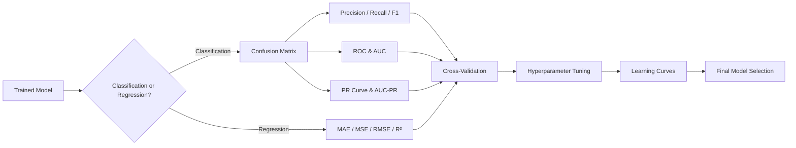
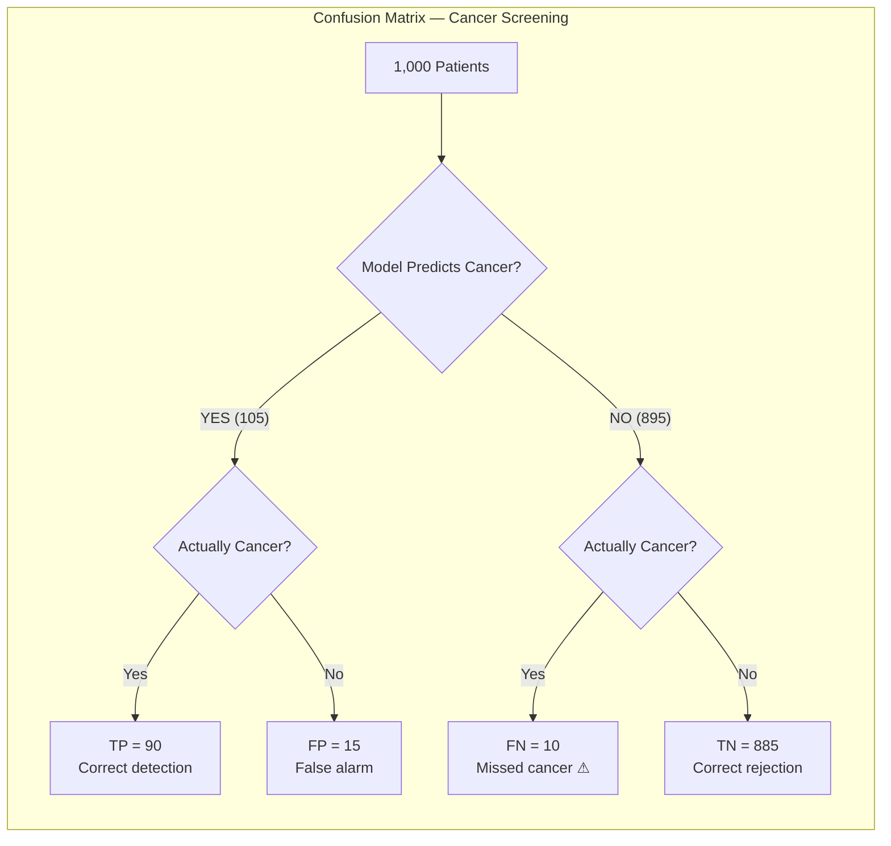
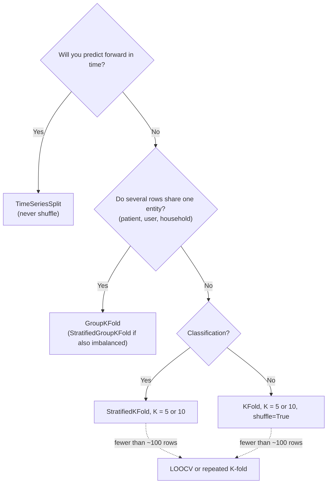

# Chapter 13 — Model Evaluation & Tuning

> "A model is only as good as the evidence you have that it works on data it has never seen."

---

## What You'll Learn

After this chapter you will be able to:
- Read a confusion matrix and derive every threshold-based classification metric from it
- Choose between precision, recall, F1 and F-beta based on the cost of each error
- Construct an ROC curve by hand and know when AUC-PR is the honest metric instead
- Pick the right regression metric, and read what an RMSE–MAE gap is telling you
- Select a cross-validation scheme — stratified, grouped, or time-ordered
- Tune hyperparameters without contaminating your estimate of performance
- Diagnose bias vs variance from learning curves
- Tell whether one model is genuinely better than another

**Markers:** ★★★ = know cold for interviews · ★★ = high priority · ★ = good to know.

**Quick check** boxes are retrieval practice — attempt before revealing.

**Interview** boxes give the question, what to say, and the follow-up trap.

---

## 13.1 Why Evaluation Matters ★

> **Model evaluation** is the systematic process of measuring how well a trained model generalizes to unseen data, using metrics appropriate to the task and the cost structure of errors.


<details>
<summary><strong>Read as text</strong> — the accuracy trap, the chapter roadmap and how it fits</summary>

A model that scores 99% accuracy on its training set tells you almost nothing. The only question that matters is: how does it perform on data it has never seen? And even then, "accuracy" alone is often the wrong yardstick.

Consider a fraud detection system at a bank. Only 0.2% of transactions are fraudulent. A model that blindly predicts "not fraud" for every transaction achieves 99.8% accuracy — and catches exactly zero fraud. You would never deploy it. The metric you choose defines what "good" means, and choosing wrong can be catastrophic.

```
THE ACCURACY TRAP
────────────────────────────────────────────────────────
  Dataset: 10,000 transactions, 20 fraudulent (0.2%)

  Model A — always predicts "Not Fraud":
    Accuracy = 9,980 / 10,000 = 99.8%     ← Looks great!
    Fraud caught = 0 / 20 = 0%            ← Completely useless.

  Model B — trained fraud classifier:
    Accuracy = 97.5%                       ← Lower accuracy!
    Fraud caught = 18 / 20 = 90%          ← Actually useful.

  Accuracy is MISLEADING when classes are imbalanced.
────────────────────────────────────────────────────────
```

This chapter gives you the full toolkit: classification metrics, regression metrics, validation strategies, hyperparameter tuning, and diagnostic tools for figuring out what is going wrong and how to fix it.

> **How this chapter fits:** [Ch 8 §8.4](#content/08_core_concepts) explains *data
> leakage* — the failure this chapter's validation machinery exists to prevent.
> [Ch 12](#content/12_key_algorithms) covers the algorithms being evaluated, including
> which ones produce poorly calibrated probabilities; this chapter owns how to *measure*
> them, calibration included (§13.12).
> [Ch 27](#content/27_practical_ml) puts it all into a production pipeline.



</details>

---

## 13.2 The Confusion Matrix ★★★

### Simple Explanation

<details>
<summary><strong>Read as text</strong> — four buckets, the 2×2 grid and Type I vs Type II errors</summary>

Every prediction your classifier makes lands in one of four buckets: right and it said yes, right and it said no, or wrong in one of two different ways. The confusion matrix is simply a 2×2 scoreboard that tallies how often each of those four outcomes happens.

> **Confusion matrix**: a table that describes the performance of a classification model by comparing predicted labels against actual labels across all four possible outcomes: true positives, true negatives, false positives, and false negatives.

Every threshold-based classification metric — accuracy, precision, recall, F1, MCC — is
built from the four numbers in this matrix. (ROC and PR curves, §13.4–13.5, recompute
them at every possible threshold.)

> **Maths in one line:** `TP + FN = actual positives`, `FP + TN = actual negatives` — rows are the truth and columns are the model's calls; precision divides TP by its column total, recall divides it by its row total.

```
                        PREDICTED
                      ┌──────────┬──────────┐
                      │ Positive │ Negative │
           ┌──────────┼──────────┼──────────┤
  ACTUAL   │ Positive │    TP    │    FN    │
           ├──────────┼──────────┼──────────┤
           │ Negative │    FP    │    TN    │
           └──────────┴──────────┴──────────┘

  TP  True Positive   said YES, was YES   ✓
  TN  True Negative   said NO,  was NO    ✓
  FP  False Positive  said YES, was NO    ✗  Type I error
  FN  False Negative  said NO,  was YES   ✗  Type II error
```

</details>

### Worked Example: Cancer Screening

<details>
<summary><strong>Read as text</strong> — 1,000 patients — 90 caught, 10 missed, 15 false alarms</summary>

A hospital screens 1,000 patients. 100 actually have cancer, 900 do not. The model produces:

| | Predicted: Cancer | Predicted: No Cancer | Total |
|---|---|---|---|
| **Actual: Cancer** | TP = 90 | FN = 10 | 100 |
| **Actual: No Cancer** | FP = 15 | TN = 885 | 900 |
| **Total** | 105 | 895 | 1,000 |

- **TP = 90** — correctly identified cancer patients
- **FN = 10** — missed cancer cases (the dangerous errors)
- **FP = 15** — false alarms (unnecessary follow-up tests)
- **TN = 885** — correctly identified healthy patients

We will use these numbers throughout §13.3.



</details>

---

## 13.3 Classification Metrics ★★★

![Precision, recall and F1 infographic: the formulas Precision = TP/(TP+FP), Recall = TP/(TP+FN), F1 = 2PR/(P+R); the cancer confusion matrix (TP 90, FN 10, FP 15, TN 885) with the predicted-cancer column outlined for precision 90/105 = 85.7%, the actual-cancer row for recall 90/100 = 90% and the actual-no-cancer row for specificity 885/900 = 98.3%; a bar strip of accuracy 97.5, precision 85.7, recall 90.0, specificity 98.3 and F1 87.8; a table of what each metric asks with F2 = 0.891 and F0.5 = 0.865; and the trap that precision 1.0 with recall 0.01 averages 0.505 but gives F1 = 0.02.](diagrams/eval13_info_precision_recall_f1_ai.png)

<details>
<summary><strong>Read as text</strong> — one matrix, a different question per metric</summary>

Each metric below asks a different question of the same four counts — the right one is
whichever matches the mistake that costs you most.

> **Maths in one line:** `Precision = TP/(TP+FP)`, `Recall = TP/(TP+FN)`, `F1 = 2·P·R/(P+R)` — precision checks the alarms you raised, recall checks the positives that exist, and F1 is high only when both are.

</details>

### Accuracy

<details>
<summary><strong>Read as text</strong> — 97.5%, and the 90% always-"no cancer" model</summary>

> **Accuracy** = proportion of all predictions that are correct.

$$\text{Accuracy} = \frac{TP + TN}{TP + TN + FP + FN}$$

From our cancer example:

$$\text{Accuracy} = \frac{90 + 885}{1000} = 97.5\%$$

Sounds excellent. But remember: a model that always predicts "No Cancer" would correctly label all 900 healthy patients and miss all 100 cancer patients — $\frac{900}{1000} = 90\%$ accuracy, while catching zero cancer cases. Accuracy only works when classes are roughly balanced.

</details>

### Precision

<details>
<summary><strong>Read as text</strong> — of everything flagged, how much was real — 85.7%</summary>

> **Precision** = of all instances the model labeled positive, what fraction actually were positive.

$$\text{Precision} = \frac{TP}{TP + FP} = \frac{90}{90 + 15} = \frac{90}{105} = 85.7\%$$

Precision answers: "When the model raises an alarm, how often is it right?" High precision means few false alarms.

**When precision matters most:** spam filtering. A false positive means a legitimate email lands in the spam folder — the user misses a job offer or an important message. You want the spam label to be trustworthy.

</details>

### Recall (Sensitivity, True Positive Rate)

<details>
<summary><strong>Read as text</strong> — of every real case, how many were found — 90%</summary>

> **Recall** = of all actually positive instances, what fraction did the model catch.

$$\text{Recall} = \frac{TP}{TP + FN} = \frac{90}{90 + 10} = 90\%$$

Recall answers: "Of all real positive cases, how many did you find?" High recall means few missed positives.

**When recall matters most:** cancer diagnosis. A false negative means a patient with cancer goes home untreated. Missing real cases can be fatal.

</details>

### Specificity (True Negative Rate)

<details>
<summary><strong>Read as text</strong> — the mirror image of recall, for negatives — 98.3%</summary>

> **Specificity** = of all actually negative instances, what fraction did the model correctly identify as negative.

$$\text{Specificity} = \frac{TN}{TN + FP} = \frac{885}{885 + 15} = 98.3\%$$

Specificity is recall's mirror image — it measures how well you identify negatives. It appears in the ROC curve (Section 13.4) as $1 - \text{Specificity} = \text{FPR}$.

</details>

### F1 Score

<details>
<summary><strong>Read as text</strong> — the harmonic mean, 0.878, and why not a plain average</summary>

> **F1 Score** = the harmonic mean of precision and recall, providing a single metric that balances both.

$$F_1 = \frac{2 \times \text{Precision} \times \text{Recall}}{\text{Precision} + \text{Recall}} = \frac{2 \times 0.857 \times 0.90}{0.857 + 0.90} = \frac{1.543}{1.757} = 0.878$$

Why the harmonic mean instead of the arithmetic mean? Because the harmonic mean punishes imbalance. If precision = 1.0 and recall = 0.01, the arithmetic mean is 0.505 (looks acceptable), but the harmonic mean is 0.02 (correctly reflects the disaster).

> **Interview —** *"Why is F1 the harmonic mean rather than a plain average?"*
>
> **Say:** Because a plain average lets one number rescue the other, and that is exactly the failure you want to catch. A model that flags a single transaction, correctly, out of 100 real frauds has precision 1.0 and recall 0.01 — arithmetic mean 0.505, which looks passable for a useless model. The harmonic mean gives 0.02. It is dominated by the **smaller** value, so F1 is only high when **both** are high.
>
> **They follow up with:** *"When is F1 the wrong choice?"* — when the two errors have different costs, since F1 weights them equally. Use $F_\beta$ instead: $F_2$ leans toward recall for cancer screening, $F_{0.5}$ toward precision for spam. F1 also ignores **true negatives** entirely, so if correctly identifying negatives matters, reach for MCC.

</details>

<details>
<summary><strong>Quick check.</strong> A model scores precision 0.9 and recall 0.3. Compute F1. Would the arithmetic mean have told you the same story?</summary>

$$F_1 = \frac{2(0.9)(0.3)}{0.9 + 0.3} = \frac{0.54}{1.2} = \mathbf{0.45}$$

The arithmetic mean is $(0.9 + 0.3)/2 = 0.60$ — noticeably rosier.

F1 sits much closer to the **weaker** metric (0.3) than to the stronger one. That is
the harmonic mean doing its job: the model finds only 30% of positives, and no amount
of precision on the ones it does flag compensates for that.
</details>

### F-beta Score

<details>
<summary><strong>Read as text</strong> — F2 leans to recall, F0.5 to precision</summary>

When you want to weight precision and recall unequally:

$$F_\beta = (1 + \beta^2) \cdot \frac{\text{Precision} \times \text{Recall}}{\beta^2 \cdot \text{Precision} + \text{Recall}}$$

- $F_2$ — weights recall 2x more than precision (use for cancer detection)
- $F_{0.5}$ — weights precision 2x more than recall (use for spam filtering)

For the cancer model (precision 0.857, recall 0.90), $F_2 = 0.891$ is pulled toward the
higher recall and $F_{0.5} = 0.865$ toward the lower precision; F1 = 0.878 sits between them.

</details>

### Multi-Class Metrics — Macro vs Micro vs Weighted

![Comparison infographic of three tools beyond a single F1: class averaging with per-class precision A 0.769, B 0.857 and rare class C 0.500 giving macro 0.709, micro 0.750 and weighted 0.772; MCC on TP 10, FP 5, FN 10, TN 975 (accuracy 0.985, F1 0.571, MCC 0.570, and an all-yes model at 95% positives scoring F1 0.974 but MCC 0); and a threshold dial from 0.3 (high recall) to 0.7 (high precision). Includes the MCC formula as a fraction, a pick-by-need table, and the trap that micro precision, recall and F1 all equal accuracy (0.750).](diagrams/eval13_info_multiclass_mcc_threshold_ai.png)

<details>
<summary><strong>Read as text</strong> — the 3-class matrix: macro 0.709, micro 0.750, weighted 0.772</summary>

Everything so far has been binary. With more than two classes you compute precision
and recall **per class** (one-vs-rest), then choose how to average them — and the
three choices answer different questions.

Three classes, 120 samples. The confusion matrix (rows = actual, columns = predicted):

| Actual ↓ / Predicted → | A | B | C | Support |
|---|---|---|---|---|
| **A** | **50** | 3 | 2 | 55 |
| **B** | 12 | **30** | 8 | 50 |
| **C** | 3 | 2 | **10** | 15 |
| **Predicted total** | 65 | 35 | 20 | 120 |

Read each class one-vs-rest: TP is the diagonal cell, FP is the rest of its **column**,
FN is the rest of its **row**.

| Class | TP | FP | FN | Support | Precision |
|---|---|---|---|---|---|
| A | 50 | 15 | 5 | 55 | $50/65 = 0.769$ |
| B | 30 | 5 | 20 | 50 | $30/35 = 0.857$ |
| C | 10 | 10 | 5 | 15 | $10/20 = 0.500$ |
| **Total** | **90** | **30** | **30** | **120** | |

**Macro** — plain average of the per-class scores. Every class counts equally,
regardless of size:

$\frac{0.769 + 0.857 + 0.500}{3} = \mathbf{0.709}$

**Micro** — pool the counts first, then compute once:

$\frac{\sum TP}{\sum TP + \sum FP} = \frac{90}{120} = \mathbf{0.750}$

**Weighted** — average the per-class scores, weighted by support:

$\frac{55(0.769) + 50(0.857) + 15(0.500)}{120} = \mathbf{0.772}$

The rare class C has the worst precision (0.500), so macro — which gives C a full third
of the vote — is the lowest of the three.

| Use | When |
|---|---|
| **Macro** | Every class matters equally — especially when the rare class is the point. A tiny class scoring 0.2 drags the average down, which is what you want |
| **Micro** | Every *sample* matters equally. Large classes dominate |
| **Weighted** | You want a single headline number that reflects the real class mix |

> **The fact interviewers check:** in single-label multi-class, micro-precision,
> micro-recall and micro-F1 are **all identical, and all equal accuracy** — here every
> one of them is 0.750. Every misclassification is simultaneously an FP for one class
> and an FN for another, so the pooled sums coincide. Quoting "micro-F1" as if it adds
> information beyond accuracy signals you haven't worked it through.

The program rebuilds the 120 labels from the matrix, checks all three averages against
scikit-learn, then lets the model stop predicting the rare class C to see which average
notices.

</details>

```python
# Macro vs micro vs weighted precision on the 3-class example, by hand and with sklearn.
import numpy as np
from sklearn.metrics import precision_score, recall_score, f1_score, accuracy_score

def averages(C):
    TP = np.diag(C)
    FP = C.sum(axis=0) - TP              # rest of the column
    support = C.sum(axis=1)              # row total = how many truly belong to the class
    prec = np.divide(TP, TP + FP, out=np.zeros(len(TP)), where=(TP + FP) > 0)
    return prec, {"macro": prec.mean(),
                  "micro": TP.sum() / (TP.sum() + FP.sum()),
                  "weighted": (prec * support).sum() / support.sum()}

def labels(C):                           # rebuild y_true / y_pred from the matrix
    actual, predicted = np.indices(C.shape)
    return np.repeat(actual.ravel(), C.ravel()), np.repeat(predicted.ravel(), C.ravel())

C = np.array([[50, 3, 2],                # rows = actual A, B, C
              [12, 30, 8],               # columns = predicted A, B, C
              [3, 2, 10]])
prec, avg = averages(C)
y_true, y_pred = labels(C)
print("per-class precision:", ", ".join(f"{c} {p:.3f}" for c, p in zip("ABC", prec)))
for name, mine in avg.items():
    lib = precision_score(y_true, y_pred, average=name)
    assert np.isclose(mine, lib)
    print(f"{name:8s} precision = {mine:.3f}   (sklearn {lib:.3f})")

acc = accuracy_score(y_true, y_pred)
micro = [f(y_true, y_pred, average="micro") for f in (precision_score, recall_score, f1_score)]
assert np.allclose(micro, acc)
print(f"micro P = micro R = micro F1 = accuracy = {acc:.3f}")

# Contrast: the model stops predicting the rare class C (those calls go to A instead)
C2 = C.copy()
C2[:, 0] += C2[:, 2]
C2[:, 2] = 0
_, avg2 = averages(C2)
print("never predicts C:", ", ".join(f"{k} {avg[k]:.3f} -> {v:.3f}" for k, v in avg2.items()))
assert avg["macro"] - avg2["macro"] > avg["micro"] - avg2["micro"]
```

**Output:**

```
per-class precision: A 0.769, B 0.857, C 0.500
macro    precision = 0.709   (sklearn 0.709)
micro    precision = 0.750   (sklearn 0.750)
weighted precision = 0.772   (sklearn 0.772)
micro P = micro R = micro F1 = accuracy = 0.750
never predicts C: macro 0.709 -> 0.490, micro 0.750 -> 0.683, weighted 0.772 -> 0.638
```

<details>
<summary><strong>Read as text</strong> — continued: what happens when rare class C disappears</summary>

When class C disappears from the predictions, macro falls by 0.219 but micro by only
0.067 — the large classes cushion micro and weighted, exactly as the table above warns.

> **Interview —** *"You have a 5-class problem where one class is 2% of the data. Which averaging do you report?"*
>
> **Say:** **Macro**, if that rare class is the one that matters — macro gives it equal weight, so poor performance on 2% of the data visibly drags the score down. Micro and weighted are both dominated by the large classes and will happily hide a rare class the model never predicts at all. I would report macro alongside the **per-class** breakdown, since a single number always hides which class is failing.
>
> **They follow up with:** *"When would macro be the wrong choice?"* — when class sizes reflect genuine importance rather than a sampling artifact. If 90% of your traffic really is class A, macro penalises you for underperforming on classes users rarely encounter. Then weighted is the honest headline. The question to ask is: *is the imbalance a property of the world, or of my dataset?*

</details>

### Matthews Correlation Coefficient (MCC)

<details>
<summary><strong>Read as text</strong> — one honest number from all four cells</summary>

A single number that stays honest under imbalance, because it uses **all four** cells:

$\text{MCC} = \frac{TP \cdot TN - FP \cdot FN}{\sqrt{(TP{+}FP)(TP{+}FN)(TN{+}FP)(TN{+}FN)}}$

It ranges from −1 to +1: +1 is perfect, 0 is no better than random, and −1 means every
prediction is flipped. Take a model on 1,000 samples with 20
positives — $TP = 10$, $FP = 5$, $FN = 10$, $TN = 975$:

| Metric | Value |
|---|---|
| Accuracy | 0.985 — meaningless here |
| F1 | 0.571 |
| **MCC** | **0.570** |

Accuracy says the model is superb. MCC agrees with F1 that it is mediocre. Unlike F1,
MCC also rewards correctly identifying negatives, so it cannot be gamed by predicting
one class for everything — that scores MCC = 0 (formally 0/0; scikit-learn reports 0).
F1 can be gamed: if 95% of the samples are positive, labelling everything positive
scores F1 = 0.974.

```chart
{
  "type": "bar",
  "data": {
    "labels": ["Accuracy", "Precision", "Recall", "Specificity", "F1 Score"],
    "datasets": [{
      "label": "Cancer Screening Model (%)",
      "data": [97.5, 85.7, 90.0, 98.3, 87.8],
      "backgroundColor": ["rgba(99,102,241,0.6)","rgba(34,197,94,0.7)","rgba(234,88,12,0.7)","rgba(56,189,248,0.7)","rgba(168,85,247,0.7)"],
      "borderColor": ["rgba(99,102,241,1)","rgba(34,197,94,1)","rgba(234,88,12,1)","rgba(56,189,248,1)","rgba(168,85,247,1)"],
      "borderWidth": 1
    }]
  },
  "options": {
    "plugins": { "title": { "display": true, "text": "Cancer Screening — All Classification Metrics (TP=90, FP=15, FN=10, TN=885)" } },
    "scales": {
      "y": { "title": { "display": true, "text": "Score (%)" }, "min": 80, "max": 100 },
      "x": {}
    }
  }
}
```

The program below computes every metric in this section by hand from the four counts,
checks each one against `sklearn.metrics`, and runs the traps from this section: the
always-"no cancer" model, the MCC example, and a model that games F1.

</details>

```python
# Every threshold metric from a confusion matrix, by hand and with sklearn.metrics.
import numpy as np
from sklearn.metrics import (accuracy_score, precision_score, recall_score,
                             f1_score, fbeta_score, matthews_corrcoef)

def by_hand(TP, FN, FP, TN):
    prec = TP / (TP + FP) if TP + FP else 0.0      # no alarms raised: call it 0
    rec = TP / (TP + FN)
    f1 = 2 * prec * rec / (prec + rec) if prec + rec else 0.0
    den = ((TP + FP) * (TP + FN) * (TN + FP) * (TN + FN)) ** 0.5
    mcc = (TP * TN - FP * FN) / den if den else 0.0
    return (TP + TN) / (TP + FN + FP + TN), prec, rec, f1, mcc

def with_sklearn(TP, FN, FP, TN):
    y_true = np.array([1] * (TP + FN) + [0] * (FP + TN))      # rebuild the labels
    y_pred = np.array([1] * TP + [0] * FN + [1] * FP + [0] * TN)
    return (accuracy_score(y_true, y_pred),
            precision_score(y_true, y_pred, zero_division=0),
            recall_score(y_true, y_pred),
            f1_score(y_true, y_pred, zero_division=0),
            matthews_corrcoef(y_true, y_pred)), y_true, y_pred

cases = {"cancer model (13.2)":     (90, 10, 15, 885),
         "always 'no cancer'":      (0, 100, 0, 900),
         "MCC example":             (10, 10, 5, 975),
         "all 'yes', 95% positive": (950, 0, 50, 0)}
print(f"{'model':25s} {'acc':>6s} {'prec':>6s} {'rec':>6s} {'F1':>6s} {'MCC':>6s}")
for name, counts in cases.items():
    mine = by_hand(*counts)
    lib, y_true, y_pred = with_sklearn(*counts)
    assert np.allclose(mine, lib)
    print(f"{name:25s} " + " ".join(f"{v:6.3f}" for v in mine))

_, y_true, y_pred = with_sklearn(90, 10, 15, 885)
spec = recall_score(y_true, y_pred, pos_label=0)     # specificity = recall of the negatives
f2 = fbeta_score(y_true, y_pred, beta=2)
f05 = fbeta_score(y_true, y_pred, beta=0.5)
print(f"cancer model: specificity {spec:.3f}, F2 {f2:.3f}, F0.5 {f05:.3f}")
assert np.isclose(spec, 885 / 900) and f05 < by_hand(90, 10, 15, 885)[3] < f2
```

**Output:**

```
model                        acc   prec    rec     F1    MCC
cancer model (13.2)        0.975  0.857  0.900  0.878  0.864
always 'no cancer'         0.900  0.000  0.000  0.000  0.000
MCC example                0.985  0.667  0.500  0.571  0.570
all 'yes', 95% positive    0.950  0.950  1.000  0.974  0.000
cancer model: specificity 0.983, F2 0.891, F0.5 0.865
```

<details>
<summary><strong>Read as text</strong> — continued: specificity in sklearn, and the all-yes model only MCC catches</summary>

Two things to notice. scikit-learn has no `specificity_score` — specificity is just
recall computed for the negative class (`pos_label=0`). And look at the last row: a
model that says "yes" to everything scores accuracy 0.950 and F1 0.974, and only MCC
exposes it — 0.000.

</details>

### The Precision-Recall Tradeoff

<details>
<summary><strong>Read as text</strong> — the threshold dial: 0.3 vs 0.7</summary>

Most classifiers output a probability (e.g., 0.73 for "cancer"). You pick a **threshold** to convert this probability into a label. Changing the threshold directly trades precision for recall.

```
  Threshold = 0.3            Threshold = 0.7
  (aggressive)               (conservative)
  ─────────────────          ─────────────────
  Flag above 0.3             Flag only above 0.7
  → catches almost all       → flags only when
    positives                  very confident
  → many false alarms        → misses borderline
  → HIGH recall              → HIGH precision
    LOW precision              LOW recall
```

```chart
{
  "type": "line",
  "data": {
    "labels": [0.1, 0.2, 0.3, 0.4, 0.5, 0.6, 0.7, 0.8, 0.9],
    "datasets": [
      {
        "label": "Precision",
        "data": [0.52, 0.60, 0.68, 0.76, 0.83, 0.89, 0.94, 0.97, 0.99],
        "borderColor": "rgba(34, 197, 94, 1)",
        "fill": false, "tension": 0.4, "pointRadius": 3, "borderWidth": 2
      },
      {
        "label": "Recall",
        "data": [0.98, 0.95, 0.91, 0.85, 0.77, 0.66, 0.53, 0.36, 0.14],
        "borderColor": "rgba(234, 88, 12, 1)",
        "fill": false, "tension": 0.4, "pointRadius": 3, "borderWidth": 2
      },
      {
        "label": "F1 Score",
        "data": [0.68, 0.74, 0.78, 0.80, 0.80, 0.76, 0.68, 0.53, 0.25],
        "borderColor": "rgba(168, 85, 247, 1)",
        "borderDash": [5,3],
        "fill": false, "tension": 0.4, "pointRadius": 3, "borderWidth": 2
      }
    ]
  },
  "options": {
    "plugins": { "title": { "display": true, "text": "Precision-Recall Tradeoff — Raising the Threshold Helps One, Hurts the Other" } },
    "scales": {
      "y": { "title": { "display": true, "text": "Score" }, "min": 0, "max": 1 },
      "x": { "title": { "display": true, "text": "Classification Threshold" } }
    }
  }
}
```

</details>

---

## 13.4 ROC Curve & AUC ★★★


### Simple Explanation

<details>
<summary><strong>Read as text</strong> — scores, thresholds and what AUC actually measures</summary>

A classifier doesn't just answer yes or no — under the hood it produces a score, and *you* pick the threshold that turns that score into a decision. Slide the threshold and you trade catching more real positives against triggering more false alarms. The ROC curve draws that entire trade-off in one picture, and AUC squeezes the whole picture down to a single number.

> **ROC (Receiver Operating Characteristic) curve**: a plot of the True Positive Rate (recall) against the False Positive Rate ($1 - \text{specificity}$) at every possible classification threshold. **AUC (Area Under the Curve)** summarizes the ROC curve into a single number between 0 and 1.

> **Maths in one line:** `AUC = (pairs where the positive outscores the negative + ½ · tied pairs) / (n_pos · n_neg)` — the fraction of positive–negative pairs the model puts in the right order: 1.0 is perfect, 0.5 is a coin flip.

The ROC curve shows how well a model separates positives from negatives across *all* thresholds simultaneously. You do not need to pick a single threshold to compare models — AUC does that for you.

**Interpreting AUC:** if you randomly draw one positive and one negative example, AUC is the probability that the model assigns a higher score to the positive example. (Statisticians know this as the Mann–Whitney U statistic divided by $n_{pos} \cdot n_{neg}$; credit scoring often reports the same thing as **Gini = 2·AUC − 1** — not to be confused with the Gini impurity of decision trees.)

</details>

### Worked Example — Building an ROC by Hand

<details>
<summary><strong>Read as text</strong> — eight scores, the up/right walk and AUC two ways = 0.8125</summary>

This is the classic whiteboard exercise. Eight predictions, sorted by score, four of
each class:

| Score | Actual |
|---|---|
| 0.95 | **P** |
| 0.85 | **P** |
| 0.70 | N |
| 0.60 | **P** |
| 0.55 | N |
| 0.40 | **P** |
| 0.30 | N |
| 0.20 | N |

**Sweep the threshold down the list.** Each row you pass gets labelled positive.
With $P = 4$ and $N = 4$: $\text{TPR} = TP/4$, $\text{FPR} = FP/4$.

| Threshold just below | TP | FP | FPR | TPR |
|---|---|---|---|---|
| — (start) | 0 | 0 | 0.00 | 0.00 |
| 0.95 (P) | 1 | 0 | 0.00 | 0.25 |
| 0.85 (P) | 2 | 0 | 0.00 | 0.50 |
| 0.70 (N) | 2 | 1 | 0.25 | 0.50 |
| 0.60 (P) | 3 | 1 | 0.25 | 0.75 |
| 0.55 (N) | 3 | 2 | 0.50 | 0.75 |
| 0.40 (P) | 4 | 2 | 0.50 | **1.00** |
| 0.30 (N) | 4 | 3 | 0.75 | 1.00 |
| 0.20 (N) | 4 | 4 | 1.00 | 1.00 |

Notice the shape of the walk: **a positive moves you UP, a negative moves you RIGHT.**
That is the entire mechanic of an ROC curve.

```
  TPR
  1.00 │               ┏━━━━━━━━━━━━━━━━
       │               ┃
  0.75 │       ┏━━━━━━━┛
       │       ┃
  0.50 ┏━━━━━━━┛
       ┃
  0.25 ┃
       ┃
  0.00 ┗────────────────────────────────
       0      0.25    0.50    0.75    1.00   FPR
```

**AUC by the trapezoid rule** — sum the area of each step:

$$(0.25 \times 0.50) + (0.25 \times 0.75) + (0.25 \times 1.00) + (0.25 \times 1.00) = \mathbf{0.8125}$$

**AUC the other way — count the pairs.** Remember AUC is the probability a random
positive outranks a random negative. There are $4 \times 4 = 16$ pairs. Count how many
negatives each positive beats: $0.95$ beats all 4, $0.85$ beats 4, $0.60$ beats 3,
$0.40$ beats 2.

$$\text{AUC} = \frac{4 + 4 + 3 + 2}{16} = \frac{13}{16} = \mathbf{0.8125}$$

**The two methods agree exactly** — they are the same quantity computed differently,
and being able to show that is what separates a memorised definition from real
understanding. (If scores tie, a tied pair counts as half.)

> **Interview —** *"Your model has AUC = 0.85. What does that number actually mean?"*
>
> **Say:** Take one random positive and one random negative. There is an **85% chance the model scores the positive higher**. That is the precise interpretation — AUC measures **ranking quality**, not accuracy, and it does not depend on any threshold.
>
> **They follow up with:** *"So is 0.85 good?"* — it depends entirely on the problem and the alternative: the system you would replace, or a simple baseline. Two things I would flag: AUC of 0.5 is random and **below 0.5 means the model is anti-correlated** (flip the scores and the AUC becomes 1 − AUC). And a high AUC says nothing about whether the **probabilities** are trustworthy — a model can rank perfectly and still be badly calibrated (§13.12).

</details>

<details>
<summary><strong>Quick check.</strong> Three predictions, scores 0.9 (positive), 0.6 (negative), 0.4 (positive). Compute AUC by counting pairs.</summary>

There are 2 positives × 1 negative = **2 pairs**.

- Positive 0.9 vs negative 0.6 → positive ranks higher ✓
- Positive 0.4 vs negative 0.6 → negative ranks higher ✗

$$\text{AUC} = \frac{1}{2} = \mathbf{0.5}$$

Exactly random, even though the model got the top-ranked item right. With so few
points AUC is extremely noisy — which is the real lesson: always report an interval
(§13.10), not a bare AUC, on small test sets.
</details>

<details>
<summary><strong>Read as text</strong> — continued</summary>

The program computes the worked example's AUC all three ways — the threshold sweep with
the trapezoid rule, pair counting, and `roc_auc_score` — then checks the quick check, a
tied score, flipped scores, and a transform that keeps the ranking.

</details>

```python
# ROC-AUC three ways on the 8-prediction example: threshold sweep, pair counting, sklearn.
import numpy as np
from sklearn.metrics import roc_auc_score

scores = np.array([0.95, 0.85, 0.70, 0.60, 0.55, 0.40, 0.30, 0.20])
y      = np.array([1,    1,    0,    1,    0,    1,    0,    0])     # 1 = P, 0 = N

def auc_by_sweep(y, s):                  # walk down the sorted list (assumes no tied scores)
    order = np.argsort(-s)
    tpr = np.r_[0, np.cumsum(y[order]) / y.sum()]            # a positive moves you UP
    fpr = np.r_[0, np.cumsum(1 - y[order]) / (1 - y).sum()]  # a negative moves you RIGHT
    return np.sum(np.diff(fpr) * (tpr[1:] + tpr[:-1]) / 2), fpr, tpr   # trapezoid rule

def auc_by_pairs(y, s):                  # P(random positive outscores random negative)
    pos, neg = s[y == 1][:, None], s[y == 0][None, :]
    return ((pos > neg).sum() + 0.5 * (pos == neg).sum()) / (pos.size * neg.size)

trap, fpr, tpr = auc_by_sweep(y, scores)
print("FPR:", " ".join(f"{v:.2f}" for v in fpr))
print("TPR:", " ".join(f"{v:.2f}" for v in tpr))
pairs, lib = auc_by_pairs(y, scores), roc_auc_score(y, scores)
print(f"trapezoid {trap:.5f} | pairs {pairs:.5f} | sklearn {lib:.5f} | Gini {2 * lib - 1:.3f}")
assert np.isclose(trap, pairs) and np.isclose(pairs, lib)

cases = {
    "quick check: 0.9 P, 0.6 N, 0.4 P": (np.array([1, 0, 1]), np.array([0.9, 0.6, 0.4])),
    "tie: positive 0.40 -> 0.30":       (y, np.where(scores == 0.40, 0.30, scores)),
    "scores flipped (1 - s)":           (y, 1 - scores),
    "scores squared (same ranking)":    (y, scores ** 2),
}
for name, (yy, ss) in cases.items():
    a = roc_auc_score(yy, ss)
    assert np.isclose(a, auc_by_pairs(yy, ss))
    print(f"{name:33s} AUC = {a:.5f}")
```

**Output:**

```
FPR: 0.00 0.00 0.00 0.25 0.25 0.50 0.50 0.75 1.00
TPR: 0.00 0.25 0.50 0.50 0.75 0.75 1.00 1.00 1.00
trapezoid 0.81250 | pairs 0.81250 | sklearn 0.81250 | Gini 0.625
quick check: 0.9 P, 0.6 N, 0.4 P  AUC = 0.50000
tie: positive 0.40 -> 0.30        AUC = 0.78125
scores flipped (1 - s)            AUC = 0.18750
scores squared (same ranking)     AUC = 0.81250
```

<details>
<summary><strong>Read as text</strong> — continued: ties, flipped scores and squared scores</summary>

The tie costs exactly half a pair: $12.5/16 = 0.78125$. Flipping the scores gives
$1 - 0.8125$, and squaring them changes nothing, because AUC only sees the **order** of
the scores, never their values.

</details>

### Reading an AUC Value

<details>
<summary><strong>Read as text</strong> — a rough grading guide and three ROC curves</summary>

```
  AUC — A ROUGH READING GUIDE (the bar varies by domain)
  ┌───────────┬────────────────────────────────────┐
  │ AUC = 1.0 │ perfect separation                 │
  │ 0.9 – 1.0 │ excellent                          │
  │ 0.8 – 0.9 │ good                               │
  │ 0.7 – 0.8 │ fair                               │
  │ 0.5 – 0.7 │ poor                               │
  │ AUC = 0.5 │ random guessing (the diagonal)     │
  │ AUC < 0.5 │ worse than random: flip the scores │
  └───────────┴────────────────────────────────────┘
```

```chart
{
  "type": "line",
  "data": {
    "datasets": [
      {
        "label": "Perfect Model (AUC = 1.0)",
        "data": [{"x": 0, "y": 0}, {"x": 0, "y": 1}, {"x": 1, "y": 1}],
        "borderColor": "rgba(34, 197, 94, 1)",
        "fill": false, "tension": 0, "pointRadius": 0, "borderWidth": 2, "borderDash": [5,3]
      },
      {
        "label": "Good Model (AUC ≈ 0.88)",
        "data": [{"x": 0, "y": 0}, {"x": 0.02, "y": 0.30}, {"x": 0.05, "y": 0.52}, {"x": 0.1, "y": 0.68}, {"x": 0.15, "y": 0.76}, {"x": 0.2, "y": 0.82}, {"x": 0.3, "y": 0.89}, {"x": 0.4, "y": 0.93}, {"x": 0.5, "y": 0.96}, {"x": 0.6, "y": 0.97}, {"x": 0.7, "y": 0.98}, {"x": 0.8, "y": 0.99}, {"x": 0.9, "y": 1.0}, {"x": 1.0, "y": 1.0}],
        "borderColor": "rgba(99, 102, 241, 1)",
        "backgroundColor": "rgba(99, 102, 241, 0.1)",
        "fill": true, "tension": 0.4, "cubicInterpolationMode": "monotone", "pointRadius": 2, "borderWidth": 2
      },
      {
        "label": "Weak Model (AUC ≈ 0.69)",
        "data": [{"x": 0, "y": 0}, {"x": 0.02, "y": 0.08}, {"x": 0.05, "y": 0.18}, {"x": 0.1, "y": 0.32}, {"x": 0.15, "y": 0.42}, {"x": 0.2, "y": 0.50}, {"x": 0.3, "y": 0.60}, {"x": 0.4, "y": 0.68}, {"x": 0.5, "y": 0.75}, {"x": 0.6, "y": 0.81}, {"x": 0.7, "y": 0.87}, {"x": 0.8, "y": 0.93}, {"x": 0.9, "y": 0.97}, {"x": 1.0, "y": 1.0}],
        "borderColor": "rgba(251, 191, 36, 1)",
        "fill": false, "tension": 0.4, "cubicInterpolationMode": "monotone", "pointRadius": 2, "borderWidth": 2
      },
      {
        "label": "Random Model (AUC = 0.5)",
        "data": [{"x": 0, "y": 0}, {"x": 1, "y": 1}],
        "borderColor": "rgba(239, 68, 68, 0.7)",
        "fill": false, "tension": 0, "pointRadius": 0, "borderWidth": 2, "borderDash": [8,4]
      }
    ]
  },
  "options": {
    "plugins": { "title": { "display": true, "text": "ROC Curves — Comparing Model Quality (Higher = Better)" } },
    "scales": {
      "y": { "title": { "display": true, "text": "True Positive Rate (Recall)" }, "min": 0, "max": 1 },
      "x": { "type": "linear", "min": 0, "max": 1, "title": { "display": true, "text": "False Positive Rate (1 − Specificity)" } }
    }
  }
}
```

</details>

### When to Use ROC-AUC

<details>
<summary><strong>Read as text</strong> — balanced classes, and where ROC misleads</summary>

ROC-AUC works best when:
- Classes are roughly balanced
- You care equally about positive and negative classes
- You want a threshold-independent comparison of models

ROC-AUC can be **misleading** on heavily imbalanced datasets: FPR divides by the huge
negative class, so thousands of false alarms barely move it (§13.5 puts numbers on
this). In those cases, use the PR curve instead. For more than two classes, compute one
AUC per class against the rest and average them — scikit-learn's
`roc_auc_score(y, probs, multi_class="ovr")`.

</details>

---

## 13.5 Precision-Recall Curve & AUC-PR ★★★


### Simple Explanation

<details>
<summary><strong>Read as text</strong> — needles in a haystack and why PR skips the easy negatives</summary>

When the thing you care about is rare — fraud, disease, defects — most of your data is the boring negative class, and a metric can look wonderful while your model quietly misses the needles in the haystack. The precision-recall curve throws out those easy negatives and focuses only on how well you find the rare positives *and* how often your alarms are real.

> **Precision-Recall (PR) curve**: a plot of precision (y-axis) vs. recall (x-axis) at varying thresholds. **AUC-PR** is the area under this curve. Unlike ROC, the PR curve focuses exclusively on the positive class, making it the right choice for imbalanced datasets.

> **Maths in one line:** `AP = Σₙ (Rₙ − Rₙ₋₁) · Pₙ` — add up the precision Pₙ at each threshold, weighted by the extra recall (Rₙ − Rₙ₋₁) that threshold adds; a random model scores the positive rate, not 0.5.

In fraud detection, only 0.2% of transactions are fraudulent. The ROC curve might look great (AUC = 0.97) because the flood of true negatives keeps FPR tiny. But the PR curve reveals how well the model actually catches fraud without flooding analysts with false alerts.

</details>

### Worked Example — Why ROC Flatters an Imbalanced Model

<details>
<summary><strong>Read as text</strong> — the same 20 false alarms: FPR 0.21 vs precision 0.17</summary>

Take 100 transactions: **5 fraud, 95 legitimate**. At some threshold the model catches
4 of the 5 frauds, and also flags 20 legitimate transactions.

| Metric | Computation | Result |
|---|---|---|
| **Recall** | $4/5$ | 0.80 |
| **FPR** (ROC's x-axis) | $20/95$ | **0.21** — looks moderate |
| **Precision** (PR's y-axis) | $4/(4+20)$ | **0.17** — brutal |

The same 20 false alarms produce a *moderate-looking* number and an *alarming* one. The
reason is the denominator:

$$\text{FPR} = \frac{FP}{FP + TN} = \frac{20}{95} \qquad\text{vs}\qquad \text{Precision} = \frac{TP}{TP + FP} = \frac{4}{24}$$

**FPR divides by the whole negative class**, so the 20 mistakes are diluted across all
95 legitimate transactions — and in real fraud data, with hundreds of legitimate
transactions per fraud, they all but vanish. Precision
divides by the number of alarms you actually raised, so those same 20 mistakes
dominate. On this model an analyst opens 24 cases to find 4 real ones — five out of
every six alerts are wasted.

> **The rule:** when the positive class is rare, ROC-AUC measures something real but
> not what you care about. Report **AUC-PR**, and remember its baseline is not 0.5 —
> a random classifier scores the positive prevalence, here **0.05**. An AUC-PR of 0.30
> sounds terrible and is in fact 6× better than random.

</details>

### Average Precision — How AUC-PR Is Actually Computed

<details>
<summary><strong>Read as text</strong> — three risk levels, AP 0.493 vs trapezoid 0.638</summary>

Keep the same 100 transactions, but now look at **every** threshold. Suppose the model
outputs only three risk levels: **high** (3 fraud, 1 legit), **medium** (1 fraud,
19 legit) and **low** (1 fraud, 75 legit). Flagging everything at or above each level
gives three points on the PR curve — the medium row is the threshold from the example
above.

| Flag at or above | TP | FP | Recall | Precision |
|---|---|---|---|---|
| high | 3 | 1 | 0.60 | 0.750 |
| medium | 4 | 20 | 0.80 | 0.167 |
| low | 5 | 95 | 1.00 | 0.050 |

**Average precision (AP)** — what scikit-learn's `average_precision_score` computes —
holds precision flat across each step of recall:

$$\text{AP} = 0.60(0.750) + 0.20(0.167) + 0.20(0.050) = 0.450 + 0.033 + 0.010 = \mathbf{0.493}$$

The **trapezoid rule** instead joins the points, starting from (recall 0, precision 1),
with straight lines:

$$\frac{0.60(1 + 0.750)}{2} + \frac{0.20(0.750 + 0.167)}{2} + \frac{0.20(0.167 + 0.050)}{2} = 0.525 + 0.092 + 0.022 = 0.638$$

Same model, two "AUC-PR" values 0.15 apart. The straight line is the error: halfway
between the high and medium thresholds you would hold 3.5 TP and 10.5 FP — precision
0.25, not the 0.46 the straight line assumes. Between two thresholds, precision sags
below the line, so with coarse scores the trapezoid over-states the area. The
scikit-learn docs warn that it "can be too optimistic". Report **AP**, compare it with
its baseline — the positive rate, 0.05 here, so 0.493 is about 10× random — and say
which method you used. (AP averaged over many search queries is the **MAP** of ranking
systems; see [Ch 32 Q49](#content/32_interview_questions).)

</details>

```python
# AUC-PR done right: average precision vs the trapezoid, and why ROC-AUC ignores the class ratio.
import numpy as np
from sklearn.metrics import average_precision_score, precision_recall_curve, auc, roc_auc_score

def fraud_data(legit_per_level, fraud_per_level=(3, 1, 1), level_score=(0.9, 0.5, 0.1)):
    """The model only outputs three risk levels: high, medium, low."""
    y = np.concatenate([[1] * f + [0] * l for f, l in zip(fraud_per_level, legit_per_level)])
    s = np.repeat(level_score, np.add(fraud_per_level, legit_per_level))
    return y, s

y, s = fraud_data([1, 19, 75])                                   # 100 transactions, 5 fraud
TP = np.array([y[s >= t].sum() for t in (0.9, 0.5, 0.1)])        # flag at or above each level
FP = np.array([(1 - y[s >= t]).sum() for t in (0.9, 0.5, 0.1)])
recall, precision = TP / y.sum(), TP / (TP + FP)
print("flag at or above   TP  FP  recall  precision")
for name, tp, fp, r, p in zip(["high", "medium", "low"], TP, FP, recall, precision):
    print(f"{name:18s} {tp:3d} {fp:3d}  {r:6.2f}  {p:9.3f}")

R, P = np.r_[0, recall], np.r_[1, precision]                     # curve starts at recall 0, precision 1
ap_hand = np.sum(np.diff(R) * P[1:])                             # precision held flat across each step
trap_hand = np.sum(np.diff(R) * (P[1:] + P[:-1]) / 2)            # straight lines between the points
prec_c, rec_c, _ = precision_recall_curve(y, s)
ap_lib, trap_lib = average_precision_score(y, s), auc(rec_c, prec_c)
print(f"AP (step-wise)       by hand {ap_hand:.3f}   sklearn average_precision_score {ap_lib:.3f}")
print(f"PR-AUC (trapezoid)   by hand {trap_hand:.3f}   sklearn auc(recall, precision)  {trap_lib:.3f}")
print(f"random baseline = fraud rate = {y.mean():.3f};  ROC-AUC = {roc_auc_score(y, s):.3f}")
assert np.isclose(ap_hand, ap_lib) and np.isclose(trap_hand, trap_lib) and trap_hand > ap_hand

y10, s10 = fraud_data([10, 190, 750])                            # same model, 10x the legit traffic
print(f"10x legit (fraud rate {y10.mean():.4f}): ROC-AUC = {roc_auc_score(y10, s10):.3f}, "
      f"AP = {average_precision_score(y10, s10):.3f}")
assert np.isclose(roc_auc_score(y10, s10), roc_auc_score(y, s))
```

**Output:**

```
flag at or above   TP  FP  recall  precision
high                 3   1    0.60      0.750
medium               4  20    0.80      0.167
low                  5  95    1.00      0.050
AP (step-wise)       by hand 0.493   sklearn average_precision_score 0.493
PR-AUC (trapezoid)   by hand 0.638   sklearn auc(recall, precision)  0.638
random baseline = fraud rate = 0.050;  ROC-AUC = 0.854
10x legit (fraud rate 0.0052): ROC-AUC = 0.854, AP = 0.143
```

<details>
<summary><strong>Read as text</strong> — continued: 10× more legit traffic, the interview answer and the PR chart</summary>

The last line is the whole ROC-versus-PR story. Ten times more legitimate traffic leaves
ROC-AUC at 0.854 — TPR and FPR are each computed inside one class, so the class ratio
cancels out — while AP falls from 0.493 to 0.143, because every alert queue now holds
ten times the false alarms. ROC-AUC tells you how well the model **ranks**; AP tells you
how useful its alerts are **at this fraud rate**. Compare AP values only at the same
prevalence.

> **Interview —** *"A fraud model reports ROC-AUC of 0.97, but the fraud team says it is useless. How can both be true?"*
>
> **Say:** ROC-AUC is computed from TPR and **FPR**, and FPR divides by the negative class. When 99.8% of transactions are legitimate, thousands of false positives barely move FPR, so the curve looks superb. The team experiences **precision** — of the alerts they open, how many are real — and precision divides by the number of alerts, so those same false positives dominate it.
>
> **They follow up with:** *"What should they have reported?"* — **AUC-PR**, plus **precision@k** for the k alerts analysts can actually review in a day. And I'd note AUC-PR's baseline is the prevalence, not 0.5, so the numbers look small even when the model is doing well — you must compare against that baseline rather than against 0.5.

```
  PR CURVE KEY PROPERTIES
  ────────────────────────────────────────────────
  - A perfect model hugs the top-right corner (P=1, R=1)
  - A random model produces a flat line at P = prevalence
    (e.g., P = 0.002 for 0.2% fraud rate)
  - AUC-PR is much more sensitive to improvements on the
    minority class than AUC-ROC
```

```chart
{
  "type": "line",
  "data": {
    "labels": [0.0, 0.1, 0.2, 0.3, 0.4, 0.5, 0.6, 0.7, 0.8, 0.9, 1.0],
    "datasets": [
      {
        "label": "Good Fraud Model (AUC-PR ≈ 0.74)",
        "data": [1.0, 0.97, 0.94, 0.91, 0.87, 0.82, 0.75, 0.66, 0.54, 0.38, 0.18],
        "borderColor": "rgba(99, 102, 241, 1)",
        "backgroundColor": "rgba(99, 102, 241, 0.1)",
        "fill": true, "tension": 0.4, "pointRadius": 2, "borderWidth": 2
      },
      {
        "label": "Mediocre Model (AUC-PR ≈ 0.45)",
        "data": [0.90, 0.78, 0.68, 0.59, 0.52, 0.45, 0.38, 0.30, 0.22, 0.12, 0.05],
        "borderColor": "rgba(251, 191, 36, 1)",
        "fill": false, "tension": 0.4, "pointRadius": 2, "borderWidth": 2
      },
      {
        "label": "Random Baseline (prevalence = 0.2%)",
        "data": [0.002, 0.002, 0.002, 0.002, 0.002, 0.002, 0.002, 0.002, 0.002, 0.002, 0.002],
        "borderColor": "rgba(239, 68, 68, 0.7)",
        "fill": false, "tension": 0, "pointRadius": 0, "borderWidth": 2, "borderDash": [8,4]
      }
    ]
  },
  "options": {
    "plugins": { "title": { "display": true, "text": "Precision-Recall Curve — Fraud Detection (Imbalanced Data)" } },
    "scales": {
      "y": { "title": { "display": true, "text": "Precision" }, "min": 0, "max": 1 },
      "x": { "title": { "display": true, "text": "Recall" } }
    }
  }
}
```

</details>

### ROC vs. PR — When to Use Which

<details>
<summary><strong>Read as text</strong> — which curve for which situation</summary>

| Situation | Use | Why |
|---|---|---|
| Balanced classes | ROC-AUC | Both classes contribute equally |
| Imbalanced classes (rare positives) | AUC-PR | Focuses on the minority class |
| Care about ranking quality | ROC-AUC | Measures overall discrimination |
| Care about actionable predictions | AUC-PR | Precision at each recall level |
| Class ratio differs between test set and production | ROC-AUC to compare models; AUC-PR only at the real ratio | ROC-AUC does not move with the class ratio; AUC-PR does |

</details>

---

## 13.6 Regression Metrics ★★

![Regression metrics infographic: five houses (actual 300, 450, 200, 500, 350; predicted 280, 460, 230, 480, 400; errors -20, +10, +30, -20, +50 in thousands of dollars), the MAE, RMSE and R-squared formulas, side-by-side bars of absolute errors (20, 10, 30, 20, 50) and squared errors (400, 100, 900, 400, 2,500, where House 5 supplies 2,500 of the 4,300 total), and five tiles MAE 26K, MSE 860 K squared, RMSE 29.3K, R-squared 0.925 and MAPE 8.4%; plus a units and outlier-sensitivity table and traps such as negative R-squared (-1.719) and mean vs median as the best constant.](diagrams/eval13_info_regression_metrics_ai.png)


### Simple Explanation

<details>
<summary><strong>Read as text</strong> — how far off, and whether big misses should hurt more</summary>

For regression there is no "right or wrong," only "how far off." Every metric here answers that question a little differently: some average the raw miss, some punish big misses far more harshly than small ones, and some report the error in the original units so you can explain it to a stakeholder. Which one you reach for depends on whether a single huge mistake should hurt more than many tiny ones.

> **Regression metrics** quantify how far a model's continuous predictions deviate from actual values, each with a different sensitivity to error magnitude and interpretation.

> **Maths in one line:** `MAE = mean|y − ŷ|`, `RMSE = √mean((y − ŷ)²)`, `R² = 1 − SS_res/SS_tot` — the typical miss, the typical miss with big misses amplified, and the share of the target's spread the model explains.

</details>

### Running Example: House Price Prediction

<details>
<summary><strong>Read as text</strong> — five houses and their errors in thousands of dollars</summary>

All values are in **$K** (thousands of US dollars). Error = predicted − actual.

| House | Actual | Predicted | Error |
|---|---|---|---|
| 1 | 300 | 280 | -20 |
| 2 | 450 | 460 | +10 |
| 3 | 200 | 230 | +30 |
| 4 | 500 | 480 | -20 |
| 5 | 350 | 400 | +50 |

</details>

### MAE — Mean Absolute Error

<details>
<summary><strong>Read as text</strong> — the average raw miss — 26K</summary>

> **MAE** = the average of the absolute differences between predicted and actual values.

$$\text{MAE} = \frac{1}{n}\sum_{i=1}^{n} |y_i - \hat{y}_i| = \frac{20 + 10 + 30 + 20 + 50}{5} = \$26{,}000$$

On average, predictions are off by 26K dollars. MAE treats all errors linearly — a 50K
error is exactly 5× worse than a 10K error — so it is far less swayed by a few huge
misses than MSE is.

</details>

### MSE — Mean Squared Error

<details>
<summary><strong>Read as text</strong> — squared misses — 860 K², dominated by House 5</summary>

> **MSE** = the average of the squared differences between predicted and actual values.

$$\text{MSE} = \frac{1}{n}\sum_{i=1}^{n} (y_i - \hat{y}_i)^2 = \frac{400 + 100 + 900 + 400 + 2500}{5} = 860 \text{ K}^2$$

The unit is K² — thousand-dollars squared, which is why MSE is hard to explain to a
stakeholder. MSE heavily penalizes large errors. That 50K error on House 5 contributes 2500 to the sum — more than Houses 1–4 combined (1800). Use MSE when large errors are disproportionately bad.

</details>

### RMSE — Root Mean Squared Error

<details>
<summary><strong>Read as text</strong> — back in dollars — 29.3K, and what an RMSE–MAE gap means</summary>

> **RMSE** = the square root of MSE, bringing the metric back to the original units.

$$\text{RMSE} = \sqrt{\text{MSE}} = \sqrt{860} \approx \$29{,}300$$

RMSE is always $\geq$ MAE, and equal only when every error has the same size. The gap between RMSE and MAE tells you about error variance: if RMSE $\gg$ MAE, a few predictions have very large errors.

In scikit-learn ≥ 1.4 use `root_mean_squared_error`; the older
`mean_squared_error(..., squared=False)` was deprecated in 1.4 and removed in 1.6.
`np.sqrt(mean_squared_error(...))` works in every version.

> **Interview —** *"Your RMSE is roughly three times your MAE. What does that tell you, before you look at anything else?"*
>
> **Say:** That the errors are **very unevenly distributed** — a small number of predictions are badly wrong. RMSE squares each error before averaging, so it is dominated by the largest ones, while MAE weights every error equally. If they were similar in size the two would be close; a 3× gap means outliers are carrying the metric.
>
> **They follow up with:** *"What would you do about it?"* — first look at the worst rows rather than reach for a model change. Usually it is one of three things: genuine outliers in the target, a subpopulation the model handles badly (which a segment-wise MAE will expose), or data errors. Then decide deliberately: if those large errors are **disproportionately costly**, RMSE is the right objective and I should fix the model. If they are noise or bad labels, MAE — or Huber loss, which is quadratic near zero and linear in the tails — is the more honest target.

</details>

### R² — Coefficient of Determination

<details>
<summary><strong>Read as text</strong> — versus always guessing the mean — 0.925, negative R² and adjusted R²</summary>

> **R²** = the proportion of variance in the target variable explained by the model. Compares model performance against the baseline of always predicting the mean.

$$R^2 = 1 - \frac{\sum(y_i - \hat{y}_i)^2}{\sum(y_i - \bar{y})^2} = 1 - \frac{SS_{res}}{SS_{tot}}$$

| R² Value | Interpretation |
|---|---|
| 1.0 | Perfect prediction |
| 0.9 | Model explains 90% of variance |
| 0.5 | Model explains 50% of variance |
| 0.0 | No better than predicting the mean |
| < 0 | Worse than predicting the mean |

**Computed for our five houses.** The mean price is $\bar{y} = 1800/5 = 360$:

$$SS_{res} = 400 + 100 + 900 + 400 + 2500 = 4{,}300$$

$$SS_{tot} = (300{-}360)^2 + (450{-}360)^2 + (200{-}360)^2 + (500{-}360)^2 + (350{-}360)^2$$
$$= 3600 + 8100 + 25600 + 19600 + 100 = 57{,}000$$

$$R^2 = 1 - \frac{4{,}300}{57{,}000} = \mathbf{0.925}$$

The model explains 92.5% of the variation in house prices. Note that $SS_{res}$ is the
same 4,300 that produced MSE — R² is just that error **rescaled against the spread of
the data itself**, which is why it is unitless and comparable across problems in a way
RMSE is not.

> **Why R² can go negative.** $SS_{tot}$ is the error of the dumbest useful baseline:
> always predict the mean. If your model's $SS_{res}$ exceeds it, the fraction is
> greater than 1 and R² goes below zero. That is not a broken metric — it is R²
> correctly reporting that a constant would have beaten your model. It happens most
> often on a **test set**, where a fitted model can genuinely underperform the
> training mean.

**Adjusted R².** On training data, plain R² never falls when you add a feature — even a
useless one. Adjusted R² $= 1 - (1 - R^2)\frac{n-1}{n-p-1}$ charges for each of the
$p$ features. If our predictions came from a 2-feature model fitted on these
$n = 5$ houses: $1 - (1 - 0.925)\cdot\frac{4}{2} = 0.85$.

</details>

<details>
<summary><strong>Quick check.</strong> On a test set your model scores R² = −0.15. Is this a bug?</summary>

**No — it is a legitimate and meaningful result.** R² compares your model against the
baseline of always predicting the mean:

$$R^2 = 1 - \frac{SS_{res}}{SS_{tot}}$$

A negative value means $SS_{res} > SS_{tot}$: your model's squared error is **larger
than simply predicting the average** would have been. A constant would beat it.

On *training* data with an intercept, OLS cannot do this — R² is bounded at 0. Seeing
it on a **test set** signals real trouble: severe overfitting, distribution shift
between train and test, or a broken preprocessing step at inference time.
</details>

### MAPE — Mean Absolute Percentage Error

<details>
<summary><strong>Read as text</strong> — percent error — 8.4%, and its three traps</summary>

> **MAPE** = the average of absolute percentage errors, expressing accuracy as a percentage of actual values.

$$\text{MAPE} = \frac{1}{n}\sum_{i=1}^{n} \left|\frac{y_i - \hat{y}_i}{y_i}\right| \times 100$$

$$\text{MAPE} = \frac{1}{5}\left(\frac{20}{300} + \frac{10}{450} + \frac{30}{200} + \frac{20}{500} + \frac{50}{350}\right) \times 100 = \frac{1}{5}(6.67 + 2.22 + 15.0 + 4.0 + 14.29) \approx 8.4\%$$

MAPE is intuitive ("we're off by about 8.4%") but has three traps:

- **Undefined when an actual value is 0**, and explosive near it — missing an actual of
  0.01 by 1 is a 10,000% error.
- **Asymmetric.** If forecasts are never negative, an under-forecast is off by at most
  100%, an over-forecast by any amount — so a model tuned to minimise MAPE learns to
  forecast low.
- **The scikit-learn version returns a fraction.** `mean_absolute_percentage_error`
  gives 0.084, not 8.4, and when an actual is 0 it divides by a tiny epsilon instead
  of raising — you get an enormous number, not an error.

The program computes all five metrics by hand and checks them against scikit-learn, then
tries one big miss, a bad constant guess, the best constant guess for MSE and for MAE,
and an actual value of 0.

</details>

```python
# MAE, MSE, RMSE, R² and MAPE for the five houses: by hand, then with sklearn.metrics.
import numpy as np
from sklearn.metrics import (mean_absolute_error, mean_squared_error, r2_score,
                             mean_absolute_percentage_error)

def metrics(y, y_hat):
    err = y_hat - y
    mae, mse = np.mean(np.abs(err)), np.mean(err ** 2)
    r2 = 1 - np.sum(err ** 2) / np.sum((y - y.mean()) ** 2)
    mape = 100 * np.mean(np.abs(err / y))
    return mae, mse, np.sqrt(mse), r2, mape

y     = np.array([300, 450, 200, 500, 350])        # actual price, thousands of dollars
y_hat = np.array([280, 460, 230, 480, 400])        # predicted
mae, mse, rmse, r2, mape = metrics(y, y_hat)
print(f"MAE {mae:.1f}K | MSE {mse:.0f} K^2 | RMSE {rmse:.1f}K | R^2 {r2:.3f} | MAPE {mape:.1f}%")
assert np.isclose(mae, mean_absolute_error(y, y_hat))
assert np.isclose(rmse, np.sqrt(mean_squared_error(y, y_hat)))      # RMSE = sqrt(MSE)
assert np.isclose(r2, r2_score(y, y_hat))
assert np.isclose(mape / 100, mean_absolute_percentage_error(y, y_hat))   # sklearn returns a fraction

# 1) One big miss: House 5 predicted at 500 instead of 400
mae2, _, rmse2, _, _ = metrics(y, np.array([280, 460, 230, 480, 500]))
print(f"one big miss: MAE {mae:.1f} -> {mae2:.1f}, RMSE {rmse:.1f} -> {rmse2:.1f}, "
      f"RMSE/MAE {rmse / mae:.2f} -> {rmse2 / mae2:.2f}")

# 2) Guess 500 for every house: worse than guessing the mean, so R² < 0
print(f"constant guess of 500: R^2 = {r2_score(y, np.full(5, 500)):.3f}")

# 3) Best single constant: the mean minimises MSE, the median minimises MAE
c = np.arange(200, 501)
best_mse = c[np.argmin([np.mean((y - k) ** 2) for k in c])]
best_mae = c[np.argmin([np.mean(np.abs(y - k)) for k in c])]
print(f"best constant: MSE -> {best_mse} (mean {y.mean():.0f}), MAE -> {best_mae} (median {np.median(y):.0f})")
assert best_mse == y.mean() and best_mae == np.median(y)

# 4) MAPE when an actual value is 0: sklearn divides by a tiny epsilon instead of raising
print(f"MAPE with an actual of 0: {mean_absolute_percentage_error([0, 100], [1, 100]):.3g}")
```

**Output:**

```
MAE 26.0K | MSE 860 K^2 | RMSE 29.3K | R^2 0.925 | MAPE 8.4%
one big miss: MAE 26.0 -> 46.0, RMSE 29.3 -> 69.7, RMSE/MAE 1.13 -> 1.52
constant guess of 500: R^2 = -1.719
best constant: MSE -> 360 (mean 360), MAE -> 350 (median 350)
MAPE with an actual of 0: 2.25e+15
```

<details>
<summary><strong>Read as text</strong> — continued: mean vs median, and one big miss</summary>

The third line is a classic interview fact: the single number that minimises MSE is the
**mean**, and the one that minimises MAE is the **median**. That is the deeper reason
MSE-trained models chase outliers and MAE-trained models shrug them off. And turning
House 5's 50K miss into a 150K miss raised MAE by 77% but RMSE by 138%.

</details>

### Comparison of Regression Metrics

<details>
<summary><strong>Read as text</strong> — actual vs predicted, and absolute vs squared errors</summary>

```chart
{
  "type": "bar",
  "data": {
    "labels": ["House 1", "House 2", "House 3", "House 4", "House 5"],
    "datasets": [
      {
        "label": "Actual Price ($K)",
        "data": [300, 450, 200, 500, 350],
        "backgroundColor": "rgba(99, 102, 241, 0.7)",
        "borderColor": "rgba(99, 102, 241, 1)", "borderWidth": 1
      },
      {
        "label": "Predicted Price ($K)",
        "data": [280, 460, 230, 480, 400],
        "backgroundColor": "rgba(234, 88, 12, 0.7)",
        "borderColor": "rgba(234, 88, 12, 1)", "borderWidth": 1
      }
    ]
  },
  "options": {
    "plugins": { "title": { "display": true, "text": "House Price Prediction — Actual vs Predicted" } },
    "scales": {
      "y": { "title": { "display": true, "text": "Price ($K)" }, "beginAtZero": true },
      "x": {}
    }
  }
}
```

```chart
{
  "type": "bar",
  "data": {
    "labels": ["House 1", "House 2", "House 3", "House 4", "House 5"],
    "datasets": [
      {
        "label": "Absolute Error ($K) — used in MAE",
        "data": [20, 10, 30, 20, 50],
        "backgroundColor": "rgba(34,197,94,0.7)",
        "borderColor": "rgba(34,197,94,1)", "borderWidth": 1
      },
      {
        "label": "Squared Error (K²) — used in MSE",
        "data": [400, 100, 900, 400, 2500],
        "backgroundColor": "rgba(239,68,68,0.5)",
        "borderColor": "rgba(239,68,68,1)", "borderWidth": 1
      }
    ]
  },
  "options": {
    "plugins": { "title": { "display": true, "text": "MAE vs MSE — Squared Error Amplifies House 5's Big Miss" } },
    "scales": {
      "y": { "title": { "display": true, "text": "Error Magnitude" }, "beginAtZero": true },
      "x": {}
    }
  }
}
```

</details>

### Quick Reference: Choosing a Regression Metric

<details>
<summary><strong>Read as text</strong> — units, outlier sensitivity and best use</summary>

| Metric | Units | Outlier Sensitivity | Best For |
|---|---|---|---|
| MAE | Same as target | Low | General interpretability |
| MSE | Squared units | High | Mathematical optimization |
| RMSE | Same as target | High | Penalizing large errors |
| R² | Unitless (at most 1; below 0 on a bad test set) | High (built on squared errors) | Comparing models |
| MAPE | Percentage | Low, but explodes when actual values are near 0 | Cross-scale comparisons |

</details>

---

## 13.7 Cross-Validation ★★★

> **Cross-validation** is a resampling procedure that partitions data into multiple train/test splits, trains and evaluates the model on each split, and averages the results to produce a more reliable performance estimate than a single split.


<details>
<summary><strong>Read as text</strong> — why one split is luck, and the CV score formula</summary>

A single 80/20 train-test split is a roll of the dice. Maybe your test set happened to contain all the easy examples, or all the hard ones. Cross-validation removes this luck factor.

> **Maths in one line:** `CV score = (score₁ + score₂ + … + score_K) / K` — train K times, score each time on a different held-out fold, and average; every row is tested exactly once.

</details>

### K-Fold Cross-Validation

<details>
<summary><strong>Read as text</strong> — K folds, the 0.89 ± 0.014 example and two scikit-learn defaults</summary>

Split the data into K equally-sized folds. For each fold, train on $K-1$ folds and evaluate on the held-out fold. Repeat K times so every data point serves as test data exactly once.

```
  5-Fold Cross-Validation (1000 samples)
  ═══════════════════════════════════════════════════════════
  Fold 1: [TEST 200] [TRAIN 200] [TRAIN 200] [TRAIN 200] [TRAIN 200]
  Fold 2: [TRAIN 200] [TEST 200] [TRAIN 200] [TRAIN 200] [TRAIN 200]
  Fold 3: [TRAIN 200] [TRAIN 200] [TEST 200] [TRAIN 200] [TRAIN 200]
  Fold 4: [TRAIN 200] [TRAIN 200] [TRAIN 200] [TEST 200] [TRAIN 200]
  Fold 5: [TRAIN 200] [TRAIN 200] [TRAIN 200] [TRAIN 200] [TEST 200]

  Scores: [0.88, 0.91, 0.87, 0.90, 0.89]
  Mean = 0.89 ± 0.014   (± = standard deviation across the 5 folds)
  ═══════════════════════════════════════════════════════════
```

Typical choice: **K = 5 or K = 10**. Each model then trains on 80% or 90% of the data, so the estimate is only slightly pessimistic. More folds shrink that bias but cost more training runs.

Two scikit-learn defaults worth knowing: `cross_val_score(clf, X, y, cv=5)` already uses **StratifiedKFold** when `clf` is a classifier (plain `KFold` for regressors), and `KFold` does **not** shuffle unless you pass `shuffle=True`. On a file sorted by label or by date, that matters — the program in "Choosing a Scheme" below shows it.

```chart
{
  "type": "bar",
  "data": {
    "labels": ["Fold 1", "Fold 2", "Fold 3", "Fold 4", "Fold 5"],
    "datasets": [{
      "label": "Accuracy per Fold (%)",
      "data": [88, 91, 87, 90, 89],
      "backgroundColor": ["rgba(99,102,241,0.7)","rgba(99,102,241,0.7)","rgba(99,102,241,0.7)","rgba(99,102,241,0.7)","rgba(99,102,241,0.7)"],
      "borderColor": "rgba(99, 102, 241, 1)",
      "borderWidth": 1
    }]
  },
  "options": {
    "plugins": { "title": { "display": true, "text": "5-Fold Cross-Validation — Mean Accuracy = 89% ± 1.4%" } },
    "scales": {
      "y": { "title": { "display": true, "text": "Accuracy (%)" }, "min": 80, "max": 95 },
      "x": {}
    }
  }
}
```

</details>

### Stratified K-Fold

<details>
<summary><strong>Read as text</strong> — keeping 5% fraud in every fold (17/17/16, not 10/30/10)</summary>

> **Stratified K-Fold** ensures each fold preserves the same class distribution as the full dataset.

For imbalanced data this is essential. If your dataset is 5% fraud, regular K-Fold can hand you a test fold with far less fraud than that — making that fold's evaluation meaningless.

```
  Dataset: 1,000 transactions, 50 fraud (5%), 3 folds of ~333

  Regular K-Fold (dangerous):
    Fold 1 test: 10 fraud ≈ 3%    ← under-represented
    Fold 2 test: 30 fraud ≈ 9%    ← over-represented
    Fold 3 test: 10 fraud ≈ 3%    ← under-represented
                 (still 50 in total, just badly spread)

  Stratified K-Fold (correct):
    Fold 1 test: 17 fraud ≈ 5.1%  ← matches full dataset
    Fold 2 test: 17 fraud ≈ 5.1%  ← matches full dataset
    Fold 3 test: 16 fraud ≈ 4.8%  ← matches full dataset
```

**Rule:** always use Stratified K-Fold for classification. In scikit-learn: `StratifiedKFold(n_splits=5)` — or just `cv=5` with a classifier, as noted above.

</details>

### Group K-Fold — When One Entity Owns Several Rows

<details>
<summary><strong>Read as text</strong> — one patient, many rows: split by group, not by row</summary>

Stratification fixes class balance. It does **not** stop the same *entity* appearing on
both sides of a split — and that is a silent, score-inflating leak.

```
  30 X-rays from 10 patients (3 scans each)

  Plain KFold — split by ROW:
    train: patient_7 scan_1, scan_3
    test:  patient_7 scan_2      ← same patient, both sides
    The model can memorise the PATIENT, not the disease.
    AUC looks superb. New patients break it.

  GroupKFold — split by GROUP:
    every scan from patient_7 lands on ONE side
    Score drops. That lower number is the honest one.
```

Use it whenever rows are **not independent**: several visits per customer, several
sessions per user, several photos per product, several rows per household.

In scikit-learn: `GroupKFold(n_splits=5)`, passing `groups=patient_ids` to `.split()` or to
`cross_val_score`. Need class balance **and** group isolation? `StratifiedGroupKFold`
does both, approximately. The runnable program in "Choosing a Scheme" below shows
`GroupKFold` keeping each patient whole.

> **The tell that you needed this:** validation scores that are excellent and stable,
> followed by a large, unexplained drop in production. Group leakage is covered from
> the data side in [Ch 8 §8.4](#content/08_core_concepts); this is the validation-side
> fix.

> **Interview —** *"You have 10,000 medical images from 500 patients. How do you split them?"*
>
> **Say:** By **patient**, not by image — `GroupKFold` with `patient_id` as the group. With 20 images per patient, a random row-level split puts the same patient on both sides, and the model can memorise patient-specific anatomy rather than learn the pathology. The validation score would look excellent and would not survive contact with new patients.
>
> **They follow up with:** *"What if the classes are also imbalanced?"* — `StratifiedGroupKFold`, which keeps whole patients on one side while approximately preserving class ratios. It cannot do both perfectly, since patients are indivisible, but it gets close. I would also expect the honest score to be **lower** than the leaky one — that drop is the point, not a regression.

</details>

### Leave-One-Out Cross-Validation (LOOCV)

<details>
<summary><strong>Read as text</strong> — K = N, when it pays off, and repeated K-fold</summary>

> **LOOCV** is K-Fold where K = N (number of samples). Each fold trains on N-1 samples and tests on exactly one.

- **Pro:** maximum use of training data, zero randomness in the split
- **Con:** extremely expensive (N separate training runs), high variance in estimates

Use LOOCV only when your dataset is very small (< 100 samples). For classification each
fold's score is just 0 or 1, and the folds cannot be stratified. A common middle ground on
small data is **repeated** stratified K-fold (`RepeatedStratifiedKFold`): run 5-fold CV
several times with different shuffles and average.

</details>

### Time Series Cross-Validation

<details>
<summary><strong>Read as text</strong> — train on the past, test on the next block; gap and sliding windows</summary>

> **Time series CV** respects temporal ordering — the model is always trained on past data and tested on future data. You never leak future information into training.

```
  Time Series Split (expanding window):
  ═══════════════════════════════════════════
  Split 1: [TRAIN] → [TEST]
  Split 2: [TRAIN ──────] → [TEST]
  Split 3: [TRAIN ────────────] → [TEST]
  Split 4: [TRAIN ──────────────────] → [TEST]
  ═══════════════════════════════════════════
  Train set grows; test always comes AFTER train in time.

  NEVER shuffle time series data! Random splits leak
  future information into training.
```

In scikit-learn: `TimeSeriesSplit(n_splits=5)`. Two options matter in practice: `gap=k`
drops k rows between the end of train and the start of test (use it when features are
built from lagged windows that would otherwise straddle the boundary), and
`max_train_size` turns the expanding window into a **sliding** one when old data has gone
stale.

</details>

### Choosing a Scheme — See the Folds

<details>
<summary><strong>Read as text</strong> — the chooser flowchart and why the question order matters</summary>



The question order matters: time and groups are about *what is independent*, so they
override class balance. Run the program below and read the folds of 12 tiny rows —
3 positives at the end, 4 patients with 3 scans each.

</details>

```python
# Which rows land in each fold: KFold vs StratifiedKFold vs GroupKFold vs TimeSeriesSplit
import numpy as np
from sklearn.model_selection import KFold, StratifiedKFold, GroupKFold, TimeSeriesSplit

X = np.arange(12).reshape(-1, 1)                     # 12 rows, stored in time order
y = np.array([0] * 9 + [1] * 3)                      # 3 positives (25%), all at the end
patient_ids = np.repeat(["P1", "P2", "P3", "P4"], 3)  # 4 patients x 3 scans each

def runs(idx):                                       # [0,1,2,3,8,9] -> "0-3,8-9"
    idx, out, start = list(idx), [], 0
    for i in range(1, len(idx) + 1):
        if i == len(idx) or idx[i] != idx[i - 1] + 1:
            out.append(f"{idx[start]}-{idx[i - 1]}" if i - start > 1 else f"{idx[start]}")
            start = i
    return ",".join(out)

def show(name, splitter, groups=None):
    print(name)
    for k, (tr, te) in enumerate(splitter.split(X, y, groups), 1):
        pats = ",".join(sorted(set(patient_ids[te].tolist())))
        print(f"  fold {k}: train {runs(tr):<11} test {runs(te):<9} "
              f"positives={int(y[te].sum())}  patients={pats}")
        if groups is not None:
            assert not set(patient_ids[tr]) & set(patient_ids[te])   # no patient on both sides
        if isinstance(splitter, TimeSeriesSplit):
            assert tr.max() < te.min()                                # train is always the past

show("KFold(3): no shuffle, so the sorted labels pile into the last fold", KFold(3))
show("StratifiedKFold(3): one positive in every test fold", StratifiedKFold(3))
show("GroupKFold(2): a patient's scans never straddle the split", GroupKFold(2), groups=patient_ids)
show("TimeSeriesSplit(3): train on the past, test on the next block", TimeSeriesSplit(3))
```

**Output:**

```
KFold(3): no shuffle, so the sorted labels pile into the last fold
  fold 1: train 4-11        test 0-3       positives=0  patients=P1,P2
  fold 2: train 0-3,8-11    test 4-7       positives=0  patients=P2,P3
  fold 3: train 0-7         test 8-11      positives=3  patients=P3,P4
StratifiedKFold(3): one positive in every test fold
  fold 1: train 3-8,10-11   test 0-2,9     positives=1  patients=P1,P4
  fold 2: train 0-2,6-9,11  test 3-5,10    positives=1  patients=P2,P4
  fold 3: train 0-5,9-10    test 6-8,11    positives=1  patients=P3,P4
GroupKFold(2): a patient's scans never straddle the split
  fold 1: train 0-2,6-8     test 3-5,9-11  positives=3  patients=P2,P4
  fold 2: train 3-5,9-11    test 0-2,6-8   positives=0  patients=P1,P3
TimeSeriesSplit(3): train on the past, test on the next block
  fold 1: train 0-2         test 3-5       positives=0  patients=P2
  fold 2: train 0-5         test 6-8       positives=0  patients=P3
  fold 3: train 0-8         test 9-11      positives=3  patients=P4
```

<details>
<summary><strong>Read as text</strong> — continued: what to read off the folds</summary>

What to read off it:

- **KFold** puts all 3 positives in fold 3, so folds 1 and 2 cannot measure recall at all.
  It also splits patient P2: row 3 is tested in fold 1 while rows 4–5 sit in its training set.
- **StratifiedKFold** gives every test fold exactly one positive (25%, like the full data).
- **GroupKFold** keeps each patient whole — but it cannot balance classes: P4 owns all three
  positives, so one fold gets 3 and the other 0. That is the limit `StratifiedGroupKFold`
  can only soften.
- **TimeSeriesSplit** only ever trains on rows *before* the test block, and the training
  window grows: 0–2, then 0–5, then 0–8.

</details>

<details>
<summary><strong>Quick check.</strong> Match each scenario to its CV scheme: (a) predicting next quarter's revenue from 8 years of monthly data; (b) 1,200 loan applications, 4% default; (c) 60 rare-disease samples; (d) 50,000 reviews from 3,000 users.</summary>

- **(a) `TimeSeriesSplit`** — never shuffle temporal data. Training on the future to
  predict the past inflates the score and cannot be reproduced in production.
- **(b) `StratifiedKFold`** — at 4% positives, a plain split can hand you a fold with
  almost no defaults, making that fold's metric meaningless.
- **(c) LOOCV** — with 60 samples, holding out 20% wastes data you cannot spare. The
  cost of 60 fits is trivial at this size.
- **(d) `GroupKFold` on `user_id`** — one user writes many reviews, so row-level
  splitting leaks their writing style across the boundary.

The general rule: ask **what unit is actually independent?** That unit is what you
split on.
</details>

### Preprocessing Belongs Inside the Fold — Pipelines

<details>
<summary><strong>Read as text</strong> — why every learned step must be refit inside each fold</summary>

Cross-validation only protects you if **everything that learns from data** is re-learned
inside each training fold. Fit a scaler, imputer, feature selector, target encoder or
oversampler on the whole dataset first, and every validation fold has already been "seen".
This is the validation-side twin of preprocessing leakage in
[Ch 8 §8.4](#content/08_core_concepts).

```
  WRONG                                  RIGHT
  ─────────────────────────────────      ─────────────────────────────────
  fit scaler / selector on ALL rows      for each fold:
  then cross-validate the model            fit scaler / selector on TRAIN fold
                                           transform the TEST fold with it
  each test fold helped choose the         score the model
  features it is then scored on          (a Pipeline does exactly this)
```

The fix is a `Pipeline`: hand `cross_val_score` (or `GridSearchCV`) the whole recipe
instead of pre-processed data, and it refits every step on each training fold. How much a
leak costs depends on the step — a scaler's mean leaks a little; **feature selection on wide
data leaks a lot**. On pure noise it manufactures a signal:

</details>

```python
# Leakage inside CV on pure noise (true accuracy 50%): select features BEFORE CV vs inside a Pipeline
import numpy as np
from sklearn.feature_selection import SelectKBest, f_classif
from sklearn.linear_model import LogisticRegression
from sklearn.pipeline import make_pipeline
from sklearn.model_selection import cross_val_score, StratifiedKFold

rng = np.random.default_rng(0)
X = rng.normal(size=(100, 2000))          # 100 rows, 2,000 random features
y = rng.integers(0, 2, size=100)          # random labels: there is nothing to learn
cv = StratifiedKFold(5, shuffle=True, random_state=0)

print(" k kept | select on ALL rows, then CV | selection inside a Pipeline")
for k in (20, 5, 200):
    # WRONG: the selector saw every row, including each fold's test rows
    X_sel = SelectKBest(f_classif, k=k).fit_transform(X, y)
    leaky = cross_val_score(LogisticRegression(), X_sel, y, cv=cv).mean()
    # RIGHT: the Pipeline re-runs the selection on each fold's training rows only
    pipe = make_pipeline(SelectKBest(f_classif, k=k), LogisticRegression())
    honest = cross_val_score(pipe, X, y, cv=cv).mean()
    print(f"{k:>7} | {leaky:>27.2f} | {honest:>27.2f}")
    assert leaky > honest + 0.15
```

**Output:**

```
 k kept | select on ALL rows, then CV | selection inside a Pipeline
     20 |                        0.81 |                        0.52
      5 |                        0.77 |                        0.56
    200 |                        0.98 |                        0.49
```

<details>
<summary><strong>Read as text</strong> — continued: what the noise demo shows, and the same trap with SMOTE</summary>

The labels are coin flips, so any honest method scores about 0.50 — and the Pipeline does
(0.49–0.56). Selecting on all 100 rows first reports **0.77–0.98**: the selector picked the
features that happen to line up with the labels of the very rows each fold is later tested
on. The more features it keeps, the more noise it can fit (200 kept → 0.98).

> **Oversampling (e.g. SMOTE) has the same trap.** Oversample *inside* each training fold
> (imbalanced-learn ships a `Pipeline` that does this). Oversample before splitting and
> copies — or near-copies — of the same minority row land on both sides of the split.

</details>

### Nested Cross-Validation — Tuning Without Cheating


<details>
<summary><strong>Read as text</strong> — tuning vs reporting, the outer and inner loops, and the 500-fit cost</summary>

If you use the same CV loop to pick hyperparameters *and* to report performance, the
reported number is optimistic: you chose the settings that happened to suit those
folds. Nested CV separates the two jobs.

```
  OUTER loop (estimates performance)
  ├─ fold 1 → held out
  │    INNER loop on the other 4 folds
  │      tries hyperparameters, picks the best
  │    → train with those, score on outer fold 1
  ├─ fold 2 → held out ... and so on
  └─ report the MEAN of the outer scores
```

The inner loop never sees the outer test fold, so tuning cannot contaminate the
estimate. The cost is multiplicative — 5 outer × 5 inner × 20 configurations = 500
fits (plus one refit per outer fold) — which is why it is used to *report* a
trustworthy number, or to compare two modelling approaches, rather than to produce the
final shipped model.

Nested CV scores the **recipe** (model + search), not one fixed setting: different outer
folds may pick different hyperparameters, and that is fine. To ship, run the inner search
once more on all the data. In scikit-learn it is one line:
`cross_val_score(GridSearchCV(model, grid, cv=5), X, y, cv=5)`.

> **What people say instead, and why it is usually fine:** a single held-out test set,
> touched exactly once. Nested CV earns its cost when data is scarce (a single split
> would be too noisy) or when the headline number will be published.

> **Interview —** *"How do you tune hyperparameters and report performance without contaminating the estimate?"*
>
> **Say:** Keep the two jobs on separate data. The simple version is a three-way split — train, validation, test — where I tune on validation and touch test exactly once, at the end. If data is too scarce for that to be stable, **nested cross-validation**: an inner loop selects hyperparameters, an outer loop estimates performance, and the inner loop never sees the outer test fold.
>
> **They follow up with:** *"What goes wrong if you just use plain CV for both?"* — you get an optimistically biased number, because you reported the best score over many configurations, and the maximum of many noisy estimates is biased upward. With enough configurations you can "achieve" a strong CV score on **pure noise**. The bias grows with the size of the search, which is exactly why a big hyperparameter sweep makes this worse, not better.

</details>

---

## 13.8 Hyperparameter Tuning ★★

![Hyperparameter search infographic: the 60-trial rule 1 - 0.95^n (n = 60 gives 0.954), two 9-trial scatter plots of learning rate (log scale) vs depth where the grid tries only 3 learning rates and random search tries 9 with two hitting the off-grid best lr = 0.02 (random wins 94% of 2,000 repeats), four method columns (grid 3,125 fits, random, Bayesian GP or TPE, successive halving), a halving table 27, 9, 3, 1 configs at 1, 3, 9, 27 units totalling 108 units vs 729, and a pick-by-situation list.](diagrams/eval13_info_hyperparameter_search_ai.png)

### Simple Explanation

<details>
<summary><strong>Read as text</strong> — knobs you set vs weights it learns, and the 60-trial rule</summary>

Some settings a model figures out on its own; others you have to dial in yourself before training even begins — how deep a tree may grow, how big each learning step is. Those knobs are the hyperparameters, and there is no formula that hands you the best combination. Tuning is the organized search for the settings that make validation performance the best.

> **Hyperparameters** are configuration values set before training that control the learning process itself — unlike model parameters (weights, biases) which are learned from data. **Hyperparameter tuning** is the search for the combination that yields the best validation performance.

> **Maths in one line:** `P(at least one of n random trials lands in the top 5%) = 1 − 0.95ⁿ` — 60 random trials give a 95% chance of hitting a top-5% setting, however many knobs there are.

```
  PARAMETERS (learned)           HYPERPARAMETERS (set by you)
  ──────────────────────         ──────────────────────────────
  Neural net weights             Learning rate: 0.001
  Decision tree splits           Number of trees: 100
  SVM support vectors            Max depth: 5
  Regression coefficients        Regularization strength: 0.1
                                 Batch size: 32
                                 Dropout rate: 0.3
```

The parameter/hyperparameter distinction itself is taught in [Ch 8 §8.6](#content/08_core_concepts); this section is about *how to search*. Every method below scores each candidate on validation data — a validation split or CV folds, never the test set (§13.11).

</details>

### Grid Search

<details>
<summary><strong>Read as text</strong> — every combination, and why the cost explodes as v^k</summary>

> **Grid search** exhaustively evaluates every combination of specified hyperparameter values.

```
  Learning rate: [0.001, 0.01, 0.1]
  Max depth:     [3, 5, 10]

  Grid Search tries ALL 3 × 3 = 9 combinations:
  ─────────────────────────────────────────────────
           │  depth=3  │  depth=5  │  depth=10
  ─────────┼───────────┼───────────┼────────────
  lr=0.001 │   0.82    │   0.85    │   0.83
  lr=0.01  │   0.88    │   0.91 ★  │   0.89
  lr=0.1   │   0.71    │   0.73    │   0.70
  ─────────────────────────────────────────────────
  Best: lr=0.01, depth=5 → accuracy = 0.91
```

**Pros:** guaranteed to find the best combination *on the grid* (as judged by validation). Simple, and every trial can run in parallel.

**Cons:** cost grows exponentially — $v^k$ combinations for $k$ knobs with $v$ values each. 5 hyperparameters with 5 values each = $5^5 = 3{,}125$ combinations; with 5-fold CV, that is 15,625 model fits. And it only ever tries 3–5 values of the knob that matters most.

</details>

### Random Search

<details>
<summary><strong>Read as text</strong> — why random beats grid when only one knob matters</summary>

> **Random search** samples hyperparameter combinations randomly from specified distributions, typically finding near-optimal values in far fewer iterations than grid search.

Why does random often beat grid? Bergstra & Bengio (2012) showed that when only a few hyperparameters matter (which is typical), grid search wastes most of its budget varying the unimportant ones. Random search explores more unique values of the important hyperparameters.

```
  Grid search: 9 trials             Random search: 9 trials
  depth                             depth
  10 │ ●        ●         ●         10 │      ●        ●
     │                                 │   ●                 ●
     │                                 │           ●     ●
   5 │ ●        ●         ●          5 │        ●
   3 │ ●        ●         ●          3 │             ●     ●
     └──────────────────────► lr       └──────────────────────► lr
      0.001     0.01     0.1            0.001     0.01     0.1

  Only 3 distinct lr values         9 distinct lr values
  (each one tried 3 times)          (depth is a whole number 3–10,
                                     so at most 8 distinct depths)
```

If learning rate is the knob that matters, the grid has spent 9 trials learning about only
**3** learning rates; random search tried **9**. The program makes this concrete with a
pretend validation score in which only the learning rate matters much (best at lr = 0.02,
which is *not* on the grid). It repeats the 9-trial random search 2,000 times and compares
each run's best with the grid's best.

</details>

```python
# Grid vs random search, same budget of 9 trials, when only ONE of two knobs really matters
import numpy as np

def val_acc(lr, depth, best_lr=0.02):
    # a pretend validation score: peaks at best_lr; depth barely matters
    return 0.93 - 0.15 * np.log10(lr / best_lr) ** 2 - 0.002 * abs(depth - 6)

grid = [(lr, d) for lr in (0.001, 0.01, 0.1) for d in (3, 5, 10)]   # 3 x 3 = 9 trials
rng = np.random.default_rng(0)
lrs = 10 ** rng.uniform(-3, -1, size=(2000, 9))   # 2,000 repeats of a 9-trial random search:
depths = rng.integers(3, 11, size=(2000, 9))      # lr log-uniform in [0.001, 0.1], depth 3..10

for best_lr, where in ((0.02, "off-grid"), (0.01, "on-grid ")):   # 0.01 is a grid point
    best_grid = max(val_acc(lr, d, best_lr) for lr, d in grid)
    best_rand = val_acc(lrs, depths, best_lr).max(axis=1)        # best of each 9-trial run
    win = np.mean(best_rand > best_grid)
    print(f"best lr {best_lr} ({where}): grid {best_grid:.3f} | "
          f"random median {np.median(best_rand):.3f}, wins {win:.0%}")
    if best_lr == 0.02:
        assert np.median(best_rand) > best_grid

n_depths = [len(set(run)) for run in depths]
print(f"distinct lr values: grid 3, random 9 | distinct depths per random run: "
      f"{min(n_depths)}-{max(n_depths)} (only 8 exist)")

# The "60 trials" rule: P(at least one trial lands in the top 5%) = 1 - 0.95^n
for n in (9, 30, 60):
    print(f"n = {n:>2}: 1 - 0.95^n = {1 - 0.95 ** n:.3f}")
assert round(1 - 0.95 ** 60, 2) == 0.95
```

**Output:**

```
best lr 0.02 (off-grid): grid 0.914 | random median 0.925, wins 94%
best lr 0.01 (on-grid ): grid 0.928 | random median 0.925, wins 12%
distinct lr values: grid 3, random 9 | distinct depths per random run: 3-8 (only 8 exist)
n =  9: 1 - 0.95^n = 0.370
n = 30: 1 - 0.95^n = 0.785
n = 60: 1 - 0.95^n = 0.954
```

<details>
<summary><strong>Read as text</strong> — continued: 94% vs 12%, the 60-trial rule and log scales</summary>

Random search won 94% of the 2,000 repeats — because it tried 9 learning rates, not 3. The
second line is the honest contrast: if the optimum happens to sit exactly on a grid point,
the grid wins and random beats it only 12% of the time. You rarely know that in advance,
which is the whole argument. The last three lines are the **60-trial rule** from the Maths
line.

**Sample scale-type knobs on a log scale.** Learning rate and regularization strength
(`C`, `alpha`) matter by *ratios*, so draw them log-uniformly — e.g. `loguniform(1e-3, 1e-1)`
from `scipy.stats` inside `RandomizedSearchCV` — and 0.001–0.01 gets as many trials as
0.01–0.1.

</details>

### Bayesian Optimization

<details>
<summary><strong>Read as text</strong> — the surrogate and acquisition loop, libraries and an Optuna sketch</summary>

> **Bayesian optimization** builds a probabilistic surrogate model of the objective function and uses an acquisition function to intelligently choose the next hyperparameter combination to evaluate, balancing exploration of unknown regions with exploitation of promising ones.

```
  How Bayesian Optimization works:
  ────────────────────────────────────────────────────
  1. Evaluate a few random points
  2. Fit a cheap surrogate model of score vs settings:
     a Gaussian process (classic BO) or TPE
     (Tree-structured Parzen Estimator, Optuna's default)
  3. An acquisition function (e.g. Expected Improvement)
     picks the next point, trading off:
     - high predicted score  → exploitation
     - high uncertainty      → exploration
  4. Evaluate, update surrogate, repeat

  Trial 1: lr=0.05  → acc=0.84
  Trial 2: lr=0.001 → acc=0.79
  Trial 3: lr=0.02  → acc=0.90  (best so far!)
  Trial 4: lr=0.015 → acc=0.92  (surrogate guided us near 0.02)
  Trial 5: lr=0.018 → acc=0.93  (zeroing in!)
```

The catch: it is **sequential** — each suggestion waits for earlier results — so it
parallelises less well than random search, and its overhead only pays off when each trial
is expensive.

Libraries: **Optuna** (TPE by default; a Gaussian-process sampler too), **Hyperopt** (TPE),
**Ray Tune** (runs these searches across a cluster). Google's in-house service is
**Vizier** (Golovin et al., 2017), offered on Google Cloud in the Gemini Enterprise Agent
Platform, formerly Vertex AI ([Ch 19](#content/19_ai_frameworks)). *scikit-optimize*, often
listed here, was archived in February 2024.

```python
# Optuna tuning LightGBM. Illustrative only: optuna does not run in the browser
# (pip install optuna lightgbm). The suggest_* calls define the search space;
# the TPE sampler chooses each next trial from the results so far.
import optuna
import lightgbm as lgb
from sklearn.datasets import make_classification
from sklearn.model_selection import cross_val_score

X_train, y_train = make_classification(n_samples=2000, n_features=20, random_state=0)

def objective(trial):
    params = {
        'n_estimators':      trial.suggest_int('n_estimators', 100, 1000),
        'learning_rate':     trial.suggest_float('learning_rate', 0.01, 0.3, log=True),
        'num_leaves':        trial.suggest_int('num_leaves', 15, 127),
        'subsample':         trial.suggest_float('subsample', 0.6, 1.0),
        'subsample_freq':    1,   # without this LightGBM silently ignores `subsample`
        'colsample_bytree':  trial.suggest_float('colsample_bytree', 0.6, 1.0),
        'min_child_samples': trial.suggest_int('min_child_samples', 5, 100),
    }
    model = lgb.LGBMClassifier(**params, random_state=42, verbose=-1)
    return cross_val_score(model, X_train, y_train, cv=5, scoring='roc_auc').mean()

study = optuna.create_study(direction='maximize', sampler=optuna.samplers.TPESampler(seed=0))
study.optimize(objective, n_trials=100)
print(f"Best AUC: {study.best_value:.4f}  params: {study.best_params}")
```

→ *Which knobs are worth searching for each algorithm:* [Ch 12 §12.11](#content/12_key_algorithms).

</details>

### Successive Halving & Hyperband — Stop the Losers Early

<details>
<summary><strong>Read as text</strong> — 27 → 9 → 3 → 1 configs, 108 units vs 729, and Hyperband</summary>

Most bad configurations look bad early. So start **many** of them on a **small** budget
(few epochs, few trees, or a slice of the rows), keep the best third, give the survivors
three times the budget, and repeat.

```
  Successive halving, factor 3  (1 unit = a few epochs, trees or rows)

  round 1:  27 configs ×  1 unit  = 27 units   → keep best 9
  round 2:   9 configs ×  3 units = 27 units   → keep best 3
  round 3:   3 configs ×  9 units = 27 units   → keep best 1
  round 4:   1 config  × 27 units = 27 units   ← the winner
                                    ────────
                                    108 units   vs 27 × 27 = 729 to train all 27 fully
```

The risk is a **slow starter** — say, a small learning rate that only wins late — being cut
in round 1. **Hyperband** (Li et al., JMLR 2018) hedges by running several successive-halving
"brackets" with different starting budgets. In scikit-learn the idea is
`HalvingGridSearchCV` / `HalvingRandomSearchCV`; they are still marked **experimental**
(scikit-learn 1.8 docs), so you must first run
`from sklearn.experimental import enable_halving_search_cv`. In Optuna the same idea is a
*pruner* (`MedianPruner`, `HyperbandPruner`); Ray Tune's version is ASHA.

</details>

### Comparison

<details>
<summary><strong>Read as text</strong> — the four methods side by side, and the workflow</summary>

| Method | Cost | Best when | Watch out |
|---|---|---|---|
| Grid search | $v^k$ fits — explodes with $k$ | 1–2 knobs, few values | Wastes trials on knobs that don't matter |
| Random search | You pick $n$ (~60 for a top-5% hit) | Many knobs, parallel workers | Use log scales for rates |
| Bayesian (GP / TPE) | Fewest trials, but sequential | Each trial is expensive | Overhead; less parallel |
| Successive halving / Hyperband | Many configs, small budget each | Training can be cut short | Can drop slow starters |

**The workflow, compressed** (same as [Ch 12 §12.11](#content/12_key_algorithms)): defaults
for a floor → random search → Bayesian refinement → retrain the winner on train + validation
→ report once on the untouched test set.

</details>

---

## 13.9 Learning Curves — Diagnosing Bias vs. Variance ★★★


### Simple Explanation

<details>
<summary><strong>Read as text</strong> — the gap vs the level, the two shapes and the bias–variance maths</summary>

When a model underperforms, you face a fork in the road: is it too simple to capture the pattern (high bias), or so flexible that it memorized the training data (high variance)? Learning curves diagnose this by plotting how training and validation scores evolve as the model is fed more and more data.

> **Learning curves** plot training and validation performance as a function of training set size or training epochs, revealing whether a model suffers from high bias (underfitting) or high variance (overfitting).

> **Maths in one line:** `expected error = bias² + variance + irreducible noise` ([Ch 8 §8.14](#content/08_core_concepts)) — a learning curve shows which term dominates: a wide train–validation gap is variance; two curves that meet at a disappointing level are bias (or the noise floor).

The gap between training and validation curves is the diagnostic signal. This section puts
**training-set size** on the x-axis, which answers *"will more data help?"*. The same two
curves plotted against **epochs** (when to stop training) are in
[Ch 8 §8.13](#content/08_core_concepts).

```
  HIGH VARIANCE (overfitting)             HIGH BIAS (underfitting)
  score                                   score
  1.0 │━━━━━━━━━━━━━━━━━━  train 0.98     1.0 │
      │                                       │
  0.9 │        ↕ big gap                  0.9 │
      │                                       │
  0.8 │                                   0.8 │━━━━━━━
      │                                       │       ━━━━━━━━━━━  train 0.72
  0.7 │           ┄┄┄┄┄┄┄  val 0.72       0.7 │      ┄┄┄┄┄┄┄┄┄┄┄┄  val 0.70
      │     ┄┄┄┄┄┄                            │┄┄┄┄┄┄
  0.6 │┄┄┄┄┄                              0.6 │
      └──────────────────► rows               └──────────────────► rows
  val still climbing:                     curves have met, both low:
  more data will help                     more data will NOT help
  Fix: more data, regularization,         Fix: more features, bigger model,
  simpler model, early stopping           less regularization, train longer
```

Read the shapes, not just the end values. With few rows a flexible model memorises them, so
the **training** score starts high and *falls* as rows are added; the **validation** score
starts low and rises. Variance = the curves stay far apart. Bias = they meet, but low.

Here are real curves: three decision trees on the same 1,500-row dataset (10% of labels
re-drawn at random, so no model can be perfect), scored by 5-fold `learning_curve` at four
training sizes.

</details>

```python
# Learning curves by training-set size: too flexible vs too simple vs regularised
from sklearn.datasets import make_classification
from sklearn.model_selection import learning_curve, StratifiedKFold
from sklearn.tree import DecisionTreeClassifier

X, y = make_classification(n_samples=1500, n_features=20, n_informative=8,
                           flip_y=0.1, random_state=0)    # 10% of labels re-drawn at random
cv = StratifiedKFold(5, shuffle=True, random_state=0)
models = {"deep tree (no limit)": None, "stump (max_depth=1)": 1, "tree (max_depth=6)": 6}

gap, final_val = {}, {}
for name, depth in models.items():
    n, tr, va = learning_curve(DecisionTreeClassifier(max_depth=depth, random_state=0), X, y,
                               train_sizes=[50, 200, 600, 1200], cv=cv)
    tr, va = tr.mean(axis=1), va.mean(axis=1)               # average over the 5 folds
    if not gap:
        print(f"{'training rows':>26}" + "".join(f"{s:>6}" for s in n))
    print(f"{name:<20}{'train':>6}" + "".join(f"{v:>6.2f}" for v in tr))
    print(f"{'':<20}{'val':>6}" + "".join(f"{v:>6.2f}" for v in va))
    gap[name], final_val[name] = tr[-1] - va[-1], va[-1]

for name in models:
    print(f"{name:<20}  final gap {gap[name]:.2f}  final val {final_val[name]:.2f}")
assert gap["deep tree (no limit)"] > 0.15 and gap["stump (max_depth=1)"] < 0.03
assert final_val["tree (max_depth=6)"] == max(final_val.values())
```

**Output:**

```
             training rows    50   200   600  1200
deep tree (no limit) train  1.00  1.00  1.00  1.00
                       val  0.70  0.77  0.79  0.80
stump (max_depth=1)  train  0.79  0.74  0.76  0.75
                       val  0.70  0.70  0.72  0.74
tree (max_depth=6)   train  1.00  0.98  0.94  0.92
                       val  0.70  0.77  0.82  0.83
deep tree (no limit)  final gap 0.20  final val 0.80
stump (max_depth=1)   final gap 0.01  final val 0.74
tree (max_depth=6)    final gap 0.09  final val 0.83
```

<details>
<summary><strong>Read as text</strong> — continued: reading the three trees, and the interview answer</summary>

- **Deep tree** — training stays at 1.00 (it memorises every row) while validation creeps
  from 0.70 to 0.80: a 0.20 gap = **high variance**.
- **Stump** — training *falls* (0.79 → 0.75) as validation rises to 0.74, and the two meet:
  converged and low = **high bias**. More rows will not move it.
- **max_depth=6** — regularising the deep tree shrinks the gap to 0.09 and gives the best
  validation score (0.83), still rising — so more data would still help this one.

> **Interview —** *"Training accuracy 0.98, validation 0.72. What is wrong and what do you do?"*
>
> **Say:** A 26-point gap is **high variance** — the model is memorising rather than generalising. In order of what I would try: more training data (the learning curve tells me whether that will help — if the validation curve is still climbing, it will); stronger regularization; a simpler model or fewer features; and for boosting or neural nets, early stopping.
>
> **They follow up with:** *"What if both curves sat at 0.72?"* — the opposite problem, **high bias**. More data would not help at all; the curves would have already converged. There I would add features or interactions, increase model capacity, or reduce regularization. The diagnostic is the **gap**, not the level: a large gap means variance, both-low-and-converged means bias.

</details>

<details>
<summary><strong>Quick check.</strong> A learning curve shows training score falling from 0.99 to 0.91 as data grows, while validation rises from 0.62 to 0.88 and is still climbing at the largest size. What should you do?</summary>

**Collect more data.** The curves are converging and the validation curve has not
plateaued — that is the signature of a variance problem that more data will keep
fixing.

Note the training score *falling* is healthy, not a regression: with 100 rows a
flexible model memorises them (0.99); with 10,000 it can no longer memorise and must
generalise, so training score drops while validation climbs. The gap narrowing from
0.37 to 0.03 is the real signal.

**When more data would NOT help:** if both curves had flattened and converged at a low
value. Then you are bias-limited and need a better model or better features, not more
rows.
</details>

<details>
<summary><strong>Read as text</strong> — continued: overfit, good fit and underfit as a chart</summary>

```chart
{
  "type": "line",
  "data": {
    "labels": [100, 300, 500, 800, 1000, 1500, 2000, 3000, 5000, 8000, 10000],
    "datasets": [
      {
        "label": "Train — Overfitting Model",
        "data": [0.99, 0.98, 0.97, 0.97, 0.96, 0.96, 0.96, 0.95, 0.95, 0.95, 0.95],
        "borderColor": "rgba(239, 68, 68, 1)",
        "fill": false, "tension": 0.3, "pointRadius": 0, "borderWidth": 2
      },
      {
        "label": "Validation — Overfitting Model",
        "data": [0.55, 0.62, 0.66, 0.69, 0.71, 0.73, 0.74, 0.76, 0.78, 0.80, 0.81],
        "borderColor": "rgba(239, 68, 68, 0.5)",
        "borderDash": [5,3],
        "fill": false, "tension": 0.3, "pointRadius": 0, "borderWidth": 2
      },
      {
        "label": "Train — Good Model",
        "data": [0.95, 0.92, 0.90, 0.89, 0.89, 0.88, 0.88, 0.88, 0.87, 0.87, 0.87],
        "borderColor": "rgba(34, 197, 94, 1)",
        "fill": false, "tension": 0.3, "pointRadius": 0, "borderWidth": 2
      },
      {
        "label": "Validation — Good Model",
        "data": [0.55, 0.68, 0.75, 0.79, 0.81, 0.83, 0.84, 0.85, 0.85, 0.86, 0.86],
        "borderColor": "rgba(34, 197, 94, 0.5)",
        "borderDash": [5,3],
        "fill": false, "tension": 0.3, "pointRadius": 0, "borderWidth": 2
      },
      {
        "label": "Train — Underfitting Model",
        "data": [0.68, 0.70, 0.71, 0.71, 0.72, 0.72, 0.72, 0.72, 0.72, 0.72, 0.72],
        "borderColor": "rgba(99, 102, 241, 1)",
        "fill": false, "tension": 0.3, "pointRadius": 0, "borderWidth": 2
      },
      {
        "label": "Validation — Underfitting Model",
        "data": [0.50, 0.60, 0.64, 0.66, 0.67, 0.68, 0.69, 0.69, 0.70, 0.70, 0.70],
        "borderColor": "rgba(99, 102, 241, 0.5)",
        "borderDash": [5,3],
        "fill": false, "tension": 0.3, "pointRadius": 0, "borderWidth": 2
      }
    ]
  },
  "options": {
    "plugins": { "title": { "display": true, "text": "Learning Curves — Diagnosing Overfitting, Underfitting, and Good Fit" } },
    "scales": {
      "y": { "title": { "display": true, "text": "Score" }, "min": 0.45, "max": 1.0 },
      "x": { "title": { "display": true, "text": "Training Set Size" } }
    }
  }
}
```

</details>

### Diagnosis and Remedies Summary

<details>
<summary><strong>Read as text</strong> — symptom, diagnosis and remedy, and what "low" means</summary>

| Symptom | Diagnosis | Remedies |
|---|---|---|
| Train high, val low, large gap | High variance (overfitting) | More data, regularization (L1/L2), dropout, simpler model, early stopping |
| Train low, val low, small gap | High bias (underfitting) | More features, bigger/deeper model, less regularization, train longer |
| Train high, val high, small gap | Good fit | Ship it. Monitor for data drift in production. |
| Train high, val oscillating | Noisy data or too-small val set | Clean data, increase val set size, use K-fold CV |

"Low" means low against a **target** — human-level performance, a simple baseline, or the
business bar. With noisy labels, two curves that meet at 0.72 may already be at the noise
floor, and no model change will lift them.

</details>

---

## 13.10 Model Selection: Which Metric for Which Problem? ★★

![Metric map infographic: ten problem cards with their primary metric (spam precision F0.5, cancer screening recall F2, fraud AUC-PR, sentiment F1 or accuracy, house prices MAE, demand RMSE, credit AUC-ROC plus KS, ads CTR log loss plus calibration, search NDCG@k, detection mAP with IoU), a pick-by-question table, and a model comparison where A 91.0% and B 92.0% have overlapping bootstrap intervals (0.891-0.927 vs 0.902-0.936) but McNemar on the 2x2 table 905, b = 5, c = 15, 75 gives 81 / 20 = 4.05 > 3.84, p = 0.044, and the paired B - A interval is +0.002 to +0.019.](diagrams/eval13_info_metric_map_ai.png)

The metric you optimize defines what your model learns to care about. Choose wrong and you optimize for the wrong thing.

| Problem | Key Concern | Primary Metric | Secondary Metric |
|---|---|---|---|
| **Spam detection** | Don't lose real emails (FP costly) | Precision | F0.5 |
| **Cancer screening** | Don't miss cancer (FN costly) | Recall | F2 |
| **Fraud detection** | Imbalanced + catch fraud | AUC-PR | Recall |
| **Sentiment analysis** | Balanced classes | F1 / Accuracy | AUC-ROC |
| **House price prediction** | Interpretable error | MAE | R² |
| **Demand forecasting** | Penalize big misses | RMSE | MAPE (breaks on zero-demand items) |
| **Credit scoring** | Rank applicants | AUC-ROC | KS statistic¹ |
| **Ads click-through (CTR)** | The probability itself sets the bid | Log loss | Calibration (§13.12), AUC-ROC |
| **Search / recommendations** | Best items at the top | NDCG@k² | Recall@k |
| **Object detection** | Localization + classification | mAP (mean avg precision) | IoU³ |

¹ **KS statistic** — the largest gap between the cumulative score distributions of good and
bad payers; a higher value means the score separates them better.

² **NDCG@k** — rewards relevant items more the higher they rank; taught in
[Ch 26](#content/26_ml_system_design).

³ **IoU** (intersection over union) — overlap of the predicted and true boxes ÷ their combined
area; a detection usually counts as correct when IoU ≥ 0.5.

### Multi-Metric Evaluation

<details>
<summary><strong>Read as text</strong> — a fraud-model dashboard at three thresholds</summary>

In practice, never rely on a single metric. Report a dashboard:

```
  FRAUD DETECTION MODEL — Evaluation Dashboard
  ═══════════════════════════════════════════════
  AUC-ROC:     0.96
  AUC-PR:      0.78  ← More informative for imbalanced data
  Precision:   0.62  (at threshold = 0.5)
  Recall:      0.85  (at threshold = 0.5)
  F1:          0.72  (at threshold = 0.5)
  F2:          0.79  (weighted toward recall)

  At threshold = 0.3: Recall = 0.94, Precision = 0.41
  At threshold = 0.7: Recall = 0.65, Precision = 0.83
  ═══════════════════════════════════════════════
  Business decision: set threshold based on
  cost of false alarm vs cost of missed fraud.
```

</details>

### Is Model B Actually Better Than Model A?

<details>
<summary><strong>Read as text</strong> — bootstrap intervals, McNemar's 2×2 table and χ² = 4.05</summary>

Model A scores 91.0%, Model B scores 92.0% on the same 1,000 test rows. Ship B? **Not yet** —
you have two point estimates and no idea whether that gap is signal or noise.

**Bootstrap confidence intervals.** Resample the test set with replacement, say 1,000
times, and recompute the metric each time. The 2.5th and 97.5th percentiles give a 95%
interval:

```
  Model A: 0.910  (95% CI 0.891 – 0.927)
  Model B: 0.920  (95% CI 0.902 – 0.936)
                   └── intervals overlap heavily ──┘
```

Judged one at a time, the 1-point gap is well inside the noise. But that view throws
information away: both models were scored on the **same** rows.

**McNemar's test** uses that pairing. It compares the models row by row and looks only at
the rows where they *disagree*. Build a 2×2 table:

| | B correct | B wrong |
|---|---|---|
| **A correct** | 905 | $b = 5$ |
| **A wrong** | $c = 15$ | 75 |

(Check: A gets 905 + 5 = 910 right, B gets 905 + 15 = 920.) The cells where both agree
carry no information about which is better — only $b$ and $c$ matter. Under the null
hypothesis that the models are equally good, $b$ and $c$ should be about equal:

$$\chi^2 = \frac{(|b - c| - 1)^2}{b + c} = \frac{(|5-15| - 1)^2}{20} = \frac{81}{20} = 4.05$$

That exceeds the critical value of **3.84** ($p < 0.05$, 1 degree of freedom; here
$p \approx 0.044$), so B is better at the 5% level — B fixes 15 of A's mistakes while
breaking only 5 of A's successes. The −1 is a continuity correction; with fewer than about
25 disagreements an exact binomial test is the safer choice (it gives $p \approx 0.041$ here).
Twenty disagreements is modest evidence, not a landslide.

</details>

```python
# Is Model B (92.0%) really better than Model A (91.0%)? Separate bootstrap CIs vs a paired view
import numpy as np
from scipy.stats import chi2, binomtest

# 1,000 test rows from the 2x2 table: both right 905 | only A right b=5 | only B right c=15 | both wrong 75
correct_A = np.array([1] * 905 + [1] * 5 + [0] * 15 + [0] * 75)
correct_B = np.array([1] * 905 + [0] * 5 + [1] * 15 + [0] * 75)
print(f"accuracy A = {correct_A.mean():.3f}, B = {correct_B.mean():.3f}")

rng = np.random.default_rng(0)
idx = rng.integers(0, 1000, size=(1000, 1000))    # 1,000 resamples of the 1,000 rows
boot_A, boot_B = correct_A[idx].mean(axis=1), correct_B[idx].mean(axis=1)
diff = boot_B - boot_A                             # paired: both models scored on the SAME resample
lo_A, hi_A = np.percentile(boot_A, [2.5, 97.5])
lo_B, hi_B = np.percentile(boot_B, [2.5, 97.5])
lo_d, hi_d = np.percentile(diff, [2.5, 97.5])
print(f"95% CI  A: {lo_A:.3f} - {hi_A:.3f}")
print(f"95% CI  B: {lo_B:.3f} - {hi_B:.3f}   <- overlaps A's interval")
print(f"95% CI of B - A (paired): {lo_d:+.3f} to {hi_d:+.3f}")

b, c = 5, 15                                       # only the disagreements matter
stat = (abs(b - c) - 1) ** 2 / (b + c)
p = chi2.sf(stat, df=1)
p_exact = binomtest(b, b + c, 0.5).pvalue
print(f"McNemar chi2 = {stat:.2f}, p = {p:.3f} (exact binomial p = {p_exact:.3f})")
assert hi_A > lo_B and abs(stat - 4.05) < 1e-9 and p < 0.05
```

**Output:**

```
accuracy A = 0.910, B = 0.920
95% CI  A: 0.891 - 0.927
95% CI  B: 0.902 - 0.936   <- overlaps A's interval
95% CI of B - A (paired): +0.002 to +0.019
McNemar chi2 = 4.05, p = 0.044 (exact binomial p = 0.041)
```

<details>
<summary><strong>Read as text</strong> — continued: why the paired view wins, and what to do in practice</summary>

The two separate intervals overlap, yet the **paired** interval for B − A (+0.002 to +0.019)
stays above zero — the same verdict McNemar gives. Pairing removes the noise the two models
share: most rows are easy for both.

> **Why the paired test is the right one:** the two models saw identical test data, so
> their errors are correlated. Treating the scores as two independent samples throws
> that pairing away and needs a far larger gap to reach significance. Same reason you
> would use a paired t-test rather than an unpaired one.

**In practice:** compare models on the same rows with a paired method — McNemar, or a
bootstrap of the *difference*. If even the paired view cannot separate them, prefer the
model that is simpler, faster, or easier to maintain — you have no evidence to pay a
complexity cost for the other one.

> **Interview —** *"Model A scores 91.0%, Model B scores 92.0% on your test set. Do you ship B?"*
>
> **Say:** Not on that evidence alone. Two point estimates with no uncertainty tell me nothing about whether a 1-point gap is real. I would bootstrap the test set — resample with replacement 1,000 times and recompute — to get confidence intervals, and run **McNemar's test**, which compares the models on the *same rows* and only looks at where they disagree.
>
> **They follow up with:** *"Why McNemar rather than a two-sample test?"* — because the models saw identical test data, so their errors are correlated; a paired test uses that and is more powerful. And even if B wins significantly, I would still weigh cost: if B is slower, larger or harder to maintain, a statistically real 1-point gain may not be worth it.

</details>

---

## 13.11 Common Evaluation Mistakes ★★★

![Common evaluation mistakes infographic: a three-way split bar Train 60%, Val 20%, Test 20% labelled fit model parameters, tune hyperparameters and threshold, final evaluation touched once; eight numbered warning tiles (data leakage, training-set metrics, accuracy on imbalance at 99.8% while catching zero fraud, unstratified splits, tuning on the test set, no confidence interval, shuffling time series, different splits per model); a wrong-vs-right normalisation order; and key numbers such as 89% plus or minus 1.2% vs 90% plus or minus 5%.](diagrams/eval13_info_evaluation_mistakes_ai.png)

<details>
<summary><strong>Read as text</strong> — why these eight mistakes matter</summary>

These are the errors that trip up practitioners from beginners to experienced engineers.

</details>

### 1. Data Leakage

<details>
<summary><strong>Read as text</strong> — normalise after splitting, never before</summary>

> **Data leakage** occurs when information from the test set (or from the future, in time series) influences the training process, producing overly optimistic evaluation results that do not generalize.

```
  WRONG: Normalize THEN split
  ─────────────────────────────────────
  1. Compute mean/std on ALL data      ← test info leaks into train!
  2. Normalize everything
  3. Split into train/test

  RIGHT: Split THEN normalize
  ─────────────────────────────────────
  1. Split into train/test
  2. Compute mean/std on TRAIN only
  3. Apply train's mean/std to both sets
```

The four kinds of leakage are taught in [Ch 8 §8.4](#content/08_core_concepts). Inside
cross-validation the same rule applies to every fold — put the preprocessing in a
`Pipeline` (§13.7).

</details>

### 2. Evaluating on Training Data

<details>
<summary><strong>Read as text</strong> — training-set scores are not performance</summary>

Never report training set metrics as your model's performance. Always hold out a test set or use cross-validation.

</details>

### 3. Using Accuracy on Imbalanced Data

<details>
<summary><strong>Read as text</strong> — 99.8% accuracy while catching zero positives</summary>

As shown in Section 13.1, accuracy can be 99.8% while catching zero positives. Use F1, AUC-PR, or the metric aligned with your cost structure.

</details>

### 4. Not Using Stratified Splits for Classification

<details>
<summary><strong>Read as text</strong> — rare classes can vanish from a fold</summary>

Random splits can produce folds where rare classes are absent. Always use stratified sampling for classification tasks.

</details>

### 5. Tuning on the Test Set

<details>
<summary><strong>Read as text</strong> — train / validation / test, and touch test once</summary>

> If you use the test set to make modeling decisions (threshold tuning, feature selection, model selection), it becomes a second training set and your "test" performance is no longer an unbiased estimate.

The fix: use three sets — **train / validation / test**. Tune on validation, report final numbers on test. Or use **nested cross-validation** (§13.7).

```
  CORRECT THREE-WAY SPLIT
  ════════════════════════════════════════════════════
  ┌────────────────────┬──────────────┬──────────────┐
  │    Train (60%)     │  Val (20%)   │  Test (20%)  │
  └────────────────────┴──────────────┴──────────────┘
             ↓                 ↓              ↓
         Fit model        Tune hyper-       Final
        parameters        parameters     evaluation
                          & threshold   (touch ONCE)
```

</details>

### 6. Ignoring Confidence Intervals

<details>
<summary><strong>Read as text</strong> — 89% ± 1.2% vs 90% ± 5%</summary>

A single accuracy number hides how much it could move on different data. Report mean ±
standard deviation across cross-validation folds, or a bootstrap interval on the test set
(§13.10). Faced with 89% ± 1.2% versus 90% ± 5%, the 1-point lead sits far inside the
second model's fold-to-fold swings, so the steadier model is usually the safer choice.

</details>

### 7. Shuffling Time Series Data

<details>
<summary><strong>Read as text</strong> — shuffling leaks the future into the past</summary>

Random train/test splits on time series data leak future information into the past. Always use temporal splits (Section 13.7).

</details>

### 8. Comparing Models on Different Splits

<details>
<summary><strong>Read as text</strong> — same test rows for every model</summary>

When comparing two models, they must be evaluated on the exact same test data. Otherwise differences in performance could be due to different splits, not different models.

</details>

---

## 13.12 Calibration — Do the Probabilities Mean Anything? ★★

![Calibration infographic: a reliability diagram with the y = x diagonal and five raw Naive Bayes points (0.03, 0.24), (0.29, 0.44), (0.50, 0.49), (0.71, 0.61), (0.97, 0.83) forming a flatter-than-diagonal over-confident curve - above the line at the low end, below at the high end - plus isotonic-calibrated points on the diagonal; the definition P(y = 1 given predicted p) = p; Platt, isotonic and temperature fixes; and a table where Platt and isotonic cut ECE from 0.163 to 0.037 and 0.018 while AUC stays about 0.828 and squaring the probabilities worsens ECE to 0.194.](diagrams/eval13_info_calibration_ai.png)

### Simple Explanation

<details>
<summary><strong>Read as text</strong> — does "90% sure" mean 90%, and which models drift which way</summary>

A model can *rank* cases perfectly (great AUC) yet still lie about its confidence. Calibration asks a different question from accuracy: when the model says **"90% sure,"** is it right about 90% of the time? A forecaster who says "70% chance of rain" is well-calibrated if it actually rains on ~70% of such days.

> **Calibration** is the agreement between predicted probabilities and observed frequencies: a classifier is calibrated if, among all predictions made with confidence $p$, a fraction $p$ are truly positive. It is *independent* of ranking — a model can have high AUC and terrible calibration.

> **Maths in one line:** `calibrated ⇔ P(y = 1 | predicted p) = p` — of all the cases the model scores 0.7, about 70% should turn out positive.

Accuracy and AUC never check this, and models drift in characteristic directions.
**Naive Bayes** pushes probabilities toward 0 and 1 (over-confident). Max-margin methods —
**SVMs** and AdaBoost-style **boosted trees** — and **random forests** push them *away* from
0 and 1, an S-shaped, under-confident distortion (Niculescu-Mizil & Caruana, 2005). Modern
**deep nets** tend to be over-confident (Guo et al., 2017). Gradient boosting trained on log
loss is usually closer, but can drift when heavily fitted. **Logistic regression** is
calibrated almost by construction. Why this matters, from the model's side, is in
[Ch 8 §8.16](#content/08_core_concepts).

</details>

### Reliability Diagram

<details>
<summary><strong>Read as text</strong> — reading points above and below the diagonal</summary>

Bin predictions by confidence, then plot the mean predicted probability (x) against the
actual positive rate (y). Perfect calibration lies on the diagonal. A point **below** the
line means the model said more than reality (it said 0.97, only 83% happened); **above**
means it said less. An **over-confident** model does both — above the line at the low end,
below it at the high end — so its curve is *flatter* than the diagonal. An under-confident
model is the mirror image: steeper than the diagonal, the S-shape of SVMs and boosted trees.

The points below are the raw Naive Bayes model from the program further down:

```
  actual positive rate per bin       · = perfect calibration (y = x)
  1.0 ┤                                      ···
      │                                   ···
      │                              ·····    o   says 0.97 → really 0.83
      │                           ···             (below the line)
      │                      ····· o
  0.5 ┤                   ·o·
      │            o ·····
      │           ···
      │ o    ·····                                says 0.03 → really 0.24
      │   ···                                     (above the line)
  0.0 ┤···
      └─────────────────────────────────────────► mean predicted
       0                  0.5                 1.0
```

</details>

### Measuring it: ECE and Brier score

<details>
<summary><strong>Read as text</strong> — ECE, the Brier score and a tiny worked example</summary>

**Expected Calibration Error (ECE)** — the average gap between confidence and accuracy across bins $B_1,\dots,B_M$:

$$\text{ECE}=\sum_{m=1}^{M}\frac{|B_m|}{N}\,\bigl|\,\text{acc}(B_m)-\text{conf}(B_m)\,\bigr|$$

Here $|B_m|$ is the number of predictions in bin $m$, $N$ the total, $\text{conf}(B_m)$ the
bin's mean predicted probability and $\text{acc}(B_m)$ its actual positive rate (its
accuracy, for multi-class confidence). Lower is better; 0 = perfectly calibrated. The value
depends on the binning — 10 equal-width bins is the usual choice — so only compare ECEs
computed the same way.

**Brier score** — the mean squared error of the predicted probabilities, a *proper scoring rule* that rewards calibration **and** sharpness:

$$\text{Brier}=\frac{1}{N}\sum_i (p_i-y_i)^2$$

Tiny example: predictions 0.9, 0.8, 0.3 for outcomes 1, 0, 0 give
$(0.1^2 + 0.8^2 + 0.3^2)/3 = (0.01 + 0.64 + 0.09)/3 \approx 0.247$ — the confident miss
(0.8 on a negative) supplies most of it. Always predicting the base rate $p$ scores
$p(1-p)$, which is 0.25 at a 50% base rate: that is the bar to beat. Log loss is the other
common proper scoring rule; it punishes confident mistakes far harder.

</details>

### Fixing miscalibration

<details>
<summary><strong>Read as text</strong> — Platt, isotonic and temperature scaling, and what happens to AUC</summary>

Recalibrate *post-hoc* on **held-out** data — never on the rows the model was trained on,
or you just relearn the same distortion. `CalibratedClassifierCV(model, cv=5)` handles that
for you: it fits the model on 4 folds and the calibrator on the 5th, five times, and averages
the results. For a model that is already trained, fit the calibrator on a separate
calibration set (scikit-learn ≥ 1.6: wrap the fitted model in `FrozenEstimator`).

| Method | What it fits | Use when |
|---|---|---|
| **Platt scaling** | A logistic regression on the model's raw scores | The reliability curve is roughly sigmoid, or data is limited |
| **Isotonic regression** | A non-parametric, non-decreasing step function | You have > ~1,000 samples and the distortion is not sigmoid-shaped |
| **Temperature scaling** | A single scalar $T$ dividing the logits before softmax | Neural networks — the standard fix for over-confident deep nets (Guo et al., 2017); scikit-learn ≥ 1.8 offers `method='temperature'` |

**What happens to AUC?** Platt and temperature scaling are *strictly* increasing functions of
the score, so one fitted calibrator changes the numbers and never the ranking — AUC is
exactly unchanged. Isotonic regression is only *non-decreasing*: a staircase that can merge
nearby scores into ties, so AUC can move slightly. And `CalibratedClassifierCV(cv=5)` averages
five refitted models, which can also shift AUC a hair.

The program below calibrates an over-confident Naive Bayes both ways. It also squares the raw
probabilities — a monotone distortion — to show what AUC cannot see.

</details>

```python
# Calibration before vs after: Naive Bayes is over-confident; Platt / isotonic fix the numbers
import numpy as np
from sklearn.datasets import make_classification
from sklearn.model_selection import train_test_split
from sklearn.naive_bayes import GaussianNB
from sklearn.calibration import CalibratedClassifierCV, calibration_curve
from sklearn.metrics import brier_score_loss, roc_auc_score

X, y = make_classification(n_samples=6000, n_features=20, n_informative=4, n_redundant=10,
                           random_state=0)      # redundant copies break NB's independence assumption
X_train, X_test, y_train, y_test = train_test_split(X, y, test_size=0.5, random_state=0)

def ece(y_true, probs, n_bins=10):              # sum over bins: (share of rows) x |actual rate - mean prob|
    bins = np.minimum((probs * n_bins).astype(int), n_bins - 1)
    return sum(np.mean(bins == m) * abs(y_true[bins == m].mean() - probs[bins == m].mean())
               for m in range(n_bins) if np.any(bins == m))

raw = GaussianNB().fit(X_train, y_train).predict_proba(X_test)[:, 1]
platt = CalibratedClassifierCV(GaussianNB(), method="sigmoid", cv=5).fit(X_train, y_train)
iso = CalibratedClassifierCV(GaussianNB(), method="isotonic", cv=5).fit(X_train, y_train)
rows = {"GaussianNB (raw)": raw, "raw ** 2 (distorted)": raw ** 2,
        "Platt (sigmoid)": platt.predict_proba(X_test)[:, 1],
        "isotonic": iso.predict_proba(X_test)[:, 1]}

print(f"{'model':<20} {'Brier':>6} {'ECE':>6} {'AUC':>7}")
for name, probs in rows.items():
    print(f"{name:<20} {brier_score_loss(y_test, probs):>6.3f} {ece(y_test, probs):>6.3f} "
          f"{roc_auc_score(y_test, probs):>7.4f}")

prob_true, prob_pred = calibration_curve(y_test, raw, n_bins=5)   # 5 reliability-diagram bins
for pt, pp in zip(prob_true, prob_pred):
    print(f"raw NB says {pp:.2f} on average -> actually positive {pt:.2f}")
assert roc_auc_score(y_test, raw ** 2) == roc_auc_score(y_test, raw)   # monotone squash: same AUC
assert ece(y_test, rows["Platt (sigmoid)"]) < ece(y_test, raw) / 3
```

**Output:**

```
model                 Brier    ECE     AUC
GaussianNB (raw)      0.203  0.163  0.8284
raw ** 2 (distorted)  0.218  0.194  0.8284
Platt (sigmoid)       0.177  0.037  0.8285
isotonic              0.168  0.018  0.8284
raw NB says 0.03 on average -> actually positive 0.24
raw NB says 0.29 on average -> actually positive 0.44
raw NB says 0.50 on average -> actually positive 0.49
raw NB says 0.71 on average -> actually positive 0.61
raw NB says 0.97 on average -> actually positive 0.83
```

<details>
<summary><strong>Read as text</strong> — continued: the before/after numbers, when it matters, and the interview answer</summary>

Raw Naive Bayes ranks reasonably (AUC 0.83) but its probabilities are off at both ends: when
it says 0.97 only 83% are positive, and when it says 0.03, 24% are. Platt scaling cuts ECE
from 0.163 to 0.037 and isotonic to 0.018, and both lower the Brier score — while AUC stays at
0.828 (the 0.8284 → 0.8285 wobble comes from averaging five refitted models). The `raw ** 2`
row is the reverse experiment: a monotone distortion leaves AUC *identical* and makes
calibration worse.

**Does it matter for you?** If the downstream consumer only *ranks* — top-N lists,
triage queues — calibration is optional. If anything does **arithmetic** on the
probability, it is mandatory: ads bidding (a 5% predicted CTR against a true 3% means
you overbid every impression), expected-revenue models, medical risk scores, or
combining several models on a shared scale.

→ *Per-algorithm detail* (random forest vote shares, Naive Bayes double-counting):
[Ch 12](#content/12_key_algorithms).

> **Interview cue:** "High AUC but a bad Brier score / ECE" means the model *ranks* well but its probabilities are off — recalibrate rather than retrain.

> **Interview —** *"A model has AUC 0.94 but the product team says its probabilities are unusable. Explain how both can be true."*
>
> **Say:** AUC measures **discrimination** — whether positives are ranked above negatives. Calibration is a different property: whether a predicted 0.8 actually occurs 80% of the time. A model can rank every case perfectly and still be systematically over- or under-confident, because **any strictly increasing squash of the scores leaves the ranking, and therefore the AUC, completely unchanged.** Squaring every probability would keep AUC at 0.94 and destroy calibration.
>
> **They follow up with:** *"So how do you diagnose and fix it?"* — diagnose with a **reliability diagram** plus **ECE** or the **Brier score**; AUC will never reveal it. Fix post-hoc on held-out data with Platt scaling or isotonic regression (temperature scaling for neural nets). Platt and temperature scaling are strictly increasing, so they **cannot change the AUC**; isotonic can only nudge it through ties. It matters whenever anything downstream does arithmetic on the probability: expected value, bidding, risk thresholds.

</details>

<details>
<summary><strong>Quick check.</strong> Of 100 predictions made with confidence 0.9, only 60 turn out positive. Is the model over- or under-confident, and what is the contribution to ECE from this bin?</summary>

**Over-confident.** It claimed 90% and delivered 60%.

The bin's gap is $|0.90 - 0.60| = 0.30$. If these 100 predictions are the whole test
set, that bin contributes its full weight:

$$\frac{100}{100} \times 0.30 = \mathbf{0.30}$$

An ECE of 0.30 is severe: on average the stated confidence is 30 points away from what
actually happens. On a reliability diagram this point sits **well below the diagonal**,
which at the high-confidence end is the visual signature of over-confidence. Deep networks
and Naive Bayes commonly fail this way.
</details>

---

## Key Takeaways

```
╔════════════════════════════════════════════════════════════════╗
║  MODEL EVALUATION — WHAT TO REMEMBER                           ║
║  ────────────────────────────────────────────────────────────  ║
║  CLASSIFICATION                                                ║
║  Confusion matrix: TP, TN, FP, FN — everything derives here    ║
║  Precision  "when I say positive, am I right?"                 ║
║  Recall     "of all real positives, how many did I catch?"     ║
║  F1         harmonic mean — punishes imbalance between them    ║
║  Specificity = recall for the negative class                   ║
║  ROC-AUC    threshold-free ranking quality                     ║
║  AUC-PR     preferred when positives are rare; computed as     ║
║             Average Precision AP = Σ (Rₙ − Rₙ₋₁)·Pₙ            ║
║             baseline = positive rate, not 0.5; compare APs     ║
║             only at the same prevalence (ROC-AUC ignores it)   ║
║  MCC        one balanced number; guessing one class scores 0   ║
║  ────────────────────────────────────────────────────────────  ║
║  REGRESSION                                                    ║
║  MAE   interpretable, robust to outliers                       ║
║  RMSE  penalizes large errors; RMSE >> MAE means a few         ║
║        predictions are badly wrong                             ║
║  R²    variance explained; 0 = no better than the mean,        ║
║        and it CAN go negative                                  ║
║  MAPE  intuitive percentage, but blows up near zero            ║
║  The mean minimises MSE; the median minimises MAE              ║
║  ────────────────────────────────────────────────────────────  ║
║  VALIDATION                                                    ║
║  K-Fold        average over K splits                           ║
║  Stratified    preserve class ratios — always for classifying  ║
║  GroupKFold    when one entity owns several rows               ║
║  TimeSeries    never let the future leak into the past         ║
║  Pipeline      refit all preprocessing inside each fold        ║
║  Nested CV     inner loop tunes, outer loop estimates          ║
║  ────────────────────────────────────────────────────────────  ║
║  TUNING                                                        ║
║  Grid      exhaustive; cost explodes as v^k                    ║
║  Random    more values of the knob that matters;               ║
║            60 trials ≈ 95% chance of a top-5% setting          ║
║  Bayesian  GP / TPE surrogate; worth it when fits are costly   ║
║  Halving   start many configs cheap, keep the best third       ║
║  ────────────────────────────────────────────────────────────  ║
║  DIAGNOSTICS                                                   ║
║  Learning curves: big gap = variance, both low = bias          ║
║  Never evaluate on training data                               ║
║  Never tune on the test set                                    ║
║  Compare models on the SAME rows: McNemar / paired bootstrap   ║
║  Report intervals, not just point estimates                    ║
║  ────────────────────────────────────────────────────────────  ║
║  CALIBRATION                                                   ║
║  High AUC can still mean bad probabilities — check ECE/Brier   ║
║  Fix on held-out data: Platt, isotonic, temperature scaling    ║
╚════════════════════════════════════════════════════════════════╝
```

---

## Review Questions

**1.** Your cancer screening model achieves 99% accuracy on a dataset where 99% of patients are healthy. Is this model good? What metric should you use instead?

<details>
<summary>Answer</summary>

No. A model that always predicts "healthy" also achieves 99% accuracy, while catching zero cancer cases. Use **Recall** (sensitivity) as the primary metric — in cancer screening, missing a real case (FN) is far worse than a false alarm (FP). Also report F2 score, which weights recall more heavily, and AUC-PR.
</details>

**2.** For a spam filter, which error is worse: marking a real email as spam (FP) or letting spam through to the inbox (FN)? Which metric should you optimize?

<details>
<summary>Answer</summary>

Marking a real email as spam (FP) is generally worse — the user misses a potentially critical message. Optimize **Precision**: when the model says "spam," it should be right. The F0.5 score is also appropriate since it weights precision higher than recall. However, the tradeoff depends on context — for a security-focused filter, letting malicious spam through (FN) might be worse.
</details>

**3.** A model outputs three risk levels. Flagging at or above each level gives (recall, precision) = (0.60, 0.750), (0.80, 0.167), (1.00, 0.050). Compute the average precision, and say why `auc(recall, precision)` reports a bigger number.

<details>
<summary>Answer</summary>

AP = 0.60 × 0.750 + 0.20 × 0.167 + 0.20 × 0.050 = 0.450 + 0.033 + 0.010 = **0.493** (about 10× the 0.05 baseline). The trapezoid joins the points with straight lines and gets 0.638, but precision does not fall in a straight line between two thresholds — halfway between the first two you would hold 3.5 TP and 10.5 FP, precision 0.25, not the 0.46 on the line — so the trapezoid is too optimistic (§13.5).
</details>

**4.** You have 500 data points. Should you use a single train/test split or cross-validation? Why?

<details>
<summary>Answer</summary>

Use **cross-validation** (5-fold or 10-fold). With only 500 samples, a single random split could produce a test set that is unrepresentative — either too easy or too hard — giving a misleading estimate. K-fold CV evaluates on every data point across K runs and gives you both a mean score and a standard deviation, providing a much more reliable and informative performance estimate.
</details>

**5.** You are tuning 4 hyperparameters, each with 5 possible values. How many combinations does grid search try? Why might random search be better?

<details>
<summary>Answer</summary>

Grid search tries $5^4 = 625$ combinations. With 5-fold cross-validation, that is 3,125 model fits. Random search is often better because (a) in practice only 1–2 hyperparameters significantly affect performance, and (b) grid search wastes budget by exhaustively varying unimportant hyperparameters while only testing 5 unique values of the important ones. Random search with 100 trials tries up to 100 distinct values of each continuous hyperparameter, and just 60 trials already give a $1 - 0.95^{60} \approx 95\%$ chance of landing in the top 5% of the search space.
</details>

**6.** What is data leakage? Give two concrete examples.

<details>
<summary>Answer</summary>

**Data leakage** is when information from outside the training set improperly influences model training, leading to overly optimistic evaluation that does not generalize. Two examples: (1) **Preprocessing leakage**: normalizing the entire dataset (computing mean/std on all data including test) before splitting — the test set's statistics influence training preprocessing. (2) **Target leakage**: including a feature that is a proxy for the label, like "treatment_received" when predicting disease (the treatment was assigned because the patient was diagnosed). Both produce models that look great in evaluation but fail in production. ([Ch 8 §8.4](#content/08_core_concepts) names all four kinds.)
</details>

**7.** You trained three models and their 5-fold CV results are: Model A = 91% ± 1.0%, Model B = 92% ± 4.5%, Model C = 89% ± 0.8%. Which do you deploy and why?

<details>
<summary>Answer</summary>

Usually **Model A** (91% ± 1.0%). B's 1-point lead is far smaller than its own fold-to-fold spread (± 4.5%), so there is no evidence it is really better — and that spread says its performance depends heavily on which data it meets, which is a production risk. Find out *why* B swings (one odd fold? a data-quality problem?) before trusting it. C is stable but lower. For a firmer answer, compare A and B on the **same** folds or test rows with a paired method (§13.10) rather than eyeballing two independent ± values.
</details>

**8.** A colleague picks the 50 best of 10,000 gene-expression features using all 200 samples, then reports a 5-fold CV accuracy of 0.93. What is wrong, and how do you fix it?

<details>
<summary>Answer</summary>

The feature selection saw every row — including each fold's test rows — so it chose features that happen to fit those test labels. That is **leakage inside cross-validation**. On pure noise this alone produced 0.77–0.98 in the §13.7 program, so 0.93 proves nothing. Fix: put the selector in a `Pipeline` with the model and cross-validate the whole pipeline, so selection is re-run on each training fold. Expect the honest score to be lower.
</details>

**9.** Model A and Model B are scored on the same 2,000 test rows. They disagree on 30 rows: A is right on 10 of them, B on 20. Is B significantly better at the 5% level?

<details>
<summary>Answer</summary>

**No.** McNemar: $\chi^2 = (|10 - 20| - 1)^2 / 30 = 81/30 = 2.7$, below the 3.84 critical value ($p \approx 0.10$). Compare §13.10, where the gap was also 10 rows but out of only 20 disagreements ($\chi^2 = 4.05$): the same difference is weaker evidence when the models disagree more often.
</details>

**10.** You start successive halving (factor 3) with 81 configurations at 1 unit of budget each. How many units does it spend in total, versus training all 81 fully at 81 units each?

<details>
<summary>Answer</summary>

Five rounds: 81 × 1 + 27 × 3 + 9 × 9 + 3 × 27 + 1 × 81 = 81 + 81 + 81 + 81 + 81 = **405 units**, versus 81 × 81 = **6,561** — about 16× cheaper. The price is that a configuration which starts slowly but would have won can be eliminated in an early round; Hyperband hedges against that with several starting budgets.
</details>

**11.** After isotonic calibration your model's AUC moves from 0.912 to 0.910. A teammate calls it a bug. Is it?

<details>
<summary>Answer</summary>

**No.** Isotonic regression is a non-decreasing *step* function, so it can map several different scores to the same value; those ties lose a little ranking information and AUC can move slightly. `CalibratedClassifierCV` with `cv=5` also averages five refitted models, which can shift AUC a hair. Platt or temperature scaling with a single fitted calibrator is strictly increasing and would leave AUC exactly unchanged. Judge the calibration by ECE, Brier score or a reliability diagram, not by AUC.
</details>

---

**Previous:** [Chapter 12 — Key ML Algorithms Deep Dive](#content/12_key_algorithms) | **Next:** [Chapter 14 — Neural Networks](#content/14_neural_networks)
