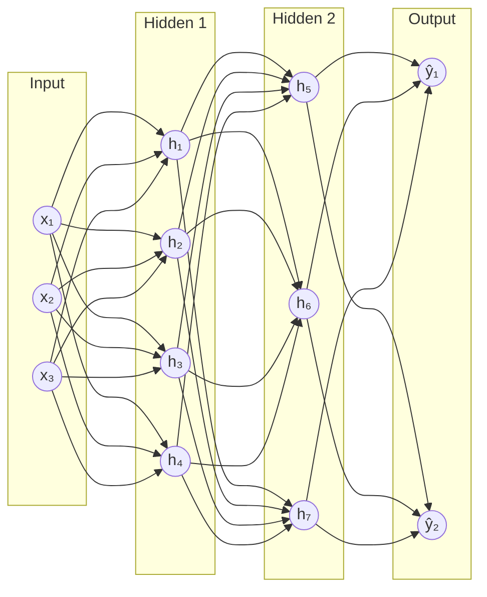
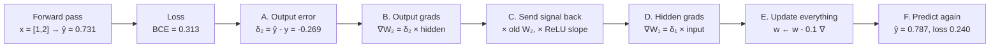
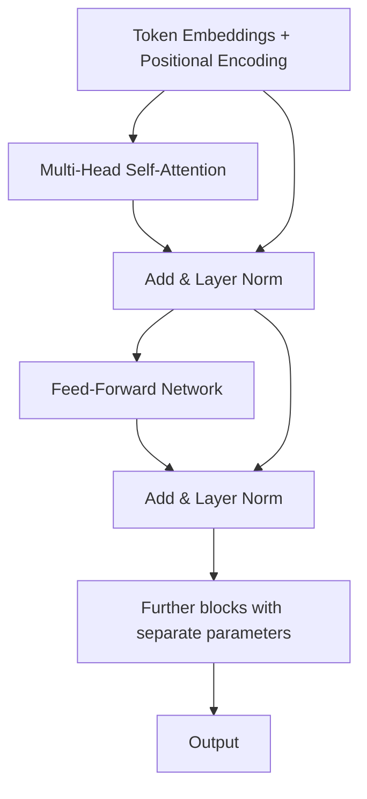
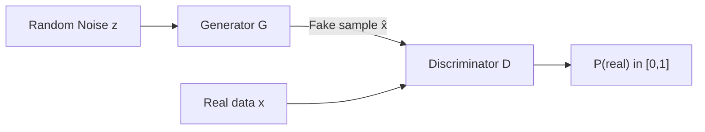

# Chapter 14 — Neural Networks & Deep Learning

---

## What You'll Learn

After this chapter you will be able to:
- Explain how a neuron computes a weighted sum, applies an activation, and produces output
- Reason about depth vs. width, and choose activations/losses for a given task
- Walk through forward pass, backpropagation, and a weight update by hand
- Train a small network on CPU and explain every line of its training loop
- Diagnose training problems using data, curves, and gradients — not guesswork
- Explain how CNNs, RNNs, and Transformers each represent information
- Initialize weights correctly (He vs. Xavier) and pick a learning-rate schedule
- Decide when deep learning beats traditional ML, and when it doesn't

---

## Before You Start

> **Prerequisites:** matrix/vector multiplication and derivatives
> ([Ch 6 — Math for ML](#content/06_math_fundamentals)), and the training vocabulary —
> *epoch, batch, loss, gradient descent, forward/backward pass* — from
> [Ch 8 — Core Concepts](#content/08_core_concepts). Fuzzy on these? Don't worry — every
> term is re-defined here as it appears, with full-precision worked examples throughout.

**Markers:** ★★★ = know cold for interviews · ★★ = high priority · ★ = good to know.

**Quick check** boxes are retrieval practice — attempt before revealing. **Interview** boxes
give the question, what to say, and the follow-up trap.

**How to read this chapter** — it's built in four stages, not one sitting. Length is less
important than doing something new at each stopping point:

| Stage | Sections | Move on when you can... |
|---|---|---|
| 1. Understand a network | §14.1–14.4 | Trace the numbers/shapes from input to a prediction and loss |
| 2. Explain learning | §14.5 | Follow a gradient, update a weight, and recompute the prediction |
| 3. Train it reliably | §14.6–14.7b | Run the CPU lab and diagnose a deliberately broken experiment |
| 4. Choose the right structure | §14.8–14.14 | Explain what locality, memory, attention, or pretraining buys you |

**Going further after this chapter:** architecture depth (optimizers, ResNet/ViT, MoE,
diffusion) → [Ch 16 — Deep Learning Reference](#content/16_deep_learning) · how Transformers
became **ChatGPT** → [Ch 17 — LLMs](#content/17_llm) · shipping a model →
[Ch 27 — Practical ML](#content/27_practical_ml) · evaluating what you built →
[Ch 13 — Model Evaluation](#content/13_model_evaluation).

### Key Terms (Quick Reference)

Skim this table once, then refer back as needed — every term reappears with a concrete
example later in the chapter.

| Term | Plain meaning |
|------|---------------|
| **Weight** ($w$) | A learned multiplier controlling one input's contribution. Its magnitude alone is not feature importance: input scale and the rest of the network matter too. |
| **Bias** ($b$) | A second dial added *after* the weighted sum. It shifts the result up or down so a neuron can fire even when every input is 0 — like the offset on a thermostat. |
| **Activation** | The non-linear "decision" function applied to a neuron's result. It lets a network bend to fit curves instead of only straight lines. |
| **Logit** | A raw output score *before* it becomes a probability. "Logit = 2.0" is just a number the model emits; softmax/sigmoid turns it into a probability. |
| **Gradient** | The slope of the loss — which way, and how steeply, the error changes if you nudge a weight. Training walks *downhill* along it. |
| $\partial L/\partial w$ | Read the $\partial$ as "a tiny change in": *how much the loss $L$ moves when weight $w$ is nudged*. That single number **is** the gradient for that weight. $\nabla L$ is just all of them collected into one list. |
| Superscript $^{(l)}$ | "Belonging to layer $l$" — $W^{(2)}$ is layer 2's weight matrix, **not** $W$ squared. |
| $\delta$ (delta) | The error signal handed backwards *to* a layer during backpropagation — "how wrong were the numbers arriving here?" |
| **Epoch** | One full pass through the entire training dataset. |
| **Batch** (mini-batch) | A small handful of examples (e.g. 32) seen before the weights are updated once. |

Weights and biases are **parameters**, learned from data. Learning rate, batch size, and
layer width are **hyperparameters**, choices you make about how to build or train the model.

---

## 14.1 What Is a Neural Network? ★★★


### Simple Explanation

<details>
<summary><strong>Read as text</strong> — the voting machine, the umbrella neuron and its two mornings</summary>

A single **neuron** is a tiny voting machine: it takes a few inputs, weighs how much to
*trust* each one, adds up the evidence, and "fires" if the total is convincing enough. Stack
thousands of these voting machines into layers — one layer's votes feed the next — and you
get a **neural network**. No single neuron is smart, but stacked together they can recognize
a face, translate a sentence, or steer a car.

> **Maths in one line:** `z = w₁x₁ + w₂x₂ + … + wₙxₙ + b,  ŷ = f(z)` — weigh each input, add them up with a bias, then bend the total with an activation $f$.

> An **artificial neural network (ANN)** is a computational graph of parameterized functions organized into layers, where each connection carries a learnable weight. The network maps inputs to outputs by composing simple non-linear transformations, and learns by adjusting weights to minimize a loss function via gradient-based optimization.

**Where the name comes from.** A biological neuron collects signals through dendrites, sums
them in the cell body, and fires down the axon past a threshold. An artificial neuron copies
the *idea*, not the biology:

- **Multiply** each input by a learned weight
- **Sum** everything, then **add a bias**
- **Activate** — pass the result through a non-linear function to produce the output

That's the whole computation. It's a loose naming analogy, not a brain simulation.

```
BIOLOGICAL NEURON                 ARTIFICIAL NEURON
─────────────────                 ─────────────────
   dendrites (inputs)                   x₁     x₂     x₃     (inputs)
        │                               │      │      │
   cell body (sum + threshold)    z = w₁x₁ + w₂x₂ + w₃x₃ + b
        │                                      │
   axon (output)                           ŷ = f(z)    (activation)
        │                                      │
   next neuron                            next layer
```

$$z = \sum_{i=1}^{n} w_i x_i + b, \qquad \hat{y} = f(z)$$

**Worked example — "should I carry an umbrella?"** The neuron looks at two clues, each
scaled 0–1: $x_1$ = cloudiness, $x_2$ = humidity. It has learned $w_1 = 3$, $w_2 = 2$, and
bias $b = -2.5$ (the bias sets how much evidence it needs before leaning "yes"). The activation
is the **sigmoid**, $\sigma(z) = 1/(1+e^{-z})$, which squashes any number into 0–1 (§14.3).

| Morning | $x_1, x_2$ | $z = 3x_1+2x_2-2.5$ | $f(z)$ (sigmoid) | Verdict |
|---|---|---|---|---|
| Grey & humid | 0.8, 0.9 | $2.4+1.8-2.5=1.7$ | $\approx 0.85$ | 85% → take the umbrella |
| Clear & dry | 0.1, 0.2 | $0.3+0.4-2.5=-1.8$ | $\approx 0.14$ | 14% → leave it home |

Same neuron, same weights — only the *evidence* changed, and the answer flipped. That single
computation is the entire job of a neuron; the rest of this chapter is just scale and wiring.

> That 85% is the model's estimate, not proof it's right. **Calibration** asks a separate
> question: are predictions near 85% actually correct about 85% of the time?

Run it, with two extra mornings: no clues at all (only the bias speaks), and a morning that
lands exactly on the neuron's decision boundary.

</details>

```python
# One neuron, the umbrella example: z = w·x + b, then a sigmoid squashes z into a probability.
import numpy as np

w = np.array([3.0, 2.0])          # learned weights: cloudiness, humidity
b = -2.5                          # bias: how much evidence is needed before "yes"
sigmoid = lambda z: 1 / (1 + np.exp(-z))

mornings = [("grey & humid", [0.8, 0.9]),     # the chapter's two mornings first
            ("clear & dry", [0.1, 0.2]),
            ("no clues at all", [0.0, 0.0]),  # every input is 0: only the bias speaks
            ("half and half", [0.5, 0.5])]    # 3(0.5) + 2(0.5) = 2.5, exactly cancels b
for name, x in mornings:
    z = w @ np.array(x) + b
    p = sigmoid(z)
    verdict = "take it" if p > 0.5 else "leave it" if p < 0.5 else "undecided"
    print(f"{name:<16} x = {x}   z = {z:+.2f}   f(z) = {p:.3f}   {verdict}")

assert abs(sigmoid(1.7) - 0.8455) < 1e-4 and abs(sigmoid(-1.8) - 0.1419) < 1e-4
for x1 in [0.1, 0.4, 0.8]:                    # points on the line 3*x1 + 2*x2 = 2.5
    x2 = (2.5 - 3 * x1) / 2
    assert abs(sigmoid(w @ np.array([x1, x2]) + b) - 0.5) < 1e-12
print("every point on the line 3*x1 + 2*x2 = 2.5 scores exactly 0.500")
```

**Output:**

```
grey & humid     x = [0.8, 0.9]   z = +1.70   f(z) = 0.846   take it
clear & dry      x = [0.1, 0.2]   z = -1.80   f(z) = 0.142   leave it
no clues at all  x = [0.0, 0.0]   z = -2.50   f(z) = 0.076   leave it
half and half    x = [0.5, 0.5]   z = +0.00   f(z) = 0.500   undecided
every point on the line 3*x1 + 2*x2 = 2.5 scores exactly 0.500
```

<details>
<summary><strong>Read as text</strong> — continued: one straight line, the perceptron and universal approximation</summary>

The last line is the important one: everything the neuron cannot decide about sits on the
**straight line** $3x_1 + 2x_2 = 2.5$. One neuron always splits its inputs with a straight line
(with more inputs, a flat plane).

**A little history, and its limit.** The original **perceptron** (Rosenblatt, 1958) used a
hard on/off threshold; our example uses a smooth sigmoid instead (like logistic regression).
Both draw a *straight* decision line — enough to separate AND/OR, but never XOR (§14.3 shows
why, and how to fix it).

- With a non-linear (strictly, non-polynomial) activation such as sigmoid or ReLU and enough
  hidden units, even a single hidden layer can approximate any continuous function on a
  closed, bounded input range as closely as you like (the **Universal Approximation Theorem**).
- That's a statement about what a network *can represent* — not a promise that training will
  find those weights, or that the result will generalize.

**Real-world scale.** One neuron might learn "if pixel brightness > threshold, call it
white." Stack thousands of them and you can classify a whole chest X-ray as pneumonia vs.
healthy.

</details>

---

## 14.2 Architecture: Layers and Neurons ★★

![Infographic: layers and parameters. A fully connected network with 4 inputs, two hidden layers of 3 neurons and 3 outputs P(cat) = 0.90, P(dog) = 0.07, P(bird) = 0.03, with depth = 3 (2 hidden + output) and width = 3 marked. The formula params per dense layer = (n_in x n_out) + n_out is applied to the 784 to 512 to 256 to 10 MNIST network: 401,920 + 131,328 + 2,570 = 535,818 parameters. A table compares 535,818 (first layer 75.0%), 101,770 for 784 to 128 to 10 (98.7%) and 7,850 with no hidden layer; trap: forgetting biases gives 101,632.](diagrams/nn14_info_layers_parameters_ai.png)


### Simple Explanation

<details>
<summary><strong>Read as text</strong> — the assembly line, depth vs width and counting parameters</summary>

A network is organized like an **assembly line**: input features enter at one end, and each
**layer** is a station that reshapes what it receives before passing it on. Early stations
spot simple things; later stations combine them into something meaningful.

- **Input layer** — the loading dock, one slot per feature
- **Hidden layers** — workers doing the real shaping
- **Output layer** — the shipping desk that hands you the final answer

"Deeper" = more stations in a row. "Wider" = more workers per station.

> **Maths in one line:** `parameters per dense layer = n_in × n_out + n_out` — one weight for every input–output pair, plus one bias per output neuron.

> A **feedforward neural network** consists of an input layer, one or more hidden layers, and an output layer. Data flows forward from input to output with no cycles. The number of layers is the network's **depth** (usually counting the hidden and output layers — the input layer has no weights); the number of neurons per layer is its **width**.

```
INPUT LAYER       HIDDEN LAYERS            OUTPUT LAYER
───────────       ─────────────            ────────────
                  ┌───┐    ┌───┐           ┌───┐
 x₁ ───┐          │ h │    │ h │           │ o │ → P(cat)  = 0.90
 x₂ ───┤          │   │    │   │           │   │
 x₃ ───┼─────────►│ h │───►│ h │──────────►│ o │ → P(dog)  = 0.07
 x₄ ───┘          │   │    │   │           │   │
                  │ h │    │ h │           │ o │ → P(bird) = 0.03
                  └───┘    └───┘           └───┘

 Raw features     Non-linear               Task-specific
                  transformations          prediction

 Each arrow = every neuron feeds every neuron in the next layer.
```

**Depth vs width** — Two levers for model capacity:

| Lever | Effect | Trade-off |
|-------|--------|-----------|
| More layers (deeper) | Learns hierarchical features; each layer builds on the last | Harder to train (vanishing gradients), slower per step |
| More neurons (wider) | More capacity per layer, captures more patterns in parallel | More parameters, higher memory, risk of overfitting |

A 784 → 512 → 256 → 10 network (e.g., MNIST digit classifier) has $784 \times 512 + 512 \times 256 + 256 \times 10 = 535{,}040$ weights. Add $512 + 256 + 10 = 778$ biases for **535,818 learnable parameters**. A connection contributes a weight; a non-input neuron usually has a bias too.

**Example — how it works (reading a handwritten digit).**

Trace one image through that $784 \to 512 \to 256 \to 10$ network:

- **Input layer (784):** a $28\times28$ pixel image flattened into 784 brightness numbers.
- **Hidden layer 1 (512):** combines all 784 pixel values into learned features, which might
  respond to patterns such as strokes or curves.
- **Hidden layer 2 (256):** combines those features into more useful representations for
  distinguishing digits.
- **Output layer (10):** one neuron per digit 0–9; the strongest one wins. For a handwritten
  "7," the "7" neuron lights up because it saw "a horizontal top stroke + a diagonal going
  down."

> You only supply the digit labels — not labels for hidden features like "stroke" or "curve."
> The network learns those representations on its own. The stroke/loop story is intuition;
> in practice information is spread across many neurons rather than one tidy neuron each.



> **Interview —** *"Would you rather add depth or width to a network?"*
>
> **Say:** They solve different problems. Depth *composes* transformations and represents hierarchical functions efficiently; width adds more features within a layer and often makes optimization easier. I'd compare validation quality and compute cost rather than assume deeper wins.
>
> **They follow up with:** *"So why not go extremely deep?"* — longer gradient paths make optimization harder, so extra layers can stop helping. Residual connections shorten those paths (§14.8), but neither depth nor skip connections guarantees a better result.

</details>

<details>
<summary><strong>Quick check.</strong> A network takes a 28×28 grayscale image, flattens it to 784 inputs, has one hidden layer of 128 neurons, and outputs 10 classes. How many learnable parameters does it have?</summary>

Count weights **and** biases, layer by layer:

**Input → hidden:** every one of the 784 inputs connects to every one of the 128 neurons,
and each neuron has its own bias.

$$784 \times 128 + 128 = 100{,}352 + 128 = 100{,}480$$

**Hidden → output:**

$$128 \times 10 + 10 = 1{,}280 + 10 = 1{,}290$$

**Total = 101,770 parameters.**

Two things worth noticing. Over **98%** of them sit in the first layer — fully-connected layers
on raw pixels are enormously wasteful, which is precisely the problem CNNs solve with weight
sharing (§14.8). And the general formula is simply
$(\text{inputs} \times \text{outputs}) + \text{outputs}$ per layer — forgetting the biases is
the classic slip.
</details>

<details>
<summary><strong>Read as text</strong> — continued</summary>

Count it in code — the chapter's two networks, then a network with no hidden layer at all:

</details>

```python
# Count a dense network's parameters layer by layer: (inputs x outputs) weights + one bias per output.
import numpy as np

def build(sizes):
    # PyTorch layout: W has one row per output neuron, so its shape is (n_out, n_in)
    return [(np.zeros((n_out, n_in)), np.zeros(n_out)) for n_in, n_out in zip(sizes[:-1], sizes[1:])]

nets = [("the 784-512-256-10 MNIST network", (784, 512, 256, 10)),
        ("the Quick-check network", (784, 128, 10)),
        ("no hidden layer (softmax regression)", (784, 10))]
totals = {}
for name, sizes in nets:
    layers = build(sizes)
    total = sum(W.size + b.size for W, b in layers)
    totals[sizes] = total
    print(f"{name}:")
    for W, b in layers:
        print(f"   W {str(W.shape):<10} {W.size:>8,} weights + {b.size:>3} biases = {W.size + b.size:>8,}")
    first = layers[0][0].size + layers[0][1].size
    no_bias = sum(W.size for W, _ in layers)
    print(f"   total {total:,}  (first layer {first / total:.1%}; without biases {no_bias:,})")

assert totals[(784, 512, 256, 10)] == 535_818 and totals[(784, 128, 10)] == 101_770
```

**Output:**

```
the 784-512-256-10 MNIST network:
   W (512, 784)  401,408 weights + 512 biases =  401,920
   W (256, 512)  131,072 weights + 256 biases =  131,328
   W (10, 256)     2,560 weights +  10 biases =    2,570
   total 535,818  (first layer 75.0%; without biases 535,040)
the Quick-check network:
   W (128, 784)  100,352 weights + 128 biases =  100,480
   W (10, 128)     1,280 weights +  10 biases =    1,290
   total 101,770  (first layer 98.7%; without biases 101,632)
no hidden layer (softmax regression):
   W (10, 784)     7,840 weights +  10 biases =    7,850
   total 7,850  (first layer 100.0%; without biases 7,840)
```

<details>
<summary><strong>Read as text</strong> — continued: where the parameters sit</summary>

The hidden layer is what costs: going from 784 → 10 directly to 784 → 128 → 10 multiplies the
parameter count by about 13, and almost all of it is the first, pixel-facing layer.

</details>

---

## 14.3 Activation Functions ★★★

![Infographic: why activations matter. The collapse identity W2(W1x + b1) + b2 = (W2W1)x + (W2b1 + b2) shows stacked linear layers are one layer. Left panel: the XOR square with YES at (0,1) and (1,0), NO at (0,0) and (1,1), and crossed-out candidate lines (best straight line gets 3 of 4). Right panel: a hand-set hidden layer h1 = ReLU(x1 - x2), h2 = ReLU(x2 - x1) with weights +1 and -1, summed into s = h1 + h2, YES if s > 0.5. Table of h1, h2, s and answers for the four inputs; without ReLU every score is 0 and every answer is NO.](diagrams/nn14_info_why_nonlinearity_xor_ai.png)


### Simple Explanation

<details>
<summary><strong>Read as text</strong> — why stacked linear layers still draw one straight line</summary>

If every neuron only added up its inputs, the whole network — no matter how deep — could only
ever draw **straight lines**. But the real boundary between "spam" and "not spam," or "cat" and
"dog," bends and curves. An **activation function** is the little non-linear "kink" each neuron
adds, and those kinks stack up into the curved decision boundaries real problems need.
Different activations are just differently shaped kinks: ReLU is a sharp elbow, sigmoid is a
smooth S, softmax turns a row of scores into percentages.

> **Maths in one line:** `W₂(W₁x + b₁) + b₂ = (W₂W₁)x + (W₂b₁ + b₂)` — without an activation, two layers are just one layer in disguise; $a = f(z)$ between them is what stops the collapse.

> Hidden-layer **activation functions** introduce nonlinearity between learned affine
> transformations. ReLU, sigmoid, and tanh operate element-wise; **softmax operates on a
> whole vector**, coupling its outputs into a probability distribution.

Without activations, layer 2's output is $W_2(W_1 x + b_1) + b_2 = W'x + b'$ — still linear. A 100-layer network would have the same representational power as a single layer. Activations break this linearity, letting deep networks approximate arbitrarily complex functions.

(Strictly, "linear layer" means *affine* — a linear map plus a bias. The restriction that
matters is the straight decision boundary.)

</details>

### Why Hidden Layers Help: Build XOR Yourself

<details>
<summary><strong>Read as text</strong> — the XOR square, the four-inequality proof and two ReLU features</summary>

XOR means "one input is on, but not both." Put its four inputs on a square:

```
  x2
   1    (0,1): YES ------ (1,1): NO
        |                 |
   0    (0,0): NO  ------ (1,0): YES
        0                 1      x1
```

No single straight line separates the two YES corners from the two NO corners.
Adding more affine layers without activations does not change that.

**Why no line can work — four inequalities.** A line says YES when $w_1x_1 + w_2x_2 + b > 0$.
The YES corners need $w_1 + b > 0$ and $w_2 + b > 0$; adding them, $w_1 + w_2 + 2b > 0$.
The NO corner (0,0) needs $b \le 0$, so $w_1 + w_2 + b > -b \ge 0$. But the NO corner (1,1)
needs $w_1 + w_2 + b \le 0$. Contradiction — no choice of $w_1, w_2, b$ works.

Two ReLU features can solve it:

$$h_1 = \text{ReLU}(x_1-x_2), \qquad h_2 = \text{ReLU}(x_2-x_1), \qquad s=h_1+h_2$$

| Input | $h_1$: first exceeds second | $h_2$: second exceeds first | Score $s$ | Decide YES if $s>0.5$ |
|---|---:|---:|---:|---|
| (0,0) | 0 | 0 | 0 | NO |
| (0,1) | 0 | 1 | 1 | YES |
| (1,0) | 1 | 0 | 1 | YES |
| (1,1) | 0 | 0 | 0 | NO |

Each hidden neuron makes one useful feature; the output combines them. These weights were
**hand-designed** to show what a hidden layer *can represent* — the lab in §14.7a learns a
related XOR task from examples instead.

Check all three claims in one run: the hand-set ReLU layer gets 4 of 4, the same weights
without ReLU collapse to a single linear map, and no straight line gets past 3 of 4 (while AND
and OR, for contrast, are easy for a line):

</details>

```python
# XOR: no single straight line gets all four points right; two hand-set ReLU features do.
import numpy as np

X = np.array([[0, 0], [0, 1], [1, 0], [1, 1]], dtype=float)
y = np.array([0, 1, 1, 0])                        # YES (1) when exactly one input is on
relu = lambda z: np.maximum(0, z)

# 1. The chapter's hidden layer: h1 = ReLU(x1 - x2), h2 = ReLU(x2 - x1); output s = h1 + h2
W1 = np.array([[1.0, -1.0],
               [-1.0, 1.0]])
W2 = np.array([1.0, 1.0])
H = relu(X @ W1.T)
s = H @ W2
for x, h, si in zip(X.astype(int), H.astype(int), s):
    print(f"x = {x}   h = {h}   s = {si:.0f}   {'YES' if si > 0.5 else 'NO'}")
assert np.array_equal((s > 0.5).astype(int), y)

# 2. Same weights, ReLU removed: the two layers collapse into ONE linear map, W2 @ W1
print(f"without ReLU: W2 @ W1 = {(W2 @ W1).astype(int)}, so every score is {(X @ W1.T @ W2).astype(int)}")

# 3. One layer = one straight line: say YES when w1*x1 + w2*x2 + b > 0. Try 200,000 random lines.
rng = np.random.default_rng(0)
P = rng.uniform(-5, 5, size=(200_000, 3))         # columns: w1, w2, b
says_yes = (X @ P[:, :2].T + P[:, 2]) > 0         # shape (4 points, 200,000 lines)
for name, target in [("XOR", y), ("AND", np.array([0, 0, 0, 1])), ("OR", np.array([0, 1, 1, 1]))]:
    best = (says_yes == target[:, None].astype(bool)).sum(axis=0).max()
    print(f"{name}: best of 200,000 straight lines gets {best} of 4 points right")
    assert best == (3 if name == "XOR" else 4)
```

**Output:**

```
x = [0 0]   h = [0 0]   s = 0   NO
x = [0 1]   h = [0 1]   s = 1   YES
x = [1 0]   h = [1 0]   s = 1   YES
x = [1 1]   h = [0 0]   s = 0   NO
without ReLU: W2 @ W1 = [0 0], so every score is [0 0 0 0]
XOR: best of 200,000 straight lines gets 3 of 4 points right
AND: best of 200,000 straight lines gets 4 of 4 points right
OR: best of 200,000 straight lines gets 4 of 4 points right
```

<details>
<summary><strong>Read as text</strong> — continued: what removing the ReLU does</summary>

Without the ReLU the two features cancel exactly ($(x_1 - x_2) + (x_2 - x_1) = 0$), so the
network says NO to everything. The random search is only an illustration; the four
inequalities above are the proof.

</details>

### ReLU — The Default

![Infographic: the activation family. Six mini cards with thumbnail curves: ReLU max(0, z) with range 0 to infinity and slope 1 or 0; Leaky ReLU with 0.01z below zero (PReLU learns it); sigmoid range (0, 1) with slope peaking at 0.25; tanh range (-1, 1), slope 1 at 0 and 0.071 at plus or minus 2; GELU z x Phi(z) dipping to -0.170 at z about -0.75; softmax turning 2.0, 1.0, 0.1 into 0.659, 0.242, 0.099. A table gives values at z = -2 and 3 and the slope at 3 (sigmoid 0.045, tanh 0.010, ReLU 1, GELU 1.012); a where-it-goes table maps hidden MLP/CNN to ReLU, Transformers to GELU or SwiGLU, binary or multi-label outputs to sigmoid, multi-class to softmax and regression to none.](diagrams/nn14_info_activation_family_ai.png)

<details>
<summary><strong>Read as text</strong> — max(0, z), its slope and dying units</summary>

> **Maths in one line:** `a = f(z)`, and backprop multiplies the gradient by the slope `f′(z)` — so the slope decides how much learning signal survives each layer: ReLU 1 (for z > 0) or 0, sigmoid at most 0.25, tanh at most 1.

$$\text{ReLU}(z) = \max(0, z)$$

It passes positive values through unchanged and turns negatives into 0, so its range is
$[0, \infty)$. Simple, fast, and unsaturated for positive inputs — the common
hidden-layer choice in MLPs and CNNs. Its derivative is **1** when $z>0$ and **0** when $z<0$
(at exactly 0 frameworks pick a convention; PyTorch uses 0),
which is exactly why it does not shrink gradients on the positive side. A unit that stays
negative across the *whole* dataset therefore receives zero gradient and can stop
contributing ("dying ReLU"); being negative on one example is normal.

</details>

### Sigmoid

<details>
<summary><strong>Read as text</strong> — the S-curve, its 0.25 slope cap and where it belongs</summary>

$$\sigma(z) = \frac{1}{1 + e^{-z}}$$

Output range: $(0, 1)$. Useful for binary classification output layers and LSTM gates (where you need a 0-to-1 probability or gate value). Saturates at extremes — gradients approach zero for large $|z|$.

Its derivative has an unusually tidy form, worth memorising because §14.5 and §14.6 both use it:

$$\sigma'(z) = \sigma(z)\bigl(1 - \sigma(z)\bigr)$$

Write $s = \sigma(z)$ and this is $s(1-s)$, an upside-down parabola that peaks at $s = 0.5$:
$0.5 \times 0.5 = \mathbf{0.25}$. **So a sigmoid can never pass back more than a quarter of the
gradient it receives** — one root of the vanishing-gradient problem in §14.6. Its outputs are
also never negative, so the weights feeding the next layer all get gradients of the same sign
and their updates zig-zag; keep sigmoid for outputs and gates, not hidden layers.

</details>

### Tanh

<details>
<summary><strong>Read as text</strong> — zero-centred, but it saturates too</summary>

$$\tanh(z) = \frac{e^z - e^{-z}}{e^z + e^{-z}}$$

Output range: $(-1, 1)$. Zero-centered, which can help optimization. Used for RNN/LSTM hidden states and value computations. Its slope $1 - \tanh^2 z$ is 1 at $z = 0$ but only 0.071 at $z = \pm 2$ — it saturates just like sigmoid.

</details>

### Softmax

<details>
<summary><strong>Read as text</strong> — scores into probabilities, and two facts interviewers like</summary>

$$\text{softmax}(z_i) = \frac{e^{z_i}}{\sum_{j} e^{z_j}}$$

Converts a vector of raw logits into a probability distribution that sums to 1. Used as the output activation for multi-class classification. Logits $[2.0, 1.0, 0.1]$ become $[0.659, 0.242, 0.099]$ (the chart below).

Two facts interviewers like. Adding the same number to every logit leaves softmax unchanged
(it cancels top and bottom), which is why code subtracts the largest logit before
exponentiating (§14.4, "Why fused losses?"). And with only two classes, softmax is a sigmoid of
the logit gap: $\text{softmax}([z_1, z_2])_1 = \sigma(z_1 - z_2)$.

</details>

### Leaky ReLU

<details>
<summary><strong>Read as text</strong> — a small slope below zero, and PReLU</summary>

$$f(z) = \begin{cases} z & z > 0 \\ \alpha z & z \le 0 \end{cases}, \quad \alpha = 0.01$$

Provides a nonzero activation derivative ($\alpha$) on the negative side, so a unit that
drifts negative can still recover. **PReLU** makes $\alpha$ a learned parameter.

</details>

### GELU (Gaussian Error Linear Unit)

<details>
<summary><strong>Read as text</strong> — the soft gate, and one value through each activation</summary>

$$\text{GELU}(z) = z \cdot \Phi(z)$$

$\Phi(z)$ is the standard Gaussian CDF — plainly, *the chance that a random draw from a
standard bell curve lands below $z$*. That makes GELU a **soft gate** on $z$:

| If $z$ is... | $\Phi(z)$ is... | So GELU keeps... |
|---|---|---|
| large positive | $\to 1$ | nearly all of $z$ |
| near zero | $\approx 0.5$ | about half of $z$ |
| large negative | $\to 0$ | nearly none of $z$ |

Same job as ReLU, faded smoothly instead of a hard elbow: $\text{GELU}(2) = 1.954$,
$\text{GELU}(-2) = -0.046$, and it dips to its lowest value, $-0.170$, at $z \approx -0.75$.
Its slope is almost never exactly 0, so units do not die. Its near-twin **SiLU** (Swish) is
$z \cdot \sigma(z)$. GELU is the activation of BERT, GPT-2/3 and ViT; most modern LLMs use a
*gated* version instead — **SwiGLU** (SiLU gate) or **GeGLU** (GELU gate) — see
[Ch 16 §1.8](#content/16_deep_learning).

**Example — how it works (one value through each activation).**

Take a neuron whose weighted sum comes out to $z = -2$ in one case and $z = 3$ in another, and
watch what each activation does to those two numbers:

| Activation | $z=-2$ | $z=3$ | What it did |
|---|---|---|---|
| ReLU $\max(0,z)$ | $0$ | $3$ | Killed the negative; passed the positive through unchanged |
| Sigmoid | $0.12$ | $0.95$ | Mapped both into (0,1); their interpretation depends on the task |
| Tanh | $-0.96$ | $0.995$ | Squashed into −1…1, keeping the sign |
| Leaky ReLU ($\alpha{=}0.1$) | $-0.2$ | $3$ | Like ReLU, but lets a trickle of the negative through |
| GELU | $-0.046$ | $2.996$ | Like ReLU, but faded smoothly: a little of the negative survives |

ReLU's output for $z=-2$ is 0 — and so is its derivative, so nothing flows back through it
*for this example*. Leaky ReLU keeps a small negative-side slope instead. (The table uses
$\alpha = 0.1$ rather than the usual 0.01 so the trickle is visible.)

The values are only half the story; the **slope** is what backprop multiplies by. This run
prints both, at the table's $-2$ and $3$ plus two inputs near zero:

</details>

```python
# Each activation's value and slope at a few inputs: who blocks negatives, who squashes, who saturates.
import numpy as np

def Phi(z):                                    # chance a standard bell-curve draw lands below z:
    t = np.linspace(-10.0, z, 20_001)          # the area under the bell curve left of z (trapezoids)
    f = np.exp(-t ** 2 / 2) / np.sqrt(2 * np.pi)
    return float(((f[1:] + f[:-1]) / 2 * np.diff(t)).sum())

sig = lambda z: 1 / (1 + np.exp(-z))
acts = {"ReLU":           lambda z: max(0.0, z),
        "Leaky ReLU 0.1": lambda z: z if z > 0 else 0.1 * z,
        "Sigmoid":        sig,
        "Tanh":           np.tanh,
        "GELU":           lambda z: z * Phi(z),
        "SiLU":           lambda z: z * sig(z)}
zs = [-2.0, -0.5, 0.5, 3.0]                    # the chapter's -2 and 3, plus two values near zero
h = 1e-5                                       # slope = (f(z+h) - f(z-h)) / 2h: what backprop multiplies by
for title, show in [("value f(z)", lambda f, z: f(z)),
                    ("slope f'(z)", lambda f, z: (f(z + h) - f(z - h)) / (2 * h))]:
    print(f"{title:<15}" + "".join(f"{z:>8}" for z in zs))
    for name, f in acts.items():
        print(f"{name:<15}" + "".join(f"{show(f, z):8.3f}" for z in zs))
    print()

grid = np.linspace(-6, 6, 12_001)
d_sig = sig(grid) * (1 - sig(grid))            # the sigmoid's slope, s(1 - s)
print(f"largest sigmoid slope: {d_sig.max():.3f}, at z = {abs(grid[d_sig.argmax()]):.1f}")
zz = np.linspace(-3, 0, 301)
gelu = np.array([z * Phi(z) for z in zz])
print(f"GELU dips to {gelu.min():.3f} at z = {zz[gelu.argmin()]:.2f}, then rises back to 0")
assert abs(d_sig.max() - 0.25) < 1e-9 and abs(acts["GELU"](-2.0) + 0.0455) < 1e-4
```

**Output:**

```
value f(z)         -2.0    -0.5     0.5     3.0
ReLU              0.000   0.000   0.500   3.000
Leaky ReLU 0.1   -0.200  -0.050   0.500   3.000
Sigmoid           0.119   0.378   0.622   0.953
Tanh             -0.964  -0.462   0.462   0.995
GELU             -0.046  -0.154   0.346   2.996
SiLU             -0.238  -0.189   0.311   2.858

slope f'(z)        -2.0    -0.5     0.5     3.0
ReLU              0.000   0.000   1.000   1.000
Leaky ReLU 0.1    0.100   0.100   1.000   1.000
Sigmoid           0.105   0.235   0.235   0.045
Tanh              0.071   0.786   0.786   0.010
GELU             -0.085   0.133   0.867   1.012
SiLU             -0.091   0.260   0.740   1.088

largest sigmoid slope: 0.250, at z = 0.0
GELU dips to -0.170 at z = -0.75, then rises back to 0
```

<details>
<summary><strong>Read as text</strong> — continued: reading the slope table, and why activations at all</summary>

Read the slope table: at $z = 3$ sigmoid passes back only 0.045 of the gradient and tanh 0.010
— saturation — while ReLU, GELU and SiLU pass back about 1. At $z = -2$ ReLU passes back
exactly 0, the leaky version 0.1, and GELU/SiLU a small (negative) amount.

> **Interview —** *"Why does a neural network need activation functions at all?"*
>
> **Say:** Without them the whole network collapses into a single linear layer, no matter how deep it is. Stacking linear maps gives you another linear map: $W_2(W_1x) = (W_2W_1)x$, and $W_2W_1$ is just one matrix. A 50-layer network with no activations has exactly the modelling power of a 1-layer one — it can only draw straight lines. The non-linearity between layers is what lets depth actually buy you anything.
>
> **They follow up with:** *"So why ReLU rather than sigmoid in the hidden layers?"* — sigmoid saturates, making its local derivative tiny. ReLU has derivative 1 on the positive side and is cheap to compute. That removes one source of shrinking gradients, **not all sources**: backprop also multiplies by weights, and inactive ReLUs have zero derivative.

</details>

<details>
<summary><strong>Quick check.</strong> Ignore weight factors and multiply ten sigmoid activation derivatives. How large can that activation-only factor be? Would replacing sigmoid with ReLU guarantee stable gradients?</summary>

Sigmoid's derivative $s(1-s)$ peaks at **0.25** (see above), so ten of them multiply to at most:

$$0.25^{10} \approx 0.00000095$$

That is one source of vanishing gradients — under a millionth of the signal survives. It is
**not** a bound on the whole network gradient: weight factors are omitted here, and a weight
of 4 cancels an activation derivative of 0.25.

Ten *positive* ReLUs contribute $1^{10}=1$, so no — swapping to ReLU removes this particular
shrinking multiplier, but not the weight factors, and negative ReLUs contribute zero.
</details>

<details>
<summary><strong>Read as text</strong> — continued</summary>

```chart
{
  "type": "line",
  "data": {
    "labels": [-6,-5,-4,-3,-2,-1,0,1,2,3,4,5,6],
    "datasets": [
      {
        "label": "Sigmoid",
        "data": [0.002,0.007,0.018,0.047,0.119,0.269,0.500,0.731,0.881,0.953,0.982,0.993,0.998],
        "borderColor": "rgba(99, 102, 241, 1)",
        "tension": 0.4, "pointRadius": 0, "borderWidth": 2, "fill": false
      },
      {
        "label": "Tanh",
        "data": [-1.00,-1.00,-0.999,-0.995,-0.964,-0.762,0.000,0.762,0.964,0.995,0.999,1.00,1.00],
        "borderColor": "rgba(234, 88, 12, 1)",
        "tension": 0.4, "pointRadius": 0, "borderWidth": 2, "fill": false
      },
      {
        "label": "ReLU",
        "data": [0,0,0,0,0,0,0,1,2,3,4,5,6],
        "borderColor": "rgba(34, 197, 94, 1)",
        "tension": 0, "pointRadius": 0, "borderWidth": 2, "fill": false
      },
      {
        "label": "Leaky ReLU (α=0.1)",
        "data": [-0.6,-0.5,-0.4,-0.3,-0.2,-0.1,0,1,2,3,4,5,6],
        "borderColor": "rgba(168, 85, 247, 1)",
        "tension": 0, "pointRadius": 0, "borderWidth": 2, "borderDash": [5,3], "fill": false
      },
      {
        "label": "GELU",
        "data": [0,0,0,-0.004,-0.046,-0.159,0,0.841,1.954,2.996,4.000,5.000,6.000],
        "borderColor": "rgba(236, 72, 153, 1)",
        "tension": 0.4, "pointRadius": 0, "borderWidth": 2, "borderDash": [2,2], "fill": false
      }
    ]
  },
  "options": {
    "plugins": { "title": { "display": true, "text": "Activation Functions Compared" } },
    "scales": {
      "y": { "title": { "display": true, "text": "Output" }, "min": -1.5, "max": 6 },
      "x": { "title": { "display": true, "text": "Input z" } }
    }
  }
}
```

</details>

### When to Use Which

<details>
<summary><strong>Read as text</strong> — where each activation goes, and softmax as a chart</summary>

| Location | Recommended activation |
|---|---|
| Hidden (MLP / CNN) | **ReLU** (default); Leaky ReLU if neurons are dying |
| Hidden (Transformer) | **GELU** (BERT, GPT-2, ViT); gated **SwiGLU** / GeGLU in most modern LLMs ([Ch 16 §1.8](#content/16_deep_learning)) |
| Output — binary | **Sigmoid** → $P(y=1)$ |
| Output — multi-class | **Softmax** → a probability distribution |
| Output — multi-label | **Sigmoid per output** (independent probabilities) |
| Output — regression | **None / linear** |
| RNN / LSTM gates | **Sigmoid** (0 = closed, 1 = open) |
| RNN / LSTM values | **Tanh** (centred around 0) |

```chart
{
  "type": "bar",
  "data": {
    "labels": ["Cat", "Dog", "Bird"],
    "datasets": [
      {
        "label": "Raw Logits (before softmax)",
        "data": [2.0, 1.0, 0.1],
        "backgroundColor": "rgba(200, 200, 200, 0.7)",
        "borderColor": "rgba(160, 160, 160, 1)", "borderWidth": 1
      },
      {
        "label": "Probabilities (after softmax)",
        "data": [0.66, 0.24, 0.10],
        "backgroundColor": ["rgba(34,197,94,0.8)", "rgba(99,102,241,0.6)", "rgba(99,102,241,0.4)"],
        "borderColor": ["rgba(34,197,94,1)", "rgba(99,102,241,1)", "rgba(99,102,241,1)"], "borderWidth": 1
      }
    ]
  },
  "options": {
    "plugins": { "title": { "display": true, "text": "Softmax Converts Logits to Probabilities (Sum = 1)" } },
    "scales": {
      "y": { "title": { "display": true, "text": "Value" }, "beginAtZero": true },
      "x": {}
    }
  }
}
```

</details>

---

## 14.4 Forward Pass & Loss Functions ★★★

![Infographic: the forward pass of a 2 to 2 ReLU to 1 sigmoid network. Pipeline: input x = (1, 2), W1x + b1 with W1 rows (0.5, -0.5) and (1, 1) and b1 = (0, -1), z1 = (-0.5, 2.0), ReLU, a1 = (0, 2) (first unit off for this input, not dead), W2a1 + b2 with W2 = (1, 1) and b2 = -1, z2 = 1.0, sigmoid, y-hat = 0.731, and with y = 1 a BCE of 0.313; batch shape tags (B,2) and (B,1). A shapes table for Z = X @ W.T + b lists W1 (2,2), b1 (2,), W2 (1,2), b2 (1,); a (32,10) batch into 8 features needs W (8,10), b (8,), output (32,8), 88 parameters; trap: forgetting .T gives 2.5, 0.5 instead of -0.5, 2 with no error.](diagrams/nn14_info_forward_pass_shapes_ai.png)

### Simple Explanation

<details>
<summary><strong>Read as text</strong> — multiply, add, bend, and a tiny forward pass by hand</summary>

The **forward pass** is the network "doing its thing" left to right: numbers go in, get
multiplied, added, and bent at each layer, and a prediction pops out the far end. The **loss**
is then a single report-card number that says *how wrong* that prediction was — low loss = good
guess, high loss = bad guess. Everything the network learns is in service of making that one
number smaller.

> **Maths in one line:** `a⁽ˡ⁾ = f(W⁽ˡ⁾a⁽ˡ⁻¹⁾ + b⁽ˡ⁾)`, starting from `a⁽⁰⁾ = x` — every layer multiplies, adds its bias and bends; the last layer's output is the prediction $\hat y$, and the loss scores it against $y$.

> The **forward pass** computes the network's prediction by propagating inputs through each layer sequentially. A **loss function** (objective function) quantifies the discrepancy between the prediction $\hat{y}$ and the true label $y$.

The forward pass is straightforward: for each layer $l$, compute $z^{(l)} = W^{(l)} a^{(l-1)} + b^{(l)}$, then $a^{(l)} = f(z^{(l)})$, where $f$ is the activation. The final layer's output is the prediction.

**From one neuron to a whole layer.** In §14.1 a neuron was scalars: $z = w_1x_1 + w_2x_2 + b$.
A *layer* just does that for many neurons at once, so we stack the weights into a matrix $W$ and
compute them in one shot: $z^{(l)} = W^{(l)}a^{(l-1)} + b^{(l)}$. Here $a^{(l-1)}$ is the previous
layer's outputs (and $a^{(0)}$ is the raw input). The matrix form is not new math — it's the
same multiply-and-add, written compactly.

**Example — a tiny forward pass.**

A 2-input → 2-neuron hidden layer → 1 output, ReLU in the hidden layer and sigmoid at the
output. Input $x = [1, 2]$.

Hidden weights $W^{(1)} = \begin{bmatrix} 0.5 & -0.5 \\ 1.0 & 1.0 \end{bmatrix}$, bias $b^{(1)} = [0, -1]$:

$$z^{(1)} = \begin{bmatrix} 0.5(1) - 0.5(2) \\ 1.0(1) + 1.0(2) \end{bmatrix} + \begin{bmatrix} 0 \\ -1 \end{bmatrix} = \begin{bmatrix} -0.5 \\ 2.0 \end{bmatrix} \xrightarrow{\text{ReLU}} a^{(1)} = \begin{bmatrix} 0 \\ 2.0 \end{bmatrix}$$

Output weights $W^{(2)} = [1, 1]$, bias $b^{(2)} = -1$:

$$z^{(2)} = 1(0) + 1(2.0) - 1 = 1.0 \xrightarrow{\ \sigma\ } \hat{y} = \sigma(1.0) = \frac{1}{1+e^{-1}} = \frac{1}{1.367879} = 0.731059$$

The network predicts **0.731**. Notice the first hidden neuron contributed nothing — ReLU
zeroed its negative value **for this input**, which does not make it dead across the dataset.
If the true label is $y = 1$, the binary cross-entropy loss (defined below) is
$-\ln 0.731059 = 0.313262$. We keep this exact network, label and loss for the complete
backward pass in §14.5.

</details>

### Read the Shapes Before Reading the Code

<details>
<summary><strong>Read as text</strong> — rows vs columns, Z = X @ W.T + b and every shape</summary>

The equations above use one input as a column vector. PyTorch commonly stores a **batch as
rows**. The same calculation becomes `Z = X @ W.T + b`, because `nn.Linear` stores one row
of weights per output neuron.

| Quantity | One example, column notation | Batch of $B$ examples in code |
|---|---|---|
| Input | $x$: (2,1) | `X`: (B,2) |
| Hidden weights / bias | $W_1$: (2,2), $b_1$: (2,1) | `weight`: (2,2), `bias`: (2,) |
| Hidden pre-activations | $z_1$: (2,1) | `X @ W1.T + b1`: (B,2) |
| Hidden activations | $h$: (2,1) | `relu(Z1)`: (B,2) |
| Output weights / bias | $W_2$: (1,2), $b_2$: (1,1) | `weight`: (1,2), `bias`: (1,) |
| Output logits | $z_2$: (1,1) | `H @ W2.T + b2`: (B,1) |
| Binary targets | $y$: (1,1) | floating-point `y`: (B,1) |

Bias broadcasting adds the *same* learned offset to every row — it is not a per-example bias.

</details>

<details>
<summary><strong>Quick check.</strong> A batch has shape (32,10), and a dense layer produces 8 features. What shapes should its stored weights, bias, and output have?</summary>

Weights **(8,10)**, bias **(8,)**, output **(32,8)**. There are
$10 \times 8 + 8 = 88$ parameters; changing batch size changes the amount of work, not the
number of learned parameters. ((8,10) is PyTorch's `nn.Linear` layout, one row per output;
Keras stores the same weights transposed, as (10,8).)
</details>

<details>
<summary><strong>Calculate it.</strong> Hidden weights are [[1,1],[-1,1]], hidden biases are zero, and the output adds the two hidden ReLU activations. What happens for [2,3] and [3,2]?</summary>

For **[2,3]**, hidden pre-activations are [5,1], so the output is **6**.
For **[3,2]**, they are [5,-1]; ReLU clips the second to zero, giving **5**.

Without ReLU the two outputs would be **6 and 4**, since the combined affine function is
$2x_2$. (This exercise drills the forward pass; the **XOR example** is what shows *why*
nonlinear hidden features are needed.)
</details>

<details>
<summary><strong>Read as text</strong> — continued</summary>

Now run the tiny network on a **batch** of three inputs — the chapter's $[1, 2]$ first — and
print the shape at every step. It also shows the most common silent shape bug:

</details>

```python
# The §14.4 network on a batch (one row per example): every shape, the hand numbers, and a silent bug.
import numpy as np

relu = lambda z: np.maximum(0, z)
sigmoid = lambda z: 1 / (1 + np.exp(-z))
fmt = lambda a: "[" + ", ".join(f"{v:.6g}" for v in np.ravel(a)) + "]"

W1 = np.array([[0.5, -0.5],                    # one row per hidden neuron: shape (2 out, 2 in)
               [1.0,  1.0]])
b1 = np.array([0.0, -1.0])
W2 = np.array([[1.0, 1.0]])                    # shape (1 out, 2 in)
b2 = np.array([-1.0])
X = np.array([[1.0, 2.0],                      # row 0: the chapter's example
              [0.0, 0.0],                      # all zeros: only the biases speak
              [3.0, -1.0]])                    # each row is computed independently
y = np.array([[1.0], [0.0], [1.0]])            # binary targets: float, shape (B, 1)

Z1 = X @ W1.T + b1                             # (B,2) @ (2,2) + (2,) -> (B,2); b1 is added to every row
H = relu(Z1)
Z2 = H @ W2.T + b2                             # (B,2) @ (2,1) + (1,) -> (B,1): the logits
P = sigmoid(Z2)
bce = -(y * np.log(P) + (1 - y) * np.log(1 - P))
print(f"X  {str(X.shape):<7} W1 {W1.shape}  b1 {b1.shape}")
print(f"Z1 {str(Z1.shape):<7} row 0 = {fmt(Z1[0])}")
print(f"H  {str(H.shape):<7} row 0 = {fmt(H[0])}")
print(f"Z2 {str(Z2.shape):<7} W2 {W2.shape}  b2 {b2.shape}  logits = {fmt(Z2)}")
print(f"P  {str(P.shape):<7} = {fmt(P)}")
print(f"BCE per example = {fmt(bce)}")
assert np.allclose(Z1[0], [-0.5, 2.0]) and abs(P[0, 0] - 0.731059) < 1e-6 and abs(bce[0, 0] - 0.313262) < 1e-6

wrong = X @ W1 + b1                            # forgot the .T: W1 is square, so nothing crashes
print(f"forgot .T: row 0 z1 = {fmt(wrong[0])} instead of {fmt(Z1[0])}, and no error")

rng = np.random.default_rng(0)                 # the Quick check: a (32,10) batch into 8 features
Xq, Wq, bq = rng.standard_normal((32, 10)), rng.standard_normal((8, 10)), np.zeros(8)
print(f"(32,10) batch: W {Wq.shape}, b {bq.shape}, output {(Xq @ Wq.T + bq).shape}, {Wq.size + bq.size} parameters")
try:
    Xq @ Wq                                    # here the missing .T is caught: (32,10) @ (8,10)
except ValueError:
    print("forgot .T with a non-square W: ValueError, the shapes do not line up")
```

**Output:**

```
X  (3, 2)  W1 (2, 2)  b1 (2,)
Z1 (3, 2)  row 0 = [-0.5, 2]
H  (3, 2)  row 0 = [0, 2]
Z2 (3, 1)  W2 (1, 2)  b2 (1,)  logits = [1, -1, 2]
P  (3, 1)  = [0.731059, 0.268941, 0.880797]
BCE per example = [0.313262, 0.313262, 0.126928]
forgot .T: row 0 z1 = [2.5, 0.5] instead of [-0.5, 2], and no error
(32,10) batch: W (8, 10), b (8,), output (32, 8), 88 parameters
forgot .T with a non-square W: ValueError, the shapes do not line up
```

<details>
<summary><strong>Read as text</strong> — continued: check shapes and one hand-computed value</summary>

Row 0 reproduces the hand calculation exactly. The dangerous line is "no error": with a square
weight matrix a missing transpose runs and gives wrong numbers, so check shapes **and** one
hand-computed value.

</details>

### Common Loss Functions

![Infographic: loss functions. A chart of loss = -ln p for the probability of the true class, with points at p = 0.01 (4.605), p = 0.1 (2.303, 22x more), p = 0.629 (0.464) and p = 0.9 (0.105, almost free). A pipeline turns logits 1.0, 2.0, 0.5 for cat, dog, bird into softmax 0.231, 0.629, 0.140, loss -ln 0.629 = 0.464 and gradient p - y = +0.231, -0.371, +0.140. Cross-entropy vs MSE: at y-hat = 0.01 with truth 1 the push on the logit is -0.99 versus -0.0196, 50x weaker for MSE. A task-to-code table maps binary, multiclass, multilabel and regression to output shape, target format and BCEWithLogitsLoss, CrossEntropyLoss or MSELoss; trap: no softmax before CrossEntropyLoss.](diagrams/nn14_info_loss_functions_ai.png)

<details>
<summary><strong>Read as text</strong> — minus log p, one-hot labels, the p − y push and why not MSE</summary>

> **Maths in one line:** `L = −log p_true` — for classification, look up the probability the model gave the correct answer and take minus its log (natural log, ln, throughout): sure and right costs almost nothing, confidently wrong costs a lot.

**Binary Cross-Entropy** (binary classification):

$$L = -\frac{1}{N}\sum_{i=1}^{N}\left[y_i \log(\hat{y}_i) + (1 - y_i)\log(1 - \hat{y}_i)\right]$$

**Categorical Cross-Entropy** (multi-class):

$$L = -\frac{1}{N}\sum_{i=1}^{N}\sum_{c=1}^{C} y_{i,c} \log(\hat{y}_{i,c})$$

**What that double sum actually does — one-hot notation.** A class can be represented by
an integer index or by a **one-hot vector**. The formula above uses the latter: all zeros
except a single 1 in the true class's slot. Three animal classes, and the answer is "dog":

```
  class:   cat   dog   bird
  one-hot:  0     1     0
```

Now look again at the formula: $y_{i,c}$ is 0 for every class except the right one, where it
is 1. So the entire inner sum **collapses to a single term** — the loss is just
$-\log(\text{probability assigned to the correct class})$. Every other class's probability is
multiplied by zero and disappears.

**Worked through.** The network's final layer emits raw scores (**logits**), which softmax
turns into probabilities:

$$\text{logits} = [1.0,\; 2.0,\; 0.5] \xrightarrow{\ \exp\ } [2.718,\; 7.389,\; 1.649] \quad(\text{sum} = 11.756)$$

$$\text{softmax} = \left[\tfrac{2.718}{11.756},\; \tfrac{7.389}{11.756},\; \tfrac{1.649}{11.756}\right] = [0.231,\; \mathbf{0.629},\; 0.140]$$

Those sum to 1.0 — that is what softmax guarantees. With the one-hot label $[0, 1, 0]$:

$$L = -\log(0.629) = \mathbf{0.464}$$

The model gave the right answer 63% and is charged 0.464 for the remaining doubt. Had it said
95%, the loss would be $-\log(0.95) = 0.051$ — nearly free. That gap is the pressure that
pushes probability mass onto the correct class.

**The push on each logit is just $p - y$.** For softmax followed by cross-entropy, the
gradient of the loss with respect to the logits is the predicted probabilities minus the
one-hot target: $[0.231, 0.629, 0.140] - [0, 1, 0] = [+0.231, -0.371, +0.140]$. Gradient descent
moves against it — raise the "dog" logit, lower the others in proportion to the probability
they took. §14.5 derives this for the sigmoid case; [Ch 16 §1.4](#content/16_deep_learning)
derives it for softmax.

> **Beginner gotcha:** most libraries do **not** want you to apply softmax yourself.
> PyTorch's `CrossEntropyLoss` expects **raw logits**, using a stable log-softmax calculation
> internally; its usual class-index targets are integers, not one-hot vectors. TensorFlow's
> `from_logits=True` also requests a logit-based loss. Feeding probabilities into a loss
> that expects logits changes the objective and can impair learning.

> **Interview —** *"Why use cross-entropy instead of mean squared error for classification?"*
>
> **Say:** Two reasons, and the gradient one matters most. First, with a sigmoid output, MSE's gradient contains a $\hat y(1-\hat y)$ factor that goes to **zero when the model is confidently wrong** — exactly when you most need a large correction. Cross-entropy cancels that term, so the gradient with respect to the logit becomes simply $\hat y - y$: the more wrong you are, the harder you get pushed. At $\hat y = 0.01$ with truth 1, that is $-0.99$ for cross-entropy against $-0.0196$ for MSE — about 50× stronger. Second, cross-entropy is the negative log-likelihood of the labels, so minimizing it is maximum-likelihood estimation of the probabilities — the principled objective for a model that outputs probabilities.
>
> **They follow up with:** *"Does that make training convex?"* — no. Cross-entropy is convex
> in the logits, and ordinary linear logistic regression has a convex objective in its
> weights. A multilayer network parameterizes those logits nonlinearly, so its loss is
> generally non-convex in the network's parameters. Choosing cross-entropy does not remove
> that optimization difficulty.

**Mean Squared Error** (regression):

$$L = \frac{1}{N}\sum_{i=1}^{N}(y_i - \hat{y}_i)^2$$

**Why the log? (cross-entropy intuition).** Cross-entropy rewards *confident correct* answers
and punishes *confident wrong* ones harshly. Because $-\log(p)$ shoots toward infinity as
$p \to 0$, assigning high probability to the observed class costs little, while being
confidently wrong ("0.01 for the right class") is enormously expensive. That asymmetry is what
encourages fitting the observed label distribution.

**Example — how it works (binary cross-entropy).**

A spam classifier predicts $\hat{y} = 0.9$ ("90% spam") for an email that really is spam
($y = 1$):

$$L = -[\,1\cdot\log(0.9) + 0\cdot\log(0.1)\,] = -\log(0.9) = 0.105 \quad (\text{small — good guess})$$

If it had instead confidently said $\hat{y} = 0.1$ for that same spam email:

$$L = -\log(0.1) = 2.303 \quad (\text{22}\times\text{ larger — punished for being confidently wrong})$$

Real-world example: a language model's forward pass turns the text so far into a probability distribution over the next token, and its training loss is exactly this cross-entropy — $-\log$ of the probability it gave the token that actually came next, averaged over tokens ([Ch 16 §1.4](#content/16_deep_learning) shows how that becomes perplexity).

**Loss is not accuracy.** For a true positive, changing a probability from 0.6 to 0.9
improves cross-entropy (from 0.511 to 0.105) even though both predictions are already correct
at a 0.5 threshold. Accuracy counts decisions; loss supplies a smoother training signal.

</details>

### The Task-to-Code Contract

<details>
<summary><strong>Read as text</strong> — logits, targets and the right loss for each task, and fused losses</summary>

This table separates **what the model returns during training** from **how you interpret
it afterwards**. Here $B$ is batch size, $C$ is the number of classes or labels, and $d$ is
the number of regression targets.

| Task | Model output | Target format | Common PyTorch loss | Prediction after training |
|---|---|---|---|---|
| Binary classification | logits (B,1) | float 0/1, (B,1) | `BCEWithLogitsLoss` | sigmoid for probabilities; logit >= 0 for a 0.5 threshold |
| Exclusive multiclass | logits (B,C) | class indices, (B,), `torch.long` | `CrossEntropyLoss` | argmax for class; softmax for probabilities |
| Multilabel classification | logits (B,C) | float 0/1, (B,C) | `BCEWithLogitsLoss` | sigmoid and a threshold per label; probabilities need not sum to 1 |
| Regression | values (B,d) | floats, matching shape | `MSELoss` (or `L1Loss` / `HuberLoss` when outliers dominate — [Ch 16 §1.4](#content/16_deep_learning)) | use values directly |

Example: "cat **or** dog **or** bird" is multiclass. "Contains cat **and** grass **and**
sunlight" is multilabel. Those are different questions and need different output semantics.
Thresholds may need tuning on validation data; 0.5 is a starting point, not a rule.

**Why fused losses?** Directly computing `exp(1000)` overflows. Stable log-softmax uses
log-sum-exp arithmetic: subtract the largest logit $m$ first,
$\log \text{softmax}(z)_i = z_i - m - \log \sum_j e^{z_j - m}$, which changes nothing
mathematically but keeps every exponent at most $e^0 = 1$. `BCEWithLogitsLoss` likewise
avoids `log(sigmoid(z))` at extreme values by using
$L = \max(z, 0) - z\,y + \log(1 + e^{-|z|})$: for logit $z = -800$ and label $y = 1$ the naive
formula returns infinity, the stable one returns 800. Use the stable loss instead of patching
numerical problems with an epsilon.

Every number in this section, in one run — the softmax example, its $p - y$ gradient (checked
by nudging each logit), confident-right versus confident-wrong for cross-entropy and MSE, and
the two stable forms:

</details>

```python
# Cross-entropy with this section's numbers: -log p, the (p - y) gradient, CE vs MSE, and stable forms.
import numpy as np

fmt = lambda a: "[" + ", ".join(f"{v:+.3f}" for v in a) + "]"
def log_softmax(z):                            # z - max - log(sum(exp(z - max))): the max cancels out
    z = z - z.max()
    return z - np.log(np.exp(z).sum())

z = np.array([1.0, 2.0, 0.5])                  # logits for cat, dog, bird
y = np.array([0.0, 1.0, 0.0])                  # one-hot: the answer is dog
p = np.exp(log_softmax(z))
loss = -(y * log_softmax(z)).sum()
print(f"softmax p = {fmt(p)} (sum {p.sum():.3f}), loss = -ln {p[1]:.3f} = {loss:.3f}")
grad = p - y                                   # gradient of the loss w.r.t. the logits
h = 1e-6
num = np.array([(-(y * log_softmax(z + h * e)).sum() - loss) / h for e in np.eye(3)])
print(f"gradient p - y = {fmt(grad)}  (finite differences agree: {np.allclose(num, grad, atol=1e-5)})")
assert abs(loss - 0.464) < 1e-3 and np.allclose(num, grad, atol=1e-5)

print("\ntrue label 1, sigmoid output y_hat: loss and the push it gives the logit")
print("y_hat |   BCE  |  MSE  | BCE grad | MSE grad")
for q in [0.95, 0.9, 0.5, 0.1, 0.01]:          # from confidently right to confidently wrong
    print(f"{q:5.2f} | {-np.log(q):6.3f} | {(1 - q) ** 2:5.3f} | {q - 1:+8.3f} | {2 * (q - 1) * q * (1 - q):+8.4f}")
print(f"loss at 0.1 vs 0.9: {np.log(0.1) / np.log(0.9):.1f}x larger; push at 0.01: BCE {0.99 / 0.0196:.1f}x stronger than MSE")

big = np.array([1000.0, 1001.0, 1002.0])       # huge logits
with np.errstate(all="ignore"):
    naive = np.exp(big) / np.exp(big).sum()    # exp(1000) = inf, and inf / inf = nan
print(f"\nnaive softmax of {big.astype(int)}: {naive}; stable: {fmt(np.exp(log_softmax(big)))}")
for zl in [2.0, -800.0]:                       # binary logit, true label y = 1
    with np.errstate(all="ignore"):
        naive_bce = -np.log(1 / (1 + np.exp(-zl)))
    stable = max(zl, 0.0) - zl * 1.0 + np.log1p(np.exp(-abs(zl)))   # max(z,0) - z*y + log(1 + e^-|z|)
    print(f"logit {zl:7.1f}: naive BCE = {naive_bce:.4f}, stable BCE = {stable:.4f}")
```

**Output:**

```
softmax p = [+0.231, +0.629, +0.140] (sum 1.000), loss = -ln 0.629 = 0.464
gradient p - y = [+0.231, -0.371, +0.140]  (finite differences agree: True)

true label 1, sigmoid output y_hat: loss and the push it gives the logit
y_hat |   BCE  |  MSE  | BCE grad | MSE grad
 0.95 |  0.051 | 0.003 |   -0.050 |  -0.0048
 0.90 |  0.105 | 0.010 |   -0.100 |  -0.0180
 0.50 |  0.693 | 0.250 |   -0.500 |  -0.2500
 0.10 |  2.303 | 0.810 |   -0.900 |  -0.1620
 0.01 |  4.605 | 0.980 |   -0.990 |  -0.0196
loss at 0.1 vs 0.9: 21.9x larger; push at 0.01: BCE 50.5x stronger than MSE

naive softmax of [1000 1001 1002]: [nan nan nan]; stable: [+0.090, +0.245, +0.665]
logit     2.0: naive BCE = 0.1269, stable BCE = 0.1269
logit  -800.0: naive BCE = inf, stable BCE = 800.0000
```

<details>
<summary><strong>Read as text</strong> — continued: how the MSE push fades</summary>

Read the MSE-gradient column from top to bottom: MSE pushes hardest at 0.5 and then *weakens*
as the model becomes more confidently wrong. Cross-entropy's push keeps growing.

</details>

---

## 14.5 Backpropagation & Gradient Descent ★★★


### Simple Explanation

<details>
<summary><strong>Read as text</strong> — the foggy hillside, the definition and the update rule</summary>

Imagine standing on a foggy hillside, blindfolded, trying to reach the valley. You can't see
the bottom, but you *can* feel which way the ground slopes under your feet — so you step
**downhill**, feel again, step again. That slope is the **gradient**, and the whole procedure
is **gradient descent**. **Backpropagation** is just the clever bookkeeping that works out the
slope for *every weight at once*, by starting at the output error and passing the blame
backwards through the network with the chain rule.

```
LOSS LANDSCAPE — training walks downhill to the minimum

 loss
  ▲
  │ ●  ← start (high loss, bad weights)
  │  \
  │   \      slope here = gradient
  │    \._
  │       `-._
  │           `-.__      ★ ← minimum (low loss, good weights)
  │                `--------●--------
  └────────────────────────────────────►  weight value

 step rule:  weight ← weight − (learning rate) × gradient
 "-gradient" is a local downhill direction.
 Tiny steps, repeated millions of times.
```

> **Backpropagation** is the algorithm that computes the gradient of the loss with respect to every weight in the network by recursively applying the chain rule of calculus, propagating error signals from the output layer back to the input layer.

> **Maths in one line:** $w \leftarrow w - \alpha\,\dfrac{\partial L}{\partial w}$ — backprop finds $\partial L/\partial w$ (how much the loss $L$ changes when weight $w$ is nudged) for every weight with the chain rule; gradient descent then moves each weight a small step downhill. $\alpha$ is the **learning rate**, the step size.

</details>

### The Training Loop

<details>
<summary><strong>Read as text</strong> — the four steps, mini-batches and the chain rule</summary>

```
┌──────────────────────────────────────────────────────────┐
│ 1. FORWARD PASS   → compute the prediction ŷ             │
│ 2. COMPUTE LOSS   → L(ŷ, y): one "how wrong" number      │
│ 3. BACKWARD PASS  → ∂L/∂w for every weight (chain rule)  │
│ 4. UPDATE WEIGHTS → w ← w − α · ∂L/∂w                    │
│                                                          │
│ Repeat for every mini-batch, for many epochs.            │
└──────────────────────────────────────────────────────────┘
```

A **mini-batch** is a small random group of training examples (often 32–256) whose *average*
gradient drives one update. One **epoch** is one full pass over the training set — 1,024
examples in mini-batches of 64 is 16 updates per epoch.

The chain rule lets you decompose the gradient through layers:

$$\frac{\partial L}{\partial w_1} = \frac{\partial L}{\partial \hat{y}} \cdot \frac{\partial \hat{y}}{\partial z^{(2)}} \cdot \frac{\partial z^{(2)}}{\partial a^{(1)}} \cdot \frac{\partial a^{(1)}}{\partial z^{(1)}} \cdot \frac{\partial z^{(1)}}{\partial w_1}$$

Read that as one path from a weight to the loss. Where a node feeds several later
computations, **add** the contributions from those paths. The backward pass measures
sensitivities at the *current* weights; the optimizer updates afterwards. Downhill is only a
local direction — too large a step can still increase the loss. (For the computational-graph
view, the cost of backprop and gradient checking, see [Ch 16 §1.1](#content/16_deep_learning).)

</details>

### Worked Example (Single Neuron)

<details>
<summary><strong>Read as text</strong> — forward pass, three chain-rule links and one update</summary>

Neuron: $z = wx + b$ with $w=2, b=1$, activation $\sigma$, input $x=1$, true label $y = 0$.
The loss is binary cross-entropy from §14.4 ($\log$ is the natural log).

**Forward pass** — compute, squash, score:

$$z = 2(1) + 1 = 3 \quad \Rightarrow \quad \hat{y} = \sigma(3) = \frac{1}{1+e^{-3}} = 0.952574$$

$$L = -\bigl[y\log\hat y + (1-y)\log(1-\hat y)\bigr] \;\xrightarrow{\ y=0\ }\; -\log(1-\hat y) = -\log(0.047426) = 3.048587$$

The neuron said "95% yes" when the answer was **no**, so the loss is large. Good — we want a
big correction.

**Backward pass — the three rules first.** The chain rule needs one derivative per link.
Here they are *as formulas*, so that no number below appears out of thin air:

| Link | Rule | Where it comes from |
|---|---|---|
| $\partial L/\partial \hat y$ | $\dfrac{1-y}{1-\hat y} - \dfrac{y}{\hat y}$, which is $\dfrac{1}{1-\hat y}$ when $y=0$ | derivative of $-\log(1-\hat y)$ |
| $\partial \hat y/\partial z$ | $\sigma(z)\bigl(1-\sigma(z)\bigr)$ | the sigmoid derivative from §14.3 |
| $\partial z/\partial w$ | $x$ | in $z = wx + b$, nudging $w$ moves $z$ by $x$ |

**Now substitute the forward-pass numbers into those three rules** (shown to 6 decimals but
carried at full precision, so multiplying the printed values can differ in the last digit):

$$\frac{\partial L}{\partial \hat y} = \frac{1}{1 - 0.952574} = \frac{1}{0.047426} = 21.085537$$

$$\frac{\partial \hat y}{\partial z} = 0.952574 \times (1 - 0.952574) = 0.952574 \times 0.047426 = 0.045177$$

$$\frac{\partial z}{\partial w} = x = 1$$

**Multiply the chain** — that is the whole of backpropagation for this neuron:

$$\frac{\partial L}{\partial w} = 21.085537 \times 0.045177 \times 1 = 0.952574$$

Notice the two big/small factors nearly cancel. The huge $21.09$ says "the loss is very
sensitive to the prediction"; the tiny $0.045$ says "but the saturated sigmoid barely responds
to $z$." Their product is a moderate, usable gradient.

Update with learning rate $\alpha = 0.1$:

$$w_{\text{new}} = 2.0 - 0.1 \times 0.952574 = 1.904743$$

The bias gradient is also $0.952574$, since $\partial z/\partial b = 1$, giving
$b_{\text{new}} = 0.904743$.

</details>

### Did It Actually Learn? — One Full Cycle, Then Another

<details>
<summary><strong>Read as text</strong> — the falling-loss table and the ŷ − y shortcut</summary>

Computing a gradient is only half the story. Here is the part that usually gets skipped:
**what happens when you run the same example again with the updated weights.** Same neuron,
$x = 1$, true label $y = 0$, $\alpha = 0.1$, updating **both** $w$ and $b$:

| Step | $w$ | $b$ | $z = wx+b$ | $\hat{y} = \sigma(z)$ | Loss |
|---|---|---|---|---|---|
| 0 | 2.000 | 1.000 | 3.000 | 0.953 | **3.049** |
| 1 | 1.905 | 0.905 | 2.809 | 0.943 | **2.868** |
| 2 | 1.810 | 0.810 | 2.621 | 0.932 | **2.691** |
| 3 | 1.717 | 0.717 | 2.434 | 0.919 | **2.518** |

**The loss goes down.** That is the entire point of training, and it is worth sitting with
for a moment: nobody told the neuron what $w$ should be. It only ever knew *which direction
reduced the error*, took a small step that way, and repeated.

Read the columns and you can watch the mechanism work. The true label is 0, so the neuron
should output something small. It starts at 0.953 — badly wrong, confidently. Each step nudges
$w$ and $b$ down, which drags $z$ down, which drags $\hat y$ toward 0. Three updates are barely
a start; real training does this millions of times across millions of examples.

> **A shortcut worth knowing.** For sigmoid output + binary cross-entropy, the whole chain
> rule collapses to something beautiful:
>
> $$\frac{\partial L}{\partial z} = \hat{y} - y$$
>
> Check it against the numbers above: at step 0 we computed
> $\frac{\partial L}{\partial \hat y} \times \frac{\partial \hat y}{\partial z} = 21.085537 \times 0.045177 = 0.952574$ — and
> $\hat y - y = 0.952574 - 0 = 0.952574$. **Identical**, and you can see exactly why in the formulas:
>
> $$\underbrace{\frac{1}{1-\hat y}}_{\partial L/\partial \hat y} \times \underbrace{\hat y(1-\hat y)}_{\partial \hat y/\partial z} = \hat y \quad (\text{the } (1-\hat y) \text{ terms cancel}) \;=\; \hat y - 0$$
>
> The same cancellation happens for softmax + categorical cross-entropy, which is a large
> part of why those pairings are the standard choice: *the gradient is just the prediction
> error.*

**Run it yourself.** The step above, the four-row table, and two contrasts: a label the neuron
already gets right, and the same neuron trained with MSE instead of cross-entropy.

</details>

```python
# One gradient-descent step on a single sigmoid neuron, then three more: watch the loss fall
import numpy as np

def sigmoid(z):
    return 1 / (1 + np.exp(-z))

def bce(y_hat, y):
    return -(y * np.log(y_hat) + (1 - y) * np.log(1 - y_hat))

# 1. The chapter's example: w=2, b=1, x=1, true label y=0, learning rate 0.1
w, b, x, y, alpha = 2.0, 1.0, 1.0, 0.0, 0.1
z = w * x + b
y_hat = sigmoid(z)
dL_dyhat = (1 - y) / (1 - y_hat) - y / y_hat   # derivative of the loss
dyhat_dz = y_hat * (1 - y_hat)                 # sigmoid derivative
dL_dw = dL_dyhat * dyhat_dz * x                # chain rule: multiply the links
print(f"z={z:.1f}  y_hat={y_hat:.6f}  loss={bce(y_hat, y):.6f}")
print(f"dL/dy_hat={dL_dyhat:.6f} x dy_hat/dz={dyhat_dz:.6f} x x={x:.0f} -> dL/dw={dL_dw:.6f}")
assert np.isclose(dL_dyhat * dyhat_dz, y_hat - y)   # the shortcut dL/dz = y_hat - y

# 2. Did it learn? Same example, update w AND b, repeat
print("step      w      b      z  y_hat   loss")
for step in range(4):
    z = w * x + b
    y_hat = sigmoid(z)
    print(f"{step:4d} {w:6.3f} {b:6.3f} {z:6.3f} {y_hat:6.3f} {bce(y_hat, y):6.3f}")
    dL_dz = y_hat - y
    w, b = w - alpha * dL_dz * x, b - alpha * dL_dz

# 3. Contrast: how big is dL/dz at the START (z=3) for other cases?
y_hat = sigmoid(3.0)
print(f"label y=1 (already right): dL/dz = {y_hat - 1:+.6f}  -> tiny step")
mse_grad = 2 * (y_hat - 0) * y_hat * (1 - y_hat)    # MSE keeps the saturated sigmoid factor
print(f"MSE instead of BCE, y=0:   dL/dz = {mse_grad:+.6f}  -> {(y_hat - 0) / mse_grad:.0f}x weaker")
```

**Output:**

```
z=3.0  y_hat=0.952574  loss=3.048587
dL/dy_hat=21.085537 x dy_hat/dz=0.045177 x x=1 -> dL/dw=0.952574
step      w      b      z  y_hat   loss
   0  2.000  1.000  3.000  0.953  3.049
   1  1.905  0.905  2.809  0.943  2.868
   2  1.810  0.810  2.621  0.932  2.691
   3  1.717  0.717  2.434  0.919  2.518
label y=1 (already right): dL/dz = -0.047426  -> tiny step
MSE instead of BCE, y=0:   dL/dz = +0.086068  -> 11x weaker
```

<details>
<summary><strong>Read as text</strong> — continued: why MSE pushes 11× more weakly</summary>

The last line is the §14.4 interview answer in numbers: with MSE the saturated sigmoid's
$\hat y(1-\hat y)=0.045$ survives in the gradient, so a confidently wrong neuron is pushed
11× more weakly than with cross-entropy.

</details>

### The Full Journey: Our Two-Layer Network Learns

<details>
<summary><strong>Read as text</strong> — steps A–F on the two-layer network</summary>

Now return to the **same network from §14.4**, rather than introducing another set of
mystery numbers:

```
x = [1, 2], true label y = 1, learning rate = 0.1

W1 = [[ 0.5, -0.5],     b1 = [0, -1]
      [ 1.0,  1.0]]
W2 = [[1, 1]],          b2 = [-1]

Hidden pre-activations: [-0.5, 2]
After ReLU:             [0, 2]
Output logit:           1
Probability:            0.731059
BCE loss:               0.313262
```

These are deliberately chosen teaching weights, not ones a real training run would produce.

One update is six steps. Here is the whole loop before we walk it number by number:



**Step A: find the output error signal.** With sigmoid plus binary cross-entropy:

$$\delta_2 = \frac{\partial L}{\partial z_2} = \hat y-y = 0.731059-1 = -0.268941$$

The negative sign says "a small increase in this logit would reduce loss." The true label
is 1, so increasing its probability is the right direction.

**Step B: compute output-layer gradients.** A weight's gradient is the incoming activation
times the output error signal:

$$\nabla_{W_2} L = \delta_2[0,2] = [0,-0.537883], \qquad \nabla_{b_2}L = -0.268941$$

The first output weight gets zero gradient because its input was zero. The second gets a
larger-magnitude gradient because its input activation was 2.

**Step C: pass the signal back to the hidden layer.** First multiply by the **old output
weights**, then by the local ReLU derivatives. The result, $\delta_1$, is the hidden layer's
error signal ($\partial L/\partial z_1$):

```
Sensitivity to hidden outputs = delta2 * old W2 = [-0.268941, -0.268941]
ReLU derivatives at z1 = [-0.5, 2]              = [ 0,         1       ]
delta1 = the two rows multiplied element-wise   = [ 0,        -0.268941]
```

**Step D: compute the hidden-layer gradients.** Each hidden weight's gradient is its neuron's
error signal times the input it multiplied, $\nabla_{W_1}L = \delta_1 x^\top$:

$$\nabla_{W_1}L =
\begin{bmatrix}
0(1) & 0(2)\\
-0.268941(1) & -0.268941(2)
\end{bmatrix}
=
\begin{bmatrix}
0 & 0\\
-0.268941 & -0.537883
\end{bmatrix},
\qquad \nabla_{b_1}L=[0,-0.268941]$$

**Step E: update all parameters once.** Apply `new = old - 0.1 * gradient`:

| Parameter | Before | Gradient | After |
|---|---:|---:|---:|
| Hidden neuron 1 weights / bias | [0.5,-0.5] / 0 | [0,0] / 0 | unchanged |
| Hidden neuron 2, input 1 weight | 1 | -0.268941 | 1.026894 |
| Hidden neuron 2, input 2 weight | 1 | -0.537883 | 1.053788 |
| Hidden neuron 2 bias | -1 | -0.268941 | -0.973106 |
| Output weight on hidden neuron 1 | 1 | 0 | 1 |
| Output weight on hidden neuron 2 | 1 | -0.537883 | 1.053788 |
| Output bias | -1 | -0.268941 | -0.973106 |

**Step F: make the prediction again.** Using unrounded updated parameters:

```
Hidden activations:  [0, 2.161365]
Output logit:        1.304515
Probability:         0.786594   (was 0.731059)
Loss:                0.240043   (was 0.313262)
```

This is the complete mechanism: the label shaped a loss, the loss supplied gradients,
the optimizer changed weights, and the prediction improved. The zero-gradient hidden
neuron was inactive on this sample; for $x=[2,1]$, its pre-activation is $0.5$, so it can
participate in learning.

**Run it yourself.** Steps A–F in NumPy, a brute-force check of one gradient, and 19 more
steps on the same example. Variable names follow the text (`delta2` is $\delta_2$).

</details>

```python
# The two-layer network from 14.4 learns: one backprop step (A-F), a gradient check, then 19 more steps
import numpy as np

W1 = np.array([[0.5, -0.5], [1.0, 1.0]]); b1 = np.array([0.0, -1.0])
W2 = np.array([1.0, 1.0]); b2 = -1.0
x, y, lr = np.array([1.0, 2.0]), 1.0, 0.1

def forward(W1, b1, W2, b2):
    z1 = W1 @ x + b1                        # hidden pre-activations
    h = np.maximum(0, z1)                   # ReLU
    p = 1 / (1 + np.exp(-(W2 @ h + b2)))    # sigmoid output probability
    return z1, h, p

def loss(W1, b1, W2, b2):
    p = forward(W1, b1, W2, b2)[2]
    return -(y * np.log(p) + (1 - y) * np.log(1 - p))   # binary cross-entropy

def grads(W1, b1, W2, b2):
    z1, h, p = forward(W1, b1, W2, b2)
    delta2 = p - y                          # A: output error signal
    delta1 = delta2 * W2 * (z1 > 0)         # C: back through the OLD W2, then the ReLU slope
    return np.outer(delta1, x), delta1, delta2 * h, delta2   # D: dW1, db1   B: dW2, db2

gW1, gb1, gW2, gb2 = grads(W1, b1, W2, b2)
print(f"before:        p={forward(W1, b1, W2, b2)[2]:.6f}  loss={loss(W1, b1, W2, b2):.6f}")
print("grad W1:", (np.round(gW1, 6) + 0.0).tolist(), " grad W2:", (np.round(gW2, 6) + 0.0).tolist())

# Check ONE gradient by brute force: nudge W1[1,0] up and down, see how the loss moves
E = np.zeros((2, 2)); E[1, 0] = 1e-6
numeric = (loss(W1 + E, b1, W2, b2) - loss(W1 - E, b1, W2, b2)) / 2e-6
print(f"W1[1,0]: backprop={gW1[1, 0]:.6f}  finite difference={numeric:.6f}")
assert abs(numeric - gW1[1, 0]) < 1e-8

for step in range(1, 21):                   # E: update everything; F: predict again
    W1, b1, W2, b2 = W1 - lr * gW1, b1 - lr * gb1, W2 - lr * gW2, b2 - lr * gb2
    if step in (1, 2, 5, 20):
        print(f"after step {step:2d}: p={forward(W1, b1, W2, b2)[2]:.6f}  loss={loss(W1, b1, W2, b2):.6f}")
    gW1, gb1, gW2, gb2 = grads(W1, b1, W2, b2)
print("hidden neuron 1 weights after 20 steps:", W1[0].tolist(), "(never active on this x)")
```

**Output:**

```
before:        p=0.731059  loss=0.313262
grad W1: [[0.0, 0.0], [-0.268941, -0.537883]]  grad W2: [0.0, -0.537883]
W1[1,0]: backprop=-0.268941  finite difference=-0.268941
after step  1: p=0.786594  loss=0.240043
after step  2: p=0.828347  loss=0.188323
after step  5: p=0.900574  loss=0.104723
after step 20: p=0.975229  loss=0.025083
hidden neuron 1 weights after 20 steps: [0.5, -0.5] (never active on this x)
```

<details>
<summary><strong>Read as text</strong> — continued: why each step helps a little less</summary>

Step 1 reproduces the hand calculation exactly. The loss keeps falling (0.313 → 0.025 in 20
steps), but each step lowers it by less than the step before: as $p \to 1$, the error signal
$p - y$ shrinks, and so do all the gradients built from it.

</details>

<details>
<summary><strong>Predict before revealing.</strong> Why must Step C use the old output weights? Could we update the output layer immediately and then calculate hidden gradients?</summary>

All derivatives must describe the **same forward computation at the same parameter
values**. Updating midway mixes two different networks and no longer computes the gradient
of the loss we just evaluated. Finish backprop first, then update.
</details>

### From One Example to a Mini-Batch

![Infographic on mini-batches and optimizers: two disagreeing examples with output-bias gradients -0.269 and +0.818 are averaged to +0.274, so SGD lowers the bias; after one batch step the losses go 0.313 to 0.388 (worse), 1.701 to 1.273 (better), batch mean 1.007 to 0.830; the Adam update w minus alpha times m-hat over sqrt(v-hat) plus epsilon; four columns comparing SGD, SGD with momentum, Adam and AdamW by update, extra numbers per weight and use; a pick-an-optimizer table; and the trap that L2 inside Adam is divided by sqrt(v-hat), so use AdamW.](diagrams/nn14_info_minibatch_optimizers_ai.png)

<details>
<summary><strong>Read as text</strong> — averaging two disagreeing examples and batch-size noise</summary>

Examples can disagree about which way a weight should move. With mean-reduced loss,
compute their gradients at the same weights and **average before updating**.

> **Maths in one line:** $g = \frac{1}{B}\sum_{i=1}^{B}\nabla_w L_i$ — one update uses the average of the $B$ examples' gradients, all measured at the same weights.

For our original, not-yet-updated network:

| Example | Target | Probability | Output-bias gradient $\hat y-y$ |
|---|---:|---:|---:|
| [1,2] | 1 | 0.731059 | -0.268941 |
| [2,1] | 0 | 0.817574 | +0.817574 |

The mean bias gradient is $(-0.268941+0.817574)/2 = 0.274317$.
An SGD update therefore **decreases** the output bias, unlike the first example alone.
The second example's confident mistake outweighs the first example's smaller error.

Take that one averaged step (all parameters, learning rate 0.1) and score both examples again:

| Example | Loss before | Loss after one batch step |
|---|---:|---:|
| [1,2], target 1 | 0.313 | **0.388** (worse) |
| [2,1], target 0 | 1.701 | **1.273** (better) |
| Batch mean | 1.007 | **0.830** (better) |

That does not mean the model ignored the first example — it optimized their *combined* loss.
One step need not improve every example, and mini-batch loss is noisy rather than
monotonically falling.

Batch size sets that noise. $B = 1$ is "pure" stochastic gradient descent (noisiest, cheapest
step); $B$ = the whole training set is full-batch gradient descent (exact, but one update per
epoch); mini-batches sit in between and keep GPUs busy. The batch-mean gradient's noise
shrinks like $1/\sqrt{B}$, so 4× the batch halves it.

</details>

```python
# A mini-batch of two examples that disagree: average their gradients, then take ONE step
import numpy as np

W1 = np.array([[0.5, -0.5], [1.0, 1.0]]); b1 = np.array([0.0, -1.0])
W2 = np.array([1.0, 1.0]); b2 = -1.0
batch = [(np.array([1.0, 2.0]), 1.0), (np.array([2.0, 1.0]), 0.0)]

def forward(x, W1, b1, W2, b2):
    z1 = W1 @ x + b1
    h = np.maximum(0, z1)
    return z1, h, 1 / (1 + np.exp(-(W2 @ h + b2)))

def loss_and_grads(x, y, W1, b1, W2, b2):
    z1, h, p = forward(x, W1, b1, W2, b2)
    delta2 = p - y
    delta1 = delta2 * W2 * (z1 > 0)
    loss = -(y * np.log(p) + (1 - y) * np.log(1 - p))
    return loss, [np.outer(delta1, x), delta1, delta2 * h, delta2]

results = [loss_and_grads(x, y, W1, b1, W2, b2) for x, y in batch]
for (x, y), (loss, g) in zip(batch, results):
    print(f"x={x.tolist()} y={y:.0f}: loss={loss:.6f}  output-bias grad={g[3]:+.6f}")
mean_g = [np.mean([g[k] for _, g in results], axis=0) for k in range(4)]   # average, THEN update
print(f"mean output-bias grad = {mean_g[3]:+.6f}  -> SGD lowers b2")

W1, b1, W2, b2 = [param - 0.1 * g for param, g in zip((W1, b1, W2, b2), mean_g)]
after = [loss_and_grads(x, y, W1, b1, W2, b2)[0] for x, y in batch]
for (x, y), (before, _), loss_after in zip(batch, results, after):
    print(f"x={x.tolist()}: loss {before:.3f} -> {loss_after:.3f}")
mean_before = np.mean([r[0] for r in results])
print(f"batch mean loss {mean_before:.3f} -> {np.mean(after):.3f}")
assert np.mean(after) < mean_before and after[0] > results[0][0]
```

**Output:**

```
x=[1.0, 2.0] y=1: loss=0.313262  output-bias grad=-0.268941
x=[2.0, 1.0] y=0: loss=1.701413  output-bias grad=+0.817574
mean output-bias grad = +0.274317  -> SGD lowers b2
x=[1.0, 2.0]: loss 0.313 -> 0.388
x=[2.0, 1.0]: loss 1.701 -> 1.273
batch mean loss 1.007 -> 0.830
```

<details>
<summary><strong>Read as text</strong> — continued: the backprop interview answer</summary>

> **Interview —** *"Explain backpropagation to someone who knows calculus but has never seen a neural network."*
>
> **Say:** A network is a deeply nested function, and training needs to know how the final error changes if you nudge any one weight. That is a derivative, and the chain rule handles nested functions. Backprop is the chain rule applied **efficiently**: compute the error at the output, then walk backwards layer by layer, reusing the gradient you already computed for the layer above instead of recalculating it. That reuse is the whole trick — one backward pass, costing about **twice** a forward pass, gives every gradient, so a full training step costs roughly three forward passes ([Ch 16 §1.1](#content/16_deep_learning)).
>
> **They follow up with:** *"Why not estimate gradients numerically?"* — finite differences
> need extra forward evaluations per parameter and introduce approximation error.
> Backprop shares intermediate derivatives, obtaining all gradients for a small constant
> multiple of the forward-pass cost. Finite differences are useful for checking a tiny
> implementation, not for training a model with millions of parameters.

</details>

### Optimizers

<details>
<summary><strong>Read as text</strong> — SGD, momentum, Adam, AdamW and when to use each</summary>

An **optimizer** converts gradients into parameter updates. Plain SGD uses one learning-rate
multiplier, but each parameter's update still depends on its own gradient. Momentum and
adaptive methods use additional state; neither is guaranteed to win on every problem.

> **Maths in one line:** $w \leftarrow w - \alpha\,\dfrac{\hat m}{\sqrt{\hat v}+\epsilon}$ (Adam) — step along a smoothed gradient $\hat m$ divided by the typical gradient size $\sqrt{\hat v}$, so every weight moves by roughly $\alpha$ per step whatever the scale of its gradient.

**SGD (Stochastic Gradient Descent):** Update using gradient from a random mini-batch. Simple but can be slow and oscillate in narrow valleys.

$$w \leftarrow w - \alpha \nabla L$$

**SGD + Momentum:** Accumulates a velocity term that smooths oscillations and accelerates along consistent gradient directions; $\beta = 0.9$ is the usual choice.

$$v \leftarrow \beta v + \nabla L, \qquad w \leftarrow w - \alpha v$$

This is PyTorch's form. [Ch 16 §1.2](#content/16_deep_learning) writes the averaged form
$v \leftarrow \beta v + (1-\beta)\nabla L$ — the same idea; its velocity is 10× smaller at
$\beta = 0.9$, so its matching learning rate is 10× larger.

**Adam (Adaptive Moment Estimation):** keeps two running averages per weight — $m$ of the
gradient (direction, like momentum) and $v$ of the squared gradient (size; not the momentum
velocity above) — and corrects both for starting at zero (step $t = 1, 2, \dots$):

$$m \leftarrow \beta_1 m + (1-\beta_1)\nabla L, \qquad v \leftarrow \beta_2 v + (1-\beta_2)(\nabla L)^2$$

$$\hat m = \frac{m}{1-\beta_1^{\,t}}, \qquad \hat v = \frac{v}{1-\beta_2^{\,t}}$$

Defaults: $\beta_1 = 0.9$, $\beta_2 = 0.999$, $\epsilon = 10^{-8}$. **Worked step:** a first
gradient of 0.2 gives $m = 0.1 \times 0.2 = 0.02$ and $v = 0.001 \times 0.04 = 0.00004$;
bias correction divides by $0.1$ and $0.001$, giving $\hat m = 0.2$ and $\hat v = 0.04$. The
step is $\alpha \times 0.2/\sqrt{0.04} = \alpha$ — about the learning rate, *whatever the
gradient's size*. Adam is the usual practical starting point; try $\alpha = 10^{-3}$ or
$3\times10^{-4}$.

**AdamW:** Adam with **decoupled** weight decay — shrink every weight by a fixed fraction,
outside Adam's per-weight scaling ($\lambda$ is the `weight_decay` setting; PyTorch's default
is 0.01):

$$w \leftarrow w - \alpha\,\frac{\hat m}{\sqrt{\hat v}+\epsilon} - \alpha\lambda w$$

Adding an L2 penalty to Adam's gradient instead lets $\sqrt{\hat v}$ rescale the decay too,
so weights with a large gradient history are barely regularized (§14.7). AdamW is the
standard choice for Transformer training.

| Optimizer | Extra numbers stored per weight | Reach for it when |
|---|---|---|
| SGD | 0 | Simple problems, teaching |
| SGD + momentum | 1 (velocity) | Well-tuned CNN training |
| Adam | 2 ($m$, $v$) | A general first try |
| AdamW | 2 ($m$, $v$) | Transformers and LLMs; any Adam run with weight decay |

Those extra numbers are real memory: Adam's state is twice the size of the model's weights.
[Ch 16 §1.2](#content/16_deep_learning) covers AdaGrad, RMSProp and newer optimizers.

**The curves below are illustrative, not an optimizer ranking** — the ordering changes with
task, learning rate, and tuning budget.

```chart
{
  "type": "line",
  "data": {
    "labels": [0,5,10,15,20,25,30,35,40,45,50],
    "datasets": [
      {
        "label": "SGD",
        "data": [2.5,2.1,1.8,1.5,1.3,1.1,0.95,0.82,0.72,0.64,0.58],
        "borderColor": "rgba(239, 68, 68, 1)",
        "fill": false, "tension": 0.3, "pointRadius": 0, "borderWidth": 2
      },
      {
        "label": "SGD + Momentum",
        "data": [2.5,1.8,1.3,0.9,0.65,0.48,0.36,0.28,0.22,0.18,0.15],
        "borderColor": "rgba(234, 88, 12, 1)",
        "fill": false, "tension": 0.3, "pointRadius": 0, "borderWidth": 2
      },
      {
        "label": "Adam",
        "data": [2.5,1.5,0.85,0.52,0.35,0.24,0.18,0.14,0.11,0.09,0.08],
        "borderColor": "rgba(34, 197, 94, 1)",
        "fill": false, "tension": 0.3, "pointRadius": 0, "borderWidth": 2
      }
    ]
  },
  "options": {
    "plugins": { "title": { "display": true, "text": "Illustrative Training Curves — Not an Optimizer Ranking" } },
    "scales": {
      "y": { "title": { "display": true, "text": "Training Loss" }, "beginAtZero": true },
      "x": { "title": { "display": true, "text": "Epoch" } }
    }
  }
}
```

</details>

---

## 14.6 Vanishing & Exploding Gradients ★★★

![Infographic on vanishing and exploding gradients: the gradient at layer 1 is roughly the per-layer factor raised to the depth, so 0.25^10 is about 1e-6 and 1.5^20 is about 3,300x; three 10-layer, width-64 networks send a gradient of 1 back from the loss: sigmoid with Xavier fades to 2.9e-7 (vanishing), ReLU with He stays at 1.58 (stable), ReLU with weights 1.5x He grows to 91, which is 1.5^10 of about 58 times 1.58 (exploding); a fixes table (ReLU-family, LSTM/GRU, residual connections, gradient clipping, proper initialization); clipping a gradient of norm 50 to c = 1 multiplies it by 0.02.](diagrams/nn14_info_vanishing_exploding_ai.png)

### Simple Explanation

<details>
<summary><strong>Read as text</strong> — the telephone game, a product of factors and the NaN interview</summary>

Backprop sends the error signal backwards layer by layer, and at each step it gets *multiplied*
by a number. Picture the children's game **telephone**: a message whispered down a long line
either fades to nothing (everyone mumbles a little quieter — **vanishing**) or, if everyone
over-shouts, turns into a deafening garble (**exploding**). When the per-layer multiplier is
below 1, the gradient shrinks toward zero and the early layers stop learning; when it's above
1, the gradient blows up and training crashes.

> The **vanishing gradient problem** occurs when gradients shrink exponentially as they propagate back through many layers, causing early layers to learn extremely slowly or not at all. The **exploding gradient problem** is the inverse: gradients grow exponentially, causing unstable weight updates.

> **Maths in one line:** gradient reaching layer 1 ≈ (factor per layer)$^{\text{depth}}$ — a factor of 0.25 over 10 layers leaves $0.25^{10} \approx 10^{-6}$ (vanishing); a factor of 1.5 over 20 layers gives $1.5^{20} \approx 3{,}300\times$ (exploding).

During backpropagation through $n$ layers, the gradient for the first layer involves a
product of one factor per layer — schematically, an activation slope times a weight:

$$\frac{\partial L}{\partial w_1} \;\propto\; \prod_{l=1}^{n} f'\bigl(z^{(l)}\bigr)\, W^{(l)}$$

**Vanishing:** Ten sigmoid activation derivatives alone contribute at most
$0.25^{10}\approx10^{-6}$ (§14.3). The full gradient also includes weight factors, so this
illustrates a mechanism rather than a universal bound — but saturation plus unhelpful weight
scaling really can make early-layer learning glacially slow.

**Exploding:** If weight magnitudes push each gradient factor above 1, the product grows exponentially — a factor of just $1.5$ across 20 layers is $1.5^{20} \approx 3{,}300\times$. Weight updates become enormous, loss jumps to NaN, and training crashes. Common in RNNs processing long sequences.

> **Interview —** *"Your loss suddenly becomes NaN halfway through training. Walk me through it."*
>
> **Say:** Stop and locate the **first non-finite quantity**: inputs and targets, logits,
> loss, gradients, then parameters after the update. Possible causes include invalid data,
> unsafe log/division operations, numerical overflow, an excessive learning rate, or exploding
> gradients. A NaN is a symptom, not a diagnosis.
>
> **They follow up with:** *"When would you clip?"* — when gradient norms are demonstrably
> excessive. Clipping caps raw gradient magnitude (and with plain SGD, the resulting update),
> but adaptive optimizers complicate that. Fix the cause, use stable losses, and restore a
> known-good checkpoint if parameters or optimizer state were corrupted.

The chart below plots **activation derivatives only** — weight factors are omitted, and the
flat ReLU line assumes every illustrated ReLU is active.

```chart
{
  "type": "line",
  "data": {
    "labels": [1,2,3,4,5,6,7,8,9,10],
    "datasets": [
      {
        "label": "Activation-only sigmoid upper bound: 0.25^n",
        "data": [0.25,0.0625,0.0156,0.0039,0.00098,0.00024,0.00006,0.000015,0.0000038,0.00000095],
        "borderColor": "rgba(239, 68, 68, 1)",
        "backgroundColor": "rgba(239, 68, 68, 0.1)",
        "fill": true, "tension": 0.3, "pointRadius": 3, "borderWidth": 2
      },
      {
        "label": "Activation-only ReLU factor: all z > 0",
        "data": [1,1,1,1,1,1,1,1,1,1],
        "borderColor": "rgba(34, 197, 94, 1)",
        "borderDash": [5,3],
        "fill": false, "tension": 0, "pointRadius": 0, "borderWidth": 2
      }
    ]
  },
  "options": {
    "plugins": { "title": { "display": true, "text": "Activation Factors Only — Weights Are Omitted" } },
    "scales": {
      "y": { "title": { "display": true, "text": "Gradient Magnitude" }, "beginAtZero": true, "max": 1.1 },
      "x": { "title": { "display": true, "text": "Layers Deep" } }
    }
  }
}
```

**Run it yourself — now with the weights included.** The program first repeats the
activation-only numbers, then pushes a real gradient back through three 10-layer networks.

</details>

```python
# Vanishing vs exploding: the activation-only product, then a real 10-layer backward pass
import numpy as np

# 1. The chapter's numbers: one factor per layer, multiplied together
print(f"sigmoid slopes, 10 layers:    0.25^10 = {0.25 ** 10:.2e}")
print(f"active ReLU slopes, 10 layers:   1^10 = {1.0 ** 10:.0f}")
print(f"factor 1.5, 20 layers:        1.5^20 = {1.5 ** 20:,.0f}")

# 2. Real networks (weights included): 10 layers of width 64, a batch of 256 inputs
def gradient_at_input(act, slope, w_std, depth=10, n=64):
    rng = np.random.default_rng(0)
    a, cache = rng.standard_normal((256, n)), []
    for _ in range(depth):                      # forward pass, remembering W and z
        W = rng.standard_normal((n, n)) * w_std
        z = a @ W
        cache.append((W, z))
        a = act(z)
    g = np.ones_like(a)                         # start the backward pass with dL/da = 1
    for W, z in reversed(cache):                # each layer: x activation slope, x weights
        g = (g * slope(z)) @ W.T
    return np.abs(g).mean()

sigmoid = lambda z: 1 / (1 + np.exp(-z))
relu = lambda z: np.maximum(0, z)
n = 64
cases = [
    ("sigmoid, Xavier init", sigmoid, lambda z: sigmoid(z) * (1 - sigmoid(z)), np.sqrt(1 / n)),
    ("ReLU, He init", relu, lambda z: (z > 0) * 1.0, np.sqrt(2 / n)),
    ("ReLU, 1.5 x He std", relu, lambda z: (z > 0) * 1.0, 1.5 * np.sqrt(2 / n)),
]
result = {}
for name, act, slope, w_std in cases:
    result[name] = gradient_at_input(act, slope, w_std)
    print(f"{name:<21} average |gradient| at layer 1 = {result[name]:.2e}")
assert result["sigmoid, Xavier init"] < 1e-5 < 0.1 < result["ReLU, He init"] < 10
```

**Output:**

```
sigmoid slopes, 10 layers:    0.25^10 = 9.54e-07
active ReLU slopes, 10 layers:   1^10 = 1
factor 1.5, 20 layers:        1.5^20 = 3,325
sigmoid, Xavier init  average |gradient| at layer 1 = 2.91e-07
ReLU, He init         average |gradient| at layer 1 = 1.58e+00
ReLU, 1.5 x He std    average |gradient| at layer 1 = 9.13e+01
```

<details>
<summary><strong>Read as text</strong> — continued: what the three networks show</summary>

The gradient started at 1. Ten sigmoid layers left about $3\times10^{-7}$ of it — even with a
sensible initialization. ReLU with He initialization kept it near 1. Making the ReLU weights
just 1.5× too large grew it to about 91 ($1.5^{10} \approx 58$ times the He result of 1.58):
same architecture, exploding instead of stable.

</details>

### Solutions

<details>
<summary><strong>Read as text</strong> — the fixes table and clipping by norm</summary>

| Problem | Solution | Why it works |
|---------|----------|--------------|
| Vanishing (activation saturation) | Consider ReLU-family activations | Avoids positive-side saturation; does not fix every gradient path |
| Vanishing (deep networks) | Batch Normalization | Keeps activations in a healthy range |
| Vanishing over time (RNNs) | LSTM / GRU gating | Learned memory paths can preserve useful signals longer |
| Vanishing (50+ layers) | Residual / skip connections | Gradient flows directly to early layers |
| Exploding gradients | Gradient clipping | Scale gradient down if $\|\nabla\| >$ threshold |
| Both | Proper weight initialization | Break symmetry and choose a suitable signal scale; see the primer below |

**Clipping by norm, with numbers.** If the whole gradient vector has length $\lVert g\rVert = 50$
and the threshold is $c = 1$, every component is multiplied by $c/\lVert g\rVert = 0.02$: the
direction is kept, only the size is capped. Gradients already shorter than $c$ are untouched.
LLM recipes commonly clip at 1.0 ([Ch 16 §1.6](#content/16_deep_learning)).

</details>

### Initialize Before You Train

![Infographic on weight initialization: random weights break symmetry; Var(z) is about n_in x Var(w) x Var(x), so keeping the signal size gives LeCun Var(w) = 1/n_in, and doubling it because ReLU zeroes half gives He/Kaiming Var(w) = 2/n_in, while Xavier/Glorot uses 2/(n_in + n_out); a measured table for 10 ReLU layers of width 256 shows activation std He 0.829 to 0.821 (gain 1), Xavier with n_in = n_out 0.58 to 0.0239 (gain 0.5), std 0.01 0.0936 to 2.95e-10 (gain 0.0128), std 1.0 9.33 to 2.51e10 (gain 128); PyTorch nn.Linear's default variance is a sixth of He's.](diagrams/nn14_info_weight_init_ai.png)

<details>
<summary><strong>Read as text</strong> — symmetry, the variance algebra, Xavier and He</summary>

If hidden units have identical incoming and outgoing weights they receive identical updates
and never specialize. Random initialization breaks that symmetry. **Zero biases are usually
fine** once the weights differ — "never initialize anything to zero" is the wrong lesson.

> **Maths in one line:** $\operatorname{Var}(w) = 2/n_{\text{in}}$ (He, for ReLU) — choose the spread of the random weights so every layer passes on a signal of the same size: $n_{\text{in}}$ inputs each add variance, so each weight carries $1/n_{\text{in}}$ of it, doubled because ReLU zeroes about half.

Scale matters too, and the usual recipes fall out of one line of algebra rather than folklore.
A neuron sums $n_{\text{in}}$ (its **fan-in**: the number of inputs it receives) independent,
centered terms, and variances of independent terms **add**:

$$\operatorname{Var}(z)\approx n_{\text{in}}\operatorname{Var}(w)\operatorname{Var}(x)$$

We want the signal neither to grow nor to shrink layer after layer — that is, we want
$\operatorname{Var}(z)\approx\operatorname{Var}(x)$. Cancel $\operatorname{Var}(x)$ from both
sides and solve for the only thing we control:

$$n_{\text{in}}\operatorname{Var}(w) = 1 \quad\Longrightarrow\quad \operatorname{Var}(w)=\frac{1}{n_{\text{in}}}$$

That forward-only rule is often called **LeCun** initialization, and it is the core of the
**Xavier/Glorot** recipe below. **He/Kaiming** adds one correction: ReLU zeroes roughly half
its inputs, so it forwards about *half* the mean square (the "variance" the next layer sees).
Doubling the weight variance compensates:

$$\operatorname{Var}(w)=\frac{2}{n_{\text{in}}}$$

So the mysterious "2" in He initialization is simply *undoing ReLU throwing half the signal
away*.

One wrinkle: the derivation above only balanced the **forward** signal, using $n_{\text{in}}$.
Backpropagation pushes gradients the other way, through $n_{\text{out}}$. Xavier splits the
difference by averaging the two, which is why its denominator is $(n_{\text{in}}+n_{\text{out}})/2$:

| Common setting | Starting scheme | Weight variance |
|---|---|---|
| ReLU hidden layer | He / Kaiming | $\approx 2/n_{\text{in}}$ — forward-signal balance, doubled for ReLU |
| Tanh or a roughly symmetric activation | Xavier / Glorot | $\approx 2/(n_{\text{in}}+n_{\text{out}})$ — averages fan-in and fan-out |

**Run it yourself.** Ten ReLU layers of width 256, four weight scales. Only He keeps the
signal's size steady; Xavier's $1/n_{\text{in}}$ loses half the mean square per ReLU layer.

</details>

```python
# Initialization scale: the std of ReLU activations through 10 layers for four weight scales
import numpy as np

rng = np.random.default_rng(0)
n_in = 256                                     # width = fan-in of every layer
x = rng.standard_normal((200, n_in))           # 200 inputs, every feature has std 1

scales = {                                     # weight std for each recipe
    "He sqrt(2/n_in)": np.sqrt(2 / n_in),
    "Xavier sqrt(1/n_in)": np.sqrt(1 / n_in),  # square layer: 2/(n_in+n_out) = 1/n_in
    "tiny std 0.01": 0.01,
    "large std 1.0": 1.0,
}
print(f"{'weight std':<21}{'layer 1':>10}{'layer 5':>10}{'layer 10':>10}  mean-square gain/layer")
final = {}
for name, std in scales.items():
    a, stds = x, []
    for layer in range(10):
        W = rng.standard_normal((n_in, n_in)) * std
        a = np.maximum(0, a @ W)               # ReLU layer, zero bias
        stds.append(a.std())
    final[name] = stds[-1]
    gain = n_in * std**2 / 2                   # Var(z) = n_in Var(w) Var(x), ReLU keeps half
    print(f"{name:<21}" + "".join(f"{stds[k]:>10.3g}" for k in (0, 4, 9)) + f"  {gain:>10.3g}")
assert 0.5 < final["He sqrt(2/n_in)"] < 2 and final["tiny std 0.01"] < 1e-6
```

**Output:**

```
weight std              layer 1   layer 5  layer 10  mean-square gain/layer
He sqrt(2/n_in)           0.829     0.882     0.821           1
Xavier sqrt(1/n_in)        0.58     0.151    0.0239         0.5
tiny std 0.01            0.0936  1.72e-05  2.95e-10      0.0128
large std 1.0              9.33  1.55e+05  2.51e+10         128
```

<details>
<summary><strong>Read as text</strong> — continued: reading the gain column and PyTorch's defaults</summary>

The last column is the formula's prediction: a gain of 1 per layer holds steady, 0.0128 per
layer leaves almost nothing after 10 layers, and 128 per layer explodes. The backward pass
multiplies by the same weights (transposed), so gradients behave the same way. A 20-layer
version with tanh and LayerNorm is in [Ch 16 §1.8](#content/16_deep_learning).

These are approximations, not guarantees of constant activation variance. Leaky ReLU needs a
slope-dependent gain, and GELU or gated Transformer blocks often use architecture-specific
recipes — do not assume every `Linear` layer defaults to the ideal ReLU scale. (PyTorch's
`nn.Linear` draws its default weights uniformly from $\pm 1/\sqrt{n_{\text{in}}}$: a variance
of $1/(3n_{\text{in}})$, a sixth of He's.)

The lab initializes ReLU hidden weights with Kaiming, its linear output weights with Xavier,
and biases with zeros.

</details>

<details>
<summary><strong>Quick check.</strong> Can a deep ReLU network still have exploding gradients? Can zero biases still be a reasonable initialization?</summary>

**Yes to both.** Positive-side ReLU derivatives do not stop large weight factors from
amplifying gradients. Random, suitably scaled weights break hidden-unit symmetry even when
the initial biases are zero.
</details>

---

## 14.7 Regularization: Dropout, Batch Norm, Weight Decay ★★★

![Infographic comparing dropout and batch norm in train versus eval mode. Dropout: a_new = a x m / (1 - p); activations 0.9, 0.4, 0.7, 0.2, 0.6, 0.8 with p = 0.5 and mask 1,0,1,0,0,1 become 1.8, 0, 1.4, 0, 0, 1.6 in training and stay unchanged in eval. Batch norm: x_hat = (x - mean) / sqrt(var + eps), y = gamma x x_hat + beta; batch 2, 4, 6, 8 (mean 5, var 5, std 2.24) maps to -1.34, -0.45, 0.45, 1.34. A table shows train mode uses a random mask or batch statistics while eval mode turns dropout off and uses running statistics; the input 6.0 gives +0.45, -1.34 or 0.00 in train mode depending on batch-mates and always +0.39 in eval mode. Mix-ups: batch norm is not mainly a regularizer, model.eval() does not stop gradient tracking, torch.no_grad() does not turn dropout off.](diagrams/nn14_info_dropout_batchnorm_ai.png)

### Simple Explanation

<details>
<summary><strong>Read as text</strong> — what regularization is for</summary>

**Regularization** encourages solutions that generalize rather than merely fitting training
examples. Picture a student memorizing last year's answers instead of understanding the
subject. Dropout and weight decay can help, but too much regularization can also hurt.
Batch normalization primarily improves **training conditioning**, with a secondary
regularizing effect — it is not a substitute for checking generalization.

</details>

### Dropout

<details>
<summary><strong>Read as text</strong> — the benching analogy, the formula and a worked mask</summary>

**Simple version:** during each training step you randomly "bench" some neurons — like a coach
who keeps benching star players so the *whole team* learns to play. The network can't lean on
any single neuron, so it builds backup pathways and generalises better.

> **Dropout** is a regularization technique that randomly sets each neuron's output to zero with probability $p$ during training, forcing the network to learn redundant, distributed representations rather than relying on any single neuron.

> **Maths in one line:** $\tilde a = a \cdot \dfrac{m}{1-p}$, with $m = 1$ (keep) with probability $1-p$ and $m = 0$ (drop) otherwise — survivors are divided by the keep probability, so on average $\tilde a = a$ and nothing needs rescaling at inference.

```
TRAINING (dropout p=0.5):
Full layer:    ● ● ● ● ● ● ● ●
After drop:    ● ✗ ● ✗ ● ● ✗ ●     (✗ = zeroed out)

TRAINING SCALE (inverted dropout):
Surviving activations are divided by keep probability (1 - p).

INFERENCE:
Dropout is disabled; no rescaling is needed.
```

Choose the rate on validation data — some successful models need little or no dropout. Common
starting points are 0.1 in Transformers and 0.3–0.5 on large fully connected layers; LLM
pre-training often uses none. Apply it to internal representations, not to final predicted
probabilities. We use the **inverted-dropout convention** throughout, matching PyTorch.

**Example — how it works.**

A hidden layer outputs $a = [0.9, 0.4, 0.7, 0.2, 0.6, 0.8]$. With dropout $p=0.5$ and keep
mask $[1,0,1,0,0,1]$, the result is **$[1.8,0,1.4,0,0,1.6]$** — survivors divided by the keep
probability 0.5. A new mask is sampled next time, and the number kept is random, not exactly
half.

For a fixed activation $a$, the expected training output is $(1-p)\times a/(1-p)=a$ — the same
as at inference, which is exactly why the scaling exists. (Any *individual* sampled mask still
gives a different answer.)

</details>

```python
# Inverted dropout: zero some activations, divide survivors by (1 - p), so the AVERAGE is unchanged
import numpy as np

rng = np.random.default_rng(0)
a = np.array([0.9, 0.4, 0.7, 0.2, 0.6, 0.8])   # one hidden layer's outputs

def dropout(a, p, mask):
    return a * mask / (1 - p)                    # training only; at inference the layer returns a

# 1. The chapter's example: p = 0.5 with keep mask [1,0,1,0,0,1]
p, mask = 0.5, np.array([1, 0, 1, 0, 0, 1])
print("one training pass, p=0.5:", dropout(a, p, mask).round(2).tolist())

# 2. Average over many random masks -> the original activations come back
for p in (0.5, 0.1, 0.9):
    masks = rng.random((100_000, a.size)) >= p    # keep each unit with probability 1 - p
    avg = dropout(a, p, masks).mean(axis=0)
    print(f"p={p}: mean of 100,000 passes = {avg.round(2).tolist()}")
    print(f"       units kept in the first 5 passes: {masks.sum(axis=1)[:5].tolist()}")
    assert np.allclose(avg, a, atol=0.03)

# 3. Contrast: forget the 1/(1-p) and the average shrinks by the keep probability
masks = rng.random((100_000, a.size)) >= 0.5
print("no rescaling, p=0.5:", (a * masks).mean(axis=0).round(2).tolist(), "<- half size")
```

**Output:**

```
one training pass, p=0.5: [1.8, 0.0, 1.4, 0.0, 0.0, 1.6]
p=0.5: mean of 100,000 passes = [0.9, 0.4, 0.7, 0.2, 0.6, 0.8]
       units kept in the first 5 passes: [3, 5, 4, 2, 5]
p=0.1: mean of 100,000 passes = [0.9, 0.4, 0.7, 0.2, 0.6, 0.8]
       units kept in the first 5 passes: [5, 5, 6, 6, 4]
p=0.9: mean of 100,000 passes = [0.91, 0.4, 0.68, 0.2, 0.6, 0.79]
       units kept in the first 5 passes: [1, 1, 0, 2, 0]
no rescaling, p=0.5: [0.45, 0.2, 0.35, 0.1, 0.3, 0.4] <- half size
```

<details>
<summary><strong>Read as text</strong> — continued: why the 1/(1 − p) matters</summary>

The averages come back for every $p$, but at $p=0.9$ single passes are wild — two of the
first five kept **no** units at all. Without the $1/(1-p)$ the training-time average is half
the inference-time value, so the next layer would see a different scale at test time — unless
you scaled by $(1-p)$ at inference instead, which is the original, non-inverted convention.

</details>

### Batch Normalization

<details>
<summary><strong>Read as text</strong> — normalizing a batch, running statistics and train vs eval</summary>

**Simple version:** as data flows through a deep network, the numbers inside each layer can
drift to wildly different scales, which makes training jittery. Batch Norm re-centres each
layer's numbers to a tidy, consistent range every step — like a thermostat holding the room at
a steady temperature so everything downstream behaves.

> **Batch Normalization** normalizes features using batch statistics during training, then
> applies learnable scale ($\gamma$) and shift ($\beta$). In a dense layer the statistics are
> over batch rows; convolutional BatchNorm also aggregates spatial positions per channel.

> **Maths in one line:** $\hat{x}_i = \dfrac{x_i - \mu_B}{\sqrt{\sigma_B^2 + \epsilon}}, \quad y_i = \gamma \hat{x}_i + \beta$ — for one feature, subtract the batch mean $\mu_B$, divide by the batch standard deviation, then let the learned $\gamma$ and $\beta$ set the final scale and centre ($\epsilon \approx 10^{-5}$ only prevents division by zero).

**Example — how it works.** One neuron's pre-activations across a mini-batch: $x = [2,4,6,8]$.

| Step | Calculation | Result |
|---|---|---|
| 1. Mean | $(2{+}4{+}6{+}8)/4$ | $\mu_B = 5$ |
| 2. Deviations | $x - \mu_B$ | $[-3,-1,1,3]$ |
| 3. Variance | $(9{+}1{+}1{+}9)/4$ | $\sigma_B^2 = 5$, so std $= \sqrt5 \approx 2.24$ |
| 4. Normalize | each deviation $\div\,2.24$ | $\hat x = [-1.34,-0.45,0.45,1.34]$ |

Now centred at 0 with unit spread, whatever the original scale. The learnable $\gamma,\beta$
then let the network rescale if a different range is useful, so no representational power is
lost.

BatchNorm often improves optimization and adds a little noise via batch statistics; many CNNs
use it. Transformers commonly use **LayerNorm** (normalizes within each token's features) or
**RMSNorm** (rescales by root-mean-square without subtracting the mean) — all three are
compared in [Ch 16 §1.5](#content/16_deep_learning).

**Train vs. inference — the classic gotcha.** BatchNorm uses the *current batch's* statistics
during training but accumulated **running statistics** during evaluation — otherwise a
prediction would depend on which other examples happened to share its batch. Always call
`model.eval()` before evaluating. LayerNorm and RMSNorm need no running statistics, but
dropout still makes `eval()` necessary.

The running statistics are updated after every training batch as
$\text{running} \leftarrow 0.9 \times \text{running} + 0.1 \times \text{batch statistic}$
(PyTorch's `momentum=0.1`; it starts from mean 0 and variance 1, and stores the unbiased
variance). The program shows both modes on the example above.

</details>

```python
# Batch norm forward: train mode uses THIS batch's statistics, eval mode uses running statistics
import numpy as np

eps, gamma, beta = 1e-5, 1.0, 0.0              # gamma, beta start at 1 and 0

def bn_train(x):
    mu, var = x.mean(), x.var()                # batch mean and (divide-by-N) variance
    return gamma * (x - mu) / np.sqrt(var + eps) + beta, mu, var

# 1. The chapter's example: one neuron, batch x = [2, 4, 6, 8]
x = np.array([2.0, 4.0, 6.0, 8.0])
x_hat, mu, var = bn_train(x)
print(f"mu_B={mu:.0f}  var_B={var:.0f}  std={np.sqrt(var):.2f}  x_hat={x_hat.round(2).tolist()}")
assert abs(x_hat.mean()) < 1e-9 and abs(x_hat.std() - 1) < 1e-5

# 2. During training, keep running averages (PyTorch: momentum 0.1, unbiased variance)
rng = np.random.default_rng(0)
run_mean, run_var = 0.0, 1.0                   # PyTorch's starting values
for step in range(1, 301):                     # this feature truly has mean 5, variance 5
    batch = rng.normal(5.0, np.sqrt(5.0), size=32)
    run_mean = 0.9 * run_mean + 0.1 * batch.mean()
    run_var = 0.9 * run_var + 0.1 * batch.var(ddof=1)
    if step in (1, 10, 300):
        print(f"step {step:3d}: running mean={run_mean:.2f}  running var={run_var:.2f}")

# 3. The SAME value 6.0 with different batch-mates
for mates in ([2.0, 4.0, 8.0], [7.0, 8.0, 9.0], [6.0, 6.1, 5.9]):
    out = bn_train(np.array([6.0] + mates))[0][0]
    print(f"train mode, batch-mates {mates}: 6.0 -> {out:+.2f}")
print(f"eval mode, any batch-mates: 6.0 -> {(6.0 - run_mean) / np.sqrt(run_var + eps):+.2f}")
```

**Output:**

```
mu_B=5  var_B=5  std=2.24  x_hat=[-1.34, -0.45, 0.45, 1.34]
step   1: running mean=0.47  running var=1.23
step  10: running mean=3.16  running var=3.89
step 300: running mean=5.15  running var=4.75
train mode, batch-mates [2.0, 4.0, 8.0]: 6.0 -> +0.45
train mode, batch-mates [7.0, 8.0, 9.0]: 6.0 -> -1.34
train mode, batch-mates [6.0, 6.1, 5.9]: 6.0 -> +0.00
eval mode, any batch-mates: 6.0 -> +0.39
```

<details>
<summary><strong>Read as text</strong> — continued: one input, different batch-mates</summary>

In training mode the same input 6.0 comes out as +0.45, −1.34 or 0.00 depending on its
batch-mates; in eval mode it is always +0.39 (close to the +0.45 of a typical batch, because
the running statistics approach the true mean 5 and variance 5). Tiny or unrepresentative
batches make the training statistics noisy — one reason LayerNorm is used when batches are
small.

</details>

### L2 Regularization and Decoupled Weight Decay

![Infographic on L2 regularization versus decoupled weight decay. Formula L_total = L_data + lambda x sum(w_i^2). An illustrative plot contrasts a wiggly overfit curve with weights 12, -9, 15 and a smooth curve with weights 0.8, -0.5, 1.1 under weight decay. A shrink-per-step table: SGD + L2 multiplies w by (1 - 2 x alpha x lambda), evenly; Adam + L2 has its decay divided by sqrt(v_hat), unevenly; AdamW multiplies by (1 - alpha x lambda), evenly. Worked SGD step with alpha 0.1, lambda 0.01 and zero data gradient: shrink factor 0.998, weight 2 becomes 1.996, losing 0.004 rather than 0.02. Trap: L2 and weight decay are not interchangeable inside Adam, so use AdamW.](diagrams/nn14_info_weight_decay_ai.png)

<details>
<summary><strong>Read as text</strong> — the weight tax, the 1.996 step, AdamW and the dropout interview</summary>

**Simple version:** large weights let a network make sharp, extreme, over-confident decisions —
the hallmark of memorising noise. Weight decay adds a small "tax" on big weights, gently nudging
them toward zero unless the data really justifies keeping them large. The result is a smoother,
simpler model that generalises better.

> **L2 regularization** adds a squared-weight penalty to the loss. **Decoupled weight
> decay** directly shrinks weights as part of the optimizer update. They coincide under
> appropriate coefficient conventions for plain SGD, but not generally for adaptive Adam.

> **Maths in one line:** $L_{\text{total}} = L_{\text{data}} + \lambda \sum_i w_i^2$ — add a cost that grows with the square of every weight, so the optimizer keeps weights small unless the data pays for them; $\lambda$ sets how heavy the tax is.

Work the update out rather than memorising it. Differentiating the penalty gives
$\partial(\lambda w^2)/\partial w = 2\lambda w$, so plain SGD without momentum does:

$$w_{\text{new}} = w - \alpha\bigl(\nabla_w L_{\text{data}} + 2\lambda w\bigr) = \underbrace{(1-2\alpha\lambda)w}_{\text{shrink}} - \underbrace{\alpha\nabla_w L_{\text{data}}}_{\text{learn}}$$

Every step therefore multiplies the weight by a number slightly below 1 — hence "decay." For
$w=2$, $\alpha=0.1$, $\lambda=0.01$, and zero data-gradient: $(1-0.002)\times2 =$ **1.996**.
The weight loses $2\alpha\lambda w = 0.004$ per step, *not* $\lambda w = 0.02$: the learning
rate is part of the shrink factor, and the common $\tfrac{\lambda}{2}\lVert w\rVert^2$
convention exists purely to cancel that factor of two.

**AdamW** instead multiplies each weight by $(1-\alpha\lambda)$ per step, where $\lambda$ is its
`weight_decay` setting (the update in §14.5) — the same shrink as SGD + L2 under the
$\tfrac{\lambda}{2}\lVert w\rVert^2$ convention. Putting an L2 term inside Adam's gradient
instead lets its adaptive moment machinery act on that term too. Do not interchange these
recipes or their coefficient conventions without thinking.

**Illustrative intuition, not a theorem about weight size.** Two models fit scattered points. Model A learns weights
like $[12, -9, 15]$ and bends wildly to pass through every training point (overfit). Model B,
trained with weight decay, settles on $[0.8, -0.5, 1.1]$ and draws a smooth curve. The penalty
$\lambda \sum w_i^2$ made the jagged large-weight solution *expensive*, so the optimizer
preferred the smoother candidate — though whether it wins on new data must still be measured.

> **Interview —** *"What does dropout do at test time?"*
>
> **Say:** **Nothing** — it is turned off. Dropout only operates during training, where it randomly zeroes a fraction of activations each step so no neuron can rely on any specific other neuron. At inference you want the full network and a deterministic answer, so every unit stays active.
>
> **They follow up with:** *"Why is no test-time rescaling needed?"* — inverted dropout
> already divides surviving training activations by the keep probability. `model.eval()`
> disables that sampling and switches usual BatchNorm to running statistics. It does **not**
> turn off gradient tracking; use `no_grad()` separately when gradients are unnecessary.

</details>

<details>
<summary><strong>Quick check.</strong> Your training loss keeps dropping but validation loss started rising 10 epochs ago. Name three things you would try, and one you would not.</summary>

A sustained divergence suggests **overfitting**, after checking that the losses are
comparable and the validation data are representative.

**Would try:**
1. **Early stopping** — restore the checkpoint with the best validation result, rather than assuming the last epoch is best.
2. **Regularization** — add or increase dropout, or raise weight decay.
3. **More data**, or data augmentation if collecting more is not an option.

**Would not do blindly: increase model size.** Investigate data, optimization, and
regularization first. If *both* losses are high the cause could be insufficient capacity —
but equally a broken pipeline, disconnected gradients, or a bad learning rate. Treat the
curve as evidence, not a diagnosis.
</details>

---

## 14.7a Your First Working Network — A CPU Learning Lab ★★★

![Infographic of the chapter 14 CPU learning lab. Part 1 replays the hand-computed step (loss 0.313262 to 0.240043) and checks one gradient with a finite difference, dL/dw approximately (L(w + eps) - L(w - eps)) / (2 x eps): autograd -0.268941 equals finite difference -0.268941. A pipeline runs XOR data (1,024 train, 256 validation) through a 2 -> 16 -> 1 ReLU net, BCEWithLogitsLoss on raw logits, Adam with lr 0.01 and batch 64, validation every epoch and restoring the best checkpoint. A quadrant square shows label 1 when exactly one feature is positive, and a learning curve shows train loss 0.6566 to 0.0236 and validation loss 0.5561 to 0.0311. Results: with ReLU epoch 147, val loss 0.0304, 99.6%; without ReLU epoch 1, 0.6905, 45.3%, about log 2 like a coin flip; lr 0.0001 after 150 epochs, 0.4887, 88.3%; dropout 0.3 epoch 98, 0.1097, 96.5%. Reminders: zero_grad, backward and step each do one job; model.eval() does not disable autograd; torch.no_grad() does not turn dropout off; save checkpoints with deepcopy.](diagrams/nn14_info_cpu_learning_lab_ai.png)

### Simple Explanation

<details>
<summary><strong>Read as text</strong> — what the lab does and the learning goal</summary>

Reading a recipe is not the same as cooking. This lab first reproduces our hand calculation,
then trains a slightly wider network to recognize XOR regions from examples. No GPU, image
collection, or dataset download is needed.

> **Learning goal:** connect a mathematical training step to autograd, then tell apart a model
> that lacks a useful representation from one that has learned it.

</details>

### Before You Run

<details>
<summary><strong>Read as text</strong> — how to run it and why each design choice</summary>

This is **local Python code**, not code run by the study-notes web page. Save the block below
as `nn_learning_lab.py` and run `python nn_learning_lab.py`; the CPU PyTorch package suffices
(the whole run takes about 20 seconds on a laptop CPU).

For an isolated environment on Windows, for example:

```powershell
python -m venv .venv
.\.venv\Scripts\python.exe -m pip install torch --index-url https://download.pytorch.org/whl/cpu
.\.venv\Scripts\python.exe nn_learning_lab.py
```

The data have two features between -1 and 1. The label is 1 when exactly one feature is
positive, so opposite quadrants share a label — a straight boundary cannot solve it, but a
hidden nonlinear representation can.

| Design choice | Why it is here |
|---|---|
| Generated, seeded data | A small reproducible exercise, not a downloaded benchmark |
| 1,024 training / 256 validation examples | Fit on training data; select a checkpoint using validation |
| 2 → 16 → 1 network | Enough capacity for this small nonlinear task without a large model |
| Raw logits + `BCEWithLogitsLoss` | Stable binary classification; no extra sigmoid in the model |
| Explicit initialization | Kaiming hidden weights and Xavier output weights; identical starting weights in the two comparison runs |
| A fixed learning rate | Learn the basic loop before adding schedules |
| A second run without ReLU | Change one structural ingredient and observe what it buys |

</details>

### Complete Program

<details>
<summary><strong>Read as text</strong> — the three functions and what to watch</summary>

Three functions, three different jobs. Know the shape before you read 156 lines:

| Function | What it does | What to watch |
|---|---|---|
| `worked_step()` | Replays the §14.5 hand calculation once, in PyTorch | The printed numbers should match the chapter **exactly** |
| `evaluate()` | Scores a model with dropout off and gradients disabled | Every validation number below comes from here |
| `run_xor()` | Trains the real network — early stopping, best-checkpoint restore | Validation loss, and how badly the no-ReLU run does |

</details>

```python
# Chapter 14 CPU learning lab
from copy import deepcopy

import torch
from torch import nn
from torch.utils.data import DataLoader, TensorDataset

torch.set_num_threads(1)  # single-threaded: slower, but repeatable run to run


# ── Part 1: reproduce the §14.5 hand calculation ──────────────────────────
def worked_step():
    # float64 so the printed digits line up with the chapter's arithmetic.
    model = nn.Sequential(
        nn.Linear(2, 2, dtype=torch.float64),
        nn.ReLU(),
        nn.Linear(2, 1, dtype=torch.float64),
    )
    # The exact teaching weights from §14.4 — not a real initialization.
    with torch.no_grad():
        model[0].weight.copy_(torch.tensor([[0.5, -0.5], [1.0, 1.0]]))
        model[0].bias.copy_(torch.tensor([0.0, -1.0]))
        model[2].weight.copy_(torch.tensor([[1.0, 1.0]]))
        model[2].bias.fill_(-1.0)

    x = torch.tensor([[1.0, 2.0]], dtype=torch.float64)
    y = torch.tensor([[1.0]], dtype=torch.float64)
    # Raw logits in, no sigmoid on the model — the §14.4 task-to-code contract.
    criterion = nn.BCEWithLogitsLoss()
    optimizer = torch.optim.SGD(model.parameters(), lr=0.1)
    optimizer.zero_grad()          # clear old gradients; does NOT touch weights
    logits = model(x)              # forward pass
    loss = criterion(logits, y)    # the single "how wrong" number
    loss.backward()                # fills .grad everywhere; does NOT update
    print("Before:", f"p={logits.sigmoid().item():.6f}",
          f"loss={loss.item():.6f}")
    print("Hidden weight gradients:",
          [[round(g, 6) for g in row] for row in model[0].weight.grad.tolist()])

    # Sanity-check ONE gradient by brute force: nudge the weight a hair each
    # way and measure how the loss actually moved. If autograd's chain rule is
    # right, the two numbers agree. This is the §14.5 derivation, verified.
    analytic = model[0].weight.grad[1, 0].item()
    with torch.no_grad():
        original = model[0].weight[1, 0].item()
        epsilon = 1e-6
        model[0].weight[1, 0] = original + epsilon
        plus = criterion(model(x), y).item()
        model[0].weight[1, 0] = original - epsilon
        minus = criterion(model(x), y).item()
        model[0].weight[1, 0] = original   # always restore before continuing
    numerical = (plus - minus) / (2 * epsilon)
    print("One gradient:", f"autograd={analytic:.6f}",
          f"finite difference={numerical:.6f}")

    optimizer.step()               # NOW the weights change
    with torch.no_grad():
        logits = model(x)
        print("After: ", f"p={logits.sigmoid().item():.6f}",
              f"loss={criterion(logits, y).item():.6f}")


# ── Part 2: honest scoring ────────────────────────────────────────────────
def evaluate(model, x, y, criterion):
    model.eval()                   # dropout off, BatchNorm uses running stats
    with torch.no_grad():          # separate switch: stop recording gradients
        logits = model(x)
        loss = criterion(logits, y).item()
        # logit >= 0 is exactly probability >= 0.5, without calling sigmoid.
        accuracy = ((logits >= 0) == y.bool()).float().mean().item()
    return loss, accuracy


# ── Part 3: learn XOR from examples ───────────────────────────────────────
def run_xor(use_relu=True, learning_rate=0.01, dropout=0.0, epochs=150):
    if epochs < 1:
        raise ValueError("Run at least one epoch.")
    torch.manual_seed(7)
    # Label is 1 when the two features have OPPOSITE signs — XOR by quadrant.
    x = 2 * torch.rand(1280, 2) - 1
    y = ((x[:, 0] > 0) != (x[:, 1] > 0)).float().unsqueeze(1)
    train_x, val_x = x[:1024], x[1024:]   # validation never trains the model
    train_y, val_y = y[:1024], y[1024:]
    loader = DataLoader(
        TensorDataset(train_x, train_y), batch_size=64, shuffle=True
    )
    # Identity instead of ReLU = the controlled experiment. Everything else,
    # including the seed and the initial weights, stays identical.
    model = nn.Sequential(
        nn.Linear(2, 16),
        nn.ReLU() if use_relu else nn.Identity(),
        nn.Dropout(dropout),
        nn.Linear(16, 1),
    )
    # Kaiming for the ReLU layer (the 2/n_in from §14.6), Xavier for the
    # linear output, zero biases — the weights differ, so symmetry is broken.
    nn.init.kaiming_normal_(model[0].weight, nonlinearity="relu")
    nn.init.xavier_uniform_(model[3].weight)
    nn.init.zeros_(model[0].bias)
    nn.init.zeros_(model[3].bias)
    criterion = nn.BCEWithLogitsLoss()
    optimizer = torch.optim.Adam(model.parameters(), lr=learning_rate)
    best_loss, best_epoch = float("inf"), 0
    best_state = None
    patience, stale_epochs = 20, 0   # stop after 20 epochs with no improvement
    print(f"\nXOR: ReLU={use_relu}, lr={learning_rate}, dropout={dropout}")

    for epoch in range(1, epochs + 1):
        model.train()              # dropout back on for training
        total_loss = 0.0
        for batch_x, batch_y in loader:
            # The four lines of §14.5, once per mini-batch.
            optimizer.zero_grad()
            logits = model(batch_x)
            loss = criterion(logits, batch_y)
            if not torch.isfinite(loss):
                # Fail loudly at the FIRST bad number, per §14.7b.
                raise FloatingPointError("Non-finite training loss: investigate.")
            loss.backward()
            optimizer.step()
            total_loss += loss.item() * batch_x.size(0)

        val_loss, val_accuracy = evaluate(model, val_x, val_y, criterion)
        if not torch.isfinite(torch.tensor(val_loss)):
            raise FloatingPointError("Non-finite validation loss: investigate.")
        if val_loss < best_loss:
            best_loss, best_epoch = val_loss, epoch
            # deepcopy, not a reference — otherwise this "checkpoint" keeps
            # changing as training continues. See "Six Lines" below.
            best_state = deepcopy(model.state_dict())
            stale_epochs = 0
        else:
            stale_epochs += 1
        if epoch == 1 or epoch % 25 == 0:
            print(f"epoch={epoch:3d} train={total_loss / len(train_x):.4f} "
                  f"val={val_loss:.4f} val_accuracy={val_accuracy:.3f}")
        if stale_epochs >= patience:
            print(f"Early stop at epoch {epoch}.")
            break

    if best_state is None:
        raise RuntimeError("No valid checkpoint was recorded.")
    # Go back to the best epoch — the last epoch is rarely the best one.
    model.load_state_dict(best_state)
    train_loss, train_accuracy = evaluate(model, train_x, train_y, criterion)
    val_loss, val_accuracy = evaluate(model, val_x, val_y, criterion)
    print(f"Restored epoch {best_epoch}: train_loss={train_loss:.4f}, "
          f"train_accuracy={train_accuracy:.3f}, val_loss={val_loss:.4f}, "
          f"val_accuracy={val_accuracy:.3f}")
    return model


if __name__ == "__main__":
    worked_step()
    run_xor(use_relu=True)    # the real thing
    run_xor(use_relu=False)   # same everything, minus the nonlinearity
```

### What to Look For

<details>
<summary><strong>Read as text</strong> — what Part 1 should print</summary>

The first calculation should reproduce the mathematical example of §14.5 exactly:

</details>

```
Before: p=0.731059 loss=0.313262
Hidden weight gradients: [[0.0, 0.0], [-0.268941, -0.537883]]
One gradient: autograd=-0.268941 finite difference=-0.268941
After:  p=0.786594 loss=0.240043
```

<details>
<summary><strong>Read as text</strong> — continued: the gradient check and the reference run</summary>

The finite-difference comparison asks whether a tiny weight change moves the loss the way
autograd predicts. We picked a point away from a ReLU kink.

In the XOR runs, watch the **validation loss and decision quality**, not just training loss.
The nonlinear model should learn a substantially better separator than the affine baseline.
Both runs deliberately start from the *same* initial weights, so the only thing being tested
is the activation. (Exact numbers can vary across PyTorch versions and platforms.)

**One reference run of this exact program** (PyTorch 2.15 CPU on Windows, seed 7) printed the
four lines above, then:

</details>

```
XOR: ReLU=True, lr=0.01, dropout=0.0
epoch=  1 train=0.6566 val=0.5561 val_accuracy=0.734
epoch= 25 train=0.0740 val=0.0789 val_accuracy=0.980
epoch= 50 train=0.0469 val=0.0520 val_accuracy=0.988
epoch= 75 train=0.0365 val=0.0432 val_accuracy=0.988
epoch=100 train=0.0305 val=0.0357 val_accuracy=0.996
epoch=125 train=0.0274 val=0.0335 val_accuracy=0.996
epoch=150 train=0.0236 val=0.0311 val_accuracy=0.996
Restored epoch 147: train_loss=0.0230, train_accuracy=0.998, val_loss=0.0304, val_accuracy=0.996

XOR: ReLU=False, lr=0.01, dropout=0.0
epoch=  1 train=0.7837 val=0.6905 val_accuracy=0.453
Early stop at epoch 21.
Restored epoch 1: train_loss=0.6964, train_accuracy=0.378, val_loss=0.6905, val_accuracy=0.453
```

<details>
<summary><strong>Read as text</strong> — continued: ReLU vs no ReLU and the learning curve</summary>

| Model | Restored epoch | Validation loss | Validation accuracy |
|---|---:|---:|---:|
| With ReLU | 147 | 0.0304 | 99.6% |
| Without ReLU | 1 | 0.6905 | 45.3% |

Note the second row: without a nonlinearity the validation loss stays at about
$\log 2 \approx 0.693$ (best: 0.6905) — the loss of predicting 50% for everything — and 45%
accuracy is no better than a coin flip. No straight boundary separates the XOR regions (§14.3),
so its best checkpoint was epoch 1 and early stopping ended the run at epoch 21. The nonlinear
run's logged learning curve was:

```chart
{
  "type": "line",
  "data": {
    "labels": [1,25,50,75,100,125,150],
    "datasets": [
      {
        "label": "Training loss (during updates)",
        "data": [0.6566,0.0740,0.0469,0.0365,0.0305,0.0274,0.0236],
        "borderColor": "rgba(34,197,94,1)",
        "fill": false, "pointRadius": 3, "tension": 0
      },
      {
        "label": "Validation loss (end of epoch)",
        "data": [0.5561,0.0789,0.0520,0.0432,0.0357,0.0335,0.0311],
        "borderColor": "rgba(99,102,241,1)",
        "fill": false, "pointRadius": 3, "tension": 0
      }
    ]
  },
  "options": {
    "plugins": { "title": { "display": true, "text": "CPU XOR Lab — Reference Run, Seed 7" } },
    "scales": {
      "x": { "title": { "display": true, "text": "Logged epoch" } },
      "y": { "title": { "display": true, "text": "Binary cross-entropy" }, "beginAtZero": true }
    }
  }
}
```

The training-loss curve averages losses collected while weights were changing. Validation
uses the fixed end-of-epoch model. The final line evaluates **both splits in evaluation
mode at the restored checkpoint**, which is a cleaner comparison.

</details>

### Six Lines You Must Be Able to Explain

<details>
<summary><strong>Read as text</strong> — what each call does and does not do</summary>

| Code | What it does | What it does **not** do |
|---|---|---|
| `optimizer.zero_grad()` | Clears gradients accumulated from earlier backward calls | Does not reset learned weights |
| `loss.backward()` | Computes and accumulates parameter gradients | Does not update weights |
| `optimizer.step()` | Uses gradients and optimizer state to update parameters | Does not compute a new forward pass |
| `model.train()` | Enables training behavior in modules such as dropout and BatchNorm | Does not itself start a training loop |
| `model.eval()` | Selects evaluation behavior for those modules | Does not disable autograd |
| `torch.no_grad()` | Avoids recording operations for gradient computation | Does not turn dropout off |

`deepcopy(model.state_dict())` also matters: a plain state-dictionary reference keeps pointing
at changing parameter storage. Save an independent checkpoint, then restore it. Validation
selects that checkpoint; keep a separate untouched test set for the final estimate.

</details>

### Change One Thing, Then Explain What Happened

<details>
<summary><strong>Read as text</strong> — four experiments and what the reference run showed</summary>

| Experiment | Predict before running | What to inspect |
|---|---|---|
| Remove ReLU | Extra affine layers still cannot represent all XOR regions | Compare validation loss, not just parameter count |
| Try `learning_rate=0.0001` | Learning may be much slower within the same budget | Whether gradients exist and whether parameters actually change |
| Try `dropout=0.3` | Training becomes noisier; generalization may improve **or worsen** | Compare equivalent evaluation-mode losses |
| Deliberately omit `zero_grad()` in a copy | Gradients accumulate across batches | Inspect `.grad`; do not mistake accumulation for the intended batch average |

Return each experiment to the baseline before changing something else. The goal is an
explanation backed by evidence, not finding a magical default setting.

In the reference run, `learning_rate=0.0001` reached only val loss 0.4887 (88.3% accuracy)
after all 150 epochs, against 0.0304 at the baseline rate: same model, just too slow.
`dropout=0.3` restored epoch 98 with val loss 0.1097 (96.5%) — on this easy, plentiful
dataset dropout **hurt**. Its log also shows validation loss *below* training loss
(epoch 100: train 0.1596, val 0.1156), because dropout is active while the training loss is
recorded but off during validation — the effect §14.7b warns about.

</details>

---

## 14.7b A Debugging Workshop — Read the Evidence ★★★

![Infographic map for debugging a network that will not learn. Investigate in order: inspect data and contracts, overfit about 10 clean examples, follow one update, only then tune learning rate or capacity. Six rule cards: contracts (shapes, dtypes, label alignment, logits into a logit loss), tiny batch (no augmentation or dropout, expect near-zero loss), one update (gradients exist and are finite, step() moves a parameter), step-0 loss about log C (0.693 for 2 classes, 2.303 for 10), model.eval() does not disable gradients, and one change at a time against a known-good baseline. Two sketches contrast possible healthy learning with possible overfitting, noting that validation below training can be normal (lab with dropout 0.3, epoch 100: train 0.1596, val 0.1156). A pick-by-symptom table covers flat loss, NaN, train improving while validation worsens, varying eval predictions, and both losses high. Trap: more capacity cannot repair a disconnected learning loop.](diagrams/nn14_info_debugging_workshop_ai.png)

### Simple Explanation

<details>
<summary><strong>Read as text</strong> — the handbrake analogy and the working rule</summary>

A stalled model is like a car that will not move. Buying a bigger engine is premature if
the handbrake is on. Inspect the data and training mechanism before changing architecture.

> **Working rule:** a loss curve suggests hypotheses. A controlled observation distinguishes
> them. Change one cause at a time and keep a known-good baseline.

</details>

### A Small, Repeatable Investigation

<details>
<summary><strong>Read as text</strong> — contracts, a tiny batch, one update and the symptom table</summary>

**First inspect examples and contracts.** Check a few input/target pairs, their shapes,
types, ranges, and class counts. Are labels aligned with inputs? Are logits going into a
logit-based loss? Was learned preprocessing fit on training data only?

**Then try a small, clean, learnable batch.** Temporarily remove augmentation and dropout and
see whether the model can fit ~10 examples to near-zero loss. Failure is a strong clue, though
contradictory labels, heavy regularization, or too few steps can cause it too.

**Follow one update.** Do gradients exist? Are they finite? Does `optimizer.step()` actually
change a parameter? (A `None` gradient is expected for a frozen parameter — anywhere else,
investigate.)

| Observation | Plausible causes | Next observation or experiment |
|---|---|---|
| Loss is flat | Missing update, detached graph, poor learning rate, bad labels, insufficient capacity | Inspect one gradient and parameter change; run the tiny-batch exercise |
| Loss or weights become non-finite | Non-finite inputs, unsafe arithmetic, precision overflow, excessive updates | Find the first bad tensor; use stable losses; then investigate LR or clipping |
| Training improves but validation worsens consistently | Overfitting, distribution mismatch, faulty validation protocol | Compare data splits and modes; restore best checkpoint; try regularization |
| Predictions vary unexpectedly at evaluation | Dropout still active, batch-dependent statistics, nondeterministic computation | Use `eval()` and appropriate gradient context; inspect preprocessing |
| Both losses are high | Optimization failure, poor representation, insufficient capacity, excessive regularization | Establish a simple baseline before increasing size |

</details>

### Read Curves Without Overclaiming

<details>
<summary><strong>Read as text</strong> — healthy vs overfitting curves and the log C check</summary>

```
Possible healthy learning:       Possible overfitting:
loss                            loss
 | \ train                       | \ validation
 |  \___                         |  \___ /----
 |   \___ validation             |   \________ train
 +----------> epoch              +--------------> epoch
```

Validation loss can be **lower** than the logged training loss when dropout, augmentation,
or regularization makes training harder, or when training loss was measured earlier during
updates — the lab's `dropout=0.3` run shows exactly this. Do not diagnose a problem from the
sign of a gap alone.

For cross-entropy, uniform predictions give a reference loss of $\log C$ for $C$ exclusive
classes — about 0.693 for balanced binary and 2.303 for 10 classes. A very different loss at
step 0 is a clue worth investigating, not automatic proof of a bug. (More symptoms and curve
shapes: [Ch 16 §7.1–7.2](#content/16_deep_learning).)

</details>

<details>
<summary><strong>Spot the mistake.</strong> A colleague calls <code>model.eval()</code>, then says, "No computation graph can be built now, so I cannot calculate gradients." What is wrong?</summary>

Evaluation mode changes module behavior. Autograd is still available unless disabled
separately. You may deliberately compute gradients in eval mode—for example, to study
input sensitivity—while keeping dropout off and BatchNorm statistics fixed.
</details>

<details>
<summary><strong>Choose the next step.</strong> Training loss is flat, and every optimizer step leaves the weights unchanged. Should you add two hidden layers?</summary>

Not yet. Check whether the parameters are in the optimizer, whether the loss connects to
them, whether gradients are missing or zero, and whether the update is actually called.
Capacity cannot repair a disconnected learning loop.
</details>

<details>
<summary><strong>Read as text</strong> — continued: the checkpoint before the architecture tour</summary>

**Checkpoint:** before the architecture tour, explain one full training step without
looking, run the lab, and diagnose one deliberate mistake. Keep §14.13 nearby when you
want more detail on schedules, early stopping, and augmentation.

</details>

---

## 14.8 CNNs — Convolutional Neural Networks ★★

![Convolution infographic: a 5x5 input whose every row is 1 1 0 0 0 (bright left, dark right) with its top-left 3x3 window outlined, a 3x3 vertical-edge filter with rows 1 0 -1, and the resulting 3x3 feature map with rows 3 3 0; contrast responses 3, -3 and 0; the output-size formula floor((n + 2p - k) / s) + 1 with examples 3, 5 and 3; and a shape table from (B,1,28,28) through a 32-filter 3x3 conv (320 params), max pool, flatten (B,5408) and a dense 10-class head (54,090 params), with 896 params for RGB input.](diagrams/nn14_info_cnn_convolution_ai.png)

<details>
<summary><strong>Read as text</strong> — the five guided tours and what each one buys you</summary>

> **Heads-up — the next five sections are guided tours.** Each is a huge topic with its own
> chapter elsewhere; here we build just enough intuition to recognise it and know when to
> reach for it. Depth: [Ch 16 — Deep Learning](#content/16_deep_learning) ·
> [Ch 17 — Large Language Models](#content/17_llm).

Read the map first — if you know what each one *buys* you, the sections stop being five
lookalike walls of theory:

| § | Architecture | The one thing it buys you |
|---|---|---|
| 14.8 | **CNN** | **Locality** — one filter reused everywhere, so a pattern is found wherever it sits |
| 14.9 | **RNN / LSTM** | **Memory** — a running summary carried forward through a sequence |
| 14.10 | **Transformer** | **Attention** — any token reaches any other in one step, in parallel |
| 14.11 | **Transfer learning** | **Reuse** — start from features someone else already learned |
| 14.12 | **GAN** | **Adversarial pressure** — a built-in critic that keeps grading the generator |

</details>

### Simple Explanation

<details>
<summary><strong>Read as text</strong> — the flashlight analogy and the formal definition</summary>

To recognise a cat it shouldn't matter whether the cat sits in the top-left or the bottom-right
of the photo — "cat-ness" is the same pattern wherever it appears. A **CNN** captures this by
sliding a small pattern-detector (a **filter**) across the whole image like a flashlight
sweeping a dark wall, lighting up wherever it finds its pattern (an edge, a corner, an eye).
Stack these detectors and the early ones find edges, the middle ones combine edges into shapes,
and the deep ones recognise whole objects.

> A **Convolutional Neural Network (CNN)** uses learned local filters with shared weights.
> Convolution is **translation-equivariant** under suitable boundary and stride conditions:
> shift the input, and the feature map shifts correspondingly. That is different from
> guaranteeing an unchanged final prediction.

</details>

### How Convolution Works

<details>
<summary><strong>Read as text</strong> — slide, multiply, add — one worked step</summary>

A small filter (kernel), typically $3 \times 3$ or $5 \times 5$, slides across the input image. At each position, the filter's weights multiply the pixels under it cell by cell, the products are added up, and a bias is added — one output value. Each filter detects one type of pattern (vertical edge, horizontal edge, corner, etc.). A CNN learns many filters per layer.

> **Maths in one line:** `out[i, j] = Σ (k×k×C_in window of the input at (i, j)) × (filter) + b` — slide one small filter over the image, multiply and add at every position; every position reuses the same weights.

```
IMAGE (5×5)               FILTER (3×3)          ONE OUTPUT VALUE
┌─────────────────┐       ┌───────────┐
│ [1  0  1] 0  1  │       │  1  0 -1  │         Σ (window × filter,
│ [0  1  0] 1  0  │   ⊛   │  1  0 -1  │   =       cell by cell)
│ [1  0  1] 0  1  │       │  1  0 -1  │         → one number (here 0)
│  0  1  0  1  0  │       └───────────┘
│  1  0  1  0  1  │
└─────────────────┘
[ ] marks the current 3×3 window. Slide it across the whole image,
one step at a time → a 3×3 feature map.
```

Strictly, deep-learning libraries compute **cross-correlation** — the filter is not flipped,
as the textbook definition of convolution would require. Because the filter values are
learned, the difference does not matter in practice.

**Example — how it works (one convolution step).** Slide a $3\times3$ vertical-edge filter over a bright-left / dark-right patch. Multiply each overlapping cell, then add everything up:

```
patch            filter           row-by-row products
 1  1  0          1  0 -1          (1·1)+(1·0)+(0·-1) = 1
 1  1  0    ⊛     1  0 -1    →     (1·1)+(1·0)+(0·-1) = 1
 1  1  0          1  0 -1          (1·1)+(1·0)+(0·-1) = 1
                                   ───────────────────────
                                   sum = 3   → strong vertical edge
```

A positive response means this patch matches the filter's bright-left/dark-right pattern.
Reversing the edge gives a negative response; a flat patch gives zero. We hand-picked this
filter — a trained CNN learns its filter values.

</details>

### Finish the Feature Map

<details>
<summary><strong>Read as text</strong> — the full feature map, stride, padding and the output-size formula</summary>

Use that same 3×3 filter on a 5×5 image, stride 1, without padding:

```
Input                         Complete feature map
1 1 0 0 0                     3 3 0
1 1 0 0 0                     3 3 0
1 1 0 0 0          ->         3 3 0
1 1 0 0 0
1 1 0 0 0
```

The first patch has response 3, the next also 3, and the all-dark patch 0. The filter has not
learned "a cat"; it supplies a local feature for later layers to combine.

**Stride** is the step between filter positions. **Padding** adds border values.
For kernel size $k$, input width $n$, stride $s$, symmetric padding $p$, and dilation 1:

$$n_{\text{out}}=\left\lfloor\frac{n+2p-k}{s}\right\rfloor+1$$

**Where that comes from** — read the formula one piece at a time:

| Piece | What it accounts for |
|---|---|
| $n + 2p$ | the width you actually slide across, once padding adds $p$ to each side |
| $-\,k$ | the filter's own width — its left edge must stop $k$ short of the end |
| $\div\,s$ | you cross that remaining travel $s$ pixels at a time |
| $+\,1$ | counts the starting position itself |
| $\lfloor\;\rfloor$ | a partial step doesn't count |

Our example: $(5+0-3)/1+1=3$. **"Same" padding** ($p=1$ for $k=3$) keeps the size at stride 1:
$(5+2-3)/1+1=5$. At stride 2 the floor matters: $\lfloor(5+2-3)/2\rfloor+1=3$ outputs from an
input of 5 — not exactly half.

</details>

### Channels, Parameters, and Shapes

<details>
<summary><strong>Read as text</strong> — channels, parameter counts and the shape table</summary>

A filter spans **all input channels**, not just one color plane. With $C_{\text{in}}$
input channels and $C_{\text{out}}$ filters, a biased convolution has
$C_{\text{out}}(C_{\text{in}}k^2+1)$ parameters.

| Layer in a small digit classifier | Batch-first shape | Learnable parameters |
|---|---|---:|
| Grayscale input | (B,1,28,28) | 0 |
| 32 filters, 3×3, stride 1, no padding | (B,32,26,26) | $32(1\times9+1)=320$ |
| ReLU, then 2×2 max pool, stride 2 | (B,32,13,13) | 0 |
| Flatten | (B,5408) | 0 |
| Dense classifier with 10 outputs | (B,10) | $5408\times10+10=54{,}090$ |

RGB input changes the convolution's count to $32(3\times9+1)=896$, not 320. Pooling and
flattening change shapes but add no learned weights — and note the dense head still holds most
of the parameters.

</details>

**Run it yourself** — the feature map, the output-size formula and the parameter counts above,
computed with a plain sliding loop:

```python
# 2-D convolution by hand: the chapter's 5x5 image -> 3x3 feature map, output sizes, and parameter counts
import numpy as np
rng = np.random.default_rng(0)

def conv2d(image, kernel, stride=1, pad=0):
    image = np.pad(image, pad)                       # p zeros on every side
    k = kernel.shape[0]
    n_out = (image.shape[0] - k) // stride + 1       # floor((n + 2p - k) / s) + 1
    out = np.zeros((n_out, n_out))
    for i in range(n_out):
        for j in range(n_out):
            patch = image[i * stride:i * stride + k, j * stride:j * stride + k]
            out[i, j] = np.sum(patch * kernel)       # multiply cell by cell, then add
    return out

kernel = np.array([[1, 0, -1]] * 3)                  # vertical-edge filter: bright left, dark right
image = np.array([[1, 1, 0, 0, 0]] * 5)              # the chapter's bright-left / dark-right image
fmap = conv2d(image, kernel)
print("Feature map (5x5 image, 3x3 filter, stride 1, no padding):")
print(fmap.astype(int))
assert fmap.shape == (3, 3) and (fmap == [[3, 3, 0]] * 3).all()

# Contrast cases for ONE 3x3 patch: the edge reversed, and a flat patch
for name, patch in [("bright-left patch", [[1, 1, 0]] * 3), ("reversed edge    ", [[0, 1, 1]] * 3),
                    ("flat patch       ", [[1, 1, 1]] * 3)]:
    print(f"{name}: response {int(np.sum(np.array(patch) * kernel)):2d}")

# Output size n_out = floor((n + 2p - k) / s) + 1, checked against the real sliding loop
print("\n  n  k  p  s  ->  n_out")
for n, k, p, s in [(5, 3, 0, 1), (5, 3, 1, 1), (5, 3, 1, 2), (28, 3, 0, 1)]:
    n_out = (n + 2 * p - k) // s + 1
    assert conv2d(rng.standard_normal((n, n)), rng.standard_normal((k, k)), s, p).shape == (n_out, n_out)
    print(f"{n:3d} {k:2d} {p:2d} {s:2d}  ->  {n_out}")

# Parameters: each filter spans ALL input channels, plus one bias per filter
conv_params = lambda k, c_in, c_out: c_out * (c_in * k * k + 1)
dense_params = lambda n_in, n_out: n_in * n_out + n_out
print(f"\n32 filters 3x3, grayscale : {conv_params(3, 1, 32):,}")
print(f"32 filters 3x3, RGB       : {conv_params(3, 3, 32):,}")
print(f"dense 32*13*13 -> 10      : {dense_params(32 * 13 * 13, 10):,}")
print(f"dense 784 -> 128          : {dense_params(784, 128):,}")
assert (conv_params(3, 1, 32), conv_params(3, 3, 32)) == (320, 896)
assert (dense_params(5408, 10), dense_params(784, 128)) == (54_090, 100_480)
```

**Output:**

```
Feature map (5x5 image, 3x3 filter, stride 1, no padding):
[[3 3 0]
 [3 3 0]
 [3 3 0]]
bright-left patch: response  3
reversed edge    : response -3
flat patch       : response  0

  n  k  p  s  ->  n_out
  5  3  0  1  ->  3
  5  3  1  1  ->  5
  5  3  1  2  ->  3
 28  3  0  1  ->  26

32 filters 3x3, grayscale : 320
32 filters 3x3, RGB       : 896
dense 32*13*13 -> 10      : 54,090
dense 784 -> 128          : 100,480
```

<details>
<summary><strong>Read as text</strong> — continued: the interview answer</summary>

> **Interview —** *"Why do CNNs beat fully-connected networks on images?"*
>
> **Say:** Locality and weight sharing are useful **inductive biases** for images.
> A dense layer can represent image functions too, but does not build in those constraints.
> Shared filters reuse evidence across locations rather than learning unrelated parameters
> for every pixel position.
>
> **They follow up with:** *"Quantify it."* — the grayscale 3×3 convolution above has 320
> parameters including biases, while a 784-to-128 dense layer has 100,480. That is a
> parameter-efficiency illustration, not a claim about accuracy.

</details>

### Pooling


<details>
<summary><strong>Read as text</strong> — max pooling, global average pooling and the receptive field</summary>

Max pooling takes the maximum in each spatial window (average pooling takes the mean). A 2×2
window with stride 2 halves an even spatial dimension and gives some tolerance to small shifts
*within* each pooling region — not exact invariance to every translation.

**Global average pooling (GAP)** averages each channel's whole map into one number:
(B,32,13,13) → (B,32). Modern CNNs (ResNet onward) end this way instead of flattening — in the
table above, the 10-class head would shrink from 54,090 parameters to $32\times10+10=330$.

The **receptive field** is the input region that can affect an output. Two stride-1 3×3
convolutions give a 5×5 receptive field: the second combines neighboring features that
already each summarize a 3×3 patch. Three give 7×7 — in general $1+L(k-1)$ for $L$ stacked
stride-1 layers; pooling and strides grow it faster.

</details>

**Run it yourself** — max pooling on a small map, what "tolerance to small shifts" means, and
the GAP saving:

```python
# Max pooling and global average pooling: shrink a feature map, tolerate small shifts, and save parameters
import numpy as np
rng = np.random.default_rng(0)

def max_pool(x, size=2, stride=2):
    n_out = (x.shape[0] - size) // stride + 1
    return np.array([[x[i * stride:i * stride + size, j * stride:j * stride + size].max()
                      for j in range(n_out)] for i in range(n_out)])

fmap = np.array([[1, 3, 0, 2],
                 [4, 2, 1, 0],
                 [0, 1, 5, 6],
                 [2, 0, 7, 1]])
pooled = max_pool(fmap)
print("4x4 feature map -> 2x2 max pool (window 2, stride 2):")
print(pooled)
assert (pooled == [[4, 2], [2, 7]]).all()

# Shift tolerance: a single strong activation moved inside vs across a pooling window
def spike(r, c):
    x = np.zeros((4, 4), dtype=int)
    x[r, c] = 9
    return max_pool(x).tolist()
print("\nspike at (0,0):", spike(0, 0))
print("spike at (1,1):", spike(1, 1), "<- moved inside the same window: same output")
print("spike at (0,2):", spike(0, 2), "<- crossed into the next window: output moves")
assert spike(0, 0) == spike(1, 1) != spike(0, 2)

# Global average pooling (GAP): average each channel's whole map to ONE number
maps = rng.standard_normal((32, 13, 13))             # 32 channels of 13x13, as in the chapter's table
gap = maps.mean(axis=(1, 2))
print(f"\nGAP: {maps.shape} -> {gap.shape}")
flatten_head, gap_head = 32 * 13 * 13 * 10 + 10, 32 * 10 + 10
print(f"10-class head after flatten: {flatten_head:,} params;  after GAP: {gap_head:,} params")
assert (flatten_head, gap_head) == (54_090, 330)

# Receptive field of L stacked 3x3, stride-1 convolutions: 1 + L*(3 - 1)
for L in [1, 2, 3]:
    print(f"{L} stacked 3x3 layer(s) -> receptive field {1 + 2 * L}x{1 + 2 * L}")
```

**Output:**

```
4x4 feature map -> 2x2 max pool (window 2, stride 2):
[[4 2]
 [2 7]]

spike at (0,0): [[9, 0], [0, 0]]
spike at (1,1): [[9, 0], [0, 0]] <- moved inside the same window: same output
spike at (0,2): [[0, 9], [0, 0]] <- crossed into the next window: output moves

GAP: (32, 13, 13) -> (32,)
10-class head after flatten: 54,090 params;  after GAP: 330 params
1 stacked 3x3 layer(s) -> receptive field 3x3
2 stacked 3x3 layer(s) -> receptive field 5x5
3 stacked 3x3 layer(s) -> receptive field 7x7
```

### Feature Hierarchy

<details>
<summary><strong>Read as text</strong> — edges to objects, layer by layer</summary>

This is the key insight behind CNNs — each successive layer detects increasingly complex features:

```
Layer 1: edges, gradients       (low-level)
Layer 3: textures, corners      (mid-level)
Layer 5: eyes, wheels, windows  (high-level)
Layer 7: faces, cars, buildings (semantic)

Illustrative — no guarantee that a given layer or filter does exactly this.
```

</details>

### Key Architectures

<details>
<summary><strong>Read as text</strong> — LeNet to EfficientNet in one table</summary>

| Architecture | Year | Depth (weight layers) | Key Innovation |
|---|---|---|---|
| LeNet-5 | 1998 | 5 | Proved CNNs work for digit recognition |
| AlexNet | 2012 | 8 | ReLU + GPU training; won ImageNet |
| VGG-16 | 2014 | 16 | Small $3\times3$ filters stacked deep |
| ResNet | 2015 | 18–152 | Skip connections; fixed the degradation problem |
| EfficientNet | 2019 | variable | Compound scaling of depth/width/resolution |

→ What each network fixed, with layer-by-layer parameter counts:
[Ch 16 §2.1](#content/16_deep_learning).

</details>

### Skip Connections (ResNet)

<details>
<summary><strong>Read as text</strong> — the residual block, the +1 gradient path and the degradation trap</summary>

The critical idea: instead of learning the full mapping $H(x)$ directly, each block learns
only the **residual** $F(x) = H(x) - x$ — a correction to its input — and outputs $F(x) + x$.

> **Maths in one line:** `y = F(x) + x` — the block outputs its input plus a small learned correction, so "do nothing" is easy (push F to 0) and the gradient always has a direct path around F.

If the optimal transformation is close to identity, the network only needs to learn a small residual rather than the entire mapping.

**Why the gradient survives:** differentiate $y = F(x) + x$ and you get $\partial y/\partial x = F'(x) + 1$.
That **+1** is a clean path with no shrinking multiplier, so even if $F'(x)$ is tiny the
gradient still reaches earlier layers (compare §14.6, where every factor was a chance to
shrink). **With numbers:** if every layer's local derivative were 0.01, 50 plain layers would
pass $0.01^{50}=10^{-100}$ of the gradient back; 50 residual blocks pass about
$1.01^{50}\approx1.64$.

**The trap:** ResNet was not mainly fighting vanishing gradients. With BatchNorm already in
place, a 56-layer plain network had *higher training error* than a 20-layer one — the
**degradation problem**. That is an optimization difficulty, not overfitting; the easy
identity path plus the +1 gradient path fixes it, which is why 152-layer networks train well.

The added tensors must have matching shapes; when width or resolution changes, a projection
makes the shortcut compatible.

**Illustrative chart** — hypothetical percentages showing that *plain* deep networks can
degrade with depth, not a cited benchmark or a universal depth threshold.

```chart
{
  "type": "line",
  "data": {
    "labels": [8, 14, 20, 34, 50, 56, 110, 152],
    "datasets": [
      {
        "label": "Plain Network (no skip connections)",
        "data": [91.5, 93.0, 93.2, 92.0, 90.5, 89.8, 87.0, 84.0],
        "borderColor": "rgba(239, 68, 68, 1)",
        "fill": false, "tension": 0.3, "pointRadius": 3, "borderWidth": 2
      },
      {
        "label": "ResNet (with skip connections)",
        "data": [91.5, 93.2, 94.2, 95.0, 95.8, 96.0, 96.3, 96.5],
        "borderColor": "rgba(34, 197, 94, 1)",
        "fill": false, "tension": 0.3, "pointRadius": 3, "borderWidth": 2
      }
    ]
  },
  "options": {
    "plugins": { "title": { "display": true, "text": "Illustrative Depth Experiment — Not Benchmark Accuracy" } },
    "scales": {
      "y": { "title": { "display": true, "text": "Accuracy (%)" }, "min": 82, "max": 98 },
      "x": { "title": { "display": true, "text": "Network Depth (layers)" } }
    }
  }
}
```

Real-world applications: medical imaging (detecting tumors in CT scans), self-driving cars (object detection with YOLO/Faster R-CNN built on CNN backbones), facial recognition (Face ID on smartphones).

</details>

---

## 14.9 RNNs, LSTMs & GRUs ★★

![RNN, LSTM and GRU infographic: an RNN unrolled over the words not, very, good with hidden states h1 to h3 ending in a negative verdict; one LSTM memory number flowing along the cell-state highway, 2 times forget gate 0.8 = 1.6, plus 0.5 x 0.6 = 0.3, giving C_t = 1.9 and h_t = 0.7 x tanh(1.9) = 0.669; a GRU blend 0.7 x 0.8 + 0.3 x 0.6 = 0.74; a survival table (0.9 per step leaves 0.00003 after 100 steps, 1.1 explodes to 14,000, forget gate 0.8 keeps 0.107 after 10 steps, 0.99 keeps 0.37 after 100); and LSTM 394,240 vs GRU 295,680 parameters.](diagrams/nn14_info_rnn_lstm_gru_ai.png)


### Simple Explanation

<details>
<summary><strong>Read as text</strong> — a running memory, the RNN update and a word-by-word example</summary>

When you read a sentence you don't forget the start by the time you reach the end — you carry a
running summary in your head and update it word by word. An **RNN** works the same way: it keeps
a **hidden state** (its "memory so far") and updates it at every step from the new word plus what
it already remembered. The catch: a plain RNN's memory leaks over long distances, which is why
**LSTMs** and **GRUs** add little "gates" that decide what to keep and what to forget.

> A **Recurrent Neural Network (RNN)** processes sequential data by maintaining a hidden state $h_t$ that is updated at each time step, incorporating information from both the current input and the previous hidden state. This gives the network a form of memory over the sequence.

> **Maths in one line:** $h_t = \tanh(W_x x_t + W_h h_{t-1} + b)$ — mix the new input with the old memory, squash the result, and carry it forward as the new memory.

The **same** $W_x$, $W_h$ and $b$ are reused at every step — weight sharing across time, just
as a CNN reuses one filter across space. (Other squashing functions are possible; tanh is the
classic choice.)

For language, a token is not multiplied as text: its integer ID indexes a learned **embedding
vector**, which supplies $x_t$. A batch of token embeddings commonly has shape (B,T,d) —
batch, sequence length, embedding width.

Standard RNNs struggle with long-range dependencies because the gradient must pass through
the *same* recurrent transform at every step — the §14.6 multiplication problem, now stretched
across time instead of depth. If each step scales the gradient by about 0.9, only
$0.9^{100}\approx0.00003$ of it survives 100 steps; at 1.1 per step it explodes to
$1.1^{100}\approx14{,}000$.

**Example — how it works (sentiment, word by word).** Feed the review "not very good" into an RNN one word at a time; the hidden state $h_t$ is a running summary:

| step | input word | what the memory $h_t$ encodes |
|---|---|---|
| 1 | "not" | "a negation is in play" |
| 2 | "very" | "negation + an intensifier coming" |
| 3 | "good" | "positive word, but flipped by the earlier 'not' → **negative**" |

The final $h_3$ feeds the output layer, which predicts *negative* sentiment. The verdict depends
on "not" from step 1 still being remembered at step 3 — that *carrying of context* is the whole
point of recurrence. (The table is a human-readable gloss; the hidden state stores numbers,
not words.)

</details>

### LSTM (Long Short-Term Memory)

<details>
<summary><strong>Read as text</strong> — the notebook analogy, the three gates and the numbers</summary>

**Simple version:** an LSTM is an RNN with a **notebook** (the cell state) running alongside its
memory. Three gates act like an editor: the **forget gate** crosses out notes that no longer
matter, the **input gate** writes down important new facts, and the **output gate** decides what
to read out right now. Because a fact can sit untouched in the notebook for many steps, the
network remembers across long gaps.

> **LSTM** is an RNN variant with a gated cell state that acts as a long-term memory highway. Three gates (forget, input, output) control what information is erased, written, or read from the cell state, allowing gradients to flow across many time steps.

> **Maths in one line:** $C_t = f_t \odot C_{t-1} + i_t \odot \tilde C_t$ and $h_t = o_t \odot \tanh(C_t)$ — keep a fraction of the old memory, add a fraction of the new candidate, then show the rest of the network a throttled view of that memory.

```
Cₜ₋₁ ══► × fₜ ══════► + iₜ·C̃ₜ ═══════╦═══════► Cₜ   memory highway
         forget old   add new        ║
                                     ╚═ tanh ═► × oₜ ═► hₜ   read out
```

**The three gates**, each a sigmoid producing values between 0 (closed) and 1 (open):

In the notation below, $[h,x]$ means concatenate vectors, and $\odot$ means multiply
matching components—not a matrix multiplication.

| Gate | Formula | Job |
|---|---|---|
| **Forget** | $f_t = \sigma(W_f[h_{t-1}, x_t] + b_f)$ | What to erase from memory |
| **Input** | $i_t = \sigma(W_i[h_{t-1}, x_t] + b_i)$ | What new information to write |
| **Output** | $o_t = \sigma(W_o[h_{t-1}, x_t] + b_o)$ | What to read out right now |

The cell state updates as $C_t = f_t \odot C_{t-1} + i_t \odot \tilde{C}_t$, where
$\tilde{C}_t = \tanh(W_c[h_{t-1}, x_t] + b_c)$ is the candidate new content, and the hidden
output is $h_t = o_t \odot \tanh(C_t)$.

**Why this helps:** along the direct cell-state path, the old memory is *multiplied by the
forget gate* rather than repeatedly squeezed through an entire nonlinear recurrent transform.
Gate values near 1 preserve information for many steps — but gates are learned, not a
guarantee of unlimited memory. Gates fight *vanishing* gradients; exploding ones still need
gradient clipping.

**One memory coordinate, with numbers.** Old memory is 2. A forget gate of 0.8 keeps 1.6.
An input gate of 0.5 writes half of a candidate value 0.6, adding 0.3:

$$C_t=0.8(2)+0.5(0.6)=1.9,\qquad h_t=0.7\,\tanh(1.9)\approx0.669$$

The output gate was 0.7 — it controls what is *exposed* now, without destroying the stored
cell state. If a forget gate stayed at 0.8 with no new input for ten steps, the old memory's
contribution would shrink to $0.8^{10}\approx0.107$; at 0.99 it would keep $0.99^{100}\approx0.37$
even after 100 steps. The model must learn when to keep its gates open.

**How many parameters?** Write $n_x$ for the input size and $n_h$ for the number of hidden
units. Each of the four blocks (forget, input, output, candidate) is a matrix of
$n_h(n_h+n_x)$ weights plus $n_h$ biases, so one LSTM layer has $4\,[n_h(n_h+n_x)+n_h]$
parameters — **394,240** for $n_x=128$, $n_h=256$. (PyTorch's `nn.LSTM` keeps two bias vectors
per gate, so it reports 395,264.)

</details>

### GRU (Gated Recurrent Unit)

<details>
<summary><strong>Read as text</strong> — two gates, the blend in numbers and GRU vs LSTM</summary>

**Simple version:** a GRU is a streamlined LSTM — same idea of gating memory, but with two gates
instead of three and no separate notebook. Fewer moving parts, faster to train, and usually
about as good.

> **GRU** uses update and reset gates without a separate cell state. It usually has fewer
> parameters than a same-width LSTM; actual speed and accuracy depend on the task and
> implementation.

**Update gate:** $z_t = \sigma(W_z [h_{t-1}, x_t])$

**Reset gate:** $r_t = \sigma(W_r [h_{t-1}, x_t])$

**Output:** $h_t = (1 - z_t) \odot h_{t-1} + z_t \odot \tanh(W[r_t \odot h_{t-1}, x_t])$

Read $z_t$ as "what fraction of me is new". **With numbers:** old state 0.8, update gate 0.3,
candidate 0.6 gives $h_t = 0.7(0.8) + 0.3(0.6) = \mathbf{0.74}$ — 30% new, 70% carried over.
The reset gate $r_t$ decides how much of the old state is used to *build* the candidate. With
three blocks instead of four, a GRU has $3\,[n_h(n_h+n_x)+n_h]$ parameters — 295,680 for the
sizes above, exactly 25% fewer than the LSTM.

```
┌────────────┬─────────────────────┬─────────────────────┐
│            │ GRU                 │ LSTM                │
├────────────┼─────────────────────┼─────────────────────┤
│ Gates      │ 2 (update, reset)   │ 3 (forget, in, out) │
│ Parameters │ Fewer (~25% less)   │ More                │
│ Step cost  │ Often cheaper       │ More gate operations│
│ Cell state │ No (hidden only)    │ Yes (separate)      │
│ Choose by  │ Validation quality, │ Validation quality, │
│            │ latency, memory     │ latency, memory     │
└────────────┴─────────────────────┴─────────────────────┘
```

Gate conventions vary between implementations — PyTorch's `nn.GRU`, for example, lets $z_t$
weight the *old* state instead of the new one — so focus on the memory mechanism rather than
memorizing one symbol convention. For many NLP tasks, a pretrained Transformer is a strong
starting point. Recurrent models remain useful for streaming tasks with bounded state and
latency constraints. There is no universal sequence length at which one family wins.

</details>

**Run it yourself** — the chapter's LSTM and GRU numbers, how long a memory lasts, one real
vector LSTM step, and the parameter counts:

```python
# One LSTM step: the chapter's single memory coordinate, how long memory lasts, a real vector step, parameter counts
import numpy as np
rng = np.random.default_rng(0)
sigmoid = lambda z: 1 / (1 + np.exp(-z))

# 1. The chapter's numbers (gate values given): old memory 2, forget 0.8, input 0.5, candidate 0.6, output 0.7
C_prev, f, i, C_cand, o = 2.0, 0.8, 0.5, 0.6, 0.7
C = f * C_prev + i * C_cand                          # keep some old, add some new
h = o * np.tanh(C)                                   # expose a throttled view
print(f"C_t = {f}*{C_prev} + {i}*{C_cand} = {C:.1f}    h_t = {o}*tanh({C:.1f}) = {h:.3f}")
assert np.isclose(C, 1.9) and round(h, 3) == 0.669

# 2. How much of an old memory (or its gradient) survives k steps with no new writes
for f_gate in [0.8, 0.99]:
    print(f"forget gate {f_gate}: keeps {f_gate ** 10:.3f} after 10 steps, {f_gate ** 100:.2g} after 100")
print(f"plain RNN, factor 0.9 per step: keeps {0.9 ** 100:.2g} after 100 steps")

# 3. GRU blend (textbook form): old state 0.8, update gate 0.3, candidate 0.6
z, h_old, h_cand = 0.3, 0.8, 0.6
print(f"GRU: h_t = (1-{z})*{h_old} + {z}*{h_cand} = {(1 - z) * h_old + z * h_cand:.2f}")

# 4. A real LSTM step: x has 3 numbers, h has 2, and every gate reads the concatenation [h, x]
n_x, n_h = 3, 2
W = {g: rng.standard_normal((n_h, n_h + n_x)) * 0.5 for g in "fioc"}   # forget, input, output, candidate
b = {g: np.zeros(n_h) for g in "fioc"}
x_t, h_prev, C_prev = rng.standard_normal(n_x), np.zeros(n_h), np.array([1.0, -1.0])
hx = np.concatenate([h_prev, x_t])                   # [h_{t-1}, x_t]: 5 numbers
f_t, i_t, o_t = (sigmoid(W[g] @ hx + b[g]) for g in "fio")
C_t = f_t * C_prev + i_t * np.tanh(W["c"] @ hx + b["c"])
h_t = o_t * np.tanh(C_t)
print("\nf_t:", np.round(f_t, 3), " i_t:", np.round(i_t, 3), " o_t:", np.round(o_t, 3))
print("C_t:", np.round(C_t, 3), " h_t:", np.round(h_t, 3))
assert np.all((0 < f_t) & (f_t < 1)) and np.all(np.abs(h_t) < 1)

# 5. Parameters: LSTM has 4 blocks, GRU 3, each n_h*(n_h + n_x) weights + n_h biases
lstm = lambda n_x, n_h: 4 * (n_h * (n_h + n_x) + n_h)
gru = lambda n_x, n_h: 3 * (n_h * (n_h + n_x) + n_h)
assert lstm(n_x, n_h) == sum(W[g].size + b[g].size for g in "fioc") == 48
print(f"n_x=128, n_h=256: LSTM {lstm(128, 256):,}  GRU {gru(128, 256):,}"
      f"  (GRU has {1 - gru(128, 256) / lstm(128, 256):.0%} fewer)")
```

**Output:**

```
C_t = 0.8*2.0 + 0.5*0.6 = 1.9    h_t = 0.7*tanh(1.9) = 0.669
forget gate 0.8: keeps 0.107 after 10 steps, 2e-10 after 100
forget gate 0.99: keeps 0.904 after 10 steps, 0.37 after 100
plain RNN, factor 0.9 per step: keeps 2.7e-05 after 100 steps
GRU: h_t = (1-0.3)*0.8 + 0.3*0.6 = 0.74

f_t: [0.335 0.121]  i_t: [0.613 0.771]  o_t: [0.785 0.594]
C_t: [0.687 0.598]  h_t: [0.468 0.318]
n_x=128, n_h=256: LSTM 394,240  GRU 295,680  (GRU has 25% fewer)
```

<details>
<summary><strong>Read as text</strong> — continued: where to go deeper</summary>

→ Full gate equations and why gates rescue the gradient: [Ch 16 §3.1](#content/16_deep_learning).

</details>

---

## 14.10 The Transformer ★★★

![Self-attention infographic: the formula softmax(QK transpose / sqrt(d_k)) V and the chapter's tiny example for a query at token B (q = 1, d_k = 1) with keys 0, ln 2, 0 and values 2, 4, 8: bidirectional weights 1/4, 2/4, 1/4 give output 4.5, while masking future token C to minus infinity before softmax gives weights 1/3, 2/3 and output 10/3 = 3.33; a 3x3 causal mask with the upper triangle blocked; and a table showing softmax of 8, 0, 0, 0 is nearly one-hot (0.999) but after dividing by 8 becomes 0.48, 0.17, 0.17, 0.17.](diagrams/nn14_info_self_attention_ai.png)


### Simple Explanation

<details>
<summary><strong>Read as text</strong> — every word looks at every other word</summary>

To understand the word "it" in "the animal didn't cross the street because **it** was tired,"
you instinctively glance back at "animal." **Self-attention** lets every word do exactly that:
each word looks at all the other words and pulls in whichever ones are most relevant to its
meaning — *all in parallel*. Unlike an RNN, which reads strictly left-to-right and can forget,
a Transformer lets any word talk directly to any other word in a single step, which is why it
captures long-range meaning so well and trains in parallel so fast.

> A **Transformer** uses attention to mix token representations, alongside feed-forward
> transformations, residual paths, and normalization. A token attends to the positions
> permitted by its attention mask: all positions in a bidirectional block, or current and
> earlier positions in a causal decoder.

> **Maths in one line:** $\text{Attention}(Q,K,V)=\text{softmax}\!\big(QK^\top/\sqrt{d_k}\big)\,V$ — score every key against the query, turn the scores into weights that sum to 1, and take the weighted average of the values.

For a thorough treatment, see [Ch 16 §3.3–3.5](#content/16_deep_learning) (the mechanics) and
[Chapter 17 — Large Language Models](#content/17_llm). Here we cover the core ideas.

</details>

### Self-Attention: Q, K, V

<details>
<summary><strong>Read as text</strong> — Q, K, V, the formula and why divide by the square root of d_k</summary>

Each token's embedding (one row of the input matrix $X$) is projected into three vectors by
learned weight matrices — $Q = XW^Q$, $K = XW^K$, $V = XW^V$:
- **Query (Q):** "What am I looking for?"
- **Key (K):** "What do I contain?"
- **Value (V):** "What content do I provide if selected?"

$$\text{Attention}(Q, K, V) = \text{softmax}\!\left(\frac{QK^\top}{\sqrt{d_k}}\right) V$$

The $QK^\top$ dot products score query-key compatibility, and the output is a weighted sum of
the value vectors. **Shapes:** for $n$ tokens, $Q$ and $K$ are $n\times d_k$, so $QK^\top$ is an
$n\times n$ score matrix — one score for every (query, key) pair; softmax runs along each row,
and multiplying by $V$ ($n\times d_v$) gives one output row per token.

**Why divide by $\sqrt{d_k}$?** Four steps, using the same variance argument as §14.6:

| Step | What happens |
|---|---|
| 1 | A dot product **sums $d_k$ independent products** |
| 2 | Variances of independent terms add, so spread grows with $d_k$ — typical *size* with $\sqrt{d_k}$ |
| 3 | At $d_k = 64$, raw scores run about $\sqrt{64} = 8\times$ larger than at $d_k = 1$ |
| 4 | Softmax fed scores that big saturates to near-one-hot, and its gradient collapses |

Dividing by $\sqrt{d_k}$ undoes step 3 and puts the scores back on a workable scale. **With
numbers:** raw scores [8, 0, 0, 0] (a typical $d_k=64$ spread) give softmax weights
[0.999, 0.0003, 0.0003, 0.0003] — nearly one-hot; divided by $\sqrt{64}=8$ they become
[1, 0, 0, 0] and the weights [0.48, 0.17, 0.17, 0.17] — soft, and still trainable.

**Example — how it works (Q, K, V as a search).** Picture each word issuing a tiny search query:

- The word "it" forms a **Query** — "I'm a pronoun; which noun do I refer to?"
- Every other word advertises a **Key** — "animal" advertises "I'm an animal-noun."
- The dot product $QK^\top$ scores how well "it"'s query matches each key: "animal" scores high;
  "street," "because," "tired" score low.
- **Softmax** turns those scores into weights that sum to 1 — say $0.85$ on "animal," a sliver
  each elsewhere.
- The output blends **Value vectors** with those weights.

This is an illustrative story, not a measurement of a trained model: a weight of 0.85 is not
literally "85% of a word's meaning," and real heads learn overlapping, often
hard-to-interpret patterns.

```chart
{
  "type": "bar",
  "data": {
    "labels": ["The", "animal", "didn't", "cross", "the", "street", "because", "it", "was", "tired"],
    "datasets": [{
      "label": "Attention weight from token 'it'",
      "data": [0.02, 0.85, 0.01, 0.01, 0.02, 0.05, 0.02, 0.00, 0.01, 0.01],
      "backgroundColor": ["rgba(99,102,241,0.3)","rgba(239,68,68,0.85)","rgba(99,102,241,0.3)","rgba(99,102,241,0.3)","rgba(99,102,241,0.3)","rgba(99,102,241,0.4)","rgba(99,102,241,0.3)","rgba(99,102,241,0.2)","rgba(99,102,241,0.3)","rgba(99,102,241,0.3)"],
      "borderColor": ["rgba(99,102,241,1)","rgba(239,68,68,1)","rgba(99,102,241,1)","rgba(99,102,241,1)","rgba(99,102,241,1)","rgba(99,102,241,1)","rgba(99,102,241,1)","rgba(99,102,241,1)","rgba(99,102,241,1)","rgba(99,102,241,1)"],
      "borderWidth": 1
    }]
  },
  "options": {
    "plugins": { "title": { "display": true, "text": "Illustrative Bidirectional Attention — Not Measured Head Behavior" } },
    "scales": {
      "y": { "title": { "display": true, "text": "Attention Weight" }, "beginAtZero": true, "max": 1.0 },
      "x": { "title": { "display": true, "text": "Token" } }
    }
  }
}
```

</details>

### A Tiny Attention Calculation You Can Finish

<details>
<summary><strong>Read as text</strong> — bidirectional vs causal weights, by hand</summary>

Use scalar values so the arithmetic stays visible. For a query at token B, let $q=1$,
$d_k=1$, keys be $[0,\ln 2,0]$, and values be $[2,4,8]$.
We chose $\ln2\approx0.693$ so exponentiating the scores gives the simple numbers [1,2,1].

| Token | Key | Value | Bidirectional weight | Causal weight for query B |
|---|---:|---:|---:|---:|
| A, earlier | 0 | 2 | 1/4 | 1/3 |
| B, current | ln 2 | 4 | 2/4 | 2/3 |
| C, future | 0 | 8 | 1/4 | 0 |

**Bidirectional output:** $(1/4)2+(2/4)4+(1/4)8=\mathbf{4.5}$.

**Causal output:** mask C's score to $-\infty$ **before** softmax. The remaining weights
renormalize to [1/3,2/3,0], giving $(1/3)2+(2/3)4=\mathbf{10/3}\approx3.33$.
Simply zeroing the future weight after softmax without renormalizing would be a different
calculation: the weights would sum to 0.75 and the output would be 2.5.

Real heads use vectors, but apply this same weighted-sum idea to every value coordinate.
During training with **teacher forcing** (the true previous tokens are fed in, rather than the
model's own guesses) all positions compute in parallel **with the causal mask enforced**;
generating new text still proceeds one token at a time.

</details>

**Run it yourself** — the table above, a whole causal weight matrix, and the $\sqrt{d_k}$
argument in numbers:

```python
# The tiny attention calculation: bidirectional vs causal weights, the masking trap, and why we divide by sqrt(d_k)
import numpy as np
rng = np.random.default_rng(0)

def softmax(s):
    e = np.exp(s - s.max(axis=-1, keepdims=True))    # subtract the max for numerical safety
    return e / e.sum(axis=-1, keepdims=True)

# 1. The chapter's example: query at token B, q = 1, d_k = 1
q, d_k = 1.0, 1
keys = np.array([0.0, np.log(2), 0.0])               # tokens A, B, C
values = np.array([2.0, 4.0, 8.0])
scores = q * keys / np.sqrt(d_k)
print("exp(scores):", np.round(np.exp(scores), 3))
w_bi = softmax(scores)
print(f"bidirectional weights {np.round(w_bi, 3)} -> output {w_bi @ values:.4f}")

masked = scores.copy()
masked[2] = -np.inf                                  # C is B's future: mask BEFORE softmax
w_causal = softmax(masked)
print(f"causal weights        {np.round(w_causal, 3)} -> output {w_causal @ values:.4f}")
assert np.isclose(w_bi @ values, 4.5) and np.isclose(w_causal @ values, 10 / 3)
assert np.isclose(w_bi.sum(), 1) and np.isclose(w_causal.sum(), 1)

wrong = w_bi * np.array([1, 1, 0])                   # the trap: zero C AFTER softmax
print(f"zeroing after softmax: weights sum to {wrong.sum():.2f}, output {wrong @ values:.2f}")

# 2. A whole causal score matrix for 3 tokens (row = query, column = key)
S = rng.standard_normal((3, 3))
S[np.triu_indices(3, k=1)] = -np.inf                 # every key to the right of the diagonal is future
A = softmax(S)
print("\ncausal attention weights (each row sums to 1):")
print(np.round(A, 3))
assert np.allclose(A.sum(axis=1), 1) and np.all(A[np.triu_indices(3, k=1)] == 0)

# 3. Why divide by sqrt(d_k): raw dot products spread out like sqrt(d_k)
for d in [1, 64, 512]:
    qs, ks = rng.standard_normal((2, 5000, d))
    print(f"d_k = {d:3d}: spread (std) of raw q.k scores = {(qs * ks).sum(axis=1).std():5.1f}")
raw = np.array([8.0, 0.0, 0.0, 0.0])                 # a typical d_k = 64 spread
show = lambda w: "[" + ", ".join(f"{v:.4f}" for v in w) + "]"
print("softmax(raw)     :", show(softmax(raw)), " <- nearly one-hot, tiny gradient")
print("softmax(raw / 8) :", show(softmax(raw / np.sqrt(64))), " <- soft, still trainable")
```

**Output:**

```
exp(scores): [1. 2. 1.]
bidirectional weights [0.25 0.5  0.25] -> output 4.5000
causal weights        [0.333 0.667 0.   ] -> output 3.3333
zeroing after softmax: weights sum to 0.75, output 2.50

causal attention weights (each row sums to 1):
[[1.    0.    0.   ]
 [0.655 0.345 0.   ]
 [0.545 0.382 0.073]]
d_k =   1: spread (std) of raw q.k scores =   1.0
d_k =  64: spread (std) of raw q.k scores =   8.0
d_k = 512: spread (std) of raw q.k scores =  22.5
softmax(raw)     : [0.9990, 0.0003, 0.0003, 0.0003]  <- nearly one-hot, tiny gradient
softmax(raw / 8) : [0.4754, 0.1749, 0.1749, 0.1749]  <- soft, still trainable
```

<details>
<summary><strong>Quick check.</strong> In the toy calculation, can a causal query at B put weight on C? Does parallel training allow it to peek at the future?</summary>

No. C is masked before softmax, giving it zero attention weight. Parallel computation
does not remove the mask. Autoregressive generation also cannot condition on tokens that
have not been generated yet.
</details>

<details>
<summary><strong>Read as text</strong> — continued: multi-head attention</summary>

**Multi-head attention** runs $H$ parallel attention operations with different weight matrices, then concatenates and projects the results:

$$\text{MultiHead}(Q, K, V) = \text{Concat}(\text{head}_1, \ldots, \text{head}_H)\, W^O$$

Each head works in $d_k = d_{\text{model}}/H$ dimensions — 768/12 = 64 in BERT-base — so
splitting into heads adds no parameters. The output projection $W^O$ mixes information across
heads back into a $d_{\text{model}}$-dimensional vector. Separate projections let heads
specialise, but nothing forces each one to learn a tidy, nameable relationship.

</details>

### Positional Encoding

![Positional encoding and Transformer families infographic: the sinusoidal formula PE(pos, 2i) = sin(pos / 10000^(2i/d)) and its cosine twin, a d = 4 table of position vectors (pos 0: 0, 1, 0, 1; pos 1: 0.841, 0.540, 0.010, 1.000; pos 2: 0.909, -0.416, 0.020, 1.000) beside a fast and a slow wave, the note that similarity depends only on distance (7.485 for offset 1), other schemes (learned, RoPE, ALiBi), and 4x4 attention masks for encoder-only BERT (all allowed), decoder-only GPT (lower triangle) and encoder-decoder T5 (full grid feeding a causal grid through cross-attention), with a pick-by-question table.](diagrams/nn14_info_positional_encoding_families_ai.png)

<details>
<summary><strong>Read as text</strong> — why attention needs positions and the sinusoidal formula</summary>

Attention is a weighted **sum**, and a sum does not care about order — so plain unmasked
self-attention sees "dog bites man" and "man bites dog" as the same bag of tokens. (Formally
it is *permutation-equivariant*: shuffle the input rows and the output rows shuffle with
them.) **Positional encoding** fixes this by stamping each token with its location *before*
attention runs. A causal mask also imposes an order, so decoders are not entirely order-blind
to begin with.

One classic way — the original 2017 Transformer's — is a fixed **sinusoidal** vector *added* to
each token's embedding:

> **Maths in one line:** $PE(\text{pos},2i)=\sin\!\big(\text{pos}/10000^{2i/d}\big)$ and $PE(\text{pos},2i+1)=\cos\!\big(\text{pos}/10000^{2i/d}\big)$ — give every position its own fingerprint made of sine and cosine waves at many speeds.

Here pos is the token's position (0, 1, 2, …), $d$ is the embedding width, and $i$ numbers
the (sin, cos) **pairs** of dimensions, from 0 to $d/2-1$. Each pair is a wave of a different
wavelength — from $2\pi\approx6$ tokens for the fastest pair up to about $10000\cdot2\pi$ for
the slowest — so every position gets a unique fingerprint, and nearby positions get similar
ones. **With numbers** ($d=4$, so the two pairs divide pos by 1 and by 100): position 1 gets
$[\sin 1, \cos 1, \sin 0.01, \cos 0.01] = [0.841, 0.540, 0.010, 1.000]$.

</details>

**Run it yourself** — the $d=4$ table, a check that similarity depends only on the distance
between positions, and the same word getting a different input at a different position:

```python
# Sinusoidal position vectors (d = 4) for positions 0-2, and a similarity that depends only on distance
import numpy as np
rng = np.random.default_rng(0)

def positional_encoding(n_pos, d):
    pos = np.arange(n_pos)[:, None]                  # positions 0 .. n_pos-1, as a column
    i = np.arange(d // 2)[None, :]                   # pair index i = 0 .. d/2 - 1
    angle = pos / 10000 ** (2 * i / d)
    pe = np.zeros((n_pos, d))
    pe[:, 0::2] = np.sin(angle)                      # dimension 2i   gets sin
    pe[:, 1::2] = np.cos(angle)                      # dimension 2i+1 gets cos
    return pe

# 1. d = 4: pair 0 uses pos/1 (fast wave), pair 1 uses pos/100 (slow wave)
PE = positional_encoding(3, 4)
print("pos | " + " ".join(f"{h:>10}" for h in ["sin(p/1)", "cos(p/1)", "sin(p/100)", "cos(p/100)"]))
for pos, row in enumerate(PE):
    print(f"{pos:3d} | " + " ".join(f"{v:10.3f}" for v in row))
assert np.allclose(PE[1], [np.sin(1), np.cos(1), np.sin(0.01), np.cos(0.01)])

# 2. Similarity (dot product) depends only on HOW FAR apart two positions are
pe = positional_encoding(200, 16)
for p in [10, 100]:
    print(f"start {p:3d}: offset 1 -> {pe[p] @ pe[p + 1]:.3f}   offset 5 -> {pe[p] @ pe[p + 5]:.3f}"
          f"   offset 50 -> {pe[p] @ pe[p + 50]:.3f}")
assert np.isclose(pe[10] @ pe[11], pe[100] @ pe[101])

# 3. Without positions the same word has the same input everywhere; with them it does not
E = rng.standard_normal((3, 16))                     # embeddings for "dog", "bites", "man"
dog_first, dog_last = E[0] + pe[0], E[0] + pe[2]     # "dog bites man" vs "man bites dog"
print(f"'dog' input vector changes with position: {not np.allclose(dog_first, dog_last)}"
      f"  (distance {np.linalg.norm(dog_first - dog_last):.3f})")
```

**Output:**

```
pos |   sin(p/1)   cos(p/1) sin(p/100) cos(p/100)
  0 |      0.000      1.000      0.000      1.000
  1 |      0.841      0.540      0.010      1.000
  2 |      0.909     -0.416      0.020      1.000
start  10: offset 1 -> 7.485   offset 5 -> 6.137   offset 50 -> 4.107
start 100: offset 1 -> 7.485   offset 5 -> 6.137   offset 50 -> 4.107
'dog' input vector changes with position: True  (distance 1.807)
```

<details>
<summary><strong>Read as text</strong> — continued: other position schemes and the Transformer block</summary>

**Other positional schemes.** Learned absolute embeddings (BERT, GPT-2) are another option.
**RoPE** — used by most open LLMs, such as Llama, Gemma and Qwen — rotates query and key
vectors so their dot products encode relative offsets; **ALiBi** adds distance-dependent score
biases. Long-context behaviour depends on the whole training setup, not just which name you
pick. Details: [Ch 16 §3.4](#content/16_deep_learning).

The diagram shows a **post-normalization** block; pre-normalization variants are also common.
Each stacked block has its own parameters — it is not one block reused in a loop.



</details>

### Encoder vs Decoder

<details>
<summary><strong>Read as text</strong> — encoder vs decoder families and the interview answer</summary>

The same Transformer block becomes an *understanding* model or a *generating* model mostly
through its attention mask — and whether a separate decoder reads an encoder's output:

| | Encoder-only (BERT) | Decoder-only (GPT) | Encoder-decoder (T5) |
|---|---|---|---|
| Attention | Bidirectional (sees all unmasked tokens) | Causal (sees current and past tokens) | Bidirectional encoder; causal decoder that also cross-attends to the encoder |
| Training | Masked language modeling (~15% of tokens hidden) | Next-token prediction at every position | Rebuild corrupted spans of text |
| Best for | Classification, NER, extractive QA, embeddings | Text generation, chat, code | Translation, summarization, speech-to-text |
| Examples | BERT, RoBERTa, DeBERTa, ModernBERT | GPT-3, Llama, Gemma, Qwen, DeepSeek | T5, Flan-T5, BART, Whisper |

Almost every large LLM today is decoder-only. OpenAI and Anthropic do not publish their
frontier architectures (the models behave as decoder-only generators); Google's Gemini report
describes Transformer decoders. Encoders remain a cheap, strong choice for embeddings,
reranking and classification. More: [Ch 16 §3.5](#content/16_deep_learning).

> **Interview —** *"Why did Transformers replace RNNs for language?"*
>
> **Say:** Two reasons, and the first is the one that changed everything. **Parallelism** — an RNN must process token 1 before token 2 before token 3, so training time scales with sequence length and cannot use a GPU fully. A Transformer sees the whole sequence at once, so all positions compute simultaneously. That alone made training on internet-scale text feasible. Second, **direct long-range access**: in an RNN, information from token 1 reaching token 500 must survive 499 sequential updates. Self-attention connects any two tokens in **one step**, regardless of distance.
>
> **They follow up with:** *"What did that cost?"* — memory and compute. Self-attention compares every token with every other, so cost grows **quadratically** with sequence length: double the context, quadruple the work. An RNN is linear. That quadratic term is exactly why long context is expensive and why so much research targets cheaper attention ([Ch 17](#content/17_llm)).

</details>

---

## 14.11 Transfer Learning & Fine-Tuning ★★


### Simple Explanation

<details>
<summary><strong>Read as text</strong> — reuse a pretrained model, swap the head, fine-tune — and LoRA</summary>

If you already know how to drive a car, learning to drive a van takes an afternoon — you reuse
almost everything (steering, road rules, judging distances) and only adjust a few details.
**Transfer learning** does this for networks: take a model that already learned rich, general
features from a giant dataset, keep that hard-won knowledge, and re-train only the last bit on
your own small task. You inherit months of someone else's training for the price of a few
minutes.

> **Transfer learning** is the practice of reusing a model trained on a large source task as the starting point for a different target task. The model's learned representations — edges, textures, grammar, world knowledge — transfer to the new domain, dramatically reducing the data and compute needed.

The process has two stages:

**Stage 1 — Pre-training:** learn a useful representation on a large source dataset. In
practice you start from an existing checkpoint rather than repeat this work.

**Stage 2 — Fine-tuning** (done by you): Take the pre-trained model, replace or adapt the final layer(s), and train on your smaller dataset.

Typical starting checkpoints: an ImageNet-pretrained ResNet or ViT, or a self-supervised image
encoder such as DINOv2 for vision; a BERT-style encoder or an open LLM (Llama, Gemma, Qwen)
for text. There are three common ways to adapt one, from cheapest to most flexible:

| Way | What trains | When it fits |
|---|---|---|
| **Feature extraction** (linear probe) | Only the new head; the backbone is frozen | Little data, similar domain — the baseline to beat |
| **Partial fine-tuning** | The head plus the last block or two, with a small learning rate | More data, or a somewhat different domain |
| **Full fine-tuning** | Every weight, with a small learning rate (often lower for the backbone) | Plenty of data, or a large domain shift |

**With numbers.** A ResNet-50 has about 25.6 million parameters, and its 1000-class ImageNet
head holds $2048\times1000+1000=2{,}049{,}000$ of them. Swap in a 5-class head
($2048\times5+5=10{,}245$ parameters) and freeze everything else: you train 10,245 numbers and
reuse 23.5 million — under 0.05% of the model is learning.

```
┌────────────────────────────────────────────────────────────┐
│  Your data size / similarity       Strategy                │
├────────────────────────────────────────────────────────────┤
│  Small + similar domain → Try a frozen-backbone baseline   │
│  Small + different      → Check representation quality;    │
│                           cautiously unfreeze if useful    │
│  More relevant labels   → Compare partial/full fine-tuning │
│  Large domain mismatch  → Validate transfer; don't assume  │
│                           pretrained features will suffice │
└────────────────────────────────────────────────────────────┘
```

**Example, not an accuracy promise:** a team has 500 labeled chest X-rays. An existing image encoder plus a new classification head is a reasonable baseline to compare against simpler alternatives — with patient-level splits, since no sample count guarantees an accuracy.

Likewise, a pretrained language model can help with a small sentiment dataset, but compare
it with inexpensive baselines such as bag-of-words or TF-IDF plus a linear classifier.

**Parameter-efficient fine-tuning (PEFT).** For large Transformers, full fine-tuning means a
full copy of every weight per task. **LoRA** instead freezes each weight matrix $W$ and learns
a small low-rank update $\Delta W$: the product of two thin matrices, of shapes $d\times r$ and
$r\times d$. For a $4096\times4096$ layer (16.8 million weights) at rank $r=16$, that is
$2\times4096\times16=131{,}072$ trainable numbers — about 0.8%. Details:
[Ch 17b §9.4](#content/17b_llm_applications).

> **Interview —** *"Why does transfer learning work at all? The new task is different."*
>
> **Say:** The source task teaches features that are useful on the target too — edges,
> textures, and grammar are not task-specific. Earlier layers are usually more general than
> the final classifier, though how much transfers is something you measure, not assume.
>
> **They follow up with:** *"When does it fail?"* — source and target may differ too much,
> the target labels may be poor, or aggressive updates may erase useful features
> (**catastrophic forgetting**). Freezing and smaller backbone learning rates help, but do
> not guarantee features transfer unchanged.

</details>

<details>
<summary><strong>Quick check.</strong> You have 800 labelled images of factory parts and want to classify defects. Would you train a CNN from scratch or fine-tune a pre-trained one — and which layers would you train?</summary>

**Start by evaluating transfer learning.** With 800 images, adapting a pretrained
representation usually beats training a large network from scratch.

Using the strategy table above — **small dataset, moderately different domain** — the recipe is:

1. Take a ResNet (or similar) pre-trained on ImageNet.
2. **Replace the classification head** with one sized to your number of defect classes.
3. **Train only that head with the backbone frozen** — your baseline. It shows whether the
   pretrained features already separate these images.
4. Optionally unfreeze the last block or two with a **small** learning rate, and keep the
   change only if validation improves.

The reasoning to say out loud: freezing reduces the number of parameters being adapted, but
domain mismatch may justify changing earlier features too. Compare validation results rather
than choosing the recipe from dataset size alone.
</details>

---

## 14.12 GANs — Generative Adversarial Networks ★

![GANs vs diffusion comparison infographic: a GAN loop where noise z (100 numbers) feeds a generator whose fakes and real images go to a discriminator that outputs P(real), with a dashed gradient back to the generator and the minimax formula; beside it a diffusion strip where noise is added to a clean cat image until pure noise and a learned denoiser reverses it in 20-50 steps, with the noising and denoising-loss formulas; a which-one table and common mix-ups such as D = 0.5 and the non-saturating loss.](diagrams/nn14_info_gans_vs_diffusion_ai.png)


### Simple Explanation

<details>
<summary><strong>Read as text</strong> — counterfeiter vs detective, the minimax game and its failure modes</summary>

Imagine a **counterfeiter** trying to print fake banknotes and a **detective** trying to spot
them. Each uses feedback from the other to improve. The goal is to make fakes hard to
distinguish. A **GAN** uses this idea: the
**generator** is the counterfeiter (turning random noise into fake images), the
**discriminator** is the detective, and they improve by competing.

> A **Generative Adversarial Network (GAN)** consists of two networks trained adversarially: a **generator** $G$ that maps random noise to synthetic data, and a **discriminator** $D$ that classifies inputs as real or fake. Training is a minimax game where $G$ tries to fool $D$ and $D$ tries to catch $G$.

> **Maths in one line:** $\min_G \max_D \; \mathbb{E}_{x}[\log D(x)] + \mathbb{E}_{z}[\log(1 - D(G(z)))]$ — $D$ is rewarded for scoring real data $x$ near 1 and fakes $G(z)$ near 0; $G$ is rewarded for making $D$ score its fakes near 1.



At an ideal distribution-matching equilibrium, the optimal discriminator outputs 0.5 — it can
do no better than a coin flip. A weak discriminator also outputs 0.5, though, so that number
alone proves nothing about sample quality.

**Example — how it works (one training round, generating faces).**

1. The **generator** takes random noise (say 100 random numbers) and paints a face. Early on
   it's a blurry mess.
2. The **discriminator** is shown a mix of real faces and the generator's fakes and must label
   each "real" or "fake."
3. **Alternate updates:** train D on real/fake examples; then hold D's parameters fixed while
   backpropagating through its differentiable computation to update G.
4. Repeat and evaluate both quality and diversity. The discriminator supplies a *gradient*,
   not merely a hard real/fake verdict.

In practice $G$ minimizes $-\log D(G(z))$ — the **non-saturating** loss — instead of the
textbook $\log(1-D(G(z)))$: when the fakes are bad and $D(G(z))\approx0.01$, it gives the
generator about 100× more gradient ([Ch 16 §5.2](#content/16_deep_learning)).

**Applications:** photorealistic faces (StyleGAN), medical-imaging augmentation for rare pathologies, super-resolution (SRGAN), and style transfer.

**Challenges:**
- **Mode collapse:** $G$ produces only one type of output that fools $D$
- **Training instability:** if $D$ gets too strong too fast, $G$ receives no useful gradient
  (WGAN's Earth-Mover loss is the classic fix)
- **Evaluation difficulty:** no single loss measures generation quality; FID (Fréchet
  Inception Distance — how far generated-image statistics are from real ones, lower is better)
  and IS (Inception Score) are proxies

</details>

### GANs vs. Diffusion Models

<details>
<summary><strong>Read as text</strong> — denoising instead of a duel, and where things stand</summary>

A GAN sculpts an image in a single shot and is famously hard to train — the generator and
discriminator must stay balanced. A **diffusion model** takes an easier route: it learns to
*denoise*, starting from pure static and removing a little noise at a time until a clean image
emerges.

> **Diffusion models** learn to reverse a gradual noising process: a forward process adds Gaussian noise to data over many steps, and a neural network is trained to predict and remove that noise — generating new samples by denoising from pure noise.

> **Maths in one line:** `x_t = √ᾱ_t · x₀ + √(1 − ᾱ_t) · ε`, then train on `L = ‖ε − ε_θ(x_t, t)‖²` — blend a clean image x₀ with noise ε (ᾱ_t = how much of the image is left at step t), ask the network ε_θ which noise was added, and penalize the miss with squared error.

Diffusion swaps the two-player adversarial objective for a plain denoising one, which usually
makes optimization far easier — though it still needs checking for mode coverage and
memorization.

| | GAN | Diffusion |
|---|---|---|
| Generation | One forward pass (fast) | Many denoising steps — 20–50 with modern samplers; distilled models need 1–4 |
| Training | A coupled adversarial game can be difficult to balance | A denoising objective is often easier to optimize |
| Coverage | Mode collapse is a known failure mode | Still needs evaluation for missing modes and memorization |
| Trade-off to investigate | Fast sampling versus training challenges | Sample quality/diversity versus generation cost |

**Where things stand (late 2026).** Diffusion and its close cousin **flow matching** power most
leading image and video generators — for example Stable Diffusion 3, FLUX, and Google's Imagen
and Veo families. Not every strong image model is diffusion: OpenAI described GPT-4o's image
generation as autoregressive. GANs live on mainly as a *loss* — sharpening the decoders
behind latent diffusion, and distilling diffusion models into 1–4-step generators
(adversarial diffusion distillation, as in SDXL-Turbo).

→ Generative models in depth — VAEs, GANs, diffusion and flow matching:
[Ch 16 §5.1–5.4](#content/16_deep_learning).

</details>

---

## 14.13 Practical Reference: LR Schedules, Early Stopping & Augmentation ★★


### Simple Explanation

<details>
<summary><strong>Read as text</strong> — what this practical reference adds</summary>

The first lab already used sensible initialization, a fixed learning rate, validation, and
checkpoint restoration. This section extends that toolkit — come back when experiments suggest
a schedule or augmentation might help. (The initialization primer sits earlier, in §14.6.)

</details>

### Learning Rate Schedules

<details>
<summary><strong>Read as text</strong> — big steps early, small steps late — the common schedules</summary>

**Simple version:** think of parking a car — you roll quickly across the lot (big steps), then
inch carefully into the spot (tiny steps). A schedule lowers the learning rate the same way: big
steps early to make fast progress, small steps late to settle precisely into the minimum.

> A **learning-rate schedule** adjusts the learning rate during training according to a predefined
> policy or monitored signal. A fixed rate can work well; a schedule can improve how a
> training budget is used, but introduces additional choices to evaluate.

> **Maths in one line:** $\eta_t = \eta_{\min} + \tfrac12(\eta_{\max}-\eta_{\min})\,\bigl(1+\cos(\pi t/T)\bigr)$ — cosine decay slides the learning rate $\eta$ from its peak $\eta_{\max}$ to its floor $\eta_{\min}$ along half a cosine wave over $T$ steps (counted after warmup): gentle at the start, fastest in the middle, and exactly halfway between peak and floor at $t = T/2$.

A larger rate makes useful early progress; a smaller rate later helps refine the solution.
First establish that the data and training loop work at a reasonable constant rate.

```
  FIXED LR: one size for the whole run
  ─────────────────────────────────────
  early training  → too small: slow to escape the high-loss plateau
  late training   → too large: bounces around the minimum

  WITH A SCHEDULE: step size adapts to the phase of training
  ─────────────────────────────────────────────────────────
  early training  → large LR: fast initial descent
  late training   → small LR: fine-grained convergence
```

**Common schedules and controls:**

| Schedule | Shape | Notes |
|---|---|---|
| **Step decay** | Cut by a factor every $k$ epochs | A staircase in the **learning rate**, not a guaranteed staircase in loss |
| **Exponential decay** | $\eta_t = \eta_0 e^{-\lambda t}$ | Smooth, no sudden drops, but $\lambda$ needs tuning |
| **Cosine annealing** | Follows a cosine from $\eta_{\max}$ down to $\eta_{\min}$ | Choose the horizon and endpoints; optional restarts change the schedule |
| **Linear warmup** | Ramp from ~0 up to the target over the first $w$ steps | Used *before* one of the above, not instead of it |
| **ReduceLROnPlateau** | Drop by a factor when a monitored metric stops improving | A useful adaptive option when the training horizon is uncertain |

**Why warmup exists.** Early in training, adaptive optimizers have barely any gradient
statistics, so a full-size step can wreck a fresh initialization. Ramping up gives those
statistics time to settle — which is why large-batch and Transformer recipes rely on it, and
small runs often do not need it.

**A candidate recipe:** warmup over 1–5% of steps, then cosine decay. The lab deliberately
starts without a scheduler. Long LLM pre-training runs increasingly use **warmup–stable–decay
(WSD)** instead: hold the peak rate, then decay over the last 10–20% of steps — so the total
length need not be fixed up front.

→ Optimizers, warmup and WSD in depth: [Ch 16 §1.2–1.3](#content/16_deep_learning); reading
loss curves: [Ch 16 §7.2](#content/16_deep_learning).

</details>

<details>
<summary><strong>Quick check.</strong> One loss curve oscillates and another is almost flat. Give a learning-rate hypothesis for each—and one reason not to diagnose them from the curves alone.</summary>

An excessive rate can cause oscillation or divergence; a very small rate can make progress
slow. But oscillation can also just be noisy mini-batches, and a flat curve can come from
missing updates, disconnected gradients, or bad targets.

**How to find the right one:** sweep on a **log scale** — 1e-1, 1e-2, 1e-3, 1e-4 — not
linearly. Tune one control at a time; don't rebuild the architecture because a curve looks
disappointing.
</details>

<details>
<summary><strong>Read as text</strong> — continued: the schedules chart and the plateau rule</summary>

```chart
{
  "type": "line",
  "data": {
    "labels": [0,5,10,15,20,25,30,35,40,45,50],
    "datasets": [
      {
        "label": "Step Decay (every 20 epochs)",
        "data": [0.1,0.1,0.1,0.1,0.01,0.01,0.01,0.01,0.001,0.001,0.001],
        "borderColor": "rgba(99, 102, 241, 1)",
        "fill": false, "tension": 0, "pointRadius": 0, "borderWidth": 2
      },
      {
        "label": "Cosine Annealing",
        "data": [0.1,0.097577,0.090546,0.079595,0.065796,0.0505,0.035204,0.021405,0.010454,0.003423,0.001],
        "borderColor": "rgba(234, 88, 12, 1)",
        "fill": false, "tension": 0.4, "pointRadius": 0, "borderWidth": 2
      },
      {
        "label": "10-epoch Warmup + Cosine",
        "data": [0.001,0.0505,0.1,0.096232,0.085502,0.069443,0.0505,0.031557,0.015498,0.004768,0.001],
        "borderColor": "rgba(34, 197, 94, 1)",
        "fill": false, "tension": 0.3, "pointRadius": 0, "borderWidth": 2
      }
    ]
  },
  "options": {
    "plugins": { "title": { "display": true, "text": "Learning Rate Schedules Over Training" } },
    "scales": {
      "y": { "title": { "display": true, "text": "Learning Rate" }, "beginAtZero": true },
      "x": { "title": { "display": true, "text": "Epoch" } }
    }
  }
}
```

**ReduceLROnPlateau** is the adaptive, metric-driven alternative: watch a validation metric and,
once the number of epochs without improvement *exceeds* `patience`, multiply the learning rate
by a `factor`. With `patience=5` the cut therefore comes on the **sixth** bad epoch in a row.

The plot uses a 50-epoch horizon and a deliberately long 10-epoch warmup to make the shapes
visible — it illustrates schedules, not recommended settings.

</details>

**Run it yourself** — the chart's numbers, epoch by epoch, plus the plateau rule on a made-up
validation curve:

```python
# Learning-rate schedules: the chart's step decay, cosine and warmup + cosine values, plus a plateau rule
import numpy as np
rng = np.random.default_rng(0)
eta_max, eta_min, T, warm = 0.1, 0.001, 50, 10        # the chart: 50 epochs, 10-epoch warmup

def step_decay(t):
    return eta_max * 0.1 ** (t // 20)                 # divide by 10 every 20 epochs

def cosine(t, start=0):
    progress = (t - start) / (T - start)              # 0 -> 1 across the decay
    return eta_min + 0.5 * (eta_max - eta_min) * (1 + np.cos(np.pi * progress))

def warmup_cosine(t):
    if t < warm:
        return eta_min + (eta_max - eta_min) * t / warm   # linear ramp up to the peak
    return cosine(t, start=warm)

print("epoch | step decay | cosine   | warmup + cosine")
for t in range(0, T + 1, 5):
    print(f"{t:5d} | {step_decay(t):10.3f} | {cosine(t):.6f} | {warmup_cosine(t):.6f}")
assert np.isclose(cosine(25), (eta_max + eta_min) / 2)           # halfway = average of peak and floor
assert np.isclose(warmup_cosine(30), (eta_max + eta_min) / 2)    # halfway through ITS 40-epoch decay

# ReduceLROnPlateau's rule (as in PyTorch): cut the LR when the number of epochs without
# improvement EXCEEDS patience -- so with patience = 5 the cut comes on the 6th bad epoch
lr, best, bad, patience, factor = 0.1, np.inf, 0, 5, 0.5
val_losses = np.r_[[1.00, 0.90, 0.85], 0.85 + rng.uniform(0.0, 0.03, 9)]
for epoch, v in enumerate(val_losses, start=1):
    if v < best * (1 - 1e-4):                         # a real improvement (PyTorch's default threshold)
        best, bad = v, 0
    else:
        bad += 1
    if bad > patience:
        lr, bad = max(lr * factor, 1e-6), 0
        print(f"epoch {epoch:2d}: val {v:.3f}, {patience + 1} epochs without improvement -> lr = {lr}")
assert lr == 0.05
```

**Output:**

```
epoch | step decay | cosine   | warmup + cosine
    0 |      0.100 | 0.100000 | 0.001000
    5 |      0.100 | 0.097577 | 0.050500
   10 |      0.100 | 0.090546 | 0.100000
   15 |      0.100 | 0.079595 | 0.096232
   20 |      0.010 | 0.065796 | 0.085502
   25 |      0.010 | 0.050500 | 0.069443
   30 |      0.010 | 0.035204 | 0.050500
   35 |      0.010 | 0.021405 | 0.031557
   40 |      0.001 | 0.010454 | 0.015498
   45 |      0.001 | 0.003423 | 0.004768
   50 |      0.001 | 0.001000 | 0.001000
epoch  9: val 0.877, 6 epochs without improvement -> lr = 0.05
```

<details>
<summary><strong>Read as text</strong> — continued: the same plateau rule in PyTorch</summary>

In PyTorch the same plateau rule is one object, stepped once per epoch (illustrative — it
needs PyTorch, so it cannot run in the browser):

```python
# Illustrative PyTorch: halve the learning rate when validation loss stops improving
import torch
from torch import nn

torch.manual_seed(0)
model = nn.Linear(4, 1)                                  # stand-in for your network
optimizer = torch.optim.SGD(model.parameters(), lr=0.1)
scheduler = torch.optim.lr_scheduler.ReduceLROnPlateau(
    optimizer, mode='min', factor=0.5, patience=5, min_lr=1e-6
)
x_val, y_val = torch.randn(64, 4), torch.randn(64, 1)    # stand-in validation set

for epoch in range(20):
    # ... one epoch of training goes here ...
    model.eval()
    with torch.no_grad():
        val_loss = nn.functional.mse_loss(model(x_val), y_val).item()
    scheduler.step(val_loss)                             # once per epoch, AFTER validation
print("learning rate now:", optimizer.param_groups[0]["lr"])
```

**Output:**

```
learning rate now: 0.0125
```

With no training inside the loop the validation loss never improves, so the rate halves on
the 7th, 13th and 19th epochs (each time after six bad epochs in a row): 0.1 → 0.0125.

Useful when the total number of training steps is uncertain — but give it enough `patience`,
since a scheduler that reacts to metric noise makes training worse.

</details>

### Early Stopping

<details>
<summary><strong>Read as text</strong> — stop at the best epoch and roll back</summary>

**Simple version:** like taking cookies out of the oven the moment they turn golden — leaving
them in longer overcooks them. Monitor validation loss, stop after `patience` epochs without
improvement (8 in the table below: epochs 11–18 never beat epoch 10), then **restore the best
checkpoint seen**, rather than the final weights.

```
Epoch  Train Loss  Val Loss   Action
  1       2.50       2.45     ─
  5       1.20       1.15     ─ (improving)
 10       0.60       0.58     ─ (best so far ✓)
 15       0.30       0.62     ─ (val rising, patience counting)
 18       0.15       0.70     ─ STOP, restore epoch 10 weights
```

The number of epochs you would otherwise have to guess is now chosen by the data. Mechanics and
the rollback trap: [Ch 12 §12.6](#content/12_key_algorithms).

</details>

### Data Augmentation

<details>
<summary><strong>Read as text</strong> — label-preserving changes, training data only</summary>

**Simple version:** one labelled photo of a cat can become dozens of training examples — flip it,
rotate it, crop it, brighten it, and it's still a cat. You teach the model that a cat is a cat
regardless of angle or lighting, essentially for free.

Choose transformations that preserve the label **and** stay plausible for the target data: a
crop can remove the labeled object, a "synonym" can change meaning, and pitch can itself be
the thing you are predicting.

> **The one rule:** the transformation must not change the label. Horizontally flipping a cat
> gives a cat; horizontally flipping a "b" gives a "d". Augmentation that breaks the label
> teaches the model something false.

Apply stochastic augmentation to training data only, and fit any learned scaling on the
training split. Typical image augmentations are random crop-and-resize, horizontal flip, small
rotations and colour jitter, re-drawn every epoch so the model rarely sees the exact same
picture twice. Stronger recipes that mix images and their labels (MixUp, CutMix):
[Ch 16 §2.5](#content/16_deep_learning).

**Initialization reminder:** the variance reasoning is in §14.6, and the explicit PyTorch
initialization is in §14.7a.

</details>

---

## 14.14 Deep Learning vs Traditional ML — When to Use What ★★★


### Simple Explanation

<details>
<summary><strong>Read as text</strong> — match the tool to the data, with two worked tasks</summary>

Deep learning is a power tool — incredible for big, messy, unstructured data (images, audio,
language), but overkill, and often *worse*, for a tidy spreadsheet. The honest answer to "should
I use deep learning?" is usually "it depends on your data." This section is your decision guide:
match the tool to the data instead of reaching for the biggest hammer by default.

> Choose a model by data structure, usable prior knowledge, validation quality, and
> operational constraints. Pretraining can make neural approaches practical with few
> target labels; tree ensembles and linear models remain strong, economical baselines.

| Data type | Useful starting candidates |
|---|---|
| **Tabular / structured** | Linear and tree-based baselines; compare a neural model when justified |
| **Images** | CNN or Vision Transformer |
| **Text / NLP** | Transformer (BERT / GPT family) |
| **Audio / speech** | Transformer (Whisper) or CNN |
| **Time series** | Simple baselines (seasonal naive, ARIMA) and trees on lag features first, then LSTM / Transformer |
| **Video** | 3D CNN or a video Transformer (e.g. ViViT) |
| **Proteins / molecules** | Graph Neural Network or Transformer |

> **Interview —** *"When would you NOT use deep learning?"*
>
> **Say:** When a simpler baseline already meets the quality, latency, cost, and
> interpretability bar. Trees are strong on tabular data, and linear models are often
> competitive — neither a small dataset nor a regulatory requirement automatically picks a
> model family.
>
> **They follow up with:** *"When is deep learning attractive?"* — when learned
> representations or pretrained models give a real edge, which images, language, and audio
> usually do. I would still compare baselines and price the deployment.

**Example — how it works (picking a tool for two real tasks).**

- **Task A — predict loan default from a 30-column spreadsheet** (income, age, credit history;
  10,000 rows). → Try a linear baseline and **gradient-boosted trees**, then compare validation
  quality, calibration, fairness, and explainability.
- **Task B — detect tumours in 200,000 chest X-rays.** → Use a **CNN** (or a pretrained ViT). The
  input has spatial structure and a pretrained representation helps — though data quality and
  patient-level split separation still decide whether it works.

Same engineer, same week—different starting hypotheses, decided by evidence and constraints,
not by which method is trendier.

</details>

### Dataset Size Considerations

<details>
<summary><strong>Read as text</strong> — what to investigate at each data size</summary>

| Situation | What to investigate |
|---|---|
| Few labels, useful pretrained features | Frozen-feature or fine-tuning baselines |
| Few labels, large domain mismatch | Simpler models, label quality, representation suitability |
| More relevant data | Whether additional capacity actually improves held-out performance |
| Large but biased or noisy data | Data quality and evaluation design before model size |

There is no universal row-count threshold at which neural networks become the right choice —
feature dimension, task difficulty, label quality, and pretraining all move the line.

</details>

### Architecture Comparison

<details>
<summary><strong>Read as text</strong> — what CNNs, RNNs and Transformers build in, and memory</summary>

| Question | CNN | RNN / LSTM | Transformer |
|---|---|---|---|
| What structure does it build in? | Locality and weight sharing | Sequential state updates | Content-dependent attention |
| How does distant information connect? | Through the receptive field | Through recurrent state updates | Directly through permitted attention links |
| Can training positions run in parallel? | Many spatial positions can | Recurrent state updates are sequential | Attention positions can, while respecting masks |
| What is the streaming trade-off? | Depends on causal design and receptive field | Fixed-size recurrent state is possible | Autoregressive decoding commonly retains a growing KV cache |
| What should decide the choice? | Useful locality and measured task performance | Streaming constraints and measured task performance | Useful attention/pretraining and measured task performance |

**Memory needs a context.** Quote *training* memory and *streaming-inference* state
separately — they are different numbers. For sequence length $T$: a 1D CNN's stored
activations scale with $T$; RNN backpropagation also stores state across steps even though
streaming inference keeps a fixed-size state; naive attention storage is $O(T^2)$, which
memory-efficient kernels reduce. (The **KV cache** in the table is the stored keys and values
of every earlier token, kept so each new token need not recompute them.)

A self-driving stack can use all three: CNNs for camera perception, LSTMs for
pedestrian-trajectory prediction, and Transformers for end-to-end planning.

</details>

---

## Key Takeaways

```
NEURAL NETWORKS — WHAT TO REMEMBER
═══════════════════════════════════════════════════════════════════

WHAT A NETWORK IS
  • One neuron = multiply by weights, add a bias, apply a
    non-linear activation:  z = sum(w*x) + b,  output = f(z).
  • Without activations, stacked layers collapse to ONE linear
    map — 100 layers would still draw only a straight boundary.
  • XOR is the proof: no straight line separates it — the YES
    corners force w1 + w2 + b > 0, but the (1,1) NO corner forces
    w1 + w2 + b <= 0. Two ReLU features (x1-x2 and x2-x1) solve
    it. A hidden layer doesn't classify — it RE-DESCRIBES the
    input.
  • Depth composes features; width adds features per layer.
  • Params per dense layer = (in x out) + out. Forgetting the
    biases is the classic slip.

CHOOSING ACTIVATIONS AND LOSSES
  • ReLU is the hidden-layer default (derivative 1 or 0). GELU
    in BERT, GPT-2 and ViT; SwiGLU/GeGLU in most modern LLMs.
    Sigmoid/softmax belong at the OUTPUT.
  • Sigmoid derivative s(1-s) peaks at 0.25 — it can never pass
    back more than a quarter of the gradient it receives.
  • Match the loss to the task: binary -> BCEWithLogits;
    exclusive multiclass -> CrossEntropy (class indices, long);
    multilabel -> BCEWithLogits per label; regression -> MSE.
  • Feed RAW LOGITS to fused losses. Applying softmax yourself
    changes the objective and hurts numerical stability.
  • Cross-entropy collapses to -log(p assigned to the true
    class). Confident-and-wrong is punished brutally: p=0.9
    costs 0.105, p=0.1 costs 2.303 — 22x more.
  • Softmax + cross-entropy has gradient p - y at the logits:
    logits [1.0, 2.0, 0.5], truth "dog" -> [+0.231, -0.371,
    +0.140]. At yhat = 0.01 the cross-entropy push is about 50x
    MSE's (-0.99 vs -0.0196).

HOW LEARNING ACTUALLY HAPPENS
  • Loop: forward -> loss -> backward -> update. zero_grad()
    clears; backward() fills .grad; step() changes weights.
  • Backprop = the chain rule applied efficiently, reusing the
    layer above's gradient instead of recomputing it.
  • THE shortcut: for sigmoid+BCE and softmax+cross-entropy the
    whole chain collapses to  dL/dz = yhat - y.  The gradient is
    literally the prediction error. That's why they're paired.
  • A weight's gradient = incoming activation x outgoing error
    signal. Zero input activation => zero gradient.
  • Finish the whole backward pass BEFORE updating — mixing in
    new weights mid-way computes the gradient of a different net.
  • Mini-batch = average the gradients (all measured at the
    same weights), then take ONE step. An epoch = one full pass:
    1,024 examples / batch 64 = 16 updates. A step lowers the
    BATCH loss but can raise one example's (0.313 -> 0.388 while
    the batch mean fell 1.007 -> 0.830).
  • Adam keeps bias-corrected running averages of g and g^2
    (beta1 0.9, beta2 0.999), so its first step is about lr
    whatever the gradient size. AdamW subtracts lr*lambda*w
    OUTSIDE that scaling (PyTorch default weight_decay 0.01).

WHAT BREAKS, AND WHY
  • The gradient is a PRODUCT of per-layer factors, so it decays
    or explodes exponentially: 0.25^10 ~ 1e-6;  1.5^20 ~ 3300x.
  • Init scale follows from Var(z) = n_in * Var(w) * Var(x).
    Want the signal preserved => Var(w) = 1/n_in. ReLU discards
    about half of it => Var(w) = 2/n_in, which is He. That is
    where the mysterious "2" comes from. Xavier balances the
    backward pass too, using 2/(n_in + n_out).
  • Random init breaks hidden-unit symmetry; ZERO BIASES ARE FINE.
  • Fixes: ReLU-family, BatchNorm, LSTM/GRU gates, residual
    connections, gradient clipping, sane initialization.
  • Clip-by-norm multiplies the whole gradient by c/||g|| when
    ||g|| > c (LLM recipes: c = 1.0): direction kept, length
    capped. It treats a symptom — still find the cause.
  • NaN is a symptom, not a diagnosis. Find the FIRST non-finite
    tensor before reaching for clipping.
  • With a square weight matrix, a missing .T raises no error —
    only wrong numbers. Check one hand-computed value, not just
    the shapes.

TRAINING IT WELL
  • Dropout zeroes units during training and divides survivors
    by (1-p); it is OFF at inference with no rescaling.
  • BatchNorm uses THIS batch's stats while training and RUNNING
    stats at eval — call model.eval(). (eval() does not disable
    autograd; no_grad() is a separate switch.) Running stats
    update as 0.9*running + 0.1*batch. In train mode the value
    6.0 became +0.45, -1.34 or 0.00 depending on its batch-mates;
    in eval mode it is always +0.39.
  • Weight decay multiplies each weight by (1 - 2*lr*lambda)
    every step. AdamW decouples it; L2-inside-Adam is not equal.
  • Early stopping: restore the BEST checkpoint (deepcopy it),
    not the last epoch's weights.
  • LR schedules: warm up for the first 1-5% of steps, then
    decay (cosine: halfway down at T/2). ReduceLROnPlateau cuts
    the LR on the (patience + 1)-th bad epoch in a row.
  • Augment only the training split, and never in a way that
    changes the label ("b" flipped is "d").
  • Debug in this order: inspect the data, overfit ~10 examples,
    then follow a single gradient. Capacity cannot repair a
    disconnected learning loop.

WHAT EACH ARCHITECTURE BUYS YOU
  • CNN — LOCALITY. One filter reused everywhere; output size is
    floor((n + 2p - k)/s) + 1. Filters span ALL input channels:
    params = C_out * (C_in * k * k + 1). Global average pooling
    replaces a huge flatten-plus-dense head (54,090 -> 330).
  • ResNet — a GRADIENT HIGHWAY. d(F(x)+x)/dx = F'(x) + 1; that
    +1 has no shrinking factor, and "do nothing" (F = 0) is easy,
    so 152 layers stay trainable.
  • RNN/LSTM — MEMORY. A running state carried forward; gates
    let a fact sit untouched across many steps. LSTM params =
    4[n_h(n_h + n_x) + n_h]; a GRU has 3/4 of that.
  • Transformer — ATTENTION. softmax(QK^T / sqrt(dk)) * V. Any
    token reaches any other in ONE step and positions train in
    parallel; cost grows with the SQUARE of sequence length.
    Divide by sqrt(dk) or the softmax saturates. Causal masking
    happens BEFORE softmax, and the weights renormalize.
  • Attention alone is order-blind: add positions (sinusoids,
    learned vectors, or RoPE in most open LLMs).
  • Transfer learning — REUSE. Freeze the backbone, replace the
    head; unfreeze the last blocks with a much smaller LR. For
    big models, LoRA trains under 1% of the weights.
  • GAN — ADVERSARIAL PRESSURE. Watch for mode collapse; a
    discriminator at 0.5 may just be weak. Diffusion and flow
    models now generate most images and video.

CHOOSING, AND STAYING HONEST
  • Tabular data: start with linear + gradient-boosted trees.
    Deep learning earns its place on images, text, and audio —
    usually via pretraining, not raw size.
  • There is no row-count threshold where neural nets "win".
  • Loss is not accuracy; a curve is evidence, not a diagnosis.
  • Baseline first, change ONE thing, measure on validation,
    and keep a separate untouched test set for the final number.
```

---

## Review Questions

Try these without looking back. Explain the mechanism, not just the name of a technique.

**1. Why can two affine layers without an activation still fail on XOR?**

<details>
<summary>Answer</summary>

Their composition is another affine map, so a fixed classification threshold still produces
a straight boundary. XOR needs a nonlinear representation; extra affine parameters alone
do not remove that restriction.
</details>

**2. A batch has 16 examples with 5 features. An MLP has 8 hidden units and 3 exclusive classes. How many parameters, and what are the output and target shapes?**

<details>
<summary>Answer</summary>

$(5\times8+8)+(8\times3+3)=75$ parameters. Logits have shape **(16,3)**.
For the common PyTorch class-index form of `CrossEntropyLoss`, targets have shape **(16,)**
and integer type `torch.long`. Do not apply softmax before that loss.
</details>

**3. Your binary classifier ends in `sigmoid`, and you train it with `BCEWithLogitsLoss`. What goes wrong, and what is the stable formula the fused loss uses?**

<details>
<summary>Answer</summary>

The loss applies a sigmoid internally, so the model's output gets squashed twice and the
objective changes — the model should output raw logits. The fused loss computes
$L = \max(z, 0) - zy + \log(1 + e^{-|z|})$. For $z = -800$ and $y = 1$ this gives **800**, while
the naive $-\log(\text{sigmoid}(z))$ gives infinity.
</details>

**4. A hidden activation is 2, output probability is 0.731059, and the binary label is 1. What is the gradient of its output weight?**

<details>
<summary>Answer</summary>

For sigmoid plus BCE, the logit gradient is $0.731059-1=-0.268941$.
Multiply by the incoming activation: **-0.537883**. SGD subtracts this negative gradient,
so a weight of 1 becomes approximately **1.053788** at learning rate 0.1.
</details>

**5. Mini-batch gradient noise shrinks like $1/\sqrt{B}$. How much bigger must the batch be to halve it?**

<details>
<summary>Answer</summary>

**4×.** Halving $1/\sqrt{B}$ needs $\sqrt{B}$ to double, so $B$ must grow by $2^2 = 4$ — which is
why bigger batches give diminishing returns.
</details>

**6. Adam takes its first step with gradient 0.2 and learning rate 0.001. How far does the weight move?**

<details>
<summary>Answer</summary>

About **0.001**. After bias correction $\hat m = 0.2$ and $\hat v = 0.2^2 = 0.04$, so the step is
$0.001 \times 0.2/\sqrt{0.04} = 0.001 \times 1$. Adam's first step is roughly the learning rate
whatever the gradient's size — one reason warmup helps.
</details>

**7. One ReLU outputs zero for one example. Is it dead? Would using ReLU guarantee that a deep network's gradients stay stable?**

<details>
<summary>Answer</summary>

One inactive sample is normal — check whether the unit is inactive across the *training data*.
ReLU removes positive-side saturation, but weight factors can still shrink or explode
gradients.
</details>

**8. Gradient clipping by norm uses threshold $c = 1$, and the gradient's norm is 50. What multiplies every component, and what happens to the direction?**

<details>
<summary>Answer</summary>

Every component is multiplied by $c/\lVert g\rVert = 1/50 = \mathbf{0.02}$, so the norm becomes 1.
The direction is unchanged — only the length is capped. Clipping limits the damage; it does
not explain why the gradient was 50.
</details>

**9. Which operations compute gradients, update weights, change module behavior, and disable gradient recording?**

<details>
<summary>Answer</summary>

`backward()` computes and accumulates gradients; `optimizer.step()` updates parameters.
`train()`/`eval()` select module behavior. `no_grad()` disables gradient recording in its
context. `zero_grad()` clears accumulated gradients, not the learned parameters.
</details>

**10. With inverted dropout, an activation is 2 and the drop probability is 0.5. What is its output when kept during training, its expected training output, and its evaluation output?**

<details>
<summary>Answer</summary>

When kept, $2/(1-0.5)=4$. Its expected training output is $0.5(4)+0.5(0)=2$.
At evaluation dropout is off, so the output is 2 without additional scaling.
</details>

**11. Why does BatchNorm keep running statistics at all, instead of always normalizing with the current batch?**

<details>
<summary>Answer</summary>

So an evaluation prediction does not depend on which other examples happen to share its batch
— in train mode the same input 6.0 came out as +0.45, −1.34 or 0.00 depending on its
batch-mates — and so a batch of size 1 still works. `model.eval()` switches to the running
mean and variance (updated as $0.9\cdot\text{running} + 0.1\cdot\text{batch}$ in PyTorch).
</details>

**12. Plain SGD has learning rate 0.1, weight 2, zero data-gradient, and loss penalty $0.01w^2$. What is the new weight? Is this automatically AdamW's update?**

<details>
<summary>Answer</summary>

The penalty gradient is $2(0.01)(2)=0.04$, so the weight becomes **1.996**.
AdamW uses a separately specified decay convention; an L2 penalty inside adaptive Adam
is not generally equivalent to decoupled decay.
</details>

**13. A training batch produces NaN loss. Should gradient clipping always be the first fix?**

<details>
<summary>Answer</summary>

No. Find the first non-finite input or intermediate quantity. Invalid inputs and unsafe
loss arithmetic are not repaired by clipping later gradients. Clipping is relevant when
the evidence points to excessive gradient magnitude.
</details>

**14. A 28×28 RGB image passes through 32 filters of size 3×3, stride 1, no padding, with biases. What are the output shape and parameter count?**

<details>
<summary>Answer</summary>

Spatial output is 26×26 with 32 channels: **(B,32,26,26)** in PyTorch's usual layout.
Parameters are $32(3\times3\times3+1)=\mathbf{896}$.
</details>

**15. That layer is followed by a 2×2 max pool (giving 32 maps of 13×13) and a 10-class classifier. How many classifier parameters if you flatten first, and how many after global average pooling?**

<details>
<summary>Answer</summary>

Flatten gives $32\times13\times13=5{,}408$ features, so the dense head has
$5408\times10+10=\mathbf{54{,}090}$ parameters. Global average pooling turns each map into one
number — 32 features — so the head has $32\times10+10=\mathbf{330}$. Pooling itself learns nothing.
</details>

**16. An LSTM layer has input size 128 and 256 hidden units. How many parameters does it have, and how many would a GRU of the same size have?**

<details>
<summary>Answer</summary>

Each of the LSTM's four blocks has $256\times(256+128)$ weights plus 256 biases:
$4\,[256\cdot384+256]=\mathbf{394{,}240}$. A GRU has three such blocks: $\mathbf{295{,}680}$ — 25%
fewer. (PyTorch's `nn.LSTM` reports 395,264, because it stores two bias vectors per gate.)
</details>

**17. Unmasked attention at B has weights [1/4,2/4,1/4] over A, B, C and values [2,4,8]. What changes under a causal mask?**

<details>
<summary>Answer</summary>

Mask future token C before softmax. The weights become [1/3,2/3,0], and the output changes
from 4.5 to $10/3$.
</details>

**18. You have 800 labeled factory images. Explain a starting strategy without promising a particular accuracy.**

<details>
<summary>Answer</summary>

Compare a pretrained encoder plus a new head with simple baselines. Consider selective
unfreezing with a lower backbone learning rate if validation supports it — sample count
alone does not decide.
</details>

**19. A generator always produces the same image. Meanwhile, the discriminator outputs about 0.5. Has training succeeded?**

<details>
<summary>Answer</summary>

No. Repeating one image is classic **mode collapse**, and a discriminator sitting at 0.5 may
simply be weak. Inspect diversity and quality on held-out data instead.
</details>

---

**Previous:** [Chapter 13 — Model Evaluation & Tuning](#content/13_model_evaluation) | **Next:** [Chapter 15 — Reinforcement Learning](#content/15_reinforcement_learning)