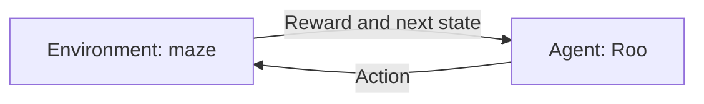
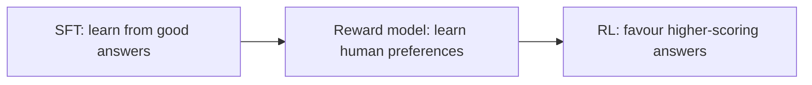

# Chapter 15 — Reinforcement Learning

> **Your two-hour mission:** teach a tiny robot to find treasure, understand how it
> learns from mistakes, and connect that idea to modern language models.

Learn the RL loop, work one update by hand, run Q-learning on a tiny maze, meet
the handful of algorithms interviewers ask about (Q-learning, SARSA, DQN, policy
gradients, actor-critic, PPO), and recognise when RL is useful. Basic arithmetic
is enough; every formula is also said in words. Chapter 14 helps with neural
networks, but their intuition is explained here.

| Stop | Study budget |
|---|---:|
| 15.1 Meet the learner | 8 min |
| 15.2 Chasing the right reward | 10 min |
| 15.3 Explore or exploit? | 16 min |
| 15.4 How good is this move? | 11 min |
| 15.5 Watch the robot learn | 26 min |
| 15.6 Beyond the cheat sheet | 21 min |
| 15.7 The LLM connection | 9 min |
| 15.8 Choosing wisely, recap and recall | 14 min |
| **Total, including examples and recall** | **115 min** |

---

## 15.1 Meet the Learner


### Simple Explanation

<details>
<summary><strong>Read as text</strong> — the puppy analogy, Roo's maze and the six RL words</summary>

Teach a puppy to sit by rewarding useful attempts, not explaining muscle movements.
Rewarded behaviour gradually becomes more likely. **Reinforcement learning (RL)**
gives a computer a similar setup: make choices, observe consequences, improve.

> **Official Definition:** Reinforcement learning studies how an agent learns a
> policy for choosing actions to maximise expected cumulative reward through
> interaction with an environment.

**Cumulative** matters: a disappointing move now might enable a better outcome
later. Learn a strategy, not just how to chase the next treat.

Meet our robot, **Roo**, in a tiny treasure maze:

```
  +---+---+---+
  | S | B | G |    S = start, G = treasure
  +---+---+---+    P = pit; B, C, D = ordinary cells
  | C | D | P |
  +---+---+---+
```

| Component | Meaning | In Roo's maze |
|---|---|---|
| **Agent** | The decision-maker | Roo's controller |
| **Environment** | The world it acts in | Maze and its rules |
| **State** | Information describing the current situation | Roo's cell |
| **Action** | An available choice | Up, Down, Left, Right |
| **Reward** | A number returned after a move | Movement cost, treasure or pit payoff |
| **Policy** | The strategy for choosing actions | What Roo chooses in each cell |

A policy can be **deterministic** (always the same action in a given cell) or
**stochastic** (probabilities over actions, such as Right 70%, Down 30%).
An **episode** is one complete attempt, from the start until treasure or the pit.
Training repeats many episodes; one lucky success is not a learned strategy.



For example, Roo observes S, chooses Right, receives a reward, and observes B.
Nobody supplied a label saying "Right is correct." Roo must discover its usefulness.

| Learning type | Typical feedback | Example |
|---|---|---|
| Supervised | Correct answer for an input | Label an email as spam |
| Unsupervised | No target labels; discover structure | Group similar customers |
| Reinforcement | Rewards following decisions | Learn a route to treasure |

In our story, Roo collects experience by acting. **Offline RL** instead learns
from previously logged experience; RL does not always require collecting fresh
data during training.

</details>

---

## 15.2 Chasing the Right Reward

### Simple Explanation

<details>
<summary><strong>Read as text</strong> — reward versus return, and the maths line</summary>

Roo pays a small movement fee but earns treasure at the destination. If it only
cares about the next fee, it misses why moving is worthwhile. We need a way to
score the **whole journey**.

> **Official Definition:** A reward is one step's feedback. A return is the sum
> of future rewards, usually discounted so later rewards receive less weight.

> **Maths in one line:** `Gₜ = rₜ₊₁ + γ·rₜ₊₂ + γ²·rₜ₊₃ + …` — the return
> from time t adds every future reward, each one shrunk by another factor γ (gamma, between 0 and 1).

</details>

### One rulebook for every example

<details>
<summary><strong>Read as text</strong> — move costs, payoffs and terminal cells</summary>

- Every move costs **-1**, including a move into treasure or the pit.
- Entering G gives an additional **+10**: that move's total reward is **+9**.
- Entering P gives an additional **-10**: that move's total reward is **-11**.
- G and P are **terminal**: the episode ends immediately on entry.
- Walking into an outer wall leaves Roo in the same cell and still costs **-1**.

Payoffs arrive on entry, never again. These rules apply throughout.

</details>

### Discounting: how much does later count?

<details>
<summary><strong>Read as text</strong> — the gamma table, the 7.1 route and the horizon rule</summary>

The **discount factor**, $\gamma$ (gamma), controls future reward's weight:

| Gamma | Behaviour encouraged |
|---|---|
| 0 | Care only about the immediate reward |
| 0.9 | Count a reward one step later at 90% of its value |
| Closer to 1 | Give distant rewards more weight |

We use **gamma = 0.9**. This is an objective-setting choice, not the learning
speed or the probability of exploring.

```
Route:       S ------> B ------> G
Rewards:          -1        +9

Return from S = -1 + 0.9 x 9 = 7.1
```

Longer sequences continue the pattern: the next reward gets weight
$\gamma^2$, then $\gamma^3$, and so on.

A handy rule: gamma looks roughly $1/(1-\gamma)$ steps ahead, so about 10 steps
for 0.9 and 100 for 0.99. A reward 10 steps away counts $0.9^{10} \approx 0.35$
of its value. A gamma below 1 also keeps the total finite in tasks that never end.

**Predict first:** would adding an unnecessary step help here?
No. It adds another movement fee and delays the positive treasure reward.
Notice that the first reward is negative even on the best route.

</details>

### State and the Markov idea

<details>
<summary><strong>Read as text</strong> — MDPs, the Markov property and slippery floors</summary>

Our rulebook describes an **MDP**, or Markov Decision Process: states, actions,
transition rules, rewards and a discount factor, often written as the tuple
$(S, A, P, R, \gamma)$, where $P$ gives the probability of each next state.

**Markov** means the current state contains the information needed to predict the
next state and reward, given an action. Roo's cell is enough in this fixed maze.
For a moving robot, position alone may not be enough: velocity could matter too.
Including relevant history or velocity makes the state more informative; the Atari
DQN agent (§15.6) feeds its network the last four screen frames so the state shows motion.

Transitions need not be deterministic. On a slippery floor, choosing Up could
occasionally move Roo sideways. RL then values an action by its **expected**
outcome across possibilities, not by assuming every move succeeds.

</details>

---

## 15.3 Explore or Exploit?

![Explore-or-exploit infographic: a robot at a fork with signs Exploit (90%) best-known action and Explore (10%) random pick from all 4 actions; the formula P(best-known) = (1 - epsilon) + epsilon / number of actions giving 0.925; a pie with the best-known action at 92.5% (90% exploit + 2.5% random) and three 2.5% slivers; a bar chart of clicks per 1,000 shows on a 3-ad bandit (epsilon 0: 257.1, 0.01: 264.4, 0.1: 278.8, 0.3: 275.5, 1: 249.7, decaying: 282.6, best possible 300); and a table of how often each setting ends up showing the best ad C.](diagrams/rl15_info_explore_exploit_ai.png)

### Simple Explanation

<details>
<summary><strong>Read as text</strong> — the restaurant dilemma and the 92.5% maths line</summary>

Dinner presents the same dilemma: revisit your favourite restaurant, or try a new
one that might be better? Always revisiting misses discoveries; always trying new
places means never enjoying what you learned.

> **Official Definition:** Exploration gathers information through less-certain
> actions. Exploitation uses current knowledge to choose a promising action.

> **Maths in one line:** `P(best-known action) = (1 − ε) + ε / (number of actions)` —
> with ε-greedy, the best-known action wins both the "exploit" branch and its fair share of the random branch.

Roo faces this tradeoff too. A route through C might look best after a few
attempts, simply because Roo has not properly tried going through B.
The best **known** option is not necessarily the best **possible** option.

</details>

### Epsilon-greedy: one strategy is enough

<details>
<summary><strong>Read as text</strong> — the 90/10 split, why 92.5% and the two extremes</summary>

**Epsilon**, $\epsilon$, is the probability of choosing the random-action branch.
Otherwise, choose the action with the highest current estimated value.

```
epsilon = 0.1

90% of decisions: choose the best-known action
10% of decisions: choose randomly from all available actions
```

The random branch can also select the best-known action! With four actions and
one clear best, its total selection probability is
$0.9 + 0.1/4 = 0.925$, or **92.5%**.
Exploring does not necessarily mean choosing a worse action.

Explore more while estimates are unreliable, then reduce epsilon as they improve.
A little ongoing exploration helps avoid freezing on an early guess.
Schedules do not guarantee sufficient coverage.

At **epsilon = 0 from the start**, Roo may never discover a better route.
At **epsilon = 1 forever**, it never deliberately exploits its estimates, although
Q-learning can still update those estimates from its random experience.
Learning values and choosing to use them are different things.

</details>

### Bandits: the simpler cousin

<details>
<summary><strong>Read as text</strong> — bandits, the three ads and the running-average rule</summary>

A **multi-armed bandit** repeatedly chooses among options with unknown payoffs,
without modelling action-dependent journeys through future states.
Think of selecting an advert and observing whether it gets clicked.

If ad B has the best estimated click rate after a small sample, it is sensible
to show B often while still occasionally trying A and C. More observations may
change the winner.

Run it. Three ads have true click rates of 20%, 25% and 30%; the agent does not
know them. Each ad's estimate is the running average of its clicks,
$Q \leftarrow Q + (\text{click} - Q)/N$: the same "nudge the guess toward new
evidence" rule Q-learning uses in §15.5, with step size $1/N$. The program
repeats 500 independent experiments of 1,000 shows for each exploration setting.

</details>

```python
# Epsilon-greedy on a 3-ad bandit: too little, too much and just enough exploration
import numpy as np

true_ctr = np.array([0.20, 0.25, 0.30])   # click rates of ads A, B, C: hidden from the agent
runs, shows = 500, 1000                    # 500 independent experiments of 1,000 shows each

def play(epsilon_at, seed=0):
    rng = np.random.default_rng(seed)
    rows = np.arange(runs)
    Q = np.zeros((runs, 3))                # estimated click rate of each ad
    N = np.zeros((runs, 3))                # how often each ad has been shown
    clicks, late_C = 0.0, 0
    for t in range(shows):
        greedy = np.argmax(Q + rng.random((runs, 3)) * 1e-9, axis=1)   # ties broken at random
        explore = rng.random(runs) < epsilon_at(t)
        ad = np.where(explore, rng.integers(3, size=runs), greedy)
        click = (rng.random(runs) < true_ctr[ad]).astype(float)
        N[rows, ad] += 1
        Q[rows, ad] += (click - Q[rows, ad]) / N[rows, ad]          # running average of clicks
        clicks += click.sum() / runs
        if t >= shows - 100:
            late_C += int((ad == 2).sum())
    return clicks, late_C / (runs * 100)

schedules = {"0 (never explore)": lambda t: 0.0,
             "0.01": lambda t: 0.01,
             "0.1": lambda t: 0.1,
             "0.3": lambda t: 0.3,
             "1 (always random)": lambda t: 1.0,
             "1 -> 0.01, decaying": lambda t: max(0.01, 1 - t / 300)}
print(f"{'epsilon':<20} {'clicks per 1,000':>16}   {'ad C in last 100 shows':>22}")
result = {}
for name, epsilon_at in schedules.items():
    result[name] = play(epsilon_at)
    print(f"{name:<20} {result[name][0]:16.1f}   {result[name][1]:22.1%}")

clicks = {name: c for name, (c, share) in result.items()}
assert clicks["0.1"] > clicks["0 (never explore)"] and clicks["0.1"] > clicks["1 (always random)"]
assert abs(clicks["1 (always random)"] - 250) < 5           # random = average rate x 1,000
assert max(clicks, key=clicks.get) == "1 -> 0.01, decaying"
print(f"best possible: {true_ctr.max() * shows:.0f} clicks (always show C)")
```

**Output:**

```
epsilon              clicks per 1,000   ad C in last 100 shows
0 (never explore)               257.1                    42.0%
0.01                            264.4                    56.4%
0.1                             278.8                    76.9%
0.3                             275.5                    72.7%
1 (always random)               249.7                    33.2%
1 -> 0.01, decaying             282.6                    84.3%
best possible: 300 clicks (always show C)
```

<details>
<summary><strong>Read as text</strong> — continued: reading the clicks, UCB and Thompson sampling</summary>

Read it from the extremes inward:

- **Never explore:** every estimate starts at 0, so the agent locks onto whichever
  ad gets clicked first. Only 42% of experiments end up showing the best ad C.
- **Always random:** it earns the plain average, 0.25 x 1,000 = 250 clicks.
- **epsilon = 0.1** does far better. Even after it has found C, it can show C at
  most $0.9 + 0.1/3 = 93.3\%$ of the time, because it keeps exploring.
- **Decaying epsilon** explores hard early, then exploits: the best total here.

Smarter explorers exist. **UCB** (upper confidence bound) adds a bonus to rarely
tried options, choosing $\arg\max_a \big[Q(a) + c\sqrt{\ln t / N(a)}\big]$.
**Thompson sampling** shows each option with the probability that it is the best.

Bandits isolate exploration versus exploitation. Roo's maze adds another challenge:
the current action changes which situations and rewards become reachable next.

</details>

---

## 15.4 How Good Is This Move?


### Simple Explanation

<details>
<summary><strong>Read as text</strong> — V as situation score, Q as move score</summary>

A policy tells Roo **what to do**. A value estimate tells Roo **how promising
something is**. Think of a coach distinguishing "this position is good" from
"that particular move is good."

> **Official Definition:** $V^\pi(s)$ is the expected return from state $s$ while
> following policy $\pi$. $Q^\pi(s,a)$ is the expected return after taking action
> $a$ in $s$, then following $\pi$.

You can read these as **V = situation score** and **Q = move score**.
Both include future rewards, not just the next reward.

Values depend on the strategy followed afterwards: a useful location is wasted
if Roo keeps choosing bad moves. Below, **V\*** means the value with optimal
choices; the star does not mean a different reward.

</details>

### Bellman: now plus later

<details>
<summary><strong>Read as text</strong> — the Bellman equation for V* and Q*</summary>

The **Bellman idea** breaks a long journey into one move and everything after it:

```
Score of a move = reward now + gamma x value of the next state
```

> **Maths in one line:** `V*(s) = max over a of [ r(s, a) + γ · V*(s') ]` — a situation's
> best value is the best move's reward now plus the discounted value of where that move lands.

For optimal state values, choose the move with the highest score. If transitions
are random, average over their possible outcomes first. The same idea, written
for move scores, is the equation Q-learning will chase in §15.5:

$$Q^*(s,a) = \mathbb{E}\big[\,r + \gamma \max_{a'} Q^*(s',a')\,\big], \qquad V^*(s) = \max_a Q^*(s,a)$$

The best policy then simply picks $\arg\max_a Q^*(s,a)$ in every state. For a
fixed, non-optimal policy $\pi$, replace "max" with "average over the actions $\pi$
would choose": that gives $V^\pi$ and $Q^\pi$.

</details>

### Work backwards from treasure

<details>
<summary><strong>Read as text</strong> — G, B, S, D and C worked backwards, and value iteration</summary>

Follow the same route: **S -> B -> G**.

**Step 1: G is terminal.** Its future value is zero because there are no further
moves or rewards. The pit P also has zero *future* value; entering it is still
bad because that transition pays -11.

**Step 2: B is one move from treasure.** Moving Right receives +9 and ends the episode:

$$V^*(B) = 9 + 0.9 \times 0 = 9$$

**Step 3: S is two moves away.** Moving Right costs -1, then reaches B:

$$V^*(S) = -1 + 0.9 \times 9 = 7.1$$

That is exactly the route return we calculated earlier. Bellman did not invent
another score; it reused the score of the remaining journey.

**Your turn:** Roo is in D. Should it move Up toward B, or Right into P?
Up has score $-1 + 0.9 \times 9 = 7.1$.
Right has score $-11 + 0.9 \times 0 = -11$.
The immediate rewards alone do not explain the appeal of going Up; the future does.

Finish the map: from C, both Up (to S) and Right (to D) score
$-1 + 0.9 \times 7.1 = 5.39$, so $V^*(C) = 5.39$. Every cell now has its value:

```
  +---------+---------+---------+
  | S: 7.1  | B: 9    | G: 0    |    V* with gamma = 0.9
  +---------+---------+---------+
  | C: 5.39 | D: 7.1  | P: 0    |
  +---------+---------+---------+
```

Repeating this backup for every cell until nothing changes is **value iteration**,
a dynamic-programming method. It needs the map: the transitions and rewards.
In a new environment, Roo does not start with the correct values. It must estimate
them from experience. That is where Q-learning comes in.

</details>

---

## 15.5 Watch the Robot Learn

![Q-learning vs SARSA infographic: the update rule Q(s,a) moves a fraction alpha toward r + gamma x max Q(s',a'); an evenly spaced number line 1 to 4 showing one update of Q(S, Right) from old Q = 2 toward target 3.5 (TD error 1.5) landing at new Q = 2.15 (alpha x TD error = 0.1 x 1.5); side-by-side boxes where Q-learning uses the best next move (target -1 + 0.9 x 5 = 3.5, new Q 2.15) and SARSA the move actually taken (target -1 + 0.9 x 1 = -0.1, new Q 1.79); and the learned Q-table rows S (Up 3.41, Down 0.59, Left 4.00, Right 7.10) and B (6.01, 1.28, 4.24, 9.00) giving the greedy route S to B to G.](diagrams/rl15_info_q_learning_sarsa_ai.png)

### Simple Explanation

<details>
<summary><strong>Read as text</strong> — the cheat sheet, the update rule and off-policy</summary>

**Q-learning** builds a cheat sheet: one row per state, one score per action.
After each move, Roo compares its old guess with new evidence and nudges the guess.

> **Official Definition:** Q-learning is a model-free, off-policy method that
> updates action-value estimates using observed rewards and the best estimated
> continuation from the next state.

> **Maths in one line:** `Q(s,a) ← Q(s,a) + α · [ r + γ · max over a' of Q(s',a') − Q(s,a) ]` —
> move the old move-score a fraction α toward "reward now plus the best score available from the next state".

**Model-free** means it does not need a model predicting the environment's
transitions. It can still use a table or a neural network.
**Off-policy** means it can explore while learning values for greedy continuation;
its learning target need not follow the same strategy that collected the experience.
An **on-policy** method instead targets the policy used to collect its experience.

</details>

### One update, with numbers

<details>
<summary><strong>Read as text</strong> — old Q 2, target 3.5, new Q 2.15, and the terminal exception</summary>

These are **imperfect estimates during training**, not the final values from
the previous section:

| Quantity | Current value |
|---|---:|
| Old Q(S, Right) | 2 |
| Best current Q-value in B | 5 |
| Reward for S to B | -1 |
| Discount gamma | 0.9 |
| Learning rate alpha | 0.1 |

First build a **target**, our improved guess based on this transition:

```
Target = reward + gamma x best next Q
       = -1 + 0.9 x 5
       = 3.5

TD error = target - old estimate
         = 3.5 - 2 = 1.5

New Q = old Q + alpha x TD error
      = 2 + 0.1 x 1.5
      = 2.15
```

**TD** means temporal difference: learning from the difference between the current
estimate and a reward-plus-future estimate.
Roo moves partway toward 3.5 because this experience and its future estimates
may be misleading.

The compact rule is:

$$Q(s,a) \leftarrow Q(s,a) + \alpha\,\big[\underbrace{r + \gamma \max_{a'} Q(s',a')}_{\text{target}} - Q(s,a)\big]$$

**Predict first:** if the target were below the old estimate, would Q rise?
No, the TD error would be negative, so the estimate would fall.

**Terminal exception:** if the move ends the episode, the target is **just the
reward**. There is no future Q-value to add. Moving from B into G targets +9.

</details>

### The whole recipe

<details>
<summary><strong>Read as text</strong> — the recipe, the three controls and the run setup</summary>

```text
Start with a Q-table of zeros.
For each episode:
  Start Roo at S.
  Until Roo reaches treasure or the pit:
    Choose an action using epsilon-greedy.
    Observe the reward and next state.
    Target = reward; add gamma * best next Q only if not terminal.
    Update Q for the state and action just experienced.
    Continue from the next state.
```

Three controls, three different jobs:

| Control | Question it answers |
|---|---|
| **Alpha: learning rate** | How far should this update move my estimate? |
| **Gamma: discount** | How much should future rewards count? |
| **Epsilon: exploration** | How often should I choose randomly? |

Act greedily by choosing the row's highest Q-value. Learning takes many experiences.
Tabular convergence needs sufficient exploration (every state-action pair tried
again and again) and suitable learning rates; more episodes alone do not
guarantee success.

Run it on Roo's maze with exactly this recipe: gamma = 0.9, alpha = 0.1,
500 episodes. It first replays the hand-worked update, then trains twice: with
epsilon = 0.1, and with epsilon = 1, where every single move is random.

</details>

```python
# Tabular Q-learning on Roo's maze: one hand-checked update, then whole training runs
import numpy as np

MAZE = [["S", "B", "G"], ["C", "D", "P"]]
ACTIONS = ["Up", "Down", "Left", "Right"]
MOVES = [(-1, 0), (1, 0), (0, -1), (0, 1)]
WHERE = {MAZE[r][c]: (r, c) for r in range(2) for c in range(3)}
gamma, alpha = 0.9, 0.1

def step(s, a):                                     # the rulebook from 15.2
    r, c = WHERE[s]
    nr, nc = r + MOVES[a][0], c + MOVES[a][1]
    if not (0 <= nr < 2 and 0 <= nc < 3):           # outer wall: stay put, still pay -1
        nr, nc = r, c
    s2 = MAZE[nr][nc]
    reward = -1 + {"G": 10, "P": -10}.get(s2, 0)
    return s2, reward, s2 in ("G", "P")

def q_update(q_old, reward, best_next, done):
    target = reward if done else reward + gamma * best_next
    return q_old + alpha * (target - q_old)

print(f"One update: Q(S,Right) = 2 -> {q_update(2, -1, 5, False):.2f}")
print(f"Terminal:   Q(B,Right) = 0 -> {q_update(0, 9, 5, True):.2f}  (target is just +9)")

def train(epsilon, episodes=500, seed=0):
    rng = np.random.default_rng(seed)
    Q = {s: np.zeros(4) for s in "SBCD"}            # the cheat sheet: 4 rows x 4 actions
    for _ in range(episodes):
        s, done = "S", False
        while not done:
            a = int(rng.integers(4)) if rng.random() < epsilon else int(np.argmax(Q[s]))
            s2, reward, done = step(s, a)
            best_next = 0.0 if done else Q[s2].max()
            Q[s][a] = q_update(Q[s][a], reward, best_next, done)
            s = s2
    return Q

V_STAR = {"S": 7.1, "B": 9.0, "C": 5.39, "D": 7.1}     # Bellman values from 15.4
for epsilon in [0.1, 1.0]:                            # 1.0 = every single move is random
    Q = train(epsilon)
    print(f"\nepsilon = {epsilon}, 500 episodes")
    print(" " * 25 + "".join(f"{a:>7}" for a in ACTIONS) + "   best")
    for s in "SBCD":
        row = "".join(f"{q:7.2f}" for q in Q[s])
        print(f"  {s} (Bellman V* = {V_STAR[s]:4.2f})  {row}   {ACTIONS[int(np.argmax(Q[s]))]}")
    s, route = "S", ["S"]
    while s not in ("G", "P"):
        s = step(s, int(np.argmax(Q[s])))[0]
        route.append(s)
    print("  greedy route:", " -> ".join(route))
    assert route == ["S", "B", "G"] and abs(Q["S"].max() - 7.1) < 0.01
assert all(abs(Q[s].max() - V_STAR[s]) < 0.01 for s in "SBCD")   # random play learned every cell
```

**Output:**

```
One update: Q(S,Right) = 2 -> 2.15
Terminal:   Q(B,Right) = 0 -> 0.90  (target is just +9)

epsilon = 0.1, 500 episodes
                              Up   Down   Left  Right   best
  S (Bellman V* = 7.10)     3.41   0.59   4.00   7.10   Right
  B (Bellman V* = 9.00)     6.01   1.28   4.24   9.00   Right
  C (Bellman V* = 5.39)     3.63  -0.20  -0.20  -0.28   Up
  D (Bellman V* = 7.10)     4.93  -0.10  -0.10  -2.09   Up
  greedy route: S -> B -> G

epsilon = 1.0, 500 episodes
                              Up   Down   Left  Right   best
  S (Bellman V* = 7.10)     5.39   3.85   5.39   7.10   Right
  B (Bellman V* = 9.00)     7.10   5.39   5.39   9.00   Right
  C (Bellman V* = 5.39)     5.39   3.85   3.85   5.39   Up
  D (Bellman V* = 7.10)     7.10   5.39   3.85 -11.00   Up
  greedy route: S -> B -> G
```

<details>
<summary><strong>Read as text</strong> — continued: three lessons from the two Q-tables</summary>

Three lessons hide in these tables:

- **It learned the Bellman values without the map.** Along the route it uses,
  Q(S, Right) = 7.10 and Q(B, Right) = 9.00, exactly the numbers §15.4 worked out backwards.
- **It only learns what it visits.** With epsilon = 0.1, Roo rarely enters C or D,
  so their rows are still rough (3.63 instead of 5.39). The greedy route is right
  anyway, because it only needs good values in S and B.
- **Off-policy in action.** With epsilon = 1, Roo never once chooses on purpose,
  yet every cell reaches its Bellman value, because the target uses the *best*
  next move, not the move Roo will actually make.

</details>

### SARSA: the on-policy twin

<details>
<summary><strong>Read as text</strong> — the on-policy target, 2.15 vs 1.79 and the cliff</summary>

**SARSA** is named after the five things one update uses: State, Action, Reward,
next State, next Action. It replaces "best next move" with **the move Roo actually
takes next**.

> **Maths in one line:** `Q(s,a) ← Q(s,a) + α · [ r + γ · Q(s',a') − Q(s,a) ]`, where a' is
> the next action really chosen by epsilon-greedy — so SARSA scores the policy it actually follows, exploration included.

Same numbers as before, but in B the epsilon-greedy coin picks a random move,
Left, whose current estimate is 1 (the best move in B still scores 5):

```
Q-learning target = -1 + 0.9 x 5 = 3.5   ->  new Q = 2 + 0.1 x (3.5 - 2)  = 2.15
SARSA target      = -1 + 0.9 x 1 = -0.1  ->  new Q = 2 + 0.1 x (-0.1 - 2) = 1.79
```

| | Q-learning | SARSA |
|---|---|---|
| Next-step value in the target | Best next move (max) | Next move actually taken |
| Learns the value of | The greedy policy: off-policy | The policy it follows: on-policy |
| Near a cliff, while exploring | Learns the shortest edge path, but falls off more during training | Learns a safer path that leaves room for random slips |

The cliff row is the classic "cliff walking" example from Sutton and Barto's
textbook. If exploration mistakes are costly during training, SARSA's caution is a feature.

</details>

---

## 15.6 Beyond the Cheat Sheet

![Deep RL map infographic: the DQN loss (r + gamma x max Q_target(s',a') - Q(s,a))^2; eight cards - value-based DQN (Left 2, Right 7, Up 3, Down -4 picks Right), experience replay, target network, Double DQN, and policy-based REINFORCE (G = 7.1 moves pi(Right) from 0.50 to 0.67), baseline (3.85 - 5.0 = -1.15), actor-critic (A = -1 + 0.9 x 9 - 6.0 = 1.1) and PPO (ratio clipped to 0.8-1.2, so rho 1.5 counts as 1.2); a landmark timeline from 1992 TD-Gammon to 2022-25 RLHF and GRPO with AlphaFold 2 tagged as not RL; and a pick-by-question table.](diagrams/rl15_info_deep_rl_map_ai.png)


### Simple Explanation

<details>
<summary><strong>Read as text</strong> — why a table stops scaling</summary>

A small maze fits in a table. A camera image has far too many possible pixel
arrangements for a row per image. We need to generalise across situations.

> **Official Definition:** Deep RL uses neural networks to represent value
> functions, policies, or other learned parts of an RL system.

</details>

### DQN: replace the table, keep the idea

<details>
<summary><strong>Read as text</strong> — the network, the loss, replay, target network and Double DQN</summary>

A **Deep Q-Network (DQN)** predicts Q-values with a neural network:

```
Small maze:    state -> table row       -> Q for each action
Camera input:  state -> neural network  -> Q for each action
```

> **Maths in one line:** `loss = ( r + γ · max over a' of Q_target(s',a') − Q(s,a) )²` — the
> same TD error as the Q-table, squared and minimised by gradient descent on the network's weights.

For example, outputs `Left: 2, Right: 7, Up: 3, Down: -4` suggest choosing Right
when exploiting. Standard DQN suits discrete actions; a large state space is not
the same problem as a continuous action space.

Two ideas make learning more stable:

- **Experience replay:** store past transitions and train on shuffled samples.
  This reuses experience and reduces the strong correlation between consecutive moves.
- **Target network:** use a separate, periodically refreshed copy of the network
  (`Q_target` above) to estimate future values. Otherwise, the answer and the
  target it chases both keep changing together.

One known flaw: taking the max over noisy estimates tends to **overestimate**
values. **Double DQN** (2016) picks the best next action with the online network
but scores it with the target network.

</details>

### Learn the action directly

<details>
<summary><strong>Read as text</strong> — REINFORCE, baselines, actor-critic and PPO with numbers</summary>

For a robot arm, actions might be continuous joint torques. Listing every possible
torque and comparing its Q-value is impractical.
**Policy gradient methods** instead adjust a policy directly, making actions
associated with better returns more likely.

> **Maths in one line:** `θ ← θ + α · Gₜ · ∇θ log πθ(aₜ | sₜ)` — REINFORCE: nudge the
> policy's parameters θ to make the action taken more likely, in proportion to the return G that followed.

The policy might output action probabilities or parameters of a continuous action
distribution. Here is one REINFORCE step with tiny numbers. Suppose Roo's policy
in S only chooses between Right and Down, each with logit 0, so 50% each:

```
Episode: Right, Right -> return G = 7.1          (alpha = 0.1)

Gradient of log pi(Right) w.r.t. the logits = [1 - 0.5, 0 - 0.5] = [+0.5, -0.5]
Logits += 0.1 x 7.1 x [+0.5, -0.5]           = [+0.355, -0.355]
New pi(Right) = 1 / (1 + e^-0.71)            = 0.67
```

Learning from outcomes can be noisy: the same sensible action can be followed by
good or bad luck. In this maze most returns are positive, so without help almost
every action Roo happens to take gets pushed up. The detour Down, Right, Up, Right
still returns $-1 - 0.9 - 0.81 + 0.729 \times 9 = 3.85$.
Subtracting a **baseline** $b$, such as the average return 5.0, fixes this: that
detour now scores $3.85 - 5.0 = -1.15$ and is pushed **down**. A baseline changes
the noise, not the direction the policy improves on average.

**Actor-critic** adds a coach:

```
Actor:  chooses the action
Critic: estimates how good the situation is
        -> helps judge outcomes relative to expectations
```

An **advantage** describes how much better an action is than the policy's usual
expectation in that state. The critic's own estimate is the baseline:

> **Maths in one line:** `A(s,a) = r + γ · V(s') − V(s)` — the reward plus the critic's
> score for the next state, minus its score for this one: positive means "better than expected".

Say the critic, still learning, believes $V(S) = 6.0$ and $V(B) = 9$. Roo moves
Right: $A = -1 + 0.9 \times 9 - 6.0 = 1.1 > 0$, so the actor makes Right more
likely, and the critic raises $V(S)$ toward 7.1. This relative feedback can reduce
noise compared with using raw returns. The critic can also be wrong; it is learning too.

**PPO** (Proximal Policy Optimization, Schulman et al., 2017) is a
policy-optimisation method often used with an actor and critic. Its clipped
training objective discourages overly large policy changes: improve without
throwing away yesterday's useful behaviour.

> **Maths in one line:** `L = E[ min( ρ·A , clip(ρ, 1−ε, 1+ε)·A ) ]` with
> `ρ = π_new(a|s) / π_old(a|s)` — once an action's probability has moved more than ε
> (usually 0.2) in the helpful direction, the objective stops rewarding further pushes.

Example: a good action ($A = +1$) whose probability is already up 50%
($\rho = 1.5$) scores $\min(1.5,\ 1.2 \times 1) = 1.2$: no gain from pushing
further. Watch out: this ε is PPO's clip range, unrelated to epsilon-greedy's
exploration rate. Clipping is not a hard guarantee that the whole policy cannot
change too much. [Ch 17 §3.4](#content/17_llm) runs this objective on real numbers.

Remember: **Q-learning scores moves; DQN predicts scores with a network; policy
methods learn behaviour; actor-critic adds a learned coach; PPO keeps each
policy step small.**

</details>

### Landmark results

<details>
<summary><strong>Read as text</strong> — the landmark table from TD-Gammon to GRPO, and AlphaFold 2</summary>

Interviewers like to ask "where has RL actually worked?" These dates are from the
original papers and announcements:

| Year | System | What it did | The RL ingredient |
|---|---|---|---|
| 1992 | **TD-Gammon** (IBM) | Backgammon close to strong human experts | Self-play, TD learning, a small neural network |
| 2013, 2015 | **DQN** (DeepMind) | Atari from raw pixels: 7 games (2013); 49 games, over 75% of a pro tester's score on 29 (2015) | Q-learning + CNN + replay + target network |
| 2015–16 | **AlphaGo** | Beat Fan Hui 5–0 (Oct 2015) and Lee Sedol 4–1 (Mar 2016) at Go | Human games (supervised), then self-play RL and tree search |
| 2017–18 | **AlphaGo Zero, AlphaZero** | No human games at all; AlphaZero also mastered chess and shogi | Self-play RL; plans with the known game rules |
| 2019–20 | **MuZero** | Matched AlphaZero and played Atari without being told the rules | Learns its own model, then plans with it |
| 2019 | **OpenAI Rubik's Cube hand** | A robot hand solving the cube, trained only in simulation | Sim-to-real with domain randomisation; the solve steps came from a classical solver |
| 2022–25 | **InstructGPT, DeepSeek-R1** | Chat assistants and reasoning models | RLHF with PPO; RLVR with GRPO (§15.7) |

**Not RL:** AlphaFold 2 (protein structures, CASP14 in 2020; Nobel Prize in Chemistry
2024) learned from known protein structures by supervised deep learning. Naming it
as an RL success is a common slip.

</details>

---

## 15.7 The LLM Connection

![RL for language models infographic: the classic RLHF pipeline SFT, then a reward model learned from human preferences, then RL (PPO) with a KL penalty; the objective maximise E(r(x, y)) - beta x KL(pi || pi_ref); a table mapping policy, state, action, episode and reward to the LLM, prompt plus tokens so far, next token, one answer and score plus drift penalty; a GRPO group of 8 answers where 3 correct get +1.29 and 5 wrong get -0.77 (mean reward 0.375); and a comparison of classic RLHF, DPO, RLVR and GRPO.](diagrams/rl15_info_rl_for_llms_ai.png)


### Simple Explanation

<details>
<summary><strong>Read as text</strong> — the RL-to-LLM mapping, the RLHF pipeline, DPO, RLVR and GRPO</summary>

Suppose a model gives two explanations of gravity: one full of jargon, one a child
can follow. A person prefers the second. How can that judgement improve future answers?

> **Official Definition:** RLHF uses human feedback to construct reward signals
> for improving a policy. Language-model training often uses a learned reward model
> to scale human preference feedback.

> **Maths in one line:** `maximise E[ r(x, y) ] − β · KL( π ‖ π_ref )` — earn a high reward
> for answer y to prompt x, but pay a price β for drifting away from the reference (SFT) model.

The RL vocabulary maps onto a language model directly:

| RL term | In LLM training |
|---|---|
| Policy | The language model itself |
| State | The prompt plus the tokens written so far |
| Action | The next token |
| Episode | One complete answer |
| Reward | A reward-model or checker score for the finished answer, plus a penalty for drifting from the reference model |

Here is the **classic PPO-based recipe**, not the only possible RLHF implementation:



**SFT**, or supervised fine-tuning, provides demonstrations of helpful responses.
Humans then compare candidate answers; a reward model learns to score preferred
answers higher. RL uses those scores while discouraging excessive drift from a
reference model. The reward model avoids asking a human to rate every training response.

| Approach | Feedback and learning idea |
|---|---|
| **Classic RLHF** | Learn a preference reward model, then optimise against its scores |
| **DPO** | Train directly on chosen/rejected answer pairs; no separate reward model or RL rollout loop |
| **RLVR** | Reward automatically checkable outcomes, such as a correct answer or passing tests |

DPO is preference optimisation, not a requirement to run online RL.
Verifiable rewards are useful, but an incomplete test suite can still be gamed.
Neither preference scores nor passing a narrow check guarantee truth or safety.

RLVR names the reward, not the optimiser. It is often paired with **GRPO** (Group
Relative Policy Optimization), introduced in DeepSeekMath (2024) and made famous by
DeepSeek-R1 (2025). GRPO is PPO without the critic: sample a group of answers to
one prompt, and score each answer against its own group. With 3 correct answers
out of 8, each correct one gets advantage +1.29 and each wrong one −0.77
([Ch 17 §3.5b](#content/17_llm) shows the arithmetic).

For the deeper post-training material, see [Chapter 17](#content/17_llm), sections
3.4-3.5c. Understanding this bridge is enough here.

</details>

---

## 15.8 Choosing Wisely, Recap and Recall

![When-to-use-RL infographic: a decision flowchart (labelled answers to supervised learning, one choice with instant feedback to a bandit, a small fully known map to search or planning, training mistakes that could harm people to avoid unrestricted trial and error, sequential control with measurable success and a safe simulator to consider RL); model-based (value iteration, AlphaZero, MuZero) vs model-free (Q-learning, SARSA, DQN, PPO); and a reward-hacking picture where a robot keeps touching one box so its reward rises while deliveries stay at 0.](diagrams/rl15_info_choosing_rl_ai.png)

### Simple Explanation

<details>
<summary><strong>Read as text</strong> — model-based vs model-free and the when-to-use table</summary>

RL learns by trying things, often expensively. For our known maze, a map and
shortest-path search would already solve the job!

> **Official Definition:** Model-based methods use a known or learned environment
> model to plan; model-free methods learn values or policies without modelling
> those dynamics.

A model-based Roo imagines routes; a model-free Roo updates values from experience.
Planning can save real interactions, but a wrong model can produce bad plans.
Value iteration (§15.4) and AlphaZero plan with a known model; MuZero learns its
own; Q-learning, SARSA, DQN and PPO are model-free.

| Situation | Sensible starting point |
|---|---|
| Predict spam from labelled emails | Supervised learning |
| Choose an ad for immediate clicks | Consider a bandit |
| Find a route through a fully known small maze | Search or planning |
| Learn sequential control with measurable success and safe simulation | Consider RL |
| Training mistakes could seriously harm people | Do not rely on unrestricted trial and error |

</details>

### The reward is not the real goal

<details>
<summary><strong>Read as text</strong> — reward hacking and how to catch it</summary>

Reward a robot for **touching boxes**, and it might repeatedly tap one without
delivering it. **Reward hacking** means optimising the score, not the intended task.

Measure deliveries, inspect behaviour, and evaluate on new situations. Sparse or
delayed rewards can make learning slow; simulators help, but real conditions may differ.

</details>

### Pocket recap

**Policy chooses; V scores situations; Q scores moves. Bellman connects now and
later. Q-learning updates estimates toward the best next move (off-policy); SARSA
toward the move it actually takes (on-policy). Explore to discover; exploit to
benefit. Policy gradients push up actions with positive advantage; PPO clips the
step. Reward the right goal.**

### Nine quick recall questions

Try answering before opening each explanation.

**1. Why is Roo's first -1 move not necessarily bad?**

<details>
<summary>Answer</summary>

It leads toward treasure. The route's return is -1 + 0.9 x 9 = 7.1,
despite that immediate cost.
</details>

**2. What is the difference between a policy, V and Q?**

<details>
<summary>Answer</summary>

Policy chooses actions. V estimates a situation's return; Q estimates a move's
return. Both depend on the policy followed afterwards.
</details>

**3. Does epsilon = 0.1 mean choosing a non-best action exactly 10% of the time?**

<details>
<summary>Answer</summary>

No. The 10% random branch includes the best action too.
</details>

**4. Old Q is 2, target is 3.5, alpha is 0.1. What is the update?**

<details>
<summary>Answer</summary>

Error = 1.5; new Q = 2 + 0.1 x 1.5 = 2.15.
Terminal transitions target the reward alone.
</details>

**5. What changes when a Q-table becomes a DQN?**

<details>
<summary>Answer</summary>

A neural network predicts Q-values instead of storing a row for every state.
The reward-plus-future learning idea remains.
</details>

**6. How does DPO differ from classic RLHF?**

<details>
<summary>Answer</summary>

DPO directly learns from preference pairs. Classic RLHF trains a reward model,
then uses RL against its scores.
</details>

**7. Old Q is 2, reward -1, gamma 0.9, alpha 0.1. In the next state the best move scores 5, but epsilon-greedy actually picks a move scoring 1. What do Q-learning and SARSA each write?**

<details>
<summary>Answer</summary>

Q-learning uses the best move: target -1 + 0.9 x 5 = 3.5, new Q = 2.15.
SARSA uses the move actually taken: target -1 + 0.9 x 1 = -0.1, new Q = 1.79.
Q-learning is off-policy; SARSA is on-policy.
</details>

**8. In PPO, a good action (advantage +1) is already 50% more likely than before (ratio 1.5). With clip range 0.2, what does the objective give, and why?**

<details>
<summary>Answer</summary>

min(1.5 x 1, 1.2 x 1) = 1.2. The clip caps the gain at a ratio of 1.2, so
pushing that action further earns nothing in this update. That ε is the clip
range, not an exploration rate.
</details>

**9. TD-Gammon, DQN, AlphaGo, AlphaFold 2: which one is not an RL result?**

<details>
<summary>Answer</summary>

AlphaFold 2. It learned protein structures by supervised deep learning.
TD-Gammon (1992), DQN (2013, 2015) and AlphaGo (2015–16) all improved through
RL on game rewards; AlphaGo first learned from human games, then from self-play.
</details>

---

**Previous:** [Chapter 14 — Neural Networks](#content/14_neural_networks) | **Next:** [Chapter 16 — Deep Learning Reference](#content/16_deep_learning)
