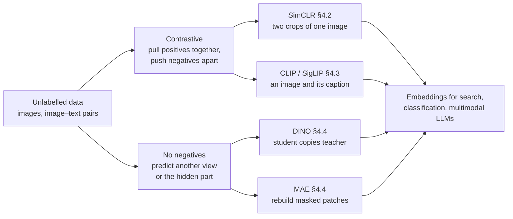
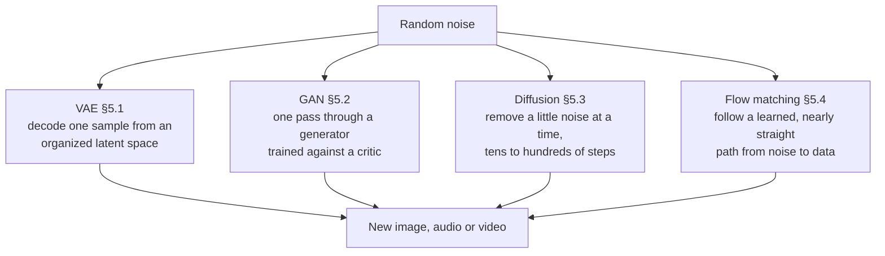
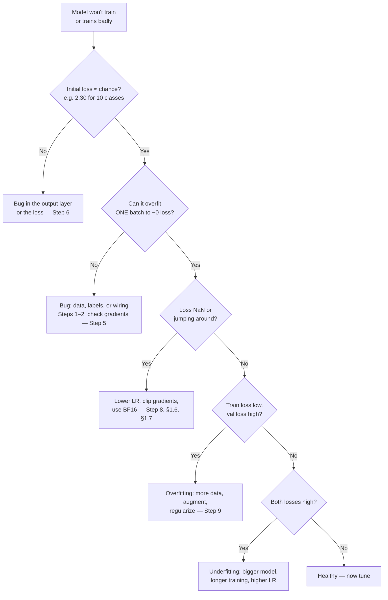
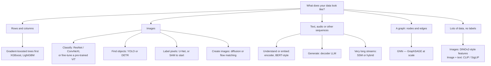

# Chapter 16 — Deep Learning: Complete Reference

> "Deep learning is a superpower. With it, you can build an AI that figures out
> things even its creator doesn't fully understand." — Andrew Ng

## Start Here

**What this chapter is.** The *deeper* companion to [Ch 14 — Neural Networks](#content/14_neural_networks). Ch 14 teaches the basics once; this chapter goes one level down on each topic and brings it up to date for 2026. If a recap here feels too quick, follow its link back to Ch 14.

**Most topics follow the same five steps**, so you always know where you are (every `L3` topic has all five; lighter topics skip the code):

| Step | What you get | Skip it if… |
|---|---|---|
| **1. Picture** | A diagram or chart at the top of the topic | — never skip |
| **2. Idea** | One sentence, then a plain-English story | you already know the topic |
| **3. Numbers** | A tiny worked example you can check by hand | you only need `L1` |
| **4. Code** | 10–20 lines of NumPy with a **▶ Run** button — change a number and re-run | you only need `L1`–`L2` |
| **5. Interview** | What to say, and the trap they set. Heavier maths sits in a collapsed **Formal version** block | — |

**Depth tags on every heading.** `L1` recognise it · `L2` explain it and its trade-off · `L3` implement it from scratch. Aim for **L2 on ★★★ topics** and **L3 only where the heading says so** — that is where the time goes furthest.

**After this chapter you can:** trace one training step with real numbers · choose an optimizer, schedule, loss and normalization and justify it · explain the vision, sequence, representation-learning and generative model families · implement attention, RMSNorm, sinusoidal encodings and RoPE in NumPy · debug a network that won't train.

> **Short on time?** Open the section map below and pick a track. Everything in it is optional reading — the chapter starts at Part 1.

<details>
<summary><strong>Section map for Ch 16–20</strong> — learning tracks, depth targets, the coding-interview ladder and where each topic lives</summary>

**Layer: MODEL — *how it works inside*.** This chapter is part of **Deep Learning & LLMs** (Ch 16–20). Every chapter in the section sits in one layer. Read the layer name and you already know what kind of question the chapter answers.

| Layer | The question it answers | Where it lives | Time |
|-------|------------------------|----------------|------|
| **Model** | *How does it work inside?* | **Ch 16 (you are here)**, **Ch 17** | 555 + 285 min |
| **Application** | *How do I build something with it?* | **Ch 17b**, **Ch 18**, **Ch 18b** | 170 + 140 + 130 min |
| **Systems** | *How do I train and run it at scale?* | **Ch 17c**, Ch 19 | 195 + 165 min |
| **Context** | *Where is the field right now?* | Ch 20 | 125 min |

**Pick one track — do not read everything**

| Track | Choose this if… | Read in this order | Approx. |
|-------|-----------------|--------------------|---------|
| **A — Interview in 4 weeks** | You have a tier-1 loop booked | Playbook → Ch 17 → **Ch 17c** → **Ch 16** → Ch 18 → Ch 18b → Ch 20 → Revision | ≈ 27 h |
| **B — Understand deeply** | You want real intuition, no deadline | **Ch 16** → Ch 17 → **Ch 17b** → **Ch 17c** → Ch 18 → Ch 18b → Ch 19 → Ch 20 | ≈ 28 h |
| **C — Ship a product** | You are building with LLMs right now | Ch 17 → **Ch 17b** → Ch 18 → Ch 18b → Ch 19 → **Ch 17c** (Parts 1–3, 5) | ≈ 16 h |

**Depth ladder — know when to stop**

Not every topic deserves the same effort. Decide the level you need *before* you start:

| Level | Means | You can… |
|-------|-------|----------|
| **L1** | Recognise | Say what the name means, in one sentence |
| **L2** | Explain | Draw it, state the trade-off, survive the follow-up question |
| **L3** | Implement | Write it from scratch in ~30 minutes |
| **L4** | Design | Use it in a system-design round, with cost arithmetic |

> **The rule that saves the most time:** aim for **L2 on everything marked ★★★**, **L3 on the dozen topics interviewers actually ask you to code** (attention, MHA, GQA, KV cache, LoRA, DPO, top-p, BPE, RoPE, RMSNorm), and **L1 on everything else**. Chasing L3 on every topic is the most common way to run out of preparation time.

**Target depth for the section's critical topics**

| Topic | Lives in | Target | Why that level |
|-------|----------|--------|----------------|
| Backpropagation | Ch 16 §1.1 | **L3** | Asked as a from-scratch derivation; the worked example here is enough |
| Optimizers (SGD → Adam → AdamW) | Ch 16 §1.2 | **L2** | Compare-and-justify question, rarely coded |
| Normalization (Batch / Layer / RMS) | Ch 16 §1.5 | **L3** | RMSNorm is a common 10-minute coding warm-up |
| Self-attention | Ch 16 §3.3, Ch 17 §2.4 | **L3** | The single most-implemented interview problem |
| Multi-head, grouped-query & latent attention (MHA/MQA/GQA/MLA) | Ch 17 §2.4 | **L3** | "Compare MHA / MQA / GQA — why did Llama pick GQA?" |
| Sliding-window attention & the modern block (SwiGLU, RMSNorm, pre-LN) | Ch 17 §2.4 | **L2** | "How does a 2026 block differ from the 2017 one?" |
| Positional encodings (sinusoidal, RoPE) | Ch 16 §3.4 | **L3** | RoPE is an Easy-rated implementation question |
| BERT vs GPT (encoder vs decoder) | Ch 16 §3.5 | **L2** | Architecture-choice question |
| Tokenization / BPE | Ch 17 §2.2 | **L3** | Easy-rated implementation question |
| Decoding strategies (temperature, top-k, top-p) | Ch 17 §2.6 | **L3** | Very commonly coded |
| Scaling laws (Chinchilla) | Ch 17 §3.7 | **L2** | Reasoning-about-budget question |
| SFT / RLHF / DPO / GRPO | Ch 17 §3.3–3.5c | **L2**, DPO **L3** | DPO loss is a Hard-rated implementation at frontier labs |
| Alignment family & reward hacking | Ch 17 §3.5c | **L2** | "Compare SFT, DPO, GRPO and RLVR — what data does each need?" |
| Distill vs quantize vs prune | Ch 17c §3.4 | **L2** | "Make this cheaper to serve" has three answers |
| LoRA / QLoRA | Ch 17b §9.4 | **L3** | Implemented at Meta, Google, Anthropic, OpenAI, Databricks |
| Mixture of Experts | Ch 16 §6.1, Ch 17 §4.8 | **L2** | Active vs total parameters; routing intuition |
| KV cache | Ch 17c §1.2 | **L3** | Implemented at Anthropic, OpenAI, Meta, Perplexity |
| Quantization | Ch 17c §3.1 | **L2** | Weight-only vs W8A8 — which phase each one helps |
| Continuous batching | Ch 17c §2.1 | **L3** | Implemented at Perplexity, Together AI, Anyscale, Meta |
| RAG (end to end) | Ch 17b §9.1, Ch 19 §19.9 | **L4** | Appears as a full system-design round |
| Agents & tool calling | Ch 18 | **L4** | Now a separate round at several companies |
| Evaluation & LLM-as-judge | Ch 17c §4 | **L2** | "How do you know it got better?" is asked every time |

**The implementation ladder — what you will actually be asked to code ★★★ `L3`**

The depth map above says *which* topics need L3. This is the concrete list, in the order to practise it. These are the problems candidates report being asked to implement from scratch, usually in 20–40 minutes with no libraries beyond NumPy or PyTorch tensors.

| # | Implement | Where it's explained | Difficulty | Reported at |
|---|---|---|---|---|
| 1 | **Byte-Pair Encoding** — train merges, then encode | [Ch 17 §2.2](#content/17_llm) | Easy | Broadly |
| 2 | **Sinusoidal positional encoding** | [Ch 16 §3.4](#content/16_deep_learning) | Easy | Broadly |
| 3 | **RoPE** — rotate Q and K by position | [Ch 16 §3.4](#content/16_deep_learning) | Easy | Broadly |
| 4 | **RMSNorm** | [Ch 16 §1.5](#content/16_deep_learning) | Easy | Broadly |
| 5 | **Softmax, numerically stable** — subtract the max | [Ch 17 §1.4](#content/17_llm) | Easy | Apple, Meta, Google, Amazon |
| 6 | **Scaled dot-product attention** | [Ch 17 §2.4](#content/17_llm) | Medium | The most-asked of all |
| 7 | **Multi-head attention** — split, attend, concat, project | [Ch 17 §2.4](#content/17_llm) | Medium | Broadly |
| 8 | **Grouped-query attention** — share K/V across groups | [Ch 17 §2.4](#content/17_llm) | Medium | Broadly |
| 9 | **KV cache** — append and reuse across decode steps | [Ch 17c §1.2](#content/17c_llm_systems) | Medium | Anthropic, OpenAI, Meta, Perplexity |
| 10 | **Sampling** — temperature, top-k, top-p | [Ch 17 §2.6](#content/17_llm) | Medium | OpenAI, Anthropic, Cohere, DeepMind |
| 11 | **Sliding-window attention** | [Ch 17 §2.4](#content/17_llm) | Medium | Mistral, Anthropic, Google, DeepMind |
| 12 | **LoRA layer** — low-rank adapter on a frozen weight | [Ch 17b §9.4](#content/17b_llm_applications) | Medium | Meta, Google, Anthropic, OpenAI, Databricks |
| 13 | **KL divergence loss** | [Ch 17 §1.4](#content/17_llm) | Easy | Broadly |
| 14 | **DPO loss** | [Ch 17 §3.5](#content/17_llm) | Hard | Anthropic, OpenAI, DeepMind, Meta |
| 15 | **Mixture-of-Experts layer** — routing + top-k gating | [Ch 17 §4.8](#content/17_llm) | Hard | Google, DeepMind, Mistral, Databricks |
| 16 | **Speculative decoding** — draft, verify, accept prefix | [Ch 17c §2.5](#content/17c_llm_systems) | Hard | Google, DeepMind, Anthropic, Apple |
| 17 | **Continuous batching** — the scheduler loop | [Ch 17c §2.1](#content/17c_llm_systems) | Hard | Perplexity, Together AI, Anyscale, Meta |
| 18 | **GRPO** — group-relative advantage, no critic | [Ch 17 §3.5c](#content/17_llm) | Expert | DeepMind, Anthropic, OpenAI |

**How to use this ladder**

- **Work top-down.** Each rung reuses the one above: MHA needs attention, GQA needs MHA, the KV cache needs GQA to be interesting, speculative decoding needs sampling.
- **Rungs 1–10 are the realistic bar** for most product and applied roles. Get those fluent before touching the bottom half.
- **Rungs 14–18 are research and infra roles.** They are Hard/Expert for a reason — attempt them only if you're targeting a frontier lab or an inference company.
- **Write it once from scratch, then once from memory a week later.** The second pass is what makes it retrievable under interview pressure.
- **Say your invariants out loud as you go** — tensor shapes at each step, what the mask does, where the batch dimension is. Interviewers score reasoning, and shape errors are the most common way candidates lose an otherwise correct answer.

> **If you only have a weekend:** rungs 6, 7, 9 and 10 — attention, multi-head, KV cache, sampling. Those four cover the majority of reported LLM coding rounds.

**Covered in depth elsewhere**


This chapter is the *model* layer, so it deliberately stops where a topic becomes a *systems* question. That material already exists — it just lives in another section. Follow the link rather than expecting it here.

| If you are asked about… | Go to |
|---|---|
| Serving — prefill vs decode, continuous batching, KV cache maths, quantization trade-offs, evaluation | [Ch 17c — LLM Systems](#content/17c_llm_systems) |
| Distributed training — DDP, FSDP, ZeRO, tensor & pipeline parallelism | [Ch 29 — GPUs, TPUs & Infrastructure](#content/29_gpus_tpus_infrastructure) |
| Knowledge distillation and pruning — the mechanisms | [Ch 29 §24.9](#content/29_gpus_tpus_infrastructure) (the *decision* is in [Ch 17c §3.4](#content/17c_llm_systems)) |
| GPU/TPU hardware, cost per GPU-hour, emerging silicon | [Ch 29 — GPUs & TPUs](#content/29_gpus_tpus_infrastructure) · [Ch 37 — Scale & Infra Cases](#content/37_system_design_cases_scale_infra) |
| Vector index internals — HNSW, IVF-PQ, hybrid search, reranking | [Ch 28 — Semantic Search](#content/28_semantic_search) |
| Jailbreaks, red-teaming, benchmark contamination | [Ch 33b — LLM Interview Questions Pt 2](#content/33b_llm_interview_questions_part2) |
| Neural-network *fundamentals* — backprop mechanics, CNNs, LSTM basics | [Ch 14 — Neural Networks](#content/14_neural_networks) |
| The probability and linear-algebra prerequisites | [Ch 06 — Math Fundamentals](#content/06_math_fundamentals) |

</details>

## Contents

| Part | Topics | Read it for |
|------|--------|-------------|
| **1 · Training** | Backprop · Optimizers · LR schedules · Losses · Normalization · Clipping · Mixed precision | How one training step works, and every knob on it |
| **2 · Vision** | CNN evolution · Detection · Segmentation · ViT · Augmentation | How images became tokens |
| **3 · Sequences & Transformers** | LSTM/GRU · Seq2Seq attention · Self-attention · Positional encodings · Encoder vs decoder | The road from RNNs to the Transformer |
| **4 · Representation learning** | Triplet & NT-Xent · SimCLR · CLIP & SigLIP · DINO & MAE | Learning good features without labels |
| **5 · Generative models** | VAE · GANs · Diffusion · Flow matching | How models create images, audio and video |
| **6 · Scaling architectures** | Mixture of Experts · State-space models · Graph networks | More capacity without more cost |
| **7 · Practical** | Debugging · Training curves · Failure modes · Frameworks & hardware | Getting a real model to train |
| **Cheat sheet** | Architecture chooser · Hyperparameters · Key takeaways · Review questions | Revision |

LLM-specific techniques — tokenization, LoRA, RLHF/DPO, RAG — live in [Ch 17](#content/17_llm) and [Ch 17b](#content/17b_llm_applications).

---

# PART 1: TRAINING DEEP NETWORKS

---

## 1.1 Backpropagation ★★★ `L3`

**In one sentence:** After the network makes a wrong prediction, backprop figures out which weights caused the mistake and by how much — so we can fix each one.


### The Story

Imagine you're tuning a guitar with 100 pegs. You play a chord, it sounds wrong. You need to figure out which pegs to turn, and how much. Backpropagation is exactly this — except instead of ears, it uses calculus.

The key question it answers: **"If I change this one weight slightly, how much does the total error change?"** When you know that for every weight, you can nudge each one in the right direction.

The math tool it uses is called the **chain rule** — a way to break a big question ("how does weight W1 affect the final error?") into a chain of smaller questions ("how does W1 affect layer 2? how does layer 2 affect layer 3? how does layer 3 affect the error?"). Multiply those small answers together and you get the big answer.

### How to read the maths in this chapter

Every worked example below follows the same rule: **no number appears without saying where it came from.** Each symbol is one of four things.

| Tag | Means | Example |
|---|---|---|
| **Given** | comes from your dataset | the inputs $x$, the true label $y$ |
| **Fixed here** | hand-picked so the arithmetic is checkable | the weights in this example |
| **Learned** | random at initialisation, then adjusted by training | the weights in a real network |
| **Computed** | derived below from the three above | $z$, $h$, $\hat y$, the loss |

And three pieces of notation used throughout:

| Notation | Read it as |
|---|---|
| $W_{ij}$ | the weight **into** neuron $i$, **from** input $j$ — destination first |
| $z^{(1)}$, $h^{(2)}$ | the superscript is the **layer number**, not a power |
| $a \odot b$ | **element-wise** multiply — pair up the positions, multiply each pair |

---

### Worked Example — Forward Pass

A forward pass is the network doing its job left to right: take the input numbers, multiply by weights, add them up, bend each sum through an activation function, and read off a prediction. Here we get **0.598** when the true answer is **1** — so the network is wrong, and the backward pass below fixes it.

The network: two inputs → one hidden layer of two neurons (ReLU) → one output (sigmoid).

```
  INPUT          HIDDEN           OUTPUT
  x₁ = 0.5  →   h₁ (ReLU)   →   ŷ (sigmoid)
  x₂ = 0.3  →   h₂ (ReLU)
  True y = 1
```

**1. The inputs — Given.**
$x_1 = 0.5$ and $x_2 = 0.3$ are the two features of a single training example — say a scaled "size" and "age", squeezed into the 0–1 range. Features are normalised first so that no one feature dominates purely because it is measured in bigger units.
$y = 1$ is the correct answer. **The network has not seen it yet** — it is only used at Step 4 to measure the error.

**2. The weights — Fixed here, Learned in practice.**
A weight is the number on each arrow: how strongly one value affects the next. In real training they start as small random numbers and are then learned. These are hand-picked so the arithmetic stays checkable.

| Weight | Connects | Value |
|---|---|---|
| $W_{11}$ | $x_1 \to h_1$ | 0.4 |
| $W_{12}$ | $x_2 \to h_1$ | 0.2 |
| $W_{21}$ | $x_1 \to h_2$ | 0.3 |
| $W_{22}$ | $x_2 \to h_2$ | 0.5 |
| $v_1$ | $h_1 \to \hat y$ | 0.6 |
| $v_2$ | $h_2 \to \hat y$ | 0.8 |

**Biases:** none in this example — they are effectively 0. Normally every neuron also adds a learned bias $b$, which shifts its sum up or down independently of the inputs.

**3. Step 1 — the hidden layer.** Each hidden neuron takes a weighted sum of *both* inputs, then applies ReLU.

$$z^{(1)}_1 = W_{11}x_1 + W_{12}x_2 = (0.4)(0.5) + (0.2)(0.3) = 0.20 + 0.06 = 0.26$$

$$h_1 = \text{ReLU}(0.26) = \max(0,\ 0.26) = 0.26$$

$$z^{(1)}_2 = W_{21}x_1 + W_{22}x_2 = (0.3)(0.5) + (0.5)(0.3) = 0.15 + 0.15 = 0.30$$

$$h_2 = \text{ReLU}(0.30) = \max(0,\ 0.30) = 0.30$$

**What ReLU did:** it keeps positive numbers unchanged and turns negatives into 0. Both sums here are positive, so nothing changed — but remember that, because it matters in Step E of the backward pass.

**The same step as one matrix multiply** — which is how code actually does it:

$$\begin{bmatrix} z_1 \\ z_2 \end{bmatrix} = \begin{bmatrix} 0.4 & 0.2 \\ 0.3 & 0.5 \end{bmatrix}\begin{bmatrix} 0.5 \\ 0.3 \end{bmatrix} = \begin{bmatrix} 0.26 \\ 0.30 \end{bmatrix}$$

Row $i$ of the matrix holds every weight arriving at neuron $i$ — which is exactly what $W_{ij}$ means, written out.

**4. Step 2 — the output layer.** The hidden values are now the inputs. Same operation, new weights:

$$z^{(2)} = v_1h_1 + v_2h_2 = (0.6)(0.26) + (0.8)(0.30) = 0.156 + 0.240 = 0.396$$

Sigmoid then squeezes that into the 0–1 range so it can be read as a probability:

$$\sigma(z) = \frac{1}{1 + e^{-z}} \qquad\Rightarrow\qquad \hat{y} = \frac{1}{1 + e^{-0.396}} = \frac{1}{1 + 0.673} = \frac{1}{1.673} = 0.598$$

**Reading 0.598:** the network is about 60% confident the answer is 1.

**5. Step 3 — the loss.** For a sigmoid output the standard loss is binary cross-entropy:

$$L = -\bigl[\,y\ln\hat{y} + (1-y)\ln(1-\hat{y})\,\bigr]$$

Because $y = 1$ here, the second term is multiplied by $(1-1) = 0$ and drops out entirely:

$$L = -\ln(\hat y) = -\ln(0.598) = 0.514$$

**Reading 0.514:** a perfect prediction ($\hat y = 1$) would give a loss of exactly 0. So 0.514 means "somewhat wrong, in the right direction" — the network leaned towards 1, just not confidently enough.

### Worked Example — Backward Pass

Now we go backwards. Each step answers one question: *"if I nudge this number up slightly, does the loss go up or down, and by how much?"* That answer is the **gradient**.

**The three rules first**, as formulas — so that no number below appears out of thin air:

| Link | Rule | Where it comes from |
|---|---|---|
| $\partial L/\partial \hat y$ | $-1/\hat y$ when $y = 1$ | derivative of $-\ln(\hat y)$ |
| $\partial \hat y/\partial z^{(2)}$ | $\hat y\,(1 - \hat y)$ | the sigmoid derivative |
| $\partial z/\partial w$ | whatever $w$ multiplied | in $z = w \cdot a$, nudging $w$ moves $z$ by $a$ |

Everything below is those three rules plus the chain rule — multiply the links along a path.

**Step A — How does the loss react to our prediction $\hat{y}$?**

$$\frac{\partial L}{\partial \hat{y}} = \frac{-1}{\hat y} = \frac{-1}{0.598} = -1.672$$

Negative means: increasing $\hat{y}$ **reduces** the loss. That is what we want — the true answer is 1, so predicting higher is better.

**Step B — How does $\hat{y}$ react to $z^{(2)}$ (the pre-sigmoid value)?**

$$\frac{\partial \hat{y}}{\partial z^{(2)}} = \hat y\,(1-\hat y) = 0.598 \times (1 - 0.598) = 0.598 \times 0.402 = 0.240$$

$$\text{Chain them: } \frac{\partial L}{\partial z^{(2)}} = -1.672 \times 0.240 = -0.401$$

> **Worth memorising.** For sigmoid + binary cross-entropy the whole chain collapses to $\hat y - y$. Check it: $0.598 - 1 = -0.402$, matching the $-0.401$ above to rounding. The same cancellation happens for softmax + categorical cross-entropy — *the gradient is just the prediction error.*

**Step C — Gradients for the Layer 2 weights.** Here $\partial z^{(2)}/\partial v_1 = h_1$, because $v_1$ multiplied $h_1$:

$$\frac{\partial L}{\partial v_1} = -0.401 \times h_1 = -0.401 \times 0.26 = -0.104$$

$$\frac{\partial L}{\partial v_2} = -0.401 \times h_2 = -0.401 \times 0.30 = -0.120$$

Both negative, so both weights should increase.

**Step D — How much blame does each hidden neuron get?** Same rule, other factor — $\partial z^{(2)}/\partial h_1 = v_1$:

$$\frac{\partial L}{\partial h_1} = -0.401 \times v_1 = -0.401 \times 0.6 = -0.241$$

$$\frac{\partial L}{\partial h_2} = -0.401 \times v_2 = -0.401 \times 0.8 = -0.321$$

$h_2$ gets more blame because it had a stronger connection ($v_2 = 0.8$) to the output.

**Step E — Back through ReLU.** ReLU's derivative is 1 where its input was positive and 0 where it was negative, so the gradient either passes through untouched or is killed:

$z^{(1)}_1 = 0.26 > 0$, so $\frac{\partial L}{\partial z^{(1)}_1} = -0.241$ (unchanged)

$z^{(1)}_2 = 0.30 > 0$, so $\frac{\partial L}{\partial z^{(1)}_2} = -0.321$ (unchanged)

Had $z$ been negative, the gradient would be **zero** and that neuron would get no update at all. This is the **dead ReLU** problem.

**Step F — Gradients for the Layer 1 weights.** Once more, $\partial z^{(1)}/\partial W$ is whatever the weight multiplied — an input this time:

$$\frac{\partial L}{\partial W_{11}} = -0.241 \times x_1 = -0.241 \times 0.5 = -0.121$$

$$\frac{\partial L}{\partial W_{12}} = -0.241 \times x_2 = -0.241 \times 0.3 = -0.072$$

$$\frac{\partial L}{\partial W_{21}} = -0.321 \times x_1 = -0.321 \times 0.5 = -0.161$$

$$\frac{\partial L}{\partial W_{22}} = -0.321 \times x_2 = -0.321 \times 0.3 = -0.096$$

**Step G — Update every weight.** The rule is `new = old − learning rate × gradient`, with $\alpha = 0.1$. Subtracting a negative gradient means the weight goes **up**:

| Weight | Old | Gradient | New = old − 0.1 × gradient |
|---|---|---|---|
| $v_1$ | 0.600 | −0.104 | **0.610** |
| $v_2$ | 0.800 | −0.120 | **0.812** |
| $W_{11}$ | 0.400 | −0.121 | **0.412** |
| $W_{12}$ | 0.200 | −0.072 | **0.207** |
| $W_{21}$ | 0.300 | −0.161 | **0.316** |
| $W_{22}$ | 0.500 | −0.096 | **0.510** |

Every weight moved in the direction that reduces the loss. **That is one training step.**

### Did it actually learn?

The step above is only worth anything if the loss actually falls. Run the same input through the *updated* weights:

$$z^{(1)}_1 = (0.412)(0.5) + (0.207)(0.3) = 0.268 \qquad z^{(1)}_2 = (0.316)(0.5) + (0.510)(0.3) = 0.311$$

$$z^{(2)} = (0.610)(0.268) + (0.812)(0.311) = 0.416 \qquad \hat y = \sigma(0.416) = 0.603$$

$$L = -\ln(0.603) = 0.506$$

| | Prediction $\hat y$ | Loss |
|---|---|---|
| Before the step | 0.598 | 0.514 |
| After the step | **0.603** | **0.506** |

The prediction moved towards the true answer of 1, and the loss fell. Nobody told the network what the weights should be — it only ever knew *which direction reduced the error*, took a small step that way, and repeated.

### What happens next

1. **Backpropagation** works out how much each weight contributed to the error — the steps above.
2. **Gradient descent** nudges each weight: `new = old − learning rate × gradient`.
3. **Repeat** the forward pass → loss → backward pass cycle across millions of examples until predictions stop improving.

Everything else in Part 1 — optimizers (§1.2), schedules (§1.3), loss functions (§1.4), normalization (§1.5), clipping (§1.6) — is a refinement of one of those three lines.

### Run it yourself

The whole worked example in 20 lines. Press **▶ Run**, then change `x`, `y` or a weight and watch every gradient move. The text above rounds at each step, so the third decimal can differ by one.

```python
import numpy as np

x = np.array([0.5, 0.3]); y = 1.0          # Given: one example, true label 1
W = np.array([[0.4, 0.2],                  # row i = weights INTO hidden neuron i
              [0.3, 0.5]])
v = np.array([0.6, 0.8])                   # hidden -> output weights
lr = 0.1

def forward(W, v):
    z1 = W @ x                             # hidden pre-activations
    h = np.maximum(0, z1)                  # ReLU
    y_hat = 1 / (1 + np.exp(-(v @ h)))     # sigmoid output
    return z1, h, y_hat, -np.log(y_hat)    # loss = BCE with y = 1

z1, h, y_hat, loss = forward(W, v)
print(f"before : y_hat = {y_hat:.3f}   loss = {loss:.3f}")

# Backward pass: the chain rule, one link at a time
dz2 = y_hat - y              # sigmoid + BCE collapse to (prediction - truth)
dv  = dz2 * h                # dL/dv_i  = dz2 * h_i
dh  = dz2 * v                # blame handed to each hidden neuron
dz1 = dh * (z1 > 0)          # ReLU gate: pass if z > 0, else block
dW  = np.outer(dz1, x)       # dL/dW_ij = dz1_i * x_j
print("dv =", dv.round(3), "  dW =", dW.round(3).tolist())

W, v = W - lr * dW, v - lr * dv            # one gradient-descent step
_, _, y_hat, loss = forward(W, v)
print(f"after  : y_hat = {y_hat:.3f}   loss = {loss:.3f}")
```

> **Say this in an interview:** "Backprop is the chain rule applied in reverse order so every intermediate gradient is computed once and reused. The cost of all the gradients is a small constant multiple of one forward pass."
>
> **The trap:** *"Why not update the output weights first, then compute the hidden gradients?"* — because every gradient must describe the **same** forward pass. Finish the backward pass with the old weights, then update everything at once.

---

## 1.2 Optimizers ★★★ `L2`

**In one sentence:** Optimizers are different strategies for deciding how much to move each weight after each training step.


### The Problem with Plain Gradient Descent

Plain gradient descent uses **one learning rate for every direction**. This causes two problems:

1. **Zigzagging** — in a narrow valley, it bounces side-to-side instead of heading straight down
2. **One-size-fits-all** — some weights need big updates, others need tiny ones

The optimizers below each solve one or both of these problems. Here is the problem made visible — three optimizers, 25 steps each, on the same valley that is **20× steeper side-to-side than along its floor**:

```chart
{
  "type": "scatter",
  "data": {
    "datasets": [
      {
        "label": "SGD (lr 0.095) — zigzags every step, crawls along the floor",
        "data": [{"x":-4.0,"y":1.0},{"x":-3.62,"y":-0.9},{"x":-3.28,"y":0.81},{"x":-2.96,"y":-0.73},{"x":-2.68,"y":0.66},{"x":-2.43,"y":-0.59},{"x":-2.2,"y":0.53},{"x":-1.99,"y":-0.48},{"x":-1.8,"y":0.43},{"x":-1.63,"y":-0.39},{"x":-1.47,"y":0.35},{"x":-1.33,"y":-0.31},{"x":-1.21,"y":0.28},{"x":-1.09,"y":-0.25},{"x":-0.99,"y":0.23},{"x":-0.89,"y":-0.21},{"x":-0.81,"y":0.19},{"x":-0.73,"y":-0.17},{"x":-0.66,"y":0.15},{"x":-0.6,"y":-0.14},{"x":-0.54,"y":0.12},{"x":-0.49,"y":-0.11},{"x":-0.44,"y":0.1},{"x":-0.4,"y":-0.09},{"x":-0.36,"y":0.08},{"x":-0.33,"y":-0.07}],
        "showLine": true, "borderColor": "rgba(239, 68, 68, 1)", "backgroundColor": "rgba(239, 68, 68, 1)", "pointRadius": 2, "borderWidth": 2
      },
      {
        "label": "Momentum (β 0.8) — the swings cancel, speed builds along the floor",
        "data": [{"x":-4.0,"y":1.0},{"x":-3.92,"y":0.6},{"x":-3.78,"y":0.04},{"x":-3.59,"y":-0.42},{"x":-3.36,"y":-0.63},{"x":-3.12,"y":-0.54},{"x":-2.86,"y":-0.25},{"x":-2.6,"y":0.08},{"x":-2.33,"y":0.31},{"x":-2.07,"y":0.37},{"x":-1.83,"y":0.27},{"x":-1.59,"y":0.08},{"x":-1.37,"y":-0.1},{"x":-1.17,"y":-0.21},{"x":-0.98,"y":-0.21},{"x":-0.82,"y":-0.13},{"x":-0.66,"y":-0.01},{"x":-0.53,"y":0.09},{"x":-0.41,"y":0.13},{"x":-0.31,"y":0.11},{"x":-0.22,"y":0.05},{"x":-0.15,"y":-0.01},{"x":-0.08,"y":-0.06},{"x":-0.03,"y":-0.08},{"x":0.01,"y":-0.06},{"x":0.04,"y":-0.02}],
        "showLine": true, "borderColor": "rgba(234, 88, 12, 1)", "backgroundColor": "rgba(234, 88, 12, 1)", "pointRadius": 2, "borderWidth": 2
      },
      {
        "label": "Adam (lr 0.2) — equal-sized steps in both directions, ignores the steepness",
        "data": [{"x":-4.0,"y":1.0},{"x":-3.8,"y":0.8},{"x":-3.6,"y":0.6},{"x":-3.4,"y":0.41},{"x":-3.2,"y":0.23},{"x":-3.01,"y":0.06},{"x":-2.81,"y":-0.09},{"x":-2.62,"y":-0.22},{"x":-2.42,"y":-0.31},{"x":-2.24,"y":-0.38},{"x":-2.05,"y":-0.41},{"x":-1.87,"y":-0.41},{"x":-1.69,"y":-0.39},{"x":-1.51,"y":-0.35},{"x":-1.34,"y":-0.29},{"x":-1.18,"y":-0.23},{"x":-1.02,"y":-0.16},{"x":-0.86,"y":-0.09},{"x":-0.72,"y":-0.01},{"x":-0.58,"y":0.05},{"x":-0.44,"y":0.11},{"x":-0.32,"y":0.15},{"x":-0.2,"y":0.18},{"x":-0.1,"y":0.2},{"x":0.0,"y":0.21},{"x":0.09,"y":0.2}],
        "showLine": true, "borderColor": "rgba(34, 197, 94, 1)", "backgroundColor": "rgba(34, 197, 94, 1)", "pointRadius": 2, "borderWidth": 2
      },
      {
        "label": "Minimum",
        "data": [{"x": 0, "y": 0}],
        "borderColor": "rgba(99, 102, 241, 1)", "backgroundColor": "rgba(99, 102, 241, 1)", "pointRadius": 7, "pointStyle": "star"
      }
    ]
  },
  "options": {
    "plugins": { "title": { "display": true, "text": "Real optimizer paths on loss = ½(x² + 20y²), starting at (−4, 1)" } },
    "scales": {
      "x": { "title": { "display": true, "text": "x — the gentle direction (valley floor)" }, "min": -4.2, "max": 0.5 },
      "y": { "title": { "display": true, "text": "y — the steep direction" }, "min": -1, "max": 1.1 }
    }
  }
}
```

These paths are computed, not drawn — and the learning rates are hand-picked, so this is **not a ranking**. Read the *shapes*: SGD wastes its steps bouncing across the steep direction; momentum averages the bounces away; Adam divides each direction by its own typical gradient size, so a steep direction and a gentle one get the same-sized step.

---

### SGD — Plain Gradient Descent

The simplest version. Just multiply the gradient by the learning rate and subtract.

$$w \leftarrow w - \alpha \times \nabla w$$

where $\alpha$ = learning rate (e.g., 0.01)

**Problem:** Same step size for everything. Zigzags a lot. Slow.

---

### SGD + Momentum

**The idea:** Keep moving in the direction you've been going. Like a ball rolling downhill — it builds speed on long slopes and doesn't zigzag.

$$v \leftarrow \beta v + (1-\beta)\,\nabla w \qquad\qquad w \leftarrow w - \alpha v$$

with $\beta = 0.9$ (90% old direction, 10% new)

**What β=0.9 means:** The current direction is 90% "where I've been going" and 10% "where the gradient says to go now." Over ~10 steps, the direction gets smoothed out.

> PyTorch writes it without the $(1-\beta)$: $v \leftarrow \beta v + \nabla w$. Same idea — the velocity is just 10× larger, so the matching learning rate is 10× smaller.

**Result:** Faster convergence, less zigzagging.

---

### AdaGrad — Different Rates for Different Weights

**The idea:** Weights that get updated often (common features) should get smaller steps. Weights that rarely get updated (rare features) should get bigger steps.

**Example:** The word "the" appears in every sentence — its embedding gets updated constantly. The word "photosynthesis" appears rarely — it needs a bigger nudge when it does appear.

$$G \leftarrow G + (\nabla w)^2$$

$$w \leftarrow w - \frac{\alpha}{\sqrt{G} + \epsilon} \times \nabla w$$

(G = running sum of squared gradients — grows forever; $\epsilon \approx 10^{-8}$ avoids dividing by zero)

**The problem:** G only ever grows. Eventually the learning rate reaches zero and the weight stops learning entirely. Fine for short training, breaks for long training.

---

### RMSProp — AdaGrad That Forgets the Past

**The idea:** Fix AdaGrad's "memory is forever" problem. Instead of adding ALL past squared gradients, use a decaying average — recent history matters more, old history fades.

Think of it like short-term memory. You remember what happened last week more than what happened last year.

$$E[g^2] \leftarrow 0.99 \times E[g^2] + 0.01 \times (\nabla w)^2$$

$$w \leftarrow w - \frac{\alpha}{\sqrt{E[g^2] + \epsilon}} \times \nabla w$$

The `0.99 × E[g²]` slowly "forgets" old gradients. The `0.01 × gradient²` adds the fresh information. This keeps the learning rate from hitting zero.

**Best for:** historically RNNs and non-stationary problems. Today it is mostly a stepping stone to Adam, which adds momentum on top.

---

### Adam — The Default Choice ★★★


**The idea:** Combine Momentum + RMSProp. Track both the direction AND the size of recent gradients.

Adam keeps two running averages for each weight:
- **m** = average gradient (direction — like Momentum)
- **v** = average gradient² (size — like RMSProp)

$$m \leftarrow \beta_1 m + (1-\beta_1)\,\nabla w \qquad\qquad v \leftarrow \beta_2 v + (1-\beta_2)(\nabla w)^2$$

**The four knobs — and what each is.** Only $\nabla w$ is computed; the rest are hyperparameters you almost never change.

| Symbol | Default | What it does |
|---|---|---|
| $\beta_1$ | 0.9 | how much of the old *direction* to keep — 0.9 means ~10 steps of memory |
| $\beta_2$ | 0.999 | how much of the old *size* to keep — ~1000 steps of memory |
| $\alpha$ | 0.001 | learning rate — the overall step size |
| $\epsilon$ | $10^{-8}$ | guards against dividing by zero |

**Bias correction — why it's needed.** $m$ and $v$ both start at **zero**, so early on both understate the true averages: at $t=1$, $m$ is 10× too small and $v$ is 1000× too small. Dividing by $(1 - \beta^t)$ scales each one back up:

$$\hat{m} = \frac{m}{1 - \beta_1^t} \qquad\qquad \hat{v} = \frac{v}{1 - \beta_2^t}$$

Final update:

$$w \leftarrow w - \alpha \cdot \frac{\hat{m}}{\sqrt{\hat{v}} + \epsilon}$$

**One worked step**, so the correction is not just an assertion. Take a weight whose first gradient is $\nabla w = 0.2$, at $t = 1$, with $m = v = 0$:

$$m = 0.9(0) + 0.1(0.2) = \mathbf{0.02} \qquad v = 0.999(0) + 0.001(0.2^2) = 0.001 \times 0.04 = \mathbf{0.00004}$$

Both are far below the true values of $0.2$ and $0.04$. The correction divides by $1 - 0.9^1 = 0.1$ and $1 - 0.999^1 = 0.001$:

$$\hat m = \frac{0.02}{0.1} = \mathbf{0.2} \qquad \hat v = \frac{0.00004}{0.001} = \mathbf{0.04}$$

$\hat m$ is exactly the gradient again — which is the whole point. Now the update:

$$\Delta w = 0.001 \times \frac{0.2}{\sqrt{0.04} + 10^{-8}} = 0.001 \times \frac{0.2}{0.2} = 0.001 \times 1.0 = \mathbf{0.001}$$

> **The subtlety most explanations get backwards.** It is tempting to say "the uncorrected estimates are too small, so the steps come out too small." Check it: uncorrected, $m/\sqrt{v} = 0.02/0.00632 = 3.16$, so the step would be $0.00316$ — **three times too large**, not too small. The reason is that $v$ is understated by 1000× against $m$'s 10×, and it enters under a square root, so the *ratio* is inflated by $\tfrac{1-\beta_1^t}{\sqrt{1-\beta_2^t}} \approx 3.2$ at $t = 1$. The distortion actually peaks around $t \approx 10$ at roughly 6.5× before decaying back to 1 by a few thousand steps. **Bias correction exists to stop the first few hundred steps being wildly oversized** — which is also why learning-rate warmup is still standard practice even with Adam.

**The insight that falls out:** on the first step the weight moves by almost exactly $\alpha$, *whatever the gradient was* — because $\hat m / \sqrt{\hat v}$ is roughly ±1 when there is only one sample. Plain SGD with the same $\alpha$ would have moved it by $0.001 \times 0.2 = 0.0002$, five times less. Adam normalises away gradient magnitude and keeps only the sign and the consistency. That is why one learning rate works across wildly different layers.

**Why everyone uses it:** Works well on the first try with default settings. Handles sparse gradients, adapts per-weight.

**Run it yourself** — the worked step above, then the same gradient for three steps. The last line shows how oversized the *uncorrected* step would be as training goes on: it peaks near step 10 and only fades after a few thousand steps.

```python
import numpy as np

b1, b2, lr, eps = 0.9, 0.999, 1e-3, 1e-8
g = 0.2                                    # pretend the gradient is 0.2 every step
m = v = 0.0
for t in range(1, 4):
    m = b1 * m + (1 - b1) * g              # running mean of gradients   -> direction
    v = b2 * v + (1 - b2) * g * g          # running mean of gradient^2  -> size
    m_hat, v_hat = m / (1 - b1**t), v / (1 - b2**t)
    fixed = lr * m_hat / (np.sqrt(v_hat) + eps)
    raw   = lr * m / (np.sqrt(v) + eps)
    print(f"t={t}  m={m:.4f}  v={v:.6f}  corrected step={fixed:.4f}  uncorrected={raw:.4f}")

# How oversized is the UNcorrected step, as training goes on?
t = np.array([1, 10, 100, 1000, 5000])
print("t:", t, "\noversize factor:", ((1 - b1**t) / np.sqrt(1 - b2**t)).round(2))
```

---

### AdamW — Adam with Proper Weight Decay ★★★

**The problem with Adam + L2 regularization:** When you add weight decay to the gradient before Adam processes it, Adam's adaptive scaling weakens it — heavily-updated weights barely get regularized.

**AdamW** separates weight decay from the gradient update:

$$w \leftarrow w - \alpha \times \frac{\hat{m}}{\sqrt{\hat{v}} + \epsilon} - \alpha \times \lambda \times w$$

The first term is the adapted gradient update; the second term is weight decay (fixed %).

The decay term now shrinks every weight by a fixed percentage each step, regardless of gradient size. This is the correct way to regularize Adam.

**Standard for:** BERT, GPT, LLaMA, and all modern Transformers.

---

### Optimizer Cheat Sheet

| Optimizer | Adapts per weight? | Uses momentum? | Best for |
|-----------|-------------------|----------------|---------|
| SGD | No | No | Simple problems, teaching |
| SGD+Momentum | No | Yes | CNNs — well tuned, it often generalizes as well as Adam or better |
| AdaGrad | Yes | No | Sparse features, short training |
| RMSProp | Yes | No | Historically RNNs; superseded by Adam |
| Adam | Yes | Yes | General deep learning |
| AdamW | Yes | Yes | Transformers, LLMs — the default |

---

### Beyond AdamW — what changed in 2024–2026 ★★ `L1`

AdamW is still the default for fine-tuning and most training runs. At frontier scale, three alternatives matter — mostly to save **memory** or **compute**. Adam stores two extra numbers per weight ($m$ and $v$); for a 70B-parameter model in FP32 that is 560 GB of optimizer state alone.

| Optimizer | The one idea | Extra state per weight | Where you'll see it |
|---|---|---|---|
| **Adafactor** (Google, 2018) | Store the squared-gradient average of a weight *matrix* as one row vector + one column vector, not a full matrix | almost none | T5, PaLM — when optimizer memory is the bottleneck |
| **Lion** (Google, 2023) | Step by the **sign** of a momentum blend, so every weight moves by exactly ±lr | 1 (momentum) | Some vision and LLM runs. Needs a 3–10× smaller LR and larger weight decay than AdamW |
| **Muon** (2024–25) | Take the momentum of a 2-D weight matrix and **orthogonalize** it, so every direction in the update gets equal strength | 1 (momentum) | Kimi K2, GLM-4.5. Moonshot's scaling study reported roughly 2× the compute efficiency of AdamW |

**Muon with numbers.** A momentum matrix usually has one or two dominant directions and many weak ones. Orthogonalizing keeps the directions but sets every strength to 1, so the weak directions finally get to learn. Real Muon uses a few cheap Newton–Schulz iterations instead of an exact SVD, and applies only to the 2-D hidden weight matrices — embeddings, the output head, norms and biases stay on AdamW.

```python
import numpy as np

M = np.array([[3.0, 0.2],                  # momentum for one 2x2 weight matrix:
              [0.1, 0.1]])                 # one direction dominates the update
U, S, Vt = np.linalg.svd(M)
print("strength of each direction before:", S.round(2))
O = U @ Vt                                 # Muon's update: same directions, equal strength
print("strength of each direction after :", np.linalg.svd(O)[1].round(2))
print("update Muon applies:\n", O.round(2))
```

> **Say this in an interview:** "AdamW is my default: momentum for direction, a per-weight scale from the squared-gradient average, bias correction for the first steps, and weight decay applied separately. For CNNs, well-tuned SGD with momentum can generalize as well. At very large scale I'd look at Muon for the matrix weights or Adafactor if optimizer memory is the limit."
>
> **The trap:** *"Isn't AdamW just Adam with L2?"* — No. With Adam + L2 the decay term is divided by $\sqrt{\hat v}$, so the weights with the largest gradients get almost no decay. AdamW subtracts $\alpha\lambda w$ directly, outside the adaptive scaling.

---

## 1.3 Learning-Rate Schedules ★★ `L2`

**In one sentence:** The learning rate should not stay fixed — start small (warmup), train at full speed, then shrink it so the model settles into a minimum.

```chart
{
  "type": "line",
  "data": {
    "labels": [0, 5, 10, 15, 20, 25, 30, 35, 40, 45, 50, 55, 60, 65, 70, 75, 80, 85, 90, 95, 100],
    "datasets": [
      {
        "label": "Warmup + cosine — needs the total length up front",
        "data": [0.0, 1.0, 0.994, 0.976, 0.946, 0.905, 0.855, 0.796, 0.731, 0.66, 0.587, 0.513, 0.44, 0.369, 0.304, 0.245, 0.195, 0.154, 0.124, 0.106, 0.1],
        "borderColor": "rgba(234, 88, 12, 1)", "fill": false, "tension": 0.3, "pointRadius": 0, "borderWidth": 2
      },
      {
        "label": "Warmup–stable–decay (WSD) — flat, then a short decay",
        "data": [0.0, 1.0, 1.0, 1.0, 1.0, 1.0, 1.0, 1.0, 1.0, 1.0, 1.0, 1.0, 1.0, 1.0, 1.0, 1.0, 1.0, 0.775, 0.55, 0.325, 0.1],
        "borderColor": "rgba(34, 197, 94, 1)", "fill": false, "tension": 0, "pointRadius": 0, "borderWidth": 2
      },
      {
        "label": "WSD branch — decay early to get a finished checkpoint at 60%",
        "data": [null, null, null, null, null, null, null, null, null, null, 1.0, 0.55, 0.1, null, null, null, null, null, null, null, null],
        "borderColor": "rgba(34, 197, 94, 0.6)", "borderDash": [6, 4], "fill": false, "tension": 0, "pointRadius": 0, "borderWidth": 2
      }
    ]
  },
  "options": {
    "plugins": { "title": { "display": true, "text": "Two ways to schedule the learning rate (5% warmup, decay to 10% of peak)" } },
    "scales": {
      "y": { "title": { "display": true, "text": "Learning rate (fraction of peak)" }, "beginAtZero": true, "max": 1.1 },
      "x": { "title": { "display": true, "text": "Training progress (%)" } }
    }
  }
}
```

**The basics are in Ch 14.** Step decay, cosine annealing, warmup and ReduceLROnPlateau are explained with a chart in [Ch 14 §14.13](#content/14_neural_networks). This section adds the two things Ch 14 leaves out: *why* warmup matters for Adam, and the schedule most large runs moved to.

**Why warmup — the real reason.** In §1.2 the *uncorrected* Adam step was up to 6.5× too large in the first steps. Bias correction fixes the average, but the squared-gradient estimate $\hat v$ is still built from a handful of samples, so early steps are noisy and can be large. Warmup ramps the learning rate from ~0 over the first 1–5% of steps while those statistics settle. Small models often don't need it; Transformers and large batches almost always do.

**Warmup–stable–decay (WSD).** Cosine has one practical flaw: its shape depends on the **total** number of steps, which you must choose before training starts. Want to train longer? The schedule is already wrong. WSD fixes this:

1. **Warmup** for a few percent of steps.
2. **Stable** — hold the peak learning rate for most of the run.
3. **Decay** — drop quickly in the last 10–20%.

Because the stable phase is flat, you can keep training as long as you like, and you can **branch** a finished model from any point by running a short decay from there (the dashed line). Popularised by MiniCPM, it is now common in open LLM pre-training recipes because one long run can produce several finished checkpoints.

| Schedule | Must know total steps? | Can extend training? | Typical use |
|---|---|---|---|
| Constant | No | Yes | Debugging, very short fine-tunes |
| Warmup + cosine | **Yes** | Awkward | Most fine-tuning and fixed-budget training |
| WSD | No | **Yes** — branch a decay anytime | LLM pre-training, continual training |

> **Say this in an interview:** "Warmup protects the first steps while Adam's statistics are unreliable; decay lets the model settle. Cosine needs the total step count up front, so for long or open-ended pre-training I'd use warmup–stable–decay and run the decay at the end — or branch one early to get an intermediate checkpoint."
>
> **The trap:** *"Why not just use a smaller constant learning rate?"* — a small constant rate is slow early and still noisy late. The schedule gets fast progress *and* a precise finish.

---

## 1.4 Loss Functions ★★ `L2`

**In one sentence:** The loss function is a scorecard — one number that measures how wrong the model's prediction was. Lower = better.

### Why Different Tasks Need Different Loss Functions

Predicting a house price (any number) is fundamentally different from classifying an email (yes/no) or detecting all objects in an image (many classes, unbalanced data). Each needs a different scorecard.

---

### Standard Losses

**For regression (predicting numbers):**

- **MSE** (Mean Squared Error): squares each error. A prediction off by 10 costs 100. Off by 1 costs 1. Very sensitive to outliers.
- **MAE** (Mean Absolute Error): takes the raw gap. Off by 10 costs 10. Off by 1 costs 1. More robust.
- **Huber**: uses MSE for small errors (smooth), MAE for large errors (ignores outliers).

**For classification (predicting categories):**

Binary Cross-Entropy (yes/no tasks):

$$L = -\left[ y \log(\hat{y}) + (1 - y) \log(1 - \hat{y}) \right]$$

Categorical Cross-Entropy (multiple classes):

$$L = -\sum_{i} y_i \log(\hat{y}_i)$$

(sum over all classes, $y_i = 1$ for the correct class)

Cross-entropy punishes confident wrong answers very heavily. If the correct answer is "cat" and you say "definitely cat" (0.99) the loss is $-\ln 0.99 = 0.01$. Say "barely cat" (0.01) and it is $-\ln 0.01 = 4.6$ — 460× worse. The message: be confident when you're right, and never be confidently wrong.

---

### Focal Loss — For When One Class Is Rare

**Problem:** Imagine a dataset that is 99% "no tumor" and 1% "tumor." A model can get 99% accuracy by always predicting "no tumor" — without learning anything useful.

Standard cross-entropy weights all examples equally, so the model gets lazy on easy "no tumor" examples.

**Focal Loss** down-weights easy examples (high-confidence correct predictions) and up-weights hard examples (low-confidence or wrong predictions):

$$FL = -(1 - p_t)^\gamma \times \log(p_t)$$

where $p_t$ is the probability the model gave to the **correct** class, and $(1 - p_t)^\gamma$ is the focusing weight: $\gamma = 0$ gives normal cross-entropy; $\gamma = 2$ means confident correct answers barely count.

```chart
{
  "type": "line",
  "data": {
    "labels": [0.05, 0.1, 0.2, 0.3, 0.4, 0.5, 0.6, 0.7, 0.8, 0.9, 0.95, 0.99],
    "datasets": [
      { "label": "γ = 0 (plain cross-entropy)", "data": [2.996, 2.303, 1.609, 1.204, 0.916, 0.693, 0.511, 0.357, 0.223, 0.105, 0.051, 0.01], "borderColor": "rgba(107, 114, 128, 1)", "fill": false, "tension": 0.3, "pointRadius": 0, "borderWidth": 2 },
      { "label": "γ = 1", "data": [2.846, 2.072, 1.288, 0.843, 0.55, 0.347, 0.204, 0.107, 0.045, 0.011, 0.003, 0.0], "borderColor": "rgba(99, 102, 241, 1)", "fill": false, "tension": 0.3, "pointRadius": 0, "borderWidth": 2 },
      { "label": "γ = 2 (RetinaNet default)", "data": [2.704, 1.865, 1.03, 0.59, 0.33, 0.173, 0.082, 0.032, 0.009, 0.001, 0.0, 0.0], "borderColor": "rgba(34, 197, 94, 1)", "fill": false, "tension": 0.3, "pointRadius": 0, "borderWidth": 3 },
      { "label": "γ = 5", "data": [2.318, 1.36, 0.527, 0.202, 0.071, 0.022, 0.005, 0.001, 0.0, 0.0, 0.0, 0.0], "borderColor": "rgba(239, 68, 68, 1)", "fill": false, "tension": 0.3, "pointRadius": 0, "borderWidth": 2 }
    ]
  },
  "options": {
    "plugins": { "title": { "display": true, "text": "Focal loss: the bigger γ, the faster easy examples (right side) stop counting" } },
    "scales": {
      "y": { "title": { "display": true, "text": "Loss" }, "beginAtZero": true },
      "x": { "title": { "display": true, "text": "p_t — probability given to the correct class" } }
    }
  }
}
```

**Example with γ=2:**

| Example | $p_t$ | Cross-entropy | Focal loss | How much focal shrinks it |
|---|---|---|---|---|
| Easy (95% sure and right) | 0.95 | 0.051 | 0.0001 | **400×** — nearly ignored |
| Hard (only 20% on the right class) | 0.20 | 1.609 | 1.030 | 1.6× — still counts |

A typical detector sees thousands of easy background boxes for every real object. Plain cross-entropy lets those thousands of small losses drown out the few hard ones; focal loss turns their volume down. The paper also multiplies by a class weight $\alpha_t$ (0.25 for the rare class in RetinaNet) — the two fixes are complementary.

**Used for:** Object detection (RetinaNet), medical diagnosis, any severely imbalanced task.

### Label Smoothing — stop the model being certain

**In one line:** instead of training toward a hard target of 1.0 for the correct class, train toward 0.9 and spread the remaining 0.1 across the others.

**Why it exists.** Cross-entropy with a one-hot target pushes the correct logit toward infinity — the model can only reduce loss by becoming ever more confident. That produces two problems: **overconfidence** (a model that is 99.9% sure and wrong) and **poor calibration** (predicted probabilities that don't match real accuracy).

$$y_{\text{smooth}} = (1 - \varepsilon) \cdot y_{\text{one-hot}} + \frac{\varepsilon}{K}$$

With $\varepsilon = 0.1$ and $K = 1000$ classes, the target becomes 0.9 for the true class and 0.0001 for each other. Typical values are 0.1 for vision and 0.1 in the original Transformer.

| Effect | Detail |
|---|---|
| **Better calibration** | Predicted confidence tracks actual accuracy more closely |
| **Slight accuracy gain** | Standard in ImageNet training and the original Transformer recipe |
| **Costs you** | Worse *raw* log-likelihood, and it damages knowledge distillation — a smoothed teacher's soft labels carry less information for the student |

> **Say this in an interview:** "Label smoothing trains toward 0.9 instead of 1.0, which stops the logits growing without limit and improves calibration."
>
> **The trap:** *"Does label smoothing regularise?"* — yes, but not like weight decay or dropout. It constrains the *output distribution* rather than the parameters. And don't use it on a teacher you plan to distil from — it erases the information in the soft labels.

> **Triplet and NT-Xent losses** learn *similarity* rather than labels, so they now live with the methods that use them in **§4.1**.

---

## 1.5 Normalization ★★★ `L3`

**In one sentence:** Normalization keeps the numbers flowing through the network in a healthy range so training doesn't collapse.


### Why It Matters

Imagine a neural network as water flowing through a series of pipes. Without normalization, the water pressure (activation values) can:
- Spike too high → saturates activation functions → gradients vanish
- Drop too low → no signal reaches early layers → nothing learns
- Vary wildly between features → training becomes unstable

Normalization is the pressure regulator.

---

### Batch Normalization ★★

**What it does:** For each feature, look at all the values in the current batch. Shift them so the average is 0. Scale them so the spread is 1.

**When to use it:** CNNs, large batch sizes.

**The formula.** Both BatchNorm and LayerNorm are the same two lines — they differ only in *which numbers* $\mu$ and $\sigma$ are computed over:

$$\hat{x} = \frac{x - \mu}{\sqrt{\sigma^2 + \epsilon}} \qquad\qquad y = \gamma\,\hat{x} + \beta$$

$\mu$ and $\sigma$ are **computed** from the data. $\gamma$ and $\beta$ are **learned** — they let the network undo the normalization if a different scale or centre works better, so nothing is lost. $\epsilon$ (~$10^{-5}$) just prevents division by zero.

```
  Example — batch of 4 samples, feature "height":
  Values: [2.0, 3.0, 1.0, 4.0]

  μ = (2.0 + 3.0 + 1.0 + 4.0) / 4 = 2.5
  σ² = [(2−2.5)² + (3−2.5)² + (1−2.5)² + (4−2.5)²] / 4
     = [0.25 + 0.25 + 2.25 + 2.25] / 4 = 1.25       → σ = 1.118

  x̂₁ = (2.0 − 2.5) / 1.118 = −0.45
  x̂₂ = (3.0 − 2.5) / 1.118 = +0.45
  x̂₃ = (1.0 − 2.5) / 1.118 = −1.34
  x̂₄ = (4.0 − 2.5) / 1.118 = +1.34
  → now centered at 0, spread of 1
```

Each feature gets normalized ACROSS the batch — the four numbers above are the *same feature* from four different samples. Two learnable parameters (γ, β) let the network rescale/shift if it needs a different range.

**Problem:** Needs a decent batch size to work well (with batch size 2, $\mu$ and $\sigma$ are noise). Fails for RNNs (variable sequence lengths). Statistics change during training, so inference uses a running average collected during training instead — which is why forgetting `model.eval()` silently breaks BatchNorm.

---

### Layer Normalization ★★

**What it does:** For each individual sample, normalize across all its features. Each sample is handled independently — doesn't care about other samples at all.

**When to use it:** Transformers, BERT, GPT, RNNs. Works even with batch size = 1.

Same two formulas as above. The *only* change is what $\mu$ and $\sigma$ are taken over:

```
  Example — ONE sample (Sample 2 in the picture) with 3 features: [3.0, 1.5, 2.0]

  μ = (3.0 + 1.5 + 2.0) / 3 = 2.17
  σ² = [(3.0−2.17)² + (1.5−2.17)² + (2.0−2.17)²] / 3
     = [0.69 + 0.44 + 0.03] / 3 = 0.39          → σ = 0.62

  x̂₁ = (3.0 − 2.17) / 0.62 = +1.34
  x̂₂ = (1.5 − 2.17) / 0.62 = −1.07
  x̂₃ = (2.0 − 2.17) / 0.62 = −0.27
  → this sample's features are now centered and scaled
```

Compare the two boxes: BatchNorm averaged *down a column* (one feature, many samples); LayerNorm averaged *across a row* (one sample, many features). That single difference is the whole distinction.

**Why Transformers use this:** Each sentence can have different length. BatchNorm would mix up the statistics of different sentences. LayerNorm handles each token independently.

---

### RMSNorm — what modern LLMs use ★★★ `L3`

**What it does:** LayerNorm with the mean-subtraction removed. Divide each sample by its root-mean-square, then multiply by a learned gain $g$. No $\mu$, no $\beta$.

$$\text{RMS}(x) = \sqrt{\tfrac{1}{d}\textstyle\sum_i x_i^2 + \epsilon} \qquad\qquad y = g \odot \frac{x}{\text{RMS}(x)}$$

**Same sample as the LayerNorm box, with numbers:**

```
  x = [3.0, 1.5, 2.0]
  mean of squares = (9.00 + 2.25 + 4.00) / 3 = 5.08     → RMS = 2.25
  y = [3.0, 1.5, 2.0] / 2.25 = [1.33, 0.67, 0.89]
  → scale fixed (RMS = 1), but the mean is NOT zero — and that is fine
```

**Why LLMs switched.** It is one reduction instead of two (no mean), so it is cheaper on GPUs, and in practice the re-centering turned out not to matter for Transformers. Llama, Gemma, Mistral, Qwen and DeepSeek all use RMSNorm, placed **before** each attention and MLP block ("pre-norm") — see the modern block in [Ch 17 §2.4](#content/17_llm).

### Other Normalization Types

| Method | Normalizes over | Use when |
|--------|----------------|---------|
| Batch Norm | across samples per feature | CNNs, large batches |
| Layer Norm | across features per sample | Transformers, RNNs |
| Group Norm | groups of channels per sample | Small-batch vision, diffusion U-Nets |
| RMS Norm | like Layer Norm, no mean subtraction | Llama, Gemma and most 2024–26 LLMs |

### Run it yourself

All three on the same 4×3 grid as the picture. Column 1 reproduces the BatchNorm box; row 2 reproduces the LayerNorm and RMSNorm boxes. Implementing `rms_norm` from memory is a common 10-minute warm-up question.

```python
import numpy as np

X = np.array([[2.0, 0.1, 5.0],             # 4 samples (rows) x 3 features (columns)
              [3.0, 1.5, 2.0],             # -- the same grid as the picture above
              [1.0, 0.3, 3.0],
              [4.0, 2.0, 4.0]])
eps = 1e-5

def batch_norm(X):                          # statistics DOWN each column (per feature)
    mu, var = X.mean(axis=0), X.var(axis=0)
    return (X - mu) / np.sqrt(var + eps)

def layer_norm(X):                          # statistics ACROSS each row (per sample)
    mu, var = X.mean(axis=1, keepdims=True), X.var(axis=1, keepdims=True)
    return (X - mu) / np.sqrt(var + eps)

def rms_norm(X, g=1.0):                     # no mean subtraction, divide by root-mean-square
    rms = np.sqrt((X ** 2).mean(axis=1, keepdims=True) + eps)
    return g * X / rms

np.set_printoptions(precision=2, suppress=True)
print("BatchNorm  - each COLUMN now has mean 0:\n", batch_norm(X))
print("LayerNorm  - each ROW now has mean 0:\n", layer_norm(X))
print("RMSNorm    - each ROW now has RMS 1, mean NOT zero:\n", rms_norm(X))
print("row means after RMSNorm:", rms_norm(X).mean(axis=1))
```

> **Say this in an interview:** "BatchNorm normalizes each feature across the batch, so it depends on batch size and needs running statistics at inference. LayerNorm normalizes each sample across its features, so it works at batch size 1 and with variable-length sequences. RMSNorm drops the mean subtraction — cheaper and just as good, which is why modern LLMs use it in a pre-norm position."
>
> **The trap:** *"Why does my model behave differently at test time?"* — a BatchNorm model left in `train()` mode normalizes with the test batch's own statistics. Call `model.eval()` so it uses the running averages.

---

## 1.6 Gradient Clipping ★ `L2`

**In one sentence:** Cap the gradient's size before updating weights, so one bad step can't throw training off a cliff.

### The Problem

Sometimes during training — especially in RNNs or early in Transformer training — the gradient suddenly becomes enormous. Without clipping, the next weight update is huge, throwing weights completely off course (often to NaN, meaning "not a number," which crashes training).

### The Solution

Think of it like a speed limit. Gradients can point any direction, but their speed (magnitude) is capped.

**Norm clipping** (the standard way):

1. Compute the total size of all gradients:

$$\|g\| = \sqrt{\sum g_i^2}$$

2. If $\|g\| > \text{max norm}$ (e.g., 1.0):

$$g \leftarrow g \times \frac{\text{max norm}}{\|g\|}$$

3. If $\|g\| \leq \text{max norm}$: do nothing

Importantly, this **preserves direction** — the gradient still points the right way, it just moves slower. Like slowing your car, not turning it.

**Value clipping** (simpler, worse): clips each gradient element separately. That can turn the car. With numbers — a gradient of $[3, 4]$ (length 5) and a limit of 1:

| Method | Result | Length | Direction |
|---|---|---|---|
| None | [3, 4] | 5.00 | 53.1° |
| **Norm clipping** | [0.6, 0.8] | 1.00 | **53.1° — unchanged** |
| Value clipping | [1, 1] | 1.41 | 45.0° — rotated |

```python
import numpy as np

g = np.array([3.0, 4.0])                   # a gradient that is too big: length 5
max_norm = 1.0

norm = np.linalg.norm(g)
by_norm  = g * min(1.0, max_norm / norm)   # shrink the whole vector
by_value = np.clip(g, -1.0, 1.0)           # cap each number separately

angle = lambda v: np.degrees(np.arctan2(v[1], v[0]))
print(f"original   {g}  length {norm:.2f}  direction {angle(g):.1f} deg")
print(f"norm clip  {by_norm}  length {np.linalg.norm(by_norm):.2f}  direction {angle(by_norm):.1f} deg")
print(f"value clip {by_value}  length {np.linalg.norm(by_value):.2f}  direction {angle(by_value):.1f} deg")
```

In PyTorch it is one line, called after `loss.backward()` and before `optimizer.step()` (reference only — PyTorch can't run in the browser):

```python
import torch
torch.nn.utils.clip_grad_norm_(model.parameters(), max_norm=1.0)
```

**Standard settings:** max_norm=1.0 for Transformers and RNNs. Log the pre-clip norm: if clipping fires on most steps, the learning rate is too high — clipping is a seatbelt, not a steering wheel.

> **Say this in an interview:** "Clip by the global norm of all gradients, so the update shrinks but keeps its direction. Value clipping changes the direction, so I avoid it."

---

## 1.7 Mixed Precision Training ★★ `L2`

**In one sentence:** Do the heavy maths in 16-bit (or even 8-bit) numbers for speed, and keep a 32-bit master copy of the weights so small updates are never lost.

| Format | Bits: sign · exponent · mantissa | Largest value | Gap between 1 and the next number | Used for |
|---|---|---|---|---|
| **FP32** | 1 · 8 · 23 | 3.4 × 10³⁸ | 0.0000001 | Master weights, optimizer state |
| **FP16** | 1 · 5 · 10 | 65,504 | 0.001 | Older GPUs (V100). **Needs loss scaling** |
| **BF16** | 1 · 8 · 7 | 3.4 × 10³⁸ | 0.008 | The default for training on TPUs and A100-or-newer GPUs |
| **FP8 E4M3** | 1 · 4 · 3 | 448 | 0.125 | Weights and activations in FP8 training |
| **FP8 E5M2** | 1 · 5 · 2 | 57,344 | 0.25 | Gradients (needs range more than precision) |
| **FP4** (e.g. NVFP4) | 1 · 2 · 1 | 6 | 0.5 | Blackwell GPUs — mostly inference, emerging for training |

Read the table as a trade: **exponent bits buy range** (how big or small a number can be), **mantissa bits buy precision** (how finely it can be resolved). BF16 keeps FP32's full exponent, so nothing overflows or underflows — it just rounds more coarsely.

### The two ways 16-bit numbers fail — with numbers

1. **Range.** In FP16, a gradient of $10^{-8}$ is below the smallest representable value and becomes **0**. Multiply the loss by 1024 first and every gradient is 1024× larger — $1.0 \times 10^{-5}$ survives — then divide by 1024 in FP32 before the update. That is **loss scaling**. BF16 doesn't need it.
2. **Precision.** In FP16, $1.0 + 0.0001 = 1.0$ — the update is smaller than the gap between representable numbers, so it disappears. Ten thousand such updates add up to nothing. That is why the **master weights stay in FP32**.

```python
import numpy as np
f16 = np.float16

# 1. RANGE: a tiny gradient underflows to zero in FP16 ...
g = 1e-8
print("gradient stored in FP16      :", f16(g))
# ... unless the loss (and so every gradient) is scaled up first
scale = 1024
stored = f16(g * scale)
print("scaled, stored in FP16       :", stored, "-> unscaled in FP32:", np.float32(stored) / scale)

# 2. PRECISION: a small update to a weight of 1.0 vanishes in FP16 ...
print("FP16: 1.0 + 0.0001 =", f16(1.0) + f16(1e-4))
# ... which is why the master copy of the weights is kept in FP32
print("FP32: 1.0 + 0.0001 =", np.float32(1.0) + np.float32(1e-4))
```

### The two recipes

```
  BF16 (the default today)                FP16 (older GPUs)
  ───────────────────────────────         ───────────────────────────────────────
  1. Forward pass in BF16                 1. Forward pass in FP16
     (softmax, norms, loss stay FP32)        (softmax, norms, loss stay FP32)
  2. Backward pass in BF16                2. Multiply loss by a scale (e.g. 65,536)
  3. Update FP32 master weights           3. Backward pass in FP16
                                          4. Divide gradients by the scale
     no loss scaling needed               5. If any gradient is Inf/NaN: skip the
                                             step and halve the scale
                                          6. Update FP32 master weights
```

**What it actually saves.** Matrix multiplies run 2× or more faster on tensor cores, and **activation memory halves** — usually the biggest item for long sequences. Weights plus Adam state do **not** shrink: 16 bytes per parameter either way (FP32: weight + gradient + $m$ + $v$ = 4+4+4+4; mixed: 2-byte weight + 2-byte gradient + 4-byte master + 4 + 4).

**FP8 — the 2025–26 frontier.** Two 8-bit formats share the work: E4M3 (more precision) for the forward pass, E5M2 (more range) for gradients. 8 bits are so coarse that one scale factor per tensor is not enough, so each small block of numbers gets its own scale. DeepSeek-V3 was trained largely in FP8 this way — using E4M3 throughout with block-wise scaling — and Blackwell GPUs add FP4 tensor cores on top. Hardware generations are covered in §7.4 and [Ch 29](#content/29_gpus_tpus_infrastructure).

In PyTorch (reference only — PyTorch can't run in the browser):

```python
import torch
with torch.autocast(device_type="cuda", dtype=torch.bfloat16):
    output = model(input)        # matmuls in BF16, sensitive ops kept in FP32
    loss = criterion(output, target)
loss.backward()                  # no GradScaler needed for BF16; FP16 would need one
optimizer.step()
```

> **Say this in an interview:** "Run matmuls in BF16, keep FP32 master weights and optimizer state. BF16 has FP32's exponent range, so no loss scaling; FP16 needs loss scaling to stop small gradients underflowing. The win is speed and activation memory — weights plus Adam state are still about 16 bytes per parameter."
>
> **The trap:** *"Does mixed precision halve my memory?"* — not for the weights and optimizer. It halves activations and speeds up compute; to shrink optimizer state you need sharding (ZeRO/FSDP) or a lighter optimizer (§1.2).

---

# PART 2: COMPUTER VISION

---

## 2.1 CNN Architecture Evolution ★★ `L2`

**In one sentence:** CNNs for images have evolved from 5-layer networks (1998) to 150+ layer networks (2015+) through a series of key breakthroughs — and they are still competitive today.

> **Convolution and pooling basics** (filters, stride, padding, feature maps) are in [Ch 14 §14.8](#content/14_neural_networks). This section is the *history* — what each famous network fixed.

```chart
{
  "type": "bar",
  "data": {
    "labels": ["2010", "2011", "2012 AlexNet", "2013 ZFNet", "2014 GoogLeNet", "2015 ResNet", "2016", "2017 SENet"],
    "datasets": [
      {
        "type": "line",
        "label": "Human estimate (~5.1%)",
        "data": [5.1, 5.1, 5.1, 5.1, 5.1, 5.1, 5.1, 5.1],
        "borderColor": "rgba(107, 114, 128, 1)", "borderDash": [6, 4], "pointRadius": 0, "borderWidth": 2, "fill": false
      },
      {
        "label": "Winning top-5 error (%)",
        "data": [28.2, 25.8, 15.3, 11.7, 6.7, 3.57, 2.99, 2.25],
        "backgroundColor": ["rgba(156, 163, 175, 0.7)", "rgba(156, 163, 175, 0.7)", "rgba(239, 68, 68, 0.8)", "rgba(234, 88, 12, 0.7)", "rgba(234, 88, 12, 0.7)", "rgba(34, 197, 94, 0.8)", "rgba(99, 102, 241, 0.6)", "rgba(99, 102, 241, 0.6)"]
      }
    ]
  },
  "options": {
    "plugins": { "title": { "display": true, "text": "ImageNet (ILSVRC) winning top-5 error: deep learning arrives in 2012, passes the human estimate in 2015" } },
    "scales": {
      "y": { "title": { "display": true, "text": "Top-5 error (%) — lower is better" }, "beginAtZero": true },
      "x": {}
    }
  }
}
```

The grey bars are pre-deep-learning systems. AlexNet's 2012 drop — almost 11 points in one year — is the moment the field switched to neural networks. The competition ended in 2017, once errors were well below the human estimate.

### The Story of Progress

Think of CNN evolution like car engineering. Each generation solved a specific problem the previous generation had. The jump from LeNet to AlexNet was like going from a horse carriage to a car. ResNet was like inventing the highway interchange — suddenly traffic (information) could flow efficiently through hundreds of layers.

---

### LeNet-5 (1998) — Proof of Concept

**What it solved:** Handwritten digit recognition. First proof that CNNs work.

**Think of it as:** The Wright Brothers' plane. It flew! That was enough.

```
  Input(32×32)
    → Conv 5×5 (6 filters)
    → Pool 2×2
    → Conv 5×5 (16 filters)
    → Pool 2×2
    → Fully Connected (120)
    → Fully Connected (84)
    → Output (10 digits)
```

60,000 parameters. A modern LLM has hundreds of billions.

---

### AlexNet (2012) — The Revolution

**What it solved:** Large-scale image recognition (1000 classes, 1.2M images).

**Think of it as:** The first muscle car. Same basic design, but with a much bigger engine (GPU) and better fuel (ReLU activations).

**Why it was historic:** Won the 2012 ImageNet competition with 15.3% top-5 error. Second place had 26.2%. That gap shocked the entire field and started the deep learning revolution.

**Key innovations:**
- **ReLU** instead of sigmoid → solved vanishing gradients, trained 6x faster
- **Dropout** → first time used in vision, reduced overfitting
- **GPU training** → two GTX 580 cards working in parallel
- **Data augmentation** → random crops and flips during training

60 million parameters.

---

### VGG (2014) — Simple and Deep

**What it solved:** Can simpler be deeper and better?

**Think of it as:** A very orderly library. Everything is the same size (only 3×3 filters), stacked neatly. Easy to understand and extend.

**The key insight:** Two 3×3 conv layers see the same area as one 5×5 layer, but with fewer parameters and more non-linearity (two ReLUs instead of one).

```
  VGG-16 structure:
  [3×3 conv × 2] → Pool
  [3×3 conv × 2] → Pool
  [3×3 conv × 3] → Pool
  [3×3 conv × 3] → Pool
  [3×3 conv × 3] → Pool
  → FC(4096) → FC(4096) → FC(1000)
```

138 million parameters. Still used as a baseline today.

---

### ResNet (2015) — The Breakthrough Architecture ★★


**What it solved:** Why does making networks deeper make them WORSE?

**Think of it as:** Adding GPS to a car. The car doesn't have to figure out how to get somewhere from scratch — it just has to figure out small corrections from the last known position.

Before ResNet, a 56-layer plain network had **higher training error** than a 20-layer one. That is not overfitting — the training loss itself got worse. And it was not mainly vanishing gradients either: BatchNorm already kept gradients healthy. It was an **optimization** problem — stacks of nonlinear layers find it surprisingly hard to learn even "do nothing" (the identity), so extra layers made things worse instead of being harmlessly skipped.

**The fix — skip connections:**

```
  input x
     │
     ├─────────────────────┐   (shortcut — just passes x through unchanged)
     ▼                     │
  Conv → BN → ReLU         │
     ↓                     │
  Conv → BN                │
     ↓                     │
    (+) ←──────────────────┘   (add shortcut back in)
     ↓
  ReLU
  output
```

Instead of learning a full transformation $H(x)$, each block learns only the **residual** $F(x) = H(x) - x$ and outputs $x + F(x)$. "Do nothing" is now easy — push $F$ to zero. And the gradient gets a highway: $\frac{\partial}{\partial x}\big(x + F(x)\big) = 1 + F'(x)$, so even if $F'$ is tiny, a gradient of **1** flows straight through every block.

ResNet-152 (152 layers) won ImageNet 2015 with 3.57% top-5 error — below the human estimate. Skip connections are now in almost every deep network, including every Transformer block.

---

### EfficientNet (2019) — Scale Smarter

**What it solved:** What's the best way to make a model bigger?

**Think of it as:** Tuning a car engine. You can't just increase fuel injection without also increasing airflow and ignition timing. Everything needs to be balanced.

Previous work scaled networks by making them deeper, or wider, or feeding them bigger images — but each separately. EfficientNet found the right ratio between all three:

$$\text{depth} \propto 1.2^\phi$$

$$\text{width} \propto 1.1^\phi$$

$$\text{resolution} \propto 1.15^\phi$$

where $\phi$ is a compound scaling coefficient you choose.

**Result:** EfficientNet-B7 achieved state-of-the-art ImageNet accuracy with 8× fewer parameters than the next-best model.

---

### ConvNeXt (2022) — CNNs Strike Back

**What it solved:** After ViT (§2.4), many assumed convolutions were finished. ConvNeXt asked: what if a ResNet simply borrowed the Transformer's design choices?

**What changed:** bigger 7×7 depthwise kernels, LayerNorm instead of BatchNorm, GELU instead of ReLU, fewer activations, and an "inverted bottleneck" MLP shape. **No attention at all.** The result matched Swin Transformer accuracy at similar cost.

**The lesson for 2026:** much of the ViT advantage came from the *training recipe* (long schedules, heavy augmentation, AdamW) rather than attention itself. CNNs remain the practical choice on phones and edge devices, and many detectors still use convolutional backbones.

| Year | Network | The one problem it fixed |
|---|---|---|
| 1998 | LeNet-5 | Showed convolutions can read digits |
| 2012 | AlexNet | Scale — GPUs, ReLU, dropout on 1.2M images |
| 2014 | VGG | Simplicity — stack small 3×3 filters |
| 2015 | ResNet | Depth — skip connections make 150+ layers trainable |
| 2019 | EfficientNet | Balance — scale depth, width and resolution together |
| 2022 | ConvNeXt | Relevance — a modernized CNN matches Vision Transformers |

> **Say this in an interview:** "ResNet's skip connection makes each block learn a correction to its input, so 'do nothing' is easy and the gradient always has a direct path with a derivative of 1. That is why depth stopped hurting — and why every Transformer block has the same residual connection."
>
> **The trap:** *"So deep networks failed because of vanishing gradients?"* — not quite. With BatchNorm, gradients were fine; the deeper plain network had **higher training error**, an optimization problem. Residuals fix the optimization.

---

## 2.2 Object Detection — YOLO & DETR ★ `L1`

**In one sentence:** A detector finds every object in an image — *what* it is and *where* it is (a box) — and modern ones do it in a single pass.

### The Problem YOLO Solved

Older methods (R-CNN) worked in two stages: first propose ~2,000 candidate regions, then classify each one. This was too slow for real-time use.

YOLO's insight: do everything in one shot.

### How It Works

```
  1. Divide image into a grid (7×7 in the original YOLO)
  2. Each cell simultaneously predicts:
     - Is there an object centered here?
     - Where exactly? (x, y, width, height)
     - What class is it? (dog? car? person?)

  ┌──────────────────────┐
  │  .  .  .  .  .  .  .│
  │  .  .  ┌────┐  .  . │
  │  .  .  │dog!│  .  . │  ← one grid cell detected a dog
  │  .  .  └────┘  .  . │
  │  .  .  .  .  .  .  .│
  └──────────────────────┘

  ONE forward pass through the network → all detections at once
```

Modern YOLOs predict at several grid sizes at once (small objects on the fine grid, large ones on the coarse grid) and no longer need hand-designed "anchor" box shapes, but the one-pass idea is unchanged.

**IoU (Intersection over Union):** the standard measure of "are these two boxes on the same thing?"

$$\text{IoU} = \frac{\text{Area of Overlap}}{\text{Area of Union}}$$

**With numbers:** box A spans $(0,0)$–$(4,4)$ and box B spans $(1,0)$–$(5,4)$. Each has area 16; they overlap in a 3×4 strip, area 12. Union $= 16 + 16 - 12 = 20$, so IoU $= 12/20 = 0.6$.

**Non-Maximum Suppression (NMS):** several cells often detect the same dog. NMS keeps the most confident box, deletes every other box whose IoU with it is above a threshold (≈0.5), and repeats with what is left. Writing IoU and NMS from scratch is a common coding question:

```python
import numpy as np

def iou(a, b):                             # boxes as [x1, y1, x2, y2]
    w = max(0, min(a[2], b[2]) - max(a[0], b[0]))
    h = max(0, min(a[3], b[3]) - max(a[1], b[1]))
    inter = w * h
    area = lambda r: (r[2] - r[0]) * (r[3] - r[1])
    return inter / (area(a) + area(b) - inter)

def nms(boxes, scores, thresh=0.5):
    order = np.argsort(scores)[::-1]       # most confident first
    keep = []
    while len(order):
        best, rest = order[0], order[1:]
        keep.append(int(best))
        order = np.array([i for i in rest if iou(boxes[best], boxes[i]) < thresh], dtype=int)
    return keep

boxes = np.array([[0, 0, 4, 4],            # three guesses at the same dog ...
                  [1, 0, 5, 4],
                  [0, 1, 4, 5],
                  [10, 10, 14, 14]])       # ... and one cat elsewhere
scores = np.array([0.90, 0.75, 0.60, 0.80])
print("IoU(box0, box1) =", round(iou(boxes[0], boxes[1]), 2))
print("IoU(box0, box3) =", round(iou(boxes[0], boxes[3]), 2))
print("kept after NMS  :", nms(boxes, scores))
```

### DETR — Detection Without NMS

**DETR** (2020) treats detection as **set prediction**. A Transformer outputs a fixed set of, say, 100 box "slots"; during training each real object is matched to exactly one slot (Hungarian matching), and unmatched slots learn to say "no object". Because duplicates are penalized during training, there is **no NMS and no anchors** at inference. The original was slow to train; **RT-DETR** made the approach real-time.

| | YOLO family | DETR family |
|---|---|---|
| Backbone | CNN (mostly) | CNN or ViT + Transformer decoder |
| Duplicate removal | NMS after the network | Learned — one slot per object |
| Strength | Fastest, easy to deploy on edge devices | Cleaner pipeline, strong on crowded scenes |
| 2026 examples | Ultralytics YOLO11 and later | RT-DETR and successors |

Detectors run in self-driving cars, security cameras, retail checkout and robotics.

> **Say this in an interview:** "YOLO predicts boxes and classes for every grid cell in one forward pass, then NMS removes duplicates using IoU. DETR instead predicts a fixed set of boxes and learns one-to-one matching during training, so it needs no NMS."

---

## 2.3 Segmentation — U-Net & SAM ★ `L1`

**In one sentence:** Label every single pixel in the image with a category (cat, background, road, sky...).


### What Makes It Different

- Image classification: one label for the whole image ("there's a cat")
- Object detection: one box per object ("cat at position X, Y")
- **Semantic** segmentation: one label per pixel ("this pixel is cat, this pixel is background")
- **Instance** segmentation: also tells the two cats apart ("cat #1", "cat #2")

### U-Net Architecture

U-Net gets its name from its shape — an encoder that shrinks the image, a decoder that expands it back, connected by bridges. These are the real sizes from the original paper; each 3×3 convolution has no padding, so it trims 2 pixels:

```
  ENCODER (shrinks — learns WHAT is in the image)
  572 →conv→ 570 →conv→ 568 →pool→ 284
  284 →conv→ 282 →conv→ 280 →pool→ 140
  140 →conv→ 138 →conv→ 136 →pool→  68
   68 →conv→  66 →conv→  64 →pool→  32
   32 →conv→  30 →conv→  28          (bottom of the U: 28×28, 1024 channels)

  DECODER (expands — puts it back WHERE it belongs)
   28 →up→  56 →conv,conv→  52
   52 →up→ 104 →conv,conv→ 100
  100 →up→ 200 →conv,conv→ 196
  196 →up→ 392 →conv,conv→ 388      (output: a label for each of 388×388 pixels)

  BRIDGES (skip connections — horizontal lines in the U):
  each decoder level is concatenated with the (cropped) encoder map of the same level
```

Most modern implementations pad their convolutions, so the output is the same size as the input.

**Why skip connections matter:** The encoder learns "what is where" but loses spatial detail (from pooling). The decoder needs that spatial detail to label pixels precisely. Skip connections pass the fine-grained location information directly to the decoder.

Originally designed for medical images (where labeled data is very scarce). Now used for satellite image analysis, road segmentation, industrial inspection — and as the denoiser inside many diffusion models (§5.3).

### SAM — Segment Anything

**SAM** (Meta, 2023) is a *foundation model* for segmentation. You click a point or draw a box, and it returns a mask for whatever is there — with no training on your categories. A heavy ViT encoder runs once per image; a tiny prompt-plus-mask decoder then answers each click in milliseconds. It was trained on over a billion masks. **SAM 2** (2024) extends this to video, using a memory of earlier frames to track the object.

> **Say this in an interview:** "U-Net is an encoder-decoder with skip connections: the encoder captures what is in the image, the skip connections carry the fine spatial detail the decoder needs to label each pixel. For a new domain with no labels I'd start from a promptable model like SAM, then fine-tune a U-Net or similar if I need a fixed set of classes."

---

## 2.4 Vision Transformer (ViT) ★★ `L2`

**In one sentence:** Apply the Transformer architecture (designed for text) to images by treating each image patch as a "word."


### The Idea

Transformers process sequences. Images aren't sequences — they're grids. ViT converts a grid into a sequence by chopping the image into small square patches.

```
  Step 1: Chop 224×224 image into 16×16 patches
          → 224/16 = 14 per side → 14 × 14 = 196 patches

  Step 2: Flatten each patch (16×16 pixels × 3 colors = 768 numbers)
          + pass through a linear layer → patch embedding

  Step 3: Add a special [CLS] token at the start
          + add positional embeddings (which patch is which)

  Step 4: Feed the 197 tokens through a standard Transformer

  Step 5: The [CLS] token's final output → classifier
```

**The advantage:** From layer 1, every patch can attend to every other patch. CNNs need many layers to "see" the whole image — a cat's tail in one corner and its face in another are only connected after many pooling steps. ViT connects them immediately.

**The cost:** attention compares every patch with every other. 196 patches is $196^2 \approx 38{,}000$ pairs. A 1024×1024 image at the same patch size is 4,096 patches and **16.8 million** pairs — which is why high-resolution models use windowed attention (Swin) or larger patches.

**The data question — and what changed.** A CNN has two assumptions built in: nearby pixels matter together (locality) and a cat is a cat wherever it appears (translation equivariance). ViT has neither, so it must learn them from data. The original ViT (2020) lost to ResNets when trained on ImageNet alone and only won after pre-training on 300M images. Then **DeiT** (2021) matched CNNs using ImageNet's 1.3M images alone — the fix was the *training recipe* (heavy augmentation, regularization, distillation), not more data. Today ViT backbones are usually pre-trained without labels (DINOv2, §4.4) or on image–text pairs (CLIP/SigLIP, §4.3), and they are the vision encoders inside multimodal LLMs.

> **Say this in an interview:** "ViT splits the image into 16×16 patches, embeds each as a token and runs a standard Transformer, so global context is available from the first layer. It lacks a CNN's locality bias, so it needs more data or a stronger recipe — DeiT showed ImageNet-1k is enough with good augmentation and distillation."
>
> **The trap:** *"Why not use 1×1 patches — one token per pixel?"* — a 224×224 image would be 50,176 tokens and about 2.5 billion attention pairs per layer.

---

## 2.5 Data Augmentation ★ `L1`

**In one sentence:** Artificially expand your dataset by creating modified copies of your training images — changes that do not change the label.

> **The basics** — flips, crops, colour jitter, and the rule "never apply a transform that changes the label" — are in [Ch 14 §14.13](#content/14_neural_networks). This section covers the stronger techniques used in modern training recipes.

| Technique | What it does | The label becomes |
|---|---|---|
| **CutOut / random erasing** | Blank out a random square | Unchanged |
| **MixUp** | Blend two whole images: $x = \lambda x_1 + (1-\lambda)x_2$ | Blended the same way |
| **CutMix** | Paste a rectangle from image 2 onto image 1 | Blended by **area** |
| **RandAugment** | Apply $N$ random operations from a list at strength $M$ | Unchanged — only two knobs to tune |

**With numbers.** MixUp with $\lambda = 0.7$ on a cat photo and a dog photo gives an image that is 70% cat pixels and 30% dog pixels, with the target label **[cat 0.7, dog 0.3]**. CutMix that pastes a 112×112 dog patch onto a 224×224 cat photo covers $112^2/224^2 = 25\%$ of the image, so the label is **[cat 0.75, dog 0.25]**. In both, $\lambda$ is drawn at random for every batch.

**Why these help more than flips.** They stop the model relying on one small region (CutOut, CutMix) and make it less over-confident between classes (MixUp — the same effect as label smoothing in §1.4). They were a large part of the recipe that let Vision Transformers train on ImageNet alone (§2.4).

**For text:** synonym replacement, back-translation (English → French → English) to paraphrase, and random word deletion. For LLMs, generating paraphrases or new examples with another model has largely replaced these hand-written rules.

> **Say this in an interview:** "Augmentation encodes the invariances I want the model to learn. Beyond flips and crops, MixUp and CutMix blend images and labels together, which regularizes and improves calibration — standard in ViT training recipes."

---

# PART 3: SEQUENCE MODELS & TRANSFORMERS

---

## 3.1 Recurrent Networks — LSTM & GRU ★★ `L2`

**In one sentence:** An RNN reads a sequence one step at a time and carries a memory forward; LSTM and GRU add **gates** so that memory — and its gradient — can survive across many steps.


> **RNN basics** — unrolling through time, the hidden state, why sequences need memory — are in [Ch 14 §14.9](#content/14_neural_networks). This section is the gate-level detail.

### Why Plain RNNs Fail on Long Sequences

A standard RNN updates its hidden state as:

$$h_t = \tanh(W_x x_t + W_h h_{t-1} + b)$$

Going backwards through time, the gradient is multiplied by (roughly) the same factor at **every** step. Make that factor 0.9 and after 100 steps only $0.9^{100} \approx 0.00003$ of the signal is left — the start of the sequence learns nothing. Make it 1.1 and it grows to $1.1^{100} \approx 14{,}000$ — it explodes. Gates fix the first problem; gradient clipping (§1.6) fixes the second.

<details>
<summary><strong>Formal version</strong> — products of Jacobians</summary>

$\partial h_T / \partial h_0 = \prod_{t=1}^{T} \partial h_t / \partial h_{t-1}$, and each factor is $\text{diag}(\tanh'(\cdot))\,W_h$. Its size is bounded by the largest singular value of $W_h$ times $\max \tanh' \le 1$. If that bound is below 1 the product shrinks exponentially in $T$ (vanishing); if the largest singular value is well above 1, it can grow exponentially (exploding).

</details>

### LSTM: Full Gate Equations

**First, two pieces of notation**, because they carry the whole idea:

- $[h_{t-1}, x_t]$ means **concatenate** — stack last step's hidden state and this step's input into one longer vector, so a single matrix can look at both at once. If $h$ has 2 numbers and $x$ has 3, the result has 5.
- $\odot$ means **element-wise** multiply — pair up positions and multiply each pair. This is what makes a gate work.

**What a gate actually is.** Every gate is a sigmoid, so its output is always between 0 and 1 — a **dimmer switch**, one per number in the cell state. Multiply by 0.9 and you keep 90% of that memory; multiply by 0.02 and you have erased it.

$$f_t = \sigma(W_f [h_{t-1}, x_t] + b_f) \quad \text{(forget gate — how much old memory to keep)}$$

$$i_t = \sigma(W_i [h_{t-1}, x_t] + b_i) \quad \text{(input gate — how much new info to write)}$$

$$\tilde{C}_t = \tanh(W_C [h_{t-1}, x_t] + b_C) \quad \text{(candidate — what we might write, in −1…1)}$$

$$C_t = f_t \odot C_{t-1} + i_t \odot \tilde{C}_t \quad \text{(cell state: keep some old, add some new)}$$

$$o_t = \sigma(W_o [h_{t-1}, x_t] + b_o) \quad \text{(output gate — how much memory to expose)}$$

$$h_t = o_t \odot \tanh(C_t)$$

**One timestep with real numbers.** Take a single-number cell state carrying $C_{t-1} = 0.8$, and suppose the four gate equations above have produced:

| Gate | Value | Reading it |
|---|---|---|
| $f_t$ | 0.9 | keep 90% of the old memory |
| $i_t$ | 0.5 | write half of the candidate |
| $\tilde C_t$ | 0.6 | the candidate value itself |
| $o_t$ | 0.7 | expose 70% of the memory |

$$C_t = f_t C_{t-1} + i_t \tilde C_t = (0.9)(0.8) + (0.5)(0.6) = 0.72 + 0.30 = \mathbf{1.02}$$

$$h_t = o_t \tanh(C_t) = 0.7 \times \tanh(1.02) = 0.7 \times 0.770 = \mathbf{0.539}$$

Notice the two roles: $C_t = 1.02$ is the **memory**, carried forward untouched by the next layer; $h_t = 0.539$ is the **output**, a throttled view of that memory.

**Why this fixes vanishing gradients.** The cell state's only multiplication on the way back is by $f_t$. Keep the forget gate near 1 for 100 steps and the gradient is multiplied by $\approx 1^{100} \approx 1$ — it survives. Compare a plain RNN, where the gradient is multiplied by a weight matrix every step: at 0.9 per step, after 100 steps only $0.9^{100} \approx 0.00003$ remains. That difference *is* the LSTM.

```
  TIME ────────────────────────────────────────────►
  ══════════════════ Cell State Cₜ ════════════════►
         │  × fₜ        +  iₜ⊙C̃ₜ        × oₜ  │
         │  (forget)       (write)        (read) │
         ▼                                       ▼
    ┌────────┐                             ┌────────┐
    │ hₜ₋₁  │                             │   hₜ   │  ← hidden state
    └────────┘                             └────────┘
         ↑ xₜ₋₁                                 ↑ xₜ
  (all gates take [hₜ₋₁, xₜ] as input and apply σ or tanh)
```

### GRU: Simplified Gates

GRU merges the forget and input gates into a single **update gate** $z_t$, and removes the separate cell state:

$$z_t = \sigma(W_z [h_{t-1}, x_t]) \quad \text{(update gate: how much to blend old vs new)}$$

$$r_t = \sigma(W_r [h_{t-1}, x_t]) \quad \text{(reset gate: how much past to expose)}$$

$$\tilde{h}_t = \tanh(W [r_t \odot h_{t-1},\; x_t])$$

$$h_t = (1 - z_t) \odot h_{t-1} + z_t \odot \tilde{h}_t$$

**The same blend, with numbers.** Carrying $h_{t-1} = 0.8$, with the gates producing $z_t = 0.3$ and candidate $\tilde h_t = 0.6$:

$$h_t = (1 - 0.3)(0.8) + (0.3)(0.6) = 0.56 + 0.18 = \mathbf{0.74}$$

Read $z_t$ as "what fraction of me is new": 30% new, 70% carried over. When $z_t \approx 0$ the hidden state is copied unchanged (gradient flows unmodified). When $z_t \approx 1$ the new candidate replaces the old state.

**GRU vs LSTM:**

| | LSTM | GRU |
|---|---|---|
| Gates | 3 (forget, input, output) | 2 (update, reset) |
| Parameters | More (~33% more per unit) | Fewer |
| Separate cell state | Yes | No |
| Long-range memory | Slightly better empirically | Comparable |
| When to prefer | Long sequences, complex dependencies | Shorter sequences, less data |

**Practical note:** For new projects, prefer Transformers. LSTMs/GRUs remain useful when you must process tokens *one at a time* at low latency (e.g., real-time streaming ASR, embedded systems) — and the idea of a fixed-size, gated memory came back in 2024–26 as state-space models (§6.2).

> **Say this in an interview:** "A plain RNN multiplies the gradient by roughly the same factor at every step, so it vanishes or explodes over long sequences. The LSTM's cell state is updated additively and scaled only by the forget gate, so when that gate is near 1 the gradient survives hundreds of steps. GRU merges the gates and drops the separate cell — fewer parameters, similar quality."
>
> **The trap:** *"Do LSTMs solve exploding gradients too?"* — no. Gates help vanishing; you still clip gradients.

---

## 3.2 Seq2Seq + Bahdanau Attention ★★ `L2`

**In one sentence:** The attention mechanism that preceded Transformers — it lets the decoder focus on different parts of the input at each step.

### The Problem It Solved

Early translation models compressed an entire sentence into a single vector. "The movie I watched last Tuesday with my three friends was absolutely wonderful" → one vector → decoder generates translation. Long sentences lost information.

**Bahdanau Attention (2015)** kept ALL encoder hidden states and let the decoder query them at each step:

```
  Encoding "Je suis étudiant":
  Je → h₁    suis → h₂    étudiant → h₃

  When generating "I" (step 1):
  Score how relevant each encoder word is, then softmax:
    "Je":       2.8  → e^2.8 = 16.4  → 16.4 / 19.4 = 0.85
    "suis":     0.0  → e^0.0 =  1.0  →  1.0 / 19.4 = 0.05
    "étudiant": 0.7  → e^0.7 =  2.0  →  2.0 / 19.4 = 0.10
                                total 19.4         sum 1.00

  Context = 0.85 × h₁ + 0.05 × h₂ + 0.10 × h₃
  → 85% attention on "Je" when generating "I" ✓
```

The scores come from a tiny learned network that compares the decoder's current state with each encoder state. This was the direct predecessor of self-attention — the key insight that you can **learn where to look**. Self-attention keeps the idea and drops the RNN: every token scores every other token directly.

> **Say this in an interview:** "Seq2seq squeezed the whole source sentence into one vector, so long sentences lost detail. Bahdanau attention kept every encoder state and, at each output step, took a softmax-weighted mix of them — the decoder learns where to look. The Transformer removed the RNN and kept only the attention."

---

## 3.3 Self-Attention ★★★ `L3`

**In one sentence:** Every token simultaneously asks "which other tokens should I pay attention to?" and gathers a weighted blend of their information.

```
  One attention head reading "The cat sat because it was tired"
  Illustrative weights; each row sums to 1.
  ·  below 0.1    ░ 0.1–0.2    ▒ 0.2–0.35    ▓ 0.35–0.5    █ above 0.5

    query ↓ key →  The     cat     sat   because    it     was    tired  
             The   ▒▒▒     ▓▓▓▓     ░░      ·       ·       ·       ·
             cat    ░░     ▓▓▓▓    ▒▒▒      ·       ░░      ·       ·
             sat    ·      ▓▓▓▓    ▒▒▒      ░░      ·       ·       ·
         because    ·       ░░     ▒▒▒     ▒▒▒      ░░      ░░      ░░
              it    ·     █████     ·       ·       ·       ·       ·
             was    ·       ░░      ·       ·      ▓▓▓▓    ▒▒▒      ░░
           tired    ·      ▒▒▒      ·       ·      ▒▒▒      ░░      ░░

  The row for "it" puts 0.72 of its attention on "cat".
```

Read one row at a time: it is one token's attention. The row for **"it"** is nearly all on **"cat"** — this head has learned to resolve pronouns. Other heads in the same layer learn other patterns: the previous word, the verb, punctuation. That is why models use many heads (below).

> **→ The intuition and the full Transformer block** are in [Ch 14 §14.10](#content/14_neural_networks) and [Ch 17 §2.4](#content/17_llm). This section is the mechanics you are asked to implement.

### Quick Recap — Q, K, V

Each token's embedding is multiplied by three learned matrices ($W^Q, W^K, W^V$) to produce a **Query** ("what am I looking for?"), a **Key** ("what do I contain?"), and a **Value** ("what do I hand over?"). A token attends to another when its Query aligns with that token's Key; the output is the Value-weighted blend. All tokens are computed at once as a single matrix multiply — very GPU-friendly:

$$\text{Attention}(Q,K,V) = \text{softmax}\!\left(\frac{Q K^T}{\sqrt{d_k}}\right) V$$

**Why $\sqrt{d_k}$, with a number.** $QK^T$ sums $d_k$ products. If the entries are roughly independent with variance 1, the sum has variance $d_k$ — so at a typical $d_k = 64$ the scores land with a standard deviation of $\sqrt{64} = 8$, spreading them across roughly ±8. Softmax on values that far apart is almost a hard `argmax`: one weight near 1, the rest near 0, and **gradients through the near-zero entries vanish**. Dividing by $\sqrt{d_k} = 8$ pulls the variance back to 1, keeping the distribution soft and trainable. That is the entire argument — and it is a common follow-up question.

### Multi-Head Attention + the Output Projection $W^O$

Real Transformers run $h$ attention heads in parallel, each with its own $W^Q_i, W^K_i, W^V_i$, so different heads can specialize (syntax, coreference, position, …):

$$\text{head}_i = \text{Attention}(Q W^Q_i,\; K W^K_i,\; V W^V_i)$$
$$\text{MultiHead}(Q,K,V) = \text{Concat}(\text{head}_1, \ldots, \text{head}_h)\, W^O$$

The often-overlooked piece is the **output projection** $W^O \in \mathbb{R}^{hd_v \times d_{\text{model}}}$: it mixes the concatenated per-head outputs back into one $d_{\text{model}}$ vector. Without it the heads would just sit side by side with no cross-head integration, and the dimension wouldn't match the residual stream. Typical head counts: 12 (BERT-base), 16 (GPT-2 medium), 96 (GPT-3).

**Shapes to say out loud** (the most common way to lose marks): with $d_{\text{model}} = 768$ and $h = 12$ heads, each head works in $d_k = 768/12 = 64$ dimensions. For $n$ tokens, the score matrix is $n \times n$ **per head** — that is the $O(n^2)$ cost. Modern LLMs share keys and values across groups of heads (GQA) to shrink the KV cache — see [Ch 17 §2.4](#content/17_llm).

### Run it yourself

Scaled dot-product attention with a causal mask, in 15 lines — the single most-asked implementation question. The second half shows the $\sqrt{d_k}$ argument with real numbers.

```python
import numpy as np
rng = np.random.default_rng(2)

def softmax(z):
    z = z - z.max(axis=-1, keepdims=True)      # subtract the max: numerically stable
    e = np.exp(z)
    return e / e.sum(axis=-1, keepdims=True)

def attention(Q, K, V, causal=False):
    d_k = Q.shape[-1]
    scores = Q @ K.T / np.sqrt(d_k)             # (n, n): every query against every key
    if causal:                                  # decoder: a token may not look ahead
        scores = np.where(np.tri(len(Q), dtype=bool), scores, -np.inf)
    w = softmax(scores)                         # each row sums to 1
    return w @ V, w

n, d_model, d_k = 4, 8, 8                       # 4 tokens, 8 numbers each
X = rng.standard_normal((n, d_model))           # token embeddings
Wq, Wk, Wv = (rng.standard_normal((d_model, d_k)) / np.sqrt(d_model) for _ in range(3))
out, w = attention(X @ Wq, X @ Wk, X @ Wv, causal=True)
np.set_printoptions(precision=2, suppress=True)
print("attention weights (row = query, causal):\n", w)
print("output shape:", out.shape, "  rows sum to:", w.sum(axis=1))

# Why divide by sqrt(d_k)? The spread of raw q.k scores grows with d_k.
for d in [4, 64, 512]:
    q, k = rng.standard_normal((2000, d)), rng.standard_normal((2000, d))
    s = (q * k).sum(axis=1)
    print(f"d_k={d:4d}   std of q.k = {s.std():5.1f}   after / sqrt(d_k) = {(s / np.sqrt(d)).std():.2f}")
```

The upper triangle of the weights is exactly zero — that is the causal mask. Without the $\sqrt{d_k}$ division, scores at $d_k = 512$ spread across about ±22, and softmax would put almost all weight on one token.

> **Say this in an interview:** "Project each token to a query, key and value. Scores are query–key dot products divided by $\sqrt{d_k}$ so their variance stays near 1; softmax each row, then take the weighted sum of values. A causal mask sets future positions to −∞ before the softmax. Cost is $O(n^2 d)$ in sequence length."
>
> **The trap:** *"Why subtract the max inside softmax?"* — $e^{z}$ overflows for large $z$. Subtracting the row max doesn't change the result (it cancels in the ratio) but keeps every exponent ≤ 0.

---

## 3.4 Positional Encodings ★★★ `L3`

**In one sentence:** Attention has no idea of word order, so we inject position — either by adding a position vector to each token, or (in modern LLMs) by rotating queries and keys by an angle that depends on position.

**Why it is needed.** The self-attention formula treats "cat sat mat" and "mat cat sat" identically — shuffle the tokens and each one gets the same output, just in a different order. Token order carries no information unless it is explicitly injected.

```chart
{
  "type": "line",
  "data": {
    "labels": [0,1,2,3,4,5,6,7,8,9,10,11,12,13,14,15,16,17,18,19,20,21,22,23,24,25,26,27,28,29,30,31,32,33,34,35,36,37,38,39,40],
    "datasets": [
      { "label": "fast dimension: sin(pos / 1) — changes every token", "data": [0.0,0.84,0.91,0.14,-0.76,-0.96,-0.28,0.66,0.99,0.41,-0.54,-1.0,-0.54,0.42,0.99,0.65,-0.29,-0.96,-0.75,0.15,0.91,0.84,-0.01,-0.85,-0.91,-0.13,0.76,0.96,0.27,-0.66,-0.99,-0.4,0.55,1.0,0.53,-0.43,-0.99,-0.64,0.3,0.96,0.75], "borderColor": "rgba(239, 68, 68, 1)", "fill": false, "tension": 0.3, "pointRadius": 0, "borderWidth": 2 },
      { "label": "medium dimension: sin(pos / 10)", "data": [0.0,0.1,0.2,0.3,0.39,0.48,0.56,0.64,0.72,0.78,0.84,0.89,0.93,0.96,0.99,1.0,1.0,0.99,0.97,0.95,0.91,0.86,0.81,0.75,0.68,0.6,0.52,0.43,0.33,0.24,0.14,0.04,-0.06,-0.16,-0.26,-0.35,-0.44,-0.53,-0.61,-0.69,-0.76], "borderColor": "rgba(234, 88, 12, 1)", "fill": false, "tension": 0.3, "pointRadius": 0, "borderWidth": 2 },
      { "label": "slow dimension: sin(pos / 100) — barely moves", "data": [0.0,0.01,0.02,0.03,0.04,0.05,0.06,0.07,0.08,0.09,0.1,0.11,0.12,0.13,0.14,0.15,0.16,0.17,0.18,0.19,0.2,0.21,0.22,0.23,0.24,0.25,0.26,0.27,0.28,0.29,0.3,0.31,0.31,0.32,0.33,0.34,0.35,0.36,0.37,0.38,0.39], "borderColor": "rgba(34, 197, 94, 1)", "fill": false, "tension": 0.3, "pointRadius": 0, "borderWidth": 2 }
    ]
  },
  "options": {
    "plugins": { "title": { "display": true, "text": "Sinusoidal encoding = many waves at different speeds; together they give every position a unique fingerprint" } },
    "scales": {
      "y": { "title": { "display": true, "text": "Value added to that dimension" }, "min": -1.1, "max": 1.1 },
      "x": { "title": { "display": true, "text": "Token position" } }
    }
  }
}
```

Think of a clock: the second hand (fast wave) tells nearby moments apart, the hour hand (slow wave) tells far-apart ones apart. Read all the hands together and every time of day is unique.

### Sinusoidal (original Transformer, Vaswani et al. 2017)

$$PE(\text{pos},\, 2i) = \sin\!\left(\frac{\text{pos}}{10000^{2i/d}}\right)$$

$$PE(\text{pos},\, 2i+1) = \cos\!\left(\frac{\text{pos}}{10000^{2i/d}}\right)$$

$\text{pos}$ = token position; $i$ = dimension index (0 to $d/2$); $d$ = embedding dimension.

**An actual vector.** Take $d = 4$, so $i \in \{0, 1\}$ and the denominators are $10000^{0/4} = 1$ and $10000^{2/4} = 100$:

| Position | dim 0: $\sin(\text{pos}/1)$ | dim 1: $\cos(\text{pos}/1)$ | dim 2: $\sin(\text{pos}/100)$ | dim 3: $\cos(\text{pos}/100)$ |
|---|---|---|---|---|
| pos = 0 | 0.000 | 1.000 | 0.000 | 1.000 |
| pos = 1 | 0.841 | 0.540 | 0.010 | 1.000 |
| pos = 2 | 0.909 | −0.416 | 0.020 | 1.000 |

Read down the columns and the design becomes obvious. Dims 0–1 (denominator 1) swing wildly from one position to the next — **fine-grained local order**. Dims 2–3 (denominator 100) barely move — they are tracking **coarse absolute position** and will only complete a cycle after hundreds of tokens. Every position gets a unique combination, and nothing needs to be learned.

Each position's vector is **added** to that token's embedding. Because $\sin(a+b)$ and $\cos(a+b)$ are fixed rotations of $\sin a$ and $\cos a$, moving $k$ positions is a fixed linear transformation, so relative offsets are easy for the model to learn. In principle the formula works for any position; in practice models trained on short sequences still degrade on much longer ones, because they never saw those combinations in training.

```
  pos=0: [sin(0/1), cos(0/1), sin(0/100), cos(0/100), ...]
  pos=1: [sin(1/1), cos(1/1), sin(1/100), cos(1/100), ...]
  pos=2: [sin(2/1), cos(2/1), sin(2/100), cos(2/100), ...]

  Low-freq dims (rightmost): change slowly  → coarse position
  High-freq dims (leftmost): change quickly → fine position

  ─────────────────────────────────────────────────────
  Token embedding   + Positional encoding = model input
  [0.3, 0.8, -0.1]   [sin, cos, sin, ...]  = [sum]
```

**Run it yourself** — reproduces the table above, then shows that nearby positions have more similar encodings than distant ones:

```python
import numpy as np

def sinusoidal(n_pos, d):
    pos = np.arange(n_pos)[:, None]               # positions 0..n_pos-1, as a column
    i = np.arange(0, d, 2)[None, :]               # even dimension indices 0, 2, 4, ...
    angle = pos / 10000 ** (i / d)                # one frequency per (sin, cos) pair
    pe = np.zeros((n_pos, d))
    pe[:, 0::2] = np.sin(angle)
    pe[:, 1::2] = np.cos(angle)
    return pe

print(sinusoidal(3, 4).round(3))                  # the 3 x 4 table above
pe = sinusoidal(64, 16)
print("pos 10 vs 11:", round(float(pe[10] @ pe[11]), 3), "  pos 10 vs 40:", round(float(pe[10] @ pe[40]), 3))
```

### Learned Positional Embeddings (BERT, GPT-2)

BERT and early GPT models replace the fixed formula with a **learned embedding table**: one vector per position, trained end-to-end. Simple and effective, but there is simply no row for a position beyond the training maximum (512 for BERT, 1024 for GPT-2).

### Rotary Position Embedding — RoPE (Llama, Gemma, Qwen, Mistral) `L3`


**The idea:** don't *add* position to the token. Instead, just before computing $q \cdot k$, **rotate** the query and the key by an angle proportional to their position. Rotating both vectors by the same extra amount doesn't change the angle between them — so the score depends only on **how far apart** the two tokens are.

**With numbers.** Use 2-D vectors $q = k = [1, 0]$ and rotate by $30°$ per position. The score is the cosine of the angle between them:

| Query position | Key position | Query rotated | Key rotated | Angle between | Score $q' \cdot k'$ |
|---|---|---|---|---|---|
| 2 | 1 | 60° | 30° | 30° | $\cos 30° = 0.866$ |
| 5 | 4 | 150° | 120° | 30° | **0.866 — same gap, same score** |
| 4 | 1 | 120° | 30° | 90° | $\cos 90° = 0$ |

A real model has $d/2$ such pairs, each spinning at a different speed $\theta_i$ — fast pairs for nearby words, slow pairs for distant ones, exactly like the sinusoidal waves above.

```python
import numpy as np

def rope(x, pos, base=10000.0):
    """Rotate each pair (x[2i], x[2i+1]) by the angle pos * theta_i."""
    d = x.shape[-1]
    theta = base ** (-np.arange(0, d, 2) / d)     # fast-spinning pairs first, slow ones last
    c, s = np.cos(pos * theta), np.sin(pos * theta)
    out = np.empty_like(x)
    out[0::2] = x[0::2] * c - x[1::2] * s
    out[1::2] = x[0::2] * s + x[1::2] * c
    return out

rng = np.random.default_rng(0)
q, k = rng.standard_normal(8), rng.standard_normal(8)
for m, n in [(2, 1), (10, 9), (500, 499), (5, 2), (50, 47)]:
    print(f"query at {m:3d}, key at {n:3d} (gap {m - n}):  score = {rope(q, m) @ rope(k, n):+.4f}")
print("length unchanged by rotation:", round(float(np.linalg.norm(q)), 4), "->", round(float(np.linalg.norm(rope(q, 7))), 4))
```

<details>
<summary><strong>Formal version</strong> — the rotation equations</summary>

For position $m$ and dimension pair $(2i, 2i+1)$:

$$q'_{m,2i} = q_{m,2i}\cos(m\theta_i) - q_{m,2i+1}\sin(m\theta_i)$$

$$q'_{m,2i+1} = q_{m,2i}\sin(m\theta_i) + q_{m,2i+1}\cos(m\theta_i)$$

where $\theta_i = 10000^{-2i/d}$. Keys are rotated identically. Writing each pair as a complex number, $q'_m = q\,e^{im\theta}$ and $k'_n = k\,e^{in\theta}$, so $\text{Re}(q'_m \overline{k'_n}) = \text{Re}(q\bar k\,e^{i(m-n)\theta})$ — a function of $m - n$ only.

</details>

**Why it matters:** attention scores depend only on relative position, nothing is added to the embeddings, and it costs almost nothing. It is the dominant choice in 2024–2026 open LLMs — Llama, Gemma, Mistral, Qwen and DeepSeek all use it.

### Stretching RoPE to longer contexts

A model trained on 8K tokens has never seen the rotation angles for position 30,000, and quality collapses past its training length. Three fixes, all of which rescale the angles rather than retrain from scratch:

| Method | What it changes | In one line |
|---|---|---|
| **Position Interpolation** | Divides every position by a factor $s$ | Squeeze 32K positions into the 8K range the model knows, then fine-tune briefly |
| **NTK-aware scaling** | Raises the base (10000 → larger) | Slows the slow pairs a lot, the fast pairs barely — keeps local detail sharp |
| **YaRN** | Treats each frequency band differently, plus a small attention-temperature fix | The common choice for 128K-context open models (e.g. Qwen, DeepSeek) |

This is how a model pre-trained at 4K–8K is extended to 128K or more with a short extra training run.

### ALiBi — Attention with Linear Biases (Press et al. 2022)

Rather than modifying embeddings, ALiBi adds a **negative linear penalty** to attention logits: each head subtracts $m \times |i - j|$ from the score between positions $i$ and $j$ (with head-specific slope $m$). With $m = 0.5$, a key 4 tokens away loses $2$ from its score — after softmax that is $e^{-2} \approx 0.14$ of the weight it would otherwise get. No positional vectors needed, and it was designed to handle longer inputs than it was trained on.

### Summary Table

| Method | Where Used | Relative Pos? | Longer than training? |
|--------|-----------|---------------|--------------|
| Sinusoidal | Original Transformer | Partly (recoverable) | Defined for any length; degrades in practice |
| Learned | BERT, GPT-2 | No | No — there is no row for unseen positions |
| RoPE | Llama, Gemma, Qwen, Mistral, DeepSeek | Yes | With scaling (PI, NTK, YaRN) |
| ALiBi | BLOOM, MPT | Yes | Good — designed for it |

> **Say this in an interview:** "Attention is order-blind, so position must be injected. The original Transformer added sinusoids; BERT and GPT-2 learned a table; modern LLMs use RoPE, which rotates queries and keys so their dot product depends only on relative distance. To extend context you rescale the RoPE frequencies — position interpolation or YaRN — and fine-tune briefly."
>
> **The trap:** *"Does RoPE touch the values?"* — no. Only queries and keys are rotated; position should affect *who* you attend to, not *what* you copy.

---

## 3.5 Encoder vs Decoder — BERT, GPT, T5 ★★★ `L2`

**In one sentence:** The same Transformer block becomes an *understanding* model or a *generating* model depending only on which tokens each position is allowed to see.

```
  ENCODER (BERT)              DECODER (GPT)               ENCODER-DECODER (T5)
  every token sees all        each token sees itself      encoder sees all of the input;
                              and the past only           decoder sees its own past
                                                          + every encoder output
        a  b  c  d                  a  b  c  d
    a   ✓  ✓  ✓  ✓              a   ✓  ·  ·  ·
    b   ✓  ✓  ✓  ✓              b   ✓  ✓  ·  ·
    c   ✓  ✓  ✓  ✓              c   ✓  ✓  ✓  ·
    d   ✓  ✓  ✓  ✓              d   ✓  ✓  ✓  ✓
        (no mask)                   (causal mask)
```

### BERT — encoder-only

**In one sentence:** An encoder-only Transformer that reads text *bidirectionally*, pre-trained by filling in masked words — great for *understanding* tasks (classification, NER, QA span-finding).

- **Objective:** Masked Language Modeling (MLM) — hide ~15% of tokens, predict them from *both* left and right context. (Original BERT also used Next-Sentence Prediction, later shown unhelpful; RoBERTa dropped it.)
- **Sizes:** BERT-base = 12 layers / 12 heads / 768-d / 110M; BERT-large = 24 / 16 / 1024-d / 340M.
- **Use it by** adding a small task head on top and fine-tuning: `[CLS]` output → sentence label; per-token outputs → NER tags; start/end pointers → QA spans.

---

### GPT — decoder-only

**In one sentence:** A decoder-only Transformer trained to predict the *next* token with a causal mask, so each position sees only the past — which makes it a natural generator.

The **causal mask** sets attention to future positions to $-\infty$ before the softmax, so position $t$ attends only to $\le t$. Generation is autoregressive: predict a token, append it, repeat. Scale is the story — GPT-3 (175B params, 96 layers) showed emergent few-shot learning, arithmetic, and chain-of-thought that were never explicitly trained.

### T5 — encoder-decoder

**In one sentence:** An encoder reads the whole input, a decoder writes the output while attending back to it — so every task becomes "text in, text out".

T5 (Google, 2019) is pre-trained by **span corruption**: random spans of the input are replaced with sentinel tokens (`<X>`, `<Y>`), and the decoder writes out the missing spans. Fine-tuned, the same model translates, summarizes or classifies by producing the answer as text. Encoder-decoders remain strong where the output is a transformation of a fixed input — translation, and speech recognition (Whisper).

### The three families at a glance

| | **BERT (encoder-only)** | **GPT (decoder-only)** | **T5 (encoder-decoder)** |
|---|---|---|---|
| Attention | Bidirectional (sees both sides) | Causal (past only) | Bidirectional encoder + causal decoder with cross-attention |
| Pre-training | Masked LM | Next-token prediction | Span corruption |
| Best for | Understanding: classify, NER, embeddings, reranking | Generation: chat, completion, reasoning | Input → output transforms: translation, summarization |
| How you use it | Fine-tune a task head | Prompt / few-shot / instruction-tune | Fine-tune, or prompt the instruction-tuned versions (Flan-T5) |

**Where things stand in 2026.** Almost every large language model is decoder-only — one architecture scales simply and handles every task through prompting. Encoders did not disappear: they power most **embedding** and **reranking** models in search and RAG, where seeing both sides of the text matters and speed is critical (ModernBERT, 2024, refreshed the design).

> **Say this in an interview:** "Encoder, decoder and encoder-decoder are the same block with different attention masks. Bidirectional encoders are best for understanding and embeddings; causal decoders generate and are what LLMs use because one model scales to every task; encoder-decoders fit translation-style tasks where the whole input is known up front."
>
> **The trap:** *"Why can't BERT generate text?"* — it was trained to fill blanks using both sides. Generating left-to-right means predicting with no right side, which it never learned.

> **→ Deep dive: [Ch 17 §4.1–4.2](#content/17_llm)** — full pre-training recipes and how instruction-tuned chat models are built on the decoder backbone.

---

# PART 4: REPRESENTATION LEARNING

Labels are expensive; raw images and text are nearly free. Representation learning trains an encoder to turn inputs into **embeddings** — vectors where similar things land close together — using structure in the data instead of human labels. Those embeddings then power search, recommendation, zero-shot classification, and the vision encoders inside multimodal LLMs.



---

## 4.1 Learning Similarity — Triplet & NT-Xent Losses ★ `L1`

**In one sentence:** Instead of predicting a label, these losses arrange embeddings so that matching things sit close together and non-matching things sit far apart.

### Triplet Loss — For Learning Similarity

**Goal:** Teach the model that photos of the same person should be near each other in embedding space, and photos of different people should be far apart.

**Three examples per step:**
- **Anchor**: a photo of person X
- **Positive**: a different photo of the same person X
- **Negative**: a photo of someone else

$$L = \max\left(0,\; d(A, P) - d(A, N) + \text{margin}\right)$$

where $d(A, P)$ should be small (same person) and $d(A, N)$ should be large (different person).

The `max(0, ...)` means: if the positive is already closer than the negative by at least `margin`, loss is 0 — we don't need to update. We only update when things are wrong.

**With numbers** (margin 0.5): if $d(A,P) = 0.3$ and $d(A,N) = 0.5$, the loss is $0.3 - 0.5 + 0.5 = 0.3$ — the negative is not far enough away yet. Push the negative out to $d(A,N) = 1.0$ and the loss is $\max(0, -0.2) = 0$.

**Used for:** Face recognition (FaceNet), image similarity search, product recommendations. The hard part in practice is choosing negatives: random ones are too easy and the loss is almost always 0.

---

### NT-Xent Loss — For Self-Supervised Learning

**Goal:** Learn useful representations without any labels, just by saying "these two images show the same thing."

Take one image, create two slightly different crops/colorings of it. They should have similar embeddings. All other images in the batch should have different embeddings. For anchor $i$ with its partner view $j$:

$$\ell_i = -\log \frac{\exp\big(\text{sim}(z_i, z_j)/\tau\big)}{\sum_{k \neq i} \exp\big(\text{sim}(z_i, z_k)/\tau\big)}$$

$\text{sim}$ is cosine similarity and the sum runs over every *other* view in the batch — the partner plus all the negatives. Read it as a **softmax classification**: "out of everything in the batch, pick my partner."

**τ (temperature):** a sharpness dial. With the partner at cosine 0.9 and two negatives at 0.2 and −0.1:

| τ | Probability of picking the partner | Loss |
|---|---|---|
| 1.0 | 0.536 | 0.623 |
| 0.5 | 0.724 | 0.323 |
| 0.1 | 0.999 | 0.001 |

Low τ magnifies small differences in similarity, so the model must separate partners from negatives very sharply. SimCLR used τ around 0.1–0.5.

**Key insight:** More images in the batch = more negative examples = harder task = better learned representations.

```python
import numpy as np

def triplet(d_ap, d_an, margin=0.5):
    return max(0.0, d_ap - d_an + margin)

def nt_xent_one(sim_pos, sim_negs, tau):
    """Loss for ONE anchor: a softmax over (positive + negatives), scored by cosine / tau."""
    logits = np.array([sim_pos, *sim_negs]) / tau
    p = np.exp(logits - logits.max())
    p /= p.sum()
    return -np.log(p[0]), p[0]

print("triplet, negative too close  :", triplet(d_ap=0.3, d_an=0.5))
print("triplet, negative far enough :", triplet(d_ap=0.3, d_an=1.0))
for tau in [1.0, 0.5, 0.1]:
    loss, p = nt_xent_one(0.9, [0.2, -0.1], tau)
    print(f"NT-Xent tau={tau}:  P(picks the true partner) = {p:.3f}   loss = {loss:.3f}")
```

> **Say this in an interview:** "Triplet loss compares one positive with one negative and stops once the gap exceeds a margin, so mining hard negatives matters. NT-Xent turns it into a softmax over the whole batch — find your partner among everything else — with a temperature that controls how sharply similarities are separated."

---

## 4.2 SimCLR — Contrastive Learning Without Labels ★ `L1`

**In one sentence:** Learn useful image representations without labels by teaching the model that two views of the same image should look similar.

### The Insight

Labels are expensive (pay a human to label millions of images). But you can create your own "free" supervision: two differently-cropped versions of the same image should have similar representations. A totally different image should have a different representation.

### SimCLR

```
  1. Take a batch of N images
  2. Apply two different random augmentations to each:
       dog photo → crop A (bright) → view₁
                → crop B (dark, flipped) → view₂
     These two views = "positive pair"
     All other 2(N-1) images in batch = "negatives"

  3. Pass all views through the same encoder
  4. NT-Xent loss:
       Pull view₁ and view₂ together (same image → similar representation)
       Push all negatives apart  (different images → different representations)
```

After training: discard the projection head (a small MLP between the encoder and the loss), and use the encoder for any downstream task (classification, retrieval, etc.).

**Key finding:** Batch size matters enormously. More images = more negatives = harder task = better representations. SimCLR used batches of 4096–8192 — expensive, which is what pushed later methods (§4.4) to drop negatives entirely.

> **Say this in an interview:** "SimCLR makes two augmented views of each image, encodes both, and uses NT-Xent — a softmax over the batch — to pick each view's partner out of all the others. Augmentations define what the model learns to ignore; batch size supplies the negatives."

---

## 4.3 CLIP & SigLIP — Images Meet Text ★★ `L2`

**In one sentence:** Train an image encoder and a text encoder together so that a photo and its caption land on the same point — then any sentence becomes a classifier.

### CLIP

CLIP (OpenAI, 2021) trains on 400 million (image, text) pairs from the internet. The goal: matching pairs have similar embeddings; non-matching pairs don't.

```
  Image encoder (ViT/ResNet) → image embedding
  Text encoder (Transformer) → text embedding

  For a batch of N pairs:
  Similarity matrix N×N — maximize diagonal, minimize off-diagonal
```

**Zero-shot classification** (no task-specific training needed):

```
  Task: is this image a cat or dog?
  Create text prompts: "a photo of a cat" → embed → t_cat
                       "a photo of a dog" → embed → t_dog
  Embed the image → i
  Compare: cos(i, t_cat) = 0.85, cos(i, t_dog) = 0.12 → CAT
```

Works for any class you can describe in a sentence. The training loss is NT-Xent run both ways: each image must pick its caption out of the batch, and each caption must pick its image.

### SigLIP — a sigmoid instead of a softmax

CLIP's softmax compares every pair against **the whole batch**, so the loss needs all $N \times N$ similarities at once and works best with huge batches (CLIP used 32,768). **SigLIP** (Google, 2023) asks a simpler question for each pair independently: *"do this image and this caption match — yes or no?"* — a logistic (sigmoid) loss per cell of the similarity matrix.

**With numbers.** A matching pair scoring 5 gets $\sigma(5) = 0.993$ → loss $0.007$. A non-matching pair scoring 3 should be "no": $\sigma(-3) = 0.047$ → loss $3.05$, a strong push apart. No row of the matrix needs to be normalized against the others.

| | CLIP | SigLIP |
|---|---|---|
| Loss per pair | Softmax over the whole batch | Independent sigmoid: match / no match |
| Needs the full batch matrix at once | Yes | No — can be computed in chunks |
| Small batches | Hurts | Works well |
| Where you'll see it | Stable Diffusion text encoders, many retrieval systems | Vision encoder in PaliGemma and Gemma 3; SigLIP 2 (2025) |

> **Say this in an interview:** "CLIP aligns an image encoder and a text encoder with a symmetric contrastive loss over the batch, which gives zero-shot classification by comparing an image with prompts like 'a photo of a {class}'. SigLIP replaces the batch softmax with an independent sigmoid per pair, so it doesn't need enormous batches — it's the vision encoder in Google's open multimodal models."

---

## 4.4 Without Negatives — DINO & MAE ★ `L1`

**In one sentence:** Learn strong image features with no labels *and* no negative pairs — either by copying a slowly-updated teacher (DINO) or by filling in hidden patches (MAE).

**DINO — self-distillation.** Two networks see different crops of the same image. The **teacher** is not trained directly: its weights are a slow moving average of the student's. The **student** is trained to output the same distribution as the teacher. Why doesn't everything collapse to one constant output? The teacher's outputs are **centered** (subtract a running mean) and **sharpened** (low temperature), which stops any one output from dominating. **DINOv2** (2023) trained on 142M curated images and produced features good enough to use frozen for depth estimation, segmentation and retrieval; **DINOv3** (2025) scaled the recipe further.

**MAE — masked autoencoder.** Hide **75%** of an image's patches and train the model to redraw them. The encoder processes only the visible patches — 49 of 196 for a 224×224 image — so pre-training is about 3× faster, and a small decoder fills in the rest. It is BERT's "fill in the blank" applied to pixels.

| Method | Needs negatives? | Needs text? | What it learns from |
|---|---|---|---|
| SimCLR | Yes (large batches) | No | Two augmented views must match |
| CLIP / SigLIP | Yes | **Yes** | An image must match its caption |
| DINO / DINOv2 | No | No | Student must agree with a slow-moving teacher |
| MAE | No | No | Rebuild the 75% of patches that were hidden |

> **Say this in an interview:** "Contrastive methods need negatives, which means big batches. DINO avoids them with a momentum teacher plus centering and sharpening to prevent collapse; MAE avoids them by reconstructing masked patches. For general frozen image features today I'd start from DINOv2-style models; for anything involving text, CLIP or SigLIP."

---

# PART 5: GENERATIVE MODELS

Every generative model answers the same question — *how do I turn random noise into a realistic sample?* — in a different way:



| | VAE | GAN | Diffusion | Flow matching |
|---|---|---|---|---|
| Steps to generate | 1 | 1 | 20–1000 | ~1–50 |
| Training | Stable | Unstable — two networks fight | Stable — simple regression | Stable — simple regression |
| Sample quality | Blurry on its own | Sharp, may miss variety | Excellent | Excellent |
| Main role in 2026 | The **compressor** inside latent diffusion | Adversarial loss for fast distilled samplers | The family behind most image and video models | The training objective behind SD3, FLUX and newer video models |

---

## 5.1 Variational Autoencoders (VAE) ★ `L1`

**In one sentence:** Learn a compact, organized representation of data that you can sample from to generate new examples.

### The Problem with Regular Autoencoders

A regular autoencoder compresses images to points in a "latent space." The problem: those points are scattered randomly with no structure. Pick a random point and the decoder outputs garbage.

**The filing cabinet analogy:**
- Regular AE: each photo gets filed in a random, unique location. No organization at all.
- VAE: photos get filed in organized neighborhoods. All cat photos are clustered together, all dog photos nearby, and you can interpolate between them.

### What VAE Does Differently

Instead of outputting a single point, the encoder outputs a **range** (a probability distribution):

```
  Regular AE:  input → encoder → z (specific point) → decoder → output
  VAE:         input → encoder → μ, σ (center and spread) → sample z → decoder → output
```

$\mu$ = center of the region, $\sigma$ = how wide it is.

**During generation:** Sample z from a standard normal distribution → decode → new image.

### The Training Objective (ELBO)

The loss has two parts:

1. **Reconstruction loss:** Can the decoder recreate the input from z? (Make the autoencoder accurate)
2. **KL divergence:** How different is the learned distribution from a standard normal?

$$L = L_{\text{reconstruction}} + D_{KL}\!\left(q(z|x) \| p(z)\right)$$

**KL Divergence in plain English:** "How many extra words do you need to describe your distribution, compared to just saying 'standard normal (0,1)'?" Lower KL = your distribution is closer to standard normal = better organized latent space.

**With numbers.** For a one-dimensional latent, the KL from $\mathcal N(\mu, \sigma^2)$ to $\mathcal N(0,1)$ has a closed form, $\tfrac12(\mu^2 + \sigma^2 - 1 - \ln\sigma^2)$:

| Encoder output | KL penalty | Reading it |
|---|---|---|
| $\mu = 0,\ \sigma = 1$ | 0.000 | Exactly the standard normal — no penalty, but also carries no information |
| $\mu = 0.5,\ \sigma = 0.9$ | 0.135 | Near the centre, nearly as wide — cheap |
| $\mu = 2.0,\ \sigma = 0.5$ | 2.318 | Far from the centre and narrow — expensive |

The KL term forces all the neighborhoods (distributions for different inputs) to cluster near the center of the space and overlap each other. This creates the smooth, gap-free latent space needed for generation. The reconstruction term pulls the other way — it wants each input in its own precise spot. Training balances the two.

<details>
<summary><strong>Formal version</strong> — where the loss comes from (ELBO)</summary>

We want to maximize $\log p(x)$, which is intractable. For any encoder $q(z|x)$:

$$\log p(x) \;\ge\; \underbrace{\mathbb{E}_{q(z|x)}\big[\log p(x|z)\big]}_{\text{reconstruction}} \;-\; \underbrace{D_{KL}\big(q(z|x)\,\|\,p(z)\big)}_{\text{stay near the prior}}$$

The right-hand side is the **evidence lower bound (ELBO)**. The VAE loss is the negative ELBO. The gap between the two sides is $D_{KL}(q(z|x)\,\|\,p(z|x))$ — how far the encoder is from the true posterior.

</details>

### The Reparameterization Trick

**Problem:** You can't backpropagate through a random sample. Gradients can't flow through "and then randomness happened."

**Solution:** Instead of sampling $z$ from $\mathcal{N}(\mu, \sigma)$, rewrite it as:

$$z = \mu + \sigma \times \epsilon \quad \text{where } \epsilon \sim \mathcal{N}(0, 1)$$

**With numbers.** Say the encoder outputs $\mu = 2.0$ and $\sigma = 0.5$ for some input, and we draw $\epsilon = 0.3$:

$$z = 2.0 + (0.5)(0.3) = \mathbf{2.15}$$

Draw again, $\epsilon = -1.2$, and $z = 2.0 - 0.6 = \mathbf{1.4}$. Same $\mu$ and $\sigma$, different sample — the randomness is real. But now look at the derivatives:

$$\frac{\partial z}{\partial \mu} = 1 \qquad\qquad \frac{\partial z}{\partial \sigma} = \epsilon = 0.3$$

Both exist and are computable, so gradients reach $\mu$ and $\sigma$ normally. Sampling straight from $\mathcal{N}(\mu, \sigma)$ gives you $z = 2.15$ with **no derivative at all** — there is no expression connecting it back to $\mu$. That is the entire trick: the randomness was moved out of the path the gradient travels.

Now $z$ depends deterministically on $\mu$ and $\sigma$ (which the network controls).
The randomness ($\epsilon$) is "on the side" -- not part of the computation graph.

Think of it this way: instead of "roll the dice and do something random," say "here is a fixed random number ε; your action = center + spread × ε." The network can now learn what the best center and spread are.

```python
import numpy as np
rng = np.random.default_rng(0)

# Reparameterization: the randomness lives in eps, so z is a plain function of mu and sigma
mu, sigma = 2.0, 0.5
eps = rng.standard_normal(5)
z = mu + sigma * eps
print("eps:", eps.round(2))
print("z  :", z.round(2), "  <- dz/dmu = 1, dz/dsigma = eps, for every sample")

# KL from N(mu, sigma^2) to N(0, 1): the "stay organised" penalty in the VAE loss
def kl_to_standard_normal(mu, sigma):
    return 0.5 * (mu**2 + sigma**2 - 1 - np.log(sigma**2))

for m, s in [(0.0, 1.0), (0.5, 0.9), (2.0, 0.5)]:
    print(f"KL( N({m}, {s}^2) || N(0, 1) ) = {kl_to_standard_normal(m, s):.3f}")
```

**Where VAEs matter in 2026.** On their own, VAE samples are blurry. Their big job today is as the **compressor** in latent diffusion: Stable Diffusion's VAE shrinks a 512×512×3 image to a 64×64×4 latent, the diffusion model works in that small space, and the VAE decoder turns the result back into pixels (§5.3). Discrete cousins (VQ-VAE) turn images and audio into tokens for multimodal models.

> **Say this in an interview:** "A VAE's encoder outputs a mean and variance instead of a point. The loss is reconstruction plus a KL term that pulls every encoding toward a standard normal, which makes the latent space smooth enough to sample from. The reparameterization trick, $z = \mu + \sigma\epsilon$, moves the randomness out of the gradient path so the encoder can be trained by backprop."

---

## 5.2 Generative Adversarial Networks (GANs) ★★ `L2`

**In one sentence:** Two networks play a game — a **generator** forges images from noise and a **discriminator** tries to spot the forgeries — and each improves by beating the other.


> **The basic idea** (forger vs detective) is in [Ch 14 §14.12](#content/14_neural_networks). This section covers the loss, why training breaks, and the fix.

### Generator vs Discriminator

```
  Noise z ~ N(0,I)
       ↓
  Generator G  →  fake sample x̂ = G(z)
                         ↓
  Discriminator D ← real sample x ~ p_data
       ↓           ↓
  D(x) → P(real)   D(G(z)) → P(fake is real)

  G wants D(G(z)) → 1   (fool discriminator)
  D wants D(x) → 1, D(G(z)) → 0   (catch fakes)
```

### The Game, in Numbers

The discriminator is a classifier, so it is scored with ordinary binary cross-entropy. Say it gives a real image $D(x) = 0.9$ and a fake one $D(G(z)) = 0.2$:

- **Discriminator's score** (it wants this as high as possible, max 0): $\ln 0.9 + \ln(1 - 0.2) = -0.105 - 0.223 = -0.328$.
- **Generator's loss** (it wants the fake called real): $-\ln D(G(z)) = -\ln 0.2 = 1.61$.

**Why the generator uses $-\ln D(G(z))$, not the "textbook" $\ln(1 - D(G(z)))$.** Early in training the fakes are bad and $D(G(z)) \approx 0.01$. Measured at the discriminator's logit, the textbook loss gives the generator a gradient of size **0.01**; the $-\ln D$ version gives **0.99** — about 100× more signal exactly when the generator needs it most. This is the "non-saturating" loss everyone uses.

At the ideal end point the generator matches the real data perfectly and $D$ outputs $0.5$ for everything — it can do no better than a coin flip.

<details>
<summary><strong>Formal version</strong> — the minimax objective</summary>

$$\min_G \max_D \; \mathbb{E}_{x \sim p_{\text{data}}}[\log D(x)] \;+\; \mathbb{E}_{z \sim p_z}[\log(1 - D(G(z)))]$$

For a fixed $G$, the best discriminator is $D^*(x) = \frac{p_{\text{data}}(x)}{p_{\text{data}}(x) + p_G(x)}$. Substituting it back shows that the generator is minimizing $2 \cdot \text{JS}(p_{\text{data}} \,\|\, p_G) - \log 4$ — the Jensen–Shannon divergence between real and generated distributions. In practice $G$ minimizes $-\mathbb{E}_z[\log D(G(z))]$ instead, for the gradient reason above.

</details>

### Training Instability and Mode Collapse

**Training instability** arises because the two networks must stay balanced. If $D$ becomes too accurate too quickly, the generator's gradient approaches zero and it stops learning. If $G$ improves too fast, $D$ cannot keep up and provides noisy gradients.

**Mode collapse** is the most common GAN failure mode: the generator learns to produce a small subset of outputs (sometimes just one image) that reliably fools $D$, ignoring the full diversity of the data distribution.

```
  True distribution: cats, dogs, birds, horses, ...
  Mode-collapsed G:  → cat, cat, cat, cat, cat ...
                         (one output, always)
```

Symptoms: output images look identical regardless of input noise $z$; FID score is high (generated images are not diverse).

### Wasserstein GAN (WGAN)

**The problem, with numbers.** Put all the real data at the point $0$ and all the fake data at the point $\theta$. Unless $\theta$ is exactly 0, the two never overlap, and the Jensen–Shannon divergence that the standard GAN minimizes is stuck at $\ln 2 \approx 0.693$ — whether $\theta = 0.1$ or $\theta = 100$. Flat means **zero gradient**: the generator gets no hint which way to move.

**The fix — Earth Mover's distance.** Imagine the fake distribution as a pile of sand that must be shovelled onto the real one. The cost is *amount of sand × distance moved*. In the example that is just $|\theta|$: 100 at $\theta = 100$, 0.1 at $\theta = 0.1$. It shrinks smoothly as the fakes get closer, so there is **always a useful gradient**. WGAN trains a **critic** — it outputs a real-valued "realness" score, not a probability — to estimate that distance.

<details>
<summary><strong>Formal version</strong> — the Kantorovich–Rubinstein form</summary>

$$W(p_{\text{data}}, p_G) = \sup_{\|f\|_L \leq 1} \mathbb{E}_{x \sim p_{\text{data}}}[f(x)] - \mathbb{E}_{x \sim p_G}[f(x)]$$

The critic $f$ must be **1-Lipschitz**: its output can change by at most 1 per unit change of input. That is what turns "the biggest gap in average score" into a true distance.

</details>

**Enforcing the Lipschitz constraint:**

- **Weight clipping** (original WGAN): clip all critic weights to $[-c, c]$ after each update. Simple but limits what the critic can learn.
- **Gradient penalty** (WGAN-GP, preferred): add $\lambda \cdot \mathbb{E}_{\hat{x}}[(\|\nabla_{\hat{x}} D(\hat{x})\|_2 - 1)^2]$ to the critic loss, where $\hat{x}$ is sampled along straight lines between real and generated samples — "keep the critic's slope near 1".

The gradient penalty in PyTorch (reference only — needs `torch`, so it can't run in the browser):

```python
import torch

alpha = torch.rand(batch_size, 1, 1, 1)
x_hat = (alpha * real + (1 - alpha) * fake).requires_grad_(True)
grad = torch.autograd.grad(critic(x_hat).sum(), x_hat, create_graph=True)[0]
gp = ((grad.flatten(1).norm(2, dim=1) - 1) ** 2).mean()
critic_loss = -real_scores.mean() + fake_scores.mean() + lambda_gp * gp
```

### GAN vs Diffusion Models

| Aspect | GAN | Diffusion / flow |
|--------|-----|-----------|
| Generation speed | Single forward pass (fast) | 20–1000 denoising steps (slower; distillation cuts it to 1–4) |
| Training stability | Notoriously unstable | Stable (simple regression loss) |
| Mode coverage | Often drops modes | Strong mode coverage |
| Controllability | Harder (requires conditioning tricks) | Natural (via classifier-free guidance) |
| 2026 status | Replaced as the main generator | Dominant for image **and** video (Imagen, Veo, Sora, Stable Diffusion 3, FLUX) |

**Where GANs live on.** Not as the main generator, but as a **loss**: an adversarial term makes the VAE or tokenizer behind latent diffusion produce sharp detail, and *adversarial diffusion distillation* (SDXL-Turbo and similar) trains a 1–4-step generator against a discriminator. StyleGAN-style models also remain in narrow real-time uses such as face editing.

> **Say this in an interview:** "A GAN trains a generator against a discriminator. It is fast to sample but hard to train — the balance breaks and it mode-collapses. WGAN replaces the JS divergence with Earth Mover's distance, which still gives a gradient when real and fake don't overlap, and enforces a Lipschitz critic with a gradient penalty. Today diffusion and flow models generate; GAN losses are used to sharpen and distil them."

---

## 5.3 Diffusion Models ★★ `L2`

**In one sentence:** Learn to reverse a noise-adding process — train a network to slowly remove noise step by step, so you can turn pure static into a crisp image.


### The Core Idea

Take a photo. Add a tiny bit of noise. Add more. Keep adding for 1000 steps until it looks like pure TV static. Then train a neural network to reverse this process — given slightly noisy image, predict slightly-less-noisy image.

Once you've learned to reverse all 1000 steps, you can start from pure noise and generate a perfect image from nothing.

### Forward Process (Adding Noise — Fixed, No Training)

```
  Real photo x₀
    → add tiny noise → x₁
    → add more noise → x₂
    → ...
    → pure noise    → x₁₀₀₀
```

The noise added at each step follows a mathematical schedule (small amount early, larger amounts later).

**Key trick:** You can jump directly to any noise level without doing all intermediate steps:

$$x_t = \sqrt{\bar{\alpha}_t} \times x_0 + \sqrt{1 - \bar{\alpha}_t} \times \epsilon$$

$\bar{\alpha}_t$ is the "how much original image remains" factor. At $t = 0$, it's 1 (all original). At $t = 1000$, it's ~0 (pure noise).

**With numbers.** Say at some middle timestep $\bar\alpha_t = 0.64$:

$$x_t = \sqrt{0.64}\,x_0 + \sqrt{1 - 0.64}\,\epsilon = 0.8\,x_0 + 0.6\,\epsilon$$

So the image is 80% signal, 60% noise — and those are not a typo for "140%", because they combine as squares: $0.8^2 + 0.6^2 = 0.64 + 0.36 = 1$. The two coefficients are deliberately chosen so total variance stays at 1 no matter how far along you are; that is why the network sees inputs on a consistent scale at every timestep. Late in the schedule, $\bar\alpha_t = 0.04$ gives $0.2\,x_0 + 0.98\,\epsilon$ — almost entirely static. In the original DDPM schedule those two moments fall at about step 207 and step 563 of 1,000:

```chart
{
  "type": "line",
  "data": {
    "labels": [0,50,100,150,200,250,300,350,400,450,500,550,600,650,700,750,800,850,900,950,1000],
    "datasets": [
      { "label": "Signal kept, √ᾱₜ", "data": [1.0,0.985,0.947,0.888,0.812,0.724,0.63,0.534,0.442,0.356,0.28,0.215,0.161,0.117,0.083,0.058,0.039,0.026,0.017,0.01,0.006], "borderColor": "rgba(34, 197, 94, 1)", "fill": false, "tension": 0.3, "pointRadius": 0, "borderWidth": 3 },
      { "label": "Noise added, √(1−ᾱₜ)", "data": [0.0,0.17,0.321,0.46,0.584,0.69,0.777,0.845,0.897,0.934,0.96,0.977,0.987,0.993,0.997,0.998,0.999,1.0,1.0,1.0,1.0], "borderColor": "rgba(239, 68, 68, 1)", "fill": false, "tension": 0.3, "pointRadius": 0, "borderWidth": 3 }
    ]
  },
  "options": {
    "plugins": { "title": { "display": true, "text": "DDPM linear schedule: the image is mostly gone by step ~600 of 1,000" } },
    "scales": {
      "y": { "title": { "display": true, "text": "Coefficient in x_t" }, "beginAtZero": true, "max": 1.05 },
      "x": { "title": { "display": true, "text": "Timestep t" } }
    }
  }
}
```

```python
import numpy as np
rng = np.random.default_rng(0)
T = 1000
beta = np.linspace(1e-4, 0.02, T)              # the original DDPM noise schedule
abar = np.cumprod(1 - beta)                    # fraction of signal variance left at step t
x0 = rng.standard_normal(10_000)               # stand-in "image": 10,000 pixels, variance 1

for t in [1, 200, 500, 1000]:
    eps = rng.standard_normal(x0.shape)
    xt = np.sqrt(abar[t - 1]) * x0 + np.sqrt(1 - abar[t - 1]) * eps   # jump straight to step t
    print(f"t={t:4d}  signal x{np.sqrt(abar[t-1]):.3f}  noise x{np.sqrt(1-abar[t-1]):.3f}  "
          f"similarity to original {np.corrcoef(xt, x0)[0, 1]:.3f}  variance {xt.var():.2f}")
# A training example is (x_t, t) -> target eps; the loss is mean((eps - eps_hat)^2).
```

The variance stays at 1 at every step while the similarity to the original fades to zero — exactly what the two coefficients were designed to do.

### Reverse Process (Removing Noise — Learned)

A denoiser network — a U-Net in the original models, a Transformer in newer ones — is trained to look at a noisy image and predict: "what noise was added to get here?"

```
  Denoiser input:  noisy image xₜ + time step t
  Denoiser output: predicted noise ε̂
```

Training loss — how different is predicted noise from actual noise?

$$L = \|\epsilon - \hat{\epsilon}\|^2$$

### Generating New Images

```
  1. Start with pure random noise
  2. For t = 1000, 999, ..., 1:
       Predict noise at this step
       Remove that noise → get slightly cleaner image
  3. After 1000 steps: clean generated image!
```

### Text-to-Image (Imagen, Stable Diffusion)

To condition on text, add a cross-attention mechanism in the denoiser. The text description (encoded by a text model like CLIP or T5) is used to guide the denoising at every step.

```
  "a red cat on a blue chair"
    → text encoder → text embedding
    → cross-attention in denoiser at every denoising step
    → each step removes noise guided by the text description
```

### Modern Diffusion (what actually ships in 2026)

Vanilla DDPM above is the *foundation*; production systems layer four upgrades on top:

- **Latent diffusion (Stable Diffusion).** Running diffusion on raw 512×512 pixels is expensive. Instead, a **VAE** first compresses the image into a small latent (e.g., 64×64×4); diffusion happens *in that latent space*, and the VAE decoder turns the final latent back into pixels. Same math, ~10–50× less compute — this is why Stable Diffusion runs on a consumer GPU.

- **DiT (Diffusion Transformer).** The denoiser doesn't have to be a U-Net. **DiT** replaces it with a **Transformer** over latent patches (like ViT), which scales more predictably with compute and data. Stable Diffusion 3, FLUX and most large video models (Sora, for example) use Transformer denoisers.

- **Classifier-Free Guidance (CFG).** How do you make the image follow the prompt *strongly*? At each step, run the denoiser **twice** — once with the text condition, once with an empty/null condition — and extrapolate away from the unconditional prediction:

  $$\hat{\epsilon} = \epsilon_\text{uncond} + w \cdot (\epsilon_\text{cond} - \epsilon_\text{uncond})$$

  With numbers: if one pixel's predictions are $\epsilon_\text{uncond} = 0.2$ and $\epsilon_\text{cond} = 0.5$, then $w = 1$ gives plain conditioning ($0.5$), while $w = 7$ gives $0.2 + 7 \times 0.3 = 2.3$ — pushed far past it in "the direction the prompt points". The **guidance scale** $w$ (typically 5–8) trades diversity for prompt adherence. "Classifier-free" because it needs no separate classifier — the same model provides both predictions (it's trained with the condition randomly dropped).

- **Fast samplers.** The original 1000-step loop is slow. Deterministic samplers like **DDIM** (and DPM-Solver, etc.) produce comparable images in **20–50 steps**; distillation methods push a few models to 1–4 steps. This is what makes interactive image generation practical.

> **Say this in an interview:** "The forward process adds Gaussian noise on a fixed schedule, and you can jump to any step in closed form. A network learns to predict the added noise with a simple MSE loss; generation runs that denoiser backwards from pure noise. Production systems work in a VAE's latent space, use a Transformer denoiser, steer with classifier-free guidance and sample in tens of steps."
>
> **The trap:** *"Why predict the noise instead of the clean image?"* — both work, but the noise target has the same scale at every step, which makes one network easy to train across all noise levels.

---

## 5.4 Flow Matching & Rectified Flow ★★ `L2`

**In one sentence:** Instead of learning to undo noise in many small curved steps, learn a **velocity** that carries noise to data along a nearly straight line — so far fewer steps are needed.

**The idea.** Diffusion's path from noise to image is curved, which is why you need many small steps to follow it. Flow matching picks the simplest possible path instead: a straight line between a data point $x_0$ and a noise sample $\epsilon$,

$$x_t = (1 - t)\,x_0 + t\,\epsilon, \qquad t \in [0, 1]$$

Along a straight line the velocity is constant: $\frac{dx_t}{dt} = \epsilon - x_0$. So the training target is just that difference, and the loss is plain regression:

$$L = \big\| v_\theta(x_t, t) - (\epsilon - x_0) \big\|^2$$

To generate, start from noise at $t = 1$ and step backwards along the predicted velocity to $t = 0$.

**With numbers.** One data point $x_0 = 2$, one noise draw $\epsilon = -1$. At $t = 0.25$ the training input is $x_t = 0.75(2) + 0.25(-1) = 1.25$ and the target velocity is $\epsilon - x_0 = -3$. If the network predicts exactly $-3$, one step from $x = -1$ back to $t = 0$ gives $-1 - (1)(-3) = 2$ — the data point, in **one** step.

**Why it is not always one step.** Many data points share the same neighbourhood of noise, so the network learns their *average* velocity, and the true paths bend. Too few steps and you land on the average — a blurry, "typical" sample. Run it:

```python
import numpy as np
rng = np.random.default_rng(0)

# Toy "dataset": numbers drawn from N(3, 0.5^2). Noise: N(0, 1).
mu, s = 3.0, 0.5

def velocity(x, t):
    """The velocity a PERFECTLY trained network would predict at point x, time t.
    Training target on the straight path x_t = (1-t)*x0 + t*eps is (eps - x0);
    the best possible prediction is its average given x_t (closed form here)."""
    var = (1 - t) ** 2 * s ** 2 + t ** 2
    centred = x - (1 - t) * mu
    e_eps = t / var * centred                      # expected noise, given x
    e_x0 = mu + (1 - t) * s ** 2 / var * centred   # expected data point, given x
    return e_eps - e_x0

for steps in [1, 2, 4, 50]:
    x = rng.standard_normal(100_000)               # start: pure noise at t = 1
    ts = np.linspace(1.0, 0.0, steps + 1)
    for t_now, t_next in zip(ts[:-1], ts[1:]):
        x = x + (t_next - t_now) * velocity(x, t_now)   # Euler step toward t = 0
    print(f"{steps:3d} steps -> mean {x.mean():.2f} (want 3.00), std {x.std():.2f} (want 0.50)")
```

One step lands every sample on the mean (std 0.00 — no variety at all); four steps recover most of the spread; fifty match the data. **Rectified flow** goes one step further: generate (noise, image) pairs with a trained model, then retrain on those pairs, which straightens the paths so that 1–4 steps work well.

| | Diffusion (DDPM) | Flow matching / rectified flow |
|---|---|---|
| Path from noise to data | Curved, fixed by the noise schedule | Straight line by construction |
| Network predicts | The added noise $\epsilon$ | The velocity $\epsilon - x_0$ |
| Typical sampling steps | 20–50 with a good sampler | Fewer for the same quality; 1–4 after straightening or distillation |
| Used in | Original Stable Diffusion, Imagen | Stable Diffusion 3, FLUX, and many 2025–26 image and video models |

The two are close relatives — flow matching contains diffusion as a special case with a different path — so CFG, latent spaces and Transformer denoisers carry over unchanged.

> **Say this in an interview:** "Flow matching trains a network to predict the velocity along a straight line from data to noise — the target is just noise minus data, so it's a simple regression. Straighter paths mean fewer sampling steps, and rectified flow re-trains on the model's own pairs to straighten them further. SD3 and FLUX use it."

---

# PART 6: SCALING & SPECIALIZED ARCHITECTURES

---

## 6.1 Mixture of Experts (MoE) ★★ `L2`

**In one sentence:** Split the network into many specialized sub-networks ("experts") and only activate the relevant ones for each input.


### The Idea

A hospital doesn't send every patient to every doctor. A cardiologist handles heart problems; a neurologist handles brain problems. You only see the relevant specialist.

MoE applies this to neural networks: instead of using ALL parameters for every input, route each token to the 2 most relevant "expert" sub-networks.

### How It Works

Replace each feed-forward layer in the Transformer with E expert layers + a router:

```
  Input token x
       ↓
  ROUTER: small network that picks the top-2 experts
  scores = softmax(W_router × x)
  pick expert 3 (score=0.4) and expert 17 (score=0.35)
       ↓
  output = 0.4 × Expert3(x) + 0.35 × Expert17(x)
```

(Many implementations renormalize the two chosen weights to sum to 1 — here 0.53 and 0.47.)

**The math:**
- Total parameters: E × (parameters per expert) → much larger model
- Active parameters per token: k/E of the *expert* parameters (k = experts used per token) → same compute as a smaller model

**Example:** Mixtral-8x7B has 8 experts, uses 2 at a time. Total params: ~46.7B. Active params per token: ~12.9B. Speed of a ~13B model, quality approaching a much larger one.

> **Why the arithmetic doesn't look clean.** 8 experts × 7B is 56B, not 46.7B — and 2/8 of 46.7B is 11.7B, not 12.9B. Both gaps have the same cause: **only the feed-forward layers are replicated into experts.** Attention, embeddings and normalization are shared by every token, so they are counted once in the total and paid for on every token. The name "8x7B" is marketing arithmetic, not a parameter count. Expect to be asked to explain exactly this.

### What changed in 2024–2026

Mixtral's "8 big experts, pick 2" design has been overtaken. The open frontier models are MoE almost without exception, and they use **many small experts**:

| Model | Total params | Active per token | Expert design |
|---|---|---|---|
| Mixtral 8x7B (2023) | 46.7B | 12.9B | 8 large experts, top-2 |
| DeepSeek-V3 (2024) | 671B | 37B | 256 small routed experts (top-8) **+ 1 shared expert** every token uses |
| gpt-oss-120b (2025) | ~117B | ~5.1B | 128 experts, top-4 |
| Llama 4 Maverick (2025) | ~400B | ~17B | 128 routed experts + a shared expert |

**Fine-grained experts** (many small ones, more chosen per token) give the router far more combinations to specialise with. A **shared expert** handles common knowledge every token needs, so the routed experts don't each have to relearn it.

**The routing problem:** Without intervention, all tokens route to the same 1-2 experts (because they're slightly better initially). The classic fix is an auxiliary **load-balancing loss** that penalizes uneven routing. DeepSeek-V3 replaced most of it with **auxiliary-loss-free balancing**: each expert gets a bias added to its routing score, nudged down when the expert is overloaded and up when it is idle. The bias only affects *which* experts are picked, not how their outputs are weighted, so balancing no longer fights the main training loss.

```python
import numpy as np
rng = np.random.default_rng(0)

n_tokens, d, n_experts, k = 6, 8, 4, 2
X = rng.standard_normal((n_tokens, d))                 # 6 tokens
W_router = rng.standard_normal((d, n_experts))         # the router is one small matrix
experts = [rng.standard_normal((d, d)) / np.sqrt(d) for _ in range(n_experts)]

logits = X @ W_router
probs = np.exp(logits - logits.max(1, keepdims=True)); probs /= probs.sum(1, keepdims=True)
top = np.argsort(-probs, axis=1)[:, :k]                # each token's 2 best experts

out = np.zeros_like(X)
for t in range(n_tokens):
    w = probs[t, top[t]] / probs[t, top[t]].sum()      # renormalise the two chosen weights
    for e, we in zip(top[t], w):
        out[t] += we * (X[t] @ experts[e])             # only 2 of 4 experts run for this token
    print(f"token {t}: experts {top[t].tolist()}  weights {w.round(2).tolist()}")

load = np.bincount(top.ravel(), minlength=n_experts)
print("tokens per expert:", load.tolist(), "  <- uneven load is what balancing fixes")
```

> **Say this in an interview:** "MoE replaces each feed-forward layer with many experts and a router that sends each token to the top-k. Total parameters grow, but compute per token only covers the active ones — though *memory* still has to hold all of them. Routing must be balanced, classically with an auxiliary loss; DeepSeek-V3 uses bias-based balancing instead. Modern designs use many small experts plus a shared one."
>
> **The trap:** *"So a 671B MoE is as cheap to serve as a 37B dense model?"* — per token of compute, roughly; in memory, no. All 671B parameters must sit in GPU memory, and experts spread across GPUs add communication. Deeper treatment: [Ch 17 §4.8](#content/17_llm).

---

## 6.2 State-Space Models (SSMs) & Hybrids ★ `L1`

**In one sentence:** A sequence model that scans the input left-to-right in **linear** time — sub-quadratic where a Transformer is quadratic — making it attractive for *very* long sequences.


### The Problem With Attention on Long Sequences

Self-attention compares every token to every other token: **$O(n^2)$** compute and memory in sequence length $n$. At 1M tokens that's a trillion pairwise scores. SSMs sidestep this by *never forming the $n \times n$ attention matrix* at all.

```chart
{
  "type": "line",
  "data": {
    "labels": ["1K", "4K", "16K", "64K", "256K", "1M"],
    "datasets": [
      { "label": "Attention: pairwise scores per layer (n²)", "data": [1048576, 16777216, 268435456, 4294967296, 68719476736, 1099511627776], "borderColor": "rgba(239, 68, 68, 1)", "fill": false, "tension": 0, "pointRadius": 4, "borderWidth": 3 },
      { "label": "SSM: state updates per layer (n)", "data": [1024, 4096, 16384, 65536, 262144, 1048576], "borderColor": "rgba(34, 197, 94, 1)", "fill": false, "tension": 0, "pointRadius": 4, "borderWidth": 3 }
    ]
  },
  "options": {
    "plugins": { "title": { "display": true, "text": "Every 4× longer context: attention does 16× the work, an SSM does 4× (log scale)" } },
    "scales": {
      "y": { "type": "logarithmic", "title": { "display": true, "text": "Operations (log scale)" } },
      "x": { "title": { "display": true, "text": "Sequence length" } }
    }
  }
}
```

### The Core Idea — a Learned Recurrence

An SSM carries a fixed-size hidden **state** $h_t$ and updates it one step at a time, like an RNN, but with a linear state-space formulation borrowed from control theory:

$$h_t = A\,h_{t-1} + B\,x_t, \qquad y_t = C\,h_t$$

**With numbers** — a one-number state, $A = 0.9$, $B = C = 1$, inputs $[1, 0, 0, 2]$: the state goes $1 \to 0.9 \to 0.81 \to 0.729 + 2 = 2.729$. The old input fades by 10% per step while new input is added on top. The whole history lives in that fixed-size state.

Because the recurrence is linear, it can be **unrolled as a convolution** and computed in parallel during training (no slow step-by-step loop), yet run as a cheap recurrence at inference. Total cost is **$O(n)$** in time and **$O(1)$ state** per step — so memory doesn't grow with context length.

### Mamba — the "Selective" Upgrade

Early SSMs (S4) used *fixed* $A, B, C$ for every token, so they couldn't decide what to remember vs. forget based on content. **Mamba** (2023) makes $B$, $C$, and the step size **input-dependent** — the **selective scan**. Now the model can, per token, choose to *store* important information and *skip* irrelevant filler, which is exactly what attention does implicitly. A hardware-aware parallel scan keeps it fast on GPUs. **Mamba-2** (2024) showed that this kind of SSM is a form of *linear attention* ("state-space duality"), which let it train with fast matrix multiplies.

The difference, with numbers — remember one fact across 1,000 filler tokens:

```python
import numpy as np

# 1. A plain (time-invariant) SSM: same A, B, C at every step, state is ONE number here
A, B, C = 0.9, 1.0, 1.0
h = 0.0
for t, xt in enumerate([1.0, 0.0, 0.0, 2.0]):
    h = A * h + B * xt                         # the whole history, squeezed into h
    print(f"step {t}: input {xt:.0f} -> state {h:.3f} -> output {C * h:.3f}")

# 2. Remembering one fact across 1,000 filler tokens
tokens = ["KEY=7"] + ["filler"] * 1000 + ["what was KEY?"]

h = 0.0                                        # fixed A: memory fades on every step
for tok in tokens:
    h = 0.9 * h + (7.0 if tok == "KEY=7" else 0.0)
print("fixed A = 0.9    ->", h)

h = 0.0                                        # selective: the token decides A_t and B_t
for tok in tokens:
    g = 1.0 if tok == "KEY=7" else 0.0         # Mamba computes g from the token with a small network
    h = (1 - g) * h + g * 7.0                  # A_t = 1 - g (keep), B_t = g (write)
print("selective (Mamba) ->", h)
```

With a fixed $A = 0.9$, the 7 has shrunk to about $10^{-45}$ — gone. The selective version keeps it exactly, because filler tokens set "keep everything, write nothing". It is the same idea as the LSTM's forget gate (§3.1), made fast enough to train at scale.

```
  Transformer:  every token attends to every token   → O(n²), grows fast
  SSM / Mamba:  scan a fixed-size state across tokens → O(n),  flat memory
```

### Where They Fit & Hybrids

| | Transformer | SSM / Mamba |
|---|---|---|
| Cost in seq length | $O(n^2)$ | $O(n)$ |
| Inference memory | grows with context (KV cache) | fixed-size state |
| Random "look-back" recall | excellent | weaker (state is a bottleneck) |
| Best at | in-context recall, reasoning | very long streams, audio, genomics |

In practice the strongest recipe is a **hybrid**: interleave a few attention layers (for precise recall) with many SSM or linear-attention layers (for cheap long-range mixing). By 2025–26 this went mainstream:

| Model | Mix |
|---|---|
| Jamba (AI21, 2024) | Mamba + attention + MoE |
| Nemotron-H (NVIDIA, 2025) | Mostly Mamba-2 layers; only a handful of attention layers |
| Granite 4.0 (IBM, 2025) | Mostly Mamba-2, a small fraction of attention layers |
| Qwen3-Next (Alibaba, 2025) | Gated DeltaNet (a linear-attention cousin) and standard attention, about 3:1 |

Reach for SSMs and hybrids when sequences are **very long** and you care about throughput and flat memory more than exact needle-in-a-haystack recall.

> **Say this in an interview:** "An SSM is a linear recurrence with a fixed-size state, so cost grows linearly with length and inference memory doesn't grow at all — no KV cache. Mamba made the recurrence input-dependent so it can choose what to keep. The weakness is exact recall, because everything must fit in the state, which is why production models are hybrids with a few attention layers."

---

## 6.3 Graph Neural Networks (GNN) ★★ `L2`

**In one sentence:** Neural networks designed for data that has a graph structure (nodes connected by edges) rather than tabular or grid structure.


### When to Use

Most ML assumes your data is a table (rows and columns) or a grid (images). Many real problems aren't either:

- Social networks: people (nodes) + friendships (edges)
- Molecules: atoms (nodes) + chemical bonds (edges)
- Maps: cities (nodes) + roads (edges)
- Knowledge graphs: concepts (nodes) + relationships (edges)

### The Message Passing Algorithm

The core idea: each node collects information from its neighbors, combines it with its own information, and produces an updated representation.

```
  Round 1: each node knows only about its direct neighbors
  Round 2: each node knows about neighbors' neighbors
  Round K: each node has a summary of its K-hop neighborhood
```

**The math:**

```
  For each node v:
  step 1 — COLLECT: gather all neighbor nodes' current features
  step 2 — AGGREGATE: combine them (sum / average / max)
  step 3 — UPDATE: combine with own features using a small neural network
  step 4 — REPEAT for K rounds
```

**For graph-level tasks** (e.g., "is this molecule toxic?"): average or sum all node embeddings at the end to get one graph-level vector → classify.

**Run it yourself** — four nodes in a line, each round replaces a node's value with the average of itself and its neighbours (a real GNN also multiplies by learned weights and applies a nonlinearity; they are left out so the averaging is visible):

```python
import numpy as np

# A tiny graph, a path:  0 - 1 - 2 - 3.  Each node starts with one number.
A = np.array([[0, 1, 0, 0],
              [1, 0, 1, 0],
              [0, 1, 0, 1],
              [0, 0, 1, 0]], dtype=float)
A_self = A + np.eye(4)                           # each node also listens to itself
A_mean = A_self / A_self.sum(axis=1, keepdims=True)   # average over self + neighbours

h = np.array([1.0, 0.0, 0.0, 5.0])
for layer in range(1, 21):
    h = A_mean @ h                               # one round of message passing (weights left out)
    if layer in (1, 2, 3, 20):
        print(f"after {layer:2d} rounds: {h.round(2)}   spread {h.max() - h.min():.2f}")
```

After one round, node 2 already "knows" about node 3's large value. After three, information has crossed the whole graph. After twenty, every node holds the same number — **over-smoothing**, the reason GNNs stay shallow (below).

### Real-World Applications

| Application | Nodes | Edges | Task |
|-------------|-------|-------|------|
| Drug discovery | atoms | chemical bonds | predict toxicity/effectiveness |
| Social networks | users | friendships | spam detection, recommendations |
| Google Maps | intersections | roads | predict travel time |
| AlphaFold | amino acids | spatial proximity | predict protein structure |

### The three variants you should be able to name ★★ `L2`

"GNN" is a family, not an architecture. The variants differ only in **how step 2 (aggregate) works**:

| Variant | Aggregation | Key property | Use when |
|---|---|---|---|
| **GCN** (Graph Convolutional Network) | Normalised mean over neighbours | Simplest; fixed weights per edge | Small, static, homophilous graphs |
| **GraphSAGE** | **Samples** a fixed number of neighbours, then aggregates (mean / LSTM / pool) | **Inductive** — generalises to nodes unseen at training time; scales to billions of nodes | Large, growing graphs. The production default |
| **GAT** (Graph Attention Network) | Attention-weighted sum — the model *learns* how much each neighbour matters | Most expressive; interpretable edge weights | Neighbours differ in importance; heterogeneous graphs |

Two properties decide most interview answers:

- **Transductive vs inductive.** GCN trains on a fixed graph and struggles with new nodes. GraphSAGE samples neighbourhoods, so a brand-new user can be embedded immediately — which is why it, not GCN, is what large platforms actually deploy.
- **Over-smoothing.** Stack too many message-passing layers and every node's representation converges toward the same value, because each node has aggregated the whole graph. Most GNNs are therefore **2–3 layers deep**, not 50 — the opposite of the "deeper is better" intuition from CNNs.

**Say this in an interview:**
> "A GNN is message passing: each node aggregates its neighbours' features and updates its own, repeated K times so a node sees its K-hop neighbourhood. GCN uses a normalised mean, GAT learns attention weights over neighbours, and GraphSAGE samples a fixed number of neighbours — which makes it inductive and scalable, so it's the one used in production on billion-node graphs. You keep them shallow, 2–3 layers, because more causes over-smoothing where all node embeddings collapse together."

**They will then ask:** *"Why not just use features and a gradient-boosted tree?"* — often you should. GNNs pay off when the *structure itself* carries signal that features don't: fraud rings visible only as connection patterns, molecular properties determined by bond topology, or cold-start users whose only signal is who they follow. If the graph is sparse or the neighbours are uninformative, a tabular model with hand-built graph features (degree, neighbour counts) is usually cheaper and just as good.

---

# PART 7: PRACTICAL DEEP LEARNING

---

## 7.1 Debugging Neural Networks ★★★ `L2`

**In one sentence:** Most "the model won't learn" problems are bugs, not research problems — and a fixed order of cheap checks finds them fast.



> A guided, hands-on version of this — with a broken network to fix — is the debugging workshop in [Ch 14 §14.7b](#content/14_neural_networks).

### Step 1 — Can it overfit one batch?

Take ONE batch of data (say 32 examples). Train on just those 32 examples for 100+ steps. Loss should approach zero.

If it doesn't: you have a bug. Check your architecture, loss function, or data pipeline. **Never skip this step.**

### Step 2 — Look at your data

Print 5 random training examples. Look at them with your eyes.

Common bugs found this way:
- Labels are shifted by 1 (off-by-one error in indexing)
- Images are normalized incorrectly (values out of expected range)
- Data augmentation is applied to the test set (should only be for training)
- Normalization statistics computed on the full dataset before splitting (data leakage)

### Step 3 — Start simple

Build a 1-layer version first. Get it working. Then add complexity. Never debug a complex architecture that was never simple to begin with.

### Step 4 — Monitor loss curves

Plot training **and** validation loss from the first run. How to read the shapes is §7.2.

### Step 5 — Check gradient flow

Print the gradient size of every layer after one backward pass (PyTorch reference — can't run in the browser):

```python
import torch
for name, param in model.named_parameters():
    if param.grad is not None:
        print(f"{name}: {param.grad.norm():.4f}")
```

- Gradients near zero in early layers → vanishing gradient → add skip connections or normalization
- Gradients are NaN or huge → exploding gradient → add gradient clipping
- A specific layer always has zero gradient → possible bug (detached tensor, frozen layer, dead ReLUs)

### Step 6 — Check initial loss

With random weights, your initial loss should equal the loss of random guessing — $\ln K$ for $K$ classes:

| Classes | Expected starting loss |
|---|---|
| 2 | $\ln 2 = 0.693$ |
| 10 | $\ln 10 = 2.303$ |
| 100 | $\ln 100 = 4.605$ |
| 50,000 (an LLM vocabulary) | $\ln 50{,}000 = 10.8$ |

If your initial loss is very different, you have a bug in your loss function or model output — for example, applying softmax twice, or a final layer initialized with large weights.

### Step 7 — Remember train vs eval mode

PyTorch reference:

```python
import torch
model.train()   # activates dropout, uses batch statistics for BatchNorm
model.eval()    # disables dropout, uses running statistics for BatchNorm
```

Forgetting `model.eval()` during testing is one of the most common bugs. BatchNorm in train mode makes test results unreliable.

### Step 8 — Find the best learning rate

Start with LR=1e-7. Train for 1 epoch, increasing LR exponentially each step. Plot loss vs LR. Choose the LR where loss drops fastest (just before the cliff where it explodes).

### Step 9 — Diagnose over/underfitting

```
  train loss much lower than val loss  →  overfitting
  Fix: more data, dropout, weight decay, data augmentation, smaller model

  train loss = val loss, both high  →  underfitting
  Fix: more layers, more neurons, more epochs, less regularization
```

### Step 10 — Set random seeds

```python
import random
import numpy as np
import torch

random.seed(42)
np.random.seed(42)
torch.manual_seed(42)        # also seeds every GPU
```

If your model gives different results on the same data each run, you have unset seeds. Even with seeds, some GPU kernels are non-deterministic; `torch.use_deterministic_algorithms(True)` forces exact repeatability at some speed cost. When comparing two ideas, run each with 2–3 seeds — a difference smaller than the seed-to-seed spread is noise.

> **Say this in an interview:** "First check the initial loss is chance level, then make sure the model can overfit a single batch — if it can't, it's a bug, not a modelling problem. Then look at the data, the gradient norms per layer, and train-vs-validation curves, and only then tune the learning rate and regularization."

---

## 7.2 Reading Training Curves ★★

**In one sentence:** The shape of the training and validation loss curves tells you which knob to turn.


```
  SCENARIO 1: Good training
  train loss: ╲────── ← decreasing smoothly
  val loss:   ╲────── ← both decrease, gap is small

  SCENARIO 2: Overfitting
  train loss: ╲──────── ← keeps decreasing
  val loss:   ╲────╱    ← starts going back up!
  Action: add dropout/weight decay, get more data, use early stopping

  SCENARIO 3: Underfitting
  train loss: ╲────── ← levels off too high
  val loss:   ╲────── ← similar to train (not overfitting, just bad)
  Action: bigger model, more epochs, higher learning rate

  SCENARIO 4: Learning rate too high
  train loss: ╲╱╲╱╲   ← oscillating wildly
  Action: multiply learning rate by 0.1, add warmup

  SCENARIO 5: Learning rate too low
  train loss: ──────   ← barely moving
  Action: multiply learning rate by 10
```

```chart
{
  "type": "line",
  "data": {
    "labels": [1,3,5,7,9,11,13,15,17,19,21,23,25,27,29],
    "datasets": [
      {
        "label": "Good Fit — Train",
        "data": [2.5,1.8,1.3,1.0,0.8,0.65,0.55,0.48,0.42,0.38,0.35,0.33,0.31,0.30,0.29],
        "borderColor": "rgba(34, 197, 94, 1)",
        "fill": false, "tension": 0.3, "pointRadius": 0, "borderWidth": 2
      },
      {
        "label": "Good Fit — Val",
        "data": [2.6,1.9,1.4,1.1,0.9,0.75,0.65,0.58,0.52,0.48,0.45,0.43,0.41,0.40,0.39],
        "borderColor": "rgba(34, 197, 94, 0.5)",
        "borderDash": [5,3],
        "fill": false, "tension": 0.3, "pointRadius": 0, "borderWidth": 2
      },
      {
        "label": "Overfitting — Train",
        "data": [2.5,1.6,1.0,0.6,0.35,0.2,0.12,0.08,0.05,0.03,0.02,0.015,0.01,0.008,0.005],
        "borderColor": "rgba(239, 68, 68, 1)",
        "fill": false, "tension": 0.3, "pointRadius": 0, "borderWidth": 2
      },
      {
        "label": "Overfitting — Val",
        "data": [2.6,1.7,1.2,0.9,0.75,0.7,0.72,0.78,0.85,0.92,1.0,1.05,1.1,1.15,1.2],
        "borderColor": "rgba(239, 68, 68, 0.5)",
        "borderDash": [5,3],
        "fill": false, "tension": 0.3, "pointRadius": 0, "borderWidth": 2
      }
    ]
  },
  "options": {
    "plugins": { "title": { "display": true, "text": "Training Curves — Good Fit (Green) vs Overfitting (Red: Val Goes Back Up!)" } },
    "scales": {
      "y": { "title": { "display": true, "text": "Loss" }, "beginAtZero": true },
      "x": { "title": { "display": true, "text": "Epoch" } }
    }
  }
}
```

---

## 7.3 Common Failure Modes ★★

| Symptom | Most Likely Cause | Fix |
|---------|------------------|-----|
| Loss = NaN from step 1 | LR too large | Reduce LR by 100× |
| Loss doesn't decrease at all | LR too small, or forgot `.backward()` | Increase LR by 10× |
| 100% train accuracy, low val accuracy | Overfitting or data leakage | Regularize, check data split |
| Model always predicts the same class | Class imbalance | Use class weights or Focal Loss |
| GPU at 20%, training is slow | Data loading bottleneck | Increase `num_workers` |
| Out of memory | Batch too large | Halve batch size |
| Test performance much worse than train | Forgot `model.eval()` | Add `model.eval()` before testing |
| Very deep network won't train | Optimization difficulty | Add skip connections + normalization |
| RNN output degrades after 30+ steps | Vanishing gradients over time | Switch to LSTM/GRU + gradient clipping |
| Loss is fine, then spikes mid-run (large models) | LR too high for that stage, or a bad batch | Lower peak LR, clip gradients, skip the bad batch and resume from a checkpoint |
| NaN only with FP16 | Overflow / underflow in 16-bit | Switch to BF16, or use dynamic loss scaling (§1.7) |
| Loss stuck at exactly $\ln K$ | Model outputs the same thing for every input | Dead ReLUs, a detached tensor, or labels not matched to inputs |

---

## 7.4 Frameworks & Hardware ★

**In one sentence:** PyTorch is the default, JAX is the TPU-native research choice, Keras is the easy front end to both — and the GPU or TPU generation matters as much as the code.

### PyTorch — Recommended for Most Use Cases

- Eager by default: easy to debug (just print tensors anywhere)
- `torch.compile` (PyTorch 2) turns the same code into fused, faster kernels with one line
- Industry standard for research papers and production; huge ecosystem (Hugging Face, Lightning, vLLM)

The whole training step, as a reference (PyTorch can't run in the browser):

```python
import torch
import torch.nn as nn

model = nn.Sequential(nn.Linear(10, 64), nn.ReLU(), nn.Linear(64, 1))
model = torch.compile(model)                       # optional: faster after a one-time compile
optimizer = torch.optim.AdamW(model.parameters(), lr=3e-4, weight_decay=0.01)
criterion = nn.MSELoss()

x, target = torch.randn(32, 10), torch.randn(32, 1)
loss = criterion(model(x), target)
optimizer.zero_grad()
loss.backward()
torch.nn.utils.clip_grad_norm_(model.parameters(), max_norm=1.0)
optimizer.step()
```

### JAX — Google's Research Stack

- NumPy-style API + automatic differentiation; functions are transformed with `jax.grad`, `jax.jit` (compile), `jax.vmap` (vectorize)
- Compiles through XLA — extremely fast on TPUs, and scales across thousands of chips
- **Flax NNX** is the current neural-network library on top; **Optax** provides optimizers
- Used for Gemini and Gemma at Google DeepMind, and at other labs that train on TPUs

### TensorFlow / Keras

- **Keras 3** is now multi-backend: the same `model.fit()` code runs on JAX, PyTorch or TensorFlow
- TensorFlow itself is mostly found in existing production systems
- On-device deployment moved from TensorFlow Lite to **LiteRT** (the renamed runtime)

### Which to Choose?

| Goal | Recommendation |
|------|---------------|
| Learning deep learning | PyTorch + Hugging Face |
| Research and papers | PyTorch (most common), JAX at Google DeepMind |
| Training on TPUs | JAX (+ Flax) |
| Phones and edge devices | LiteRT, ExecuTorch, or Core ML |
| Quick prototyping | Keras 3 |

### Accelerators (October 2026)

Whichever framework you pick, know the hardware you'll rent. The A100/H100 generation is now the baseline, not the ceiling:

| Vendor | Current parts | Notes |
|--------|--------------|-------|
| NVIDIA | H200 · **B200 / GB200** · **B300 / GB300** (Blackwell Ultra) · **Vera Rubin** (rolling out in 2026) | Each step adds HBM capacity and low-precision throughput; Blackwell added FP4 tensor cores, Rubin moves to HBM4 |
| Google | TPU **v5p** · **v6e (Trillium)** · **v7 (Ironwood)** | Pod-scale training and inference; pairs naturally with JAX/XLA |
| AMD | Instinct MI300X / MI325X / MI355X | Large HBM per chip; runs PyTorch via ROCm |

Rule of thumb: when a paper or vendor quotes "trained in X GPU-hours," always ask *which generation* — a Blackwell hour is worth several A100 hours, so raw hour counts aren't comparable across eras. Cluster design, interconnects and cost per hour are in [Ch 29](#content/29_gpus_tpus_infrastructure).

---

# CHEAT SHEET

---

## Which Architecture Should I Use?



| Data Type | Recommended Architecture |
|-----------|--------------------------|
| Tabular data | XGBoost / LightGBM first — neural nets rarely win here |
| Images — classify | ResNet or ConvNeXt (efficient, edge), fine-tuned ViT (with a good pre-trained backbone) |
| Images — detect | YOLO (fastest), DETR family (no NMS) |
| Images — segment | U-Net (fixed classes), SAM (promptable, no training) |
| Images / video — generate | Latent diffusion or flow matching with a Transformer denoiser |
| Text — understand, embed, rerank | Encoder (BERT family) |
| Text — generate | Decoder-only LLM |
| Translation, speech-to-text | Encoder-decoder (T5, Whisper) |
| Short streaming sequences, tight latency | LSTM / GRU |
| Very long sequences | Transformer, or an SSM hybrid when memory and throughput matter |
| Graphs | GNN (message passing) |
| Learning without labels | DINOv2 / MAE (images), CLIP / SigLIP (image + text) |

---

## Hyperparameter Starting Points

| Setting | Good starting value |
|---------|-------------------|
| Optimizer (Transformers) | AdamW |
| Optimizer (CNNs) | SGD + momentum 0.9 (well tuned, often matches or beats Adam) |
| Learning rate (AdamW) | 3e-4 for small models; lower (1e-4 and below) as models grow |
| Learning rate (SGD) | 0.1 with batch 256, scaled with batch size |
| Adam β₂ | 0.999 by default; 0.95 for large Transformer pre-training (more stable) |
| Batch size | As large as memory allows; re-tune the LR when you change it |
| Weight decay | 0.01–0.1 (Transformers, AdamW), 1e-4 (CNNs, SGD) |
| Dropout | 0.1 (Transformers), 0.3–0.5 (large fully-connected layers); often 0 for LLM pre-training |
| Gradient clip | max_norm = 1.0 |
| LR schedule | Warmup + cosine; warmup–stable–decay for long pre-training (§1.3) |
| Warmup | 1–5% of total steps |
| Precision | BF16 with FP32 master weights (§1.7) |
| Label smoothing | 0.1 for classification |
| Epochs | Use early stopping on a validation metric |

LLM fine-tuning settings (LoRA rank, alpha, learning rates) are in [Ch 17b §9.4](#content/17b_llm_applications).

---

## Key Takeaways

```
DEEP LEARNING — WHAT TO REMEMBER
═══════════════════════════════════════════════════════════════════

TRAINING (Part 1)
  • Backprop = chain rule in reverse; compute every gradient on the
    SAME forward pass, then update.
  • AdamW is the default: momentum + per-weight scale + bias correction
    + decoupled weight decay. Uncorrected early steps are TOO LARGE.
  • Muon (matrix weights), Adafactor (memory), Lion — the 2024–26 options.
  • Warmup protects early steps; WSD lets long runs avoid fixing a length.
  • Focal loss for heavy imbalance; label smoothing for calibration.
  • BatchNorm = across the batch (CNNs); LayerNorm = per token;
    RMSNorm = LayerNorm without the mean — what LLMs use, pre-norm.
  • Clip by global norm. BF16 needs no loss scaling, FP16 does;
    mixed precision halves activations, NOT weights + Adam state.

VISION (Part 2)
  • ResNet: learn a correction, x + F(x) → depth stops hurting.
  • ConvNeXt: a modernized CNN matches ViTs — recipe matters.
  • YOLO = one pass + NMS; DETR = set prediction, no NMS.
  • U-Net = encoder-decoder + skips; SAM = promptable masks.
  • ViT = 16×16 patches as tokens; DeiT showed ImageNet-1k is enough.

SEQUENCES & TRANSFORMERS (Part 3)
  • LSTM/GRU gates keep gradients alive; still clip for explosions.
  • Attention = softmax(QKᵀ/√d_k)·V; √d_k keeps score variance ≈ 1.
  • RoPE rotates Q and K → scores depend on relative distance;
    extend context with PI / NTK / YaRN.
  • Encoder (understand, embed) · decoder (generate — every LLM)
    · encoder-decoder (translate, transcribe).

REPRESENTATION LEARNING (Part 4)
  • Contrastive: SimCLR (two views), CLIP (image + caption).
  • SigLIP: sigmoid per pair, no batch softmax → smaller batches.
  • DINO (momentum teacher) and MAE (mask 75%) need no negatives.

GENERATIVE (Part 5)
  • VAE: reconstruction + KL; reparameterization z = μ + σε.
    Today: the compressor inside latent diffusion.
  • GAN: fast, unstable, mode collapse; WGAN uses Earth Mover's
    distance. Today: a loss for sharpening and distillation.
  • Diffusion: predict the added noise; latent space + Transformer
    denoiser + classifier-free guidance.
  • Flow matching: predict velocity on a straight path → fewer steps
    (SD3, FLUX).

SCALING ARCHITECTURES (Part 6)
  • MoE: total ≠ active params; many small experts + a shared one;
    memory still holds every expert.
  • SSM/Mamba: O(n), fixed state, weaker recall → hybrids.
  • GNN: message passing; keep it 2–3 layers (over-smoothing).

PRACTICAL (Part 7)
  • Initial loss ≈ ln(K) → overfit one batch → data → gradients
    → curves → then tune.
  • PyTorch default; JAX on TPUs; know your GPU generation.
```

---

## Review Questions — Test Your Understanding

1. In backpropagation, why must every gradient be computed before *any* weight is updated?
2. On Adam's first step, is the *uncorrected* update too small or too large? Why does warmup still help with bias correction?
3. Why is AdamW not the same thing as Adam with an L2 penalty?
4. Why does FP16 training need loss scaling while BF16 does not? Does mixed precision halve the memory for weights and optimizer state?
5. Over which numbers do BatchNorm, LayerNorm and RMSNorm compute their statistics, and why do LLMs use RMSNorm?
6. Before ResNet, why did a 56-layer plain network have *higher training error* than a 20-layer one, and how does a skip connection fix it?
7. Why divide attention scores by $\sqrt{d_k}$? Roughly how spread out are raw scores at $d_k = 512$?
8. Why does the RoPE score $q \cdot k$ depend only on the distance between tokens? How would you extend an 8K-context model to 128K?
9. What is the difference between the CLIP and SigLIP losses, and why does it matter for batch size?
10. What does a diffusion network predict, what does a flow-matching network predict, and why can flow matching use fewer sampling steps?
11. A MoE model has 671B total and 37B active parameters. Compared with a 37B dense model, what is similar and what is very different when you serve it?
12. A 10-class classifier starts training with a loss of 9.2. What does that tell you, and what would you check first?

<details>
<summary>Answers</summary>

1. Every gradient must describe the same forward computation. If you update the output weights halfway through, the hidden-layer gradients would be computed for a different network than the one that produced the loss. Finish the backward pass, then update everything together (§1.1).
2. Too **large**. At $t=1$, $m$ is 10× too small but $v$ is 1000× too small and sits under a square root, so $m/\sqrt v$ is about 3.2× too big, peaking near 6.5× around step 10. Bias correction fixes the average; warmup protects against the remaining noise in $\hat v$, which is estimated from very few samples (§1.2, §1.3).
3. With Adam + L2 the decay term is added to the gradient and then divided by $\sqrt{\hat v}$, so weights with large gradients get almost no decay. AdamW subtracts $\alpha\lambda w$ directly, so every weight shrinks by the same fraction (§1.2).
4. FP16 has only 5 exponent bits, so small gradients underflow to zero; scaling the loss up keeps them representable. BF16 has FP32's 8 exponent bits, so it doesn't underflow. No — weights plus Adam state stay about 16 bytes per parameter; mixed precision halves *activations* and speeds up matmuls (§1.7).
5. BatchNorm: one feature across the batch. LayerNorm: one sample across its features. RMSNorm: like LayerNorm but divides by the root-mean-square without subtracting the mean. LLMs use RMSNorm because it is cheaper, works at any batch size, and loses nothing in quality (§1.5).
6. It was an optimization problem, not overfitting and not mainly vanishing gradients (BatchNorm handled those) — stacked layers struggled to learn even the identity. A skip connection outputs $x + F(x)$, so "do nothing" just means $F = 0$, and the gradient always has a direct path with derivative 1 (§2.1).
7. A dot product of $d_k$ unit-variance terms has variance $d_k$. At $d_k = 512$ the standard deviation is about 22, so softmax becomes nearly one-hot and gradients through the other entries vanish. Dividing by $\sqrt{d_k}$ brings the variance back to about 1 (§3.3).
8. Both vectors are rotated by an angle proportional to their own position. Rotating both changes their angle to each other only by the *difference* in rotation, which depends on $m - n$. To extend context, rescale the RoPE frequencies — position interpolation, NTK-aware scaling or YaRN — then fine-tune briefly on long sequences (§3.4).
9. CLIP uses a softmax over the whole batch, so each pair is judged against all others and needs very large batches. SigLIP scores each image–caption pair independently with a sigmoid ("match or not"), so it needs no batch-wide normalization and works well with smaller batches (§4.3).
10. Diffusion predicts the noise that was added. Flow matching predicts the velocity $\epsilon - x_0$ along a straight line from data to noise. Straighter paths can be followed with bigger steps; rectified flow straightens them further (§5.3, §5.4).
11. Compute per token is similar — about 37B parameters' worth. Memory is very different — all 671B parameters must be loaded, usually spread across many GPUs, which adds communication between them (§6.1).
12. Chance level for 10 classes is $\ln 10 = 2.30$. Starting at 9.2 means the model is confidently wrong from the start — typically a bug: softmax applied twice, logits passed where probabilities are expected, a mismatched label format, or a final layer initialized with large weights. Check the loss function and output layer, then try to overfit one batch (§7.1).
</details>

---

**Previous:** [Chapter 15 — Reinforcement Learning](#content/15_reinforcement_learning) | **Next:** [Chapter 17 — LLMs: How They Work](#content/17_llm)
