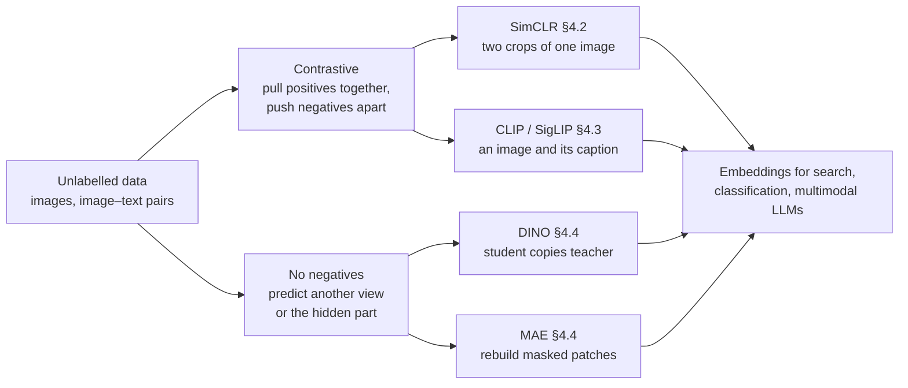
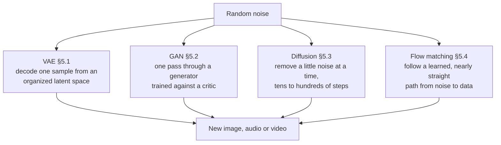
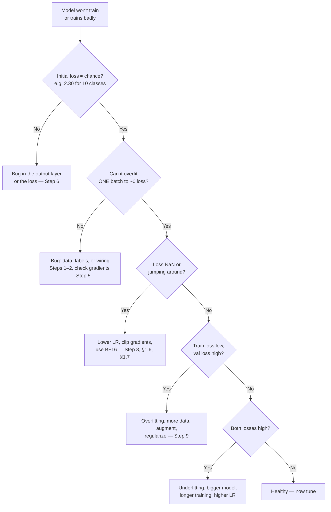
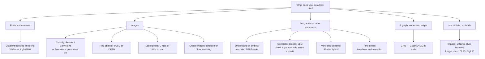

# Chapter 16 — Deep Learning: Complete Reference

> "Deep learning is a superpower. With it, you can build an AI that figures out
> things even its creator doesn't fully understand." — Andrew Ng

## Start Here


**What this chapter is.** The *deeper* companion to [Ch 14 — Neural Networks](#content/14_neural_networks). Ch 14 teaches the basics once; this chapter goes one level down on each topic and brings it up to date for 2026. If a recap here feels too quick, follow its link back to Ch 14.

**Most topics follow the same five steps**, so you always know where you are (every `L3` topic has all five; lighter topics skip the code):

| Step | What you get | Skip it if… |
|---|---|---|
| **1. Picture** | A diagram or chart at the top of the topic | — never skip |
| **2. Idea** | One sentence, then a plain-English story | you already know the topic |
| **3. Numbers** | A tiny worked example you can check by hand | you only need `L1` |
| **4. Code** | A short, self-contained NumPy program with a **▶ Run** button and its output printed underneath — change a number and re-run | you only need `L1`–`L2` |
| **5. Interview** | What to say, and the trap they set. Heavier maths sits in a collapsed **Formal version** block | — |

**Depth tags on every heading.** `L1` recognise it · `L2` explain it and its trade-off · `L3` implement it from scratch. Aim for **L2 on ★★★ topics** and **L3 only where the heading says so** — that is where the time goes furthest.

**After this chapter you can:** trace one training step with real numbers · choose an optimizer, schedule, loss and normalization and justify it · explain the vision, sequence, representation-learning and generative model families · implement attention, RMSNorm, sinusoidal encodings and RoPE in NumPy · debug a network that won't train.

> **Short on time?** Open the section map below and pick a track. Everything in it is optional reading — the chapter starts at Part 1.

<details>
<summary><strong>Section map for Ch 16–20</strong> — learning tracks, depth targets, the coding-interview ladder and where each topic lives</summary>

**Layer: MODEL — *how it works inside*.** This chapter is part of **Deep Learning & LLMs** (Ch 16–20). Every chapter in the section sits in one layer. Read the layer name and you already know what kind of question the chapter answers.

| Layer | The question it answers | Where it lives | Time |
|-------|------------------------|----------------|------|
| **Model** | *How does it work inside?* | **Ch 16 (you are here)**, **Ch 17** | 1,715 + 1,575 min full read · about 685 + 730 min on the fast path |
| **Application** | *How do I build something with it?* | **Ch 17b**, **Ch 18**, **Ch 18b** | 170 + 140 + 135 min |
| **Systems** | *How do I train and run it at scale?* | **Ch 17c**, Ch 19 | 200 + 165 min |
| **Context** | *Where is the field right now?* | Ch 20 | 125 min |

**Two ways to read Ch 16 and Ch 17.** The *full read* counts every word, including the collapsed **Read as text** blocks. The *fast path* is what stays visible: the infographic, the code with its printed output, the headings and the tables. Open a **Read as text** block only when the picture is not enough. The track times below use the fast path for Ch 16 and Ch 17 and the full read for every other chapter.

**Pick one track — do not read everything**

| Track | Choose this if… | Read in this order | Full read · fast path |
|-------|-----------------|--------------------|---------|
| **A — Interview in 4 weeks** | You have a tier-1 loop booked | Playbook → Ch 17 → **Ch 17c** → **Ch 16** → Ch 18 → Ch 18b → Ch 20 → Revision | ≈ 73 h · ≈ 41 h |
| **B — Understand deeply** | You want real intuition, no deadline | **Ch 16** → Ch 17 → **Ch 17b** → **Ch 17c** → Ch 18 → Ch 18b → Ch 19 → Ch 20 | ≈ 70 h · ≈ 39 h |
| **C — Ship a product** | You are building with LLMs right now | Ch 17 → **Ch 17b** → Ch 18 → Ch 18b → Ch 19 → **Ch 17c** (Parts 1–3, 5) | ≈ 38 h · ≈ 24 h |

**Depth ladder — know when to stop**

Not every topic deserves the same effort. Decide the level you need *before* you start:

| Level | Means | You can… |
|-------|-------|----------|
| **L1** | Recognise | Say what the name means, in one sentence |
| **L2** | Explain | Draw it, state the trade-off, survive the follow-up question |
| **L3** | Implement | Write it from scratch in ~30 minutes |
| **L4** | Design | Use it in a system-design round, with cost arithmetic |

> **The rule that saves the most time:** aim for **L2 on everything marked ★★★**, **L3 on the ten or so topics interviewers actually ask you to code** (attention, MHA, GQA, KV cache, LoRA, DPO, top-p, BPE, RoPE, RMSNorm), and **L1 on everything else**. Chasing L3 on every topic is the most common way to run out of preparation time.

**Target depth for the section's critical topics**

| Topic | Lives in | Target | Why that level |
|-------|----------|--------|----------------|
| Backpropagation | Ch 16 §1.1 | **L3** | Asked as a from-scratch derivation; the worked example here is enough |
| Optimizers (SGD → Adam → AdamW) | Ch 16 §1.2 | **L2** | Compare-and-justify question; know the Adam update well enough to write it in six lines |
| Normalization (Batch / Layer / RMS) | Ch 16 §1.5 | **L3** | RMSNorm is a common 10-minute coding warm-up |
| Self-attention | Ch 16 §3.3, Ch 17 §2.4 | **L3** | The single most-implemented interview problem |
| Multi-head, grouped-query & latent attention (MHA/MQA/GQA/MLA) | Ch 17 §2.4 | **L3** | "Compare MHA / MQA / GQA — why did Llama pick GQA?" |
| Sliding-window attention & the modern block (SwiGLU, RMSNorm, pre-LN) | Ch 17 §2.4 | **L2** | "How does a 2026 block differ from the 2017 one?" |
| Positional encodings (sinusoidal, RoPE) | Ch 16 §3.4 | **L3** | RoPE is an Easy-rated implementation question |
| BERT vs GPT (encoder vs decoder) | Ch 16 §3.5 | **L2** | Architecture-choice question |
| Tokenization / BPE | Ch 17 §2.2 | **L3** | Easy-rated implementation question |
| Decoding strategies (temperature, top-k, top-p) | Ch 17 §2.6 | **L3** | Very commonly coded |
| Scaling laws (Chinchilla) | Ch 17 §3.7 | **L2** | Reasoning-about-budget question |
| SFT / RLHF / DPO / GRPO | Ch 17 §3.3–3.5c | **L2**, DPO **L3** | DPO loss is a Hard-rated implementation at frontier labs |
| Alignment family & reward hacking | Ch 17 §3.5c | **L2** | "Compare SFT, DPO, GRPO and RLVR — what data does each need?" |
| Distill vs quantize vs prune | Ch 17c §3.4 | **L2** | "Make this cheaper to serve" has three answers |
| LoRA / QLoRA | Ch 17b §9.4 | **L3** | Implemented at Meta, Google, Anthropic, OpenAI, Databricks |
| Mixture of Experts | Ch 16 §6.1, Ch 17 §4.8 | **L2** | Active vs total parameters; routing intuition |
| KV cache | Ch 17c §1.2 | **L3** | Implemented at Anthropic, OpenAI, Meta, Perplexity |
| Quantization | Ch 17c §3.1 | **L2** | Weight-only vs W8A8 — which phase each one helps |
| Continuous batching | Ch 17c §2.1 | **L3** | Implemented at Perplexity, Together AI, Anyscale, Meta |
| RAG (end to end) | Ch 17b §9.1, Ch 19 §19.9 | **L4** | Appears as a full system-design round |
| Agents & tool calling | Ch 18 | **L4** | Now a separate round at several companies |
| Evaluation & LLM-as-judge | Ch 17c §4 | **L2** | "How do you know it got better?" is asked every time |

**The implementation ladder — what you will actually be asked to code ★★★ `L3`**

The depth map above says *which* topics need L3. This is the concrete list, in the order to practise it. These are the problems candidates report being asked to implement from scratch, usually in 20–40 minutes with no libraries beyond NumPy or PyTorch tensors. The "Reported at" column comes from public interview write-ups and shifts from year to year and team to team — read it as a hint about where a problem shows up, not a guarantee.

| # | Implement | Where it's explained | Difficulty | Reported at |
|---|---|---|---|---|
| 1 | **Byte-Pair Encoding** — train merges, then encode | [Ch 17 §2.2 — BPE in code](#content/17_llm) | Easy | Broadly |
| 2 | **Sinusoidal positional encoding** | [Ch 16 §3.4](#content/16_deep_learning) | Easy | Broadly |
| 3 | **RoPE** — rotate Q and K by position | [Ch 16 §3.4](#content/16_deep_learning) | Easy | Broadly |
| 4 | **RMSNorm** | [Ch 16 §1.5](#content/16_deep_learning) | Easy | Broadly |
| 5 | **Softmax, numerically stable** — subtract the max | [Ch 17 §1.4 — Softmax](#content/17_llm) | Easy | Apple, Meta, Google, Amazon |
| 6 | **Scaled dot-product attention** | [Ch 17 §2.4 — Query, Key, Value](#content/17_llm) | Medium | The most-asked of all |
| 7 | **Multi-head attention** — split, attend, concat, project | [Ch 17 §2.4 — Multiple Attention Heads](#content/17_llm) | Medium | Broadly |
| 8 | **Grouped-query attention** — share K/V across groups | [Ch 17 §2.4 — Multi-Query and Grouped-Query Attention](#content/17_llm) | Medium | Broadly |
| 9 | **KV cache** — append and reuse across decode steps | [Ch 17c §1.2](#content/17c_llm_systems) | Medium | Anthropic, OpenAI, Meta, Perplexity |
| 10 | **Sampling** — temperature, top-k, top-p | [Ch 17 §2.6 — Sampling from Logits in NumPy](#content/17_llm) | Medium | OpenAI, Anthropic, Cohere, DeepMind |
| 11 | **Sliding-window attention** | [Ch 17 §2.4 — Sliding-Window Attention](#content/17_llm) | Medium | Mistral, Anthropic, Google, DeepMind |
| 12 | **LoRA layer** — low-rank adapter on a frozen weight | [Ch 17b §9.4](#content/17b_llm_applications) | Medium | Meta, Google, Anthropic, OpenAI, Databricks |
| 13 | **KL divergence loss** | [Ch 17 §1.4 — KL divergence](#content/17_llm) | Easy | Broadly |
| 14 | **DPO loss** | [Ch 17 §3.5 — Runnable DPO loss](#content/17_llm) | Hard | Anthropic, OpenAI, DeepMind, Meta |
| 15 | **Mixture-of-Experts layer** — routing + top-k gating | [Ch 17 §4.8 — a MoE layer in NumPy](#content/17_llm) | Hard | Google, DeepMind, Mistral, Databricks |
| 16 | **Speculative decoding** — draft, verify, accept prefix | [Ch 17c §2.5](#content/17c_llm_systems) | Hard | Google, DeepMind, Anthropic, Apple |
| 17 | **Continuous batching** — the scheduler loop | [Ch 17c §2.1](#content/17c_llm_systems) | Hard | Perplexity, Together AI, Anyscale, Meta |
| 18 | **GRPO** — group-relative advantage, no critic | [Ch 17 §3.5b — Runnable GRPO](#content/17_llm) | Expert | DeepMind, Anthropic, OpenAI |

**How to use this ladder**

- **Work top-down.** Each rung reuses the one above: MHA needs attention, GQA needs MHA, the KV cache needs GQA to be interesting, speculative decoding needs sampling.
- **Rungs 1–10 are the realistic bar** for most product and applied roles. Get those fluent before touching the bottom half.
- **Rungs 14–18 are research and infra roles.** They are Hard/Expert for a reason — attempt them only if you're targeting a frontier lab or an inference company.
- **Write it once from scratch, then once from memory a week later.** The second pass is what makes it retrievable under interview pressure.
- **Say your invariants out loud as you go** — tensor shapes at each step, what the mask does, where the batch dimension is. Interviewers score reasoning, and shape errors are the most common way candidates lose an otherwise correct answer.

> **If you only have a weekend:** rungs 6, 7, 9 and 10 — attention, multi-head, KV cache, sampling. Those four cover the majority of reported LLM coding rounds.

**Covered in depth elsewhere**


This chapter is the *model* layer, so it deliberately stops where a topic becomes a *systems* question. That material already exists — it just lives in another section. Follow the link rather than expecting it here.

| If you are asked about… | Go to |
|---|---|
| Serving — prefill vs decode, continuous batching, KV cache maths, quantization trade-offs, evaluation | [Ch 17c — LLM Systems](#content/17c_llm_systems) |
| Distributed training — DDP, FSDP, ZeRO, tensor & pipeline parallelism | [Ch 29 — GPUs, TPUs & Infrastructure](#content/29_gpus_tpus_infrastructure) |
| Knowledge distillation and pruning — the mechanisms | [Ch 29 §24.9](#content/29_gpus_tpus_infrastructure) (the *decision* is in [Ch 17c §3.4](#content/17c_llm_systems)) |
| GPU/TPU hardware, cost per GPU-hour, emerging silicon | [Ch 29 — GPUs & TPUs](#content/29_gpus_tpus_infrastructure) · [Ch 37 — Scale & Infra Cases](#content/37_system_design_cases_scale_infra) |
| Vector index internals — HNSW, IVF-PQ, hybrid search, reranking | [Ch 28 — Semantic Search](#content/28_semantic_search) |
| Jailbreaks, red-teaming, benchmark contamination | [Ch 33b — LLM Interview Questions Pt 2](#content/33b_llm_interview_questions_part2) |
| Neural-network *fundamentals* — backprop mechanics, CNNs, LSTM basics | [Ch 14 — Neural Networks](#content/14_neural_networks) |
| The probability and linear-algebra prerequisites | [Ch 06 — Math Fundamentals](#content/06_math_fundamentals) |

</details>

## Contents

| Part | Topics | Read it for |
|------|--------|-------------|
| **1 · Training** | Backprop · Optimizers · LR schedules · Losses · Normalization · Clipping · Mixed precision · Initialization & activations · Gradient accumulation, checkpointing & EMA | How one training step works, and every knob on it |
| **2 · Vision** | CNN evolution · Detection · Segmentation · ViT · Augmentation · Efficient CNNs (MobileNet) · Adversarial examples | How images became tokens |
| **3 · Sequences & Transformers** | LSTM/GRU · Seq2Seq attention · Self-attention · Positional encodings · Encoder vs decoder | The road from RNNs to the Transformer |
| **4 · Representation learning** | Triplet & NT-Xent · SimCLR · CLIP & SigLIP · DINO & MAE | Learning good features without labels |
| **5 · Generative models** | VAE · GANs · Diffusion · Flow matching | How models create images, audio and video |
| **6 · Scaling architectures** | Mixture of Experts · State-space models · Graph networks | More capacity without more cost |
| **7 · Practical** | Debugging · Training curves · Failure modes · Frameworks & hardware | Getting a real model to train |
| **Cheat sheet** | Architecture chooser · Hyperparameters · Key takeaways · Review questions | Revision |

LLM-specific techniques — tokenization, LoRA, RLHF/DPO, RAG — live in [Ch 17](#content/17_llm) and [Ch 17b](#content/17b_llm_applications).

---

# PART 1: TRAINING DEEP NETWORKS

---

## 1.1 Backpropagation ★★★ `L3`

**In one sentence:** After the network makes a wrong prediction, backprop figures out which weights caused the mistake and by how much — so we can fix each one.


<details>
<summary><strong>Read as text</strong> — the chain rule in one line</summary>

> **Maths in one line:** $\dfrac{\partial L}{\partial w} = \dfrac{\partial L}{\partial \hat y}\cdot\dfrac{\partial \hat y}{\partial z}\cdot\dfrac{\partial z}{\partial w}$ — the chain rule. How the loss $L$ reacts to a weight $w$ = (how $L$ reacts to the prediction $\hat y$) × (how $\hat y$ reacts to the neuron's weighted sum $z$) × (how $z$ reacts to $w$): multiply the "how much does each link react?" numbers along the path from the weight to the loss.

</details>

### The Story

<details>
<summary><strong>Read as text</strong> — the guitar analogy and the chain rule</summary>

Imagine you're tuning a guitar with 100 pegs. You play a chord, it sounds wrong. You need to figure out which pegs to turn, and how much. Backpropagation is exactly this — except instead of ears, it uses calculus.

The key question it answers: **"If I change this one weight slightly, how much does the total error change?"** When you know that for every weight, you can nudge each one in the right direction.

The math tool it uses is called the **chain rule** — a way to break a big question ("how does weight W1 affect the final error?") into a chain of smaller questions ("how does W1 affect layer 2? how does layer 2 affect layer 3? how does layer 3 affect the error?"). Multiply those small answers together and you get the big answer.

</details>

### How to read the maths in this chapter

<details>
<summary><strong>Read as text</strong> — the four tags, the notation and a note on rounding</summary>

Every worked example below follows the same rule: **no number appears without saying where it came from.** Each symbol is one of four things.

| Tag | Means | Example |
|---|---|---|
| **Given** | comes from your dataset | the inputs $x$, the true label $y$ |
| **Fixed here** | hand-picked so the arithmetic is checkable | the weights in this example |
| **Learned** | random at initialisation, then adjusted by training | the weights in a real network |
| **Computed** | derived below from the three above | $z$, $h$, $\hat y$, the loss |

And three pieces of notation used throughout:

| Notation | Read it as |
|---|---|
| $W_{ij}$ | the weight **into** neuron $i$, **from** input $j$ — destination first |
| $z^{(1)}$, $h^{(2)}$ | the superscript is the **layer number**, not a power |
| $a \odot b$ | **element-wise** multiply — pair up the positions, multiply each pair |

**A note on rounding.** Every number below is shown to 4 decimals but carried at full precision — exactly what the code under *Run it yourself* does. So if you multiply two printed numbers by hand, the last digit can differ by 1. That is rounding, not a mistake.

</details>

---

### Worked Example — Forward Pass

<details>
<summary><strong>Read as text</strong> — the inputs, the weights and the three forward steps</summary>

A forward pass is the network doing its job left to right: take the input numbers, multiply by weights, add them up, bend each sum through an activation function, and read off a prediction. Here we get **0.5977** when the true answer is **1** — so the network is wrong, and the backward pass below fixes it.

The network: two inputs → one hidden layer of two neurons (ReLU) → one output (sigmoid).

```
  INPUT          HIDDEN           OUTPUT
  x₁ = 0.5  →   h₁ (ReLU)   →   ŷ (sigmoid)
  x₂ = 0.3  →   h₂ (ReLU)
  True y = 1
```

**1. The inputs — Given.**
$x_1 = 0.5$ and $x_2 = 0.3$ are the two features of a single training example — say a scaled "size" and "age", squeezed into the 0–1 range. Features are normalised first so that no one feature dominates purely because it is measured in bigger units.
$y = 1$ is the correct answer. **The network has not seen it yet** — it is only used at Step 4 to measure the error.

**2. The weights — Fixed here, Learned in practice.**
A weight is the number on each arrow: how strongly one value affects the next. In real training they start as small random numbers and are then learned. These are hand-picked so the arithmetic stays checkable.

| Weight | Connects | Value |
|---|---|---|
| $W_{11}$ | $x_1 \to h_1$ | 0.4 |
| $W_{12}$ | $x_2 \to h_1$ | 0.2 |
| $W_{21}$ | $x_1 \to h_2$ | 0.3 |
| $W_{22}$ | $x_2 \to h_2$ | 0.5 |
| $v_1$ | $h_1 \to \hat y$ | 0.6 |
| $v_2$ | $h_2 \to \hat y$ | 0.8 |

**Biases:** none in this example — they are effectively 0. Normally every neuron also adds a learned bias $b$, which shifts its sum up or down independently of the inputs.

**3. Step 1 — the hidden layer.** Each hidden neuron takes a weighted sum of *both* inputs, then applies ReLU.

$$z^{(1)}_1 = W_{11}x_1 + W_{12}x_2 = (0.4)(0.5) + (0.2)(0.3) = 0.20 + 0.06 = 0.26$$

$$h_1 = \text{ReLU}(0.26) = \max(0,\ 0.26) = 0.26$$

$$z^{(1)}_2 = W_{21}x_1 + W_{22}x_2 = (0.3)(0.5) + (0.5)(0.3) = 0.15 + 0.15 = 0.30$$

$$h_2 = \text{ReLU}(0.30) = \max(0,\ 0.30) = 0.30$$

**What ReLU did:** it keeps positive numbers unchanged and turns negatives into 0. Both sums here are positive, so nothing changed — but remember that, because it matters in Step E of the backward pass.

**The same step as one matrix multiply** — which is how code actually does it:

$$\begin{bmatrix} z_1 \\ z_2 \end{bmatrix} = \begin{bmatrix} 0.4 & 0.2 \\ 0.3 & 0.5 \end{bmatrix}\begin{bmatrix} 0.5 \\ 0.3 \end{bmatrix} = \begin{bmatrix} 0.26 \\ 0.30 \end{bmatrix}$$

Row $i$ of the matrix holds every weight arriving at neuron $i$ — which is exactly what $W_{ij}$ means, written out.

**4. Step 2 — the output layer.** The hidden values are now the inputs. Same operation, new weights:

$$z^{(2)} = v_1h_1 + v_2h_2 = (0.6)(0.26) + (0.8)(0.30) = 0.156 + 0.240 = 0.396$$

Sigmoid then squeezes that into the 0–1 range so it can be read as a probability:

$$\sigma(z) = \frac{1}{1 + e^{-z}} \qquad\Rightarrow\qquad \hat{y} = \frac{1}{1 + e^{-0.396}} = \frac{1}{1 + 0.6730} = \frac{1}{1.6730} = 0.59773 \approx 0.5977$$

**Reading 0.5977:** the network is about 60% confident the answer is 1.

**5. Step 3 — the loss.** For a sigmoid output the standard loss is binary cross-entropy:

$$L = -\bigl[\,y\ln\hat{y} + (1-y)\ln(1-\hat{y})\,\bigr]$$

Because $y = 1$ here, the second term is multiplied by $(1-1) = 0$ and drops out entirely:

$$L = -\ln(\hat y) = -\ln(0.59773) = 0.5146$$

**Reading 0.5146:** a perfect prediction ($\hat y = 1$) would give a loss of exactly 0. So 0.5146 means "somewhat wrong, in the right direction" — the network leaned towards 1, just not confidently enough.

</details>

### Worked Example — Backward Pass

<details>
<summary><strong>Read as text</strong> — the three rules and steps A to G, ending in one weight update</summary>

Now we go backwards. Each step answers one question: *"if I nudge this number up slightly, does the loss go up or down, and by how much?"* That answer is the **gradient**.

**The three rules first**, as formulas — so that no number below appears out of thin air:

| Link | Rule | Where it comes from |
|---|---|---|
| $\partial L/\partial \hat y$ | $-1/\hat y$ when $y = 1$ | derivative of $-\ln(\hat y)$ |
| $\partial \hat y/\partial z^{(2)}$ | $\hat y\,(1 - \hat y)$ | the sigmoid derivative |
| $\partial z/\partial w$ | whatever $w$ multiplied | in $z = w \cdot a$, nudging $w$ moves $z$ by $a$ |

Everything below is those three rules plus the chain rule — multiply the links along a path.

**Step A — How does the loss react to our prediction $\hat{y}$?**

$$\frac{\partial L}{\partial \hat{y}} = \frac{-1}{\hat y} = \frac{-1}{0.59773} = -1.6730$$

Negative means: increasing $\hat{y}$ **reduces** the loss. That is what we want — the true answer is 1, so predicting higher is better.

**Step B — How does $\hat{y}$ react to $z^{(2)}$ (the pre-sigmoid value)?**

$$\frac{\partial \hat{y}}{\partial z^{(2)}} = \hat y\,(1-\hat y) = 0.59773 \times (1 - 0.59773) = 0.59773 \times 0.40227 = 0.24045$$

$$\text{Chain them: } \frac{\partial L}{\partial z^{(2)}} = -1.6730 \times 0.24045 = -0.4023$$

> **Worth memorising.** For sigmoid + binary cross-entropy the whole chain collapses to $\hat y - y$. Check it: $0.5977 - 1 = -0.4023$, the same number with no multiplication at all. The same cancellation happens for softmax + categorical cross-entropy — *the gradient is just the prediction error.*

**Step C — Gradients for the Layer 2 weights.** Here $\partial z^{(2)}/\partial v_1 = h_1$, because $v_1$ multiplied $h_1$:

$$\frac{\partial L}{\partial v_1} = -0.4023 \times h_1 = -0.4023 \times 0.26 = -0.1046$$

$$\frac{\partial L}{\partial v_2} = -0.4023 \times h_2 = -0.4023 \times 0.30 = -0.1207$$

Both negative, so both weights should increase.

**Step D — How much blame does each hidden neuron get?** Same rule, other factor — $\partial z^{(2)}/\partial h_1 = v_1$:

$$\frac{\partial L}{\partial h_1} = -0.4023 \times v_1 = -0.4023 \times 0.6 = -0.2414$$

$$\frac{\partial L}{\partial h_2} = -0.4023 \times v_2 = -0.4023 \times 0.8 = -0.3218$$

$h_2$ gets more blame because it had a stronger connection ($v_2 = 0.8$) to the output.

**Step E — Back through ReLU.** ReLU's derivative is 1 where its input was positive and 0 where it was negative, so the gradient either passes through untouched or is killed:

$z^{(1)}_1 = 0.26 > 0$, so $\frac{\partial L}{\partial z^{(1)}_1} = -0.2414$ (unchanged)

$z^{(1)}_2 = 0.30 > 0$, so $\frac{\partial L}{\partial z^{(1)}_2} = -0.3218$ (unchanged)

Had $z$ been negative, the gradient would be **zero** and that neuron would get no update at all. This is the **dead ReLU** problem.

**Step F — Gradients for the Layer 1 weights.** Once more, $\partial z^{(1)}/\partial W$ is whatever the weight multiplied — an input this time:

$$\frac{\partial L}{\partial W_{11}} = -0.2414 \times x_1 = -0.2414 \times 0.5 = -0.1207$$

$$\frac{\partial L}{\partial W_{12}} = -0.2414 \times x_2 = -0.2414 \times 0.3 = -0.0724$$

$$\frac{\partial L}{\partial W_{21}} = -0.3218 \times x_1 = -0.3218 \times 0.5 = -0.1609$$

$$\frac{\partial L}{\partial W_{22}} = -0.3218 \times x_2 = -0.3218 \times 0.3 = -0.0965$$

**Step G — Update every weight.** The rule is `new = old − learning rate × gradient`, with $\alpha = 0.1$. Subtracting a negative gradient means the weight goes **up**:

| Weight | Old | Gradient | New = old − 0.1 × gradient |
|---|---|---|---|
| $v_1$ | 0.6000 | −0.1046 | **0.6105** |
| $v_2$ | 0.8000 | −0.1207 | **0.8121** |
| $W_{11}$ | 0.4000 | −0.1207 | **0.4121** |
| $W_{12}$ | 0.2000 | −0.0724 | **0.2072** |
| $W_{21}$ | 0.3000 | −0.1609 | **0.3161** |
| $W_{22}$ | 0.5000 | −0.0965 | **0.5097** |

Every weight moved in the direction that reduces the loss. **That is one training step.**

</details>

### Did it actually learn?

<details>
<summary><strong>Read as text</strong> — the updated forward pass and the loss falling</summary>

The step above is only worth anything if the loss actually falls. Run the same input through the *updated* weights:

$$z^{(1)}_1 = (0.4121)(0.5) + (0.2072)(0.3) = 0.2682 \qquad z^{(1)}_2 = (0.3161)(0.5) + (0.5097)(0.3) = 0.3109$$

$$z^{(2)} = (0.6105)(0.2682) + (0.8121)(0.3109) = 0.4162 \qquad \hat y = \sigma(0.4162) = 0.6026$$

$$L = -\ln(0.6026) = 0.5065$$

| | Prediction $\hat y$ | Loss |
|---|---|---|
| Before the step | 0.5977 | 0.5146 |
| After the step | **0.6026** | **0.5065** |

The prediction moved towards the true answer of 1, and the loss fell. Nobody told the network what the weights should be — it only ever knew *which direction reduced the error*, took a small step that way, and repeated.

</details>

### What happens next

<details>
<summary><strong>Read as text</strong> — the three-line training loop</summary>

1. **Backpropagation** works out how much each weight contributed to the error — the steps above.
2. **Gradient descent** nudges each weight: `new = old − learning rate × gradient`.
3. **Repeat** the forward pass → loss → backward pass cycle across millions of examples until predictions stop improving.

Everything else in Part 1 — optimizers (§1.2), schedules (§1.3), loss functions (§1.4), normalization (§1.5), clipping (§1.6) — is a refinement of one of those three lines.

</details>

### The computational-graph view


<details>
<summary><strong>Read as text</strong> — nodes, local derivatives and fan-out sums</summary>

Real frameworks (PyTorch, JAX, TensorFlow) do not know what a "neural network" is. During the forward pass they record every operation as a **node** in a graph, and each node knows its own *local* derivative. Calling `loss.backward()` walks that graph from the loss back to the weights, multiplying the gradient that arrives at each node by the node's local derivative. Our example as a graph, with the numbers from above:

| Node (forward) | Its local derivative | Gradient it passes back |
|---|---|---|
| $L$ = BCE($\hat y$, $y$) | $-1/\hat y$ | $\partial L/\partial \hat y = -1.6730$ |
| $\hat y = \sigma(z^{(2)})$ | $\hat y(1-\hat y) = 0.24045$ | $\partial L/\partial z^{(2)} = -0.4023$ |
| $z^{(2)} = v\cdot h$ | $v$ (towards $h$), $h$ (towards $v$) | to $h$: $[-0.2414,\ -0.3218]$ · to $v$: $[-0.1046,\ -0.1207]$ |
| $h = \text{ReLU}(z^{(1)})$ | 1 if $z^{(1)} > 0$, else 0 | $[-0.2414,\ -0.3218]$ — both gates open |
| $z^{(1)} = Wx$ | $x$ (towards $W$), $W^{T}$ (towards $x$) | to $W$: Step F · to $x$: $[-0.1931,\ -0.2092]$ |

Two things to notice. First, each node needs only its own local derivative and the gradient arriving from its right — nothing else. That is why any network built from differentiable pieces can be trained automatically (this is what **autodiff** means). Second, **when a value feeds more than one place, the gradients add.** The input $x_1$ feeds both hidden neurons, so $\partial L/\partial x_1 = W_{11}(-0.2414) + W_{21}(-0.3218) = (0.4)(-0.2414) + (0.3)(-0.3218) = -0.1931$, where $-0.2414$ and $-0.3218$ are the gradients at the two hidden pre-activations (Step E). Forgetting that sum is the classic hand-derivation bug. We never update $x$ (it is data), but in a deeper network this number is exactly the gradient arriving at the layer below.

</details>

### Why backprop is cheap — and what it costs

<details>
<summary><strong>Read as text</strong> — one backward pass, the 3x rule and the memory price</summary>

Imagine getting each weight's gradient by nudging it and re-running the forward pass. A network with $N$ weights needs $N + 1$ forward passes per step; for a 7-billion-parameter model that is 7 billion forward passes — for **one** update. Backprop gets all $N$ gradients in **one** backward pass, because each gradient from the right (like $-0.4023$ above) is computed once and reused by every weight to its left.

How much does that backward pass cost? A linear layer's forward pass is one matrix multiply. Its backward pass is two: one for the gradient to the weights ($\delta\,x^{T}$, where $\delta$ is the gradient arriving from the right) and one for the gradient to the inputs ($W^{T}\delta$). So **backward ≈ 2× forward, and a whole training step ≈ 3× a forward pass** — the origin of the rule of thumb that training costs about 6 FLOPs per parameter per token against 2 for inference ([Ch 29 §24.6c](#content/29_gpus_tpus_infrastructure)).

The price is memory. The backward pass needs the numbers from the forward pass ($z^{(1)}$, $h$, $\hat y$ in our example), so every layer's **activations** stay in memory until the backward pass has used them — the activation memory that dominates long-sequence training. **Gradient checkpointing** keeps only some layers and recomputes the rest: roughly 30% more compute for 5–10× less activation memory ([Ch 29 §24.3](#content/29_gpus_tpus_infrastructure)).

</details>

### Vanishing and exploding gradients — one number

<details>
<summary><strong>Read as text</strong> — 0.25^10 and 1.5^20 in one number each</summary>

Backprop multiplies one factor per layer on the way back. The sigmoid's derivative is at most 0.25 (its value at $z = 0$), so ten sigmoid layers can shrink the gradient by $0.25^{10} \approx 10^{-6}$: the first layer receives about **one-millionth** of the signal and learns almost nothing. Push the factor above 1 and it explodes instead: $1.5^{20} \approx 3{,}300\times$. Both are activation-only illustrations — real weights change the factors; the full story is in [Ch 14 §14.6](#content/14_neural_networks).

Our example already shows the mechanism: the sigmoid link contributed a factor of 0.24, the open ReLU gate a factor of 1. That is why modern networks use ReLU-family activations, residual connections, normalization (§1.5), sensible initialization and gradient clipping (§1.6).

</details>

### Gradient checking — trust, but verify

<details>
<summary><strong>Read as text</strong> — the finite-difference test and its rules of thumb</summary>

A hand-written backward pass is easy to get subtly wrong. The test is to compare it with the slow, obviously-correct estimate: nudge one weight up and down by a small $\epsilon$ and watch the loss, $\dfrac{L(w+\epsilon) - L(w-\epsilon)}{2\epsilon}$ (a *central finite difference*). For $W_{11}$ with $\epsilon = 0.001$ (large only so the numbers stay readable): $L(0.401) = 0.514502$ and $L(0.399) = 0.514743$, so the slope is $(0.514502 - 0.514743)/0.002 = -0.1207$ — the same number backprop gave in Step F.

Rules of thumb: in real code use float64 and $\epsilon$ between $10^{-5}$ and $10^{-7}$ (smaller than that and rounding noise takes over); compare with a *relative* error — below about $10^{-6}$ is a pass; switch off dropout and other randomness first; ReLU kinks can cause an isolated false alarm. It costs two forward passes per weight, so it is a debugging tool, never a training method. PyTorch ships it as `torch.autograd.gradcheck`. The program below runs the check on all six weights.

</details>

### Run it yourself

The worked example plus a gradient check, a dead ReLU and 100 more steps. Press **▶ Run**, then change `x`, `y` or a weight and watch every gradient move. The printed numbers are the ones worked by hand above.

```python
# Backprop on the chapter's 2-2-1 network: one step matching the hand numbers, a gradient check, a dead ReLU, then 100 steps
import numpy as np
np.set_printoptions(precision=4, suppress=True)

x = np.array([0.5, 0.3]); y = 1.0          # Given: one example, true label 1
W = np.array([[0.4, 0.2],                  # row i = weights INTO hidden neuron i
              [0.3, 0.5]])
v = np.array([0.6, 0.8])                   # hidden -> output weights
lr = 0.1

def forward(W, v):
    z1 = W @ x                             # hidden pre-activations
    h = np.maximum(0, z1)                  # ReLU
    y_hat = 1 / (1 + np.exp(-(v @ h)))     # sigmoid output
    loss = -(y * np.log(y_hat) + (1 - y) * np.log(1 - y_hat))   # binary cross-entropy
    return z1, h, y_hat, loss

def backward(W, v):                        # the chain rule, one link at a time
    z1, h, y_hat, _ = forward(W, v)
    dz2 = y_hat - y                        # sigmoid + BCE collapse to (prediction - truth)
    dv = dz2 * h                           # dL/dv_i  = dz2 * h_i
    dh = dz2 * v                           # blame handed to each hidden neuron
    dz1 = dh * (z1 > 0)                    # ReLU gate: pass if z > 0, else block
    dW = np.outer(dz1, x)                  # dL/dW_ij = dz1_i * x_j
    return dz2, dv, dh, dW

# 1. The chapter's example: forward, backward, one update
z1, h, y_hat, loss = forward(W, v)
dz2, dv, dh, dW = backward(W, v)
print(f"z1 = {z1}   y_hat = {y_hat:.4f}   loss = {loss:.4f}")
print(f"dz2 = {dz2:.4f}   dv = {dv}   dh = {dh}")
print("dW =", dW.round(4).tolist())
W1, v1 = W - lr * dW, v - lr * dv          # one gradient-descent step
print("new v =", v1, "  new W =", W1.round(4).tolist())
_, _, y_hat1, loss1 = forward(W1, v1)
print(f"after one step: y_hat = {y_hat1:.4f}   loss = {loss1:.4f}")

# 2. Gradient check: central finite differences must match backprop
def numeric(i):                            # i indexes the 6 weights [W11 W12 W21 W22 v1 v2]
    p = np.concatenate([W.ravel(), v]); e = np.zeros(6); e[i] = 1e-6
    f = lambda q: forward(q[:4].reshape(2, 2), q[4:])[3]
    return (f(p + e) - f(p - e)) / 2e-6
analytic = np.concatenate([dW.ravel(), dv])
numerical = np.array([numeric(i) for i in range(6)])
assert np.allclose(analytic, numerical, atol=1e-8)
print("gradient check passed: all 6 backprop gradients match finite differences to 8 decimals")

# 3. Dead ReLU: push neuron 2 negative -> its gradient is exactly zero
Wd = np.array([[0.4, 0.2], [-0.3, -0.5]])
print("dead ReLU: z1 =", forward(Wd, v)[0], "  dW row of the dead neuron =", (backward(Wd, v)[3][1] + 0.0).tolist())

# 4. Keep going: 100 steps on the same example
Wt, vt = W.copy(), v.copy()
for step in range(100):
    _, dv_, _, dW_ = backward(Wt, vt)
    Wt, vt = Wt - lr * dW_, vt - lr * dv_
print(f"after 100 steps: y_hat = {forward(Wt, vt)[2]:.4f}   loss = {forward(Wt, vt)[3]:.4f}")
```

**Output:**

```
z1 = [0.26 0.3 ]   y_hat = 0.5977   loss = 0.5146
dz2 = -0.4023   dv = [-0.1046 -0.1207]   dh = [-0.2414 -0.3218]
dW = [[-0.1207, -0.0724], [-0.1609, -0.0965]]
new v = [0.6105 0.8121]   new W = [[0.4121, 0.2072], [0.3161, 0.5097]]
after one step: y_hat = 0.6026   loss = 0.5065
gradient check passed: all 6 backprop gradients match finite differences to 8 decimals
dead ReLU: z1 = [ 0.26 -0.3 ]   dW row of the dead neuron = [0.0, 0.0]
after 100 steps: y_hat = 0.9525   loss = 0.0487
```

> **Say this in an interview:** "Backprop is the chain rule applied in reverse order, so every intermediate gradient is computed once and reused. All the gradients together cost about two extra forward passes — backward is roughly twice the forward — instead of one forward pass per weight."
>
> **They follow up with:** *"How would you test your backward pass?"* — a central finite-difference gradient check on a few weights, in float64.
>
> **The trap:** *"Why not update the output weights first, then compute the hidden gradients?"* — because every gradient must describe the **same** forward pass. Finish the backward pass with the old weights, then update everything at once.

---

## 1.2 Optimizers ★★★ `L2`

**In one sentence:** Optimizers are different strategies for deciding how much to move each weight after each training step.


### The Problem with Plain Gradient Descent

<details>
<summary><strong>Read as text</strong> — the zigzag, the one-size-fits-all rate and the valley chart</summary>

Plain gradient descent uses **one learning rate for every direction**. This causes two problems:

1. **Zigzagging** — in a narrow valley, it bounces side-to-side instead of heading straight down
2. **One-size-fits-all** — some weights need big updates, others need tiny ones

The optimizers below each solve one or both of these problems. Here is the problem made visible — three optimizers, 25 steps each, on the same valley that is **20× steeper side-to-side than along its floor**:

```chart
{
  "type": "scatter",
  "data": {
    "datasets": [
      {
        "label": "SGD (lr 0.095) — zigzags every step, crawls along the floor",
        "data": [{"x":-4.0,"y":1.0},{"x":-3.62,"y":-0.9},{"x":-3.28,"y":0.81},{"x":-2.96,"y":-0.73},{"x":-2.68,"y":0.66},{"x":-2.43,"y":-0.59},{"x":-2.2,"y":0.53},{"x":-1.99,"y":-0.48},{"x":-1.8,"y":0.43},{"x":-1.63,"y":-0.39},{"x":-1.47,"y":0.35},{"x":-1.33,"y":-0.31},{"x":-1.21,"y":0.28},{"x":-1.09,"y":-0.25},{"x":-0.99,"y":0.23},{"x":-0.89,"y":-0.21},{"x":-0.81,"y":0.19},{"x":-0.73,"y":-0.17},{"x":-0.66,"y":0.15},{"x":-0.6,"y":-0.14},{"x":-0.54,"y":0.12},{"x":-0.49,"y":-0.11},{"x":-0.44,"y":0.1},{"x":-0.4,"y":-0.09},{"x":-0.36,"y":0.08},{"x":-0.33,"y":-0.07}],
        "showLine": true, "borderColor": "rgba(239, 68, 68, 1)", "backgroundColor": "rgba(239, 68, 68, 1)", "pointRadius": 2, "borderWidth": 2
      },
      {
        "label": "Momentum (lr 0.1, β 0.8) — the swings cancel, speed builds along the floor",
        "data": [{"x":-4.0,"y":1.0},{"x":-3.92,"y":0.6},{"x":-3.78,"y":0.04},{"x":-3.59,"y":-0.42},{"x":-3.36,"y":-0.63},{"x":-3.12,"y":-0.54},{"x":-2.86,"y":-0.25},{"x":-2.6,"y":0.08},{"x":-2.33,"y":0.31},{"x":-2.07,"y":0.37},{"x":-1.83,"y":0.27},{"x":-1.59,"y":0.08},{"x":-1.37,"y":-0.1},{"x":-1.17,"y":-0.21},{"x":-0.98,"y":-0.21},{"x":-0.82,"y":-0.13},{"x":-0.66,"y":-0.01},{"x":-0.53,"y":0.09},{"x":-0.41,"y":0.13},{"x":-0.31,"y":0.11},{"x":-0.22,"y":0.05},{"x":-0.15,"y":-0.01},{"x":-0.08,"y":-0.06},{"x":-0.03,"y":-0.08},{"x":0.01,"y":-0.06},{"x":0.04,"y":-0.02}],
        "showLine": true, "borderColor": "rgba(234, 88, 12, 1)", "backgroundColor": "rgba(234, 88, 12, 1)", "pointRadius": 2, "borderWidth": 2
      },
      {
        "label": "Adam (lr 0.2) — equal-sized steps in both directions, ignores the steepness",
        "data": [{"x":-4.0,"y":1.0},{"x":-3.8,"y":0.8},{"x":-3.6,"y":0.6},{"x":-3.4,"y":0.41},{"x":-3.2,"y":0.23},{"x":-3.01,"y":0.06},{"x":-2.81,"y":-0.09},{"x":-2.62,"y":-0.22},{"x":-2.42,"y":-0.31},{"x":-2.24,"y":-0.38},{"x":-2.05,"y":-0.41},{"x":-1.87,"y":-0.41},{"x":-1.69,"y":-0.39},{"x":-1.51,"y":-0.35},{"x":-1.34,"y":-0.29},{"x":-1.18,"y":-0.23},{"x":-1.02,"y":-0.16},{"x":-0.86,"y":-0.09},{"x":-0.72,"y":-0.01},{"x":-0.58,"y":0.05},{"x":-0.44,"y":0.11},{"x":-0.32,"y":0.15},{"x":-0.2,"y":0.18},{"x":-0.1,"y":0.2},{"x":0.0,"y":0.21},{"x":0.09,"y":0.2}],
        "showLine": true, "borderColor": "rgba(34, 197, 94, 1)", "backgroundColor": "rgba(34, 197, 94, 1)", "pointRadius": 2, "borderWidth": 2
      },
      {
        "label": "Minimum",
        "data": [{"x": 0, "y": 0}],
        "borderColor": "rgba(99, 102, 241, 1)", "backgroundColor": "rgba(99, 102, 241, 1)", "pointRadius": 7, "pointStyle": "star"
      }
    ]
  },
  "options": {
    "plugins": { "title": { "display": true, "text": "Real optimizer paths on loss = ½(x² + 20y²), starting at (−4, 1)" } },
    "scales": {
      "x": { "title": { "display": true, "text": "x — the gentle direction (valley floor)" }, "min": -4.2, "max": 0.5 },
      "y": { "title": { "display": true, "text": "y — the steep direction" }, "min": -1, "max": 1.1 }
    }
  }
}
```

These paths are computed, not drawn — and the learning rates are hand-picked, so this is **not a ranking**. Read the *shapes*: SGD wastes its steps bouncing across the steep direction; momentum averages the bounces away; Adam divides each direction by its own typical gradient size, so a steep direction and a gentle one get the same-sized step.

</details>

---

### SGD — Plain Gradient Descent

<details>
<summary><strong>Read as text</strong> — the update rule and why it is stochastic</summary>

The simplest version. Just multiply the gradient by the learning rate and subtract.

$$w \leftarrow w - \alpha \times \nabla w$$

where $w$ is one weight, $\nabla w$ ("grad $w$") is the gradient backprop (§1.1) hands you — how much the loss changes if $w$ goes up by a tiny amount — and $\alpha$ is the **learning rate** (e.g., 0.01). In words: *step downhill, by an amount proportional to the slope.* With $w = 1.0$, $\nabla w = 0.5$ and $\alpha = 0.1$: $w \leftarrow 1.0 - 0.1 \times 0.5 = 0.95$.

In practice $\nabla w$ is computed on a small random **mini-batch** of examples, not the whole dataset, so it is a noisy estimate — that is the "stochastic" in SGD.

**Problem:** Same step size for everything. Zigzags a lot. Slow.

</details>

---

### SGD + Momentum

<details>
<summary><strong>Read as text</strong> — the rolling ball, β = 0.9 and a worked velocity</summary>

**The idea:** Keep moving in the direction you've been going. Like a ball rolling downhill — it builds speed on long slopes and doesn't zigzag.

> **Maths in one line:** $v \leftarrow \beta v + (1-\beta)\,\nabla w,\quad w \leftarrow w - \alpha v$ — keep a running average $v$ of recent gradients (the "velocity") and step along that average instead of along the latest noisy gradient.

with $\beta = 0.9$ (90% old direction, 10% new)

**What β=0.9 means:** The current direction is 90% "where I've been going" and 10% "where the gradient says to go now." Over ~10 steps, the direction gets smoothed out.

**With numbers.** Suppose the gradient is a steady $1.0$ and $\alpha = 0.1$. The velocity grows $v = 0.1,\ 0.19,\ 0.271,\ \dots \to 1.0$, so the steps are $0.01,\ 0.019,\ 0.027,\ \dots \to 0.1$: momentum starts slow (the velocity begins at zero) and then moves at full speed along a consistent slope. If the gradient instead flips sign every step, the average stays small — which is exactly how momentum cancels the zigzag in the chart above.

> PyTorch writes it without the $(1-\beta)$: $v \leftarrow \beta v + \nabla w$. Same idea — the velocity is just 10× larger, so the matching learning rate is 10× smaller.
>
> **Nesterov momentum** (`nesterov=True` in PyTorch's SGD) evaluates the gradient at the point momentum is about to carry you to — a "look-ahead" that corrects overshooting a little earlier.

**Result:** Faster convergence, less zigzagging.

</details>

---

### AdaGrad — Different Rates for Different Weights

<details>
<summary><strong>Read as text</strong> — per-weight rates and why they shrink to zero</summary>

**The idea:** Weights that get updated often (common features) should get smaller steps. Weights that rarely get updated (rare features) should get bigger steps.

**Example:** The word "the" appears in every sentence — its embedding gets updated constantly. The word "photosynthesis" appears rarely — it needs a bigger nudge when it does appear.

$$G \leftarrow G + (\nabla w)^2$$

$$w \leftarrow w - \frac{\alpha}{\sqrt{G} + \epsilon} \times \nabla w$$

(G = running sum of squared gradients — grows forever; $\epsilon \approx 10^{-8}$ avoids dividing by zero.) With a constant gradient the step after $t$ updates is $\alpha/\sqrt{t}$: $0.1,\ 0.071,\ 0.058,\ \dots$ for $\alpha = 0.1$ — each weight's step shrinks in proportion to how much gradient it has already seen.

**The problem:** G only ever grows. Eventually the learning rate reaches zero and the weight stops learning entirely. Fine for short training, breaks for long training.

</details>

---

### RMSProp — AdaGrad That Forgets the Past

<details>
<summary><strong>Read as text</strong> — a decaying memory instead of a forever sum</summary>

**The idea:** Fix AdaGrad's "memory is forever" problem. Instead of adding ALL past squared gradients, use a decaying average — recent history matters more, old history fades.

Think of it like short-term memory. You remember what happened last week more than what happened last year.

$$E[g^2] \leftarrow 0.99 \times E[g^2] + 0.01 \times (\nabla w)^2$$

$$w \leftarrow w - \frac{\alpha}{\sqrt{E[g^2]} + \epsilon} \times \nabla w$$

The `0.99 × E[g²]` slowly "forgets" old gradients. The `0.01 × gradient²` adds the fresh information. This keeps the learning rate from hitting zero. (0.99 is PyTorch's default decay; Hinton's lecture used 0.9. RMSProp was never written up as a paper — it first appeared on a slide in Hinton's 2012 Coursera course.)

**Best for:** historically RNNs and non-stationary problems. Today it is mostly a stepping stone to Adam, which adds momentum on top.

</details>

---

### Adam — The Default Choice ★★★


<details>
<summary><strong>Read as text</strong> — the two averages, bias correction and the first-step trap</summary>

**The idea:** Combine Momentum + RMSProp. Track both the direction AND the size of recent gradients.

> **Maths in one line:** $w \leftarrow w - \alpha\,\dfrac{\hat m}{\sqrt{\hat v}+\epsilon}$ — take the smoothed gradient $\hat m$ (direction) and divide it by the typical gradient size $\sqrt{\hat v}$, so every weight moves by about $\alpha$ per step however large or small its gradient is. ($\hat m,\hat v$ are the two running averages below, after bias correction.)

Adam keeps two running averages for each weight:
- **m** = average gradient (direction — like Momentum)
- **v** = average gradient² (size — like RMSProp)

$$m \leftarrow \beta_1 m + (1-\beta_1)\,\nabla w \qquad\qquad v \leftarrow \beta_2 v + (1-\beta_2)(\nabla w)^2$$

**The four knobs — and what each is.** Only $\nabla w$ is computed; the rest are hyperparameters you almost never change.

| Symbol | Default | What it does |
|---|---|---|
| $\beta_1$ | 0.9 | how much of the old *direction* to keep — 0.9 means ~10 steps of memory |
| $\beta_2$ | 0.999 | how much of the old *size* to keep — ~1000 steps of memory |
| $\alpha$ | 0.001 | learning rate — the overall step size |
| $\epsilon$ | $10^{-8}$ | guards against dividing by zero |

**Bias correction — why it's needed.** $m$ and $v$ both start at **zero**, so early on both understate the true averages: at $t=1$, $m$ is 10× too small and $v$ is 1000× too small. Dividing by $(1 - \beta^t)$ scales each one back up:

$$\hat{m} = \frac{m}{1 - \beta_1^t} \qquad\qquad \hat{v} = \frac{v}{1 - \beta_2^t}$$

Final update:

$$w \leftarrow w - \alpha \cdot \frac{\hat{m}}{\sqrt{\hat{v}} + \epsilon}$$

**One worked step**, so the correction is not just an assertion. Take a weight whose first gradient is $\nabla w = 0.2$, at $t = 1$, with $m = v = 0$:

$$m = 0.9(0) + 0.1(0.2) = \mathbf{0.02} \qquad v = 0.999(0) + 0.001(0.2^2) = 0.001 \times 0.04 = \mathbf{0.00004}$$

Both are far below the true values of $0.2$ and $0.04$. The correction divides by $1 - 0.9^1 = 0.1$ and $1 - 0.999^1 = 0.001$:

$$\hat m = \frac{0.02}{0.1} = \mathbf{0.2} \qquad \hat v = \frac{0.00004}{0.001} = \mathbf{0.04}$$

$\hat m$ is exactly the gradient again — which is the whole point. Now the update:

$$\Delta w = 0.001 \times \frac{0.2}{\sqrt{0.04} + 10^{-8}} = 0.001 \times \frac{0.2}{0.2} = 0.001 \times 1.0 = \mathbf{0.001}$$

> **The subtlety most explanations get backwards.** It is tempting to say "the uncorrected estimates are too small, so the steps come out too small." Check it: uncorrected, $m/\sqrt{v} = 0.02/0.00632 = 3.16$, so the step would be $0.00316$ — **three times too large**, not too small. The reason is that $v$ is understated by 1000× against $m$'s 10×, and it enters under a square root, so the *ratio* is inflated by $\tfrac{1-\beta_1^t}{\sqrt{1-\beta_2^t}} \approx 3.2$ at $t = 1$. For a steady gradient the distortion peaks at roughly 6.5× around $t \approx 10$–$15$ (6.57× at $t = 12$) before decaying back to 1 by a few thousand steps. **Bias correction exists to stop the first few hundred steps being wildly oversized** — which is also why learning-rate warmup is still standard practice even with Adam.

**The insight that falls out:** on the first step the weight moves by almost exactly $\alpha$, *whatever the gradient was* — because $\hat m / \sqrt{\hat v}$ is roughly ±1 when there is only one sample. Plain SGD with the same $\alpha$ would have moved it by $0.001 \times 0.2 = 0.0002$, five times less. Adam normalises away gradient magnitude and keeps only the sign and the consistency. That is why one learning rate works across wildly different layers.

**Why everyone uses it:** Works well on the first try with default settings. Handles sparse gradients, adapts per-weight. The price is **two extra numbers per weight** ($m$ and $v$) — see the memory arithmetic under *Beyond AdamW* below.

</details>

**Run it yourself** — the worked step above for three steps, then three contrasts: the first step is $\approx\alpha$ for *any* gradient size (plain SGD's scales with it), the uncorrected step is oversized at $t = 1$ and worst around $t = 10$–$15$, and a self-check that the simulation matches the closed-form oversize factor.

```python
# Adam by hand: the chapter's worked step, why bias correction matters, and why the step ignores gradient size
import numpy as np

b1, b2, lr, eps = 0.9, 0.999, 1e-3, 1e-8

def adam_steps(g, n):                      # the SAME gradient g for n steps
    m = v = 0.0
    out = []
    for t in range(1, n + 1):
        m = b1 * m + (1 - b1) * g          # running mean of gradients   -> direction
        v = b2 * v + (1 - b2) * g * g      # running mean of gradient^2  -> size
        m_hat, v_hat = m / (1 - b1**t), v / (1 - b2**t)
        fixed = lr * m_hat / (np.sqrt(v_hat) + eps)    # what Adam really does
        raw = lr * m / (np.sqrt(v) + eps)              # what it would do with no correction
        out.append((float(m), float(v), float(fixed), float(raw)))
    return out

# 1. The chapter's worked step: gradient 0.2, first three steps
for t, (m, v, fixed, raw) in enumerate(adam_steps(0.2, 3), start=1):
    print(f"t={t}  m={m:.4f}  v={v:.6f}  corrected step={fixed:.6f}  uncorrected={raw:.6f}")

# 2. Contrast: Adam's first step is ~lr for ANY gradient size; plain SGD's step scales with g
for g in (0.002, 0.2, 20.0):
    print(f"g={g:<6}  Adam step={adam_steps(g, 1)[0][2]:.6f}   SGD step={lr * g:.6f}")

# 3. How oversized is the UNcorrected step as training goes on?
t = np.arange(1, 5001)
ratio = (1 - b1**t) / np.sqrt(1 - b2**t)   # uncorrected step / corrected step, constant gradient
print("  ".join(f"t={k}: {float(ratio[k - 1]):.2f}x" for k in (1, 10, 100, 1000, 5000)))
print(f"worst at t={int(t[ratio.argmax()])}: {float(ratio.max()):.2f}x")

# 4. Self-check: the simulation agrees with the closed form
_, _, fixed, raw = adam_steps(0.2, 10)[-1]
assert np.isclose(raw / fixed, ratio[9], rtol=1e-6)
print("simulated ratio at t=10 matches the formula:", f"{raw / fixed:.2f}x")
```

**Output:**

```
t=1  m=0.0200  v=0.000040  corrected step=0.001000  uncorrected=0.003162
t=2  m=0.0380  v=0.000080  corrected step=0.001000  uncorrected=0.004250
t=3  m=0.0542  v=0.000120  corrected step=0.001000  uncorrected=0.004950
g=0.002   Adam step=0.001000   SGD step=0.000002
g=0.2     Adam step=0.001000   SGD step=0.000200
g=20.0    Adam step=0.001000   SGD step=0.020000
t=1: 3.16x  t=10: 6.53x  t=100: 3.24x  t=1000: 1.26x  t=5000: 1.00x
worst at t=12: 6.57x
simulated ratio at t=10 matches the formula: 6.53x
```

---

### AdamW — Adam with Proper Weight Decay ★★★

<details>
<summary><strong>Read as text</strong> — why L2 fails inside Adam and the decoupled fix</summary>

**The idea:** keep Adam's step exactly as it is, and shrink every weight by a separate, fixed fraction each step.

> **Maths in one line:** $w \leftarrow w - \alpha\,\dfrac{\hat m}{\sqrt{\hat v}+\epsilon} - \alpha\lambda w$ — the usual Adam step, plus a shrink of every weight by the fixed fraction $\alpha\lambda$ (for $\alpha = 10^{-3}$, $\lambda = 0.1$ that is 0.01% per step), applied *outside* Adam's per-weight scaling.

**Weight decay** gently pulls every weight towards 0 so none grows huge — a regulariser. $\lambda$ is its strength (typically 0.01–0.1).

**The problem with Adam + L2 regularization:** the old way to get weight decay was to add $\lambda w$ to the gradient (an "L2 penalty") and hand the sum to Adam. Adam then divides everything by $\sqrt{\hat v}$, so the decay actually applied to a weight is about $\alpha\lambda w / \sqrt{\hat v}$. Weights with a big gradient history (large $\sqrt{\hat v}$) are barely decayed; weights with tiny gradients are decayed hard. The strength of the "regularization" ends up depending on something that has nothing to do with regularization.

**AdamW** (Loshchilov & Hutter) separates weight decay from the gradient update:

$$w \leftarrow w - \alpha \times \frac{\hat{m}}{\sqrt{\hat{v}} + \epsilon} - \alpha \times \lambda \times w$$

The first term is the adapted gradient update; the second term is weight decay (fixed %).

The decay term now shrinks every weight by a fixed percentage each step, regardless of gradient size. This is the correct way to regularize Adam.

</details>

**Run it yourself** — one weight that starts at 1.0, whose loss gradient is pure noise (so nothing pushes it anywhere except the decay). Same $\lambda = 0.1$ in both optimizers; only the size of the gradient noise changes.

```python
# Adam + L2 vs AdamW: how much does the SAME weight-decay setting shrink a weight when gradients are quiet or loud?
import numpy as np

b1, b2, lr, eps, lam, steps = 0.9, 0.999, 1e-3, 1e-8, 0.1, 2000

def run(noise, decoupled, seed):
    rng = np.random.default_rng(seed)
    w, m, v = 1.0, 0.0, 0.0                # one weight, starts at 1.0
    for t in range(1, steps + 1):
        g = noise * rng.standard_normal()  # the loss itself pushes the weight nowhere on average
        if not decoupled:
            g += lam * w                   # Adam + L2: decay is added to the gradient...
        m = b1 * m + (1 - b1) * g
        v = b2 * v + (1 - b2) * g * g
        w -= lr * (m / (1 - b1**t)) / (np.sqrt(v / (1 - b2**t)) + eps)   # ...so Adam rescales it too
        if decoupled:
            w -= lr * lam * w              # AdamW: shrink by a fixed fraction, outside Adam's scaling
    return w

print(f"mean weight after {steps} steps (start 1.0, lr={lr}, lambda={lam}, 10 seeds)")
print("gradient noise    Adam+L2    AdamW")
for noise in (0.01, 1.0, 100.0):
    l2 = np.mean([run(noise, False, s) for s in range(10)])
    aw = np.mean([run(noise, True, s) for s in range(10)])
    print(f"{noise:>13}  {float(l2):9.3f}  {float(aw):7.3f}")

print(f"AdamW closed form (1 - lr*lambda)^{steps} = {(1 - lr * lam) ** steps:.3f}")
```

**Output:**

```
mean weight after 2000 steps (start 1.0, lr=0.001, lambda=0.1, 10 seeds)
gradient noise    Adam+L2    AdamW
         0.01      0.023    0.830
          1.0      0.830    0.830
        100.0      1.012    0.830
AdamW closed form (1 - lr*lambda)^2000 = 0.819
```

<details>
<summary><strong>Read as text</strong> — continued</summary>

Read the table: with gradients of size about 1, the two coincide (Adam divides the decay by $\sqrt{\hat v} \approx 1$, so it happens to equal AdamW's). With **quiet** gradients (0.01) Adam + L2 crushes the weight to near 0 — far more decay than $\lambda = 0.1$ asked for. With **loud** gradients (100) the decay is drowned out and the weight does not shrink at all. AdamW shrinks all three by the same amount (the closed form is $(1-\alpha\lambda)^{2000} = 0.819$; the small gap is random-walk noise from the gradients) — which is what "weight decay $= 0.1$" is supposed to mean.

**Typical values for LLM pre-training.** These come from the published recipes; all use $\beta_1 = 0.9$.

| Run | Peak LR | $\beta_2$ · $\epsilon$ | Weight decay · grad clip |
|---|---|---|---|
| GPT-3 175B (2020) | 6e-5 | 0.95 · 1e-8 | 0.1 · 1.0 |
| Llama 2 7B (2023) | 3e-4 | 0.95 · 1e-5 | 0.1 · 1.0 |
| Llama 2 70B (2023) | 1.5e-4 | 0.95 · 1e-5 | 0.1 · 1.0 |

Three habits to name: **$\beta_2 = 0.95$** instead of the default 0.999 (a ~20-step memory of squared gradients instead of ~1000, so the scale estimate reacts faster — chosen for stability on spiky LLM batches); a **peak learning rate that shrinks as the model grows** (Llama 3 used 3e-4, 1.5e-4 and 8e-5 for 8B, 70B and 405B); and a **warmup then cosine decay to about 10% of peak** (§1.3). In practice weight decay is applied to the 2-D weight matrices and usually *not* to biases or norm gains. PyTorch's `AdamW` defaults to `weight_decay=0.01`.

**Standard for Transformer training.** BERT's reference code already used decoupled weight decay, and GPT-3 and Llama follow the recipe above.

</details>

---

### Optimizer Cheat Sheet

<details>
<summary><strong>Read as text</strong> — the six optimizers side by side</summary>

| Optimizer | Adapts per weight? | Uses momentum? | Best for |
|-----------|-------------------|----------------|---------|
| SGD | No | No | Simple problems, teaching |
| SGD+Momentum | No | Yes | CNNs — well tuned, it often generalizes as well as Adam or better |
| AdaGrad | Yes | No | Sparse features, short training |
| RMSProp | Yes | No | Historically RNNs; superseded by Adam |
| Adam | Yes | Yes | General deep learning |
| AdamW | Yes | Yes | Transformers, LLMs — the default |

</details>

---

### Beyond AdamW — what changed in 2024–2026 ★★ `L1`


<details>
<summary><strong>Read as text</strong> — optimizer memory, the 2024–2026 challengers and Muon</summary>

AdamW is still the default for fine-tuning and for most training runs. Challengers matter at frontier scale for two reasons: **memory** (Adam stores two extra numbers per weight) and **compute** (a better step direction means fewer steps). As of late 2026 the one with the clearest public track record in frontier runs is Muon; the others are worth recognising by name and one-line idea.

**The memory arithmetic.** Adam keeps $m$ and $v$ for every weight: 2 numbers × 4 bytes (FP32) = **8 bytes per parameter** of optimizer state. For a 70B-parameter model that is $70\times10^{9} \times 8$ = **560 GB** before a single weight is counted. The full mixed-precision training state is about 16 bytes per parameter (BF16 weight 2 + BF16 gradient 2 + FP32 master weight 4 + $m$ 4 + $v$ 4 — see §1.7), so ≈ 1.1 TB for 70B — which is why optimizer state is sharded across GPUs with ZeRO/FSDP ([Ch 29 §24.6](#content/29_gpus_tpus_infrastructure)).

| Optimizer | State kept per weight | Bytes/param (FP32 state) | 70B model |
|---|---|---|---|
| SGD (no momentum) | nothing | 0 | 0 GB |
| SGD + momentum, Lion, Muon | one momentum | 4 (Muon: on the 2-D matrices) | 280 GB |
| **AdamW** | $m$ and $v$ | 8 | 560 GB |
| 8-bit AdamW | $m$ and $v$ stored in 8 bits | about 2 | about 140 GB |
| Adafactor | row and column sums instead of full $v$ | close to 0 | close to 0 GB |

8-bit optimizers (Dettmers et al., 2021, the `bitsandbytes` library) store the statistics in 8 bits with block-wise quantization and report matching 32-bit quality. A different kind of trick: PyTorch's `AdamW(fused=True)` does the whole update in one GPU kernel — the same maths, a faster step, no memory saving. Two older names you may meet are **LARS** (2017, ResNets) and **LAMB** (2019, BERT in 76 minutes): both rescale each layer's step by the ratio of its weight norm to its update norm, which keeps very large batches trainable.

| Optimizer | The one idea | State per weight | Where it stands (late 2026) |
|---|---|---|---|
| **Adafactor** (Google, 2018) | Store the squared-gradient average of a weight *matrix* as one row vector + one column vector, not a full matrix | almost none | T5 used it. PaLM used it *without* the factorization — effectively Adam with parameter scaling |
| **Lion** (Google, 2023) | Step by the **sign** of a momentum blend, so every weight moves by exactly ±lr | 1 | Found by automated program search. Needs a 3–10× smaller LR and a 3–10× larger weight decay than AdamW. Used in some vision and LLM runs; I could not verify frontier-LLM adoption |
| **Sophia** (Stanford, 2023) | Divide the momentum by a cheap estimate of the curvature (diagonal Hessian), then clip the step | 2 | Reported about 2× fewer steps than Adam on GPT models of 125M–1.5B parameters; I found no evidence of frontier-scale use |
| **Shampoo / SOAP** (2018 / 2024) | Treat a weight matrix's gradient as a *matrix*, not a flat list, and precondition it per matrix; SOAP = Adam run in Shampoo's rotated basis | more than Adam | Distributed Shampoo won the 2024 AlgoPerf external-tuning track (28% faster than the baseline), and the SOAP paper cites Shampoo-style preconditioning in the Gemini 1.5 Flash training run. SOAP itself is reported to cut wall-clock time by over 35% against AdamW in the large-batch regime on 360M–660M models |
| **Schedule-Free AdamW** (Meta, 2024) | Replace the learning-rate *schedule* with averaging, so you need not know the total number of steps | about AdamW's | Won the 2024 AlgoPerf self-tuning track (8% faster than the baseline). Catch: the best LR and weight decay differ from the scheduled ones, so you must re-tune |
| **Muon** (Jordan, 2024; Moonshot, 2025) | Take the momentum of a 2-D weight matrix and **orthogonalize** it, so every direction in the update gets equal strength | 1 | In frontier runs: Kimi K2 (as MuonClip), GLM-4.5 and GLM-5, and DeepSeek-V4 report using it. Moonshot's own scaling study reported roughly 2× the compute efficiency of AdamW |

Lion in one line: $w \leftarrow w - \alpha\,\text{sign}\bigl(\beta_1 m + (1-\beta_1)\,\nabla w\bigr)$, with $m$ then updated as a slower average of the gradient ($\beta_1 = 0.9$, $\beta_2 = 0.99$) — every weight moves by exactly $\pm\alpha$, which is why its LR must be small.

**Muon with numbers.** Muon was introduced by Keller Jordan in late 2024 for the NanoGPT speed-run; the name stands for *MomentUm Orthogonalized by Newton–Schulz*. A momentum matrix usually has one or two dominant directions and many weak ones. Orthogonalizing keeps the directions but sets every strength to about 1, so the weak directions finally get to learn. Real Muon skips the exact SVD and runs five cheap Newton–Schulz iterations (matrix multiplies only), so the strengths land in roughly 0.7–1.1 rather than exactly 1. It applies only to the 2-D hidden weight matrices — embeddings, the output head, norms and biases stay on AdamW. Moonshot's scale-up needed two additions: weight decay, and rescaling each update to the size of an AdamW update so the same learning rate and decay can be reused. Kimi K2's variant, **MuonClip**, adds *QK-Clip* to stop attention logits from exploding; the K2 report describes 15.5T training tokens for the 1T-parameter model (32B active) with no loss spikes.

</details>

```python
# Muon in miniature: orthogonalize a momentum matrix, exactly (SVD) and with Muon's cheap Newton-Schulz iteration
import numpy as np
np.set_printoptions(precision=2, suppress=True)

def sv(M):                                   # singular values = "strength of each direction"
    return np.linalg.svd(M, compute_uv=False)

def orthogonalize_exact(M):                  # U @ Vt: same directions, every strength set to 1
    U, S, Vt = np.linalg.svd(M, full_matrices=False)
    return U @ Vt

def newton_schulz(M, steps=5):               # Muon's SVD-free version: only matrix multiplies
    a, b, c = 3.4445, -4.7750, 2.0315        # quintic coefficients used by Muon's reference code
    X = M.T if M.shape[0] > M.shape[1] else M    # work with the wide orientation
    X = X / (np.linalg.norm(X) + 1e-7)       # shrink so every singular value is <= 1
    for _ in range(steps):
        A = X @ X.T
        X = a * X + (b * A + c * (A @ A)) @ X
    return X.T if M.shape[0] > M.shape[1] else X

# 1. The chapter's 2x2 momentum matrix: one direction dominates
M = np.array([[3.0, 0.2],
              [0.1, 0.1]])
O = orthogonalize_exact(M)
print("strengths before      :", sv(M))
print("strengths after (SVD) :", sv(O))
print("strengths after (NS)  :", sv(newton_schulz(M)))
print("update Muon applies:\n", O)
assert np.allclose(O.T @ O, np.eye(2))       # an orthogonal matrix: all directions equal

# 2. A random 6x3 "tall" momentum matrix with a wide spread of strengths
rng = np.random.default_rng(0)
G = rng.standard_normal((6, 3)) @ np.diag([5.0, 1.0, 0.1])
print("tall matrix before    :", sv(G))
print("tall matrix after (NS):", sv(newton_schulz(G)))

# 3. Contrast: an already-balanced matrix stays balanced (NS lands near 0.7, not exactly 1)
print("identity after (NS)   :", sv(newton_schulz(np.eye(3))))
```

**Output:**

```
strengths before      : [3.01 0.09]
strengths after (SVD) : [1. 1.]
strengths after (NS)  : [1.13 0.7 ]
update Muon applies:
 [[ 1.    0.03]
 [-0.03  1.  ]]
tall matrix before    : [15.25  1.03  0.08]
tall matrix after (NS): [1.13 1.1  0.7 ]
identity after (NS)   : [0.69 0.69 0.69]
```

<details>
<summary><strong>Read as text</strong> — continued</summary>

Reading the output: the 2×2 matrix starts with one direction 33× stronger than the other (3.01 vs 0.09); after orthogonalizing both are equal. The adoption list above is what the models' own reports and model cards state — check the latest tech report before quoting it.

> **Say this in an interview:** "AdamW is my default: momentum for direction, a per-weight scale from the squared-gradient average, bias correction for the first steps, and weight decay applied separately. For CNNs, well-tuned SGD with momentum can generalize as well. At very large scale I'd look at Muon for the matrix weights — it keeps one momentum instead of two and has been used in trillion-parameter runs — or at Adafactor, 8-bit states or ZeRO sharding if optimizer memory is the limit."
>
> **The trap:** *"Isn't AdamW just Adam with L2?"* — No. With Adam + L2 the decay term is divided by $\sqrt{\hat v}$, so the weights with the largest gradients get almost no decay. AdamW subtracts $\alpha\lambda w$ directly, outside the adaptive scaling.

</details>

---

## 1.3 Learning-Rate Schedules ★★ `L2`

**In one sentence:** The learning rate should not stay fixed — start small (warmup), train at full speed, then shrink it so the model settles into a minimum.


<details>
<summary><strong>Read as text</strong> — the maths, the chart, why warmup and the batch-size rules</summary>

> **Maths in one line:** $\eta_t = \eta_{\min} + \tfrac12(\eta_{\max}-\eta_{\min})\,\bigl(1+\cos(\pi t/T)\bigr)$ — after warmup, slide the learning rate $\eta$ from its peak $\eta_{\max}$ to its floor $\eta_{\min}$ along half a cosine wave ($t$ = steps since warmup ended, $T$ = length of the decay): gentle at the start, fastest in the middle, gentle again at the end. Halfway ($t = T/2$) it sits exactly between the two, e.g. $5.5\times10^{-4}$ for a peak of $10^{-3}$ and a floor of $10^{-4}$.

```chart
{
  "type": "line",
  "data": {
    "labels": [0, 5, 10, 15, 20, 25, 30, 35, 40, 45, 50, 55, 60, 65, 70, 75, 80, 85, 90, 95, 100],
    "datasets": [
      {
        "label": "Warmup + cosine — needs the total length up front",
        "data": [0.0, 1.0, 0.994, 0.976, 0.946, 0.905, 0.855, 0.796, 0.731, 0.66, 0.587, 0.513, 0.44, 0.369, 0.304, 0.245, 0.195, 0.154, 0.124, 0.106, 0.1],
        "borderColor": "rgba(234, 88, 12, 1)", "fill": false, "tension": 0.3, "pointRadius": 0, "borderWidth": 2
      },
      {
        "label": "Warmup–stable–decay (WSD) — flat, then a short decay",
        "data": [0.0, 1.0, 1.0, 1.0, 1.0, 1.0, 1.0, 1.0, 1.0, 1.0, 1.0, 1.0, 1.0, 1.0, 1.0, 1.0, 1.0, 0.775, 0.55, 0.325, 0.1],
        "borderColor": "rgba(34, 197, 94, 1)", "fill": false, "tension": 0, "pointRadius": 0, "borderWidth": 2
      },
      {
        "label": "WSD branch — decay early to get a finished checkpoint at 60%",
        "data": [null, null, null, null, null, null, null, null, null, null, 1.0, 0.55, 0.1, null, null, null, null, null, null, null, null],
        "borderColor": "rgba(34, 197, 94, 0.6)", "borderDash": [6, 4], "fill": false, "tension": 0, "pointRadius": 0, "borderWidth": 2
      }
    ]
  },
  "options": {
    "plugins": { "title": { "display": true, "text": "Two ways to schedule the learning rate (5% warmup, decay to 10% of peak)" } },
    "scales": {
      "y": { "title": { "display": true, "text": "Learning rate (fraction of peak)" }, "beginAtZero": true, "max": 1.1 },
      "x": { "title": { "display": true, "text": "Training progress (%)" } }
    }
  }
}
```

**The basics are in Ch 14.** Step decay, cosine annealing, warmup and ReduceLROnPlateau are explained with a chart in [Ch 14 §14.13](#content/14_neural_networks). This section adds the two things Ch 14 only mentions in passing: *why* warmup matters for Adam, and the schedule most large runs moved to.

**Why warmup — the real reason.** On step 1 Adam moves *every* weight by about the full learning rate, whatever the gradient size is (in §1.2 the first step is $m/\sqrt{v} = \pm1$), and its squared-gradient average $\hat v$ is still built from only a handful of samples. A freshly initialised Transformer is also at its most fragile: gradients can be large and noisy, and their directions poorly informed. One full-size step at that moment can throw the weights somewhere the loss never recovers from (a loss spike, or NaN). Warmup ramps the learning rate from ~0 up to its peak over the first 1–5% of steps while those statistics settle. Small models often don't need it; Transformers and large batches almost always do. (This is the standard explanation; exactly *why* warmup helps is still partly empirical.)

**Peak learning rate vs batch size.** A bigger batch gives a less noisy gradient, so you can afford bigger steps. For SGD the **linear scaling rule** (Goyal et al., 2017) says: batch × *k* → learning rate × *k*, plus warmup. Example: ResNet-50 on ImageNet used learning rate 0.1 at batch 256, so batch 8,192 (32× larger) gets 0.1 × 32 = 3.2. For Adam-style optimizers the usual heuristic is the **square-root rule**: batch × 4 → learning rate × 2. Both are only starting points — they break down past a "critical batch size", so always confirm the peak with a short sweep on a log scale (1e-3, 3e-3, 1e-2…).

**Run it yourself — the schedules as numbers.** One run of 1,000 steps (50 warmup steps, peak $10^{-3}$, floor $10^{-4}$), then what each schedule does if you decide to train for 2,000 steps instead. The last column is a WSD **branch**: leave the main run at step 500 and cool a copy down over 100 steps.

</details>

```python
# Warmup + cosine vs warmup-stable-decay (WSD): learning rate at chosen steps
import numpy as np

warm, peak, floor = 50, 1e-3, 1e-4                     # warm up for 50 steps, decay to 10% of peak

def warmup_cosine(t, total):
    if t < warm:
        return peak * t / warm                         # linear ramp 0 -> peak
    prog = (t - warm) / (total - warm)                 # 0 -> 1 across the decay
    return floor + 0.5 * (peak - floor) * (1 + np.cos(np.pi * prog))

def wsd(t, decay_start, end):
    if t < warm:
        return peak * t / warm
    prog = np.clip((t - decay_start) / (end - decay_start), 0, 1)
    return peak - (peak - floor) * prog                # flat at peak, then straight down

print("LR in units of 1e-3 (peak = 1.0000)")
print("step | cos T=1000 | cos T=2000 | WSD T=1000 | WSD T=2000 | WSD branch 500->600")
for t in [0, 25, 50, 275, 525, 800, 1000]:
    row = [warmup_cosine(t, 1000), warmup_cosine(t, 2000),
           wsd(t, 800, 1000), wsd(t, 1600, 2000), wsd(t, 500, 600)]
    print(f"{t:4d} | " + " | ".join(f"{1000 * v:10.4f}" for v in row[:4]) + f" | {1000 * row[4]:10.4f}")

assert abs(warmup_cosine(525, 1000) - (peak + floor) / 2) < 1e-12   # halfway through the decay = average of peak and floor
assert wsd(525, 800, 1000) == wsd(525, 1600, 2000) == peak          # WSD does not care how long the run will be
```

**Output:**

```
LR in units of 1e-3 (peak = 1.0000)
step | cos T=1000 | cos T=2000 | WSD T=1000 | WSD T=2000 | WSD branch 500->600
   0 |     0.0000 |     0.0000 |     0.0000 |     0.0000 |     0.0000
  25 |     0.5000 |     0.5000 |     0.5000 |     0.5000 |     0.5000
  50 |     1.0000 |     1.0000 |     1.0000 |     1.0000 |     1.0000
 275 |     0.8811 |     0.9708 |     1.0000 |     1.0000 |     1.0000
 525 |     0.5500 |     0.8745 |     1.0000 |     1.0000 |     0.7750
 800 |     0.1949 |     0.7096 |     1.0000 |     1.0000 |     0.1000
1000 |     0.1000 |     0.5681 |     0.1000 |     1.0000 |     0.1000
```

<details>
<summary><strong>Read as text</strong> — reading the numbers, WSD, who uses what and the interview trap</summary>

Read the 525 row: the 1,000-step cosine is already at 0.55 (halfway down), but if you had planned 2,000 steps it would still be at 0.87 — the cosine's shape *is* its total length. WSD stays at 1.0 in both runs, and the branch has already cooled to 0.78 on its way to 0.10.

**Warmup–stable–decay (WSD).** Cosine has one practical flaw: its shape depends on the **total** number of steps $T$, which you must choose before training starts. Want to train longer? The schedule is already wrong. WSD fixes this:

1. **Warmup** for a few percent of steps.
2. **Stable** — hold the peak learning rate for most of the run.
3. **Decay** — drop quickly (linearly or along a cosine) over the last 10–20%.

Because the stable phase is flat, the learning rate at any step does not depend on how long the run will be: you can keep training as long as you like, and you can **branch** a finished model from any point by running a short decay from there (the dashed line in the chart).

**Why labs use it:**

- **No budget lock-in.** You don't have to fix the token count before launch.
- **Several finished models from one run.** Cool down copies taken at 20%, 40%, 60%… of the run — cheap data for scaling-law experiments, and a usable model at every budget.
- **Easy continuation.** Got more data later? Resume at the peak rate instead of restarting a cosine.
- **Same final quality.** 2024 studies reported that its final loss matches cosine's. A common explanation for the sharp drop during the decay: at the peak rate the weights bounce between the walls of a narrow valley; shrinking the rate lets them slide to the bottom — so much of the improvement shows up in the decay.

**Who uses what (as of late 2026).** MiniCPM (2024) popularised WSD; SmolLM3 (2025) trained with warmup + stable + linear decay; DeepSeek-V3's schedule is the same family: 2,000 warmup steps, then a constant $2.2\times10^{-4}$ until 10T of its 14.8T tokens, then a cosine decay and two short flat stages at the low end. Plain warmup + cosine remains the default for fixed budgets: Llama 3 405B used 8,000 warmup steps, a peak of $8\times10^{-5}$ and a cosine decay to $8\times10^{-7}$ (1% of peak). The floor varies: GPT-3 and Chinchilla decayed to 10% of the peak, Llama 3 to 1%, and zero is also common.

| Schedule | Must know total steps? | Can extend training? | Typical use |
|---|---|---|---|
| Constant | No | Yes | Debugging, very short fine-tunes |
| Warmup + cosine | **Yes** | Awkward — the whole curve changes | Most fine-tuning and fixed-budget training |
| WSD | No | **Yes** — branch a decay anytime | LLM pre-training, continual training |

> **Say this in an interview:** "Warmup protects the first steps while Adam's statistics are unreliable; decay lets the model settle. Cosine needs the total step count up front, so for long or open-ended pre-training I'd use warmup–stable–decay and run the decay at the end — or branch one early to get an intermediate checkpoint."
>
> **The trap:** *"Why not just use a smaller constant learning rate?"* — a small constant rate is slow early and still noisy late. The schedule gets fast progress *and* a precise finish.
>
> **Follow-up:** *"You doubled the batch size. What do you change?"* — raise the peak learning rate (×2 by the linear rule for SGD, about ×1.4 by the square-root rule for Adam), keep or lengthen the warmup, and confirm with a short sweep. The rules stop working past the critical batch size.

</details>

---

## 1.4 Loss Functions ★★ `L2`

**In one sentence:** The loss function is a scorecard — one number that measures how wrong the model's prediction was. Lower = better.

### Why Different Tasks Need Different Loss Functions

Predicting a house price (any number) is fundamentally different from classifying an email (yes/no) or detecting all objects in an image (many classes, unbalanced data). Each needs a different scorecard.

---

### Standard Losses


<details>
<summary><strong>Read as text</strong> — the cross-entropy rule and the regression losses (MSE, MAE, Huber)</summary>

> **Maths in one line:** $L = -\sum_i y_i \log p_i = -\log p_{\text{true}}$ — look up the probability $p$ the model gave to the correct answer and take minus its log: a model that is sure and right pays almost nothing, one that gave the truth only 1% pays 4.6.

**For regression (predicting numbers).** Let $e$ = prediction − truth, the error.

- **MSE** (Mean Squared Error): $e^2$. A prediction off by 10 costs 100; off by 1 costs 1. Very sensitive to outliers.
- **MAE** (Mean Absolute Error): $|e|$, the raw gap. Off by 10 costs 10; off by 1 costs 1. More robust, but its slope is the same everywhere, so it is not smooth at 0.
- **Huber** (with a threshold $\delta$): $\tfrac12 e^2$ when $|e| \le \delta$, and $\delta\,(|e| - \tfrac12\delta)$ beyond. Quadratic near zero (smooth, easy to optimise), a straight line far away (so one wild outlier cannot dominate). The $\tfrac12$ just makes the two pieces join without a kink.

With $\delta = 1$:

| Error $e$ | MSE | MAE | Huber |
|---|---|---|---|
| 0.5 | 0.25 | 0.5 | 0.125 |
| 1 | 1 | 1 | 0.5 |
| 3 | 9 | 3 | 2.5 |
| 10 | 100 | 10 | 9.5 |

The real difference is the **pull on the model** (the gradient). MSE pulls with strength $2e$ — 20 for a 10-unit error, so one outlier shouts over everything else. Huber's pull never exceeds $\delta$: it is gradient clipping applied to the error. Statistically, MSE's best constant guess is the **mean** and MAE's is the **median**; Huber lands near the median while staying smooth.

</details>

```python
# MSE vs MAE vs Huber: where does one outlier drag the best constant prediction?
import numpy as np

y = np.array([1.0, 2.0, 3.0, 4.0, 100.0])              # four ordinary values and one outlier

def mse(e):
    return e ** 2
def mae(e):
    return np.abs(e)
def huber(e, delta=1.0):                               # quadratic inside +-delta, straight line outside
    return np.where(np.abs(e) <= delta, 0.5 * e ** 2, delta * (np.abs(e) - 0.5 * delta))

c = np.linspace(0, 100, 100001)                        # candidate constant predictions
for name, loss in [("MSE", mse), ("MAE", mae), ("Huber (delta=1)", huber)]:
    total = loss(y[:, None] - c[None, :]).sum(axis=0)  # (5, 100001) -> total loss per candidate
    print(f"{name:16s} best constant = {c[total.argmin()]:6.2f}")
print(f"mean of y = {y.mean():.2f},  median of y = {np.median(y):.2f}")

print("\nerror e | MSE e^2 | MAE |e| | Huber | MSE grad 2e | Huber grad")
for e in [0.5, 1.0, 3.0, 10.0]:
    print(f"{e:7.1f} | {mse(e):7.3f} | {mae(e):6.1f} | {huber(e):5.3f} | {2 * e:11.1f} | {np.clip(e, -1, 1):10.1f}")
```

**Output:**

```
MSE              best constant =  22.00
MAE              best constant =   3.00
Huber (delta=1)  best constant =   3.00
mean of y = 22.00,  median of y = 3.00

error e | MSE e^2 | MAE |e| | Huber | MSE grad 2e | Huber grad
    0.5 |   0.250 |    0.5 | 0.125 |         1.0 |        0.5
    1.0 |   1.000 |    1.0 | 0.500 |         2.0 |        1.0
    3.0 |   9.000 |    3.0 | 2.500 |         6.0 |        1.0
   10.0 | 100.000 |   10.0 | 9.500 |        20.0 |        1.0
```

<details>
<summary><strong>Read as text</strong> — the outlier result, binary and categorical cross-entropy</summary>

One outlier (100) drags the MSE-optimal prediction from about 3 up to 22; MAE and Huber ignore it.

**For classification (predicting categories).** Here the model outputs *probabilities*. Throughout this chapter $\log$ means the natural log ($\ln$).

Binary Cross-Entropy (yes/no tasks), where $y \in \{0, 1\}$ is the true label and $\hat{y}$ is the model's probability that the answer is 1:

$$L = -\left[ y \log(\hat{y}) + (1 - y) \log(1 - \hat{y}) \right]$$

Only one term is active: label 1 gives $-\log\hat y$, label 0 gives $-\log(1-\hat y)$.

Categorical Cross-Entropy (multiple classes), where $y_i = 1$ for the correct class and 0 for the others (one-hot) and $\hat y_i$ is the probability the model gave class $i$:

$$L = -\sum_{i} y_i \log(\hat{y}_i)$$

Because $y$ is one-hot, only the correct class survives: $L = -\log \hat y_{\text{true}}$. In words: *how surprised was the model by the right answer?*

| Probability given to the true class | Loss $-\ln p$ | Reading |
|---|---|---|
| 0.99 | 0.010 | Sure and right — almost free |
| 0.70 | 0.357 | Reasonable |
| 0.50 | 0.693 | Coin flip |
| 0.10 | 2.303 | Mostly wrong |
| 0.01 | 4.605 | Confidently wrong |

Cross-entropy punishes confident wrong answers very heavily. If the correct answer is "cat" and you say "definitely cat" (0.99) the loss is $-\ln 0.99 = 0.01$. Say "barely cat" (0.01) and it is $-\ln 0.01 = 4.6$ — about 460× worse. The message: be confident when you're right, and never be confidently wrong.

</details>

---

### Computing Cross-Entropy Safely — Log-Softmax and the (p − y) Gradient

<details>
<summary><strong>Read as text</strong> — the stable log-softmax, the p − y gradient and why not MSE</summary>

A network ends in **logits** $z$ — raw scores, one per class. Softmax turns them into probabilities, $p_i = e^{z_i} / \sum_j e^{z_j}$, and the loss takes $-\log p_{\text{true}}$. Written that way it breaks: for logits $[1000, 1001, 1002]$, $e^{1000}$ overflows to infinity and you get $\infty/\infty = $ NaN.

**The stable identity.** Subtract the largest logit $m = \max_j z_j$ before exponentiating:

$$\log \text{softmax}(z)_i = z_i - m - \log \sum_j e^{\,z_j - m}$$

It is exactly the same number (the $m$ cancels), but now the biggest exponent is $e^0 = 1$, so nothing overflows. This is the log-sum-exp trick from [Ch 06 §6.2](#content/06_math_fundamentals). The loss for true class $k$ becomes "minus the true logit plus the log-sum-exp of all the logits": $L = -z_k + m + \log\sum_j e^{z_j - m}$.

Two practical rules follow:

- **Feed logits to the loss.** `nn.CrossEntropyLoss` and `nn.BCEWithLogitsLoss` fuse the softmax / sigmoid with the log in this stable way. Applying `softmax` yourself first and then `CrossEntropyLoss` is the classic "double softmax" bug — it trains badly but never crashes.
- **Binary version.** With logit $z$ and label $y$: $L = \max(z, 0) - z\,y + \log(1 + e^{-|z|})$. For $z = -800$, $y = 1$ the naive formula returns $\infty$; this one returns 800.

**The gradient is just $p - y$.** Differentiate $L = -z_k + \log\sum_j e^{z_j}$ and the result for every logit is $\partial L / \partial z_i = p_i - y_i$ — the predicted probability minus the target. With logits $z = [2.0, 1.0, 0.1]$ and true class 0: $p = [0.659,\, 0.242,\, 0.099]$, loss $= -\ln 0.659 = 0.417$, gradient $= [-0.341,\, +0.242,\, +0.099]$. Read it as: *raise the true logit, lower the others in proportion to how much probability they stole.* It is largest when the model is most wrong and fades to 0 as $p \to y$.

**Why not MSE for classification?** Squared error on a sigmoid output $p$ has gradient $2(p - y)\,p(1-p)$ with respect to the logit. When the model is confidently wrong ($p = 0.01$, truth $= 1$) the $p(1-p)$ factor flattens it to $-0.0196$, while cross-entropy still gives $-0.99$ — **50× stronger**. Cross-entropy is the loss whose gradient does not vanish exactly when the model most needs it.

**Language models** use this same loss: the training loss is the cross-entropy averaged over tokens, and **perplexity $= e^{\text{loss}}$** (loss 2.0 nats $\to$ perplexity 7.4: as unsure as choosing among ~7 equally likely tokens; with $\log_2$ the same quantity is $2^{\text{loss}}$). See [Ch 17c §4.6](#content/17c_llm_systems).

</details>

```python
# Cross-entropy by hand: intuition numbers, the stable log-softmax, and the (p - y) gradient
import numpy as np
np.set_printoptions(precision=4, suppress=True)

for p in [0.99, 0.7, 0.01]:                            # probability given to the TRUE class
    print(f"p = {p:<4}  loss = -ln p = {-np.log(p):.3f}")

def log_softmax(z):                                    # z - max - log(sum(exp(z - max)))
    z = z - z.max()
    return z - np.log(np.exp(z).sum())

z = np.array([2.0, 1.0, 0.1]); y = np.array([1.0, 0.0, 0.0])   # 3 classes, true class = 0
p = np.exp(log_softmax(z))
print("softmax(z)   :", p)
print(f"loss         : {-(y * log_softmax(z)).sum():.4f}")
grad = p - y
num = np.array([(-(y * log_softmax(z + h)).sum() + (y * log_softmax(z - h)).sum()) / 2e-6
                for h in np.eye(3) * 1e-6])             # finite-difference d loss / d z_i
print("grad (p - y) :", grad)
assert np.allclose(grad, num, atol=1e-6)               # the gradient w.r.t. the logits really is p - y

big = np.array([1000.0, 1001.0, 1002.0])               # huge logits
with np.errstate(all="ignore"):
    naive = np.exp(big) / np.exp(big).sum()            # exp(1000) overflows to inf, then inf/inf
print("naive softmax:", naive)
print("log_softmax  :", log_softmax(big))

def bce_with_logits(z, y):                             # max(z,0) - z*y + log(1 + exp(-|z|))
    return max(z, 0.0) - z * y + np.log1p(np.exp(-abs(z)))

for z0 in [2.0, -800.0]:                               # true label y = 1
    with np.errstate(all="ignore"):
        naive = -np.log(1 / (1 + np.exp(-z0)))
    print(f"z = {z0:7.1f}: naive BCE = {naive:.4f}, stable BCE = {bce_with_logits(z0, 1.0):.4f}")

p, y1 = 0.01, 1.0                                      # a sigmoid output that is confidently wrong (truth = 1)
print(f"gradient wrt the logit: cross-entropy {p - y1:+.4f}, squared error {2 * (p - y1) * p * (1 - p):+.4f}")
```

**Output:**

```
p = 0.99  loss = -ln p = 0.010
p = 0.7   loss = -ln p = 0.357
p = 0.01  loss = -ln p = 4.605
softmax(z)   : [0.659  0.2424 0.0986]
loss         : 0.4170
grad (p - y) : [-0.341   0.2424  0.0986]
naive softmax: [nan nan nan]
log_softmax  : [-2.4076 -1.4076 -0.4076]
z =     2.0: naive BCE = 0.1269, stable BCE = 0.1269
z =  -800.0: naive BCE = inf, stable BCE = 800.0000
gradient wrt the logit: cross-entropy -0.9900, squared error -0.0196
```

<details>
<summary><strong>Read as text</strong> — the interview answer and the NaN trap</summary>

> **Say this in an interview:** "Cross-entropy is minus the log of the probability the model gave the right answer. I compute it from logits with log-softmax so it can't overflow, and its gradient with respect to the logits is just $p - y$ — which is why it beats MSE for classification: it doesn't vanish when the model is confidently wrong."
>
> **The trap:** *"Why does my loss go to NaN with a softmax output layer?"* — you computed $\log(\text{softmax}(z))$ in two steps: either $e^{z}$ overflowed, or a probability underflowed to 0 and $\log 0 = -\infty$. Use the fused, logits-based loss.

</details>

---

### Focal Loss — For When One Class Is Rare


<details>
<summary><strong>Read as text</strong> — the problem, the focusing weight and the chart</summary>

> **Maths in one line:** $FL = -\alpha_t\,(1 - p_t)^{\gamma}\,\log p_t$ — plain cross-entropy ($-\log p_t$) times a dial $(1-p_t)^\gamma$ that falls to almost 0 when the model is already confident and right ($p_t \to 1$) and stays near 1 when it is wrong, so the gradient is spent on the hard examples.

**Problem:** Imagine a dataset that is 99% "no tumor" and 1% "tumor." A model can get 99% accuracy by always predicting "no tumor" — without learning anything useful.

Standard cross-entropy gives every example the same weight, and the thousands of *easy* "no tumor" examples each add a small loss that together drown out the few hard, important ones.

**Focal Loss** down-weights easy examples (high-confidence correct predictions) and keeps the weight on hard examples (low-confidence or wrong predictions):

$$FL = -\alpha_t\,(1 - p_t)^\gamma \times \log(p_t)$$

where $p_t$ is the probability the model gave to the **correct** class ($p_t = p$ if the label is 1, $1-p$ if it is 0), and $(1 - p_t)^\gamma$ is the focusing weight: $\gamma = 0$ gives normal cross-entropy; $\gamma = 2$ means confident correct answers barely count. $\alpha_t$ is an ordinary class weight ($\alpha$ for the rare class, $1-\alpha$ for the other); set it to 1 to ignore it.

```chart
{
  "type": "line",
  "data": {
    "labels": [0.05, 0.1, 0.2, 0.3, 0.4, 0.5, 0.6, 0.7, 0.8, 0.9, 0.95, 0.99],
    "datasets": [
      { "label": "γ = 0 (plain cross-entropy)", "data": [2.996, 2.303, 1.609, 1.204, 0.916, 0.693, 0.511, 0.357, 0.223, 0.105, 0.051, 0.01], "borderColor": "rgba(107, 114, 128, 1)", "fill": false, "tension": 0.3, "pointRadius": 0, "borderWidth": 2 },
      { "label": "γ = 1", "data": [2.846, 2.072, 1.288, 0.843, 0.55, 0.347, 0.204, 0.107, 0.045, 0.011, 0.003, 0.0], "borderColor": "rgba(99, 102, 241, 1)", "fill": false, "tension": 0.3, "pointRadius": 0, "borderWidth": 2 },
      { "label": "γ = 2 (RetinaNet default)", "data": [2.704, 1.865, 1.03, 0.59, 0.33, 0.173, 0.082, 0.032, 0.009, 0.001, 0.0, 0.0], "borderColor": "rgba(34, 197, 94, 1)", "fill": false, "tension": 0.3, "pointRadius": 0, "borderWidth": 3 },
      { "label": "γ = 5", "data": [2.318, 1.36, 0.527, 0.202, 0.071, 0.022, 0.005, 0.001, 0.0, 0.0, 0.0, 0.0], "borderColor": "rgba(239, 68, 68, 1)", "fill": false, "tension": 0.3, "pointRadius": 0, "borderWidth": 2 }
    ]
  },
  "options": {
    "plugins": { "title": { "display": true, "text": "Focal loss: the bigger γ, the faster easy examples (right side) stop counting" } },
    "scales": {
      "y": { "title": { "display": true, "text": "Loss" }, "beginAtZero": true },
      "x": { "title": { "display": true, "text": "p_t — probability given to the correct class" } }
    }
  }
}
```

**Example with γ=2:**

| Example | $p_t$ | Cross-entropy | Focal loss | How much focal shrinks it |
|---|---|---|---|---|
| Easy (95% sure and right) | 0.95 | 0.051 | 0.0001 | **400×** — nearly ignored |
| Hard (only 20% on the right class) | 0.20 | 1.609 | 1.030 | 1.6× — still counts |

A typical detector sees thousands of easy background boxes for every real object. Plain cross-entropy lets those thousands of small losses drown out the few hard ones; focal loss turns their volume down. The paper also multiplies by a class weight $\alpha_t$; its best setting was $\gamma = 2$ with $\alpha = 0.25$ on the rare (foreground) class — a *smaller* weight than you might expect, because the focusing term has already tamed the flood of easy negatives. Class weights fix *how common* a class is; the focusing term fixes *how hard* an example is — so the two fixes are complementary.

</details>

```python
# Focal loss with the chapter's numbers: easy examples stop drowning the hard ones
import numpy as np

def focal(p_t, gamma=2.0, alpha=1.0):                  # p_t = probability given to the CORRECT class
    return -alpha * (1 - p_t) ** gamma * np.log(p_t)

print("p_t    cross-entropy   focal (gamma=2)   shrink")
for p_t in [0.95, 0.70, 0.20]:
    ce, fl = focal(p_t, gamma=0), focal(p_t)
    print(f"{p_t:.2f}   {ce:13.4f}   {fl:15.4f}   {ce / fl:5.1f}x")
assert np.isclose(focal(0.3, gamma=0), -np.log(0.3))   # gamma = 0 is plain cross-entropy

easy = np.full(1000, 0.95)                             # 1000 easy background boxes, p_t = 0.95
hard = np.full(5, 0.20)                                # 5 hard objects, p_t = 0.20
print("\n1000 easy boxes vs 5 hard objects: who dominates the total loss?")
for gamma in (0, 2):
    e, h = focal(easy, gamma).sum(), focal(hard, gamma).sum()
    print(f"gamma={gamma}: easy total {e:6.3f}, hard total {h:5.3f} -> easy boxes are {100 * e / (e + h):4.1f}% of the loss")

print(f"\nwith alpha = 0.25 on the rare class (gamma=2): hard loss {focal(0.20, alpha=0.25):.4f}")
```

**Output:**

```
p_t    cross-entropy   focal (gamma=2)   shrink
0.95          0.0513            0.0001   400.0x
0.70          0.3567            0.0321    11.1x
0.20          1.6094            1.0300     1.6x

1000 easy boxes vs 5 hard objects: who dominates the total loss?
gamma=0: easy total 51.293, hard total 8.047 -> easy boxes are 86.4% of the loss
gamma=2: easy total  0.128, hard total 5.150 -> easy boxes are  2.4% of the loss

with alpha = 0.25 on the rare class (gamma=2): hard loss 0.2575
```

<details>
<summary><strong>Read as text</strong> — what the numbers show, where it is used and the trap</summary>

With plain cross-entropy the 1,000 easy boxes are 86% of the loss; with $\gamma = 2$ they fall to 2% and the 5 hard objects get the gradient.

**Used for:** Object detection (RetinaNet), medical diagnosis, any severely imbalanced task.

> **The trap:** *"Any downside to focal loss?"* — it cannot tell a *hard* example from a *mislabelled* one: wrong labels look permanently hard, so a large $\gamma$ makes the model chase label noise. Keep $\gamma$ modest (RetinaNet's best was 2), and remember that class weights, resampling or a tuned decision threshold are the simpler first tools for imbalance.

</details>

### Label Smoothing — stop the model being certain

<details>
<summary><strong>Read as text</strong> — the smoothed target and why the best confidence becomes finite</summary>

> **Maths in one line:** $y_{\text{smooth}} = (1-\varepsilon)\,y_{\text{one-hot}} + \varepsilon/K$ — train toward "about 90% sure" instead of "100% sure": take most of the target from the true answer and spread a small share $\varepsilon$ evenly over all $K$ classes.

**In one line:** instead of training toward a hard target of 1.0 for the correct class, train toward about 0.9 and spread the remaining 0.1 across the classes.

**Why it exists.** Cross-entropy with a one-hot target pushes the correct logit toward infinity — the model can only reduce loss by becoming ever more confident. That produces two problems: **overconfidence** (a model that is 99.9% sure and wrong) and **poor calibration** (predicted probabilities that don't match real accuracy).

$$y_{\text{smooth}} = (1 - \varepsilon) \cdot y_{\text{one-hot}} + \frac{\varepsilon}{K}$$

Here $\varepsilon$ ("epsilon") is the smoothing amount and $K$ the number of classes. With $\varepsilon = 0.1$ and $K = 5$ the target for class 2 becomes $[0.02,\, 0.02,\, 0.92,\, 0.02,\, 0.02]$ — still sums to 1. With $K = 1000$ it is 0.9001 for the true class and 0.0001 for each other class. Typical values: $\varepsilon = 0.1$ for ImageNet-style vision and for the original Transformer (translation). LLM pre-training usually uses plain cross-entropy instead.

**What it does to the optimum.** With a one-hot target the best logit gap is infinite. With a smoothed target the best prediction *is* the smoothed target, so the best logit gap is finite: $\ln(0.92/0.02) = 3.83$ for $K = 5$, and $\ln(0.9001/0.0001) = 9.11$ for $K = 1000$. Past that point, more confidence is *punished*.

</details>

```python
# Label smoothing: the target vector, and why the optimal confidence becomes finite
import numpy as np
np.set_printoptions(precision=4, suppress=True)

K, eps, true = 5, 0.1, 2                               # 5 classes, epsilon = 0.1, the right class is index 2
smooth = (1 - eps) * np.eye(K)[true] + eps / K
print("smoothed target:", smooth, " sum =", float(smooth.sum()))

def cross_entropy(q, p):                               # H(q, p) = -sum q_i ln p_i
    return float(-(q * np.log(p)).sum())

hard = np.eye(K)[true]
sure  = np.array([0.001, 0.001, 0.996, 0.001, 0.001])  # over-confident: 99.6% on the right class
tuned = smooth.copy()                                  # exactly the smoothed target: 92%
print("                      one-hot target   smoothed target")
print(f"predict 99.6% sure :  {cross_entropy(hard, sure):13.4f}   {cross_entropy(smooth, sure):14.4f}")
print(f"predict 92.0% sure :  {cross_entropy(hard, tuned):13.4f}   {cross_entropy(smooth, tuned):14.4f}")

for K2 in (5, 1000):                                   # best logit gap = ln(p_true / p_other)
    top, other = 1 - eps + eps / K2, eps / K2
    print(f"K = {K2:4d}: targets {top:.4f} / {other:.4f}  -> best logit gap = {np.log(top / other):.2f}")
```

**Output:**

```
smoothed target: [0.02 0.02 0.92 0.02 0.02]  sum = 1.0
                      one-hot target   smoothed target
predict 99.6% sure :         0.0040           0.5563
predict 92.0% sure :         0.0834           0.3897
K =    5: targets 0.9200 / 0.0200  -> best logit gap = 3.83
K = 1000: targets 0.9001 / 0.0001  -> best logit gap = 9.11
```

<details>
<summary><strong>Read as text</strong> — what it costs, the interview answer and the trap</summary>

With the one-hot target the 99.6%-sure prediction wins (0.0040 vs 0.0834); with the smoothed target the 92% prediction wins (0.3897 vs 0.5563) — that reversal is the whole effect.

| Effect | Detail |
|---|---|
| **Better calibration** | Predicted confidence tracks actual accuracy more closely |
| **Slight accuracy gain** | Standard in ImageNet training and the original Transformer recipe |
| **Costs you** | Worse *raw* log-likelihood, and it damages knowledge distillation — a smoothed teacher's soft labels carry less information for the student |

> **Say this in an interview:** "Label smoothing trains toward 0.9 instead of 1.0, which stops the logits growing without limit and improves calibration."
>
> **The trap:** *"Does label smoothing regularise?"* — yes, but not like weight decay or dropout. It constrains the *output distribution* rather than the parameters. And don't use it on a teacher you plan to distil from — it erases the information in the soft labels.

> **Triplet and NT-Xent losses** learn *similarity* rather than labels, so they now live with the methods that use them in **§4.1**.

</details>

---

## 1.5 Normalization ★★★ `L3`

**In one sentence:** Normalization keeps the numbers flowing through the network in a healthy range so training doesn't collapse.


### Why It Matters

Imagine a neural network as water flowing through a series of pipes. Without normalization, the water pressure (activation values) can:
- Spike too high → saturates activation functions → gradients vanish
- Drop too low → no signal reaches early layers → nothing learns
- Vary wildly between features → training becomes unstable

Normalization is the pressure regulator.

---

### Batch Normalization ★★


<details>
<summary><strong>Read as text</strong> — the formula, the worked example, train vs eval and why small batches hurt</summary>

> **Maths in one line:** $\hat x = \dfrac{x-\mu_B}{\sqrt{\sigma_B^2+\epsilon}}, \quad y = \gamma\,\hat x + \beta$ — for one feature, take the mean $\mu_B$ and variance $\sigma_B^2$ of the current **batch**, rescale to mean 0 and variance 1, then let the learned scale $\gamma$ and shift $\beta$ set the final range.

**What it does:** For each feature, look at all the values in the current batch. Shift them so the average is 0. Scale them so the spread is 1.

**When to use it:** CNNs, large batch sizes.

**The formula.** Both BatchNorm and LayerNorm are the same two lines — they differ only in *which numbers* $\mu$ and $\sigma$ are computed over:

$$\hat{x} = \frac{x - \mu}{\sqrt{\sigma^2 + \epsilon}} \qquad\qquad y = \gamma\,\hat{x} + \beta$$

$\mu$ and $\sigma$ are **computed** from the data. $\gamma$ and $\beta$ are **learned** (one pair per feature) — they let the network undo the normalization if a different scale or centre works better, so nothing is lost. $\epsilon$ (~$10^{-5}$) just prevents division by zero.

```
  Example — batch of 4 samples, feature "height":
  Values: [2.0, 3.0, 1.0, 4.0]

  μ = (2.0 + 3.0 + 1.0 + 4.0) / 4 = 2.5
  σ² = [(2−2.5)² + (3−2.5)² + (1−2.5)² + (4−2.5)²] / 4
     = [0.25 + 0.25 + 2.25 + 2.25] / 4 = 1.25       → σ = 1.118

  x̂₁ = (2.0 − 2.5) / 1.118 = −0.45
  x̂₂ = (3.0 − 2.5) / 1.118 = +0.45
  x̂₃ = (1.0 − 2.5) / 1.118 = −1.34
  x̂₄ = (4.0 − 2.5) / 1.118 = +1.34
  → now centered at 0, spread of 1
```

(The hand example ignores $\epsilon$; it is far too small to change these digits.) Each feature gets normalized ACROSS the batch — the four numbers above are the *same feature* from four different samples. In a CNN a "feature" is a **channel**, and its statistics are taken over the batch *and* every pixel position.

**Training vs inference — the part people forget.** In training, BatchNorm uses the *current batch's* mean and variance. At inference you may have a single example, so it uses **running averages** collected during training, updated after every batch:

$$\text{running} \leftarrow (1-m)\cdot\text{running} + m\cdot\text{batch statistic}$$

with momentum $m = 0.1$ in PyTorch (Keras defines its `momentum` the other way round: 0.99 keeps 99% of the old value). Two consequences: you **must** call `model.eval()` at test time, and in training mode the same sample gets a different output depending on who else is in its batch.

**Why small batches (and sequences) hurt.** The mean of a batch of $B$ values wobbles by about $\sigma/\sqrt{B}$ around the true mean. At $B = 2$ that is ±71% of $\sigma$ — the "normalization" is mostly noise, and training statistics no longer match the running averages used at test time. BatchNorm is also awkward for RNNs and Transformers: variable-length sequences and padding make "the same feature across the batch" ill-defined, which is why those models use LayerNorm.

</details>

```python
# BatchNorm: train mode uses batch statistics, eval mode uses running statistics
import numpy as np
rng = np.random.default_rng(0)
eps, momentum = 1e-5, 0.1                  # PyTorch convention: new = 0.9 * old + 0.1 * batch
run_mean, run_var = 0.0, 1.0               # the running statistics start at mean 0, variance 1

for step in range(1, 201):                 # one feature whose true distribution is N(5, 2^2); batches of 32
    batch = rng.normal(5.0, 2.0, size=32)
    run_mean = (1 - momentum) * run_mean + momentum * batch.mean()
    run_var = (1 - momentum) * run_var + momentum * batch.var(ddof=1)   # PyTorch stores the unbiased variance
    if step in (1, 10, 50, 200):
        print(f"step {step:3d}: running mean {run_mean:.3f}, running var {run_var:.3f}")
print("truth       : mean 5.000, var 4.000")

def bn_train(x):                           # normalise with THIS batch's own mean and variance
    return (x - x.mean()) / np.sqrt(x.var() + eps)

def bn_eval(x):                            # normalise with the stored running statistics
    return (x - run_mean) / np.sqrt(run_var + eps)

x = 7.0                                    # the SAME sample, seen with different batch-mates
batch_a = np.array([x, 4.0, 5.0, 6.0])
batch_b = np.array([x, 9.0, 10.0, 8.0])
print(f"train mode, batch A: {bn_train(batch_a)[0]:+.3f}")
print(f"train mode, batch B: {bn_train(batch_b)[0]:+.3f}")
print(f"eval mode, any batch: {bn_eval(np.array([x]))[0]:+.3f}")

for B in (2, 8, 32, 256):                  # why tiny batches hurt: the batch mean wobbles by about sigma/sqrt(B)
    means = rng.normal(5.0, 2.0, size=(5000, B)).mean(axis=1)
    print(f"batch size {B:3d}: batch mean wobbles by {means.std():.2f}  (theory 2/sqrt(B) = {2 / np.sqrt(B):.2f})")
```

**Output:**

```
step   1: running mean 0.470, running var 1.163
step  10: running mean 3.170, running var 3.179
step  50: running mean 5.064, running var 3.877
step 200: running mean 5.053, running var 3.909
truth       : mean 5.000, var 4.000
train mode, batch A: +1.342
train mode, batch B: -1.342
eval mode, any batch: +0.985
batch size   2: batch mean wobbles by 1.42  (theory 2/sqrt(B) = 1.41)
batch size   8: batch mean wobbles by 0.70  (theory 2/sqrt(B) = 0.71)
batch size  32: batch mean wobbles by 0.36  (theory 2/sqrt(B) = 0.35)
batch size 256: batch mean wobbles by 0.12  (theory 2/sqrt(B) = 0.12)
```

<details>
<summary><strong>Read as text</strong> — what the numbers show, why BatchNorm helps and when to use it</summary>

The same sample 7.0 becomes +1.342 in one batch and −1.342 in another when BatchNorm is in training mode; in eval mode it always gives +0.985 (= (7 − 5.05)/√3.91).

**Why does BatchNorm help?** It keeps every layer's inputs in a stable range, so you can use a larger learning rate and care less about initialisation, and the batch noise acts as a mild regulariser. The original paper credited "internal covariate shift"; later work disputes that and points to a smoother loss surface instead — a good place to hedge in an interview. At inference it also costs nothing: with fixed $\mu$, $\sigma$ it is just a per-channel scale and shift, so it can be **folded into the preceding convolution or linear layer**.

**Rule of thumb:** use BatchNorm when each device sees a reasonably large batch (roughly 16–32 examples or more) and examples are independent, as in CNNs; otherwise reach for GroupNorm or LayerNorm.

</details>

---

### Layer Normalization ★★


<details>
<summary><strong>Read as text</strong> — one sample at a time, the worked example and why Transformers use it</summary>

> **Maths in one line:** $\hat x = \dfrac{x-\mu}{\sqrt{\sigma^2+\epsilon}}, \quad y = \gamma\odot\hat x + \beta$, with $\mu,\sigma^2$ taken over the $d$ features of **one** sample (one token) — standardise each token's feature vector on its own, then apply a learned per-feature scale $\gamma$ and shift $\beta$.

**What it does:** For each individual sample, normalize across all its features. Each sample is handled independently — doesn't care about other samples at all.

**When to use it:** Transformers, BERT, GPT, RNNs. Works even with batch size = 1.

Same two formulas as above. The *only* change is what $\mu$ and $\sigma$ are taken over:

```
  Example — ONE sample (Sample 2 in the picture) with 3 features: [3.0, 1.5, 2.0]

  μ = (3.0 + 1.5 + 2.0) / 3 = 2.17
  σ² = [(3.0−2.17)² + (1.5−2.17)² + (2.0−2.17)²] / 3
     = [0.69 + 0.44 + 0.03] / 3 = 0.39          → σ = 0.62

  x̂₁ = (3.0 − 2.17) / 0.62 = +1.34
  x̂₂ = (1.5 − 2.17) / 0.62 = −1.07
  x̂₃ = (2.0 − 2.17) / 0.62 = −0.27
  → this sample's features are now centered and scaled
```

Compare the two boxes: BatchNorm averaged *down a column* (one feature, many samples); LayerNorm averaged *across a row* (one sample, many features). That single difference is the whole distinction.

**What $\gamma$ and $\beta$ mean.** Each is a vector with one number per feature (length $d$), learned during training and shared by every token. They start at $\gamma = 1$, $\beta = 0$, so at the beginning LayerNorm is pure standardisation. Think of $\gamma$ as a per-feature volume knob and $\beta$ as a per-feature offset: without them every feature would be forced to mean 0 and variance 1, which limits what the next layer can read. A LayerNorm layer therefore has $2d$ parameters (RMSNorm, below, has $d$).

**Why Transformers use this:** Each sentence can have different length. BatchNorm would mix up the statistics of different sentences. LayerNorm handles each token independently: in a Transformer the "sample" is one token, so a 10-token sentence gets 10 separate normalisations, each over that token's $d_{\text{model}}$ features. Padding, batch size and sequence length cannot leak into another token's statistics.

</details>

---

### RMSNorm — what modern LLMs use ★★★ `L3`

<details>
<summary><strong>Read as text</strong> — the formula, the worked example, why LLMs switched and the warm-up checklist</summary>

> **Maths in one line:** $y = g \odot \dfrac{x}{\sqrt{\frac1d\sum_i x_i^2 + \epsilon}}$ — divide the vector by its root-mean-square so its typical size is 1, then multiply by a learned gain $g$; no mean subtraction and no bias.

**What it does:** LayerNorm with the mean-subtraction removed. Divide each sample by its root-mean-square, then multiply by a learned gain $g$. No $\mu$, no $\beta$.

$$\text{RMS}(x) = \sqrt{\tfrac{1}{d}\textstyle\sum_i x_i^2 + \epsilon} \qquad\qquad y = g \odot \frac{x}{\text{RMS}(x)}$$

Here $d$ is the number of features, $\odot$ means element-by-element multiplication, and $g$ is a learned vector of length $d$ (initialised to 1). "Root-mean-square" is just: square every number, average, take the square root.

**Same sample as the LayerNorm box, with numbers:**

```
  x = [3.0, 1.5, 2.0]
  mean of squares = (9.00 + 2.25 + 4.00) / 3 = 5.08     → RMS = 2.25
  y = [3.0, 1.5, 2.0] / 2.25 = [1.33, 0.67, 0.89]
  → scale fixed (RMS = 1), but the mean is NOT zero — and that is fine
```

**Why LLMs switched.** It is one reduction instead of two (no mean), has no $\beta$ to store, and so is cheaper on GPUs. The RMSNorm paper (Zhang & Sennrich, 2019) argued that *re-scaling*, not *re-centering*, is what makes LayerNorm work, and found the same quality with a measurable speed-up; T5 (2019) already used this form. Llama, Gemma, Mistral, Qwen and DeepSeek all use RMSNorm, placed **before** each attention and MLP block ("pre-norm") — see the next subsection and the modern block in [Ch 17 §2.4](#content/17_llm). One property to remember: RMSNorm ignores the *scale* of its input (multiply $x$ by 1000 and the output is the same) but not a *shift* (adding a constant changes it).

**The 10-minute warm-up.** Implementing `rms_norm` from memory is a common interview exercise. The checklist: take the mean over the **last axis** with `keepdims=True` so shapes broadcast, put $\epsilon$ **inside** the square root, multiply by the gain at the end, and compute in float32 (a float16 $x^2$ overflows once $|x| > 255$). The program below checks itself four ways: the chapter's example, a constant vector, huge values, and all zeros.

</details>

```python
# RMSNorm from scratch: y = g * x / sqrt(mean(x^2) + eps), with self-checks on four inputs
import math
import numpy as np
np.set_printoptions(precision=4, suppress=True)

def rms_norm(x, g=None, eps=1e-6):
    x = np.asarray(x, dtype=np.float32)                  # upcast: a float16 x*x overflows once |x| > 255
    ms = (x * x).mean(axis=-1, keepdims=True)            # (..., 1)  mean of squares over the feature axis
    y = x / np.sqrt(ms + eps)                            # (..., d)  every vector now has RMS ~ 1
    return y if g is None else g * y                     # g: learned gain, shape (d,)

tests = {"chapter example": [3.0, 1.5, 2.0],
         "constant vector": [5.0, 5.0, 5.0, 5.0],
         "huge values": [30000.0, -40000.0, 50000.0],
         "all zeros": [0.0, 0.0, 0.0]}
for name, x in tests.items():
    y = rms_norm(x)
    rms_out = math.sqrt(float((y * y).mean()))
    print(f"{name:16s} -> {y}   RMS of output = {rms_out:.4f}")
    naive = [v / math.sqrt(sum(u * u for u in x) / len(x) + 1e-6) for v in x]   # one number at a time
    assert np.allclose(y, naive, atol=1e-5)

x = np.array([[3.0, 1.5, 2.0], [0.1, 0.2, 0.3]])         # (2, 3): a batch of two vectors
g = np.array([1.0, 0.5, 2.0])                            # (3,): one learned gain per feature
print("batch output shape:", rms_norm(x, g).shape)
assert np.allclose(rms_norm(1000 * x), rms_norm(x), atol=1e-3)   # scaling the input changes nothing

with np.errstate(over="ignore"):                         # why the upcast matters
    big = np.float16(30000.0)
    print("float16: 30000 * 30000 =", float(big * big))
```

**Output:**

```
chapter example  -> [1.3306 0.6653 0.8871]   RMS of output = 1.0000
constant vector  -> [1. 1. 1. 1.]   RMS of output = 1.0000
huge values      -> [ 0.7348 -0.9798  1.2247]   RMS of output = 1.0000
all zeros        -> [0. 0. 0.]   RMS of output = 0.0000
batch output shape: (2, 3)
float16: 30000 * 30000 = inf
```

<details>
<summary><strong>Read as text</strong> — reading the four test cases</summary>

Read the four cases: the chapter's vector gives $[1.33, 0.67, 0.89]$ as in the box above; any constant vector becomes all ones (its RMS is its own size); huge values are handled because the maths only cares about *relative* size; and the all-zeros vector stays 0 instead of dividing 0 by 0 — that is $\epsilon$'s job.

</details>

---

### Where the Norm Goes — Pre-LN vs Post-LN (and QK-Norm)

**In one sentence:** *Where* you put the norm matters as much as *which* norm: modern LLMs put it **before** each sublayer, off the main residual path.


<details>
<summary><strong>Read as text</strong> — Post-LN vs Pre-LN, which models use what, and QK-Norm</summary>

```
  POST-LN  (2017 Transformer, BERT)                 PRE-LN  (GPT-2/3, Llama, Qwen, DeepSeek ...)

            x                                                 x
            │                                                 │
       ┌────┴─────┐                                      ┌────┴─────┐
       │          │                                      │          │
       │       Sublayer F                                │         Norm
       │          │                                      │          │
       └───►(+)◄──┘                                      │       Sublayer F
             │                                           │          │
           Norm   ◄── on the main road                   └───►(+)◄──┘
             │                                                 │
             ▼                                                 ▼
     x' = Norm( x + F(x) )                             x' = x + F( Norm(x) )
```

- **Post-LN** puts the norm *on* the residual path, so every block rescales the whole signal and every gradient must pass through a norm in each block. At initialisation the gradients are largest near the output (Xiong et al., 2020), so Post-LN needs a careful learning-rate warmup, and deep stacks are prone to diverge.
- **Pre-LN** leaves the residual path untouched: $x' = x + F(\text{Norm}(x))$. The gradient has an unobstructed "highway" from the loss back to layer 1, so training is well behaved from step 1 and needs little or no warmup. The price: the residual stream gets *bigger* with depth (see the demo below), so a **final norm** is applied before the output head, and Pre-LN is sometimes slightly worse than a Post-LN model that does train. At scale, reliability wins.

| Model family | Norm | Placement |
|---|---|---|
| Original Transformer (2017), BERT | LayerNorm | Post |
| GPT-2, GPT-3 | LayerNorm | Pre, plus a final norm |
| Llama, Mistral, Qwen, DeepSeek | RMSNorm | Pre, plus a final norm |
| Gemma 2 and 3 | RMSNorm | Pre **and** post around each sublayer |
| OLMo 2 | RMSNorm | After each sublayer (inside the residual), plus QK-Norm |

**QK-Norm.** Attention scores are dot products $q \cdot k / \sqrt{d}$ (see §3.3 for the full attention maths). If the lengths of the query and key vectors drift upward during training, the scores explode: scaling both $q$ and $k$ by 10 multiplies every score by 100, softmax collapses to one-hot, and the loss spikes. **QK-Norm** applies an RMSNorm to each query and key vector (per head) *before* the dot product, so their size can no longer grow freely — only the learned gain can change it. As of 2025–26 it is used in, for example, Gemma 3, Qwen3 and OLMo 2.

</details>

```python
# Pre-LN vs Post-LN: how large does the residual stream get as blocks are stacked?
import numpy as np
rng = np.random.default_rng(0)
d, L = 64, 48                                           # width, number of blocks

def ln(x):                                              # LayerNorm without gamma/beta
    return (x - x.mean(-1, keepdims=True)) / np.sqrt(x.var(-1, keepdims=True) + 1e-5)

def sublayer(h, l):                                     # stand-in for the attention / MLP sublayer of block l
    return np.maximum(h @ W1[l], 0.0) @ W2[l]

W1 = rng.normal(0, np.sqrt(2 / d), size=(L, d, d))      # He-style random weights, two per block
W2 = rng.normal(0, np.sqrt(1 / d), size=(L, d, d))
rms = lambda x: float(np.sqrt((x ** 2).mean()))
post = pre = rng.normal(size=(256, d))                  # 256 random "tokens", RMS about 1

print("blocks | post-LN RMS | pre-LN RMS | sqrt(1 + blocks)")
for l in range(L):
    post = ln(post + sublayer(post, l))                 # Post-LN: x <- LN(x + F(x))
    pre = pre + sublayer(ln(pre), l)                    # Pre-LN : x <- x + F(LN(x))
    if l + 1 in (1, 6, 12, 24, 48):
        print(f"{l + 1:6d} | {rms(post):11.3f} | {rms(pre):10.3f} | {np.sqrt(1 + l + 1):.3f}")
```

**Output:**

```
blocks | post-LN RMS | pre-LN RMS | sqrt(1 + blocks)
     1 |       1.000 |      1.419 | 1.414
     6 |       1.000 |      2.673 | 2.646
    12 |       1.000 |      3.613 | 3.606
    24 |       1.000 |      4.574 | 5.000
    48 |       1.000 |      6.467 | 7.000
```

<details>
<summary><strong>Read as text</strong> — what the 48-block stack shows</summary>

A stack of 48 random blocks: Post-LN renormalises the stream after every block, so its size is pinned at 1; Pre-LN lets each block *add* to the stream, so its RMS keeps growing — roughly like $\sqrt{1 + \text{blocks}}$, the way independent random pushes add up (last column). That growth is one reason Pre-LN models end with a final norm before the output head.

</details>

### Other Normalization Types

<details>
<summary><strong>Read as text</strong> — the six normalization methods side by side</summary>

| Method | Normalizes over | Use when |
|--------|----------------|---------|
| Batch Norm | across samples per feature | CNNs, large batches |
| Layer Norm | across features per sample | Transformers, RNNs |
| Group Norm | groups of channels per sample | Small-batch vision, diffusion U-Nets |
| Instance Norm | each channel of each sample separately | Style transfer, some image generators |
| RMS Norm | like Layer Norm, no mean subtraction | Llama, Gemma and most 2024–26 LLMs |
| QK-Norm | each query and key vector, per head | Attention stability in large Transformers |

</details>

### Run it yourself

All three on the same 4×3 grid as the picture. Column 1 reproduces the BatchNorm box; row 2 reproduces the LayerNorm and RMSNorm boxes. The `assert` lines at the end are the self-check: BatchNorm columns have mean 0, LayerNorm rows have mean 0, RMSNorm rows have RMS 1.

```python
# BatchNorm vs LayerNorm vs RMSNorm on the same 4x3 grid (the grid from the picture)
import numpy as np

X = np.array([[2.0, 0.1, 5.0],             # 4 samples (rows) x 3 features (columns)
              [3.0, 1.5, 2.0],             # -- the same grid as the picture above
              [1.0, 0.3, 3.0],
              [4.0, 2.0, 4.0]])
eps = 1e-5

def batch_norm(X):                          # statistics DOWN each column (per feature)
    mu, var = X.mean(axis=0), X.var(axis=0)
    return (X - mu) / np.sqrt(var + eps)

def layer_norm(X):                          # statistics ACROSS each row (per sample)
    mu, var = X.mean(axis=1, keepdims=True), X.var(axis=1, keepdims=True)
    return (X - mu) / np.sqrt(var + eps)

def rms_norm(X, g=1.0):                     # no mean subtraction, divide by root-mean-square
    rms = np.sqrt((X ** 2).mean(axis=1, keepdims=True) + eps)
    return g * X / rms

np.set_printoptions(precision=2, suppress=True)
print("BatchNorm  - each COLUMN now has mean 0:\n", batch_norm(X))
print("LayerNorm  - each ROW now has mean 0:\n", layer_norm(X))
print("RMSNorm    - each ROW now has RMS 1, mean NOT zero:\n", rms_norm(X))
print("row means after RMSNorm:", rms_norm(X).mean(axis=1))

assert np.allclose(batch_norm(X).mean(axis=0), 0, atol=1e-6)
assert np.allclose(layer_norm(X).mean(axis=1), 0, atol=1e-6)
assert np.allclose(np.sqrt((rms_norm(X) ** 2).mean(axis=1)), 1, atol=1e-3)
```

**Output:**

```
BatchNorm  - each COLUMN now has mean 0:
 [[-0.45 -1.1   1.34]
 [ 0.45  0.66 -1.34]
 [-1.34 -0.85 -0.45]
 [ 1.34  1.28  0.45]]
LayerNorm  - each ROW now has mean 0:
 [[-0.18 -1.12  1.31]
 [ 1.34 -1.07 -0.27]
 [-0.38 -0.99  1.37]
 [ 0.71 -1.41  0.71]]
RMSNorm    - each ROW now has RMS 1, mean NOT zero:
 [[0.64 0.03 1.61]
 [1.33 0.67 0.89]
 [0.55 0.16 1.64]
 [1.15 0.58 1.15]]
row means after RMSNorm: [0.76 0.96 0.78 0.96]
```

Check against the picture: BatchNorm column 1 is $[-0.45, +0.45, -1.34, +1.34]$, and row 2 of LayerNorm is $[+1.34, -1.07, -0.27]$ and of RMSNorm $[1.33, 0.67, 0.89]$ — the same numbers as the worked boxes above.

> **Say this in an interview:** "BatchNorm normalizes each feature across the batch, so it depends on batch size and needs running statistics at inference. LayerNorm normalizes each sample across its features, so it works at batch size 1 and with variable-length sequences. RMSNorm drops the mean subtraction — cheaper and just as good, which is why modern LLMs use it in a pre-norm position, with a final norm before the output head."
>
> **The trap:** *"Why does my model behave differently at test time?"* — a BatchNorm model left in `train()` mode normalizes with the test batch's own statistics. Call `model.eval()` so it uses the running averages.
>
> **Follow-up:** *"Why pre-norm rather than post-norm?"* — the residual path stays an unobstructed identity, so gradients reach early layers undamped and training needs little or no warmup; the cost is that the residual stream grows with depth, so you add a final norm.

---

## 1.6 Gradient Clipping ★ `L2`

**In one sentence:** Cap the gradient's size before updating weights, so one bad step can't throw training off a cliff.

![Infographic on gradient clipping: formula g <- g x min(1, c / ||g||), a 2-D diagram with the red arrow (3, 4) of length 5.00 at 53.1 degrees, the green norm-clipped arrow (0.6, 0.8) of length 1.00 in the same direction on the max_norm = 1.0 circle and the orange value-clipped arrow (1, 1) of length 1.41 at 45.0 degrees, rotated, the spike example (SGD step 500 long becomes 0.1), and a table of Adam step sizes after a 1000x spike at step 100 (no clipping 1.000, 0.985, 0.141, 0.014, 0.076 versus 1.000 with clipping)](diagrams/dl16_info_grad_clipping_ai.png)

<details>
<summary><strong>Read as text</strong> — the clipping formula in one line</summary>

> **Maths in one line:** $g \leftarrow g \cdot \min\!\bigl(1,\; c / \lVert g\rVert\bigr)$ — if the gradient's total length $\lVert g\rVert$ is above the cap $c$ (usually 1.0), shrink the whole vector to length $c$; otherwise leave it alone. The direction never changes.

</details>

### The Problem

<details>
<summary><strong>Read as text</strong> — why gradients suddenly explode</summary>

Sometimes during training — especially in RNNs or early in Transformer training — the gradient suddenly becomes enormous. Without clipping, the next weight update is huge, throwing weights completely off course (often to NaN, meaning "not a number," which crashes training). [Ch 14 §14.6](#content/14_neural_networks) explains where exploding gradients come from; this section is the standard safety net.

</details>

### The Solution

<details>
<summary><strong>Read as text</strong> — the speed limit, norm clipping vs value clipping</summary>

Think of it like a speed limit. Gradients can point any direction, but their speed (magnitude) is capped.

**Norm clipping** (the standard way):

1. Compute the total size of all gradients — **one** number for the whole model, taken over every parameter in every layer as if they were a single long vector (this is the **global norm**):

$$\|g\| = \sqrt{\sum g_i^2}$$

2. If $\|g\| > \text{max norm}$ (e.g., 1.0):

$$g \leftarrow g \times \frac{\text{max norm}}{\|g\|}$$

3. If $\|g\| \leq \text{max norm}$: do nothing

Importantly, this **preserves direction** — the gradient still points the right way, it just moves slower. Like slowing your car, not turning it. Example with two layers whose gradients are $[3, 0]$ and $[0, 4]$: the global norm is $\sqrt{9+16} = 5$, so every number is multiplied by $1/5$, giving $[0.6, 0]$ and $[0, 0.8]$.

**Value clipping** (simpler, worse): clips each gradient element separately. That can turn the car. With numbers — a gradient of $[3, 4]$ (length 5) and a limit of 1:

| Method | Result | Length | Direction |
|---|---|---|---|
| None | [3, 4] | 5.00 | 53.1° |
| **Norm clipping** | [0.6, 0.8] | 1.00 | **53.1° — unchanged** |
| Value clipping | [1, 1] | 1.41 | 45.0° — rotated |

</details>

```python
# Gradient clipping: the global norm keeps the direction, clipping each number bends it
import numpy as np

def global_norm(grads):                                # ONE norm over every parameter tensor
    return float(np.sqrt(sum((g ** 2).sum() for g in grads)))

def clip_by_norm(grads, max_norm=1.0):
    return [g * min(1.0, max_norm / global_norm(grads)) for g in grads]

def clip_by_value(grads, limit=1.0):
    return [np.clip(g, -limit, limit) for g in grads]

flat = lambda gs: np.concatenate([g.ravel() for g in gs])
def cosine(a, b):                                      # 1.0 = pointing the same way
    a, b = flat(a), flat(b)
    return float(a @ b / (np.linalg.norm(a) * np.linalg.norm(b)))

cases = {"[3, 4]  (length 5)":           [np.array([3.0, 4.0])],
         "[0.3, 0.4]  (under the limit)": [np.array([0.3, 0.4])],
         "two layers [3, 0] and [0, 4]":  [np.array([3.0, 0.0]), np.array([0.0, 4.0])],
         "spike [3000, 4000]":            [np.array([3000.0, 4000.0])]}
for name, grads in cases.items():
    n, v = clip_by_norm(grads), clip_by_value(grads)
    print(name)
    print(f"   norm {global_norm(grads):7.1f} -> {global_norm(n):.1f} | by norm  {np.round(flat(n), 3)}  cosine {cosine(grads, n):.4f}")
    print(f"                       | by value {np.round(flat(v), 3)}  cosine {cosine(grads, v):.4f}")

spike, lr = cases["spike [3000, 4000]"], 0.1           # one SGD step is learning rate x gradient length
print(f"SGD step length for the spike: unclipped {lr * global_norm(spike):.1f}, clipped {lr * global_norm(clip_by_norm(spike)):.1f}")
```

**Output:**

```
[3, 4]  (length 5)
   norm     5.0 -> 1.0 | by norm  [0.6 0.8]  cosine 1.0000
                       | by value [1. 1.]  cosine 0.9899
[0.3, 0.4]  (under the limit)
   norm     0.5 -> 0.5 | by norm  [0.3 0.4]  cosine 1.0000
                       | by value [0.3 0.4]  cosine 1.0000
two layers [3, 0] and [0, 4]
   norm     5.0 -> 1.0 | by norm  [0.6 0.  0.  0.8]  cosine 1.0000
                       | by value [1. 0. 0. 1.]  cosine 0.9899
spike [3000, 4000]
   norm  5000.0 -> 1.0 | by norm  [0.6 0.8]  cosine 1.0000
                       | by value [1. 1.]  cosine 0.9899
SGD step length for the spike: unclipped 500.0, clipped 0.1
```

<details>
<summary><strong>Read as text</strong> — reading cosine and why clipping matters even with Adam</summary>

"Cosine" is the standard way to compare directions: 1.0 means the clipped gradient points exactly where the original did. Norm clipping scores 1.0 every time (and leaves a small gradient untouched); value clipping scores 0.9899 on $[3, 4]$ — it rotated by about 8°. The last line shows the real effect: a 5,000-long spike would make an SGD step 500 long; clipped, it is 0.1.

**Clipping also matters with Adam.** Adam divides by $\sqrt{\hat v}$, so you might expect it to shrug off big gradients. It doesn't: $v$ remembers squared gradients for about 1,000 steps ($\beta_2 = 0.999$), so a single spike inflates it, and every later step is divided by that inflated number. In the toy run below the gradient is a steady 1.0 with one 1000× spike at step 100. The spike step itself is not larger than normal (0.985 of a normal step) — but the steps *after* it collapse, to about 1.4% of normal by step 200, and are still only 7.6% of normal at step 2,000:

</details>

```python
# Why clip even with Adam: one 1000x gradient spike shrinks the following steps for a long time
import numpy as np

def adam_steps(grads, lr=1.0, b1=0.9, b2=0.999, eps=1e-8):
    m = v = 0.0
    steps = []
    for t, g in enumerate(grads, start=1):
        m = b1 * m + (1 - b1) * g                      # average of gradients
        v = b2 * v + (1 - b2) * g * g                  # average of squared gradients
        steps.append(lr * (m / (1 - b1 ** t)) / (np.sqrt(v / (1 - b2 ** t)) + eps))
    return np.array(steps)

g = np.ones(2000)                                      # a steady gradient of 1.0 ...
g[99] = 1000.0                                         # ... with one 1000x spike at step 100
clipped = np.minimum(g, 1.0)                           # clip to max_norm = 1.0 (one parameter, so |g| is the norm)

plain, safe = adam_steps(g), adam_steps(clipped)
print("step | no clipping | with clipping   (Adam step size, in units of the learning rate)")
for t in [99, 100, 101, 120, 200, 500, 1000, 2000]:
    print(f"{t:4d} | {plain[t - 1]:11.3f} | {safe[t - 1]:13.3f}")
```

**Output:**

```
step | no clipping | with clipping   (Adam step size, in units of the learning rate)
  99 |       1.000 |         1.000
 100 |       0.985 |         1.000
 101 |       0.892 |         1.000
 120 |       0.141 |         1.000
 200 |       0.014 |         1.000
 500 |       0.024 |         1.000
1000 |       0.039 |         1.000
2000 |       0.076 |         1.000
```

<details>
<summary><strong>Read as text</strong> — what the spike does, the PyTorch call, standard settings and the interview answer</summary>

Toy numbers (a constant gradient, one parameter), but the mechanism is real: one bad batch can stall an Adam run for a long time, and clipping stops the bad batch from entering $v$ at full size. (LLM recipes often use $\beta_2 = 0.95$ instead of 0.999, which shortens $v$'s memory to about 20 steps — the stall is shorter, but the mechanism is identical.)

In PyTorch it is one line, called after `loss.backward()` and before `optimizer.step()` (reference only — PyTorch can't run in the browser):

```python
import torch
grad_norm = torch.nn.utils.clip_grad_norm_(model.parameters(), max_norm=1.0)   # returns the norm BEFORE clipping
```

**Standard settings:** max_norm=1.0 is the usual default for Transformers and RNNs (the GPT-3, Llama and DeepSeek-V3 reports all state a global-norm clip of 1.0). Log the pre-clip norm: if clipping fires on most steps, the learning rate is usually too high — clipping is a seatbelt, not a steering wheel. Three practical notes:

- **Mixed precision with FP16 loss scaling:** unscale the gradients *first*, then clip — otherwise you are clipping a norm that is as many times too big as the loss scale (e.g. 65,536×), so clipping fires on every step (§1.7).
- **Gradient accumulation:** clip once per optimizer step, on the accumulated (averaged) gradient, not after every micro-batch (Ch 16 §1.9).
- **Sharded training (FSDP/ZeRO):** "global" still means across *all* GPUs, so the framework combines each shard's partial sum into one norm.

> **Say this in an interview:** "Clip by the global norm of all gradients, so the update shrinks but keeps its direction. Value clipping changes the direction, so I avoid it. I log the pre-clip norm — a few clipped steps are normal, clipping on most steps means the learning rate or initialisation is wrong."

</details>

---

## 1.7 Mixed Precision Training ★★ `L2`

**In one sentence:** Do the heavy maths in 16-bit (or even 8-bit) numbers for speed, and keep a 32-bit master copy of the weights so small updates are never lost.

![Infographic on mixed precision training: loss-scaling formula g = grad(S x L) / S, bit layouts of FP32 (1|8|23), TF32 (1|8|10), FP16 (1|5|10), BF16 (1|8|7), FP8 E4M3 (1|4|3), FP8 E5M2 (1|5|2) and FP4 (1|2|1) with largest values, the BF16 and FP16 recipe flows, why 16-bit fails (gradient 1e-8 is 0.0 in FP16; 10,000 updates of 0.0001 give 1.000 in FP16 but 2.000 in an FP32 master weight), a loss-scale sweep table (S = 1 gives 15.0 percent underflow, S = 1,048,576 gives 21.8 percent overflow) and the 16 bytes per parameter stack (2 + 2 + 4 + 4 + 4)](diagrams/dl16_info_mixed_precision_ai.png)

<details>
<summary><strong>Read as text</strong> — the loss-scaling formula and the number-format table</summary>

> **Maths in one line:** $g = \nabla(S\cdot L)\,/\,S$ — multiply the loss $L$ by a big scale $S$ so every gradient is $S$ times larger and stays above FP16's tiny floor, then divide by $S$ (in FP32) before the optimizer uses it. The answer is mathematically unchanged; only the storage is safer.

| Format | Bits: sign · exponent · mantissa | Largest value | Gap between 1 and the next number | Used for |
|---|---|---|---|---|
| **FP32** | 1 · 8 · 23 | 3.4 × 10³⁸ | 1.2 × 10⁻⁷ | Master weights, optimizer state |
| **TF32** | 1 · 8 · 10 (stored in 32 bits) | 3.4 × 10³⁸ | 0.001 | Tensor-core matmul mode on A100-or-newer GPUs for FP32 code |
| **FP16** | 1 · 5 · 10 | 65,504 | 0.001 | Older GPUs (V100). **Needs loss scaling** |
| **BF16** | 1 · 8 · 7 | 3.4 × 10³⁸ | 0.008 | The default for training on TPUs and A100-or-newer GPUs |
| **FP8 E4M3** | 1 · 4 · 3 | 448 | 0.125 | Weights and activations in FP8 training |
| **FP8 E5M2** | 1 · 5 · 2 | 57,344 | 0.25 | Gradients (needs range more than precision) |
| **FP4** (e.g. NVFP4) | 1 · 2 · 1 | 6 | 0.5 | Blackwell GPUs — inference, and the first 2025–26 pre-training recipes |

Read the table as a trade: **exponent bits buy range** (how big or small a number can be), **mantissa bits buy precision** (how finely it can be resolved). BF16 keeps FP32's full exponent, so nothing overflows or underflows — it just rounds more coarsely. FP16's smallest positive number is about $6\times10^{-8}$ (and $6\times10^{-5}$ before precision starts to degrade), which is why tiny gradients vanish.

</details>

### The two ways 16-bit numbers fail — with numbers

<details>
<summary><strong>Read as text</strong> — range, precision and why master weights stay in FP32</summary>

1. **Range.** In FP16, a gradient of $10^{-8}$ is below the smallest representable value and becomes **0**. Multiply the loss by 1024 first and every gradient is 1024× larger — $1.0 \times 10^{-5}$ survives — then divide by 1024 in FP32 before the update. That is **loss scaling**. BF16 doesn't need it. (The other end of the range matters too: FP16 overflows to infinity above 65,504.)
2. **Precision.** In FP16, $1.0 + 0.0001 = 1.0$ — the update is smaller than the gap between representable numbers, so it disappears. Ten thousand such updates add up to nothing. That is why the **master weights stay in FP32**. (BF16 is even coarser, so it usually needs FP32 master weights too.)

</details>

```python
# Why 16-bit training needs tricks: FP16 underflow and rounding, BF16 range vs precision, FP32 master weights
import numpy as np
f16 = np.float16

def to_bf16(x):                                          # BF16 = the top 16 bits of an FP32, rounded to nearest
    b = np.atleast_1d(np.float32(x)).view(np.uint32)
    b = (b + np.uint32(0x7FFF) + ((b >> np.uint32(16)) & np.uint32(1))) & np.uint32(0xFFFF0000)
    return float(b.view(np.float32)[0])

print("1. RANGE: a tiny gradient, g = 1e-8")
print(f"   FP16 stores {float(f16(1e-8))}   BF16 stores {to_bf16(1e-8):.4e}")
scale = 1024                                             # loss scaling: scale up, store, then unscale in FP32
stored = f16(1e-8 * scale)
print(f"   FP16 with loss scale {scale}: stores {float(stored):.4e}, unscaled in FP32 = {float(np.float32(stored)) / scale:.4e}")
with np.errstate(over="ignore"):
    print(f"   a big activation, 70000: FP16 stores {float(f16(70000.0))}   BF16 stores {to_bf16(70000.0):.0f}")

print("2. PRECISION: add 0.0001 to a weight of 1.0")
print(f"   FP16 {float(f16(1.0) + f16(1e-4))}   BF16 {to_bf16(1.0 + 1e-4)}   FP32 {float(np.float32(1.0) + np.float32(1e-4)):.4f}")

print("3. TEN THOUSAND such updates to a weight of 1.0")
w16, w32 = f16(1.0), np.float32(1.0)
for _ in range(10000):
    w16 = f16(w16 + f16(1e-4))                           # weight kept in FP16: every update is rounded away
    w32 = np.float32(w32 + np.float32(1e-4))             # FP32 master weight: the updates add up
print(f"   FP16 weight = {float(w16):.3f}   FP32 master weight = {float(w32):.3f}")
```

**Output:**

```
1. RANGE: a tiny gradient, g = 1e-8
   FP16 stores 0.0   BF16 stores 1.0012e-08
   FP16 with loss scale 1024: stores 1.0252e-05, unscaled in FP32 = 1.0012e-08
   a big activation, 70000: FP16 stores inf   BF16 stores 70144
2. PRECISION: add 0.0001 to a weight of 1.0
   FP16 1.0   BF16 1.0   FP32 1.0001
3. TEN THOUSAND such updates to a weight of 1.0
   FP16 weight = 1.000   FP32 master weight = 2.000
```

<details>
<summary><strong>Read as text</strong> — range vs precision, and why one fixed loss scale is not enough</summary>

BF16 keeps the tiny gradient (1.0012e-08, within 0.2% of 1e-08) and the 70,000 activation (rounded to 70,144), where FP16 gives 0 and inf — but BF16 also loses the 0.0001 update. Range versus precision, exactly as the table says.

**Why one fixed loss scale is not enough.** Too small and tiny gradients still underflow; too big and large gradients overflow to infinity. In this run, true gradients are spread from $10^{-9}$ to $10$:

</details>

```python
# Loss scaling: pick a scale so small gradients survive FP16 without the large ones overflowing
import numpy as np
rng = np.random.default_rng(0)

grads = 10 ** rng.uniform(-9, 1, size=100000)             # true gradients, log-uniform from 1e-9 to 10
print("scale S    | become 0 (underflow) | become inf (overflow)")
for S in [1, 2 ** 10, 2 ** 16, 2 ** 20]:
    with np.errstate(over="ignore"):
        scaled = (grads * S).astype(np.float16)           # store S * gradient in FP16
    zero = float(np.mean((scaled == 0) & (grads > 0)))
    inf = float(np.mean(np.isinf(scaled)))
    print(f"{S:10d} | {100 * zero:19.1f}% | {100 * inf:20.1f}%")
```

**Output:**

```
scale S    | become 0 (underflow) | become inf (overflow)
         1 |                15.0% |                  0.0%
      1024 |                 0.0% |                  0.0%
     65536 |                 0.0% |                  9.9%
   1048576 |                 0.0% |                 21.8%
```

<details>
<summary><strong>Read as text</strong> — dynamic loss scaling</summary>

So frameworks use **dynamic loss scaling**: start high (PyTorch's `GradScaler` starts at $2^{16} = 65{,}536$), and whenever a gradient comes out Inf/NaN, **skip that step and halve the scale**; after a long run of clean steps (2,000 by default) try doubling it again. The scale hovers just below the overflow point.

</details>

### The two recipes

<details>
<summary><strong>Read as text</strong> — the BF16 and FP16 recipes, memory, FP8/FP4, PyTorch and the interview trap</summary>

```
  BF16 (the default today)                FP16 (older GPUs)
  ───────────────────────────────         ───────────────────────────────────────
  1. Forward pass in BF16                 1. Forward pass in FP16
     (softmax, norms, loss stay FP32)        (softmax, norms, loss stay FP32)
  2. Backward pass in BF16                2. Multiply loss by a scale (e.g. 65,536)
  3. Update FP32 master weights           3. Backward pass in FP16
                                          4. Divide gradients by the scale
                                             (clip here, if you clip)
     no loss scaling needed               5. If any gradient is Inf/NaN: skip the
                                             step and halve the scale
                                          6. Update FP32 master weights
```

**What it actually saves.** Matrix multiplies run 2× or more faster on tensor cores, and **activation memory halves** — usually the biggest item for long sequences. Weights plus Adam state do **not** shrink: 16 bytes per parameter either way (FP32: weight + gradient + $m$ + $v$ = 4+4+4+4; mixed: 2-byte weight + 2-byte gradient + 4-byte master + 4 + 4). For a 7-billion-parameter model that is $7\times10^9 \times 16$ bytes = 112 GB before a single activation (the same table appears in [Ch 29](#content/29_gpus_tpus_infrastructure)).

**FP8 and FP4 — the 2025–26 frontier.** NVIDIA's original FP8 recipe uses two 8-bit formats: E4M3 (more precision) for the forward pass, E5M2 (more range) for gradients. 8 bits are so coarse that one scale factor per tensor is not enough, so newer recipes give each small block of numbers its own scale. DeepSeek-V3 (Dec 2024) was trained largely in FP8 this way — E4M3 throughout, with block-wise scaling on the big matrix multiplies — while embeddings, the output head, normalisation, attention and MoE gating stayed in higher precision. NVIDIA's NVFP4 recipe (2025) pushes the idea to 4 bits: 16 numbers share one FP8 scale, and a 12-billion-parameter model was trained on 10 trillion tokens in NVFP4 with accuracy close to an FP8 baseline. Hardware generations are covered in §7.4 and [Ch 29](#content/29_gpus_tpus_infrastructure).

In PyTorch (reference only — PyTorch can't run in the browser). BF16 is the simple case:

```python
import torch
with torch.autocast(device_type="cuda", dtype=torch.bfloat16):
    output = model(input)        # matmuls in BF16, sensitive ops kept in FP32
    loss = criterion(output, target)
loss.backward()                  # no GradScaler needed for BF16; FP16 would need one
optimizer.step()
```

FP16 adds the loss scaler, and the order of the calls matters — `unscale_` must come before clipping:

```python
import torch
scaler = torch.amp.GradScaler("cuda")                    # dynamic loss scaling, FP16 only
for x, y in loader:
    optimizer.zero_grad(set_to_none=True)
    with torch.autocast(device_type="cuda", dtype=torch.float16):
        loss = criterion(model(x), y)
    scaler.scale(loss).backward()                        # backward on S * loss
    scaler.unscale_(optimizer)                           # divide the gradients by S ...
    torch.nn.utils.clip_grad_norm_(model.parameters(), max_norm=1.0)   # ... THEN clip (§1.6)
    scaler.step(optimizer)                               # skipped automatically if a gradient is Inf/NaN
    scaler.update()                                      # halve S after a skip, double it after 2,000 clean steps
```

> **Say this in an interview:** "Run matmuls in BF16, keep FP32 master weights and optimizer state. BF16 has FP32's exponent range, so no loss scaling; FP16 needs loss scaling to stop small gradients underflowing — dynamic, so it skips a step and halves the scale on overflow. The win is speed and activation memory — weights plus Adam state are still about 16 bytes per parameter."
>
> **The trap:** *"Does mixed precision halve my memory?"* — not for the weights and optimizer. It halves activations and speeds up compute; to shrink optimizer state you need sharding (ZeRO/FSDP) or a lighter optimizer (§1.2).
>
> **Follow-up:** *"My FP16 run has NaNs but BF16 is fine — why?"* — FP16 overflows above 65,504 and underflows below ~6×10⁻⁸; BF16 has FP32's range. Either use BF16, or make sure loss scaling is on and that sensitive ops (softmax, norms, the loss) run in FP32.

</details>

## 1.8 Weight Initialization & Activation Functions ★★ `L2`

**In one sentence:** A deep network only trains if the signal — and later the gradient — survives dozens of layers; the starting weights decide whether it does, and the activation function decides what shape the signal has when it arrives.

> **Already covered in Ch 14.** [Ch 14 §14.3](#content/14_neural_networks) explains why a network needs activations at all (plus ReLU, sigmoid, tanh, GELU and softmax), and [Ch 14 §14.6](#content/14_neural_networks) derives Xavier and He in one line of algebra. This section goes one level down: it **runs** 20 layers so you can watch a signal vanish and explode, shows how Transformers are initialised in practice, and covers the activations that 2026 LLMs actually use — SiLU and the gated SwiGLU / GeGLU.

### Why initialization matters — the signal through depth


<details>
<summary><strong>Read as text</strong> — the photocopier, the per-layer numbers and the three ways to start</summary>

**The photocopier.** Photocopy a page, then copy the copy, twenty times. If every copy comes out 20% fainter, only 1% of the ink is left at the end ($0.8^{20} \approx 0.01$); if every copy comes out 20% darker, the page is a black square. A deep network is twenty copies in a row, and the starting weights set the "20%".

**One real number.** A layer computes $z = Wx$: each output adds up $n$ products, where $n$ (the **fan-in**) is the number of inputs it receives. If the weights are random with standard deviation $\sigma_w$ and the inputs have standard deviation 1, each output has standard deviation $\sqrt{n}\,\sigma_w$. Take a layer with $n = 128$ inputs:

| Weight std $\sigma_w$ | Signal multiplied by $\sqrt{128}\,\sigma_w$ per layer | After 20 layers |
|---|---|---|
| 0.01 | 0.113 | $0.113^{20} \approx 10^{-19}$ — nothing left |
| 0.088 (that is $1/\sqrt{128}$) | 1.0 | $1.0^{20} = 1$ — the signal survives |
| 1.0 | 11.3 | $11.3^{20} \approx 10^{21}$ — overflow territory |

The backward pass multiplies by the same weight matrices (transposed), so gradients shrink or blow up by the same factor per layer — the vanishing / exploding gradients of [Ch 14 §14.6](#content/14_neural_networks).

> **Maths in one line:** `Var(z) = n_in · Var(w) · Var(x)` — a neuron adds up `n_in` independent products and variances of independent terms add, so a layer multiplies the signal's variance by `n_in · Var(w)`; initialization chooses `Var(w)` so that this factor is 1.

Three ways to start, only one of which works:

| Starting point | What happens | Why |
|---|---|---|
| Weights too small | Signal and gradient shrink to 0 | Per-layer gain below 1, compounded 20 times |
| Weights too large | Signal explodes (ReLU) or saturates (tanh, sigmoid) | Per-layer gain above 1, compounded |
| All weights equal, e.g. all 0 | Every neuron in a layer computes the same thing and gets the same update, so they stay clones (**symmetry**) | Nothing distinguishes them |

Random values break the symmetry; the *scale* of the random values is the whole subject of this section. Zero **biases** are fine once the weights differ.

Here is the same story measured on a real 20-layer ReLU stack (the experiment further down):

```
  activation std      layer 1     layer 5     layer 10    layer 20
  weights too small    0.07        3e-06       1e-11       1e-22     → vanishes: no signal, no gradient
  weights just right   0.82        0.82        0.59        0.55      → stays steady: trainable
  weights too large    6.6         3e+04       1e+09       1e+18     → explodes: overflow, NaN
```

</details>

### Xavier, He and the factor of 2

<details>
<summary><strong>Read as text</strong> — the two named recipes and where the 2 comes from</summary>

Setting $n_{in}\,\mathrm{Var}(w) = 1$ gives $\mathrm{Var}(w) = 1/n_{in}$. Two named recipes refine it. **fan_in** is the number of inputs a neuron receives; **fan_out** is the number of neurons it feeds.

| Recipe | Weight variance | Normal: std | Uniform: range ±a | Built for |
|---|---|---|---|---|
| **Xavier / Glorot** (2010) | $2/(\text{fan}_{in}+\text{fan}_{out})$ | $\sqrt{2/(\text{fan}_{in}+\text{fan}_{out})}$ | $\sqrt{6/(\text{fan}_{in}+\text{fan}_{out})}$ | tanh, sigmoid, linear layers |
| **He / Kaiming** (2015) | $2/\text{fan}_{in}$ | $\sqrt{2/\text{fan}_{in}}$ | $\sqrt{6/\text{fan}_{in}}$ | ReLU (Leaky ReLU with slope $\alpha$: $2/((1+\alpha^2)\,\text{fan}_{in})$) |

Two details worth knowing. A uniform draw on $[-a, a]$ has variance $a^2/3$, which is where the $\sqrt{6}$ comes from. And Xavier averages the two fans because the forward signal wants $1/\text{fan}_{in}$ while the backward gradient wants $1/\text{fan}_{out}$ — it splits the difference.

**Where the 2 in He init comes from — with numbers.** Take four pre-activations $z = (-2, -1, 1, 2)$. Their mean square is $(4+1+1+4)/4 = 2.5$. ReLU turns the negatives into 0, giving $(0, 0, 1, 2)$, whose mean square is $(0+0+1+4)/4 = 1.25$ — exactly **half**. For any $z$ that is symmetric around zero, ReLU keeps half the mean square. Xavier's algebra does not know that, so under ReLU the signal's variance halves every layer: the std shrinks by $\sqrt{1/2} = 0.71$ per layer, and $0.71^{20} \approx 0.001$ after 20 layers (the "ReLU Xavier" row below). Doubling the weight variance wins the half back: $\text{Var}(w) = 2/\text{fan}_{in}$.

**PyTorch's default is neither.** `nn.Linear` draws its weights uniformly from $\pm 1/\sqrt{\text{fan}_{in}}$, a variance of $1/(3\,\text{fan}_{in})$ — three times below the "preserve variance" value and six times below He. It works in practice only because normalization layers repair the scale (see below). For a deep plain ReLU stack, call `nn.init.kaiming_normal_(w, nonlinearity="relu")` yourself.

</details>

### Initializing a Transformer — GPT-2 style

<details>
<summary><strong>Read as text</strong> — the recipe table, the residual scaling and zero-init branches</summary>

Transformers settled on a short recipe that barely depends on width:

| What | Initial value | Why |
|---|---|---|
| Linear and embedding weights | Normal, std **0.02** (often truncated at ±2σ) | One number in the right range for hidden sizes of a few hundred to a few thousand: $1/\sqrt{d}$ is 0.036 at $d=768$ and 0.016 at $d=4096$. A convention (GPT-2, BERT, many GPT/Llama-style configs), not a derivation |
| Biases | **0** | The weights already break symmetry |
| Norm gain $\gamma$ (RMSNorm: $g$) and shift $\beta$ | **1** and **0** | A fresh norm layer is then plain standardisation |
| Output projection of each residual branch (attention out-projection, MLP down-projection) | Normal, std $0.02/\sqrt{2L}$ | Stops the residual stream's variance growing with depth ($L$ = number of blocks) |
| Last layer of a gated or adapter branch | **0** | The branch starts as "do nothing" |

**Why $1/\sqrt{2L}$ — with numbers.** Each block adds two branches to the residual stream: $x \leftarrow x + \text{attn}(x)$, then $x \leftarrow x + \text{mlp}(x)$. With $L = 12$ blocks that is 24 additions. If each adds variance 1 to a stream that starts at variance 1, the stream ends at $1 + 24 = 25$ (std 5) — and it keeps growing with depth. Give each branch variance $1/24$ instead and the stream ends at $1 + 24 \times \tfrac{1}{24} = 2$, whatever $L$ is.

> **Maths in one line:** `std(W_out) = 0.02 / √(2L)` — the residual stream receives `2L` additions, so shrinking each branch's variance by `1/(2L)` keeps the stream's total variance bounded however deep the model is.

GPT-2 describes exactly this ("scale the weights of residual layers at initialization by a factor of $1/\sqrt{N}$", $N$ = number of residual layers), and nanoGPT writes it as `0.02 / math.sqrt(2 * n_layer)`: **0.0041** for 12 layers, **0.0020** for 48.

**Zero-init the end of a branch — "start as the identity".** Several designs set the last layer of each residual branch to exactly zero, so every block starts as the identity function (output = input) and the network grows into its depth:

- **ReZero / Fixup** — a zero-initialised scale or last layer in each branch.
- **adaLN-Zero** in Diffusion Transformers (DiT) — the conditioning layer's gate starts at 0, so each block begins as the identity.
- **LoRA** — one adapter matrix ($B$ in the original paper) starts at 0, so $\Delta W = BA = 0$ and fine-tuning starts from the pretrained model exactly (the adapter itself is explained in [Ch 17b §9.4](#content/17b_llm_applications)).
- **ControlNet** — "zero convolutions" join the new branch to the frozen model.

Is an all-zero matrix not the symmetry trap from above? No. The rows of a zero-initialised $W_{out}$ each receive a *different* gradient $\delta_i h^\top$ (nonzero, because its input $h$ and the upstream error $\delta$ are nonzero), so it leaves zero on the very first step. The symmetry trap is about hidden units that are *copies of each other*, not about one matrix starting at zero.

**How normalization softens all of this.** Put a norm layer after (or before) each layer and the scale of $z$ is reset every layer: multiply $W$ by 10 and the norm divides it right back out. The last row of the experiment below shows it — ReLU with std 0.01 and a LayerNorm after every layer holds a steady 0.58–0.60, where the same stack without it is down at $10^{-22}$. Normalization fixes the *scale*, not the rest: you still want symmetry broken, the residual scaling above, and warm-up (§1.3). A subtler cost: once a layer is scale-invariant, the size of its weights acts as an *effective learning rate* — larger weights, smaller effective steps. (A related line of work, μP — "maximal update parametrization", Yang et al. 2022 — scales the init and learning rate with width so hyper-parameters tuned on a small model transfer to a big one; named here for recognition only.)

</details>

### Run it yourself — 20 layers, eight recipes

<details>
<summary><strong>Read as text</strong> — the experiment</summary>

Push 128 random inputs (std 1) through 20 square layers of width 128 for each recipe, and print the std of the activations after layers 1, 2, 5, 10 and 20. The last row puts a LayerNorm after every layer. Change `n`, `depth` or the std and re-run (about 2 seconds).

</details>

```python
import numpy as np

# Push a batch through 20 layers with different weight scales and print the std of the activations.
rng = np.random.default_rng(0)
n, depth = 128, 20                                  # layer width, number of layers
X = rng.standard_normal((128, n))                   # 128 samples, every feature has std 1

relu = lambda z: np.maximum(0.0, z)
recipes = {                                         # weight std for a square n x n layer (fan_in = fan_out = n)
    "std=0.01": 0.01,
    "std=1.0": 1.0,
    "Xavier": np.sqrt(2 / (n + n)),                 # Var = 2/(fan_in+fan_out)
    "He": np.sqrt(2 / n),                           # Var = 2/fan_in
}

def run(act, w_std, norm=False):
    a, stds = X, []
    for _ in range(depth):
        z = a @ (rng.standard_normal((n, n)) * w_std)
        if norm:                                    # LayerNorm-style: re-centre and re-scale every row
            z = (z - z.mean(1, keepdims=True)) / (z.std(1, keepdims=True) + 1e-5)
        a = act(z)
        stds.append(a.std())
    return stds, a

show = [1, 2, 5, 10, 20]
def row(label, stds):
    print(f"{label:<26}" + "".join(f"{stds[k - 1]:>10.2e}" for k in show))

print(f"{'activation std after layer':<26}" + "".join(f"{k:>10d}" for k in show))
last, sat = {}, {}
for act_name, act in [("tanh", np.tanh), ("ReLU", relu)]:
    for name, s in recipes.items():
        stds, a = run(act, s)
        last[(act_name, name)] = stds[-1]
        if act_name == "tanh":
            sat[name] = 100 * (np.abs(a) > 0.99).mean()
        row(f"{act_name} {name}", stds)

row("ReLU std=0.01 + LayerNorm", run(relu, 0.01, norm=True)[0])
print("tanh outputs saturated at layer 20 (|a| > 0.99): " + ", ".join(f"{k} {v:.0f}%" for k, v in sat.items()))

assert last[("tanh", "std=0.01")] < 1e-6            # vanishes
assert last[("ReLU", "std=1.0")] > 1e6              # explodes
assert 0.3 < last[("ReLU", "He")] < 3               # stable
assert last[("ReLU", "Xavier")] < 0.01              # Xavier under-scales ReLU: half the variance lost per layer
assert 0.05 < last[("tanh", "Xavier")] < 1.5        # tanh + Xavier: slow drift, not a collapse
```

**Output:**

```
activation std after layer         1         2         5        10        20
tanh std=0.01               1.12e-01  1.29e-02  1.87e-05  3.51e-10  1.19e-19
tanh std=1.0                9.64e-01  9.62e-01  9.61e-01  9.62e-01  9.62e-01
tanh Xavier                 6.29e-01  4.87e-01  3.36e-01  2.35e-01  1.56e-01
tanh He                     7.21e-01  6.34e-01  5.64e-01  5.58e-01  5.45e-01
ReLU std=0.01               6.62e-02  4.90e-03  2.54e-06  9.63e-12  1.01e-22
ReLU std=1.0                6.61e+00  5.46e+01  2.80e+04  1.25e+09  1.22e+18
ReLU Xavier                 5.85e-01  4.11e-01  9.74e-02  1.42e-02  4.43e-04
ReLU He                     8.21e-01  7.94e-01  8.23e-01  5.92e-01  5.51e-01
ReLU std=0.01 + LayerNorm   5.85e-01  5.79e-01  5.90e-01  6.04e-01  5.88e-01
tanh outputs saturated at layer 20 (|a| > 0.99): std=0.01 0%, std=1.0 80%, Xavier 0%, He 0%
```

<details>
<summary><strong>Read as text</strong> — how to read the output</summary>

**How to read it:**

- **std = 0.01 vanishes** — $10^{-19}$ (tanh) and $10^{-22}$ (ReLU) after 20 layers. The table above predicted $0.113^{20} \approx 10^{-19}$.
- **std = 1.0 breaks both ways.** ReLU explodes to $10^{18}$. tanh cannot explode (it is capped at ±1), so its std sits at 0.96 — but 80% of the units are saturated at the cap, where the slope is nearly 0. A healthy-looking std is not a healthy network; the gradient dies instead.
- **ReLU + Xavier shrinks** about 0.7× per layer, down to $4\times10^{-4}$: Xavier ignores that ReLU throws half the signal away.
- **ReLU + He holds** at roughly 0.55–0.8 for all 20 layers. It is below 1 because ReLU outputs are never negative (theory for a wide layer: $\sqrt{1 - 1/\pi} = 0.83$); what He preserves is the mean *square*, not the std.
- **tanh + Xavier drifts down** gently (0.63 to 0.16) — no collapse, but Xavier's algebra assumes a nearly *linear* activation, and tanh bends away from slope 1 as soon as the inputs are of size 1, so it loses a little each layer. PyTorch's `calculate_gain("tanh")` is 5/3 for exactly this reason; the "tanh He" row shows larger weights compensating.
- **LayerNorm erases the scale** — the std 0.01 stack that died is now steady. The values are not 1.0 because the std is taken *after* the ReLU.

Your numbers will move a little with another seed or width; the orders of magnitude will not.

</details>

### Activation functions — the shapes and the slopes


<details>
<summary><strong>Read as text</strong> — the slopes, the value / slope table and what the numbers say</summary>

[Ch 14 §14.3](#content/14_neural_networks) explains what an activation is for. The question for a deep network is *which* kink. Two properties decide it. The **slope**: backprop multiplies the gradient by the activation's slope at every layer, so a slope near 0 (saturation) kills learning and a slope well above 1 blows it up. And whether the unit can **die**: slope exactly 0 for every input, forever.

> **Maths in one line:** `GELU(x) = x·Φ(x)` and `SiLU(x) = x·σ(x)` — multiply the input by a smooth 0-to-1 gate computed from the input itself: about 0 for very negative values, about 1 for very positive ones, a smooth blend in between.

($\Phi$ is the Gaussian CDF — the chance a standard bell-curve draw lands below $x$ — and $\sigma$ is the sigmoid.)

| Activation | $f(x)$ | $f'(x)$ | Output range |
|---|---|---|---|
| Sigmoid | $\sigma(x) = 1/(1+e^{-x})$ | $\sigma(1-\sigma)$ — never above 0.25 | (0, 1) |
| Tanh | $\tanh x$ | $1-\tanh^2 x$ — at most 1 | (−1, 1) |
| ReLU | $\max(0, x)$ | 1 if $x>0$, else 0 | [0, ∞) |
| Leaky ReLU | $x$ if $x>0$, else $0.01x$ | 1 or 0.01 | (−∞, ∞) |
| GELU | $x\,\Phi(x)$ | $\Phi(x) + x\,\varphi(x)$ | ≈ [−0.17, ∞) |
| SiLU / Swish | $x\,\sigma(x)$ | $\sigma(x)\bigl(1 + x(1-\sigma(x))\bigr)$ | ≈ [−0.28, ∞) |
| Softmax (a whole vector) | $e^{z_i} / \sum_j e^{z_j}$ | $s_i(\delta_{ij} - s_j)$ | each in (0, 1), sum = 1 |

($\varphi$ is the bell-curve density; $\delta_{ij}$ is 1 when $i=j$ and 0 otherwise; $s_i$ is the softmax output.)

**The numbers** — each cell is *value / slope* (computed with Python; the code below reproduces them and checks every slope against a numerical derivative):

| $x$ | −2 | −0.5 | 0 | 0.5 | 2 |
|---|---|---|---|---|---|
| Sigmoid | 0.119 / 0.105 | 0.378 / 0.235 | 0.500 / 0.250 | 0.622 / 0.235 | 0.881 / 0.105 |
| Tanh | −0.964 / 0.071 | −0.462 / 0.786 | 0.000 / 1.000 | 0.462 / 0.786 | 0.964 / 0.071 |
| ReLU | 0.000 / 0.000 | 0.000 / 0.000 | 0.000 / 0.000 | 0.500 / 1.000 | 2.000 / 1.000 |
| Leaky ReLU (0.01) | −0.020 / 0.010 | −0.005 / 0.010 | 0.000 / 0.010 | 0.500 / 1.000 | 2.000 / 1.000 |
| GELU | −0.046 / −0.085 | −0.154 / 0.133 | 0.000 / 0.500 | 0.346 / 0.867 | 1.954 / 1.085 |
| SiLU | −0.238 / −0.091 | −0.189 / 0.260 | 0.000 / 0.500 | 0.311 / 0.740 | 1.762 / 1.091 |

(At $x = 0$ the ReLU slope is a convention — 0 in PyTorch — and Leaky ReLU takes its small slope.)

**What the numbers say:**

- **Sigmoid** — the slope never exceeds 0.25, so ten layers pass at most $0.25^{10} \approx 10^{-6}$ of the gradient (activation factor alone; the quick check in Ch 14 §14.3 shows it). Its outputs are also never negative, which hurts the *next* layer: every weight feeding a neuron then sees positive inputs, so their gradients all share one sign and the updates zig-zag. Good for gates and binary output layers, poor in hidden layers.
- **Tanh** — zero-centred, slope 1 at the middle, but only 0.07 at ±2: it saturates.
- **ReLU** — slope exactly 1 or 0: no saturation on the positive side, and the cheapest of all. The price is dead units (below).
- **Leaky ReLU** — slope 0.01 on the negative side, so a unit cannot die completely. PReLU makes that slope learnable.
- **GELU and SiLU** — smooth look-alikes of ReLU. They dip *below* zero (to −0.170 and −0.278) before coming back up, their slope is smooth and can exceed 1 (1.085 at $x=2$), and it is almost never exactly 0, so units do not die. They are near twins: $\text{GELU}(x) \approx x\,\sigma(1.702x)$ to within 0.02, and SiLU is the same with 1 in place of 1.702 — a softer gate. In Transformers they usually train slightly better than ReLU; the reason is not settled (smoothness and a nonzero gradient for small negative inputs are the usual explanations).
- **Softmax** is not element-wise: it couples the whole vector into probabilities. Subtract the max before exponentiating to avoid overflow ([Ch 17 §1.4](#content/17_llm)). With cross-entropy its gradient collapses to $s - y$ — the same "prediction minus truth" you met in §1.1, Step B.

</details>

```python
import math
import numpy as np

# Value and slope of six activations at five inputs, plus a dead-ReLU check.
sig = lambda x: 1 / (1 + math.exp(-x))
phi = lambda x: math.exp(-x * x / 2) / math.sqrt(2 * math.pi)       # Gaussian bell curve
Phi = lambda x: 0.5 * (1 + math.erf(x / math.sqrt(2)))              # chance a bell-curve draw is below x
acts = {                                                            # name: (f(x), f'(x))
    "sigmoid":    (sig,                                 lambda x: sig(x) * (1 - sig(x))),
    "tanh":       (math.tanh,                           lambda x: 1 - math.tanh(x) ** 2),
    "ReLU":       (lambda x: max(0.0, x),               lambda x: 1.0 if x > 0 else 0.0),
    "Leaky 0.01": (lambda x: x if x > 0 else 0.01 * x,  lambda x: 1.0 if x > 0 else 0.01),
    "GELU":       (lambda x: x * Phi(x),                lambda x: Phi(x) + x * phi(x)),
    "SiLU":       (lambda x: x * sig(x),                lambda x: sig(x) * (1 + x * (1 - sig(x)))),
}
xs = [-2, -0.5, 0, 0.5, 2]
for title, k in [("value f(x)", 0), ("slope f'(x)", 1)]:
    print(f"{title:<13}" + "".join(f"{x:>8}" for x in xs))
    for name, fns in acts.items():
        print(f"{name:<13}" + "".join(f"{fns[k](x):>8.3f}" for x in xs))
    print()

h = 1e-6                                                            # self-check: formulas vs numerical slope
for name, (f, df) in acts.items():
    for x in xs:
        if x != 0 or name not in ("ReLU", "Leaky 0.01"):            # skip the kink
            assert abs((f(x + h) - f(x - h)) / (2 * h) - df(x)) < 1e-5, (name, x)

grid = np.linspace(-4, 0, 4001)
for name in ("GELU", "SiLU"):
    v = np.array([acts[name][0](float(x)) for x in grid])
    print(f"{name} dips to {v.min():.3f} at x = {grid[v.argmin()]:.2f}")

rng = np.random.default_rng(0)
z = rng.standard_normal(1000) - 6.0                                 # a unit pushed far negative: pre-activation ~ -6
for name, slope in [("ReLU", 0.0), ("Leaky 0.01", 0.01)]:
    d = np.where(z > 0, 1.0, slope)                                 # activation slope on each of 1000 examples
    print(f"{name:<11} active examples: {np.mean(z > 0):.1%}   mean slope: {d.mean():.4f}")
```

**Output:**

```
value f(x)         -2    -0.5       0     0.5       2
sigmoid         0.119   0.378   0.500   0.622   0.881
tanh           -0.964  -0.462   0.000   0.462   0.964
ReLU            0.000   0.000   0.000   0.500   2.000
Leaky 0.01     -0.020  -0.005   0.000   0.500   2.000
GELU           -0.046  -0.154   0.000   0.346   1.954
SiLU           -0.238  -0.189   0.000   0.311   1.762

slope f'(x)        -2    -0.5       0     0.5       2
sigmoid         0.105   0.235   0.250   0.235   0.105
tanh            0.071   0.786   1.000   0.786   0.071
ReLU            0.000   0.000   0.000   1.000   1.000
Leaky 0.01      0.010   0.010   0.010   1.000   1.000
GELU           -0.085   0.133   0.500   0.867   1.085
SiLU           -0.091   0.260   0.500   0.740   1.091

GELU dips to -0.170 at x = -0.75
SiLU dips to -0.278 at x = -1.28
ReLU        active examples: 0.0%   mean slope: 0.0000
Leaky 0.01  active examples: 0.0%   mean slope: 0.0100
```

<details>
<summary><strong>Read as text</strong> — the dead-ReLU problem, with numbers</summary>

**The dead-ReLU problem, with numbers.** The last two lines: one unlucky update (a huge learning rate, a bad init) pushed the unit's pre-activation to about −6 on every example. A ReLU unit then has slope 0 on all 1000 examples, so **no gradient ever reaches its weights or bias again** — it is permanently off. The leaky unit keeps a slope of 0.01 and a thin gradient trickles back, so it can climb out. Prevention: a sensible learning rate with warm-up, He init, normalization, and a leaky or smooth activation. Diagnosis: log the fraction of units that are zero on every example of a batch.

</details>

### Gated units — GLU, GeGLU and SwiGLU

<details>
<summary><strong>Read as text</strong> — the gate, the variants and the 8d/3 width rule</summary>

A plain feed-forward layer pushes every hidden unit through the *same* fixed gate (ReLU: "pass if positive"). A **gated linear unit** computes a second vector from the same input and uses it as a dimmer switch the *network itself* controls: one projection carries the content, another decides, per unit and per token, how much of it to let through.

> **Maths in one line:** `SwiGLU(x) = (SiLU(x·W_gate) ⊙ (x·W_up)) · W_down` — the gate branch (squashed by SiLU) multiplies the content branch element by element, then a third matrix projects back to the model width.

| Variant | Gate activation | Feed-forward block |
|---|---|---|
| Plain FFN | — | $\text{act}(xW_1)\,W_2$ — two matrices |
| GLU (Dauphin et al., 2016) | sigmoid | $\bigl(\sigma(xW_{gate}) \odot xW_{up}\bigr)W_{down}$ — three matrices |
| ReGLU | ReLU | same shape, gate = ReLU |
| **GeGLU** | GELU | same shape, gate = GELU |
| **SwiGLU** | SiLU (Swish) | same shape, gate = SiLU |

The block diagram of the modern Transformer layer is in [Ch 17 §2.4](#content/17_llm). The one new cost is a third matrix, so implementations shrink the hidden width to keep the parameter count level. A plain FFN has two $d \times 4d$ matrices: $2 \times d \times 4d = 8d^2$ parameters. A gated FFN has three $d \times d_{ff}$ matrices: $3\,d\,d_{ff}$. Setting them equal gives $d_{ff} = 8d/3 \approx 2.67\,d$ — "two thirds of $4d$", the rule in the Llama paper and the one Shazeer used for T5 (hidden 3072 → 2048). For $d = 4096$: $8d/3 = 10922.7$, rounded to a multiple of 256 gives **11008**, the hidden width of Llama 2 7B.

</details>

```python
import numpy as np

# A SwiGLU feed-forward block next to a plain one: three matrices instead of two, same parameter budget.
d = 4096
plain = 2 * d * (4 * d)                         # up d -> 4d and down 4d -> d
d_ff = round(8 * d / 3 / 256) * 256             # 8d/3 = 10922.7, rounded to a multiple of 256
swiglu = 3 * d * d_ff                           # gate, up, down
print(f"plain FFN  : 4d = {4 * d} hidden -> {plain:,} parameters")
print(f"SwiGLU FFN : d_ff = {d_ff} hidden -> {swiglu:,} parameters ({100 * (swiglu / plain - 1):+.2f}%)")

rng = np.random.default_rng(0)
silu = lambda z: z / (1 + np.exp(-z))
x = rng.standard_normal((2, 8))                 # 2 tokens, d = 8
Wg, Wu = rng.standard_normal((8, 24)), rng.standard_normal((8, 24))
Wd = rng.standard_normal((24, 8))               # 24 ~ 8 * 8/3, rounded up to a multiple of 8
y = (silu(x @ Wg) * (x @ Wu)) @ Wd              # gate * value, then project back to d
print("SwiGLU output shape:", y.shape)
assert y.shape == x.shape and plain == 134217728
```

**Output:**

```
plain FFN  : 4d = 16384 hidden -> 134,217,728 parameters
SwiGLU FFN : d_ff = 11008 hidden -> 135,266,304 parameters (+0.78%)
SwiGLU output shape: (2, 8)
```

<details>
<summary><strong>Read as text</strong> — why gating helps</summary>

**Why does gating help?** Honestly: it is an *empirical* result. In Shazeer's 2020 tests, GLU variants gave lower perplexity than ReLU or GELU at matched parameters and compute, and he wrote that he offers no explanation for why they work, attributing the success "to divine benevolence". The usual intuition — a multiplicative, input-dependent mask is a richer interaction than a fixed one — is a story, not a proof. Practical consequences: a checkpoint shows `gate_proj`, `up_proj` and `down_proj` per layer (common LoRA targets), and serving engines often fuse the gate and up matrices into one matmul for speed.

</details>

### Which model uses which activation

<details>
<summary><strong>Read as text</strong> — the who-uses-what table, the interview answer and the trap</summary>

| Model family | Hidden-layer activation | Note |
|---|---|---|
| CNNs: ResNet, VGG | ReLU | Newer CNNs: EfficientNet uses SiLU, ConvNeXt uses GELU |
| Original Transformer (2017), original T5 | ReLU | |
| BERT, GPT-2, GPT-3, ViT | GELU | |
| T5 v1.1, Gemma | GeGLU | Gemma uses the tanh-approximate GELU as the gate |
| PaLM, Llama, Mistral, Qwen, DeepSeek | SwiGLU | The 2023–26 default for open LLMs |
| OpenAI gpt-oss | Modified SwiGLU | |
| Diffusion U-Nets (DDPM, Stable Diffusion) | SiLU | |
| LSTM / GRU gates | Sigmoid (gates), tanh (state) | See §3.1 |
| Output layer | Sigmoid (binary), softmax (multi-class), none (regression) | Pairs with cross-entropy / MSE |

This reflects open model reports as of late 2026. To check any model, open its `config.json` and look for `hidden_act` (or `hidden_activation`): `"silu"` in a Llama-, Mistral- or Qwen-style config means a *gated* SiLU MLP, i.e. SwiGLU.

> **Say this in an interview:** "Initialization keeps the signal's variance constant through depth. Xavier uses $2/(\text{fan}_{in}+\text{fan}_{out})$ for tanh-like layers; He uses $2/\text{fan}_{in}$ for ReLU, because ReLU zeroes half the pre-activations and keeps only half the mean square. Transformers use std 0.02, zero biases, norm gains of 1, and shrink each residual branch's output projection by $1/\sqrt{2L}$ so the stream's variance does not grow with depth. For activations, sigmoid and tanh saturate, so hidden layers use ReLU-family or smooth units; modern LLMs use gated SwiGLU or GeGLU, with the hidden width cut to $8d/3$ so the parameter count matches a plain FFN."
>
> **The trap:** *"Why not sigmoid in hidden layers?"* — there are three reasons, not one. Its slope is at most 0.25, so the gradient shrinks geometrically with depth. Its outputs are never negative, so the next layer's weight gradients share one sign and zig-zag. And it needs an exponential. The follow-up — *"Then why does He init have a 2?"* — is answered by the mean-square example above: ReLU removes half. Don't say "ReLU has no vanishing gradient": it removes the *activation* shrink on the positive side, not the weights' contribution, and it adds the dead-unit problem.

</details>

---

## 1.9 Training Big Models — Gradient Accumulation, Checkpointing & EMA ★★ `L2`

**In one sentence:** When the model — or the batch you want — does not fit in GPU memory, four tools get you there: accumulate gradients, recompute activations, average the weights, and, above all, know where every byte goes.

**One training step needs four buckets of memory.** Three are fixed by the model; one is fixed by you:

```
  ┌────────────┬────────────┬──────────────────┬───────────────────────────────┐
  │  weights   │ gradients  │ optimizer state  │          activations          │
  │   2 B/p    │   2 B/p    │     12 B/p       │  micro-batch × length × depth │
  └────────────┴────────────┴──────────────────┴───────────────────────────────┘
   fixed by the model: 16 bytes per parameter     fixed by YOU: the knobs below
   (B/p = bytes per parameter)
```

Gradient accumulation and checkpointing shrink the right-hand bucket. Mixed precision halves it too (§1.7). Sharding the left three across GPUs — DDP, FSDP, ZeRO — is a *systems* topic: [Ch 29 §24.6](#content/29_gpus_tpus_infrastructure) has the mechanics and the strategy table is in [Ch 17 §3.6](#content/17_llm). The last subsection adds up the bytes for a 7B model.

### Gradient accumulation — a big batch from small pieces


<details>
<summary><strong>Read as text</strong> — the idea, the formula, the five rules and the cost</summary>

**The idea.** You want the gradient averaged over 256 examples, but only 32 fit on the GPU at once. Run 8 **micro-batches** of 32 (the slice that actually goes through the GPU together), add up their gradients *without* touching the weights, and take **one** optimizer step. The weights see a batch of 256.

**The numbers.**

$$\text{effective batch} = \text{micro-batch} \times \text{accumulation steps} \times \text{data-parallel GPUs}$$

For example, $4 \times 8 \times 8 = 256$ sequences; at 4096 tokens each that is $256 \times 4096 = 1{,}048{,}576$ — a one-million-token batch from a micro-batch of only 4 sequences.

> **Maths in one line:** `g = (1/k) · Σ_j ∇L(micro-batch j)` — the mean of `k` equal-sized micro-batch gradients is exactly the gradient of the `k`-times-larger batch, which is why each micro-batch loss is divided by `k`.

```
  micro-batch 1 ─ forward ─ backward ─▶ .grad  = g1 / k
  micro-batch 2 ─ forward ─ backward ─▶ .grad += g2 / k        weights never change here
       ...
  micro-batch k ─ forward ─ backward ─▶ .grad += gk / k   ==   the big-batch gradient
                                              │
                                              └──▶ clip → optimizer.step() → scheduler.step() → zero_grad()
```

**The rules** (each one is a classic bug):

1. **Divide each micro-batch loss by $k$.** `backward()` *adds* into `.grad`; without the division the step is $k$ times too big.
2. **Step once per $k$ micro-batches** — optimizer, learning-rate scheduler and clipping. A scheduler that ticks every micro-batch runs $k$ times too fast. Clip the *accumulated* gradient, just before the step (§1.6).
3. **With variable-length sequences, divide by the total number of real tokens in the whole accumulation window**, not by $k$. If one micro-batch has more padding than another, equal weights are wrong (case 3 below).
4. **BatchNorm does not accumulate faithfully.** Its statistics come from each micro-batch, not the big batch (case 4 below). Transformers use LayerNorm or RMSNorm, which normalise each token on its own, so for them accumulation is exact.
5. **Under data parallelism, skip the gradient all-reduce for the first $k-1$ micro-batches** (PyTorch DDP's `no_sync()`), so GPUs synchronise once per step, not $k$ times ([Ch 29 §24.6](#content/29_gpus_tpus_infrastructure)).

**What it costs and buys.** Activation memory depends only on the micro-batch, so memory drops by a factor of $k$ for the same effective batch. The FLOPs are the same, but small micro-batches use the GPU a little less efficiently than one big batch would. The basic loop is in [Ch 29 §24.5](#content/29_gpus_tpus_infrastructure); JAX has `optax.MultiSteps` for the same job.

</details>

### Large-batch training — what must change when the batch grows

<details>
<summary><strong>Read as text</strong> — the learning-rate rules, warm-up and the critical batch size</summary>

Two facts. A batch $k$ times larger means $k$ times *fewer* steps per epoch, so each step has to go farther — the learning rate must grow. And the benefit saturates: past a critical batch size, extra examples barely reduce the steps needed.

> **Maths in one line:** `lr_new = lr_base · (B_new / B_base)` for SGD (linear rule) and `lr_base · √(B_new / B_base)` for Adam (square-root rule) — multiply the batch by `k`, multiply the SGD learning rate by `k` and the Adam learning rate by `√k`.

Starting from batch 256 (SGD: learning rate 0.1, the ResNet-50 baseline in Goyal et al., 2017; Adam: 0.001 as an illustration):

| Batch $B$ | SGD learning rate (× $B/256$) | Adam learning rate (× $\sqrt{B/256}$) |
|---|---|---|
| 256 | 0.1 | 0.001 |
| 1024 | 0.4 | 0.002 |
| 4096 | 1.6 | 0.004 |
| 8192 | 3.2 | 0.0057 |

Both rules aim to keep the *noise injected per unit of progress* constant: for SGD that works out to a learning rate proportional to $B$; Adam normalises its update by the gradient's size, which changes the answer to $\sqrt{B}$ (derived with an SDE analysis by Malladi et al., 2022; they also rescale Adam's $\beta$'s). They are starting points to re-tune, not laws.

- **Warm-up is mandatory.** The scaled rate (3.2 above!) is too violent for the first steps. Goyal et al. ramped it up over the first 5 epochs; see §1.3 for why.
- **Linear scaling has a ceiling.** Goyal et al. reported ResNet-50 on ImageNet holding its accuracy up to batch 8192 and degrading beyond. Larger batches can also generalise worse even with a tuned learning rate (the "generalisation gap"); schedule and warm-up close part of it.
- **Critical batch size.** A single example's gradient is *signal* (the true direction) plus *noise* (that example's quirks). While noise dominates, averaging more examples cleans it up and training needs proportionally fewer steps — double the batch, halve the steps, for free. Once the average is mostly signal, extra examples add nothing and you pay double the compute for the same number of steps. The crossover is the critical batch size, estimated by the **gradient noise scale** $B_{noise} = \text{tr}(\Sigma)/\lVert G \rVert^2$: the total variance of per-example gradients divided by the squared length of the true gradient (McCandlish et al., 2018). In their model a run at $B = B_{noise}$ needs about twice the minimum steps *and* twice the minimum examples — a balanced trade. $B_{noise}$ grows as the loss falls, so late training tolerates bigger batches; LLM runs exploit this by *raising* the batch — the Llama 3 report starts the 405B model at 4M tokens, doubles it to 8M after 252M tokens and to 16M after 2.87T tokens.
- **LARS and LAMB** (You et al., 2017 and 2019) scale each layer's update by the ratio $\lVert w \rVert / \lVert g \rVert$, so layers with tiny gradients are not swamped. They trained ResNet-50 and BERT at batch sizes of 32k and above. Recognise the names; Adam-style optimizers with the rules above cover most practice.

</details>

### Run it yourself — accumulation equals the big batch

<details>
<summary><strong>Read as text</strong> — the experiment</summary>

A logistic-regression model on 64 examples. The target is the gradient of the whole batch at once; each case below accumulates it differently. Cases 1 and 3 (with size weights) reproduce it exactly; cases 2 and 4 are two of the classic ways it goes wrong.

</details>

```python
import numpy as np

# Gradient accumulation: 8 micro-batches of 8 reproduce the gradient of one batch of 64 - unless something couples the examples.
rng = np.random.default_rng(0)
B, k, d = 64, 8, 5                                   # big batch, accumulation steps, features
X = rng.standard_normal((B, d)) * np.arange(1, d + 1) + np.arange(d)    # features on different scales
y = (X @ rng.standard_normal(d) + rng.standard_normal(B) > 0).astype(float)
w = rng.standard_normal(d) * 0.1

def grad(Xb, yb):                                    # gradient of the MEAN logistic loss over a batch
    p = 1 / (1 + np.exp(-Xb @ w))
    return Xb.T @ (p - yb) / len(yb)

g_big = grad(X, y)                                   # the target: one pass over all 64 examples
parts = list(zip(np.split(X, k), np.split(y, k)))

g_acc = sum(grad(Xb, yb) / k for Xb, yb in parts)    # 1. divide every micro-batch loss by k
print("1. divide by k      : same gradient as the big batch?", np.allclose(g_acc, g_big))
assert np.allclose(g_acc, g_big)

g_sum = sum(grad(Xb, yb) for Xb, yb in parts)        # 2. forgot to divide: k times too large
print(f"2. forgot to divide : gradient is {g_sum[0] / g_big[0]:.1f}x too big")

cuts = [32, 48, 56]                                  # 3. uneven micro-batches: 32 + 16 + 8 + 8
uneven = list(zip(np.split(X, cuts), np.split(y, cuts)))
g_equal = sum(grad(Xb, yb) for Xb, yb in uneven) / len(uneven)
g_wtd = sum(grad(Xb, yb) * len(yb) / B for Xb, yb in uneven)
print(f"3. uneven sizes     : equal weights off by {np.abs(g_equal - g_big).max():.1e}, "
      f"size-weighted same gradient? {np.allclose(g_wtd, g_big)}")
assert np.allclose(g_wtd, g_big) and not np.allclose(g_equal, g_big)

bn = lambda Z: (Z - Z.mean(0)) / Z.std(0)            # 4. BatchNorm: statistics come from whichever batch it sees
g_bn_big = grad(bn(X), y)
g_bn_acc = sum(grad(bn(Xb), yb) / k for Xb, yb in parts)
print(f"4. with BatchNorm   : max difference {np.abs(g_bn_acc - g_bn_big).max():.1e}  (not the same gradient)")
assert not np.allclose(g_bn_acc, g_bn_big)
```

**Output:**

```
1. divide by k      : same gradient as the big batch? True
2. forgot to divide : gradient is 8.0x too big
3. uneven sizes     : equal weights off by 2.8e-01, size-weighted same gradient? True
4. with BatchNorm   : max difference 3.8e-02  (not the same gradient)
```

<details>
<summary><strong>Read as text</strong> — the same loop in PyTorch (reference only)</summary>

In PyTorch the same loop looks like this (reference only — PyTorch can't run in the browser):

```python
import torch
from contextlib import nullcontext

k = 8                                                    # accumulation steps
optimizer.zero_grad(set_to_none=True)
for i, batch in enumerate(loader):
    is_last = (i + 1) % k == 0
    sync = nullcontext() if is_last or not ddp else model.no_sync()    # DDP: all-reduce only on the last micro-batch
    with sync, torch.autocast("cuda", dtype=torch.bfloat16):
        loss = model(batch).loss / k                     # rule 1: divide by k
    loss.backward()                                      # adds into .grad
    if is_last:
        torch.nn.utils.clip_grad_norm_(model.parameters(), 1.0)       # rule 2: clip the accumulated gradient
        optimizer.step(); scheduler.step()               # one optimizer + scheduler step per k micro-batches
        optimizer.zero_grad(set_to_none=True)
```

</details>

### Activation checkpointing — trade compute for memory


<details>
<summary><strong>Read as text</strong> — the idea, the compute bill and the memory table</summary>

**The idea.** A video game that saves every frame uses huge disk; one that saves only at *save points* and replays from the last one when you need frame 37 uses almost none. Activation checkpointing (also *gradient checkpointing* or *rematerialisation*) does the same: keep only each layer's **input**, throw away everything inside the layer, and when the backward pass needs those insides, **re-run that layer's forward** from its saved input.

**Why activations are the problem.** Backprop needs the intermediate values of every layer from the forward pass, so activation memory grows as layers × batch × sequence length × width: double the sequence or the micro-batch and it doubles.

```
  Normal:         forward  [L1]──[L2]──[L3]──[L4]──[L5]──[L6]──[L7]──[L8]     keep EVERY layer's insides

  Checkpointed:   forward  ◆L1──◆L2──◆L3──◆L4──◆L5──◆L6──◆L7──◆L8            keep only the inputs ◆
                  backward for layer 8, 7, ... 1:
                           re-run that layer's forward from its ◆  →  insides rebuilt  →  backprop through it  →  free them
```

> **Maths in one line:** `memory ≈ (L/k)·|layer input| + k·|layer insides|` and `compute ≈ +1 forward pass` — keep one input per `k`-layer segment, plus the insides of the one segment being replayed, and pay for exactly one extra forward pass.

**The compute bill.** A forward pass costs $F$, the backward pass about $2F$, so a normal step is $3F$. Recomputing every layer's forward once adds $F$: $4F / 3F$ = **+33%**. Measured overheads are typically 30–40% (Korthikanti et al., 2022). That is the price of the memory, whatever the segment size $k$ — as long as every layer sits inside a checkpointed segment, each layer is replayed exactly once.

**Why "$\sqrt{L}$" is only half the story.** The classic result (Chen et al., 2016) is that with segments of $\sqrt{L}$ layers you keep only $O(\sqrt{L})$ memory for one extra forward pass. It assumes a layer's saved input and its insides are about the same size, so the best split balances the two. In a Transformer they are not: a layer's input is $2\,sbh$ bytes, while its insides are about $34\,sbh$ — **17 times larger**, where $s$ is the sequence length, $b$ the micro-batch and $h$ the hidden width (16-bit values; Megatron's accounting for a GPT-style block). With the input that cheap, the best split is simply **checkpoint every layer**. The real knob is *what fraction of the layers* you checkpoint: each layer you leave un-checkpointed saves its recompute and costs its insides.

Here is that accounting for $L = 32$ layers, $h = 4096$, $s = 4096$, $a = 32$ heads, micro-batch $b = 1$ (decimal GB; Python-computed below):

| Strategy | Stored per layer | Total, 32 layers | Extra compute |
|---|---|---|---|
| Store everything, naive attention (keeps the $s \times s$ score matrices) | 0.57 + 2.68 = 3.25 GB | **104.2 GB** | none |
| Store everything, FlashAttention | 0.57 GB | **18.3 GB** | small |
| Checkpoint every layer | 0.034 GB, plus one live layer | **1.6 GB** | about +33% |

The score-matrix term, $5\,a\,s^2 b$ bytes, grows with the *square* of the sequence length, yet is cheap to recompute. So **selective recomputation** drops just that part and keeps the rest: Korthikanti et al. reported 5× less activation memory and over 90% less recompute overhead than full recomputation. FlashAttention ([Ch 29 §24.5](#content/29_gpus_tpus_infrastructure)) is built-in selective recomputation — it never stores the score matrix, which is why row 2 is already so much smaller than row 1.

</details>

```python
import numpy as np

# Activation memory of an L-layer GPT-style stack (Megatron accounting, 16-bit) and what checkpointing buys.
L, s, b, h, a = 32, 4096, 1, 4096, 32            # layers, sequence length, micro-batch, hidden size, heads
sbh, GB = s * b * h, 1e9
scores = 5 * a * s * s * b                        # attention score matrices a layer keeps if attention is naive
rest = 34 * sbh                                   # everything else one layer keeps for the backward pass
boundary = 2 * sbh                                # a layer's input: all a checkpoint has to keep

print(f"one layer keeps {rest / GB:.2f} GB (+ {scores / GB:.2f} GB of score matrices if attention is naive)")
print(f"{'strategy':<40}{'memory':>9}   extra compute")
rows = [("store everything, naive attention",      L * (rest + scores),    "0"),
        ("store everything, FlashAttention",       L * rest,               "small"),
        ("checkpoint every layer (+1 live layer)", L * boundary + rest,    "+33%")]
for name, mem, cost in rows:
    print(f"{name:<40}{mem / GB:>6.1f} GB   {cost}")

print("\ncheckpoint only a fraction of the 32 layers:")
for f in (0, 0.25, 0.5, 0.75, 1):
    n = round(f * L)
    mem = (L - n) * rest + n * boundary + (rest if n else 0)
    print(f"  {n:>2} of {L} layers  {mem / GB:>5.1f} GB   +{100 * f / 3:.0f}% compute")

print("\nmemory as the model gets deeper (FlashAttention):")
for depth in (16, 32, 64, 128):
    print(f"  L={depth:<4} store all {depth * rest / GB:>6.1f} GB   checkpoint every layer {(depth * boundary + rest) / GB:>5.1f} GB")

assert abs(L * rest / GB - 18.25) < 0.01 and abs(rows[2][1] / GB - 1.64) < 0.01
k = 4                                             # classic sqrt(L)-style segments: keep L/k inputs, hold k layers live
print(f"\nsegments of {k} layers: {(L // k * boundary + k * rest) / GB:.2f} GB - worse than every layer, same +33%")
```

**Output:**

```
one layer keeps 0.57 GB (+ 2.68 GB of score matrices if attention is naive)
strategy                                   memory   extra compute
store everything, naive attention        104.2 GB   0
store everything, FlashAttention          18.3 GB   small
checkpoint every layer (+1 live layer)     1.6 GB   +33%

checkpoint only a fraction of the 32 layers:
   0 of 32 layers   18.3 GB   +0% compute
   8 of 32 layers   14.5 GB   +8% compute
  16 of 32 layers   10.2 GB   +17% compute
  24 of 32 layers    5.9 GB   +25% compute
  32 of 32 layers    1.6 GB   +33% compute

memory as the model gets deeper (FlashAttention):
  L=16   store all    9.1 GB   checkpoint every layer   1.1 GB
  L=32   store all   18.3 GB   checkpoint every layer   1.6 GB
  L=64   store all   36.5 GB   checkpoint every layer   2.7 GB
  L=128  store all   73.0 GB   checkpoint every layer   4.9 GB

segments of 4 layers: 2.55 GB - worse than every layer, same +33%
```

<details>
<summary><strong>Read as text</strong> — what depth buys, how to use it in practice and the reference code</summary>

The deeper the model, the better it pays: storing everything grows linearly with depth, while checkpointing every layer grows about 17× more slowly. Real Llama-style blocks (no dropout, SwiGLU, RMSNorm) differ from this accounting by tens of percent, so treat the table as the *shape* of the trade, not an exact budget.

**In practice:**

- **PyTorch:** wrap each block with `torch.utils.checkpoint.checkpoint(block, x, use_reentrant=False)`; Hugging Face models expose `model.gradient_checkpointing_enable()`. Recent PyTorch also accepts a policy saying which operations to save and which to recompute (selective activation checkpointing). **JAX:** `jax.checkpoint` (also called `jax.remat`) with a policy. **Megatron-LM:** both *selective* and *full* recomputation, with a setting for how many layers get the full treatment.
- **Gotchas.** Dropout must replay the same random mask during the recompute (frameworks save and restore the random state). BatchNorm running statistics would update twice. And the `use_reentrant=True` variant needs at least one input that requires gradients.
- **When to use it.** Only when you would otherwise run out of memory — it never makes a step faster by itself. Freed memory can buy a larger micro-batch that wins some throughput back, but try FlashAttention and a smaller micro-batch with accumulation first.

```python
import torch
from torch.utils.checkpoint import checkpoint

# reference only — keep each block's input, recompute its insides during backward
class Decoder(torch.nn.Module):
    def __init__(self, blocks):
        super().__init__()
        self.blocks = torch.nn.ModuleList(blocks)

    def forward(self, x):
        for block in self.blocks:
            x = checkpoint(block, x, use_reentrant=False)
        return x
```

</details>

### EMA of weights — a free smoother

<details>
<summary><strong>Read as text</strong> — the idea, the formula and the numbers</summary>

**The idea.** With a constant-ish learning rate, SGD never settles: it bounces around the minimum, and the weights you happen to have at the last step carry that noise. Keep a **second copy of the weights** that is a slow-moving average of the first. Averaging a hundred jittery snapshots is like averaging a hundred photos of a moving subject — the jitter cancels and the middle remains. You train the first copy but **evaluate and ship the average**.

> **Maths in one line:** `θ_ema ← d·θ_ema + (1 − d)·θ` — keep the fraction `d` of the old average and blend in `1 − d` of the current weights, so the average remembers roughly the last `1/(1 − d)` steps.

**The numbers.** The weights from $n$ steps ago contribute with weight $(1-d)\,d^{\,n}$. With $d = 0.999$ the memory is about 1000 steps; with $d = 0.9999$ about 10,000. Typical decays are 0.999–0.9999 (the DDPM paper used 0.9999). The window must be a small slice of the run: a longer window is still averaging in early, bad weights.

</details>

```python
import numpy as np

# EMA of weights: noisy SGD on f(w) = w^2 / 2 jitters around the minimum at 0; the averaged copy sits closer.
rng = np.random.default_rng(0)
lr, steps = 0.1, 3000
noise = rng.standard_normal(steps)                   # the same gradient noise for every run

def train(decay, warmup=False):
    w, ema = 5.0, 5.0                                # start far from the minimum; the EMA starts as a copy
    raw_sq, ema_sq = [], []
    for t in range(steps):
        w -= lr * (w + noise[t])                     # SGD step: gradient = w + noise
        d = min(decay, (1 + t) / (10 + t)) if warmup else decay
        ema = d * ema + (1 - d) * w                  # EMA step
        if t >= steps - 1000:                        # judge the last 1000 steps
            raw_sq.append(w * w)
            ema_sq.append(ema * ema)
    return np.sqrt(np.mean(raw_sq)), np.sqrt(np.mean(ema_sq))

print(f"raw weights: RMS distance from the minimum over the last 1000 steps = {train(0.9)[0]:.3f}")
print("decay  window  EMA weights")
for decay, warmup in [(0.9, False), (0.99, False), (0.999, False), (0.999, True)]:
    tag = "  (with warm-up)" if warmup else ""
    print(f"{decay:<6} {round(1 / (1 - decay)):>6}  {train(decay, warmup)[1]:.3f}{tag}")
print("share of the EMA still made of the starting weights after", steps, "steps: "
      + ", ".join(f"d={d}: {100 * d ** steps:.1f}%" for d in (0.9, 0.99, 0.999)))

assert train(0.99)[1] < train(0.99)[0]               # a well-sized EMA beats the raw weights
assert train(0.999)[1] > train(0.999, True)[1]       # a window that is too long lags unless warmed up
```

**Output:**

```
raw weights: RMS distance from the minimum over the last 1000 steps = 0.221
decay  window  EMA weights
0.9        10  0.150
0.99      100  0.066
0.999    1000  0.479
0.999    1000  0.055  (with warm-up)
share of the EMA still made of the starting weights after 3000 steps: d=0.9: 0.0%, d=0.99: 0.0%, d=0.999: 5.0%
```

<details>
<summary><strong>Read as text</strong> — how to read the output, practicalities and the PyTorch version</summary>

**How to read it.** The raw weights end 0.221 from the minimum. A window of 100 steps ($d = 0.99$) cuts that to 0.066 — more than 3× closer. But $d = 0.999$ is **worse than no averaging** (0.479): after 3000 steps 5% of that average is still the starting point (the last line). The standard fix is a **decay warm-up**, $d_t = \min\!\bigl(d,\ (1+t)/(10+t)\bigr)$ (as in TensorFlow's `ExponentialMovingAverage`): the average follows the weights closely at first and lengthens its memory as training proceeds — the last row, 0.055.

**Practicalities:**

- **Evaluate and export the EMA weights.** Checkpoint both copies; resume needs the raw ones.
- **Cost:** one extra FP32 copy — 4 bytes per parameter, 25% on top of the 16-byte budget below. It shards under ZeRO/FSDP like any other state.
- **Buffers** such as BatchNorm running statistics are copied, not averaged.
- **Where it is used:** diffusion models (sample from the EMA weights; DDPM) and GANs, many vision recipes (YOLO-family trainers), and as the *teacher* in self-supervised methods — DINO's teacher is a slow moving average of the student (§4.4). LLM pre-training typically skips it, because a learning rate decayed to near zero (§1.3) already smooths the weights.

In PyTorch (reference only — PyTorch can't run in the browser):

```python
import copy
import torch

ema_model = copy.deepcopy(model).eval()                  # second copy of the weights
decay = 0.9999

@torch.no_grad()
def update_ema(model, ema_model, decay):                 # call after every optimizer.step()
    for p_ema, p in zip(ema_model.parameters(), model.parameters()):
        p_ema.lerp_(p, 1 - decay)                        # p_ema += (1 - decay) * (p - p_ema)
```

</details>

### The memory budget of one training step

<details>
<summary><strong>Read as text</strong> — the 16-byte budget and the per-GPU totals</summary>

Count the bytes per parameter for **mixed-precision AdamW** (§1.7, §1.2). In BF16 training with FP32 master weights:

| Bucket | Bytes per parameter | 7B model |
|---|---|---|
| Weights (BF16) | 2 | 14 GB |
| Gradients (BF16) | 2 | 14 GB |
| Master weights (FP32) | 4 | 28 GB |
| Adam $m$ (FP32) | 4 | 28 GB |
| Adam $v$ (FP32) | 4 | 28 GB |
| **Total, before activations** | **16 = 2 + 2 + 12** | **112 GB** |

> **Maths in one line:** `bytes ≈ 16 · P + activations` — each of the `P` parameters costs 2 + 2 bytes for the half-precision weight and gradient plus 12 bytes of FP32 optimizer state, before any activations.

(GB here means $10^9$ bytes. Training in pure FP32 lands on the same 16 bytes — 4+4+4+4 — which is why mixed precision does not shrink this part; it shrinks the activations. A 70B model: $70 \times 10^9 \times 16$ bytes = 1.12 TB. Ch 29 §24.3 has the same arithmetic as a table.)

Now add the activations. For a round-number 7B model (the activation figures use the 32-layer, $h = 4096$ configuration from above, plus a 128k-token vocabulary) and **one 4096-token sequence per GPU**:

| Setup | Weights + gradients + optimizer | Activations + logits | Per GPU |
|---|---|---|---|
| 1 GPU, no checkpointing | 112 GB | 18.3 + 2.1 GB | **132.4 GB** |
| 1 GPU, activation checkpointing | 112 GB | 1.6 + 2.1 GB | **115.7 GB** |
| 8 GPUs, ZeRO-3 / FSDP, checkpointing | 112 / 8 = 14 GB | 1.6 + 2.1 GB | **17.7 GB** |

The 2.1 GB is the cross-entropy's FP32 logits, $4 \cdot s \cdot b \cdot v$ bytes — a big vocabulary makes the output layer a hidden memory hog. Neither one-GPU row fits an 80 GB card, and no amount of accumulation or checkpointing will make it fit, because the *left* three buckets are fixed by the model. Only sharding, a lighter optimizer or LoRA can shrink those. (The 8-GPU row ignores the transient buffers FSDP uses to gather one layer's weights at a time.) An EMA copy (above) would add another 28 GB.

</details>

```python
# Where the bytes go in one training step of a 7B-parameter model with mixed-precision AdamW.
P, GB = 7e9, 1e9
buckets = [("weights (BF16)", 2), ("gradients (BF16)", 2), ("master weights (FP32)", 4),
           ("Adam m (FP32)", 4), ("Adam v (FP32)", 4)]
per_param = sum(nbytes for _, nbytes in buckets)
for name, nbytes in buckets:
    print(f"{name:<22}{nbytes:>2} B/param  {P * nbytes / GB:>5.0f} GB")
print(f"{'total':<22}{per_param:>2} B/param  {P * per_param / GB:>5.0f} GB")
assert per_param == 2 + 2 + 12                    # 2 + 2 + 12: the 12 is the FP32 master weight and both Adam moments

state = P * per_param / GB                        # weights + gradients + optimizer state
s, b, vocab = 4096, 1, 128256
logits = 4 * s * b * vocab / GB                   # cross-entropy keeps the FP32 logits
acts_all, acts_ckpt = 18.25, 1.64                 # from the activation table: 32 layers, one 4096-token sequence
print(f"\nlogits for one 4096-token sequence (FP32): {logits:.1f} GB")
print(f"one GPU, no checkpointing : {state + acts_all + logits:>6.1f} GB")
print(f"one GPU, checkpointing    : {state + acts_ckpt + logits:>6.1f} GB")
n_gpu = 8
print(f"{n_gpu} GPUs, state sharded (ZeRO-3/FSDP), checkpointing: {state / n_gpu + acts_ckpt + logits:.1f} GB per GPU")
print(f"adding an FP32 EMA copy costs another {P * 4 / GB:.0f} GB ({100 * 4 / per_param:.0f}% more)")
```

**Output:**

```
weights (BF16)         2 B/param     14 GB
gradients (BF16)       2 B/param     14 GB
master weights (FP32)  4 B/param     28 GB
Adam m (FP32)          4 B/param     28 GB
Adam v (FP32)          4 B/param     28 GB
total                 16 B/param    112 GB

logits for one 4096-token sequence (FP32): 2.1 GB
one GPU, no checkpointing :  132.4 GB
one GPU, checkpointing    :  115.7 GB
8 GPUs, state sharded (ZeRO-3/FSDP), checkpointing: 17.7 GB per GPU
adding an FP32 EMA copy costs another 28 GB (25% more)
```

<details>
<summary><strong>Read as text</strong> — which tool shrinks which bucket, the OOM order and the trap</summary>

**Which tool shrinks which bucket:**

| Tool | What it shrinks | What it costs |
|---|---|---|
| Smaller micro-batch + gradient accumulation | Activations, in proportion to the micro-batch | A little GPU efficiency; BatchNorm statistics |
| Activation checkpointing | Activations, by 10× or more | About +33% compute |
| FlashAttention | The $s \times s$ attention scores | Nothing (it is also faster) |
| Mixed precision (§1.7) | Activations ÷ 2; weights + optimizer stay at 16 B | — |
| ZeRO / FSDP ([Ch 29](#content/29_gpus_tpus_infrastructure)) | Weights, gradients and optimizer state ÷ number of GPUs | Communication |
| Lighter optimizer (§1.2) or LoRA | Optimizer state (and gradients, for LoRA) | Some quality risk |
| EMA | Nothing — it *adds* 4 B/param | +25% on the budget |

**When a run runs out of memory — try these in order:**

1. **Do the arithmetic first.** If $16P$ bytes alone exceeds the GPU, only sharding, a lighter optimizer or LoRA can help.
2. **Otherwise activations are the culprit.** Halve the micro-batch and double the accumulation steps — same effective batch, half the activation memory.
3. **Use FlashAttention** and a fused or chunked cross-entropy so the score matrices and the full logits are never stored.
4. **Turn on activation checkpointing** — selective first, full if still short — and accept the ~33% compute bill.
5. Only then reach for offloading or lower precision.

> **Say this in an interview:** "The effective batch is micro-batch × accumulation steps × data-parallel GPUs. With accumulation I divide each micro-batch loss by $k$ and step once per $k$, so the gradient equals the big-batch gradient exactly — except with BatchNorm, whose statistics are per micro-batch. When the batch grows I scale the learning rate (linear for SGD, square root for Adam) with warm-up, until the critical batch size. Mixed-precision AdamW costs 16 bytes per parameter — 112 GB for a 7B model before activations — so a 7B model cannot train on one 80 GB GPU however I tune the batch; I shard it. If activations are the problem I checkpoint every layer for roughly 33% more compute, and I evaluate with an EMA of the weights."
>
> **The trap:** *"Does gradient checkpointing change the model?"* — no, the gradients are identical (up to floating-point order and dropout replay); it only changes *when* activations are computed, costing about one extra forward pass. The other classic: *"I added accumulation and my loss curve changed"* — nearly always a forgotten division by $k$, or a learning-rate scheduler stepping every micro-batch instead of every optimizer step.

</details>

---

# PART 2: COMPUTER VISION

---

## 2.1 CNN Architecture Evolution ★★ `L2`

**In one sentence:** CNNs for images have evolved from 5-layer networks (1998) to 150+ layer networks (2015+) through a series of key breakthroughs — and they are still competitive today.


<details>
<summary><strong>Read as text</strong> — the maths in one line and the ImageNet error chart</summary>

> **Convolution and pooling basics** (filters, stride, padding, feature maps) are in [Ch 14 §14.8](#content/14_neural_networks). This section is the *history* — what each famous network fixed.

> **Maths in one line:** `out[i, j] = Σ (K×K×Cin patch of the input) × (filter) + bias` — slide one small filter over the image, multiply and add at every position; every position reuses the same weights.

```chart
{
  "type": "bar",
  "data": {
    "labels": ["2010", "2011", "2012 AlexNet", "2013 ZFNet", "2014 GoogLeNet", "2015 ResNet", "2016", "2017 SENet"],
    "datasets": [
      {
        "type": "line",
        "label": "Human estimate (~5.1%)",
        "data": [5.1, 5.1, 5.1, 5.1, 5.1, 5.1, 5.1, 5.1],
        "borderColor": "rgba(107, 114, 128, 1)", "borderDash": [6, 4], "pointRadius": 0, "borderWidth": 2, "fill": false
      },
      {
        "label": "Winning top-5 error (%)",
        "data": [28.2, 25.8, 15.3, 11.7, 6.7, 3.57, 2.99, 2.25],
        "backgroundColor": ["rgba(156, 163, 175, 0.7)", "rgba(156, 163, 175, 0.7)", "rgba(239, 68, 68, 0.8)", "rgba(234, 88, 12, 0.7)", "rgba(234, 88, 12, 0.7)", "rgba(34, 197, 94, 0.8)", "rgba(99, 102, 241, 0.6)", "rgba(99, 102, 241, 0.6)"]
      }
    ]
  },
  "options": {
    "plugins": { "title": { "display": true, "text": "ImageNet (ILSVRC) winning top-5 error: deep learning arrives in 2012, passes the human estimate in 2015" } },
    "scales": {
      "y": { "title": { "display": true, "text": "Top-5 error (%) — lower is better" }, "beginAtZero": true },
      "x": {}
    }
  }
}
```

The grey bars are pre-deep-learning systems. AlexNet's 2012 drop — over 10 points in one year — is the moment the field switched to neural networks. (The 2012 bar is AlexNet's 15.3% ensemble entry; a single AlexNet scored 18.2%.) The 2015 bar is ResNet's ensemble. The competition ended in 2017, once errors were well below the human estimate.

</details>

### The Story of Progress

<details>
<summary><strong>Read as text</strong> — the car-engineering analogy</summary>

Think of CNN evolution like car engineering. Each generation solved a specific problem the previous generation had. The jump from LeNet to AlexNet was like going from a horse carriage to a car. ResNet was like inventing the highway interchange — suddenly traffic (information) could flow efficiently through hundreds of layers.

</details>

---

### Convolution arithmetic in one minute

<details>
<summary><strong>Read as text</strong> — the three counts: output width, parameters and multiply-adds</summary>

Every network below is a stack of convolutions, so three counts are worth being able to do on paper. They let you check any size or parameter count quoted in this section, and they are the base of §2.6. Notation: input width $W$ (height $H$), square kernel $K\times K$, padding $P$, stride $S$, $C_{in}$ input channels, $C_{out}$ filters.

| What you want | Formula | Example: VGG-16's first layer (3 → 64 channels, $K=3$, $P=1$, $S=1$, 224×224 input) |
|---|---|---|
| Output width | $\lfloor (W-K+2P)/S \rfloor + 1$ | $\lfloor (224-3+2)/1 \rfloor + 1 = 224$ |
| Parameters | $K\cdot K\cdot C_{in}\cdot C_{out} + C_{out}$ | $3\cdot3\cdot3\cdot64 + 64 = 1{,}792$ |
| Multiply-adds (MACs) | $K\cdot K\cdot C_{in}\cdot C_{out}\cdot H_{out}\cdot W_{out}$ | $1{,}728 \times 224 \times 224 = 86{,}704{,}128 \approx 87$ million |

In words:

- **Parameters** count each filter once — the same weights are reused at every position (weight sharing, [Ch 14 §14.8](#content/14_neural_networks)).
- **MACs** (multiply-accumulate operations, one multiply plus one add) count each filter once *per output position*, so they grow with the size of the feature map. That is why early layers (big maps, few channels) are cheap in parameters but expensive in compute, and late layers are the opposite.
- One MAC is 2 FLOPs, but papers often write "FLOPs" and mean MACs — always check which one a number is.

Here is the same arithmetic as a program. It also counts LeNet-5 and VGG-16 layer by layer, so you can check the numbers quoted in the next sections (the `assert` fails if they are wrong):

</details>

```python
import numpy as np

# Convolution arithmetic: output size, parameters and multiply-adds (MACs) for any layer.
def out_size(w, k, p=0, s=1):
    return (w - k + 2 * p) // s + 1             # floor((W - K + 2P) / S) + 1

def conv_params(k, c_in, c_out):
    return k * k * c_in * c_out + c_out         # weights + one bias per filter

def conv_macs(k, c_in, c_out, h_out, w_out):
    return k * k * c_in * c_out * h_out * w_out # weights x positions (bias adds ignored)

# 1. The output-size formula on five cases (the last one is U-Net's first conv)
for name, w, k, p, s in [("Ch 14 example", 5, 3, 0, 1), ("'same' padding", 224, 3, 1, 1),
                         ("ResNet stem 7x7/2", 224, 7, 3, 2), ("stride 2, pad 1", 5, 3, 1, 2),
                         ("U-Net, no padding", 572, 3, 0, 1)]:
    print(f"{name:18s} W={w:3d} K={k} P={p} S={s} -> {out_size(w, k, p, s)}")

# 2. VGG-16's first conv layer: 3 -> 64 channels, 3x3, pad 1, on a 224x224 image
h = out_size(224, 3, 1, 1)
print("VGG-16 conv1: params =", conv_params(3, 3, 64), " MACs =", f"{conv_macs(3, 3, 64, h, h):,}")

# 3. Count LeNet-5 and VGG-16 from their layer lists (the text claims 60 thousand and 138 million)
lenet = (conv_params(5, 1, 6) + conv_params(5, 6, 16) + conv_params(5, 16, 120)
         + (120 * 84 + 84) + (84 * 10 + 10))
vgg_cfg = [64, 64, "M", 128, 128, "M", 256, 256, 256, "M", 512, 512, 512, "M", 512, 512, 512, "M"]
c, size, vgg_conv, vgg_macs = 3, 224, 0, 0
for v in vgg_cfg:
    if v == "M":
        size //= 2                              # 2x2 max-pool, stride 2: halves the map
    else:
        vgg_conv += conv_params(3, c, v)
        vgg_macs += conv_macs(3, c, v, size, size)
        c = v
vgg_fc = (size * size * c * 4096 + 4096) + (4096 * 4096 + 4096) + (4096 * 1000 + 1000)
print(f"LeNet-5 : {lenet:,} parameters")
print(f"VGG-16  : {vgg_conv + vgg_fc:,} parameters, {vgg_fc / (vgg_conv + vgg_fc):.0%} of them in the 3 FC layers")
print(f"VGG-16  : {vgg_macs / 1e9:.1f} billion conv multiply-adds per image")
assert lenet == 61706 and vgg_conv + vgg_fc == 138357544
```

**Output:**

```
Ch 14 example      W=  5 K=3 P=0 S=1 -> 3
'same' padding     W=224 K=3 P=1 S=1 -> 224
ResNet stem 7x7/2  W=224 K=7 P=3 S=2 -> 112
stride 2, pad 1    W=  5 K=3 P=1 S=2 -> 3
U-Net, no padding  W=572 K=3 P=0 S=1 -> 570
VGG-16 conv1: params = 1792  MACs = 86,704,128
LeNet-5 : 61,706 parameters
VGG-16  : 138,357,544 parameters, 89% of them in the 3 FC layers
VGG-16  : 15.3 billion conv multiply-adds per image
```

<details>
<summary><strong>Read as text</strong> — continued: what the numbers tell you</summary>

Notice that the first VGG layer has only 1,792 parameters but 87 million MACs, while 89% of VGG-16's parameters sit in three dense layers that do very little arithmetic. Parameters and compute live in different layers — keep that in mind for §2.6.

</details>

---

### LeNet-5 (1998) — Proof of Concept

<details>
<summary><strong>Read as text</strong> — what it solved and the layer chain</summary>

**What it solved:** Handwritten digit recognition. First proof that CNNs work.

**Think of it as:** The Wright Brothers' plane. It flew! That was enough.

```
  Input (32×32)
    → Conv 5×5 (6 filters)       → 28×28×6
    → Pool 2×2                   → 14×14×6
    → Conv 5×5 (16 filters)      → 10×10×16
    → Pool 2×2                   → 5×5×16
    → Fully Connected (120)
    → Fully Connected (84)
    → Output (10 digits)
```

About 60,000 parameters (the original paper's own count of trainable weights adds up to 60,000; wiring every layer fully, as modern code does, gives 61,706 — the program above counts it). A frontier LLM has millions of times more. The original used tanh-style activations and average-style pooling; ReLU and max-pooling came later.

</details>

---

### AlexNet (2012) — The Revolution

<details>
<summary><strong>Read as text</strong> — why it was historic and its key innovations</summary>

**What it solved:** Large-scale image recognition (1000 classes, 1.2M images).

**Think of it as:** The first muscle car. Same basic design, but with a much bigger engine (GPU) and better fuel (ReLU activations).

**Why it was historic:** Won the 2012 ImageNet competition with 15.3% top-5 error. Second place had 26.2%. That gap shocked the entire field and started the deep learning revolution. (The 15.3% is the paper's ensemble — five CNNs plus two pre-trained on a bigger 15-million-image version of ImageNet. A single AlexNet scored 18.2%, still 8 points ahead of second place.)

**Key innovations:**
- **ReLU** instead of sigmoid/tanh → no saturation for positive inputs; in the paper's CIFAR-10 test it reached the same training error about 6× faster than tanh
- **Dropout** (randomly switching off half the units during training) on the two big fully-connected layers → less overfitting; the method was only months old
- **GPU training** → two GTX 580 cards (3 GB each) split the network between them; training took about 5–6 days
- **Data augmentation** → random 224×224 crops of 256×256 images, horizontal flips and colour shifts

60 million parameters in 8 weight layers (5 convolutional + 3 fully connected). The first fully-connected layer alone holds 9,216 × 4,096 ≈ 37.7 million of them — about 60% of the network.

</details>

---

### VGG (2014) — Simple and Deep

<details>
<summary><strong>Read as text</strong> — small filters, the structure and the lopsided parameter count</summary>

**What it solved:** Can simpler be deeper and better?

**Think of it as:** A very orderly library. Everything is the same size (only 3×3 filters), stacked neatly. Easy to understand and extend.

**The key insight:** Two 3×3 conv layers see the same area as one 5×5 layer, but with fewer parameters and more non-linearity (two ReLUs instead of one). With $C$ channels in and out, two 3×3 layers cost $2\times 9C^2 = 18C^2$ weights against $25C^2$ for one 5×5 — 28% fewer. Three 3×3 layers match a 7×7 view with $27C^2$ instead of $49C^2$ (45% fewer).

```
  VGG-16 structure (input 224×224×3):
  [3×3 conv × 2, 64 ch]  → Pool → 112×112
  [3×3 conv × 2, 128 ch] → Pool →  56×56
  [3×3 conv × 3, 256 ch] → Pool →  28×28
  [3×3 conv × 3, 512 ch] → Pool →  14×14
  [3×3 conv × 3, 512 ch] → Pool →   7×7×512
  → FC(4096) → FC(4096) → FC(1000)
```

138 million parameters, but they are lopsided: the 13 conv layers hold only 14.7 million, while the three FC layers hold 123.6 million (89%) — 102.8 million in the first one alone ($7\times7\times512\times4096$). The convolutions do the work instead: about 15.3 billion multiply-adds per image (the program above counts all of this). VGG came second in the 2014 ImageNet classification task (GoogLeNet won with 6.7%). It is still used as a baseline and as a feature extractor — for example in perceptual losses.

</details>

---

### ResNet (2015) — The Breakthrough Architecture ★★


<details>
<summary><strong>Read as text</strong> — the degradation problem, the skip connection and the gradient numbers</summary>

**What it solved:** Why does making networks deeper make them WORSE?

**Think of it as:** Adding GPS to a car. The car doesn't have to figure out how to get somewhere from scratch — it just has to figure out small corrections from the last known position.

> **Maths in one line:** `y = F(x) + x` — the block outputs its input plus a small learned correction F(x), so the gradient always has a direct path of size 1 around F.

Before ResNet, a 56-layer plain network had **higher training error** than a 20-layer one. That is not overfitting — the training loss itself got worse. And it was not mainly vanishing gradients either: BatchNorm already kept gradients healthy. It was an **optimization** problem — stacks of nonlinear layers find it surprisingly hard to learn even "do nothing" (the identity), so extra layers made things worse instead of being harmlessly skipped.

**The fix — skip connections:**

```
  input x
     │
     ├─────────────────────┐   (shortcut — just passes x through unchanged)
     ▼                     │
  Conv → BN → ReLU         │
     ↓                     │
  Conv → BN                │
     ↓                     │
    (+) ←──────────────────┘   (add shortcut back in)
     ↓
  ReLU
  output
```

Instead of learning a full transformation $H(x)$, each block learns only the **residual** $F(x) = H(x) - x$ and outputs $x + F(x)$. "Do nothing" is now easy — push $F$ to zero. And the gradient gets a highway: $\frac{\partial}{\partial x}\big(x + F(x)\big) = 1 + F'(x)$, so even if $F'$ is tiny, a gradient of **1** flows straight through every block. **With numbers:** if each layer's local derivative is 0.01, a plain stack of 50 layers multiplies them to $0.01^{50} = 10^{-100}$ — nothing reaches the early layers. With skips each block passes $1 + 0.01$, so 50 blocks give $1.01^{50} \approx 1.64$.

Run it to see both effects — a block with zero weights is exactly the identity, and the gradient through 50 blocks survives only with the skip:

</details>

```python
import numpy as np

# Why skip connections help: (1) "do nothing" is free, (2) the gradient keeps a factor of ~1 per block.
rng = np.random.default_rng(0)

# 1. A residual block y = x + F(x). With F's weights at zero, the block is exactly the identity.
x = rng.standard_normal(4)
W1, W2 = np.zeros((4, 4)), np.zeros((4, 4))
F = lambda v: W2 @ np.maximum(0, W1 @ v)            # two layers with a ReLU in between
y = x + F(x)
print("x =", np.round(x, 3), " y = x + F(x) =", np.round(y, 3))
assert np.allclose(y, x)

# 2. Gradient through 50 blocks = product of 50 local derivatives (chain rule).
local = rng.uniform(0.5, 1.0, size=50)              # plain layer: d(out)/d(in) is somewhere in 0.5-1
plain = np.prod(local)
resid = np.prod(1.0 + 0.1 * (local - 0.75))         # residual block: 1 + F'(x), with F' small (+-0.025)
print(f"plain stack    : gradient reaching layer 1 = {plain:.2e}")
print(f"residual stack : gradient reaching layer 1 = {resid:.2f}")
assert plain < 1e-5 < 0.5 < resid
```

**Output:**

```
x = [ 0.126 -0.132  0.64   0.105]  y = x + F(x) = [ 0.126 -0.132  0.64   0.105]
plain stack    : gradient reaching layer 1 = 1.04e-06
residual stack : gradient reaching layer 1 = 1.12
```

<details>
<summary><strong>Read as text</strong> — continued: the results and the bottleneck block</summary>

**The results.** An *ensemble* of six ResNets (the deepest with 152 layers) won ImageNet 2015 with 3.57% top-5 error — below the human estimate of about 5.1%. A single ResNet-152 scored about 4.5%. It is 8× deeper than VGG-19 yet has fewer parameters (about 60 million, against VGG-16's 138 million), because the 50/101/152-layer versions use a **bottleneck** block: a 1×1 conv shrinks the channels (say 256 → 64), a 3×3 conv works on the cheap narrow tensor, and a 1×1 conv expands back (64 → 256). When a block changes the tensor's shape, the shortcut uses a 1×1 convolution so the two sides can still be added. (ResNet v2 moves BatchNorm and ReLU *before* each conv so the shortcut path stays completely clean.)

Skip connections are now in almost every deep network, including every Transformer block.

</details>

---

### EfficientNet (2019) — Scale Smarter


<details>
<summary><strong>Read as text</strong> — compound scaling, the constants and the catch</summary>

**What it solved:** What's the best way to make a model bigger?

**Think of it as:** Tuning a car engine. You can't just increase fuel injection without also increasing airflow and ignition timing. Everything needs to be balanced.

Previous work scaled networks by making them deeper, or wider, or feeding them bigger images — but each separately. EfficientNet scales all three together by one knob, the compound coefficient $\phi$ (phi — "how many times bigger"):

> **Maths in one line:** `depth = α^φ, width = β^φ, resolution = γ^φ, with α·β²·γ² ≈ 2` — one number φ grows depth, channel width and image size by fixed ratios, and each +1 in φ roughly doubles the compute.

$$\text{depth} = \alpha^{\phi} \qquad \text{width} = \beta^{\phi} \qquad \text{resolution} = \gamma^{\phi}$$

The authors searched a small grid on the tiny baseline B0 and found $\alpha = 1.2$ (depth), $\beta = 1.1$ (width), $\gamma = 1.15$ (resolution). Compute grows like depth × width² × resolution², so the constraint $\alpha\beta^2\gamma^2 = 1.2 \times 1.1^2 \times 1.15^2 \approx 1.92 \approx 2$ means every +1 in $\phi$ costs about 2× the compute. The baseline **B0** itself came from neural architecture search and is built from MBConv blocks with squeeze-and-excitation — the efficient building blocks explained in §2.6. Bigger $\phi$ gives B1 … B7: from 5.3 million parameters and 224-pixel inputs (B0, 77.1% ImageNet top-1) to 66 million parameters and 600-pixel inputs (B7).

**Result:** EfficientNet-B7 reached state-of-the-art 84.3% ImageNet top-1 while being 8.4× smaller and 6.1× faster than the best ConvNet at the time (GPipe). **The catch:** fewer FLOPs does not always mean faster on a GPU — depthwise convolutions and 600-pixel activations are memory-hungry (§2.6), which is why EfficientNetV2 (2021) replaced MBConv in the early layers with plain "fused" 3×3 convolutions and trained at progressively larger image sizes.

</details>

---

### ConvNeXt (2022) — CNNs Strike Back

<details>
<summary><strong>Read as text</strong> — the six changes, the lesson, the one-table history and the interview answer</summary>

**What it solved:** After ViT (§2.4), many assumed convolutions were finished. ConvNeXt asked: what if a ResNet simply borrowed the Transformer's design choices, one at a time?

**What changed:** start from a ResNet-50, then (1) use the modern training recipe — long schedule, AdamW, heavy augmentation; (2) a "patchify" stem — one 4×4, stride-4 conv, like a Transformer's patch embedding; (3) bigger 7×7 depthwise kernels (§2.6); (4) an "inverted bottleneck" MLP shape; (5) GELU instead of ReLU and fewer activations; (6) LayerNorm instead of BatchNorm. **No attention at all.** The result matched or beat Swin Transformer accuracy at similar cost (about 82% vs 81.3% top-1 for the 4.5-GFLOP size) and the largest model, pre-trained on the bigger ImageNet-22K set, reached 87.8%.

**The lesson for 2026:** much of the ViT advantage came from the *training recipe* (long schedules, heavy augmentation, AdamW) rather than attention itself — the recipe alone lifted ResNet-50 from 76.1% to 78.8%, nearly half of ConvNeXt's whole 5.9-point gain. CNNs remain the practical choice on phones and edge devices, and many detectors still use convolutional backbones.

| Year | Network | The one problem it fixed |
|---|---|---|
| 1998 | LeNet-5 | Showed convolutions can read digits |
| 2012 | AlexNet | Scale — GPUs, ReLU, dropout on 1.2M images |
| 2014 | VGG | Simplicity — stack small 3×3 filters |
| 2015 | ResNet | Depth — skip connections make 150+ layers trainable |
| 2017 | MobileNet | Cost — depthwise-separable convolutions put CNNs on phones (§2.6) |
| 2019 | EfficientNet | Balance — scale depth, width and resolution together |
| 2022 | ConvNeXt | Relevance — a modernized CNN matches Vision Transformers |

> **Say this in an interview:** "ResNet's skip connection makes each block learn a correction to its input, so 'do nothing' is easy and the gradient always has a direct path with a derivative of 1. That is why depth stopped hurting — and why every Transformer block has the same residual connection."
>
> **The trap:** *"So deep networks failed because of vanishing gradients?"* — not quite. With BatchNorm, gradients were fine; the deeper plain network had **higher training error**, an optimization problem. Residuals fix the optimization.

</details>

---

## 2.2 Object Detection — YOLO & DETR ★ `L1`

**In one sentence:** A detector finds every object in an image — *what* it is and *where* it is (a box) — and modern ones do it in a single pass.


<details>
<summary><strong>Read as text</strong> — IoU and NMS in one line</summary>

> **Maths in one line:** `IoU = area(A ∩ B) / area(A ∪ B)` — 1 means identical boxes, 0 means no overlap; NMS keeps the highest-scoring box, deletes every other box whose IoU with it is above a threshold (≈ 0.5), and repeats.

</details>

### The Problem YOLO Solved

<details>
<summary><strong>Read as text</strong> — why two-stage detectors were too slow</summary>

Older methods (R-CNN) worked in two stages: first propose ~2,000 candidate regions, then classify each one. This was too slow for real-time use.

YOLO's insight ("You Only Look Once", 2015): do everything in one shot.

</details>

### How It Works

<details>
<summary><strong>Read as text</strong> — the grid, the 1,470 numbers, the YOLO lineage, IoU and NMS</summary>

```
  1. Divide image into a grid (7×7 in the original YOLO)
  2. Each cell simultaneously predicts:
     - Is there an object centered here?
     - Where exactly? (x, y, width, height)
     - What class is it? (dog? car? person?)

  ┌──────────────────────┐
  │  .  .  .  .  .  .  .│
  │  .  .  ┌────┐  .  . │
  │  .  .  │dog!│  .  . │  ← one grid cell detected a dog
  │  .  .  └────┘  .  . │
  │  .  .  .  .  .  .  .│
  └──────────────────────┘

  ONE forward pass through the network → all detections at once
```

Each cell predicts numbers, not pictures. In the original YOLO, every cell outputs 2 boxes (5 numbers each: x, y, width, height, confidence) plus 20 class scores, so the whole network ends in a 7×7×(2·5+20) = 7×7×30 block — 1,470 numbers for the entire image. Modern YOLOs predict at several grid sizes at once (small objects on the fine grid, large ones on the coarse grid) and no longer need hand-designed "anchor" box shapes, but the one-pass idea is unchanged.

**The YOLO lineage** (so you can place any version you meet): YOLOv1 (2015) → v2 and v3 (2016, 2018) → a burst of versions v4–v9 (2020–2024, including Ultralytics' v5 and v8) → **YOLOv10** (2024, trained so it needs no NMS) → **YOLO11** (Ultralytics, 2024) → **YOLOv12** (2025, attention-based blocks) → **YOLO26** (Ultralytics, released January 2026: native end-to-end NMS-free inference, a lighter head without Distribution Focal Loss, aimed at edge devices). As of late 2026 that is the newest generation I could verify — newer ones may exist, so remember the pattern rather than the version number: one pass, multi-scale, anchor-free, and increasingly NMS-free.

**IoU (Intersection over Union):** the standard measure of "are these two boxes on the same thing?"

$$\text{IoU} = \frac{\text{Area of Overlap}}{\text{Area of Union}}$$

**With numbers:** box A spans $(0,0)$–$(4,4)$ and box B spans $(1,0)$–$(5,4)$. Each has area 16; they overlap in a 3×4 strip, area 12. Union $= 16 + 16 - 12 = 20$, so IoU $= 12/20 = 0.6$. IoU also scores a detector: a predicted box counts as correct if its IoU with a true box of the same class is at least a threshold, and **mAP** (mean average precision) averages the resulting precision over classes — COCO's "AP50:95" also averages over thresholds 0.50, 0.55, … 0.95.

**Non-Maximum Suppression (NMS):** several cells often detect the same dog. NMS keeps the most confident box, deletes every other box whose IoU with it is above a threshold (≈0.5), and repeats with what is left. Writing IoU and NMS from scratch is a common coding question:

</details>

```python
import numpy as np

# IoU and Non-Maximum Suppression, from scratch (boxes are [x1, y1, x2, y2]).
def iou(a, b):
    w = max(0, min(a[2], b[2]) - max(a[0], b[0]))
    h = max(0, min(a[3], b[3]) - max(a[1], b[1]))
    inter = w * h
    area = lambda r: (r[2] - r[0]) * (r[3] - r[1])
    return inter / (area(a) + area(b) - inter)

def nms(boxes, scores, thresh=0.5):
    order = np.argsort(scores)[::-1]       # most confident first
    keep = []
    while len(order):
        best, rest = order[0], order[1:]
        keep.append(int(best))
        order = np.array([i for i in rest if iou(boxes[best], boxes[i]) < thresh], dtype=int)
    return keep

boxes = np.array([[0, 0, 4, 4],            # three guesses at the same dog ...
                  [1, 0, 5, 4],
                  [0, 1, 4, 5],
                  [10, 10, 14, 14]])       # ... and one cat elsewhere
scores = np.array([0.90, 0.75, 0.60, 0.80])
print(f"IoU(box0, box1) = {iou(boxes[0], boxes[1]):.2f}   (hand-worked: 12 / 20)")
print(f"IoU(box0, box3) = {iou(boxes[0], boxes[3]):.2f}   (no overlap)")
print(f"IoU(box0, box0) = {iou(boxes[0], boxes[0]):.2f}   (identical boxes)")
for t in (0.5, 0.7):
    print(f"NMS threshold {t}: keep boxes {nms(boxes, scores, t)}")
assert abs(iou(boxes[0], boxes[1]) - 0.6) < 1e-9
assert nms(boxes, scores, 0.5) == [0, 3]
```

**Output:**

```
IoU(box0, box1) = 0.60   (hand-worked: 12 / 20)
IoU(box0, box3) = 0.00   (no overlap)
IoU(box0, box0) = 1.00   (identical boxes)
NMS threshold 0.5: keep boxes [0, 3]
NMS threshold 0.7: keep boxes [0, 3, 1, 2]
```

<details>
<summary><strong>Read as text</strong> — continued: reading the two thresholds</summary>

At 0.5 the two extra dog guesses (IoU 0.6 with the best box) are removed and the cat survives. At 0.7 they are *not* removed, so you get duplicates — the threshold is a trade-off. Set it too low and NMS does the opposite harm: two *different* dogs standing close together look like duplicates, and one is deleted. That crowded-scene failure is one reason DETR avoids NMS.

</details>

### DETR — Detection Without NMS

<details>
<summary><strong>Read as text</strong> — detection as set prediction and Hungarian matching</summary>

**DETR** (Facebook AI, 2020) treats detection as **set prediction**. A CNN backbone feeds a Transformer encoder-decoder, and the decoder outputs a fixed set of, say, 100 box "slots" (it starts from 100 learned "object queries"). Each slot predicts a class — or "no object" — and a box. During training, each real object is matched to exactly one slot by the **Hungarian algorithm**: the classic method for finding the cheapest one-to-one pairing between two sets, here slots vs. true objects, with a cost built from class probability, L1 box distance and a box-overlap term. Matched slots are trained on their object; every unmatched slot must say "no object". Because a duplicate slot has nothing left to match, it is penalized — so there is **no NMS and no anchors** at inference. The original was slow to train (hundreds of epochs); Deformable DETR cut that sharply, and **RT-DETR** (Baidu, 2024) made the approach real-time. RF-DETR (Roboflow, 2025) puts a DINOv2 backbone on the same idea and reports over 60 AP on COCO in real time.

The matching step on a toy case — 4 slots, 2 objects, cost = 1 − IoU:

</details>

```python
import numpy as np
from itertools import permutations

# DETR-style one-to-one matching: 4 prediction slots, 2 real objects. Cost = 1 - IoU (lower is better).
def iou(a, b):
    w = max(0, min(a[2], b[2]) - max(a[0], b[0]))
    h = max(0, min(a[3], b[3]) - max(a[1], b[1]))
    inter = w * h
    area = lambda r: (r[2] - r[0]) * (r[3] - r[1])
    return inter / (area(a) + area(b) - inter)

truth = np.array([[0, 0, 4, 4], [10, 10, 14, 14]])               # a dog and a cat
slots = np.array([[1, 0, 5, 4], [10, 10, 14, 15], [0, 0, 4, 4], [20, 0, 22, 2]])
cost = np.array([[1 - iou(s, t) for t in truth] for s in slots])  # shape (4 slots, 2 objects)
print("cost matrix (rows = slots, columns = objects):")
print(np.round(cost, 2))

# Hungarian matching finds the cheapest one-to-one assignment; with 4x2 we can simply try them all.
best = min(permutations(range(len(slots)), len(truth)), key=lambda p: sum(cost[s, j] for j, s in enumerate(p)))
for j, s in enumerate(best):
    print(f"object {j} <- slot {s}   (cost {cost[s, j]:.2f})")
unmatched = [s for s in range(len(slots)) if s not in best]
print("slots trained to say 'no object':", unmatched)
assert best == (2, 1)                                             # the exact dog box wins; the shifted duplicate loses
```

**Output:**

```
cost matrix (rows = slots, columns = objects):
[[0.4 1. ]
 [1.  0.2]
 [0.  1. ]
 [1.  1. ]]
object 0 <- slot 2   (cost 0.00)
object 1 <- slot 1   (cost 0.20)
slots trained to say 'no object': [0, 3]
```

<details>
<summary><strong>Read as text</strong> — continued: why duplicates lose, YOLO vs DETR and the interview answer</summary>

Slot 0 is a decent dog box, but slot 2 is exact, so slot 2 gets the dog and slot 0 — the would-be duplicate — is told to predict "no object". That is how DETR learns to suppress duplicates without NMS.

| | YOLO family | DETR family |
|---|---|---|
| Backbone | CNN (mostly) | CNN or ViT + Transformer decoder |
| Duplicate removal | NMS after the network (YOLOv10 and YOLO26 can be trained to need none) | Learned — one slot per object |
| Strength | Fastest, easy to deploy on edge devices | Cleaner pipeline, strong on crowded scenes |
| 2026 examples | Ultralytics YOLO11, YOLO26 | RT-DETR, RF-DETR |

Detectors run in self-driving cars, security cameras, retail checkout and robotics.

> **Say this in an interview:** "YOLO predicts boxes and classes for every grid cell in one forward pass, then NMS removes duplicates using IoU. DETR instead predicts a fixed set of boxes and learns one-to-one matching during training, so it needs no NMS."

</details>

---

## 2.3 Segmentation — U-Net & SAM ★ `L1`

**In one sentence:** Label every single pixel in the image with a category (cat, background, road, sky...).


<details>
<summary><strong>Read as text</strong> — IoU and Dice on pixel masks</summary>

> **Maths in one line:** `IoU = |P ∩ T| / |P ∪ T|` per class (P = predicted pixels, T = true pixels) — the same overlap score as for boxes in §2.2, now counted on pixel sets; the average over classes is **mIoU**. With numbers: predicted mask 12 pixels, true mask 16 pixels, 9 in common → IoU = 9 / 19 = 0.47, and the Dice score 2·9 / (12 + 16) = 0.64.

</details>

### What Makes It Different

<details>
<summary><strong>Read as text</strong> — classification, detection, semantic and instance segmentation</summary>

- Image classification: one label for the whole image ("there's a cat")
- Object detection: one box per object ("cat at position X, Y")
- **Semantic** segmentation: one label per pixel ("this pixel is cat, this pixel is background")
- **Instance** segmentation: also tells the two cats apart ("cat #1", "cat #2")

</details>

### U-Net Architecture

<details>
<summary><strong>Read as text</strong> — the real layer sizes and why skip connections matter</summary>

U-Net gets its name from its shape — an encoder that shrinks the image, a decoder that expands it back, connected by bridges. These are the real sizes from the original paper; each 3×3 convolution has no padding, so it trims 2 pixels:

```
  ENCODER (shrinks — learns WHAT is in the image)
  572 →conv→ 570 →conv→ 568 →pool→ 284
  284 →conv→ 282 →conv→ 280 →pool→ 140
  140 →conv→ 138 →conv→ 136 →pool→  68
   68 →conv→  66 →conv→  64 →pool→  32
   32 →conv→  30 →conv→  28          (bottom of the U: 28×28, 1024 channels)

  DECODER (expands — puts it back WHERE it belongs)
   28 →up→  56 →conv,conv→  52
   52 →up→ 104 →conv,conv→ 100
  100 →up→ 200 →conv,conv→ 196
  196 →up→ 392 →conv,conv→ 388      (output: a label for each of 388×388 pixels)

  BRIDGES (skip connections — horizontal lines in the U):
  each decoder level is concatenated with the (cropped) encoder map of the same level
```

Most modern implementations pad their convolutions, so the output is the same size as the input.

**Why skip connections matter:** The encoder learns "what is where" but loses spatial detail (from pooling). The decoder needs that spatial detail to label pixels precisely. Skip connections pass the fine-grained location information directly to the decoder. Unlike ResNet's skip (§2.1), which *adds* the input back, U-Net **concatenates**: at the first decoder step, 512 channels from the up-convolution are stacked next to 512 channels from the cropped encoder map, giving the next convolution 1,024 channels to choose from — it keeps both kinds of information side by side instead of mixing them into one sum.

Originally designed for medical images, where labeled data is very scarce — the paper reported winning biomedical segmentation challenges with training sets of only a few dozen images, thanks to heavy elastic-deformation augmentation. Now used for satellite image analysis, road segmentation, industrial inspection — and as the denoiser inside many diffusion models (§5.3).

</details>

### SAM — Segment Anything

<details>
<summary><strong>Read as text</strong> — a promptable foundation model and the SAM, SAM 2, SAM 3 table</summary>

**SAM** (Meta, 2023) is a *foundation model* for segmentation. You click a point or draw a box, and it returns a mask for whatever is there — with no training on your categories. A heavy ViT encoder (over 600 million parameters in the largest version) runs once per image; a tiny prompt-plus-mask decoder then answers each click in milliseconds. It was trained on SA-1B: about 1.1 billion masks over 11 million images, collected with a "data engine" in which the model helped annotators label more masks, which trained a better model. Small distilled versions (MobileSAM, EfficientSAM) exist for phones.

| Model | Year | You give it | You get back |
|---|---|---|---|
| SAM | 2023 | a click, a box or a rough mask on an image | a mask for that one object (a few candidates if the click is ambiguous) |
| SAM 2 | 2024 | the same prompts, on an image or a video | masks tracked through the video, using a memory of earlier frames; about 6× faster than SAM on images |
| SAM 3 | 2025 | a short noun phrase ("yellow school bus"), example crops, or both | masks and identities for **every** matching object, in images and video |

SAM 3 (November 2025) is the shift from "segment *this* thing I pointed at" to "segment *every* thing that matches this concept" — it fuses detection, segmentation and tracking in one model. Note that SAM and SAM 2 give you a mask but not a class name; SAM 3's text prompts are what bring the labels in.

> **Say this in an interview:** "U-Net is an encoder-decoder with skip connections: the encoder captures what is in the image, the skip connections carry the fine spatial detail the decoder needs to label each pixel. For a new domain with no labels I'd start from a promptable model like SAM, then fine-tune a U-Net or similar if I need a fixed set of classes."

</details>

---

## 2.4 Vision Transformer (ViT) ★★ `L2`

**In one sentence:** Apply the Transformer architecture (designed for text) to images by treating each image patch as a "word."


<details>
<summary><strong>Read as text</strong> — the patch arithmetic in one line</summary>

> **Maths in one line:** `N = (H/P) · (W/P) tokens, each a P·P·3 vector, then x₀ = E·patch + position` — chop the image into P×P patches, flatten each, project it linearly (E), add its position; 224/16 = 14 per side → 196 patches of 768 numbers (+ 1 [CLS] = 197 tokens).

</details>

### The Idea

<details>
<summary><strong>Read as text</strong> — the five steps from image to tokens</summary>

Transformers process sequences. Images aren't sequences — they're grids. ViT converts a grid into a sequence by chopping the image into small square patches.

```
  Step 1: Chop 224×224 image into 16×16 patches
          → 224/16 = 14 per side → 14 × 14 = 196 patches

  Step 2: Flatten each patch (16×16 pixels × 3 colors = 768 numbers)
          + pass through a linear layer → patch embedding
          (the linear layer maps 768 raw numbers to the model width D)

  Step 3: Add a special [CLS] token at the start
          + add positional embeddings (which patch is which)

  Step 4: Feed the 197 tokens through a standard Transformer

  Step 5: The [CLS] token's final output → classifier
```

The same five steps as shapes — chop, flatten, project, prepend [CLS]:

</details>

```python
import numpy as np

# ViT patchify: a 224x224 RGB image -> 196 patch tokens + 1 [CLS] = 197 tokens of width D = 768.
rng = np.random.default_rng(0)
img = rng.random((224, 224, 3))
P, D = 16, 768

patches = img.reshape(224 // P, P, 224 // P, P, 3).transpose(0, 2, 1, 3, 4)  # (14, 14, 16, 16, 3)
patches = patches.reshape(-1, P * P * 3)                                    # (196, 768) flattened patches
W_embed = rng.standard_normal((P * P * 3, D)) * 0.02                        # the linear "patch embedding"
tokens = patches @ W_embed                                                  # (196, 768)
cls = np.zeros((1, D))                                                      # learned in a real model
x = np.concatenate([cls, tokens]) + rng.standard_normal((197, D)) * 0.02    # + position embeddings
print("patches:", patches.shape, " tokens + CLS:", x.shape)
print("patch-embedding parameters:", f"{P * P * 3 * D + D:,}", " attention pairs per head:", f"{197 * 197:,}")

# Self-check: patch number 15 (row 1, column 1) is exactly the pixels img[16:32, 16:32]
assert np.allclose(patches[15], img[16:32, 16:32].reshape(-1))
for p in (32, 8, 1):                                                        # other patch sizes
    n = (224 // p) ** 2
    print(f"patch {p:2d}x{p:<2d} -> {n:6,} tokens -> {n * n:>13,} attention pairs")
```

**Output:**

```
patches: (196, 768)  tokens + CLS: (197, 768)
patch-embedding parameters: 590,592  attention pairs per head: 38,809
patch 32x32 ->     49 tokens ->         2,401 attention pairs
patch  8x8  ->    784 tokens ->       614,656 attention pairs
patch  1x1  -> 50,176 tokens -> 2,517,630,976 attention pairs
```

<details>
<summary><strong>Read as text</strong> — continued: model sizes, the advantage, the cost and the data question</summary>

The standard sizes are named *size/patch*: **ViT-B/16** means "Base" with 16×16-pixel patches.

| Model | Layers | Width D | Heads | Parameters |
|---|---|---|---|---|
| ViT-B/16 | 12 | 768 | 12 | ≈ 86 M |
| ViT-L/16 | 24 | 1024 | 16 | ≈ 307 M |
| ViT-H/14 | 32 | 1280 | 16 | ≈ 632 M |

(ViT-H/14 uses 14×14 patches, so a 224×224 image gives 16 × 16 = 256 tokens. Base's width 768 equals the 768 numbers in a 16×16×3 patch only by coincidence.) To fine-tune at a higher resolution, say 384×384, you get more patches, so the learned position embeddings are interpolated to the new grid.

**The advantage:** From layer 1, every patch can attend to every other patch. CNNs need many layers to "see" the whole image — a cat's tail in one corner and its face in another are only connected after many pooling steps. ViT connects them immediately.

**The cost:** attention compares every patch with every other. 196 patches is $196^2 \approx 38{,}000$ pairs (197² = 38,809 with the [CLS] token, as the program prints). A 1024×1024 image at the same patch size is 4,096 patches and **16.8 million** pairs — which is why high-resolution models use windowed attention (Swin) or larger patches.

**The data question — and what changed.** A CNN has two assumptions built in: nearby pixels matter together (locality) and a cat is a cat wherever it appears (translation equivariance). ViT has neither, so it must learn them from data. The original ViT (2020) lost to ResNets when trained on ImageNet alone and only won after pre-training on 300M images. Then **DeiT** (2021) matched CNNs using ImageNet's 1.3M images alone (83.1% top-1 for the 86M-parameter ViT-B, trained in under 3 days on one machine) — the fix was the *training recipe* (heavy augmentation, regularization, distillation), not more data. Today ViT backbones are usually pre-trained without labels (DINOv2, §4.4) or on image–text pairs (CLIP/SigLIP, §4.3), and they are the vision encoders inside multimodal LLMs.

> **Say this in an interview:** "ViT splits the image into 16×16 patches, embeds each as a token and runs a standard Transformer, so global context is available from the first layer. It lacks a CNN's locality bias, so it needs more data or a stronger recipe — DeiT showed ImageNet-1k is enough with good augmentation and distillation."
>
> **The trap:** *"Why not use 1×1 patches — one token per pixel?"* — a 224×224 image would be 50,176 tokens and about 2.5 billion attention pairs per layer.

</details>

---

## 2.5 Data Augmentation ★ `L1`

**In one sentence:** Artificially expand your dataset by creating modified copies of your training images — changes that do not change the label.


<details>
<summary><strong>Read as text</strong> — the technique table, MixUp and CutMix with numbers</summary>

> **The basics** — flips, crops, colour jitter, and the rule "never apply a transform that changes the label" — are in [Ch 14 §14.13](#content/14_neural_networks). This section covers the stronger techniques used in modern training recipes.

> **Maths in one line:** `x̃ = λ·x₁ + (1−λ)·x₂,  ỹ = λ·y₁ + (1−λ)·y₂,  λ ~ Beta(α, α)` (MixUp) — blend two images and blend their labels by the same fraction, so a 70/30 picture gets a 70/30 label.

| Technique | What it does | The label becomes |
|---|---|---|
| **CutOut / random erasing** | Blank out a random square | Unchanged |
| **MixUp** | Blend two whole images: $x = \lambda x_1 + (1-\lambda)x_2$ | Blended the same way |
| **CutMix** | Paste a rectangle from image 2 onto image 1 | Blended by **area** |
| **AutoAugment** | A learned *policy*: which operations (rotate, shear, colour…) to apply, with which probability and strength | Unchanged — but found by an expensive search |
| **RandAugment** | Apply $N$ random operations from a list at strength $M$ | Unchanged — only two knobs to tune, no search |

**With numbers.** MixUp with $\lambda = 0.7$ on a cat photo and a dog photo gives an image that is 70% cat pixels and 30% dog pixels, with the target label **[cat 0.7, dog 0.3]**. CutMix that pastes a 112×112 dog patch onto a 224×224 cat photo covers $112^2/224^2 = 25\%$ of the image, so the label is **[cat 0.75, dog 0.25]**. In both, $\lambda$ is drawn at random — usually from a Beta distribution, once per batch, with a small $\alpha$ (such as 0.2) meaning "mostly nearly-pure images, sometimes a real blend". (If a CutMix box is clipped at the image border, recompute $\lambda$ from the area actually pasted.)

The same arithmetic on two tiny 8×8 "images" (all-zero pixels = cat, all-one pixels = dog):

</details>

```python
import numpy as np

# MixUp and CutMix on two toy 8x8 "images": all-0 pixels = cat, all-1 pixels = dog.
rng = np.random.default_rng(0)
cat, dog = np.zeros((8, 8)), np.ones((8, 8))
y_cat, y_dog = np.array([1.0, 0.0]), np.array([0.0, 1.0])            # one-hot labels [cat, dog]

# MixUp: blend every pixel and the labels with the same lambda
lam = 0.7
mix, y_mix = lam * cat + (1 - lam) * dog, lam * y_cat + (1 - lam) * y_dog
print(f"MixUp  lambda={lam}: every pixel = {mix[0, 0]:.1f}, label = {np.round(y_mix, 2).tolist()}")

# CutMix: paste a 4x4 dog patch (25% of the area) onto the cat at a random position
r, c = rng.integers(0, 5, size=2)                                    # top-left corner, patch stays inside
cut = cat.copy()
cut[r:r + 4, c:c + 4] = dog[r:r + 4, c:c + 4]
area = (cut == 1).mean()                                             # fraction of pixels taken from the dog
y_cut = (1 - area) * y_cat + area * y_dog
print(f"CutMix patch at ({r},{c}): dog area = {area:.2f}, label = {np.round(y_cut, 2).tolist()}")

# lambda is random: Beta(1, 1) is uniform on [0, 1]; Beta(0.2, 0.2) gives mostly near-pure images
for a in (1.0, 0.2):
    draws = rng.beta(a, a, size=1000)
    print(f"Beta({a},{a}): share of draws within 0.1 of 0 or 1 = {np.mean((draws < 0.1) | (draws > 0.9)):.2f}")
assert abs(area - 0.25) < 1e-9 and np.isclose(y_cut.sum(), 1.0)
```

**Output:**

```
MixUp  lambda=0.7: every pixel = 0.3, label = [0.7, 0.3]
CutMix patch at (4,3): dog area = 0.25, label = [0.75, 0.25]
Beta(1.0,1.0): share of draws within 0.1 of 0 or 1 = 0.20
Beta(0.2,0.2): share of draws within 0.1 of 0 or 1 = 0.67
```

<details>
<summary><strong>Read as text</strong> — continued: why these help, test-time augmentation and text</summary>

**Why these help more than flips.** They stop the model relying on one small region (CutOut, CutMix) and make it less over-confident between classes (MixUp — the same effect as label smoothing in §1.4). They were a large part of the recipe that let Vision Transformers train on ImageNet alone (§2.4) — DeiT's recipe stacks RandAugment, MixUp, CutMix and random erasing.

**At test time too (TTA).** *Test-time augmentation* runs the trained model on a few modified copies of each test image (the original, a horizontal flip, a few crops) and averages the predictions. It costs one forward pass per copy and usually buys a small accuracy gain. Never apply MixUp or CutMix at test time — they exist only to regularize training.

**For text:** synonym replacement, back-translation (English → French → English) to paraphrase, and random word deletion. For LLMs, generating paraphrases or new examples with another model has largely replaced these hand-written rules.

> **Say this in an interview:** "Augmentation encodes the invariances I want the model to learn. Beyond flips and crops, MixUp and CutMix blend images and labels together, which regularizes and improves calibration — standard in ViT training recipes."

</details>

---

## 2.6 Efficient CNNs — Depthwise-Separable Convolutions & MobileNet ★★ `L2`

**In one sentence:** Split one expensive convolution into two cheap ones — a small spatial filter on each channel separately, then a 1×1 filter that mixes the channels — and a network gets about 8–9× cheaper for a small accuracy loss, which is what lets CNNs run on phones and cameras.


<details>
<summary><strong>Read as text</strong> — the cost-ratio formula in one line</summary>

> **Maths in one line:** `cost ratio = (K²·Cin + Cin·Cout) / (K²·Cin·Cout) = 1/Cout + 1/K²` — at every output position, a depthwise-separable conv needs that fraction of a standard conv's multiply-adds; for 3×3 filters and 128 output channels it is 1/128 + 1/9 ≈ 0.119, about 8.4× cheaper.

This section uses the counting rules from §2.1 ("Convolution arithmetic in one minute").

</details>

### The idea: do the two jobs of a convolution separately

<details>
<summary><strong>Read as text</strong> — the kitchen analogy, depthwise plus pointwise, and the definition</summary>

**Simple explanation.** A normal convolution does two jobs at once: it looks at a small neighbourhood (*spatial* filtering) and it blends all the input channels together (*channel mixing*). Each of its $C_{out}$ filters pays for both jobs: $K\times K\times C_{in}$ weights. A **depthwise-separable** convolution splits the jobs. Think of a kitchen: a standard conv is a chef who chops and blends every ingredient in one go; the separable version is an assembly line — first each ingredient is chopped on its own board, then one mixer blends the results.

```
  STANDARD 3×3 convolution
    input H×W×Cin ──▶ [ Cout filters, each 3×3×Cin ] ──▶ output H×W×Cout
                        looks around AND mixes channels, all at once

  DEPTHWISE-SEPARABLE convolution
    input H×W×Cin ──▶ [ Cin filters, each 3×3×1 ] ──▶ H×W×Cin
                        1) DEPTHWISE: looks around, one channel at a time, no mixing
                  ──▶ [ Cout filters, each 1×1×Cin ] ──▶ output H×W×Cout
                        2) POINTWISE: mixes channels at each pixel, no looking around
```

- **Depthwise** convolution: one $K\times K$ filter per input channel; channel $c$ is filtered only by its own filter. Weights: $K\cdot K\cdot C_{in}$.
- **Pointwise** convolution: a 1×1 convolution — at every pixel, the same $C_{in}\times C_{out}$ matrix mixes the channels. Weights: $C_{in}\cdot C_{out}$.

> A **depthwise-separable convolution** factorizes a standard convolution into a depthwise convolution (a spatial filter applied to each channel independently) followed by a pointwise 1×1 convolution (a linear combination across channels). The idea goes back to Sifre (2014) and was popularised by Xception and MobileNet (2016–2017).

</details>

### Worked layer: 3×3, 128 → 128 channels, 56×56 feature map

<details>
<summary><strong>Read as text</strong> — the parameter and multiply-add table, and the price of separability</summary>

Using the formulas from §2.1 (parameters include one bias per output channel; MACs ignore the bias adds):

| | Parameters | Multiply-adds (MACs) |
|---|---|---|
| Standard 3×3 | $3\cdot3\cdot128\cdot128 + 128 = 147{,}584$ | $147{,}456 \times 56 \times 56 = 462{,}422{,}016$ (≈ 462 M) |
| Depthwise 3×3 | $3\cdot3\cdot128 + 128 = 1{,}280$ | $1{,}152 \times 3{,}136 = 3{,}612{,}672$ (≈ 3.6 M) |
| Pointwise 1×1 | $128\cdot128 + 128 = 16{,}512$ | $16{,}384 \times 3{,}136 = 51{,}380{,}224$ (≈ 51.4 M) |
| **Separable total** | **17,792** | **54,992,896** (≈ 55.0 M) |
| **Saving** | **8.3×** | **8.4×** |

Check it against the ribbon: $462{,}422{,}016 / 54{,}992{,}896 = 8.41 = 1/(1/128 + 1/9)$. The two terms tell you where the cost went: the depthwise part costs only 1/128 = 0.8% of the standard layer, the pointwise part 1/9 = 11.1% — so the 1×1 conv is 93% of the separable layer's cost. (MobileNet v1 reports 95% of its compute time and 75% of its parameters in 1×1 convolutions.)

The price: a separable conv is a *restricted* standard conv — its weight tensor must factor as depthwise × pointwise, so one layer can represent less. In MobileNet v1, swapping every full convolution for a separable one cost only about 1 point of ImageNet accuracy while cutting multiply-adds and parameters by roughly 8–9×.

Now build both convolutions in NumPy, count them, and prove two things: a depthwise conv followed by an identity pointwise gives each channel filtered on its own, and a separable conv is exactly a standard conv whose weights are the product depthwise × pointwise:

</details>

```python
import numpy as np

# Standard conv vs depthwise-separable conv: shapes, parameters, multiply-adds, and exactness checks.
rng = np.random.default_rng(0)

def conv_std(x, w, b):                      # x (H,W,Cin), w (K,K,Cin,Cout), b (Cout), stride 1, 'same' padding
    K = w.shape[0]; pad = K // 2
    xp = np.pad(x, ((pad, pad), (pad, pad), (0, 0)))
    H, W, _ = x.shape
    out = np.zeros((H, W, w.shape[3]))
    for i in range(H):
        for j in range(W):
            out[i, j] = np.tensordot(xp[i:i + K, j:j + K, :], w, axes=3) + b
    return out

def depthwise(x, dw):                       # dw (K,K,Cin): ONE KxK filter per input channel
    K = dw.shape[0]; pad = K // 2
    xp = np.pad(x, ((pad, pad), (pad, pad), (0, 0)))
    H, W, _ = x.shape
    out = np.zeros_like(x)
    for i in range(H):
        for j in range(W):
            out[i, j] = (xp[i:i + K, j:j + K, :] * dw).sum(axis=(0, 1))
    return out

def pointwise(x, pw):                       # pw (Cin,Cout): a 1x1 conv = the same matrix at every pixel
    return x @ pw

x = rng.standard_normal((8, 8, 4))          # small 8x8 map with 4 channels
dw, pw = rng.standard_normal((3, 3, 4)), rng.standard_normal((4, 6))
y_sep = pointwise(depthwise(x, dw), pw)
print("input", x.shape, "-> depthwise", depthwise(x, dw).shape, "-> pointwise", y_sep.shape)

# Check 1: a depthwise conv followed by an IDENTITY pointwise = each channel filtered on its own
y_id = pointwise(depthwise(x, dw), np.eye(4))
for c in range(4):
    one = conv_std(x[:, :, c:c + 1], dw[:, :, c, None, None], np.zeros(1))[:, :, 0]
    assert np.allclose(y_id[:, :, c], one)
# Check 2: depthwise-separable == a standard conv whose weights are the product dw[:,:,ci] * pw[ci,co]
w_full = dw[:, :, :, None] * pw[None, None, :, :]
assert np.allclose(y_sep, conv_std(x, w_full, np.zeros(6)))
print("checks passed: identity-pointwise and 'separable = constrained standard conv'")

def counts(K, Cin, Cout, H, W, groups=1):
    params = K * K * (Cin // groups) * Cout + Cout
    return params, K * K * (Cin // groups) * Cout * H * W

K, C, H = 3, 128, 56                        # the worked layer: 3x3, 128 -> 128 channels, 56x56 map
p_std, m_std = counts(K, C, C, H, H)
p_dw, m_dw = counts(K, C, C, H, H, groups=C)  # depthwise = groups equal to channels (one filter each)
p_pw, m_pw = counts(1, C, C, H, H)          # pointwise = a 1x1 convolution
print(f"standard 3x3 : {p_std:>9,} params {m_std:>13,} MACs")
print(f"depthwise    : {p_dw:>9,} params {m_dw:>13,} MACs")
print(f"pointwise 1x1: {p_pw:>9,} params {m_pw:>13,} MACs")
print(f"separable    : {p_dw + p_pw:>9,} params {m_dw + m_pw:>13,} MACs")
print(f"saving       : {p_std / (p_dw + p_pw):.2f}x params, {m_std / (m_dw + m_pw):.2f}x MACs, "
      f"formula 1/(1/Cout + 1/K^2) = {1 / (1 / C + 1 / K**2):.2f}x")
for g in (1, 4, 32, 128):                   # grouped conv sits in between: params divide by g
    print(f"groups={g:<3d}: {counts(K, C, C, H, H, groups=g)[0]:>9,} params")
```

**Output:**

```
input (8, 8, 4) -> depthwise (8, 8, 4) -> pointwise (8, 8, 6)
checks passed: identity-pointwise and 'separable = constrained standard conv'
standard 3x3 :   147,584 params   462,422,016 MACs
depthwise    :     1,280 params     3,612,672 MACs
pointwise 1x1:    16,512 params    51,380,224 MACs
separable    :    17,792 params    54,992,896 MACs
saving       : 8.29x params, 8.41x MACs, formula 1/(1/Cout + 1/K^2) = 8.41x
groups=1  :   147,584 params
groups=4  :    36,992 params
groups=32 :     4,736 params
groups=128:     1,280 params
```

<details>
<summary><strong>Read as text</strong> — continued: grouped convolution in the output</summary>

The last four lines are **grouped convolution**, covered below: depthwise is just the extreme case `groups = channels`.

</details>

### MobileNet v1 → v2 → v3 → v4 — each version fixed one thing

<details>
<summary><strong>Read as text</strong> — the four versions, the inverted residual block and what each one added</summary>

| Version | Year | The new idea | ImageNet top-1 · parameters · multiply-adds |
|---|---|---|---|
| MobileNetV1 | 2017 | Depthwise-separable convolutions everywhere; two shrink knobs | 70.6% · 4.2 M · 569 M |
| MobileNetV2 | 2018 | **Inverted residual** + **linear bottleneck** | 72.0% · 3.4 M · 300 M |
| MobileNetV3 | 2019 | Hardware-aware search + **squeeze-and-excitation** + **h-swish** | Large: 75.2% · 5.4 M · 219 M |
| MobileNetV4 | 2024 | **Universal Inverted Bottleneck** + Mobile MQA attention | Conv-S: 73.8% · 3.8 M · 0.2 G |

**V1 (2017).** A stack of depthwise-separable blocks (only the first layer is a full convolution) — 28 layers if you count depthwise and pointwise separately. Two knobs shrink it: the **width multiplier** α (every layer has α × as many channels, so cost falls by about α²) and the **resolution multiplier** ρ (smaller input images, cost × ρ²). With α = 0.5, for example, you get roughly 4× fewer multiply-adds. Compared with VGG-16 (71.5% top-1), MobileNetV1 reached 70.6% with 32× fewer parameters (4.2 M vs 138 M) and about 27× fewer multiply-adds (569 M vs 15.3 B).

**V2 (2018): inverted residual + linear bottleneck.** ResNet's bottleneck block (§2.1) goes wide → narrow → wide (256 → 64 → 256) and runs the expensive 3×3 conv on the narrow tensor. MobileNetV2 flips it: narrow → wide → narrow. The 3×3 conv is now *depthwise*, so it is cheap enough to run on the wide tensor (expanded 6×), and the skip connection joins the thin ends, which are small to store.

```
  MobileNetV2 inverted residual block (stride 1, 24 channels in and out)

  x (24 ch) ───────────────────────────────────────┐
     │                                              │
     ▼                                              │
  1×1 conv + BN + ReLU6      expand  24 → 144       │
     ▼                                              │
  3×3 DEPTHWISE + BN + ReLU6          (144 ch)      │
     ▼                                              │
  1×1 conv + BN              project 144 → 24       │
                             (NO ReLU — "linear")   │
     ▼                                              │
    (+) ◀───────────────────────────────────────────┘
     ▼
  y (24 ch)
```

The block's weights: expand $24\cdot144 = 3{,}456$, depthwise $9\cdot144 = 1{,}296$, project $144\cdot24 = 3{,}456$ — 8,208 in total (BatchNorm adds a few more). The **linear bottleneck** means there is *no* ReLU after the projection: ReLU zeroes every negative value, and on a thin 24-channel tensor that throws away information the next block cannot recover. ReLU6 (`min(max(x, 0), 6)`) is used elsewhere because its bounded range behaves well in low-precision arithmetic.

**V3 (2019): searched, with squeeze-and-excitation and h-swish.** The block layout was found by *hardware-aware neural architecture search* — the search measured latency on a real Pixel phone, then a second algorithm (NetAdapt) trimmed each layer's width. V3 adds squeeze-and-excitation blocks (below) and replaces ReLU in the deeper layers with **h-swish**, `x · ReLU6(x + 3) / 6` — a cheap piecewise approximation of swish `x · sigmoid(x)` that needs no exponential. MobileNetV3-Large is 3.2 points more accurate than V2 with fewer multiply-adds (219 M vs 300 M) and runs faster on a phone CPU; the Small version trades accuracy (67.4%) for only 56 M multiply-adds.

**V4 (2024).** "Universal": one family that sits on the accuracy-vs-latency frontier on phone CPUs, GPUs, DSPs *and* EdgeTPU/neural-engine accelerators, instead of being tuned to a single chip. The **Universal Inverted Bottleneck (UIB)** is one block with two *optional* depthwise convolutions (one before the expansion, one between expansion and projection), so the search can turn it into a MobileNetV2 block, a ConvNeXt-style block, an "extra-depthwise" block or a plain feed-forward block as needed. **Mobile MQA** is a multi-query attention variant shaped for accelerators (the paper reports a 39% speedup on mobile accelerators). MNv4-Conv-S reaches 73.8% top-1 with 3.8 M parameters and 0.2 G multiply-adds (2.4 ms on a Pixel 6 CPU); the hybrid (convolution + attention) MNv4-Hybrid-L reaches 83.4% in 3.8 ms on a Pixel 8 EdgeTPU. V4 blocks live on: Google's **MobileNet-V5-300M** vision encoder in Gemma 3n (2025) is built from them.

</details>

### Grouped convolution and squeeze-and-excitation

<details>
<summary><strong>Read as text</strong> — groups, and the squeeze, excite and scale steps</summary>

**Grouped convolution.** Split the input channels into $g$ groups; each group is convolved only with its own share of the output channels. The weights divide by $g$: with 128 channels, $g=4$ gives $147{,}456/4 = 36{,}864$ weights (+128 biases = 36,992, as the program printed). $g=1$ is a standard convolution; $g = C_{in}$ is depthwise. ResNeXt (2017) uses $g=32$ ("cardinality") to get more capacity per parameter, and AlexNet's two-GPU split (§2.1) acted like $g=2$ in most of its layers.

**Squeeze-and-excitation (SE).** A small *channel attention* module that lets the network decide which channels matter for *this* image:

1. **Squeeze** — global-average-pool every channel into one number: $C$ channels → a vector of $C$ numbers.
2. **Excite** — pass that vector through two small dense layers, $C \to C/r \to C$ (reduction ratio $r$, e.g. 16), ending in a sigmoid: one weight between 0 and 1 per channel.
3. **Scale** — multiply each channel of the feature map by its weight.

It is cheap: for $C=128$ and $r=16$ it adds $2\cdot128\cdot8 = 2{,}048$ weights — 1.4% of a 3×3 conv with the same channels. SENet won ImageNet 2017 (2.25% top-5 error — the last bar of the chart in §2.1), and SE blocks now sit inside MobileNetV3 and EfficientNet.

</details>

### How EfficientNet's MBConv ties in

<details>
<summary><strong>Read as text</strong> — engine and size knob</summary>

EfficientNet (§2.1) is built from **MBConv** blocks: the MobileNetV2 inverted residual with an SE module added (and Swish instead of ReLU6). Its tiny baseline B0 was found by architecture search over exactly these blocks; compound scaling then grows it into B1–B7. So the pieces fit together: §2.6 supplies the *engine* (depthwise-separable inverted residuals, SE), §2.1's compound scaling supplies the *size knob*. ConvNeXt's 7×7 depthwise conv and inverted-bottleneck shape are the same ideas again, now borrowing Transformer habits — one more reason CNNs are still very much alive.

</details>

### When mobile and edge models matter for you

<details>
<summary><strong>Read as text</strong> — why on-device matters, when to pick what, and the interview trap</summary>

- **Latency.** No network round trip. A camera feature has milliseconds, not seconds — Google reports its MobileNet-V5 encoder running at up to 60 frames per second on a Pixel phone.
- **Privacy and offline use.** The photo never leaves the device.
- **Cost and battery.** No server GPU per request; the phone's battery and heat are the budget.
- **int8 quantization.** Storing weights and activations as 8-bit integers makes the model 4× smaller than float32 and lets phone NPUs and EdgeTPUs use fast integer arithmetic. See [Ch 20 §20.7 — On-Device AI & Quantization](#content/20_2026_landscape) and [Ch 29 — GPUs, TPUs & Infrastructure](#content/29_gpus_tpus_infrastructure).
- **Multiply-adds are not latency.** Depthwise convolutions do very little arithmetic per byte they read from memory, so they tend to be *memory-bound*, and a GPU or TPU leaves most of its arithmetic units idle on them. That is why MobileNetV3/V4 were searched with *measured* latency on real devices, and why EfficientNetV2 uses plain fused 3×3 convs in its early layers. Always benchmark on the target hardware.

| Situation | Reach for |
|---|---|
| Phone, camera or microcontroller; tight latency and battery | A MobileNet-family model (V3/V4) or small EfficientNet, quantized to int8 |
| Server GPU/TPU, accuracy first | ConvNeXt, a ViT or a larger EfficientNet — dense convolutions map well to that hardware |
| A big model's accuracy on a device | Train big, **distill** into a small mobile model, then quantize ([Ch 17c §3.4](#content/17c_llm_systems) covers the LLM version of the same idea) |

> **Say this in an interview:** "A depthwise-separable convolution splits a K×K convolution into a per-channel K×K filter plus a 1×1 mix across channels. The cost drops to about 1/C_out + 1/K² of the original — roughly 8–9× for 3×3 filters. MobileNetV2 adds the inverted residual with a linear bottleneck, V3 adds squeeze-and-excitation and hardware-aware search, and EfficientNet is built from the same MBConv blocks."
>
> **The trap:** *"8–9× fewer multiply-adds, so 8–9× faster?"* — no. Depthwise layers are memory-bound and under-use GPUs and TPUs, so real speed-up is usually smaller; measure latency on the target device.

</details>

---

## 2.7 Adversarial Examples — Why Tiny Changes Fool Networks ★ `L1`

**In one sentence:** An adversarial example is an input changed by a tiny, deliberately chosen amount — too small for a person to notice — that makes a network confidently give the wrong answer.


<details>
<summary><strong>Read as text</strong> — the FGSM update in one line</summary>

> **Maths in one line:** `x′ = x + ε · sign(∇ₓ L(x, y))` (FGSM) — nudge every input value by ε in the direction that raises the loss the most; each value moves by at most ε, but all the nudges add up.

</details>

### The famous example

<details>
<summary><strong>Read as text</strong> — the panda-to-gibbon story and why it matters</summary>

In 2014, Goodfellow, Shlens and Szegedy (Google) took a photo that GoogLeNet labelled "panda" with 57.7% confidence, added a pattern of noise of size ε = 0.007 — about one brightness step of an 8-bit image — and the network said "gibbon" with 99.3% confidence. To a person the two photos look identical. (Szegedy et al. had first noticed the effect in 2013.) It matters because the same trick works on road signs, face recognisers and spam or malware filters, and because *"how would you make this model robust?"* is a favourite interview follow-up.

</details>

### Why tiny changes add up — the linear explanation

<details>
<summary><strong>Read as text</strong> — the linear score, the worked numbers and aligned versus random noise</summary>

Take a plain linear score $z = w\cdot x + b$ (a logistic-regression logit, or the last layer of a network).

1. Change each input by $\delta_i$ and the score changes by $\sum_i w_i\,\delta_i$.
2. If every change is capped, $|\delta_i| \le \varepsilon$, the biggest possible change picks $\delta_i = \varepsilon\cdot\text{sign}(w_i)$ and gives $\Delta z = \varepsilon \sum_i |w_i| = \varepsilon\,\|w\|_1$.
3. With $n$ inputs of average weight size $m$, that is $\Delta z = \varepsilon\, m\, n$ — it **grows with the number of inputs**.

**Worked numbers (illustrative):** a 224×224×3 image has $n = 150{,}528$ inputs. Suppose the average $|w_i| = 0.01$ and $\varepsilon = 1/255 \approx 0.0039$ — one brightness level, invisible. Then $\Delta z = 0.0039 \times 0.01 \times 150{,}528 \approx 5.9$. A logit shift of 5.9 turns a 95% prediction (logit $\approx +2.9$) into a 5% one (logit $\approx -3.0$).

**Random noise of the same size** has signs unrelated to $w$, so its effects partly cancel: $\Delta z \approx \varepsilon\, m\, \sqrt{n} = 0.0039 \times 0.01 \times 388 \approx 0.015$ — about 390× smaller. Aligned nudges add up like $n$, random ones like $\sqrt{n}$. That is why "the model survives random noise" says nothing about robustness.

Real networks are not linear, but ReLU networks are piecewise linear, so locally they are close enough. The gradient $\nabla_x L$ is the same chain rule as backpropagation (§1.1), taken with respect to the *input* instead of the weights — so one attack step costs one backward pass.

</details>

### From FGSM to PGD — the attacker's menu

<details>
<summary><strong>Read as text</strong> — the attack table and the threat model</summary>

| Attack | The idea | Notes |
|---|---|---|
| **FGSM** (Goodfellow, 2014) | One step: $x' = x + \varepsilon\,\text{sign}(\nabla_x L)$ | Fastest; the one in the program below |
| **PGD** (Madry et al., 2018) | Many small FGSM steps; after each, clip back into the ε-box around $x$ (and into the valid pixel range); start from a random point | The standard "strong" attack; benchmarks like AutoAttack combine several |
| **Targeted** | Step *down* the loss of a chosen wrong class | "Make it say *toaster*" |
| **Black-box / transfer** | Craft the example on a model you own — it often fools a different model too | Needs no access to the victim's gradients; different models learn similar directions |
| **Physical / patch** | A printed sticker or 3D object that keeps working across angles and lighting | Adversarial patch (2017), stop-sign stickers (2018), a 3D-printed turtle read as "rifle" (2017) |

**Threat model** means what the attacker is allowed to change: every pixel by at most ε (the $L_\infty$ model FGSM uses), a total energy budget ($L_2$), or any values inside a small patch. **White-box** means the attacker has the model and its gradients; **black-box** means only the ability to query it.

</details>

### Defences — what works, and what only looks like it works

<details>
<summary><strong>Read as text</strong> — adversarial training, the defence table and gradient masking</summary>

**Adversarial training** (Madry et al.) is the most reliable defence. It is a min-max problem:

$$\min_\theta \; \mathbb{E}_{(x,y)}\Big[\max_{\|\delta\|_\infty \le \varepsilon} L\big(f_\theta(x+\delta),\, y\big)\Big]$$

In words: the inner *max* finds the worst allowed perturbation $\delta$ (run a PGD attack); the outer *min* trains the weights $\theta$ to still get the right answer on that attacked input. In practice, each batch is attacked with $K$ PGD steps and then used for an ordinary SGD step — about $K+1$ times the cost of normal training, usually with some loss of clean accuracy, and protection only against the threat model you trained for.

| Defence | Idea | Catch |
|---|---|---|
| Adversarial training | Train on attacked examples (min-max above) | Costly; lowers clean accuracy; covers only the trained threat model |
| **Randomized smoothing** (Cohen et al., 2019) | Predict the majority vote over many Gaussian-noised copies of the input; this gives a *certified* $L_2$ radius inside which the answer provably cannot change | Many forward passes per prediction; certified radii are small on large images |
| Input cleaning (JPEG, denoisers) or "detectors" | Remove or spot the perturbation | Usually broken by an attacker who knows about it (*adaptive* attack) |

Beware **gradient masking**: some defences only make gradients useless to the attacker instead of making the model robust, and a stronger or adaptive attack breaks them (Athalye, Carlini and Wagner, 2018). A claimed defence counts only after adaptive attacks fail on it. As of late 2026 there is still no defence that gives both full clean accuracy and strong robustness on large models. One explanation (Ilyas et al., 2019): models also use real but brittle "non-robust" patterns that predict the label yet are invisible to humans — adversarial examples exploit those.

</details>

### The LLM-era analogue

<details>
<summary><strong>Read as text</strong> — suffix attacks, prompt injection and multimodal models</summary>

Text is made of discrete tokens, so you cannot add 0.007 to a word. The same idea survives as *search for an input that pushes the model toward a bad output*:

- **Suffix attacks (GCG).** Zou et al. (2023) append a short, gibberish-looking suffix to a harmful request. *Greedy Coordinate Gradient* uses the gradient of the loss "the answer starts with 'Sure, here is…'" to shortlist token swaps, tries the best candidates and keeps what lowers the loss. Suffixes found on open models transferred to closed chat models — the LLM version of the transfer attack. Defences: perplexity filters (gibberish stands out), safety training on such prompts, and guard classifiers.
- **Prompt injection.** No gradients at all: instructions hidden in a web page, email or tool result that the model obeys as if they came from you. The root cause is that instructions and data share one channel, and it is not solved at the model level. See [Ch 17b §5.11 — Prompt Injection & Security](#content/17b_llm_applications) and the interview treatment of prompt injection, jailbreaks and red-teaming in [Ch 33b](#content/33b_llm_interview_questions_part2).
- **Multimodal models** inherit both: images can carry adversarial perturbations or injected text.

</details>

### Run it yourself — FGSM on a logistic regression

<details>
<summary><strong>Read as text</strong> — the setup for the program below</summary>

A seeded two-class problem with 100 features per example. A tiny, sign-aligned nudge to every feature flips predictions; random noise of the same size does not:

</details>

```python
import numpy as np

# FGSM on a logistic-regression classifier: a tiny, sign-aligned nudge to every input flips the prediction.
rng = np.random.default_rng(0)
d, n = 100, 600
y = rng.integers(0, 2, size=n)
X = (2 * y[:, None] - 1) * 0.2 + rng.standard_normal((n, d))   # class means at -0.2 / +0.2 per feature, noise sd 1
Xtr, ytr, Xte, yte = X[:400], y[:400], X[400:], y[400:]

sigmoid = lambda z: 1 / (1 + np.exp(-z))
w, b = np.zeros(d), 0.0
for _ in range(500):                                           # plain full-batch gradient descent
    p = sigmoid(Xtr @ w + b)
    w -= 0.1 * Xtr.T @ (p - ytr) / len(ytr)
    b -= 0.1 * np.mean(p - ytr)

def fgsm(X, y, eps):                                           # x' = x + eps * sign(grad_x L); here grad_x L = (p - y) * w
    p = sigmoid(X @ w + b)
    return X + eps * np.sign((p - y)[:, None] * w[None, :])

acc = lambda X: np.mean((sigmoid(X @ w + b) > 0.5) == yte)
for eps in (0.0, 0.05, 0.1, 0.2, 0.3):                         # eps is a fraction of ONE noise standard deviation
    print(f"eps={eps:<4}: FGSM test accuracy {acc(fgsm(Xte, yte, eps)):.2f}")
print(f"random +-0.3 noise, same size: test accuracy {acc(Xte + 0.3 * rng.choice([-1, 1], Xte.shape)):.2f}")

eps = 0.15
p0 = sigmoid(Xte @ w + b)
ok = np.where((p0 > 0.5) & (yte == 1))[0]                      # correctly classified class-1 points
i = int(ok[np.argmin(np.abs(p0[ok] - 0.9))])                   # ... the one closest to 90% confident
x, x_adv = Xte[i], fgsm(Xte[i:i + 1], yte[i:i + 1], eps)[0]
p_before, p_after = sigmoid(x @ w + b), sigmoid(x_adv @ w + b)
print(f"one test point (true class 1): P(class 1) {p_before:.3f} -> {p_after:.3f} with eps={eps}")
print(f"L-infinity size of the change: {np.max(np.abs(x_adv - x)):.2f}   (every feature moved by exactly eps)")
print(f"logit shift {x_adv @ w - x @ w:.2f}  vs  -eps * ||w||_1 = {-eps * np.abs(w).sum():.2f}")
assert p_before > 0.5 > p_after and np.isclose(np.max(np.abs(x_adv - x)), eps)
```

**Output:**

```
eps=0.0 : FGSM test accuracy 0.98
eps=0.05: FGSM test accuracy 0.92
eps=0.1 : FGSM test accuracy 0.85
eps=0.2 : FGSM test accuracy 0.59
eps=0.3 : FGSM test accuracy 0.27
random +-0.3 noise, same size: test accuracy 0.98
one test point (true class 1): P(class 1) 0.899 -> 0.121 with eps=0.15
L-infinity size of the change: 0.15   (every feature moved by exactly eps)
logit shift -4.17  vs  -eps * ||w||_1 = -4.17
```

<details>
<summary><strong>Read as text</strong> — continued: reading the result and the interview answer</summary>

Read it like this: a nudge of 0.15 per feature — only 15% of one noise standard deviation — takes one test point from 89.9% to 12.1% for its true class, and the change in the logit equals exactly $-\varepsilon\|w\|_1$, the linear prediction from above. Accuracy falls from 98% to 27% as ε grows to 0.3, while random $\pm0.3$ noise leaves it at 98%. Direction beats size.

> **Say this in an interview:** "An adversarial example is a tiny, worst-case perturbation that flips a model's prediction. FGSM takes one step of size ε along the sign of the loss gradient with respect to the input; it works because in high dimensions many tiny aligned changes add up — the logit shifts by about ε times the sum of the weight magnitudes. PGD iterates it, and adversarial training — a min-max with PGD as the inner attack — is the main practical defence. LLMs have analogues: gradient-based suffix attacks like GCG, and prompt injection."
>
> **The trap:** *"The model handles noisy images fine, so it is robust?"* — no. Random noise is not worst-case noise: aligned perturbations add up like $n$, random ones like $\sqrt{n}$.

</details>

---

# PART 3: SEQUENCE MODELS & TRANSFORMERS

---

## 3.1 Recurrent Networks — LSTM & GRU ★★ `L2`

**In one sentence:** An RNN reads a sequence one step at a time and carries a memory forward; LSTM and GRU add **gates** so that memory — and its gradient — can survive across many steps.


<details>
<summary><strong>Read as text</strong> — the maths in one line and the RNN pointer</summary>

> **Maths in one line:** $C_t = f_t \odot C_{t-1} + i_t \odot \tilde C_t$ and $h_t = o_t \odot \tanh(C_t)$ — keep a fraction of the old memory, add a fraction of the new candidate, then show the rest of the network a throttled view of that memory.

> **RNN basics** — unrolling through time, the hidden state, why sequences need memory — are in [Ch 14 §14.9](#content/14_neural_networks). This section is the gate-level detail.

</details>

### Why Plain RNNs Fail on Long Sequences

<details>
<summary><strong>Read as text</strong> — the gradient problem, with numbers</summary>

A standard RNN updates its hidden state $h_t$ (its memory) from the new input $x_t$ and the previous state:

$$h_t = \tanh(W_x x_t + W_h h_{t-1} + b)$$

Going backwards through time, the gradient is multiplied by (roughly) the same factor at **every** step. Make that factor 0.9 and after 100 steps only $0.9^{100} \approx 0.00003$ of the signal is left — the start of the sequence learns nothing. Make it 1.1 and it grows to $1.1^{100} \approx 14{,}000$ — it explodes. Gates fix the first problem; gradient clipping (§1.6) fixes the second.

</details>

<details>
<summary><strong>Formal version</strong> — products of Jacobians</summary>

$\partial h_T / \partial h_0 = \prod_{t=1}^{T} \partial h_t / \partial h_{t-1}$, and each factor is $\text{diag}(\tanh'(\cdot))\,W_h$. Its size is bounded by the largest singular value of $W_h$ times $\max \tanh' \le 1$. If that bound is below 1 the product shrinks exponentially in $T$ (vanishing); if the largest singular value is well above 1, it can grow exponentially (exploding).

</details>

### LSTM: Full Gate Equations

<details>
<summary><strong>Read as text</strong> — the gates, one worked step and the parameter count</summary>

**First, three pieces of notation**, because they carry the whole idea:

- $[h_{t-1}, x_t]$ means **concatenate** — stack last step's hidden state and this step's input into one longer vector, so a single matrix can look at both at once. If $h$ has 2 numbers and $x$ has 3, the result has 5.
- $\odot$ means **element-wise** multiply — pair up positions and multiply each pair. This is what makes a gate work.
- $n_h$ is the number of hidden units and $n_x$ the input size. The cell state $C_t$, the hidden state $h_t$ and every gate are vectors of $n_h$ numbers; every gate matrix $W$ has shape $n_h \times (n_h + n_x)$.

**What a gate actually is.** Every gate is a sigmoid, so its output is always between 0 and 1 — a **dimmer switch**, one per number in the cell state. Multiply by 0.9 and you keep 90% of that memory; multiply by 0.02 and you have erased it.

$$f_t = \sigma(W_f [h_{t-1}, x_t] + b_f) \quad \text{(forget gate — how much old memory to keep)}$$

$$i_t = \sigma(W_i [h_{t-1}, x_t] + b_i) \quad \text{(input gate — how much new info to write)}$$

$$\tilde{C}_t = \tanh(W_C [h_{t-1}, x_t] + b_C) \quad \text{(candidate — what we might write, between -1 and 1)}$$

$$C_t = f_t \odot C_{t-1} + i_t \odot \tilde{C}_t \quad \text{(cell state: keep some old, add some new)}$$

$$o_t = \sigma(W_o [h_{t-1}, x_t] + b_o) \quad \text{(output gate — how much memory to expose)}$$

$$h_t = o_t \odot \tanh(C_t)$$

**One timestep with real numbers.** Take a single-number cell state carrying $C_{t-1} = 0.8$, and suppose the four gate equations above have produced:

| Gate | Value | Reading it |
|---|---|---|
| $f_t$ | 0.9 | keep 90% of the old memory |
| $i_t$ | 0.5 | write half of the candidate |
| $\tilde C_t$ | 0.6 | the candidate value itself |
| $o_t$ | 0.7 | expose 70% of the memory |

$$C_t = f_t C_{t-1} + i_t \tilde C_t = (0.9)(0.8) + (0.5)(0.6) = 0.72 + 0.30 = \mathbf{1.02}$$

$$h_t = o_t \tanh(C_t) = 0.7 \times \tanh(1.02) = 0.7 \times 0.770 = \mathbf{0.539}$$

Notice the two roles: $C_t = 1.02$ is the **memory**, carried forward almost untouched to the next step; $h_t = 0.539$ is the **output**, a throttled view of that memory.

```
  [hₜ₋₁, xₜ] ──┬──► σ    ──► fₜ   forget:    keep how much of the old memory?
               ├──► σ    ──► iₜ   input:     write how much?
               ├──► tanh ──► C̃ₜ   candidate: what would I write?
               └──► σ    ──► oₜ   output:    show how much?

  Cₜ₋₁ ══► × fₜ ══► + (iₜ ⊙ C̃ₜ) ══╦═════════════════► Cₜ    memory "highway"
                                   ║
                                   ╚══ tanh ══► × oₜ ══► hₜ    what the next layer sees
```

**How many parameters?** Four blocks (forget, input, candidate, output), each a matrix of $n_h(n_h + n_x)$ weights plus $n_h$ biases:

$$\text{LSTM parameters} = 4\,\big[\,n_h(n_h + n_x) + n_h\,\big]$$

With $n_x = 128$ and $n_h = 256$ that is $4 \times (256 \cdot 384 + 256) = 394{,}240$. (PyTorch's `nn.LSTM` keeps two bias vectors per gate, so it reports $4[\,n_h(n_h+n_x) + 2n_h\,] = 395{,}264$ — same model, one extra redundant bias.)

**Why this fixes vanishing gradients.** The cell state is updated by *adding*, and the only thing scaling the old memory on its way forward (and so the gradient on its way back along that path) is $f_t$. Keep the forget gate near 1 and the gradient survives: at $f = 0.99$ a gradient crossing 100 steps keeps $0.99^{100} \approx 0.37$ of its size. A plain RNN pushed through a weight matrix at 0.9 per step keeps $0.00003$. The LSTM does not *guarantee* $f \approx 1$ — it lets the network **learn** to hold the gate open exactly where long memory is useful. (A common trick: start the forget-gate bias near 1, so $f \approx \sigma(1) \approx 0.73$ and memory is kept by default.)

</details>

### GRU: Simplified Gates

<details>
<summary><strong>Read as text</strong> — the blend, the convention warning and LSTM vs GRU</summary>

GRU merges the forget and input gates into a single **update gate** $z_t$, and removes the separate cell state:

> **Maths in one line:** $h_t = (1 - z_t) \odot h_{t-1} + z_t \odot \tilde h_t$ — a single blend of "old state" and "new candidate"; the update gate $z_t$ says what fraction is new.

$$z_t = \sigma(W_z [h_{t-1}, x_t]) \quad \text{(update gate: how much to blend old vs new)}$$

$$r_t = \sigma(W_r [h_{t-1}, x_t]) \quad \text{(reset gate: how much past to expose)}$$

$$\tilde{h}_t = \tanh(W [r_t \odot h_{t-1},\; x_t])$$

$$h_t = (1 - z_t) \odot h_{t-1} + z_t \odot \tilde{h}_t$$

The reset gate $r_t$ decides how much of the old state is used to *build the candidate*: $r_t \approx 0$ makes the candidate ignore the past, as if starting fresh.

**The same blend, with numbers.** Carrying $h_{t-1} = 0.8$, with the gates producing $z_t = 0.3$ and candidate $\tilde h_t = 0.6$:

$$h_t = (1 - 0.3)(0.8) + (0.3)(0.6) = 0.56 + 0.18 = \mathbf{0.74}$$

Read $z_t$ as "what fraction of me is new": 30% new, 70% carried over. When $z_t \approx 0$ the hidden state is copied unchanged (gradient flows unmodified). When $z_t \approx 1$ the new candidate replaces the old state.

**Convention warning.** Papers and libraries disagree on whether $z_t$ multiplies the *new* or the *old* state. The equations above follow the common textbook form; PyTorch's `nn.GRU` computes $h_t = (1 - z_t) \odot n_t + z_t \odot h_{t-1}$, so there $z \approx 1$ means "copy the old state" (and it applies $r_t$ after the matrix multiply on $h_{t-1}$). It is the same model with $z \leftrightarrow 1 - z$ — just do not mix the two when reading code.

**How many parameters?** Three blocks (update, reset, candidate): $3\,[\,n_h(n_h + n_x) + n_h\,]$ — exactly $3/4$ of an LSTM of the same size, i.e. the LSTM has about 33% more.

**GRU vs LSTM:**

| | LSTM | GRU |
|---|---|---|
| Gates | 3 (forget, input, output) | 2 (update, reset) |
| Parameters | $4[\,n_h(n_h+n_x)+n_h\,]$ (about 33% more) | $3[\,n_h(n_h+n_x)+n_h\,]$ |
| State carried between steps | Two vectors: $C_t$ and $h_t$ | One vector: $h_t$ |
| Long-range memory | Comparable — neither wins consistently across benchmarks | Comparable |
| When to prefer | Default when you want the extra capacity | Fewer parameters, a little faster, smaller data |

**Practical note:** For new projects, prefer Transformers. LSTMs/GRUs remain useful when you must process tokens *one at a time* at low latency (e.g., real-time streaming ASR, embedded systems) — and the idea of a fixed-size, gated memory came back in 2024–26 as state-space models (§6.2).

</details>

### Run it yourself: an LSTM step in NumPy

<details>
<summary><strong>Read as text</strong> — what the program shows</summary>

An LSTM step in NumPy: the numbers above, the parameter formula checked against real matrices, a "memory is copied forever" edge case, and how much gradient survives 100 steps.

</details>

```python
# LSTM and GRU in NumPy: the text's one-number steps, a real step, parameter counts, and gradient survival
import numpy as np

def sigmoid(z):
    return 1 / (1 + np.exp(-z))

# 1. The one-number examples from the text (gate values are given, not computed)
C = 0.9 * 0.8 + 0.5 * 0.6                        # f*C_prev + i*C_candidate
print(f"LSTM: C_t = {C:.2f}   h_t = {0.7 * np.tanh(C):.3f}")
print(f"GRU : h_t = {(1 - 0.3) * 0.8 + 0.3 * 0.6:.2f}")

# 2. A real step: x has 3 numbers, h has 2, so every gate matrix is (2, 5) and sees [h, x]
rng = np.random.default_rng(0)
n_x, n_h = 3, 2
P = {g: (rng.standard_normal((n_h, n_h + n_x)) * 0.5, np.zeros(n_h)) for g in "fioc"}

def lstm_step(x, h, C, P):
    hx = np.concatenate([h, x])                  # [h_{t-1}, x_t]
    f, i, o = (sigmoid(P[g][0] @ hx + P[g][1]) for g in "fio")
    C_new = f * C + i * np.tanh(P["c"][0] @ hx + P["c"][1])
    return o * np.tanh(C_new), C_new

h, C = lstm_step(rng.standard_normal(n_x), np.zeros(n_h), np.zeros(n_h), P)
print("one step ->  h:", np.round(h, 3), " C:", np.round(C, 3))

# 3. Parameter counts: LSTM has 4 weight blocks (f, i, o, candidate), GRU has 3 (z, r, candidate)
def n_lstm(n_x, n_h): return 4 * (n_h * (n_h + n_x) + n_h)
def n_gru(n_x, n_h): return 3 * (n_h * (n_h + n_x) + n_h)
assert n_lstm(n_x, n_h) == sum(W.size + b.size for W, b in P.values()) == 48
print(f"n_x=3,   n_h=2  : LSTM {n_lstm(3, 2):>7,}   GRU {n_gru(3, 2):>7,}")
print(f"n_x=128, n_h=256: LSTM {n_lstm(128, 256):>7,}   GRU {n_gru(128, 256):>7,}   ratio {n_lstm(128, 256) / n_gru(128, 256):.3f}")

# 4. Edge case: forget gate ~1 and input gate ~0 => the cell state is copied unchanged
keep = {g: (np.zeros((n_h, n_h + n_x)), np.full(n_h, 20.0 if g == "f" else -20.0 if g == "i" else 0.0)) for g in "fioc"}
h, C = np.zeros(n_h), np.array([0.8, -0.3])
for _ in range(50):
    h, C = lstm_step(rng.standard_normal(n_x), h, C, keep)
print("cell after 50 steps:", np.round(C, 3), "(started at [0.8, -0.3])")
assert np.allclose(C, [0.8, -0.3])

# 5. Gradient survival: along the cell-state path the gradient is multiplied by f every step
for f in [0.9, 0.99, 0.999]:
    print(f"f = {f}: gradient left after 100 steps = {f ** 100:.5f}")
```

**Output:**

```
LSTM: C_t = 1.02   h_t = 0.539
GRU : h_t = 0.74
one step ->  h: [0.265 0.366]  C: [0.352 0.719]
n_x=3,   n_h=2  : LSTM      48   GRU      36
n_x=128, n_h=256: LSTM 394,240   GRU 295,680   ratio 1.333
cell after 50 steps: [ 0.8 -0.3] (started at [0.8, -0.3])
f = 0.9: gradient left after 100 steps = 0.00003
f = 0.99: gradient left after 100 steps = 0.36603
f = 0.999: gradient left after 100 steps = 0.90479
```

<details>
<summary><strong>Read as text</strong> — the interview answer and the trap</summary>

> **Say this in an interview:** "A plain RNN multiplies the gradient by roughly the same factor at every step, so it vanishes or explodes over long sequences. The LSTM's cell state is updated additively and scaled only by the forget gate, so when that gate is near 1 the gradient survives hundreds of steps. GRU merges the gates and drops the separate cell — about 25% fewer parameters, similar quality."
>
> **The trap:** *"Do LSTMs solve exploding gradients too?"* — no. Gates help vanishing; you still clip gradients.

</details>

---

## 3.2 Seq2Seq + Bahdanau Attention ★★ `L2`

**In one sentence:** The attention mechanism that preceded Transformers — it lets the decoder focus on different parts of the input at each step.


<details>
<summary><strong>Read as text</strong> — the maths in one line</summary>

> **Maths in one line:** $e_{ij} = v^\top \tanh(W_s\, s_{i-1} + W_h\, h_j)$, then $\alpha_{ij} = \text{softmax}_j(e_{ij})$ and $c_i = \sum_j \alpha_{ij} h_j$ — score every encoder state against the decoder's state so far with a tiny network, turn the scores into weights that sum to 1, and take the weighted average as this step's context.

</details>

### The Problem It Solved

<details>
<summary><strong>Read as text</strong> — the bottleneck, the four moves and the diagram</summary>

**Seq2seq** translation (Sutskever et al. and Cho et al., 2014) uses two RNNs: an **encoder** reads the source sentence word by word and ends in one final hidden state, and a **decoder** starts from that state and writes the translation. "The movie I watched last Tuesday with my three friends was absolutely wonderful" → one vector → decoder generates the translation.

That single vector is a **bottleneck**. Whatever the sentence length, it must fit in the same fixed number of floats — with 512 floats that is about 100 per word for a 5-word sentence but only about 6 per word for an 80-word one. Plain encoder–decoder translators did visibly worse as sentences got longer. A second problem: the gradient from the first output word back to the first source word has to travel through the whole encoder chain (§3.1).

**Bahdanau attention** (Bahdanau, Cho & Bengio — arXiv 2014, ICLR 2015) kept ALL encoder hidden states and let the decoder query them at each step. Four moves, repeated for every output word:

1. The encoder reads the source and keeps **every** hidden state $h_1 \dots h_n$ (Bahdanau used a bidirectional RNN, so each $h_j$ summarises the words on both sides of word $j$).
2. The decoder takes its state so far, $s_{i-1}$, and **scores** every $h_j$ with a small learned network: $e_{ij} = v^\top \tanh(W_s s_{i-1} + W_h h_j)$.
3. A **softmax** over the scores gives weights $\alpha_{ij}$ that sum to 1.
4. The **context** $c_i = \sum_j \alpha_{ij} h_j$ is the weighted average of the encoder states; the decoder uses it to produce the next word.

```
   Je        suis      étudiant         source words
   ↓          ↓          ↓
   h₁         h₂         h₃             encoder states — ALL of them are kept
    ╲          │          ╱
     0.85    0.05     0.10              attention weights for this step (sum to 1)
      ╲        │        ╱
       c = 0.85·h₁ + 0.05·h₂ + 0.10·h₃  context vector
                │
   decoder state s ──────► writes "I"
```

</details>

### How the Scores Are Computed — a Toy Example

<details>
<summary><strong>Read as text</strong> — the toy example, step by step</summary>

Use 2-number states: $h_1 = [1, 0]$ for "Je", $h_2 = [0, 1]$ for "suis", $h_3 = [-0.75, 0]$ for "étudiant". The decoder is about to write the first English word and its state is $s = [1, 0]$. Take toy weights $W_s = W_h = I$ (identity) and $v = [3, -3]$ — in a real model all three are learned, along with everything else.

| Source word | $\tanh(W_s s + W_h h_j)$ | Score $e_j = v \cdot (\ldots)$ | $e^{e_j}$ | Weight $\alpha_j$ |
|---|---|---|---|---|
| "Je" | $\tanh([2, 0]) = [0.96, 0.00]$ | 2.89 | 18.0 | $18.0 / 21.1 = \mathbf{0.85}$ |
| "suis" | $\tanh([1, 1]) = [0.76, 0.76]$ | 0.00 | 1.0 | $1.0 / 21.1 = \mathbf{0.05}$ |
| "étudiant" | $\tanh([0.25, 0]) = [0.24, 0.00]$ | 0.73 | 2.1 | $2.1 / 21.1 = \mathbf{0.10}$ |

The context vector is $0.85\,[1, 0] + 0.05\,[0, 1] + 0.10\,[-0.75, 0] \approx [0.78, 0.05]$: **85% of the attention is on "Je" when generating "I"** ✓. The scores come from a tiny learned network that compares the decoder's state with each encoder state. This was the direct predecessor of self-attention — the key insight that you can **learn where to look**. Self-attention keeps the idea and drops the RNN: every token scores every other token directly.

</details>

### Additive (Bahdanau) vs Dot-Product (Luong) Scoring

<details>
<summary><strong>Read as text</strong> — additive and dot-product scores compared</summary>

A year later Luong et al. (2015) proposed cheaper scoring functions. The name to remember is *additive* ($W_s s + W_h h$ — the two are added inside a tanh) versus *multiplicative* (the two are multiplied, as a dot product).

| | Bahdanau (additive) | Luong (multiplicative) |
|---|---|---|
| Score | $v^\top \tanh(W_s s + W_h h_j)$ — a one-hidden-layer network | dot: $s^\top h_j$; general: $s^\top W h_j$ |
| Extra parameters | $W_s$, $W_h$, $v$ | none (dot) or one matrix (general) |
| Decoder state used | the previous one, $s_{i-1}$; the context then helps compute $s_i$ | the current one, $s_t$; the context is combined with it after the RNN step |
| Speed | slower — a tanh layer for every (output, input) pair | fast — one matrix multiply |

The Transformer's scaled dot-product attention is Luong's dot score plus a $1/\sqrt{d_k}$ scale and learned query/key/value projections (§3.3). Vaswani et al. noted that additive attention beats *un*scaled dot-product attention when $d_k$ is large — which is exactly why they added the scaling.

</details>

### Run it yourself: additive attention in NumPy

<details>
<summary><strong>Read as text</strong> — what the program shows</summary>

One decoder step of additive attention with the toy numbers above, the dot-product score for comparison, two edge cases, and the bottleneck arithmetic.

</details>

```python
# Additive (Bahdanau) attention for one decoder step, then the cheaper dot-product (Luong) score
import numpy as np
np.set_printoptions(precision=3, suppress=True)

def softmax(z):
    e = np.exp(z - z.max())
    return e / e.sum()

H = np.array([[1.0, 0.0],                        # encoder state for "Je"
              [0.0, 1.0],                        # "suis"
              [-0.75, 0.0]])                     # "etudiant"  (3 source words, 2 numbers each)
s = np.array([1.0, 0.0])                         # decoder state just before it writes "I"
W_s, W_h, v = np.eye(2), np.eye(2), np.array([3.0, -3.0])   # toy "learned" weights

def additive_scores(s, H):                       # e_j = v . tanh(W_s s + W_h h_j)
    return np.tanh(H @ W_h.T + W_s @ s) @ v

def attend(scores, H):
    w = softmax(scores)
    return w, w @ H                              # weights, context = weighted mix of encoder states

e = additive_scores(s, H)
w, ctx = attend(e, H)
print("additive scores:", e, "-> weights:", w, " sum =", round(float(w.sum()), 3))
print("context vector :", ctx)
assert np.allclose(ctx, 0.854 * H[0] + 0.047 * H[1] + 0.099 * H[2], atol=2e-3)

# Contrast: Luong's dot-product score uses no extra weights
w2, ctx2 = attend(H @ s, H)
print("dot-product scores:", H @ s, "-> weights:", w2)

# Edge cases: identical encoder states give nothing to prefer; a one-word source must get weight exactly 1
w3, _ = attend(additive_scores(s, np.tile(H[0], (3, 1))), H)
print("three identical source states -> weights:", w3)
w4, ctx4 = attend(additive_scores(s, H[:1]), H[:1])
print("one source word -> weights:", w4, " context equals that word's state:", bool(np.allclose(ctx4, H[0])))

# The bottleneck, in numbers: one fixed vector of 512 floats has to carry the whole source sentence
for n_words in [5, 20, 80]:
    print(f"{n_words:3d} source words -> {512 / n_words:5.1f} floats per word in a single-vector summary")
```

**Output:**

```
additive scores: [2.892 0.    0.735] -> weights: [0.854 0.047 0.099]  sum = 1.0
context vector : [0.78  0.047]
dot-product scores: [ 1.    0.   -0.75] -> weights: [0.649 0.239 0.113]
three identical source states -> weights: [0.333 0.333 0.333]
one source word -> weights: [1.]  context equals that word's state: True
  5 source words -> 102.4 floats per word in a single-vector summary
 20 source words ->  25.6 floats per word in a single-vector summary
 80 source words ->   6.4 floats per word in a single-vector summary
```

<details>
<summary><strong>Read as text</strong> — the interview answer and the trap</summary>

> **Say this in an interview:** "Seq2seq squeezed the whole source sentence into one vector, so long sentences lost detail. Bahdanau attention kept every encoder state and, at each output step, scored them against the decoder state with a small network, softmaxed the scores, and used the weighted mix as context — the decoder learns where to look. Luong's dot-product version is cheaper; the Transformer kept that dot-product score, scaled it, and removed the RNN."
>
> **The trap:** *"Why did Transformers use dot-product attention rather than additive?"* — a dot product is one big matrix multiply, which GPUs do very well, and with the $\sqrt{d_k}$ scaling it matches additive attention's quality.

</details>

---

## 3.3 Self-Attention ★★★ `L3`

**In one sentence:** Every token simultaneously asks "which other tokens should I pay attention to?" and gathers a weighted blend of their information.


<details>
<summary><strong>Read as text</strong> — the maths in one line and a heatmap you can read</summary>

> **Maths in one line:** $\text{softmax}\!\big(QK^\top / \sqrt{d_k}\big)\,V$ — score every key against the query, turn the scores into weights that sum to 1, and take the weighted average of the values.

```
  One attention head reading "The cat sat because it was tired"
  Illustrative weights; each row sums to 1.
  ·  below 0.1    ░ 0.1–0.2    ▒ 0.2–0.35    ▓ 0.35–0.5    █ above 0.5

    query ↓ key →  The     cat     sat   because    it     was    tired  
             The   ▒▒▒     ▓▓▓▓     ░░      ·       ·       ·       ·
             cat    ░░     ▓▓▓▓    ▒▒▒      ·       ░░      ·       ·
             sat    ·      ▓▓▓▓    ▒▒▒      ░░      ·       ·       ·
         because    ·       ░░     ▒▒▒     ▒▒▒      ░░      ░░      ░░
              it    ·     █████     ·       ·       ·       ·       ·
             was    ·       ░░      ·       ·      ▓▓▓▓    ▒▒▒      ░░
           tired    ·      ▒▒▒      ·       ·      ▒▒▒      ░░      ░░

  The row for "it" puts 0.72 of its attention on "cat".
```

Read one row at a time: it is one token's attention. The row for **"it"** is [0.04, 0.72, 0.05, 0.05, 0.05, 0.05, 0.04] over the seven words — nearly all on **"cat"** — this head has learned to resolve pronouns. Other heads in the same layer learn other patterns: the previous word, the verb, punctuation. That is why models use many heads (below). This is a *bidirectional* head, as in BERT; a GPT-style head would have zeros above the diagonal (see the causal mask below).

> **→ The intuition and the full Transformer block** are in [Ch 14 §14.10](#content/14_neural_networks) and [Ch 17 §2.4](#content/17_llm). This section is the mechanics you are asked to implement.

</details>

### Attention as a Soft Dictionary Lookup

<details>
<summary><strong>Read as text</strong> — the dictionary analogy and the three roles</summary>

Think of a Python dictionary. You hand it a key and it hands back exactly one value — or an error if nothing matches. **Attention is a dictionary that never says no**: you hand it a *query*, it compares the query with *every* key, and it returns a blend of *all* the values, weighted by how well each key matched.

```
  Python dict (hard lookup)                  Attention (soft lookup)

  table = {"cat": v₁, "sat": v₂}             scores  = query · every key
  table["cat"]  →  v₁   (or an error)        weights = softmax(scores)       (they sum to 1)
                                             answer  = Σ weightⱼ × vⱼ        (a blend of ALL values)
```

Every token plays all three roles at once, each through its own learned projection of the same embedding:

| Role | Plain meaning | Computed as | Shape for $n$ tokens |
|---|---|---|---|
| **Query** | what this token is looking for | $Q = X W^Q$ | $n \times d_k$ |
| **Key** | what this token advertises, so others can find it | $K = X W^K$ | $n \times d_k$ |
| **Value** | what this token hands over when it is chosen | $V = X W^V$ | $n \times d_v$ |

Why keys *and* values? What makes a token easy to *find* ("I am a noun, a subject") is not always what it should *contribute* once found ("here is my meaning"). Splitting them lets the model learn both.

</details>

### Quick Recap — Q, K, V

<details>
<summary><strong>Read as text</strong> — Q, K, V and the three steps</summary>

$X$ holds the $n$ token embeddings, one per row ($n \times d_{\text{model}}$). Multiplying by three learned matrices ($W^Q, W^K \in \mathbb{R}^{d_{\text{model}} \times d_k}$ and $W^V \in \mathbb{R}^{d_{\text{model}} \times d_v}$) gives each token a **Query** ("what am I looking for?"), a **Key** ("what do I contain?") and a **Value** ("what do I hand over?"). A token attends to another when its Query aligns with that token's Key; the output is the Value-weighted blend. All tokens are computed at once as a single matrix multiply — very GPU-friendly:

$$\text{Attention}(Q,K,V) = \text{softmax}\!\left(\frac{Q K^T}{\sqrt{d_k}}\right) V$$

In three steps, with shapes:

1. **Scores** $S = QK^T / \sqrt{d_k}$, an $n \times n$ matrix: $S_{ij}$ says how well token $i$'s query matches token $j$'s key.
2. **Weights** $A = \text{softmax}(S)$ along each row, still $n \times n$, every row summing to 1.
3. **Output** $O = AV$, an $n \times d_v$ matrix: row $i$ is a weighted average of all the value rows.

</details>

### A Tiny Worked Example You Can Finish by Hand

<details>
<summary><strong>Read as text</strong> — the hand-worked example and its matrix</summary>

Keep the numbers small: three tokens, no learned matrices (so $Q = K = V = X$), and $d_k = 2$. Real layers first multiply by $W^Q, W^K, W^V$; the arithmetic after that is identical.

| Token | Vector |
|---|---|
| cat | [1, 0] |
| sat | [0, 1] |
| mat | [1, 1] |

Take the row for **cat** (query [1, 0]):

1. Raw scores — dot with each key: cat·cat = 1, cat·sat = 0, cat·mat = 1, so [1, 0, 1].
2. Scale by $\sqrt{d_k} = \sqrt 2 = 1.414$: [0.71, 0, 0.71].
3. Softmax: $e^{0.71} = 2.03$, $e^{0} = 1$, $e^{0.71} = 2.03$, total 5.06, so the weights are [0.40, 0.20, 0.40].
4. Output: $0.40\,[1,0] + 0.20\,[0,1] + 0.40\,[1,1] = [0.80,\ 0.60]$.

Doing all three rows gives the attention matrix (each row sums to 1):

| query ↓ / key → | cat | sat | mat |
|---|---|---|---|
| cat | 0.40 | 0.20 | 0.40 |
| sat | 0.20 | 0.40 | 0.40 |
| mat | 0.25 | 0.25 | 0.50 |

"mat" = [1, 1] matches every key somewhat but itself best (score 2), so it keeps half its own value. The code in "Run it yourself" below reproduces these numbers.

</details>

### Why Divide by the Square Root of d_k?

<details>
<summary><strong>Read as text</strong> — the variance argument and the numbers</summary>

Each score $q \cdot k$ is a sum of $d_k$ products. If the entries are roughly independent with variance 1, every product has variance 1 and the sum has variance $d_k$ — so the scores have a standard deviation of $\sqrt{d_k}$: 1 when $d_k = 1$, **8 when $d_k = 64$**, about 22.6 when $d_k = 512$. That spread is a problem for softmax:

- Raw scores [8, 0, 0, 0] (a typical $d_k = 64$ spread) give weights [0.999, 0.0003, 0.0003, 0.0003] — essentially one-hot. The softmax's *slope* for the winner, $w(1-w)$, is about 0.001, so **gradients through it vanish**.
- Divide by $\sqrt{64} = 8$ and the same scores become [1, 0, 0, 0], giving weights [0.48, 0.17, 0.17, 0.17] and a slope of about 0.25 — soft, and still trainable.

That is the entire argument — and it is a common follow-up question. (It assumes unit-variance entries, which is roughly true at initialisation; trained models drift from it, but the scaling keeps the start of training stable.) The code below shows the spread growing with $d_k$ and the saturation it causes.

</details>

### Causal Mask, Self- vs Cross-Attention

<details>
<summary><strong>Read as text</strong> — the mask, and self- vs cross-attention</summary>

A decoder writes left to right, so token $t$ must not see tokens after it. The **causal mask** sets the score of every future position to $-\infty$ *before* the softmax. Since $e^{-\infty} = 0$, those weights are exactly 0 and the rest of the row still sums to 1. (Multiplying the weights by 0 *after* the softmax would leave rows that sum to less than 1.) In the worked example the row for "sat" becomes [0.33, 0.67, 0]. The mask also lets training process all $n$ positions in one pass — every row predicts its own next token — while generation adds one token at a time.

| | Self-attention (encoder) | Causal self-attention (decoder) | Cross-attention |
|---|---|---|---|
| Queries come from | the sequence itself | the sequence itself | the decoder |
| Keys and values come from | the same sequence | the same sequence | the encoder's output |
| Mask | none (only padding) | lower-triangular: no future | none (only padding) |
| Score matrix | $n \times n$ | $n \times n$, upper triangle empty | $n_{\text{dec}} \times n_{\text{enc}}$ |
| Used in | BERT, T5 encoder | GPT, Llama, T5 decoder | T5 decoder, Whisper, the original Transformer |

Cross-attention is §3.2's Bahdanau attention rebuilt from dot products: each decoder token asks the whole encoded input which parts matter.

</details>

### Multi-Head Attention + the Output Projection $W^O$

![Infographic: Multi-head attention, W^O, cost and the Transformer block. MultiHead(X) = Concat(head 1 to head h) W^O. Shape flow for n = 5, d_model = 768, h = 12: X 5x768, W^Q W^K W^V 768x768 each, 12 heads with Q, K, V of 5x64, 12 score matrices 5x5, concat 5x768, W^O 768x768, output 5x768. Pre-LN block with skip connections and a post-LN note. Cost table: 4 d^2 = 2,359,296 parameters per layer at d = 768, time O(n^2 d), memory O(n^2) with 128 MiB per head at n = 8,192 in fp16, FlashAttention O(n) memory.](diagrams/dl16_info_multihead_block_ai.png)

<details>
<summary><strong>Read as text</strong> — the maths, the shapes and the parameter count</summary>

> **Maths in one line:** $\text{MultiHead}(X) = \text{Concat}(\text{head}_1, \dots, \text{head}_h)\,W^O$ — split the model width into $h$ slices, run one attention per slice in parallel, glue the results side by side, then mix them with $W^O$.

Real Transformers run $h$ attention heads in parallel, each with its own $W^Q_i, W^K_i, W^V_i$, so different heads can specialize (syntax, coreference, position, …):

$$\text{head}_i = \text{Attention}(Q W^Q_i,\; K W^K_i,\; V W^V_i)$$
$$\text{MultiHead}(Q,K,V) = \text{Concat}(\text{head}_1, \ldots, \text{head}_h)\, W^O$$

The often-overlooked piece is the **output projection** $W^O \in \mathbb{R}^{hd_v \times d_{\text{model}}}$: it mixes the concatenated per-head outputs back into one $d_{\text{model}}$ vector. Without it the heads would just sit side by side with no cross-head integration, and the dimension wouldn't match the residual stream. Typical head counts: 8 (original Transformer), 12 (BERT-base), 16 (GPT-2 medium), 96 (GPT-3). Why several heads when one head can already look at everything? One head produces *one* blend per token; several heads let a token take several different blends at once (the previous word, the subject, the matching bracket…). Research has also found that many heads can be removed at test time with little loss, so do not over-read the "each head specialises" story.

**Shapes to say out loud** (the most common way to lose marks): with $d_{\text{model}} = 768$ and $h = 12$ heads, each head works in $d_k = 768/12 = 64$ dimensions. Splitting into heads does not add parameters: each head uses a 64-wide slice of the same $768 \times 768$ matrices.

| Tensor | Shape | Example: $n = 5$, $d_{\text{model}} = 768$, $h = 12$ |
|---|---|---|
| Input $X$ | $n \times d_{\text{model}}$ | $5 \times 768$ |
| $W^Q, W^K, W^V$ | $d_{\text{model}} \times d_{\text{model}}$ ($= h$ slices of $d_{\text{model}} \times d_k$) | $768 \times 768$ each |
| One head's $Q_i, K_i, V_i$ | $n \times d_k$ | $5 \times 64$ |
| One head's score matrix | $n \times n$ | $5 \times 5$ (12 of them) |
| Concatenated head outputs | $n \times (h \cdot d_v) = n \times d_{\text{model}}$ | $5 \times 768$ |
| $W^O$ | $(h \cdot d_v) \times d_{\text{model}}$ | $768 \times 768$ |
| Layer output | $n \times d_{\text{model}}$ | $5 \times 768$ |

**Parameter count.** $W^Q, W^K, W^V, W^O$ are four $d_{\text{model}} \times d_{\text{model}}$ matrices, so one attention layer has **$4\,d_{\text{model}}^2$ weights** — for BERT-base $4 \times 768^2 = 2{,}359{,}296$ (plus $4 \times 768 = 3{,}072$ biases). The feed-forward network next to it adds $8\,d_{\text{model}}^2$, which is where the "12$d^2$ per layer" rule of thumb in §3.5 comes from. Modern LLMs share keys and values across groups of heads (GQA, MQA) or compress them (MLA) to shrink the KV cache — see [Ch 17 §2.4](#content/17_llm), which also has runnable multi-head and grouped-query code.

</details>

### Cost: Time and Memory

<details>
<summary><strong>Read as text</strong> — time and memory cost</summary>

For $n$ tokens and model width $d$: the score matrices cost about $n^2 d$ multiply-adds ($h$ heads × $n^2 d_k$) and applying them to the values costs the same again — **$O(n^2 d)$ time** (about half of that for a causal decoder, which only needs the lower triangle). The four projections cost $O(n d^2)$, so the $n^2$ part dominates once $n$ is larger than $d$ (long contexts). The score matrix is $n \times n$ per head per layer, so naive attention needs **$O(n^2)$ memory**: at $n = 8{,}192$ that is 67,108,864 scores per head — 128 MiB in fp16 — or 1.5 GiB for 12 heads, in *every* layer. FlashAttention computes the same result in tiles and never stores the full matrix (memory $O(n)$, compute still $O(n^2)$) — see [Ch 29 §24.5](#content/29_gpus_tpus_infrastructure). During generation, a KV cache means each new token only attends to the stored keys and values: about $O(n\,d)$ attention work per token instead of $O(n^2 d)$ for the whole sequence.

</details>

### Where Attention Sits in a Transformer Block

<details>
<summary><strong>Read as text</strong> — the block diagram and pre-LN vs post-LN</summary>

Attention is one of two sub-layers in each block; the other is a position-wise feed-forward network (FFN). Each sub-layer is wrapped in a **residual connection** (add the input back) and a **normalisation** ([Ch 16 §1.5](#content/16_deep_learning)). Modern LLMs normalise *before* the sub-layer ("pre-LN"); the original 2017 Transformer and BERT normalise *after* ("post-LN").

```
  input x
    │
    ├────────────────────┐
    ▼                    │
  LayerNorm              │   the skip path carries x
    ▼                    │   around the sub-layer
  Multi-head attention   │
    ▼                    │
   (+) ◄─────────────────┘
    │
    ├────────────────────┐
    ▼                    │
  LayerNorm              │
    ▼                    │
  Feed-forward (FFN)     │
    ▼                    │
   (+) ◄─────────────────┘
    │
  output x  → the next block
```

| | Pre-LN (GPT-2 onward, Llama) | Post-LN (original Transformer, BERT) |
|---|---|---|
| Update | $x \leftarrow x + \text{Attn}(\text{LN}(x))$ | $x \leftarrow \text{LN}(x + \text{Attn}(x))$ |
| Residual path | untouched — gradients flow straight down | passes through a norm in every block |
| Training | stable at depth; little warmup needed | needs learning-rate warmup; harder when deep |

A block holds $4d^2$ attention weights and $8d^2$ FFN weights (FFN width $4d$), so about $12d^2$ per layer. See [Ch 17 §2.4](#content/17_llm) ("What else changed since 2017") for RMSNorm, SwiGLU and the rest of the modern block.

</details>

### Run it yourself

<details>
<summary><strong>Read as text</strong> — what the three programs show</summary>

Three programs. The first is scaled dot-product attention with a causal mask, in about 15 lines — the single most-asked implementation question — checked against the hand example above.

</details>

```python
# Scaled dot-product attention from scratch: the 3-token worked example, a causal mask, and self-checks
import numpy as np
np.set_printoptions(precision=3, suppress=True)

def softmax(z):
    z = z - z.max(axis=-1, keepdims=True)        # subtract the row max: same result, no overflow
    e = np.exp(z)
    return e / e.sum(axis=-1, keepdims=True)

def attention(Q, K, V, causal=False):
    n, d_k = Q.shape
    scores = Q @ K.T / np.sqrt(d_k)              # (n, n): every query against every key
    if causal:                                   # a decoder token may not look at later tokens
        scores = np.where(np.tri(n, dtype=bool), scores, -np.inf)
    w = softmax(scores)                          # each row sums to 1
    return w @ V, w                              # (n, d_v) outputs, (n, n) weights

# 1. The text's example: cat=[1,0], sat=[0,1], mat=[1,1]; Q = K = V = X to keep the numbers small
X = np.array([[1.0, 0.0], [0.0, 1.0], [1.0, 1.0]])
out, w = attention(X, X, X)
print("weights (row = query):\n", w)
print("output for 'cat':", out[0])
assert np.allclose(w.sum(axis=1), 1) and np.allclose(out[0], [0.802, 0.599], atol=1e-3)

# 2. Same tokens with a causal mask: 'cat' sees only itself, 'sat' sees cat+sat, 'mat' sees all three
out_c, w_c = attention(X, X, X, causal=True)
print("causal weights:\n", w_c)
assert np.all(np.triu(w_c, k=1) == 0)            # masked positions get exactly 0 weight

# 3. The real causality test: change the LAST token and the earlier outputs must not move
rng = np.random.default_rng(0)
Z = rng.standard_normal((5, 4))
Wq, Wk, Wv = (rng.standard_normal((4, 4)) / 2 for _ in range(3))
before, _ = attention(Z @ Wq, Z @ Wk, Z @ Wv, causal=True)
Z[-1] += 10.0
after, _ = attention(Z @ Wq, Z @ Wk, Z @ Wv, causal=True)
print("rows 0-3 unchanged by editing token 4:", bool(np.allclose(before[:4], after[:4])),
      "  row 4 changed:", not np.allclose(before[4], after[4]))
assert np.allclose(before[:4], after[:4])

# 4. Edge cases: identical keys -> uniform weights; one key far above the rest -> almost one-hot
_, w_u = attention(X[:1], np.ones((4, 2)), np.eye(4, 2))
print("4 identical keys:", w_u[0])
_, w_s = attention(np.array([[1.0, 0.0]]), np.array([[30.0, 0], [0, 1], [0, 1]]), np.eye(3, 2))
print("one dominant key:", w_s[0])
```

**Output:**

```
weights (row = query):
 [[0.401 0.198 0.401]
 [0.198 0.401 0.401]
 [0.248 0.248 0.503]]
output for 'cat': [0.802 0.599]
causal weights:
 [[1.    0.    0.   ]
 [0.33  0.67  0.   ]
 [0.248 0.248 0.503]]
rows 0-3 unchanged by editing token 4: True   row 4 changed: True
4 identical keys: [0.25 0.25 0.25 0.25]
one dominant key: [1. 0. 0.]
```

<details>
<summary><strong>Read as text</strong> — what the next program shows</summary>

The upper triangle of the causal weights is exactly zero — that is the mask. The second program shows the $\sqrt{d_k}$ argument with real numbers: the spread of raw scores grows as $\sqrt{d_k}$, and without scaling the softmax saturates.

</details>

```python
# Why divide by sqrt(d_k): raw q.k scores spread out as d_k grows, and softmax then saturates
import numpy as np
rng = np.random.default_rng(2)

def softmax(z):
    z = z - z.max(axis=-1, keepdims=True)
    e = np.exp(z)
    return e / e.sum(axis=-1, keepdims=True)

# 1. The hand example from the text: the same four scores before and after dividing by sqrt(64) = 8
for z in ([8.0, 0.0, 0.0, 0.0], [1.0, 0.0, 0.0, 0.0]):
    w = softmax(np.array(z))
    print("scores", z, "-> weights", " ".join(f"{x:.4f}" for x in w), f"  winner's slope w(1-w) = {w[0] * (1 - w[0]):.4f}")

# 2. Across d_k: 4000 random queries, each scored against 8 random keys with unit-variance entries
print("  d_k  std q.k  std scaled  max weight raw  max weight scaled  slope raw  slope scaled")
for d in [1, 4, 16, 64, 512]:
    q = rng.standard_normal((4000, 1, d))        # 4000 queries ...
    K = rng.standard_normal((4000, 8, d))        # ... each scored against 8 keys; entries have variance 1
    s = (q * K).sum(axis=-1)                     # (4000, 8) raw scores
    raw, scaled = softmax(s), softmax(s / np.sqrt(d))
    slope = lambda w: float((w * (1 - w)).sum(axis=-1).mean())   # softmax sensitivity: 0 when one-hot
    print(f"{d:5d} {s.std():8.2f} {(s / np.sqrt(d)).std():11.2f} {raw.max(axis=-1).mean():15.2f} "
          f"{scaled.max(axis=-1).mean():18.2f} {slope(raw):10.3f} {slope(scaled):13.3f}")

# 3. Check against the closed form: Var(q.k) = d_k for independent unit-variance entries
d = 64
s = (rng.standard_normal((20000, d)) * rng.standard_normal((20000, d))).sum(axis=1)
print(f"d_k = 64: variance of q.k = {s.var():.1f}  (theory: 64);  after scaling = {(s / 8).var():.2f}  (theory: 1)")
assert abs(s.var() - 64) < 3 and abs((s / 8).var() - 1) < 0.05
```

**Output:**

```
scores [8.0, 0.0, 0.0, 0.0] -> weights 0.9990 0.0003 0.0003 0.0003   winner's slope w(1-w) = 0.0010
scores [1.0, 0.0, 0.0, 0.0] -> weights 0.4754 0.1749 0.1749 0.1749   winner's slope w(1-w) = 0.2494
  d_k  std q.k  std scaled  max weight raw  max weight scaled  slope raw  slope scaled
    1     1.00        1.00            0.31               0.31      0.785         0.785
    4     1.99        0.99            0.52               0.34      0.606         0.774
   16     3.98        0.99            0.75               0.35      0.349         0.771
   64     8.00        1.00            0.87               0.36      0.179         0.769
  512    22.61        1.00            0.95               0.36      0.067         0.769
d_k = 64: variance of q.k = 63.1  (theory: 64);  after scaling = 0.99  (theory: 1)
```

<details>
<summary><strong>Read as text</strong> — what the next program shows</summary>

The third program is multi-head attention with the shapes from the table, the $4d^2$ parameter count, a check against a plain per-head loop, and a demonstration of what $W^O$ does.

</details>

```python
# Multi-head attention: split into heads, attend per head, concatenate, mix with W_O; shapes and parameter count
import numpy as np
rng = np.random.default_rng(0)

def softmax(z):
    z = z - z.max(axis=-1, keepdims=True)
    e = np.exp(z)
    return e / e.sum(axis=-1, keepdims=True)

def mha(X, Wq, Wk, Wv, Wo, h):
    n, d_model = X.shape
    d_k = d_model // h
    split = lambda M: (X @ M).reshape(n, h, d_k).transpose(1, 0, 2)   # (n, d_model) -> (h, n, d_k)
    Q, K, V = split(Wq), split(Wk), split(Wv)
    w = softmax(Q @ K.transpose(0, 2, 1) / np.sqrt(d_k))              # (h, n, n): one score matrix per head
    heads = w @ V                                                     # (h, n, d_k)
    concat = heads.transpose(1, 0, 2).reshape(n, d_model)             # glue the heads side by side
    return concat @ Wo, heads, w

n, d_model, h = 5, 768, 12                                            # BERT-base sizes: d_k = 768 / 12 = 64
X = rng.standard_normal((n, d_model))
Wq, Wk, Wv, Wo = (rng.standard_normal((d_model, d_model)) / np.sqrt(d_model) for _ in range(4))
out, heads, w = mha(X, Wq, Wk, Wv, Wo, h)
print("per-head output:", heads.shape, " score tensor:", w.shape, " final output:", out.shape)
print(f"parameters: 4 x {d_model}^2 = {4 * d_model * d_model:,}")
assert sum(M.size for M in (Wq, Wk, Wv, Wo)) == 4 * d_model ** 2
out1, _, _ = mha(X, Wq, Wk, Wv, Wo, 1)                                # h = 1 reuses the very same four matrices
print("same four matrices with h = 1 head:", out1.shape, "-> splitting into heads adds no parameters")

# Check against a plain loop: head i simply uses columns i*64 ... i*64+63 of W_Q, W_K, W_V
d_k = d_model // h
loop = []
for i in range(h):
    c = slice(i * d_k, (i + 1) * d_k)
    q, k, v = X @ Wq[:, c], X @ Wk[:, c], X @ Wv[:, c]
    loop.append(softmax(q @ k.T / np.sqrt(d_k)) @ v)
assert np.allclose(np.concatenate(loop, axis=1) @ Wo, out)
assert np.allclose(w.sum(axis=-1), 1)

# What W_O does: with W_O = I each head's block of the output depends only on that head; a real W_O mixes them
Wv2 = Wv.copy()
Wv2[:, :d_k] *= 3.0                                                   # change head 0's values only
for name, W_O in [("W_O = identity", np.eye(d_model)), ("random W_O    ", Wo)]:
    a, _, _ = mha(X, Wq, Wk, Wv, W_O, h)
    b, _, _ = mha(X, Wq, Wk, Wv2, W_O, h)
    moved = sum(not np.allclose(a[:, j * d_k:(j + 1) * d_k], b[:, j * d_k:(j + 1) * d_k]) for j in range(h))
    print(f"{name}: output column-blocks that changed = {moved} of {h}")

# Cost: the n x n score matrix is per head and per layer
for n_tok in [512, 8192]:
    mib = n_tok * n_tok * 2 / 2 ** 20                                 # fp16 = 2 bytes per score
    print(f"n = {n_tok:5d}: {n_tok * n_tok:>10,} scores per head = {mib:6.1f} MiB per head, {mib * 12:7.1f} MiB for 12 heads")
```

**Output:**

```
per-head output: (12, 5, 64)  score tensor: (12, 5, 5)  final output: (5, 768)
parameters: 4 x 768^2 = 2,359,296
same four matrices with h = 1 head: (5, 768) -> splitting into heads adds no parameters
W_O = identity: output column-blocks that changed = 1 of 12
random W_O    : output column-blocks that changed = 12 of 12
n =   512:    262,144 scores per head =    0.5 MiB per head,     6.0 MiB for 12 heads
n =  8192: 67,108,864 scores per head =  128.0 MiB per head,  1536.0 MiB for 12 heads
```

<details>
<summary><strong>Read as text</strong> — the interview answer and the trap</summary>

> **Say this in an interview:** "Project each token to a query, key and value. Scores are query–key dot products divided by $\sqrt{d_k}$ so their variance stays near 1; softmax each row, then take the weighted sum of values. A causal mask sets future positions to −∞ before the softmax. Multi-head attention splits $d_{\text{model}}$ into $h$ slices, attends in each, concatenates and mixes with $W^O$ — four $d_{\text{model}}^2$ matrices per layer. Cost is $O(n^2 d)$ time and $O(n^2)$ score memory in sequence length."
>
> **The trap:** *"Why subtract the max inside softmax?"* — $e^{z}$ overflows for large $z$. Subtracting the row max doesn't change the result (it cancels in the ratio) but keeps every exponent ≤ 0. A second favourite: *"In cross-attention, where do Q, K and V come from?"* — Q from the decoder, K and V from the encoder output.

</details>

---

## 3.4 Positional Encodings ★★★ `L3`

**In one sentence:** Attention has no idea of word order, so we inject position — either by adding a position vector to each token, or (in modern LLMs) by rotating queries and keys by an angle that depends on position.

![Infographic: Positional encodings, sinusoidal and learned. Shuffle test: cat sat mat and mat cat sat give cat the identical output (-0.56, 0.181, -1.578, -0.293); with position added cat first gives (-0.166, 0.341, -1.497, 0.134) and cat second gives (1.04, 1.2, -1.032, 0.207). Line chart of sin(pos/1), sin(pos/10), sin(pos/100) over positions 0 to 40. Worked table for d = 4, positions 0, 1, 2 (pos 1 = 0.841, 0.540, 0.010, 1.000). Comparison of sinusoidal versus learned: BERT-base 393,216 and GPT-2 786,432 position numbers.](diagrams/dl16_info_sinusoidal_learned_ai.png)

### Why Attention Needs Position — a 3-Token Proof

<details>
<summary><strong>Read as text</strong> — why order-blindness needs a fix, and the proof</summary>

For token $i$, attention computes $\text{out}_i = \sum_j \text{softmax}_j\big(q_i \cdot k_j / \sqrt{d_k}\big)\, v_j$. Each score depends only on the *contents* of tokens $i$ and $j$, and a sum does not care about order. Shuffle the input and every token gets exactly the same output — just listed in a different position. "cat sat mat" and "mat cat sat" are indistinguishable (the technical term: attention is *permutation-equivariant*); without position, "dog bites man" would look the same as "man bites dog". The program below proves it on three tokens, then shows a position vector breaking the tie:

</details>

```python
# Attention is order-blind: shuffling the tokens just shuffles the outputs. Adding a position vector breaks the tie.
import numpy as np
np.set_printoptions(precision=3, suppress=True)
rng = np.random.default_rng(0)

def softmax(z):
    z = z - z.max(axis=-1, keepdims=True)
    e = np.exp(z)
    return e / e.sum(axis=-1, keepdims=True)

def self_attention(X, Wq, Wk, Wv):
    Q, K, V = X @ Wq, X @ Wk, X @ Wv
    return softmax(Q @ K.T / np.sqrt(Q.shape[1])) @ V

def sinusoidal(n_pos, d):
    pos, i = np.arange(n_pos)[:, None], np.arange(0, d, 2)[None, :]
    pe = np.zeros((n_pos, d))
    pe[:, 0::2], pe[:, 1::2] = np.sin(pos / 10000 ** (i / d)), np.cos(pos / 10000 ** (i / d))
    return pe

d = 4
E = rng.standard_normal((3, d))                          # embeddings of: cat, sat, mat
Wq, Wk, Wv = (rng.standard_normal((d, d)) for _ in range(3))
order = [0, 1, 2]                                        # "cat sat mat"
shuffled = [2, 0, 1]                                     # "mat cat sat"

a = self_attention(E[order], Wq, Wk, Wv)
b = self_attention(E[shuffled], Wq, Wk, Wv)
print("'cat' output in 'cat sat mat':", a[0])
print("'cat' output in 'mat cat sat':", b[1])
assert np.allclose(a[shuffled], b)                       # outputs are the same rows, just reordered
print("same rows in a different order:", bool(np.allclose(a[shuffled], b)))

# Add position vectors: now the same word gets a different output depending on where it sits
PE = sinusoidal(3, d)
a2 = self_attention(E[order] + PE, Wq, Wk, Wv)
b2 = self_attention(E[shuffled] + PE, Wq, Wk, Wv)
print("with positions, 'cat' first :", a2[0])
print("with positions, 'cat' second:", b2[1])
assert not np.allclose(a2[0], b2[1])
```

**Output:**

```
'cat' output in 'cat sat mat': [-0.56   0.181 -1.578 -0.293]
'cat' output in 'mat cat sat': [-0.56   0.181 -1.578 -0.293]
same rows in a different order: True
with positions, 'cat' first : [-0.166  0.341 -1.497  0.134]
with positions, 'cat' second: [ 1.04   1.2   -1.032  0.207]
```

<details>
<summary><strong>Read as text</strong> — continued</summary>

There are two families of fixes. **Add** a position vector to each token embedding before the first layer (sinusoidal, learned). Or make the **attention score itself** depend on relative position: rotate queries and keys (RoPE), subtract a distance penalty (ALiBi), or add a learned bias per distance (T5).

</details>

### Sinusoidal (original Transformer, Vaswani et al. 2017)

<details>
<summary><strong>Read as text</strong> — the formula, the wave chart and a worked vector</summary>

> **Maths in one line:** $PE(\text{pos}, 2i) = \sin\!\big(\text{pos}/10000^{2i/d}\big)$ and $PE(\text{pos}, 2i+1) = \cos\!\big(\text{pos}/10000^{2i/d}\big)$ — give every position its own fingerprint made of sine and cosine waves at many speeds, and add it to the token's embedding.

```chart
{
  "type": "line",
  "data": {
    "labels": [0,1,2,3,4,5,6,7,8,9,10,11,12,13,14,15,16,17,18,19,20,21,22,23,24,25,26,27,28,29,30,31,32,33,34,35,36,37,38,39,40],
    "datasets": [
      { "label": "fast dimension: sin(pos / 1) — changes every token", "data": [0.0,0.84,0.91,0.14,-0.76,-0.96,-0.28,0.66,0.99,0.41,-0.54,-1.0,-0.54,0.42,0.99,0.65,-0.29,-0.96,-0.75,0.15,0.91,0.84,-0.01,-0.85,-0.91,-0.13,0.76,0.96,0.27,-0.66,-0.99,-0.4,0.55,1.0,0.53,-0.43,-0.99,-0.64,0.3,0.96,0.75], "borderColor": "rgba(239, 68, 68, 1)", "fill": false, "tension": 0.3, "pointRadius": 0, "borderWidth": 2 },
      { "label": "medium dimension: sin(pos / 10)", "data": [0.0,0.1,0.2,0.3,0.39,0.48,0.56,0.64,0.72,0.78,0.84,0.89,0.93,0.96,0.99,1.0,1.0,0.99,0.97,0.95,0.91,0.86,0.81,0.75,0.68,0.6,0.52,0.43,0.33,0.24,0.14,0.04,-0.06,-0.16,-0.26,-0.35,-0.44,-0.53,-0.61,-0.69,-0.76], "borderColor": "rgba(234, 88, 12, 1)", "fill": false, "tension": 0.3, "pointRadius": 0, "borderWidth": 2 },
      { "label": "slow dimension: sin(pos / 100) — barely moves", "data": [0.0,0.01,0.02,0.03,0.04,0.05,0.06,0.07,0.08,0.09,0.1,0.11,0.12,0.13,0.14,0.15,0.16,0.17,0.18,0.19,0.2,0.21,0.22,0.23,0.24,0.25,0.26,0.27,0.28,0.29,0.3,0.31,0.31,0.32,0.33,0.34,0.35,0.36,0.37,0.38,0.39], "borderColor": "rgba(34, 197, 94, 1)", "fill": false, "tension": 0.3, "pointRadius": 0, "borderWidth": 2 }
    ]
  },
  "options": {
    "plugins": { "title": { "display": true, "text": "Sinusoidal encoding = many waves at different speeds; together they give every position a unique fingerprint" } },
    "scales": {
      "y": { "title": { "display": true, "text": "Value added to that dimension" }, "min": -1.1, "max": 1.1 },
      "x": { "title": { "display": true, "text": "Token position" } }
    }
  }
}
```

Think of a clock: the second hand (fast wave) tells nearby moments apart, the hour hand (slow wave) tells far-apart ones apart. Read all the hands together and every time of day is unique. (The three waves above are illustrative speeds — one full cycle every 6, 63 and 628 tokens.)

$$PE(\text{pos},\, 2i) = \sin\!\left(\frac{\text{pos}}{10000^{2i/d}}\right)$$

$$PE(\text{pos},\, 2i+1) = \cos\!\left(\frac{\text{pos}}{10000^{2i/d}}\right)$$

$\text{pos}$ = token position (0, 1, 2, …); $i$ = index of the (sin, cos) pair, from 0 to $d/2 - 1$; $d$ = embedding dimension. Each pair is one wave; the denominators $10000^{2i/d}$ make the waves slower and slower, so the **wavelengths** form a geometric progression from $2\pi \approx 6$ tokens up to $10000 \cdot 2\pi \approx 63{,}000$ tokens.

**An actual vector.** Take $d = 4$, so $i \in \{0, 1\}$ and the denominators are $10000^{0/4} = 1$ and $10000^{2/4} = 100$:

| Position | dim 0: $\sin(\text{pos}/1)$ | dim 1: $\cos(\text{pos}/1)$ | dim 2: $\sin(\text{pos}/100)$ | dim 3: $\cos(\text{pos}/100)$ |
|---|---|---|---|---|
| pos = 0 | 0.000 | 1.000 | 0.000 | 1.000 |
| pos = 1 | 0.841 | 0.540 | 0.010 | 1.000 |
| pos = 2 | 0.909 | −0.416 | 0.020 | 1.000 |

Read down the columns and the design becomes obvious. Dims 0–1 (denominator 1) swing wildly from one position to the next — **fine-grained local order**. Dims 2–3 (denominator 100) barely move — they are tracking **coarse absolute position** and only complete a cycle after about 628 tokens ($2\pi \times 100$). Every position gets a unique combination, and nothing needs to be learned.

Each position's vector is **added** to that token's embedding (the original paper first multiplies the embeddings by $\sqrt{d_{\text{model}}}$ so the position signal, which lies in $-1 \dots 1$, does not swamp them).

**Why relative offsets are easy to learn.** For one (sin, cos) pair with speed $\omega$, moving $k$ positions is a rotation:

$$\begin{pmatrix} \sin\omega(p{+}k) \\ \cos\omega(p{+}k) \end{pmatrix} = \begin{pmatrix} \cos\omega k & \sin\omega k \\ -\sin\omega k & \cos\omega k \end{pmatrix} \begin{pmatrix} \sin\omega p \\ \cos\omega p \end{pmatrix}$$

The matrix depends on $k$ but **not on $p$** — "$k$ steps ahead" is the same linear map from every starting position, which is why a network can learn to use relative offsets. It also follows that $PE(p) \cdot PE(p+k) = \sum_i \cos(\omega_i k)$ depends only on $k$. The program below checks both. (Vaswani et al. also tried learned position vectors and found nearly identical results; they kept sinusoids because those might extrapolate to longer sequences.) In principle the formula works for any position; in practice models trained on short sequences still degrade on much longer ones, because they never saw those combinations in training.

```
  pos=0: [sin(0/1), cos(0/1), sin(0/100), cos(0/100), ...]
  pos=1: [sin(1/1), cos(1/1), sin(1/100), cos(1/100), ...]
  pos=2: [sin(2/1), cos(2/1), sin(2/100), cos(2/100), ...]

  Low-freq dims (rightmost): change slowly  → coarse position
  High-freq dims (leftmost): change quickly → fine position

  ─────────────────────────────────────────────────────
  Token embedding   + Positional encoding = model input
  [0.3, 0.8, -0.1]   [sin, cos, sin, ...]  = [sum]
```

**Run it yourself** — reproduces the table above, checks the "fixed linear map" claim, and shows that similarity depends only on the offset:

</details>

```python
# Sinusoidal position vectors: the 3 x 4 table, plus proofs that shifting by k is one fixed linear map
import numpy as np
np.set_printoptions(precision=3, suppress=True)

def sinusoidal(n_pos, d):
    pos = np.arange(n_pos)[:, None]                  # positions 0..n_pos-1, as a column
    i = np.arange(0, d, 2)[None, :]                  # even dimension indices 0, 2, 4, ...
    angle = pos / 10000 ** (i / d)                   # one frequency per (sin, cos) pair
    pe = np.zeros((n_pos, d))
    pe[:, 0::2] = np.sin(angle)
    pe[:, 1::2] = np.cos(angle)
    return pe

print(sinusoidal(3, 4))                              # the table in the text
d, k = 16, 5
pe = sinusoidal(64, d)

# Shifting by k is the same rotation matrix for EVERY position p: [sin(w(p+k)), cos(w(p+k))] = R @ [sin(wp), cos(wp)]
M = np.zeros((d, d))
for j, w in enumerate(1 / 10000 ** (np.arange(0, d, 2) / d)):
    M[2 * j:2 * j + 2, 2 * j:2 * j + 2] = [[np.cos(w * k), np.sin(w * k)], [-np.sin(w * k), np.cos(w * k)]]
for p in [0, 7, 30]:
    assert np.allclose(M @ pe[p], pe[p + k])
print(f"PE[p+{k}] = M @ PE[p] holds for p = 0, 7, 30 with the same M;  PE[7+{k}][:4] =", pe[7 + k][:4])

# Similarity depends only on the offset: PE[p].PE[p+k] = sum_i cos(w_i * k)
sim = lambda p, q: float(pe[p] @ pe[q])
print(f"offset 1: {sim(10, 11):.3f} (p=10)  {sim(40, 41):.3f} (p=40)    offset 30: {sim(10, 40):.3f}")
assert abs(sim(10, 11) - sim(40, 41)) < 1e-9
print(f"nearby positions are more similar than distant ones: {sim(10, 11) > sim(10, 40)}")

# Wavelengths run from 2*pi (fastest pair) up to 10000 * 2*pi (slowest) -- a geometric progression
wavelengths = 2 * np.pi * 10000 ** (np.arange(0, d, 2) / d)
print("wavelength of each pair (tokens per full cycle):", np.round(wavelengths, 1))
```

**Output:**

```
[[ 0.     1.     0.     1.   ]
 [ 0.841  0.54   0.01   1.   ]
 [ 0.909 -0.416  0.02   1.   ]]
PE[p+5] = M @ PE[p] holds for p = 0, 7, 30 with the same M;  PE[7+5][:4] = [-0.537  0.844 -0.608 -0.794]
offset 1: 7.485 (p=10)  7.485 (p=40)    offset 30: 2.699
nearby positions are more similar than distant ones: True
wavelength of each pair (tokens per full cycle): [    6.3    19.9    62.8   198.7   628.3  1986.9  6283.2 19869.2]
```

### Learned Positional Embeddings (BERT, GPT-2)

<details>
<summary><strong>Read as text</strong> — the learned table and its limits</summary>

BERT and the early GPT models replace the fixed formula with a **learned embedding table**: one vector per position, trained end-to-end. BERT-base's table is $512 \times 768 = 393{,}216$ numbers; GPT-2 small's is $1024 \times 768 = 786{,}432$. Vision Transformers learn their patch-position vectors the same way ([Ch 16 §2.4](#content/16_deep_learning)). Simple and effective, but there is simply no row for a position beyond the training maximum (512 for BERT, 1024 for GPT-2), and each row is learned separately, so rarely-seen late positions are under-trained.

</details>

### Rotary Position Embedding — RoPE (Llama, Gemma, Qwen, Mistral) `L3`


<details>
<summary><strong>Read as text</strong> — the idea, the numbers and the base</summary>

**The idea:** don't *add* position to the token. Instead, just before computing $q \cdot k$, **rotate** the query and the key by an angle proportional to their position. Rotating both vectors by the same extra amount doesn't change the angle between them — so the score depends only on **how far apart** the two tokens are.

> **Maths in one line:** $(R_m q)^\top (R_n k) = q^\top R_{n-m}\, k$ — rotate the query by its position $m$ and the key by its position $n$ (pair by pair, by $m\theta_i$ and $n\theta_i$); the score then depends only on the gap $n - m$.

**With numbers.** Use 2-D vectors $q = k = [1, 0]$ and rotate by $30°$ per position. The score is the cosine of the angle between them:

| Query position | Key position | Query rotated | Key rotated | Angle between | Score $q' \cdot k'$ |
|---|---|---|---|---|---|
| 2 | 1 | 60° | 30° | 30° | $\cos 30° = 0.866$ |
| 5 | 4 | 150° | 120° | 30° | **0.866 — same gap, same score** |
| 4 | 1 | 120° | 30° | 90° | $\cos 90° = 0$ |

A real model has $d/2$ such pairs (a head of size $d = 128$ has 64), each spinning at its own speed $\theta_i = \text{base}^{-2i/d}$ for $i = 0 \dots d/2 - 1$ — fast pairs for nearby words, slow pairs for distant ones, exactly like the sinusoidal waves above. The base is 10,000 in the original RoFormer paper and Llama 2, and 500,000 in Llama 3.

</details>

```python
# RoPE: rotate q and k by position-dependent angles; the score then depends only on the gap m - n
import numpy as np
np.set_printoptions(precision=3, suppress=True)

def rope(x, pos, base=10000.0):
    """Rotate each pair (x[2i], x[2i+1]) by the angle pos * theta_i."""
    d = x.shape[-1]
    theta = base ** (-np.arange(0, d, 2) / d)     # theta_i = base^(-2i/d): fast-spinning pairs first, slow ones last
    c, s = np.cos(pos * theta), np.sin(pos * theta)
    out = np.empty_like(x)
    out[0::2] = x[0::2] * c - x[1::2] * s
    out[1::2] = x[0::2] * s + x[1::2] * c
    return out

# 1. The text's 2-D table: q = k = [1, 0], 30 degrees per position (d = 2 gives one pair)
q2 = k2 = np.array([1.0, 0.0])
step = np.pi / 6                                  # 30 degrees per position
rot = lambda x, pos: rope(x, pos * step)          # d = 2 has one pair with theta_0 = 1, so this rotates by pos * 30 degrees
for m, n in [(2, 1), (5, 4), (4, 1)]:
    print(f"query at {m}, key at {n}: score = {rot(q2, m) @ rot(k2, n):.3f}")

# 2. A real 8-dimensional q and k: the score is identical whenever the gap m - n is identical
rng = np.random.default_rng(0)
q, k = rng.standard_normal(8), rng.standard_normal(8)
for m, n in [(2, 1), (10, 9), (500, 499), (5, 2), (50, 47)]:
    print(f"query at {m:3d}, key at {n:3d} (gap {m - n}): score = {rope(q, m) @ rope(k, n):+.4f}")
assert np.isclose(rope(q, 2) @ rope(k, 1), rope(q, 500) @ rope(k, 499))     # same gap, positions 1 and 499 apart
assert np.isclose(rope(q, 5) @ rope(k, 2), rope(q, 50) @ rope(k, 47))
assert not np.isclose(rope(q, 2) @ rope(k, 1), rope(q, 5) @ rope(k, 2))     # a different gap gives a different score

# 3. Constant q and k at every position: the score matrix is constant along each diagonal
S = np.array([[rope(q, m) @ rope(k, n) for n in range(5)] for m in range(5)])
print("score matrix, rows = query position, columns = key position:\n", S)
assert all(np.allclose(np.diag(S, off), np.diag(S, off)[0]) for off in range(-4, 5))

# 4. Rotation never changes a vector's length, and only q and k are rotated (values are left alone)
print("length before/after rotating at position 7:", round(float(np.linalg.norm(q)), 4), "->", round(float(np.linalg.norm(rope(q, 7))), 4))
assert np.isclose(np.linalg.norm(q), np.linalg.norm(rope(q, 7)))
```

**Output:**

```
query at 2, key at 1: score = 0.866
query at 5, key at 4: score = 0.866
query at 4, key at 1: score = 0.000
query at   2, key at   1 (gap 1): score = -1.6954
query at  10, key at   9 (gap 1): score = -1.6954
query at 500, key at 499 (gap 1): score = -1.6954
query at   5, key at   2 (gap 3): score = -1.5865
query at  50, key at  47 (gap 3): score = -1.5865
score matrix, rows = query position, columns = key position:
 [[-1.468 -1.309 -1.38  -1.628 -1.834]
 [-1.695 -1.468 -1.309 -1.38  -1.628]
 [-1.763 -1.695 -1.468 -1.309 -1.38 ]
 [-1.586 -1.763 -1.695 -1.468 -1.309]
 [-1.302 -1.586 -1.763 -1.695 -1.468]]
length before/after rotating at position 7: 1.8627 -> 1.8627
```

<details>
<summary><strong>Formal version</strong> — the rotation equations</summary>

For position $m$ and dimension pair $(2i, 2i+1)$:

$$q'_{m,2i} = q_{m,2i}\cos(m\theta_i) - q_{m,2i+1}\sin(m\theta_i)$$

$$q'_{m,2i+1} = q_{m,2i}\sin(m\theta_i) + q_{m,2i+1}\cos(m\theta_i)$$

where $\theta_i = 10000^{-2i/d}$. Keys are rotated identically. Writing each pair as a complex number, $q'_m = q\,e^{im\theta}$ and $k'_n = k\,e^{in\theta}$, so $\text{Re}(q'_m \overline{k'_n}) = \text{Re}(q\bar k\,e^{i(m-n)\theta})$ — a function of $m - n$ only.

</details>

<details>
<summary><strong>Read as text</strong> — continued</summary>

**Why it matters:** attention scores depend only on relative position, nothing is added to the embeddings, and it costs almost nothing. It is the dominant choice in 2024–2026 open LLMs — Llama, Gemma, Mistral, Qwen and DeepSeek all use it. One implementation detail to know: the original RoFormer (and Meta's reference Llama code) pairs *adjacent* dimensions $(2i, 2i+1)$; the popular Hugging Face implementation pairs dimension $i$ with $i + d/2$ ("rotate-half"). Both are fine as long as queries and keys use the same convention — it is just a fixed re-ordering of dimensions.

</details>

### Stretching RoPE to longer contexts

<details>
<summary><strong>Read as text</strong> — plain-words versions of PI, NTK-aware and YaRN</summary>

A model trained on 8K tokens has never seen the rotation angles for position 30,000, and quality collapses past its training length: the slow pairs, whose wavelength is longer than the training window, are suddenly shown angles they never met. Three families of fixes all **rescale the angles** instead of retraining from scratch:

| Method | What it changes | In one line | Used by (as of late 2026) |
|---|---|---|---|
| **Position Interpolation (PI)** | Divides every position by a factor $s$ | Squeeze 32K positions into the 8K range the model knows, then fine-tune briefly | Meta's 2023 paper; Gemma 3 (factor 8, to reach 128K) |
| **NTK-aware scaling** | Raises the base: $b \to b\,s^{d/(d-2)}$ | Slows the slow pairs a lot, the fast pairs barely — keeps local detail sharp | Code Llama (base raised to 1,000,000); many community long-context fine-tunes |
| **YaRN** | Treats each frequency band differently, plus a small attention-temperature fix | Fast pairs untouched, slow pairs interpolated, a blend in between | Qwen2.5 and Qwen3 (factor 4, 32K → 128K), DeepSeek-V3 (extended to 128K) |

Llama 3.1 uses its own frequency-dependent rule in the same spirit (factor 8, from an 8K original context to 128K: fast pairs unchanged, slow pairs divided by 8, a smooth blend between). Models can also simply be trained with a larger base from the start: Llama 3 uses 500,000 (Llama 2: 10,000), and Gemma 3 uses 1,000,000 on its global-attention layers but 10,000 on its local ones.

**The details, in plain words.** Let $s$ be the stretch factor (new context ÷ trained context).

- **PI** squeezes every pair equally. The price is resolution: at $s = 4$, positions 100 and 101 become 25.0 and 25.25, only a quarter of a step apart, which blurs fine local order.
- **NTK-aware** changes the base so that the fastest pair is left alone and the slowest pair is slowed by exactly $s$, with the pairs in between slowed gradually.
- **YaRN** ("NTK-by-parts") looks at $r$ = how many full turns a pair makes inside the *original* context. If $r > 32$ the pair is left alone; if $r < 1$ it is slowed by $s$ like PI; in between it blends linearly (those 1 and 32 are the paper's values for Llama). It also multiplies the attention logits by a small factor, $(0.1\ln s + 1)^2$ — about 1.30 for $s = 4$ — a temperature the authors found lowers perplexity at the longer length. The YaRN authors report it needs about 10× fewer training tokens than the Code Llama recipe and 2.5× fewer training steps than PI.
- **Dynamic scaling** picks $s = \max(1,\ \text{current length} / \text{trained length})$ at inference, so short prompts are not touched.

</details>

```python
# Stretching RoPE: how Position Interpolation, NTK-aware scaling and YaRN-style "by parts" change each pair's speed
import numpy as np

d, base, L, s = 128, 10000.0, 4096, 4.0           # head size 128 -> 64 rotation pairs; trained on 4K tokens; stretch 4x to 16K
i = np.arange(d // 2)
theta = base ** (-2 * i / d)                      # original speed of each pair (radians per token)
wavelength = 2 * np.pi / theta                    # tokens needed for one full turn

# Position Interpolation: divide every position by s  <=>  slow EVERY pair by s
pi_speed = theta / s
# NTK-aware: change the base instead.  base' = base * s^(d/(d-2))
ntk = (base * s ** (d / (d - 2))) ** (-2 * i / d)
# YaRN "by parts": r = full turns inside the old context.  r > 32 keep, r < 1 slow by s, in between blend
r = L / wavelength
gamma = np.clip((r - 1) / (32 - 1), 0, 1)         # 0 = fully interpolate, 1 = leave alone
yarn = (1 - gamma) * theta / s + gamma * theta

print("pair i | wavelength | PI slow-down | NTK slow-down | YaRN slow-down")
for j in [0, 10, 20, 30, 40, 50, 63]:
    print(f"{j:6d} | {wavelength[j]:10.0f} | {theta[j] / pi_speed[j]:12.2f} | {theta[j] / ntk[j]:13.2f} | {theta[j] / yarn[j]:14.2f}")

assert np.isclose(theta[0] / ntk[0], 1.0) and np.isclose(theta[-1] / ntk[-1], s)   # NTK: fastest pair untouched, slowest slowed by exactly s
print(f"pairs left untouched by YaRN (r > 32): {int((r > 32).sum())};  blended: {int(((r <= 32) & (r >= 1)).sum())};  slowed by s (r < 1): {int((r < 1).sum())}")
print(f"new base for NTK-aware: {base * s ** (d / (d - 2)):,.0f}")
print(f"YaRN attention temperature: scale q.k by (0.1*ln(s) + 1)^2 = {(0.1 * np.log(s) + 1) ** 2:.3f}")

# Position Interpolation in one line: position 16,000 is read as 16000 / 4 = 4000, a position the model has seen
print(f"PI maps position 16000 -> {16000 / s:.0f} (a position seen in training); neighbours 100, 101 -> {100 / s}, {101 / s}: only 1/s of a step apart")
```

**Output:**

```
pair i | wavelength | PI slow-down | NTK slow-down | YaRN slow-down
     0 |          6 |         4.00 |          1.00 |           1.00
    10 |         26 |         4.00 |          1.25 |           1.00
    20 |        112 |         4.00 |          1.55 |           1.00
    30 |        471 |         4.00 |          1.94 |           2.29
    40 |       1987 |         4.00 |          2.41 |           3.63
    50 |       8379 |         4.00 |          3.00 |           4.00
    63 |      54410 |         4.00 |          4.00 |           4.00
pairs left untouched by YaRN (r > 32): 21;  blended: 25;  slowed by s (r < 1): 18
new base for NTK-aware: 40,890
YaRN attention temperature: scale q.k by (0.1*ln(s) + 1)^2 = 1.296
PI maps position 16000 -> 4000 (a position seen in training); neighbours 100, 101 -> 25.0, 25.25: only 1/s of a step apart
```

<details>
<summary><strong>Read as text</strong> — continued</summary>

Rescaling gives the model the *ability* to run at the longer length; how well it uses that length still depends on long-context training data and is checked with retrieval tests (the long-context story is in [Ch 17 §2.7](#content/17_llm)). This is how a model pre-trained at 4K–8K is extended to 128K or more with a short extra training run.

</details>

### ALiBi — Attention with Linear Biases (Press et al. 2022)


<details>
<summary><strong>Read as text</strong> — the penalty, the slopes and the trade-off</summary>

> **Maths in one line:** $\text{score}_{ij} = \dfrac{q_i \cdot k_j}{\sqrt{d_k}} - m\,(i - j)$ — subtract a penalty proportional to the distance from each attention score, with a different slope $m$ for every head; no position vectors anywhere.

Rather than modifying embeddings, ALiBi adds a **negative linear penalty** to attention logits: each head subtracts $m \times |i - j|$ from the score between positions $i$ and $j$ (with head-specific slope $m$). With $m = 0.5$, a key 4 tokens away loses $2$ from its score — after softmax that is $e^{-2} \approx 0.14$ of the weight it would otherwise get. No positional vectors are needed and nothing is learned: the bias is a fixed formula. For $h$ heads (a power of 2) the slopes are $2^{-8/h}, 2^{-16/h}, \dots$ — with 8 heads, $1/2, 1/4, 1/8, \dots, 1/256$. A steep-slope head is a **local** head (distant tokens are nearly invisible); a shallow-slope head can still hear far away.

It was designed to handle longer inputs than it was trained on: in the paper, a 1.3B-parameter model trained on 1,024-token inputs matched the perplexity of a sinusoidal model trained on 2,048 when tested at 2,048, while training 11% faster and using 11% less memory. Its recency bias helps language modelling but can be a handicap when the answer sits far back. As of late 2026 it is mostly seen in BLOOM and MPT; new open models overwhelmingly use RoPE with scaling.

</details>

```python
# ALiBi: subtract slope * distance from each causal attention score; every head has its own slope
import numpy as np

def softmax(z):
    z = z - z.max(axis=-1, keepdims=True)
    e = np.exp(z)
    return e / e.sum(axis=-1, keepdims=True)

def alibi_slopes(n_heads):                        # geometric sequence 2^(-8/n), 2^(-16/n), ... (n a power of 2)
    start = 2.0 ** (-8 / n_heads)
    return start ** (np.arange(n_heads) + 1)

def alibi_bias(n, slope):                         # bias[i, j] = -slope * (i - j) for keys j <= i; future keys are masked
    dist = np.arange(n)[:, None] - np.arange(n)[None, :]
    return np.where(dist >= 0, 0.0 - slope * dist, -np.inf)

print("slopes for 8 heads:", ", ".join(f"1/{round(1 / m)}" for m in alibi_slopes(8)))
print("bias matrix, slope 0.5, 5 tokens:\n", alibi_bias(5, 0.5))

# The text's example: slope 0.5 and a key 4 tokens back loses 2.0 from its score, i.e. a factor e^-2
print(f"e^-2 = {np.exp(-2):.3f}")
# If the content scores were all equal, the weights would come from the bias alone: a pure distance decay
n = 9
for m in [0.5, 1 / 256]:
    w = softmax(alibi_bias(n, m))[-1]             # last query: distances 8, 7, ..., 0 to the keys
    print(f"slope {m:.4f}: weights over 9 keys (oldest -> newest) =", np.round(w, 3))
    assert np.isclose(w[-5] / w[-1], np.exp(-4 * m))   # the key 4 back has weight e^(-4m) times the newest key's
    assert np.isclose(w.sum(), 1)

# Nothing is learned and nothing depends on the training length: a longer sequence just means a bigger matrix
print("bias for 1,000 tokens has shape", alibi_bias(1000, 0.5).shape, "- built by the same formula")
```

**Output:**

```
slopes for 8 heads: 1/2, 1/4, 1/8, 1/16, 1/32, 1/64, 1/128, 1/256
bias matrix, slope 0.5, 5 tokens:
 [[ 0.  -inf -inf -inf -inf]
 [-0.5  0.  -inf -inf -inf]
 [-1.  -0.5  0.  -inf -inf]
 [-1.5 -1.  -0.5  0.  -inf]
 [-2.  -1.5 -1.  -0.5  0. ]]
e^-2 = 0.135
slope 0.5000: weights over 9 keys (oldest -> newest) = [0.007 0.012 0.02  0.033 0.054 0.089 0.146 0.241 0.398]
slope 0.0039: weights over 9 keys (oldest -> newest) = [0.109 0.11  0.11  0.111 0.111 0.112 0.112 0.112 0.113]
bias for 1,000 tokens has shape (1000, 1000) - built by the same formula
```

### NoPE — No Positional Encoding at All

<details>
<summary><strong>Read as text</strong> — position without any encoding</summary>

A causal decoder can work out position *without* any positional signal: token $t$ can attend to exactly $t$ tokens, and that count leaks through the way softmax averages. Studies (Haviv et al., 2022; Kazemnejad et al., 2023) found that decoder-only models trained with **no** positional encoding still learn positional information and, in their experiments, extrapolated to longer inputs better than several explicit schemes. It is not the default at scale, but it has re-entered through hybrids: Meta describes Llama 4's "iRoPE" as interleaving attention layers that use no positional embeddings with RoPE layers. (A bidirectional encoder cannot do this — with no mask there is no signal to exploit.)

</details>

### Summary Table

<details>
<summary><strong>Read as text</strong> — the six methods side by side and the interview line</summary>

| Method | Where Used | How position enters | Beyond the training length? |
|--------|-----------|---------------------|--------------|
| Sinusoidal | Original Transformer | Added to the embeddings; offsets are a fixed linear map | Defined for any length; degrades in practice |
| Learned absolute | BERT, GPT-2, ViT | Added to the embeddings; one learned vector per position | No — there is no row for unseen positions |
| T5 relative bias | T5 | A learned number per head per distance bucket, added to the attention scores | Distances past 128 all share one bucket |
| RoPE | Llama, Gemma, Qwen, Mistral, DeepSeek | Rotates queries and keys; score depends only on the gap | With scaling (PI, NTK, YaRN) and long-context training |
| ALiBi | BLOOM, MPT | Subtracts slope × distance from the scores | Good — designed for it (shown for perplexity) |
| NoPE | Research; some Llama 4 layers | Nothing explicit — the causal mask leaks position | Reported to generalise in small-scale studies |

> **Say this in an interview:** "Attention is order-blind, so position must be injected. The original Transformer added sinusoids; BERT and GPT-2 learned a table; modern LLMs use RoPE, which rotates queries and keys so their dot product depends only on relative distance. To extend context you rescale the RoPE frequencies — position interpolation, NTK-aware scaling or YaRN — and fine-tune briefly. ALiBi takes a different route: a fixed distance penalty on the attention scores."
>
> **The trap:** *"Does RoPE touch the values?"* — no. Only queries and keys are rotated; position should affect *who* you attend to, not *what* you copy.

</details>

---

## 3.5 Encoder vs Decoder — BERT, GPT, T5 ★★★ `L2`

**In one sentence:** The same Transformer block becomes an *understanding* model or a *generating* model mostly depending on which tokens each position is allowed to see — and whether a separate decoder reads the encoder's output.


<details>
<summary><strong>Read as text</strong> — the three masks side by side</summary>

```
  ENCODER (BERT)              DECODER (GPT)               ENCODER-DECODER (T5)
  every token sees all        each token sees itself      encoder sees all of the input;
                              and the past only           decoder sees its own past
                                                          + every encoder output
        a  b  c  d                  a  b  c  d
    a   ✓  ✓  ✓  ✓              a   ✓  ·  ·  ·
    b   ✓  ✓  ✓  ✓              b   ✓  ✓  ·  ·
    c   ✓  ✓  ✓  ✓              c   ✓  ✓  ✓  ·
    d   ✓  ✓  ✓  ✓              d   ✓  ✓  ✓  ✓
        (no mask)                   (causal mask)
```

</details>

### BERT — encoder-only

<details>
<summary><strong>Read as text</strong> — the MLM objective, the 80/10/10 rule and sizes</summary>

**In one sentence:** An encoder-only Transformer that reads text *bidirectionally*, pre-trained by filling in masked words — great for *understanding* tasks (classification, NER, QA span-finding).

- **Objective:** Masked Language Modeling (MLM) — hide ~15% of tokens, predict them from *both* left and right context. (Original BERT also used Next-Sentence Prediction — "is sentence B the real next sentence?" — later shown unhelpful; RoBERTa dropped it.)
- **The 80/10/10 rule.** Of the 15% of tokens picked as targets, 80% are replaced by `[MASK]`, 10% by a *random* word and 10% are left unchanged. Why: `[MASK]` never appears when you later use the model, so always masking would create a train/use mismatch; the random and unchanged cases mean the model cannot tell which tokens were tampered with and must build a good representation of *every* token. In a 100-token passage that is about 15 targets: roughly 12 `[MASK]`, 1–2 random, 1–2 unchanged.
- **Sizes:** BERT-base = 12 layers / 12 heads / 768-d / 110M; BERT-large = 24 / 16 / 1024-d / 340M. It reads at most 512 tokens (learned positions, §3.4).
- **Weak spot:** only ~15% of positions give a training signal (a causal LM uses nearly all of them), so it learns less per token — and it is not built to write text left to right.
- **Use it by** adding a small task head on top and fine-tuning: `[CLS]` output → sentence label; per-token outputs → NER tags; start/end pointers → QA spans.

</details>

---

### GPT — decoder-only

<details>
<summary><strong>Read as text</strong> — next-token training and scale</summary>

**In one sentence:** A decoder-only Transformer trained to predict the *next* token with a causal mask, so each position sees only the past — which makes it a natural generator.

The **causal mask** sets attention to future positions to $-\infty$ before the softmax (§3.3), so position $t$ attends only to $\le t$. The objective is to maximise $\sum_t \log p(x_t \mid x_{<t})$: every position is a training example, and because of the mask one forward pass trains all of them in parallel. Generation is autoregressive: predict a token, append it, repeat — and because earlier tokens never change, their keys and values are cached. Scale is the story: GPT-2 (2019) reached 1.5B parameters; GPT-3 (2020) had 175B parameters (96 layers, $d_{\text{model}} = 12{,}288$, 96 heads, a 2,048-token context) and showed few-shot in-context learning and some arithmetic that were never explicitly trained. Chain-of-thought prompting later proved useful mainly in larger models.

</details>

### T5 — encoder-decoder

<details>
<summary><strong>Read as text</strong> — span corruption and cross-attention</summary>

**In one sentence:** An encoder reads the whole input, a decoder writes the output while attending back to it — so every task becomes "text in, text out".

T5 (Google, 2019) writes every task as text with a prefix: `translate English to German: That is good.` → `Das ist gut.` It is pre-trained by **span corruption**: random spans of the input (about 15% of the tokens, spans averaging 3 tokens) are replaced with sentinel tokens (`<X>`, `<Y>`), and the decoder writes out the missing spans:

```
  Original:  Thank you for inviting me to your party last week.
  Input:     Thank you <X> me to your party <Y> week.
  Target:    <X> for inviting <Y> last <Z>
```

Fine-tuned, the same model translates, summarizes or classifies by producing the answer as text. The decoder uses **cross-attention** (§3.3): its queries come from the decoder, its keys and values from the encoder's output. T5 also uses a learned relative-position bias instead of added position vectors (§3.4), and came in sizes from 60M to 11B. Encoder-decoders remain strong where the output is a transformation of a fixed input — translation, and speech recognition (Whisper) — and the idea is still alive: Google's T5Gemma (2025) converts pretrained decoder-only Gemma models into encoder-decoders.

</details>

### Why Decoder-Only Took Over


<details>
<summary><strong>Read as text</strong> — the five reasons</summary>

1. **Every token teaches.** A causal LM gets a loss at every position: 511 targets from a 512-token sequence, against about 77 for BERT's 15%.
2. **One interface for every task.** Pre-train once on next-token prediction, then ask for anything in the prompt (in-context learning) — no task head per task.
3. **Cheap generation.** With a causal mask the keys and values of earlier tokens never change when a new token arrives, so they are cached and reused (also across a shared prompt prefix). A bidirectional encoder must recompute everything when its input changes.
4. **Simple to scale.** One stack of identical blocks, one set of kernels, nothing to balance between an encoder and a decoder.
5. **The evidence is nuanced.** A 2022 study at 5B parameters and 168B tokens (Wang et al.) found causal decoder-only models had the strongest zero-shot generalisation straight after pre-training, while models that see their input bidirectionally (trained with masked LM) did best after multitask fine-tuning. Decoder-only's edge is mainly the prompt-everything, no-fine-tuning regime plus training and serving efficiency.

</details>

### The three families at a glance

<details>
<summary><strong>Read as text</strong> — the comparison table and the 2026 picture</summary>

| | **BERT (encoder-only)** | **GPT (decoder-only)** | **T5 (encoder-decoder)** |
|---|---|---|---|
| Attention | Bidirectional (sees both sides) | Causal (past only) | Bidirectional encoder + causal decoder with cross-attention |
| Pre-training | Masked LM (15% of tokens) | Next-token prediction (every token) | Span corruption |
| Open examples | BERT, RoBERTa, DeBERTa, ModernBERT | GPT-2, Llama, Gemma, Qwen, DeepSeek | T5, Flan-T5, T5Gemma, Whisper |
| Best for | Understanding: classify, NER, embeddings, reranking | Generation: chat, completion, reasoning | Input → output transforms: translation, summarization |
| How you use it | Fine-tune a task head | Prompt / few-shot / instruction-tune | Fine-tune, or prompt the instruction-tuned versions (Flan-T5) |

**Where things stand in 2026.** Almost every large language model is decoder-only — one architecture scales simply and handles every task through prompting. Encoders did not disappear: they remain a strong, cheap choice for **embeddings, reranking and classification**, where seeing both sides of the text matters and speed is critical. **ModernBERT** (Answer.AI and LightOn, December 2024) brought the BERT recipe up to date: RoPE positions, GeGLU feed-forward layers, alternating local and global attention, an 8,192-token context, 2 trillion training tokens, in 149M and 395M sizes. The two worlds also blend: Google's EmbeddingGemma (2025) takes a Gemma 3 decoder, converts it to an encoder-decoder (T5Gemma) and keeps the encoder; other strong embedding models (e.g. E5-Mistral, Qwen3-Embedding) start from a decoder LLM.

</details>

### Run it yourself: masks, 80/10/10 and parameter counts

<details>
<summary><strong>Read as text</strong> — what the program shows</summary>

The attention masks in numbers, BERT's 80/10/10 rule on 100,000 simulated tokens, and the "$12 \cdot L \cdot d^2$" rule of thumb (attention $4d^2$ + feed-forward $8d^2$ per layer, from §3.3) checked against published model sizes.

</details>

```python
# Encoder vs decoder in numbers: attention masks, BERT's 80/10/10 masking, and the 12*L*d^2 size rule
import numpy as np
rng = np.random.default_rng(0)

n = 6
encoder_mask = np.ones((n, n), dtype=int)         # BERT: every token sees every token
decoder_mask = np.tril(encoder_mask)              # GPT: token t sees tokens 0..t
print("decoder (causal) mask:\n", decoder_mask)
print(f"pairs seen: encoder {encoder_mask.sum()} = n^2,  decoder {decoder_mask.sum()} = n(n+1)/2 = {n * (n + 1) // 2}")
assert decoder_mask.sum() == n * (n + 1) // 2

# BERT masked-LM: pick 15% of positions; of those 80% -> [MASK], 10% -> random word, 10% -> left unchanged
N = 100_000
picked = rng.random(N) < 0.15
r = rng.random(N)
to_mask, to_random, to_same = picked & (r < 0.8), picked & (r >= 0.8) & (r < 0.9), picked & (r >= 0.9)
print(f"picked {picked.mean():.3f};  of those: [MASK] {to_mask.sum() / picked.sum():.2f}, random {to_random.sum() / picked.sum():.2f}, unchanged {to_same.sum() / picked.sum():.2f}")
print(f"one 512-token sequence gives BERT about {0.15 * 512:.0f} training targets, a causal LM {512 - 1}")

# Rule of thumb: a Transformer layer has 4d^2 (attention) + 8d^2 (FFN with width 4d) = 12d^2 weights
def params(L, d, vocab, ctx_len):
    return 12 * L * d * d + (vocab + ctx_len) * d  # layers + token and position embeddings (biases/LayerNorm are tiny)

for name, L, d, vocab, ctx_len, official in [("BERT-base", 12, 768, 30522, 512, "110M"), ("BERT-large", 24, 1024, 30522, 512, "340M"),
                                             ("GPT-2 small", 12, 768, 50257, 1024, "124M"), ("GPT-3", 96, 12288, 50257, 2048, "175B")]:
    p = params(L, d, vocab, ctx_len)
    shown = f"{p / 1e9:.1f}B" if p > 1e10 else f"{p / 1e6:.0f}M"
    print(f"{name:12s} estimate {shown:>6s}   published {official}")
```

**Output:**

```
decoder (causal) mask:
 [[1 0 0 0 0 0]
 [1 1 0 0 0 0]
 [1 1 1 0 0 0]
 [1 1 1 1 0 0]
 [1 1 1 1 1 0]
 [1 1 1 1 1 1]]
pairs seen: encoder 36 = n^2,  decoder 21 = n(n+1)/2 = 21
picked 0.152;  of those: [MASK] 0.80, random 0.10, unchanged 0.10
one 512-token sequence gives BERT about 77 training targets, a causal LM 511
BERT-base    estimate   109M   published 110M
BERT-large   estimate   334M   published 340M
GPT-2 small  estimate   124M   published 124M
GPT-3        estimate 174.6B   published 175B
```

<details>
<summary><strong>Read as text</strong> — the interview answer and the trap</summary>

> **Say this in an interview:** "Encoder, decoder and encoder-decoder are the same Transformer block with different attention masks (the encoder-decoder adds cross-attention). Bidirectional encoders are best for understanding and embeddings; causal decoders generate and are what LLMs use, because every token is a training signal and one model scales to every task through prompting; encoder-decoders fit translation-style tasks where the whole input is known up front."
>
> **The trap:** *"Why can't BERT generate text?"* — it was trained to fill blanks using both sides, never to model the next token given only the past, and it fills every blank independently. Left-to-right generation would force it to predict with no right-hand context and no way to keep its guesses consistent. (Masked-diffusion language models revive the idea, but with a different training recipe.)

> **→ Deep dive:** the model families and the architecture comparison are in [Ch 17 §4.1–4.2 and §4.7](#content/17_llm); pre-training recipes are in [Ch 17 §3.1](#content/17_llm) and how instruction-tuned chat models are built on the decoder backbone is in [Ch 17 §3.3](#content/17_llm).

</details>

---

# PART 4: REPRESENTATION LEARNING

Labels are expensive; raw images and text are nearly free. Representation learning trains an encoder to turn inputs into **embeddings** — vectors where similar things land close together — using structure in the data instead of human labels. Those embeddings then power search, recommendation, zero-shot classification, and the vision encoders inside multimodal LLMs.



---

## 4.1 Learning Similarity — Triplet & NT-Xent Losses ★ `L1`

**In one sentence:** Instead of predicting a label, these losses arrange embeddings so that matching things sit close together and non-matching things sit far apart.


### Triplet Loss — For Learning Similarity

<details>
<summary><strong>Read as text</strong> — the margin rule, the numbers and where it is used</summary>

**Goal:** Teach the model that photos of the same person should be near each other in embedding space, and photos of different people should be far apart.

> **Maths in one line:** `L = max(0, d(A,P) − d(A,N) + margin)` — the positive must sit closer to the anchor than the negative by at least `margin`; once it does, the loss is 0 and this example teaches nothing more.

**Three examples per step:**
- **Anchor** (A): a photo of person X
- **Positive** (P): a different photo of the same person X
- **Negative** (N): a photo of someone else

$$L = \max\left(0,\; d(A, P) - d(A, N) + \text{margin}\right)$$

where $d(\cdot,\cdot)$ is the distance between two embeddings (Euclidean, say). $d(A, P)$ should be small (same person) and $d(A, N)$ should be large (different person). The **margin** is the gap you demand between the two — a number you choose.

The `max(0, ...)` means: if the positive is already closer than the negative by at least `margin`, loss is 0 — we don't need to update. We only update when things are wrong.

**With numbers** (margin 0.5, and the anchor–positive distance is $d(A,P) = 0.3$):

| Negative | $d(A,N)$ | Loss $= 0.3 - d(A,N) + 0.5$ | What happens |
|---|---|---|---|
| Easy — far away | 1.0 | $\max(0, -0.2) = 0$ | Already beyond the margin: no update |
| Semi-hard — farther than the positive but inside the margin | 0.5 | 0.3 | The negative is not far enough yet: push it out |
| Hard — closer than the positive | 0.2 | 0.6 | Largest loss, strongest push |

**Used for:** Face recognition (FaceNet, Google 2015: 128-dimensional embeddings, margin 0.2, trained on "semi-hard" negatives), image similarity search, product recommendations. The hard part in practice is choosing negatives: random ones are too easy, so the loss is almost always 0 and training stalls; the very hardest ones are often mislabeled photos, so semi-hard negatives are the usual compromise.

</details>

---

### NT-Xent Loss — For Self-Supervised Learning

<details>
<summary><strong>Read as text</strong> — the softmax idea, the temperature table and the traps</summary>

**Goal:** Learn useful representations without any labels, just by saying "these two images show the same thing."

> **Maths in one line:** `ℓᵢ = −log [ exp(sim(zᵢ,zⱼ)/τ) / Σ_{k≠i} exp(sim(zᵢ,z_k)/τ) ]` — a softmax over every other view in the batch in which the partner view j has to win; τ (temperature) sets how sharp that softmax is.

Take one image, create two slightly different crops/colorings of it — two **views**. They should have similar embeddings. All other images in the batch should have different embeddings. For anchor view $i$ with its partner view $j$:

$$\ell_i = -\log \frac{\exp\big(\text{sim}(z_i, z_j)/\tau\big)}{\sum_{k \neq i} \exp\big(\text{sim}(z_i, z_k)/\tau\big)}$$

$z_i$ is the embedding of view $i$. $\text{sim}$ is cosine similarity (the dot product of two unit-length vectors, a number between −1 and 1). The sum runs over every *other* view in the batch — the partner plus all the negatives; with $N$ images there are $2N$ views, so each anchor has 1 positive and $2N-2$ negatives. Read it as a **softmax classification**: "out of everything in the batch, pick my partner." The name is **N**ormalized **T**emperature-scaled cross-entropy (**Xent**); it is essentially the **InfoNCE** loss, computed on cosine similarities with a temperature.

**τ (temperature):** a sharpness dial. With the partner at cosine 0.9 and two negatives at 0.2 and −0.1:

| τ | Probability of picking the partner | Loss |
|---|---|---|
| 1.0 | 0.536 | 0.623 |
| 0.5 | 0.724 | 0.323 |
| 0.1 | 0.999 | 0.001 |

Low τ magnifies small differences in similarity, so the model must separate partners from negatives very sharply. SimCLR found values of roughly 0.1–0.5 work best; the best τ depends on batch size and training length.

**Key insight:** More images in the batch = more negative examples = harder task = better learned representations.

</details>

**Run it — the two losses by hand.** Triplet loss for the three kinds of negative, then NT-Xent for one anchor at three temperatures (the numbers above):

```python
import numpy as np

def triplet(d_ap, d_an, margin=0.5):
    return max(0.0, d_ap - d_an + margin)

def nt_xent_one(sim_pos, sim_negs, tau):
    """Loss for ONE anchor: a softmax over (positive + negatives), scored by cosine / tau."""
    logits = np.array([sim_pos, *sim_negs]) / tau
    p = np.exp(logits - logits.max())
    p /= p.sum()
    return -np.log(p[0]), p[0]

for name, d_an in [("easy", 1.0), ("semi-hard", 0.5), ("hard", 0.2)]:
    print(f"triplet, {name:9s} negative (d_an = {d_an}): loss = {triplet(0.3, d_an):.2f}")
for tau in [1.0, 0.5, 0.1]:
    loss, p = nt_xent_one(0.9, [0.2, -0.1], tau)
    print(f"NT-Xent tau={tau}:  P(picks the true partner) = {p:.3f}   loss = {loss:.3f}")
```

**Output:**

```
triplet, easy      negative (d_an = 1.0): loss = 0.00
triplet, semi-hard negative (d_an = 0.5): loss = 0.30
triplet, hard      negative (d_an = 0.2): loss = 0.60
NT-Xent tau=1.0:  P(picks the true partner) = 0.536   loss = 0.623
NT-Xent tau=0.5:  P(picks the true partner) = 0.724   loss = 0.323
NT-Xent tau=0.1:  P(picks the true partner) = 0.999   loss = 0.001
```

**Run it — a whole batch.** Four images, two views each. Row $i$ of the similarity matrix is anchor $i$; its positive is column $i$ (the diagonal) and the other three columns are negatives. Aligned embeddings give a small loss, random ones sit near chance ($\ln 4$), and wrongly paired ones are worse than chance:

```python
# InfoNCE / NT-Xent on a batch of N=4 pairs: positives sit on the diagonal of the N x N similarity matrix
import numpy as np
np.set_printoptions(precision=3, suppress=True)

def unit(v):
    return v / np.linalg.norm(v, axis=1, keepdims=True)

def info_nce(za, zb, tau):
    """Row i of the matrix is anchor i; its positive is column i; the other N-1 columns are negatives."""
    S = unit(za) @ unit(zb).T / tau                        # (N, N) cosine / tau
    m = S.max(axis=1, keepdims=True)                       # subtract the row max for numerical stability
    logp = S - m - np.log(np.exp(S - m).sum(axis=1, keepdims=True))
    return -np.diag(logp), S                               # one loss per anchor

def nt_xent(za, zb, tau):
    """SimCLR's version: 2N views, each has 1 positive and 2N-2 negatives (itself is excluded)."""
    z = unit(np.vstack([za, zb])); N = len(za)
    S = z @ z.T / tau
    np.fill_diagonal(S, -np.inf)                           # a view is never its own negative
    pos = np.r_[np.arange(N, 2 * N), np.arange(N)]         # partner of view k
    logp = S - np.log(np.exp(S).sum(axis=1, keepdims=True))
    return -logp[np.arange(2 * N), pos].mean()

ang = np.deg2rad([0, 90, 180, 270])
za = np.c_[np.cos(ang), np.sin(ang)]                       # 4 images, hand-made 2-D embeddings
rot = np.deg2rad(10)
zb_aligned = np.c_[np.cos(ang + rot), np.sin(ang + rot)]   # second view = tiny rotation of the first
rng = np.random.default_rng(0)
zb_random = rng.standard_normal((4, 2))                    # unrelated embeddings
zb_wrong = zb_aligned[[1, 2, 3, 0]]                        # partners shuffled: every positive is wrong

for name, zb in [("aligned", zb_aligned), ("random ", zb_random), ("wrong  ", zb_wrong)]:
    loss, _ = info_nce(za, zb, tau=0.5)
    print(f"{name} InfoNCE per anchor {loss}  mean {loss.mean():.3f}   NT-Xent(2N) {nt_xent(za, zb, 0.5):.3f}")

_, S = info_nce(za, zb_aligned, tau=0.5)
print("aligned logits (cosine / 0.5), diagonal = positives:")
print(S)

same = np.ones((4, 2))                                     # every embedding identical -> no information
assert np.isclose(info_nce(same, same, 0.5)[0].mean(), np.log(4))        # chance = ln N
assert np.isclose(nt_xent(same, same, 0.5), np.log(7))                   # chance = ln(2N-1)
print(f"chance level: ln 4 = {np.log(4):.3f} (InfoNCE), ln 7 = {np.log(7):.3f} (NT-Xent)")
```

**Output:**

```
aligned InfoNCE per anchor [0.274 0.274 0.274 0.274]  mean 0.274   NT-Xent(2N) 0.478
random  InfoNCE per anchor [1.419 1.746 0.106 2.901]  mean 1.543   NT-Xent(2N) 1.947
wrong   InfoNCE per anchor [2.591 2.591 2.591 2.591]  mean 2.591   NT-Xent(2N) 2.795
aligned logits (cosine / 0.5), diagonal = positives:
[[ 1.97  -0.347 -1.97   0.347]
 [ 0.347  1.97  -0.347 -1.97 ]
 [-1.97   0.347  1.97  -0.347]
 [-0.347 -1.97   0.347  1.97 ]]
chance level: ln 4 = 1.386 (InfoNCE), ln 7 = 1.946 (NT-Xent)
```

<details>
<summary><strong>Read as text</strong> — continued: the traps and the interview line</summary>

**Traps with contrastive losses:**

- **False negatives.** Two different photos of dogs in the same batch are treated as negatives even though they are "the same kind of thing". Bigger batches make this more likely.
- **Normalize the embeddings.** Cosine similarity (unit-length vectors) with a temperature works much better than raw dot products.
- **τ too small** makes the loss focus on the few hardest negatives and can destabilize training; τ too large barely separates anything.

> **Say this in an interview:** "Triplet loss compares one positive with one negative and stops once the gap exceeds a margin, so mining hard negatives matters. NT-Xent turns it into a softmax over the whole batch — find your partner among everything else — with a temperature that controls how sharply similarities are separated."

</details>

---

## 4.2 SimCLR — Contrastive Learning Without Labels ★ `L1`

**In one sentence:** Learn useful image representations without labels by teaching the model that two views of the same image should look similar.

![SimCLR pipeline: a dog photo gives two augmented views (crop A bright, crop B dark and flipped) that pass through one shared encoder f, representation h (kept for downstream tasks), a 2-layer projection head g (128 numbers) and z1, z2 into the NT-Xent loss that pulls partners together and pushes negatives apart; N = 8192 gives 16,382 negatives per positive. Worked numbers for N = 4 images (8 views): aligned 0.478, random 1.947, wrongly paired 2.795, chance ln 7 = 1.946. 76.5% top-1 on ImageNet without labels.](diagrams/dl16_info_simclr_ai.png)

### The Insight

<details>
<summary><strong>Read as text</strong> — free supervision from two views of one image</summary>

Labels are expensive (pay a human to label millions of images). But you can create your own "free" supervision: two differently-cropped versions of the same image should have similar representations. A totally different image should have a different representation.

</details>

### SimCLR

<details>
<summary><strong>Read as text</strong> — the pipeline, the three ingredients and the batch-size catch</summary>

```
  1. Take a batch of N images
  2. Apply two different random augmentations to each:
       dog photo → crop A (bright) → view₁
                → crop B (dark, flipped) → view₂
     These two views = "positive pair"
     The other 2N − 2 views in the batch = "negatives"
     (the two views of each of the other N − 1 images)

  3. Pass all 2N views through the same encoder f, then a small projection head g:
       view → f → h  (the representation you keep)
                  → g → z  (a smaller vector the loss looks at)
  4. NT-Xent loss on the z vectors (§4.1):
       Pull view₁ and view₂ together (same image → similar representation)
       Push all negatives apart  (different images → different representations)
```

SimCLR (Google Brain, 2020) is "simple" because it needs no special architecture or memory bank — three ingredients make it work:

1. **Augmentations define the task.** SimCLR applies a random crop-and-resize (with flip), color distortion (brightness, contrast, saturation, hue) and a Gaussian blur. Crop and color *together* are the crucial pair: two crops of one photo share almost the same color histogram, so without color distortion the network can "cheat" by matching colors instead of learning what is in the picture.
2. **A projection head.** The head $g$ is a small MLP (2 layers, ending in a 128-number vector in the paper). After training it is **discarded** and the encoder output $h$ is used for downstream tasks. The contrastive loss makes $z$ ignore things like color and orientation, which a later task may need; $h$ keeps them. In the paper a non-linear head beat a linear one by about 3 points of accuracy and no head by more than 10.
3. **Large batches.** A batch of $N = 8192$ images gives each positive pair $2(8192-1) = 16{,}382$ negatives. The paper trained with $N$ from 256 up to 8192, using the LARS optimizer on Cloud TPUs.

With these, a linear classifier on frozen features from a 4×-wide ResNet-50 reached 76.5% top-1 on ImageNet — matching a supervised ResNet-50 — without using a single label for pre-training.

**Key finding:** Batch size matters enormously. More images = more negatives = harder task = better representations. SimCLR used batches of 4096–8192 — expensive, which is what pushed later methods (§4.4) to drop negatives entirely.

> **Say this in an interview:** "SimCLR makes two augmented views of each image, encodes both, and uses NT-Xent — a softmax over the batch — to pick each view's partner out of all the others. Augmentations define what the model learns to ignore; batch size supplies the negatives."

</details>

---

## 4.3 CLIP & SigLIP — Images Meet Text ★★ `L2`

**In one sentence:** Train an image encoder and a text encoder together so that a photo and its caption land on the same point — then any sentence becomes a classifier.


### CLIP

<details>
<summary><strong>Read as text</strong> — the two-way loss, zero-shot recipe and the numbers</summary>

CLIP (OpenAI, 2021) trains on 400 million (image, text) pairs from the internet. The goal: matching pairs have similar embeddings; non-matching pairs don't.

> **Maths in one line:** `L = ½ [ CE(rows of s·cos(I,T)) + CE(columns of s·cos(I,T)) ]` — build the N×N table of image–caption cosine similarities (times a learned scale s), then make every image pick its own caption (rows) and every caption pick its own image (columns).

```
  Image encoder (ViT/ResNet) → image embedding   I
  Text encoder (Transformer) → text embedding    T

  For a batch of N pairs, an N×N table of cosine(Iᵢ, Tⱼ) — here N = 3:

                    "cat"  "dog"  "car"      ← the 3 captions
     cat photo   [   ✔      ·      ·   ]
     dog photo   [   ·      ✔      ·   ]     ✔ = true pair (diagonal): push the score UP
     car photo   [   ·      ·      ✔   ]     · = every other cell:     push the score DOWN
```

Each row is a softmax classification ("which of the N captions is mine?") and so is each column ("which of the N images is mine?"); the loss is the average of the two cross-entropies. It is the same softmax idea as NT-Xent (§4.1), run in both directions, with a **learned** scale $s = 1/\tau$ (it starts at about 14 and is capped at 100). CLIP used a batch of 32,768, so every image had 32,767 wrong captions to beat.

**Zero-shot classification** (no task-specific training needed):

1. Write one prompt per class: "a photo of a cat", "a photo of a dog", "a photo of a car".
2. Run the prompts through the text encoder once → one embedding per class.
3. Run the image through the image encoder → its embedding $i$.
4. Take the cosine similarity of $i$ with every class embedding.
5. Multiply by the scale, softmax over the classes → probabilities. The biggest wins.

Works for any class you can describe in a sentence. CLIP matched the accuracy of the original ResNet-50 on ImageNet *without* seeing any of ImageNet's 1.28 million labelled training images. Two practical notes: real CLIP cosines are small (roughly 0.2–0.35 even for a perfect match), so only the *ranking* matters and the large scale turns small gaps into confident probabilities; and wording matters — "a photo of a {class}" beats the bare class name, and averaging several prompt templates helps a little more.

**With numbers.** Three hand-made image embeddings and three prompt embeddings (4 numbers each, invented for the demo) give this table of cosine similarities:

| | "cat" | "dog" | "car" |
|---|---|---|---|
| cat photo | 0.987 | 0.832 | 0.101 |
| dog photo | 0.670 | 0.984 | 0.127 |
| car photo | 0.000 | 0.058 | 0.992 |

The scale decides how confident the softmax is. For the dog photo: scale 1 gives $P(\text{dog}) = 0.464$ (barely a guess), scale 10 gives 0.958, scale 100 gives 1.000. Run it, together with CLIP's loss and the SigLIP loss from the next section:

</details>

```python
# CLIP-style zero-shot classification, then the CLIP and SigLIP losses on the same hand-made embeddings
import numpy as np
np.set_printoptions(precision=3, suppress=True)

def unit(v):
    return v / np.linalg.norm(v, axis=1, keepdims=True)

def softmax(z):
    e = np.exp(z - z.max(axis=1, keepdims=True))
    return e / e.sum(axis=1, keepdims=True)

classes = ["cat", "dog", "car"]
# Pretend these came out of the text encoder ("a photo of a cat", ...) and the image encoder
text = unit(np.array([[1.0, 0.2, 0.0, 0.0],
                      [0.8, 1.0, 0.0, 0.1],
                      [0.0, 0.1, 1.0, 0.9]]))
image = unit(np.array([[0.9, 0.3, 0.1, 0.0],     # a cat photo
                       [0.6, 1.0, 0.1, 0.0],     # a dog photo
                       [0.0, 0.0, 0.9, 1.0]]))   # a car photo

cos = image @ text.T                              # (3 images, 3 prompts) cosine similarities
print("cosine similarity (rows = images, cols = cat/dog/car prompts):")
print(cos)

for scale in [1, 10, 100]:                        # CLIP multiplies cosines by a learned scale (it reaches 100)
    p = softmax(scale * cos)[1]                   # zero-shot: softmax over the class prompts, for the dog photo
    print(f"scale {scale:3d}: P(cat, dog, car | dog photo) = {p.round(3)}")
print("zero-shot prediction per image:", [classes[k] for k in cos.argmax(axis=1)])

# CLIP loss: cross-entropy over rows (image -> caption) and over columns (caption -> image), averaged
logits = 10 * cos
loss_i2t = -np.log(softmax(logits).diagonal()).mean()
loss_t2i = -np.log(softmax(logits.T).diagonal()).mean()
print(f"CLIP loss (scale 10) = ({loss_i2t:.3f} + {loss_t2i:.3f}) / 2 = {(loss_i2t + loss_t2i) / 2:.3f}")

# SigLIP loss: an independent yes/no per cell, label +1 on the diagonal and -1 elsewhere
t, b = 10.0, -5.0                                 # illustrative learnable temperature and bias
z = 2 * np.eye(3) - 1
cell = np.log1p(np.exp(-z * (t * cos + b)))       # -log sigmoid(z * (t*cos + b)) for every cell
print("SigLIP per-cell loss:")
print(cell)
print(f"SigLIP loss = sum of cells / batch size = {cell.sum():.3f} / 3 = {cell.sum() / 3:.3f}")
```

**Output:**

```
cosine similarity (rows = images, cols = cat/dog/car prompts):
[[0.987 0.832 0.101]
 [0.67  0.984 0.127]
 [0.    0.058 0.992]]
scale   1: P(cat, dog, car | dog photo) = [0.339 0.464 0.197]
scale  10: P(cat, dog, car | dog photo) = [0.041 0.958 0.   ]
scale 100: P(cat, dog, car | dog photo) = [0. 1. 0.]
zero-shot prediction per image: ['cat', 'dog', 'car']
CLIP loss (scale 10) = (0.079 + 0.080) / 2 = 0.079
SigLIP per-cell loss:
[[0.008 3.359 0.018]
 [1.87  0.008 0.024]
 [0.007 0.012 0.007]]
SigLIP loss = sum of cells / batch size = 5.312 / 3 = 1.771
```

<details>
<summary><strong>Read as text</strong> — continued: CLIP's known weak spots</summary>

CLIP has known weak spots too: it behaves a bit like a bag of words, so word order and relations ("a horse riding a man") are easy to confuse, and counting is poor.

</details>

### SigLIP — a sigmoid instead of a softmax

<details>
<summary><strong>Read as text</strong> — the per-cell yes/no loss, the bias and the comparison with CLIP</summary>

CLIP's softmax compares every pair against **the whole batch**, so the loss needs all $N \times N$ similarities at once and works best with huge batches (CLIP used 32,768). **SigLIP** (Google, 2023) asks a simpler question for each pair independently: *"do this image and this caption match — yes or no?"* — a logistic (sigmoid) loss per cell of the similarity matrix.

> **Maths in one line:** `L = −(1/N) Σᵢ Σⱼ log σ( zᵢⱼ · (t·cos(Iᵢ,Tⱼ) + b) )`, with `zᵢⱼ = +1` for a true pair and `−1` otherwise — every cell of the N×N table is its own yes/no question, so no row or column has to be normalized against the others.

Here $\sigma$ is the sigmoid, $t$ is a learnable temperature and $b$ a learnable bias. The bias matters: a batch has $N$ matching cells but $N^2 - N$ non-matching ones, so training would start swamped by "no" answers; the paper starts $b$ at −10 so the model begins by answering "no" and learns the "yes" cells gradually. Because each cell is independent, the loss can be computed in chunks across devices without ever building the full matrix; the paper found the benefit of a bigger batch fades around 32k (it tried up to one million).

**With numbers.** Call the number that goes into the sigmoid the *score*, $t \cdot \cos + b$. A matching pair scoring 5 gets $\sigma(5) = 0.993$ → loss $0.007$. A non-matching pair scoring 3 should be "no": $\sigma(-3) = 0.047$ → loss $3.05$, a strong push apart. No row of the matrix needs to be normalized against the others. In the demo above, the cat photo scored against the "dog" prompt is the costliest cell (3.359) — a confusable non-match is punished hard, on its own.

| | CLIP | SigLIP |
|---|---|---|
| Loss per pair | Softmax over the whole batch, both directions | Independent sigmoid: match / no match |
| Needs the full batch matrix at once | Yes | No — can be computed in chunks |
| Small batches | Hurts | Works well |
| Where you'll see it | Zero-shot classifiers; CLIP-family text encoders in Stable Diffusion-style models | Vision encoder in PaliGemma and Gemma 3 |

**SigLIP 2** (Google DeepMind, February 2025) keeps the sigmoid loss and adds captioning-based pre-training, self-distillation, masked prediction and online data curation. The result is a multilingual family that is better at zero-shot classification, retrieval, localization and dense features than the original SigLIP at every size; SigLIP-family encoders are now a very common choice as the vision encoder in open vision-language models.

> **Say this in an interview:** "CLIP aligns an image encoder and a text encoder with a symmetric contrastive loss over the batch, which gives zero-shot classification by comparing an image with prompts like 'a photo of a {class}'. SigLIP replaces the batch softmax with an independent sigmoid per pair, so it doesn't need enormous batches — it's the vision encoder in Google's open multimodal models."

</details>

---

## 4.4 Without Negatives — DINO & MAE ★ `L1`

**In one sentence:** Learn strong image features with no labels *and* no negative pairs — either by copying a slowly-updated teacher (DINO) or by filling in hidden patches (MAE).

![DINO and MAE side by side. DINO: student (small and large crops) and teacher (large crops only), teacher updated by EMA with m = 0.996 and no backprop, teacher output centered and sharpened (tau_t = 0.04) then cross-entropy back to the student; centering and sharpening prevent collapse; teacher weight goes 1.004, 1.330, 1.982 after 1, 100, 1000 steps. MAE: 75% of 196 patches hidden (49 visible, 147 hidden), encoder on visible patches only, small decoder with mask tokens, loss on hidden patches. Comparison table of SimCLR, CLIP/SigLIP, DINO family and MAE.](diagrams/dl16_info_dino_mae_ai.png)

<details>
<summary><strong>Read as text</strong> — DINO's slow teacher, MAE's masking and the comparison table</summary>

**DINO — self-distillation.** DINO (Meta, 2021) is short for "self-**di**stillation with **no** labels". Two networks see different crops of the same image: the **student** gets small and large crops, the **teacher** only large ones. The teacher is not trained directly — its weights are a slow **exponential moving average (EMA)** of the student's, $\theta_t \leftarrow m\,\theta_t + (1-m)\,\theta_s$ with $m \approx 0.996$, so every step moves the teacher only 0.4% of the way toward the student. The **student** is trained to output the same probability distribution as the teacher.

> **Maths in one line:** `L = − Σ P_teacher · log P_student`, with `P_teacher = softmax((z − c) / τ_t)` — the student copies the teacher's centered, sharpened output distribution; `c` is a running mean of the teacher's outputs and `τ_t` is a very low temperature.

**Why doesn't everything collapse?** A student copying a teacher that is itself being learned has two trivial "solutions": every image gets the *same* output, or every output is *flat*. DINO blocks both. **Centering** (subtract the running mean of the teacher's outputs) stops any single output from dominating for every image. **Sharpening** (a low teacher temperature; the paper used 0.04 rising to 0.07, against 0.1 for the student) stops the outputs going flat. The two pull in opposite directions, so together they keep the outputs varied and decisive.

**DINOv2** (2023) trained on 142M curated images (LVD-142M), added a patch-level loss to DINO's image-level one, and produced features good enough to use frozen for depth estimation, segmentation and retrieval. **DINOv3** (August 2025) scaled the recipe to a ~7B-parameter ViT and about 1.7 billion curated images, added **Gram anchoring** (keeps the patch-level feature maps clean during very long training) and replaced plain centering with **Sinkhorn–Knopp** normalization — same purpose, a stricter way of keeping the outputs balanced. As of late 2026, DINOv3 is the newest DINO release I could verify.

**MAE — masked autoencoder.** MAE (Meta, 2021) hides **75%** of an image's patches and trains the model to redraw them.

> **Maths in one line:** `L = mean over hidden patches of ‖patch − reconstruction‖²` — only the hidden patches are scored, so the model gets no credit for copying what it can already see.

The design is **asymmetric**: the encoder processes only the visible patches — 49 of 196 for a 224×224 image cut into 16×16 patches — so it does about a quarter of the usual work and pre-training is roughly 3× faster. A small, light decoder then takes the encoded patches plus placeholder "mask tokens" and fills in the rest; it is thrown away after pre-training. It is BERT's "fill in the blank" applied to pixels — but with 75% hidden instead of BERT's 15%, because neighboring pixels are so alike that hiding only a few patches would be too easy.

Run it — DINO's two tricks on 4 images, the slow teacher, and MAE's patch bookkeeping:

</details>

```python
# DINO's two collapse-prevention tricks and its slow teacher, then MAE's patch bookkeeping
import numpy as np
np.set_printoptions(precision=2, suppress=True)

def softmax(z, tau):
    e = np.exp((z - z.max(axis=1, keepdims=True)) / tau)
    return e / e.sum(axis=1, keepdims=True)

# Teacher scores for 4 images over 3 "prototype" outputs. Prototype 0 dominates for every image (collapse risk).
raw = np.array([[5.0, 1.0, 0.0],
                [5.2, 0.0, 1.2],
                [4.9, 0.3, 0.2],
                [5.1, 0.1, 1.0]])
center = raw.mean(axis=0)                         # DINO keeps a running mean of the teacher outputs
print("sharpen only (tau 0.04): every image says prototype 0")
print(softmax(raw, 0.04))
print("centre only (tau 1.0): nothing dominates, but nothing is decided either")
print(softmax(raw - center, 1.0))
print("centre, then sharpen (tau 0.04): images spread over prototypes, each decisively")
print(softmax(raw - center, 0.04))

# Student matches the teacher with a cross-entropy; the teacher is a slow moving average of the student
p_t = softmax(raw[:1] - center, 0.04)
for name, s in [("student disagrees", [0.5, 0.3, 0.4]), ("student agrees   ", [0.0, 0.9, 0.1])]:
    p_s = softmax(np.array([s]), 0.1)             # student temperature 0.1
    print(f"{name}: DINO loss for image 0 = {-(p_t * np.log(p_s)).sum():.3f}")
w_student, w_teacher, m = 2.0, 1.0, 0.996
for step in [1, 100, 1000]:
    w = w_student + (w_teacher - w_student) * m ** step
    print(f"teacher weight after {step:4d} EMA steps: {w:.3f}   (student stays at {w_student})")

# MAE: 224x224 image, 16x16 patches, hide 75% of them
rng = np.random.default_rng(0)
n_patches = (224 // 16) ** 2
n_keep = int(n_patches * (1 - 0.75))
keep = np.sort(rng.permutation(n_patches)[:n_keep])
print(f"patches: {n_patches}, visible to the encoder: {n_keep}, hidden: {n_patches - n_keep}")
print("first visible patch ids:", keep[:8].tolist())
print(f"encoder input shrinks {n_patches / n_keep:.0f}x, so attention work shrinks {(n_patches / n_keep) ** 2:.0f}x")
```

**Output:**

```
sharpen only (tau 0.04): every image says prototype 0
[[1. 0. 0.]
 [1. 0. 0.]
 [1. 0. 0.]
 [1. 0. 0.]]
centre only (tau 1.0): nothing dominates, but nothing is decided either
[[0.28 0.56 0.16]
 [0.31 0.19 0.49]
 [0.35 0.38 0.27]
 [0.32 0.23 0.45]]
centre, then sharpen (tau 0.04): images spread over prototypes, each decisively
[[0.   1.   0.  ]
 [0.   0.   1.  ]
 [0.08 0.92 0.  ]
 [0.   0.   1.  ]]
student disagrees: DINO loss for image 0 = 2.408
student agrees   : DINO loss for image 0 = 0.000
teacher weight after    1 EMA steps: 1.004   (student stays at 2.0)
teacher weight after  100 EMA steps: 1.330   (student stays at 2.0)
teacher weight after 1000 EMA steps: 1.982   (student stays at 2.0)
patches: 196, visible to the encoder: 49, hidden: 147
first visible patch ids: [0, 5, 6, 10, 13, 35, 36, 39]
encoder input shrinks 4x, so attention work shrinks 16x
```

<details>
<summary><strong>Read as text</strong> — continued: the comparison table and the interview line</summary>

| Method | Needs negatives? | Needs text? | What it learns from |
|---|---|---|---|
| SimCLR | Yes (large batches) | No | Two augmented views must match |
| CLIP / SigLIP | Yes | **Yes** | An image must match its caption |
| DINO / DINOv2 / DINOv3 | No | No | Student must agree with a slow-moving teacher |
| MAE | No | No | Rebuild the 75% of patches that were hidden |

> **Say this in an interview:** "Contrastive methods need negatives, which means big batches. DINO avoids them with a momentum teacher plus centering and sharpening to prevent collapse; MAE avoids them by reconstructing masked patches. For general frozen image features today I'd start from DINOv2- or DINOv3-style models; for anything involving text, CLIP or SigLIP."

</details>

---

# PART 5: GENERATIVE MODELS

Every generative model answers the same question — *how do I turn random noise into a realistic sample?* — in a different way:



| | VAE | GAN | Diffusion | Flow matching |
|---|---|---|---|---|
| Steps to generate | 1 | 1 | 20–1000 | ~1–50 |
| Training | Stable | Unstable — two networks fight | Stable — simple regression | Stable — simple regression |
| Sample quality | Blurry on its own | Sharp, may miss variety | Excellent | Excellent |
| Main role in 2026 | The **compressor** inside latent diffusion | Adversarial loss for fast distilled samplers | The family behind most image and video models | The training objective behind SD3, FLUX and open video models such as Wan |

---

## 5.1 Variational Autoencoders (VAE) ★ `L1`

**In one sentence:** Learn a compact, organized representation of data that you can sample from to generate new examples.


### The Problem with Regular Autoencoders

<details>
<summary><strong>Read as text</strong> — why a plain autoencoder cannot generate</summary>

A regular autoencoder compresses images to points in a "latent space." The problem: those points are scattered randomly with no structure. Pick a random point and the decoder outputs garbage.

**The filing cabinet analogy:**
- Regular AE: each photo gets filed in a random, unique location. No organization at all.
- VAE: photos get filed in organized neighborhoods. All cat photos are clustered together, all dog photos nearby, and you can interpolate between them.

</details>

### What VAE Does Differently

<details>
<summary><strong>Read as text</strong> — the encoder outputs a range, not a point</summary>

Instead of outputting a single point, the encoder outputs a **range** (a probability distribution):

```
  Regular AE:  input → encoder → z (specific point) → decoder → output
  VAE:         input → encoder → μ, σ (center and spread) → sample z → decoder → output
```

$\mu$ = center of the region, $\sigma$ = how wide it is. The names you will meet:

- $x$ — the input (an image) and $z$ — its **latent code**, a short vector of numbers.
- $q(z|x)$ — the **encoder**: given $x$ it outputs $\mu$ and $\sigma$, i.e. a distribution $\mathcal N(\mu, \sigma^2)$ over codes.
- $p(x|z)$ — the **decoder**: given a code it rebuilds an image.
- $p(z) = \mathcal N(0, I)$ — the **prior**: the "standard" distribution that every code should end up resembling.

**During generation:** Sample z from a standard normal distribution → decode → new image.

</details>

### The Training Objective (ELBO)

<details>
<summary><strong>Read as text</strong> — the two-part loss, the KL numbers and the intuition</summary>

**Why not just maximize the probability of the data?** We would like real images to get a high probability $\log p(x)$ under the model, but computing it means adding up over every possible code $z$ — impossible. The way out: let the encoder propose likely codes for each image, and maximize a quantity we *can* compute and that is guaranteed to sit below $\log p(x)$ — the **evidence lower bound (ELBO)**.

> **Maths in one line:** `ELBO = E_q[ log p(x|z) ] − KL( q(z|x) ‖ p(z) )` — how well the decoder rebuilds x from a code the encoder picked, minus how far the encoder's distribution wanders from the standard normal; training maximizes it, i.e. minimizes the loss below.

The loss has two parts:

1. **Reconstruction loss:** Can the decoder recreate the input from z? (Make the autoencoder accurate — squared error for real-valued pixels, cross-entropy for 0/1 pixels.)
2. **KL divergence:** How different is the learned distribution from a standard normal?

$$L = -\text{ELBO} = L_{\text{reconstruction}} + D_{KL}\!\left(q(z|x) \| p(z)\right)$$

**KL Divergence in plain English:** "How many extra bits do you pay if you describe your distribution using the standard normal (0,1) as your code book?" Lower KL = your distribution is closer to standard normal = better organized latent space.

**With numbers.** For a one-dimensional latent, the KL from $\mathcal N(\mu, \sigma^2)$ to $\mathcal N(0,1)$ has a closed form, $\tfrac12(\mu^2 + \sigma^2 - 1 - \ln\sigma^2)$:

| Encoder output | KL penalty | Reading it |
|---|---|---|
| $\mu = 0,\ \sigma = 1$ | 0.000 | Exactly the standard normal — no penalty, but also carries no information |
| $\mu = 0.5,\ \sigma = 0.9$ | 0.135 | Near the center, nearly as wide — cheap |
| $\mu = 2.0,\ \sigma = 0.5$ | 2.318 | Far from the center and narrow — expensive |

The KL term forces all the neighborhoods (distributions for different inputs) to cluster near the center of the space and overlap each other. This creates the smooth, gap-free latent space needed for generation. The reconstruction term pulls the other way — it wants each input in its own precise spot. Training balances the two. For example, in the one-number demo below the best encoder pays a reconstruction loss of 1.659 and a KL of 0.607, so $-\text{ELBO} = 2.266$ — which equals $-\log p(x)$ exactly, because that encoder is the true posterior.

With a latent of $d$ numbers, add the one-dimensional formula over the dimensions: $D_{KL} = -\tfrac12 \sum_{k=1}^{d}\big(1 + \ln\sigma_k^2 - \mu_k^2 - \sigma_k^2\big)$. It is the same quantity as the table's $\tfrac12(\mu^2 + \sigma^2 - 1 - \ln\sigma^2)$, written the way it appears in code (networks usually output $\ln\sigma^2$, often called `logvar`, because it can be any real number).

</details>

<details>
<summary><strong>Formal version</strong> — where the loss comes from (ELBO)</summary>

We want to maximize $\log p(x)$, which is intractable. For any encoder $q(z|x)$:

$$\log p(x) \;\ge\; \underbrace{\mathbb{E}_{q(z|x)}\big[\log p(x|z)\big]}_{\text{reconstruction}} \;-\; \underbrace{D_{KL}\big(q(z|x)\,\|\,p(z)\big)}_{\text{stay near the prior}}$$

The right-hand side is the **evidence lower bound (ELBO)**. The VAE loss is the negative ELBO. The gap between the two sides is $D_{KL}(q(z|x)\,\|\,p(z|x))$ — how far the encoder is from the true posterior. A KL divergence is never negative, so ELBO $\le \log p(x)$, with equality only when the encoder equals the true posterior (the one-number demo in the next sections hits that case).

</details>

### The Reparameterization Trick

<details>
<summary><strong>Read as text</strong> — the trick, the numbers and the intuition</summary>

**Problem:** You can't backpropagate through a random sample. Gradients can't flow through "and then randomness happened."

**Solution:** Instead of sampling $z$ from $\mathcal{N}(\mu, \sigma^2)$, rewrite it as:

$$z = \mu + \sigma \times \epsilon \quad \text{where } \epsilon \sim \mathcal{N}(0, 1)$$

> **Maths in one line:** `z = μ + σ·ε,  ε ~ N(0, 1)` — draw the randomness ε first, then build z from it with plain arithmetic, so gradients can flow back into μ and σ (for a vector latent, `σ·ε` is element-wise).

**With numbers.** Say the encoder outputs $\mu = 2.0$ and $\sigma = 0.5$ for some input, and we draw $\epsilon = 0.3$:

$$z = 2.0 + (0.5)(0.3) = \mathbf{2.15}$$

Draw again, $\epsilon = -1.2$, and $z = 2.0 - 0.6 = \mathbf{1.4}$. Same $\mu$ and $\sigma$, different sample — the randomness is real. But now look at the derivatives:

$$\frac{\partial z}{\partial \mu} = 1 \qquad\qquad \frac{\partial z}{\partial \sigma} = \epsilon = 0.3$$

Both exist and are computable, so gradients reach $\mu$ and $\sigma$ normally. Sampling straight from $\mathcal{N}(\mu, \sigma^2)$ gives you $z = 2.15$ with **no derivative at all** — there is no expression connecting it back to $\mu$. That is the entire trick: the randomness was moved out of the path the gradient travels.

Now $z$ depends deterministically on $\mu$ and $\sigma$ (which the network controls). The randomness ($\epsilon$) is "on the side" — not part of the computation graph.

Think of it this way: instead of "roll the dice and do something random," say "here is a fixed random number ε; your action = center + spread × ε." The network can now learn what the best center and spread are.

</details>

```python
# Reparameterization: the randomness lives in eps, so z is a plain function of mu and sigma
import numpy as np
rng = np.random.default_rng(0)

mu, sigma = 2.0, 0.5
eps = rng.standard_normal(5)
z = mu + sigma * eps
print("eps:", eps.round(2).tolist())
print("z  :", z.round(2).tolist(), "  <- dz/dmu = 1, dz/dsigma = eps, for every sample")

# Check the gradient claim numerically: nudge sigma by 0.001 and see how far each z moves
z_nudged = mu + (sigma + 0.001) * eps
print("finite-difference dz/dsigma:", ((z_nudged - z) / 0.001).round(2).tolist())

# KL from N(mu, sigma^2) to N(0, 1): the "stay organised" penalty in the VAE loss
def kl_to_standard_normal(mu, sigma):
    return 0.5 * (mu**2 + sigma**2 - 1 - np.log(sigma**2))

for m, s in [(0.0, 1.0), (0.5, 0.9), (2.0, 0.5)]:
    print(f"KL( N({m}, {s}^2) || N(0, 1) ) = {kl_to_standard_normal(m, s):.3f}")

# Sanity check: average of log q(z) - log p(z) over many samples from q equals the closed form
big = mu + sigma * rng.standard_normal(200_000)
log_q = -0.5 * np.log(2 * np.pi * sigma**2) - (big - mu) ** 2 / (2 * sigma**2)
log_p = -0.5 * np.log(2 * np.pi) - big**2 / 2
print(f"Monte Carlo KL = {np.mean(log_q - log_p):.3f}   closed form = {kl_to_standard_normal(mu, sigma):.3f}")
```

**Output:**

```
eps: [0.13, -0.13, 0.64, 0.1, -0.54]
z  : [2.06, 1.93, 2.32, 2.05, 1.73]   <- dz/dmu = 1, dz/dsigma = eps, for every sample
finite-difference dz/dsigma: [0.13, -0.13, 0.64, 0.1, -0.54]
KL( N(0.0, 1.0^2) || N(0, 1) ) = 0.000
KL( N(0.5, 0.9^2) || N(0, 1) ) = 0.135
KL( N(2.0, 0.5^2) || N(0, 1) ) = 2.318
Monte Carlo KL = 2.317   closed form = 2.318
```

### Trade-offs: β-VAE and Posterior Collapse

<details>
<summary><strong>Read as text</strong> — β-VAE, posterior collapse and where VAEs matter today</summary>

The two halves of the loss compete, so people put a weight $\beta$ on the KL term: $L = L_{\text{reconstruction}} + \beta \cdot D_{KL}$. This is the **β-VAE**.

| β | Effect | Typical symptom |
|---|---|---|
| < 1 | Sharper reconstructions, less organized latent space | Random samples from the prior decode to garbage |
| 1 | The true ELBO | The standard VAE |
| > 1 | More organized (often more "disentangled") latent space | Blurrier reconstructions |

**Posterior collapse** is what happens when the KL term wins completely: the encoder ignores the input and outputs the prior for every image ($\mu \approx 0$, $\sigma \approx 1$, KL ≈ 0), so the code $z$ carries no information. It is most common when the decoder is so powerful (an autoregressive text or pixel decoder) that it can model the data on its own. Symptoms: KL near 0, all reconstructions look alike, changing $z$ changes nothing. Common fixes: **KL annealing** (start with $\beta \approx 0$ and ramp it up to 1), **free bits** (don't penalize the first few nats of KL per dimension), a weaker decoder, or $\beta < 1$.

</details>

**Run it — a VAE with one number.** One data point $x = 2$, decoder $p(x|z) = \mathcal N(z, 1)$, prior $\mathcal N(0,1)$. The best possible encoder is known exactly: $\mu^* = x/(1+\beta)$ and $\sigma^{*2} = \beta/(1+\beta)$. We train $(\mu, \sigma)$ with reparameterized gradients and compare. At $\beta = 1$ the ELBO climbs to $\log p(x)$ exactly; at $\beta = 10$ the encoder collapses onto the prior (KL ≈ 0.02):

```python
# A one-number VAE: train the encoder (mu, sigma) on x = 2 with reparameterised gradients; beta scales the KL term
import numpy as np

x = 2.0                                           # one data point; decoder p(x|z) = N(x; z, 1); prior p(z) = N(0, 1)

def train(beta, steps=400, batch=256, seed=0, show=False):
    rng = np.random.default_rng(seed)
    lr = 0.2 / (1 + beta)                         # the loss curves more sharply as beta grows
    mu, rho = 0.0, 0.0                            # sigma = exp(rho) keeps sigma positive
    for step in range(steps + 1):
        sigma = np.exp(rho)
        if show and step in (0, 10, 50, 400):
            recon = 0.5 * ((x - mu) ** 2 + sigma**2) + 0.5 * np.log(2 * np.pi)   # exact E[-log p(x|z)]
            kl = 0.5 * (mu**2 + sigma**2 - 1 - 2 * rho)
            print(f"step {step:3d}: -ELBO = {recon:.3f} + {kl:.3f} = {recon + beta * kl:.3f}   mu = {mu:.3f}  sigma = {sigma:.3f}")
        eps = rng.standard_normal(batch)
        z = mu + sigma * eps                      # reparameterised samples: gradients can flow back to mu and rho
        d_mu = np.mean(-(x - z)) + beta * mu
        d_sigma = np.mean(-(x - z) * eps) + beta * (sigma - 1 / sigma)
        mu -= lr * d_mu
        rho -= lr * d_sigma * sigma
    return mu, np.exp(rho)

train(1.0, show=True)
for beta in [1.0, 0.1, 10.0]:
    mu, sigma = train(beta)
    mu_star, sigma_star = x / (1 + beta), np.sqrt(beta / (1 + beta))    # exact optimum for this toy
    kl = 0.5 * (mu**2 + sigma**2 - 1 - np.log(sigma**2))
    print(f"beta = {beta:4.1f}: mu = {mu:.3f} (exact {mu_star:.3f}), sigma = {sigma:.3f} (exact {sigma_star:.3f}), KL = {kl:.3f}")

neg_log_px = 0.5 * np.log(2 * np.pi * 2) + x**2 / (2 * 2)   # the marginal is p(x) = N(x; 0, 2)
print(f"-log p(x) = {neg_log_px:.3f}  (at beta = 1 the bound is tight, so -ELBO reaches it)")
```

**Output:**

```
step   0: -ELBO = 3.419 + 0.000 = 3.419   mu = 0.000  sigma = 1.000
step  10: -ELBO = 1.770 + 0.504 = 2.274   mu = 0.908  sigma = 0.714
step  50: -ELBO = 1.668 + 0.598 = 2.266   mu = 1.005  sigma = 0.713
step 400: -ELBO = 1.659 + 0.607 = 2.266   mu = 1.004  sigma = 0.699
beta =  1.0: mu = 1.001 (exact 1.000), sigma = 0.703 (exact 0.707), KL = 0.600
beta =  0.1: mu = 1.819 (exact 1.818), sigma = 0.301 (exact 0.302), KL = 2.399
beta = 10.0: mu = 0.182 (exact 0.182), sigma = 0.952 (exact 0.953), KL = 0.019
-log p(x) = 2.266  (at beta = 1 the bound is tight, so -ELBO reaches it)
```

<details>
<summary><strong>Read as text</strong> — continued: where VAEs matter today and the interview line</summary>

**Where VAEs matter in 2026.** On their own, VAE samples are blurry. Their big job today is as the **compressor** in latent diffusion: Stable Diffusion's VAE shrinks a 512×512×3 image (786,432 numbers) to a 64×64×4 latent (16,384 numbers — 48× fewer), the diffusion model works in that small space, and the VAE decoder turns the result back into pixels (§5.3). Newer models such as SD3 and FLUX use wider latents (16 channels instead of 4) to keep more detail. Discrete cousins (VQ-VAE) turn images and audio into tokens for multimodal models.

> **Say this in an interview:** "A VAE's encoder outputs a mean and variance instead of a point. The loss is reconstruction plus a KL term that pulls every encoding toward a standard normal, which makes the latent space smooth enough to sample from. The reparameterization trick, $z = \mu + \sigma\epsilon$, moves the randomness out of the gradient path so the encoder can be trained by backprop."

</details>

---

## 5.2 Generative Adversarial Networks (GANs) ★★ `L2`

**In one sentence:** Two networks play a game — a **generator** forges images from noise and a **discriminator** tries to spot the forgeries — and each improves by beating the other.


<details>
<summary><strong>Read as text</strong> — the forger-and-detective game in one line of maths</summary>

> **The basic idea** (forger vs detective) is in [Ch 14 §14.12](#content/14_neural_networks). This section covers the loss, why training breaks, and the fix.

> **Maths in one line:** `min_G max_D  E[log D(x)] + E[log(1 − D(G(z)))]` — D (the detective) is rewarded for scoring real images near 1 and fakes near 0; G (the forger) is rewarded for making D score its fakes near 1.

</details>

### Generator vs Discriminator

<details>
<summary><strong>Read as text</strong> — the two networks and what each one wants</summary>

```
  Noise z ~ N(0,I)
       ↓
  Generator G  →  fake sample x̂ = G(z)
                         ↓
  Discriminator D ← real sample x ~ p_data
       ↓           ↓
  D(x) → P(real)   D(G(z)) → P(fake is real)

  G wants D(G(z)) → 1   (fool discriminator)
  D wants D(x) → 1, D(G(z)) → 0   (catch fakes)
```

</details>

### The Game, in Numbers

<details>
<summary><strong>Read as text</strong> — the two scores and why the generator uses a different loss</summary>

The discriminator is a classifier, so it is scored with ordinary binary cross-entropy. Say it gives a real image $D(x) = 0.9$ and a fake one $D(G(z)) = 0.2$:

- **Discriminator's score** (it wants this as high as possible, max 0): $\ln 0.9 + \ln(1 - 0.2) = -0.1054 - 0.2231 = -0.3285$.
- **Generator's loss** (it wants the fake called real): $-\ln D(G(z)) = -\ln 0.2 = 1.61$.

**Why the generator uses $-\ln D(G(z))$, not the "textbook" $\ln(1 - D(G(z)))$.** Early in training the fakes are bad and $D(G(z)) \approx 0.01$. Measured at the discriminator's logit, the textbook loss gives the generator a gradient of size **0.01**; the $-\ln D$ version gives **0.99** — about 100× more signal exactly when the generator needs it most. This is the "non-saturating" loss everyone uses.

At the ideal end point the generator matches the real data perfectly and $D$ outputs $0.5$ for everything — it can do no better than a coin flip.

</details>

```python
# GAN numbers: the game's scores, and why the generator uses the non-saturating loss
import numpy as np

# The scores for one real image and one fake image
d_real, d_fake = 0.9, 0.2
print(f"discriminator score ln D(x) + ln(1 - D(G(z))) = {np.log(d_real) + np.log(1 - d_fake):.4f}  (max is 0)")
print(f"generator loss  -ln D(G(z))                    = {-np.log(d_fake):.3f}")

# The gradient the generator receives, measured at the discriminator's logit a (D = sigmoid(a)), when its fakes are bad
sigmoid = lambda a: 1 / (1 + np.exp(-a))
a = np.log(0.01 / 0.99)                           # the logit that gives D(G(z)) = 0.01
h = 1e-6
saturating = lambda a: np.log(1 - sigmoid(a))     # "textbook" generator loss ln(1 - D(G(z)))
non_saturating = lambda a: -np.log(sigmoid(a))    # the loss used in practice, -ln D(G(z))
for name, f in [("textbook ln(1 - D)", saturating), ("non-saturating -ln D", non_saturating)]:
    print(f"|gradient| of {name:20s} at D = 0.01: {abs((f(a + h) - f(a - h)) / (2 * h)):.2f}")

# Same numbers from the formulas: d/da ln(1 - sigmoid(a)) = -D, and d/da (-ln sigmoid(a)) = -(1 - D)
assert np.isclose(abs((saturating(a + h) - saturating(a - h)) / (2 * h)), 0.01, atol=1e-4)
assert np.isclose(abs((non_saturating(a + h) - non_saturating(a - h)) / (2 * h)), 0.99, atol=1e-4)
```

**Output:**

```
discriminator score ln D(x) + ln(1 - D(G(z))) = -0.3285  (max is 0)
generator loss  -ln D(G(z))                    = 1.609
|gradient| of textbook ln(1 - D)   at D = 0.01: 0.01
|gradient| of non-saturating -ln D at D = 0.01: 0.99
```

<details>
<summary><strong>Formal version</strong> — the minimax objective</summary>

$$\min_G \max_D \; \mathbb{E}_{x \sim p_{\text{data}}}[\log D(x)] \;+\; \mathbb{E}_{z \sim p_z}[\log(1 - D(G(z)))]$$

For a fixed $G$, the best discriminator is $D^*(x) = \frac{p_{\text{data}}(x)}{p_{\text{data}}(x) + p_G(x)}$. Substituting it back shows that the generator is minimizing $2 \cdot \text{JS}(p_{\text{data}} \,\|\, p_G) - \log 4$ — the Jensen–Shannon divergence between real and generated distributions. In practice $G$ minimizes $-\mathbb{E}_z[\log D(G(z))]$ instead, for the gradient reason above.

</details>

### Training Instability and Mode Collapse

<details>
<summary><strong>Read as text</strong> — why training breaks and what mode collapse looks like</summary>

**Training instability** arises because the two networks must stay balanced. If $D$ becomes too accurate too quickly, the generator's gradient approaches zero and it stops learning. If $G$ improves too fast, $D$ cannot keep up and provides noisy gradients.

**Mode collapse** is the most common GAN failure mode: the generator learns to produce a small subset of outputs (sometimes just one image) that reliably fools $D$, ignoring the full diversity of the data distribution.

```
  True distribution: cats, dogs, birds, horses, ...
  Mode-collapsed G:  → cat, cat, cat, cat, cat ...
                         (one output, always)
```

Symptoms: output images look identical regardless of input noise $z$; the FID score (Fréchet Inception Distance — how far the statistics of generated images are from real ones; lower is better) is high because the generated images are not diverse.

</details>

### Wasserstein GAN (WGAN)

<details>
<summary><strong>Read as text</strong> — why the JS divergence goes flat and the Earth Mover fix</summary>

**The problem, with numbers.** Put all the real data at the point $0$ and all the fake data at the point $\theta$. Unless $\theta$ is exactly 0, the two never overlap, and the Jensen–Shannon divergence that the standard GAN minimizes is stuck at $\ln 2 \approx 0.693$ — whether $\theta = 0.1$ or $\theta = 100$. Flat means **zero gradient**: the generator gets no hint which way to move.

**The fix — Earth Mover's distance.** Imagine the fake distribution as a pile of sand that must be shovelled onto the real one. The cost is *amount of sand × distance moved*. In the example that is just $|\theta|$: 100 at $\theta = 100$, 0.1 at $\theta = 0.1$. It shrinks smoothly as the fakes get closer, so there is **always a useful gradient**. WGAN trains a **critic** — it outputs a real-valued "realness" score, not a probability — to estimate that distance.

</details>

```python
# Two point masses: all real data at 0, all fake data at theta. JS divergence goes flat, Wasserstein distance does not.
import numpy as np

xs = np.round(np.arange(-1, 101.01, 0.1), 1)       # a grid of positions

def point_mass(at):
    p = np.zeros_like(xs)
    p[np.argmin(np.abs(xs - at))] = 1.0
    return p

def js(p, q):
    m = (p + q) / 2
    kl = lambda a, b: np.sum(a[a > 0] * np.log(a[a > 0] / b[a > 0]))
    return 0.5 * kl(p, m) + 0.5 * kl(q, m)

def wasserstein(p, q, dx=0.1):                     # 1-D earth mover's distance = area between the two CDFs
    return np.sum(np.abs(np.cumsum(p) - np.cumsum(q))) * dx

real = point_mass(0.0)
for theta in [0.0, 0.1, 1.0, 100.0]:
    fake = point_mass(theta)
    print(f"theta = {theta:5.1f}:  JS = {js(real, fake):.3f}   Wasserstein = {wasserstein(real, fake):.1f}")
print(f"ln 2 = {np.log(2):.3f}  <- JS is stuck here once the two never overlap, so it gives no direction")
```

**Output:**

```
theta =   0.0:  JS = 0.000   Wasserstein = 0.0
theta =   0.1:  JS = 0.693   Wasserstein = 0.1
theta =   1.0:  JS = 0.693   Wasserstein = 1.0
theta = 100.0:  JS = 0.693   Wasserstein = 100.0
ln 2 = 0.693  <- JS is stuck here once the two never overlap, so it gives no direction
```

<details>
<summary><strong>Formal version</strong> — the Kantorovich–Rubinstein form</summary>

$$W(p_{\text{data}}, p_G) = \sup_{\|f\|_L \leq 1} \mathbb{E}_{x \sim p_{\text{data}}}[f(x)] - \mathbb{E}_{x \sim p_G}[f(x)]$$

The critic $f$ must be **1-Lipschitz**: its output can change by at most 1 per unit change of input. That is what turns "the biggest gap in average score" into a true distance.

</details>

<details>
<summary><strong>Read as text</strong> — continued</summary>

**Enforcing the Lipschitz constraint:**

- **Weight clipping** (original WGAN): clip all critic weights to $[-c, c]$ after each update. Simple but limits what the critic can learn.
- **Gradient penalty** (WGAN-GP, preferred): add $\lambda \cdot \mathbb{E}_{\hat{x}}[(\|\nabla_{\hat{x}} f(\hat{x})\|_2 - 1)^2]$ to the critic loss ($\lambda = 10$ in the paper), where $\hat{x}$ is sampled along straight lines between real and generated samples — "keep the critic's slope near 1".

The gradient penalty in PyTorch (reference only — needs `torch`, so it can't run in the browser):

```python
import torch

def critic_loss_with_gp(critic, real, fake, lambda_gp=10.0):
    fake = fake.detach()                                             # the critic step must not update the generator
    alpha = torch.rand(real.size(0), 1, 1, 1, device=real.device)    # one mixing weight per image
    x_hat = (alpha * real + (1 - alpha) * fake).requires_grad_(True) # points on lines between real and fake
    grad = torch.autograd.grad(critic(x_hat).sum(), x_hat, create_graph=True)[0]
    gp = ((grad.flatten(1).norm(2, dim=1) - 1) ** 2).mean()          # slope of the critic should be about 1
    return critic(fake).mean() - critic(real).mean() + lambda_gp * gp
```

</details>

### GAN vs Diffusion Models

<details>
<summary><strong>Read as text</strong> — the comparison table, where GANs live on and the interview line</summary>

| Aspect | GAN | Diffusion / flow |
|--------|-----|-----------|
| Generation speed | Single forward pass (fast) | 20–1000 denoising steps (slower; distillation cuts it to 1–4) |
| Training stability | Notoriously unstable | Stable (simple regression loss) |
| Mode coverage | Often drops modes | Strong mode coverage |
| Controllability | Harder (requires conditioning tricks) | Natural (via classifier-free guidance) |
| 2026 status | Replaced as the main generator | Dominant for image **and** video (Imagen 4, Veo 3, Stable Diffusion 3, FLUX) |

**Where GANs live on.** Not as the main generator, but as a **loss**: an adversarial term makes the VAE or tokenizer behind latent diffusion produce sharp detail, and *adversarial diffusion distillation* (SDXL-Turbo and similar) trains a 1–4-step generator against a discriminator. StyleGAN-style models also remain in narrow real-time uses such as face editing.

> **Say this in an interview:** "A GAN trains a generator against a discriminator. It is fast to sample but hard to train — the balance breaks and it mode-collapses. WGAN replaces the JS divergence with Earth Mover's distance, which still gives a gradient when real and fake don't overlap, and enforces a Lipschitz critic with a gradient penalty. Today diffusion and flow models generate; GAN losses are used to sharpen and distil them."

</details>

---

## 5.3 Diffusion Models ★★ `L2`

**In one sentence:** Learn to reverse a noise-adding process — train a network to slowly remove noise step by step, so you can turn pure static into a crisp image.


### The Core Idea

<details>
<summary><strong>Read as text</strong> — noise in, noise out</summary>

Take a photo. Add a tiny bit of noise. Add more. Keep adding for 1000 steps until it looks like pure TV static. Then train a neural network to reverse this process — given slightly noisy image, predict slightly-less-noisy image.

Once you've learned to reverse all 1000 steps, you can start from pure noise and generate a perfect image from nothing.

</details>

### Forward Process (Adding Noise — Fixed, No Training)

<details>
<summary><strong>Read as text</strong> — one step, the jump formula, the numbers and the noise schedules</summary>

```
  Real photo x₀
    → add tiny noise → x₁
    → add more noise → x₂
    → ...
    → pure noise    → x₁₀₀₀
```

The noise added at each step follows a mathematical schedule (small amount early, larger amounts later).

**One step.** Step $t$ shrinks the image slightly and adds a little fresh Gaussian noise $\epsilon \sim \mathcal N(0, I)$:

$$x_t = \sqrt{1-\beta_t}\;x_{t-1} + \sqrt{\beta_t}\;\epsilon$$

$\beta_t$ is how much noise step $t$ adds — a tiny number (the original DDPM schedule rises from 0.0001 to 0.02 over 1,000 steps). The two square roots are chosen so the total variance stays at 1.

> **Maths in one line:** `x_t = √ᾱ_t · x₀ + √(1 − ᾱ_t) · ε` — jump straight to noise level t by blending the clean image x₀ with pure noise ε; ᾱ_t says how much of the original is left (1 at the start, about 0 at the end).

**Key trick:** You can jump directly to any noise level without doing all intermediate steps. Write $\alpha_t = 1 - \beta_t$ and let $\bar\alpha_t = \alpha_1 \alpha_2 \cdots \alpha_t$ ("alpha-bar", the running product — the share of the original signal's variance still left after $t$ steps). Then

$$x_t = \sqrt{\bar{\alpha}_t} \times x_0 + \sqrt{1 - \bar{\alpha}_t} \times \epsilon, \qquad\text{i.e.}\qquad q(x_t \mid x_0) = \mathcal N\big(\sqrt{\bar\alpha_t}\,x_0,\ (1-\bar\alpha_t)\,I\big)$$

In words: $x_t$ is a Gaussian centered on a shrunken copy of the original image, whose spread grows as $\bar\alpha_t$ falls. (Why one $\epsilon$ is enough: a sum of Gaussian noises is itself Gaussian, so all $t$ steps of noise can be replaced by a single draw.) $\bar{\alpha}_t$ is the "how much original image remains" factor. At $t = 0$, it's 1 (all original). At $t = 1000$, it's ~0 (pure noise).

**With numbers.** Say at some middle timestep $\bar\alpha_t = 0.64$:

$$x_t = \sqrt{0.64}\,x_0 + \sqrt{1 - 0.64}\,\epsilon = 0.8\,x_0 + 0.6\,\epsilon$$

So the signal gets weight 0.8 and the noise weight 0.6 — these are weights, not percentages, and they combine as squares: $0.8^2 + 0.6^2 = 0.64 + 0.36 = 1$. The two coefficients are deliberately chosen so total variance stays at 1 no matter how far along you are; that is why the network sees inputs on a consistent scale at every timestep. Late in the schedule, $\bar\alpha_t = 0.04$ gives $0.2\,x_0 + 0.98\,\epsilon$ — almost entirely static. In the original DDPM schedule those two moments fall at about step 208 and step 563 of 1,000:

```chart
{
  "type": "line",
  "data": {
    "labels": [0,50,100,150,200,250,300,350,400,450,500,550,600,650,700,750,800,850,900,950,1000],
    "datasets": [
      { "label": "Signal kept, √ᾱₜ", "data": [1.0,0.985,0.947,0.888,0.812,0.724,0.63,0.534,0.442,0.356,0.28,0.215,0.161,0.117,0.083,0.058,0.039,0.026,0.017,0.01,0.006], "borderColor": "rgba(34, 197, 94, 1)", "fill": false, "tension": 0.3, "pointRadius": 0, "borderWidth": 3 },
      { "label": "Noise added, √(1−ᾱₜ)", "data": [0.0,0.17,0.321,0.46,0.584,0.69,0.777,0.845,0.897,0.934,0.96,0.977,0.987,0.993,0.997,0.998,0.999,1.0,1.0,1.0,1.0], "borderColor": "rgba(239, 68, 68, 1)", "fill": false, "tension": 0.3, "pointRadius": 0, "borderWidth": 3 }
    ]
  },
  "options": {
    "plugins": { "title": { "display": true, "text": "DDPM linear schedule: the image is mostly gone by step ~600 of 1,000" } },
    "scales": {
      "y": { "title": { "display": true, "text": "Coefficient in x_t" }, "beginAtZero": true, "max": 1.05 },
      "x": { "title": { "display": true, "text": "Timestep t" } }
    }
  }
}
```

</details>

```python
# Forward diffusion: jump straight to step t in one line; then compare the linear and cosine noise schedules
import numpy as np
rng = np.random.default_rng(0)
T = 1000
beta = np.linspace(1e-4, 0.02, T)              # the original DDPM noise schedule (linear)
abar = np.cumprod(1 - beta)                    # abar[t-1] = share of the signal's variance left after t steps
x0 = rng.standard_normal(10_000)               # stand-in "image": 10,000 pixels, variance 1

for t in [1, 200, 500, 1000]:
    eps = rng.standard_normal(x0.shape)
    xt = np.sqrt(abar[t - 1]) * x0 + np.sqrt(1 - abar[t - 1]) * eps   # jump straight to step t
    print(f"t={t:4d}  signal x{np.sqrt(abar[t-1]):.3f}  noise x{np.sqrt(1-abar[t-1]):.3f}  "
          f"similarity to original {np.corrcoef(xt, x0)[0, 1]:.3f}  variance {xt.var():.2f}")

assert np.isclose(abar[199], np.prod(1 - beta[:200]))   # the closed form equals 200 one-step updates
print(f"abar = 0.64 is reached at step {int(np.argmax(abar <= 0.64)) + 1}, abar = 0.04 at step {int(np.argmax(abar <= 0.04)) + 1}")

# Cosine schedule (Nichol & Dhariwal 2021): abar_t = f(t) / f(0), with f(t) = cos^2(((t/T + s) / (1 + s)) * pi/2)
s = 0.008
f = lambda t: np.cos((t / T + s) / (1 + s) * np.pi / 2) ** 2
print("   t   linear abar   cosine abar")
for t in [100, 250, 500, 750, 900]:
    print(f"{t:4d}   {abar[t-1]:11.4f}   {f(t) / f(0):11.4f}")
```

**Output:**

```
t=   1  signal x1.000  noise x0.010  similarity to original 1.000  variance 1.00
t= 200  signal x0.812  noise x0.584  similarity to original 0.814  variance 1.01
t= 500  signal x0.280  noise x0.960  similarity to original 0.262  variance 1.02
t=1000  signal x0.006  noise x1.000  similarity to original 0.004  variance 1.00
abar = 0.64 is reached at step 208, abar = 0.04 at step 563
   t   linear abar   cosine abar
 100        0.8970        0.9721
 250        0.5241        0.8470
 500        0.0786        0.4938
 750        0.0034        0.1443
 900        0.0003        0.0241
```

<details>
<summary><strong>Read as text</strong> — continued: what the output shows and the noise schedules</summary>

The variance stays at 1 at every step while the similarity to the original fades to zero — exactly what the two coefficients were designed to do.

**Noise schedules.** How fast $\bar\alpha_t$ falls is a design choice. The linear schedule above destroys the signal quickly: by step 500 only 7.9% of the signal's variance is left, so the second half of the chain is almost pure noise and does little useful work. The **cosine schedule** (Nichol & Dhariwal, 2021) removes signal more gently:

| $t$ | linear $\bar\alpha_t$ | cosine $\bar\alpha_t$ |
|---|---|---|
| 100 | 0.8970 | 0.9721 |
| 250 | 0.5241 | 0.8470 |
| 500 | 0.0786 | 0.4938 |
| 750 | 0.0034 | 0.1443 |
| 900 | 0.0003 | 0.0241 |

</details>

### Reverse Process (Removing Noise — Learned)

<details>
<summary><strong>Read as text</strong> — the denoiser, the loss and the training recipe</summary>

A denoiser network — a U-Net in the original models, a Transformer in newer ones — is trained to look at a noisy image and predict: "what noise was added to get here?"

```
  Denoiser input:  noisy image xₜ + time step t
  Denoiser output: predicted noise ε̂
```

> **Maths in one line:** `L = ‖ε − ε_θ(x_t, t)‖²` — mix noise ε of your own choosing into a clean image, ask the network (ε_θ, with weights θ) which noise it was, and penalize the miss with squared error.

Training loss — how different is predicted noise from actual noise?

$$L = \|\epsilon - \hat{\epsilon}\|^2$$

**With numbers.** Take one pixel $x_0 = 2$ and draw noise $\epsilon = -1$. At $\bar\alpha_t = 0.64$ the noisy pixel is $x_t = 0.8(2) + 0.6(-1) = 1.0$. The network sees only $x_t = 1.0$ (and $t$) and must guess $\epsilon$. If it guesses $\hat\epsilon = -0.5$, the loss is $(-1 + 0.5)^2 = 0.25$. A guess of $\hat\epsilon$ also implies a guess of the clean pixel, $\hat x_0 = (x_t - \sqrt{1-\bar\alpha_t}\,\hat\epsilon)/\sqrt{\bar\alpha_t}$: with $\hat\epsilon = -0.5$ that is $(1.0 + 0.3)/0.8 = 1.625$ — close but not 2. With the perfect guess $\hat\epsilon = -1$ it is $(1.0 + 0.6)/0.8 = 2$ exactly. So predicting the noise *is* predicting the clean image, in a form that has the same scale at every step.

**The training recipe, one step at a time:**

1. Pick a real image $x_0$ and a random noise level $t$.
2. Draw noise $\epsilon \sim \mathcal N(0, I)$ and form $x_t = \sqrt{\bar\alpha_t}\,x_0 + \sqrt{1-\bar\alpha_t}\,\epsilon$.
3. Ask the network for $\hat\epsilon = \epsilon_\theta(x_t, t)$.
4. Loss $= \|\epsilon - \hat\epsilon\|^2$; backpropagate; repeat with a new image and a new $t$.

Here is that loop on a toy problem — data drawn from $\mathcal N(3, 0.5^2)$, fixed at one noise level ($\bar\alpha = 0.64$), with a two-number "network" $\hat\epsilon = w\,x_t + b$:

</details>

```python
# Train a tiny denoiser at ONE noise level (abar = 0.64) and watch the diffusion loss fall to its theoretical floor
import numpy as np
rng = np.random.default_rng(0)
abar = 0.64

def batch(n):
    x0 = 3.0 + 0.5 * rng.standard_normal(n)              # toy data: N(3, 0.5^2)
    eps = rng.standard_normal(n)                         # the noise we add, which is also the training target
    return x0, eps, np.sqrt(abar) * x0 + np.sqrt(1 - abar) * eps   # x_t = 0.8 * x0 + 0.6 * eps

x0_e, eps_e, xt_e = batch(200_000)                       # held-out batch, used only to report the loss
w, b = 0.0, 0.0                                          # the whole "network": eps_hat = w * x_t + b
for step in range(1001):
    if step in (0, 10, 100, 1000):
        print(f"step {step:4d}: loss = {np.mean((eps_e - (w * xt_e + b)) ** 2):.4f}   w = {w:.3f}   b = {b:.3f}")
    _, eps, xt = batch(4096)
    err = eps - (w * xt + b)                             # L = mean (eps - eps_hat)^2
    w -= 0.1 * np.mean(-2 * err * xt)
    b -= 0.1 * np.mean(-2 * err)

var_xt = abar * 0.5**2 + (1 - abar)                      # variance of x_t
w_best = np.sqrt(1 - abar) / var_xt
print(f"closed form: w = {w_best:.3f}, b = {-w_best * np.sqrt(abar) * 3:.3f}, smallest possible loss = {abar * 0.5**2 / var_xt:.4f}")

# Use the trained denoiser to estimate the clean value: x0_hat = (x_t - sqrt(1-abar) * eps_hat) / sqrt(abar)
x0_hat = (xt_e - np.sqrt(1 - abar) * (w * xt_e + b)) / np.sqrt(abar)
rmse = lambda a: np.sqrt(np.mean((a - x0_e) ** 2))
print(f"error of x0_hat: {rmse(x0_hat):.3f}   vs {rmse(xt_e / np.sqrt(abar)):.3f} for just rescaling x_t")
```

**Output:**

```
step    0: loss = 1.0032   w = 0.000   b = 0.000
step   10: loss = 0.7962   w = 0.227   b = -0.347
step  100: loss = 0.3455   w = 0.896   b = -2.114
step 1000: loss = 0.3093   w = 1.156   b = -2.769
closed form: w = 1.154, b = -2.769, smallest possible loss = 0.3077
error of x0_hat: 0.417   vs 0.751 for just rescaling x_t
```

<details>
<summary><strong>Read as text</strong> — continued: what the loss floor means</summary>

The loss falls from 1.0 (guessing zero noise) toward 0.3077 and stops there: at this noise level some of the data's own spread looks like noise, so even a perfect denoiser cannot reach zero. The learned weights match the closed-form answer, and using $\hat\epsilon$ to recover the clean value cuts the error from 0.75 (just rescaling $x_t$) to about 0.42.

</details>

### Generating New Images

<details>
<summary><strong>Read as text</strong> — the sampling loop and DDPM versus DDIM</summary>

```
  1. Start with pure random noise
  2. For t = 1000, 999, ..., 1:
       Predict noise at this step
       Remove that noise → get slightly cleaner image
  3. After 1000 steps: clean generated image!
```

Each "remove that noise" step of the original sampler (DDPM, Ho et al. 2020) is

$$x_{t-1} = \frac{1}{\sqrt{\alpha_t}}\Big(x_t - \frac{\beta_t}{\sqrt{1-\bar\alpha_t}}\,\hat\epsilon\Big) + \sigma_t\,z, \qquad z \sim \mathcal N(0, I),\quad \sigma_t^2 = \beta_t$$

In words: subtract a small multiple of the predicted noise, scale the result back up by $1/\sqrt{\alpha_t}$, then add a little *fresh* randomness $z$ (skipped at the last step) so that different runs give different images.

**DDIM** (Song et al., 2021) reuses the *same* trained network but makes sampling deterministic and lets you skip steps. First estimate the clean image, $\hat x_0 = (x_t - \sqrt{1-\bar\alpha_t}\,\hat\epsilon)/\sqrt{\bar\alpha_t}$, then re-noise it to a *lower* noise level $t'$ — say 20 steps away instead of 1 — using the same noise guess: $x_{t'} = \sqrt{\bar\alpha_{t'}}\,\hat x_0 + \sqrt{1-\bar\alpha_{t'}}\,\hat\epsilon$.

| | DDPM | DDIM |
|---|---|---|
| Randomness | Fresh noise at every step | None: the same starting noise gives the same image |
| Steps | About 1,000 | 20–50 typical |
| Needs retraining? | — | No, same network |

To compare them cleanly, use a toy where the perfect denoiser is known in closed form (data $\mathcal N(3, 0.5^2)$) and check how well each sampler recovers the data's mean and spread:

</details>

```python
# Sampling with a perfect denoiser on toy data N(3, 0.5^2): 1000-step DDPM vs DDIM with far fewer steps
import numpy as np
rng = np.random.default_rng(0)
T = 1000
beta = np.linspace(1e-4, 0.02, T)
abar = np.r_[1.0, np.cumprod(1 - beta)]          # abar[t] for t = 0..T (abar[0] = 1: no noise yet)
mu, s = 3.0, 0.5

def eps_hat(x, t):
    """What a perfectly trained denoiser outputs: E[eps | x_t] for Gaussian data (closed form)."""
    var = abar[t] * s**2 + (1 - abar[t])
    return np.sqrt(1 - abar[t]) * (x - np.sqrt(abar[t]) * mu) / var

def ddpm(n):
    x = rng.standard_normal(n)                   # start from pure noise at t = T
    for t in range(T, 0, -1):
        mean = (x - beta[t - 1] / np.sqrt(1 - abar[t]) * eps_hat(x, t)) / np.sqrt(1 - beta[t - 1])
        x = mean + (np.sqrt(beta[t - 1]) * rng.standard_normal(n) if t > 1 else 0)   # fresh noise every step except the last
    return x

def ddim(n, steps):
    x = rng.standard_normal(n)
    ts = np.linspace(T, 0, steps + 1).round().astype(int)    # e.g. 1000, 800, ..., 0
    for t, t_next in zip(ts[:-1], ts[1:]):
        e = eps_hat(x, t)
        x0 = (x - np.sqrt(1 - abar[t]) * e) / np.sqrt(abar[t])           # current guess of the clean sample
        x = np.sqrt(abar[t_next]) * x0 + np.sqrt(1 - abar[t_next]) * e   # deterministic jump to the next noise level
    return x

x = ddpm(10_000)
print(f"DDPM 1000 steps: mean {x.mean():.2f} (want 3.00), std {x.std():.2f} (want 0.50)")
for steps in [50, 10, 4, 1]:
    x = ddim(10_000, steps)
    print(f"DDIM {steps:4d} steps: mean {x.mean():.2f}, std {x.std():.2f}")
```

**Output:**

```
DDPM 1000 steps: mean 2.99 (want 3.00), std 0.50 (want 0.50)
DDIM   50 steps: mean 2.99, std 0.47
DDIM   10 steps: mean 2.99, std 0.37
DDIM    4 steps: mean 2.99, std 0.22
DDIM    1 steps: mean 3.00, std 0.00
```

<details>
<summary><strong>Read as text</strong> — continued: reading the sampler results</summary>

The thousand-step sampler recovers the spread (0.50); DDIM with 50 steps gets most of it (0.47), and with a single step every sample collapses onto the mean — a blurry "average" with no variety. Real image models use more accurate solvers than plain DDIM (DPM-Solver and relatives), which is how 20–30 steps give good images.

</details>

### Text-to-Image (Imagen, Stable Diffusion)


<details>
<summary><strong>Read as text</strong> — conditioning the denoiser on a text prompt</summary>

To condition on text, add a cross-attention mechanism in the denoiser. The text description (encoded by a text model like CLIP or T5) is used to guide the denoising at every step. Imagen (Google) found that a bigger frozen text encoder (T5-XXL) helped more than a bigger denoiser. Newer Transformer models (Stable Diffusion 3, FLUX) feed the text tokens and the image tokens through *joint* attention in the same blocks rather than a separate cross-attention layer.

```
  "a red cat on a blue chair"
    → text encoder → text embedding
    → cross-attention in denoiser at every denoising step
    → each step removes noise guided by the text description
```

</details>

### Modern Diffusion (what actually ships in 2026)

<details>
<summary><strong>Read as text</strong> — latent diffusion, DiT, guidance, fast samplers and the noise-vs-image trap</summary>

Vanilla DDPM above is the *foundation*; production systems layer four upgrades on top:

- **Latent diffusion (Stable Diffusion).** Running diffusion on raw 512×512 pixels is expensive. Instead, a **VAE** first compresses the image into a small latent (e.g., 64×64×4); diffusion happens *in that latent space*, and the VAE decoder turns the final latent back into pixels. The latent has 16,384 numbers instead of 786,432 — 48× fewer — so every denoising step is far cheaper (roughly an order of magnitude or more) — this is why Stable Diffusion runs on a consumer GPU.

- **DiT (Diffusion Transformer).** The denoiser doesn't have to be a U-Net. **DiT** (Peebles & Xie) replaces it with a **Transformer** over latent patches (like ViT), which scales more predictably with compute and data. Stable Diffusion 3, FLUX and the open Wan video models use Transformer denoisers; so does Google's Veo 3 (its tech report describes a transformer-based denoising network), and OpenAI's 2024 Sora report described a diffusion transformer over space-time patches.

- **Classifier-Free Guidance (CFG).** How do you make the image follow the prompt *strongly*? At each step, run the denoiser **twice** — once with the text condition, once with an empty/null condition — and extrapolate away from the unconditional prediction:

  > **Maths in one line:** `ε̂ = ε_uncond + w · (ε_cond − ε_uncond)` — start from the "no prompt" prediction and move w times as far toward the "with prompt" prediction as the prompt alone would take you.

  $$\hat{\epsilon} = \epsilon_\text{uncond} + w \cdot (\epsilon_\text{cond} - \epsilon_\text{uncond})$$

  With numbers: if one pixel's predictions are $\epsilon_\text{uncond} = 0.2$ and $\epsilon_\text{cond} = 0.5$, then $w = 1$ gives plain conditioning ($0.5$), while $w = 7$ gives $0.2 + 7 \times 0.3 = 2.3$ — pushed far past it in "the direction the prompt points". The **guidance scale** $w$ (Stable Diffusion's default is 7.5; typically 3–8) trades diversity for prompt adherence. "Classifier-free" because it needs no separate classifier — the same model provides both predictions (it's trained with the condition randomly dropped). Cost: two forward passes per step. Naming trap: the original paper writes $(1+w)\,\epsilon_\text{cond} - w\,\epsilon_\text{uncond}$, so *its* $w = 0$ means "no guidance"; here $w = 1$ does. Some models (FLUX.1 [dev], for example) are *guidance-distilled*: they bake the guidance into one network so a step needs a single pass.

- **Fast samplers.** The original 1000-step loop is slow. Deterministic samplers like **DDIM** (and DPM-Solver, etc.) produce comparable images in **20–50 steps**; distillation methods (consistency models, adversarial diffusion distillation as in SDXL-Turbo, and others) push a few models to 1–4 steps. This is what makes interactive image generation practical.

</details>

**CFG in a runnable toy.** Two classes of data, $\mathcal N(-2, 0.5^2)$ and $\mathcal N(+2, 0.5^2)$; the "prompt" asks for the $+2$ class; both denoisers are perfect and known in closed form. Watch what the guidance scale does:

```python
# Classifier-free guidance on a toy with two classes: a larger scale w gives samples that follow the class harder, with less variety
import numpy as np
rng = np.random.default_rng(0)
T = 1000
abar = np.r_[1.0, np.cumprod(1 - np.linspace(1e-4, 0.02, T))]
means, s = np.array([-2.0, 2.0]), 0.5            # class 0 ~ N(-2, 0.5^2), class 1 ~ N(+2, 0.5^2); the prompt asks for class 1

def eps_class(x, t, k):
    """Perfect denoiser when the class k is known."""
    var = abar[t] * s**2 + (1 - abar[t])
    return np.sqrt(1 - abar[t]) * (x - np.sqrt(abar[t]) * means[k]) / var

def eps_uncond(x, t):
    """Perfect denoiser when the class is unknown: average the two class denoisers, weighted by how likely each class is."""
    var = abar[t] * s**2 + (1 - abar[t])
    logw = np.stack([-(x - np.sqrt(abar[t]) * m) ** 2 / (2 * var) for m in means])
    w = np.exp(logw - logw.max(axis=0))
    w /= w.sum(axis=0)
    return w[0] * eps_class(x, t, 0) + w[1] * eps_class(x, t, 1)

def sample(n, w, steps=50):
    x = rng.standard_normal(n)
    ts = np.linspace(T, 0, steps + 1).round().astype(int)
    for t, t_next in zip(ts[:-1], ts[1:]):
        e_u, e_c = eps_uncond(x, t), eps_class(x, t, 1)
        e = e_u + w * (e_c - e_u)                # classifier-free guidance
        x0 = (x - np.sqrt(1 - abar[t]) * e) / np.sqrt(abar[t])
        x = np.sqrt(abar[t_next]) * x0 + np.sqrt(1 - abar[t_next]) * e
    return x

for w in [0, 1, 3, 7]:
    x = sample(20_000, w)
    mean = float(np.round(x.mean(), 2)) + 0.0    # "+ 0.0" avoids printing -0.00
    print(f"w = {w}: mean {mean:5.2f}   std {x.std():.2f}   share with x > 0: {np.mean(x > 0):.3f}")
# w = 0 ignores the prompt (both classes appear); w = 1 is the plain conditional model (mean 2, std 0.5)
```

**Output:**

```
w = 0: mean  0.00   std 2.03   share with x > 0: 0.498
w = 1: mean  1.99   std 0.48   share with x > 0: 1.000
w = 3: mean  2.50   std 0.29   share with x > 0: 1.000
w = 7: mean  3.00   std 0.23   share with x > 0: 1.000
```

<details>
<summary><strong>Read as text</strong> — continued: reading the guidance results, who ships what and the noise-vs-image trap</summary>

$w = 0$ ignores the prompt (half the samples land in each class); $w = 1$ is the plain conditional model (mean ≈ 2, spread ≈ 0.5); larger $w$ pushes samples *past* the class center, away from the other class, and shrinks the spread — more prompt adherence, less variety, and at very high $w$ real images look over-saturated.

**Who ships what (as of late 2026).** Open weights: Stable Diffusion 3 / 3.5 (MM-DiT trained with rectified flow), FLUX.1 (a 12B rectified-flow transformer) and FLUX.2 (November 2025; reported as a 32B rectified-flow transformer paired with a Mistral-3 24B vision-language model for text), and the Wan video models (DiT + flow matching). Closed: Google's Imagen 4 and Veo 3, whose model cards describe latent diffusion (Veo 3 diffuses audio and video latents jointly, which is how it produces synchronized sound). Two cautions: not every strong image model is diffusion — OpenAI described GPT-4o's image generation as autoregressive — and the exact architectures of closed models are often unpublished, so treat any "X uses Y" claim about them as approximate.

> **Say this in an interview:** "The forward process adds Gaussian noise on a fixed schedule, and you can jump to any step in closed form. A network learns to predict the added noise with a simple MSE loss; generation runs that denoiser backwards from pure noise. Production systems work in a VAE's latent space, use a Transformer denoiser, steer with classifier-free guidance and sample in tens of steps."
>
> **The trap:** *"Why predict the noise instead of the clean image?"* — both work, since one determines the other ($\hat x_0 = (x_t - \sqrt{1-\bar\alpha_t}\,\hat\epsilon)/\sqrt{\bar\alpha_t}$), but the noise target has the same scale at every step, which makes one network easy to train across all noise levels. A third option, **v-prediction**, mixes the two and is used by several modern models; flow matching (§5.4) predicts a velocity.

</details>

---

## 5.4 Flow Matching & Rectified Flow ★★ `L2`

**In one sentence:** Instead of learning to undo noise in many small curved steps, learn a **velocity** that carries noise to data along a nearly straight line — so far fewer steps are needed.


<details>
<summary><strong>Read as text</strong> — the straight-line idea, the numbers, reflow and the comparison</summary>

**The idea.** Diffusion's path from noise to image is curved, which is why you need many small steps to follow it. Flow matching picks the simplest possible path instead: a straight line between a data point $x_0$ and a noise sample $\epsilon$,

$$x_t = (1 - t)\,x_0 + t\,\epsilon, \qquad t \in [0, 1]$$

> **Maths in one line:** `L = ‖ v_θ(x_t, t) − (ε − x₀) ‖²`, with `x_t = (1−t)·x₀ + t·ε` — pick a point on the straight line between a data point x₀ and a noise sample ε, and train the network v_θ to output that line's constant velocity, ε − x₀.

Along a straight line the velocity is constant: $\frac{dx_t}{dt} = \epsilon - x_0$. So the training target is just that difference, and the loss is plain regression:

$$L = \big\| v_\theta(x_t, t) - (\epsilon - x_0) \big\|^2$$

To generate, start from noise at $t = 1$ and step backwards along the predicted velocity to $t = 0$ (an Euler step of size $\Delta t$ is $x \leftarrow x - \Delta t \cdot v_\theta(x, t)$). Convention note: this is the direction used in the Stable Diffusion 3 paper ($t = 0$ is data, $t = 1$ is noise); the original flow-matching and rectified-flow papers put noise at $t = 0$, so signs flip between sources.

**With numbers.** One data point $x_0 = 2$, one noise draw $\epsilon = -1$. At $t = 0.25$ the training input is $x_t = 0.75(2) + 0.25(-1) = 1.25$ and the target velocity is $\epsilon - x_0 = -3$. If the network predicts exactly $-3$, then starting from the noise point itself ($t = 1$, $x = \epsilon = -1$) one step of size 1 gives $-1 - (1)(-3) = 2$ — the data point, in **one** step.

**Why it is not always one step.** The network never sees *which* data point a noise value is heading to. Many data points share the same neighbourhood of noise, so it learns their *average* velocity, and the true paths bend. Too few steps and you land on the average — a blurry, "typical" sample. Run it — the toy data are numbers from $\mathcal N(3, 0.5^2)$, and the perfect velocity is known in closed form:

</details>

```python
# Flow matching on toy data N(3, 0.5^2): few-step sampling with a perfect velocity field, then one "reflow" round
import numpy as np
rng = np.random.default_rng(0)
mu, s = 3.0, 0.5                                   # data N(3, 0.5^2); noise N(0, 1)

def velocity(x, t):
    """Best possible prediction of the training target (eps - x0), given x_t = x (closed form for Gaussian data).
    Path: x_t = (1 - t) * x0 + t * eps, so t = 0 is data and t = 1 is noise."""
    var = (1 - t) ** 2 * s ** 2 + t ** 2
    centred = x - (1 - t) * mu
    e_eps = t / var * centred                      # expected noise, given x
    e_x0 = mu + (1 - t) * s ** 2 / var * centred   # expected data point, given x
    return e_eps - e_x0

def sample(vel, noise, steps):
    x = noise.copy()                               # start: pure noise at t = 1
    ts = np.linspace(1.0, 0.0, steps + 1)
    for t_now, t_next in zip(ts[:-1], ts[1:]):
        x = x + (t_next - t_now) * vel(x, t_now)   # Euler step toward t = 0
    return x

# The chapter's hand example: x0 = 2, eps = -1, t = 0.25
x0, eps, t = 2.0, -1.0, 0.25
print(f"x_t = {(1 - t) * x0 + t * eps:.2f}, target velocity = {eps - x0:.1f}, one step from noise: {eps + (0 - 1) * (eps - x0):.1f}")

noise = rng.standard_normal(100_000)
for steps in [1, 2, 4, 50]:
    x = sample(velocity, noise, steps)
    print(f"{steps:3d} steps -> mean {x.mean():.2f} (want 3.00), std {x.std():.2f} (want 0.50)")

# Reflow: pair every noise value with the sample the 50-step model turns it into, then fit straight lines between the pairs
a, c = np.polyfit(noise, sample(velocity, noise, 50), 1)   # the coupling is (almost exactly) x0 = c + a * eps

def reflow_velocity(x, t):
    eps_of_x = (x - (1 - t) * c) / ((1 - t) * a + t)       # each x_t now belongs to exactly one pair
    return eps_of_x - (c + a * eps_of_x)                   # target eps - x0 is no longer averaged over many pairs

x = sample(reflow_velocity, noise, 1)
print(f"after reflow, 1 step -> mean {x.mean():.2f}, std {x.std():.2f}")
```

**Output:**

```
x_t = 1.25, target velocity = -3.0, one step from noise: 2.0
  1 steps -> mean 3.00 (want 3.00), std 0.00 (want 0.50)
  2 steps -> mean 3.00 (want 3.00), std 0.20 (want 0.50)
  4 steps -> mean 3.00 (want 3.00), std 0.34 (want 0.50)
 50 steps -> mean 3.00 (want 3.00), std 0.49 (want 0.50)
after reflow, 1 step -> mean 3.00, std 0.49
```

<details>
<summary><strong>Read as text</strong> — continued: reading the step counts, reflow, the comparison table and the interview line</summary>

One step lands every sample on the mean (std 0.00 — no variety at all); two steps give 0.20, four give 0.34, and fifty reach 0.49 against the true 0.50. **Rectified flow** goes one step further: generate (noise, image) pairs with a trained model, then retrain on those pairs ("reflow"). Now every point on every line belongs to exactly one pair, so there is nothing left to average and the paths really are straight — in the toy, a single step then gives std 0.49, as good as fifty before. (The toy's "retrained network" is a closed-form formula, not a trained one; real reflow retrains a network on generated pairs.)

| | Diffusion (DDPM) | Flow matching / rectified flow |
|---|---|---|
| Path from noise to data | Curved, fixed by the noise schedule | Straight line by construction |
| Network predicts | The added noise $\epsilon$ | The velocity $\epsilon - x_0$ |
| Typical sampling steps | 20–50 with a good sampler | Fewer for the same quality in principle; in practice SD3 and FLUX.1 [dev] still use roughly 20–50 by default, and 1–4 steps come from distilled models such as FLUX.1 [schnell] |
| Used in | Original Stable Diffusion (1.x, 2, XL), Imagen | Stable Diffusion 3, FLUX, and open video models such as Wan |

The two are close relatives — flow matching with a Gaussian path contains diffusion as a special case, with a different choice of path — so CFG, latent spaces and Transformer denoisers carry over unchanged.

> **Say this in an interview:** "Flow matching trains a network to predict the velocity along a straight line from data to noise — the target is just noise minus data, so it's a simple regression. Straighter paths mean fewer sampling steps, and rectified flow re-trains on the model's own pairs to straighten them further. SD3 and FLUX use it."

</details>

---

# PART 6: SCALING & SPECIALIZED ARCHITECTURES

---

## 6.1 Mixture of Experts (MoE) ★★ `L2`

**In one sentence:** Split the network into many specialized sub-networks ("experts") and only activate the relevant ones for each input.


### The Idea

<details>
<summary><strong>Read as text</strong> — the hospital analogy and the honest caveat</summary>

A hospital doesn't send every patient to every doctor. A cardiologist handles heart problems; a neurologist handles brain problems. You only see the relevant specialist.

MoE applies this to neural networks: instead of using ALL parameters for every input, route each token to the 2 most relevant "expert" sub-networks.

One honest caveat: the experts do **not** become tidy topic specialists ("the Python expert", "the French expert"). The Mixtral authors looked for that and found routing follows *syntax and position* far more than subject matter. Think "many parallel workers that each got good at some token patterns", not "one department per subject".

</details>

### How It Works

<details>
<summary><strong>Read as text</strong> — the router, the maths and a worked example</summary>

Replace each feed-forward layer in the Transformer with E expert layers + a router. (An **expert** is just an ordinary feed-forward network, the same shape the dense layer had. The **router** is one small matrix that scores every expert for the current token.)

```
  Input token x
       ↓
  ROUTER: small network that picks the top-2 experts
  scores = softmax(W_router × x)
  pick expert 3 (score=0.4) and expert 17 (score=0.35)
       ↓
  output = 0.4 × Expert3(x) + 0.35 × Expert17(x)
```

(Many implementations renormalize the two chosen weights to sum to 1 — here 0.53 and 0.47.)

> **Maths in one line:** $y = \sum_{i \in \text{TopK}} g_i \, E_i(x)$ with $g = \text{softmax}(W_r x)$ — the router scores every expert, only the $k$ best actually run, and their outputs are blended with the router's scores as weights.

Symbols: $x$ is the token's vector, $W_r$ is the router matrix, $E_i$ is expert $i$, $g_i$ is the weight of a chosen expert, and TopK is the set of the $k$ highest scores. Every other expert gets weight 0 and is **never computed**.

**With numbers:** the router gives four experts the scores $[0.40,\ 0.35,\ 0.15,\ 0.10]$. Top-2 keeps the first two. Renormalized: $0.40/0.75 = 0.53$ and $0.35/0.75 = 0.47$, so $y = 0.53\,E_0(x) + 0.47\,E_1(x)$. Experts 2 and 3 cost nothing for this token. Real systems differ only in the details: Mixtral takes the softmax over just its two best logits (the same as renormalizing); Switch Transformer (top-1) uses the raw probability; DeepSeek-V3 scores experts with a sigmoid and renormalizes over the eight it picked.

**The math:**
- Total parameters = shared parts + E × (parameters per expert) → a much larger model
- Active parameters per token = shared parts + k × (parameters per expert) → compute of a much smaller model
- "Shared parts" = attention, embeddings, normalization and the router. Only the feed-forward layers are split into experts.

**Run it yourself** — a 4-expert, top-2 router on six tokens. The check at the end proves that "run only the chosen two" gives exactly the same answer as "run all four and multiply the unused ones by 0":

</details>

```python
# A top-2 router over 4 experts: only 2 experts run per token, yet the result equals "run all 4, zero out the rest"
import numpy as np
rng = np.random.default_rng(0)

n_tokens, d, n_experts, k = 6, 8, 4, 2
X = rng.standard_normal((n_tokens, d))                 # 6 tokens
W_router = rng.standard_normal((d, n_experts))         # the router is one small matrix
experts = [rng.standard_normal((d, d)) / np.sqrt(d) for _ in range(n_experts)]

logits = X @ W_router
probs = np.exp(logits - logits.max(1, keepdims=True))
probs /= probs.sum(1, keepdims=True)                   # softmax: one probability per expert
top = np.argsort(-probs, axis=1)[:, :k]                # each token's 2 best experts

out = np.zeros_like(X)
gate = np.zeros((n_tokens, n_experts))                 # the same weights as a sparse table, for the check below
calls = 0
for t in range(n_tokens):
    w = probs[t, top[t]] / probs[t, top[t]].sum()      # renormalise the two chosen weights
    for e, we in zip(top[t], w):
        out[t] += we * (X[t] @ experts[e])             # only 2 of 4 experts run for this token
        gate[t, e] = we
        calls += 1
    print(f"token {t}: experts {top[t].tolist()}  weights {w.round(2).tolist()}")

dense = sum(gate[:, [e]] * (X @ experts[e]) for e in range(n_experts))   # run EVERY expert, weight 0 for unused ones
assert np.allclose(out, dense)
print(f"expert calls: {calls} instead of {n_tokens * n_experts}")
load = np.bincount(top.ravel(), minlength=n_experts)
print("tokens per expert:", load.tolist(), "  <- uneven load is what balancing fixes")
```

**Output:**

```
token 0: experts [2, 0]  weights [0.51, 0.49]
token 1: experts [1, 3]  weights [0.77, 0.23]
token 2: experts [3, 2]  weights [0.87, 0.13]
token 3: experts [1, 0]  weights [0.74, 0.26]
token 4: experts [1, 3]  weights [0.54, 0.46]
token 5: experts [3, 1]  weights [0.89, 0.11]
expert calls: 12 instead of 24
tokens per expert: [2, 4, 2, 4]   <- uneven load is what balancing fixes
```

<details>
<summary><strong>Read as text</strong> — continued</summary>

**Example:** Mixtral-8x7B has 8 experts, uses 2 at a time. Total params: ~46.7B. Active params per token: ~12.9B. Speed of a ~13B model, quality approaching a much larger one.

> **Why the arithmetic doesn't look clean.** 8 experts × 7B is 56B, not 46.7B — and 2/8 of 46.7B is 11.7B, not 12.9B. Both gaps have the same cause: **only the feed-forward layers are replicated into experts.** Attention, embeddings and normalization are shared by every token, so they are counted once in the total and paid for on every token. The name "8x7B" is marketing arithmetic, not a parameter count. Expect to be asked to explain exactly this.

Here is the whole accounting, rebuilt from Mixtral's published config (hidden size 4096, expert width 14336, 32 layers, 32 attention heads sharing 8 key/value heads, 32,000-token vocabulary, untied embeddings):

</details>

```python
# Total vs active parameters of Mixtral-8x7B, rebuilt from its published config
d, ffn, layers, vocab = 4096, 14336, 32, 32000        # hidden size, expert width, layers, vocabulary
heads, kv_heads, head_dim = 32, 8, 128
E, k = 8, 2                                           # experts per layer, experts used per token

expert = 3 * d * ffn                                  # one SwiGLU expert: gate, up and down matrices
attn = d * heads * head_dim * 2 + d * kv_heads * head_dim * 2   # Wq, Wo + Wk, Wv (grouped-query attention)
router = d * E                                        # the router is one small matrix per layer
embed = 2 * vocab * d                                 # input embedding + output head (not tied)

shared = layers * (attn + router) + embed             # everything every token must use
experts_total = layers * E * expert
total = shared + experts_total
active = shared + layers * k * expert

print(f"one expert (one layer):   {expert / 1e6:7.1f} M")
print(f"shared (attn+router+emb): {shared / 1e9:7.2f} B")
print(f"all experts:              {experts_total / 1e9:7.2f} B")
print(f"TOTAL  parameters:        {total / 1e9:7.2f} B   (published: 46.7 B)")
print(f"ACTIVE parameters/token:  {active / 1e9:7.2f} B   (published: 12.9 B)")
print(f"naive 8 x 7B = 56 B; naive total x 2/8 = {total * k / E / 1e9:.2f} B")
print(f"bf16 weights to hold:     {total * 2 / 2**30:7.1f} GiB   (compute pays for only {active / total:.0%} of them)")

assert abs(total / 1e9 - 46.7) < 0.05 and abs(active / 1e9 - 12.9) < 0.05
```

**Output:**

```
one expert (one layer):     176.2 M
shared (attn+router+emb):    1.61 B
all experts:                45.10 B
TOTAL  parameters:          46.70 B   (published: 46.7 B)
ACTIVE parameters/token:    12.88 B   (published: 12.9 B)
naive 8 x 7B = 56 B; naive total x 2/8 = 11.68 B
bf16 weights to hold:        87.0 GiB   (compute pays for only 28% of them)
```

<details>
<summary><strong>Read as text</strong> — continued</summary>

Both published numbers fall out: 46.70B total and 12.88B active. The 1.61B of shared parts is paid by every token, which is why 2/8 of the total underestimates the active size.

</details>

### What changed in 2024–2026

<details>
<summary><strong>Read as text</strong> — the 2024–2026 model table and why models got sparser</summary>

Mixtral's "8 big experts, pick 2" design has been overtaken. The open frontier models are MoE almost without exception, and they use **many small experts**:

| Model | Total params | Active per token | Expert design |
|---|---|---|---|
| Mixtral 8x7B (2023) | 46.7B | 12.9B (28%) | 8 large experts, top-2 |
| DeepSeek-V3 (2024) | 671B | 37B (5.5%) | 256 small routed experts (top-8) **+ 1 shared expert** every token uses; first 3 layers dense |
| Llama 4 Maverick (2025) | ~400B | 17B (4%) | 128 routed experts + 1 shared expert; each token uses the shared one plus **1** routed; MoE layers alternate with dense layers |
| Qwen3-235B-A22B (2025) | 235B | 22B (9%) | 128 experts, top-8, no shared expert |
| Kimi K2 (2025) | ~1.04T | ~32.6B (3%) | DeepSeek-V3's design with 384 routed experts (top-8) + 1 shared |
| gpt-oss-120b (2025) | 116.8B | 5.1B (4%) | 128 experts, top-4 |
| DeepSeek-V4-Pro (2026, preview) | 1.6T | 49B (3%) | Keeps DeepSeekMoE; new long-context attention |

The "A22B" in a name like Qwen3-235B-**A22B** means "22B **a**ctive". Llama 4 Scout is the small sibling of Maverick: 16 experts, ~109B total, 17B active. The pattern in the table is the headline: the *active share* fell from about 28% (Mixtral) to roughly 3–5% for the 2025–26 models. The Kimi K2 report gives one reason: its scaling-law study found that making the model sparser (more experts for the same active compute) kept improving quality.

Google built much of this field — GShard (2020), Switch Transformer (2021, top-1 routing, up to 1.6T parameters), GLaM and ST-MoE — and the Gemini 1.5 report describes a sparse MoE Transformer, so expect MoE questions in a Google interview.

</details>

### Fine-grained and shared experts

<details>
<summary><strong>Read as text</strong> — many small experts plus one shared expert</summary>

> **Maths in one line:** $y = \text{FFN}_{\text{shared}}(x) + \sum_{i \in \text{TopK}} g_i \, \text{FFN}_i(x)$ — one always-on expert for what every token needs, plus a weighted blend of the few small routed experts the router picked (this is DeepSeekMoE, used by DeepSeek-V3).

**Fine-grained experts** (many small ones, more chosen per token) give the router far more combinations to specialise with. With numbers: 8 big experts choosing 2 allow only $\binom{8}{2} = 28$ different pairs. 256 small experts choosing 8 allow $\binom{256}{8} \approx 4.1 \times 10^{14}$ different teams. DeepSeek-V3's compute per token stays modest because each routed expert is narrow: 8 routed + 1 shared experts of width 2,048 add up to $9 \times 2048 = 18{,}432$ — exactly the width of an ordinary dense feed-forward layer in the same model — yet the router chooses them from $257 \times 2048$ hidden units.

A **shared expert** handles the common knowledge every token needs (grammar, frequent words), so the routed experts don't each have to relearn it.

</details>

### The routing problem — keeping experts busy


<details>
<summary><strong>Read as text</strong> — routing collapse and the three fixes</summary>

**The problem:** Without intervention, all tokens route to the same 1–2 experts. Early in training one expert is slightly better, so it gets more tokens, so it trains more, so it gets better still — a rich-get-richer loop called **routing collapse**. The idle experts waste memory, and the overloaded one slows every step, because all the GPUs wait for the busiest expert.

**Fix 1 — an auxiliary load-balancing loss** (Switch Transformer, GShard):

> **Maths in one line:** $L_{\text{aux}} = \alpha \cdot E \cdot \sum_{i=1}^{E} f_i \, P_i$ — $f_i$ is the share of routed assignments that actually went to expert $i$, $P_i$ is the average router probability for expert $i$, and the loss is smallest when both are $1/E$ for every expert (perfectly even).

**With numbers** (4 experts, $\alpha = 1$): perfectly even routing has $f_i = P_i = 0.25$, so $L = 4 \times (4 \times 0.25 \times 0.25) = 1.0$ — the minimum. If every token collapses onto one expert (top-1 routing, $f = P = [1, 0, 0, 0]$) the loss is $4 \times 1 = 4 = E$. Why a *product*? $f_i$ is a count and has no gradient. $P_i$ is smooth, so the gradient flows through it, scaled by $f_i$: the busier the expert, the harder its router probability is pushed down. A small $\alpha$ (around 0.01 or less) keeps the penalty from fighting the main training loss.

**Fix 2 — capacity and token dropping.** Give each expert a fixed budget per batch: $\text{capacity} = \text{capacity factor} \times (\text{tokens} \times k / E)$. With 64 tokens, $k = 2$, $E = 4$ and a factor of 1.25 the budget is $1.25 \times 32 = 40$ slots. A token that arrives after its chosen expert is full is **dropped** for that expert — it skips it and travels on through the residual connection, which is a small quality loss.

**Fix 3 — auxiliary-loss-free balancing** (DeepSeek-V3): give each expert a bias $b_i$ that is added to its routing score *only when picking the top-k*. After every step, nudge the bias down by a small $\gamma$ for experts that were overloaded and up for experts that were idle. The output weights still come from the original, un-biased scores, so balancing no longer fights the main loss. DeepSeek-V3 adds only a tiny sequence-level balance loss on top, limits each token to experts on at most 4 nodes (to cap network traffic), and **drops no tokens** in training or inference.

Routers are also touchy numerically: ST-MoE computes the router in FP32 and adds a small "router z-loss" so router logits don't blow up — a cousin of the z-loss in §7.2.

Here is the whole story on 64 tokens: a balanced router, a router that starts skewed, one that has fully collapsed, and the bias trick repairing the skewed one. A perfectly uniform router scoring exactly 1.0 is asserted at the end:

</details>

```python
# Load balancing in a top-2 router: auxiliary loss, capacity (token dropping), bias-based balancing
import numpy as np
rng = np.random.default_rng(0)

n_tokens, E, k = 64, 4, 2

def softmax(z):
    z = np.exp(z - z.max(1, keepdims=True))
    return z / z.sum(1, keepdims=True)

def stats(logits, bias=np.zeros(E)):
    top = np.argsort(-(logits + bias), axis=1)[:, :k]     # the bias only changes WHICH experts are picked
    load = np.bincount(top.ravel(), minlength=E)          # assignments per expert (n_tokens * k in total)
    f = load / (n_tokens * k)                             # f_i: share of assignments sent to expert i
    P = softmax(logits).mean(axis=0)                      # P_i: average router probability of expert i
    cap = int(np.ceil(1.25 * n_tokens * k / E))           # capacity factor 1.25 -> max assignments per expert
    return load, E * float((f * P).sum()), int(np.maximum(load - cap, 0).sum())

noise = rng.standard_normal((n_tokens, E))
cases = {
    "balanced":  noise,                                            # all experts equally attractive
    "skewed":    noise + np.array([1.5, 0.5, 0.0, -0.5]),          # expert 0 slightly better from the start
    "collapsed": noise + np.array([4.0, 4.0, 0.0, 0.0]),           # every token prefers experts 0 and 1
}
for name, logits in cases.items():
    load, aux, dropped = stats(logits)
    print(f"{name:9s} load {load.tolist()}  aux loss {aux:.3f}  dropped at capacity 40: {dropped}")

# DeepSeek-V3 style: nudge a per-expert bias down when overloaded, up when idle (no extra loss term)
bias = np.zeros(E)
for step in range(300):
    load, _, _ = stats(cases["skewed"], bias)
    bias -= 0.02 * np.sign(load - load.mean())
load, aux, dropped = stats(cases["skewed"], bias)
print(f"skewed+bias {load.tolist()}  aux loss {aux:.3f}  dropped at capacity 40: {dropped}")

f = P = np.full(E, 1 / E)
assert np.isclose(E * (f * P).sum(), 1.0)                  # a perfectly uniform router scores exactly 1.0
```

**Output:**

```
balanced  load [32, 31, 24, 41]  aux loss 1.024  dropped at capacity 40: 1
skewed    load [57, 39, 12, 20]  aux loss 1.338  dropped at capacity 40: 17
collapsed load [64, 64, 0, 0]  aux loss 1.944  dropped at capacity 40: 48
skewed+bias [32, 32, 33, 31]  aux loss 1.000  dropped at capacity 40: 0
```

<details>
<summary><strong>Read as text</strong> — continued</summary>

Read it line by line. Random noise alone is never perfectly even (loss 1.024, and one assignment already overflows the capacity). A skewed router has expert 0 handling 57 of 128 assignments — nearly half of everything, against a fair share of 32 — and 17 assignments overflow the capacity of 40. A collapsed router uses two experts only and approaches the worst case $E/k = 2$ for top-2 routing. After 300 bias nudges the loads are almost even, the loss is back at 1.000 and nothing is dropped — with no extra loss term at all. (The router's probabilities are still skewed; only the *choice* was corrected. That is the point.)

</details>

### Where MoE hurts — memory and the all-to-all

<details>
<summary><strong>Read as text</strong> — memory, all-to-all traffic and serving</summary>

MoE saves **compute**, not **memory** or **communication**:

- **Memory.** Every expert must be loaded, including the ones a given token never uses. DeepSeek-V3's 671B parameters are about 671 GB in FP8: more than the 640 GB on an 8×H100 node, though it fits on 8×H200 (1,128 GB) with room left for the KV cache. A dense 37B model needs 37 GB.
- **Communication.** The experts are spread over many GPUs (**expert parallelism**). In every MoE layer each token's vector must be sent to the GPUs holding its chosen experts (an **all-to-all** exchange: every GPU sends something to every other GPU) and the results sent back, so there are two all-to-all steps per layer. For a Mixtral-sized stack, 8,192 tokens of 4,096 numbers in bf16 are 64 MiB; top-2 sends each twice, there and back, which is 256 MiB per layer and about 8 GiB per forward pass. Only the part that leaves its GPU actually crosses the network, but that is still why MoE training lives or dies by interconnect speed, why DeepSeek caps the nodes per token, and why systems overlap this traffic with computation. An uneven load makes it worse: the slowest GPU sets the pace.
- **Serving.** One token touches only 8 of 256 experts, but a batch of tokens touches many. If routing were uniform, a batch of 64 tokens would already use about 87% of DeepSeek-V3's experts. Decoding is memory-bandwidth-bound for any model, but for an MoE the bytes read per step approach the *total* weights, not the active ones, once the batch holds a few dozen tokens. That is why MoE serving stacks batch aggressively: the cost of reading the experts is shared by more tokens.

</details>

```python
# What an MoE costs at serving time: weights in memory, traffic between GPUs, experts touched per decode step
total, active = 671e9, 37e9                              # DeepSeek-V3 parameters (1 byte each in FP8)
print(f"FP8 weights to hold: {total / 1e9:.0f} GB   (8 x H100 = {8 * 80} GB, 8 x H200 = {8 * 141} GB of HBM)")
print(f"a dense 37B model in FP8 would need only {active / 1e9:.0f} GB")

tokens, d, nbytes, k, layers = 8192, 4096, 2, 2, 32      # a Mixtral-sized stack, bf16 activations
one_copy = tokens * d * nbytes                           # every token's vector once
per_layer = 2 * k * one_copy                             # dispatch to k experts, then combine k results back
print(f"all-to-all traffic: {per_layer / 2**20:.0f} MiB per MoE layer, "
      f"{per_layer * layers / 2**30:.0f} GiB per forward pass of {tokens} tokens")

E, topk = 256, 8                                         # DeepSeek-V3: 8 of 256 routed experts per token
print("batch  experts touched (if routing were uniform)")
for B in (1, 16, 64, 128):
    print(f"{B:5d}  {1 - (1 - topk / E) ** B:6.1%}")
assert per_layer == 256 * 2**20
```

**Output:**

```
FP8 weights to hold: 671 GB   (8 x H100 = 640 GB, 8 x H200 = 1128 GB of HBM)
a dense 37B model in FP8 would need only 37 GB
all-to-all traffic: 256 MiB per MoE layer, 8 GiB per forward pass of 8192 tokens
batch  experts touched (if routing were uniform)
    1    3.1%
   16   39.8%
   64   86.9%
  128   98.3%
```

<details>
<summary><strong>Read as text</strong> — continued</summary>

> **Say this in an interview:** "MoE replaces each feed-forward layer with many experts and a router that sends each token to the top-k. Total parameters grow, but compute per token only covers the active ones — though *memory* still has to hold all of them, and experts spread across GPUs need an all-to-all exchange. Routing must be balanced: classically with an auxiliary loss that is smallest when load is even; DeepSeek-V3 uses a bias on the routing score instead, which doesn't touch the output weights. Modern designs use many small experts plus a shared one."
>
> **The trap:** *"So a 671B MoE is as cheap to serve as a 37B dense model?"* — per token of compute, roughly; in memory, no. All 671B parameters must sit in GPU memory (about 671 GB in FP8), experts spread across GPUs add communication, and a batch of tokens activates most experts anyway. Deeper treatment, with a router you can run: [Ch 17 §4.8](#content/17_llm).

</details>

---

## 6.2 State-Space Models (SSMs) & Hybrids ★ `L1`

**In one sentence:** A sequence model that scans the input left-to-right in **linear** time, carrying a fixed-size memory — sub-quadratic where a Transformer is quadratic — making it attractive for *very* long sequences.


### The Problem With Attention on Long Sequences

<details>
<summary><strong>Read as text</strong> — why attention is quadratic, with the cost chart</summary>

Self-attention compares every token to every other token: **$O(n^2)$** compute in sequence length $n$ (about half of that for a causal decoder, which only looks back), and a stored key and value for every past token. At 1M tokens that's on the order of a trillion pairwise scores. SSMs sidestep this by *never forming the $n \times n$ attention matrix* at all.

```chart
{
  "type": "line",
  "data": {
    "labels": ["1K", "4K", "16K", "64K", "256K", "1M"],
    "datasets": [
      { "label": "Attention: pairwise scores per layer (n²)", "data": [1048576, 16777216, 268435456, 4294967296, 68719476736, 1099511627776], "borderColor": "rgba(239, 68, 68, 1)", "fill": false, "tension": 0, "pointRadius": 4, "borderWidth": 3 },
      { "label": "SSM: state updates per layer (n)", "data": [1024, 4096, 16384, 65536, 262144, 1048576], "borderColor": "rgba(34, 197, 94, 1)", "fill": false, "tension": 0, "pointRadius": 4, "borderWidth": 3 }
    ]
  },
  "options": {
    "plugins": { "title": { "display": true, "text": "Every 4× longer context: attention does 16× the work, an SSM does 4× (log scale)" } },
    "scales": {
      "y": { "type": "logarithmic", "title": { "display": true, "text": "Operations (log scale)" } },
      "x": { "title": { "display": true, "text": "Sequence length" } }
    }
  }
}
```

</details>

### The Core Idea — a Learned Recurrence

<details>
<summary><strong>Read as text</strong> — the fixed-size state, the numbers and where it comes from</summary>

An SSM carries a fixed-size hidden **state** $h_t$ and updates it one step at a time, like an RNN, but with a linear state-space formulation borrowed from control theory:

> **Maths in one line:** $h_t = A\,h_{t-1} + B\,x_t, \qquad y_t = C\,h_t$ — the new state is a decayed copy of the old state ($A$) plus the new input written in ($B$), and the output is a read-out of the state ($C$).

Symbols: $x_t$ is the input at step $t$; $h_t$ is the state, the model's whole memory of the past ($N$ numbers per channel — 16 in the original Mamba, 128 in several Mamba-2-style models); $A$ says how much of the old state survives each step, $B$ how the input is written in, $C$ how the state is read out. In practice $A$ is diagonal — every state number decays on its own — so each step is a few cheap element-wise operations.

**With numbers** — a one-number state, $A = 0.9$, $B = C = 1$, inputs $[1, 0, 0, 2]$: the state goes $1 \to 0.9 \to 0.81 \to 0.729 + 2 = 2.729$. The old input fades by 10% per step while new input is added on top. The whole history lives in that fixed-size state.

Total cost is **$O(n)$** in time and **$O(1)$ state** per step — so memory doesn't grow with context length.

**Where it comes from** — each step made the idea more usable:

- **HiPPO (2020):** a special choice of $A$ that makes the state a compact summary of the whole past.
- **S4 (2021):** made that fast and trainable on long sequences — but with the *same* $A, B, C$ for every token.
- **Mamba (2023):** made the update depend on the input — the *selective scan* (next section).
- **Mamba-2 (2024):** showed SSMs and linear attention are two views of one family ("state-space duality", below).
- **Mamba-3 (March 2026):** adds complex-valued states and multi-input/multi-output updates, aimed at tasks the earlier versions struggled with (state tracking) and at faster decoding.

**How to train it in parallel.** A step-by-step loop is slow on a GPU. When $A, B, C$ are fixed (S4), the whole output is a convolution of the input with a fixed kernel, which computes in parallel and then runs as a cheap recurrence at inference. Once they depend on the input (Mamba), the kernel is no longer fixed, so Mamba uses a **parallel scan** instead: a step $h_t = a_t h_{t-1} + b_t$ can be combined with its neighbours in a tree, because two such steps compose into one more step of the same shape. Mamba's scan is also *hardware-aware*: it keeps the state in the GPU's fast on-chip memory and recomputes values instead of storing them.

</details>

### Mamba — the "Selective" Upgrade

<details>
<summary><strong>Read as text</strong> — letting the input decide what to keep</summary>

Early SSMs (S4) used *fixed* $A, B, C$ for every token, so they couldn't decide what to remember vs. forget based on content. **Mamba** (2023) makes $B$, $C$ and the **step size $\Delta$** **input-dependent** — the **selective scan**. $\Delta$ is the key dial: a *large* $\Delta_t$ means "this token matters — forget the old state and write this one", a *small* $\Delta_t$ means "skip this token — keep the state as it is". (Mamba turns its continuous-time $A$ into the per-token decay $\bar A_t = e^{\Delta_t A}$.) So the model can, per token, choose to *store* important information and *skip* irrelevant filler, which is exactly what attention does implicitly.

The difference, with numbers — remember one fact across 1,000 filler tokens. The first block is the one-number SSM from above; the rest compares a fixed $A$ against a selective gate:

</details>

```python
# A one-number state-space model, then fixed vs selective memory across 1,000 filler tokens
A, B, C = 0.9, 1.0, 1.0
h = 0.0
for t, xt in enumerate([1.0, 0.0, 0.0, 2.0]):
    h = A * h + B * xt                         # the whole history, squeezed into h
    print(f"step {t}: input {xt:.0f} -> state {h:.3f} -> output {C * h:.3f}")
assert abs(h - 2.729) < 1e-9                   # 1 -> 0.9 -> 0.81 -> 0.729 + 2

tokens = ["KEY=7"] + ["filler"] * 1000 + ["what was KEY?"]

h = 0.0                                        # fixed A: memory fades on every step
for tok in tokens:
    h = 0.9 * h + (7.0 if tok == "KEY=7" else 0.0)
print(f"fixed A = 0.9     -> {h:.2e}")

h = 0.0                                        # selective: the token decides how much to keep and write
for tok in tokens:
    g = 1.0 if tok == "KEY=7" else 0.0         # Mamba computes this gate from the token with a small network
    h = (1 - g) * h + g * 7.0                  # keep (1 - g) of the old state, write g of the new value
print(f"selective (Mamba) -> {h:.2f}")

tokens = ["KEY=7"] + ["filler"] * 1000 + ["KEY=3"] + ["filler"] * 10
h = 0.0                                        # a later KEY overwrites the earlier one
for tok in tokens:
    g = 1.0 if tok.startswith("KEY") else 0.0
    h = (1 - g) * h + g * (7.0 if tok == "KEY=7" else 3.0 if tok == "KEY=3" else 0.0)
print(f"two KEYs, selective -> {h:.2f}")
```

**Output:**

```
step 0: input 1 -> state 1.000 -> output 1.000
step 1: input 0 -> state 0.900 -> output 0.900
step 2: input 0 -> state 0.810 -> output 0.810
step 3: input 2 -> state 2.729 -> output 2.729
fixed A = 0.9     -> 1.10e-45
selective (Mamba) -> 7.00
two KEYs, selective -> 3.00
```

<details>
<summary><strong>Read as text</strong> — continued</summary>

With a fixed $A = 0.9$, the 7 has shrunk to about $10^{-45}$ — gone. The selective version keeps it exactly, because filler tokens set "keep everything, write nothing", and a later `KEY=3` simply overwrites it. It is the same idea as the LSTM's forget gate (§3.1), with one crucial difference: Mamba's gates depend only on the *input*, not on the previous state, so all the gates can be computed for the whole sequence in parallel first, and only then does the (cheap, scan-friendly) recurrence run. An LSTM's gates look at its own previous state, which forces step-by-step computation.

```
  Transformer:  every token attends to every token   → O(n²), grows fast
  SSM / Mamba:  scan a fixed-size state across tokens → O(n),  flat memory
```

</details>

### Mamba-2 and State-Space Duality — SSMs Are a Kind of Attention

<details>
<summary><strong>Read as text</strong> — SSMs as linear attention, and the two equivalent forms</summary>

**Mamba-2** (2024) simplifies the decay to **one number $a_t$ per step** (per head). Its authors then proved that such an SSM *is* a form of **linear attention** — attention without the softmax — which they call **state-space duality (SSD)**. The same output can be computed two ways:

> **Maths in one line:** $y = (L \circ C B^{\top})\,x$ with $L_{t,s} = a_{s+1}\cdots a_t$ — attention whose "scores" are $C_t \cdot B_s$ (the read-out $C$ plays the query, the write-in $B$ plays the key, $x$ is the value) and whose causal mask $L$ is a *decay*: how much of token $s$ is still left at step $t$. ($\circ$ means element-wise product.)

- **Recurrent form** (decoding): one cheap step per new token, memory = the state.
- **Attention-like matrix form** (training): plain matrix multiplications, which GPU tensor cores love. The Mamba-2 paper reports its core layer is 2–8× faster than Mamba's selective scan.

The program below runs both forms on the same six inputs. They agree to numerical precision for three decay settings — a selective decay, no decay at all ($a_t = 1$, i.e. plain linear attention that never forgets) and total forgetting ($a_t = 0$, each token sees only itself):

</details>

```python
# State-space duality in miniature: a recurrence with constant memory = a decay-masked attention matrix
import numpy as np
rng = np.random.default_rng(0)
np.set_printoptions(precision=3, suppress=True)
T, N = 6, 4                                       # tokens, state size
x = rng.standard_normal(T)                        # one input channel
Bm = rng.standard_normal((T, N))                  # B_t: how token t is written into the state (the "key")
Cm = rng.standard_normal((T, N))                  # C_t: how the state is read at step t (the "query")

def recurrent(a):                                 # h_t = a_t h_{t-1} + B_t x_t ; y_t = C_t . h_t
    h, y = np.zeros(N), np.zeros(T)
    for t in range(T):
        h = a[t] * h + Bm[t] * x[t]               # only h (N numbers) is kept between steps
        y[t] = Cm[t] @ h
    return y

def attention_form(a):                            # y = (L * (C B^T)) x : looks at all T tokens at once
    L = np.zeros((T, T))
    for t in range(T):
        for s in range(t + 1):
            L[t, s] = np.prod(a[s + 1:t + 1])     # how much of token s survives until step t
    return (L * (Cm @ Bm.T)) @ x

cases = {
    "selective decay a_t in (0.5, 1)": rng.uniform(0.5, 1.0, T),
    "a_t = 1 (no forgetting = linear attention)": np.ones(T),
    "a_t = 0 (no memory at all)": np.zeros(T),
}
for name, a in cases.items():
    y1, y2 = recurrent(a), attention_form(a)
    print(f"{name}\n  recurrence: {y1}\n  attention : {y2}   same: {np.allclose(y1, y2)}")
    assert np.allclose(y1, y2)
```

**Output:**

```
selective decay a_t in (0.5, 1)
  recurrence: [-0.262 -0.099 -1.328 -0.98  -1.857  0.555]
  attention : [-0.262 -0.099 -1.328 -0.98  -1.857  0.555]   same: True
a_t = 1 (no forgetting = linear attention)
  recurrence: [-0.262 -0.033 -1.303 -0.855 -2.519  0.675]
  attention : [-0.262 -0.033 -1.303 -0.855 -2.519  0.675]   same: True
a_t = 0 (no memory at all)
  recurrence: [-0.262 -0.189 -1.194  0.095 -0.788  0.36 ]
  attention : [-0.262 -0.189 -1.194  0.095 -0.788  0.36 ]   same: True
```

### The Linear-Attention Family — RetNet, RWKV, DeltaNet

<details>
<summary><strong>Read as text</strong> — one matrix memory, five ways to update it</summary>

Drop the softmax and attention can be rewritten as a running **matrix memory** $S$ instead of a growing list of keys and values: write $S_t = S_{t-1} + v_t k_t^{\top}$, read $y_t = S_t q_t$ (here $k_t$, $v_t$, $q_t$ are the token's key, value and query). Every model in this family keeps a fixed-size $S$. They differ in how they **forget** and how they **write**:

| Model | How $S$ is updated | In plain words |
|---|---|---|
| Linear attention | $S_t = S_{t-1} + v_t k_t^{\top}$ | Add every pair, never forget |
| RetNet (Microsoft, 2023) | $S_t = \gamma S_{t-1} + v_t k_t^{\top}$ | One fixed decay $\gamma < 1$; trains in parallel, decodes as a recurrence |
| Mamba-2 / gated linear attention | $S_t = a_t S_{t-1} + v_t k_t^{\top}$ | Decay chosen per token ("selective") |
| DeltaNet (2024) | $S_t = S_{t-1} + \beta_t (v_t - S_{t-1}k_t)\,k_t^{\top}$ | **Delta rule:** write only the *correction* to what $S$ already returns for this key |
| Gated DeltaNet (2025) | $S_t = \alpha_t S_{t-1}(I - \beta_t k_t k_t^{\top}) + \beta_t v_t k_t^{\top}$ | Both: a decay *and* a delta-rule overwrite |

Here $\gamma$, $a_t$, $\alpha_t$ are decays between 0 and 1, and $\beta_t$ is a write strength. **RWKV** (2023; version 7 "Goose" in 2025) is the RNN-style cousin: it is written as a recurrence from the start, trains like a Transformer, and its recent versions use a generalised delta-rule update. Why the delta rule? A plain additive write is blurry: store a *new* value for a key you have already stored and you get the sum of old and new. The delta rule writes only what is missing, so a repeated key overwrites. The "Where SSMs lose" demo below shows the difference in numbers.

</details>

### Constant Memory, in Numbers

<details>
<summary><strong>Read as text</strong> — KV cache versus a fixed state</summary>

What must be kept in memory while generating? A Transformer keeps a **KV cache** (the stored keys and values of every past token), which grows with every token. An SSM keeps its **state**, which doesn't grow:

</details>

```python
# What must be kept in memory while generating: a growing KV cache vs a fixed SSM state
layers, kv_heads, head_dim, nbytes = 32, 8, 128, 2        # Llama-3-8B-style Transformer, bf16 (2 bytes)
kv_per_token = 2 * layers * kv_heads * head_dim * nbytes  # one K and one V vector per layer, per token

d_model, n_layer, expand, d_state = 2560, 64, 2, 16       # Mamba-2.8B (from its config)
state_bytes = n_layer * (expand * d_model) * d_state * nbytes   # one d_inner x d_state matrix per layer

print(f"Transformer KV cache: {kv_per_token // 1024} KiB per token")
print(f"SSM state: {state_bytes / 2**20:.1f} MiB in total, for ANY context length")
print("context     KV cache      SSM state")
for n in (1_000, 8_000, 128_000, 1_000_000):
    print(f"{n:9,d}  {n * kv_per_token / 2**30:8.2f} GiB  {state_bytes / 2**30:9.4f} GiB")
print(f"the KV cache passes the whole SSM state after about {state_bytes // kv_per_token} tokens")
```

**Output:**

```
Transformer KV cache: 128 KiB per token
SSM state: 10.0 MiB in total, for ANY context length
context     KV cache      SSM state
    1,000      0.12 GiB     0.0098 GiB
    8,000      0.98 GiB     0.0098 GiB
  128,000     15.62 GiB     0.0098 GiB
1,000,000    122.07 GiB     0.0098 GiB
the KV cache passes the whole SSM state after about 80 tokens
```

<details>
<summary><strong>Read as text</strong> — continued</summary>

Fair-comparison notes. The two models differ in size (8B vs 2.8B), so read the *growth law*, not the exact ratio; the SSM figure counts the main state only (a small convolution buffer is ignored). The Transformer already uses grouped-query attention (8 key/value heads); with full multi-head attention its cache would be 4× larger. And hybrids keep a *few* attention layers, so they keep a small KV cache: Kimi Linear reports up to 75% less KV cache than a full-attention model of the same design. DeepSeek-V4 takes a different route to cheap long context — it *compresses* the attention cache instead of replacing attention — and reports about 90% less KV-cache memory than DeepSeek-V3.2.

</details>

### Where SSMs lose — exact recall and copying

<details>
<summary><strong>Read as text</strong> — the lossy state and the delta-rule fix</summary>

Everything an SSM will ever know about the past must fit in its state. A KV cache keeps every token word for word, so attention can look any of them up exactly. A state is a **lossy summary**. That is why SSMs lag on copying a long string, retrieving a phone number mentioned 50,000 tokens ago ("needle in a haystack") and other exact in-context look-ups — a 2024 paper (Jelassi et al., "Repeat After Me") showed both in theory and in experiments that fixed-state models cannot copy long strings as well as Transformers. A second known weak spot is *state tracking*, such as the parity of a long bit string; Mamba-3's complex-valued state targets it.

The demo stores $n$ random key→value pairs in a fixed $16 \times 16$ memory ($S = \sum v k^{\top}$, the plain linear-attention write) and reads each one back. The KV cache column keeps every pair and looks it up with an attention-style soft match. The second test overwrites one key, additively and with the delta rule:

</details>

```python
# Why a fixed-size state loses exact recall (and what the delta rule fixes)
import numpy as np
rng = np.random.default_rng(0)
d = 16                                            # key/value size; the memory is a d x d matrix

def unit(n):
    m = rng.standard_normal((n, d))
    return m / np.linalg.norm(m, axis=1, keepdims=True)

def recall(n, use_cache):
    K, V = unit(n), unit(n)                       # n random keys and their values
    if use_cache:                                 # attention: keep every pair, soft look-up by key
        out = np.array([(np.exp(30 * K @ k) / np.exp(30 * K @ k).sum()) @ V for k in K])
    else:                                         # fixed state: S = sum of v k^T, always d*d numbers
        S = sum(np.outer(v, k) for k, v in zip(K, V))
        out = K @ S.T                             # read back S k for every stored key
    pick = (out @ V.T).argmax(axis=1)             # which stored value does each read-out look most like?
    return float((pick == np.arange(n)).mean())

print("pairs stored   fixed state   KV cache")
for n in (4, 8, 16, 32, 64):
    print(f"{n:9d}      {recall(n, False):8.2f}   {recall(n, True):8.2f}")

# Overwriting one key: write (k -> v_old), then (k -> v_new), and read k back
k, v_old, v_new = unit(1)[0], unit(1)[0], unit(1)[0]
S_add = np.outer(v_old, k) + np.outer(v_new, k)                    # plain additive write
S_delta = np.outer(v_old, k)
S_delta = S_delta + np.outer(v_new - S_delta @ k, k)               # delta rule: write only the correction
cos = lambda a, b: float(a @ b / np.linalg.norm(a) / np.linalg.norm(b))
print(f"read-back vs v_new: additive {cos(S_add @ k, v_new):.2f}   delta rule {cos(S_delta @ k, v_new):.2f}")
assert np.allclose(S_delta @ k, v_new)
```

**Output:**

```
pairs stored   fixed state   KV cache
        4          1.00       1.00
        8          1.00       1.00
       16          0.94       1.00
       32          0.50       1.00
       64          0.22       1.00
read-back vs v_new: additive 0.75   delta rule 1.00
```

<details>
<summary><strong>Read as text</strong> — continued</summary>

A 16×16 memory (256 numbers) stores about 16 pairs almost perfectly, then recall collapses as pairs interfere (0.50 at 32, 0.22 at 64), while the KV cache stays at 1.00 — at the price of growing with every pair. That is the whole trade-off in one table. In the overwrite test the additive write returns a blur of old and new (cosine 0.75 with the new value); the delta rule returns the new value exactly (1.00).

</details>

### Where They Fit & Hybrids

<details>
<summary><strong>Read as text</strong> — Transformer versus SSM, and the hybrid models</summary>

| | Transformer | SSM / Mamba |
|---|---|---|
| Cost in seq length | $O(n^2)$ | $O(n)$ |
| Inference memory | grows with context (KV cache) | fixed-size state |
| Random "look-back" recall | excellent | weaker (state is a bottleneck) |
| Best at | in-context recall, reasoning | very long streams, audio, genomics |

In practice the strongest recipe is a **hybrid**: interleave a few attention layers (for precise recall) with many SSM or linear-attention layers (for cheap long-range mixing). By 2025–26 this went mainstream:

| Model | Mix |
|---|---|
| Jamba (AI21, 2024) | Mamba + attention + MoE; about 1 attention layer in every 8 |
| Griffin / RecurrentGemma (Google DeepMind, 2024) | Gated linear recurrence + local (sliding-window) attention; Griffin scaled to 14B |
| Nemotron-H (NVIDIA, 2025) | Mostly Mamba-2 layers; about 8% attention (4 of 52 layers in the 8B model); up to 3× faster inference than similar-size Transformers (reported) |
| Qwen3-Next-80B-A3B (Alibaba, 2025) | 3 Gated-DeltaNet layers : 1 gated-attention layer, plus MoE (512 experts, 3B active) |
| Granite 4.0-H (IBM, 2025) | 9 Mamba-2 layers : 1 attention layer (36 + 4 in the 40-layer H-Small); MoE in the larger sizes |
| Kimi Linear (Moonshot, 2025) | 48B total / 3B active; Kimi Delta Attention layers mixed with MLA attention layers (about 3:1) |

Sliding-window attention is the other cheap-context trick: Gemma 3 interleaves five local-window layers with each global one.

Reach for SSMs and hybrids when sequences are **very long** and you care about throughput and flat memory more than exact needle-in-a-haystack recall. For short prompts and the highest quality, a plain Transformer is still the safe default.

> **Say this in an interview:** "An SSM is a linear recurrence with a fixed-size state, so cost grows linearly with length and inference memory doesn't grow at all — no KV cache. Mamba made the recurrence input-dependent so it can choose what to keep; Mamba-2 showed it is a form of linear attention, which lets it train with matrix multiplies. The weakness is exact recall, because everything must fit in the state, which is why production models are hybrids with a few attention layers."

</details>

---

## 6.3 Graph Neural Networks (GNN) ★★ `L2`

**In one sentence:** Neural networks designed for data that has a graph structure (nodes connected by edges) rather than tabular or grid structure.


### When to Use

<details>
<summary><strong>Read as text</strong> — data that is neither a table nor a grid</summary>

Most ML assumes your data is a table (rows and columns) or a grid (images). Many real problems aren't either:

- Social networks: people (nodes) + friendships (edges)
- Molecules: atoms (nodes) + chemical bonds (edges)
- Maps: cities (nodes) + roads (edges)
- Knowledge graphs: concepts (nodes) + relationships (edges)

A **graph** is just that: a set of nodes, a set of edges between them, and a feature vector on each node (sometimes on each edge too). There is no left-to-right order and every node can have a different number of neighbours, which is why a CNN or a plain Transformer doesn't fit directly.

</details>

### The Message Passing Algorithm

<details>
<summary><strong>Read as text</strong> — collect, aggregate, update: the recipe and the maths</summary>

The core idea: each node collects information from its neighbors, combines it with its own information, and produces an updated representation.

```
  Round 1: each node knows only about its direct neighbors
  Round 2: each node knows about neighbors' neighbors
  Round K: each node has a summary of its K-hop neighborhood
```

> **Maths in one line:** $h_v^{(k)} = \text{UPDATE}\big(h_v^{(k-1)},\ \text{AGG}\{h_u^{(k-1)} : u \in \mathcal N(v)\}\big)$ — a node's new vector is computed from its own old vector plus a summary (sum, mean or max) of its neighbours' old vectors; $\mathcal N(v)$ is the set of $v$'s neighbours and $k$ counts the rounds.

**With numbers:** on the path $0 - 1 - 2 - 3$ below, give the nodes the starting values $[1, 0, 0, 5]$ and use the mean rule (average yourself and your neighbours). After one round node 2 becomes $(0 + 0 + 5)/3 = 1.67$ — it has already heard about node 3's large value.

**The recipe, for each node $v$:**

```
  step 1 — COLLECT: gather all neighbor nodes' current features
  step 2 — AGGREGATE: combine them (sum / average / max)
  step 3 — UPDATE: combine with own features using a small neural network
  step 4 — REPEAT for K rounds (each round has its own learned weights)
```

**What you predict** depends on where you look: *node-level* (is this account a bot?), *edge-level* (will these two users connect? — recommendation) or *graph-level*. For graph-level tasks (e.g., "is this molecule toxic?"): average or sum all node embeddings at the end to get one graph-level vector → classify.

**Run it yourself** — four nodes in a line, each round replaces a node's value with a weighted average of itself and its neighbours (a real GNN also multiplies by learned weights and applies a nonlinearity; they are left out so the averaging is visible). It compares two weightings: the plain mean, and the symmetric rule $1/\sqrt{d_v d_u}$ used by GCN (below), where $d$ counts the node's neighbours plus itself:

</details>

```python
# Message passing on the path 0-1-2-3: mean rule vs GCN's symmetric rule, receptive field, and over-smoothing
import numpy as np
np.set_printoptions(precision=2, suppress=True)

A = np.array([[0, 1, 0, 0],
              [1, 0, 1, 0],
              [0, 1, 0, 1],
              [0, 0, 1, 0]], dtype=float)
A_self = A + np.eye(4)                                  # each node also listens to itself
deg = A_self.sum(axis=1)                                # degrees including the self-loop: [2, 3, 3, 2]
A_mean = A_self / deg[:, None]                          # mean rule: average over self + neighbours
A_gcn = A_self / np.sqrt(np.outer(deg, deg))            # GCN rule: weight 1 / sqrt(deg_i * deg_j) on every edge

h0 = np.array([1.0, 0.0, 0.0, 5.0])                     # one number per node
print(f"degrees {deg}   h0 {h0}")
print(f"round 1, mean rule: {A_mean @ h0}")
print(f"round 1, GCN rule : {A_gcn @ h0}")

h = h0.copy()
for layer in range(1, 21):
    h = A_mean @ h                                      # one round of message passing (weights left out)
    if layer in (1, 2, 3, 20):
        print(f"mean rule after {layer:2d} rounds: {h}   spread {h.max() - h.min():.2f}")
print(f"limit of the mean rule = degree-weighted average = {deg @ h0 / deg.sum():.2f}")

g = h0.copy()
for layer in range(20):
    g = A_gcn @ g
print(f"GCN rule after 20 rounds: {g}   (a sqrt(degree) pattern, not flat)")

reach = np.linalg.matrix_power(A_self, 3)[0] > 0        # which nodes can influence node 0 after 3 rounds?
print("node 0 sees nodes", np.flatnonzero(reach).tolist(), "after 3 rounds")
assert np.allclose(A_mean.sum(axis=1), 1.0) and np.allclose(A_gcn, A_gcn.T)
```

**Output:**

```
degrees [2. 3. 3. 2.]   h0 [1. 0. 0. 5.]
round 1, mean rule: [0.5  0.33 1.67 2.5 ]
round 1, GCN rule : [0.5  0.41 2.04 2.5 ]
mean rule after  1 rounds: [0.5  0.33 1.67 2.5 ]   spread 2.17
mean rule after  2 rounds: [0.42 0.83 1.5  2.08]   spread 1.67
mean rule after  3 rounds: [0.62 0.92 1.47 1.79]   spread 1.17
mean rule after 20 rounds: [1.2 1.2 1.2 1.2]   spread 0.01
limit of the mean rule = degree-weighted average = 1.20
GCN rule after 20 rounds: [1.2  1.47 1.47 1.2 ]   (a sqrt(degree) pattern, not flat)
node 0 sees nodes [0, 1, 2, 3] after 3 rounds
```

<details>
<summary><strong>Read as text</strong> — continued</summary>

After one round, node 2 already "knows" about node 3's large value (1.67 instead of 0). After three, information has crossed the whole graph — node 0 now depends on all four nodes. After twenty, every node holds the same number, 1.20 — the degree-weighted average of the starting values — so the starting information is gone. That is **over-smoothing**, the reason GNNs stay shallow (below). The GCN weighting differs a little (node 1 gets 0.41 instead of 0.33, because a high-degree neighbour is down-weighted from both sides) and ends in a $\sqrt{\text{degree}}$ pattern instead of a flat line, but it throws the starting information away just the same.

</details>

### Real-World Applications

<details>
<summary><strong>Read as text</strong> — where GNNs are used: nodes, edges and tasks</summary>

| Application | Nodes | Edges | Task |
|-------------|-------|-------|------|
| Drug discovery | atoms | chemical bonds | predict toxicity/effectiveness |
| Recommendations (Pinterest PinSage) | pins and boards | pin-saved-to-board links | suggest related pins on a graph of billions of nodes |
| Google Maps (DeepMind, 2020) | road segments, grouped into "supersegments" | segments that connect | predict travel time (ETA); accuracy improved by up to 50% in some cities |
| Weather — GraphCast (Google DeepMind, 2023) | points on the Earth's surface | spatial neighbours | 10-day global forecast in under a minute on one TPU v4; beat the leading deterministic system on over 90% of 1,380 test targets |
| Materials — GNoME (Google DeepMind, 2023) | atoms in a crystal | nearby atoms | predict stability; 2.2 million new crystals found, about 380,000 judged stable |

AlphaFold 2 is often drawn as a graph (residues as nodes, pair features as edges), but its core is attention, which is a reminder of how thin the line between GNNs and Transformers is. Google also open-sourced TF-GNN (2022), a TensorFlow library for large graphs.

</details>

### The three variants you should be able to name ★★ `L2`

<details>
<summary><strong>Read as text</strong> — GCN, GraphSAGE, GAT and the two interview questions</summary>

"GNN" is a family, not an architecture. The variants differ only in **how step 2 (aggregate) works**:

| Variant | Aggregation | Key property | Use when |
|---|---|---|---|
| **GCN** (Graph Convolutional Network) | Degree-normalised sum over neighbours, $1/\sqrt{d_v d_u}$ per edge | Simplest; fixed weights per edge | Small, static, homophilous graphs (neighbours tend to be alike) |
| **GraphSAGE** | **Samples** a fixed number of neighbours, then aggregates (mean / LSTM / pool) | **Inductive** — generalises to nodes unseen at training time; cost per node stays bounded, so it scales to billions of nodes | Large, growing graphs; the usual choice at web scale |
| **GAT** (Graph Attention Network) | Attention-weighted sum — the model *learns* how much each neighbour matters | More flexible; the learned edge weights can be inspected | Neighbours differ in importance; heterogeneous graphs |

The three update rules side by side ($d$ = degree including the node itself, $\sigma$ = nonlinearity, $W$ = learned weights, $[a \,\Vert\, b]$ = concatenation):

```
  GCN        h_v' = σ( Σ_u  1/√(d_v·d_u) · W h_u )                  u over v's neighbours and v itself
  GraphSAGE  h_v' = σ( W · [ h_v ‖ mean{ h_u : u in a sample of N(v) } ] )
  GAT        h_v' = σ( Σ_u  α_vu · W h_u ),   α_vu = softmax over u of LeakyReLU( aᵀ [W h_v ‖ W h_u] )
```

A Transformer is itself a GNN in disguise: attention is message passing on a **fully connected** graph (every token is a node, every pair an edge, the softmax scores are learned edge weights). GAT is the same attention restricted to the edges that really exist.

Two properties decide most interview answers:

- **Transductive vs inductive.** GCN trains on a fixed graph and struggles with new nodes. GraphSAGE samples neighbourhoods, so a brand-new user can be embedded immediately — which is why GraphSAGE-style sampling (Pinterest's PinSage, for example) is the usual choice on very large graphs.
- **Over-smoothing.** Stack too many message-passing layers and every node's representation converges toward the same value, because each node has aggregated the whole graph (the twenty-round demo above). Most GNNs are therefore **2–3 layers deep**, not 50 — the opposite of the "deeper is better" intuition from CNNs. Residual connections and normalization help a little; for long-range needs, graph Transformers let distant nodes talk directly. A cousin problem is **over-squashing**: information from many far-away nodes must squeeze through one fixed-size vector.

**Say this in an interview:**
> "A GNN is message passing: each node aggregates its neighbours' features and updates its own, repeated K times so a node sees its K-hop neighbourhood. GCN uses a degree-normalised sum, GAT learns attention weights over neighbours, and GraphSAGE samples a fixed number of neighbours — which makes it inductive and scalable to billion-node graphs. You keep them shallow, 2–3 layers, because more causes over-smoothing where all node embeddings collapse together."

**They will then ask:** *"Why not just use features and a gradient-boosted tree?"* — often you should. GNNs pay off when the *structure itself* carries signal that features don't: fraud rings visible only as connection patterns, molecular properties determined by bond topology, or cold-start users whose only signal is who they follow. If the graph is sparse or the neighbours are uninformative, a tabular model with hand-built graph features (degree, neighbour counts) is usually cheaper and just as good.

</details>

---

# PART 7: PRACTICAL DEEP LEARNING

---

## 7.1 Debugging Neural Networks ★★★ `L2`

**In one sentence:** Most "the model won't learn" problems are bugs, not research problems — and a fixed order of cheap checks finds them fast.


<details>
<summary><strong>Read as text</strong> — the debugging flowchart</summary>



The flowchart starts with Step 6 because it costs one forward pass and no training; the ten steps below are the details behind each box.

> A guided, hands-on version of this — with a broken network to fix — is the debugging workshop in [Ch 14 §14.7b](#content/14_neural_networks).

</details>

### Step 1 — Can it overfit one batch?

<details>
<summary><strong>Read as text</strong> — the one-batch test and what it needs</summary>

Take ONE batch of data (say 32 examples). Train on just those 32 examples for 100+ steps, with dropout and data augmentation switched off. Loss should approach zero and accuracy on that batch should reach 100%.

If it doesn't: you have a bug. Check your architecture, loss function, or data pipeline. **Never skip this step.**

Here it is in numbers: 32 examples with *random* labels (so the only way to fit them is to memorise them), a small network, and three versions of the pipeline:

</details>

```python
# Step 1 in numbers: a healthy pipeline can memorise ONE batch; a broken one cannot
import numpy as np
rng = np.random.default_rng(0)
n, d, H, K = 32, 10, 64, 4                                 # one batch: 32 examples, 10 features, 4 classes
X = rng.standard_normal((n, d))
y = rng.integers(0, K, n)                                  # random labels: the only way to fit them is to memorise

def train(steps=300, lr=0.5, shuffle_labels=False):
    r = np.random.default_rng(1)
    W1, W2 = r.standard_normal((d, H)) * 0.1, r.standard_normal((H, K)) * 0.1
    for _ in range(steps):
        t = r.permutation(y) if shuffle_labels else y      # the bug: labels no longer match their inputs
        Z = np.maximum(X @ W1, 0)                          # hidden layer (ReLU)
        P = np.exp(Z @ W2); P /= P.sum(1, keepdims=True)   # softmax probabilities
        loss = -np.log(P[np.arange(n), t]).mean()
        dL = P.copy(); dL[np.arange(n), t] -= 1; dL /= n   # gradient of the loss w.r.t. the logits
        dW2 = Z.T @ dL
        dW1 = X.T @ ((dL @ W2.T) * (Z > 0))
        W1 -= lr * dW1; W2 -= lr * dW2
    return float(loss), float((P.argmax(1) == y).mean())

for name, kw in {"correct pipeline": {}, "labels shuffled every step": {"shuffle_labels": True},
                 "learning rate far too small": {"lr": 1e-4}}.items():
    loss, acc = train(**kw)
    print(f"{name:28s} final loss {loss:.4f}   accuracy on the batch {acc:.2f}")
print(f"(chance level ln(4) = {np.log(K):.4f})")
```

**Output:**

```
correct pipeline             final loss 0.0079   accuracy on the batch 1.00
labels shuffled every step   final loss 1.3417   accuracy on the batch 0.38
learning rate far too small  final loss 1.3841   accuracy on the batch 0.28
(chance level ln(4) = 1.3863)
```

<details>
<summary><strong>Read as text</strong> — continued</summary>

The correct pipeline memorises all 32 random labels (loss near 0, accuracy 1.00). If the labels stop matching their inputs — the classic data-loader bug — the loss stays at chance level, $\ln 4 = 1.386$. A learning rate of $10^{-4}$ instead of 0.5 barely moves at all. Any of these on your real model means "stop and fix", not "tune".

</details>

### Step 2 — Look at your data

<details>
<summary><strong>Read as text</strong> — what to look for by eye</summary>

Print 5 random training examples. Look at them with your eyes, *after* the transforms, exactly as the model sees them.

Common bugs found this way:
- Labels are shifted by 1 (off-by-one error in indexing)
- Images are normalized incorrectly (values out of expected range)
- Data augmentation is applied to the test set (should only be for training)
- Normalization statistics computed on the full dataset before splitting (data leakage)
- The same example sits in both train and test (duplicates), or one class is almost absent — count the labels

</details>

### Step 3 — Start simple

<details>
<summary><strong>Read as text</strong> — a 1-layer model and a trivial baseline</summary>

Build a 1-layer version first. Get it working. Then add complexity. Never debug a complex architecture that was never simple to begin with. Also compute a trivial baseline (always predict the majority class, or the training mean): if your network cannot beat it, there is nothing to tune yet.

</details>

### Step 4 — Monitor loss curves

<details>
<summary><strong>Read as text</strong> — plot training and validation loss</summary>

Plot training **and** validation loss from the first run. How to read the shapes is §7.2.

</details>

### Step 5 — Check gradient flow

<details>
<summary><strong>Read as text</strong> — per-layer gradient norms and how to read them</summary>

Print the gradient size of every layer after one backward pass (PyTorch reference — can't run in the browser):

```python
import torch
for name, param in model.named_parameters():
    if param.grad is not None:
        print(f"{name}: {param.grad.norm():.4f}")
```

- Gradients near zero in early layers → vanishing gradient → add skip connections or normalization
- Gradients are NaN or huge → exploding gradient → add gradient clipping
- A specific layer always has zero gradient → possible bug (detached tensor, frozen layer, dead ReLUs)
- A rough rule of thumb: one update ($\text{lr} \times \lVert\text{grad}\rVert$) should be around $10^{-3}$ of the weight's size $\lVert w\rVert$. Much smaller and that layer barely learns; much larger and it is being thrown around.

</details>

### Step 6 — Check initial loss

<details>
<summary><strong>Read as text</strong> — the ln K rule and the expected starting losses</summary>

With random weights, your initial loss should equal the loss of random guessing — $\ln K$ for $K$ classes:

> **Maths in one line:** $L_0 = -\ln(1/K) = \ln K$ — an untrained model gives every class probability $1/K$, so the cross-entropy of the true class is $-\ln(1/K)$, whatever the labels are.

| Classes | Expected starting loss |
|---|---|
| 2 | $\ln 2 = 0.693$ |
| 10 | $\ln 10 = 2.303$ |
| 100 | $\ln 100 = 4.605$ |
| 50,000 (an LLM vocabulary) | $\ln 50{,}000 = 10.8$ |
| 128,256 (the Llama 3 tokenizer) | $\ln 128{,}256 = 11.8$ |

If your initial loss is very different, you have a bug in your loss function or model output. Run the numbers on a 10-class model:

</details>

```python
# Step 6 in numbers: the loss of an untrained 10-class model, and why softmax-twice is a trap
import numpy as np
rng = np.random.default_rng(0)
K, n, d = 10, 512, 20
X = rng.standard_normal((n, d))
y = rng.integers(0, K, n)                                  # random labels: the model has no way to know them yet

def cross_entropy(logits, y):                              # what nn.CrossEntropyLoss computes (softmax is INSIDE)
    z = logits - logits.max(1, keepdims=True)
    log_p = z - np.log(np.exp(z).sum(1, keepdims=True))
    return float(-log_p[np.arange(len(y)), y].mean())

print(f"chance level ln(10) = {np.log(K):.3f}")
for scale in (0.01, 0.1, 1.0):                             # size of the random initial weights
    W = rng.standard_normal((d, K)) * scale
    print(f"initial weights x {scale:<5}: loss {cross_entropy(X @ W, y):6.3f}")

# Bug: apply softmax yourself and then hand the probabilities to a loss that applies softmax again.
# Even a PERFECT model (probability 1.0 on the right class) cannot get below this floor:
p_perfect = np.full((1, K), 0.0)
p_perfect[0, 3] = 1.0
print(f"softmax-twice floor for 10 classes: {cross_entropy(p_perfect, np.array([3])):.3f}")
print(f"a loss SUMMED over a batch of 32 would start at {32 * np.log(K):.1f} instead of {np.log(K):.3f}")
for vocab in (50_000, 128_256, 256_000):
    print(f"LLM with {vocab:,} tokens starts at ln(V) = {np.log(vocab):.2f}")
```

**Output:**

```
chance level ln(10) = 2.303
initial weights x 0.01 : loss  2.303
initial weights x 0.1  : loss  2.369
initial weights x 1.0  : loss  6.542
softmax-twice floor for 10 classes: 1.461
a loss SUMMED over a batch of 32 would start at 73.7 instead of 2.303
LLM with 50,000 tokens starts at ln(V) = 10.82
LLM with 128,256 tokens starts at ln(V) = 11.76
LLM with 256,000 tokens starts at ln(V) = 12.45
```

<details>
<summary><strong>Read as text</strong> — continued</summary>

How to read a wrong starting loss:

- **Far above $\ln K$** (6.5 in the run above, where the initial weights were 100× larger than in the 2.30 run) → the model starts out confidently wrong: oversized last-layer weights or unnormalised inputs (pixel values 0–255). Or the loss is *summed* over the batch instead of averaged (a batch of 32 starts at $32 \times 2.30 = 73.7$).
- **Below $\ln K$** at random initialization → suspicious: the answer may be leaking into the input, or you are evaluating a model that has already trained.
- **Right at $\ln K$ and never moving** → the network is not learning at all (§7.3).
- **Softmax twice** (softmax in the model, then a loss that applies softmax again) does *not* show up as a wrong starting loss. It shows up as a **floor**: the loss can never fall below 1.46 for 10 classes, which is exactly what Step 1 would catch.
- If the classes are imbalanced, $\ln K$ is still the right start for a zero-logit model; setting the last layer's bias to the log class frequencies starts you lower, at the entropy of the labels (0.325 for a 90/10 split), and saves the first few hundred steps.

</details>

### Step 7 — Remember train vs eval mode

<details>
<summary><strong>Read as text</strong> — train() and eval() and the bugs they cause</summary>

PyTorch reference:

```python
import torch
model.train()   # activates dropout, uses batch statistics for BatchNorm
model.eval()    # disables dropout, uses running statistics for BatchNorm
```

Forgetting `model.eval()` during testing is one of the most common bugs. BatchNorm in train mode makes test results unreliable. The mirror-image bug is forgetting `model.train()` again after an evaluation. Run evaluation under `torch.no_grad()` too: it saves memory and time, but does not change the answers.

</details>

### Step 8 — Find the best learning rate

<details>
<summary><strong>Read as text</strong> — the learning-rate range test</summary>

The **learning-rate range test**: start tiny (say 1e-7) and multiply the learning rate by a constant factor every step, for a few hundred steps, recording the loss. Plot loss against LR on a log axis. You will see three landmarks: a flat part (LR too small to matter), a steep fall, and finally the loss turning upward and exploding. Pick the LR near the **steepest fall**, or about 10× below the LR where the loss starts to blow up — not right at the cliff, which is too aggressive for a long run.

A tiny least-squares problem lets us check the test against theory: plain gradient descent on this loss must blow up once the LR exceeds $2/\lambda_{\max}$ ($\lambda_{\max}$ = the loss surface's sharpest curvature).

</details>

```python
# Step 8 in numbers: an LR range test with minibatch SGD on a tiny least-squares problem
import numpy as np
rng = np.random.default_rng(0)
n, d, bs = 200, 5, 32
X = rng.standard_normal((n, d)) * np.array([1, 1, 2, 2, 3])        # features on different scales
y = X @ rng.standard_normal(d) + 0.5 * rng.standard_normal(n)      # noisy targets: the loss cannot go below ~0.25
lam_max = np.linalg.eigvalsh(2 * X.T @ X / n).max()                # curvature of the loss
print(f"theory: gradient descent blows up above 2/lam_max = {2 / lam_max:.3f}")

w, lr, growth = np.zeros(d), 1e-4, 1.1                             # start tiny, multiply the LR by 1.1 every step
lrs, losses = [], []
for step in range(120):
    loss = float(((X @ w - y) ** 2).mean())                        # loss on the full set, for plotting
    lrs.append(lr)
    losses.append(loss)
    if not np.isfinite(loss) or loss > 1e6:                        # stop once it has clearly exploded
        break
    i = rng.integers(0, n, bs)                                     # one random minibatch
    w = w - lr * 2 * X[i].T @ (X[i] @ w - y[i]) / bs
    lr *= growth

lrs, losses = np.array(lrs), np.array(losses)
for j in range(0, len(lrs), 10):
    print(f"lr {lrs[j]:9.5f}   loss {losses[j]:12.4f}")
low = int(np.argmin(losses))                                       # lowest loss seen
boom = low + int(np.argmax(losses[low:] > 2 * losses[low]))        # first LR after that where the loss doubles
steep = int(np.argmin(np.diff(np.log(losses[:low + 1]))))          # fastest fall (per step of the LR)
print(f"loss is lowest at lr = {lrs[low]:.3f} and doubles by lr = {lrs[boom]:.3f}")
print(f"steepest descent near lr = {lrs[steep]:.4f}; blow-up LR / 10 = {lrs[boom] / 10:.4f}")
assert 0.5 < lrs[low] * lam_max / 2 < 2.0                          # the loss turns upward near the theoretical limit
```

**Output:**

```
theory: gradient descent blows up above 2/lam_max = 0.113
lr   0.00010   loss      18.8438
lr   0.00026   loss      18.0062
lr   0.00067   loss      15.7513
lr   0.00174   loss      11.6421
lr   0.00453   loss       5.4176
lr   0.01174   loss       1.3258
lr   0.03045   loss       0.6101
lr   0.07897   loss       0.3142
lr   0.20484   loss       2.4740
loss is lowest at lr = 0.105 and doubles by lr = 0.205
steepest descent near lr = 0.0097; blow-up LR / 10 = 0.0205
```

<details>
<summary><strong>Read as text</strong> — continued</summary>

The loss falls from 18.8 (LR 0.0001) to 0.31 (LR 0.08), is lowest at 0.105 — right at the theoretical limit of 0.113 — and has doubled by 0.205. The two sensible picks are the steepest-descent point (≈ 0.01) or the blow-up LR divided by 10 (≈ 0.02): both are safely inside the stable range. (For Adam-style optimizers on real networks the same recipe gives you the *peak* LR for your schedule.)

</details>

### Step 9 — Diagnose over/underfitting

<details>
<summary><strong>Read as text</strong> — overfitting versus underfitting, and the fixes</summary>

```
  train loss much lower than val loss  →  overfitting
  Fix: more data, dropout, weight decay, data augmentation, smaller model

  train loss = val loss, both high  →  underfitting
  Fix: more layers, more neurons, more epochs, less regularization
```

</details>

### Step 10 — Set random seeds

<details>
<summary><strong>Read as text</strong> — seeding, determinism and the interview answer</summary>

```python
import random
import numpy as np
import torch

random.seed(42)
np.random.seed(42)
torch.manual_seed(42)        # also seeds every GPU
```

If your model gives different results on the same data each run, you have unset seeds. Even with seeds, some GPU kernels are non-deterministic; `torch.use_deterministic_algorithms(True)` forces exact repeatability at some speed cost, and data-loader worker processes need their own seeding (pass a seeded `generator` to the `DataLoader`). When comparing two ideas, run each with 2–3 seeds — a difference smaller than the seed-to-seed spread is noise.

> **Say this in an interview:** "First check the initial loss is chance level — ln K, so 2.3 for ten classes — then make sure the model can overfit a single batch; if it can't, it's a bug, not a modelling problem. Then look at the data, the gradient norms per layer, and train-vs-validation curves, and only then tune the learning rate (a range test is the cheap way) and regularization."

</details>

---

## 7.2 Reading Training Curves ★★

**In one sentence:** The shape of the training and validation loss curves tells you which knob to turn.


<details>
<summary><strong>Read as text</strong> — the five loss-curve shapes and the charts</summary>

Plot training **and** validation loss on the same axes (loss up, epochs or steps across). Five shapes cover most of what you will see:

```
  SCENARIO 1: Good training
  train loss: ╲────── ← decreasing smoothly
  val loss:   ╲────── ← both decrease, gap is small

  SCENARIO 2: Overfitting
  train loss: ╲──────── ← keeps decreasing
  val loss:   ╲────╱    ← starts going back up!
  Action: add dropout/weight decay, get more data, use early stopping

  SCENARIO 3: Underfitting
  train loss: ╲────── ← levels off too high
  val loss:   ╲────── ← similar to train (not overfitting, just bad)
  Action: bigger model, more epochs, higher learning rate

  SCENARIO 4: Learning rate too high
  train loss: ╲╱╲╱╲   ← oscillating wildly (or shooting up to NaN)
  Action: multiply learning rate by 0.1, add warmup

  SCENARIO 5: Learning rate too low
  train loss: ──────   ← barely moving
  Action: multiply learning rate by 10
```

```chart
{
  "type": "line",
  "data": {
    "labels": [1,3,5,7,9,11,13,15,17,19,21,23,25,27,29],
    "datasets": [
      {
        "label": "Good Fit — Train",
        "data": [2.5,1.8,1.3,1.0,0.8,0.65,0.55,0.48,0.42,0.38,0.35,0.33,0.31,0.30,0.29],
        "borderColor": "rgba(34, 197, 94, 1)",
        "fill": false, "tension": 0.3, "pointRadius": 0, "borderWidth": 2
      },
      {
        "label": "Good Fit — Val",
        "data": [2.6,1.9,1.4,1.1,0.9,0.75,0.65,0.58,0.52,0.48,0.45,0.43,0.41,0.40,0.39],
        "borderColor": "rgba(34, 197, 94, 0.5)",
        "borderDash": [5,3],
        "fill": false, "tension": 0.3, "pointRadius": 0, "borderWidth": 2
      },
      {
        "label": "Overfitting — Train",
        "data": [2.5,1.6,1.0,0.6,0.35,0.2,0.12,0.08,0.05,0.03,0.02,0.015,0.01,0.008,0.005],
        "borderColor": "rgba(239, 68, 68, 1)",
        "fill": false, "tension": 0.3, "pointRadius": 0, "borderWidth": 2
      },
      {
        "label": "Overfitting — Val",
        "data": [2.6,1.7,1.2,0.9,0.75,0.7,0.72,0.78,0.85,0.92,1.0,1.05,1.1,1.15,1.2],
        "borderColor": "rgba(239, 68, 68, 0.5)",
        "borderDash": [5,3],
        "fill": false, "tension": 0.3, "pointRadius": 0, "borderWidth": 2
      }
    ]
  },
  "options": {
    "plugins": { "title": { "display": true, "text": "Training Curves — Good Fit (Green) vs Overfitting (Red: Val Goes Back Up!)" } },
    "scales": {
      "y": { "title": { "display": true, "text": "Loss" }, "beginAtZero": true },
      "x": { "title": { "display": true, "text": "Epoch" } }
    }
  }
}
```

Read the red pair in the chart: validation loss bottoms out at epoch 11 (0.70) and then climbs to 1.20, while training loss keeps falling to 0.005. The model has started to memorise the training set. The right move is to **stop around epoch 11** — early stopping, i.e. keep the checkpoint with the best validation loss — or to add regularization and train again.

The two learning-rate failures look different (illustrative shapes, not measured data):

```chart
{
  "type": "line",
  "data": {
    "labels": [1,3,5,7,9,11,13,15,17,19,21,23,25,27,29],
    "datasets": [
      {
        "label": "Healthy",
        "data": [2.5,1.8,1.3,1.0,0.8,0.65,0.55,0.48,0.42,0.38,0.35,0.33,0.31,0.30,0.29],
        "borderColor": "rgba(34, 197, 94, 1)",
        "fill": false, "tension": 0.3, "pointRadius": 0, "borderWidth": 2
      },
      {
        "label": "LR too high (jagged, then climbing)",
        "data": [2.5,1.9,2.8,1.7,3.0,2.1,3.4,2.4,3.9,2.8,4.6,3.2,5.4,4.0,6.2],
        "borderColor": "rgba(239, 68, 68, 1)",
        "fill": false, "tension": 0, "pointRadius": 0, "borderWidth": 2
      },
      {
        "label": "LR too low (barely moves)",
        "data": [2.5,2.46,2.42,2.39,2.36,2.33,2.31,2.28,2.26,2.24,2.22,2.20,2.18,2.17,2.15],
        "borderColor": "rgba(59, 130, 246, 1)",
        "fill": false, "tension": 0.3, "pointRadius": 0, "borderWidth": 2
      }
    ]
  },
  "options": {
    "plugins": { "title": { "display": true, "text": "Learning-Rate Problems — Healthy vs Too High vs Too Low (illustrative)" } },
    "scales": {
      "y": { "title": { "display": true, "text": "Training loss" }, "beginAtZero": true },
      "x": { "title": { "display": true, "text": "Epoch" } }
    }
  }
}
```

</details>

### More patterns that fool beginners

<details>
<summary><strong>Read as text</strong> — four misleading patterns and what to check</summary>

| What you see | Usually means | What to check |
|---|---|---|
| Validation loss **below** training loss | Often normal: dropout and augmentation make the training loss harder, and the training loss is averaged over the whole epoch while validation is measured at the end | Turn dropout off and re-measure the training loss at the end of the epoch |
| Validation loss starts very low, no gap ever, or a metric that is too good to be true | **Data leakage** | Duplicates across the split, preprocessing fitted on all the data, the answer hidden in an input feature |
| Loss sits flat, then drops suddenly | Usually normal: the end of warmup, a learning-rate decay step, or the model suddenly picking up a new skill | Compare the drop with your LR schedule; keep training |
| Validation curve jagged, training curve smooth | A small validation set | Use a bigger one, or average several evaluations |

</details>

### Loss spikes and divergence in large-model training

<details>
<summary><strong>Read as text</strong> — what a spike looks like, its causes and the five fixes</summary>

Large runs add one more shape. The loss falls smoothly for tens of thousands of steps, then **jumps up** — sometimes to 2–10 times its value — and either slowly recovers (a *spike*) or never comes back (*divergence*, often ending in NaN):

```
  loss
   │╲
   │ ╲____
   │      ╲______          ╱╲    ← spike: sudden jump...
   │             ╲________╱  ╲___    ...then a slow recovery
   │                           ╲________
   └──────────────────────────────────────── training step
```

Typical causes are a few things at once: a rare bad batch hitting Adam while its running average of squared gradients is still small; attention scores growing so large that the softmax becomes one-hot; the output logits drifting upward; and low-precision overflow. The usual fixes, roughly in the order teams try them:

1. **Watch the gradient norm** — it often jumps *before* the loss does — and keep a recent checkpoint to go back to.
2. **Skip the bad data.** Roll back to a checkpoint from before the spike and skip the batches around it. PaLM's training restarted from a checkpoint about 100 steps before each spike and skipped 200–500 batches, and the spike did not come back.
3. **Lower the peak learning rate**, lengthen warmup, and use $\beta_2 = 0.95$ so Adam reacts faster to bursts (§1.2, §1.3). Clip the global gradient norm at 1.0 (§1.6). Starting with a smaller batch and growing it also helps: Llama 3 405B began at 4M tokens per batch, doubled twice to 16M, and its authors report few loss spikes.
4. **QK-norm:** normalize queries and keys before the dot product so attention scores cannot grow without bound. Qwen3 and OLMo 2 use it. Kimi K2 used a variant ("QK-Clip": rescale the query/key weights whenever scores exceed a threshold) and reports a 15.5-trillion-token run with zero loss spikes.
5. **z-loss:** a small extra term that stops the output logits drifting.

> **Maths in one line:** $L = L_{\text{CE}} + \lambda \log^2 Z, \quad Z = \sum_i e^{z_i}$ — adding the same number to every logit changes neither the softmax nor the cross-entropy, so nothing stops the logits drifting upward; the extra term charges for the drift ($Z$ is the softmax normalizer over the vocabulary, PaLM used $\lambda = 10^{-4}$).

Both tricks in numbers:

</details>

```python
# Two spike-prevention tricks in numbers: z-loss (stop logit drift) and QK-norm (bound attention scores)
import numpy as np
rng = np.random.default_rng(0)

def log_z(z):                                          # log of the softmax normaliser Z = sum(exp(z))
    m = z.max()
    return m + np.log(np.exp(z - m).sum())

z = np.array([2.0, 1.0, 0.1])                          # logits for 3 classes; the true class is class 0
for shift in (0.0, 50.0):
    zz = z + shift                                     # the same prediction with every logit drifted upward
    ce = log_z(zz) - zz[0]                             # cross-entropy = log Z - logit of the true class
    print(f"drift +{shift:4.1f}: cross-entropy {ce:.4f}   log Z {log_z(zz):6.2f}   z-loss 1e-4*logZ^2 = {1e-4 * log_z(zz) ** 2:.4f}")

d = 64
q, K = rng.standard_normal(d), rng.standard_normal((5, d))   # one query and five keys
for growth in (1, 10):                                 # what if the query and key weights grow 10x in training?
    s = (growth * q) @ (growth * K).T / np.sqrt(d)     # attention scores grow 100x
    w = np.exp(s - s.max())
    w /= w.sum()
    print(f"weights x{growth:<2d}: largest |score| {np.abs(s).max():7.1f}   biggest attention weight {w.max():.3f}")
qn = q / np.linalg.norm(q)                             # QK-norm: rescale q and every k to unit length
Kn = K / np.linalg.norm(K, axis=1, keepdims=True)
print(f"after QK-norm every score is a cosine: largest |score| = {np.abs(Kn @ qn).max():.2f} (never above 1)")
assert np.abs(Kn @ qn).max() <= 1.0
```

**Output:**

```
drift + 0.0: cross-entropy 0.4170   log Z   2.42   z-loss 1e-4*logZ^2 = 0.0006
drift +50.0: cross-entropy 0.4170   log Z  52.42   z-loss 1e-4*logZ^2 = 0.2748
weights x1 : largest |score|     1.2   biggest attention weight 0.531
weights x10: largest |score|   121.3   biggest attention weight 1.000
after QK-norm every score is a cosine: largest |score| = 0.17 (never above 1)
```

<details>
<summary><strong>Read as text</strong> — continued</summary>

Shifting every logit by +50 leaves the cross-entropy untouched (0.4170), so the main loss cannot see the drift — but $\log Z$ jumps from 2.4 to 52.4 and the z-loss from 0.0006 to 0.27, which pulls the logits back. In the attention half, 10× larger query and key weights make the scores 100× larger (largest $\lvert\text{score}\rvert$ 1.2 → 121) and the softmax collapses onto one position (weight 1.000), where gradients vanish and training turns unstable. QK-norm keeps every score a bounded cosine (real models multiply by a learned scale).

> **Say this in an interview:** "Validation up while training goes down is overfitting — stop at the validation minimum and regularize. Both high is underfitting. Jagged or rising loss is a learning rate that's too high; flat is too low; a suspiciously good validation score is leakage. In big LLM runs, loss spikes are usually a bad batch plus an aggressive optimizer state: roll back and skip the batch, lower the learning rate, use β₂ = 0.95 and clipping, and add QK-norm and z-loss so the logits can't run away."

</details>

---

## 7.3 Common Failure Modes ★★


<details>
<summary><strong>Read as text</strong> — the symptom, cause and fix table</summary>

Find your symptom here, then run the matching step of §7.1.

| Symptom | Most Likely Cause | Fix |
|---------|------------------|-----|
| Loss = NaN from step 1 | Bad input (NaN or inf in the data), `log(0)` or a division by zero, or LR far too large | Check the data first, add a small epsilon inside logs and divisions, then reduce LR by 10–100× |
| Loss doesn't decrease at all | LR too small, forgot `.backward()` or `optimizer.step()`, or the parameters aren't in the optimizer | Check the training loop first, then increase LR by 10× |
| 100% train accuracy, low val accuracy | Overfitting, or train and validation come from different distributions | Regularize, add data or augmentation, check how the split was made |
| Validation score suspiciously good | Data leakage: duplicates, preprocessing fitted on all data, the label hidden in an input | Rebuild the split; fit preprocessing on the training set only |
| Model always predicts the same class | Class imbalance (or a network that isn't learning) | Use class weights, resampling or Focal Loss; run the one-batch test (Step 1) |
| GPU at 20%, training is slow | Data loading bottleneck | Increase `num_workers`, turn on `pin_memory`, prefetch or cache the decoded data |
| Out of memory | Batch too large, or activations and optimizer state too big | Halve the batch size; use mixed precision, gradient checkpointing or gradient accumulation |
| Test performance much worse than train | Forgot `model.eval()` (or different preprocessing at test time) | Add `model.eval()` before testing; make train and test preprocessing identical |
| Very deep network won't train | Optimization difficulty | Add skip connections + normalization |
| RNN output degrades after 30+ steps | Vanishing gradients over time | Switch to LSTM/GRU + gradient clipping |
| Loss is fine, then spikes mid-run (large models) | A bad batch, LR too high for that stage, or attention and output logits growing | Watch the grad norm; roll back and skip the bad batch; lower peak LR, $\beta_2 = 0.95$; QK-norm and z-loss (§7.2) |
| NaN only with FP16 | Overflow / underflow in 16-bit | Switch to BF16, or use dynamic loss scaling (§1.7) |
| Loss stuck at exactly $\ln K$ | Model outputs the same thing for every input | Dead ReLUs, a detached tensor, labels not matched to inputs, or LR effectively 0 |
| Different result on every run | Unset seeds, non-deterministic GPU kernels, data-loader order | Set seeds, enable deterministic mode (Step 10); compare several seeds |
| MoE: a few experts get all the tokens | Router collapse | Load-balancing loss or bias-based balancing (§6.1) |

</details>

---

## 7.4 Frameworks & Hardware ★

**In one sentence:** PyTorch is the default, JAX is the TPU-native research choice, Keras is the easy front end to both — and the GPU or TPU generation matters as much as the code.


### PyTorch — Recommended for Most Use Cases

<details>
<summary><strong>Read as text</strong> — why PyTorch is the default, with a training step</summary>

- Eager by default: easy to debug (just print tensors anywhere)
- `torch.compile` (PyTorch 2) turns the same code into fused, faster kernels with one line; the first call is slow because it compiles, and changing tensor shapes can trigger a recompile
- Industry standard for research papers and production; huge ecosystem (Hugging Face, Lightning, vLLM)
- Also runs on Google's TPUs, and on AMD (ROCm) and other accelerators, so it is no longer NVIDIA-only

The whole training step, as a reference (PyTorch can't run in the browser):

```python
import torch
import torch.nn as nn

model = nn.Sequential(nn.Linear(10, 64), nn.ReLU(), nn.Linear(64, 1))
model = torch.compile(model)                       # optional: faster after a one-time compile
optimizer = torch.optim.AdamW(model.parameters(), lr=3e-4, weight_decay=0.01)
criterion = nn.MSELoss()

x, target = torch.randn(32, 10), torch.randn(32, 1)
loss = criterion(model(x), target)
optimizer.zero_grad()
loss.backward()
torch.nn.utils.clip_grad_norm_(model.parameters(), max_norm=1.0)
optimizer.step()
```

</details>

### JAX — Google's Research Stack

<details>
<summary><strong>Read as text</strong> — NumPy-style, XLA-compiled, TPU-native</summary>

- NumPy-style API + automatic differentiation; functions are transformed with `jax.grad`, `jax.jit` (compile), `jax.vmap` (vectorize)
- Compiles through XLA — extremely fast on TPUs (it also runs on GPUs), and scales across thousands of chips
- **Flax NNX** is the recommended neural-network library for new code (the older Flax Linen API is still everywhere); **Optax** provides optimizers
- Used for Gemini and Gemma at Google DeepMind, and at other labs that train on TPUs

</details>

### TensorFlow / Keras

<details>
<summary><strong>Read as text</strong> — Keras 3, TensorFlow and LiteRT</summary>

- **Keras 3** is multi-backend: the same `model.fit()` code runs on JAX, PyTorch or TensorFlow
- TensorFlow itself is mostly found in existing production systems; Google's newest TPU generation (Ironwood, TPU7x) is documented for JAX and PyTorch but not TensorFlow
- On-device deployment moved from TensorFlow Lite to **LiteRT** (the renamed runtime)

</details>

### Which to Choose?

<details>
<summary><strong>Read as text</strong> — the recommendation for each goal</summary>

| Goal | Recommendation |
|------|---------------|
| Learning deep learning | PyTorch + Hugging Face |
| Research and papers | PyTorch (most common), JAX at Google DeepMind |
| Training on TPUs | JAX (+ Flax NNX); PyTorch on TPU is also supported |
| Serving a large LLM | vLLM or SGLang — see [Ch 17c — LLM Systems](#content/17c_llm_systems) |
| Phones and edge devices | LiteRT, ExecuTorch, or Core ML |
| Quick prototyping | Keras 3 |

</details>

### Accelerators (October 2026)

<details>
<summary><strong>Read as text</strong> — the chip table and three habits for reading it</summary>

Whichever framework you pick, know the hardware you'll rent. The A100/H100 generation was the baseline of the last few years — not the ceiling:

| Vendor | Chips (memory per chip) | Notes |
|--------|------------------------|-------|
| NVIDIA | H100 (80 GB HBM3) → H200 (141 GB HBM3e) → B200 / GB200 (180–192 GB HBM3e) → B300 / GB300 (~288 GB HBM3e) → **Vera Rubin** (288 GB HBM4) | Each step adds memory and low-precision speed: Hopper brought FP8, Blackwell added FP4, Blackwell Ultra has about 1.5× B200's dense FP4, Rubin adds HBM4 (up to ~22 TB/s). NVIDIA reported Rubin in full production in July 2026, with NVL72 racks (72 GPUs on one NVLink domain) shipping from August |
| Google | TPU v5p (95 GiB) → v6e "Trillium" (32 GiB) → **v7 "Ironwood"** (192 GiB HBM3e; 4,614 TFLOPS FP8; 9,216-chip pods) → TPU 8t / 8i | Pairs naturally with JAX/XLA. TPU 8t (training) and 8i (serving) were announced in April 2026 and are due for general availability later in 2026 — check Google Cloud for current status |
| AMD | MI300X (192 GB) → MI325X (256 GB) → MI355X (288 GB HBM3e) → **MI455X** (432 GB HBM4) | The most memory per chip; PyTorch via ROCm. MI455X launched in July 2026 inside the 72-GPU "Helios" rack |
| AWS | Trainium2 (96 GB) → **Trainium3** (144 GB HBM3e; 2.52 PFLOPS FP8) | Trn3 UltraServers (up to 144 chips) generally available since December 2025; programmed through the Neuron SDK |
| Microsoft | Maia 100 → **Maia 200** (216 GB HBM3e; over 10 PFLOPS FP4) | In-house chip built for inference; announced January 2026 |
| Meta | MTIA 300 / 400 / 450 / 500 | In-house; MTIA 300 is in production for ranking and recommendation training, the later chips target GenAI inference through 2027 |

Three habits make this table useful. First, **memory per chip** decides what fits: compare it with the weights of the model (and KV cache) you want to serve, as in §6.1. Second, rack- and pod-scale systems (NVL72, Helios, Ironwood pods) matter because MoE all-to-all traffic stays on fast in-rack links. Third, when a paper or vendor quotes "trained in X GPU-hours," ask *which generation*: peak dense BF16 throughput is roughly 312 TFLOP/s for an A100, 989 for an H100 and 2,250 for a B200 — about 7× from A100 to B200 on paper — so raw hour counts aren't comparable across eras (real speed-ups also depend on memory bandwidth, precision and software). Cluster design, interconnects and cost per hour are in [Ch 29](#content/29_gpus_tpus_infrastructure).

</details>

---

# CHEAT SHEET

---

## Which Architecture Should I Use?

![Decision-map infographic titled Which Architecture Should I Use: a grid of 12 cards by data type (tabular: XGBoost / LightGBM first; images: ResNet or ConvNeXt, YOLO or DETR, U-Net or SAM, latent diffusion or flow matching; text: BERT-family encoder, decoder-only LLM, T5 or Whisper encoder-decoder, LSTM or GRU, Transformer or SSM hybrid; time series baselines first; graphs: GNN), a Pick by Question table (rows and columns, images, sequences, a graph, lots of data with no labels) and rules of thumb](diagrams/dl16_info_architecture_chooser_ai.png)



| Data Type | Recommended Architecture |
|-----------|--------------------------|
| Tabular data | XGBoost / LightGBM first — neural nets rarely win here |
| Images — classify | ResNet or ConvNeXt (efficient, edge), fine-tuned ViT (with a good pre-trained backbone) |
| Images — detect | YOLO (fastest), DETR family (no NMS) |
| Images — segment | U-Net (fixed classes), SAM (promptable, no training) |
| Images / video — generate | Latent diffusion or flow matching with a Transformer denoiser |
| Text — understand, embed, rerank | Encoder (BERT family) |
| Text — generate | Decoder-only LLM; make it a mixture-of-experts when you want more capacity per unit of compute and can hold every expert in memory (§6.1) |
| Translation, speech-to-text | Encoder-decoder (T5, Whisper) |
| Short streaming sequences, tight latency | LSTM / GRU |
| Very long sequences | Transformer, or an SSM hybrid when memory and throughput matter (§6.2) |
| Time series / forecasting | Simple baselines and gradient-boosted trees first; pre-trained forecasting models (e.g. Google's TimesFM, Amazon's Chronos) are worth testing |
| Graphs | GNN (message passing); GraphSAGE-style sampling at scale (§6.3) |
| Learning without labels | DINOv2 / MAE (images), CLIP / SigLIP (image + text) |

---

## Hyperparameter Starting Points

| Setting | Good starting value |
|---------|-------------------|
| Optimizer (Transformers) | AdamW |
| Optimizer (CNNs) | SGD + momentum 0.9 (well tuned, often matches or beats Adam); AdamW in modern recipes such as ConvNeXt |
| Learning rate (AdamW) | 3e-4 for small models; lower (1e-4 and below) as models grow; 1e-5 to 5e-5 to fully fine-tune a pre-trained Transformer |
| Learning rate (SGD) | 0.1 with batch 256, scaled with batch size |
| Adam β₂ | 0.999 by default; 0.95 for large Transformer pre-training (more stable) |
| Batch size | As large as memory allows; re-tune the LR when you change it |
| Weight decay | 0.01–0.1 (Transformers, AdamW), 1e-4 (CNNs, SGD) |
| Dropout | 0.1 (Transformers), 0.3–0.5 (large fully-connected layers); often 0 for LLM pre-training |
| Gradient clip | max_norm = 1.0 |
| LR schedule | Warmup + cosine; warmup–stable–decay for long pre-training (§1.3) |
| Warmup | 3–10% of total steps for fine-tuning and small or vision runs; far less for LLM pre-training (next table) |
| Precision | BF16 with FP32 master weights (§1.7) |
| Label smoothing | 0.1 for classification |
| Epochs | Use early stopping on a validation metric |

**Pre-training an LLM** has its own habits. Real recipes, for calibration (Llama 2 and Llama 3.1 are the best-documented open ones):

| Setting | Typical value |
|---------|---------------|
| Optimizer | AdamW with β₁ = 0.9, β₂ = 0.95 and ε between 1e-8 and 1e-5 (Llama 2 used 1e-5) |
| Peak learning rate | About 3e-4 for 1–13B models, 1.5e-4 around 34–70B (Llama 2), about 8e-5 at 405B (Llama 3.1): bigger models need smaller learning rates |
| Schedule | Linear warmup, then cosine decay to about 10% of the peak (Llama 2), or warmup–stable–decay |
| Warmup | About 0.1–2% of the steps: Llama 2 used 2,000 steps out of roughly 500,000 (0.4%); Llama 3.1 405B used 8,000 |
| Weight decay | 0.1, usually not applied to biases and norm gains |
| Gradient clipping | Global norm 1.0 |
| Batch size | Counted in **tokens**, not examples: about 4M tokens per step (Llama 2); Llama 3.1 405B started at 4M and grew to 16M |
| Precision | BF16; FP8 for some of the largest recent runs (DeepSeek-V3, Llama 4) |
| Dropout | 0 |

Because the best learning rate shrinks as models grow, big labs tune on small proxy models and transfer the settings (μP-style scaling rules; Meta's "MetaP" for Llama 4). LLM fine-tuning settings (LoRA rank, alpha, learning rates) are in [Ch 17b §9.4](#content/17b_llm_applications).

---

## Key Takeaways

```
DEEP LEARNING — WHAT TO REMEMBER
═══════════════════════════════════════════════════════════════════

TRAINING (Part 1)
  • Backprop = chain rule in reverse; compute every gradient on the
    SAME forward pass, then update.
  • AdamW is the default: momentum + per-weight scale + bias correction
    + decoupled weight decay. Uncorrected early steps are TOO LARGE.
  • Muon (matrix weights), Adafactor (memory), Lion — the 2024–26 options.
  • Warmup protects early steps; WSD lets long runs avoid fixing a length.
  • Focal loss for heavy imbalance; label smoothing for calibration.
  • BatchNorm = across the batch (CNNs); LayerNorm = per token;
    RMSNorm = LayerNorm without the mean — what LLMs use, pre-norm.
  • Clip by global norm. BF16 needs no loss scaling, FP16 does;
    mixed precision halves activations, NOT weights + Adam state.
  • Init keeps the signal's size constant across layers: Xavier
    2/(fan_in+fan_out) for tanh, He 2/fan_in for ReLU. Transformers:
    std 0.02, zero biases, residual out-projections scaled by 1/√(2L).
    LLMs use SwiGLU, hidden width 8d/3 (same parameters as a 4d FFN).
  • Effective batch = micro-batch × accumulation steps × GPUs; divide
    each micro-batch loss by k. Mixed-precision AdamW = 16 B/param
    (2+2+12): a 7B model needs 112 GB before activations. Checkpointing
    trades ~+33% compute for activation memory; EMA weights are what
    you evaluate.

VISION (Part 2)
  • ResNet: learn a correction, x + F(x) → depth stops hurting.
  • ConvNeXt: a modernized CNN matches ViTs — recipe matters.
  • YOLO = one pass + NMS; DETR = set prediction, no NMS.
  • U-Net = encoder-decoder + skips; SAM = promptable masks.
  • ViT = 16×16 patches as tokens; DeiT showed ImageNet-1k is enough.
  • Depthwise-separable conv costs ≈ 1/Cout + 1/K² of a standard conv
    (≈ 8–9× less for 3×3). MobileNet: V1 separable → V2 inverted
    residual → V3 SE + h-swish → V4 UIB. Fewer FLOPs ≠ lower latency.
  • Adversarial examples: tiny sign-aligned changes add up in high
    dimensions (Δlogit ≈ ε·‖w‖₁). FGSM = one gradient step, PGD =
    iterated; adversarial training (min-max) is the main defence.

SEQUENCES & TRANSFORMERS (Part 3)
  • LSTM/GRU gates keep gradients alive; still clip for explosions.
  • Attention = softmax(QKᵀ/√d_k)·V; √d_k keeps score variance ≈ 1.
  • RoPE rotates Q and K → scores depend on relative distance;
    extend context with PI / NTK / YaRN.
  • Encoder (understand, embed) · decoder (generate — every LLM)
    · encoder-decoder (translate, transcribe).

REPRESENTATION LEARNING (Part 4)
  • Contrastive: SimCLR (two views), CLIP (image + caption).
  • SigLIP: sigmoid per pair, no batch softmax → smaller batches.
  • DINO (momentum teacher) and MAE (mask 75%) need no negatives.

GENERATIVE (Part 5)
  • VAE: reconstruction + KL; reparameterization z = μ + σε.
    Today: the compressor inside latent diffusion.
  • GAN: fast, unstable, mode collapse; WGAN uses Earth Mover's
    distance. Today: a loss for sharpening and distillation.
  • Diffusion: predict the added noise; latent space + Transformer
    denoiser + classifier-free guidance.
  • Flow matching: predict velocity on a straight path → fewer steps
    (SD3, FLUX).

SCALING ARCHITECTURES (Part 6)
  • MoE: y = Σ g_i·E_i(x) over the top-k experts. Total ≠ active
    params (Mixtral 46.7B / 12.9B; DeepSeek-V3 671B / 37B): only the
    feed-forward layers are split into experts.
  • Memory still holds every expert, and tokens cross GPUs in an
    all-to-all — MoE saves compute, not memory or bandwidth.
  • Keep the router balanced: aux loss α·E·Σ f_i·P_i (even load =
    minimum), capacity + token dropping, or DeepSeek's bias-only trick.
  • 2024–26 design: many small experts + a shared one.
  • SSM/Mamba: h_t = A·h_{t-1} + B·x_t. O(n) time, fixed-size state,
    no KV cache. Selective step size = choose what to keep.
  • Mamba-2 duality: an SSM is linear attention with a decay mask.
  • A fixed state loses exact recall → hybrids with a few attention
    layers (Jamba, Nemotron-H, Granite 4, Qwen3-Next, Kimi Linear).
  • GNN: h_v' = UPDATE(h_v, AGG(neighbours)); GCN / GraphSAGE / GAT;
    2–3 layers only (over-smoothing); attention = a GNN on a full graph.

PRACTICAL (Part 7)
  • Debug in order: initial loss ≈ ln K → overfit one batch → data
    → gradient norms → curves → LR range test → then tune.
  • Val up while train falls = overfit; both high = underfit;
    jagged = LR too high; suspiciously good = leakage.
  • LLM loss spikes: roll back + skip the batch, lower LR, β₂ = 0.95,
    clip, then QK-norm and z-loss.
  • PyTorch default; JAX on TPUs; know the memory per chip and which
    hardware generation a GPU-hour number refers to.
```

---

## Review Questions — Test Your Understanding

1. In backpropagation, why must every gradient be computed before *any* weight is updated?
2. On Adam's first step, is the *uncorrected* update too small or too large? If bias correction fixes it, why do people still use learning-rate warmup?
3. Why is AdamW not the same thing as Adam with an L2 penalty?
4. Why does FP16 training need loss scaling while BF16 does not? Does mixed precision halve the memory for weights and optimizer state?
5. Over which numbers do BatchNorm, LayerNorm and RMSNorm compute their statistics, and why do LLMs use RMSNorm?
6. Before ResNet, why did a 56-layer plain network have *higher training error* than a 20-layer one, and how does a skip connection fix it?
7. Why divide attention scores by $\sqrt{d_k}$? Roughly how spread out are raw scores at $d_k = 512$?
8. Why does the RoPE score $q \cdot k$ depend only on the distance between tokens? How would you extend an 8K-context model to 128K?
9. What is the difference between the CLIP and SigLIP losses, and why does it matter for batch size?
10. What does a diffusion network predict, what does a flow-matching network predict, and why can flow matching use fewer sampling steps?
11. A MoE model has 671B total and 37B active parameters. Compared with a 37B dense model, what is similar and what is very different when you serve it?
12. A 10-class classifier starts training with a loss of 9.2. What does that tell you, and what would you check first?
13. Mixtral-8x7B has 46.7B parameters in total but only 12.9B active per token. Why is 12.9B not simply 2/8 of 46.7B?
14. What does the load-balancing loss $\alpha E \sum_i f_i P_i$ equal when routing is perfectly even, and why is it a product of $f_i$ and $P_i$? How does DeepSeek-V3 balance its experts without such a loss?
15. Why does expert parallelism need an all-to-all exchange, and what makes it slow?
16. A Transformer and an SSM both read a 1M-token prompt. What must each keep in memory while generating, and which task will the SSM do worst?
17. In Mamba-2's state-space duality, what plays the role of the queries, keys, values and causal mask — and why is the duality useful?
18. Which nodes can influence node $v$'s output in a 2-layer GCN? What goes wrong with 20 layers?
19. A language-model run is healthy for 40,000 steps, then the loss jumps to 3× its value and recovers slowly. What do you check and try, in order?
20. A new language model with a 128,256-token vocabulary reports a first-step loss of 11.8. Is that a problem?
21. An LR range test shows a flat loss until 1e-5, the steepest fall around 1e-3, the lowest loss at 3e-3 and an explosion at 1e-2. Which peak learning rate do you pick, and why?
22. Why does He initialization use $2/\text{fan}_{in}$ while Xavier uses $2/(\text{fan}_{in}+\text{fan}_{out})$?
23. Why do modern LLMs use SwiGLU, and why is its hidden width about $8d/3$?
24. You add gradient accumulation ($k=8$) and the loss curve changes. What do you check?
25. A 7B model runs out of memory on one 80 GB GPU even with micro-batch 1. What do you do, in order?
26. A 3×3 convolution maps 128 → 128 channels on a 56×56 map. How many multiply-adds does the depthwise-separable version need, compared with the standard one?
27. Why does MobileNetV2 drop the ReLU after its projection layer?
28. Why can an ε of one brightness level flip an image classifier's prediction?
29. What does adversarial training optimise, and what does it cost?

<details>
<summary>Answers</summary>

1. Every gradient must describe the same forward computation. If you update the output weights halfway through, the hidden-layer gradients would be computed for a different network than the one that produced the loss. Finish the backward pass, then update everything together (§1.1).
2. Too **large**. At $t=1$, $m$ is 10× too small but $v$ is 1000× too small and sits under a square root, so $m/\sqrt v$ is about 3.2× too big, peaking near 6.5× around step 10. Bias correction removes that systematic error. Warmup is still used because $\hat v$ is estimated from very few gradients early on and is noisy, so early steps can still be badly sized; a small learning rate keeps them harmless until the estimates settle (§1.2, §1.3).
3. With Adam + L2 the decay term is added to the gradient and then divided by $\sqrt{\hat v}$, so weights with large gradients get almost no decay. AdamW subtracts $\alpha\lambda w$ directly, so every weight shrinks by the same fraction (§1.2).
4. FP16 has only 5 exponent bits, so small gradients underflow to zero; scaling the loss up keeps them representable. BF16 has FP32's 8 exponent bits, so it doesn't underflow. No — weights plus Adam state stay about 16 bytes per parameter; mixed precision halves *activations* and speeds up matmuls (§1.7).
5. BatchNorm: one feature across the batch. LayerNorm: one sample across its features. RMSNorm: like LayerNorm but divides by the root-mean-square without subtracting the mean. LLMs use RMSNorm because it is cheaper, works at any batch size, and loses nothing in quality (§1.5).
6. It was an optimization problem, not overfitting and not mainly vanishing gradients (BatchNorm handled those) — stacked layers struggled to learn even the identity. A skip connection outputs $x + F(x)$, so "do nothing" just means $F = 0$, and the gradient always has a direct path with derivative 1 (§2.1).
7. A dot product of $d_k$ unit-variance terms has variance $d_k$. At $d_k = 512$ the standard deviation is about 22, so softmax becomes nearly one-hot and gradients through the other entries vanish. Dividing by $\sqrt{d_k}$ brings the variance back to about 1 (§3.3).
8. Both vectors are rotated by an angle proportional to their own position. Rotating both changes their angle to each other only by the *difference* in rotation, which depends on $m - n$. To extend context, rescale the RoPE frequencies — position interpolation, NTK-aware scaling or YaRN — then fine-tune briefly on long sequences (§3.4).
9. CLIP uses a softmax over the whole batch, so each pair is judged against all others and needs very large batches. SigLIP scores each image–caption pair independently with a sigmoid ("match or not"), so it needs no batch-wide normalization and works well with smaller batches (§4.3).
10. Diffusion predicts the noise that was added. Flow matching predicts the velocity $\epsilon - x_0$ along a straight line from data to noise (with $x_t = (1-t)x_0 + t\epsilon$; signs differ between papers). Straighter paths can be followed with bigger steps; rectified flow straightens them further (§5.3, §5.4).
11. Compute per token is similar — about 37B parameters' worth. Memory is very different — all 671B parameters must be loaded (about 671 GB in FP8, more than one 8×H100 node holds), usually spread across many GPUs, which adds all-to-all communication; and a batch of tokens activates most experts anyway (§6.1).
12. Chance level for 10 classes is $\ln 10 = 2.30$. Starting at 9.2 means the model is confidently wrong from the start — typically oversized last-layer weights, unnormalised inputs, or a loss summed instead of averaged over the batch. Check the output layer, the loss and the input scaling, then try to overfit one batch. (Applying softmax twice does *not* give a high starting loss; it caps how low the loss can ever go — about 1.46 for 10 classes — which the one-batch test exposes.) (§7.1)
13. Only the feed-forward layers are split into experts. Attention, embeddings, normalization and the router (about 1.6B parameters) are shared and used by every token. Active = 1.6B + 2/8 × 45.1B of expert weights ≈ 12.9B, whereas 2/8 of the 46.7B total (11.7B) would wrongly shrink the shared part too (§6.1).
14. With $f_i = P_i = 1/E$ for every expert the loss is $\alpha E \cdot E \cdot (1/E)^2 = \alpha$, its minimum; if everything collapses onto one expert (top-1 routing) it grows to $\alpha E$. $f_i$ (the share of tokens an expert receives) is a count with no gradient, so the gradient flows through $P_i$ (the router's smooth probability), scaled by $f_i$ — the busier the expert, the harder its probability is pushed down. DeepSeek-V3 adds a bias $b_i$ to each expert's routing score *only when choosing the top-k*, lowers it a little after steps where the expert was overloaded and raises it when idle. The output weights still come from the unbiased scores, so balancing doesn't fight the main loss (§6.1).
15. Experts live on different GPUs, so in every MoE layer each token's vector must be sent to the GPUs holding its chosen experts and the results sent back — every GPU talks to every other twice per layer. The volume is large (about 256 MiB per layer for 8,192 tokens in a Mixtral-sized model) and limited by interconnect speed, and an overloaded expert makes the slowest GPU set the pace for everyone. That is why balancing, node-limited routing and overlapping communication with computation matter (§6.1).
16. The Transformer keeps a KV cache — two vectors per layer per token — about 128 KiB per token for a Llama-3-8B-style model, so roughly 122 GiB at 1M tokens, growing with every token. The SSM keeps a fixed-size state (about 10 MiB for a 2.8B Mamba) however long the prompt is. The SSM does worst on exact recall and copying — retrieving one specific fact or string from far back — because the state is a lossy summary; hybrids add a few attention layers for that (§6.2).
17. The read-out $C$ plays the queries, the write-in $B$ the keys, the input $x$ the values, and the causal mask is a decay $L_{t,s} = a_{s+1}\cdots a_t$ — attention without softmax. It is useful because the same layer can run as a cheap recurrence with a fixed-size state when decoding and as plain matrix multiplications, which GPUs do very fast, when training (§6.2).
18. Only nodes within 2 hops of $v$ (its neighbours and their neighbours). With 20 layers, repeated averaging over-smooths: all node vectors converge to nearly the same value (the demo's spread fell from 2.17 to 0.01) and the starting information is lost; information from far-away nodes is also squeezed through one fixed-size vector (over-squashing). Keep GNNs shallow, add residual connections, or use graph Transformers for long-range needs (§6.3).
19. First look at the gradient norm and the batch that was being read (spikes often start with a bad batch). Then roll back to a checkpoint from before the spike and skip the batches around it. If it keeps happening: lower the peak learning rate or lengthen warmup, use $\beta_2 = 0.95$ and clip at 1.0, and add the structural stabilizers QK-norm and z-loss (§7.2).
20. No — it is exactly chance. $\ln 128{,}256 = 11.76$, so an untrained model that guesses uniformly over the vocabulary should start near 11.8. A first-step loss like 40 would be the warning sign: oversized output weights, unnormalised embeddings, or a loss summed over tokens instead of averaged (§7.1).
21. About 1e-3: the steepest-descent point, which is also about 10× below the 1e-2 blow-up. The lowest-loss point (3e-3) and anything near the cliff are too aggressive: a real run spends thousands of steps at the peak with noisy minibatches, so it needs headroom (§7.1 Step 8).
22. ReLU zeroes about half the pre-activations, so only half the mean square survives each layer; doubling the weight variance ($2/\text{fan}_{in}$) puts it back. Xavier assumes roughly linear or tanh layers and averages fan-in and fan-out so the forward signal and the backward gradient both keep their size (§1.8).
23. Gating (a SiLU gate times a linear "content" branch) gave lower loss at the same parameters and compute in Shazeer's tests. It needs three matrices instead of two, so $3 \cdot d \cdot d_{ff} = 2 \cdot d \cdot 4d$ gives $d_{ff} = 8d/3$ — 11,008 for $d = 4096$ (§1.8).
24. That each micro-batch loss is divided by $k$; that the optimizer, scheduler and gradient clipping step once per $k$ micro-batches, not once per micro-batch; that variable-length batches are weighted by token count; and that BatchNorm statistics are per micro-batch, so accumulation is not exactly a bigger batch there (§1.9).
25. The 16 bytes per parameter (2 weights + 2 gradients + 12 optimizer state) is fixed by the model: 7B × 16 B = 112 GB, so accumulation and checkpointing cannot fix it — they only shrink activations. Shard the states (ZeRO-3 / FSDP over 8 GPUs → 14 GB each) or use a lighter optimizer or LoRA; then add FlashAttention, activation checkpointing (about +33% compute) and a smaller micro-batch with accumulation (§1.9).
26. Depthwise: $3 \cdot 3 \cdot 128 \cdot 3136 = 3{,}612{,}672$. Pointwise: $128 \cdot 128 \cdot 3136 = 51{,}380{,}224$. Total ≈ 55.0 M, against 462.4 M for the standard convolution — about 8.4× fewer (the ratio is $1/128 + 1/9$) (§2.6).
27. On a thin (low-channel) tensor a ReLU zeroes the negatives and destroys information the later layers cannot recover, so the bottleneck is kept linear (§2.6).
28. The logit changes by about $\epsilon \sum_i |w_i|$ when every pixel moves one step in the direction of its weight's sign. With about 150,000 inputs of average weight 0.01 and $\epsilon \approx 0.004$ that is about 6 — enough to flip a confident prediction — whereas random noise of the same size shifts it by only about $\epsilon \cdot 0.01 \cdot \sqrt{150{,}000} \approx 0.016$ (§2.7).
29. The minimum over weights of the expected maximum, over perturbations $\|\delta\|_\infty \le \epsilon$, of the loss: an inner PGD attack and an outer SGD step. It costs about $K+1$ times a normal training run for a $K$-step attack and trades some clean accuracy for robustness (§2.7).
</details>

---

**Previous:** [Chapter 15 — Reinforcement Learning](#content/15_reinforcement_learning) | **Next:** [Chapter 17 — LLMs: How They Work](#content/17_llm)
