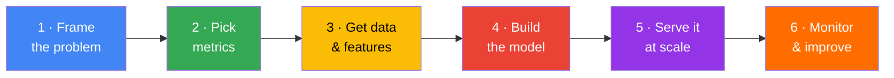
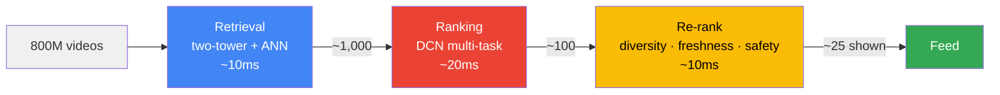

# Chapter 26 — ML System Design (Google)

> "At Google, system design is not about memorizing architectures — it's about demonstrating structured thinking at scale."

---

## How to Read This Chapter

![Infographic of the six-step ML system design playbook: the StreamFlix ask ('The homepage feed is boring. Make people love it.', 500M daily users, 800M videos), a road with six stops — Frame the problem (destination), Pick metrics (dashboard), Get data & features (fuel), Build the model (engine), Serve it at scale (road to real users), Monitor & improve (warning lights) — a 45-minute interview bar split 5/5/8/10/10/7 min, the mnemonic 'Please Make Data, Model Smartly, Monitor', a pick-by-question table, and the trap of jumping straight to a model.](diagrams/ml26_info_playbook_ai.png)

<details>
<summary><strong>Read as text</strong> — the StreamFlix story, the six-step playbook and the roadmap</summary>

Most ML system design guides hand you twenty disconnected diagrams and hope you glue them together under interview pressure. This one tells a **single story** instead.

> 🎬 **You just became the ML lead at StreamFlix** — a (fictional) video app with **500M daily users** and **800M videos**. Your boss says: *"The homepage feed is boring. Make people love it."* That's it. No spec, no metric, no model.
>
> Over this chapter you'll turn that one vague sentence into a planet-scale recommendation system — and every ML system design concept will show up exactly when StreamFlix needs it. By the end, the same playbook will let you design Search, Fraud, Ads, or an LLM assistant on demand.

**The playbook is six steps — the arc of the whole story:**



🧠 **The metaphor that ties it together:** building an ML system is like **building and driving a car** — decide the destination (*problem*), agree on the dashboard you'll be judged by (*metrics*), add fuel (*data*), build the engine (*model*), get on the road to real users (*serving*), and watch the warning lights so it doesn't die next month (*monitoring*).

**Memorize the ride:** *"Please Make Data, Model Smartly, Monitor"* → **P**roblem · **M**etrics · **D**ata · **M**odel · **S**erving · **M**onitoring.

> ⏱️ **The 45-minute interview maps onto this story:** ~5 min framing, ~5 min metrics, ~8 min data/features, ~10 min model, ~10 min serving, ~7 min monitoring. Spend your first 30 seconds *thinking*, not talking.

**The roadmap:**

| Part | StreamFlix milestone | Concepts you'll learn |
|------|---------------------|----------------------|
| 1 | Frame the problem | Clarifying questions, choosing the label, offline vs online metrics |
| 2 | Feed the machine | Labels, data traps, features, feature stores, training-serving skew |
| 3 | Build the brain | Baselines, two-tower retrieval, ranking, the multi-stage funnel |
| 4 | Prove it works | Time-based splits, A/B testing, guardrails, interleaving |
| 5 | Ship it | Batch vs real-time, latency budgets, ANN/ScaNN, caching, compression |
| 6 | Keep it alive | Drift, retraining, safe deployment, feedback loops |
| 7 | Do it responsibly | Bias, fairness, safety layers, privacy |
| 8 | Same playbook, new worlds | Search, Fraud, Moderation, LLM/RAG, Ads, Personalization |

</details>

---

# Part 1 — Frame the Problem

*Day 1. "Make the feed less boring." Where do you even start?*

## Ask Before You Build

![Infographic on framing an ML system: four clarifying questions (what are we optimizing, how many users/videos, how fast must it feel, safety/fairness rules) each mapped to its design impact (500M × 800M can't rank everything per request; under 300ms rules out heavy models on the full corpus), the stated-assumptions sentence, and three label doors — Clicks (clickbait, ✗), Raw watch time (sleeping user, ✗), Composite label (✓) — with label = w1·click + w2·meaningful_watch + w3·(like or save) − w4·not_interested.](diagrams/ml26_info_framing_label_ai.png)

<details>
<summary><strong>Read as text</strong> — the clarifying questions and the assumptions to say out loud</summary>

🧠 **The concept:** The strongest candidates spend their first two minutes asking questions, not drawing boxes. You can't drive until you know the destination — and "make it less boring" is not a destination.

You corner your boss with the questions every framing needs:

| You ask… | Because it changes the design… |
|----------|-------------------------------|
| What are we optimizing — watch time, retention, satisfaction? | The goal picks the metric and the label |
| How many users / videos? | 500M users × 800M videos means you **cannot** rank everything per request |
| How fast must it feel? | "Under 300ms" rules out heavy models on the full corpus |
| Any safety / fairness rules? | Kids' content, regional law, creator fairness all constrain the design |

> 📐 **State assumptions out loud:** *"I'll assume 500M DAU (daily active users), an 800M-video corpus, a sub-300ms budget, and that we optimize long-term satisfaction — not raw clicks. I'll revisit if that's wrong."* This one sentence signals seniority instantly.

</details>

## The Most Important Decision: Choosing the Label

<details>
<summary><strong>Read as text</strong> — why clicks and raw watch time fail, and the composite label</summary>

🧠 **The concept:** The **label** (the thing you predict) is the single most consequential choice in the whole system. It decides your data, your model, your metric, and — crucially — the behavior you'll accidentally encourage.

⚠️ **StreamFlix's first near-disaster.** Your first instinct is "predict clicks." But optimize for **clicks** and you get thumbnails of screaming faces and *"you won't BELIEVE minute 3:47."* Optimize for **raw watch time** and you get three-hour videos droning to a sleeping user. Neither is "love the feed."

The fix — and the real interview answer — is a **composite label**: a *weighted blend* of signals — the click, a **meaningful watch** (past a minimum watch time, not an instant bounce), and explicit positives (likes, saves) — with "not interested" counting as a negative. The weights balance *engagement* with *satisfaction*:

```
label = w1·click + w2·meaningful_watch + w3·(like or save) − w4·not_interested
```

> 🎤 **Soundbite:** "Optimizing the wrong label is how recommendation systems get good at making users miserable. I'd predict a composite engagement-and-satisfaction signal, not raw clicks."

</details>

## Metrics: The Dress Rehearsal and Opening Night


<details>
<summary><strong>Read as text</strong> — offline vs online metrics and which metric fits which job</summary>

You now need two dashboards.

**Offline metrics = the dress rehearsal.** Grade the model on held-out data *before* it ever touches a user. Know which metric fits which job:

| Problem type | Metric | One-line meaning |
|---|---|---|
| Classification | **Precision / Recall** | Of what you flagged, how much was right / of all the real ones, how many you caught |
| Imbalanced classification | **PR-AUC** | Honest when positives are rare (fraud, spam) — ROC-AUC flatters you here |
| Ranking (StreamFlix!) | **NDCG@k** | Rewards putting the *best* items at the *top* |
| Probability quality | **Log loss / calibration** | Is "0.8" really an 80% chance? Matters when money rides on the score |
| Generation | **Perplexity, LLM-as-judge** | n-gram overlap (BLEU/ROUGE) is a weak proxy; LLM judges track human ratings better |

**Decoding the acronyms:**

- **AUC** = area under a curve. **ROC-AUC** = the chance the model scores a random positive above a random negative (0.5 = coin flip, 1.0 = perfect). **PR-AUC** = area under the precision–recall curve; it ignores the mountain of easy negatives, so it stays honest when positives are rare.
- **NDCG@k** (Normalized Discounted Cumulative Gain): add up the relevance of the top-k items, dividing each by log₂(position + 1) so lower slots count less, then divide by the score of the perfect ordering → 1.0 = ideal order.
- **Log loss** punishes confident wrong probabilities; **calibration** checks that items scored 0.8 really happen ~80% of the time.
- **Perplexity** = how "surprised" a language model is by real text (lower is better); **LLM-as-judge** = a strong model grades the answers.

🧭 **Pick-your-metric in one breath:** *false positives hurt → Precision · false negatives hurt → Recall · ranking → NDCG · money rides on the score → Calibration.*

🎣 **Precision vs recall, intuitively:** picture a fishing net. **Precision** = of the fish you caught, how many you actually wanted (no boots). **Recall** = of all the fish in the lake, how many you landed. Tighten one and the other usually slips — which is why you rarely optimize just one.

**Online metrics = opening night** with a paying audience, measured by A/B test on live traffic: CTR (click-through rate = clicks ÷ impressions), **session watch time**, 7-day retention, satisfaction surveys. StreamFlix's North Star is **long-term satisfaction**, read through 7-day retention and survey scores; session watch time is the fast daily signal, but never on its own — raw watch time rewards bloat (the label trap above). The dress rehearsal can be flawless and the show can still flop.

</details>

## When the Two Dashboards Disagree

<details>
<summary><strong>Read as text</strong> — the offline-win, online-loss curveball and its usual suspects</summary>

🎯 **The favorite curveball:** *"Your model gains 3% NDCG offline but loses 1% CTR live. What happened?"* This quietly separates people who've shipped from people who've only trained.

The usual suspects: **distribution shift** (offline data ≠ live traffic), **feature leakage** (a feature available offline but late/missing live), **position bias** (offline data reflects what *was* shown at the top), or a **proxy mismatch** (NDCG measures relevance; users want satisfaction).

> 🎤 **Soundbite:** "First I'd confirm the right model actually shipped, then compare offline vs live feature distributions, then check for position bias. If the gap holds, my offline metric isn't measuring what users care about."

</details>

---

# Part 2 — Feed the Machine

*The feed is framed. Now it needs fuel. At Google, better **data** beats a better model almost every time — a simple model on clean, plentiful data wins.*

## Labels: Eavesdrop or Ask

![Infographic on labels and data traps: implicit labels (eavesdrop: clicks, watch time, skips — free, nearly infinite, noisy) and explicit labels (ask: thumbs, ratings, human raters — clean, slow, expensive) flowing into one training-data tank, then three warning signs — missing ≠ random, label noise (click then instant bounce), selection bias (teacher calling only on the front row) — and a Trap → Fix table: is_missing flag, dwell > N seconds, 1–5% exploration, IPS weight 1 / P(shown), counterfactual evaluation.](diagrams/ml26_info_data_labels_traps_ai.png)

<details>
<summary><strong>Read as text</strong> — implicit vs explicit labels and why you use both</summary>

StreamFlix needs millions of labeled examples. Two ways to get them:

- 👂 **Implicit (eavesdrop):** clicks, watch time, skips. Free and nearly infinite — but **noisy**, because a click is a *guess* about intent, not a confession. A click followed by an instant bounce was not a win.
- 🙋 **Explicit (ask directly):** thumbs, ratings, human raters. Honest and clean — but slow and expensive, so you never get many.

**The real-world answer is both:** train on abundant implicit signals, *calibrate and validate* with a trickle of explicit ones.

</details>

## Three Traps in the Data

<details>
<summary><strong>Read as text</strong> — missing data, label noise and selection bias</summary>

🧠 **The concept:** raw logs lie in systematic ways. Three traps sink most systems:

1. **Missing data is rarely random.** A user who hides their age differs from one who shares it. *Fix:* add an `is_missing` flag so the model can learn that the gap itself is a signal; tree models (XGBoost) handle this natively by learning which branch missing values should take.
2. **Label noise.** That click-then-bounce gets logged as a "positive." *Fix:* require dwell > N seconds, or build a multi-signal composite label.
3. **Selection bias — the sneaky one.** 🪤 StreamFlix only ever sees what it *already chose to show* — like a teacher who only calls on the front row, then concludes the back row has nothing to say. Brilliant videos you rank low never get a chance.

</details>

<details>
<summary>🔬 <strong>Go deeper:</strong> breaking the selection-bias loop</summary>

- **Exploration traffic:** reserve 1–5% of impressions for random/epsilon-greedy picks so you keep learning about unshown items.
- **Inverse propensity scoring (IPS):** weight each example by 1 / P(it was shown) to undo the display policy's bias.
- **Counterfactual evaluation:** use those propensity scores to estimate how a *new* model would have done on logged data.

</details>

## Features: The Clues You Hand the Model

![Infographic on features and training-serving skew: before — two chefs with different recipes ('Training: Python · batch' vs 'Serving: C++ · real-time') producing different dishes, stamped Skew; after — one Feature store pantry feeding both Training and Serving, with jars for slow-cooked (overnight: 30-day watch rate) and made-to-order (per request: what you tapped 3 s ago) features and point-in-time correctness; plus a feature-family table (User, Item, Context, Cross with StreamFlix examples) and the note that crosses win.](diagrams/ml26_info_features_skew_ai.png)

<details>
<summary><strong>Read as text</strong> — the feature families and why cross features win</summary>

🧠 **The concept:** features are the clues the model reasons from. Three basic families — user, item, context — plus a **cross** family that's secretly the most powerful:

| Family | Captures | StreamFlix example |
|---|---|---|
| **User** (who) | history, taste | `watch_rate_7d`, `user_embedding` |
| **Item** (what) | properties | `category`, `title_embedding`, `freshness` |
| **Context** (when/where) | the moment | `time_of_day`, `device`, `session_depth` |
| **Cross** (chemistry) | interactions | `user × category affinity`, `query × item similarity` |

✨ **Why cross features win:** "this user's click-rate *on cooking videos*" predicts far better than their overall click-rate plus the video's category, separately. Google's **Wide & Deep** was built precisely to capture these — and **DCN** (next part) learns them automatically.

</details>

## The Pantry and the #1 Silent Killer

<details>
<summary><strong>Read as text</strong> — training-serving skew and the feature-store fix</summary>

You hit a subtle bug: a feature looks great in training but tanks live. Welcome to **training-serving skew**.

🧠 **Training-serving skew** = practicing with one recipe and cooking from another. Training computes a feature one way (Python, batch); serving computes it slightly differently (C++, real-time) — and the model quietly falls apart. It's the **#1 cause of "great offline, terrible live."**

🧠 **The fix — a feature store** = a **shared kitchen pantry**. Every model grabs identical, pre-prepped ingredients from one jar, and training and serving pull from the *same jar*. (Google's is the Feature Store on Gemini Enterprise Agent Platform, formerly Vertex AI Feature Store: one definition, served both batch for training and online for inference, with **point-in-time correctness** — each training row sees feature values exactly as they were at that moment, never values computed later.)

> 🎤 **Soundbite:** "I'd compute features through one shared definition — a feature store — so training and serving use the same code and can't silently drift apart. I'd still monitor feature distributions, because stale or missing values can cause skew anyway. Most 'mysterious' production regressions are just skew."

StreamFlix's features split into **slow-cooked** (overnight: 30-day watch rate) and **made-to-order** (per request: what you tapped 3 seconds ago) — and the system plates both together.

</details>

---

# Part 3 — Build the Brain

*Fuel is flowing. Time for the engine. The golden rule: **start simple, add complexity only with justification.***

## Always Start With a Baseline


<details>
<summary><strong>Read as text</strong> — the baseline ladder, from popularity to production</summary>

Before any neural network, you say: *"Baseline: sort by popularity. No ML."* If ML can't beat that, don't use ML. Then climb: logistic regression / GBDT (gradient-boosted decision trees, e.g., XGBoost) → shallow net → production architecture. In an interview you spend 30 seconds here and 8 minutes on the top — but skipping it signals you don't think like a practitioner.

</details>

## Two-Tower: Find 1,000 Good Videos in 800,000,000

<details>
<summary><strong>Read as text</strong> — two towers, precomputed embeddings and ANN retrieval</summary>

🧠 **The problem:** you cannot score 800M videos per request. So **retrieval** must cheaply narrow the field.

🗼 **The two-tower model** (dual-encoder) is Google's workhorse. One tower encodes the **user**, another encodes the **video**, each into a 128-dim embedding, trained so relevant pairs land close together. The trick: **video embeddings are precomputed offline.** At request time you embed only the user (one forward pass) and do an **approximate nearest neighbor (ANN)** lookup — find *almost* the closest video vectors, far faster than checking all 800M (Part 5 shows how) — to grab the top ~1,000 in single-digit milliseconds.

> 📐 **Formally:** score(user, video) = **u · v**, the dot product of the two 128-dim embeddings. Training treats each logged (user, watched video) pair as a positive and the *other videos in the same mini-batch* as negatives (in-batch softmax), with a correction so popular videos — which show up as negatives often — aren't unfairly pushed down (Yi et al., Google/YouTube, 2019). Because the score is a plain dot product, "find this user's best videos" is a **maximum inner product search (MIPS)** — exactly what ANN indexes like ScaNN are built for.

</details>

## Ranking: Now Be Picky (Wide & Deep / DCN)

![Infographic of the multi-stage recommendation funnel: 800M videos → Retrieval (two-tower + ANN, ~10ms) → ~1,000 → Ranking (DCN multi-task, ~20ms) → ~100 → Re-rank (diversity · freshness · safety, ~10ms) → ~25 shown in the Feed, with hiring-funnel captions (résumé scan, phone screen, on-site); an 'Inside the ranker' diagram (features → cross layers (DCN-v2) + deep layers → P(click), watch time, P(like) → one score); and a table comparing Wide & Deep (Google, 2016), DCN-v2 (Wang et al., 2021) and the multi-task ranker.](diagrams/ml26_info_ranking_funnel_ai.png)

<details>
<summary><strong>Read as text</strong> — memorize vs generalize, DCN-v2 and the multi-task ranker</summary>

With ~1,000 candidates, you can afford a heavier model.

- **Wide & Deep** (Google, 2016): the **wide** half *memorizes* specific crosses ("fans of X also love Y"); the **deep** half *generalizes* from embeddings. Memorization + generalization in one model.
- **DCN-v2** (Deep & Cross Network): learns feature crosses **automatically** via explicit cross layers — no hand-engineering. Google reports it deployed in many of its production learning-to-rank systems (Wang et al., 2021).

StreamFlix's ranker is **multi-task**: one model, several heads — P(click), expected watch time, P(like) — combined into a single score tuned by online experiments.

</details>

## The Funnel That Powers Google

<details>
<summary><strong>Read as text</strong> — the retrieve, rank and re-rank cascade</summary>

🧠 **The big idea:** no single model does it all. You **cascade** — cheap-and-fast first, expensive-and-accurate last. It's a hiring funnel: a résumé scan cuts a billion→a thousand, a phone screen a thousand→a hundred, an on-site picks the final few.



Search, YouTube, and Ads all run this exact shape. The **re-rank** stage is where StreamFlix injects diversity (no filter bubbles), freshness boosts, and policy/safety filters.

</details>

## Three Hard Realities Every Recommender Hits


<details>
<summary><strong>Read as text</strong> — imbalance, cold start and position bias</summary>

- **Imbalance:** if you later add a "report" classifier, violations are <1% of uploads. *Fix:* class weights, focal loss, or downsample negatives + recalibrate: if you kept a fraction *w* of the negatives, map the model's output *q* back to a true probability with p = q / (q + (1 − q) / w).
- 🥶 **Cold start:** a brand-new user or video has no history. *Fix:* fall back to popularity/demographics for new users; use **content features** (title, category) so the two-tower can embed a new video from its content alone; sprinkle exploration.
- **Position bias:** users click the top slot regardless of quality, so the model learns *position*, not *relevance*. *Fix:* train *with* a position feature, then fix it to a constant at serving — a counterfactual "if this were at the top, would you still click?"

</details>

---

# Part 4 — Prove It Works

*Your model looks brilliant offline. So did the last three that flopped. Prove it.*

## Offline: Split by Time, Not at Random

![Infographic on proving an ML model works: a time-split timeline (Train Jan–Mar, 7-day gap, Validate April), an A/B flow where hash(user_id) assigns users to control and treatment with guardrails on satisfaction, revenue and p99 latency, the sample-size rule n ≈ 16·p(1 − p)/δ² giving ≈ 3M users per arm for 5.00% → 5.05%, an SRM check (50.6% / 49.4% on 10M users gives χ² = 1,440 > 3.84), interleaving needing >100× fewer users, and a table comparing time-split offline, A/B test, interleaving and long-term holdouts.](diagrams/ml26_info_evaluation_ab_ai.png)

<details>
<summary><strong>Read as text</strong> — time-based splits, the label-delay gap and backtesting</summary>

🧠 **The concept:** real data has a timeline, so **random splits leak the future into the past** and inflate your score. Train on Jan–Mar, validate on April — with a **gap** between them sized to your label delay (if the label is "watched within 7 days," leave a 7-day gap) so future info can't sneak in.

For ranking you can also **backtest**: replay logged sessions, re-score with the new model, compare to what users actually did (mind selection bias — you only see what the old model showed).

</details>

## A/B Testing: The Only Real Proof

<details>
<summary><strong>Read as text</strong> — sample size, SRM, guardrails, interleaving and holdouts</summary>

🧠 **The concept:** split live traffic — one group sees the current model (control), another sees yours (treatment); often each is a small slice such as 1% of users — and compare. A few rules that separate pros from amateurs:

- **Randomize by user, not request** (consistent experience; hash the user_id).
- **Power & duration:** before starting, pick the **minimum detectable effect (MDE)** — the smallest change worth shipping. Rule of thumb (5% significance, two-sided, 80% power): users per arm ≈ 16 · p(1 − p) / δ², where p = the baseline rate and δ = the MDE as an absolute change. Example: 5% of users click a recommendation; to detect a 1% *relative* lift (5.00% → 5.05%, δ = 0.0005) you need 16 × 0.05 × 0.95 / 0.0005² ≈ **3M users per arm**. StreamFlix gets that in a day, but still runs 1–2 weeks to absorb day-of-week swings.
- **Watch for sample-ratio mismatch (SRM)** — the split you got differs from the split you planned. On 10M users, 50.6% / 49.4% looks harmless, yet a chi-square test gives χ² = 1,440 (anything above 3.84 is significant at 5%). That is a bug in assignment or logging, and it invalidates the result.

🛡️ **Guardrail metrics** keep a "win" honest: StreamFlix's new model may lift CTR 1% but it must **not** hurt satisfaction, revenue, or latency (watched at **p99** — the time 99% of requests finish within). If it does, you don't ship.

> 🎤 **Soundbite:** "I'd set guardrails on satisfaction, revenue, and p99 latency. A CTR win that costs user satisfaction is a loss."

⚡ **Interleaving** is the speed trick: blend two rankers into one list — e.g., *team-draft*: the rankers take turns adding their next-best item, like captains picking teams — and credit each click to the ranker that supplied that item. Because every user compares both rankers side by side, it is far more sensitive: Netflix measured it needing **>100× fewer users** than its most sensitive A/B metric — perfect for rapid ranking comparisons. But it only measures *relative* ranking preference, not business impact, so you confirm the winner with a real A/B test.

🧠 **Mind the long game:** a CTR spike can fade as users habituate, and "engaging" content can quietly erode satisfaction. Google runs **long-term holdouts** (1–5% of users kept on the old model) to check 30/60/90-day effects.

</details>

---

# Part 5 — Ship It

*A model that misses its latency budget doesn't exist. Serving is where ML meets systems engineering — and where Google probes hardest.*

## Batch vs Real-Time (Usually Both)


<details>
<summary><strong>Read as text</strong> — batch, real-time and the hybrid everyone uses</summary>

**Batch** precomputes predictions on a schedule (cheap, but stale). **Real-time** computes per request (fresh, but costly). StreamFlix uses the **hybrid** everyone uses: precompute what's stable (video embeddings, user profiles) in batch; combine with live session context in real time.

</details>

## The Latency Budget

<details>
<summary><strong>Read as text</strong> — the per-stage p99 budget and why tails matter</summary>

🧠 **The concept:** every millisecond is allocated, because the *whole* pipeline must fit under ~300ms. A rough StreamFlix budget:

| Stage | ~p99 |
|---|---|
| Feature lookup | 10 ms |
| Retrieval (ANN) | 20 ms |
| Ranking inference | 40 ms |
| Re-rank + business logic | 10 ms |
| **Headroom for network/render** | the rest |

These are **p99 budgets** (the time 99% of requests must beat), so they are looser than the *typical* times in the funnel diagram (~10 / ~20 / ~10 ms). The four stages add up to 10 + 20 + 40 + 10 = 80 ms, leaving ~220 ms of the 300 ms for network and rendering.

⚠️ **Why tails (p99) matter:** at 100,000 QPS (queries per second), p99 = 200ms means **1,000 requests every second** take longer than 200ms — real people staring at a spinner. And fan-out compounds tails: query 10 shards in parallel, each at p99=100ms, and ~9.6% of requests have at least one slow shard (1 − 0.99¹⁰) — so per-shard p99 is really your overall **p90**.

</details>

## Searching a Billion Embeddings: ANN & ScaNN


<details>
<summary><strong>Read as text</strong> — why exact search fails, and HNSW vs FAISS vs ScaNN</summary>

🧠 **The concept:** exact nearest-neighbor search means scoring *every* vector — for StreamFlix that is 800M × 128 ≈ 10¹¹ multiply-adds per request, over ~410 GB of raw vectors (800M × 128 floats × 4 bytes). Far too slow and expensive at 100,000 QPS (~10¹⁶ multiply-adds every second), so you go **approximate** (ANN) — trade a sliver of accuracy, measured as **recall@k** (the share of the true top-k you still find), for 100–1000× speed.

| Method / library | How it works | Trade-off |
|---|---|---|
| **HNSW** (graph algorithm) | Hop greedily through a layered "small-world" graph of near neighbors | Very high recall; memory-hungry (graph + full vectors in RAM) |
| **FAISS** (Meta's library) | **IVF**: cluster the vectors, search only the nearest clusters · **PQ**: compress each vector into a short code | Flexible, GPU support, great at billion scale; compression costs some recall |
| **ScaNN** (Google's library) | Anisotropic quantization tuned for maximum inner product search (MIPS) | Keeps errors smallest where they would change the top scores; top-tier speed/recall; powers Google's Vector Search (Agent Platform) |

StreamFlix uses **ScaNN** to search 800M video embeddings in under 5ms.

</details>

## Two More Levers: Caching & Compression

<details>
<summary><strong>Read as text</strong> — cache hit rates, distillation and quantization</summary>

- **Caching:** only cache *misses* reach the backend, so a 90% hit rate on hot item embeddings cuts backend load **10×** (80% → 5×, 95% → 20×). Cache each user's feed with a short TTL (time-to-live: how long an entry stays valid), and invalidate it on an explicit action such as "not interested".
- **Compression — the Google playbook:** train the best possible **teacher** model ignoring cost, then **distill** it into a small **student** that hits the latency budget. Add **quantization** (store weights as 8-bit integers instead of 32-bit floats: FP32→INT8 = 4× smaller, typically <1% accuracy loss) and **pruning** (drop near-zero weights). Much of a 10B-param teacher's quality can ship in a 50M-param student (200× smaller) running in 5ms.

</details>

---

# Part 6 — Keep It Alive

*StreamFlix launches. 🎉 You are not done — you are at the starting line. Models decay as the world changes.*

## Drift: The World Moves On

![Infographic on keeping an ML model alive: a four-step rollout ladder (offline eval, shadow, canary on 1–5% of users, gradual ramp to 100%) with auto-rollback at the live steps if a guardrail breaks, a feedback loop (show popular → more clicks → shown even more → diversity collapses) broken by exploration, debiasing and diversity, and a table of data drift P(x) (PSI > 0.25 or KS test), concept drift P(y | x) (fresh labels) and prediction drift P(ŷ) (e.g. 'love it' for 30% of videos; watch the score distribution).](diagrams/ml26_info_drift_deploy_ai.png)

<details>
<summary><strong>Read as text</strong> — data, concept and prediction drift and how to detect each</summary>

🧠 **The concept:** three things drift —

- **Data drift** (inputs change; formally P(x) shifts): a new viral format floods uploads. *Detect:* compare feature distributions with **PSI** (Population Stability Index; rule of thumb: above 0.25 = a significant shift) or a **KS test** (Kolmogorov–Smirnov: the biggest gap between two cumulative distributions).
- **Concept drift** (the rules change; P(y | x) shifts — same inputs, different right answer): "what's a good recommendation" shifts as tastes evolve. *Detect:* watch offline metrics on fresh labels.
- **Prediction drift** (outputs change; P(ŷ) shifts): the model suddenly predicts "love it" for 30% of videos — far above its normal rate — because a feature pipeline broke and started sending all-zeros. *Detect:* monitor the score distribution.

</details>

## Retraining & Safe Deployment

<details>
<summary><strong>Read as text</strong> — daily retraining, the rollout ladder and feedback loops</summary>

StreamFlix retrains **daily** on a rolling 30-day window (ranking models drift fast). And nothing ships in one risky leap — it walks a ladder:

```
1. Offline eval   beat the current model on held-out data
2. Shadow         score live traffic, show users nothing
3. Canary         serve 1–5% of users
4. Gradual        ramp up to 100%

At every live step (2–4): auto-rollback if any guardrail breaks
```

🧠 **Feedback loops — the dangerous magic:** the model's outputs become its future training data. Show popular items → they get more clicks → model shows them even more → diversity collapses. *Counter with* exploration traffic, popularity debiasing, and diversity constraints in re-rank.

</details>

---

# Part 7 — Do It Responsibly


<details>
<summary><strong>Read as text</strong> — bias, fairness flavors, safety layers and privacy</summary>

*Responsible AI is not the last 30 seconds of the interview — at Google it's designed in from day one.*

🧠 **Bias hides in averages.** StreamFlix's model shows **0.94 AUC overall** — but sliced by language it's 0.72 for Swahili users. *Never report only aggregate metrics — always disaggregate by group.* Bias can enter at every stage (data, labels, features, training, evaluation, serving).

**Fairness has precise flavors** — pick by application:
- **Demographic parity:** equal positive rates across groups (often too rigid).
- **Equal opportunity:** equal *true-positive* rates — good for "surface relevant creators equally."
- **Calibration across groups:** a 0.8 means 80% for everyone — essential when scores set prices (ads).

⚠️ These flavors conflict: when groups have different base rates, no imperfect model can be calibrated *and* have equal false-positive and false-negative rates across groups (Kleinberg et al., 2016; Chouldechova, 2017). That's why you choose the one your application needs.

🛡️ **Safety is layered** like an onion: input filters → model-level safety (RLHF — reinforcement learning from human feedback — and refusals) → output filters (toxicity, PII — personally identifiable information) → red-teaming (attacking your own system, before and after launch) and human review.

🔒 **Privacy belongs in the design too:** **differential privacy** adds carefully calibrated noise during training (e.g., DP-SGD clips each example's gradient, then adds noise), so the trained model reveals almost nothing about any single user.

> 🎤 **Soundbite:** "For StreamFlix I'd disaggregate engagement by demographic to catch bias, add a safety classifier in re-rank, and apply differential privacy in training. Responsible AI is an architectural concern, not a disclaimer."

</details>

---

# Part 8 — Same Playbook, New Worlds

![Infographic showing the same six-step ML playbook (frame, metrics, data, model, serving, monitoring) applied to six systems as a grid of cards: Search (BM25 + ScaNN → GBDT on ~1,000 → BERT on top ~100, <200ms), Fraud (0.1% positives, labels 30–90 days late, GBDT, velocity features), Moderation (parallel multi-modal models, perceptual hashing, OCR), LLM/RAG (retrieve → rerank → generate with citations), Ads (DCN-v2 / Wide & Deep, calibrated P(click), bid × P(click) × quality) and Personalization (long-term + session embedding, bloom-filter dedupe, 7-day retention), plus a pick-by-question table.](diagrams/ml26_info_new_worlds_ai.png)

<details>
<summary><strong>Read as text</strong> — one playbook, different nouns</summary>

You just built StreamFlix in six steps. The beautiful part: **every other system is the same playbook with different nouns.** Here's each classic design, compressed to its essence.

</details>

### 🔎 Search Ranking (Google-scale)

<details>
<summary><strong>Read as text</strong> — two retrieval paths and two-phase ranking</summary>

Frame → return the best of *hundreds of billions* of pages in <200ms. **Retrieval** runs two paths in parallel — inverted index (**BM25**, the classic keyword score: query words that are rare overall but frequent in the page score high) + embedding retrieval (**ScaNN**, semantic). **Rank** in two phases: a fast GBDT on ~1,000 docs, then a heavy **BERT cross-encoder** on the top ~100 (cross-attention is accurate but too slow for 1,000). Same funnel, freshness-aware for breaking news.

</details>

### 💳 Fraud Detection (real-time)

<details>
<summary><strong>Read as text</strong> — rare positives, velocity features and three-tier decisions</summary>

The twist: **0.1% positives**, <100ms decisions, adversaries who adapt, and labels that arrive 30–90 days late (chargebacks). **GBDT** on tabular features; **velocity features** (transactions in last 1/5/60 min) are among the strongest signals. Three-tier decisions — auto-approve / human-review / auto-block — keep reviewers from drowning in false positives. Never use accuracy (predicting "never fraud" is 99.9% accurate and useless).

</details>

### 🛡️ Content Moderation (multi-modal)

<details>
<summary><strong>Read as text</strong> — parallel modalities, human review and perceptual hashing</summary>

Process video, audio, text, image **in parallel**, then fuse scores. **Stage 1** automated for high recall; **Stage 2** humans for precision (their calls become training labels). Defend against evasion with **OCR on frames**, adversarial training, and **perceptual hashing** (a fingerprint that survives resizing and re-encoding — Meta's open-source PDQ for images, TMK+PDQF for video) to instantly catch re-uploads of known-bad content. Policies are context-dependent (news vs. entertainment).

</details>

### 🤖 LLM Conversational AI / RAG (2026)

<details>
<summary><strong>Read as text</strong> — the RAG pipeline, tool use and judging answers</summary>

Grounding beats hallucination. **RAG pipeline:** rewrite the query → retrieve (dual-encoder + BM25, merged by **reciprocal-rank fusion** — RRF: each document scores Σ 1/(60 + rank) across the lists) → **rerank with a cross-encoder** (often the highest-leverage step) → assemble context with citations → generate. Add **tool use** via function calling / **MCP** (Model Context Protocol, the open standard for plugging tools and data into models) and **ReAct** loops (reason → act → observe, repeat). Fight hallucination with attribution checks and "I don't know" gating. Evaluate without ground truth via **LLM-as-judge** + human side-by-sides.

</details>

### 📢 Ads Click Prediction

<details>
<summary><strong>Read as text</strong> — calibration, the ranker and the auction</summary>

P(click) feeds the auction, so it must be **calibrated** (0.8 must mean 80%, or advertisers over/underpay) — fix with Platt scaling (fit a sigmoid on the raw scores) / isotonic regression (fit a monotone step function), and monitor with reliability diagrams (predicted vs. actual click rate per score bucket). **DCN-v2 / Wide & Deep** on thousands of features, trained continuously on the last 24–48h. Correct position bias; rank by `bid × P(click) × quality`; price with a **generalized second-price (GSP)**-style auction — each winner pays roughly the minimum it needed to keep its slot.

</details>

### ⚡ Real-Time Personalization

<details>
<summary><strong>Read as text</strong> — session embeddings, bloom-filter dedupe and retention</summary>

A click 10 seconds ago must reshape the feed *now*. Fuse a **long-term embedding** (daily batch) with a **session embedding** (a small transformer over the last N actions, updated per tap). A session-aware ranker captures "watched three cooking videos → boost cooking." Dedupe seen items with a **bloom filter** (a compact set that may wrongly say "seen" but never wrongly says "unseen" — so at worst it occasionally hides an unseen video, but never repeats one). Optimize for 7-day retention, not just session clicks.

</details>

---

## The Trade-Offs Cheat Sheet

Interviewers push on trade-offs — that's the substance of seniority. Never present one solution; name what you're trading.

| Trade-off | Lean left when… | Lean right when… |
|---|---|---|
| Precision ↔ Recall | false positives costly (spam, removal) | false negatives costly (fraud, cancer) |
| Batch ↔ Real-time | staleness is fine, cost matters | freshness/session context matters |
| Simple ↔ Complex model | little data, need explainability | abundant data, accuracy is paramount |
| Two-tower ↔ Cross-encoder | huge candidate pool, need <10ms | small set, accuracy critical |
| A/B test ↔ Interleaving | measuring business metrics | comparing ranking quality, fast |
| GBDT ↔ Neural net | tabular, small data, explainable | unstructured data, very large scale |
| Embeddings/ANN ↔ Inverted index | semantic similarity | exact keyword, ultra-low latency |

---

## Interview Soundbites (steal these)

- **Framing:** "Before I draw a box — what's the metric, the scale, and the latency budget? Here are my assumptions."
- **Label:** "I'd predict a composite engagement-and-satisfaction signal, not raw clicks."
- **Skew:** "One shared feature definition, so training and serving use the same code — then monitor for the skew that's left."
- **Funnel:** "Cheap-and-fast retrieval to narrow the field, expensive-and-accurate ranking on the short list."
- **A/B:** "Guardrails on satisfaction, revenue, and p99 — a CTR win that hurts satisfaction is a loss."
- **Responsible AI:** "Disaggregate metrics by group; bias hides in averages."

---

## Key Takeaways

1. **Follow the six-step story:** Problem → Metrics → Data → Model → Serving → Monitoring. Structure beats brilliance.
2. **The label is destiny.** The wrong label makes a system excellent at the wrong thing.
3. **Data > model.** Clean, plentiful data on a simple model wins.
4. **The multi-stage funnel is the universal pattern** — cheap retrieval, expensive ranking, business re-rank.
5. **Training-serving skew is the #1 silent killer;** feature stores exist to stop it.
6. **Prove it live.** Offline is a dress rehearsal; A/B testing (with guardrails) is the real verdict.
7. **Latency is a budget,** and the tails (p99) are what users feel.
8. **Shipping is the starting line** — drift, retraining, and safe rollout keep it alive.
9. **Responsible AI is architecture,** not an afterthought.
10. **Be concrete:** name real systems (ScaNN, TPU, Bigtable, Agent Platform) and real numbers (128-dim, <300ms, 0.1% fraud).

---

## Review Questions

**1. Why does StreamFlix use a two-tower model for retrieval instead of a cross-encoder?**
<details><summary>Answer</summary>
Two towers encode user and video independently, so video embeddings can be precomputed and indexed — enabling an ANN search over 800M videos in <10ms. A cross-encoder must process the user with every candidate at request time, which is infeasible at that scale. Cross-encoders are reserved for re-ranking a short list.
</details>

**2. The new ranker gains NDCG offline but loses watch time in the A/B test. Name three plausible causes.**
<details><summary>Answer</summary>
Training-serving skew or feature leakage; position bias (offline data reflects the old top-ranked items); a proxy mismatch where NDCG-relevance ≠ user satisfaction. Also check the right model actually deployed and that the A/B split isn't suffering sample-ratio mismatch.
</details>

**3. Why is choosing the label the most important decision, using StreamFlix as the example?**
<details><summary>Answer</summary>
The label defines data, model, metric, and the behavior you incentivize. "Clicks" breeds clickbait; "raw watch time" breeds bloated videos. A composite engagement-and-satisfaction label aligns the system with the real goal — a loved feed.
</details>

**4. What is training-serving skew and how does a feature store prevent it?**
<details><summary>Answer</summary>
Skew is when features are computed differently in training (batch/Python) vs serving (real-time/C++), so the model meets a different distribution live and degrades. A feature store provides one shared feature definition served to both paths, guaranteeing identical computation.
</details>

**5. Why does fan-out make tail latency worse, and what's the fix?**
<details><summary>Answer</summary>
Querying many shards in parallel means the slowest shard sets your latency. With 10 shards each at p99=100ms, ~9.6% of requests hit at least one slow shard (1 − 0.99¹⁰), so 100ms behaves like your overall p90. To hold a true 100ms p99, each shard must be fast at p99.9 — via tighter budgets, hedged requests, or fewer/faster shards.
</details>

**6. How do you handle cold start for a brand-new StreamFlix video?**
<details><summary>Answer</summary>
Use content features (title, category, creator history) so the two-tower item tower can embed it without interaction data, give it a small exploration budget to gather initial signal, and blend toward collaborative signals as engagement accumulates.
</details>

---

**Previous:** [Chapter 25 — System Design Pt 3](25_system_design_operations_case_studies.md) | **Next:** [Chapter 27 — Practical ML](27_practical_ml.md)
