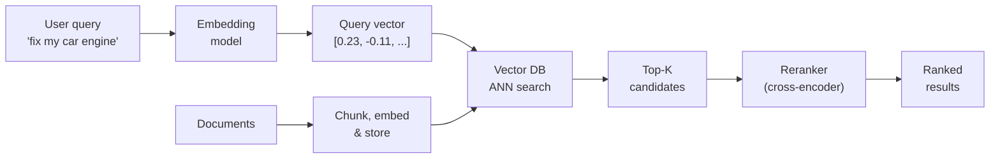
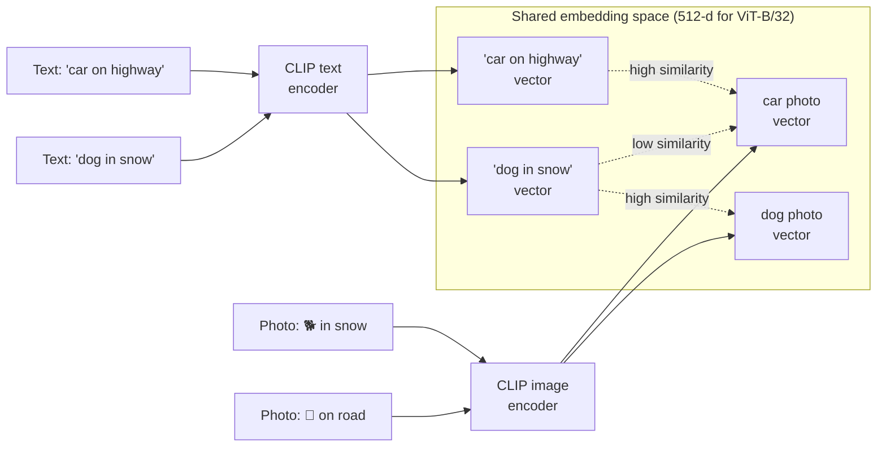
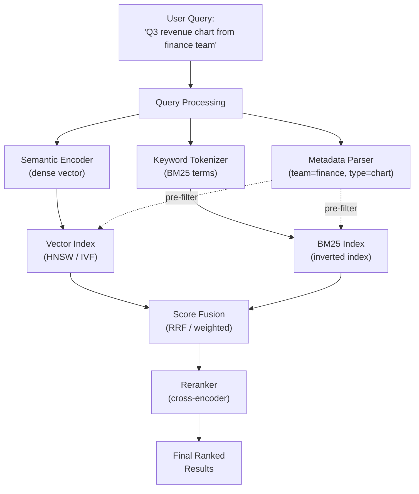
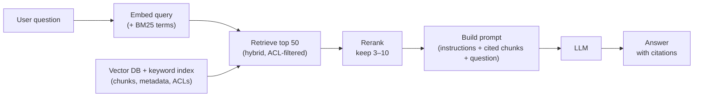

# Chapter 28 — Building Semantic Search (Text, Images & Metadata)

> "Search is not about finding documents that contain a keyword. It's about finding the answer the user needs." — Every search engineer, eventually.

---

## What You'll Learn

After reading this chapter, you will be able to:
- Explain how semantic search works and when keyword search still wins
- Choose the right embedding model for text, images, and multimodal content
- Build a document processing pipeline (PDF, Word, images → chunks → vectors)
- Design and implement a full semantic search system in Python
- Compare vector databases and pick the right one for your use case
- Implement hybrid search (dense + sparse + metadata filtering)
- Add reranking to go from good to great search quality
- Measure search quality with recall@k, MRR and nDCG
- Connect search to LLMs via RAG for question-answering
- Handle production concerns: latency, cost, access control, embedding drift

---

```
Contents:
  28.1   What is Semantic Search?
  28.2   The Embedding Foundation
  28.3   Document Processing Pipeline
  28.4   Image Search with CLIP
  28.5   Multimodal Search — Combining Text, Images & Metadata
  28.6   Vector Databases
  28.7   Building the Full Pipeline (Python)
  28.8   Reranking — From Good to Great
  28.9   Evaluation Metrics for Search
  28.10  Production Considerations
  28.11  RAG: Connecting Search to LLMs
  28.12  Interview Questions
  Key Takeaways
  Review Questions
```

---

## 28.1 What is Semantic Search?

![Infographic: semantic search matches meaning, not words. The formula score(q, d) = cos(E(q), E(d)) with labelled parts; for the query how to fix my vehicle, keyword TF-IDF ranks How to fix a leaking kitchen tap first at 0.707 while Automobile repair guide scores 0.000, but toy-embedding cosines rank Automobile repair guide 0.990, Car engine maintenance checklist 0.908, kitchen tap 0.523, Italian restaurants 0.008; an online query pipeline from user query through embedding model, vector DB ANN search, top-K candidates and cross-encoder reranker, plus offline indexing; a keyword vs semantic vs hybrid comparison and the ERR-4417 trap.](diagrams/sem28_info_semantic_vs_keyword_ai.png)

<details>
<summary><strong>Read as text</strong> — keyword vs semantic, the scoring formula and the two phases</summary>

**Simple explanation:** keyword search matches *words*, semantic search matches *meaning*. For "how to fix my vehicle", keyword search picks "How to fix a leaking kitchen tap" (three shared words) and never finds "Automobile repair guide" (none). An **embedding model** maps texts with similar meaning to nearby vectors, so the repair guide wins (§28.2 runs this).

> **Semantic search** retrieves results by meaning rather than exact keyword matches. It converts queries and documents into dense vector representations, then ranks results by vector similarity — so "car repair" matches "auto mechanic" even though no words overlap.

> **Maths in one line:** `score(q, d) = cos(E(q), E(d))` — embed query and documents with the same model `E`, return the `k` highest-scoring documents.

You meet it daily in Google Search (semantic matching fused with keyword signals), Google Photos ("dog at beach" finds untagged photos, §28.4), RAG assistants (§28.11), and enterprise and e-commerce search such as Google's Agent Search (formerly Vertex AI Search).



Two phases: **indexing** (offline — extract, chunk, embed, store; §28.3) and **querying** (online — embed the query, search, rerank, return).

**Pitfall:** keyword search still wins on IDs and error codes (`ERR-4417`), so production systems run both and fuse the lists — **hybrid search** (§28.5).

**Go deeper:** embeddings and vector databases in brief — [Ch 17b §10](#content/17b_llm_applications).

</details>

---

## 28.2 The Embedding Foundation

> **Embedding**: a dense vector of fixed dimensionality that encodes the semantic meaning of a piece of content (text, image, audio). Similar meanings map to nearby points in vector space.

![Infographic: embeddings and cosine similarity. Formula cos(a, b) = a dot b over the product of the lengths, with labelled parts and the unit-vector identities cos = a dot b and squared distance = 2 - 2 cos; a to-scale angle drawing where How to fix a car engine vs Automobile engine repair guide is cos 0.72 (about 44 degrees) and vs Best Italian restaurants in Paris is cos 0.09 (about 85 degrees); an all-MiniLM-L6-v2 bar chart (car repair-auto mechanic 0.59, machine learning-deep learning 0.69, Python tutorial-Python coding guide 0.82, fix my vehicle-automobile repair guide 0.64, fix my vehicle-kitchen tap 0.30, car repair-Italian restaurants 0.17, machine learning-gardening tips 0.10); a Nov 2026 embedding-model table with dimensions; and the no-fixed-0.8-threshold trap.](diagrams/sem28_info_embeddings_similarity_ai.png)

<details>
<summary><strong>Read as text</strong> — why embedding quality caps search quality</summary>

Search quality is bounded by embedding quality — garbage embeddings, garbage results.

</details>

### How text embeddings work

<details>
<summary><strong>Read as text</strong> — contrastive training and the cosine formula</summary>

A transformer encoder maps a string to a fixed-length vector. It is trained with **contrastive learning** on matching pairs (a question and its answer passage): each question is pulled towards its own passage and pushed away from the other passages in the batch.

> **Maths in one line:** `cos(a, b) = a·b / (‖a‖ ‖b‖)` — 1 = same direction, 0 = unrelated; on unit vectors `cos = a·b` and `‖a − b‖² = 2 − 2·cos`, so all three metrics below give the same ranking.

</details>

### Popular embedding models

<details>
<summary><strong>Read as text</strong> — the November 2026 model table and how to pick</summary>

*As of November 2026:*

| Model | Provider | Dimensions (default → shrinkable) | Max tokens | Notes |
|---|---|---|---|---|
| `text-embedding-3-small` / `-large` | OpenAI | 1,536 / 3,072 → any smaller | 8,192 | API; small is the cheap default |
| `gemini-embedding-2` | Google | 3,072 → 1,536 or 768 recommended | 8,192 | API; text, images, video, audio, PDF |
| `embed-v5.0-pro` | Cohere | 2,048 → 1,536 … 256 | 128K | API; text and images |
| `Qwen3-Embedding-8B` | Alibaba (open) | 4,096 → any size from 32 | 32K | Self-hosted on a GPU |
| `embeddinggemma-2` | Google (open) | 768 → 512 / 256 / 128 | 8,192 | Under 1B parameters; text, images, video, audio; laptops and phones |
| `all-MiniLM-L6-v2` | Sentence Transformers (open) | 384 | 256 | CPU; prototyping |

**Which to pick?** Shortlist by MTEB *retrieval* scores, then test on 50–100 of your own queries (§28.9). Queries and documents need the **same model** (and its query/document prompts); a new model means re-embedding everything.

</details>

### Similarity metrics

<details>
<summary><strong>Read as text</strong> — cosine, dot product and Euclidean distance</summary>

| Metric | Formula | Range | Best for |
|---|---|---|---|
| **Cosine similarity** | $\frac{A \cdot B}{\lVert A \rVert \, \lVert B \rVert}$ | [−1, 1] | Text embeddings — the default |
| **Dot product** | $A \cdot B$ | (−∞, ∞) | Unit vectors (= cosine), or when length should count |
| **Euclidean (L2)** | $\sqrt{\sum_i (a_i - b_i)^2}$ | [0, ∞) | Lower = more similar |

Normalise once at index time and the cheap dot product *is* the cosine (OpenAI's vectors are unit length already). §28.1's example in code:

</details>

```python
# Keyword vs semantic search: one query, four documents, two different winners
import numpy as np
from sklearn.feature_extraction.text import TfidfVectorizer

docs = ["Automobile repair guide", "How to fix a leaking kitchen tap",
        "Car engine maintenance checklist", "Best Italian restaurants in Paris"]
query = "how to fix my vehicle"

# Keyword: TF-IDF rows are unit length, so a dot product is the cosine
tfidf = TfidfVectorizer().fit(docs)                    # the index knows only the documents' words
kw = (tfidf.transform(docs) @ tfidf.transform([query]).T).toarray().ravel()

# Semantic: toy 4-number "embeddings" = [vehicles, repair, home, food]
E = np.array([[0.9, 0.8, 0.0, 0.0], [0.0, 0.7, 0.9, 0.0],
              [0.9, 0.4, 0.0, 0.0], [0.0, 0.0, 0.1, 1.0]])
q = np.array([0.8, 0.9, 0.1, 0.0])                     # the query means "vehicle + repair"
E_unit = E / np.linalg.norm(E, axis=1, keepdims=True)  # normalise ONCE, at index time
sem = E_unit @ (q / np.linalg.norm(q))                 # dot product of unit vectors = cosine

print(f"{'document':34} {'keyword':>7} {'semantic':>8}")
for d, k, s in zip(docs, kw, sem):
    print(f"{d:34} {k:7.3f} {s:8.3f}")
print("keyword winner: ", docs[int(np.argmax(kw))])
print("semantic winner:", docs[int(np.argmax(sem))])
assert kw[0] == 0.0 and int(np.argmax(sem)) == 0       # no shared word, yet the right answer
```

**Output:**

```
document                           keyword semantic
Automobile repair guide              0.000    0.990
How to fix a leaking kitchen tap     0.707    0.523
Car engine maintenance checklist     0.000    0.908
Best Italian restaurants in Paris    0.000    0.008
keyword winner:  How to fix a leaking kitchen tap
semantic winner: Automobile repair guide
```

<details>
<summary><strong>Read as text</strong> — continued: a real model, the similarity chart and the threshold trap</summary>

A real model does the same with 384-number vectors:

```python
# Runs locally: pip install sentence-transformers  (downloads all-MiniLM-L6-v2, about 90 MB)
from sentence_transformers import SentenceTransformer

model = SentenceTransformer("all-MiniLM-L6-v2")
texts = ["How to fix a car engine", "Automobile engine repair guide", "Best Italian restaurants in Paris"]
emb = model.encode(texts, normalize_embeddings=True)   # shape (3, 384), unit length
sims = model.similarity(emb, emb)                      # 3 x 3 cosine matrix

print(f"Similar pair:    {float(sims[0, 1]):.2f}")     # 0.72 with this model
print(f"Dissimilar pair: {float(sims[0, 2]):.2f}")     # 0.09
```

More pairs, same model (sentence-transformers 6.2, November 2026) — the tap page still scores 0.30 on shared words:

```chart
{"type": "bar",
 "data": {"labels": [["car repair ↔", "auto mechanic"], ["machine learning ↔", "deep learning"], ["Python tutorial ↔", "Python coding guide"], ["how to fix my vehicle ↔", "automobile repair guide"], ["how to fix my vehicle ↔", "how to fix a leaking kitchen tap"], ["car repair ↔", "Italian restaurants"], ["machine learning ↔", "gardening tips"]],
  "datasets": [{"label": "Cosine similarity (all-MiniLM-L6-v2)", "data": [0.59, 0.69, 0.82, 0.64, 0.30, 0.17, 0.10],
   "backgroundColor": ["#22c55e", "#22c55e", "#22c55e", "#22c55e", "#f59e0b", "#ef4444", "#ef4444"]}]},
 "options": {"indexAxis": "y",
  "plugins": {"title": {"display": true, "text": "Green: same meaning · amber: shared words · red: unrelated"}},
  "scales": {"x": {"title": {"display": true, "text": "Cosine similarity"}, "min": 0, "max": 1}}}}
```

**Pitfall:** unrelated texts still score 0.10–0.17 and every model has its own scale, so "0.8 = relevant" does not transfer — rank, or calibrate on labelled pairs.

**Go deeper:** more models, Matryoshka shrinking and the metrics — [Ch 17b §10.2–10.3](#content/17b_llm_applications).

</details>

---

## 28.3 Document Processing Pipeline

> **Document processing pipeline**: the system that ingests raw files (PDFs, Word docs, HTML, images), extracts text, splits it into chunks, generates embeddings, and stores them in a vector database.

![Infographic: the document processing pipeline. Five stages from raw files (PDF, DOCX, HTML, MD) through text extraction (pypdf, Docling, Tika, OCR), chunking with metadata, embedding and storing in a vector DB; the chunk-count formula chunks = ceiling of (N - overlap) / (size - overlap) worked for 2,000 tokens at 512 with 100 overlap giving 1,900 / 412 = 4.61, so 5 chunks and 2,400 tokens stored (+20%); the same text cut fixed at 60 characters (4/5 sentences whole, cut inside fre|e) versus recursive with overlap 30 (5/5 whole, Express takes 2 days. repeated); metadata fields and a context header; Anthropic Contextual Retrieval cutting failed top-20 retrievals by 35%, 49% and 67%; ingestion gotchas.](diagrams/sem28_info_document_pipeline_chunking_ai.png)

<details>
<summary><strong>Read as text</strong> — why ingestion matters and the chunk-count formula</summary>

Do it wrong and no amount of clever querying saves you.

> **Maths in one line:** `chunks = ⌈(N − overlap) / (size − overlap)⌉` — a 2,000-token document at 512 tokens with 100 overlap gives ⌈1,900 / 412⌉ = 5 chunks, storing 2,400 tokens (+20%).

</details>

### Step 1: Extract text from raw files

<details>
<summary><strong>Read as text</strong> — pypdf, python-docx and production extractors</summary>

```python
# Runs locally: pip install pypdf python-docx
from pypdf import PdfReader
from docx import Document

def extract_pdf(path: str) -> list[dict]:
    reader = PdfReader(path)
    return [{"text": page.extract_text() or "", "page": i + 1, "source": path}
            for i, page in enumerate(reader.pages)]

def extract_docx(path: str) -> list[dict]:
    out, heading = [], ""
    for para in Document(path).paragraphs:              # tables live in Document(path).tables
        if para.style.name.startswith("Heading"):
            heading = para.text                          # keep the section for metadata
        elif para.text.strip():
            out.append({"text": para.text, "heading": heading, "source": path})
    return out
```

For production (as of November 2026): **Apache Tika** (1,000+ file types), **Docling** or **Unstructured** (PDF/DOCX/PPTX → Markdown with tables), **Google Document AI**, **Azure Document Intelligence** or Tesseract for OCR; for slides and charts, embed the page *image* (ColPali-style retrievers).

</details>

### Step 2: Chunk the text

<details>
<summary><strong>Read as text</strong> — why chunk, the four strategies and the sweet spot</summary>

You cannot embed a 200-page PDF as one vector — it would blur every topic together, and most models read only 8K–32K tokens. Chunks should be small enough to be about one thing, large enough to carry context.

| Strategy | How it works | Pros | Cons |
|---|---|---|---|
| **Fixed-size** | Split every N tokens | Simple, predictable | Cuts mid-sentence, even mid-word |
| **Recursive** | Paragraph → sentence → word, until under the limit | Best general-purpose default | Slightly more code |
| **Document structure** | Split on headings, then recursively | Chunks follow sections | Needs clean structure |
| **Semantic** | Embeddings detect topic shifts | Follows topics | Slow; a 2024 Vectara study found no consistent gain |

The sweet spot for most use cases: **256–512 tokens per chunk** with **50–100 tokens of overlap**, then tune on your eval set. The recursive idea in 20 lines (counting characters to keep it small):

</details>

```python
# Fixed-size vs recursive chunking: which one keeps sentences whole?
def pieces(text, size, seps=("\n\n", ". ", " ")):
    """Cut at the coarsest separator; recurse into pieces that are still too long."""
    if len(text) <= size or not seps:
        return [text]
    parts = text.split(seps[0])
    parts = [p + seps[0] for p in parts[:-1]] + [parts[-1]]   # keep each separator
    return [x for p in parts for x in pieces(p, size, seps[1:])]

def recursive_chunks(text, size, overlap):
    chunks, window = [], []
    for p in pieces(text, size):
        if window and len("".join(window) + p) > size:
            chunks.append("".join(window).strip())
            while window and len("".join(window)) > overlap:  # carry a tail <= overlap chars
                window.pop(0)
        window.append(p)
    return chunks + ["".join(window).strip()]

doc = ("Refunds take 14 days. Items must be unused.\n\n"
       "Shipping is free over 50 euros. Express takes 2 days. Abroad takes 7 days.")
sentences = doc.replace("\n\n", " ").split(". ")

fixed = [doc[i:i + 60] for i in range(0, len(doc), 60)]     # naive: every 60 characters
smart = recursive_chunks(doc, size=60, overlap=30)
for name, chunks in [("fixed 60", fixed), ("recursive 60, overlap 30", smart)]:
    whole = sum(any(s in c for c in chunks) for s in sentences)
    print(f"{name}: {whole}/{len(sentences)} sentences whole")
    for c in chunks:
        print(f"  {c!r}")
assert all(len(c) <= 60 for c in smart) and all(any(s in c for c in smart) for s in sentences)
```

**Output:**

```
fixed 60: 4/5 sentences whole
  'Refunds take 14 days. Items must be unused.\n\nShipping is fre'
  'e over 50 euros. Express takes 2 days. Abroad takes 7 days.'
recursive 60, overlap 30: 5/5 sentences whole
  'Refunds take 14 days. Items must be unused.'
  'Shipping is free over 50 euros. Express takes 2 days.'
  'Express takes 2 days. Abroad takes 7 days.'
```

<details>
<summary><strong>Read as text</strong> — continued: what the two chunkers did</summary>

The fixed cut breaks "fre|e"; the recursive one keeps all five sentences, and the overlap repeats "Express takes 2 days." so either chunk can match it. In practice use LangChain's `RecursiveCharacterTextSplitter` (package `langchain-text-splitters`), counting **tokens** — as §28.7 does.

</details>

### Step 3: Enrich with metadata

<details>
<summary><strong>Read as text</strong> — metadata fields and contextual headers</summary>

Store with every chunk: `source`, `page`, `heading` (to cite), `chunk_id` (to update one file), `updated_at` (freshness), access tags (filter *inside* the search, §28.10) and `embed_model` (what to re-embed).

**Contextual headers — a cheap win.** Cut out, "Refunds take 14 days" no longer says *whose* refunds. Embed `"Store policy > Refunds: " + chunk`, display the plain chunk. Anthropic's *Contextual Retrieval* (Sep 2024) lets an LLM write that context: failed top-20 retrievals fell 35%, 49% with contextual BM25, 67% with reranking too.

</details>

### The full pipeline

<details>
<summary><strong>Read as text</strong> — the five stages and the ingestion gotchas</summary>

```
┌──────────────┐    ┌──────────────┐    ┌──────────────┐    ┌──────────────┐    ┌──────────────┐
│  Raw files   │───►│   Extract    │───►│    Chunk     │───►│    Embed     │───►│   Store in   │
│  PDF, DOCX,  │    │     text     │    │  + metadata  │    │   vectors    │    │  vector DB   │
│  HTML, MD    │    │              │    │              │    │              │    │              │
└──────────────┘    └──────────────┘    └──────────────┘    └──────────────┘    └──────────────┘
                     pypdf, Docling,     recursive split,    Sentence Trans-     Chroma, FAISS,
                     Tika, OCR           context header      formers, Gemini,    pgvector,
                                                             OpenAI              Pinecone
```

**Gotchas:** keep each PDF table as one Markdown chunk (Docling, `pdfplumber`); OCR pages where `extract_text()` returns nothing; strip repeated headers and footers; hash text to skip duplicates; never mix two embedding models in one index.

**Go deeper:** the chunk-count formula run on several sizes — [Ch 17b §10.5](#content/17b_llm_applications); the RAG pipeline interview view — [Ch 34b §13.4](#content/34b_google_top10_ml_interview_part2).

</details>

---

## 28.4 Image Search with CLIP

> **CLIP (Contrastive Language-Image Pre-training)**: a model trained by OpenAI (2021) that maps both text and images into the same embedding space, enabling cross-modal search — find images by describing them in words.

![Infographic: image search with CLIP. The contrastive loss L = 1/2 of CE over rows plus CE over columns of the scaled similarity matrix s times S, with S i,j = cos(image i, text j), each part labelled; a text encoder and an image encoder mapping dog in snow and car on highway captions and photos into one shared 512-d space for ViT-B/32 where matching pairs sit close (high similarity) and mismatched ones far (low similarity); a 3 by 3 training batch with a green diagonal and softmax along rows and columns; a search strip from the query a cat sitting on a laptop through the text encoder and cosine to the top-3 photos; a Nov 2026 Beyond CLIP table (SigLIP 2, OpenCLIP, MetaCLIP 2, one model for everything, caption then search); traps: 77 text tokens, separate indexes, raw cosines of about 0.2-0.35 so no 0.8 threshold.](diagrams/sem28_info_clip_image_search_ai.png)

<details>
<summary><strong>Read as text</strong> — one shared space for words and photos</summary>

CLIP creates a shared vector space where "a golden retriever playing in snow" (text) and a photo of exactly that (image) land near each other — no manual tagging needed.

</details>

### How CLIP works

<details>
<summary><strong>Read as text</strong> — two encoders, the contrastive loss and the shared space</summary>

A **text encoder** and an **image encoder**, trained together on 400M (image, text) pairs, output vectors of the same size (512 for ViT-B/32). In a batch of N pairs, each image must pick its own caption, and each caption its own image.

> **Maths in one line:** `L = ½ [CE(rows of s·S) + CE(columns of s·S)]`, with `S[i, j] = cos(imageᵢ, textⱼ)` and a learned scale `s` — push the true pairs (the diagonal) up and every other pair down.

To search, embed every image once, embed the text query, rank by cosine; the same index answers "more like this photo" queries too.



</details>

### Python code: image search with CLIP

<details>
<summary><strong>Read as text</strong> — the CLIP search code and its three traps</summary>

```python
# Runs locally: pip install "sentence-transformers[image]"  (downloads CLIP ViT-B/32, about 600 MB)
from pathlib import Path
from PIL import Image
from sentence_transformers import SentenceTransformer

model = SentenceTransformer("sentence-transformers/clip-ViT-B-32")

# Index once: every photo -> a unit vector
paths = sorted(Path("photos").glob("*.jpg"))
images = [Image.open(p).convert("RGB") for p in paths]
img_emb = model.encode(images, batch_size=32, normalize_embeddings=True)   # (n_photos, 512)

# Query: the text lands in the SAME space; rank the photos by cosine
q_emb = model.encode(["a cat sitting on a laptop"], normalize_embeddings=True)
scores = model.similarity(q_emb, img_emb)[0]
for score, i in zip(*scores.topk(3)):
    print(f"{paths[int(i)].name}  {float(score):.3f}")
```

Old tutorials treat `CLIPModel.get_image_features(...)` (transformers) as a tensor; since transformers 5 it returns an output object, so that code breaks.

| Trap | Fix |
|---|---|
| CLIP reads only 77 text tokens (SigLIP: 64) | Short queries; long text goes in a text-embedding index |
| Raw CLIP cosines are small — about 0.2–0.35 for a good match | Rank results; never reuse a text model's 0.8 threshold |
| CLIP vectors ≠ your text model's vectors | Separate indexes fused by rank (§28.5) |

</details>

### Beyond basic CLIP

<details>
<summary><strong>Read as text</strong> — SigLIP 2, OpenCLIP, MetaCLIP 2 and the alternatives</summary>

*As of November 2026:*

| Model | What's different |
|---|---|
| **SigLIP** (Google, 2023) / **SigLIP 2** (Feb 2025) | Sigmoid loss per pair (smaller batches work); SigLIP 2 is multilingual and better at retrieval — a strong open default |
| **OpenCLIP** | Open reproductions, ViT-B/32 up to ViT-bigG/14 |
| **MetaCLIP 2** (Meta, Jul 2025) | Trained on worldwide, many-language data |
| **One model for everything** | `gemini-embedding-2`, Cohere `embed-v5.0-pro` or open `embeddinggemma-2` (§28.2) embed text and images together |
| **Caption, then text search** | A vision-language model captions each image; index captions as text |

**Use cases beyond photo search:** product catalogs, near-duplicate detection, content moderation, medical imaging, accessibility.

**Go deeper:** CLIP and SigLIP losses by hand, plus zero-shot classification — [Ch 16 §4.3](#content/16_deep_learning).

</details>

---

## 28.5 Multimodal Search — Combining Text, Images & Metadata

> **Multimodal search** retrieves results across content types — text documents, images, structured data — by unifying them in a shared representation space and combining multiple retrieval signals.

![Hybrid search infographic: BM25 exact-word ranking and dense embedding ranking fused with Reciprocal Rank Fusion, RRF(d) = sum over lists of 1/(k + rank), k = 60. Worked example for the query PROJ-4521 budget: IDF of proj-4521 = ln 2.8 = 1.03 vs budget ln 2 = 0.69; BM25 list d0 1.06, d1 0.98, d4 0.77; dense list d4, d0, d3; RRF gives d0 = 1/61 + 1/62 = 0.0325, beating the wrong-project d4 = 1/61 + 1/63 = 0.0323. Table of dense, sparse and metadata signals; trap: post-filtering in pgvector leaves about 4 rows.](diagrams/sem28_info_hybrid_search_bm25_rrf_ai.png)

<details>
<summary><strong>Read as text</strong> — why real search mixes text, images and metadata</summary>

Real enterprise search is never just text. A user searching "Q3 revenue chart" should find the Excel file, the PowerPoint slide with the chart, and the PDF annual report mentioning Q3 numbers.

</details>

### Making images and tables searchable

<details>
<summary><strong>Read as text</strong> — three ways to make images and tables searchable</summary>

| Approach | How | Watch out |
|---|---|---|
| **One shared space** | CLIP / SigLIP 2 (§28.4) or `gemini-embedding-2` embeds images and text together | Weak on text *inside* images |
| **Convert to text** | OCR plus a vision-LLM caption, then the text model | Lossy; a model call per image |
| **Page images** | ColPali: patch vectors per page, matched to query tokens | More storage |

Separate text and image indexes also work: merge their lists with RRF (below).

</details>

### Hybrid search: dense + sparse + metadata

<details>
<summary><strong>Read as text</strong> — the three signals and the BM25 formula</summary>

No single retrieval method wins everywhere. The production pattern combines three signals:

| Signal | Method | Strength | Weakness |
|---|---|---|---|
| **Dense (semantic)** | Embedding similarity | Understands meaning, synonyms | Misses exact keywords, IDs, names |
| **Sparse (keyword)** | BM25 (or learned sparse, e.g. SPLADE) | Exact matches, rare terms | No understanding of meaning |
| **Metadata filters** | Structured conditions | Precise date/type/permission limits | No relevance ranking |

Why all three: searching "PROJ-4521 budget" needs BM25 to match the project ID and semantic search to understand that "budget" can mean "cost allocation".

> **Maths in one line (BM25):** `score = Σ over query terms of IDF · f·(k1+1) / (f + k1·(1 − b + b·|d|/avgdl))`, `IDF = ln(1 + (N − n + 0.5)/(n + 0.5))` — f = count in the chunk, n = chunks containing the term. Rare terms weigh more, repeats saturate (k1 = 1.2), long chunks are discounted (b = 0.75).

</details>

### How to combine them

<details>
<summary><strong>Read as text</strong> — fuse ranks, not scores: RRF vs weighted fusion</summary>

BM25 scores have no fixed range while cosine sits between −1 and 1, so fuse **ranks**, not raw scores.

> **Maths in one line (RRF):** `RRF(d) = Σ over rankers r of 1 / (k + rank_r(d))`, k = 60 — a chunk near the top of several lists wins, with no score normalisation.

Weighted fusion, `α·norm(dense) + (1 − α)·norm(BM25)`, can beat RRF only after per-query normalisation and tuning α on labelled queries. The program builds both lists for "PROJ-4521 budget" by hand and fuses them:

</details>

```python
# Hybrid search by hand: BM25 (exact words) + cosine (meaning), fused with Reciprocal Rank Fusion
import math, re
import numpy as np

docs = ["PROJ-4521 cost allocation for Q3",                # d0 <- the answer
        "PROJ-4521 kickoff meeting notes and timeline",    # d1
        "How to plan a department budget",                 # d2
        "Q3 budget forecast and savings plan",             # d3
        "PROJ-3310 budget overrun report",                 # d4 <- wrong project
        "Photos from the team offsite"]                    # d5
emb = np.array([[0.8, 0.3, 0.0], [0.1, 0.9, 0.1], [0.9, 0.1, 0.0],     # toy embeddings:
                [0.85, 0.2, 0.0], [0.8, 0.4, 0.0], [0.0, 0.1, 0.9]])  # [money, project, social]
query, q_vec = "PROJ-4521 budget", np.array([0.9, 0.4, 0.0])

tok = lambda s: re.findall(r"[a-z0-9-]+", s.lower())
D = [tok(t) for t in docs]
N, avgdl = len(D), sum(map(len, D)) / len(D)

def bm25(d, k1=1.2, b=0.75):
    score = 0.0
    for t in tok(query):
        n, f = sum(t in doc for doc in D), d.count(t)
        idf = math.log(1 + (N - n + 0.5) / (n + 0.5))
        score += idf * f * (k1 + 1) / (f + k1 * (1 - b + b * len(d) / avgdl))
    return score

kw = [bm25(d) for d in D]
cos = emb @ q_vec / (np.linalg.norm(emb, axis=1) * np.linalg.norm(q_vec))
sparse = sorted((i for i in range(N) if kw[i] > 0), key=lambda i: -kw[i])   # BM25 lists only matches
dense = sorted(range(N), key=lambda i: -cos[i])
rrf = {}
for ranking in (sparse, dense):
    for rank, i in enumerate(ranking, start=1):
        rrf[i] = rrf.get(i, 0.0) + 1 / (60 + rank)
fused = sorted(rrf, key=lambda i: -rrf[i])
print("BM25 :", ", ".join(f"d{i} {kw[i]:.2f}" for i in sparse))
print("dense:", [f"d{i}" for i in dense[:4]])
print("RRF  :", ", ".join(f"d{i} {rrf[i]:.4f}" for i in fused[:4]))
assert dense[0] == 4 and fused[0] == 0      # meaning alone picks the wrong project; hybrid fixes it
```

**Output:**

```
BM25 : d0 1.06, d1 0.98, d4 0.77, d2 0.66, d3 0.66
dense: ['d4', 'd0', 'd3', 'd2']
RRF  : d0 0.0325, d4 0.0323, d1 0.0315, d3 0.0313
```

<details>
<summary><strong>Read as text</strong> — continued: reading the output, why d0 wins</summary>

Reading it: dense search ranks d4 — the *wrong* project — first, since the embedding cannot tell PROJ-3310 from PROJ-4521. BM25 ranks d0 first: "proj-4521" is in 2 of 6 chunks (IDF = ln 2.8 = 1.03), rarer than "budget" (3 of 6, ln 2 = 0.69). RRF rewards being high in both: d0 = 1/61 + 1/62 = 0.0325 beats d4 = 1/61 + 1/63 = 0.0323.

</details>

### Architecture diagram

<details>
<summary><strong>Read as text</strong> — the hybrid pipeline and pre-filter vs post-filter</summary>



The metadata filter is not a third ranked list: it limits what *both* searches may return.

**Pre-filter vs post-filter:** A pre-filter applies the conditions inside the search, so you still get k results (Qdrant, Weaviate, Pinecone, Milvus). A post-filter drops rows after the search, so the list shrinks: in pgvector, a filter matching 10% of rows with the default `hnsw.ef_search` of 40 returns about 4 rows unless `hnsw.iterative_scan` is on. For permissions this can mean zero results ([Ch 19 §19.9](#content/19_ai_frameworks) has a demo).

</details>

### Metadata Filtering in Practice

<details>
<summary><strong>Read as text</strong> — a Chroma filter, the same filter elsewhere, and fields to store</summary>

Metadata turns semantic search from "find similar text" into "find similar text that matches my constraints." In enterprise search, this is the feature users rely on most.

```python
# Runs locally: pip install chromadb   (uses Chroma's default all-MiniLM-L6-v2 embeddings; no API key)
import chromadb

docs = chromadb.Client().get_or_create_collection("docs", configuration={"hnsw": {"space": "cosine"}})
docs.add(ids=["a", "b", "c"],
         documents=["Q3 revenue grew 12% year on year", "Q3 hiring plan", "2024 revenue summary"],
         metadatas=[{"file_type": "pdf", "department": "finance", "year": 2026},
                    {"file_type": "docx", "department": "hr", "year": 2026},
                    {"file_type": "pdf", "department": "finance", "year": 2024}])
results = docs.query(
    query_texts=["Q3 revenue growth"],
    n_results=2,
    where={
        "$and": [
            {"file_type": "pdf"},
            {"department": {
                "$in": ["finance", "accounting"]}},
            {"year": {
                "$gte": 2025}},
        ]
    },
)
print(results["ids"][0])        # ['a'] -- the HR plan and the 2024 summary are filtered out
```

The same filter in other clients:

| Store | Filter |
|---|---|
| **Pinecone** | `filter={"file_type": "pdf", "year": {"$gte": 2025}}` — range operators accept numbers only, so store dates as a year or Unix time |
| **Qdrant** | `query_filter=models.Filter(must=[models.FieldCondition(key="year", range=models.Range(gte=2025))])` |
| **Weaviate** (v4) | `filters=Filter.by_property("file_type").equal("pdf") & Filter.by_property("year").greater_or_equal(2025)` |

**Metadata worth storing with every chunk:**

| Field | Used for |
|---|---|
| `file_type`, `department`, `author`, `language`, `tags` | Filters: "only finance PDFs" |
| `created_at` / `year` (as numbers) | Range filters: "last 6 months" |
| `access_level` / allowed groups | Security: filter by permission inside the search (§28.10) |
| `source_url`, `page_number`, `heading` | Citations: link to the exact page and section |

**Go deeper:** [Ch 19 §19.9](#content/19_ai_frameworks) (choosing a vector DB, ACL filtering) · [Ch 34b §13.4](#content/34b_google_top10_ml_interview_part2) (hybrid retrieval in a RAG design).

</details>

---

## 28.6 Vector Databases

> **Vector database**: a database purpose-built to store, index, and search high-dimensional vectors using approximate nearest neighbor (ANN) algorithms, returning the most similar vectors to a query in milliseconds.

![Vector database infographic: brute force costs N x d multiply-adds, 7.7 billion for 10M vectors of 768 dims. RAM is about N x (4d + 8M) bytes, 10M x 3,200 bytes = 32 GB at M = 16. HNSW drawn as three layers with a query path A to D on layer 2, down to D, across to E, down to E on layer 0. Toy test with 4,000 vectors: efSearch 10, 20, 50, 100 gives recall@10 of 0.770, 0.930, 0.993, 1.000 using 6, 9, 16 and 26 percent of the distance computations, with a 0.95 target line. IVF clusters with nprobe, PQ 3,072 to 96 bytes, store picks, and the pgvector 2,000-dimension trap.](diagrams/sem28_info_vector_db_ann_hnsw_ai.png)

<details>
<summary><strong>Read as text</strong> — why brute force is too slow, and the RAM formula</summary>

Brute force costs N × d multiply-adds per query — 10M vectors × 768 dims ≈ 7.7 billion. An ANN index trades a little recall for a large speed-up; the database adds filters, updates, persistence and replication.

> **Maths in one line:** `RAM ≈ N × (4·d + 8·M) bytes` — float32 vectors plus HNSW's bottom-layer links (2M ids × 4 bytes): 10M × 768 dims with M = 16 → 10M × 3,200 bytes ≈ 32 GB, before compression (§28.10).

</details>

### Comparison of vector databases

<details>
<summary><strong>Read as text</strong> — eight vector stores compared, and the pgvector dimension limit</summary>

As of November 2026:

| Database | ANN index | Filtering & hybrid | Best for |
|---|---|---|---|
| **FAISS** (Meta; library) | Flat, IVF, PQ, HNSW; GPU | ID selectors only | Research, GPU batch search |
| **Chroma** (embedded) | HNSW; SPANN when distributed | Metadata `where` | Prototyping |
| **Pinecone** (managed) | Proprietary | Metadata; sparse + dense | Zero-ops production |
| **Weaviate** | HNSW, flat | Filters; BM25 hybrid built in | Hybrid out of the box |
| **Qdrant** | Filter-aware HNSW | Rich filters; sparse + dense | Filter-heavy production |
| **Milvus / Zilliz** | IVF, HNSW, DiskANN; GPU | Filters; hybrid | Billions of vectors |
| **Vector Search** (Gemini Enterprise Agent Platform, formerly Vertex AI Vector Search) | ScaNN | Filters; 2.0 (renamed Agent Retrieval) adds hybrid | Google Cloud |
| **pgvector** (Postgres extension) | HNSW, IVFFlat | SQL `WHERE` | Already on Postgres; up to ~10M vectors (rule of thumb) |

Weaviate, Qdrant, Milvus and Chroma are open source with managed clouds. **Pitfall:** pgvector indexes `vector` columns only up to 2,000 dimensions — a 3,072-dim embedding needs `halfvec` (up to 4,000) or a shortened Matryoshka vector ([Ch 17b §10.2](#content/17b_llm_applications)).

</details>

### ANN algorithms explained

<details>
<summary><strong>Read as text</strong> — HNSW, IVF and PQ, their knobs, and the layered graph</summary>

| Index | How it works | Knobs | Trade-off |
|---|---|---|---|
| **HNSW** | Layered graph: enter at the sparse top layer, walk greedily toward the query, drop a layer, repeat | `M` links per node (16); `efConstruction` (64–100); `efSearch` (40–100, ≥ k) | Best speed–recall; RAM-hungry, slow to build |
| **IVF** | k-means cuts the vectors into `nlist` clusters; scan only the `nprobe` closest | `nlist` ≈ rows/1,000 (√rows above 1M); `nprobe` ≈ √nlist | Fast build, less RAM; misses neighbours across cluster borders |
| **PQ** (usually IVF-PQ) | Cut each vector into m pieces, store each as a 1-byte codebook id | m = 96 for 768 dims | 3,072 → 96 bytes (32×); rescore the top hits |

Defaults shown are pgvector's and Qdrant's. `efSearch` and `nprobe` are query-time knobs: raise them for recall, lower them for speed, no rebuild. At billion scale, DiskANN keeps the graph on SSD and Google's ScaNN combines quantization with rescoring; int8 and binary compression are in §28.10.

```
HNSW graph (conceptual):

Layer 2 (sparse):     A ──────────── D
                      │              │
Layer 1 (medium):     A ── B ─────── D ── E
                      │    │         │    │
Layer 0 (all):        A ── B ── C ── D ── E ── F ── G

Search: enter at the top layer, jump to the node nearest the query,
        drop a layer and refine, until Layer 0 gives the nearest neighbours.
```

The program builds Layer 0 alone — each vector linked to its 8 nearest neighbours — and runs HNSW's search loop on it:

</details>

```python
# HNSW's bottom layer vs brute force: a bigger efSearch buys recall with more distance computations
import heapq
import numpy as np

rng = np.random.default_rng(0)
N, d, M, k = 4000, 16, 8, 10
X, Q = rng.normal(size=(N, d)), rng.normal(size=(40, d))

sq = (X ** 2).sum(1)
graph = [set() for _ in range(N)]                 # link each vector to its M nearest, in both directions
for s in range(0, N, 500):
    D2 = sq[s:s + 500, None] - 2 * X[s:s + 500] @ X.T + sq[None, :]
    for i, row in enumerate(np.argpartition(D2, M, axis=1)[:, :M + 1].tolist(), start=s):
        for j in row:
            if j != i:                            # the M + 1 closest include the vector itself
                graph[i].add(j)
                graph[j].add(i)
graph = [sorted(g) for g in graph]

def search(q, ef):
    dist = lambda ids: ((X[ids] - q) ** 2).sum(1).tolist()
    d0 = dist([0])[0]
    seen, cand, best = {0}, [(d0, 0)], [(-d0, 0)]  # enter at node 0; min-heap to expand, max-heap of ef best
    while cand:
        dc, c = heapq.heappop(cand)
        if dc > -best[0][0]:                       # nearest unexpanded node is worse than the ef-th best
            break
        new = [n for n in graph[c] if n not in seen]
        seen.update(new)
        for n, dn in zip(new, dist(new) if new else []):
            if len(best) < ef or dn < -best[0][0]:
                heapq.heappush(cand, (dn, n))
                heapq.heappush(best, (-dn, n))
                if len(best) > ef:
                    heapq.heappop(best)
    return {n for _, n in heapq.nlargest(k, best)}, len(seen)   # every seen node cost one distance

truth = [set(np.argpartition(((X - q) ** 2).sum(1), k)[:k].tolist()) for q in Q]   # exact top-k
print(f"brute force   : {N} distances per query, recall@{k} = 1.000")
recalls = []
for ef in (10, 20, 50, 100):
    res = [search(q, ef) for q in Q]
    recalls.append(np.mean([len(found & t) / k for (found, _), t in zip(res, truth)]))
    work = np.mean([n for _, n in res])
    print(f"efSearch = {ef:<3}: {work:4.0f} distances ({work / N:3.0%}), recall@{k} = {recalls[-1]:.3f}")
assert recalls == sorted(recalls) and recalls[-1] > 0.95
```

**Output:**

```
brute force   : 4000 distances per query, recall@10 = 1.000
efSearch = 10 :  236 distances ( 6%), recall@10 = 0.770
efSearch = 20 :  362 distances ( 9%), recall@10 = 0.930
efSearch = 50 :  646 distances (16%), recall@10 = 0.993
efSearch = 100: 1038 distances (26%), recall@10 = 1.000
```

<details>
<summary><strong>Read as text</strong> — continued: reading the output, recall vs work</summary>

Reading it: `efSearch` = 50 finds 99.3% of the true top 10 with 16% of the distance computations; `efSearch` = 10 misses almost a quarter. Real HNSW's upper layers only find a good entry point; the walk grows roughly with log N, so at millions of vectors the share touched is far smaller.

</details>

### Key performance metrics

<details>
<summary><strong>Read as text</strong> — recall, latency and memory targets</summary>

| Metric | What it measures | Typical target |
|---|---|---|
| **Recall@k** (vs exact search) | Share of the true top-k found | ≥ 0.95 at k = 10 |
| **Latency p99** | Slowest 1% of searches | ANN step 1–10 ms; whole query 50–150 ms (§28.10) |
| **Memory per vector** | RAM per stored vector | 4 × d bytes in float32 (3 KB at 768 dims) + index |

Also track queries per second (scale out with replicas) and build and update time (HNSW builds slowly, IVF quickly).

**Go deeper:** [Ch 17b §10.4](#content/17b_llm_applications) (vector-DB basics) · [Ch 19 §19.9](#content/19_ai_frameworks) (which one to pick, by size) · [Ch 12 §12.8](#content/12_key_algorithms) (exact KNN; why KD-trees fail in high dimensions).

</details>

---

## 28.7 Building the Full Pipeline (Python)

![Cheat card for a Python semantic search pipeline: an offline indexing job takes PDF pages, chunks them into 256 tokens with 50 overlap, embeds them with all-MiniLM-L6-v2 into 384-dimension unit vectors and upserts them into Chroma with cosine space and file:page:chunk IDs; an online search service encodes the query with the same model, fetches the top 5 with a where filter from the same index, returns hits with source and page, and can pass them to an LLM, documents first and question last. Key calls table, FAISS IndexHNSWFlat option with M = 32 and efSearch 64, and the trap that chunk_size=500 in a plain splitter means characters, not tokens.](diagrams/sem28_info_semantic_search_pipeline_ai.png)

<details>
<summary><strong>Read as text</strong> — the three design choices and the characters-vs-tokens trap</summary>

A working semantic search system end-to-end using open-source tools — no API keys required for the core pipeline. Indexing (Steps 2–3) runs offline; querying (Step 4) is a separate service that opens the same index.

| Decision | Choice here | Why |
|---|---|---|
| Embedding model | `all-MiniLM-L6-v2`: 384 dims, reads ≤ 256 tokens | Small, local; changing models means re-embedding everything |
| Chunks | 256 tokens, 50 overlap, in the model's own tokens | Inside the 256–512 / 50–100 default (§28.3) and the model's limit |
| IDs | `file:page:chunk`, written with `upsert` | Re-running updates chunks instead of duplicating them |

**Pitfall:** `chunk_size=500` in a plain `RecursiveCharacterTextSplitter` means 500 *characters* (~125 tokens); text beyond the model's limit is silently cut off.

</details>

### Step 1: Install dependencies

<details>
<summary><strong>Read as text</strong> — the pip install line</summary>

```bash
pip install pypdf langchain-text-splitters sentence-transformers chromadb faiss-cpu
```

</details>

### Steps 2–3: Load, chunk, embed and store (the indexing job)

<details>
<summary><strong>Read as text</strong> — index.py: PDF pages to chunks to embeddings to Chroma</summary>

```python
# Runs locally: pip install pypdf langchain-text-splitters sentence-transformers chromadb
# index.py -- the offline job: PDF pages -> chunks -> embeddings -> Chroma
import glob
import chromadb
from pypdf import PdfReader
from langchain_text_splitters import RecursiveCharacterTextSplitter
from sentence_transformers import SentenceTransformer

embed_model = SentenceTransformer("all-MiniLM-L6-v2")
splitter = RecursiveCharacterTextSplitter.from_huggingface_tokenizer(
    embed_model.tokenizer, chunk_size=256, chunk_overlap=50)        # sizes in the model's tokens

chunks = []
for path in glob.glob("documents/*.pdf"):
    for page_no, page in enumerate(PdfReader(path).pages, start=1):
        for j, piece in enumerate(splitter.split_text(page.extract_text() or "")):
            chunks.append({"id": f"{path}:{page_no}:{j}", "text": piece,
                           "metadata": {"source": path, "page": page_no, "chunk_index": j}})

collection = chromadb.PersistentClient(path="./chroma_db").get_or_create_collection(
    "documents", configuration={"hnsw": {"space": "cosine"}})
texts = [c["text"] for c in chunks]
embeddings = embed_model.encode(texts, batch_size=64, normalize_embeddings=True)
collection.upsert(ids=[c["id"] for c in chunks], documents=texts,
                  embeddings=embeddings.tolist(), metadatas=[c["metadata"] for c in chunks])
print(f"Indexed {len(chunks)} chunks")
```

</details>

### Step 4: Query the search system

<details>
<summary><strong>Read as text</strong> — search(): same model, top-k with an optional filter</summary>

```python
# Runs locally: pip install chromadb sentence-transformers   (after the indexing job above)
import chromadb
from sentence_transformers import SentenceTransformer

embed_model = SentenceTransformer("all-MiniLM-L6-v2")                # the SAME model as at index time
collection = chromadb.PersistentClient(path="./chroma_db").get_collection("documents")

def search(query: str, top_k: int = 5, where: dict | None = None) -> list[dict]:
    q = embed_model.encode([query], normalize_embeddings=True).tolist()
    res = collection.query(query_embeddings=q, n_results=top_k, where=where)
    return [{"text": t, "metadata": m, "distance": d}          # cosine distance = 1 - cosine
            for t, m, d in zip(res["documents"][0], res["metadatas"][0], res["distances"][0])]

for hit in search("What were the key findings about customer retention?", top_k=3):
    meta = hit["metadata"]
    print(f"{hit['distance']:.3f}  {meta['source']} p.{meta['page']}: {hit['text'][:80]}")
```

</details>

### Step 5: Alternative — using FAISS directly

<details>
<summary><strong>Read as text</strong> — a FAISS HNSW index on unit vectors</summary>

```python
# Runs locally: pip install faiss-cpu sentence-transformers
import faiss
from sentence_transformers import SentenceTransformer

model = SentenceTransformer("all-MiniLM-L6-v2")
texts = ["Annual plans cut churn to 3%.", "Office opening in Dublin.", "Outreach to accounts with falling usage."]
emb = model.encode(texts, normalize_embeddings=True).astype("float32")   # unit length: inner product = cosine

index = faiss.IndexHNSWFlat(emb.shape[1], 32, faiss.METRIC_INNER_PRODUCT)   # M = 32 links per node
index.hnsw.efConstruction = 200
index.add(emb)
index.hnsw.efSearch = 64                   # query-time knob: higher = better recall, slower
# exact baseline: faiss.IndexFlatIP(dim); IVF: faiss.IndexIVFFlat(...) needs .train() on ~40 x nlist vectors

q = model.encode(["customer retention strategies"], normalize_embeddings=True).astype("float32")
scores, ids = index.search(q, 2)
print([(texts[i], round(float(s), 3)) for s, i in zip(scores[0], ids[0])])
```

</details>

### Step 6: Add RAG — feed results to an LLM

<details>
<summary><strong>Read as text</strong> — how to hand the hits to an LLM</summary>

Put the top chunks in the prompt with their sources — documents first, question last — and instruct the model to answer only from them and cite each claim. The complete retrieve → rerank → generate program, with the OpenAI Responses API, is in §28.11.

**Go deeper:** [Ch 17b §10.5](#content/17b_llm_applications) (RAG pipeline, chunk-count program) · §28.11 (production RAG).

</details>

---

## 28.8 Reranking — From Good to Great

> **Reranking**: a second-stage scoring step where a more powerful model (typically a cross-encoder) jointly evaluates each (query, document) pair to produce a refined relevance score, applied to the top candidates from initial retrieval.

![Reranking infographic comparing three scorers: bi-encoder with one vector per text and a dot product, late interaction ColBERT with one vector per token and MaxSim, and cross-encoder reading query and document together. Latency is about t_retrieve + n_candidates x t_pair, 10 ms + 100 x 0.5 ms = 60 ms; 1,800 pairs per second on a V100 means 500 candidates cost about a quarter of a second. Two-stage cascade: all chunks, 1M+, to stage 1 ANN or hybrid search in about 10-40 ms, top 50-100, stage 2 cross-encoder in about 30-100 ms, top 5-10 to the user or LLM. Pick-by-question table, RRF vs reranker mix-ups, and the trap that final recall cannot exceed stage-1 recall.](diagrams/sem28_info_reranking_cascade_ai.png)

<details>
<summary><strong>Read as text</strong> — why a second stage helps, and the latency formula</summary>

Initial bi-encoder retrieval is fast but shallow — query and document are encoded independently and never "see" each other. A cross-encoder takes both as input simultaneously, capturing fine-grained token interactions.

> **Maths in one line:** `latency ≈ t_retrieve + n_candidates × t_pair` — 10 ms + 100 × 0.5 ms = 60 ms; a reranker only reorders what retrieval found, so final recall ≤ retrieval's recall@n_candidates.

</details>

### Bi-encoder vs cross-encoder

<details>
<summary><strong>Read as text</strong> — three scorers compared and the two-stage cascade</summary>

| Property | Bi-encoder | Late interaction (ColBERT) | Cross-encoder |
|---|---|---|---|
| **How** | One vector per text, compared by dot product | One vector per token; each query token takes its best match in the doc, summed ("MaxSim") | Query and doc read together in one model pass |
| **Speed** | Fastest: doc vectors precomputed | Fast: token vectors precomputed | Slow: one pass per (query, doc) pair |
| **Quality / storage** | Good / one vector per chunk | Better / ~one vector per token | Best / nothing stored |
| **Use case** | First stage over millions | First stage or reranker | Second stage on the top 20–100 |

This is why the standard pattern is a two-stage cascade:

```
All chunks (1M+)
    │
    ▼  Stage 1: embed query + ANN / hybrid search   (~10–40 ms)
Top 50–100 candidates
    │
    ▼  Stage 2: cross-encoder rerank                (~30–100 ms)
Top 5–10 results  →  user, or the LLM prompt
```

Why 50–100: a MiniLM-sized cross-encoder scores about 1,800 pairs per second on a V100 GPU (≈ 0.5 ms each), so 500 candidates would cost a quarter of a second.

</details>

### Reranking in code

<details>
<summary><strong>Read as text</strong> — a cross-encoder rerank with sentence-transformers</summary>

```python
# Runs locally: pip install sentence-transformers
from sentence_transformers import CrossEncoder

reranker = CrossEncoder("cross-encoder/ms-marco-MiniLM-L6-v2")
query = "What is the company's strategy for reducing churn?"
candidates = [                     # in production: the top 50-100 chunks from search() in §28.7
    "Churn fell to 3% after we launched annual plans with a discount.",
    "Our new office in Dublin opened in March.",
    "Retention plan: proactive outreach to accounts whose usage is falling.",
]
for hit in reranker.rank(query, candidates, top_k=2, return_documents=True):
    print(f"{hit['score']:.2f}  {hit['text']}")
```

</details>

### Reranking APIs (managed services)

<details>
<summary><strong>Read as text</strong> — managed and open rerankers, a Cohere call, and RRF vs reranker</summary>

As of November 2026:

| Service | Model | Notes |
|---|---|---|
| **Cohere Rerank** | `rerank-v5.0-pro`, `rerank-v5.0-fast` | Multilingual; 32K-token context; 0–1 scores |
| **Voyage AI** | `rerank-3`, `rerank-3-lite` | 32K-token context |
| **Jina AI** | `jina-reranker-v3.5` | 0.6B multilingual listwise reranker |
| **Google Agent Platform** (formerly Vertex AI) | Ranking API, `semantic-ranker-default@latest` | In Agent Search (formerly Vertex AI Search) and RAG Engine; up to 1,000 records per call |
| **Open weights** (self-host) | `BAAI/bge-reranker-v2-m3`, `Qwen/Qwen3-Reranker-0.6B` (also 4B, 8B) | No per-call fee; needs a GPU |
| **An LLM** | Gemini, GPT or Claude prompted to score candidates | Reasoning-heavy queries; ~1–2 s plus token cost |

```python
# Runs locally: pip install cohere; needs CO_API_KEY (Cohere Rerank API example)
import cohere

co = cohere.ClientV2()                      # reads CO_API_KEY from the environment
query = "How do I reset my password?"
docs = ["Reset it under Settings > Security.", "Our office opens at 9 am.", "Passwords expire every 90 days."]
response = co.rerank(model="rerank-v5.0-fast", query=query, documents=docs, top_n=2)
reranked = [(r.index, r.relevance_score) for r in response.results]
print(reranked)
```

RRF (§28.5) merges ranked lists without reading the text; a reranker reads every pair. Production stacks use both: hybrid + RRF to the top 50–100, then a reranker down to 5–10.

**Go deeper:** [Ch 34b §13.4](#content/34b_google_top10_ml_interview_part2) (retrieve wide, rerank narrow) · [Ch 19 §19.9](#content/19_ai_frameworks) (LangChain + Cohere Rerank) · §28.9 (measuring the gain).

</details>

---

## 28.9 Evaluation Metrics for Search

> **Search evaluation** measures how well your system ranks relevant results — not just whether it finds them, but how high it ranks them.

![Search evaluation infographic: nDCG@K = DCG@K / IDCG@K with DCG@K = sum of (2^rel - 1) / log2(i + 1), plus Recall@K and MRR. Worked example for the query reset my password with grades d2 = 3, d5 = 2, d9 = 1: the dense list d7, d9, d4, d2, d1 gives Recall@5 = 2/3 = 0.667, RR = 0.5, DCG 0.631 + 3.015 = 3.646, IDCG 9.393, nDCG@5 = 0.388; after reranking to d2, d9, d7, d4, d1 recall stays 0.667, RR = 1.0 and nDCG@5 = 0.812. Position-discount bars 1.00, 0.63, 0.50, 0.43, 0.39, MRR over 3 queries = 0.278, a which-metric table, eval-set sources, and the trap that reranking cannot raise recall.](diagrams/sem28_info_search_eval_metrics_ai.png)

<details>
<summary><strong>Read as text</strong> — the three metrics in one line, and why you need an eval set</summary>

> **Maths in one line:** `Recall@K = relevant docs in the top K ÷ all relevant docs`, `MRR = mean over queries of 1 ÷ (rank of the first relevant doc)`, `nDCG@K = DCG@K ÷ best possible DCG@K` — coverage, how soon the first hit appears, and how good the whole order is; all run from 0 to 1.

Before optimizing anything, you need a ground-truth **eval set**: queries paired with the documents marked relevant, ideally graded (3 = perfect, 2 = good, 1 = partial).

</details>

### The core metrics

<details>
<summary><strong>Read as text</strong> — Recall@K, MRR and nDCG@K, the formulas and a worked example</summary>

| Metric | Question it answers | Use it for |
|---|---|---|
| **Recall@K** | Did the relevant docs make the top K? | First-stage retrieval — later stages only see what was retrieved |
| **Hit rate@K** | Did *at least one* relevant doc make the top K? | RAG with one answer passage |
| **MRR** (Mean Reciprocal Rank) | How high is the *first* relevant result? | "One right answer" searches |
| **nDCG@K** (normalized Discounted Cumulative Gain) | Is the whole top K in the best order, with graded labels? | The final list after reranking |

$$\text{DCG@K} = \sum_{i=1}^{K} \frac{2^{rel_i} - 1}{\log_2(i + 1)}$$

$$\text{NDCG@K} = \frac{\text{DCG@K}}{\text{IDCG@K}}$$

IDCG@K is the DCG of the ideal order. The gain $2^{rel} - 1$ is the web-search convention; scikit-learn's `ndcg_score` and TREC tools use the plain grade — identical for 0/1 labels, so name yours.

**Worked example.** Query "reset my password"; labels d2 = 3, d5 = 2, d9 = 1. Dense retrieval returns d7, d9, d4, d2, d1:

- Recall@5 = 2/3 = 0.667 — d5 was never retrieved.
- Reciprocal rank = 1/2 — the first relevant doc (d9) is at rank 2.
- DCG@5 = 1/log₂3 + 7/log₂5 = 0.631 + 3.015 = 3.646; IDCG@5 = 7 + 3/log₂3 + 1/log₂4 = 9.393; nDCG@5 = 0.388.

Reranked to d2, d9, d7, d4, d1, recall stays 0.667 but RR = 1 and nDCG@5 = 0.812. **Reranking moves MRR and nDCG, not recall** — only a better first stage can find d5.

</details>

```python
# Recall@5, reciprocal rank and nDCG@5 for the worked example, then MRR over a 3-query eval set
import math

def recall_at_k(ranked, grades, k):
    return len(set(ranked[:k]) & set(grades)) / len(grades)

def reciprocal_rank(ranked, grades):
    return next((1 / r for r, d in enumerate(ranked, start=1) if d in grades), 0.0)

def ndcg_at_k(ranked, grades, k):
    dcg = sum((2 ** grades.get(d, 0) - 1) / math.log2(i + 1) for i, d in enumerate(ranked[:k], start=1))
    ideal = sorted(grades.values(), reverse=True)[:k]
    return dcg / sum((2 ** g - 1) / math.log2(i + 1) for i, g in enumerate(ideal, start=1))

grades = {"d2": 3, "d5": 2, "d9": 1}             # relevant docs only: 3 = perfect ... 1 = partial
for name, ranked in [("dense ", ["d7", "d9", "d4", "d2", "d1"]),
                     ("rerank", ["d2", "d9", "d7", "d4", "d1"]),
                     ("ideal ", ["d2", "d5", "d9", "d7", "d4"])]:
    print(f"{name} Recall@5={recall_at_k(ranked, grades, 5):.3f}  RR={reciprocal_rank(ranked, grades):.3f}"
          f"  nDCG@5={ndcg_at_k(ranked, grades, 5):.3f}")

eval_set = [(["d7", "d9", "d4", "d2", "d1"], grades),   # first hit at rank 2
            (["d3", "d8", "d6", "d0", "d1"], {"d6": 1}),  # first hit at rank 3
            (["d4", "d7", "d1", "d0", "d3"], {"d5": 2})]  # no hit in the top 5
rrs = [reciprocal_rank(r, g) for r, g in eval_set]
print(f"MRR = (1/2 + 1/3 + 0) / 3 = {sum(rrs) / len(rrs):.3f}")
assert round(ndcg_at_k(["d7", "d9", "d4", "d2", "d1"], grades, 5), 3) == 0.388
```

**Output:**

```
dense  Recall@5=0.667  RR=0.500  nDCG@5=0.388
rerank Recall@5=0.667  RR=1.000  nDCG@5=0.812
ideal  Recall@5=1.000  RR=1.000  nDCG@5=1.000
MRR = (1/2 + 1/3 + 0) / 3 = 0.278
```

<details>
<summary><strong>Read as text</strong> — continued: the one-number pitfall</summary>

**Common pitfall:** quoting one number. Report recall@K for the retriever (K = candidates passed on) and nDCG@10 or MRR for the final list, on one fixed eval set. Hybrid search and reranking usually help (Anthropic reported 67% fewer failed retrievals with contextual embeddings + BM25 + reranking, [Ch 19 §19.9](#content/19_ai_frameworks)), but measure on your own queries.

</details>

### Building an evaluation set

<details>
<summary><strong>Read as text</strong> — expert labels, click logs and LLM judges</summary>

| Source | Cost | Quality |
|---|---|---|
| **Manual labels** by domain experts | High | Gold standard; 50–100 labelled queries are enough to compare two systems |
| **Click logs** from production | Cheap | Noisy and position-biased — top results get clicked more |
| **LLM-as-judge** grading each (query, doc) pair 0–3 | Cheap, fast | Good for development once checked against ~50 human labels |

**Go deeper:** [Ch 17c §4.2](#content/17c_llm_systems) (LLM-as-judge and its biases) · [Ch 13 §13.10](#content/13_model_evaluation) (which metric for which problem) · [Ch 26](#content/26_ml_system_design) (offline nDCG vs online click-through rate).

</details>

---

## 28.10 Production Considerations

![Production search infographic: index RAM is about N x d x bytes per number, 10M x 1,024 x 4 bytes = 41 GB before replication. Scatter-gather diagram: a query goes to a query router that sends it to Shard 1 (0-3.3M), Shard 2 (3.3M-6.7M) and Shard 3 (6.7M-10M), each with replicas A and B, and merges their top-k lists. Tail latency step by step: 20 shards each slow 1% of the time gives 0.99^20 = 0.818, so about 18% of queries are slow. Indexing with batch load plus streaming upserts, blue-green model upgrade from documents_v1 to documents_v2, a latency budget table from query embedding 10-30 ms to a 50-150 ms total, and the trap that post-filtering a global top-K leaks data or returns nothing.](diagrams/sem28_info_production_search_ai.png)

<details>
<summary><strong>Read as text</strong> — from a 100-document demo to 10M documents, and the RAM formula</summary>

Building a demo on 100 documents is easy. Handling 10 million documents at 1,000 QPS with continuous updates — that is engineering.

> **Maths in one line:** `index RAM ≈ N × d × bytes per number` (plus the ANN graph, §28.6) — 10M chunks × 1,024 dims × 4 bytes = 41 GB before replication, which is why memory usually sets the bill.

</details>

### Indexing pipeline: batch vs streaming

<details>
<summary><strong>Read as text</strong> — batch, streaming and hybrid indexing, and deletes</summary>

| Approach | When | How |
|---|---|---|
| **Batch** | Initial load, periodic re-index | Process all docs → embed → bulk insert. Run nightly or weekly. |
| **Streaming** | New docs arrive continuously | Watch for new or changed files → embed → upsert. Use a message queue (Kafka, Pub/Sub). |
| **Hybrid** | Most production systems | Batch for initial + streaming for incremental updates. |

**Freshness includes deletes:** many indexes only *mark* deleted vectors until compaction; keep a document → chunk-ID map for surgical updates and deletes ([Ch 19 §19.9](#content/19_ai_frameworks)).

</details>

### Embedding drift

<details>
<summary><strong>Read as text</strong> — a new model means re-embedding everything; versioned, blue-green indexes</summary>

Changing the embedding model — even to a newer version from the same vendor — puts every vector in a new, incompatible space, so you must re-embed your entire corpus ([Ch 17b §10.2](#content/17b_llm_applications)).

**Mitigation:** Store raw text alongside vectors (re-embedding is re-computation, not data recovery). Version your collections (`documents_v1`, `documents_v2`). Blue-green deployment: build the new index while the old one serves traffic, compare both on the eval set, then switch.

</details>

### Scaling

<details>
<summary><strong>Read as text</strong> — sharding, replication, caching and the tail-latency trap</summary>

```
                  query
                    │
          ┌─────────▼─────────┐
          │   Query router    │   sends the query to EVERY shard
          │  (scatter-gather) │   and merges their top-k lists
          └───┬─────┬─────┬───┘
              │     │     │
     ┌────────┘     │     └────────┐
     ▼              ▼              ▼
┌─────────┐    ┌─────────┐    ┌─────────┐
│ Shard 1 │    │ Shard 2 │    │ Shard 3 │
│ 0–3.3M  │    │3.3M–6.7M│    │6.7M–10M │
│ rep A,B │    │ rep A,B │    │ rep A,B │
└─────────┘    └─────────┘    └─────────┘
```

**Sharding**: split vectors across nodes, query all in parallel. **Replication**: replicas per shard for fault tolerance and QPS. **Caching**: cache query embeddings and hot results (TTL-based); a *semantic* cache for similar questions is riskier ([Ch 17c §2.4](#content/17c_llm_systems)).

**Tail-latency trap:** a fan-out query waits for its slowest shard — if each of 20 shards is slow 1% of the time, 1 − 0.99²⁰ ≈ 18% of queries are slow. Track p99 per shard; send a backup request to another replica when one is late.

</details>

### Latency budget

<details>
<summary><strong>Read as text</strong> — where the 50–150 ms goes, stage by stage</summary>

| Stage | Typical Latency | Notes |
|---|---|---|
| Query embedding | 10-30ms | Self-hosted on a GPU; a remote embedding API adds network time |
| ANN search | 1-10ms | Depends on index size, algorithm, hardware |
| Metadata filtering | 1-5ms | Filter inside the ANN search; filtering afterwards can leave too few results (§28.5) |
| Reranking (cross-encoder) | 30-100ms | Depends on number of candidates and model size |
| **Total** | **50-150ms** | **Well within interactive requirements** |

For RAG, the LLM call comes on top and usually dominates ([Ch 17c §1.3](#content/17c_llm_systems)).

</details>

### Security and access control

<details>
<summary><strong>Read as text</strong> — ACLs, tenant isolation and filtering at retrieval time</summary>

In enterprise search, not everyone should see everything. The VP of Engineering should not find HR's salary spreadsheets.

**Approaches:** Document-level ACLs (tag each chunk with its allowed groups, filter *inside* the search), tenant isolation (separate collections or namespaces per team or customer), or mirrored source permissions (sync access rules from SharePoint/Google Drive on every change — stale permissions leak data).

The rule: **filter at retrieval time**, so a forbidden chunk never reaches the results or the LLM prompt. Post-filtering a global top-K can also return nothing to a user with narrow access. Filter syntax for Chroma, Pinecone and Weaviate is in §28.5.

</details>

### Compressing vectors: int8 and binary quantization

![Vector compression and cost infographic: int8 stores q = round(x / s) with s = max|x| / 127, binary keeps only the sign bit and compares by Hamming distance. Four ways to store one 1,024-dim vector for 10M vectors: float32 4,096 B, 41.0 GB, recall@10 1.00; int8 1,024 B, 10.2 GB, 0.99; binary 128 B, 1.3 GB, 0.68; binary + rescore 40 128 B, 1.3 GB, 1.00, with a funnel from a binary top-40 in RAM to rescoring with full vectors on SSD to the top 10. Cost card as of Nov 2026: embedding 500M tokens once costs 10 or 65 USD with OpenAI text-embedding-3-small or -large, 40 or 60 USD with Cohere Embed 5 Fast or Pro, 100 USD with gemini-embedding-2 (50 USD batch), under 1 USD on your own GPU; recurring Pinecone Standard 50 USD a month minimum, an A10G-class GPU about 1 USD an hour, Cohere Rerank 5 0.02 or 0.05 USD per 1M tokens. Pick-by-need table, mix-ups and the trap that binary alone misses a third of the true neighbours.](diagrams/sem28_info_vector_compression_cost_ai.png)

<details>
<summary><strong>Read as text</strong> — int8, binary and rescoring: fewer bytes per number</summary>

RAM is the main hosting cost, so store fewer bytes per number. **int8** (4× smaller) stores `round(x ÷ s)` with s = max|x| ÷ 127. **Binary** (32× smaller) keeps only each number's sign and compares vectors by Hamming distance; it is too lossy alone, so it builds a shortlist (4–10 × K) that is rescored with the full vectors kept on SSD. PQ (§28.6) and Matryoshka truncation ([Ch 17b §10.2](#content/17b_llm_applications)) shrink vectors further.

</details>

```python
# int8 and binary embeddings: memory per vector and recall@10 against exact float32 search
import numpy as np

rng = np.random.default_rng(0)
topics = rng.normal(size=(500, 256))                      # real embeddings cluster by topic
def embed(n):
    x = topics[rng.integers(0, 500, n)] + 0.8 * rng.normal(size=(n, 256))
    return x / np.linalg.norm(x, axis=1, keepdims=True)
docs, queries, k = embed(10_000), embed(50), 10

def top(scores, n):
    return np.argsort(-scores, axis=1, kind="stable")[:, :n]
def recall(found, exact):
    return np.mean([len(set(f) & set(e)) / k for f, e in zip(found, exact)])

exact = top(queries @ docs.T, k)
scale = np.abs(docs).max() / 127                          # int8: x ≈ round(x / scale) * scale
docs_i8 = np.round(docs / scale).astype(np.int8)
r_int8 = recall(top(queries @ (docs_i8 * scale).T, k), exact)
bin_scores = np.sign(queries) @ np.sign(docs).T           # binary: keep the sign = 1 bit per number
r_bin = recall(top(bin_scores, k), exact)
shortlist = top(bin_scores, 4 * k)                        # binary top-40, rescored with full vectors
rescored = [s[np.argsort(-(docs[s] @ q), kind="stable")[:k]] for s, q in zip(shortlist, queries)]
r_resc = recall(rescored, exact)

for name, nbytes, r in [("float32", 4096, 1.0), ("int8", 1024, r_int8),
                        ("binary", 128, r_bin), ("binary + rescore 40", 128, r_resc)]:
    print(f"{name:20s} {nbytes:5d} B/vector  10M x 1024 dims = {1e7 * nbytes / 1e9:5.1f} GB  recall@10 = {r:.2f}")
assert r_int8 > 0.95 and r_bin < 0.9 < r_resc
```

**Output:**

```
float32               4096 B/vector  10M x 1024 dims =  41.0 GB  recall@10 = 1.00
int8                  1024 B/vector  10M x 1024 dims =  10.2 GB  recall@10 = 0.99
binary                 128 B/vector  10M x 1024 dims =   1.3 GB  recall@10 = 0.68
binary + rescore 40    128 B/vector  10M x 1024 dims =   1.3 GB  recall@10 = 1.00
```

<details>
<summary><strong>Read as text</strong> — continued: reading the output</summary>

int8 is nearly free; binary alone misses a third of the true neighbours, but rescoring its top 40 recovers them. (Toy data — check on your own embeddings.)

</details>

### Cost considerations

<details>
<summary><strong>Read as text</strong> — what you pay for (Nov 2026 prices) and a one-time embedding estimate</summary>

| Resource | Cost driver (prices as of Nov 2026) | Optimization |
|---|---|---|
| Embedding API | Tokens: the corpus once, then every query; 0.02–0.20 USD per 1M tokens (table below) | Batch APIs (half price on Gemini), caching, or a self-hosted open model |
| Vector DB hosting | RAM; managed plans have minimums (Pinecone Standard: 50 USD/month) | int8/binary, fewer dimensions, tiered storage |
| Self-hosted GPU | About 1 USD/hour for an A10G-class GPU on demand ([Ch 29](#content/29_gpus_tpus_infrastructure)) | Batch requests; CPU for low-QPS query embedding |
| Reranker API | Tokens reranked; Cohere Rerank 5 costs 0.02 (Fast) or 0.05 (Pro) USD per 1M tokens | Rerank only the top 50–100; cache results |

**Worked estimate — embedding 1M documents × ~500 tokens = 500M tokens, once:**

| Embedding model | USD per 1M tokens | One-time cost (USD) |
|---|---|---|
| OpenAI `text-embedding-3-small` / `-large` | 0.02 / 0.13 | 10 / 65 |
| Cohere Embed 5 Fast / Pro | 0.08 / 0.12 | 40 / 60 |
| Google `gemini-embedding-2` (Batch API) | 0.20 (0.10) | 100 (50) |
| Open model on your own GPU | GPU time only | Under 1 (~17 min at ~1,000 chunks/s) |

> **Rule of thumb:** Embedding is a one-time cost (re-embed only when changing models). Hosting is the ongoing cost and scales with RAM — 1M × 768-dim float32 vectors ≈ 3.1 GB plus the graph. In a RAG app, the LLM calls often cost more than search itself.

**Go deeper:** [Ch 26](#content/26_ml_system_design) (ML system design: serving, monitoring, rollout) · [Ch 19 §19.9](#content/19_ai_frameworks) (ACLs, erasure and freshness in production RAG).

</details>

---

## 28.11 RAG: Connecting Search to LLMs

> **Retrieval-Augmented Generation (RAG)**: a pattern where an LLM's input is augmented with relevant documents retrieved from a search system, grounding the LLM's answer in factual, up-to-date, source-attributed content.

![RAG infographic from a search engineer's view: P(correct answer) is about P(right chunk retrieved) x P(LLM uses it faithfully), 0.80 recall@5 x 0.90 faithfulness = 0.72. Pipeline: user question, embed query with BM25 terms, retrieve top 50 with hybrid ACL-filtered search from a vector DB plus keyword index, rerank and keep 3-10, build a prompt with instructions, cited chunks and the question, LLM, answer with citations. Example: How long is parental leave? answered from Source 1, hr_policy.pdf page 4, 16 weeks of paid parental leave after 6 months of service. RAG vs fine-tuning table (RAG supplies knowledge, fine-tuning shapes behaviour), five failure-to-fix rows, managed options Google Agent Search (formerly Vertex AI Search) and Azure AI Search, and the trap that temperature 0 makes an answer repeatable, not true.](diagrams/sem28_info_rag_search_view_ai.png)

<details>
<summary><strong>Read as text</strong> — what RAG fixes, and why retrieval caps the answer</summary>

RAG is the standard way to give an LLM private or fresh knowledge. It **reduces** — not eliminates — hallucination, stale knowledge and unsourced answers. The concept is taught in [Ch 17b §9.1](#content/17b_llm_applications); this section is the search engineer's view.

> **Maths in one line:** `P(correct answer) ≈ P(right chunk retrieved) × P(the LLM uses it faithfully)` — 0.80 recall@5 × 0.90 faithfulness ≈ 0.72, so even a perfect LLM cannot rescue a chunk that was never retrieved. Measure the two halves separately.

</details>

### The RAG pipeline

<details>
<summary><strong>Read as text</strong> — the pipeline as a flowchart: retrieve, rerank, prompt, answer</summary>



</details>

### When RAG beats fine-tuning

<details>
<summary><strong>Read as text</strong> — RAG supplies knowledge, fine-tuning shapes behaviour</summary>

| Need | Pick | Why |
|---|---|---|
| Knowledge changes often | **RAG** | Update the index, not the model |
| Answers must cite sources | **RAG** | You know exactly which chunks were used |
| Many knowledge domains or tenants | **RAG** | One model, many indexes (with ACLs) |
| A consistent style, format or task skill | **Fine-tuning** | It shapes behaviour, not facts |
| Facts *and* a house style | **Both** | Fine-tune for format, retrieve for facts |

The one-line rule: **RAG supplies knowledge, fine-tuning shapes behaviour.**

</details>

### Building a production RAG system

<details>
<summary><strong>Read as text</strong> — retrieve wide, rerank narrow, generate with citations (code)</summary>

Retrieve wide, rerank narrow, generate with citations (in production, step 1 is the vector DB of §28.7 with hybrid search):

```python
# Runs locally: pip install sentence-transformers openai; needs OPENAI_API_KEY
import numpy as np
from openai import OpenAI
from sentence_transformers import CrossEncoder, SentenceTransformer

MODEL = "gpt-6-luna"     # a current low-cost model ID (Nov 2026)
chunks = [{"text": "Employees get 16 weeks of paid parental leave after 6 months of service.", "source": "hr_policy.pdf", "page": 4},
          {"text": "Parental leave can be taken in up to two blocks.", "source": "hr_faq.pdf", "page": 1},
          {"text": "Expense reports are due within 30 days of travel.", "source": "finance.pdf", "page": 2}]
embedder = SentenceTransformer("all-MiniLM-L6-v2")
reranker = CrossEncoder("cross-encoder/ms-marco-MiniLM-L6-v2")
chunk_vecs = embedder.encode([c["text"] for c in chunks], normalize_embeddings=True)

def rag_answer(question, retrieve_k=50, top_k=2):
    q_vec = embedder.encode(question, normalize_embeddings=True)
    candidates = [chunks[i] for i in np.argsort(-(chunk_vecs @ q_vec))[:retrieve_k]]   # 1. retrieve
    scores = reranker.predict([(question, c["text"]) for c in candidates])               # 2. rerank
    top = [c for _, c in sorted(zip(scores, candidates), key=lambda p: -p[0])][:top_k]
    context = "\n\n".join(f"[Source {i}: {c['source']}, p.{c['page']}]\n{c['text']}"
                          for i, c in enumerate(top, start=1))
    response = OpenAI().responses.create(                                                # 3. generate
        model=MODEL,
        instructions="Answer ONLY from the context and cite it as [Source N]. "
                     "If the context does not contain the answer, say you don't know.",
        input=f"Context:\n{context}\n\nQuestion: {question}",
    )
    return response.output_text, [(c["source"], c["page"]) for c in top]

print(rag_answer("How long is parental leave?"))
```

</details>

### Common RAG failure modes

<details>
<summary><strong>Read as text</strong> — five failures and their fixes, and how to evaluate both halves</summary>

| Problem | Cause | Fix |
|---|---|---|
| **Wrong chunks retrieved** | Poor embeddings, bad chunking, exact IDs missed | Hybrid search, better embedding model, reranking; tune chunk size |
| **Missing information** | Not indexed, filtered out, or ranked below top K | Check ingestion and ACL filters; retrieve more candidates; track recall@K |
| **Answer ignores context** | Weak grounding instructions; best chunk buried mid-prompt | "Answer only from the context" + a citation per claim; best chunk first ("lost in the middle", [Ch 34b §13.4](#content/34b_google_top10_ml_interview_part2)) |
| **Hallucination despite good context** | Ambiguous or conflicting chunks | Allow "I don't know", check faithfulness with a judge; temperature 0 makes answers repeatable, not true ([Ch 17b §7.4](#content/17b_llm_applications)) |
| **Stale answers** | Index not updated with new documents | Streaming ingestion; a timestamp per chunk, shown in citations |

**Evaluate the two halves separately:** retrieval with recall@K and MRR (§28.9); generation with **faithfulness** (is every claim supported by the retrieved text?) and answer relevance, e.g. with Ragas or DeepEval ([Ch 19 §19.10](#content/19_ai_frameworks)).

</details>

### Managed RAG: Google Agent Search and Azure AI Search

<details>
<summary><strong>Read as text</strong> — Agent Search and Azure AI Search, and the cost-for-time trade</summary>

- **Agent Search** (Google Cloud; called Vertex AI Search until the April 2026 rename to Gemini Enterprise Agent Platform): handles chunking, embedding, indexing and search, and grounds Gemini answers in your data.
- **Azure AI Search** (Microsoft): hybrid search (BM25 + vector, fused with RRF), semantic ranker, built-in chunking; it also powers Microsoft Foundry IQ knowledge bases.

These managed services trade cost for engineering time — no pipeline to build or maintain.

**Go deeper:** [Ch 34b §13.4](#content/34b_google_top10_ml_interview_part2) (RAG design, interview view) · [Ch 19 §19.9](#content/19_ai_frameworks) (modern RAG: HyDE, contextual retrieval, GraphRAG) · [Ch 17b §10.5](#content/17b_llm_applications) (pipeline and chunking code).

</details>

---

## 28.12 Interview Questions

**Q1: Design a semantic search system for an enterprise with 10 million documents (PDFs, Word, emails). Walk through the architecture.**

<details>
<summary>Answer</summary>

**Requirements**: sub-200ms latency, 500 QPS, access control, incremental updates.

**Architecture**:
1. **Ingestion pipeline**: Apache Kafka for streaming new documents. Workers extract text (Tika/Unstructured), chunk (recursive, 512 tokens, 100 overlap), embed (text-embedding-3-large), and upsert into the vector DB.
2. **Storage**: Qdrant or Milvus (supports 10M+ vectors, sharding, filtering). BM25 index (Elasticsearch) alongside for hybrid search. Document metadata in PostgreSQL.
3. **Query path**: Embed query (10ms) → parallel BM25 + vector search (10ms) → RRF fusion → cross-encoder rerank top 50 → return top 10 (total ~100ms).
4. **Access control**: Each document tagged with ACL groups. Filter on the user's groups inside the vector search.
5. **Updates**: Streaming upsert for new/modified docs. Nightly batch job for consistency checks. Embedding model versioning for re-indexing.
</details>

**Q2: How would you handle search across 10 million PDFs? What are the bottlenecks?**

<details>
<summary>Answer</summary>

**Bottlenecks**: (1) PDF text extraction is CPU-intensive, especially for scanned PDFs needing OCR. (2) Embedding 10M chunks requires GPU time — at 1000 chunks/sec, that is ~3 hours for 10M chunks. (3) Vector index memory — 10M vectors at 1024 dimensions at 4 bytes = ~41GB RAM.

**Solutions**: (1) Parallelize extraction with a worker pool (Celery, Cloud Run Jobs). Use Document AI for OCR. (2) Batch embed on GPU instances. Pre-compute and cache. (3) Compress with int8 (4×) or binary + rescoring (32×, §28.10), PQ (§28.6), or DiskANN for on-disk indexing. Shard across nodes.
</details>

**Q3: Compare bi-encoder vs cross-encoder for retrieval. When do you use each?**

<details>
<summary>Answer</summary>

**Bi-encoder**: Encodes query and document independently into vectors. Document vectors are precomputed, so a query costs one encoding plus cheap dot products (sub-linear with an ANN index). Scales to millions of documents. Used for first-stage retrieval.

**Cross-encoder**: Takes (query, document) as a single input and produces a relevance score. Much more accurate because tokens can attend to each other. But it needs a full transformer pass per (query, candidate) pair at query time — nothing can be precomputed. Used for second-stage reranking on top 20-100 candidates.

**The standard pattern**: Bi-encoder retrieves top 100, cross-encoder reranks to find the top 10. This combines the speed of bi-encoders with the quality of cross-encoders. Late interaction (ColBERT: one vector per token, MaxSim scoring) sits in between (§28.8).
</details>

**Q4: What is Reciprocal Rank Fusion and why is it preferred over score normalization?**

<details>
<summary>Answer</summary>

RRF combines multiple ranked lists by summing 1/(k + rank) across rankers. It only uses ranks, not scores, which means it is robust to different score scales (BM25 scores are unbounded — often 0-30 — while cosine similarity runs from -1 to 1). Score normalization (min-max, z-score) is fragile because score distributions vary per query. RRF has one constant (k = 60, from Cormack et al., 2009), needs no tuning data, and is a robust default (§28.5).
</details>

**Q5: Your semantic search system returns relevant results but users complain about quality. How do you debug and improve it?**

<details>
<summary>Answer</summary>

**Diagnosis**: (1) Collect failing queries from user feedback. (2) Check if relevant docs are even in the index. (3) Check if they are retrieved but ranked low. (4) If using RAG, check if the right chunks are retrieved but the answer is wrong (generation issue).

**Improvements by stage**: Retrieval — hybrid search, increase top-K, better embedding model. Chunking — test different sizes, add overlap. Add cross-encoder reranking. Build an eval set (50-100 labelled queries) and track Recall@10, MRR, NDCG@10 before and after every change.
</details>

**Q6: How does CLIP enable text-to-image search? What are its limitations?**

<details>
<summary>Answer</summary>

CLIP trains text and image encoders jointly via contrastive learning on 400M pairs. Both output vectors in the same space — compute cosine similarity between a text query vector and image vectors.

**Limitations**: (1) Struggles with spatial relationships ("cat to the left of a dog") and counting. (2) Weak on domain-specific images (medical, satellite). (3) Weak on text-heavy images (documents, charts), yet fooled by a written label ("typographic attacks"). (4) Fine-grained attributes unreliable ("blue vs teal"). SigLIP 2 and natively multimodal embedding models narrow some of these gaps (§28.4).
</details>

**Q7: You need to add a new document type (audio transcripts) to your existing semantic search system. What changes?**

<details>
<summary>Answer</summary>

Minimal changes: Audio → text via speech-to-text (Whisper, Google Speech-to-Text) → same text pipeline. Chunking, embedding, storage, and search layers are unchanged. Add metadata for audio-specific attributes (duration, speaker, timestamps). The embedding-based architecture means adding a new modality is just a new extraction step at the front of the pipeline.
</details>

**Q8: Compare FAISS, Pinecone, and Weaviate. When would you choose each?**

<details>
<summary>Answer</summary>

**FAISS**: A library, not a database. No server, API or rich metadata filtering; you save and load index files yourself. Maximum performance. Choose for research or building custom infra.

**Pinecone**: Fully managed SaaS. Zero ops, built-in filtering and metadata. Choose when you want to ship fast without infra expertise.

**Weaviate**: Open-source with cloud option. Built-in hybrid search (vector + BM25), multi-tenancy. Choose when you want infra control and hybrid search out of the box.

For Google Cloud, Vector Search (ScaNN-based; part of Gemini Enterprise Agent Platform, formerly Vertex AI) integrates tightly with Gemini.
</details>

---

## Key Takeaways

- **Semantic search = embed everything, search by similarity** — "fix my car" finds "automobile repair guide". Keyword search still wins on exact IDs, SKUs and error codes, so production systems fuse both.
- **Embedding quality is the biggest lever.** Use the same model for queries and documents; changing models means re-embedding everything.
- **Chunk recursively (paragraph → sentence → word) at 256–512 tokens with 50–100 tokens of overlap**, counted in tokens; prepend a context header (document > section) to what you embed, then tune on your eval set.
- **Images and tables become searchable three ways:** one shared space (CLIP / SigLIP 2 or a multimodal embedding model), conversion to text (OCR + captions), or page-image retrieval (ColPali); RRF merges any mix of indexes. Raw CLIP cosines for a good match are only ~0.2–0.35, so rank — never threshold at 0.8.
- **Hybrid search (dense + BM25 + metadata) beats any single method.** BM25 weights rare terms by IDF, so it catches IDs like PROJ-4521 that embeddings blur; fuse the lists by rank with RRF, Σ 1/(60 + rank).
- **ANN indexes (HNSW, IVF, PQ) trade a little recall for huge speed**; recall@10 above ~0.95 is a common target. HNSW RAM ≈ N × (4d + 8M) bytes (32 GB for 10M × 768 dims at M = 16), and efSearch is the query-time recall/speed dial.
- **Two stages:** a bi-encoder retrieves 50–100 candidates; a cross-encoder reranks them to the best 3–10. Latency ≈ t_retrieve + n × t_pair (10 + 100 × 0.5 = 60 ms), and reranking can never exceed stage-1 recall.
- **Measure first:** recall@K for the retriever, MRR and nDCG@K for the final order. Reranking the worked example keeps recall@5 at 0.667 but lifts nDCG@5 from 0.388 to 0.812.
- **RAM sets the bill:** 10M × 1,024 dims × 4 bytes = 41 GB; int8 is 4× smaller at recall@10 ≈ 0.99, binary 32× smaller with rescoring.
- **Filter permissions inside the search, never after.** Fan-out has a tail: 20 shards each slow 1% of the time make 18% of queries slow.
- **RAG = retrieval + grounded generation**; answer quality ≈ retrieval recall × faithfulness, so evaluate both halves.

For interviews: know the two-stage pattern (bi-encoder → cross-encoder), hybrid search, RRF, the ranking metrics by hand, and RAG. Be ready to design a system end-to-end.

---

## Review Questions — Test Your Understanding

**1.** A user searches "how to fix my car" but the best matching document says "automobile repair guide." Keyword search returns nothing. Why does semantic search find it?

<details>
<summary>Answer</summary>

Semantic search converts both the query and document into dense vectors using an embedding model trained on millions of text pairs. The model learned that "fix my car" and "automobile repair guide" have similar meaning, so their vectors are close in embedding space (high cosine similarity). Keyword search fails because there are zero overlapping tokens between the query and document — and it can prefer a wrong page that shares filler words: for "how to fix my vehicle", TF-IDF scores "How to fix a leaking kitchen tap" 0.707 and the repair guide 0.000, while all-MiniLM-L6-v2 gives the repair guide 0.64 vs 0.30 (§28.2).
</details>

**2.** You are choosing between `text-embedding-3-large` (3072 dimensions) and `all-MiniLM-L6-v2` (384 dimensions). What are the tradeoffs?

<details>
<summary>Answer</summary>

`text-embedding-3-large` has higher quality (better MTEB benchmark scores), captures more nuance in the 3072-dimensional space, and handles longer inputs (8,192 tokens). But it requires an API call (cost, latency, dependency on OpenAI), and the larger vectors use 8x more memory in the vector DB (the `dimensions` parameter can shorten them). `all-MiniLM-L6-v2` runs locally on CPU, is free, and is very fast — but lower quality and limited to 256 tokens input. Use MiniLM for prototyping; for production, an API model or a stronger open model you host (e.g. Qwen3-Embedding, bge-m3), chosen on your eval set.
</details>

**3.** Your chunks are 2000 tokens each and search quality is poor. What is likely wrong and how do you fix it?

<details>
<summary>Answer</summary>

Chunks that are too large dilute the semantic signal — the embedding tries to capture the meaning of 2000 tokens in a single vector, averaging out specific topics. A chunk about both "revenue growth" and "employee onboarding" will weakly match both topics instead of strongly matching either. Fix: reduce chunk size to 256-512 tokens with 50-100 token overlap. Test different sizes empirically using your evaluation set.
</details>

**4.** You built a RAG system but the LLM sometimes ignores the retrieved context and makes up answers. What do you do?

<details>
<summary>Answer</summary>

(1) Strengthen the system prompt: "Answer ONLY based on the provided context. If the context does not contain the answer, respond with 'I don't have enough information to answer this.'" (2) Use structured output (JSON schema) requiring the model to cite source chunks. (3) Put the best chunk first and keep the context short ("lost in the middle"). (4) Add a verification step: have a second LLM call check whether the answer is supported by the context. (5) If the context genuinely does not contain the answer, the retrieval stage needs improvement — not the generation stage. Temperature 0 makes answers repeatable, not true (and many reasoning models ignore it).
</details>

**5.** How would you implement access control in a semantic search system where different users should see different documents?

<details>
<summary>Answer</summary>

Tag each document chunk with ACL metadata (allowed user groups, department, classification level) during ingestion. At query time, apply the user's groups as a metadata filter inside the vector search, so the ANN search only considers documents the user is authorized to see. Most production vector DBs (Pinecone, Qdrant, Weaviate) support filtered search natively. Never rely on post-filtering alone — it can return empty results if the top-K are all filtered out. For strict security, consider tenant isolation with separate collections per access group.
</details>

**6.** What is embedding drift and how do you handle model upgrades?

<details>
<summary>Answer</summary>

Embedding drift occurs when you change your embedding model — the new model produces vectors in a different space than the old model. Vectors from model A and model B are incompatible: you cannot compare them meaningfully. You must re-embed your entire corpus when switching models. Mitigation: store raw text alongside vectors so re-embedding is just re-computation. Use versioned collections (documents_v1, documents_v2). Do blue-green deployment: build the new index in the background, compare it on your eval set, and switch traffic once it is ready.
</details>

**7.** Compare pre-filtering and post-filtering for metadata constraints in vector search. When does each fail?

<details>
<summary>Answer</summary>

Pre-filtering applies constraints during the search (only matching documents compete). Post-filtering retrieves top-K from the full index, then removes non-matching results.

Post-filtering fails with selective filters: if 3% of documents match, a global top-20 keeps about 0.6 results on average. Filtered graph search (HNSW) degrades too when very few nodes match — the walk has few allowed neighbours. Best practice: filter inside the search, and brute-force the matching subset when it is small (many vector DBs switch automatically); post-filter only with heavy over-fetching.
</details>

**8.** Design a search system that handles both text documents and images. A user types "Q3 revenue chart" and should find both a paragraph discussing Q3 revenue and a screenshot of a chart. How?

<details>
<summary>Answer</summary>

Text documents: chunk and embed with a text embedding model. Images: embed with CLIP image encoder. Queries: embed with both models. Run both searches in parallel, merge results with RRF.

Challenge: text embeddings and CLIP embeddings live in different vector spaces — you need separate indexes and fusion at the result level. Alternatively, use a natively multimodal embedding model (e.g. `gemini-embedding-2`: text, images and PDFs in one space) and a single index, or convert charts to text (OCR + caption) so the text index finds them. The metadata "file_type" filter can also boost image results when the query mentions "chart" or "screenshot."
</details>

**9.** Dense search alone ranks "PROJ-3310 budget overrun report" first for the query "PROJ-4521 budget". Why, and how does hybrid search fix it?

<details>
<summary>Answer</summary>

The embedding captures "budget" but blurs the exact project ID. BM25 ranks the PROJ-4521 chunk first because the rare ID has a higher IDF (1.03 vs 0.69 in the §28.5 example), and RRF then puts it on top: 1/61 + 1/62 = 0.0325 vs 1/61 + 1/63 = 0.0323.
</details>

**10.** pgvector with HNSW and `ef_search` = 40 returns about 4 results when a filter matches 10% of rows. Why, and what is the fix?

<details>
<summary>Answer</summary>

The filter is applied after the index scan, so only about 10% of the ~40 candidates survive. Enable iterative index scans (`hnsw.iterative_scan`, pgvector 0.8+), use a partial index or partitioning on the filter column, or use a database that filters inside the graph (§28.5).
</details>

**11.** Retrieval takes 10 ms and the cross-encoder 0.5 ms per pair. What does reranking 100 candidates cost, and what limits its benefit?

<details>
<summary>Answer</summary>

10 + 100 × 0.5 = 60 ms. Reranking only reorders what stage 1 retrieved, so final recall can never exceed stage-1 recall@100 — a missed document stays missed.
</details>

**12.** Your 10M × 1,024-dim float32 index needs 41 GB of RAM. How do binary embeddings cut that, and why keep the full vectors?

<details>
<summary>Answer</summary>

Binary quantization keeps 1 bit per dimension: 128 bytes per vector, 32× smaller (about 1.3 GB), compared by fast Hamming distance. Alone it misses many true neighbours (recall@10 = 0.68 in the §28.10 toy), so it only builds a shortlist (4–10 × K) that is rescored with the full vectors on SSD (recall@10 back to 1.00). int8 (4×) is the safer middle ground.
</details>

---

**Previous:** [Chapter 27 — Practical ML](#content/27_practical_ml) | **Next:** [Chapter 29 — GPUs, TPUs & AI Infrastructure](#content/29_gpus_tpus_infrastructure)