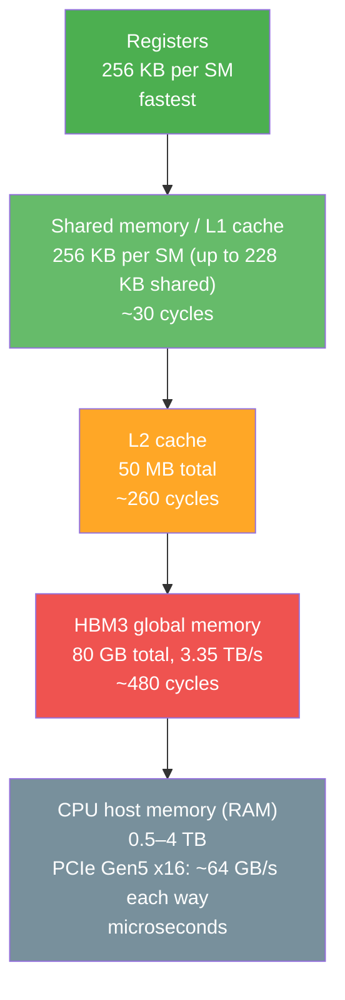
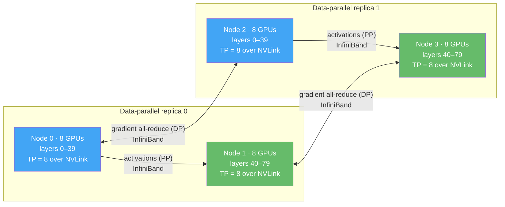
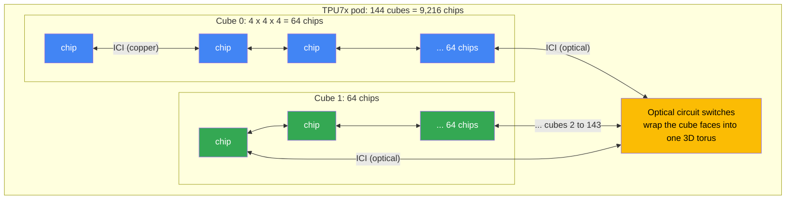

# Chapter 29 — GPUs, TPUs & AI Infrastructure

This chapter covers the hardware and infrastructure that makes modern AI possible. You can write the most elegant model architecture in the world — if you do not understand the hardware running it, you will waste money, time, and sanity. GPUs, TPUs, distributed training, and inference optimization are not optional knowledge for an AI engineer. They are the difference between a model that trains in 3 hours and one that takes 3 weeks.

**What lives where.** This chapter is the book's home for the *hardware*: chips and their specs, memory and bandwidth, CUDA, distributed training and cluster costs. The training techniques that run on it — mixed precision, gradient accumulation, activation checkpointing — are taught in [Ch 16 §1.7 and §1.9](#content/16_deep_learning); serving tricks — KV cache, batching, quantization, speculative decoding — in [Ch 17c](#content/17c_llm_systems). Here you get the hardware view of each, plus links.

---

## 24.1 GPUs for AI — Hardware Fundamentals

> **GPU (Graphics Processing Unit):** A massively parallel processor originally designed for rendering graphics, now the dominant hardware for training and running neural networks. GPUs excel at performing thousands of simple arithmetic operations simultaneously — exactly the workload that matrix multiplication demands.

![Infographic: reading a GPU spec sheet. Rule dense TFLOPS = sparse TFLOPS / 2 (H100 1,979 sparse becomes 989 dense). Bar chart of dense BF16 TFLOPS per GPU with memory and bandwidth: A100 312 (80 GB, 2.0 TB/s), H100 989 (80 GB, 3.35 TB/s), H200 989 (141 GB, 4.8 TB/s, same compute, +43% bandwidth, about 1.4x faster decode), B200 2,250 (180-192 GB, 8.0 TB/s), Rubin 4,000 (288 GB HBM4, 19.2-22 TB/s). Table of which number to read first for training, serving, fitting and cost; H100 rental about 1.5-7 USD per GPU-hour; B300 and RTX 5090 mix-ups; trap of comparing sparse with dense numbers.](diagrams/gpu29_info_gpu_lineup_specs_ai.png)

<details>
<summary><strong>Read as text</strong> — dense vs sparse, the 2026 lineup and how to read it</summary>

Training a neural network boils down to three operations repeated billions of times: multiply matrices (forward pass), compute a loss, and multiply more matrices (backward pass). A CPU runs these on a few dozen powerful cores. A GPU throws thousands of simpler cores at the problem in parallel. On paper the gap is about 100×: an H100 does 989 trillion BF16 operations per second, while a 96-core server CPU peaks at roughly 10 trillion.

> **Maths in one line:** `dense TFLOPS = sparse TFLOPS ÷ 2` — spec sheets often headline a "with sparsity" number that assumes half of every group of four weights is zero (2:4 structured sparsity); ordinary training and inference get the dense number, so halve any figure marked "sparse" or with an asterisk.

NVIDIA dominates AI hardware; AMD is the main GPU alternative and Google's TPUs (§24.7) the main non-GPU one. The lineup that matters, per GPU, from the vendors' spec sheets as of November 2026:

| GPU | Year | Memory | Bandwidth (TB/s) | BF16 Tensor TFLOPS (dense) | With 2:4 sparsity | Power (W) |
|-----|------|--------|------------------|----------------------------|-------------------|-----------|
| A100 SXM (80 GB) | 2020 | 80 GB HBM2e | 2.0 | 312 | 624 | 400 |
| H100 SXM | 2022 | 80 GB HBM3 | 3.35 | 989 | 1,979 | 700 |
| H200 SXM | 2024 | 141 GB HBM3e | 4.8 | 989 | 1,979 | 700 |
| B200 (HGX) | 2025 | 180–192 GB HBM3e | 8.0 | 2,250 | 4,500 | 1,000 |
| B300 — Blackwell Ultra (HGX) | 2025 | 288 GB HBM3e | 8.0 | 2,250 | 4,500 | 1,100 |
| Rubin | 2026 | 288 GB HBM4 | 19.2–22 | 4,000 | — | — |
| AMD MI355X | 2025 | 288 GB HBM3E | 8.0 | 2,500 | 5,000 | 1,400 |
| AMD MI455X | 2026 | 432 GB HBM4 | 23.3 | 5,000 | — | — |
| RTX 5090 (consumer) | 2025 | 32 GB GDDR7 | 1.79 | 209.5 † | 419 † | 575 |

How to read it:

- **Dense vs sparse.** NVIDIA's spec pages list the sparse figure first and footnote it — the H100 page says "1,979 teraFLOPS*" for BF16. Use the dense column for every calculation in this chapter.
- **B200 memory.** NVIDIA's HGX and DGX sheets list 180 GB per GPU; the package carries 192 GB. The rack-scale versions (GB200 and GB300 NVL72: 72 GPUs + 36 Grace CPUs per rack) run at higher power and list about 2,500 dense BF16 TFLOPS per GPU.
- **Blackwell Ultra (B300)** keeps B200's BF16 and FP8 rates; its gains are memory (288 GB) and FP4 — 13.5 dense FP4 PFLOPS per GPU on HGX versus 9 for the B200.
- **Rubin** entered full production in May 2026 (NVIDIA's Vera Rubin NVL72 rack: 72 Rubin GPUs + 36 Vera CPUs). NVIDIA lists 19.2 TB/s per GPU in the NVL72 sheet and 22 TB/s on its HGX page. AMD's MI455X launched in July 2026 for its 72-GPU "Helios" rack. "—" = not published.
- **† RTX 5090:** BF16 with FP32 accumulation, the setting training uses; GeForce cards run FP16-accumulate twice as fast, which is not comparable with data-centre figures.
- **Renting:** an H100 costs about 1.5–7 USD per GPU-hour as of November 2026, depending on the provider and the commitment; newer chips cost more. §24.10 compares providers.

The H200 has the H100's compute but 76% more memory (141 vs 80 GB) and 43% more bandwidth (4.8 vs 3.35 TB/s). LLM decoding is limited by bandwidth, not FLOPS (the roofline in §24.2), so that alone makes it about 1.4× faster at generating tokens — the H200 exists for exactly this reason ([Ch 17c §1.1](#content/17c_llm_systems)).

**Fun fact:** NVIDIA became the first company worth 5 trillion USD in October 2025; in early 2019 it was worth roughly 0.1 trillion. The jump was driven mainly by demand for its data-centre AI GPUs.

</details>

### GPU Performance Progression

<details>
<summary><strong>Read as text</strong> — the growth chart and what it shows</summary>

```chart
{
  "type": "bar",
  "data": {
    "labels": ["V100 (2017)", "A100 (2020)", "H100 (2022)", "H200 (2024)", "B200 (2025)", "Rubin (2026)"],
    "datasets": [
      {
        "label": "Dense FP16/BF16 Tensor Core TFLOPS (V100: FP16 only)",
        "data": [125, 312, 989, 989, 2250, 4000],
        "backgroundColor": ["#66bb6a", "#42a5f5", "#ab47bc", "#ef5350", "#ffa726", "#26a69a"]
      }
    ]
  },
  "options": {
    "plugins": { "title": { "display": true, "text": "NVIDIA Tensor Core Performance by Generation (dense, per GPU)" } },
    "scales": { "y": { "title": { "display": true, "text": "TFLOPS (FP16/BF16, dense)" } } }
  }
}
```

Dense BF16 compute grew about 3× from A100 to H100, 2.3× to B200 and 1.8× to Rubin. Newer, smaller number formats add more on top: FP8 (from Hopper) doubles the BF16 rate and FP4 (from Blackwell) doubles it again. Memory bandwidth grew a little more slowly — about 10× from A100 to Rubin, against about 13× for compute. Raw FLOPS is only half the story: memory capacity and bandwidth decide what you can actually run, and how fast.

</details>

---

## 24.2 GPU Architecture — How GPUs Differ from CPUs

![Infographic: inside an H100 and the roofline model. An H100 has 132 SMs, each with 128 CUDA cores, 4 Tensor Cores and 256 KB L1/shared memory; Tensor Cores give 989 TFLOPS, 15x the 67 of the CUDA cores. Memory ladder: shared ~30 cycles, L2 50 MB ~260 cycles, HBM 80 GB at 3.35 TB/s ~480 cycles. Roofline: intensity = FLOPs / bytes, attainable = min(peak, intensity x bandwidth), ridge 989 / 3.35 = about 295 FLOPs per byte. Worked table: matmul 4096 cubed 1,365 FLOPs/byte compute-bound at 100%; decode batch 1 at 1 FLOP/byte uses 0.3% of peak; batch 64 at 63 uses 21%; batch 512 at 455 is compute-bound; elementwise add 0.2 is memory-bound. Ridge by GPU: A100 153, H100 295, H200 206, B200 281.](diagrams/gpu29_info_gpu_architecture_roofline_ai.png)

<details>
<summary><strong>Read as text</strong> — CPU vs GPU layout and the key differences</summary>

A CPU is designed to execute complex instruction streams quickly on a few cores. A GPU is designed to execute simple instruction streams on thousands of cores simultaneously.

```
CPU (e.g., AMD EPYC 9654 — 96 cores)
┌─────────────────────────────────────────────────────────────┐
│   Core 0         Core 1         Core 2   ...   Core 95      │
│  ┌─────────┐    ┌─────────┐    ┌─────────┐    ┌─────────┐   │
│  │ ALU ALU │    │ ALU ALU │    │ ALU ALU │    │ ALU ALU │   │
│  │ Branch  │    │ Branch  │    │ Branch  │    │ Branch  │   │
│  │Predictor│    │Predictor│    │Predictor│    │Predictor│   │
│  │ L1 cache│    │ L1 cache│    │ L1 cache│    │ L1 cache│   │
│  │ L2 cache│    │ L2 cache│    │ L2 cache│    │ L2 cache│   │
│  └─────────┘    └─────────┘    └─────────┘    └─────────┘   │
│              Large shared L3 cache (384 MB)                 │
│         Complex out-of-order execution per core             │
└─────────────────────────────────────────────────────────────┘

GPU (e.g., H100 SXM — 132 SMs: 16,896 CUDA cores + 528 Tensor Cores)
┌─────────────────────────────────────────────────────────────┐
│   SM 0             SM 1             SM 2        ... SM 131  │
│  ┌───────────┐    ┌───────────┐    ┌───────────┐            │
│  │CUDA CUDA  │    │CUDA CUDA  │    │CUDA CUDA  │            │
│  │CUDA CUDA  │    │CUDA CUDA  │    │CUDA CUDA  │    ...     │
│  │... (128)  │    │... (128)  │    │... (128)  │            │
│  │Tensor x 4 │    │Tensor x 4 │    │Tensor x 4 │            │
│  │256 KB L1/ │    │256 KB L1/ │    │256 KB L1/ │            │
│  │shared mem │    │shared mem │    │shared mem │            │
│  └───────────┘    └───────────┘    └───────────┘            │
│              50 MB L2 cache, shared by all SMs              │
│              80 GB HBM3 (3.35 TB/s bandwidth)               │
│         Simple cores, massive parallelism                   │
└─────────────────────────────────────────────────────────────┘

SM = Streaming Multiprocessor (a cluster of CUDA cores + Tensor Cores)
```

**Key architectural differences:**

| Feature | CPU | GPU |
|---------|-----|-----|
| Core count | Tens to a couple of hundred (powerful) | 10,000–20,000+ simple cores (H100: 16,896) |
| Clock speed | 2–5 GHz | 1.5–2.5 GHz |
| Cache per core | Large (MB) | Small (KB) |
| Branch prediction | Sophisticated | Minimal |
| Best for | Serial logic, control flow | Parallel math, matrix ops |
| Memory bandwidth | ~0.1 TB/s (desktop DDR5) to ~0.6 TB/s (12-channel server) | 2–8 TB/s (HBM3/HBM3e); ~20 TB/s with HBM4 |

</details>

### Tensor Cores

<details>
<summary><strong>Read as text</strong> — how Tensor Cores reach 989 TFLOPS</summary>

Tensor Cores are the real workhorses for deep learning. A CUDA core does one fused multiply-add (FMA: `a × b + c`, 2 FLOPs) per clock on FP32 numbers. A Tensor Core multiplies whole matrix tiles in one instruction. The first generation (V100, 2017) did a 4×4×4 multiply-accumulate — 64 FMAs per clock. An H100 Tensor Core does 512 dense BF16 FMAs per clock: NVIDIA rates each H100 SM at twice an A100 SM's matrix rate, and an A100 Tensor Core does 256.

Check it against the spec sheet: 528 Tensor Cores × 512 FMAs × 2 FLOPs ≈ 540,000 FLOPs per clock, and at about 1.83 GHz that is the H100's 989 TFLOPS. Its 16,896 CUDA cores give only 67 TFLOPS of FP32 — about 15× less. The lesson: work that is not a matrix multiply in a Tensor Core format (BF16, FP8, FP4) uses only a small fraction of the chip.

</details>

### GPU Memory Hierarchy

<details>
<summary><strong>Read as text</strong> — the memory ladder and why on-chip matters</summary>



Sizes are for an H100; the latencies were measured on a Hopper-generation GPU (Luo et al., 2024). The rule: keep data as close to the compute as possible. A trip to HBM costs about 16× the latency of shared memory (~480 vs ~30 cycles), and on-chip memory also has about 10× HBM's bandwidth (the FlashAttention paper estimates ~19 TB/s of SRAM bandwidth against 1.5–2 TB/s of HBM on an A100). That is why FlashAttention and kernel fusion (§24.5) are such a big deal: both keep intermediate results on-chip instead of writing them to HBM and reading them back.

</details>

### The Roofline — Compute-Bound or Memory-Bound?

<details>
<summary><strong>Read as text</strong> — intensity, the ridge point and two tiny examples</summary>

Every operation does some FLOPs on some bytes it must fetch from HBM. If it does few FLOPs per byte, the Tensor Cores sit waiting for memory — it is **memory-bound**, and only more bandwidth (or fewer bytes) helps. If it does many, memory keeps up and the arithmetic is the limit — it is **compute-bound**, and only more FLOPS helps. One number tells you which.

> **Maths in one line:** `arithmetic intensity = FLOPs ÷ bytes moved` and `attainable FLOP/s = min(peak FLOP/s, intensity × bandwidth)` — the **ridge point** is `peak ÷ bandwidth` = 989 TFLOP/s ÷ 3.35 TB/s ≈ **295 FLOPs per byte** on an H100; below it an operation is memory-bound, above it compute-bound.

```text
attainable TFLOP/s
   989 ┤                        ●━━━━━━━━━━━━━━━━━━━━━━  compute roof = peak
       │                      /
       │                    /  memory roof = intensity × 3.35 TB/s
       │                  /
       │                /
       │              /
       │            /
       └────────┬───────────────┬───────────────────┬───────▶ FLOPs per byte (log scale)
                1              295                1,365
          batch-1 decode      ridge            big matmul
          memory-bound                         compute-bound
```

Two tiny examples. A 4096 × 4096 × 4096 BF16 matrix multiply does 2 × 4096³ ≈ 137 billion FLOPs and moves three 4096 × 4096 matrices of 2-byte numbers, about 101 MB — **1,365 FLOPs per byte**, far right of the ridge. One decode step at batch 1 multiplies a single vector by each weight matrix: 2 FLOPs per weight and 2 bytes per weight — **1 FLOP per byte**, far left. The program checks both, plus the cases in between:

</details>

```python
# Roofline: FLOPs per byte moved decides whether an operation is compute-bound or memory-bound
import numpy as np

PEAK, BW = 989e12, 3.35e12            # one H100 SXM: dense BF16 FLOP/s and HBM bytes/s
RIDGE = PEAK / BW                     # FLOPs the GPU can do in the time it reads one byte
B, d = 2, 8192                        # bytes per BF16 number; one 8192 x 8192 weight matrix

ops = {"matmul 4096^3 (training, prefill)": (2 * 4096**3, B * 3 * 4096**2)}  # read A, B; write C
for batch in (1, 64, 512):            # decode: `batch` token vectors times the weight matrix
    ops[f"decode x @ W, batch {batch}"] = (2 * batch * d * d, B * (d * d + 2 * batch * d))
ops["elementwise add, 1M numbers"] = (1e6, B * 3e6)                       # read a, read b, write a + b

flops, nbytes = (np.array(col, dtype=float) for col in zip(*ops.values()))
intensity = flops / nbytes                              # arithmetic intensity, FLOPs per byte
attainable = np.minimum(PEAK, intensity * BW)           # the roofline itself

print(f"H100 ridge point = {PEAK / 1e12:.0f} TFLOP/s / {BW / 1e12:.2f} TB/s = {RIDGE:.0f} FLOPs per byte\n")
print(f"{'operation':<35}{'FLOPs/byte':>11}{'TFLOP/s':>9}{'% of peak':>11}  bound")
for name, ai, perf in zip(ops, intensity, attainable):
    bound = "compute" if ai >= RIDGE else "memory"
    print(f"{name:<35}{ai:>11.1f}{perf / 1e12:>9.1f}{100 * perf / PEAK:>10.1f}%  {bound}")

assert intensity[1] < 1.01 and intensity[0] > 4 * RIDGE     # batch-1 decode ~1 FLOP/byte; big matmul far right
assert intensity[2] < RIDGE < intensity[3]                   # batching crosses the ridge between 64 and 512

print("\nRidge point by GPU (dense BF16 TFLOP/s / HBM TB/s):")
for gpu, (tf, tb) in {"A100": (312, 2.039), "H100": (989, 3.35), "H200": (989, 4.8),
                      "B200": (2250, 8.0), "RTX 5090": (209.5, 1.792)}.items():
    print(f"  {gpu:<9}{tf:>7} / {tb:<6} = {tf / tb:4.0f} FLOPs per byte")
```

**Output:**

```
H100 ridge point = 989 TFLOP/s / 3.35 TB/s = 295 FLOPs per byte

operation                           FLOPs/byte  TFLOP/s  % of peak  bound
matmul 4096^3 (training, prefill)       1365.3    989.0     100.0%  compute
decode x @ W, batch 1                      1.0      3.3       0.3%  memory
decode x @ W, batch 64                    63.0    211.1      21.3%  memory
decode x @ W, batch 512                  455.1    989.0     100.0%  compute
elementwise add, 1M numbers                0.2      0.6       0.1%  memory

Ridge point by GPU (dense BF16 TFLOP/s / HBM TB/s):
  A100         312 / 2.039  =  153 FLOPs per byte
  H100         989 / 3.35   =  295 FLOPs per byte
  H200         989 / 4.8    =  206 FLOPs per byte
  B200        2250 / 8.0    =  281 FLOPs per byte
  RTX 5090   209.5 / 1.792  =  117 FLOPs per byte
```

<details>
<summary><strong>Read as text</strong> — continued: how to read the output and what to say in an interview</summary>

**How to read it.** Batch-1 decode uses 0.3% of the H100's peak — that is the bandwidth ceiling of [Ch 17c §1.1](#content/17c_llm_systems). Batching reuses each weight byte once per sequence, so intensity grows with the batch: 64 sequences are still memory-bound, 512 cross the ridge. (This toy counts only the weights; real decode also reads every sequence's KV cache, which grows with the batch and keeps decode memory-bound in practice — Ch 17c §1.1.) Elementwise operations such as add, GELU or normalisation are hopelessly memory-bound, which is why fusing them into one kernel (§24.5) saves real time. The last table explains the H200: same compute, more bandwidth, so its ridge drops to 206 — memory-bound work runs 1.43× faster and compute-bound work does not change. The RTX 5090's low ridge (117) comes from its much lower compute, not from fast memory.

> **Say this in an interview:** "Divide FLOPs by bytes moved. An H100 needs about 295 FLOPs per byte to keep its Tensor Cores busy. A big training matmul has over a thousand, so it is compute-bound; batch-1 decode has about one, so it is memory-bound — bandwidth, batching and quantization help it, extra TFLOPS do not."

</details>

---

## 24.3 GPU Memory — The Real Bottleneck

![Infographic: will a model fit in GPU memory, training versus inference. Training with Adam costs 16 bytes per parameter (2 BF16 weights, 2 gradients, 4 FP32 master, 4 momentum, 4 variance) plus activations; inference costs (bits / 8) bytes per parameter plus the KV cache. Stacked bar for a 7B model: weights 14, gradients 14, FP32 master 28, Adam m 28, Adam v 28 = 112 GB, past the 80 GB of one H100. Fit table for 7B, 70B and 405B: FP16 inference 14 / 140 / 810 GB, INT4 3.5 / 35 / 203 GB, LoRA about 16-24 / 150-160 / 830-900 GB, full training about 120 GB / 1.2 TB / 7 TB. Checkpointing cuts activations from 18.3 GB to 1.6 GB for about 33% more compute; QLoRA fine-tuned a 65B model on one 48 GB GPU.](diagrams/gpu29_info_gpu_memory_budget_ai.png)

<details>
<summary><strong>Read as text</strong> — why memory fails runs, and the two formulas</summary>

More training runs fail because they run out of VRAM than because the model is wrong. Understanding GPU memory math is non-negotiable. [Ch 16 §1.9](#content/16_deep_learning) walks through where every byte goes, with runnable code; this section is the hardware-side summary and the lookup table.

> **Maths in one line:** `training bytes ≈ 16 × P + activations` and `inference bytes ≈ (bits ÷ 8) × P + KV cache` — training with Adam costs 16 bytes per parameter whatever the precision; serving costs only the weights at their storage precision, plus the KV cache.

</details>

### Memory Budget for Training

<details>
<summary><strong>Read as text</strong> — the 16 bytes per parameter, line by line</summary>

For a model with **P parameters** trained with the Adam optimizer, in pure FP32 or in mixed precision (BF16 compute with an FP32 master copy):

| Component | Pure FP32 (bytes per parameter) | Mixed precision (bytes per parameter) | 7B model, mixed precision |
|-----------|---------------------------------|---------------------------------------|---------------------------|
| Weights used in forward/backward | 4 (FP32) | 2 (BF16) | 14 GB |
| Gradients | 4 (FP32) | 2 (BF16) | 14 GB |
| FP32 master weights | — | 4 | 28 GB |
| Adam momentum (m) | 4 | 4 | 28 GB |
| Adam variance (v) | 4 | 4 | 28 GB |
| **Subtotal, before activations** | **16 → 112 GB for 7B** | **16 → 112 GB for 7B** | **112 GB** |
| Activations | Largest (32-bit) | Halved (16-bit) | 10–60 GB, set by batch × sequence length × layers |

A single 80 GB GPU cannot train a 7B model with Adam — and mixed precision does not change that. It runs the matrix maths on Tensor Cores and halves the activations, but the weights-plus-optimizer bill stays at 16 bytes per parameter. What does shrink it: sharding those 16 bytes across GPUs (ZeRO / FSDP, §24.6), a lighter optimizer, or freezing the model and training small adapters (LoRA).

</details>

### Practical VRAM Requirements

<details>
<summary><strong>Read as text</strong> — the fit table from 1.3B to 405B, and why LoRA wins</summary>

| Model Size | Inference (FP16) | Inference (INT8) | Inference (INT4) | Fine-tune (LoRA, BF16) | Full Training (BF16+Adam) |
|-----------|------------------|-------------------|-------------------|-------------------------|---------------------------|
| 1.3B | 2.6 GB | 1.3 GB | 0.7 GB | ~4–8 GB | ~24 GB |
| 7B | 14 GB | 7 GB | 3.5 GB | ~16–24 GB | ~120 GB |
| 13B | 26 GB | 13 GB | 6.5 GB | ~30–40 GB | ~220 GB |
| 70B | 140 GB | 70 GB | 35 GB | ~150–160 GB | ~1.2 TB |
| 405B | 810 GB | 405 GB | 203 GB | ~830–900 GB | ~7 TB |

- **Inference columns are the weights only** (parameters × 2, 1 or 0.5 bytes). Add the KV cache, which for long contexts and many users can exceed the weights ([Ch 17c §1.2](#content/17c_llm_systems)).
- **LoRA** ≈ the frozen BF16 weights (2 bytes per parameter) plus a few GB for the adapters, their optimizer state and the activations; the range depends on batch size and sequence length. **QLoRA** stores the frozen base model in 4 bits — its paper fine-tuned a 65B model on a single 48 GB GPU ([Ch 17b §9.4](#content/17b_llm_applications)).
- **Full training** = 16 bytes per parameter plus activations.

This table explains why LoRA is so popular for fine-tuning — a 7B model fits on a single 24 GB consumer GPU with LoRA, but full training needs at least two 80 GB GPUs with the optimizer state sharded between them.

</details>

### Gradient Checkpointing

<details>
<summary><strong>Read as text</strong> — the memory-for-compute trade and the nvidia-smi tip</summary>

Activation (gradient) checkpointing keeps only each layer's input during the forward pass and recomputes the rest during the backward pass. For a 7B-class model and one 4,096-token sequence it cuts activations from about 18.3 GB to 1.6 GB, for roughly 33% more compute. It changes memory, never the gradients. The mechanics, the numbers and the code are in [Ch 16 §1.9](#content/16_deep_learning).

**Practical tip:** Always check `nvidia-smi` before blaming your code for OOM. Someone else on the machine might be hogging GPU memory.

</details>

---

## 24.4 CUDA & GPU Programming Basics

> **CUDA (Compute Unified Device Architecture):** NVIDIA's parallel computing platform and API that allows software to use NVIDIA GPUs for general-purpose computation. Released in 2007, CUDA is a big reason NVIDIA dominates AI — it gave NVIDIA a nearly two-decade head start in libraries, tools and developers.

![Infographic: the CUDA execution model in one picture. A kernel launches a grid of blocks; a block of up to 1,024 threads runs on one SM; a warp is 32 threads issuing the same instruction. Formula blocks = ceil(N / threads per block) and warps per block = threads per block / 32: N = 1,000,000 with 256 threads per block gives 3,907 blocks of 8 warps, and the last 192 threads do nothing. Shows the index line i = blockIdx.x * blockDim.x + threadIdx.x with the i < n guard, coalesced reads (32 threads into four 32-byte sectors, 128 B) versus strided reads (32 sectors, 1,024 B, 8x the traffic), and a table on coalescing, occupancy hiding ~480-cycle HBM waits, and kernel fusion.](diagrams/gpu29_info_cuda_basics_ai.png)

<details>
<summary><strong>Read as text</strong> — who writes kernels, and the block and warp maths</summary>

You will almost never write raw CUDA kernels. PyTorch and JAX call NVIDIA's tuned libraries (cuBLAS for matrix multiplies, cuDNN for convolutions and attention) and generate the rest: `torch.compile` writes Triton kernels, and JAX hands your program to the XLA compiler. When you do need a custom kernel, most people now reach for **Triton** (GPU kernels written in Python) before raw CUDA C++. But understanding CUDA concepts helps you diagnose performance problems.

> **Maths in one line:** `blocks = ⌈N ÷ threads per block⌉` and `warps per block = threads per block ÷ 32` — adding two vectors of N = 1,000,000 numbers with 256 threads per block launches 3,907 blocks of 8 warps; the last 192 threads have no element and must do nothing.

</details>

### CUDA Execution Model

<details>
<summary><strong>Read as text</strong> — grid, blocks, warps and the vector-add kernel</summary>

```
Grid (your entire computation)
├── Block 0                    Block 1                    Block 2
│   ├── Thread 0               ├── Thread 0               ├── Thread 0
│   ├── Thread 1               ├── Thread 1               ├── Thread 1
│   ├── Thread 2               ├── Thread 2               ├── Thread 2
│   └── ... (up to 1024)       └── ... (up to 1024)       └── ... (up to 1024)
│   [Shared Memory]            [Shared Memory]            [Shared Memory]
└── All blocks share Global Memory (HBM)
```

| Term | What it is | Where it runs |
|------|------------|---------------|
| **Kernel** | A function that runs on the GPU, launched from the CPU | The whole GPU |
| **Thread** | The smallest unit of work — usually one element | One lane of an SM |
| **Warp** | 32 threads that issue the same instruction together (SIMT); the real scheduling unit | Inside one SM |
| **Block** | Up to 1,024 threads that share fast on-chip memory (SRAM) and can synchronise | One SM |
| **Grid** | All the blocks of one kernel launch | Spread over every SM (132 on an H100) |

The vector add from the maths line, in CUDA C++ (read-only — the app cannot run it):

```cpp
// one thread per element; the guard handles the 192 spare threads of the last block
__global__ void add(const float* a, const float* b, float* c, int n) {
    int i = blockIdx.x * blockDim.x + threadIdx.x;   // this thread's element
    if (i < n) c[i] = a[i] + b[i];
}
// launch from the CPU: add<<<(n + 255) / 256, 256>>>(a, b, c, n);   // 3,907 blocks x 256 threads
```

</details>

### Key Performance Concepts

<details>
<summary><strong>Read as text</strong> — coalescing, occupancy and kernel fusion</summary>

**Memory coalescing**: when the 32 threads of a warp read consecutive addresses, the GPU combines them into a few wide transactions — 32 threads × 4 bytes = 128 bytes = four 32-byte sectors. If each thread instead reads an address 32 or more bytes from its neighbour's, every thread needs its own sector: 32 sectors (1,024 bytes) moved for 128 useful bytes, 8× the traffic. This is why data layout (row-major vs column-major) matters.

**Occupancy**: the ratio of active warps to the maximum warps an SM can hold. Occupancy hides latency: while one warp waits ~480 cycles for HBM, the SM runs others. Low occupancy means idle cores; common causes are too much shared memory per block or too many registers per thread.

**Kernel fusion**: each separate kernel reads its inputs from HBM and writes its output back. Fusing a chain of elementwise operations into one kernel moves the data once instead of several times — the memory-bound end of the roofline (§24.2), and the main trick behind `torch.compile` (§24.5).

</details>

### Checking GPU Info in PyTorch

<details>
<summary><strong>Read as text</strong> — the PyTorch memory calls and the allocator-cache tip</summary>

```python
# Runs locally: pip install torch; needs an NVIDIA GPU
import torch

if not torch.cuda.is_available():
    raise SystemExit("No CUDA GPU visible")

print(f"GPU count: {torch.cuda.device_count()}")
props = torch.cuda.get_device_properties(0)
print(f"GPU 0: {props.name}, {props.total_memory / 1e9:.1f} GB, "
      f"compute capability {props.major}.{props.minor}, {props.multi_processor_count} SMs")

# During training — what PyTorch is using
print(f"Allocated: {torch.cuda.memory_allocated() / 1e9:.2f} GB")     # live tensors
print(f"Reserved:  {torch.cuda.memory_reserved() / 1e9:.2f} GB")      # live tensors + PyTorch's cache
print(f"Peak:      {torch.cuda.max_memory_allocated() / 1e9:.2f} GB")
torch.cuda.reset_peak_memory_stats()                                   # start a fresh peak measurement
```

**Practical tip:** PyTorch caches memory in its allocator (`memory_reserved`), which is higher than `memory_allocated`. If `nvidia-smi` shows high usage but `memory_allocated` is low, PyTorch is just keeping freed memory for reuse. Call `torch.cuda.empty_cache()` if another process needs it.

</details>

---

## 24.5 Training Optimization — Making GPUs Go Fast

![Infographic: making training fast by finding the bottleneck first. Flowchart for slow training: profile and measure MFU; if GPU-Util drops to 0% between steps fix data loading with num_workers and pin_memory; if still FP32 switch to BF16 (67 to 989 TFLOPS); if sequences are long use FlashAttention; otherwise torch.compile to fuse elementwise ops. Amdahl law, overall speed-up = 1 / ((1 - f) + f / s): attention at 30% of the step made 3x faster gives 1.25x overall, not 3x. H100 dense TFLOPS table: FP32 67, TF32 495, BF16 989, FP8 1,979, BF16 about 2-3x end to end. FlashAttention keeps 128 MiB of scores per head at n = 8,192 out of HBM; torch.compile 43% faster on average over 163 models on an A100; gradient accumulation saves memory not time; checkpointing about 33% slower.](diagrams/gpu29_info_training_speed_checklist_ai.png)

<details>
<summary><strong>Read as text</strong> — Amdahl's law and which fix attacks which bottleneck</summary>

A poorly tuned training job can leave most of an expensive GPU idle. This section is the hardware view: which bottleneck each technique attacks and what to expect. The techniques themselves are taught in Ch 16 — mixed precision in [Ch 16 §1.7](#content/16_deep_learning), gradient accumulation and activation checkpointing in [Ch 16 §1.9](#content/16_deep_learning) — and the honest scorecard for the whole job, MFU, is in §24.6c.

> **Maths in one line:** `overall speed-up = 1 ÷ ((1 − f) + f ÷ s)` (Amdahl's law) — a fix that makes a fraction `f` of the step `s` times faster gains this much and no more; attention at 30% of the step made 3× faster gives 1 ÷ (0.7 + 0.1) = 1.25×, not 3×.

| Technique | Bottleneck it attacks | Typical effect | Taught in |
|-----------|-----------------------|----------------|-----------|
| Mixed precision (BF16) | Compute — matmuls move onto Tensor Cores; bytes halve | Up to about 3× vs FP32 | [Ch 16 §1.7](#content/16_deep_learning) |
| FlashAttention | HBM traffic of the n × n attention scores | Several times faster attention; memory O(n) | [Ch 17 §2.4](#content/17_llm) |
| `torch.compile` | Memory-bound elementwise ops (fusion), Python overhead | ~1.2–1.5× | Below |
| DataLoader workers, pinned memory | The CPU and disk feeding the GPU | Removes idle gaps | Below |
| Gradient accumulation | Activation memory (a big batch from small pieces) | Saves memory, not time | [Ch 16 §1.9](#content/16_deep_learning) |
| Activation checkpointing | Activation memory | About 33% slower | [Ch 16 §1.9](#content/16_deep_learning) |

</details>

### Mixed Precision Training (FP32 to BF16/FP16)

<details>
<summary><strong>Read as text</strong> — TFLOPS by number format, TF32, and BF16 vs FP16</summary>

The speed comes from *which unit* does the multiply. H100 SXM, dense peak rates:

| Format | Unit that runs it | H100 dense TFLOPS | vs FP32 |
|--------|-------------------|-------------------|---------|
| FP32 | CUDA cores | 67 | 1× |
| TF32 (FP32 inputs, 10-bit mantissa inside) | Tensor Cores | 495 | ~7× |
| BF16 / FP16 | Tensor Cores | 989 | ~15× |
| FP8 | Tensor Cores (Hopper and later) | 1,979 | ~30× |
| FP4 | Tensor Cores (Blackwell and later) | not on H100; 9,000 on a B200 (HGX) | — |

End to end the gain is closer to 2–3×, because only the matrix multiplies get the 15× — everything else just moves half the bytes (Amdahl again). Two practical notes. PyTorch runs FP32 matrix multiplies in true FP32 by default; `torch.set_float32_matmul_precision("high")` lets them use the TF32 Tensor Cores. And prefer BF16 over FP16 on TPUs and on NVIDIA GPUs from the A100 on: BF16 (1 sign, 8 exponent, 7 mantissa bits) has FP32's range and needs no loss scaling, while FP16 (1, 5, 10) overflows above 65,504. The recipe, loss scaling and code: [Ch 16 §1.7](#content/16_deep_learning).

</details>

### Gradient Accumulation

<details>
<summary><strong>Read as text</strong> — a big batch from small pieces</summary>

Run `k` micro-batches, add up their gradients, then take one optimizer step: effective batch = micro-batch × `k` × data-parallel GPUs, while activation memory is set by the micro-batch alone. Instead of one batch of 256, run 8 micro-batches of 32. It saves memory, not time. The rules — divide each micro-batch loss by `k`, step the scheduler once per `k`, skip the all-reduce with DDP's `no_sync()` until the last micro-batch — and a proof that it equals the big batch are in [Ch 16 §1.9](#content/16_deep_learning).

</details>

### Flash Attention

<details>
<summary><strong>Read as text</strong> — why the score matrix never reaches HBM</summary>

Standard attention writes the n × n score matrix to HBM, reads it back for the softmax, writes the probabilities, and reads them again to multiply by V. For n = 8,192 one head's scores are 8,192² × 2 bytes = 128 MiB in BF16 — 4 GiB for 32 heads, in every layer. Those bytes, not the FLOPs, set its speed: the softmax steps sit at the memory-bound end of the roofline.

FlashAttention computes exactly the same result tile by tile inside on-chip SRAM, using an online softmax (a running max and sum per row), so the score matrix never reaches HBM.

```
Standard attention:
  Q, K, V in HBM → S = Q·Kᵀ written to HBM → softmax reads S, writes P → P·V reads P
  extra memory: O(n²)     HBM traffic: ~ n·d + n²

FlashAttention:
  load Q, K, V tiles into SRAM → scores, softmax and P·V per tile → write only the output O
  extra memory: O(n)      HBM traffic: ~ n²·d² / M     (d = head size, M = SRAM size; d² < M)
```

Same FLOPs, far fewer bytes: several times faster attention and memory that grows with n instead of n². That is what makes 128K-token training contexts practical, together with sequence parallelism (§24.6b). Each version is tuned to its hardware generation — FlashAttention-2 for the A100, FlashAttention-3 for the H100 (up to 740 TFLOP/s in FP16, 75% of peak), FlashAttention-4 for Blackwell. The algorithm, a NumPy version and the version table are in [Ch 17 §2.4](#content/17_llm); in PyTorch, `torch.nn.functional.scaled_dot_product_attention` picks a FlashAttention-style kernel for you.

</details>

### torch.compile

<details>
<summary><strong>Read as text</strong> — kernel fusion, the benchmark and the code</summary>

`torch.compile` captures your model's Python code as a graph and generates fused GPU kernels for it (Triton, via the TorchInductor backend). Fusion is the roofline in action: in eager mode a chain like bias-add → GELU → dropout reads and writes the whole tensor from HBM at every step; fused, the data makes one trip. On PyTorch's 163-model benchmark it made training 43% faster on average on an A100 (21% in FP32, 51% with mixed precision); models already tuned by hand gain less.

```python
# Runs locally: pip install torch (any PyTorch 2.x; a GPU shows the speed-up)
import torch

model = torch.nn.Sequential(torch.nn.Linear(1024, 4096), torch.nn.GELU(), torch.nn.Linear(4096, 1024))
fast = torch.compile(model)                # same weights; kernels are generated on the first call
x = torch.randn(64, 1024)
with torch.no_grad():
    print(torch.allclose(model(x), fast(x), atol=1e-4))   # same maths, fewer trips to memory
```

The first call is slow because it compiles. Changing input shapes can trigger recompiles, and data-dependent Python control flow splits the graph ("graph breaks"), which costs speed. `mode="reduce-overhead"` adds CUDA graphs to cut kernel-launch overhead for small batches; `mode="max-autotune"` searches harder for fast kernels.

</details>

### Efficient Data Loading

<details>
<summary><strong>Read as text</strong> — the DataLoader settings and the starvation sign</summary>

```python
# Runs locally: pip install torch; needs an NVIDIA GPU
import torch
from torch.utils.data import DataLoader, TensorDataset

def main():
    dataset = TensorDataset(torch.randn(10_000, 3, 64, 64), torch.randint(0, 10, (10_000,)))
    loader = DataLoader(
        dataset,
        batch_size=64,
        shuffle=True,
        num_workers=8,             # CPU processes preparing batches in parallel
        pin_memory=True,           # page-locked host memory: faster, asynchronous copies to the GPU
        prefetch_factor=2,         # batches each worker prepares ahead (needs num_workers > 0)
        persistent_workers=True,   # keep the workers alive between epochs
    )
    for images, labels in loader:
        images = images.to("cuda", non_blocking=True)   # the copy overlaps with GPU work
        labels = labels.to("cuda", non_blocking=True)
        break                                           # a training step would go here

if __name__ == "__main__":     # required for worker processes on Windows and macOS
    main()
```

If GPU utilization (from `nvidia-smi`) drops to 0% between steps, your data pipeline is the bottleneck — increase `num_workers`, move decoding and augmentation off the critical path, or pre-process the data into a faster format.

</details>

### Optimization Speedup Comparison

<details>
<summary><strong>Read as text</strong> — the illustrative speed-up chart and its caveat</summary>

```chart
{
  "type": "bar",
  "data": {
    "labels": ["Mixed Precision (BF16 vs FP32)", "Flash Attention (long sequences)", "torch.compile", "Efficient DataLoader (if input-bound)", "Gradient Checkpointing*"],
    "datasets": [
      {
        "label": "Illustrative end-to-end speedup factor",
        "data": [2.0, 2.5, 1.4, 1.3, 0.75],
        "backgroundColor": ["#42a5f5", "#66bb6a", "#ab47bc", "#ffa726", "#ef5350"]
      }
    ]
  },
  "options": {
    "plugins": {
      "title": { "display": true, "text": "Training Optimization Speedups — illustrative (* = trades speed for memory)" }
    },
    "scales": { "y": { "title": { "display": true, "text": "Speedup Factor (higher = faster)" } } }
  }
}
```

These are illustrative, not guarantees: each fix only speeds up the share of the step it touches (Amdahl, above). The 0.75 for checkpointing is 1 ÷ 1.33 — one extra forward pass. Measure your own job.

</details>

### "My Training Is Slow" Debugging Checklist

<details>
<summary><strong>Read as text</strong> — the nine checks, in order</summary>

1. **Measure MFU, not just `nvidia-smi`**: its "GPU-Util" is the share of time *any* kernel was running, so one small kernel can read 100%. MFU (§24.6c) tells you how much of the peak you actually use.
2. **Watch utilization over time**: if it drops to 0% between steps, the GPU is starved — usually data loading or CPU work. Increase `num_workers`, use `pin_memory`.
3. **Enable mixed precision**: if training in FP32, you are leaving the Tensor Cores idle.
4. **Use FlashAttention** (`scaled_dot_product_attention`) for transformers, especially with long sequences.
5. **Profile it**: `torch.profiler` or NVIDIA Nsight Systems — stop guessing.
6. **Check batch size**: too small keeps arithmetic intensity low and SMs idle; too large brings diminishing returns.
7. **Use `torch.compile`**: often 20–50% for free.
8. **Remove CPU–GPU sync points**: `.item()`, `print(tensor)` and `.cpu()` (for example before `.numpy()`) make the CPU wait for the GPU to finish.
9. **On many GPUs, check communication**: the gradient all-reduce should overlap with the backward pass (§24.6).

</details>

---

## 24.6 Distributed Training — Multiple GPUs & Machines

![Infographic comparing four ways to split training across GPUs: data parallel (full model per GPU, gradients all-reduced once per step), tensor parallel (split every matrix, stays inside NVLink, TP = 8 per server), pipeline parallel (bubble = (p - 1)/(m + p - 1), 43%, 27%, 9% for 4, 8, 32 micro-batches) and expert parallel (two all-to-alls per MoE layer). Formula GPUs = TP x CP x PP x DP with Llama 3 405B 8 x 1 x 16 x 128 = 16,384 H100, a 32-GPU layout of two replicas with TP inside nodes, PP across nodes and DP all-reduce between replicas, and a table of where each split goes.](diagrams/gpu29_info_parallelism_strategies_ai.png)

<details>
<summary><strong>Read as text</strong> — the two walls, the GPU-count formula and the table of splits</summary>

**Simple explanation.** One GPU hits two walls. The **memory wall**: training stores about 16 bytes per parameter (BF16 weights and gradients plus FP32 master weights and Adam state, [Ch 16 §1.7](#content/16_deep_learning)), so even a 7B model needs 112 GB and does not fit on an 80 GB GPU. The **time wall**: a large run needs millions of GPU-hours. So the work is split across many GPUs, and there are only a few things you can split — the **batch**, each layer's **matrices**, the **stack of layers**, the **sequence** of tokens and the **experts** of a mixture-of-experts model. You can also **shard** the training state itself (ZeRO / FSDP). Large runs combine several of these. The "will it fit?" napkin maths is in [Ch 17 §3.6](#content/17_llm); this section is the machinery.

> **Maths in one line:** `GPUs = TP × CP × PP × DP` — every kind of split multiplies the GPU count: Llama 3 405B trained on 8 (tensor) × 1 (context) × 16 (pipeline) × 128 (data) = 16,384 H100s.

| Split | What each GPU holds | What the GPUs exchange, and how often | Where it runs |
|---|---|---|---|
| **Data parallel (DP)** | The full model and its share of the batch | Gradients, once per step (all-reduce) | Across nodes |
| **ZeRO / FSDP** | 1/N of the training state | Weights gathered before each layer; gradients reduce-scattered | Across nodes |
| **Tensor parallel (TP)** | A slice of every weight matrix | Partial sums inside every layer (all-reduce) | Inside one NVLink domain |
| **Pipeline parallel (PP)** | A block of consecutive layers | Activations at each stage boundary | Across nodes |
| **Sequence / context parallel (SP / CP)** | A slice of the tokens | Activations or keys and values in every layer (§24.6b) | With TP, or across nodes |
| **Expert parallel (EP)** | Some of the MoE experts | Tokens to and from their experts (all-to-all) in every MoE layer | Across nodes |

</details>

### Data Parallelism (DP)

<details>
<summary><strong>Read as text</strong> — how it works, DDP buckets and the memory limit</summary>

The simplest approach. Copy the full model to every GPU, split each batch across GPUs, compute gradients independently, then average the gradients with an **all-reduce** (§24.6a) so that every copy takes exactly the same optimizer step.

```
Data parallelism: a batch of 64 samples on 4 GPUs
┌───────────────┐  ┌───────────────┐  ┌───────────────┐  ┌───────────────┐
│     GPU 0     │  │     GPU 1     │  │     GPU 2     │  │     GPU 3     │
│   Full model  │  │   Full model  │  │   Full model  │  │   Full model  │
│  Samples 0-15 │  │ Samples 16-31 │  │ Samples 32-47 │  │ Samples 48-63 │
│    ↓ grads    │  │    ↓ grads    │  │    ↓ grads    │  │    ↓ grads    │
└───────┬───────┘  └───────┬───────┘  └───────┬───────┘  └───────┬───────┘
        └──────────────────┴────────┬─────────┴──────────────────┘
                                    ▼
                   All-reduce: average the 4 gradients
                    every GPU applies the same update
```

**How PyTorch DDP does it.** DDP groups the gradients into **buckets** (25 MiB by default) and starts each bucket's all-reduce as soon as its gradients are ready in the backward pass, so communication overlaps computation. With gradient accumulation, the first k − 1 micro-batches run inside `model.no_sync()`, so the GPUs synchronise once per optimizer step; the effective batch is micro-batch × accumulation steps × data-parallel GPUs ([Ch 16 §1.9](#content/16_deep_learning)).

**Limitation:** every GPU holds the whole model *and* its whole training state. A 70B model is 140 GB of BF16 weights and about 1,120 GB of training state at 16 bytes per parameter — it does not fit on one 80 GB GPU. ZeRO / FSDP (below) remove the duplicated state; tensor and pipeline parallelism split the model itself.

</details>

### Tensor Parallelism (TP)

<details>
<summary><strong>Read as text</strong> — split A by columns and B by rows</summary>

Split each layer's weight matrices across GPUs (the Megatron-LM scheme). Take a transformer MLP, `y = GeLU(x·A)·B`. Cut **A by columns** and **B by the matching rows**. Each GPU then computes `GeLU(x·A_i)·B_i` entirely on its own — GeLU works number by number, so it needs nothing from the other GPUs — and **one all-reduce** adds the partial outputs into the exact `y`. Attention is split the same way, by heads: each GPU owns some heads and the matching rows of the output projection.

```
Tensor parallelism on an MLP, y = GeLU(x·A)·B, over 2 GPUs (Megatron-LM)

                              x  (full copy on both GPUs)
            ┌─────────────────┴─────────────────┐
          GPU 0                               GPU 1
  A₀ = left half of A's columns     A₁ = right half of A's columns
  B₀ = top half of B's rows         B₁ = bottom half of B's rows
  z₀ = GeLU(x·A₀)·B₀                z₁ = GeLU(x·A₁)·B₁
            └─────────────────┬─────────────────┘
               all-reduce:  y = z₀ + z₁  (exact, on both GPUs)
```

</details>

```python
# Tensor parallelism on an MLP: split A by columns and B by rows -> ONE all-reduce gives the exact output
import numpy as np

rng = np.random.default_rng(0)
d, d_ff, t = 8, 32, 4                        # hidden size, MLP width, tensor-parallel GPUs
x = rng.normal(size=(3, d))                  # 3 tokens
A = rng.normal(size=(d, d_ff))               # first linear  (d -> d_ff)
B = rng.normal(size=(d_ff, d))               # second linear (d_ff -> d)
gelu = lambda z: 0.5 * z * (1 + np.tanh(0.7978845608 * (z + 0.044715 * z**3)))

y_full = gelu(x @ A) @ B                     # one GPU does everything

A_parts = np.split(A, t, axis=1)             # GPU i gets 8 columns of A ...
B_parts = np.split(B, t, axis=0)             # ... and the matching 8 rows of B
z = [gelu(x @ A_i) @ B_i for A_i, B_i in zip(A_parts, B_parts)]   # local, no communication
y_tp = sum(z)                                # the all-reduce: sum the 4 partial outputs

print(f"each GPU holds {A_parts[0].size + B_parts[0].size} of {A.size + B.size} MLP weights")
err = np.abs(y_full - y_tp).max()            # only floating-point rounding is left
print(f"column-then-row split: y[0, 0] = {y_full[0, 0]:.4f} vs {y_tp[0, 0]:.4f}; equal: {err < 1e-12}")
assert np.allclose(y_full, y_tp)

# Contrast: split A by ROWS -> each GPU has only a partial sum of x @ A, and GeLU(partial) is wrong
x_parts, A_rows = np.split(x, t, axis=1), np.split(A, t, axis=0)
wrong = sum(gelu(x_i @ A_i) for x_i, A_i in zip(x_parts, A_rows)) @ B
print(f"row split, GeLU before the sum: max error = {np.abs(y_full - wrong).max():.2f}")
assert not np.allclose(y_full, wrong)        # so a row split needs an all-reduce BEFORE the GeLU
```

**Output:**

```
each GPU holds 128 of 512 MLP weights
column-then-row split: y[0, 0] = 4.9844 vs 4.9844; equal: True
row split, GeLU before the sum: max error = 15.63
```

<details>
<summary><strong>Read as text</strong> — continued: why TP stays inside one NVLink domain</summary>

That is two all-reduces per transformer layer in the forward pass (attention and MLP) and two more in the backward pass — communication inside **every** layer. So TP needs the fastest link there is and stays inside one NVLink domain: TP = 8 across the 8 GPUs of one server is the usual choice (a GB200 / GB300 NVL72 rack puts 72 GPUs in one NVLink domain). Over PCIe or the network it would spend most of its time waiting — the link speeds are under "Communication Primitives" below.

</details>

### Pipeline Parallelism (PP)

<details>
<summary><strong>Read as text</strong> — stages, micro-batches and the bubble formula</summary>

Split the model by layers into p **stages**: GPU 0 runs layers 0–19, GPU 1 layers 20–39, and so on. Each stage hands its activations to the next one (and gradients back) — one tensor per micro-batch per boundary, so the traffic is small and the stages can sit on different nodes. The catch is the **pipeline bubble**: at the start the later GPUs wait for input, and in the backward pass the early GPUs wait for gradients. Splitting the batch into m **micro-batches** keeps more GPUs busy at once.

> **Maths in one line:** `bubble = (p − 1) / (m + p − 1)` — the share of time each GPU sits idle with p stages and m micro-batches: 4 stages with 4 micro-batches waste 3/7 ≈ 43%, with 8 micro-batches 3/11 ≈ 27%, with 32 micro-batches 3/35 ≈ 9%.

</details>

```python
# GPipe pipeline schedule: p stages, m micro-batches -> idle "bubble" share = (p - 1) / (m + p - 1)
def gpipe(p, m):
    T = 2 * (m + p - 1)                                  # time slots: forward wave + backward wave
    grid = [["."] * T for _ in range(p)]
    for s in range(p):
        for j in range(m):
            grid[s][s + j] = f"F{j}"                     # stage s runs forward of micro-batch j
            grid[s][(m + p - 1) + (p - 1 - s) + j] = f"B{m - 1 - j}"   # backward starts at the LAST stage
    return grid, T

def bubble(grid):
    return sum(row.count(".") for row in grid) / (len(grid) * len(grid[0]))

p, m = 4, 4
grid, T = gpipe(p, m)
print("time   " + "".join(f"{t:<4}" for t in range(T)).rstrip())
for s in range(p):
    print(f"GPU {s}  " + "".join(f"{c:<4}" for c in grid[s]).rstrip())
print(f"idle share: {bubble(grid):.0%}  (formula 3/7)")
assert abs(bubble(grid) - (p - 1) / (m + p - 1)) < 1e-12

for m in (8, 32):                                        # more micro-batches -> smaller bubble
    grid, T = gpipe(p, m)
    print(f"p = {p}, m = {m:>2}: bubble = {bubble(grid):.0%}  (formula 3/{m + p - 1})")
    assert abs(bubble(grid) - (p - 1) / (m + p - 1)) < 1e-12
```

**Output:**

```
time   0   1   2   3   4   5   6   7   8   9   10  11  12  13
GPU 0  F0  F1  F2  F3  .   .   .   .   .   .   B3  B2  B1  B0
GPU 1  .   F0  F1  F2  F3  .   .   .   .   B3  B2  B1  B0  .
GPU 2  .   .   F0  F1  F2  F3  .   .   B3  B2  B1  B0  .   .
GPU 3  .   .   .   F0  F1  F2  F3  B3  B2  B1  B0  .   .   .
idle share: 43%  (formula 3/7)
p = 4, m =  8: bubble = 27%  (formula 3/11)
p = 4, m = 32: bubble = 9%  (formula 3/35)
```

<details>
<summary><strong>Read as text</strong> — continued: reading the grid and better schedules</summary>

Read the grid: F = forward, B = backward, the number is the micro-batch and "." is idle time. The forward wave runs from GPU 0 to GPU 3; the backward wave starts at the **last** stage and runs back to GPU 0. Real systems improve on this simple GPipe schedule:

| Schedule | Bubble | What changes |
|---|---|---|
| GPipe (above) | (p − 1)/(m + p − 1) | All forwards, then all backwards: each GPU stores activations for all m micro-batches |
| 1F1B | Same | One forward, one backward as soon as possible: at most p micro-batches' activations held at once |
| Interleaved 1F1B | Divided by v | Each GPU runs v smaller stages (Llama 3 used it); costs more point-to-point traffic |
| DualPipe (DeepSeek-V3) | Smaller again | Runs forward and backward chunks of different micro-batches together and hides communication behind them |

</details>

### Expert Parallelism (EP)

<details>
<summary><strong>Read as text</strong> — experts on different GPUs and the two all-to-alls</summary>

A mixture-of-experts (MoE) layer has many expert feed-forward networks, but each token is routed to only a few of them ([Ch 17 §4.8](#content/17_llm)). Expert parallelism places different experts on different GPUs — for example 64 experts on 8 GPUs, 8 per GPU. Every MoE layer then needs two **all-to-all** exchanges: *dispatch* (send each token's vector to the GPUs that hold its chosen experts) and *combine* (send the results back). With 8 GPUs and evenly spread routing, about 7 of every 8 token copies leave their GPU, so MoE training depends on interconnect speed, and one overloaded "hot" expert makes its GPU the straggler everyone waits for. DeepSeek-V3 limits each token to experts on at most 4 nodes to bound this traffic. Expert parallelism at serving time is in [Ch 17c §2.6](#content/17c_llm_systems).

</details>

### 3D Parallelism

<details>
<summary><strong>Read as text</strong> — the standard layout, a 32-GPU example and real configurations</summary>

The largest dense models combine data, tensor and pipeline parallelism ("3D"), and newer runs add context and expert parallelism. The standard layout follows the link speeds: **TP inside a node** (NVLink; traffic in every layer), **PP across nodes** (only activations at stage boundaries), **DP outermost** (gradients once per step, usually sharded with FSDP / ZeRO).



The example uses 8 (TP) × 2 (PP) × 2 (DP) = 32 GPUs: an 80-layer model whose two halves sit on two nodes, copied twice. Real configurations:

| Run | GPUs | TP | CP | PP | DP | EP | MFU |
|---|---|---|---|---|---|---|---|
| Llama 3 405B, 8K-token sequences | 16,384 H100 | 8 | 1 | 16 | 128 (FSDP) | — | 41% |
| Llama 3 405B, 128K-token stage | 16,384 H100 | 8 | 16 | 16 | 8 (FSDP) | — | 38% |
| DeepSeek-V3 (671B MoE) | 2,048 H800 | none | — | 16 | ZeRO-1 | 64, over 8 nodes | — |

Sources: the Llama 3 paper, Table 4 (Meta, 2024), and the DeepSeek-V3 technical report (2024) — DeepSeek avoided tensor parallelism altogether through careful memory savings. For which split to reach for first, see the "order of attack" in [Ch 17 §3.6](#content/17_llm).

</details>

### ZeRO and FSDP

![Infographic on ZeRO and FSDP: formula ZeRO-3 bytes per GPU = 16 x P / N, a bar chart of memory per GPU for a 70B model on 64 GPUs (DDP 1,120 GB, ZeRO-1 293 GB, ZeRO-2 155 GB, ZeRO-3 / FSDP 17.5 GB against an 80 GB GPU line, traffic 1x, 1x, 1x and about 1.5x), the FSDP per-layer loop all-gather, forward, free, all-gather, backward, reduce-scatter, update my 1/N, a table of collectives with bytes each GPU sends, and H100 link speeds NVLink 450 GB/s each way vs InfiniBand 50 GB/s each way (about 9x) and PCIe Gen5 x16 128 GB/s total.](diagrams/gpu29_info_zero_fsdp_collectives_ai.png)

<details>
<summary><strong>Read as text</strong> — the four stages, the per-layer loop and the variants</summary>

Plain data parallelism is wasteful: all N GPUs store the same 16 bytes per parameter. **ZeRO** (Zero Redundancy Optimizer; Rajbhandari et al., 2020, in DeepSpeed) keeps only 1/N of some of that state on each GPU and fetches the rest when it is needed. **FSDP** (Fully Sharded Data Parallel) is PyTorch's built-in version; its full sharding is ZeRO-3.

> **Maths in one line:** `ZeRO-3 bytes per GPU = 16 × P / N` — all 16 bytes of each of the P parameters are split evenly over the N GPUs: a 70B model on 64 GPUs needs 1,120 GB / 64 = 17.5 GB each, before activations.

| Stage | Sharded across the N GPUs | Bytes per parameter, per GPU | 70B model, N = 64 | Traffic per step vs DDP |
|---|---|---|---|---|
| 0 (plain DDP) | nothing | 16 | 1,120 GB | 1× |
| ZeRO-1 | optimizer state (12 bytes) | 4 + 12/N | 293 GB | 1× |
| ZeRO-2 | + gradients | 2 + 14/N | 155 GB | 1× |
| ZeRO-3 / FSDP | + the weights | 16/N | 17.5 GB | ≈ 1.5× |

**How ZeRO-3 / FSDP runs a layer:** (1) all-gather the layer's weight shards, so every GPU briefly holds the full layer; (2) run the forward pass and free the gathered copy; (3) all-gather again for the backward pass; (4) reduce-scatter the gradients, so each GPU keeps only the summed gradient of its own 1/N slice and updates only that slice. Two all-gathers and one reduce-scatter move about 3× the model size per GPU per step, against 2× for DDP's all-reduce (which is one reduce-scatter plus one all-gather) — hence ≈ 1.5×. FSDP fetches the next layer's weights while the current layer computes, to hide that traffic.

Variants you will meet:

- **Keep the weights after the forward pass** (FSDP2 `reshard_after_forward=False`, close to ZeRO-2): skips the second all-gather at the cost of memory. Llama 3 trained this way — optimizer state and gradients sharded, weights not re-sharded after the forward pass.
- **HSDP** (hybrid sharding): shard inside a node, replicate across nodes, so the cross-node traffic is a plain gradient all-reduce.
- **APIs (November 2026):** PyTorch recommends **FSDP2**, `torch.distributed.fsdp.fully_shard` (PyTorch 2.6 and later; the current release is 2.15), with a migration guide from the older `FullyShardedDataParallel` wrapper (FSDP1). DeepSpeed offers ZeRO stages 1–3 plus CPU / NVMe offload.

The table counts model states only — activations, the temporarily gathered layer and memory fragmentation come on top. A calculator for all four stages is in [Ch 17 §3.6](#content/17_llm). Sharding makes a model **fit**; it does not make it faster.

</details>

### Basic DDP and FSDP Setup

<details>
<summary><strong>Read as text</strong> — a PyTorch DDP / FSDP2 training script</summary>

```python
# Runs locally on a multi-GPU Linux machine: pip install torch; launch with  torchrun --nproc_per_node=4 train.py
import os
import torch
import torch.distributed as dist
from torch.distributed.fsdp import fully_shard              # FSDP2 (PyTorch 2.6+)
from torch.nn.parallel import DistributedDataParallel as DDP

USE_FSDP = True                                              # False = DDP: a full copy on every GPU
dist.init_process_group("nccl")                              # torchrun sets RANK, LOCAL_RANK, WORLD_SIZE
rank, local_rank = dist.get_rank(), int(os.environ["LOCAL_RANK"])
torch.cuda.set_device(local_rank)

torch.manual_seed(0)                                         # same initial weights on every rank
model = torch.nn.Sequential(torch.nn.Linear(1024, 4096), torch.nn.GELU(),
                            torch.nn.Linear(4096, 1024)).cuda()
if USE_FSDP:
    for layer in model:                                      # bottom-up: each Linear = one all-gather group
        if isinstance(layer, torch.nn.Linear):
            fully_shard(layer)
    fully_shard(model)                                       # then the root module
else:
    model = DDP(model, device_ids=[local_rank])              # gradients all-reduced in 25 MiB buckets
opt = torch.optim.AdamW(model.parameters(), lr=1e-4)         # build the optimizer AFTER wrapping

torch.manual_seed(1 + rank)                                  # each rank sees different data
for step in range(20):
    x = torch.randn(32, 1024, device="cuda")
    loss = (model(x) - x).pow(2).mean()                      # toy objective: reconstruct the input
    loss.backward()                                          # DDP: all-reduce; FSDP: reduce-scatter
    opt.step()
    opt.zero_grad()
    if rank == 0 and step % 5 == 0:
        print(f"step {step:2d}  loss {loss.item():.4f}")
dist.destroy_process_group()
```

`torchrun` starts one copy of the script per GPU and sets the rank variables. Flip `USE_FSDP` to compare: DDP keeps a full copy of the weights, gradients and Adam state on every GPU; FSDP2 keeps 1/N of each.

</details>

### Communication Primitives

<details>
<summary><strong>Read as text</strong> — the collectives, their bytes and the link speeds</summary>

Every strategy above is built from a handful of **collective** operations. With N GPUs and a tensor of S bytes, the bandwidth-optimal (ring-style) traffic per GPU is:

| Operation | What it does | Bytes each GPU sends | Where it is used |
|-----------|-------------|-----------|-----------|
| All-reduce | Sum (or average) across all GPUs; every GPU gets the result | 2(N − 1)/N × S | DP gradient sync; TP partial sums |
| Reduce-scatter | Sum across GPUs; each GPU keeps only its 1/N slice of the result | (N − 1)/N × S | FSDP gradients; SP |
| All-gather | Every GPU receives every GPU's slice | (N − 1)/N × S | FSDP weights before each layer; SP; Llama 3's CP keys and values |
| All-to-all | Each GPU sends a different piece to every other GPU | up to (N − 1)/N × S | EP token routing; DeepSpeed-Ulysses |
| Broadcast | One GPU sends the same data to all | about S | Initial weights (DDP copies rank 0's) |

An all-reduce is exactly a reduce-scatter followed by an all-gather — which is why ZeRO-1 and ZeRO-2 cost the same traffic as DDP.

**Link speeds per GPU (as of November 2026).** Inside a server, **NVLink** gives 900 GB/s in total (450 GB/s each way) on the H100 and 1.8 TB/s in total on Blackwell (B200, B300, GB200 / GB300 NVL72). Between servers each GPU normally has its own network card: 400 Gb/s **InfiniBand** NDR (or RoCE Ethernet) = 50 GB/s each way on H100 systems, and 800 Gb/s = 100 GB/s each way on GB300 NVL72. Per direction, NVLink is about **9× faster** than the network in both generations (the often-quoted "18×" compares NVLink's two-way 900 GB/s with the network's one-way 50 GB/s). **PCIe Gen5 x16** gives 128 GB/s in total, about 7× less than H100 NVLink. That gap is why TP, which communicates in every layer, stays inside the NVLink domain, while DP, which communicates once per step, crosses the network.

</details>

---

## 24.6a Ring All-Reduce


<details>
<summary><strong>Read as text</strong> — the friends analogy, the definition and the time formula</summary>

**Simple explanation.** Four friends each have a list of four numbers and all want the column totals. The slow way: everyone posts their list to one friend, who adds them up and posts the answer back — that friend's mailbox is the bottleneck. The ring way: sit in a circle, cut each list into four pieces, and keep passing pieces to the right; whoever receives a piece adds their own piece to it and passes it on. After 3 passes each friend holds one finished total; after 3 more passes everyone has all four.

> **Ring All-Reduce:** a collective communication algorithm that sums (or averages) a tensor across N GPUs arranged in a logical ring, in two phases — reduce-scatter, then all-gather. Each GPU sends 2(N − 1)/N times the tensor size, which approaches 2× and does not grow with N; that matches the lower bound for all-reduce, so the ring is **bandwidth-optimal**.

> **Maths in one line:** `time ≈ 2(N − 1)·α + 2(N − 1)/N × S / B` — α is the start-up latency of one step, S the tensor size and B each GPU's link bandwidth: the bandwidth part stays about 2S/B however many GPUs join, but the latency part grows with N.

</details>

### Why the naive approach fails

<details>
<summary><strong>Read as text</strong> — the parameter-server bottleneck</summary>

The simplest gradient-sync design is a **parameter server**: every GPU sends its gradient to one central machine, which sums them and sends the result back. That machine must take in N × S bytes and send out N × S bytes over its own link every step, so its link is a bottleneck that grows with N while the GPUs wait.

Ring All-Reduce removes the central bottleneck: every GPU sends and receives at the same time, each over its own link.

</details>

### The algorithm

<details>
<summary><strong>Read as text</strong> — reduce-scatter, then all-gather, step by step</summary>

Arrange N GPUs in a logical ring and cut every gradient into N chunks. Ring All-Reduce runs in two phases:

```
  4 GPUs in a ring: GPU 0 → GPU 1 → GPU 2 → GPU 3 → back to GPU 0
  Each gradient is cut into 4 chunks A, B, C, D;  "A0" = GPU 0's copy of chunk A

  PHASE 1 — reduce-scatter (N − 1 = 3 steps): pass a chunk right; the receiver ADDS its own copy
  step  GPU 0 sends       GPU 1 sends       GPU 2 sends       GPU 3 sends
   1    A0                B1                C2                D3
   2    D3+D0             A0+A1             B1+B2             C2+C3
   3    C2+C3+C0          D3+D0+D1          A0+A1+A2          B1+B2+B3
  After phase 1: GPU 0 holds the full sum of B, GPU 1 of C, GPU 2 of D, GPU 3 of A

  PHASE 2 — all-gather (N − 1 = 3 steps): pass the finished chunk right; the receiver COPIES it
  step  GPU 0 sends  GPU 1 sends  GPU 2 sends  GPU 3 sends
   1    B            C            D            A
   2    A            B            C            D
   3    D            A            B            C
  After phase 2: every GPU holds A, B, C and D, all fully summed

  Total: 2(N − 1) = 6 steps; in each step every GPU sends one chunk of size S/N
  Bytes sent per GPU = 2(N − 1)/N × S = 1.5 × S for N = 4  →  2 × S as N grows
```

</details>

```python
# Ring all-reduce on simulated GPUs: reduce-scatter, then all-gather, counting the bytes each GPU sends
import numpy as np

def ring_allreduce(grads):
    N = len(grads)
    chunks = [np.array_split(g.astype(np.float32), N) for g in grads]   # chunks[gpu][c]
    sent = [0] * N
    for k in range(N - 1):                       # phase 1: reduce-scatter
        msgs = [(i, (i - k) % N, chunks[i][(i - k) % N].copy()) for i in range(N)]
        for i, c, data in msgs:                  # all GPUs send at once: GPU i -> GPU i+1
            chunks[(i + 1) % N][c] += data       # receiver ADDS the chunk to its own
            sent[i] += data.nbytes
    for k in range(N - 1):                       # phase 2: all-gather (GPU i owns chunk i+1)
        msgs = [(i, (i + 1 - k) % N, chunks[i][(i + 1 - k) % N].copy()) for i in range(N)]
        for i, c, data in msgs:
            chunks[(i + 1) % N][c] = data        # receiver COPIES the finished chunk
            sent[i] += data.nbytes
    return [np.concatenate(c) for c in chunks], sent

rng = np.random.default_rng(0)
n = 38_400                                       # gradient length; S = n x 4 bytes (FP32)
S = n * 4
for N in (4, 8, 64):
    grads = [rng.normal(size=n) for _ in range(N)]
    out, sent = ring_allreduce(grads)
    truth = np.sum(grads, axis=0)
    assert all(np.allclose(o, truth, atol=1e-3) for o in out), "a GPU has the wrong sum"
    assert sent[0] == 2 * (N - 1) * (S // N)
    print(f"N = {N:>2}: each GPU sent {sent[0] / S:.2f} x S (2(N-1)/N = {2 * (N - 1) / N:.2f});"
          f" a parameter server takes in {N} x S")

S_7b = 7e9 * 2                                   # 7B gradients in BF16 = 14 GB, ring of 8 GPUs
links = {"NVLink on H100, 450 GB/s each way": 450e9, "InfiniBand NDR, 50 GB/s each way": 50e9}
for link, bw in links.items():
    print(f"7B BF16 gradients, 8 GPUs, {link}: {2 * 7 / 8 * S_7b / bw * 1e3:.0f} ms")
```

**Output:**

```
N =  4: each GPU sent 1.50 x S (2(N-1)/N = 1.50); a parameter server takes in 4 x S
N =  8: each GPU sent 1.75 x S (2(N-1)/N = 1.75); a parameter server takes in 8 x S
N = 64: each GPU sent 1.97 x S (2(N-1)/N = 1.97); a parameter server takes in 64 x S
7B BF16 gradients, 8 GPUs, NVLink on H100, 450 GB/s each way: 54 ms
7B BF16 gradients, 8 GPUs, InfiniBand NDR, 50 GB/s each way: 490 ms
```

<details>
<summary><strong>Read as text</strong> — continued: what the numbers show</summary>

Every GPU ends with the exact sum, and the bytes each GPU sends creep up only from 1.5 × S to 1.97 × S as the ring grows from 4 to 64 GPUs. The last two lines show why the link matters: the same 14 GB of gradients take about 54 ms over NVLink but about half a second over the network — which is why DDP overlaps the all-reduce with the backward pass.

</details>

### Why bandwidth-optimal

<details>
<summary><strong>Read as text</strong> — the lower bound, and the ring against a parameter server</summary>

To finish, every GPU has to send its contribution to the N − 1 slices of the sum that other GPUs own, and receive the N − 1 finished slices it does not own. No algorithm can do that with less than 2(N − 1)/N × S per GPU (Patarasuk and Yuan, 2009), and the ring hits exactly that. Adding GPUs adds steps (latency), not bytes per GPU. A parameter server, in contrast, takes in N × S through one link: 64 × S with 64 GPUs, against the ring's 1.97 × S per GPU.

</details>

### In practice

<details>
<summary><strong>Read as text</strong> — NCCL's algorithms and a torch all_reduce script</summary>

PyTorch DDP and FSDP call **NCCL** (NVIDIA's collective communication library; RCCL is AMD's version). NCCL picks the algorithm automatically from the topology and the message size: **ring**; **tree** (a double binary tree — lower latency for small messages and many nodes); **CollNet** (the reduction is done inside SHARP-capable InfiniBand switches); and **NVLS** (NVLink SHARP — the NVSwitch chips do the reduction, on H100-generation and newer NVSwitch systems). You never write the ring yourself, but its cost model explains why DDP scales well: each step's all-reduce runs bucket by bucket during the backward pass and is mostly hidden behind it, as long as the link is fast enough.

```python
# Runs locally (a CPU is enough): pip install torch; launch with  torchrun --nproc_per_node=4 allreduce.py
import torch
import torch.distributed as dist

dist.init_process_group("gloo")                  # "nccl" on GPUs, which picks ring, tree or NVLS itself
rank, world = dist.get_rank(), dist.get_world_size()
grad = torch.full((4,), float(rank + 1))         # rank r holds [r+1, r+1, r+1, r+1]
dist.all_reduce(grad, op=dist.ReduceOp.SUM)      # every rank now holds 1+2+3+4 = 10 in each slot
grad /= world                                    # average, as DDP does after its all-reduce
print(f"rank {rank}: {grad.tolist()}")           # every rank prints [2.5, 2.5, 2.5, 2.5]
dist.destroy_process_group()
```

</details>

---

## 24.6b Sequence Parallelism

![Infographic on sequence and context parallelism: activation bytes per layer s x b x h x (10 + 24/t) with tensor parallelism versus 34 x s x b x h / t with sequence parallelism; a Megatron SP diagram where GPU 0 holds tokens 1 to s/2 and GPU 1 the rest for LayerNorm and dropout, all-gather into tensor-parallel attention and MLP, then reduce-scatter; a Ring Attention ring of 4 GPUs keeping queries Q0 to Q3 while K/V blocks rotate, exact via running max and sum; worked numbers for a 7B-class model at 32,768 tokens: one GPU 146 GB, TP = 8 55.8 GB, TP = 8 + SP 18.3 GB, full checkpointing 8.6 GB with 30-40% more compute.](diagrams/gpu29_info_sequence_context_parallelism_ai.png)

<details>
<summary><strong>Read as text</strong> — the idea and the definition</summary>

**Simple explanation.** Tensor parallelism splits the big matrix maths, but between those matrices every GPU still keeps a full copy of the activations for small operations such as LayerNorm and dropout. For long sequences those copies become the biggest memory item. Sequence parallelism gives each GPU a different slice of the tokens for those small operations — nothing is duplicated, and no extra data has to move.

> **Sequence Parallelism (SP):** Megatron-LM's name (Korthikanti et al., 2022) for splitting the activations that tensor parallelism leaves duplicated — LayerNorm and dropout — along the sequence (token) dimension. Splitting the sequence for every part of every layer, attention included, is called **context parallelism (CP)**; Ring Attention (below) is one way to do it. Both exist because activation memory grows with sequence length.

</details>

### The problem it solves

<details>
<summary><strong>Read as text</strong> — the activation formula and a worked 7B example</summary>

Training keeps each layer's activations for the backward pass. Write s for the sequence length, b for the micro-batch size, h for the hidden size and t for the number of tensor-parallel GPUs. Korthikanti et al. count the bytes per layer in 16-bit precision; the counts below assume the s × s attention scores are not stored (FlashAttention, or Megatron's selective recomputation):

> **Maths in one line:** `activations per layer = s·b·h·(10 + 24/t)` with TP alone, but `34·s·b·h / t` with TP + SP — the "10" is the LayerNorm and dropout part that TP leaves on every GPU; SP divides it by t as well.

Worked example — a 7B-class model (32 layers, h = 4,096) training on one sequence of 32,768 tokens:

| Setup | Bytes per layer | Activations per GPU (32 layers) |
|---|---|---|
| One GPU, no parallelism | 34·s·b·h | 146 GB |
| TP = 8 | s·b·h·(10 + 24/8) = 13·s·b·h | 55.8 GB |
| TP = 8 + SP | 34·s·b·h / 8 = 4.25·s·b·h | 18.3 GB |
| One GPU, full activation checkpointing | 2·s·b·h | 8.6 GB, but 30–40% more compute |

SP cuts TP's 55.8 GB to 18.3 GB with no extra compute and no extra communication. Activation checkpointing (home: [Ch 16 §1.9](#content/16_deep_learning)) saves even more memory but pays with recomputation. The formulas assume a GPT-style block, so real models differ by a constant factor.

</details>

### How it works

<details>
<summary><strong>Read as text</strong> — with and without SP, side by side</summary>

In standard tensor parallelism (§24.6 above), the attention and MLP matrices are split across GPUs, but the LayerNorm and dropout before and after them run on the full [s, b, h] tensor on every GPU. Sequence parallelism splits those regions along the sequence:

```
  WITHOUT sequence parallelism (TP = 2):
  ┌────────────────────────────────────────────────────────────────┐
  │ GPU 0 and GPU 1 BOTH hold all s tokens: [s, b, h]              │
  │   LayerNorm, dropout → the same full tensors stored on both    │
  │   tensor-parallel attention / MLP (heads split over 2 GPUs)    │
  │   all-reduce → both GPUs hold the full [s, b, h] again         │
  └────────────────────────────────────────────────────────────────┘

  WITH sequence parallelism (TP = 2):
  ┌────────────────────────────────────────────────────────────────┐
  │ GPU 0 holds tokens 1 … s/2        → LayerNorm, dropout         │
  │ GPU 1 holds tokens s/2 + 1 … s    → LayerNorm, dropout         │
  │   all-gather     → full [s, b, h] for attention / MLP          │
  │   tensor-parallel attention / MLP (heads split over 2 GPUs)    │
  │   reduce-scatter → each GPU keeps its own half of the tokens   │
  └────────────────────────────────────────────────────────────────┘
```

An all-reduce is a reduce-scatter plus an all-gather, so SP moves exactly the bytes plain TP already moves — just at different points. The gain is a factor-of-t cut in the activation memory outside attention and the MLP.

</details>

### When it helps

<details>
<summary><strong>Read as text</strong> — when SP pays off, and when it does not</summary>

| Situation | Does SP help? |
|-----------|-----------|
| Short sequences (2K–8K tokens), small model | A little — activations are not the bottleneck |
| Long sequences (32K–128K tokens), large hidden size | Yes — often the difference between fitting and running out of memory |
| Inference | Little — no activations are kept for a backward pass; for very long prompts, context parallelism (below) cuts prefill latency instead |

SP is the standard companion of tensor parallelism in Megatron-LM, and the Llama 3 paper cites it for its tensor parallelism; it always uses the same group of GPUs as TP. For its 128K-token training stage, Llama 3 405B added context parallelism of 16 on top (§24.6, the 3D-parallelism table).

</details>

---

### Ring Attention — sequence parallelism for million-token contexts ★★ `L2`

<details>
<summary><strong>Read as text</strong> — the ring, the wrinkles and the four ways to split a sequence</summary>

Sequence parallelism above splits the *duplicated* regions (LayerNorm, dropout). **Ring Attention** (Liu, Zaharia and Abbeel, 2023) goes further and splits the attention computation itself — one of the techniques that make million-token sequences trainable at all.

**The problem.** Attention needs every query to see every key. Split the sequence across N devices and each device holds only its own shard of K and V — so a naive split cannot compute full attention.

**The idea.** Arrange the devices in a **ring** and rotate the K/V blocks around it. Each device keeps its own queries, computes attention between them and whichever K/V block it currently holds, and folds that partial result in with a running maximum and running sum — the same online-softmax trick FlashAttention uses inside one GPU — then passes the block on. After N steps every query has seen every key, the result equals full attention exactly, and no device ever held the whole sequence.

```
   4 GPUs in a ring; GPU i keeps its queries Qi and starts with its own Ki, Vi

        GPU 0 (Q0) ──K/V──▶ GPU 1 (Q1)
            ▲                   │
           K/V                 K/V
            │                   ▼
        GPU 3 (Q3) ◀──K/V── GPU 2 (Q2)

   step 1: GPU i attends Qi to its own block (Ki, Vi), while sending that block on
   step 2: GPU i attends Qi to the block it received from GPU i − 1, and passes it on
   ...
   step N: every Q has met every K/V block: exact attention (running max and sum)
```

**Why it works so well:** sending the next K/V block **overlaps** with computing on the current one. If each device's block is long enough that computing on it takes longer than sending it, the ring costs almost nothing over local attention.

**Two practical wrinkles.** With a causal mask, the device holding the first tokens has little work and the one holding the last tokens has the most; implementations balance this by giving each device one early and one late chunk (Llama 3 gives context-parallel rank i chunks i and 2·CP − 1 − i). And the ring is not the only way: Llama 3 simply **all-gathers** K and V before attention, because with grouped-query attention K and V are much smaller than Q, and an all-gather supports any attention mask.

| | Megatron SP (§24.6b) | Ring Attention (CP) | All-gather CP (Llama 3) | DeepSpeed-Ulysses |
|---|---|---|---|---|
| Splits | LayerNorm / dropout activations inside a TP group | The whole sequence, attention included | The whole sequence, attention included | The sequence; switches to a split by heads for attention |
| Communication | Same as TP (reduce-scatter + all-gather) | K/V blocks passed around the ring, hidden behind compute | All-gather of K and V before attention | Two all-to-alls per attention layer |
| Limit | Only as wide as the TP group | Blocks must be long enough to hide the transfer | The full K and V are held briefly | Degree ≤ number of attention heads |
| Exact? | Yes | Yes | Yes | Yes |

**The point worth stating in an interview:** Ring Attention is *exact*. Unlike sliding-window, sparse or linear attention, it does not approximate the attention matrix — it just never materialises it in one place. Labs rarely say exactly how they train million-token models, but open examples exist: UC Berkeley's Large World Model trained 7B models to 1M tokens with Blockwise RingAttention (2024), and Meta prefilled a 1M-token prompt on Llama 3 405B in 77 seconds on 128 H100s with ring-attention context parallelism (2024).

> Not to be confused with **Ring All-Reduce** (§24.6a), which is a collective-communication algorithm for averaging gradients. Same ring topology, completely different job — and a distinction interviewers occasionally probe.

</details>

---

## 24.6c MFU — Model FLOPs Utilization

> **MFU (Model FLOPs Utilization):** the fraction of a hardware accelerator's peak throughput that is actually spent on useful model computation. MFU = (achieved model FLOPs/s) ÷ (hardware peak FLOPs/s).

![Infographic on MFU, model FLOPs utilization: formula MFU = tokens/s x 6N / (GPUs x peak FLOP/s per GPU) with 6N = 2N forward + 4N backward; a gauge at 39.8% for a 7B model on 8 x H100 at 75,000 tokens/s against the 989 TFLOP/s BF16 dense peak, 45.9% with the attention term and 15.9% at 30,000 tokens/s; a bar chart of published MFU: GPT-3 21.3%, MT-NLG 30.2%, Gopher 32.5%, Llama 3 405B 38-43%, PaLM 46.2% (HFU 57.8%), Megatron 530B with SP 54.2%; raising MFU from 40% to 50% on 10,000 GPUs for 30 days saves 60,000 GPU-days.](diagrams/gpu29_info_mfu_ai.png)

<details>
<summary><strong>Read as text</strong> — the idea and the formula</summary>

**Simple explanation.** A chip's peak FLOP/s is the top speed on its spec sheet; MFU is the share of that speed your training run actually turns into useful model maths. It separates "the hardware is fast" from "we are using the hardware well". Every point of MFU is time and money: going from 20% to 40% MFU halves the cost of the same run.

> **Maths in one line:** `MFU = tokens/s × 6N ÷ (GPUs × peak FLOP/s per GPU)` — useful work per second (about 6 FLOPs per parameter per token) divided by the most the chips could do.

</details>

### The 6N FLOPs-per-token rule

<details>
<summary><strong>Read as text</strong> — forward, backward, the attention term, MFU vs HFU and the right peak</summary>

For a transformer with N parameters, one forward + backward pass over a single token costs approximately **6N FLOPs**:

- **Forward:** each parameter is used in one multiply-add per token = 2 FLOPs, so **2N**.
- **Backward:** two matrix multiplies for every forward one — the gradient for the layer's input and the gradient for its weights — so **4N** ([Ch 16 §1.1](#content/16_deep_learning) shows why).
- **Total:** **6N** per token, and **6·N·D** for a whole run over D tokens ([Ch 17 §3.7](#content/17_llm)).

The rule leaves out attention's own matrix products, which grow with the sequence length. PaLM's MFU formula adds **12·L·d·s** FLOPs per token (L layers, d = model width, s = sequence length). That is about 15% extra for a 7B model at 4,096 tokens and about 8% for Llama 3 405B at 8,192 tokens, so 6N alone slightly under-states MFU — and at long contexts the term matters a lot.

**MFU vs HFU.** Hardware FLOPs utilisation (HFU) also counts the FLOPs spent recomputing activations for checkpointing. MFU does not, so recomputation cannot inflate it, and it is the fair number to compare: PaLM 540B ran at 46.2% MFU and 57.8% HFU.

**Use the right peak.** Divide by the **dense** peak for the precision you train in — H100 SXM: 989 TFLOP/s in BF16, 1,979 in FP8. NVIDIA's headline BF16 figure of 1,979 assumes 2:4 sparsity and would halve your MFU.

</details>

### Computing MFU

<details>
<summary><strong>Read as text</strong> — the formula</summary>

```
  Achieved model FLOPs/s  =  tokens_per_second (all GPUs together) × 6N

  MFU  =  achieved model FLOPs/s  /  (number_of_GPUs × peak FLOPs/s per GPU)
```

</details>

```python
# MFU from measured throughput: achieved model FLOP/s = tokens/s x 6N, divided by the hardware peak
PEAK = 989e12                                    # H100 SXM dense BF16 peak, FLOP/s per GPU

def mfu(tokens_per_s, n_params, n_gpus, layers=0, d_model=0, seq=0):
    flops_per_token = 6 * n_params + 12 * layers * d_model * seq    # + attention term (PaLM App. B)
    return tokens_per_s * flops_per_token / (n_gpus * PEAK)

m = mfu(75_000, 7e9, 8)                          # 7B model, 8 x H100, 75,000 tokens/s in total
m_att = mfu(75_000, 7e9, 8, layers=32, d_model=4096, seq=4096)
print(f"7B on 8 x H100 at 75,000 tokens/s: MFU = {m:.1%}")
print(f"  with the attention term (32 layers, d = 4,096, 4,096 tokens): {m_att:.1%}")
print(f"7B on 8 x H100 at 30,000 tokens/s: MFU = {mfu(30_000, 7e9, 8):.1%}")
assert abs(m - 0.398) < 0.001

# Check against Llama 3 405B (Meta, 2024): TFLOP/s per GPU and MFU as reported in the paper
for tflops, reported in [(430, 0.43), (400, 0.41), (380, 0.38)]:
    ours = tflops * 1e12 / PEAK
    tokens = tflops * 1e12 / (6 * 405e9)
    print(f"Llama 3 405B at {tflops} TFLOP/s per GPU: {ours:.1%} of peak"
          f" (paper: {reported:.0%}), about {tokens:.0f} tokens/s per GPU")
    assert abs(ours - reported) < 0.01

gpu_days = 10_000 * 30                           # a 30-day run on 10,000 GPUs at 40% MFU
saved = gpu_days * (1 - 0.40 / 0.50)             # the same FLOPs at 50% MFU take 24 days
print(f"40% -> 50% MFU on 10,000 GPUs x 30 days saves {saved:,.0f} GPU-days"
      f" = {saved * 24 / 1e6:.2f}M GPU-hours")
```

**Output:**

```
7B on 8 x H100 at 75,000 tokens/s: MFU = 39.8%
  with the attention term (32 layers, d = 4,096, 4,096 tokens): 45.9%
7B on 8 x H100 at 30,000 tokens/s: MFU = 15.9%
Llama 3 405B at 430 TFLOP/s per GPU: 43.5% of peak (paper: 43%), about 177 tokens/s per GPU
Llama 3 405B at 400 TFLOP/s per GPU: 40.4% of peak (paper: 41%), about 165 tokens/s per GPU
Llama 3 405B at 380 TFLOP/s per GPU: 38.4% of peak (paper: 38%), about 156 tokens/s per GPU
40% -> 50% MFU on 10,000 GPUs x 30 days saves 60,000 GPU-days = 1.44M GPU-hours
```

<details>
<summary><strong>Read as text</strong> — continued: reading the results</summary>

The 7B run at about 40% is healthy; at 16% something is wrong — typically tiny per-GPU batches, a slow data loader or communication that is not overlapped (see the debugging checklist in §24.5). Counting attention raises the same run to 45.9%, because 6N under-counts the work. The Llama 3 lines reproduce the paper's MFU to within a point (rounding) and show what about 40% looks like in tokens: under 200 tokens per second per GPU for a 405B model.

</details>

### Typical MFU ranges

<details>
<summary><strong>Read as text</strong> — published MFU and rules of thumb</summary>

| Run (year) | Hardware | MFU |
|-------|------------|-------|
| GPT-3 175B (2020) | V100 GPUs | 21.3% |
| Megatron-Turing NLG 530B (2022) | 2,240 A100 | 30.2% |
| Gopher 280B (2021) | 4,096 TPU v3 | 32.5% |
| PaLM 540B (2022) | 6,144 TPU v4 | 46.2% (HFU 57.8%) |
| 530B GPT in Megatron-LM, SP + selective recomputation (2022) | 2,240 A100 | 54.2% |
| Llama 3 405B (2024) | 8,192–16,384 H100 | 38–43% (BF16) |

The first four rows are from the PaLM paper's Table 3; the 54.2% is from Korthikanti et al. (the same model with full recomputation reached 42.1%); the Llama 3 row is from Meta's paper. As a rule of thumb, a well-tuned large dense training run lands around 35–50% MFU, and above 55% is rare. Small models, mixture-of-experts models (all-to-all traffic, small expert matrices) and very long sequences usually sit lower. Getting higher takes fused kernels such as FlashAttention, large per-GPU batches and communication hidden behind compute.

</details>

### Why MFU matters at Google-scale

<details>
<summary><strong>Read as text</strong> — what ten points of MFU are worth</summary>

A 30-day run on 10,000 GPUs is 300,000 GPU-days. Raising MFU from 40% to 50% does the same FLOPs in 40/50 = 80% of the time — 24 days — and saves 60,000 GPU-days, or 1.44 million GPU-hours (the last line of the program). At an assumed 2–3 dollars per GPU-hour (the assumptions used in [Ch 17 §3.6](#content/17_llm) and [Ch 17c §5.2](#content/17c_llm_systems)) that is roughly 2.9–4.3 million dollars from one run. This is why teams invest in custom kernels, FlashAttention, compilers (XLA, `torch.compile`) and parallelism tuning — MFU is the number that makes those investments visible. TPUs are measured the same way: PaLM's 46.2% on TPU v4 was reached without any pipeline parallelism.

</details>

---

## 24.7 TPUs — Google's Custom AI Hardware

![Infographic on TPU generations and pods: a TPU is a systolic-array matrix engine; the TPU7x Ironwood hierarchy chip (2 TensorCores + 4 SparseCores + HBM) to host (4 chips) to cube (4 x 4 x 4 = 64 chips, copper ICI) to pod (144 cubes = 9,216 chips, optical circuit switches, 3D torus) to the rented slice; pod compute = chips per pod x peak FLOPS per chip, 9,216 x 4,614 FP8 TFLOPS = about 42.5 exaFLOPS; torus (6 neighbours, 1,200 GB/s) vs NVLink (any-to-any 1.8 TB/s, 8 or 72 GPUs); spec table v5e 197 TFLOPS 16 GB 256 chips, v5p 459 95 GiB 8,960, v6e 918 32 GB 256, TPU7x 2,307 (FP8 4,614) 192 GiB 9,216; a 405B model's 6.48 TB training state needs at least 32 TPU7x, 64 v5p, 203 v6e or 405 v5e chips.](diagrams/gpu29_info_tpu_generations_and_pods_ai.png)

<details>
<summary><strong>Read as text</strong> — what a TPU is, the spec table and how to read it</summary>

**Simple explanation:** a GPU is a huge team of general-purpose workers. A TPU is a factory line built for one job — multiplying matrices. Numbers flow through a grid of multiply-add cells (a *systolic array*), each cell handing its partial sum to the next, so the chip rarely goes back to memory in the middle of a multiply. Google then wires thousands of these chips directly to each other, so a whole pod can behave like one giant accelerator.

> **TPU (Tensor Processing Unit):** Google's custom-designed ASIC (Application-Specific Integrated Circuit) optimized specifically for neural network matrix operations. Unlike general-purpose GPUs, TPUs sacrifice flexibility for maximum efficiency on the specific workloads that dominate ML training and inference.

Google trains and serves Gemini on TPUs and rents them to everyone else through Google Cloud. *Why* systolic arrays, BF16 and pods help, and how you program TPUs from JAX and XLA, is taught in [Ch 30 §1](#content/30_google_ml_ecosystem). This section is the book's home for the **numbers**.

> **Maths in one line:** `pod compute = chips per pod × peak FLOPS per chip` — 9,216 Ironwood chips × 4,614 FP8 TFLOPS ≈ 42.5 exaFLOPS, the headline number for a TPU7x pod.

| TPU (Cloud name) | Year | Peak BF16 TFLOPS per chip | Low-precision TFLOPS per chip | HBM per chip | HBM bandwidth per chip | ICI per chip (bidirectional) | Chips per pod (network) |
|---|---|---|---|---|---|---|---|
| v4 | 2021 | 275 | 275 (INT8) | 32 GiB | 1.2 TB/s | — | 4,096 (3D torus) |
| v5e | 2023 | 197 | 393 (INT8) | 16 GB | ~0.8 TB/s | 400 GB/s | 256 (2D torus) |
| v5p | 2023 | 459 | 459 (FP8) | 95 GiB | 2.77 TB/s | 1,200 GB/s | 8,960 (3D torus) |
| v6e (Trillium) | 2024 | 918 | 1,836 (INT8) | 32 GB | 1.64 TB/s | 800 GB/s | 256 (2D torus) |
| **TPU7x (Ironwood)** | 2025 | **2,307** | **4,614 (FP8)** | **192 GiB** | **7.38 TB/s** | **1,200 GB/s** | **9,216 (3D torus)** |

Source: the Google Cloud documentation page for each TPU version, checked on 6 November 2026. How to read it:

- **"e" versus "p".** v5e and v6e are the cost-efficient line: 256-chip pods on a 2D torus, aimed at serving, fine-tuning and mid-size training. v5p and Ironwood are the scale line: pods of about 9,000 chips on a 3D torus, aimed at frontier training — and, for Ironwood, large-scale inference too.
- **Low precision.** v5e and v6e double their throughput with INT8 (their spec sheets list no FP8 rate). v5p accepts FP8 but runs it at the same 459 TFLOPS. Ironwood is the first TPU where FP8 doubles the BF16 rate.
- **The ratios people quote.** Trillium's "4.7× v5e" is 918 ÷ 197 per chip. Ironwood has about 10× v5p's FP8 compute per chip (4,614 ÷ 459) and 6× Trillium's memory (192 vs 32).
- **Gotchas.** v6e reports 31.25 GiB of usable HBM, not 32. v5e's bandwidth is listed as 800 GiBps, hence "~0.8 TB/s". An Ironwood chip is two chiplets, each with one TensorCore and 96 GiB of its own HBM, so JAX lists every TPU7x chip as **two devices** (a 4-chip VM shows 8). TensorFlow is not supported on TPU7x — use JAX or PyTorch.
- **Next generation.** TPU 8t (training) and TPU 8i (serving) were announced in April 2026 and are not yet generally available — see §24.11.

The spec that decides what you can run is **memory per chip**. With Adam and mixed precision, training state is about 16 bytes per parameter (§24.3). The program below turns the table into pod totals and asks the first sizing question: what is the smallest number of chips that can even *hold* a model's training state?

</details>

```python
# TPU spec table -> pod compute (chips x per-chip FLOPS) and the fewest chips that can even HOLD a model's training state
GiB = 2**30
tpus = {  # name: (peak BF16 TFLOPS/chip, peak FP8 TFLOPS/chip or None, HBM bytes/chip, chips per pod)
    "v5e":     (197,  None, 16e9,      256),
    "v5p":     (459,  459,  95 * GiB,  8960),
    "v6e":     (918,  None, 32e9,      256),
    "TPU7x":   (2307, 4614, 192 * GiB, 9216),
}

print(f"{'TPU':7s}{'chips':>7s}{'pod BF16 (PFLOPS)':>19s}{'pod FP8 (PFLOPS)':>18s}{'pod HBM (TB)':>14s}")
for name, (bf16, fp8, hbm, chips) in tpus.items():
    fp8_txt = f"{chips * fp8 / 1e3:,.0f}" if fp8 else "-"
    print(f"{name:7s}{chips:>7,}{chips * bf16 / 1e3:>19,.0f}{fp8_txt:>18s}{chips * hbm / 1e12:>14,.0f}")

ironwood_fp8_exaflops = 9216 * 4614 / 1e6          # TFLOPS -> exaFLOPS
print(f"\nIronwood pod FP8 = 9,216 x 4,614 TFLOPS = {ironwood_fp8_exaflops:.1f} exaFLOPS")
assert round(ironwood_fp8_exaflops, 1) == 42.5     # Google's headline number

# Adam + mixed precision keeps ~16 bytes per parameter (BF16 weights + grads, FP32 master + 2 moments)
print("\nFewest chips whose HBM can hold the training state (before activations):")
for params in (7e9, 70e9, 405e9):
    need = params * 16
    counts = "".join(f"{name:>7s} {-(-need // hbm):>4.0f}" for name, (_, _, hbm, _) in tpus.items())
    print(f"{params / 1e9:4.0f}B -> {need / 1e12:5.2f} TB:{counts}")
assert -(-405e9 * 16 // (192 * GiB)) == 32
```

**Output:**

```
TPU      chips  pod BF16 (PFLOPS)  pod FP8 (PFLOPS)  pod HBM (TB)
v5e        256                 50                 -             4
v5p      8,960              4,113             4,113           914
v6e        256                235                 -             8
TPU7x    9,216             21,261            42,523         1,900

Ironwood pod FP8 = 9,216 x 4,614 TFLOPS = 42.5 exaFLOPS

Fewest chips whose HBM can hold the training state (before activations):
   7B ->  0.11 TB:    v5e    7    v5p    2    v6e    4  TPU7x    1
  70B ->  1.12 TB:    v5e   70    v5p   11    v6e   35  TPU7x    6
 405B ->  6.48 TB:    v5e  405    v5p   64    v6e  203  TPU7x   32
```

<details>
<summary><strong>Read as text</strong> — continued: what the chip counts mean</summary>

Reading it: a 405B model's 6.48 TB of training state needs at least 32 Ironwood chips but 405 v5e chips — before a single activation is stored. That is why the big-memory chips form the training line. In practice you round up to a real slice shape, leave room for activations, and shard the state across the slice with FSDP/ZeRO (§24.6).

</details>

### TPU Pod Architecture

<details>
<summary><strong>Read as text</strong> — chip → host → cube → pod → slice, and why the torus matters</summary>

A TPU system is built in layers, and the names appear in every TPU configuration file:

| Level | What it is | v5p | TPU7x (Ironwood) |
|---|---|---|---|
| Chip | TensorCores (matrix units) + SparseCores (embedding lookups) + HBM | 2 TensorCores, 4 SparseCores | 2 TensorCores, 4 SparseCores |
| Host (VM) | One CPU machine driving a few chips over PCIe | 4 chips | 4 chips |
| Cube | 4 × 4 × 4 = 64 chips joined by copper ICI links | 64 chips | 64 chips |
| Pod | Cubes joined by optical circuit switches into one 3D torus | 140 cubes = 8,960 chips | 144 cubes = 9,216 chips |
| Slice | The part of a pod you rent, named by its shape (for example `4x4x4`) | Up to 6,144 chips | Up to 9,216 chips (above 2,048 through your account team) |

Beyond one slice, **Multislice** runs a single job on several slices that talk over the ordinary data-centre network (DCN) — up to 18,432 chips on v5p, for example. Inside a slice, traffic stays on ICI.



**Why the torus matters.** Each chip links directly only to its six neighbours (±x, ±y, ±z) — six links of 200 GB/s on Ironwood, 1,200 GB/s in total. Neighbour-only wiring is cheap enough to connect thousands of chips into one network, and ring all-reduce (§24.6a) maps neatly onto the torus rings. A GPU NVLink domain makes the opposite trade: a switch connects every GPU to every other at full speed (1.8 TB/s per Blackwell GPU), but only within 8 GPUs (an HGX server) or 72 (an NVL72 rack); beyond that, traffic leaves through InfiniBand or Ethernet cards. So the honest comparison is not "TPUs have no network bottleneck". Both systems are fast inside their scale-up domain and slower outside it; a TPU slice's domain is simply thousands of chips wide.

</details>

### JAX: The TPU-Native Framework

<details>
<summary><strong>Read as text</strong> — JAX on TPUs: jit, mesh, sharding and recent API changes</summary>

TPUs are programmed through the **XLA** compiler, most often from **JAX** (PyTorch also runs on TPUs). You write NumPy-style code; `jax.jit` hands the whole function to XLA, which compiles one program for the chips, and a **mesh** plus a **sharding** tells XLA how to split each array across them. JAX itself — `jit`, `grad`, `vmap`, sharding — is taught in [Ch 30 §2](#content/30_google_ml_ecosystem). The minimum you need to recognise:

```python
# Runs locally: pip install -U "jax[tpu]" on a Cloud TPU VM (plain "pip install jax" runs the same code on CPU)
import jax
import jax.numpy as jnp
from jax.sharding import AxisType, NamedSharding, PartitionSpec as P

def loss_fn(params, batch):
    x, y = batch
    pred = x @ params["w"] + params["b"]
    return jnp.mean((pred - y) ** 2)

@jax.jit                                        # XLA compiles this once for the TPU
def train_step(params, batch):
    loss, grads = jax.value_and_grad(loss_fn)(params, batch)
    params = jax.tree.map(lambda p, g: p - 0.01 * g, params, grads)
    return params, loss

n = jax.device_count()                          # e.g. 4 chips on a v5e-4 or v6e-4 VM
mesh = jax.make_mesh((n,), ("data",), axis_types=(AxisType.Auto,))
batch_sharding = NamedSharding(mesh, P("data"))  # split the batch over chips; params stay replicated

params = {"w": jnp.zeros((16, 1)), "b": jnp.zeros((1,))}
x = jax.device_put(jnp.ones((8 * n, 16)), batch_sharding)
y = jax.device_put(jnp.ones((8 * n, 1)), batch_sharding)
for step in range(3):
    params, loss = train_step(params, (x, y))
    print(f"step {step}: loss {float(loss):.4f}")
```

Two API details changed recently (checked against JAX 0.12, October 2026). `jax.tree_map` was removed in JAX 0.6 — use `jax.tree.map`. And since JAX 0.9 a new mesh defaults to *explicit* sharding, where some operations ask you for an `out_sharding`; `AxisType.Auto` keeps the classic behaviour in which the compiler chooses the intermediate shardings. JAX grew out of Google Brain research (2018) that put Autograd-style automatic differentiation and XLA compilation behind a NumPy-like API.

</details>

---

## 24.8 GPU vs TPU vs CPU — When to Use What

![Comparison infographic GPU vs TPU vs CPU: ask in order whether the model state fits per device, how many chips must talk fast, whether your software runs there and what a useful FLOP costs; three columns NVIDIA GPU H100 to B300 (80 to 288 GB, NVLink domain of 8 or 72 GPUs, CUDA since 2007, every cloud), Google TPU v5p to TPU7x (95 to 192 GiB, thousands of chips per slice on the ICI torus, XLA via JAX or PyTorch, Google Cloud only) and server CPU (terabytes of DDR5, one or two sockets, runs everything); worked example 70B x 16 bytes = about 1.1 TB of training state, more than one 8 x 80 GB node, so shard with FSDP/ZeRO; a job-to-hardware table and the trap of comparing price per hour instead of price per useful FLOP.](diagrams/gpu29_info_gpu_tpu_cpu_choice_ai.png)

<details>
<summary><strong>Read as text</strong> — the job-to-hardware table</summary>

Pick hardware by the job's bottleneck: enough memory to hold the model, a fast enough network to scale it, software that runs it, and the price of a *useful* FLOP (§24.10).

| Task | Best Hardware | Why |
|------|---------------|-----|
| Pre-train a large model (100B+ params) | TPU v5p / TPU7x pod slices, or H100 / B200 / GB200 clusters | Thousands of chips; the interconnect becomes the bottleneck |
| Pre-train or fully fine-tune 7–70B | One 8-GPU node for 7B, several for 70B (H100 / H200 / B200), or a TPU v5p / v6e slice | 70B × 16 bytes ≈ 1.1 TB of training state — more than one node of 8 × 80 GB, so shard it with FSDP/ZeRO |
| Fine-tune with LoRA / QLoRA | One 24–80 GB GPU, or a small TPU v5e / v6e slice | Frozen base model + small adapters (Q1 below) |
| Prototype / experiment | Single GPU (any) | Fast iteration matters most |
| High-throughput batch inference | GPUs with vLLM / SGLang, or TPU v5e / v6e / TPU7x | Optimize cost per token |
| Low-latency interactive inference | GPUs with TensorRT-LLM / vLLM, or SRAM-based chips (Groq, Cerebras — §24.11) | Per-user tokens per second |
| Edge / mobile | NPU, Apple Neural Engine, CPU | Power limits ([Ch 20 §20.7](#content/20_2026_landscape)) |
| Classical ML (XGBoost, etc.) | CPU | Not enough parallelism to justify GPU |
| Small data (<10K samples) | CPU | Transfer overhead exceeds compute |

</details>

### GPU vs TPU vs CPU at a Glance

<details>
<summary><strong>Read as text</strong> — the side-by-side table and who wins where</summary>

| | NVIDIA GPU (H100 → B300) | Google TPU (v5p → TPU7x) | Server CPU |
|---|---|---|---|
| Built for | Any parallel maths (graphics heritage) | Dense matrix maths for ML | General-purpose, branchy code |
| Memory per device | 80 GB (H100) to 288 GB (B300) | 95 GiB (v5p) to 192 GiB (TPU7x) | Up to terabytes of DDR5 |
| Fast-link (scale-up) domain | 8 GPUs (HGX) or 72 (NVL72) over NVLink | Thousands of chips per slice over the ICI torus | One or two sockets |
| Software | CUDA, PyTorch, vLLM, TensorRT-LLM — the largest ecosystem | XLA, via JAX or PyTorch | Everything |
| Where to get it | Every cloud, and on-premises | Google Cloud only | Everywhere |
| Watch out for | Price and supply | Google Cloud lock-in; code must compile cleanly through XLA | Far slower for deep learning (§24.1) |

The GPU wins on ecosystem: CUDA has existed since 2007, so almost every library, kernel and debugger targets it first. The TPU wins when you need thousands of chips in one tightly-coupled network and your code compiles cleanly through XLA. The CPU wins on versatility and memory capacity (a server can hold terabytes of RAM), not on deep-learning speed.

</details>

---

## 24.9 Model Optimization for Inference

![Infographic on inference optimization from the hardware view: time per token is about bytes of weights divided by HBM bandwidth, so a 70 GB FP8 70B model on an H100 at 3.35 TB/s needs 21 ms per token (about 48 tokens/s) and about 9.5 ms on TPU7x at 7.38 TB/s; three levers fewer bytes (quantization, distillation, pruning), more bandwidth (HBM3e/HBM4, SRAM chips Groq and Cerebras) and more tokens per read (batching, speculative decoding 2-3x lossless); pruning half a layer unstructured 26.9%, 2:4 36.4% and structured 68.5% output error; bytes per parameter table FP32 4, BF16 2, FP8/INT8 1, INT4/FP4 0.5 with 7B and 70B sizes; KV cache 40 GiB for 128K tokens on Llama-3-70B; distillation loss with T^2 and the trap that without T^2 the soft gradient falls from 0.348 to 0.020 at T = 4.](diagrams/gpu29_info_inference_optimization_hardware_ai.png)

<details>
<summary><strong>Read as text</strong> — why decoding is bandwidth-bound and the three levers</summary>

Training and inference have different optimization priorities. Training maximizes throughput (samples per second). Inference cares about latency (time to first token and time per output token), throughput (tokens per second) and cost per million tokens. The serving techniques themselves — KV cache, batching, quantization, speculative decoding — are taught in [Ch 17c §1–3](#content/17c_llm_systems). This section is the **hardware view** of why they work, and the home for distillation and pruning.

> **Maths in one line:** `decode step time ≈ bytes of weights ÷ HBM bandwidth` — at batch size 1, every new token streams all the weights from memory, so a 70B model in FP8 (70 GB) on an H100 (3.35 TB/s) needs at least 21 ms per token, a ceiling of about 48 tokens per second per stream.

Almost every inference trick attacks one side of that fraction. **Fewer bytes:** quantization, or a smaller model through distillation or pruning. **More bandwidth:** faster HBM, or chips that keep the weights in on-chip SRAM (§24.11). **More tokens per weight read:** batching many users together, or speculative decoding. The same 70 GB model on one TPU7x chip (7.38 TB/s, and its 192 GiB holds the whole model) has a ceiling of about 9.5 ms, or roughly 105 tokens per second per stream.

</details>

### Quantization

<details>
<summary><strong>Read as text</strong> — bytes per parameter and the 8-bit rule</summary>

Store the weights (and optionally the activations) in fewer bits. Fewer bytes per weight means less to stream per token, so decoding gets faster, and more HBM is left for the KV cache. Whether the *maths* also gets faster depends on whether the chip has native low-precision matrix units:

| Format | Bytes per param | 7B model | 70B model | Native matrix units (examples) |
|---|---|---|---|---|
| FP32 | 4 | 28 GB | 280 GB | All chips, but the slow path for deep learning |
| BF16 / FP16 | 2 | 14 GB | 140 GB | All modern GPUs and TPUs |
| FP8 | 1 | 7 GB | 70 GB | H100 / H200, Blackwell, AMD MI300X and later, TPU v5p and TPU7x |
| INT8 | 1 | 7 GB | 70 GB | Most GPUs; TPU v5e and v6e |
| INT4 / FP4 | 0.5 | 3.5 GB | 35 GB | INT4 weight-only runs anywhere (expanded to BF16 for the maths); native FP4 on Blackwell, Rubin, AMD MI355X and later |

**Rule of thumb (as of November 2026):** 8-bit is the safe default — FP8 where the hardware has it, near-lossless for most models. Go to 4-bit when you are short of memory. Below 4 bits, quality drops quickly. Which serving phase each scheme speeds up (weight-only helps decode; W8A8 and FP8 also help prefill), how GPTQ, AWQ and NVFP4 work, and measured error numbers are in [Ch 17c §3.1](#content/17c_llm_systems); KV-cache quantization is in [Ch 17c §3.2](#content/17c_llm_systems).

</details>

### Knowledge Distillation

<details>
<summary><strong>Read as text</strong> — the soft-label loss and why T² is there</summary>

Train a smaller "student" model to replicate the outputs of a larger "teacher" model. The student learns from the teacher's soft probability distributions, which contain more information than hard labels alone.

> **Maths in one line:** `loss = α · CE(student, hard label) + (1 − α) · T² · KL(teacher_soft ‖ student_soft)` — learn from the label *and* from the teacher's whole distribution; the temperature T softens both distributions and T² keeps the soft term's gradients the same size.

```
Teacher (70B) produces: [0.7, 0.15, 0.08, 0.04, 0.03]  ← soft labels
Hard labels:            [1.0, 0.0,  0.0,  0.0,  0.0 ]  ← less information

Student (7B) trains on:  α × CrossEntropy(student, hard_label) +
                         (1-α) × T² × KL(teacher_soft ‖ student_soft)

  soft = softmax(logits / T), temperature T > 1 softens both distributions;
  the T² factor keeps the soft term's gradients on the same scale (Hinton et al., 2015)
```

Why T² exactly? Without it, the gradient of the KL term with respect to the student's logits is `(student_soft − teacher_soft) ÷ T`. The softened distributions also move closer together as T grows, so that gradient shrinks roughly as 1/T². Multiplying by T² cancels the shrinkage. The run below uses the teacher above and checks the gradient numerically:

</details>

```python
# Knowledge distillation: temperature T softens the teacher; the T^2 factor keeps the soft-loss gradient the same size
import numpy as np

def softmax(z, T=1.0):
    e = np.exp((z - z.max()) / T)
    return e / e.sum()

def kl(p, q):                                               # KL(p || q)
    return float(np.sum(p * np.log(p / q)))

teacher = np.log(np.array([0.7, 0.15, 0.08, 0.04, 0.03]))   # the chapter's teacher, as logits
student = np.log(np.array([0.4, 0.3, 0.1, 0.1, 0.1]))       # an untrained student
hard = np.array([1.0, 0, 0, 0, 0])                          # the hard label: class 0

print(" T  teacher_soft                   T^2*KL  |grad| with T^2  without T^2")
for T in (1, 2, 4):
    p_t, p_s = softmax(teacher, T), softmax(student, T)
    soft = T**2 * kl(p_t, p_s)                   # the soft term: T^2 * KL(teacher_soft || student_soft)
    grad = T * (p_s - p_t)                       # its gradient w.r.t. student logits = T^2 * (p_s - p_t) / T
    probs = " ".join(f"{v:.2f}" for v in p_t)
    print(f" {T}  {probs:29s}  {soft:6.3f}  {np.linalg.norm(grad):15.3f}  {np.linalg.norm(grad) / T**2:11.3f}")

# Check the analytic gradient at T = 4 by nudging each student logit (finite differences)
T, eps = 4, 1e-6
loss = lambda z: T**2 * kl(softmax(teacher, T), softmax(z, T))
numeric = [(loss(student + eps * np.eye(5)[i]) - loss(student - eps * np.eye(5)[i])) / (2 * eps) for i in range(5)]
assert np.allclose(numeric, T * (softmax(student, T) - softmax(teacher, T)), atol=1e-6)

alpha, T = 0.5, 2
ce = -float(np.sum(hard * np.log(softmax(student))))       # CrossEntropy(student, hard_label) at T = 1
soft = T**2 * kl(softmax(teacher, T), softmax(student, T))
print(f"\nalpha = {alpha}, T = {T}: {alpha} x CE {ce:.3f} + {1 - alpha} x soft {soft:.3f} = loss {alpha * ce + (1 - alpha) * soft:.3f}")
```

**Output:**

```
 T  teacher_soft                   T^2*KL  |grad| with T^2  without T^2
 1  0.70 0.15 0.08 0.04 0.03        0.197            0.348        0.348
 2  0.45 0.21 0.15 0.11 0.09        0.226            0.343        0.086
 4  0.31 0.21 0.18 0.15 0.14        0.215            0.313        0.020

alpha = 0.5, T = 2: 0.5 x CE 0.916 + 0.5 x soft 0.226 = loss 0.571
```

<details>
<summary><strong>Read as text</strong> — continued: reading the run, and DistilBERT</summary>

Reading it: at T = 4 the teacher's "dark knowledge" — that class 1 is far more plausible than class 4 — is spread out where the student can see it (0.21 vs 0.14 instead of 0.15 vs 0.03). Without T² the soft gradient would fall from 0.348 to 0.020 and the hard-label term would drown it out; with T² it stays about 0.3 at every temperature, so α alone sets the balance.

DistilBERT (66M params) keeps about 97% of BERT-base's (110M) language-understanding score while being 40% smaller and 60% faster. Today "distillation" often means fine-tuning a small model on text *generated* by a frontier model — when to distil rather than quantize or prune is in [Ch 17c §3.4](#content/17c_llm_systems).

</details>

### Pruning

<details>
<summary><strong>Read as text</strong> — unstructured, 2:4 and structured pruning</summary>

Remove weights that contribute little to the output. Three patterns, from the most flexible to the most hardware-friendly:

- **Unstructured pruning:** zero out individual weights anywhere. Easy to reach high sparsity (90%+), but the zeros are scattered, so a normal dense matrix multiply does the same work — you need sparse kernels or hardware to get any speed-up.
- **2:4 semi-structured pruning:** in every group of four consecutive weights, keep the two largest. NVIDIA GPUs since Ampere (A100) have sparse tensor cores that skip those zeros — up to 2× faster matrix multiplies on paper, less in practice. It is also the pattern behind the "with sparsity" FLOPS on spec sheets (§24.1).
- **Structured pruning:** remove entire neurons, attention heads, or layers. It costs the most accuracy for the same number of zeros, but it works on any hardware, because what remains is a smaller dense matrix.

The run below prunes half of one layer's weights each way and measures how far the output moves:

</details>

```python
# Pruning half the weights of one layer three ways: unstructured, 2:4 semi-structured, and structured (whole input channels)
import numpy as np

rng = np.random.default_rng(0)
W = rng.normal(0, 1, size=(256, 256))              # weight matrix: 256 inputs x 256 outputs
X = rng.normal(0, 1, size=(128, 256))              # a batch of 128 inputs
Y = X @ W                                          # the dense layer's true output

def rel_err(W_pruned):
    return np.linalg.norm(X @ W_pruned - Y) / np.linalg.norm(Y)

# 1) Unstructured: zero the 50% smallest |w| anywhere in the matrix
unstructured = np.where(np.abs(W) >= np.median(np.abs(W)), W, 0.0)

# 2) 2:4 semi-structured: in every group of 4 consecutive inputs (per output), keep the 2 largest |w|
groups = W.T.reshape(256, 64, 4)                   # (outputs, groups, 4)
rank = np.argsort(np.argsort(-np.abs(groups), axis=2), axis=2)
two_four = np.where(rank < 2, groups, 0.0).reshape(256, 256).T

# 3) Structured: drop the 128 input channels (rows) with the smallest L2 norm -> a smaller DENSE matrix
keep = np.argsort(np.linalg.norm(W, axis=1))[128:]
structured = np.zeros_like(W)
structured[keep] = W[keep]

for name, Wp, runs_faster in [("unstructured 50%", unstructured, "only with sparse kernels"),
                              ("2:4 semi-structured", two_four, "yes on Ampere+ sparse tensor cores"),
                              ("structured 50% rows", structured, "yes everywhere (matrix is 256 -> 128)")]:
    print(f"{name:21s} zeros {np.mean(Wp == 0):4.0%}  output error {rel_err(Wp):5.1%}  faster? {runs_faster}")

assert np.all((two_four.T.reshape(256, 64, 4) != 0).sum(axis=2) == 2)   # exactly 2 of every 4 kept
assert rel_err(unstructured) < rel_err(two_four) < rel_err(structured)
```

**Output:**

```
unstructured 50%      zeros  50%  output error 26.9%  faster? only with sparse kernels
2:4 semi-structured   zeros  50%  output error 36.4%  faster? yes on Ampere+ sparse tensor cores
structured 50% rows   zeros  50%  output error 68.5%  faster? yes everywhere (matrix is 256 -> 128)
```

<details>
<summary><strong>Read as text</strong> — continued: the accuracy-versus-speed trade-off</summary>

Reading it: the freer the pattern, the less accuracy it costs — and the less the hardware can use it. These are random weights; trained networks have many near-zero weights, so real errors are smaller, and a short fine-tune after pruning recovers most of the loss. The ordering, however, is the real trade-off: unstructured pruning shrinks storage, 2:4 is the compromise GPUs accelerate, and structured pruning gives a genuinely smaller model at the highest accuracy cost.

</details>

### Inference Optimization Frameworks

<details>
<summary><strong>Read as text</strong> — which serving stack runs on which hardware</summary>

Which serving stack runs on which hardware, as of November 2026. How the servers compare feature by feature is in [Ch 19 §19.11](#content/19_ai_frameworks).

| Framework | Vendor | Runs on | Best For |
|-----------|--------|---------|----------|
| TensorRT / TensorRT-LLM | NVIDIA | NVIDIA GPUs | Lowest latency on NVIDIA hardware |
| vLLM | Open source (started at UC Berkeley; a PyTorch Foundation project since 2025) | NVIDIA and AMD GPUs, Google TPUs, Intel, AWS Trainium (Neuron) | The default LLM server: PagedAttention + continuous batching |
| SGLang | Open source | NVIDIA and AMD GPUs | High-throughput LLM serving with prefix caching |
| ONNX Runtime | Microsoft | CPUs, GPUs, NPUs | Cross-platform, classic (non-LLM) models |
| llama.cpp | Community | CPUs, Apple silicon, consumer GPUs | Local and edge LLMs (GGUF files) |
| Dynamo-Triton (formerly Triton Inference Server) | NVIDIA | GPUs and CPUs | Serving many model types behind one endpoint |

</details>

### Speculative Decoding

<details>
<summary><strong>Read as text</strong> — draft cheaply, verify in one pass</summary>

Because decode is bandwidth-bound (the one-line maths above), one forward pass that *checks* several tokens costs about the same as a pass that *produces* one — the weights are read once either way. Speculative decoding spends that spare compute: a cheap drafter guesses a few tokens one by one, and the big model verifies all of them in a single pass.

```
Plain decoding (5 tokens):
  Big model:  [tok1] → [tok2] → [tok3] → [tok4] → [tok5]       5 big passes

Speculative decoding (one round, 4 drafted tokens):
  Drafter:    tok1 → tok2 → tok3 → tok4                        4 cheap passes
  Big model:  verify all 4 in ONE pass → keep tok1–tok3, replace tok4
  Result:     4 tokens for 1 big pass (plus the cheap drafts)
```

The typical gain is 2–3× per stream at low batch sizes, and it is lossless: the output distribution is exactly the big model's. The acceptance maths, where drafts come from (EAGLE heads, multi-token-prediction heads, n-gram lookup) and when it stops paying are in [Ch 17c §2.5](#content/17c_llm_systems).

</details>

### KV Cache and PagedAttention

<details>
<summary><strong>Read as text</strong> — why the KV cache competes for HBM, and paging</summary>

During generation the model keeps every past token's keys and values (the **KV cache**) so it never recomputes them. The cache grows linearly with sequence length and batch size and competes with the weights for HBM: one 128K-token request on Llama-3-70B needs 40 GiB in FP16 ([Ch 17c §1.2](#content/17c_llm_systems)). That is why memory capacity per chip — 192 GiB on Ironwood, 288 GB on B300 and Rubin — matters for serving, not just for training.

**PagedAttention** (vLLM) stores the cache in fixed-size blocks, like operating-system memory pages, instead of reserving the maximum length for every request; the vLLM paper reported 2–4× the throughput of earlier serving systems ([Ch 17c §2.2](#content/17c_llm_systems)).

</details>

---

## 24.10 Cloud GPU Options & Cost Optimization

![Infographic on what training compute costs: cost is about 6 x N x D / (peak FLOP/s x MFU x 3,600) x price per GPU-hour; worked pipeline for Llama 3.1 405B on 15.6T tokens on H100s at 40% MFU, 6 x 405B x 15.6T = 3.79e25 FLOPs, divided by 989 TFLOPS x 40% x 3,600 s, gives 26.6M H100-hours (Meta reported 30.84M), costing 53M, 122M or 183M USD at 2.00, 4.59 or 6.88 USD per hour; table of USD per peak PFLOP-hour as of 6 Nov 2026, TPU v6e 2.94, H100 Lambda 4.64, TPU7x 5.20, TPU v5p 9.15, H100 Azure 12.43; raising MFU from 30% to 50% cuts a 7B run from 361K to 217K USD; tips on spot, commitments and DWS Flex-start.](diagrams/gpu29_info_training_cost_and_cloud_prices_ai.png)

<details>
<summary><strong>Read as text</strong> — the price table, discounts and price per FLOP</summary>

Cloud prices change every few months; the method for comparing them does not. The snapshot below is **list on-demand pricing in a US region, checked on 6 November 2026** — re-check before you quote any of it.

> **Maths in one line:** `training cost ≈ 6·N·D ÷ (peak FLOP/s × MFU × 3,600) × price per GPU-hour` — the FLOPs the run needs (6 per parameter per token, §24.6c), divided by the useful FLOPs one GPU delivers in an hour, times what that hour costs.

| Provider | Instance or offer | Accelerators | Accelerator memory | On-demand (USD per hour) | Per accelerator (USD per hour) |
|----------|----------|-----|------|-----------------|-----------|
| AWS | p5.48xlarge | 8× H100 | 640 GB | 55.04 | 6.88 |
| AWS | p6-b200.48xlarge | 8× B200 | 1,440 GB | 113.93 | 14.24 |
| AWS | g5.xlarge | 1× A10G | 24 GB | 1.01 | 1.01 |
| Google Cloud | a3-highgpu-8g | 8× H100 | 640 GB | 88.49 | 11.06 |
| Google Cloud | TPU v5e-8 | 8× TPU v5e | 128 GB | 9.60 | 1.20 |
| Google Cloud | TPU v6e (Trillium), per chip | 1× v6e | 32 GB | 2.70 | 2.70 |
| Google Cloud | TPU v5p, per chip | 1× v5p | 95 GiB | 4.20 | 4.20 |
| Google Cloud | TPU7x (Ironwood), per chip | 1× TPU7x | 192 GiB | 12.00 | 12.00 |
| Azure | ND96isr H100 v5 | 8× H100 | 640 GB | 98.32 | 12.29 |
| Lambda | 8× H100 SXM instance | 8× H100 | 640 GB | 36.72 | 4.59 |
| Lambda | 8× B200 instance | 8× B200 | 1,440 GB | 61.52 | 7.69 |

Sources: AWS us-east-1 (via instances.vantage.sh), Google Cloud us-central1 and the Cloud TPU pricing page, the Azure retail-prices API (East US, Linux), and Lambda's published list prices taking effect on 16 November 2026. Notes:

- **Spot / preemptible** capacity is much cheaper but can be taken back at any time. On 6 November 2026 an AWS p5 spot instance was about 41% below on-demand and an Azure ND H100 v5 spot VM about 82% below.
- **Commitments.** Google lists TPUs at about 30% off for a 1-year commitment and 55% off for 3 years (Ironwood: 8.40 and 5.40 per chip-hour instead of 12.00). An AWS 3-year reserved p5 is about 57% off. This is why cost models elsewhere in this book assume 2–3 USD per H100-hour: that is a long-term price, not an on-demand one.
- **Per-token APIs** (serverless open-model hosts and the big model APIs) are a different way to buy the same compute; their economics are in [Ch 17b §13](#content/17b_llm_applications), and self-hosting capacity planning is in [Ch 17c §5](#content/17c_llm_systems).

**Compare chips by the price of a FLOP, not the price of an hour.** Divide the hourly price by the chip's dense BF16 peak (from §24.1 and §24.7):

| Offer | Price (USD per chip-hour) | Peak dense BF16 (PFLOPS) | USD per peak PFLOP-hour |
|---|---|---|---|
| TPU v6e (Trillium) | 2.70 | 0.918 | 2.94 |
| B200, Lambda | 7.69 | 2.25 | 3.42 |
| H100, Lambda | 4.59 | 0.989 | 4.64 |
| TPU7x (Ironwood) | 12.00 | 2.307 | 5.20 |
| TPU v5e | 1.20 | 0.197 | 6.09 |
| B200, AWS | 14.24 | 2.25 | 6.33 |
| H100, AWS | 6.88 | 0.989 | 6.96 |
| TPU v5p | 4.20 | 0.459 | 9.15 |
| H100, Google Cloud | 11.06 | 0.989 | 11.18 |
| H100, Azure | 12.29 | 0.989 | 12.43 |

The spread is more than 4×, and it is not "TPUs are cheap" or "GPUs are cheap": Trillium is the cheapest peak FLOP in the table and v5p one of the dearest. Two more divisions finish the comparison — by the **MFU** your code actually reaches on that chip (§24.6c), and by any committed-use discount.

</details>

### Cloud GPU Cost Comparison

<details>
<summary><strong>Read as text</strong> — the price-per-FLOP chart</summary>

```chart
{
  "type": "bar",
  "data": {
    "labels": ["TPU v6e", "B200 (Lambda)", "H100 (Lambda)", "TPU7x", "TPU v5e", "B200 (AWS)", "H100 (AWS)", "TPU v5p", "H100 (Google Cloud)", "H100 (Azure)"],
    "datasets": [
      {
        "label": "On-demand USD per peak dense BF16 PFLOP-hour (6 Nov 2026)",
        "data": [2.94, 3.42, 4.64, 5.20, 6.09, 6.33, 6.96, 9.15, 11.18, 12.43],
        "backgroundColor": ["#4285f4", "#76b900", "#76b900", "#4285f4", "#4285f4", "#76b900", "#76b900", "#4285f4", "#76b900", "#76b900"]
      }
    ]
  },
  "options": {
    "plugins": { "title": { "display": true, "text": "Price of a peak FLOP, list on-demand, US regions (as of 6 Nov 2026)" } },
    "scales": { "y": { "title": { "display": true, "text": "USD per peak PFLOP-hour" } } }
  }
}
```

</details>

### Worked Example — What Does a Training Run Cost?

<details>
<summary><strong>Read as text</strong> — the published run we cost out</summary>

The program applies the one-line maths to a real run whose numbers were published — Llama 3.1 405B, trained by Meta on 16,384 H100s at 38–43% MFU — and then to a small 7B run, to show what MFU is worth.

</details>

```python
# Training cost from first principles: GPU-hours = 6*N*D / (peak FLOP/s x MFU x 3600), then x price per GPU-hour
H100_BF16 = 989e12                       # dense BF16 peak FLOP/s of one H100 SXM (Section 24.1)

def gpu_hours(params, tokens, mfu, peak=H100_BF16):
    return 6 * params * tokens / (peak * mfu * 3600)

# Llama 3.1 405B: 405B parameters, ~15.6T tokens, 16,384 H100s at ~38-43% MFU (Meta's Llama 3 paper)
hours = gpu_hours(405e9, 15.6e12, mfu=0.40)
print(f"Llama 3.1 405B: 6ND = {6 * 405e9 * 15.6e12:.2e} FLOPs -> {hours / 1e6:.1f}M H100-hours "
      f"(Meta reported 30.84M) -> {hours / 16384 / 24:.0f} days on 16,384 GPUs")
assert 25e6 < hours < 31e6

prices = {"owned / long contract (assumed)": 2.00,       # USD per GPU-hour
          "Lambda 8x H100, list":            4.59,
          "AWS p5.48xlarge on-demand":       55.04 / 8}
for name, usd in prices.items():
    print(f"  at {usd:5.2f} USD/GPU-h  {name:32s} -> {hours * usd / 1e6:6.1f}M USD")

# Contrast: a 7B model on 2T tokens, and what MFU is worth
print()
for mfu in (0.30, 0.40, 0.50):
    h = gpu_hours(7e9, 2e12, mfu)
    print(f"7B on 2T tokens at MFU {mfu:.0%}: {h:9,.0f} H100-hours -> {h * 4.59 / 1e3:5.0f}K USD at 4.59/GPU-h")
```

**Output:**

```
Llama 3.1 405B: 6ND = 3.79e+25 FLOPs -> 26.6M H100-hours (Meta reported 30.84M) -> 68 days on 16,384 GPUs
  at  2.00 USD/GPU-h  owned / long contract (assumed)  ->   53.2M USD
  at  4.59 USD/GPU-h  Lambda 8x H100, list             ->  122.2M USD
  at  6.88 USD/GPU-h  AWS p5.48xlarge on-demand        ->  183.1M USD

7B on 2T tokens at MFU 30%:    78,643 H100-hours ->   361K USD at 4.59/GPU-h
7B on 2T tokens at MFU 40%:    58,982 H100-hours ->   271K USD at 4.59/GPU-h
7B on 2T tokens at MFU 50%:    47,186 H100-hours ->   217K USD at 4.59/GPU-h
```

<details>
<summary><strong>Read as text</strong> — continued: what the bill teaches</summary>

Reading it: the back-of-envelope 26.6M H100-hours lands within 15% of the 30.84M Meta reported (the real total also covers long-context training, annealing and restarts after failures). The *price* of those hours moves the bill more than 3×, from about 53M USD on owned hardware to over 180M at on-demand rates — which is why nobody trains a frontier model on on-demand instances. And on the small run, going from 30% to 50% MFU cuts the bill by 40%. OpenAI has never published GPT-4's training cost; Sam Altman said in 2023 that it was more than 100 million dollars.

</details>

### Cost Optimization Tips

<details>
<summary><strong>Read as text</strong> — eight ways to cut the bill</summary>

1. **Use spot/preemptible instances for training** — often 40–80% cheaper. Save checkpoints frequently so an interruption just resumes from the last checkpoint.
2. **Right-size your GPU** — do not use an 8×H100 node to fine-tune a 7B model. A single A100 or even an A10G may suffice for LoRA.
3. **Use smaller GPUs for inference** — a 7B model quantized to INT4 (about 3.5 GB) fits on a 24 GB A10G, about 1 dollar an hour on demand, with plenty of room left for the KV cache.
4. **Batch inference requests** — while decoding is bandwidth-bound, doubling the batch nearly doubles throughput for the same cost, until the GPU becomes compute-bound ([Ch 17c §2.1](#content/17c_llm_systems)).
5. **Consider TPUs** — Trillium has the cheapest peak FLOP in the table above, and JAX/XLA code moves between TPU generations with little change.
6. **Use flexible start times** — Google's DWS Flex-start (your job waits in a queue for capacity) costs half the on-demand TPU price.
7. **Commit for steady workloads** — 1- and 3-year commitments are roughly 30–60% cheaper than on-demand.
8. **Raise MFU before buying more chips** — every point of MFU is a point off the bill (§24.6c).

</details>

---

## 24.11 Emerging Hardware — What's Next

![Map infographic of AI hardware as of Nov 2026, where the unit of design is now the rack or pod: GPU racks (GB200 NVL72 with 72 GPUs + 36 Grace CPUs, 13.4 TB HBM3e, 720 dense FP4 PFLOPS; Vera Rubin NVL72 with 72 x 288 GB HBM4 = 20.7 TB, 3,600 NVFP4 PFLOPS; AMD MI455X 432 GB HBM4, 23.3 TB/s, 72-GPU Helios rack), SRAM inference chips (Groq LPU about 230 MB SRAM so a 70 GB model needs about 300 chips; NVIDIA Groq 3 LPX 256 LPUs x 500 MB; Cerebras WSE-3 900,000 cores, 44 GB SRAM, 21 PB/s), hyperscaler chips (Google TPU7x 192 GiB and TPU 8t/8i announced, AWS Trainium3 144 GB, Microsoft Maia 200 216 GB, Meta MTIA 300-500) and ones to watch (Intel Crescent Island, Tesla Dojo shut Aug 2025), plus a pick-by-question table.](diagrams/gpu29_info_emerging_ai_hardware_2026_ai.png)

<details>
<summary><strong>Read as text</strong> — why the rack is now the unit of design</summary>

NVIDIA still dominates, but by November 2026 every hyperscaler ships its own chip, and the unit of design has moved from the single chip to the whole **rack or pod**: mixture-of-experts models need fast all-to-all traffic across dozens of chips. This section is a snapshot as of 6 November 2026 — these facts date faster than anything else in the chapter. Per-chip GPU specs are in §24.1 and TPU specs in §24.7.

</details>

### NVIDIA: Blackwell Now, Rubin Next

<details>
<summary><strong>Read as text</strong> — Blackwell, GB200 NVL72 and Vera Rubin</summary>

Blackwell (B200, 2025) is today's volume part: about 2.3× an H100's dense BF16 and FP8 peak (2,250 vs 989 TFLOPS in BF16), plus native **FP4** — about 9 dense PFLOPS per B200, against an H100's FP8 peak of about 2. That FP4 path is where NVIDIA's large inference speed-up claims come from. The bigger change is the rack. A **GB200 NVL72** joins 36 Grace CPUs and 72 Blackwell GPUs into one NVLink domain (each Grace CPU links to two GPUs over 900 GB/s NVLink-C2C): 13.4 TB of HBM3e and 720 PFLOPS of dense FP4 (1,440 with sparsity). GB300 NVL72 (Blackwell Ultra, 288 GB per GPU) followed in 2025.

**Vera Rubin** is next and is now in full production. A Vera Rubin NVL72 rack holds 72 Rubin GPUs with 288 GB of HBM4 each — 20.7 TB in total — and NVIDIA rates it at 3,600 PFLOPS of NVFP4 inference. NVIDIA has also added Groq's technology to the platform (below).

</details>

### AMD Instinct: MI300X to MI455X

<details>
<summary><strong>Read as text</strong> — MI300X to MI455X and the ROCm gap</summary>

MI300X (2023) was AMD's breakthrough: 192 GB of HBM3 at 5.3 TB/s, far more than an H100's 80 GB. The line has moved quickly since: MI355X (2025) carries 288 GB, and the **MI455X**, launched in July 2026, carries 432 GB of HBM4 at 23.3 TB/s and is built for AMD's 72-GPU **Helios** rack — AMD's answer to NVL72 and Vera Rubin. The constraint is still software. ROCm (AMD's CUDA equivalent) runs PyTorch, vLLM and SGLang, but it has fewer specialised kernels, profilers and debugging tools than CUDA.

</details>

### Intel Gaudi 3

<details>
<summary><strong>Read as text</strong> — Gaudi 3 and Crescent Island</summary>

Gaudi 3 (2024) is still sold — 128 GB of HBM2e, Ethernet-based scale-out, PyTorch support — but it never won much market share, and Intel has reset its roadmap toward GPUs. **Crescent Island**, an inference-only data-centre GPU with 160 GB of cheaper LPDDR5X memory instead of HBM, is due to sample to customers in the second half of 2026, with **Jaguar Shores** as the longer-term architecture. Worth knowing, not yet a default choice.

</details>

### Groq LPU (Language Processing Unit)

<details>
<summary><strong>Read as text</strong> — SRAM inference and the NVIDIA licence deal</summary>

A fundamentally different design — deterministic and compiler-scheduled, with no caches, and the model's weights held in on-chip **SRAM** instead of HBM. SRAM is far faster than HBM, so tokens per second *per user* are very high; but each chip holds little (about 230 MB on the first-generation LPU), so a 70 GB model must be spread across roughly 300 chips. It is inference only — you cannot train on it.

In December 2025 Groq signed a **non-exclusive licensing deal with NVIDIA** (reported at about 20 billion dollars). Founder Jonathan Ross and other staff joined NVIDIA, while Groq continues as an independent company running GroqCloud. NVIDIA's **Groq 3 LPX** rack — 256 LPUs with 500 MB of SRAM each, designed to sit beside a Vera Rubin NVL72 and speed up the decode loop — entered full production in August 2026, with Nebius as the first cloud to adopt it.

</details>

### Cerebras WSE (Wafer-Scale Engine)

<details>
<summary><strong>Read as text</strong> — the wafer-scale chip and the OpenAI deal</summary>

Instead of cutting a silicon wafer into hundreds of small chips, Cerebras uses the entire wafer as one chip. The WSE-3 (2024) has 4 trillion transistors, 900,000 cores and 44 GB of on-chip SRAM with 21 PB/s of memory bandwidth. Like Groq, its speed comes from keeping data on-chip, and today its main use is very fast inference. In January 2026 OpenAI announced a partnership to add 750 MW of Cerebras capacity, coming online in tranches through 2028.

</details>

### Custom Silicon

<details>
<summary><strong>Read as text</strong> — the hyperscaler chip table and the Dojo lesson</summary>

| Chip | Company | Purpose | Status (as of Nov 2026) |
|------|---------|---------|---------|
| TPU7x (Ironwood) | Google | Training + inference | Generally available; 192 GiB HBM per chip, 9,216-chip pods |
| TPU 8t / TPU 8i | Google | 8t: pre-training (216 GB HBM, 9,600-chip superpods); 8i: serving and RL (288 GB HBM, 384 MB SRAM) | Announced April 2026; general availability expected later in 2026 |
| Trainium3 | Amazon (AWS) | Training + inference | Generally available since December 2025; 144 GB HBM3e and 2.52 FP8 PFLOPS per chip, UltraServers of 144 chips |
| Inferentia2 | Amazon (AWS) | Inference | Still offered; AWS now also positions Trainium for inference |
| Maia 200 | Microsoft | Inference on Azure | Announced January 2026; 216 GB HBM3e at 7 TB/s, over 10 FP4 PFLOPS |
| MTIA 300 → 400 / 450 / 500 | Meta | Ranking and recommendation training; GenAI inference | MTIA 300 in production; three more generations planned through 2027 |

The trend is clear: every major cloud provider builds custom silicon to reduce its dependence on NVIDIA and lower its cost per token. It is also hard — Tesla shut down its Dojo training supercomputer in August 2025 and moved its bets to its own AI5/AI6 chips and NVIDIA GPUs.

</details>

---

## 24.12 Interview Questions

**Q1: How much VRAM do you need to fine-tune a 7B parameter model?**

<details>
<summary>Answer</summary>

It depends on the method:

- **Full fine-tuning with Adam (BF16):** ~120-140 GB. Parameters (14 GB BF16) + master weights (28 GB FP32) + optimizer states (56 GB) + gradients (14 GB) + activations. Needs 2x 80 GB GPUs minimum.
- **LoRA fine-tuning (BF16):** ~18-24 GB. Base model frozen in BF16 (14 GB) + LoRA adapters (typically 0.1-1% of params) + small optimizer states + activations. Fits on a single 24 GB GPU.
- **QLoRA (4-bit quantized base + LoRA):** ~6-10 GB. Base model in INT4 (~3.5 GB) + LoRA adapters in BF16 + optimizer. Fits on consumer GPUs like an RTX 3090.

The key insight: full fine-tuning requires ~16 bytes per parameter (for Adam), LoRA reduces the trainable parameters by 100-1000x, and QLoRA additionally compresses the frozen base model. How LoRA and QLoRA work: [Ch 17b §9.4](#content/17b_llm_applications).
</details>

**Q2: Explain mixed precision training and why BF16 is preferred over FP16.**

<details>
<summary>Answer</summary>

Mixed precision training performs the forward/backward pass in lower precision (16-bit) while keeping a master copy of weights in FP32. This gives about a 2–3× end-to-end speedup (Tensor Cores run 16-bit matrix multiplies far faster than FP32 — §24.5) and reduces activation memory, while the FP32 master weights prevent precision loss from accumulating over many updates. The full recipe is in [Ch 16 §1.7](#content/16_deep_learning).

BF16 is preferred over FP16 because it uses the same 8-bit exponent as FP32, giving it the same dynamic range (up to ~3.4 x 10^38). FP16 has only a 5-bit exponent, limiting its range to ~65,504. In practice, gradient values during training can exceed FP16's range, causing overflow (NaN) or underflow (gradients become zero). FP16 requires a loss scaler to work around this; BF16 does not. The trade-off is that BF16 has less precision (7 mantissa bits vs FP16's 10), but for neural network training, dynamic range matters more than precision.
</details>

**Q3: What is the difference between data parallelism and tensor parallelism?**

<details>
<summary>Answer</summary>

**Data parallelism** replicates the entire model on every GPU. Each GPU processes a different slice of the training batch, computes gradients locally, then all GPUs synchronize gradients via AllReduce. The model must fit on a single GPU. Communication happens once per training step (gradient sync).

**Tensor parallelism** splits individual layers across GPUs. For example, a linear layer with a 4096x4096 weight matrix is split so GPU 0 holds columns 0-2047 and GPU 1 holds columns 2048-4095. Each GPU computes a partial result, then they combine via AllGather or ReduceScatter. Communication happens at every layer boundary (multiple times per forward pass), so it requires extremely fast interconnect like NVLink.

Use data parallelism when the model fits on one GPU and you want to increase throughput. Use tensor parallelism when individual layers are too large for one GPU, and the GPUs are connected via NVLink. In practice, large-scale training uses both (plus pipeline parallelism).
</details>

**Q4: How does Flash Attention reduce memory from O(n^2) to O(n)?**

<details>
<summary>Answer</summary>

Standard attention computes S = Q * K^T, producing an N x N attention score matrix, then applies softmax, then multiplies by V. Storing the full N x N matrix requires O(N^2) memory.

Flash Attention avoids materializing this matrix by processing attention in tiles. It loads blocks of Q, K, V from slow HBM into fast SRAM, computes partial attention scores for that tile, and uses the **online softmax** algorithm to maintain running statistics (max and sum) so it can compute the correct softmax without seeing all scores at once. Only the final output (O = softmax(QK^T)V) is written back to HBM — the N x N intermediate matrix never exists in full.

The memory drops to O(N) because only the output matrix and the running softmax statistics need to be stored. The compute is still O(N^2) — Flash Attention does not reduce the number of operations. It is faster because it dramatically reduces HBM memory accesses: the softmax steps of standard attention are memory-bandwidth-bound, so keeping the tiles in SRAM gives several times faster attention (the original paper reported 2–4×). The algorithm and its versions are in [Ch 17 §2.4](#content/17_llm).
</details>

**Q5: When would you choose TPUs over GPUs?**

<details>
<summary>Answer</summary>

Choose TPUs when:
- Training large models at scale (100B+ parameters) — one TPU slice puts thousands of chips on a single ICI torus, while a GPU's NVLink domain stops at 8 or 72 GPUs and the rest of the traffic crosses InfiniBand or Ethernet (§24.7)
- Your team uses JAX — it is TPU-native and integrates well with Google Cloud (PyTorch also runs on TPUs; TensorFlow does not run on the newest, TPU7x)
- The price of a useful FLOP is lower for your workload — compare price per chip-hour ÷ (peak FLOPS × MFU); at November 2026 list prices Trillium was the cheapest peak FLOP among common offers (§24.10)
- You need a lot of memory per chip for serving — Ironwood has 192 GiB per chip
- You are already in the GCP ecosystem

Choose GPUs when:
- Rapid prototyping — CUDA ecosystem has more tools, libraries, and community resources
- Diverse workloads (training, inference, fine-tuning) on the same hardware
- You need specific libraries that only support CUDA (many research codebases)
- Multi-cloud or on-premise deployment — GPUs are available everywhere
- Inference serving with tools like vLLM or TensorRT that are CUDA-optimized
</details>

**Q6: Explain quantization. When does INT4 make sense vs FP16?**

<details>
<summary>Answer</summary>

Quantization reduces the numerical precision of model weights (and optionally activations) to make models smaller and faster. Post-training quantization (PTQ) converts an already-trained model; quantization-aware training (QAT) incorporates quantization during training for better results.

**INT4 makes sense when:** serving LLMs where cost and throughput matter, the model is large enough that quality loss is tolerable (7B+ parameters — larger models are more robust to quantization), you are short of memory, and you want to serve on cheaper hardware (a 70B model is 35 GB in INT4 — it fits on 2× 24 GB GPUs — against 140 GB in FP16, which needs 2× 80 GB GPUs). The freed memory also buys a much bigger KV cache, so more concurrent users.

**FP16 makes sense when:** quality is paramount (medical, legal, financial applications), the model is small (quality loss from INT4 is worse on smaller models), you are doing fine-tuning or further training (quantized weights cannot be trained directly), or you are measuring baseline performance before optimizing.

In practice, 8-bit is the safe default: FP8 on H100-class and newer hardware (it speeds up both prefill and decode), INT8 elsewhere — nearly lossless for most models. INT4 weight-only methods like AWQ or GPTQ are the standard choice when memory is the constraint; check quality on your own task evals, not just perplexity. Which phase each scheme speeds up: [Ch 17c §3.1](#content/17c_llm_systems).
</details>

**Q7: What is speculative decoding and why is it useful for LLM serving?**

<details>
<summary>Answer</summary>

Speculative decoding accelerates autoregressive LLM generation by using a small "draft" model to propose multiple candidate tokens, then having the large "target" model verify them in a single forward pass.

Why it works: LLM decoding is memory-bandwidth-bound. Each forward pass loads the model weights from HBM to compute cores. Whether you process 1 token or 5 tokens, you load the weights once, so verifying 5 draft tokens costs roughly the same as generating 1 token. With a 4-token draft and 80% acceptance you get about 3.4 tokens per pass of the large model — roughly a 2–3× speed-up once the drafter's own cost is paid ([Ch 17c §2.5](#content/17c_llm_systems) has the formula).

The key properties:
- **Mathematically lossless** — rejected tokens are regenerated by the large model, so the output distribution is identical to pure large-model generation
- **Draft model** must be much faster (5-10x) than the target — typically a smaller version (e.g., 1B draft for 70B target)
- **Acceptance rate** depends on how well the draft model approximates the target — works best for "predictable" text (common patterns, code) and worse for creative/unusual text
- **No retraining required** — purely an inference optimization
</details>

**Q8: Your training is taking 3x longer than expected. Walk through your debugging checklist.**

<details>
<summary>Answer</summary>

Systematic debugging, in order:

1. **Check GPU utilization** (`nvidia-smi` or `gpustat`): if GPU utilization is low (< 80%), the GPU is waiting for something. If it is high, the GPU is fully loaded but perhaps not optimized.

2. **Check for CPU bottleneck** (data loading): watch `nvidia-smi` over time. If GPU utilization oscillates between 100% and 0%, the data pipeline cannot keep up. Fix: increase `num_workers`, enable `pin_memory`, use `persistent_workers`, move data to faster storage (SSD/NVMe).

3. **Check precision**: if training in FP32, switch to BF16 mixed precision for an immediate 2–3× speedup.

4. **Check for accidental CPU operations**: `.item()`, `.numpy()`, or `print(tensor)` on GPU tensors force a CUDA synchronization that stalls the pipeline. Use logging sparingly.

5. **Profile with torch.profiler**: identify which operations take the most time. Look for unexpected bottlenecks like CPU-bound preprocessing or slow custom layers.

6. **Check batch size**: too small means GPU cores are underutilized. Increase until GPU memory is ~80% full.

7. **Enable Flash Attention**: if using standard attention with long sequences, attention alone can get 2–4× faster.

8. **Check communication overhead** (multi-GPU): if using DDP, the AllReduce may be the bottleneck. Check if gradient computation overlaps with communication. Consider gradient accumulation to reduce sync frequency.

9. **Use torch.compile**: often a 1.2–1.5× speedup for standard architectures.

10. **Check for I/O bottleneck**: is the training logging too much? Is checkpoint saving too frequent?
</details>

---

## Key Takeaways

> **The GPU/TPU Cheat Sheet**
>
> - **Memory math:** Training with Adam costs ~16 bytes per parameter. A 7B model needs ~112 GB just for parameters + optimizer. LoRA cuts trainable params by 100-1000x.
> - **Mixed precision:** Always use BF16 on modern hardware (A100+, TPUs). It gives a 2–3× speedup with virtually no quality loss. BF16 > FP16 because of larger dynamic range.
> - **Flash Attention:** Reduces attention memory from O(n^2) to O(n) by tiling into SRAM. Enables long context. Use it always.
> - **Distributed training:** Data parallel = replicate model, split batch. Tensor parallel = split layers across GPUs. Pipeline parallel = split model stages. Combine all three for the largest models.
> - **Ring All-Reduce:** Bandwidth-optimal gradient sync. Every GPU sends/receives about 2|G| bytes regardless of N. PyTorch DDP uses it via NCCL. Unlike a parameter server, no single machine's link becomes the bottleneck.
> - **Sequence Parallelism:** Splits the sequence dimension across the TP group for activations outside attention/MLP. Same communication cost as TP but TP-fold reduction in activation memory. Essential for long-context training (L ≥ 32K).
> - **MFU:** Achieved model FLOPs/s ÷ hardware peak FLOPs/s. Good training runs hit 35–50%. The 6N FLOPs-per-token rule lets you compute it from tokens/s alone. MFU is the efficiency KPI — cost scales as 1 ÷ MFU, so going from 40% to 50% cuts the bill by 20%.
> - **TPUs vs GPUs:** a TPU slice puts thousands of chips on one ICI torus; a GPU NVLink domain is 8 or 72 GPUs. GPUs win on ecosystem and availability. Google trains and serves Gemini on TPUs.
> - **TPU specs (§24.7):** Ironwood (TPU7x) has 2,307 BF16 / 4,614 FP8 TFLOPS, 192 GiB of HBM at 7.38 TB/s, and 9,216-chip pods ≈ 42.5 exaFLOPS FP8. Memory per chip decides the smallest slice that can hold a model.
> - **Quantization:** 8-bit (FP8 where supported) is the near-lossless default; 4-bit when memory-bound; below 4 bits quality drops fast. Decode time ≈ weight bytes ÷ HBM bandwidth, so fewer bytes means faster tokens.
> - **Distillation and pruning:** distillation trains a small student on the teacher's softened outputs (T² keeps the gradients in scale); for pruning, 2:4 sparsity is the pattern GPUs accelerate, while structured pruning gives a smaller dense model.
> - **Speculative decoding:** Use a small draft model + large verifier for 2-3x inference speedup with no quality loss.
> - **Cost:** cost ≈ 6ND ÷ (peak × MFU × 3,600) × price per GPU-hour. Compare chips by price per useful FLOP, not per hour. Use spot for interruptible training (often 40–80% off), commit for steady load, right-size GPUs, quantize and batch for inference.
> - **Emerging hardware (Nov 2026):** racks are the new unit (GB200/GB300 NVL72, Vera Rubin NVL72, AMD Helios, Ironwood pods); SRAM-based chips (Groq, Cerebras) target low-latency inference; every hyperscaler has its own chip (Trainium3, Maia 200, MTIA, TPU 8t/8i coming).
> - **Debug slow training:** Check GPU utilization first, then data loading, then precision, then profile.

---

## Review Questions

**1. Why are GPUs better than CPUs for training neural networks?**

<details>
<summary>Answer</summary>

Neural network training is dominated by matrix multiplications — highly parallel operations where the same computation is applied to many data elements. GPUs have thousands of simple cores designed for exactly this type of SIMD (Single Instruction, Multiple Data) workload. A server CPU has 8–192 powerful cores optimized for complex serial logic with branch prediction and large caches. A GPU trades all that per-core complexity for thousands of simpler cores, Tensor Cores for matrix maths, and far higher memory bandwidth (3.35 TB/s on an H100, 8 TB/s on a B200, versus a few hundred GB/s for a server CPU). On paper an H100's 989 dense BF16 TFLOPS is about 100× a 96-core server CPU's roughly 10 (§24.1).
</details>

**2. What are Tensor Cores and why do they matter?**

<details>
<summary>Answer</summary>

Tensor Cores are specialized processing units on NVIDIA GPUs (since Volta/V100) that perform a whole small matrix multiply-accumulate (D = A*B + C) as one operation — a V100 Tensor Core does a 4x4x4 block, 64 fused multiply-adds, per clock, where an ordinary CUDA core does one. That is why an H100 SXM reaches about 989 dense BF16 TFLOPS on its Tensor Cores but only about 67 TFLOPS of FP32 on its CUDA cores — roughly 15× (§24.5). Deep learning workloads that reduce to matrix multiplications (i.e., nearly all of them) benefit enormously from Tensor Cores.
</details>

**3. A 13B parameter model trained with Adam in FP32 needs approximately how much memory? How about with BF16 mixed precision?**

<details>
<summary>Answer</summary>

FP32: 13B x 16 bytes (params + gradients + 2x optimizer states) = 208 GB, plus activations (~20-60 GB) = ~230-270 GB.

BF16 mixed precision: the optimizer still stores FP32 master weights and states, so the base is still 13B x 16 bytes = 208 GB. However, activations are in BF16 (half size), and the forward/backward pass runs in BF16 (faster). Total: ~210-240 GB. Mixed precision saves mainly on activation memory and compute speed, not optimizer memory. To significantly reduce total memory, you need ZeRO/FSDP (shard optimizer across GPUs) or LoRA (reduce trainable parameters).
</details>

**4. What is gradient checkpointing and when should you use it?**

<details>
<summary>Answer</summary>

Gradient checkpointing saves memory by not storing all intermediate activations during the forward pass. Instead, it stores activations at selected "checkpoint" layers and recomputes the others during the backward pass. This trades about 33% more compute (roughly one extra forward pass) for 5-10x less activation memory. The details are in [Ch 16 §1.9](#content/16_deep_learning).

Use it when: activation memory is the bottleneck (large models, long sequences, large batch sizes), you have run out of VRAM and cannot reduce batch size further, or you want to train a larger model on limited hardware. It combines well with mixed precision — use both when memory is tight.
</details>

**5. Explain the three types of parallelism used in distributed training.**

<details>
<summary>Answer</summary>

**Data Parallelism:** Replicate the full model on every GPU. Each GPU processes a different portion of the batch. After the backward pass, gradients are averaged across GPUs via AllReduce. Scales throughput linearly with GPU count. Limitation: model must fit on a single GPU.

**Tensor Parallelism:** Split individual weight matrices across GPUs. Each GPU holds a portion of each layer and computes partial results, which are combined via AllGather or ReduceScatter. Requires very fast inter-GPU communication (NVLink). Used within a single node.

**Pipeline Parallelism:** Assign different layers to different GPUs. Data flows through the pipeline sequentially. Micro-batching reduces idle time ("pipeline bubbles"). Lower communication overhead than tensor parallelism since only activations are passed between stages, not partial computation results.
</details>

**6. What is ZeRO and what problem does it solve?**

<details>
<summary>Answer</summary>

ZeRO (Zero Redundancy Optimizer) eliminates redundant memory usage in data parallelism. In standard data parallelism, every GPU stores a full copy of the model, gradients, and optimizer states — all identical. ZeRO partitions these across GPUs:
- Stage 1: Partition optimizer states → ~4x memory reduction
- Stage 2: + Partition gradients → further reduction
- Stage 3: + Partition parameters → each GPU holds only 1/N of everything

This allows training models that are N times larger than what fits on a single GPU, while maintaining the simplicity of data parallelism. FSDP (Fully Sharded Data Parallel) is PyTorch's native implementation of ZeRO Stage 3.
</details>

**7. How does PagedAttention (vLLM) improve LLM serving throughput?**

<details>
<summary>Answer</summary>

During autoregressive generation, each request maintains a KV cache that grows with sequence length. Standard systems pre-allocate KV cache memory for the maximum sequence length, wasting memory for shorter sequences and limiting concurrent requests.

PagedAttention manages KV cache memory like OS virtual memory: it allocates small, non-contiguous blocks on demand. This eliminates wasted pre-allocated memory, allows more concurrent requests to fit in GPU memory, and enables efficient memory sharing across requests (e.g., for shared system prompts). The result is 2-4x higher serving throughput at the same hardware cost.
</details>

**8. Compare TPU v5p and NVIDIA H100 for training a 100B parameter transformer.**

<details>
<summary>Answer</summary>

**TPU v5p advantages:** each chip has 1,200 GB/s of bidirectional ICI bandwidth to its six neighbours in a 3D torus, and one slice can hold up to 6,144 chips on that network (a full pod is 8,960), so large-scale parallelism stays on ICI instead of crossing InfiniBand. 95 GiB of HBM per chip (more than the H100's 80 GB). BF16 is the native format. JAX/XLA code scales across slice sizes with little change.

**H100 advantages:** 80 GB HBM3 at 3.35 TB/s (faster than v5p's 2.77 TB/s) and about 2× the peak compute per chip (989 vs 459 dense BF16 TFLOPS). The CUDA ecosystem has more optimization tools (DeepSpeed, Megatron, vLLM). More flexibility — the same hardware does training, fine-tuning, and inference. Available from every cloud provider and on-premise.

**Cost — compare per useful FLOP, not per chip.** At November 2026 list prices a v5p costs 4.20 USD per chip-hour for 459 peak TFLOPS (about 9.2 USD per peak PFLOP-hour), while an H100 costs 4.59–6.88 USD per GPU-hour for 989 (about 4.6–7.0). So any TPU advantage here has to come from higher MFU at scale, committed-use discounts or capacity availability — not from the list price (§24.10).

For a 100B model, either works. The TPU slice has an edge in communication efficiency for large-scale parallelism. The H100 cluster has an edge in software tooling and availability. Google teams would use TPUs (today Ironwood rather than v5p). Most startups would use H100s or B200s because of ecosystem maturity.
</details>

**9. What is the difference between structured and unstructured pruning?**

<details>
<summary>Answer</summary>

**Unstructured pruning** zeros out individual weight values based on magnitude (or other criteria). It can achieve very high sparsity (90%+) with minimal quality loss. However, the resulting sparse matrices have irregular patterns that standard GPUs cannot accelerate — you need specialized sparse matrix hardware or libraries. Storage is reduced, but inference speed may not improve without sparse kernel support.

**Structured pruning** removes entire structural units: neurons, attention heads, convolutional filters, or even entire layers. The resulting model is a smaller dense model that runs efficiently on standard hardware without special sparse support. However, structured pruning is less aggressive — removing an entire attention head has a larger impact than zeroing out an equivalent number of individual weights.

In practice: unstructured pruning is useful for reducing model storage/transmission size. Structured pruning is useful for reducing inference latency on standard hardware. In between sits **2:4 semi-structured sparsity** (two zeros in every four weights), which NVIDIA GPUs since Ampere accelerate — §24.9 measures all three on one layer.
</details>

**10. You need to serve a 70B LLM with sub-200ms latency and handle 1000 requests per minute. Design your serving setup.**

<details>
<summary>Answer</summary>

**First, pin down the target.** 200 ms is realistic for **time to first token** (TTFT), not for a whole answer — 300 output tokens at ~30 ms each already take 9 s. So: TTFT under 200 ms, a steady ~30 ms per output token, 1,000 requests per minute.

**Quantization:** Quantize to INT4 using AWQ or GPTQ (or FP8 if quality demands it). INT4 shrinks the model from 140 GB (FP16) to ~35 GB, fitting on a single 80 GB H100 with room for KV cache.

**Serving framework:** Use vLLM (or SGLang) with PagedAttention for efficient KV cache management and continuous batching, plus chunked prefill so long prompts do not stall other users' decoding. This maximizes throughput while maintaining latency SLOs.

**Speculative decoding:** Add a small draft model (or EAGLE heads) for ~2–3× faster decoding per stream at low and medium load — it shortens each response, which also lowers the concurrency you must hold.

**Hardware:** 2 H100s per replica with tensor parallelism. Splitting the weights across 2 GPUs doubles the memory bandwidth each token can use and leaves more room for KV cache.

**Scaling (Little's law: concurrent requests = arrival rate × time in system):** 1,000 requests/minute ≈ 16.7 requests/s. With ~0.2 s TTFT + 300 tokens × 30 ms ≈ 9.2 s per request, about 16.7 × 9.2 ≈ 153 requests are in flight at once. Memory check, for 1,800 tokens per request (1,500 in + 300 out) on a Llama-3-70B-shaped model: KV cache ≈ 0.31 MiB per token ([Ch 17c §1.2](#content/17c_llm_systems)) → 0.55 GiB per request → ~84 GiB for 153 requests. One 2×H100 replica has ~144 GiB usable minus ~33 GiB of INT4 weights ≈ 111 GiB, so memory fits — but at batch ~150 each decode step slows down. Plan 2–3 replicas of 2×H100 (~50–75 streams each) plus one spare for redundancy behind a load balancer, then confirm with a load test.

**Monitoring:** Track P50/P95/P99 TTFT and time per output token, tokens per second, GPU utilization, and KV cache utilization. Set alerts when P95 TTFT exceeds 200ms.
</details>

**11. What is the peak FP8 compute of a full TPU7x (Ironwood) pod, and what is the smallest number of Ironwood chips that can hold the training state of a 405B model trained with Adam?**

<details>
<summary>Answer</summary>

Pod compute = chips × per-chip peak = 9,216 × 4,614 TFLOPS ≈ 42.5 exaFLOPS in FP8 (about 21.3 exaFLOPS in BF16). Training state with Adam and mixed precision is ~16 bytes per parameter: 405B × 16 = 6.48 TB. Each Ironwood chip has 192 GiB (≈ 206 GB), so at least 6.48 TB ÷ 206 GB ≈ 31.4 → **32 chips** — before activations, and before rounding up to a real slice shape. The same state needs 64 v5p chips or 405 v5e chips, which is why memory per chip, not peak FLOPS, decides the smallest slice you can train on (§24.7).
</details>

**12. Estimate the compute cost of training a 7B model on 2 trillion tokens on H100s at 40% MFU, at 4.59 USD per GPU-hour. What does raising MFU to 50% save?**

<details>
<summary>Answer</summary>

FLOPs = 6 × N × D = 6 × 7×10⁹ × 2×10¹² = 8.4×10²² FLOPs. One H100 at 40% MFU delivers 0.40 × 989×10¹² FLOP/s × 3,600 s ≈ 1.42×10¹⁸ useful FLOPs per hour, so the run needs about 59,000 GPU-hours ≈ 271K USD. At 50% MFU it needs about 47,000 GPU-hours ≈ 217K USD — 20% less for the same model. The price per GPU-hour matters as much: the same run at an assumed 2 USD per GPU-hour on owned hardware costs under half as much (§24.10).
</details>

**13. In the distillation loss, why multiply the KL term by T²?**

<details>
<summary>Answer</summary>

Dividing the logits by a temperature T > 1 softens both distributions so the student can see the teacher's relative preferences among wrong classes. But the gradient of KL(teacher_soft ‖ student_soft) with respect to the student's logits is (student_soft − teacher_soft) ÷ T, and the softened distributions also get closer together as T grows, so the gradient shrinks roughly as 1/T². Multiplying by T² restores its size, so the balance between the hard-label term and the soft term is set by α alone, whatever T you pick. In §24.9's example the soft-term gradient norm stays about 0.31–0.35 at T = 1, 2 and 4 with T², but falls to 0.020 at T = 4 without it.
</details>

**14. Groq and Cerebras chips generate tokens very fast for a single user. Why, and what is the catch?**

<details>
<summary>Answer</summary>

Decoding is bandwidth-bound: each token needs every weight read once, so time per token ≈ weight bytes ÷ memory bandwidth. Both designs keep the weights in on-chip SRAM, which is far faster than HBM (a Groq 3 LPU has 500 MB of SRAM at 150 TB/s; a Cerebras WSE-3 has 44 GB at 21 PB/s, versus 3.35 TB/s of HBM on an H100). The catch is capacity: SRAM holds little per chip, so a large model must be spread across hundreds of LPUs (a 70 GB model needs about 300 first-generation chips of ~230 MB) or streamed from external memory, and both are inference-focused. That is why NVIDIA pairs Groq 3 LPX racks with Vera Rubin GPUs: the GPUs keep doing prefill and the memory-hungry parts of decoding, while the LPUs speed up the latency-critical parts of the decode loop (such as the feed-forward and MoE expert layers).
</details>

---

**Previous:** [Chapter 28 — Building Semantic Search](28_semantic_search.md) | **Next:** [Chapter 30 — Google ML Ecosystem](30_google_ml_ecosystem.md)