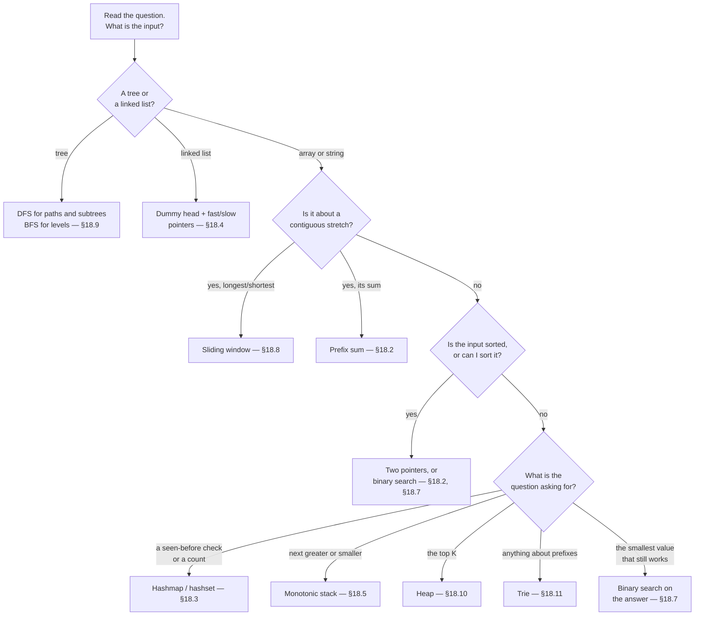
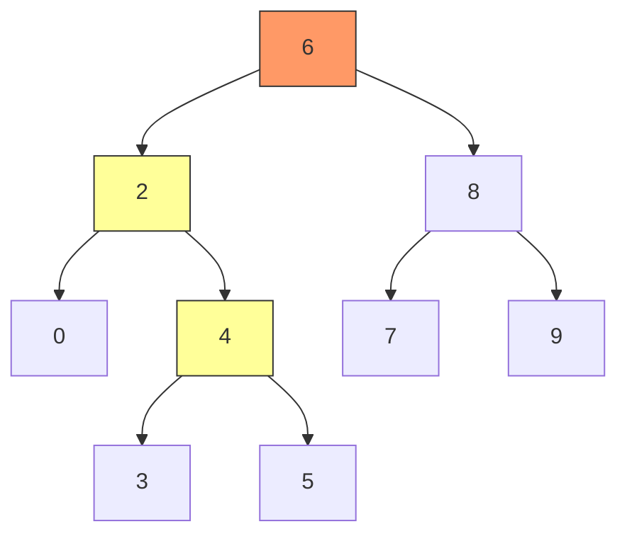

# DSA Foundations & Search — Google Interview Guide (Java)

> "The secret to solving interview problems fast: recognise the pattern in the first 30 seconds."

**What this chapter covers:** The nine templates that solve the overwhelming majority of Google's easy/medium coding rounds — two pointers, prefix sums, hashmaps, sliding windows, monotonic stacks, binary search, tree traversal, heaps and tries. Every pattern is taught the same way: *the problem, why the obvious answer is too slow, the one idea that fixes it, a dry run you can follow with your finger, then the Java.* Chapter 1 of the 4-part DSA sequence (31 / 31b / 31c / 31d); section numbers (§18.1 onward) continue across all four so cross-references stay valid.

---

## Start Here

### Pick a track — you do not have to read all of this

| Track | Time | Read this | Good for |
|-------|------|-----------|----------|
| **Speed run** | ~90 min | This Start Here page, then the **Key idea** + **Dry run** + **Java** of each pattern. Skip every collapsed block and every problem list. | First pass, or a week before the interview |
| **Mastery** | ~4 hr | Everything, plus the first five problems marked ⭐ in each problem list | Real preparation |
| **Refresh** | ~20 min | This page, then jump to the Cheat Sheet at the end | The night before |

### How every pattern is laid out

The same seven lines, every time, so you always know where to look. **Nothing asks you to read code before you know what it does.**

| Line | What it gives you |
|------|-------------------|
| **Problem** | one sentence, plus a tiny example with its answer |
| **Brute force** | the obvious way, and the exact reason it is too slow |
| **Key idea** | the single observation that kills the brute force |
| **Dry run** | that idea happening on the tiny example, one line per step |
| **Java** | the code — read last, when you already know what it will say |
| **Cost** | time and space, one line |
| **Trap** | the mistake that silently produces a wrong answer |

### How to read a dry run

A dry run is the code run by hand on a tiny example, one line per step. Here is one for the easiest problem there is — *find the largest number*:

> **Dry run — `[3, 7, 2, 9]` → `9`**
> *We track:* `best` = the biggest number seen so far.
>
> | Step | Number | Bigger than `best`? | `best` |
> |------|--------|---------------------|--------|
> | 1 | 3 | — (first number) | 3 |
> | 2 | 7 | **yes** | 7 |
> | 3 | 2 | no | 7 |
> | 4 | 9 | **yes** | **9** |
>
> **Why it works:** every number was compared with `best`, so nothing bigger was missed.

| Part | What it tells you |
|------|-------------------|
| **Title** | the input, and the answer |
| *We track* | what the variables mean, in plain words |
| **Steps** | one line each; **bold** marks the choice that was taken |
| **Why it works** | one sentence on why the last step gives the answer |

Arrays, lists, windows and pointers are drawn as **pictures** instead (letters under the numbers mark where each pointer is); code that calls itself is drawn as a **call tree**.

### The nine templates


| # | When the question says… | Reach for | Cost | Section |
|---|--------------------------|-----------|------|---------|
| 1 | sorted array, find a pair | Two pointers, converging | O(n) | §18.2 |
| 2 | remove / move / compact in place | Two pointers, same direction | O(n) | §18.2 |
| 3 | sum or count over a range | Prefix sum | O(n) | §18.2 |
| 4 | "have I seen this before?" | Hashmap / hashset | O(n) | §18.3 |
| 5 | longest / shortest **contiguous** run | Sliding window | O(n) | §18.8 |
| 6 | next greater, next smaller, brackets | Monotonic stack | O(n) | §18.5 |
| 7 | sorted input, **or** "smallest value that still works" | Binary search | O(log n) | §18.7 |
| 8 | top K, K closest, running median | Heap | O(n log k) | §18.10 |
| 9 | prefix, autocomplete, dictionary | Trie | O(word length) | §18.11 |

Linked lists (§18.4), sorting (§18.6) and trees (§18.9) are data structures rather than triggers — they show up when the input *is* a list or a tree.

### The 30-second decision, as a flowchart



> **The one habit that matters.** Before writing anything, say out loud: *"This is a &lt;template&gt; problem, it will cost O(…), and the thing I have to be careful about is …"* Interviewers score the recognition, not the typing.

---

## Table of Contents

| Part | Topic | Sections |
|------|-------|----------|
| 1 | Foundations | §18.1–18.6: Big-O, Arrays, Hashmaps, Linked Lists, Stacks, Sorting |
| 2 | Search & Trees | §18.7–18.11: Binary Search, Sliding Window, Trees, Heaps, Tries |
| — | Revision | Cheat sheet, 20-minute refresh, spaced-repetition plan (unnumbered, at the end) |

**Continues in:** [31b — Graphs](#content/31b_dsa_graphs) → [31c — Dynamic Programming](#content/31c_dynamic_programming) → [31d — Advanced Patterns & ML Coding](#content/31d_dsa_advanced_ml_coding)

---

# PART 1: FOUNDATIONS

---

## 18.1 Big-O Complexity

**Simple explanation.** Big-O answers one question: *when the input gets bigger, how much worse does this get?* It ignores constants and hardware and keeps only the growth shape — because at n = 1,000,000 the shape is the only thing that matters.

You need it for two practical reasons, both worth marks: the interviewer expects every answer to end with "this is O(…) time and O(…) space", and the constraint in the question ("n up to 100,000") silently tells you which pattern is allowed.


### The ladder

```
FAST ◄──────────────────────────────────────────────► SLOW

O(1)  O(log n)  O(n)  O(n log n)  O(n^2)  O(2^n)  O(n!)
 │       │        │       │          │       │       │
hash   binary   single  merge     nested  subsets  permu-
lookup  search   loop    sort      loops           tations
```

| Complexity | n=10 | n=100 | n=1,000 | n=1,000,000 | Typical Use |
|-----------|------|-------|---------|-------------|-------------|
| O(1) | 1 | 1 | 1 | 1 | Hash lookup, array index |
| O(log n) | 3 | 7 | 10 | 20 | Binary search |
| O(n) | 10 | 100 | 1,000 | 1,000,000 | Single scan |
| O(n log n) | 33 | 664 | 9,966 | 19,931,568 | Merge sort |
| O(n^2) | 100 | 10,000 | 1,000,000 | 10^12 — too slow | Nested loops |
| O(2^n) | 1,024 | 10^30 | -- | -- | Subsets |
| O(n!) | 3.6M | -- | -- | -- | Permutations |

Read the O(n^2) row twice. At n = 1,000 it is a million steps and instant; at n = 1,000,000 it is 10^12 and your solution never returns. Same code, same complexity — only the constraint changed.

### Will my solution time out? The 10^8 rule

A judge (and an interviewer's patience) runs roughly **10^8 simple operations per second**. Work backwards from the constraint:

| n (input size) | Slowest shape you can still use | So reach for |
|---------------|--------------------------------|--------------|
| n ≤ 10 | O(n!) | brute force, permutations |
| n ≤ 20 | O(2^n) | subsets, backtracking, bitmask |
| n ≤ 500 | O(n^3) | triple loop, interval DP |
| n ≤ 10,000 | O(n^2) | nested loops are fine |
| n ≤ 1,000,000 | O(n log n) | sort, heap, binary search |
| n ≤ 100,000,000 | O(n) | one pass: two pointers, window, hashmap |
| n > 10^8 | O(log n) or O(1) | binary search, maths |

> **Use it in reverse, out loud.** "n is 100,000, so O(n^2) is 10^10 and dies — I need O(n) or O(n log n). Sorting is allowed. Let me look for a one-pass or sort-based idea." That sentence is half the solution and it takes five seconds.

### Amortised: the occasional expensive step that does not count

`ArrayList.add()` is O(1) almost always, but when the backing array fills it doubles and copies everything — that one add is O(n). Spread over the n adds that had to happen first, it averages out to **amortised O(1)**. Same argument makes the monotonic stack (§18.5) and the sliding window (§18.8) O(n) even though they contain inner loops.

### Three traps that cost real marks

> **Trap — the hidden O(n) inside a loop.** `s += c` in Java builds a whole new String every time, turning an innocent loop into O(n^2). Use `StringBuilder`. The same goes for `list.remove(0)` on an `ArrayList` and `list.contains()` inside a loop.

> **Trap — recursion is not free space.** Recursion `d` levels deep holds `d` stack frames, so a DFS on a 100,000-node skewed tree is O(n) space and can genuinely StackOverflow. For trees, say "O(h) stack space", where `h` is the tree's height.

> **Trap — quoting the average as though it were the worst.** HashMap is O(1) *average*, O(n) worst. Quicksort is O(n log n) *average*, O(n^2) worst. Name both; interviewers listen for it.

---

## 18.2 Arrays & Strings

**Simple explanation.** An array is a row of numbered boxes you can open instantly by number. Almost every array trick is the same trick: *stop looking at pairs, and instead walk the row once while remembering something.* What you remember — a second position, a running total, a best-so-far — is what names the pattern.

At least 40% of interview problems are array or string problems, and strings in Java are arrays wearing a coat (`s.toCharArray()` whenever you need to change one).


### Pattern 1: Two Pointers (Converging)

![Two pointers infographic: sorted [2, 7, 11, 15], target 9 — move the right pointer in while the sum is too big → indices [0, 1]](diagrams/dsa31_info_twoptr_ai.png)

<details>
<summary><strong>Read as text</strong> — problem, key idea, dry run and trap</summary>

**Problem.** A **sorted** array and a target. Find the two values that add up to the target. `[2, 7, 11, 15]`, target `9` → indices `[0, 1]` (0-based here; the linked LeetCode version counts from 1, so it expects `[1, 2]`).

**Brute force.** Try every pair — O(n^2). At n = 100,000 that is 10^10 operations, far past the 10^8 budget.

**Key idea.** Put `left` on the smallest value and `right` on the largest, then compare their sum with the target. **Too big?** `left` already holds the smallest value still in play, so `nums[right]` is too big with *every* possible partner — drop it with `right--`. **Too small?** `right` already holds the largest value still in play, so `nums[left]` is too small with every possible partner — drop it with `left++`. Each step throws away one value that provably cannot be in the answer, so one pass is enough. *Sorted order is the entire reason this is safe.*

**Dry run — `[2, 7, 11, 15]`, target `9` → `[0, 1]`**
*We track:* `L` = left pointer, `R` = right pointer, `x` = ruled out.

```
position     0   1   2   3
value        2   7  11  15

step 1       L           R    2 + 15 = 17  too big → 15 can't pair with anything; R moves left
step 2       L       R   x    2 + 11 = 13  too big → same for 11; R moves left
step 3       L   R   x   x    2 +  7 =  9  match   → answer [0, 1]
```

**Why it works:** every step rules out one number that can't be in the answer, so the real pair is never skipped.

**Cost.** O(n) time — the two pointers together move n steps. O(1) space.

</details>

**Java — two-sum on a sorted array:**

```java
import java.util.*;

public class TwoSumSorted {
    // Two-sum on sorted array — O(n) time, O(1) space
    public int[] twoSumSorted(int[] nums, int target) {
        int left = 0, right = nums.length - 1;
        while (left < right) {                       // < , not <= : an element can't pair with itself
            int sum = nums[left] + nums[right];
            if (sum == target) return new int[]{left, right};
            else if (sum < target) left++;           // need a bigger sum
            else right--;                            // need a smaller sum
        }
        return new int[]{-1, -1};
    }

    public static void main(String[] args) {
        TwoSumSorted s = new TwoSumSorted();
        int[][] nums = { {2, 7, 11, 15}, {-3, -1, 0, 2, 4}, {3, 3}, {1, 2, 3} };
        int[] targets = { 9, 1, 6, 10 };
        for (int i = 0; i < nums.length; i++) {
            int[] pair = s.twoSumSorted(nums[i], targets[i]);
            System.out.println(Arrays.toString(nums[i]) + ", target " + targets[i] + " -> "
                    + Arrays.toString(pair));
        }
    }
}
```

**Output:**
```
[2, 7, 11, 15], target 9 -> [0, 1]
[-3, -1, 0, 2, 4], target 1 -> [0, 4]
[3, 3], target 6 -> [0, 1]
[1, 2, 3], target 10 -> [-1, -1]
```

> **Trap:** `while (left < right)`, never `<=`. With `<=` the pointers can land on the same element and you return a "pair" that is one number used twice.

**Same shape, different question — Container With Most Water.** Water held = `min(height[left], height[right]) × width`. Moving the **taller** wall inward can never help: the shorter wall still caps the height and the width just shrank. So always move the shorter wall — the only move that could possibly improve things.

**Problem:** Each number in `height` is a vertical wall, one unit apart from the next. Pick the two walls that hold the most water between them and return that amount.

**Example:**
```
Input:  height = [1, 8, 6, 2, 5, 4, 8, 3, 7]
Output: 49        (walls at index 1 and 8: min(8, 7) x 7)
```

**Walk-through:** start with the widest pair, then always move the shorter wall (on a tie the code moves `right`).
```
index        0  1  2  3  4  5  6  7  8
height       1  8  6  2  5  4  8  3  7

left  right  water                 maxWater   move
 0     8     min(1, 7) x 8 =  8        8      1 < 7      -> left++
 1     8     min(8, 7) x 7 = 49       49      7 shorter  -> right--
 1     7     min(8, 3) x 6 = 18       49      3 shorter  -> right--
 1     6     min(8, 8) x 5 = 40       49      tie        -> right--
 1     5     min(8, 4) x 4 = 16       49      4 shorter  -> right--
 1     4     min(8, 5) x 3 = 15       49      5 shorter  -> right--
 1     3     min(8, 2) x 2 =  4       49      2 shorter  -> right--
 1     2     min(8, 6) x 1 =  6       49      6 shorter  -> right--
 1     1     left == right -> stop, return 49
```

**Approach:** Converging two pointers (Pattern 1), starting from the widest pair. Each step drops the shorter wall, which (as shown above) cannot be part of any bigger container, so one O(n) pass never skips the best pair.

**Java — container with most water:**

```java
import java.util.*;

public class ContainerWithMostWater {
    // Container with most water — O(n) time, O(1) space
    public int maxArea(int[] height) {
        int left = 0, right = height.length - 1, maxWater = 0;
        while (left < right) {
            int water = Math.min(height[left], height[right]) * (right - left);
            maxWater = Math.max(maxWater, water);
            if (height[left] < height[right]) left++;   // move the shorter wall
            else right--;
        }
        return maxWater;
    }
    // height = [1,8,6,2,5,4,8,3,7] → 49, between index 1 and 8: min(8,7) * 7

    public static void main(String[] args) {
        ContainerWithMostWater s = new ContainerWithMostWater();
        int[][] tests = { {1, 8, 6, 2, 5, 4, 8, 3, 7}, {1, 1}, {4, 3, 2, 1, 4}, {5} };
        for (int[] height : tests)
            System.out.println(Arrays.toString(height) + " -> " + s.maxArea(height));
    }
}
```

**Output:**
```
[1, 8, 6, 2, 5, 4, 8, 3, 7] -> 49
[1, 1] -> 1
[4, 3, 2, 1, 4] -> 16
[5] -> 0
```

**Practice:** [Two Sum II — Input Array Is Sorted →](#dsa-problem-two-sum-ii-sorted) · [Container With Most Water →](#dsa-problem-container-with-most-water)

### Pattern 2: Two Pointers (Same Direction)

![Same-direction two pointers infographic: a reader R scans every number and a writer W copies only new values forward to remove duplicates in place from [1, 1, 2, 2, 3] → 3 unique values](diagrams/dsa31_info_samedir_ai.png)

<details>
<summary><strong>Read as text</strong> — problem, key idea, dry run and trap</summary>

**Problem.** A sorted array with duplicates. Delete the duplicates **in place** and return how many unique values remain. `[1, 1, 2, 2, 3]` → `3`, with the array starting `[1, 2, 3, …]`.

**Brute force.** Copy the uniques into a new array or a `LinkedHashSet` — O(n) extra space, and the question explicitly forbids it.

**Key idea.** Give the two pointers *jobs* rather than positions. A **reader** visits every element in turn. A **writer** marks the last slot of the finished answer. The reader always moves; the writer only moves when the reader finds something new, and then the new value is copied back onto the writer's slot. Everything at or before `write` is permanently correct.

**Dry run — `[1, 1, 2, 2, 3]` → `3`**
*We track:* `W` = writer (the last unique value kept so far), `R` = reader.

```
             1   1   2   2   3
step 1       W   R                R's 1 = W's 1  → duplicate, R moves on
             1   1   2   2   3
step 2       W       R            R's 2 is new   → W moves right, copy 2 there
             1   2   2   2   3
step 3           W       R        R's 2 = W's 2  → duplicate, R moves on
             1   2   2   2   3
step 4           W           R    R's 3 is new   → W moves right, copy 3 there
             1   2   3   2   3
done                 W            R is finished  → unique count = W's position + 1 = 3
```

**Why it works:** the reader looks at every number once, and only new values are copied to the front.

**Cost.** O(n) time, O(1) space.

> **Trap:** return `write + 1`, not `write`. `write` is the last written *index*; the count is one more. The same off-by-one appears in Move Zeroes and Remove Element.

</details>

```java
import java.util.*;

public class RemoveDuplicates {
    // Remove duplicates from sorted array — O(n) time, O(1) space
    public int removeDuplicates(int[] nums) {
        if (nums.length == 0) return 0;
        int write = 0;
        for (int read = 1; read < nums.length; read++) {
            if (nums[read] != nums[write]) {
                nums[++write] = nums[read];              // advance first, then write
            }
        }
        return write + 1;                                // a count, not an index
    }

    public static void main(String[] args) {
        RemoveDuplicates s = new RemoveDuplicates();
        int[][] tests = { {1, 1, 2, 2, 3}, {}, {7}, {0, 0, 0, 0} };
        for (int[] nums : tests) {
            String input = Arrays.toString(nums);
            int k = s.removeDuplicates(nums);
            System.out.println(input + " -> " + k + ", array starts "
                    + Arrays.toString(Arrays.copyOf(nums, k)));
        }
    }
}
```

**Output:**
```
[1, 1, 2, 2, 3] -> 3, array starts [1, 2, 3]
[] -> 0, array starts []
[7] -> 1, array starts [7]
[0, 0, 0, 0] -> 1, array starts [0]
```

**Practice:** [Remove Duplicates from Sorted Array →](#dsa-problem-remove-duplicates-sorted-array)

### Pattern 3: Prefix Sum

![Prefix sum infographic: count the subarrays of [1, 1, 1] that add up to k = 2, using running totals and a hashmap → 2](diagrams/dsa31_info_prefix_ai.png)

<details>
<summary><strong>Read as text</strong> — problem, key idea, dry run and trap</summary>

**Problem.** How many **subarrays** — unbroken stretches — of `nums` add up to exactly `k`? `[1, 1, 1]`, `k = 2` → `2` (the first two 1s, and the last two). The tool behind it — a prefix sum — answers any sum-over-a-range question with a single subtraction.

**Brute force.** For every start, walk every end and keep a running sum — O(n^2). Fine at n = 1,000, dead at n = 100,000.

**Step 1 — the tool: running totals.** Add the numbers up **once**, front to back, and write down the total so far. Call it `prefix`, where `prefix[i]` = the sum of the **first `i` numbers**. So `prefix[0] = 0` (nothing added yet), and `prefix` is one box longer than `nums`.


| i | 0 | 1 | 2 | 3 | 4 | 5 | 6 |
|---|---|---|---|---|---|---|---|
| `nums[i]` | 3 | 1 | 4 | 1 | 5 | 9 | |
| `prefix[i]` — sum of the first `i` numbers | 0 | 3 | 4 | 8 | 9 | 14 | 23 |

Now the sum of any stretch is one subtraction. Sum of positions 1 to 3 = `1 + 4 + 1` = **6**. With the table: (first 4 numbers) − (first 1 number) = `prefix[4] − prefix[1]` = `9 − 3` = **6** ✓. In general:

> sum of positions `i` to `j` = `prefix[j + 1] − prefix[i]`  *(the `+ 1` is because `prefix` starts with the extra 0)*

**Step 2 — the twist: count the stretches that add up to `k`.** Walk left to right keeping `sum` = the running total so far. A stretch that **ends here** adds up to `k` exactly when some **earlier** running total was `sum − k` — because (total now) − (total then) = `k`. So keep a hashmap `seen`: running total → how many times it has appeared. At each step add `seen[sum − k]` to the answer. One pass, O(n).

**Dry run — `[1, 1, 1]`, `k = 2` → `2`**
*We track:* the running total, and every running total seen so far (starting with 0).

| Number | Running total | Look for an earlier total of (total − 2) | Result |
|--------|---------------|------------------------------------------|--------|
| (start) | 0 | — | remember 0 |
| 1 | 1 | −1 | not seen → count stays 0 |
| 1 | 2 | 0 | **seen once** → found `[1, 1]` at positions 0–1 → count **1** |
| 1 | 3 | 1 | **seen once** → found `[1, 1]` at positions 1–2 → count **2** |

**Why it works:** every stretch ends at some number, and at each number we counted every start that makes the sum `k`.

**Cost.** O(n) time, O(n) space.

> **Trap:** forgetting `seen.put(0, 1)`. Without it every stretch that starts at position 0 is missed — and the bug is invisible on most test cases.

</details>

```java
import java.util.*;

public class SubarraySumEqualsK {
    // Subarray sum equals K — O(n) time, O(n) space
    public int subarraySum(int[] nums, int k) {
        Map<Integer, Integer> seen = new HashMap<>();   // running total → how many times seen
        seen.put(0, 1);                                 // the starting total 0, before any number
        int sum = 0, count = 0;
        for (int num : nums) {
            sum += num;
            count += seen.getOrDefault(sum - k, 0);
            seen.merge(sum, 1, Integer::sum);
        }
        return count;
    }

    public static void main(String[] args) {
        SubarraySumEqualsK s = new SubarraySumEqualsK();
        int[][] nums = { {1, 1, 1}, {1, 2, 3}, {1, -1, 0}, {5} };
        int[] ks = { 2, 3, 0, 3 };
        for (int i = 0; i < nums.length; i++)
            System.out.println(Arrays.toString(nums[i]) + ", k = " + ks[i] + " -> "
                    + s.subarraySum(nums[i], ks[i]));
    }
}
```

**Output:**
```
[1, 1, 1], k = 2 -> 2
[1, 2, 3], k = 3 -> 2
[1, -1, 0], k = 0 -> 3
[5], k = 3 -> 0
```

> **When to reach for it:** the question mentions a sum or a count over a range, *especially* repeatedly. If you catch yourself writing a nested loop that re-adds overlapping elements, stop and build a prefix array.

**Practice:** [Subarray Sum Equals K →](#dsa-problem-subarray-sum-equals-k)

### Pattern 4: Kadane's Algorithm (Maximum Subarray)

![Kadane's algorithm infographic: at each number either extend the current run or start fresh, keeping the best sum seen; [-2, 1, -3, 4, -1, 2] → 5 (the run [4, -1, 2])](diagrams/dsa31_info_kadane_ai.png)

<details>
<summary><strong>Read as text</strong> — problem, key idea, dry run and trap</summary>

**Problem.** Find the largest sum of any contiguous run. `[-2, 1, -3, 4, -1, 2]` → `5` (the run `[4, -1, 2]`).

**Brute force.** Try every start and end — O(n^2).

**Key idea.** Walk the array once and, at each position, answer exactly one question: *is the best run that ends **here** made by extending the previous run, or by starting fresh at me?* If the previous running sum is negative it can only hurt, so you drop it. Keep `best` separately, because the best run may have ended long ago.

**Dry run — `[-2, 1, -3, 4, -1, 2]` → `5`**
*We track:* "run here" = the best sum of a run that ends at this number; "best" = the best run anywhere so far.

| Number | Extend the run, or start fresh? | Run here | Best |
|--------|---------------------------------|----------|------|
| -2 | first number | -2 | -2 |
| 1 | extend −2 + 1 = −1, or fresh **1** | 1 | 1 |
| -3 | extend **1 − 3 = −2**, or fresh −3 | -2 | 1 |
| 4 | extend −2 + 4 = 2, or fresh **4** | 4 | 4 |
| -1 | extend **4 − 1 = 3**, or fresh −1 | 3 | 4 |
| 2 | extend **3 + 2 = 5**, or fresh 2 | 5 | **5** |

**Why it works:** every run ends at some number, and we found the best run for every possible ending.

**Cost.** O(n) time, O(1) space.

> **Trap:** initialising `best = 0`. On an all-negative array like `[-3, -1, -2]` that returns 0 — a subarray that does not exist. Start both variables at `nums[0]`.

</details>

```java
import java.util.*;

public class MaximumSubarray {
    // Kadane's — O(n) time, O(1) space
    public int maxSubArray(int[] nums) {
        int current = nums[0], best = nums[0];       // NOT 0 — see the trap
        for (int i = 1; i < nums.length; i++) {
            current = Math.max(nums[i], current + nums[i]);
            best = Math.max(best, current);
        }
        return best;
    }

    public static void main(String[] args) {
        MaximumSubarray s = new MaximumSubarray();
        int[][] tests = { {-2, 1, -3, 4, -1, 2}, {-3, -1, -2}, {7}, {5, 4, -1, 7, 8} };
        for (int[] nums : tests)
            System.out.println(Arrays.toString(nums) + " -> " + s.maxSubArray(nums));
    }
}
```

**Output:**
```
[-2, 1, -3, 4, -1, 2] -> 5
[-3, -1, -2] -> -1
[7] -> 7
[5, 4, -1, 7, 8] -> 23
```

**Practice:** [Maximum Subarray (Kadane's Algorithm) →](#dsa-problem-maximum-subarray)

### Pattern 5: Dutch National Flag (Three-Way Partition)

![Dutch National Flag infographic: pointers L, M and H sort an array of 0s, 1s and 2s in one pass by swapping 0s to the front and 2s to the back; [2, 0, 2, 1, 1, 0] → [0, 0, 1, 1, 2, 2]](diagrams/dsa31_info_dnf_ai.png)

<details>
<summary><strong>Read as text</strong> — problem, key idea, dry run and trap</summary>

**Problem.** An array containing only `0`, `1` and `2`. Sort it **in one pass, in place**. `[2, 0, 2, 1, 1, 0]` → `[0, 0, 1, 1, 2, 2]`.

**Brute force.** `Arrays.sort()` is O(n log n) and ignores the structure; counting the three values and overwriting works but takes two passes. The interviewer wants one.

**Key idea.** Grow three regions at once: `0`s at the front, `2`s at the back, and a scanner in between. `low` marks the end of the `0`s, `high` marks the start of the `2`s, and `mid` is the value you are currently looking at. Sending a value to the front is safe because it came from already-scanned territory — but a value swapped in **from the back has never been looked at**, so `mid` must stay put and re-examine it.

**Dry run — `[2, 0, 2, 1, 1, 0]` → `[0, 0, 1, 1, 2, 2]`**
*We track:* `L` = where the next 0 goes, `M` = the number being checked, `H` = where the next 2 goes. Each step shows the array **before** the move.

```
              2    0    2    1    1    0
step 1      L,M                        H    M sees 2 → swap with H, H moves left (M stays: the new 0 is unchecked)
              0    0    2    1    1    2
step 2      L,M                   H         M sees 0 → swap with L; L and M move right
              0    0    2    1    1    2
step 3           L,M              H         M sees 0 → swap with L; L and M move right
              0    0    2    1    1    2
step 4                L,M         H         M sees 2 → swap with H; H moves left
              0    0    1    1    2    2
step 5                L,M    H              M sees 1 → already in place; M moves right
              0    0    1    1    2    2
step 6                  L  M,H              M sees 1 → M moves right
              0    0    1    1    2    2
done                    L    H    M         M is past H → nothing left to check, sorted
```

**Why it works:** everything left of `L` is 0, everything right of `H` is 2, and `M` checks every number in between.

**Cost.** O(n) time, O(1) space, one pass.

> **Trap:** advancing `mid` after the `2`-swap. The value that arrived from the back has never been examined — skip it and 0s get stranded in the middle.

</details>

```java
import java.util.*;

public class SortColors {
    // Sort Colors — O(n) time, O(1) space
    public void sortColors(int[] nums) {
        int low = 0, mid = 0, high = nums.length - 1;
        while (mid <= high) {
            if (nums[mid] == 0) swap(nums, low++, mid++);
            else if (nums[mid] == 1) mid++;
            else swap(nums, mid, high--);      // 2: don't advance mid — the new value is unseen
        }
    }
    private void swap(int[] a, int i, int j) {
        int tmp = a[i]; a[i] = a[j]; a[j] = tmp;
    }

    public static void main(String[] args) {
        SortColors s = new SortColors();
        int[][] tests = { {2, 0, 2, 1, 1, 0}, {2, 0, 1}, {0}, {1, 1, 2, 0, 0} };
        for (int[] nums : tests) {
            String input = Arrays.toString(nums);
            s.sortColors(nums);
            System.out.println(input + " -> " + Arrays.toString(nums));
        }
    }
}
```

**Output:**
```
[2, 0, 2, 1, 1, 0] -> [0, 0, 1, 1, 2, 2]
[2, 0, 1] -> [0, 1, 2]
[0] -> [0]
[1, 1, 2, 0, 0] -> [0, 0, 1, 1, 2]
```

**Practice:** [Sort Colors →](#dsa-problem-sort-colors)

### 60-second recall

<details>
<summary>1. You are given an <strong>unsorted</strong> array and asked for a pair summing to a target. Why is converging two-pointers wrong, and what replaces it?</summary>

Converging pointers rely on sorted order to know which side to move — unsorted, "too big" tells you nothing. Use a hashmap (§18.3) for O(n), or sort first and then use two pointers if you also need O(1) space and don't mind O(n log n).
</details>

<details>
<summary>2. Which two patterns here answer "sum over a range", and how do you choose?</summary>

Prefix sum for **any** subarray sum or count. Kadane for the **maximum** subarray sum specifically. If the question says "at most k" or "contiguous and longest", it is actually a sliding window (§18.8).
</details>

<details>
<summary>3. Subarray or subsequence — why does the word matter so much?</summary>

A **subarray** is contiguous, so windows, prefix sums and two pointers apply. A **subsequence** may skip elements, which almost always means dynamic programming (§18.15 in chapter 31c). Misreading this one word sends you down the wrong chapter.
</details>

### Key Problems — Detailed Solutions

![3Sum infographic: sort the array, fix one number, then use converging two pointers to find a pair that cancels it, skipping repeated values; \[-1, 0, 1, 2, -1, -4\] → \[\[-1, -1, 2\], \[-1, 0, 1\]\]](diagrams/dsa31_info_3sum_ai.png)

<details>
<summary><strong>3Sum</strong> — Medium · read as text and Java</summary>

**Problem:** Given an integer array `nums`, return every triplet `[nums[i], nums[j], nums[k]]` that adds up to `0`, where `i`, `j` and `k` are three **different** positions. Each triplet of values may appear only once in the answer — even if it can be built from different positions. Order does not matter.

**Example:**
```
Input:  nums = [-1, 0, 1, 2, -1, -4]
Output: [[-1, -1, 2], [-1, 0, 1]]
```

**Walk-through:** sort, then fix one number and find a pair that cancels it.
```
sorted: [-4, -1, -1, 0, 1, 2]

fix -4 → need a pair summing to  4 in [-1, -1, 0, 1, 2]  → none (biggest pair is 1 + 2 = 3)
fix -1 → need a pair summing to  1 in [-1, 0, 1, 2]      → (-1, 2) ✓   (0, 1) ✓
fix -1 → same value as the last fix → skip, or we'd find the same triplets again
fix  0 → need a pair summing to  0 in [1, 2]             → none
```

**Approach:** Sort. Fix `nums[i]`, then run converging two pointers (Pattern 1) on the part to its right, looking for a pair that sums to `-nums[i]`. Skip any value equal to the one just before it — at the fixed position and at both pointers — so no triplet is found twice.

**Java:**
```java
import java.util.*;

public class ThreeSum {
    public List<List<Integer>> threeSum(int[] nums) {
        Arrays.sort(nums);
        List<List<Integer>> res = new ArrayList<>();
        for (int i = 0; i < nums.length - 2; i++) {
            if (i > 0 && nums[i] == nums[i - 1]) continue; // skip dup
            int lo = i + 1, hi = nums.length - 1;
            while (lo < hi) {
                int sum = nums[i] + nums[lo] + nums[hi];
                if (sum == 0) {
                    res.add(List.of(nums[i], nums[lo], nums[hi]));
                    while (lo < hi && nums[lo] == nums[lo + 1]) lo++;
                    while (lo < hi && nums[hi] == nums[hi - 1]) hi--;
                    lo++; hi--;
                } else if (sum < 0) lo++;
                else hi--;
            }
        }
        return res;
    }

    public static void main(String[] args) {
        ThreeSum s = new ThreeSum();
        int[][] tests = { {-1, 0, 1, 2, -1, -4}, {0, 0, 0, 0}, {0, 1, 1}, {-2, 0, 1, 1, 2} };
        for (int[] nums : tests) {
            String input = Arrays.toString(nums);      // threeSum sorts nums in place
            System.out.println(input + " -> " + s.threeSum(nums));
        }
    }
}
```

**Output:**
```
[-1, 0, 1, 2, -1, -4] -> [[-1, -1, 2], [-1, 0, 1]]
[0, 0, 0, 0] -> [[0, 0, 0]]
[0, 1, 1] -> []
[-2, 0, 1, 1, 2] -> [[-2, 0, 2], [-2, 1, 1]]
```

**Complexity:** O(n^2) time, O(1) space (excluding output)
</details>

![Product of Array Except Self infographic: each answer is the product of everything on its left times everything on its right, built with a left pass and a right pass and no division; [1, 2, 3, 4] → [24, 12, 8, 6]](diagrams/dsa31_info_product_ai.png)

<details>
<summary><strong>Product of Array Except Self</strong> — Medium · read as text and Java</summary>

**Problem:** Given an integer array `nums`, return an array `answer` where `answer[i]` is the product of every element **except** `nums[i]`. No division allowed, and it must run in O(n).

**Example:**
```
Input:  nums = [1, 2, 3, 4]
Output: [24, 12, 8, 6]          e.g. answer[1] = 1 × 3 × 4 = 12
```

**Walk-through:** "everything except me" = (everything on my left) × (everything on my right).
```
i:              0          1          2          3
nums:           1          2          3          4
left product:   1          1          1·2 = 2    1·2·3 = 6     (1 = nothing on the left)
right product:  2·3·4 = 24 3·4 = 12   4          1             (1 = nothing on the right)
answer:         24         12         8          6             left × right
```

**Approach:** One pass left → right writes each position's left product into `ans`. A second pass right → left multiplies in a running right product. No division, and no extra array.

**Java:**
```java
import java.util.*;

public class ProductOfArrayExceptSelf {
    public int[] productExceptSelf(int[] nums) {
        int n = nums.length;
        int[] ans = new int[n];
        ans[0] = 1;
        for (int i = 1; i < n; i++)
            ans[i] = ans[i - 1] * nums[i - 1];   // prefix product
        int suffix = 1;
        for (int i = n - 1; i >= 0; i--) {
            ans[i] *= suffix;
            suffix *= nums[i];                     // suffix product
        }
        return ans;
    }

    public static void main(String[] args) {
        ProductOfArrayExceptSelf s = new ProductOfArrayExceptSelf();
        int[][] tests = { {1, 2, 3, 4}, {-1, 1, 0, -3, 3}, {0, 0}, {2, 3} };
        for (int[] nums : tests)
            System.out.println(Arrays.toString(nums) + " -> "
                    + Arrays.toString(s.productExceptSelf(nums)));
    }
}
```

**Output:**
```
[1, 2, 3, 4] -> [24, 12, 8, 6]
[-1, 1, 0, -3, 3] -> [0, 0, 9, 0, 0]
[0, 0] -> [0, 0]
[2, 3] -> [3, 2]
```

**Complexity:** O(n) time, O(1) space (output array not counted)
</details>

![Trapping Rain Water infographic: water above each bar is min(tallest left, tallest right) minus its height, settled with two pointers from the shorter side; [0, 1, 0, 2, 1, 0, 1, 3, 2, 1, 2, 1] → 6](diagrams/dsa31_info_rainwater_ai.png)

<details>
<summary><strong>Trapping Rain Water</strong> — Hard · read as text and Java</summary>

**Problem:** Each number is the height of a bar of width 1. After it rains, how many units of water are trapped between the bars?

**Example:**
```
Input:  height = [0, 1, 0, 2, 1, 0, 1, 3, 2, 1, 2, 1]
Output: 6
```

**Walk-through:** `█` = bar, `~` = trapped water. Water above a bar = **min(tallest bar to its left, tallest bar to its right) − its own height**.
```
                       █
           █  ~  ~  ~  █  █  ~  █
     █  ~  █  █  ~  █  █  █  █  █  █
  0  1  2  3  4  5  6  7  8  9 10 11     ← index
  0  0  1  0  1  2  1  0  0  1  0  0     ← water above each bar   (total 6)
```

**Approach:** Two pointers, one at each end, each remembering the tallest bar seen on its side. Always settle the side with the **shorter** bar: the other side is known to have a wall at least that tall, so this bar's water depends only on its own side's tallest bar. Add that water and step inward.

**Java:**
```java
import java.util.*;

public class TrappingRainWater {
    public int trap(int[] height) {
        int l = 0, r = height.length - 1;
        int leftMax = 0, rightMax = 0, water = 0;
        while (l < r) {
            if (height[l] < height[r]) {
                leftMax = Math.max(leftMax, height[l]);
                water += leftMax - height[l];
                l++;
            } else {
                rightMax = Math.max(rightMax, height[r]);
                water += rightMax - height[r];
                r--;
            }
        }
        return water;
    }

    public static void main(String[] args) {
        TrappingRainWater s = new TrappingRainWater();
        int[][] tests = { {0, 1, 0, 2, 1, 0, 1, 3, 2, 1, 2, 1}, {4, 2, 0, 3, 2, 5}, {}, {1, 2, 3} };
        for (int[] height : tests)
            System.out.println(Arrays.toString(height) + " -> " + s.trap(height));
    }
}
```

**Output:**
```
[0, 1, 0, 2, 1, 0, 1, 3, 2, 1, 2, 1] -> 6
[4, 2, 0, 3, 2, 5] -> 9
[] -> 0
[1, 2, 3] -> 0
```

**Complexity:** O(n) time, O(1) space
</details>

### Problem List

**Start with these five:** Two Sum II (Sorted) · Valid Palindrome · Maximum Subarray · Product of Array Except Self · 3Sum. They cover all five patterns above; the rest are variations.

| # | Problem | Difficulty | Pattern | Key Insight |
|---|---------|-----------|---------|-------------|
| 1 | Two Sum II (Sorted) | Easy | Two Ptr (converging) | Sorted -> two pointers |
| 2 | Valid Palindrome | Easy | Two Ptr (converging) | Skip non-alphanumeric |
| 3 | Move Zeroes | Easy | Two Ptr (same dir) | Slow = write position |
| 4 | Remove Duplicates | Easy | Two Ptr (same dir) | Compare slow vs fast |
| 5 | Best Time Buy/Sell Stock | Easy | Kadane variant | Track min price so far |
| 6 | Maximum Subarray | Easy | Kadane | Textbook Kadane's |
| 7 | Running Sum of Array | Easy | Prefix Sum | Direct prefix sum |
| 8 | Merge Sorted Array | Easy | Two Ptr (reverse) | Fill from the end |
| 9 | Container With Most Water | Medium | Two Ptr (converging) | Move shorter side |
| 10 | 3Sum | Medium | Sort + Two Ptr | Fix one, two-ptr rest |
| 11 | Product of Array Except Self | Medium | Prefix/Suffix | Left pass, right pass |
| 12 | Sort Colors | Medium | Dutch National Flag | Three-way partition |
| 13 | Subarray Sum Equals K | Medium | Prefix Sum + Map | Count prefix diffs |
| 14 | Rotate Array | Medium | Reverse trick | Reverse all, then parts |
| 15 | Next Permutation | Medium | Two Ptr + Sort | Find rightmost ascent |
| 16 | Longest Consecutive Sequence | Medium | HashSet | Check if num-1 exists |
| 17 | Trapping Rain Water | Hard | Two Ptr / Stack | Min of left/right max |
| 18 | First Missing Positive | Hard | Cyclic Sort | Place num at index num-1 |
| 19 | Median of Two Sorted Arrays | Hard | Binary Search | Partition both arrays |
| 20 | Minimum Window Substring | Hard | Sliding Window + Map | Covered in 18.8 |

---

## 18.3 Hashmaps & Sets

**Simple explanation.** A hashmap is a coat-check counter. You hand it a key, it computes a ticket number, and it goes straight to that one hook — it never searches the whole rack. That is why lookup, insert and delete are all O(1) on average.

This is the single most useful structure in interviews, and it has one signature use: **whenever a nested loop exists only to answer "have I seen this before?", a hashmap deletes the inner loop** and turns O(n^2) into O(n).


You are expected to be able to explain the mechanism in 30 seconds: hash the key, wrap it onto a bucket, and if two keys share a bucket they form a short chain. Past roughly three-quarters full the table doubles and re-files everything (rare, so inserts stay amortised O(1)); in Java 8+ a chain longer than eight becomes a red-black tree, capping the worst case at O(log n) instead of O(n).

### Pattern 1: Complement Lookup (Two Sum)

![Infographic for Two Sum with a HashMap (complement lookup): for each number, look up target minus number in a 'seen' map before storing it; on nums = [2, 7, 11, 15], target = 9, 2 is stored at index 0, then 7 finds its partner 2 → answer [0, 1]. O(n) time vs O(n²) brute force.](diagrams/dsa31_info_twosum_ai.png)

<details>
<summary><strong>Read as text</strong> — problem, key idea, dry run and trap</summary>

**Problem.** An **unsorted** array and a target. Return the indices of the two values that add to it. `[2, 7, 11, 15]`, target `9` → `[0, 1]`.

**Brute force.** Every pair — O(n^2).

**Key idea.** Turn the question inside out. Instead of hunting for *two* numbers, stand on one number and ask: *"the partner I need is exactly `target - me` — have I already walked past it?"* There is only ever one possible partner, and a hashmap answers "have I seen this" instantly. One pass, no pairs.

**Dry run — `[2, 7, 11, 15]`, target `9` → `[0, 1]`**
*We track:* `seen` = numbers already passed → their position.

| Number (position) | Partner needed | Partner in `seen`? | Action |
|-------------------|----------------|--------------------|--------|
| 2 (0) | 9 − 2 = 7 | no | remember 2 at position 0 |
| 7 (1) | 9 − 7 = 2 | **yes, at position 0** | answer `[0, 1]` |

**Why it works:** for any pair, when we reach the second number, the first one is already in `seen`.

**Cost.** O(n) time, O(n) space — the classic trade: memory buys you the missing loop.

> **Trap:** put the value in the map *after* the check, never before. Store first and `[3, 4]` with target `6` "finds" the pair `(3, 3)` using index 0 twice.

</details>

```java
import java.util.*;

public class TwoSum {
    // Two Sum — O(n) time, O(n) space
    public int[] twoSum(int[] nums, int target) {
        Map<Integer, Integer> seen = new HashMap<>();
        for (int i = 0; i < nums.length; i++) {
            int complement = target - nums[i];
            if (seen.containsKey(complement)) return new int[]{seen.get(complement), i};
            seen.put(nums[i], i);                 // store AFTER checking — see the trap
        }
        return new int[]{-1, -1};
    }

    public static void main(String[] args) {
        TwoSum s = new TwoSum();
        int[][] nums = { {2, 7, 11, 15}, {3, 2, 4}, {3, 3}, {3, 4} };
        int[] targets = { 9, 6, 6, 6 };
        for (int i = 0; i < nums.length; i++)
            System.out.println(Arrays.toString(nums[i]) + ", target " + targets[i] + " -> "
                    + Arrays.toString(s.twoSum(nums[i], targets[i])));
    }
}
```

**Output:**
```
[2, 7, 11, 15], target 9 -> [0, 1]
[3, 2, 4], target 6 -> [1, 2]
[3, 3], target 6 -> [0, 1]
[3, 4], target 6 -> [-1, -1]
```

**Practice:** [Two Sum →](#dsa-problem-two-sum)

### Pattern 2: Frequency Counting


<details>
<summary><strong>Read as text</strong> — problem, key idea, dry run and trap</summary>

**Problem.** Are two strings anagrams of each other? `"abb"`, `"bab"` → `true`.

**Brute force.** Sort both strings and compare — O(n log n). Correct, but beatable.

**Key idea.** An anagram has nothing to do with order, only with **how many of each letter**. So count up for the first string and count down for the second in the same pass; if every counter lands back on zero, both strings have the same letters in the same amounts. For lowercase a–z, a 26-slot array beats a HashMap outright — no hashing, no boxing.

**Dry run — `"abb"` vs `"bab"` → `true`**
*We track:* one counter per letter — +1 when it appears in the first string, −1 when it appears in the second.

| Step | +1 (first string) | −1 (second string) | Counters after |
|------|-------------------|--------------------|----------------|
| 1 | a | b | a = 1, b = −1 |
| 2 | b | a | a = 0, b = 0 |
| 3 | b | b | a = 0, b = 0 |

**Why it works:** every counter ended at zero, so each letter appears equally often in both strings.

**Cost.** O(n) time, O(1) space.

> **Trap:** skipping the length check. Without it the single loop reads past the end of the shorter string, and `int[26]` silently breaks on uppercase or Unicode input — say "I'd switch to a `HashMap<Character, Integer>` if the alphabet isn't fixed" and the interviewer will nod.

</details>

```java
import java.util.*;

public class ValidAnagram {
    // Valid Anagram — O(n) time, O(1) space (26 counters)
    public boolean isAnagram(String s, String t) {
        if (s.length() != t.length()) return false;      // cheap reject, and required
        int[] count = new int[26];
        for (int i = 0; i < s.length(); i++) {
            count[s.charAt(i) - 'a']++;
            count[t.charAt(i) - 'a']--;
        }
        for (int c : count) if (c != 0) return false;
        return true;
    }

    public static void main(String[] args) {
        ValidAnagram s = new ValidAnagram();
        String[][] tests = { {"abb", "bab"}, {"rat", "car"}, {"a", "ab"}, {"", ""} };
        for (String[] t : tests)
            System.out.println("\"" + t[0] + "\", \"" + t[1] + "\" -> " + s.isAnagram(t[0], t[1]));
    }
}
```

**Output:**
```
"abb", "bab" -> true
"rat", "car" -> false
"a", "ab" -> false
"", "" -> true
```

**Practice:** [Valid Anagram →](#dsa-problem-valid-anagram)

### Pattern 3: Group by a Canonical Key

![Infographic for Group Anagrams by a canonical key: each word is sorted into a key (eat, tea, ate → aet; tan, nat → ant; bat → abt) and a HashMap collects words by key; \[eat, tea, tan, ate, nat, bat\] → \[\[eat, tea, ate\], \[tan, nat\], \[bat\]\]. O(n · k log k) vs O(n² · k) brute force.](diagrams/dsa31_info_groupanagrams_ai.png)

<details>
<summary><strong>Read as text</strong> — problem, key idea, dry run and trap</summary>

**Problem.** Group a list of words so anagrams sit together. `["eat", "tea", "tan", "ate", "nat", "bat"]` → `[["eat","tea","ate"], ["tan","nat"], ["bat"]]`.

**Brute force.** Compare every word against every other word — O(n^2) comparisons, each costing O(k) for words of length `k`.

**Key idea.** Stop comparing items to each other. Instead, **transform each item into a key that every member of its group produces and nobody else does** — then the map does the grouping for free. For anagrams that key is the word's letters in sorted order: `eat`, `tea` and `ate` all become `aet`.

```
"eat" → sorted → "aet" → groups["aet"] = ["eat"]
"tea" → sorted → "aet" → groups["aet"] = ["eat", "tea"]
"ate" → sorted → "aet" → groups["aet"] = ["eat", "tea", "ate"]
"bat" → sorted → "abt" → groups["abt"] = ["bat"]           ← a different key, a new group
```

**Dry run — `["eat", "tea", "tan", "ate", "nat", "bat"]` → `[[eat, tea, ate], [bat], [tan, nat]]`**
*We track:* `groups` — sorted key → the words that produced it. The words are taken in input order.

```
word   sorted key   groups["aet"]      groups["ant"]   groups["abt"]
eat    aet          [eat]
tea    aet          [eat, tea]
tan    ant          [eat, tea]         [tan]
ate    aet          [eat, tea, ate]    [tan]
nat    ant          [eat, tea, ate]    [tan, nat]
bat    abt          [eat, tea, ate]    [tan, nat]      [bat]

groups.values() -> [[eat, tea, ate], [bat], [tan, nat]]   (HashMap order, not input order)
```

</details>

```java
import java.util.*;

public class GroupAnagrams {
    // Group Anagrams — O(n * k log k) time, O(n * k) space  (k = word length)
    public List<List<String>> groupAnagrams(String[] strs) {
        Map<String, List<String>> groups = new HashMap<>();
        for (String s : strs) {
            char[] sorted = s.toCharArray();
            Arrays.sort(sorted);
            groups.computeIfAbsent(new String(sorted), k -> new ArrayList<>()).add(s);
        }
        return new ArrayList<>(groups.values());
    }

    public static void main(String[] args) {
        GroupAnagrams s = new GroupAnagrams();
        String[][] tests = { {"eat", "tea", "tan", "ate", "nat", "bat"}, {"a"},
                             {"abc", "bca", "cab"}, {"ab", "cd"} };
        for (String[] strs : tests)
            System.out.println(Arrays.toString(strs) + " -> " + s.groupAnagrams(strs));
    }
}
```

**Output:**
```
[eat, tea, tan, ate, nat, bat] -> [[eat, tea, ate], [bat], [tan, nat]]
[a] -> [[a]]
[abc, bca, cab] -> [[abc, bca, cab]]
[ab, cd] -> [[cd], [ab]]
```

> **Worth saying out loud:** you can drop the `log k` by keying on a 26-length count signature instead of a sorted string — O(n·k). Mentioning the alternative is often worth more than coding it.

**The same idea elsewhere:** group by digit sum, by remainder mod k, by row-pattern in a grid. Whenever the question says "group", "bucket" or "how many identical…", ask *what key makes duplicates collide?*

**Practice:** [Group Anagrams →](#dsa-problem-group-anagrams)

### Pattern 4: Hashmap as the Window's Memory

A map paired with two pointers is the workhorse of substring problems: the map remembers what is inside the window, so the window can be repaired in O(1) instead of rescanned. Taught in full, with a dry run, in **§18.8 Sliding Window**.

### HashSet: Membership Without Order

![Infographic for Longest Consecutive Sequence with a HashSet: put all numbers in a set and only start counting from x when x − 1 is missing; on [100, 4, 200, 1, 3, 2], 100 and 200 start runs of length 1, 4/3/2 are skipped, and 1 walks 2, 3, 4 (5 missing) → answer 4. O(n) vs O(n log n) sort-and-scan.](diagrams/dsa31_info_consecutive_ai.png)

<details>
<summary><strong>Read as text</strong> — problem, key idea, dry run and trap</summary>

**Problem.** Find the longest run of consecutive integers in an **unsorted** array. `[100, 4, 200, 1, 3, 2]` → `4` (the run `1, 2, 3, 4`).

**Brute force.** Sort, then scan for runs — O(n log n). The interviewer will ask for O(n).

**Key idea.** Put everything in a set so "does `x` exist?" is free. Now the trick: **only start counting from a number that begins a run** — that is, a number `x` whose predecessor `x − 1` is missing. Numbers in the middle of a run are skipped entirely, so each run is walked exactly once. The inner `while` loop looks like it makes this O(n^2), but across the whole array it does at most n steps in total.

**Dry run — `[100, 4, 200, 1, 3, 2]` → `4`**

| Number | Is (number − 1) in the set? | Walk up | Run length |
|--------|-----------------------------|---------|------------|
| 100 | 99? no → a run starts here | 101? no | 1 |
| 4 | 3? **yes** → middle of a run, skip | — | — |
| 200 | 199? no → a run starts here | 201? no | 1 |
| 1 | 0? no → a run starts here | 2 ✓ 3 ✓ 4 ✓ 5 ✗ | **4** ← longest |
| 3 | 2? **yes** → skip | — | — |
| 2 | 1? **yes** → skip | — | — |

**Why it works:** every run has exactly one start, and we walked each start to its end exactly once.

**Cost.** O(n) time, O(n) space.

> **Trap:** dropping the `!set.contains(x - 1)` guard. The answer stays correct and the complexity quietly becomes O(n^2) — the exact failure the interviewer is testing for. Also iterate the **set**, not the array, so duplicates don't re-walk the same run.

</details>

```java
import java.util.*;

public class LongestConsecutiveSequence {
    // Longest Consecutive Sequence — O(n) time, O(n) space
    public int longestConsecutive(int[] nums) {
        Set<Integer> set = new HashSet<>();
        for (int x : nums) set.add(x);
        int longest = 0;
        for (int x : set) {
            if (!set.contains(x - 1)) {          // this guard is what keeps it O(n)
                int len = 1;
                while (set.contains(x + len)) len++;
                longest = Math.max(longest, len);
            }
        }
        return longest;
    }

    public static void main(String[] args) {
        LongestConsecutiveSequence s = new LongestConsecutiveSequence();
        int[][] tests = { {100, 4, 200, 1, 3, 2}, {}, {1, 2, 0, 1}, {-1, -3, -2, 5} };
        for (int[] nums : tests)
            System.out.println(Arrays.toString(nums) + " -> " + s.longestConsecutive(nums));
    }
}
```

**Output:**
```
[100, 4, 200, 1, 3, 2] -> 4
[] -> 0
[1, 2, 0, 1] -> 3
[-1, -3, -2, 5] -> 3
```

**Practice:** [Longest Consecutive Sequence →](#dsa-problem-longest-consecutive-sequence)

### 60-second recall

<details>
<summary>1. Your solution is O(n²) because an inner loop searches for something. What is the first thing to try?</summary>

A hashmap or hashset. Ask what the inner loop is really asking — "have I seen X?", "how many X are there?", "which group does X belong to?" — and store exactly that. Memory buys away the loop.
</details>

<details>
<summary>2. When is <code>int[26]</code> better than a <code>HashMap</code>, and when does it bite?</summary>

Better whenever the alphabet is small and fixed (lowercase a–z, digits, DNA bases): no hashing, no autoboxing, and O(1) space. It bites on uppercase, Unicode, or arbitrary keys — then you need the map.
</details>

<details>
<summary>3. Why can a <code>while</code> loop nested inside a <code>for</code> loop still be O(n)?</summary>

Because complexity counts *total* work, not nesting depth. In Longest Consecutive Sequence each value is visited by the inner walk at most once across the whole run. The same argument makes the monotonic stack (§18.5) and the sliding window (§18.8) linear.
</details>

### Java specifics worth memorising

- `map.merge(key, 1, Integer::sum)` — the cleanest increment-a-counter.
- `map.computeIfAbsent(key, k -> new ArrayList<>()).add(v)` — the cleanest group-by.
- `LinkedHashMap` preserves order and, with `accessOrder = true`, gives you an LRU cache almost for free — fine in real code, but in an interview expect to build it by hand (see LRU Cache below).
- **Never use a mutable object (`int[]`, a list you later modify) as a key** — hashing happens on insert, so later mutations make the entry unreachable. Convert to a `String` or an immutable `List`.
- `map.get(missing)` returns `null`; unboxing that into an `int` throws NPE. Use `getOrDefault`.

### Key Problems — Detailed Solutions

![Infographic for designing an LRU Cache with a HashMap (key → list node) plus a doubly linked list with dummy head (oldest side) and tail (newest side): capacity 2, operations put(1,1), put(2,2), get(1) → 1 moves node 1 before tail, put(3,3) removes head.next (key 2) from both the list and the map, get(2) → −1; list after each step (head → tail) is 1; 1, 2; 2, 1; 1, 3; 1, 3 with map keys {1}, {1, 2}, {1, 2}, {1, 3}, {1, 3}. Trap: when evicting head.next, also remove its key from the map. O(1) per get/put, O(capacity) space.](diagrams/dsa31_info_lru_ai.png)

<details>
<summary><strong>LRU Cache</strong> — Medium · read as text and Java</summary>

**Problem:** Build a cache with a fixed capacity. `get(key)` returns the value (or `-1` if missing); `put(key, value)` adds or updates. Both must be O(1). When the cache is full, adding a new key first throws out the **least recently used** key — the one nobody has read or written for the longest time.

**Example:**
```java
LRUCache cache = new LRUCache(2);
cache.put(1, 1); cache.put(2, 2);
cache.get(1);       // returns 1
cache.put(3, 3);    // evicts key 2
cache.get(2);       // returns -1 (not found)
```

**Walk-through:** keys listed oldest-used → newest-used.
```
put(1,1)   [1]
put(2,2)   [1, 2]
get(1)     [2, 1]      returns 1 — reading 1 makes it the newest
put(3,3)   [1, 3]      full, so the oldest (2) is evicted
get(2)     [1, 3]      returns -1 — 2 is gone
```

**Approach:** Use two structures together.

- A **HashMap** `key → node` finds any key in O(1).
- A **doubly linked list** keeps the nodes in order of last use: the oldest sits next to a dummy `head`, the newest next to a dummy `tail`. The dummies mean you never check for `null`.

Each operation is then just a few pointer moves:

- `get(key)`: not in the map → `-1`. Otherwise move its node to the newest end and return the value.
- `put(key, value)`: key exists → update the value and move the node to the newest end. New key → if full, unlink `head.next` (the oldest) **and** remove its key from the map; then add the new node just before `tail`.

Each node stores its own key, so eviction knows which map entry to delete.

> **Shortcut:** in real code, `new LinkedHashMap<>(cap, 0.75f, true)` with `removeEldestEntry` overridden does all of this ([Ch 38 §38.4](#content/38_java_refresher)). Mention it, but interviewers almost always ask you to build the list yourself.

**Java:**
```java
import java.util.*;

public class LruCacheDemo {
    static class LRUCache {
        private static class Node {
            int key, val;                  // key is kept so eviction can delete it from the map
            Node prev, next;
            Node(int key, int val) { this.key = key; this.val = val; }
        }

        private final int capacity;
        private final Map<Integer, Node> map = new HashMap<>();
        private final Node head = new Node(0, 0);   // dummy: oldest side
        private final Node tail = new Node(0, 0);   // dummy: newest side

        public LRUCache(int capacity) {
            this.capacity = capacity;
            head.next = tail;
            tail.prev = head;
        }

        public int get(int key) {
            Node node = map.get(key);
            if (node == null) return -1;
            moveToNewest(node);            // a read counts as a use
            return node.val;
        }

        public void put(int key, int value) {
            Node node = map.get(key);
            if (node != null) {            // existing key: update and refresh
                node.val = value;
                moveToNewest(node);
                return;
            }
            if (map.size() == capacity) {  // full: drop the oldest from list AND map
                Node oldest = head.next;
                unlink(oldest);
                map.remove(oldest.key);
            }
            node = new Node(key, value);
            addNewest(node);
            map.put(key, node);
        }

        private void unlink(Node n) {
            n.prev.next = n.next;
            n.next.prev = n.prev;
        }

        private void addNewest(Node n) {   // insert just before the tail dummy
            n.prev = tail.prev;
            n.next = tail;
            tail.prev.next = n;
            tail.prev = n;
        }

        private void moveToNewest(Node n) {
            unlink(n);
            addNewest(n);
        }

        @Override
        public String toString() {         // oldest -> newest
            StringJoiner sj = new StringJoiner(", ", "{", "}");
            for (Node n = head.next; n != tail; n = n.next) sj.add(n.key + "=" + n.val);
            return sj.toString();
        }
    }

    static void showPut(LRUCache cache, int key, int value) {
        cache.put(key, value);
        System.out.printf("%-13s cache %s%n", "put(" + key + ", " + value + ")", cache);
    }
    static void showGet(LRUCache cache, int key) {
        int value = cache.get(key);
        System.out.printf("%-13s cache %s%n", "get(" + key + ") -> " + value, cache);
    }

    public static void main(String[] args) {
        LRUCache cache = new LRUCache(2);          // printed oldest -> newest
        showPut(cache, 1, 1);
        showPut(cache, 2, 2);
        showGet(cache, 1);                         // 1 becomes the newest
        showPut(cache, 3, 3);                      // full: evicts 2, the least recently used
        showGet(cache, 2);
        showPut(cache, 4, 4);                      // evicts 1
        showGet(cache, 1);
        showGet(cache, 3);
        showGet(cache, 4);
        showPut(cache, 3, 33);                     // existing key: new value, now the newest
    }
}
```

**Output:**
```
put(1, 1)     cache {1=1}
put(2, 2)     cache {1=1, 2=2}
get(1) -> 1   cache {2=2, 1=1}
put(3, 3)     cache {1=1, 3=3}
get(2) -> -1  cache {1=1, 3=3}
put(4, 4)     cache {3=3, 4=4}
get(1) -> -1  cache {3=3, 4=4}
get(3) -> 3   cache {4=4, 3=3}
get(4) -> 4   cache {3=3, 4=4}
put(3, 33)    cache {4=4, 3=33}
```

**Common bugs:** forgetting to remove the evicted key from the map; not refreshing a key on `get`; adding a second node when `put` hits an existing key.

**Complexity:** O(1) time per `get`/`put`, O(capacity) space
</details>

### Problem List

**Start with these five:** Two Sum · Valid Anagram · Group Anagrams · Top K Frequent Elements · Longest Consecutive Sequence.

| # | Problem | Difficulty | Pattern | Key Insight |
|---|---------|-----------|---------|-------------|
| 1 | Two Sum | Easy | Complement lookup | One-pass with map |
| 2 | Valid Anagram | Easy | Frequency count | int[26] is enough |
| 3 | Contains Duplicate | Easy | HashSet | set.add returns false |
| 4 | Ransom Note | Easy | Frequency count | Decrement and check |
| 5 | Intersection of Two Arrays | Easy | Two sets | Retain common elements |
| 6 | Longest Substring No Repeat | Medium | Window + Map | Track last seen index |
| 7 | Group Anagrams | Medium | Group by key | Sorted string as key |
| 8 | Top K Frequent Elements | Medium | Freq map + Heap/Bucket | Bucket sort is O(n) |
| 9 | Subarray Sum Equals K | Medium | Prefix sum + Map | Count prefix diffs |
| 10 | 4Sum II | Medium | Split + Map | Store pair sums |
| 11 | Encode and Decode Strings | Medium | Delimiter design | Length prefix encoding |
| 12 | LRU Cache | Medium | HashMap + doubly linked list | Move to newest on use; evict head.next |
| 13 | Copy List with Random Pointer | Medium | Old->New map | Two-pass cloning |
| 14 | Minimum Window Substring | Hard | Window + Freq map | Maintain "have" vs "need" |
| 15 | Alien Dictionary | Hard | Map + Topo sort | Build graph from words |

---

## 18.4 Linked Lists

**Simple explanation.** A linked list is a treasure hunt. Each node holds a value and the location of the next clue. You cannot jump to the middle — you can only walk from the start. Every linked-list trick exists to work around that one limitation, and nearly all of them are *"use a second pointer."*

```java
public class ListNode {
    int val;
    ListNode next;
    ListNode(int val) { this.val = val; }
    ListNode(int val, ListNode next) { this.val = val; this.next = next; }
}
```

> **Two habits that prevent most linked-list bugs:** draw four nodes on paper before writing anything, and reach for a **dummy head** (`dummy -> head`, return `dummy.next`) the moment the first node might be deleted or replaced. The dummy removes every "but what if it's the head?" special case.

### Pattern 1: Fast & Slow Pointers (Floyd's)


<details>
<summary><strong>Read as text</strong> — problem, key idea, dry run and trap</summary>

**Problem A.** Return the middle node. `1 → 2 → 3 → 4 → 5` → the node `3`.

**Brute force.** Walk once to count the length, then walk again to position `n/2`. Two passes, and it fails if you are only handed a stream.

**Key idea.** Send two walkers at different speeds — one step and two steps. When the fast one falls off the end, it has covered twice the ground, so the slow one is standing exactly halfway. One pass, no counting.


**Dry run — `1 → 2 → 3 → 4 → 5` → node `3`**
*We track:* `S` = slow (1 step at a time), `F` = fast (2 steps at a time).

```
          1 → 2 → 3 → 4 → 5
start     S,F
          1 → 2 → 3 → 4 → 5
step 1        S   F
          1 → 2 → 3 → 4 → 5
step 2            S       F     F can't take two more steps → stop; S is the middle
```

**Why it works:** F always travels twice as far as S, so when F reaches the end, S is halfway.

**Problem B.** Does the list contain a cycle, and where does it start? `1 → 2 → 3 → 4 → 5 → 6 → (back to 3)` → the node `3`.

**Brute force.** Store every visited node in a `HashSet` — O(n) space. It works, and the interviewer will immediately ask for O(1).

**Key idea.** On a straight road the fast walker simply finishes. On a loop it *cannot* finish — so it must eventually lap the slow one. **If they ever stand on the same node, a cycle exists.** Then the second, stranger half: reset one walker to the head, move both at the **same** speed, and they meet exactly at the cycle's entrance.

**Dry run — a cycle back to `3` → node `3`**

```
1 → 2 → 3 → 4 → 5 → 6
        ↑           │
        └───────────┘      6 points back to 3
```

**Part 1 — slow moves 1 step, fast moves 2, until they meet:**

| Step | Slow | Fast | What happens |
|------|------|------|--------------|
| start | 1 | 1 | both at the head |
| 1 | 2 | 3 | |
| 2 | 3 | 5 | |
| 3 | 4 | 3 | fast went 5 → 6 → back to 3 |
| 4 | **5** | **5** | they meet → there **is** a cycle |

**Part 2 — slow goes back to the head; now both move 1 step:**

| Step | Slow | Fast | What happens |
|------|------|------|--------------|
| start | 1 | 5 | |
| 1 | 2 | 6 | |
| 2 | **3** | **3** | they meet again — at the cycle's start |

**Cost.** O(n) time, O(1) space — both phases.

> **Trap:** `while (fast != null && fast.next != null)` in exactly that order. Java short-circuits `&&`, so the null check on `fast` must come first or `fast.next` throws on the last node.

</details>

**Java — find the middle:**

```java
import java.util.*;

public class MiddleOfLinkedList {
    static class ListNode {
        int val;
        ListNode next;
        ListNode(int val) { this.val = val; }
        ListNode(int val, ListNode next) { this.val = val; this.next = next; }
    }

    // Find middle — O(n) time, O(1) space
    public ListNode findMiddle(ListNode head) {
        ListNode slow = head, fast = head;
        while (fast != null && fast.next != null) {   // this order matters — see the trap
            slow = slow.next;
            fast = fast.next.next;
        }
        return slow;
    }

    static ListNode list(int... v) {                  // {1, 2, 3} -> 1 -> 2 -> 3
        ListNode dummy = new ListNode(0), tail = dummy;
        for (int x : v) { tail.next = new ListNode(x); tail = tail.next; }
        return dummy.next;
    }

    public static void main(String[] args) {
        MiddleOfLinkedList s = new MiddleOfLinkedList();
        int[][] tests = { {1, 2, 3, 4, 5}, {1, 2, 3, 4, 5, 6}, {1}, {} };
        for (int[] t : tests) {
            ListNode mid = s.findMiddle(list(t));
            String answer = mid == null ? "null" : "node " + mid.val;
            System.out.println(Arrays.toString(t) + " -> " + answer);
        }
    }
}
```

**Output:**
```
[1, 2, 3, 4, 5] -> node 3
[1, 2, 3, 4, 5, 6] -> node 4
[1] -> node 1
[] -> null
```

**Problem:** Given the head of a linked list, return the node where a cycle begins, or `null` if there is no cycle. Use O(1) extra space (no `HashSet`).

**Example:**
```
Input:  1 -> 2 -> 3 -> 4 -> 5 -> 6, and 6 links back to 3 (index 2)
Output: node 3
```

**Walk-through:** phase 1 proves there is a loop; phase 2 finds its entrance.
```
1 -> 2 -> 3 -> 4 -> 5 -> 6 -> (back to 3)

phase 1: slow moves 1, fast moves 2
  slow:   1   2   3   4   5
  fast:   1   3   5   3   5     slow == fast at node 5 -> a cycle exists
phase 2: slow = head, both move 1
  slow:   1   2   3
  fast:   5   6   3             slow == fast at node 3 -> return node 3
```

**Approach:** Floyd's fast & slow pointers (Pattern 1), in two phases. Phase 2 works because the head and the meeting point are equally far from the entrance, counting any whole extra laps of the loop — here 2 steps each (`1 -> 2 -> 3` and `5 -> 6 -> 3`) — so two pointers moving at the same speed arrive there together.

**Java — where the cycle starts:**

```java
import java.util.*;

public class LinkedListCycleII {
    static class ListNode {
        int val;
        ListNode next;
        ListNode(int val) { this.val = val; }
        ListNode(int val, ListNode next) { this.val = val; this.next = next; }
    }

    // Detect cycle start — O(n) time, O(1) space
    public ListNode detectCycleStart(ListNode head) {
        ListNode slow = head, fast = head;
        while (fast != null && fast.next != null) {
            slow = slow.next;
            fast = fast.next.next;
            if (slow == fast) {                 // phase 1: a cycle exists
                slow = head;                    // phase 2: find where it starts
                while (slow != fast) { slow = slow.next; fast = fast.next; }
                return slow;
            }
        }
        return null;                            // fast reached the end — no cycle
    }

    static ListNode withCycle(int pos, int... v) {    // the tail links back to index pos; -1 = none
        ListNode dummy = new ListNode(0), tail = dummy, entry = null;
        for (int i = 0; i < v.length; i++) {
            tail = tail.next = new ListNode(v[i]);
            if (i == pos) entry = tail;
        }
        tail.next = entry;
        return dummy.next;
    }

    public static void main(String[] args) {
        LinkedListCycleII s = new LinkedListCycleII();
        int[][] tests = { {1, 2, 3, 4, 5, 6}, {1, 2}, {1}, {1, 2, 3} };
        int[] pos = { 2, 0, 0, -1 };
        for (int i = 0; i < tests.length; i++) {
            ListNode start = s.detectCycleStart(withCycle(pos[i], tests[i]));
            String cycle = pos[i] < 0 ? "no cycle" : "tail links back to index " + pos[i];
            System.out.println(Arrays.toString(tests[i]) + ", " + cycle + " -> "
                    + (start == null ? "null" : "node " + start.val));
        }
    }
}
```

**Output:**
```
[1, 2, 3, 4, 5, 6], tail links back to index 2 -> node 3
[1, 2], tail links back to index 0 -> node 1
[1], tail links back to index 0 -> node 1
[1, 2, 3], no cycle -> null
```

**Practice:** [Middle of the Linked List →](#dsa-problem-middle-of-linked-list) · [Linked List Cycle II →](#dsa-problem-linked-list-cycle-ii)

### Pattern 2: Reversal


<details>
<summary><strong>Read as text</strong> — problem, key idea, dry run and trap</summary>

**Problem.** Reverse a singly linked list. `1 → 2 → 3` → `3 → 2 → 1`.

**Brute force.** Push every node onto a stack, or copy the values into a list and rewrite them — O(n) extra space.

**Key idea.** Walk the list once and flip each arrow to point backwards. The catch: the instant you overwrite `curr.next`, the rest of the list becomes unreachable — so **save the next node first**. That is why this needs exactly three references: `prev`, `curr`, and a temporary `next`.

**Dry run — `1 → 2 → 3` → `3 → 2 → 1`**
*We track:* the reversed part (`prev` is its head) and the part still to do (`curr` is its head).

```
            reversed part      still to do
start       (empty)            1 → 2 → 3
step 1      1                  2 → 3          take 1, point it at the reversed part
step 2      2 → 1              3              take 2, point it at 1
step 3      3 → 2 → 1          (empty)        take 3, point it at 2 → done, new head is 3
```

**Why it works:** each step moves one node from "still to do" to the front of "reversed", so when nothing is left, the whole list is reversed.

**Cost.** O(n) time, O(1) space.

> **Trap:** returning `curr`. When the loop ends `curr` is `null`; the new head is `prev`. This is a building block for Reorder List, Palindrome Linked List and Reverse Nodes in k-Group — get it wrong and three problems break.

</details>

```java
import java.util.*;

public class ReverseLinkedList {
    static class ListNode {
        int val;
        ListNode next;
        ListNode(int val) { this.val = val; }
        ListNode(int val, ListNode next) { this.val = val; this.next = next; }
    }

    public ListNode reverseList(ListNode head) {
        ListNode prev = null, curr = head;
        while (curr != null) {
            ListNode next = curr.next;   // save it BEFORE you destroy it
            curr.next = prev;            // flip
            prev = curr;                 // shuffle both forward
            curr = next;
        }
        return prev;                     // NOT curr — curr is null here
    }

    static ListNode list(int... v) {                  // {1, 2, 3} -> 1 -> 2 -> 3
        ListNode dummy = new ListNode(0), tail = dummy;
        for (int x : v) { tail.next = new ListNode(x); tail = tail.next; }
        return dummy.next;
    }

    static String show(ListNode head) {               // prints a list as [1, 2, 3]
        List<Integer> vals = new ArrayList<>();
        for (ListNode n = head; n != null; n = n.next) vals.add(n.val);
        return vals.toString();
    }

    public static void main(String[] args) {
        ReverseLinkedList s = new ReverseLinkedList();
        int[][] tests = { {1, 2, 3}, {}, {7}, {1, 2} };
        for (int[] t : tests)
            System.out.println(Arrays.toString(t) + " -> " + show(s.reverseList(list(t))));
    }
}
```

**Output:**
```
[1, 2, 3] -> [3, 2, 1]
[] -> []
[7] -> [7]
[1, 2] -> [2, 1]
```

**Practice:** [Reverse Linked List →](#dsa-problem-reverse-linked-list)

### Pattern 3: Merge Two Sorted Lists


<details>
<summary><strong>Read as text</strong> — problem, key idea, dry run and trap</summary>

**Problem.** Splice two sorted lists into one sorted list. `1 → 2 → 4` and `1 → 3 → 4` → `1 → 1 → 2 → 3 → 4 → 4`.

**Key idea.** Exactly the merge step of merge sort (§18.6): repeatedly take the smaller of the two heads. The only awkward part is the very first node, because there is no tail to attach to yet — a **dummy head** makes the first attachment look like all the others.

**Dry run — `1 → 2 → 4` and `1 → 3 → 4` → `1 → 1 → 2 → 3 → 4 → 4`**
*We track:* the two heads being compared (on a tie the code takes `l1`, because of `<=`) and the merged list so far.

```
l1: 1 → 2 → 4      l2: 1 → 3 → 4

1 <= 1 → take l1's 1      result: 1
1  < 2 → take l2's 1      result: 1, 1
2  < 3 → take l1's 2      result: 1, 1, 2
3  < 4 → take l2's 3      result: 1, 1, 2, 3
4 <= 4 → take l1's 4      result: 1, 1, 2, 3, 4   ← l1 is now empty
attach whatever remains of l2 in one move          → 1, 1, 2, 3, 4, 4
```

**Cost.** O(n + m) time, O(1) space.

> **Trap:** looping until *both* are empty and appending node by node. The leftover is already sorted — attach it in a single assignment.

</details>

```java
import java.util.*;

public class MergeTwoSortedLists {
    static class ListNode {
        int val;
        ListNode next;
        ListNode(int val) { this.val = val; }
        ListNode(int val, ListNode next) { this.val = val; this.next = next; }
    }

    public ListNode mergeTwoLists(ListNode l1, ListNode l2) {
        ListNode dummy = new ListNode(0), tail = dummy;
        while (l1 != null && l2 != null) {
            if (l1.val <= l2.val) { tail.next = l1; l1 = l1.next; }
            else                  { tail.next = l2; l2 = l2.next; }
            tail = tail.next;
        }
        tail.next = (l1 != null) ? l1 : l2;   // one list is empty; attach the rest of the other
        return dummy.next;
    }

    static ListNode list(int... v) {                  // {1, 2, 3} -> 1 -> 2 -> 3
        ListNode dummy = new ListNode(0), tail = dummy;
        for (int x : v) { tail.next = new ListNode(x); tail = tail.next; }
        return dummy.next;
    }

    static String show(ListNode head) {               // prints a list as [1, 2, 3]
        List<Integer> vals = new ArrayList<>();
        for (ListNode n = head; n != null; n = n.next) vals.add(n.val);
        return vals.toString();
    }

    public static void main(String[] args) {
        MergeTwoSortedLists s = new MergeTwoSortedLists();
        int[][][] tests = { { {1, 2, 4}, {1, 3, 4} }, { {}, {} }, { {}, {0} }, { {5}, {1, 2, 3} } };
        for (int[][] t : tests)
            System.out.println(Arrays.toString(t[0]) + " + " + Arrays.toString(t[1]) + " -> "
                    + show(s.mergeTwoLists(list(t[0]), list(t[1]))));
    }
}
```

**Output:**
```
[1, 2, 4] + [1, 3, 4] -> [1, 1, 2, 3, 4, 4]
[] + [] -> []
[] + [0] -> [0]
[5] + [1, 2, 3] -> [1, 2, 3, 5]
```

**Practice:** [Merge Two Sorted Lists →](#dsa-problem-merge-two-sorted-lists)

### Pattern 4: The Fixed Gap (Remove Nth From End)


<details>
<summary><strong>Read as text</strong> — problem, key idea, dry run and trap</summary>

**Problem.** Delete the nth node counted from the end, in one pass. `1 → 2 → 3 → 4 → 5`, `n = 2` → `1 → 2 → 3 → 5`.

**Brute force.** Count the length, then walk `length − n` nodes. Two passes.

**Key idea.** You cannot count from the end — but you can hold two pointers a **fixed gap apart**. Send the leader `n + 1` nodes ahead; when the leader falls off the end, the follower is sitting exactly one node *before* the target, which is precisely where you need to be in order to unlink it. Starting from a dummy makes deleting the head no different from deleting anything else.

**Dry run — `1 → 2 → 3 → 4 → 5`, `n = 2` → `1 → 2 → 3 → 5`**
*We track:* `D` = dummy (a fake node before the head), `S` = slow, `F` = fast.

```
          D → 1 → 2 → 3 → 4 → 5 → null
gap       S           F                 F starts n + 1 = 3 nodes ahead of S
          D → 1 → 2 → 3 → 4 → 5 → null
step 1        S           F
          D → 1 → 2 → 3 → 4 → 5 → null
step 2            S           F
          D → 1 → 2 → 3 → 4 → 5 → null
step 3                S           F     F is off the end → stop
```

S stopped at `3`, right before `4` (2nd from the end) → `S.next = S.next.next` unlinks it: `1 → 2 → 3 → 5`.

**Why it works:** the gap never changes, so when F is off the end, S is exactly one node before the target.

**Cost.** O(n) time, O(1) space, one pass.

> **Trap:** a gap of `n` instead of `n + 1`. It leaves `slow` **on** the node to delete rather than before it, and a singly linked list gives you no way back.

</details>

```java
import java.util.*;

public class RemoveNthFromEnd {
    static class ListNode {
        int val;
        ListNode next;
        ListNode(int val) { this.val = val; }
        ListNode(int val, ListNode next) { this.val = val; this.next = next; }
    }

    public ListNode removeNthFromEnd(ListNode head, int n) {
        ListNode dummy = new ListNode(0, head);
        ListNode fast = dummy, slow = dummy;
        for (int i = 0; i <= n; i++) fast = fast.next;   // n + 1 steps, not n
        while (fast != null) { fast = fast.next; slow = slow.next; }
        slow.next = slow.next.next;
        return dummy.next;                                // NOT head — head may be gone
    }

    static ListNode list(int... v) {                  // {1, 2, 3} -> 1 -> 2 -> 3
        ListNode dummy = new ListNode(0), tail = dummy;
        for (int x : v) { tail.next = new ListNode(x); tail = tail.next; }
        return dummy.next;
    }

    static String show(ListNode head) {               // prints a list as [1, 2, 3]
        List<Integer> vals = new ArrayList<>();
        for (ListNode n = head; n != null; n = n.next) vals.add(n.val);
        return vals.toString();
    }

    public static void main(String[] args) {
        RemoveNthFromEnd s = new RemoveNthFromEnd();
        int[][] tests = { {1, 2, 3, 4, 5}, {1}, {1, 2}, {1, 2} };
        int[] ns = { 2, 1, 1, 2 };
        for (int i = 0; i < tests.length; i++)
            System.out.println(Arrays.toString(tests[i]) + ", n = " + ns[i] + " -> "
                    + show(s.removeNthFromEnd(list(tests[i]), ns[i])));
    }
}
```

**Output:**
```
[1, 2, 3, 4, 5], n = 2 -> [1, 2, 3, 5]
[1], n = 1 -> []
[1, 2], n = 1 -> [1]
[1, 2], n = 2 -> [2]
```

**Practice:** [Remove Nth Node From End of List →](#dsa-problem-remove-nth-from-end)

### 60-second recall

<details>
<summary>1. When should a dummy head be your reflex?</summary>

Whenever the head itself might be removed, replaced, or is not known until the end — deletions, merges, partitions, and anything that builds a new list. Return `dummy.next`, never the original `head`.
</details>

<details>
<summary>2. The fast pointer meets the slow pointer. Have you found the cycle's start?</summary>

No — only that a cycle exists. They meet somewhere inside it. Reset one pointer to the head, then advance both one step at a time; *that* meeting point is the entrance.
</details>

<details>
<summary>3. Which three linked-list problems are just "reverse a list" in disguise?</summary>

Palindrome Linked List (find middle, reverse the second half, compare), Reorder List (find middle, reverse, interleave), and Reverse Nodes in k-Group (reverse in fixed-size chunks). Master the three-pointer reversal and all three become assembly.
</details>

### Key Problems — Detailed Solutions


<details>
<summary><strong>Reorder List</strong> — Medium · read as text and Java</summary>

**Problem:** Rearrange a linked list **in place** so it goes first, last, second, second-last, third, … Change the links, not the node values.

**Example:**
```
Input:  1 -> 2 -> 3 -> 4 -> 5
Output: 1 -> 5 -> 2 -> 4 -> 3
```

**Walk-through:** three moves you already know.
```
1 -> 2 -> 3 -> 4 -> 5

1. find the middle (fast/slow)   first half: 1 -> 2 -> 3      second half: 4 -> 5
2. reverse the second half                                    5 -> 4
3. take one from each, in turn   1 -> 5 -> 2 -> 4 -> 3
```

**Approach:** Fast/slow pointers to split at the middle (Pattern 1), reverse the second half (Pattern 2), then weave the two halves together one node at a time.

**Java:**
```java
import java.util.*;

public class ReorderList {
    static class ListNode {
        int val;
        ListNode next;
        ListNode(int val) { this.val = val; }
        ListNode(int val, ListNode next) { this.val = val; this.next = next; }
    }

    public void reorderList(ListNode head) {
        if (head == null || head.next == null) return;
        // 1. Find middle
        ListNode slow = head, fast = head;
        while (fast.next != null && fast.next.next != null) {
            slow = slow.next; fast = fast.next.next;
        }
        // 2. Reverse second half
        ListNode prev = null, curr = slow.next;
        slow.next = null;
        while (curr != null) {
            ListNode next = curr.next;
            curr.next = prev; prev = curr; curr = next;
        }
        // 3. Merge two halves
        ListNode first = head, second = prev;
        while (second != null) {
            ListNode tmp1 = first.next, tmp2 = second.next;
            first.next = second; second.next = tmp1;
            first = tmp1; second = tmp2;
        }
    }

    static ListNode list(int... v) {                  // {1, 2, 3} -> 1 -> 2 -> 3
        ListNode dummy = new ListNode(0), tail = dummy;
        for (int x : v) { tail.next = new ListNode(x); tail = tail.next; }
        return dummy.next;
    }

    static String show(ListNode head) {               // prints a list as [1, 2, 3]
        List<Integer> vals = new ArrayList<>();
        for (ListNode n = head; n != null; n = n.next) vals.add(n.val);
        return vals.toString();
    }

    public static void main(String[] args) {
        ReorderList s = new ReorderList();
        int[][] tests = { {1, 2, 3, 4, 5}, {1, 2, 3, 4}, {1, 2}, {1} };
        for (int[] t : tests) {
            ListNode head = list(t);
            s.reorderList(head);
            System.out.println(Arrays.toString(t) + " -> " + show(head));
        }
    }
}
```

**Output:**
```
[1, 2, 3, 4, 5] -> [1, 5, 2, 4, 3]
[1, 2, 3, 4] -> [1, 4, 2, 3]
[1, 2] -> [1, 2]
[1] -> [1]
```

**Complexity:** O(n) time, O(1) space
</details>

### Problem List

**Start with these five:** Reverse Linked List · Merge Two Sorted Lists · Linked List Cycle · Middle of Linked List · Remove Nth From End. The first two are building blocks for half the Medium problems here.

| # | Problem | Difficulty | Pattern | Key Insight |
|---|---------|-----------|---------|-------------|
| 1 | Reverse Linked List | Easy | Reversal | prev, curr, next |
| 2 | Merge Two Sorted Lists | Easy | Merge + Dummy | Dummy head |
| 3 | Linked List Cycle | Easy | Fast/Slow | Fast catches slow |
| 4 | Middle of Linked List | Easy | Fast/Slow | Fast moves 2x |
| 5 | Remove Nth From End | Medium | Two Ptr gap | n+1 gap, dummy |
| 6 | Reorder List | Medium | Split + Rev + Merge | Find mid, reverse 2nd, interleave |
| 7 | Add Two Numbers | Medium | Carry propagation | Digit by digit |
| 8 | Copy List Random Pointer | Medium | HashMap clone | Old->New mapping |
| 9 | Linked List Cycle II | Medium | Floyd's | Reset one ptr to head |
| 10 | Swap Nodes in Pairs | Medium | Pointer juggling | Draw it step by step |
| 11 | Reverse Nodes in k-Group | Hard | k-reversal loop | Count k, reverse, connect |
| 12 | Merge k Sorted Lists | Hard | Min-heap merge | PQ of k heads |

---

## 18.5 Stacks & Queues

**Simple explanation.** A stack is a pile of plates: the last one you put down is the first one you pick up. A queue is a ticket line: first in, first out.

That sounds trivial, and then it quietly solves a whole family of problems — because a stack is the perfect memory for *"the most recent thing that is still unresolved."* The most recent unmatched bracket. The most recent number still waiting for a bigger one. Whenever the answer depends on the nearest thing behind you, it is a stack problem.

### Pattern 1: Monotonic Stack (Next Greater Element)

![Infographic: Monotonic Stack for Next Greater Element. Walking [2, 1, 4, 3, 5] once, a decreasing pile (top on the right) holds numbers still waiting: 2 and 1 wait, 4 pops 1 and 2 (both get 4), 3 waits, 5 pops 3 and 4 (both get 5), and 5 is left with -1, giving [4, 4, 5, 5, -1]. Includes a dry-run table, O(n) vs O(n²) brute force, and the trap of storing values instead of indices.](diagrams/dsa31_info_monostack_ai.png)

<details>
<summary><strong>Read as text</strong> — problem, key idea, dry run and trap</summary>

**Problem.** For each element, find the first **larger** element to its right, or `-1` if there is none. `[2, 1, 4, 3, 5]` → `[4, 4, 5, 5, -1]`.

**Brute force.** For each element scan rightwards until you find something bigger — O(n^2), and it re-scans the same stretch over and over.

**Key idea.** Walk the array once, keeping a pile of elements that are **still waiting for an answer**. Here is the observation that makes it work: if a new arrival is *smaller* than the one on top of the pile, it cannot answer that one either, so it just joins the pile — which means **the pile is always in decreasing order**. When a bigger value arrives, it is the answer for every smaller value on top of the pile, and those leave permanently. Each element joins once and leaves once, so the total work is O(n).


**Dry run — `[2, 1, 4, 3, 5]` → `[4, 4, 5, 5, -1]`**
*We track:* a pile of numbers still waiting for a bigger number (written bottom → top, so the top is on the right).

| Number | Pile before | What happens | Answers so far |
|--------|-------------|--------------|----------------|
| 2 | empty | 2 waits | `[_, _, _, _, _]` |
| 1 | `[2]` | 1 < 2 → 1 waits too | `[_, _, _, _, _]` |
| 4 | `[2, 1]` | 4 > 1 → **1's answer is 4**; 4 > 2 → **2's answer is 4**; 4 waits | `[4, 4, _, _, _]` |
| 3 | `[4]` | 3 < 4 → 3 waits | `[4, 4, _, _, _]` |
| 5 | `[4, 3]` | 5 > 3 → **3's answer is 5**; 5 > 4 → **4's answer is 5**; 5 waits | `[4, 4, 5, 5, _]` |
| (end) | `[5]` | 5 never found a bigger number → −1 | `[4, 4, 5, 5, -1]` |

**Why it works:** a number leaves the pile the moment its first bigger number arrives — and anything still waiting at the end has no bigger number at all.

**Cost.** O(n) time (each index is pushed once and popped once), O(n) space.

> **Trap:** storing values instead of indices. You can always look the value up from the index, but you cannot recover the index from a value — and problems like Daily Temperatures and Largest Rectangle need the *distance*, which is index arithmetic.

</details>

```java
import java.util.*;

public class NextGreaterElement {
    public int[] nextGreaterElement(int[] nums) {
        int n = nums.length;
        int[] result = new int[n];
        Arrays.fill(result, -1);                       // anyone left waiting gets -1
        Deque<Integer> stack = new ArrayDeque<>();     // stores INDICES — see the trap
        for (int i = 0; i < n; i++) {
            while (!stack.isEmpty() && nums[stack.peek()] < nums[i])
                result[stack.pop()] = nums[i];         // this arrival answers them
            stack.push(i);
        }
        return result;
    }

    public static void main(String[] args) {
        NextGreaterElement s = new NextGreaterElement();
        int[][] tests = { {2, 1, 4, 3, 5}, {5, 4, 3}, {1, 1, 2}, {} };
        for (int[] nums : tests)
            System.out.println(Arrays.toString(nums) + " -> "
                    + Arrays.toString(s.nextGreaterElement(nums)));
    }
}
```

**Output:**
```
[2, 1, 4, 3, 5] -> [4, 4, 5, 5, -1]
[5, 4, 3] -> [-1, -1, -1]
[1, 1, 2] -> [2, 2, -1]
[] -> []
```

> **Recogniser:** "next greater", "next smaller", "previous greater", "days until warmer", "largest rectangle", "stock span". All the same stack, only the comparison flips.

**Practice:** [Next Greater Element I →](#dsa-problem-next-greater-element-i)

### Pattern 2: Min Stack

![Infographic: Min Stack with a second minStack whose top is always the current minimum (top on the right). push(-2), push(0), push(-3) gives stack [-2, 0, -3] and minStack [-2, -2, -3], so getMin() is -3. After pop(), top() is 0 and getMin() is -2, restored for free. Includes the chapter's 7-call dry-run table, O(1) per operation vs an O(n) scan, and the trap of pushing to minStack only on a new minimum.](diagrams/dsa31_info_minstack_ai.png)

<details>
<summary><strong>Read as text</strong> — problem, key idea, dry run and trap</summary>

**Problem.** A stack that also reports its minimum — `push`, `pop`, `top` and `getMin` all in O(1). `push(-2), push(0), push(-3), getMin()` → `-3`; then `pop(), getMin()` → `-2`.

**Brute force.** Scan the whole stack on every `getMin` — O(n), and it fails the requirement.

**Key idea.** You cannot recompute the minimum after a pop, so **store it in advance**. Every element records the minimum *as it was when that element was pushed*. Popping then throws away that record too, and the previous minimum is exposed automatically — no recomputation ever happens.

**Dry run — `push(-2), push(0), push(-3), getMin(), pop(), top(), getMin()`**
*We track:* a second stack, `minStack`, whose top is always the current minimum. Stacks are written bottom → top, so the top is on the right.

| Call | stack | minStack | Returns |
|------|-------|----------|---------|
| `push(-2)` | `[-2]` | `[-2]` | — |
| `push(0)` | `[-2, 0]` | `[-2, -2]` | — (0 > -2, so repeat the old min) |
| `push(-3)` | `[-2, 0, -3]` | `[-2, -2, -3]` | — (new minimum) |
| `getMin()` | `[-2, 0, -3]` | `[-2, -2, -3]` | **-3** |
| `pop()` | `[-2, 0]` | `[-2, -2]` | — |
| `top()` | `[-2, 0]` | `[-2, -2]` | **0** |
| `getMin()` | `[-2, 0]` | `[-2, -2]` | **-2** — restored for free |

**Cost.** O(1) per operation, O(n) space.

> **Trap:** pushing to `minStack` only when a new minimum appears. The two stacks then have different heights and every `pop` desynchronises them. Push on *every* push, even if it repeats the value.

</details>

```java
import java.util.*;

public class MinStackDemo {
    static class MinStack {
        private Deque<Integer> stack = new ArrayDeque<>();
        private Deque<Integer> minStack = new ArrayDeque<>();
        public void push(int val) {
            stack.push(val);
            minStack.push(minStack.isEmpty() ? val : Math.min(val, minStack.peek()));
        }
        public void pop() { stack.pop(); minStack.pop(); }   // always both
        public int top() { return stack.peek(); }
        public int getMin() { return minStack.peek(); }
    }

    public static void main(String[] args) {
        MinStack stack = new MinStack();
        stack.push(-2);
        stack.push(0);
        stack.push(-3);
        System.out.println("push(-2), push(0), push(-3)");
        System.out.println("getMin() -> " + stack.getMin());
        stack.pop();
        System.out.println("pop()");
        System.out.println("top() -> " + stack.top());
        System.out.println("getMin() -> " + stack.getMin());
        stack.push(-5);                            // the same minimum twice: one pop must keep it
        stack.push(-5);
        stack.pop();
        System.out.println("push(-5), push(-5), pop()");
        System.out.println("getMin() -> " + stack.getMin());
        stack.pop();
        System.out.println("pop()");
        System.out.println("getMin() -> " + stack.getMin());
    }
}
```

**Output:**
```
push(-2), push(0), push(-3)
getMin() -> -3
pop()
top() -> 0
getMin() -> -2
push(-5), push(-5), pop()
getMin() -> -5
pop()
getMin() -> -2
```

**Practice:** [Min Stack →](#dsa-problem-min-stack)

### Pattern 3: Queue From Two Stacks

![Infographic: a FIFO queue built from two stacks, in and out (top on the right). push(1), push(2) gives in = [1, 2]; peek() finds out empty, so it pours in into out = [2, 1], and the top 1 (the oldest) is returned; pop() returns 1. The dry-run table continues with push(3), pop() → 2, pop() → 3. Shows amortised O(1) (each element moved once) vs O(n) when pouring on every call, plus the trap of transferring when out is not empty.](diagrams/dsa31_info_queue2stacks_ai.png)

<details>
<summary><strong>Read as text</strong> — problem, key idea, dry run and trap</summary>

**Problem.** Build a first-in-first-out queue — `push`, `pop`, `peek`, `empty` — using only two stacks. `push(1), push(2), peek()` → `1`; then `pop()` → `1`.

**Key idea.** A stack reverses order. Reverse it **twice** and you are back to the original order — which is a queue. Pour the input stack into an output stack only when the output stack runs dry, so each element is moved at most once across its whole lifetime: amortised O(1).

**Dry run — `push(1), push(2), peek(), pop()` → `1`, `1`**
*We track:* the two stacks — `in` takes every push, `out` serves `peek` and `pop`.

```
stacks written bottom → top (top on the right)

push(1): in=[1]              out=[]
push(2): in=[1,2]            out=[]
peek():  pour in → out       out=[2,1]  in=[]   → top of out is 1, the oldest  ✓
pop():   out=[2]                                 → returns 1
```

> **Trap:** transferring on every operation instead of only when `out` is empty. That turns an amortised O(1) queue into a genuine O(n) one — and it also scrambles the order.

</details>

```java
import java.util.*;

public class MyQueueDemo {
    static class MyQueue {
        private Deque<Integer> in = new ArrayDeque<>(), out = new ArrayDeque<>();
        public void push(int x) { in.push(x); }
        public int pop()  { transfer(); return out.pop(); }
        public int peek() { transfer(); return out.peek(); }
        public boolean empty() { return in.isEmpty() && out.isEmpty(); }
        private void transfer() { if (out.isEmpty()) while (!in.isEmpty()) out.push(in.pop()); }
    }

    public static void main(String[] args) {
        MyQueue queue = new MyQueue();
        queue.push(1);
        queue.push(2);
        System.out.println("push(1), push(2)");
        System.out.println("peek() -> " + queue.peek());
        System.out.println("pop() -> " + queue.pop());
        System.out.println("empty() -> " + queue.empty());
        queue.push(3);                             // goes to `in` while 2 still waits in `out`
        System.out.println("push(3)");
        System.out.println("pop() -> " + queue.pop());
        System.out.println("pop() -> " + queue.pop());
        System.out.println("empty() -> " + queue.empty());
    }
}
```

**Output:**
```
push(1), push(2)
peek() -> 1
pop() -> 1
empty() -> false
push(3)
pop() -> 2
pop() -> 3
empty() -> true
```

**Practice:** [Implement Queue using Stacks →](#dsa-problem-implement-queue-using-stacks)

### Pattern 4: Bracket Matching

![Infographic: Bracket Matching with a stack (top on the right). For "{\[\]}": push {, push \[, \] matches the top \[ and pops, } matches the top { and pops, and the stack ends empty, so the answer is true. The counter-example "(\[)\]" has matching counts but is false, because ) arrives while the top is \[. Includes a dry-run table, O(n) time and O(n) space, and the trap of checking isEmpty() before popping (")(") and at the end ("(((").](diagrams/dsa31_info_brackets_ai.png)

<details>
<summary><strong>Read as text</strong> — problem, key idea, dry run and trap</summary>

**Problem.** Is a string of brackets valid? `"{[]}"` → `true`, `"([)]"` → `false`.

**Key idea.** A closing bracket must match **the most recent still-open bracket** — which is exactly what sits on top of a stack. Push every opener; on a closer, the top must be its partner.

**Dry run — `"{[]}"` → `true`**

| char | rule | stack after (top on the right) |
|------|------|--------------------------------|
| `{` | opener → push | `[{]` |
| `[` | opener → push | `[{, []` |
| `]` | closer → top is `[` ✓ pop | `[{]` |
| `}` | closer → top is `{` ✓ pop | `[]` |
| end | stack empty → **valid** | — |

*and the counter-example:* `"([)]"` has the same bracket counts as a valid string — but push `(`, push `[`, then `)` arrives and the top is `[`, not `(` → **false**. Only the order is wrong, and only a stack notices.

**Cost.** O(n) time, O(n) space.

> **Trap:** two endings people forget — check `isEmpty()` *before* popping (for input like `")("`), and check `isEmpty()` at the end (for input like `"((("`).

</details>

```java
import java.util.*;

public class ValidParentheses {
    public boolean isValid(String s) {
        Deque<Character> stack = new ArrayDeque<>();
        Map<Character, Character> pairs = Map.of(')', '(', ']', '[', '}', '{');
        for (char c : s.toCharArray()) {
            if (pairs.containsValue(c)) stack.push(c);
            else if (stack.isEmpty() || stack.pop() != pairs.get(c)) return false;
        }
        return stack.isEmpty();     // leftover openers mean "(((" — also invalid
    }

    public static void main(String[] args) {
        ValidParentheses v = new ValidParentheses();
        String[] tests = { "{[]}", "([)]", ")(", "(((" };
        for (String s : tests)
            System.out.println("\"" + s + "\" -> " + v.isValid(s));
    }
}
```

**Output:**
```
"{[]}" -> true
"([)]" -> false
")(" -> false
"(((" -> false
```

**Practice:** [Valid Parentheses →](#dsa-problem-valid-parentheses)

### 60-second recall

<details>
<summary>1. What phrase in a question should make you think "monotonic stack"?</summary>

Anything about the **nearest** element in a direction with a size relation: next greater, previous smaller, days until warmer, largest rectangle, trapping rain water. If you are about to write "scan right until…", it is a monotonic stack.
</details>

<details>
<summary>2. Why is a monotonic stack O(n) when it contains a <code>while</code> loop?</summary>

Because each index is pushed exactly once and popped at most once. The inner loop can be long on one iteration only if it was short on many others — the total across the whole run is bounded by 2n.
</details>

<details>
<summary>3. Which Java class should you use for a stack, and why does it matter?</summary>

`Deque<Integer> stack = new ArrayDeque<>()`. The legacy `Stack` class is synchronised, slower, and iterates in the wrong order. Interviewers do notice.
</details>

### Problem List

**Start with these five:** Valid Parentheses · Min Stack · Daily Temperatures · Next Greater Element I · Eval Reverse Polish Notation.

| # | Problem | Difficulty | Pattern | Key Insight |
|---|---------|-----------|---------|-------------|
| 1 | Valid Parentheses | Easy | Stack matching | Push open, match close |
| 2 | Min Stack | Medium | Two stacks | Track min at each level |
| 3 | Implement Queue using Stacks | Easy | Two stacks | Lazy transfer |
| 4 | Daily Temperatures | Medium | Monotonic stack | Decreasing stack of indices |
| 5 | Next Greater Element I | Easy | Monotonic stack + Map | Build map from NGE |
| 6 | Eval Reverse Polish Notation | Medium | Stack eval | Push nums, pop for ops |
| 7 | Largest Rect in Histogram | Hard | Monotonic stack | Heights + widths from stack |
| 8 | Basic Calculator | Hard | Stack for nested expr | Push state at '(' |
| 9 | Decode String | Medium | Two stacks | Num stack + String stack |
| 10 | Asteroid Collision | Medium | Stack simulation | Push/pop by direction |

---

## 18.6 Sorting

**Simple explanation.** You will almost never be asked to implement a sort — `Arrays.sort()` is the right answer. What you *are* asked is which sort a library uses and why, and to reuse the two ideas hidden inside sorting: the **merge step** (which powers Merge K Sorted Lists and counting inversions) and the **partition step** (which finds the Kth largest in O(n) average time without sorting at all).

> **The habit that matters more than any of this:** "Can I sort first?" should be among your first three thoughts on any array problem. O(n log n) of sorting frequently unlocks a two-pointer, greedy or sweep solution — which beats the O(n^2) you were about to write.

### Which sort, and why

| Algorithm | Time (avg) | Time (worst) | Space | Stable? | Use it when |
|-----------|-----------|-------------|-------|---------|-------------|
| `Arrays.sort()` | O(n log n) | O(n log n) | O(n) | Yes* | Always, unless told otherwise |
| Merge sort | O(n log n) | O(n log n) | O(n) | Yes | Stability matters; linked lists; external data |
| Quick sort | O(n log n) | O(n^2) | O(log n) | No | In-place, cache-friendly, average case |
| Counting sort | O(n + k) | O(n + k) | O(k) | Yes | Values are small integers from 0 to `k` |

\* Java uses dual-pivot quicksort for primitives (unstable, but primitives are indistinguishable so it does not matter) and TimSort for objects (stable). Knowing this one line is worth saying out loud.

**Stable** means equal elements keep their original relative order — which matters the moment you sort by one field after already sorting by another.

```chart
{
  "type": "bar",
  "data": {
    "labels": ["Bubble O(n^2)", "Insertion O(n^2)", "Merge O(n log n)", "Quick O(n log n)", "Counting O(n+k), k = max value", "Radix O(d*n), d = digits"],
    "datasets": [{
      "label": "Relative speed for n=10,000",
      "data": [100000000, 50000000, 132877, 132877, 10000, 40000],
      "backgroundColor": ["#ff6384", "#ff9f40", "#36a2eb", "#4bc0c0", "#9966ff", "#ffcd56"]
    }]
  },
  "options": {
    "indexAxis": "y",
    "scales": { "x": { "type": "logarithmic", "title": { "display": true, "text": "Operations (log scale)" } } },
    "plugins": { "title": { "display": true, "text": "Sorting Algorithm Comparison (n=10,000)" } }
  }
}
```

### Merge Sort — and the merge step you will actually reuse

![Infographic: Merge Sort on [5, 2, 8, 1, 9]. Split into [5, 2, 8] and [1, 9] down to single numbers, then merge back up: [5] + [2] → [2, 5], [2, 5] + [8] → [2, 5, 8], [1] + [9] → [1, 9], and [2, 5, 8] + [1, 9] → [1, 2, 5, 8, 9]. A table walks through the final merge by comparing front numbers (1 vs 2, 2 vs 9, 5 vs 9, 8 vs 9, then the rest of right). Shows O(n log n) always with O(n) extra space vs O(n²) bubble/insertion sort, and the trap of < instead of <= (loses stability).](diagrams/dsa31_info_mergesort_ai.png)

<details>
<summary><strong>Read as text</strong> — problem, key idea, dry run and trap</summary>

**Problem.** Sort an array of integers into ascending order in O(n log n) time, keeping equal values in their original order (a *stable* sort). `[5, 2, 8, 1, 9]` → `[1, 2, 5, 8, 9]`.

**Key idea.** A single element is already sorted. So split until everything is a single element, then **merge sorted pieces back together** — and merging two sorted lists is easy, because the smallest remaining value is always at the front of one of them. All the real work happens on the way back up.

**Dry run — `[5, 2, 8, 1, 9]` → `[1, 2, 5, 8, 9]`**

```
1. Split in half until every piece has one number:

                 [5, 2, 8, 1, 9]
              [5, 2, 8]      [1, 9]
            [5, 2]   [8]    [1]   [9]
           [5]  [2]

2. Merge pieces back together, bottom up:

   [5] + [2]           → [2, 5]
   [2, 5] + [8]        → [2, 5, 8]
   [1] + [9]           → [1, 9]
   [2, 5, 8] + [1, 9]  → [1, 2, 5, 8, 9]

3. How one merge works — compare the two front numbers, take the smaller:

   left [2, 5, 8]   right [1, 9]
   1 vs 2 → take 1          [1]
   2 vs 9 → take 2          [1, 2]
   5 vs 9 → take 5          [1, 2, 5]
   8 vs 9 → take 8          [1, 2, 5, 8]
   left is empty → add the rest of right   [1, 2, 5, 8, 9]
```

**Why it works:** each merge turns two sorted pieces into one sorted piece, so the last merge gives the whole array, sorted.

**Cost.** O(n log n) time always — log n levels, O(n) merging per level. O(n) extra space, which is its one weakness.

> **Trap:** writing `<` instead of `<=` in the merge comparison. It still sorts, but it is no longer stable — and stability is the entire reason to choose merge sort.

</details>

<details>
<summary><strong>Java — merge sort</strong> (worth reading once, rarely worth writing in an interview)</summary>

```java
import java.util.*;

public class MergeSort {
    public void mergeSort(int[] arr, int left, int right) {
        if (left >= right) return;                       // one element: already sorted
        int mid = left + (right - left) / 2;
        mergeSort(arr, left, mid);
        mergeSort(arr, mid + 1, right);
        merge(arr, left, mid, right);
    }

    private void merge(int[] arr, int left, int mid, int right) {
        int[] temp = new int[right - left + 1];
        int i = left, j = mid + 1, k = 0;
        while (i <= mid && j <= right) {
            if (arr[i] <= arr[j]) temp[k++] = arr[i++];  // <= keeps it STABLE
            else                   temp[k++] = arr[j++];
        }
        while (i <= mid)   temp[k++] = arr[i++];
        while (j <= right) temp[k++] = arr[j++];
        System.arraycopy(temp, 0, arr, left, temp.length);
    }

    public static void main(String[] args) {
        MergeSort s = new MergeSort();
        int[][] tests = { {5, 2, 8, 1, 9}, {}, {3, 3, 1, 3}, {-1, 5, -10, 0} };
        for (int[] arr : tests) {
            String input = Arrays.toString(arr);
            s.mergeSort(arr, 0, arr.length - 1);
            System.out.println(input + " -> " + Arrays.toString(arr));
        }
    }
}
```

**Output:**
```
[5, 2, 8, 1, 9] -> [1, 2, 5, 8, 9]
[] -> []
[3, 3, 1, 3] -> [1, 3, 3, 3]
[-1, 5, -10, 0] -> [-10, -1, 0, 5]
```
</details>

**Practice:** [Merge Sort →](#dsa-problem-merge-sort) · [Sort an Array →](#dsa-problem-sort-an-array)

### Quick Sort, Partition, and Quick Select

![Infographic: Lomuto partition and Quick Select. Partitioning [3, 6, 2, 8, 4] with pivot 4: 3 stays left of the divider, 6 is left alone, 2 is swapped into the left zone ([3, 2 | 6, 8]), and the pivot is placed to give [3, 2, 4, 8, 6], with 4 at index 2, its final spot. A Quick Select table for [3, 2, 1, 5, 6, 4], k = 2 (target index 4) shows: partition puts pivot 4 at index 3, so go right; then pivot 5 lands at index 4, so the answer is 5. Shows O(n) average (O(n²) worst) vs O(n log n) sort-first, and the trap that quicksort is O(n²) on sorted input with a bad pivot.](diagrams/dsa31_info_quicksort_ai.png)

<details>
<summary><strong>Read as text</strong> — problem, key idea, dry run and trap</summary>

**Problem.** Two jobs, one tool. Sort an array in place: `[3, 6, 2, 8, 4]` → `[2, 3, 4, 6, 8]`. And find the Kth largest value without sorting everything: `[3, 2, 1, 5, 6, 4]`, `k = 2` → `5`.

**Key idea.** Pick a pivot and **partition**: shuffle everything smaller to its left and everything bigger to its right. The pivot is now in its final sorted position, and you have never compared the two sides to each other. Recurse into both sides and you have quicksort.

**The interview payoff:** if you only want the **Kth largest** element, you do not need both sides. Partition tells you which side the answer is in, so you recurse into **one** — halving the work each time, which averages to O(n) instead of O(n log n).

**Dry run — `[3, 6, 2, 8, 4]`, pivot `4` (the last number)**
*We track:* numbers smaller than 4 are collected to the **left of the bar `│`**.

```
look at 3:  smaller → it stays in the left zone       [ 3 │ 6  2  8 ]  4
look at 6:  bigger  → leave it                        [ 3 │ 6  2  8 ]  4
look at 2:  smaller → swap it into the left zone      [ 3  2 │ 6  8 ]  4
look at 8:  bigger  → leave it                        [ 3  2 │ 6  8 ]  4
finally:    put the pivot at the bar                  [ 3  2  4  8  6 ]     4 is at position 2
```

**Why it works:** everything left of the bar is smaller than 4 and everything right of it is bigger, so 4 is now in its final sorted position.

**Dry run — Quick Select, `[3, 2, 1, 5, 6, 4]`, `k = 2` → `5`**
*We track:* `lo..hi` = the part still searched, `p` = where the pivot lands, `t` = the index the answer will have once sorted.

```
t = n - k = 6 - 2 = 4

lo..hi   pivot   after partition        p   compare p with t
0..5     4       [3, 2, 1, 4, 6, 5]     3   3 < 4 -> answer is right of p: search 4..5 only
4..5     5       [3, 2, 1, 4, 5, 6]     4   4 = 4 -> return a[4] = 5
```

**Cost.** Quicksort O(n log n) average, **O(n^2) worst** (already-sorted input with a bad pivot). Quick select O(n) average, O(n^2) worst. Say both, then add "shuffle first, or pick a random pivot" — that is the fix interviewers are listening for.

> **Trap:** claiming quicksort is O(n log n) full stop. It is not, and the worst case is the exact input people test with. Also note quick select **mutates the input array**; mention it if the caller might care.

</details>

```java
import java.util.*;

public class QuickSortAndSelect {
    // Lomuto partition — the version to write in an interview
    private int partition(int[] arr, int low, int high) {
        int pivot = arr[high], i = low;
        for (int j = low; j < high; j++) {
            if (arr[j] < pivot) swap(arr, i++, j);
        }
        swap(arr, i, high);
        return i;
    }

    public void quickSort(int[] arr, int low, int high) {
        if (low >= high) return;
        int p = partition(arr, low, high);
        quickSort(arr, low, p - 1);
        quickSort(arr, p + 1, high);     // BOTH sides
    }

    // Quick Select — O(n) average for Kth largest: recurse into ONE side
    public int findKthLargest(int[] nums, int k) {
        int target = nums.length - k;    // Kth largest = index n-k once sorted
        return quickSelect(nums, 0, nums.length - 1, target);
    }
    private int quickSelect(int[] a, int lo, int hi, int t) {
        int p = partition(a, lo, hi);
        if (p == t) return a[p];
        return p < t ? quickSelect(a, p + 1, hi, t) : quickSelect(a, lo, p - 1, t);
    }
    // nums = [3,2,1,5,6,4], k = 2 → 5

    private void swap(int[] a, int i, int j) {        // the same helper as in Sort Colors
        int tmp = a[i]; a[i] = a[j]; a[j] = tmp;
    }

    public static void main(String[] args) {
        QuickSortAndSelect s = new QuickSortAndSelect();
        int[][] arrays = { {3, 6, 2, 8, 4}, {5, 5, 1, 5}, {1, 2, 3, 4, 5} };
        for (int[] arr : arrays) {
            String input = Arrays.toString(arr);
            s.quickSort(arr, 0, arr.length - 1);
            System.out.println("quickSort " + input + " -> " + Arrays.toString(arr));
        }
        int[][] nums = { {3, 2, 1, 5, 6, 4}, {3, 2, 3, 1, 2, 4, 5, 5, 6} };
        int[] ks = { 2, 4 };
        for (int i = 0; i < nums.length; i++)
            System.out.println("findKthLargest " + Arrays.toString(nums[i]) + ", k = " + ks[i]
                    + " -> " + s.findKthLargest(nums[i], ks[i]));
    }
}
```

**Output:**
```
quickSort [3, 6, 2, 8, 4] -> [2, 3, 4, 6, 8]
quickSort [5, 5, 1, 5] -> [1, 5, 5, 5]
quickSort [1, 2, 3, 4, 5] -> [1, 2, 3, 4, 5]
findKthLargest [3, 2, 1, 5, 6, 4], k = 2 -> 5
findKthLargest [3, 2, 3, 1, 2, 4, 5, 5, 6], k = 4 -> 4
```

**Practice:** [Quick Sort →](#dsa-problem-quick-sort) · [Kth Largest Element in an Array →](#dsa-problem-kth-largest-element)

### Counting & Bucket Sort — beating O(n log n)

Comparison sorts cannot beat O(n log n). But if you are not comparing — if the values are small integers, or you only care about frequency — you can do better.

```
arr = [4, 2, 2, 8, 3, 3, 1]          (largest value k = 8)

count how many of each value:  value 1 ×1, 2 ×2, 3 ×2, 4 ×1, 8 ×1
read the counts back in order: 1, 2, 2, 3, 3, 4, 8          O(n + k), no comparisons
```

**Problem:** Sort an array of small non-negative integers, each between `0` and a known `maxVal`, in place — without comparing elements to each other.

**Example:**
```
Input:  arr = [4, 2, 2, 8, 3, 3, 1], maxVal = 8
Output: [1, 2, 2, 3, 3, 4, 8]
```

**Walk-through:** the same run in the code's own variables — `count[v]` is how many times `v` appears, `idx` is the next slot to overwrite.
```
1. count each value: count[num]++

   val     0  1  2  3  4  5  6  7  8
   count   0  1  2  2  1  0  0  0  1

2. for val = 0 .. 8, write val count[val] times: arr[idx++] = val

   val 0     count 0   nothing written      idx = 0
   val 1     count 1   arr[0] = 1           idx = 1
   val 2     count 2   arr[1], arr[2] = 2   idx = 3
   val 3     count 2   arr[3], arr[4] = 3   idx = 5
   val 4     count 1   arr[5] = 4           idx = 6
   val 5-7   count 0   nothing written      idx = 6
   val 8     count 1   arr[6] = 8           idx = 7   -> [1, 2, 2, 3, 3, 4, 8]
```

**Approach:** Counting sort. Each value is used as its own index into `count`, so nothing is ever compared, and walking `count` from `0` up to `maxVal` visits the values already in sorted order. O(n + k) time, where `k` = `maxVal`.

```java
import java.util.*;

public class CountingSort {
    public void countingSort(int[] arr, int maxVal) {
        int[] count = new int[maxVal + 1];
        for (int num : arr) count[num]++;
        int idx = 0;
        for (int val = 0; val <= maxVal; val++)
            while (count[val]-- > 0) arr[idx++] = val;
    }

    public static void main(String[] args) {
        CountingSort s = new CountingSort();
        int[][] tests = { {4, 2, 2, 8, 3, 3, 1}, {0, 0, 0}, {5, 1}, {} };
        int[] maxVals = { 8, 0, 5, 0 };
        for (int i = 0; i < tests.length; i++) {
            String input = Arrays.toString(tests[i]);
            s.countingSort(tests[i], maxVals[i]);
            System.out.println(input + ", maxVal " + maxVals[i] + " -> "
                    + Arrays.toString(tests[i]));
        }
    }
}
```

**Output:**
```
[4, 2, 2, 8, 3, 3, 1], maxVal 8 -> [1, 2, 2, 3, 3, 4, 8]
[0, 0, 0], maxVal 0 -> [0, 0, 0]
[5, 1], maxVal 5 -> [1, 5]
[], maxVal 0 -> []
```

**The version that shows up in interviews is bucket sort for Top K Frequent Elements:** a frequency can never exceed `n`, so make `n + 1` buckets, drop each value into the bucket matching its count, then read buckets from the back. O(n) total, beating the heap's O(n log k).

### Custom Comparators

```java
Arrays.sort(intervals, (a, b) -> Integer.compare(a[0], b[0]));   // by start time
// [[1,3],[15,18],[2,6]] → [[1,3],[2,6],[15,18]]
```

> **Trap:** `(a, b) -> a - b` looks cleaner and is a genuine bug. Near `Integer.MAX_VALUE` the subtraction overflows and the comparator starts returning the wrong sign, producing a silently mis-sorted array — or an `IllegalArgumentException: Comparison method violates its general contract`. Always `Integer.compare(a, b)`.

### 60-second recall

<details>
<summary>1. Kth largest element of a huge array. Name three approaches and pick one.</summary>

Sort and index — O(n log n). A size-K min-heap — O(n log k), best when K is small or the data streams (§18.10). Quick select — O(n) average, best for a one-shot in-memory query. Say all three, then choose based on whether K is small and whether the data fits in memory.
</details>

<details>
<summary>2. Why does merge sort suit linked lists while quicksort does not?</summary>

Merge sort needs only sequential access and can splice nodes, so it sorts a list in O(1) extra space. Quicksort depends on random access for partitioning, which a linked list cannot provide cheaply.
</details>

<details>
<summary>3. When can you legitimately beat O(n log n)?</summary>

When you stop comparing: counting/bucket/radix sort on small-integer or fixed-width keys, O(n + k). This is the expected answer to Top K Frequent Elements and Sort Characters By Frequency.
</details>

### Problem List

**Start with these five:** Sort an Array · Kth Largest Element · Merge Intervals · Sort Colors · Top K Frequent Elements.

| # | Problem | Difficulty | Pattern | Key Insight |
|---|---------|-----------|---------|-------------|
| 1 | Sort an Array | Medium | Merge/Quick sort | Implement from scratch |
| 2 | Kth Largest Element | Medium | Quick select | O(n) avg with partition |
| 3 | Merge Intervals | Medium | Sort + sweep | Sort by start, merge overlaps |
| 4 | Sort Colors | Medium | Dutch National Flag | Three-way partition |
| 5 | Top K Frequent Elements | Medium | Bucket sort | Freq array by count |
| 6 | Largest Number | Medium | Custom comparator | Compare a+b vs b+a |
| 7 | Meeting Rooms II | Medium | Sort + sweep/heap | Count overlapping intervals |
| 8 | Wiggle Sort II | Medium | Quick select + interleave | Find median, partition |

---

# PART 2: SEARCH & TREES

---

## 18.7 Binary Search

**Simple explanation.** Looking up a word in a dictionary: open the middle, decide which half the word is in, throw the other half away, repeat. Twenty steps is enough for a million entries.

The version that wins interviews is bigger than that, though. **Binary search is not about arrays — it is about finding the border where a yes/no question flips from *no* to *yes* and never flips back.** Once you see it that way, it applies to problems with no sorted array anywhere in sight.


### Template 1: Exact Match

![Binary search exact-match infographic: in [-1, 0, 3, 5, 9, 12] the middle 3 is too small so the left half is discarded, then the middle 9 matches → index 4](diagrams/dsa31_info_bsearch_ai.png)

<details>
<summary><strong>Read as text</strong> — problem, key idea, dry run and trap</summary>

**Problem.** Find the index of `target` in a sorted array, or `-1`. `[-1, 0, 3, 5, 9, 12]`, target `9` → `4`.

**Brute force.** Scan left to right — O(n). Correct, but it ignores the sortedness you were handed.

**Key idea.** Compare the middle element to the target. If the middle is too small, **every element to its left is also too small** — half the array is gone in one comparison. Repeat on what remains.

**Dry run — `[-1, 0, 3, 5, 9, 12]`, target `9` → `4`**
*We track:* `L` = low end, `H` = high end, `M` = middle. The target, if present, is always between `L` and `H`.

```
position     0   1   2   3   4   5
value       -1   0   3   5   9  12

step 1       L       M           H    3 < 9 → 9 must be right of M; L moves to M + 1
step 2                   L   M   H    9 = 9 → found at position 4
```

**Cost.** O(log n) time, O(1) space.

> **Trap:** `(lo + hi) / 2` overflows to a negative number once the indices are large, and the resulting `ArrayIndexOutOfBoundsException` is a classic. Write `lo + (hi - lo) / 2` every single time — it is the same value and it cannot overflow.

</details>

```java
import java.util.*;

public class BinarySearch {
    public int binarySearch(int[] nums, int target) {
        int lo = 0, hi = nums.length - 1;            // hi is a real index here
        while (lo <= hi) {                           // <= : a single-element range is still valid
            int mid = lo + (hi - lo) / 2;            // NOT (lo + hi) / 2 — see the trap
            if (nums[mid] == target) return mid;
            else if (nums[mid] < target) lo = mid + 1;
            else hi = mid - 1;
        }
        return -1;
    }

    public static void main(String[] args) {
        BinarySearch s = new BinarySearch();
        int[][] nums = { {-1, 0, 3, 5, 9, 12}, {-1, 0, 3, 5, 9, 12}, {5}, {} };
        int[] targets = { 9, 2, 5, 1 };
        for (int i = 0; i < nums.length; i++)
            System.out.println(Arrays.toString(nums[i]) + ", target " + targets[i] + " -> "
                    + s.binarySearch(nums[i], targets[i]));
    }
}
```

**Output:**
```
[-1, 0, 3, 5, 9, 12], target 9 -> 4
[-1, 0, 3, 5, 9, 12], target 2 -> -1
[5], target 5 -> 0
[], target 1 -> -1
```

**Practice:** [Binary Search — Implement from Scratch →](#dsa-problem-binary-search-impl)

### Template 2: The Boundary (Lower & Upper Bound)

![Boundary binary search infographic: in [1, 3, 3, 3, 5, 7] the test "≥ 3?" reads N Y Y Y Y Y, so the first YES at index 1 is where 3 starts; the "> 3?" search gives 4, so the last 3 is at index 3 and the count is 3](diagrams/dsa31_info_bisect_ai.png)

<details>
<summary><strong>Read as text</strong> — problem, key idea, dry run and trap</summary>

**Problem.** `[1, 3, 3, 3, 5, 7]`. Where does `3` *start*? Where does it *end*? (And therefore: how many 3s are there?)

**Brute force.** Find any 3 with template 1, then walk left and right — O(n) when the array is all 3s.

**Key idea.** Stop looking for a value and start looking for a **border**. Rewrite the question as a yes/no test that is *no* for a while and then *yes* forever — here, "is this value ≥ 3?" gives `N Y Y Y Y Y`. Binary search then returns the **first yes**, which is exactly where the 3s begin.

```
Sorted: [ 1,  3,  3,  3,  5,  7 ]
  ≥ 3?    N   Y   Y   Y   Y   Y
              ↑ first yes = index 1 = where 3 starts
```

**Dry run — `[1, 3, 3, 3, 5, 7]`, find where `3` starts → `1`**
*We track:* `L`, `M`, `H` as before. `H` starts one **past the end** (position 6), in case no value is ≥ 3.

```
position      0    1    2    3    4    5    6
value         1    3    3    3    5    7  end
≥ 3 ?         N    Y    Y    Y    Y    Y

step 1        L              M              H   Y → the first Y is at M or left of it; H = M
step 2        L    M         H                  Y → H = M
step 3      L,M    H                            N → the first Y is right of M; L = M + 1
done             L,H                            L meets H → the first Y is position 1
```

**Why it works:** everything left of `L` is N and everything from `H` on is Y, so when they meet, that spot is the first Y.

First occurrence = `bisectLeft(target)`. Last occurrence = `bisectRight(target) - 1`. **Count of a value** = `bisectRight − bisectLeft`. Three one-liners from one template.

> **Trap:** mixing the two templates' loop conditions. Exact match uses `hi = n - 1` with `while (lo <= hi)`; boundary search uses `hi = n` with `while (lo < hi)`. Mix them and you get either an infinite loop or a silently missed last element. Also note `hi = mid`, never `mid - 1`, in the boundary version — `mid` itself may be the answer.

</details>

```java
import java.util.*;

public class FirstAndLastPosition {
    // first index where nums[i] >= target
    public int bisectLeft(int[] nums, int target) {
        int lo = 0, hi = nums.length;                // hi = n, past the end
        while (lo < hi) {                            // < , not <=
            int mid = lo + (hi - lo) / 2;
            if (nums[mid] >= target) hi = mid;       // mid may be the answer — don't discard it
            else                     lo = mid + 1;
        }
        return lo;
    }

    // first index where nums[i] > target — flip one comparison
    public int bisectRight(int[] nums, int target) {
        int lo = 0, hi = nums.length;
        while (lo < hi) {
            int mid = lo + (hi - lo) / 2;
            if (nums[mid] <= target) lo = mid + 1;
            else                     hi = mid;
        }
        return lo;
    }

    public static void main(String[] args) {
        FirstAndLastPosition s = new FirstAndLastPosition();
        int[][] nums = { {1, 3, 3, 3, 5, 7}, {1, 3, 3, 3, 5, 7}, {1, 3, 3, 3, 5, 7}, {2, 2, 2} };
        int[] targets = { 3, 4, 8, 2 };
        for (int i = 0; i < nums.length; i++) {
            int left = s.bisectLeft(nums[i], targets[i]);
            int right = s.bisectRight(nums[i], targets[i]);
            System.out.println(Arrays.toString(nums[i]) + ", target " + targets[i]
                    + " -> bisectLeft " + left + ", bisectRight " + right
                    + ", count " + (right - left));
        }
    }
}
```

**Output:**
```
[1, 3, 3, 3, 5, 7], target 3 -> bisectLeft 1, bisectRight 4, count 3
[1, 3, 3, 3, 5, 7], target 4 -> bisectLeft 4, bisectRight 4, count 0
[1, 3, 3, 3, 5, 7], target 8 -> bisectLeft 6, bisectRight 6, count 0
[2, 2, 2], target 2 -> bisectLeft 0, bisectRight 3, count 3
```

**Practice:** [Find First and Last Position of Element in Sorted Array →](#dsa-problem-find-first-and-last-position)

### Template 3: Binary Search on the Answer (the real power)

![Binary search on the answer infographic: Koko Eating Bananas, piles [3, 6, 7, 11] and h = 8, trying speeds 6, 3, 5, 4 → slowest speed 4](diagrams/dsa31_info_koko_ai.png)

<details>
<summary><strong>Read as text</strong> — problem, key idea, dry run and trap</summary>

**Problem.** Koko eats bananas. `piles = [3, 6, 7, 11]`, and she has `h = 8` hours. She picks a speed `s` = **bananas per hour**. Each hour she eats from one pile only — up to `s` bananas; if the pile has fewer, she finishes it and waits for the next hour. So a pile takes `ceil(pile / s)` hours. **What is the slowest speed that still finishes every pile within `h` hours?** → `4`.

**Brute force.** Try every speed from 1 upward and stop at the first that works — O(max pile × n). With piles up to 10^9, hopeless.

**Key idea.** There is no sorted array here — but there *is* a sorted structure. The candidate answers are the speeds 1…11, and feasibility is **monotonic**: if speed 4 finishes in time, so does 5, 6, 7… So the speeds show the same `N N N Y Y Y` shape as before, and you binary search the **answer itself**.

**The three-question checklist** — if all three are yes, binary search the answer:
1. Is the answer a number in a range I can bound? *(speeds 1 to the largest pile)*
2. Can I write `feasible(x)` — a yes/no check for one candidate? *(simulate the hours)*
3. Is feasibility monotonic — once yes, always yes? *(a faster speed never takes longer)*

**Dry run — `piles = [3, 6, 7, 11]`, `h = 8` → `4`**
*We track:* the range of speeds that could still be the answer.

| Speeds left | Try speed | Hours needed (one pile per hour) | Result |
|-------------|-----------|----------------------------------|--------|
| 1 … 11 | 6 | 1 + 1 + 2 + 2 = **6** | ≤ 8 ✓ works → try slower: 1 … 6 |
| 1 … 6 | 3 | 1 + 2 + 3 + 4 = **10** | > 8 ✗ too slow → try faster: 4 … 6 |
| 4 … 6 | 5 | 1 + 2 + 2 + 3 = **8** | ✓ works → try slower: 4 … 5 |
| 4 … 5 | 4 | 1 + 2 + 2 + 3 = **8** | ✓ works → only 4 is left → **answer 4** |

**Why it works:** speed 4 works and speed 3 does not, so 4 is the slowest speed that works.

**Cost.** O(n log(max)), where `max` is the largest pile — a `feasible` check costs O(n), and there are log(max) of them.

> **Trap:** integer ceiling division. `(pile + speed - 1) / speed` is the safe idiom; `Math.ceil(pile / speed)` does **integer** division first and always returns the floor, which quietly produces a wrong answer.

</details>

```java
import java.util.*;

public class KokoEatingBananas {
    // Koko Eating Bananas — O(n * log(maxPile))
    public int minEatingSpeed(int[] piles, int h) {
        int lo = 1, hi = Arrays.stream(piles).max().getAsInt();
        while (lo < hi) {
            int mid = lo + (hi - lo) / 2;
            if (canFinish(piles, mid, h)) hi = mid;   // works → try slower
            else                          lo = mid + 1;
        }
        return lo;
    }
    private boolean canFinish(int[] piles, int speed, int h) {
        int hours = 0;
        for (int pile : piles) hours += (pile + speed - 1) / speed;   // ceiling division
        return hours <= h;
    }

    public static void main(String[] args) {
        KokoEatingBananas s = new KokoEatingBananas();
        int[][] piles = { {3, 6, 7, 11}, {30, 11, 23, 4, 20}, {30, 11, 23, 4, 20}, {1000000000} };
        int[] hours = { 8, 5, 6, 2 };
        for (int i = 0; i < piles.length; i++)
            System.out.println(Arrays.toString(piles[i]) + ", h = " + hours[i] + " -> "
                    + s.minEatingSpeed(piles[i], hours[i]));
    }
}
```

**Output:**
```
[3, 6, 7, 11], h = 8 -> 4
[30, 11, 23, 4, 20], h = 5 -> 30
[30, 11, 23, 4, 20], h = 6 -> 23
[1000000000], h = 2 -> 500000000
```

> **Remember the shape, not the problem.** The identical template solves Split Array Largest Sum, Capacity To Ship Packages In D Days, Minimum Days to Make m Bouquets, and Minimise Max Distance. Only `feasible()` changes.

**Practice:** [Koko Eating Bananas →](#dsa-problem-koko-eating-bananas)

### 60-second recall

<details>
<summary>1. The array is rotated, like <code>[4,5,6,7,0,1,2]</code>. Why does binary search still work?</summary>

Because at every midpoint **one half is guaranteed to be properly sorted** — compare `nums[lo]` with `nums[mid]` to see which. Then check whether the target lies inside that sorted half's range: if yes, search it; if no, search the other. The "discard half" property survives.
</details>

<details>
<summary>2. Which single word in a question most reliably signals binary-search-on-the-answer?</summary>

"Minimum" or "maximum" paired with a feasibility constraint — *minimum speed such that…*, *maximum weight such that…*, *smallest capacity that still…*. It is asking for the border of a yes/no test.
</details>

<details>
<summary>3. Your boundary search hangs. What is the most likely line?</summary>

`lo = mid` instead of `lo = mid + 1`. When `hi == lo + 1`, `mid` computes to `lo`, so the range never shrinks. In the boundary template only `hi` may be set to `mid`; `lo` must always advance past it.
</details>

### Key Problems — Detailed Solutions

![Search in Rotated Sorted Array infographic: in [4, 5, 6, 7, 0, 1, 2] the sorted left half 4..7 cannot hold 0 so the search goes right, then the sorted half 0..1 does hold it so it goes left and finds 0 → index 4](diagrams/dsa31_info_rotated_ai.png)

<details>
<summary><strong>Search in Rotated Sorted Array</strong> — Medium · read as text and Java</summary>

**Problem:** A sorted array was **rotated** — cut at some point and the two pieces swapped, e.g. `[0, 1, 2, 4, 5, 6, 7]` → `[4, 5, 6, 7, 0, 1, 2]`. Return the index of `target`, or `-1`, in O(log n). No duplicates.

**Example:**
```
Input:  nums = [4, 5, 6, 7, 0, 1, 2], target = 0
Output: 4
```

**Walk-through:**
```
[4, 5, 6, 7, 0, 1, 2]    target 0

lo=0 hi=6 mid=3 (7)   left half 4..7 is sorted; 0 is not in 4..7   → go right   lo = 4
lo=4 hi=6 mid=5 (1)   left half 0..1 is sorted; 0 is in 0..1       → go left    hi = 4
lo=4 hi=4 mid=4 (0)   found → return 4
```

**Approach:** Cut a rotated array anywhere and **at least one half is still normally sorted** (check `nums[lo] <= nums[mid]`). If the target lies inside that sorted half's range, search there; otherwise search the other half. Everything else is plain binary search.

**Java:**
```java
import java.util.*;

public class SearchRotatedSortedArray {
    public int search(int[] nums, int target) {
        int lo = 0, hi = nums.length - 1;
        while (lo <= hi) {
            int mid = lo + (hi - lo) / 2;
            if (nums[mid] == target) return mid;
            if (nums[lo] <= nums[mid]) { // left half sorted
                if (target >= nums[lo] && target < nums[mid]) hi = mid - 1;
                else lo = mid + 1;
            } else { // right half sorted
                if (target > nums[mid] && target <= nums[hi]) lo = mid + 1;
                else hi = mid - 1;
            }
        }
        return -1;
    }

    public static void main(String[] args) {
        SearchRotatedSortedArray s = new SearchRotatedSortedArray();
        int[][] nums = { {4, 5, 6, 7, 0, 1, 2}, {4, 5, 6, 7, 0, 1, 2}, {1}, {3, 1} };
        int[] targets = { 0, 3, 0, 1 };
        for (int i = 0; i < nums.length; i++)
            System.out.println(Arrays.toString(nums[i]) + ", target " + targets[i] + " -> "
                    + s.search(nums[i], targets[i]));
    }
}
```

**Output:**
```
[4, 5, 6, 7, 0, 1, 2], target 0 -> 4
[4, 5, 6, 7, 0, 1, 2], target 3 -> -1
[1], target 0 -> -1
[3, 1], target 1 -> 1
```

**Complexity:** O(log n) time, O(1) space
</details>

### Problem List

**Start with these five:** Binary Search · Search Insert Position · Search in Rotated Array · Find First and Last Position · Koko Eating Bananas. The last one is the gateway to every answer-space problem.

| # | Problem | Difficulty | Pattern | Key Insight |
|---|---------|-----------|---------|-------------|
| 1 | Binary Search | Easy | Template 1 | Exact match |
| 2 | First Bad Version | Easy | Bisect-left | First true in FFFTTT |
| 3 | Search Insert Position | Easy | Bisect-left | Insertion point |
| 4 | Search in Rotated Array | Medium | Modified BS | One half always sorted |
| 5 | Find First and Last Position | Medium | Bisect-left + right | Two binary searches |
| 6 | Search 2D Matrix | Medium | Flatten to 1D | row=mid/cols, col=mid%cols |
| 7 | Koko Eating Bananas | Medium | Answer space BS | Feasibility check |
| 8 | Find Peak Element | Medium | Gradient BS | Move toward rising side |
| 9 | Capacity to Ship Packages | Medium | Answer space BS | Min capacity that works |
| 10 | Split Array Largest Sum | Hard | Answer space BS | Min max-sum partition |
| 11 | Median of Two Sorted Arrays | Hard | Partition BS | Binary search on partition |
| 12 | Find Min in Rotated Array | Medium | Bisect on rotation | Compare mid with hi |

---

## 18.8 Sliding Window

**Simple explanation.** Picture a window frame laid over the array. The right edge slides forward taking in new elements; the left edge only moves when the window "breaks" some rule. Because neither edge ever moves backwards, the whole scan costs one pass — even though it looks like a loop inside a loop.

**Recognition trigger:** *longest / shortest / maximum / minimum* + **contiguous** (subarray, substring, "in a row", "next to each other"). If the elements may be skipped, it is a subsequence and you want DP, not a window.


### Warm-up: the fixed-size window

![Fixed-size sliding window infographic: a window of 3 slides over [2, 1, 5, 1, 3, 2], adding the element coming in and subtracting the one going out (sums 8, 7, 9, 6), so the largest sum is 9 from [5, 1, 3]](diagrams/dsa31_info_fixedwindow_ai.png)

<details>
<summary><strong>Read as text</strong> — problem, key idea, dry run and trap</summary>

**Problem.** Largest sum of any `k` consecutive elements. `[2, 1, 5, 1, 3, 2]`, `k = 3` → `9`.

**Brute force.** Sum every window from scratch — O(n·k).

**Key idea.** Neighbouring windows overlap almost entirely. Compute the first window once, then **add the element entering and subtract the element leaving** — O(1) per slide.

**Dry run — `[2, 1, 5, 1, 3, 2]`, `k = 3` → `9`**
*We track:* the window's sum as it slides one step at a time.

```
[2, 1, 5, 1, 3, 2], k = 3        first window 2+1+5 = 8

slide → [1,5,1]:  8 + 1 - 2 = 7
slide → [5,1,3]:  7 + 3 - 1 = 9     ← best
slide → [1,3,2]:  9 + 2 - 5 = 6
```

</details>

```java
import java.util.*;

public class MaxSumSubarrayOfSizeK {
    public int maxSumSubarray(int[] nums, int k) {
        int windowSum = 0;
        for (int i = 0; i < k; i++) windowSum += nums[i];
        int maxSum = windowSum;
        for (int i = k; i < nums.length; i++) {
            windowSum += nums[i] - nums[i - k];        // one in, one out
            maxSum = Math.max(maxSum, windowSum);
        }
        return maxSum;
    }

    public static void main(String[] args) {
        MaxSumSubarrayOfSizeK s = new MaxSumSubarrayOfSizeK();
        int[][] nums = { {2, 1, 5, 1, 3, 2}, {5}, {-1, -2, -3}, {1, 2, 3} };
        int[] ks = { 3, 1, 2, 3 };
        for (int i = 0; i < nums.length; i++)
            System.out.println(Arrays.toString(nums[i]) + ", k = " + ks[i] + " -> "
                    + s.maxSumSubarray(nums[i], ks[i]));
    }
}
```

**Output:**
```
[2, 1, 5, 1, 3, 2], k = 3 -> 9
[5], k = 1 -> 5
[-1, -2, -3], k = 2 -> -3
[1, 2, 3], k = 3 -> 6
```

### The variable-size window — one template for a dozen problems


<details>
<summary><strong>Read as text</strong> — problem, key idea, dry run and trap</summary>

**Problem.** Longest stretch of a string with no repeated character. `"abcabcbb"` → `3` (`"abc"`).

**Brute force.** Check every substring for duplicates — O(n^3), or O(n^2) with a set per start.

**Key idea.** Keep a window that is **always valid**. Move `right` one step at a time. If the new character is already inside the window, jump `left` to just past that character's previous position — the window is valid again in O(1), with no backwards scanning and no re-checking. The answer is the widest the window ever got.

**Dry run — `"abcabcbb"` → `3`**
*We track:* the window `[ ]` — a stretch with no repeated letter.

```
          a  b  c  a  b  c  b  b      ← the string
          0  1  2  3  4  5  6  7      ← position

add a    [a]                        length 1 ← best
add b    [a  b]                     length 2 ← best
add c    [a  b  c]                  length 3 ← best
add a       [b  c  a]               length 3         a repeats → left jumps past position 0
add b          [c  a  b]            length 3         b repeats → left jumps past position 1
add c             [a  b  c]         length 3         c repeats → left jumps past position 2
add b                   [c  b]      length 2         b repeats → left jumps past position 4
add b                         [b]   length 1         b repeats → left jumps past position 6
best = 3
```

**Why it works:** the left edge only ever moves forward, so each letter enters the window once and leaves once — one pass, O(n).

**Cost.** O(n) time, O(min(n, alphabet)) space.

> **Trap:** the `>= left` guard. Without it a character last seen *outside* the current window drags `left` backwards, and the window silently grows invalid. This is the single most common sliding-window bug.

</details>

```java
import java.util.*;

public class LongestSubstringWithoutRepeating {
    public int lengthOfLongestSubstring(String s) {
        Map<Character, Integer> lastSeen = new HashMap<>();
        int left = 0, maxLen = 0;
        for (int right = 0; right < s.length(); right++) {
            char c = s.charAt(right);
            if (lastSeen.containsKey(c) && lastSeen.get(c) >= left)   // >= left — see the trap
                left = lastSeen.get(c) + 1;
            lastSeen.put(c, right);
            maxLen = Math.max(maxLen, right - left + 1);
        }
        return maxLen;
    }

    public static void main(String[] args) {
        LongestSubstringWithoutRepeating s = new LongestSubstringWithoutRepeating();
        String[] tests = { "abcabcbb", "abba", "bbbbb", "" };
        for (String t : tests)
            System.out.println("\"" + t + "\" -> " + s.lengthOfLongestSubstring(t));
    }
}
```

**Output:**
```
"abcabcbb" -> 3
"abba" -> 2
"bbbbb" -> 1
"" -> 0
```

**Practice:** [Longest Substring Without Repeating Characters →](#dsa-problem-longest-substring-without-repeating)

### The universal template — and its two dialects

Every variable window is the same three moves: **expand right, shrink left while invalid, record the answer.** The only thing that changes is *where you record*.

```java
int left = 0, answer = /* 0 or MAX_VALUE */;
for (int right = 0; right < n; right++) {
    add(s[right]);                              // 1. expand
    while (windowIsInvalid()) {                 // 2. shrink
        remove(s[left]);
        left++;
        // ── SHORTEST problems record HERE, while the window is still valid ──
    }
    // ── LONGEST problems record HERE, after the window has been repaired ──
    answer = Math.max(answer, right - left + 1);
}
```

| You are asked for | Shrink while | Record the answer |
|-------------------|--------------|-------------------|
| **Longest** valid window | the window is **invalid** | after the `while`, when it is valid again |
| **Shortest** valid window | the window is **still valid** | inside the `while`, before you break it |
| **Exactly K** of something | — | `atMost(K) − atMost(K−1)` — run the window twice |

That third row is worth memorising: "exactly K distinct" has no clean single-pass window, but "at most K" does, and the difference of two easy answers gives you the hard one.

### Minimum Window Substring — the shortest dialect


<details>
<summary><strong>Read as text</strong> — problem, key idea, dry run and trap</summary>

**Problem.** Smallest window of `s` containing every character of `t`, counting repeats (if `t` has two A's, the window needs two A's). `s = "ADOBECODEBANC"`, `t = "ABC"` → `"BANC"`.

**Key idea.** Two counters, not one map comparison. `need` says how many of each character are required; `have` counts **how many distinct characters have reached their required quota**. When `have == need.size()` the window is valid, so you shrink from the left — recording as you go — until it breaks again.

**Dry run (key moments) — `s = "ADOBECODEBANC"`, `t = "ABC"` → `"BANC"`**

| Right edge reaches | Window | Has A, B and C? | What happens |
|--------------------|--------|-----------------|--------------|
| position 5 (`C`) | `ADOBEC` (6) | yes | shortest so far: **6**; dropping `A` would break it → stop shrinking |
| position 10 (`A`) | `DOBECODEBA` (10) | yes | shrink down to `CODEBA` (6) — not shorter; dropping `C` would break it |
| position 12 (`C`) | `ODEBANC` (7) | yes | shrink to `EBANC` (5), then `BANC` (4) → shortest: **4**; dropping `B` would break it |

**Why it works:** every valid window is shrunk as far as it can go before it breaks, so the shortest one can't be missed.

**Cost.** O(|s| + |t|) time, O(|s| + |t|) space.

> **Trap:** `window.get(c) == need.get(c)`. These are `Integer` objects, and `==` compares references — which happens to work for values under 128 because of Java's integer cache, and then breaks on larger inputs. Always `.equals()`.

</details>

```java
import java.util.*;

public class MinimumWindowSubstring {
    public String minWindow(String s, String t) {
        Map<Character, Integer> need = new HashMap<>(), window = new HashMap<>();
        for (char c : t.toCharArray()) need.merge(c, 1, Integer::sum);
        int have = 0, total = need.size();
        int left = 0, minLen = Integer.MAX_VALUE, minStart = 0;

        for (int right = 0; right < s.length(); right++) {
            char c = s.charAt(right);
            window.merge(c, 1, Integer::sum);
            if (need.containsKey(c) && window.get(c).equals(need.get(c))) have++;   // .equals, not ==

            while (have == total) {                        // valid → try to shrink
                if (right - left + 1 < minLen) { minLen = right - left + 1; minStart = left; }
                char d = s.charAt(left);
                window.merge(d, -1, Integer::sum);
                if (need.containsKey(d) && window.get(d) < need.get(d)) have--;
                left++;
            }
        }
        return minLen == Integer.MAX_VALUE ? "" : s.substring(minStart, minStart + minLen);
    }

    public static void main(String[] args) {
        MinimumWindowSubstring m = new MinimumWindowSubstring();
        String[][] tests = { {"ADOBECODEBANC", "ABC"}, {"a", "aa"}, {"bba", "ab"}, {"a", "a"} };
        for (String[] t : tests)
            System.out.println("s = \"" + t[0] + "\", t = \"" + t[1] + "\" -> \""
                    + m.minWindow(t[0], t[1]) + "\"");
    }
}
```

**Output:**
```
s = "ADOBECODEBANC", t = "ABC" -> "BANC"
s = "a", t = "aa" -> ""
s = "bba", t = "ab" -> "ba"
s = "a", t = "a" -> "a"
```

**Practice:** [Minimum Window Substring →](#dsa-problem-minimum-window-substring)

### Longest Repeating Character Replacement — when "invalid" needs thought


<details>
<summary><strong>Read as text</strong> — problem, key idea, dry run and trap</summary>

**Problem.** You may replace at most `k` characters. What is the longest run of a single repeated letter you can create? `"AABABBA"`, `k = 1` → `4`.

**Key idea.** For any window, the cheapest plan is to keep its most frequent letter and replace all the others. If `maxFreq` is that letter's count, the window needs `windowSize − maxFreq` replacements — so it is valid exactly when `windowSize − maxFreq <= k`. Nothing else needs tracking.

**Dry run — `"ABAB"`, `k = 2` → `4`**

| Add | Window | Replacements needed (size − most common letter's count) | ≤ 2? |
|-----|--------|----------------------------------------------------------|------|
| A | `A` | 1 − 1 = 0 | ✓ |
| B | `AB` | 2 − 1 = 1 | ✓ |
| A | `ABA` | 3 − 2 = 1 | ✓ |
| B | `ABAB` | 4 − 2 = 2 | ✓ → the whole string works → **4** |

> **The subtle bit interviewers probe:** `maxFreq` is never decreased when the window shrinks, which looks like a bug. It is not — a stale (too large) `maxFreq` can only make the window *look* valid, and the window can only be recorded when it is at least as long as the best so far. Since the answer only ever grows, a stale value can never produce a longer wrong answer.

</details>

```java
import java.util.*;

public class LongestRepeatingCharacterReplacement {
    public int characterReplacement(String s, int k) {
        int[] count = new int[26];
        int left = 0, maxFreq = 0, result = 0;
        for (int right = 0; right < s.length(); right++) {
            count[s.charAt(right) - 'A']++;
            maxFreq = Math.max(maxFreq, count[s.charAt(right) - 'A']);
            while ((right - left + 1) - maxFreq > k) {
                count[s.charAt(left) - 'A']--;
                left++;
            }
            result = Math.max(result, right - left + 1);
        }
        return result;
    }

    public static void main(String[] args) {
        LongestRepeatingCharacterReplacement s = new LongestRepeatingCharacterReplacement();
        String[] strs = { "AABABBA", "ABAB", "AAAA", "ABCDE" };
        int[] ks = { 1, 2, 0, 1 };
        for (int i = 0; i < strs.length; i++)
            System.out.println("\"" + strs[i] + "\", k = " + ks[i] + " -> "
                    + s.characterReplacement(strs[i], ks[i]));
    }
}
```

**Output:**
```
"AABABBA", k = 1 -> 4
"ABAB", k = 2 -> 4
"AAAA", k = 0 -> 4
"ABCDE", k = 1 -> 2
```

**Practice:** [Longest Repeating Character Replacement →](#dsa-problem-longest-repeating-character-replacement)

### 60-second recall

<details>
<summary>1. How do you decide where to record the answer?</summary>

Ask what you are maximising. **Longest** → the window is only valid *after* the shrink loop, so record after it. **Shortest** → the window is valid *before* you shrink, so record inside the loop, before removing an element.
</details>

<details>
<summary>2. "Subarrays with exactly K distinct integers" — why can't a single window do it?</summary>

Because "exactly K" is not monotonic: adding an element can make a window go from valid to invalid and back. Compute `atMost(K) − atMost(K−1)` instead — each of those *is* a clean window.
</details>

<details>
<summary>3. When is a window the wrong tool entirely?</summary>

When the elements need not be adjacent (subsequence), or when negative numbers break the monotonicity the shrink step relies on. "Subarray sum equals K" with negatives is a prefix-sum + hashmap problem (§18.2), not a window.
</details>

### Problem List

**Start with these five:** Longest Substring No Repeat · Max Consecutive Ones III · Longest Repeating Char Replace · Minimum Size Subarray Sum · Minimum Window Substring.

| # | Problem | Difficulty | Pattern | Key Insight |
|---|---------|-----------|---------|-------------|
| 1 | Maximum Average Subarray I | Easy | Fixed window | Sum / k |
| 2 | Longest Substring No Repeat | Medium | Variable window | Set or last-seen map |
| 3 | Longest Repeating Char Replace | Medium | Variable window | Window size - maxFreq <= k |
| 4 | Permutation in String | Medium | Fixed window + freq | Anagram check in window |
| 5 | Minimum Window Substring | Hard | Variable window | Have/need counter |
| 6 | Max Consecutive Ones III | Medium | Variable window | At most k zeros |
| 7 | Fruit Into Baskets | Medium | Variable window | At most 2 distinct |
| 8 | Subarrays with K Different | Hard | atMost(K) - atMost(K-1) | Two sliding windows |
| 9 | Minimum Size Subarray Sum | Medium | Variable window | Shrink while sum >= target |
| 10 | Sliding Window Maximum | Hard | Monotonic deque | Max in window via deque |
| 11 | Substring Concat All Words | Hard | Fixed window + map | Window = numWords * wordLen |
| 12 | Longest Substr At Most K Distinct | Medium | Variable window | Map size <= k |

---

## 18.9 Trees & BSTs

**Simple explanation.** A tree is a family tree: one root at the top, and every node branching into children. Trees account for 20–25% of Google coding interviews, and the good news is that almost all of them are **one of two walks** — go deep (recursion), or go level by level (a queue).


```java
public class TreeNode {
    int val;
    TreeNode left, right;
    TreeNode(int val) { this.val = val; }
}
```

**Choosing a walk takes two seconds:** anything about a **path, a height, or a subtree** → depth-first. Anything about a **level, a row, or the nearest thing** → breadth-first. Anything on a **BST where the answer is about order** → inorder, because inorder on a BST comes out sorted.

**Reading tree inputs.** Trees are written the LeetCode way: values **level by level, left to right**, with `null` for a missing child. So `[3, 9, 20, null, null, 15, 7]` means:

```
      3
     / \
    9   20          9 has no children (null, null);
       /  \         20's children are 15 and 7
      15   7
```

### Pattern 1: DFS Recursion — the leap of faith (90% of tree problems)

![Infographic: DFS recursion leap of faith. Steps 1-2 compute max depth bottom-up on [3, 9, 20, null, null, 15, 7] (leaves 1, node 20 is 2, root 3 → depth 3); steps 3-4 compute the diameter of [1, 2, 3, 4, 5] by returning depth and recording left + right, path 4 → 2 → 1 → 3 = 3 edges; dry-run table of the diameter; O(n) time, O(h) stack space.](diagrams/dsa31_info_treedfs_ai.png)

<details>
<summary><strong>Read as text</strong> — problem, key idea, dry run and trap</summary>

**Problem.** How deep is the tree? `[3, 9, 20, null, null, 15, 7]` → `3`.

**Key idea.** Do not try to hold the whole tree in your head. **Assume the recursive call already works**, then answer one question: *given the correct answers for my two children, what is my answer?* For depth it is `1 + max(left, right)`. That leap of faith is the entire skill — the base case (`null` → 0) is what makes it true.

```java
// The template every tree problem fills in
ReturnType solve(TreeNode node) {
    if (node == null) return baseValue;          // 1. what is true of nothing?
    ReturnType left  = solve(node.left);         // 2. trust the children
    ReturnType right = solve(node.right);
    return combine(node.val, left, right);       // 3. one step of real work
}
```

**Dry run — `[3, 9, 20, null, null, 15, 7]` → `3`**
*Rule:* a node's depth = 1 + the deeper of its two children (a missing child counts as 0). Work from the bottom up.

```
      3
     / \           9  → 1 + max(0, 0) = 1     (leaf)
    9   20         15 → 1                     (leaf)
       /  \        7  → 1                     (leaf)
      15   7       20 → 1 + max(1, 1) = 2
                   3  → 1 + max(1, 2) = 3     ← answer
```

**Cost.** O(n) time — every node is visited once. O(h) space for the call stack, where `h` is the height: O(log n) for a balanced tree, **O(n) for a degenerate one**. Say both.

**The variation worth learning: when the answer is not what you return.**

**Problem.** The diameter — the longest path between any two nodes, measured in edges. `[1, 2, 3, 4, 5]` (1 has children 2 and 3; 2 has children 4 and 5) → `3`, the path `4 → 2 → 1 → 3`.

**Key idea.** The recursion must return the **depth** (that is what a parent needs), but the answer you want is the **best path through some node**, which may be buried in the middle of the tree. So return one thing and quietly record another: at every node, `left + right` is the longest path bending at that node — keep the maximum in a field.

**Dry run — `[1, 2, 3, 4, 5]` → `3`**
*We track:* each node returns its depth to its parent, and we separately remember the longest path seen.

```
        1
       / \
      2   3
     / \
    4   5
```

| Node | Depth of left, right child | Longest path bending here (left + right) | Returns its depth (1 + bigger) |
|------|----------------------------|------------------------------------------|--------------------------------|
| 4 | 0, 0 | 0 | 1 |
| 5 | 0, 0 | 0 | 1 |
| 2 | 1, 1 | 2 | 2 |
| 3 | 0, 0 | 0 | 1 |
| 1 | 2, 1 | **3** ← longest | 3 |

**Why it works:** every path bends at exactly one highest node, and we checked the bend at every node. The answer is the biggest number in the "path" column, not what the root returns.

</details>

**Java — maximum depth:**

```java
import java.util.*;

public class MaximumDepthOfBinaryTree {
    static class TreeNode {
        int val;
        TreeNode left, right;
        TreeNode(int val) { this.val = val; }
    }

    public int maxDepth(TreeNode root) {
        if (root == null) return 0;
        return 1 + Math.max(maxDepth(root.left), maxDepth(root.right));
    }

    static TreeNode tree(Integer... v) {              // LeetCode level order, null = no child
        if (v.length == 0 || v[0] == null) return null;
        TreeNode root = new TreeNode(v[0]);
        Queue<TreeNode> q = new LinkedList<>(List.of(root));
        for (int i = 1; i < v.length; i += 2) {
            TreeNode n = q.poll();
            if (v[i] != null) q.offer(n.left = new TreeNode(v[i]));
            if (i + 1 < v.length && v[i + 1] != null) q.offer(n.right = new TreeNode(v[i + 1]));
        }
        return root;
    }

    public static void main(String[] args) {
        MaximumDepthOfBinaryTree s = new MaximumDepthOfBinaryTree();
        Integer[][] tests = { {3, 9, 20, null, null, 15, 7}, {}, {1}, {1, null, 2, null, 3} };
        for (Integer[] t : tests)
            System.out.println(Arrays.toString(t) + " -> " + s.maxDepth(tree(t)));
    }
}
```

**Output:**
```
[3, 9, 20, null, null, 15, 7] -> 3
[] -> 0
[1] -> 1
[1, null, 2, null, 3] -> 3
```

**Problem:** Return the length of the longest path between any two nodes of a binary tree, counted in edges. The path does not have to pass through the root.

**Example:**
```
Input:  root = [1, 2, 3, 4, 5]
Output: 3          (path 4 -> 2 -> 1 -> 3)
```

**Walk-through:** `depth()` finishes the children first; each call records `l + r` and returns `1 + max(l, r)`.
```
        1
       / \
      2   3
     / \
    4   5

call       l   r   diameter = max(diameter, l + r)   returns 1 + max(l, r)
depth(4)   0   0   max(0, 0) = 0                     1
depth(5)   0   0   max(0, 0) = 0                     1
depth(2)   1   1   max(0, 2) = 2                     2
depth(3)   0   0   max(2, 0) = 2                     1
depth(1)   2   1   max(2, 3) = 3                     3
diameterOfBinaryTree returns the field diameter = 3
```

**Approach:** Pattern 1's "return one value, record another": `depth()` returns the height a parent needs, while the longest path bending at each node (`l + r`) is kept in the `diameter` field. One post-order pass, so O(n).

**Java — diameter:**

```java
import java.util.*;

public class DiameterOfBinaryTree {
    static class TreeNode {
        int val;
        TreeNode left, right;
        TreeNode(int val) { this.val = val; }
    }

    private int diameter = 0;
    public int diameterOfBinaryTree(TreeNode root) { depth(root); return diameter; }
    private int depth(TreeNode n) {
        if (n == null) return 0;
        int l = depth(n.left), r = depth(n.right);
        diameter = Math.max(diameter, l + r);   // record: the best path bending HERE
        return 1 + Math.max(l, r);              // return: what my parent needs
    }

    static TreeNode tree(Integer... v) {              // LeetCode level order, null = no child
        if (v.length == 0 || v[0] == null) return null;
        TreeNode root = new TreeNode(v[0]);
        Queue<TreeNode> q = new LinkedList<>(List.of(root));
        for (int i = 1; i < v.length; i += 2) {
            TreeNode n = q.poll();
            if (v[i] != null) q.offer(n.left = new TreeNode(v[i]));
            if (i + 1 < v.length && v[i + 1] != null) q.offer(n.right = new TreeNode(v[i + 1]));
        }
        return root;
    }

    public static void main(String[] args) {
        Integer[][] tests = { {1, 2, 3, 4, 5}, {1, 2}, {1}, {1, 2, null, 3, 4, 5, null, null, 6} };
        for (Integer[] t : tests) {
            // a new object per tree: diameter is a field and would carry over
            DiameterOfBinaryTree s = new DiameterOfBinaryTree();
            System.out.println(Arrays.toString(t) + " -> " + s.diameterOfBinaryTree(tree(t)));
        }
    }
}
```

**Output:**
```
[1, 2, 3, 4, 5] -> 3
[1, 2] -> 1
[1] -> 0
[1, 2, null, 3, 4, 5, null, null, 6] -> 4
```

> **The pattern to name out loud:** "return one value, record another." It also solves Binary Tree Maximum Path Sum, Longest Univalue Path and Count Good Nodes. Whenever the best answer might not pass through the root, this is the shape.

**Practice:** [Maximum Depth of Binary Tree →](#dsa-problem-max-depth-binary-tree)

**Practice:** [Diameter of Binary Tree →](#dsa-problem-diameter-of-binary-tree)

### Pattern 2: BFS Level-Order

![Infographic: BFS level-order traversal with a queue and a size snapshot on \[3, 9, 20, null, null, 15, 7\]; queue \[3\] → \[9, 20\] → \[15, 7\] → empty gives \[\[3\], \[9, 20\], \[15, 7\]\]; dry-run table; O(n) time, O(w) space; trap: reading queue.size() inside the inner loop.](diagrams/dsa31_info_levelorder_ai.png)

<details>
<summary><strong>Read as text</strong> — problem, key idea, dry run and trap</summary>

**Problem.** Return the node values one level at a time. `[3, 9, 20, null, null, 15, 7]` → `[[3], [9, 20], [15, 7]]`.

**Brute force.** Compute each node's depth, then bucket by depth — works, but it is two passes and misses the point.

**Key idea.** A queue naturally visits nodes in level order, but it does not tell you where one level ends. The fix is one line: **snapshot `queue.size()` before the inner loop**. At that instant the queue holds exactly the current level and nothing else, so looping that many times processes precisely one level.

**Dry run — `[3, 9, 20, null, null, 15, 7]` → `[[3], [9, 20], [15, 7]]`**
*We track:* a queue of nodes waiting to be visited. At the start of each level it holds exactly that level.

| Queue at the start | Take this many | This level | Children added to the queue |
|--------------------|----------------|------------|-----------------------------|
| `[3]` | 1 | `[3]` | 9, 20 |
| `[9, 20]` | 2 | `[9, 20]` | 15, 7 |
| `[15, 7]` | 2 | `[15, 7]` | none |
| `[]` | — | — | queue empty → done |

**Cost.** O(n) time, O(w) space where `w` is the widest level — up to n/2 for a full tree.

> **Trap:** reading `queue.size()` inside the inner loop. It changes as you enqueue children, so the loop swallows the next level too and every level after the first is wrong.

</details>

```java
import java.util.*;

public class BinaryTreeLevelOrderTraversal {
    static class TreeNode {
        int val;
        TreeNode left, right;
        TreeNode(int val) { this.val = val; }
    }

    public List<List<Integer>> levelOrder(TreeNode root) {
        List<List<Integer>> result = new ArrayList<>();
        if (root == null) return result;
        Queue<TreeNode> queue = new LinkedList<>();
        queue.offer(root);
        while (!queue.isEmpty()) {
            int size = queue.size();                 // ← the whole trick, in one line
            List<Integer> level = new ArrayList<>();
            for (int i = 0; i < size; i++) {
                TreeNode node = queue.poll();
                level.add(node.val);
                if (node.left != null) queue.offer(node.left);
                if (node.right != null) queue.offer(node.right);
            }
            result.add(level);
        }
        return result;
    }

    static TreeNode tree(Integer... v) {              // LeetCode level order, null = no child
        if (v.length == 0 || v[0] == null) return null;
        TreeNode root = new TreeNode(v[0]);
        Queue<TreeNode> q = new LinkedList<>(List.of(root));
        for (int i = 1; i < v.length; i += 2) {
            TreeNode n = q.poll();
            if (v[i] != null) q.offer(n.left = new TreeNode(v[i]));
            if (i + 1 < v.length && v[i + 1] != null) q.offer(n.right = new TreeNode(v[i + 1]));
        }
        return root;
    }

    public static void main(String[] args) {
        BinaryTreeLevelOrderTraversal s = new BinaryTreeLevelOrderTraversal();
        Integer[][] tests = { {3, 9, 20, null, null, 15, 7}, {}, {1}, {1, 2, null, 3} };
        for (Integer[] t : tests)
            System.out.println(Arrays.toString(t) + " -> " + s.levelOrder(tree(t)));
    }
}
```

**Output:**
```
[3, 9, 20, null, null, 15, 7] -> [[3], [9, 20], [15, 7]]
[] -> []
[1] -> [[1]]
[1, 2, null, 3] -> [[1], [2], [3]]
```

> **Same queue, four problems:** take the last node of each level → Right Side View. Track the level index → Level Order Bottom / Zigzag. Stop at the first leaf → Minimum Depth. Start from multiple nodes → multi-source BFS (chapter 31b).

**Practice:** [Binary Tree Level Order Traversal →](#dsa-problem-level-order-traversal)

### BSTs: the range, not the parent

![Infographic: validate a BST by passing a (min, max) range down. Tree [5, 4, 6, null, null, 3, 7]: 5 in (-∞, +∞) ✓, 4 in (-∞, 5) ✓, 6 in (5, +∞) ✓, 3 must be in (5, 6) ✗ → false; parent-only check misses it; trap: int bounds vs Integer.MIN_VALUE.](diagrams/dsa31_info_validbst_ai.png)

<details>
<summary><strong>Read as text</strong> — problem, key idea, dry run and trap</summary>

**Problem.** Is this a valid binary search tree? `[5, 4, 6, null, null, 3, 7]` → `false`.

```
      5
     / \
    4   6
       / \
      3   7
```

**The wrong idea everybody tries first.** "Check each node against its parent." Here every such check passes — `3` is correctly smaller than its parent `6`. But `3` sits in `5`'s **right subtree**, so it must be greater than 5, and it is not. A parent-only check never sees that.

**Key idea.** A BST node is not constrained by its parent — it is constrained by **every ancestor**. Going left tightens the upper bound; going right tightens the lower bound. So pass a `(min, max)` range down and check membership.

**Dry run — `[5, 4, 6, null, null, 3, 7]` → `false`**
*We track:* the range each node must fit in — going left lowers the ceiling, going right raises the floor.

```
node 5   the root               → anything goes            ✓
node 4   left of 5              → must be < 5              ✓
node 6   right of 5             → must be > 5              ✓
node 3   right of 5, left of 6  → must be between 5 and 6  ✗  3 is not > 5 → not a BST
```

> **Trap:** using `int` bounds. A tree containing a node equal to `Integer.MIN_VALUE` compares equal to its own sentinel and is wrongly rejected. Use `long` bounds (or nullable `Integer`s).

</details>

```java
import java.util.*;

public class ValidateBST {
    static class TreeNode {
        int val;
        TreeNode left, right;
        TreeNode(int val) { this.val = val; }
    }

    public boolean isValidBST(TreeNode root) {
        return validate(root, Long.MIN_VALUE, Long.MAX_VALUE);
    }
    private boolean validate(TreeNode node, long min, long max) {
        if (node == null) return true;
        if (node.val <= min || node.val >= max) return false;
        return validate(node.left, min, node.val)     // going left: I become the ceiling
            && validate(node.right, node.val, max);   // going right: I become the floor
    }

    static TreeNode tree(Integer... v) {              // LeetCode level order, null = no child
        if (v.length == 0 || v[0] == null) return null;
        TreeNode root = new TreeNode(v[0]);
        Queue<TreeNode> q = new LinkedList<>(List.of(root));
        for (int i = 1; i < v.length; i += 2) {
            TreeNode n = q.poll();
            if (v[i] != null) q.offer(n.left = new TreeNode(v[i]));
            if (i + 1 < v.length && v[i + 1] != null) q.offer(n.right = new TreeNode(v[i + 1]));
        }
        return root;
    }

    public static void main(String[] args) {
        ValidateBST s = new ValidateBST();
        Integer[][] tests = { {5, 4, 6, null, null, 3, 7}, {2, 1, 3}, {Integer.MIN_VALUE}, {1, 1} };
        for (Integer[] t : tests)
            System.out.println(Arrays.toString(t) + " -> " + s.isValidBST(tree(t)));
    }
}
```

**Output:**
```
[5, 4, 6, null, null, 3, 7] -> false
[2, 1, 3] -> true
[-2147483648] -> true
[1, 1] -> false
```

> **The other BST fact, worth as much as this one:** an **inorder traversal of a BST is sorted**. That single line solves Kth Smallest in a BST, Validate BST (check the sequence is increasing), Two Sum in a BST, and Convert BST to Sorted List.

**Practice:** [Validate Binary Search Tree →](#dsa-problem-validate-bst)

### Lowest Common Ancestor

![Infographic: lowest common ancestor on the BST [6, 2, 8, 0, 4, 7, 9, null, null, 3, 5]. BST walk for LCA(3, 5): at 6 go left, at 2 go right, at 4 they split → 4; also LCA(0, 5) = 2 and LCA(2, 8) = 6; dry-run table of the general binary-tree recursion; O(h) for BST vs O(n) for any binary tree.](diagrams/dsa31_info_lca_ai.png)

<details>
<summary><strong>Read as text</strong> — problem, key idea, dry run and trap</summary>

**Problem.** Given two nodes `p` and `q`, find their **lowest common ancestor** — the deepest node that has both of them below it (a node counts as below itself). In the BST below: LCA(`3`, `5`) → `4`; LCA(`0`, `5`) → `2`; LCA(`2`, `8`) → `6`.



**Key idea (general binary tree).** Ask each subtree one question: *"did you find either target?"* Then three cases fall out, and they are the whole solution:

- **both children reported a find** → the two targets are on opposite sides of me → **I am the LCA**
- **only one child reported a find** → both targets are down that side → pass that answer up unchanged
- **I am one of the targets** → report myself immediately; an ancestor will decide the rest

**Key idea (BST).** Ordering makes it easier still: if both values are smaller than me, go left; if both are larger, go right; **the first node that sits between them is the split point**, and therefore the LCA. O(h), no recursion into the wrong subtree at all.

**Dry run — LCA(`3`, `5`) → `4`**
*We track:* what each call of `lowestCommonAncestor` returns. Children answer before their parent.

```
node   left    right   returns
0      null    null    null    neither target below
3      -       -       3       root == p -> report itself
5      -       -       5       root == q -> report itself
4      3       5       4       both sides found one -> 4 is the LCA
2      null    4       4       pass the single find up
8      null    null    null    (7 and 9 also return null)
6      4       null    4       pass it up -> answer 4

lcaBST: at 6 both are smaller -> go left; at 2 both are bigger -> go right; at 4 they split -> 4
```

</details>

```java
import java.util.*;

public class LowestCommonAncestor {
    static class TreeNode {
        int val;
        TreeNode left, right;
        TreeNode(int val) { this.val = val; }
    }

    // Binary tree LCA — O(n)
    public TreeNode lowestCommonAncestor(TreeNode root, TreeNode p, TreeNode q) {
        if (root == null || root == p || root == q) return root;
        TreeNode left  = lowestCommonAncestor(root.left, p, q);
        TreeNode right = lowestCommonAncestor(root.right, p, q);
        if (left != null && right != null) return root;      // split point → this is it
        return left != null ? left : right;                  // pass the single find upward
    }

    // BST LCA — O(h), using the ordering
    public TreeNode lcaBST(TreeNode root, TreeNode p, TreeNode q) {
        if (p.val < root.val && q.val < root.val) return lcaBST(root.left, p, q);
        if (p.val > root.val && q.val > root.val) return lcaBST(root.right, p, q);
        return root;                                          // they split here
    }

    static TreeNode tree(Integer... v) {              // LeetCode level order, null = no child
        if (v.length == 0 || v[0] == null) return null;
        TreeNode root = new TreeNode(v[0]);
        Queue<TreeNode> q = new LinkedList<>(List.of(root));
        for (int i = 1; i < v.length; i += 2) {
            TreeNode n = q.poll();
            if (v[i] != null) q.offer(n.left = new TreeNode(v[i]));
            if (i + 1 < v.length && v[i + 1] != null) q.offer(n.right = new TreeNode(v[i + 1]));
        }
        return root;
    }

    static TreeNode find(TreeNode node, int val) {
        if (node == null || node.val == val) return node;
        TreeNode left = find(node.left, val);
        return left != null ? left : find(node.right, val);
    }

    public static void main(String[] args) {
        LowestCommonAncestor s = new LowestCommonAncestor();
        Integer[] values = { 6, 2, 8, 0, 4, 7, 9, null, null, 3, 5 };
        TreeNode root = tree(values);
        System.out.println("tree " + Arrays.toString(values));
        int[][] pairs = { {3, 5}, {0, 5}, {2, 8}, {2, 4} };
        for (int[] pq : pairs) {
            TreeNode p = find(root, pq[0]), q = find(root, pq[1]);
            System.out.println("p = " + pq[0] + ", q = " + pq[1]
                    + " -> lowestCommonAncestor " + s.lowestCommonAncestor(root, p, q).val
                    + ", lcaBST " + s.lcaBST(root, p, q).val);
        }
    }
}
```

**Output:**
```
tree [6, 2, 8, 0, 4, 7, 9, null, null, 3, 5]
p = 3, q = 5 -> lowestCommonAncestor 4, lcaBST 4
p = 0, q = 5 -> lowestCommonAncestor 2, lcaBST 2
p = 2, q = 8 -> lowestCommonAncestor 6, lcaBST 6
p = 2, q = 4 -> lowestCommonAncestor 2, lcaBST 2
```

**Practice:** [Lowest Common Ancestor of a Binary Tree →](#dsa-problem-lowest-common-ancestor) · [LCA of a BST →](#dsa-problem-lowest-common-ancestor-bst)

### Serialize / Deserialize

![Infographic: serialize a binary tree in preorder with null markers and deserialize it back. [1, 2, 3] ↔ "1,2,null,null,3,null,null,"; token-by-token rebuild table; values-only preorder is ambiguous; O(n).](diagrams/dsa31_info_serialize_ai.png)

<details>
<summary><strong>Read as text</strong> — problem, key idea, dry run and trap</summary>

**Problem.** Turn a tree into a string, and turn that string back into the exact same tree. `[1, 2, 3]` → `"1,2,null,null,3,null,null,"` → `[1, 2, 3]`.

**Key idea.** A preorder list of values is *not* enough — `[1, 2]` could be two different trees. The fix is to **write down the nulls too**. Once every absent child is marked, the preorder sequence describes exactly one tree, and rebuilding is just reading the tokens in the same order: a value means "make a node, then fill its left, then its right"; a `null` means "stop, nothing here."

**Dry run — `[1, 2, 3]` → `"1,2,null,null,3,null,null,"` → `[1, 2, 3]`**

```
Tree:      1              serialize (preorder + nulls):  "1,2,null,null,3,null,null,"
          / \
         2   3            deserialize reads left to right:
                            "1"     → node(1), now fill its left
                            "2"     → node(2), now fill ITS left
                            "null"  → node(2) has no left
                            "null"  → node(2) has no right → 2 is finished, back up
                            "3"     → node(1)'s right
                            "null","null" → 3 is a leaf → done
```

</details>

```java
import java.util.*;

public class SerializeDeserializeBinaryTree {
    static class TreeNode {
        int val;
        TreeNode left, right;
        TreeNode(int val) { this.val = val; }
    }

    public String serialize(TreeNode root) {
        StringBuilder sb = new StringBuilder();
        serHelper(root, sb);
        return sb.toString();
    }
    private void serHelper(TreeNode n, StringBuilder sb) {
        if (n == null) { sb.append("null,"); return; }        // the marker that makes it unambiguous
        sb.append(n.val).append(",");
        serHelper(n.left, sb);
        serHelper(n.right, sb);
    }
    public TreeNode deserialize(String data) {
        return desHelper(new LinkedList<>(Arrays.asList(data.split(","))));
    }
    private TreeNode desHelper(Queue<String> q) {
        String val = q.poll();
        if ("null".equals(val)) return null;
        TreeNode node = new TreeNode(Integer.parseInt(val));
        node.left = desHelper(q);                              // order matters: left, then right
        node.right = desHelper(q);
        return node;
    }

    static TreeNode tree(Integer... v) {              // LeetCode level order, null = no child
        if (v.length == 0 || v[0] == null) return null;
        TreeNode root = new TreeNode(v[0]);
        Queue<TreeNode> q = new LinkedList<>(List.of(root));
        for (int i = 1; i < v.length; i += 2) {
            TreeNode n = q.poll();
            if (v[i] != null) q.offer(n.left = new TreeNode(v[i]));
            if (i + 1 < v.length && v[i + 1] != null) q.offer(n.right = new TreeNode(v[i + 1]));
        }
        return root;
    }

    static String show(TreeNode root) {               // back to LeetCode level order
        List<String> out = new ArrayList<>();
        Queue<TreeNode> q = new LinkedList<>();
        q.offer(root);
        while (!q.isEmpty()) {
            TreeNode n = q.poll();
            out.add(n == null ? "null" : String.valueOf(n.val));
            if (n != null) { q.offer(n.left); q.offer(n.right); }
        }
        while (!out.isEmpty() && out.get(out.size() - 1).equals("null")) out.remove(out.size() - 1);
        return out.toString();
    }

    public static void main(String[] args) {
        SerializeDeserializeBinaryTree s = new SerializeDeserializeBinaryTree();
        Integer[][] tests = { {1, 2, 3}, {}, {1, null, 2, null, 3}, {-10, 20, null, -30} };
        for (Integer[] t : tests) {
            String data = s.serialize(tree(t));
            System.out.println(Arrays.toString(t) + " -> \"" + data + "\" -> "
                    + show(s.deserialize(data)));
        }
    }
}
```

**Output:**
```
[1, 2, 3] -> "1,2,null,null,3,null,null," -> [1, 2, 3]
[] -> "null," -> []
[1, null, 2, null, 3] -> "1,null,2,null,3,null,null," -> [1, null, 2, null, 3]
[-10, 20, null, -30] -> "-10,20,-30,null,null,null,null," -> [-10, 20, null, -30]
```

> **The follow-up to be ready for:** "why does preorder + inorder also reconstruct a tree, without nulls?" Because inorder tells you where the root splits the two subtrees. That is Construct Binary Tree from Preorder and Inorder Traversal — same idea, different bookkeeping.

**Practice:** [Serialize and Deserialize Binary Tree →](#dsa-problem-serialize-deserialize-binary-tree)

### 60-second recall

<details>
<summary>1. DFS or BFS — decide in one sentence.</summary>

Paths, heights, sums and subtrees → DFS. Levels, rows, and "nearest/shortest in an unweighted structure" → BFS. If the question says "level" or "shortest number of steps", reach for the queue.
</details>

<details>
<summary>2. When do you need the "return one value, record another" trick?</summary>

Whenever the answer might not pass through the root: diameter, maximum path sum, longest univalue path. The recursion returns what a *parent* needs (usually a depth or a one-sided sum) while a field accumulates the real answer.
</details>

<details>
<summary>3. Why is "each node is bigger than its parent" not enough for a BST?</summary>

Because constraints come from *every* ancestor, not just the immediate one. A node deep in a right subtree must still exceed an ancestor many levels up. Pass a `(min, max)` range down — or check that the inorder traversal is strictly increasing.
</details>

### Two definitions interviewers use precisely

- **Height** = edges from a node down to its deepest leaf. **Depth** = edges from the root down to that node. A leaf has height 0; the root has depth 0.
- **Balanced** means every node's two subtrees differ in height by at most 1 — which is what guarantees the O(log n) you keep quoting.

### Key Problems — Detailed Solutions

![Infographic: binary tree maximum path sum on [-10, 9, 20, null, null, 15, 7]. Each node returns its best one-sided gain and records the bend; bend at 20 = 15 + 20 + 7 = 42 (best), root bend = 9 - 10 + 35 = 34 → answer 42 via path 15 → 20 → 7; O(n) time, O(h) space.](diagrams/dsa31_info_maxpathsum_ai.png)

<details>
<summary><strong>Binary Tree Maximum Path Sum</strong> — Hard · read as text and Java</summary>

**Problem:** Find the largest sum along any path in the tree. A path is a chain of connected nodes: it can start and end anywhere, it need not pass through the root, and it uses each node at most once (so it can bend at one node, but never fork).

**Example:**
```
Input:  root = [-10, 9, 20, null, null, 15, 7]
Output: 42  (path: 15 -> 20 -> 7)
```

**Walk-through:** each node asks its children *"how much can you add going down?"* — a negative answer counts as 0 (just don't go that way).
```
      -10
      /  \
     9    20
         /  \
        15   7

node   gain from left   gain from right   path bending here       returns up
  9         0                 0            9                       9
 15         0                 0           15                      15
  7         0                 0            7                       7
 20        15                 7           15 + 20 + 7 = 42  ← best 20 + 15 = 35
-10         9                35           9 - 10 + 35 = 34        (root)
```

**Approach:** The same "return one value, record another" trick as Diameter (§18.9). A node returns its best **one-sided** downward path (a parent can extend only one side), and records the best path that **bends** at it: left gain + its value + right gain.

**Java:**
```java
import java.util.*;

public class BinaryTreeMaximumPathSum {
    static class TreeNode {
        int val;
        TreeNode left, right;
        TreeNode(int val) { this.val = val; }
    }

    private int maxSum = Integer.MIN_VALUE;
    public int maxPathSum(TreeNode root) {
        dfs(root);
        return maxSum;
    }
    private int dfs(TreeNode node) {
        if (node == null) return 0;
        int left = Math.max(0, dfs(node.left));
        int right = Math.max(0, dfs(node.right));
        maxSum = Math.max(maxSum, left + right + node.val);
        return node.val + Math.max(left, right);
    }

    static TreeNode tree(Integer... v) {              // LeetCode level order, null = no child
        if (v.length == 0 || v[0] == null) return null;
        TreeNode root = new TreeNode(v[0]);
        Queue<TreeNode> q = new LinkedList<>(List.of(root));
        for (int i = 1; i < v.length; i += 2) {
            TreeNode n = q.poll();
            if (v[i] != null) q.offer(n.left = new TreeNode(v[i]));
            if (i + 1 < v.length && v[i + 1] != null) q.offer(n.right = new TreeNode(v[i + 1]));
        }
        return root;
    }

    public static void main(String[] args) {
        Integer[][] tests = { {-10, 9, 20, null, null, 15, 7}, {1, 2, 3}, {-3}, {2, -1} };
        for (Integer[] t : tests) {
            // a new object per tree: maxSum is a field and would carry over
            BinaryTreeMaximumPathSum s = new BinaryTreeMaximumPathSum();
            System.out.println(Arrays.toString(t) + " -> " + s.maxPathSum(tree(t)));
        }
    }
}
```

**Output:**
```
[-10, 9, 20, null, null, 15, 7] -> 42
[1, 2, 3] -> 6
[-3] -> -3
[2, -1] -> 2
```

**Complexity:** O(n) time, O(h) space
</details>

### Problem List

**Start with these five:** Maximum Depth · Invert Binary Tree · Level Order Traversal · Validate BST · LCA of Binary Tree.

| # | Problem | Difficulty | Pattern | Key Insight |
|---|---------|-----------|---------|-------------|
| 1 | Maximum Depth | Easy | DFS | 1 + max(left, right) |
| 2 | Same Tree | Easy | DFS simultaneous | Node-by-node compare |
| 3 | Invert Binary Tree | Easy | DFS swap | Swap left/right per node |
| 4 | Symmetric Tree | Easy | DFS mirror | left.left vs right.right |
| 5 | Path Sum | Easy | DFS subtract | Subtract, check at leaf |
| 6 | Level Order Traversal | Medium | BFS | Queue + level size snapshot |
| 7 | Validate BST | Medium | DFS bounds | Pass min/max range down |
| 8 | Kth Smallest in BST | Medium | Inorder | Inorder = sorted, count to k |
| 9 | LCA of Binary Tree | Medium | Post-order | Null propagation up |
| 10 | Diameter of Binary Tree | Easy | DFS global var | Max left+right depth |
| 11 | Right Side View | Medium | BFS | Last node per level |
| 12 | Construct Pre+Inorder | Medium | Recursion + Map | Root splits inorder |
| 13 | Serialize/Deserialize | Hard | Preorder + null | Queue deserialization |
| 14 | Max Path Sum | Hard | DFS global var | max(left,0)+max(right,0)+val |
| 15 | Count Good Nodes | Medium | DFS pass max | Track max on path |

---

## 18.10 Heaps / Priority Queues

**Simple explanation.** A heap is a tournament bracket where only the champion is on display. You can see the best element instantly, but everything below it is only loosely ordered — and that looseness is exactly why a heap is cheaper than a sort. You are paying only for the ordering you actually need.

**Reach for a heap when the question says:** Kth largest / Kth smallest, top K, K closest, merge K sorted things, or a running median.

```java
PriorityQueue<Integer> minHeap = new PriorityQueue<>();                            // smallest on top
PriorityQueue<Integer> maxHeap = new PriorityQueue<>(Collections.reverseOrder());  // largest on top
minHeap.offer(5);            // O(log n)
int best = minHeap.peek();   // O(1)
int out  = minHeap.poll();   // O(log n)
```

### Pattern 1: Top-K With a Size-K Heap

![Infographic: Kth largest with a size-K min-heap. nums = [3, 2, 1, 5, 6, 4], k = 2: the heap keeps the 2 biggest numbers (removing 1, 2, 3 and 4 in turn as it overflows) and ends as [5, 6], so its top 5 is the answer. Brute force sort O(n log n) vs heap O(n log k), O(k) space.](diagrams/dsa31_info_topk_ai.png)

<details>
<summary><strong>Read as text</strong> — problem, key idea, dry run and trap</summary>

**Problem.** Find the Kth largest element. `[3, 2, 1, 5, 6, 4]`, `k = 2` → `5`.

**Brute force.** Sort and index — O(n log n), and it holds all n elements in memory. Unusable if the numbers arrive as a stream.

**Key idea — and it feels backwards the first time.** To keep the K **largest**, use a **min**-heap of size K. The smallest of your current winners sits on top acting as a **doorkeeper**: any arrival bigger than it has earned a place (evict the doorkeeper), any arrival smaller is rejected in O(1). When the stream ends, the doorkeeper *is* the Kth largest — it is the weakest member of the winners' circle.


*(the illustration walks the same idea with k = 3; the dry run below uses k = 2)*

**Dry run — `[3, 2, 1, 5, 6, 4]`, `k = 2` → `5`**
*We track:* a min-heap holding the 2 biggest numbers so far; its top (written first) is the smaller of the two.

| Number arrives | Heap after adding it | More than 2? → remove the top | Heap now |
|----------------|----------------------|-------------------------------|----------|
| 3 | `[3]` | no | `[3]` |
| 2 | `[2, 3]` | no | `[2, 3]` |
| 1 | `[1, 2, 3]` | yes → remove **1** | `[2, 3]` |
| 5 | `[2, 3, 5]` | yes → remove **2** | `[3, 5]` |
| 6 | `[3, 5, 6]` | yes → remove **3** | `[5, 6]` |
| 4 | `[4, 5, 6]` | yes → remove **4** | `[5, 6]` |

**Why it works:** the heap always keeps the 2 biggest numbers, and its top is the smaller of them — the 2nd largest, `5`.

**Cost.** O(n log k) time, **O(k) space** — the space is the real win: it works on a stream of a billion numbers.

> **Trap:** using a max-heap for "K largest". A max-heap evicts the biggest, which throws away exactly the elements you wanted. Min-heap for K largest, max-heap for K smallest — say it out loud before you type it.

</details>

```java
import java.util.*;

public class KthLargestElement {
    public int findKthLargest(int[] nums, int k) {
        PriorityQueue<Integer> minHeap = new PriorityQueue<>();   // MIN-heap for the K LARGEST
        for (int num : nums) {
            minHeap.offer(num);
            if (minHeap.size() > k) minHeap.poll();               // evict the doorkeeper
        }
        return minHeap.peek();
    }

    public static void main(String[] args) {
        KthLargestElement s = new KthLargestElement();
        int[][] nums = { {3, 2, 1, 5, 6, 4}, {3, 2, 3, 1, 2, 4, 5, 5, 6}, {1}, {-1, -1} };
        int[] ks = { 2, 4, 1, 2 };
        for (int i = 0; i < nums.length; i++)
            System.out.println(Arrays.toString(nums[i]) + ", k = " + ks[i] + " -> "
                    + s.findKthLargest(nums[i], ks[i]));
    }
}
```

**Output:**
```
[3, 2, 1, 5, 6, 4], k = 2 -> 5
[3, 2, 3, 1, 2, 4, 5, 5, 6], k = 4 -> 4
[1], k = 1 -> 1
[-1, -1], k = 2 -> -1
```

> **Know the alternative:** for a one-shot query on an in-memory array, quick select (§18.6) is O(n) average and beats this. The heap wins when K is small, the data streams, or you need the top K *elements* rather than just the Kth.

**Practice:** [Kth Largest Element in an Array →](#dsa-problem-kth-largest-element) · [Kth Largest Element in a Stream →](#dsa-problem-kth-largest-element-stream)

### Pattern 2: Merge K Sorted Lists

![Infographic: merging k sorted lists with a min-heap of one head per list. a = [1, 4, 5], b = [1, 3, 4], c = [2, 6]: pop the smallest head (1a, 1b, 2c, 3b, 4a, 4b, 5a, 6c) and push that list's next node, giving [1, 1, 2, 3, 4, 4, 5, 6]. O(N log k) vs O(N log N) for concatenate + sort.](diagrams/dsa31_info_mergek_ai.png)

<details>
<summary><strong>Read as text</strong> — problem, key idea, dry run and trap</summary>

**Problem.** Merge `k` sorted lists into one. `[[1,4,5], [1,3,4], [2,6]]` → `[1,1,2,3,4,4,5,6]`.

**Brute force.** Concatenate everything and sort — O(N log N), where `N` is the total number of values across all lists, throwing away the sortedness you were given. Or merge two at a time — O(N·k).

**Key idea.** The next smallest element overall **must be at the head of one of the k lists** — nowhere else is reachable. So you only ever need to answer "which of these k heads is smallest?", and a heap of size k answers that in O(log k). Pop the winner, push that list's next node, repeat.

**Dry run — `[[1,4,5], [1,3,4], [2,6]]` → `[1,1,2,3,4,4,5,6]`**

```
lists:  a = [1, 4, 5]   b = [1, 3, 4]   c = [2, 6]
the heap holds one head per list; "1a" means "the 1 from list a"

heap {1a, 1b, 2c} → pop 1a → output 1        push a's next, 4a → heap {1b, 2c, 4a}
heap {1b, 2c, 4a} → pop 1b → output 1, 1     push b's next, 3b → heap {2c, 3b, 4a}
heap {2c, 3b, 4a} → pop 2c → output 1, 1, 2  push c's next, 6c → heap {3b, 4a, 6c}
…keep popping the smallest head…            → 1, 1, 2, 3, 4, 4, 5, 6
```

**Cost.** O(N log k) where N is the total number of nodes — every node passes through a heap of size k once. O(k) space.

</details>

```java
import java.util.*;

public class MergeKSortedLists {
    static class ListNode {
        int val;
        ListNode next;
        ListNode(int val) { this.val = val; }
        ListNode(int val, ListNode next) { this.val = val; this.next = next; }
    }

    public ListNode mergeKLists(ListNode[] lists) {
        PriorityQueue<ListNode> pq = new PriorityQueue<>((a, b) -> Integer.compare(a.val, b.val));
        for (ListNode h : lists) if (h != null) pq.offer(h);   // skip nulls, or you NPE on compare
        ListNode dummy = new ListNode(0), tail = dummy;
        while (!pq.isEmpty()) {
            ListNode node = pq.poll();
            tail.next = node;
            tail = tail.next;
            if (node.next != null) pq.offer(node.next);
        }
        return dummy.next;
    }

    static ListNode list(int... v) {                  // {1, 2, 3} -> 1 -> 2 -> 3
        ListNode dummy = new ListNode(0), tail = dummy;
        for (int x : v) { tail.next = new ListNode(x); tail = tail.next; }
        return dummy.next;
    }

    static String show(ListNode head) {               // prints a list as [1, 2, 3]
        List<Integer> vals = new ArrayList<>();
        for (ListNode n = head; n != null; n = n.next) vals.add(n.val);
        return vals.toString();
    }

    public static void main(String[] args) {
        MergeKSortedLists s = new MergeKSortedLists();
        int[][][] tests = { { {1, 4, 5}, {1, 3, 4}, {2, 6} }, {}, { {} }, { {}, {1}, {0, 2} } };
        for (int[][] t : tests) {
            ListNode[] lists = new ListNode[t.length];
            for (int i = 0; i < t.length; i++) lists[i] = list(t[i]);
            System.out.println(Arrays.deepToString(t) + " -> " + show(s.mergeKLists(lists)));
        }
    }
}
```

**Output:**
```
[[1, 4, 5], [1, 3, 4], [2, 6]] -> [1, 1, 2, 3, 4, 4, 5, 6]
[] -> []
[[]] -> []
[[], [1], [0, 2]] -> [0, 1, 2]
```

**Practice:** [Merge K Sorted Lists →](#dsa-problem-merge-k-sorted-lists)

### Pattern 3: Two Heaps (Running Median)


<details>
<summary><strong>Read as text</strong> — problem, key idea, dry run and trap</summary>

**Problem.** Numbers arrive one at a time; report the median at any moment. Add `1`, `2` → median `1.5`; add `3` → median `2`.

**Brute force.** Keep a sorted list and insert into position — O(n) per insert.

**Key idea.** The median only depends on the **middle**, so split the data into a smaller half and a larger half and keep the two halves facing each other: a **max**-heap holding the smaller half (its largest on top) and a **min**-heap holding the larger half (its smallest on top). The median is now always at one or both tops. Keep the two sizes within one of each other and the answer is O(1) to read.

**Dry run — add 1, add 2, median?, add 3, median?**
*We track:* `small` = the lower half (biggest on top), `large` = the upper half (smallest on top); both written top first. `small` may hold one extra.

| Call | small | large | What happens |
|------|-------|-------|--------------|
| add 1 | `[1]` | `[]` | 1 enters `small`, moves to `large`; `large` is now bigger, so 1 moves back |
| add 2 | `[1]` | `[2]` | 2 enters `small`; `small`'s biggest (2) moves to `large`; sizes equal |
| median? | `[1]` | `[2]` | sizes equal → average the two tops → **1.5** |
| add 3 | `[2, 1]` | `[3]` | 3 enters `small`, moves to `large` (`[2, 3]`); `large` is bigger, so its smallest (2) moves back |
| median? | `[2, 1]` | `[3]` | `small` has one extra → its top → **2** |

**Cost.** O(log n) per insert, O(1) per median query.

> **Trap:** pushing straight into whichever heap "looks right" by comparing against a top. It works until a value belongs on the other side, and then the two halves interleave. Always push through one heap and pop across — the two-line dance above is correct by construction.

</details>

```java
import java.util.*;

public class MedianFinderDemo {
    static class MedianFinder {
        PriorityQueue<Integer> small = new PriorityQueue<>(Collections.reverseOrder()); // lower half
        PriorityQueue<Integer> large = new PriorityQueue<>();                           // upper half

        public void addNum(int num) {
            small.offer(num);            // always enter through `small`…
            large.offer(small.poll());   // …and hand its largest to `large` — keeps the split correct
            if (large.size() > small.size()) small.offer(large.poll());   // rebalance
        }
        public double findMedian() {
            return small.size() > large.size() ? small.peek()
                                               : (small.peek() + large.peek()) / 2.0;
        }
    }

    static void add(MedianFinder finder, int num) {
        finder.addNum(num);
        System.out.println("addNum(" + num + ")");
    }

    public static void main(String[] args) {
        MedianFinder finder = new MedianFinder();
        add(finder, 1);
        add(finder, 2);
        System.out.println("findMedian() -> " + finder.findMedian());
        add(finder, 3);
        System.out.println("findMedian() -> " + finder.findMedian());
        add(finder, 10);
        System.out.println("findMedian() -> " + finder.findMedian());
        add(finder, -5);
        System.out.println("findMedian() -> " + finder.findMedian());
    }
}
```

**Output:**
```
addNum(1)
addNum(2)
findMedian() -> 1.5
addNum(3)
findMedian() -> 2.0
addNum(10)
findMedian() -> 2.5
addNum(-5)
findMedian() -> 2.0
```

**Practice:** [Find Median from Data Stream →](#dsa-problem-find-median-from-data-stream)

### 60-second recall

<details>
<summary>1. K largest — min-heap or max-heap, and why?</summary>

Min-heap of size K. Its top is the weakest winner, so it is the cheapest thing to evict when something better arrives, and at the end it is the Kth largest itself. A max-heap would evict the best elements.
</details>

<details>
<summary>2. Heap or quick select for "Kth largest"?</summary>

Quick select: O(n) average, but it mutates the array and needs it all in memory. Heap: O(n log k) but O(k) space and it works on a stream. Mention both, then justify your pick from the constraints.
</details>

<details>
<summary>3. Why is <code>pq.remove(someObject)</code> a red flag?</summary>

It is O(n) — the heap has no index for arbitrary elements. If you need to remove arbitrary items, either use lazy deletion (mark and skip when polled) or switch to a `TreeMap`.
</details>

---

### Problem List

**Start with these five:** Kth Largest Element · Top K Frequent Elements · K Closest Points to Origin · Merge K Sorted Lists · Find Median from Stream.

| # | Problem | Difficulty | Pattern | Key Insight |
|---|---------|-----------|---------|-------------|
| 1 | Kth Largest Element | Medium | Top-K | Min-heap of size K |
| 2 | Top K Frequent Elements | Medium | Freq map + Heap | Count, then top-K |
| 3 | Merge K Sorted Lists | Hard | K-way merge | Min-heap of K heads |
| 4 | Find Median from Stream | Hard | Two heaps | Max-heap + Min-heap |
| 5 | Last Stone Weight | Easy | Max-heap | Simulate with heap |
| 6 | K Closest Points to Origin | Medium | Top-K | Max-heap, evict farthest |
| 7 | Task Scheduler | Medium | Max-heap + cooldown | Greedy with heap |
| 8 | Reorganize String | Medium | Max-heap | Alternate most frequent |
| 9 | Smallest Range from K Lists | Hard | Min-heap + window | Track max, poll min |
| 10 | Meeting Rooms II | Medium | Min-heap | Heap of end times |

---

## 18.11 Tries (Prefix Trees)


<details>
<summary><strong>Read as text</strong> — problem, key idea, dry run and trap</summary>

**Simple explanation.** A trie is a dictionary filed by shared beginnings. Every word is a path of letters from the root, and words that start the same way share the same path — so `app`, `apple` and `apex` all travel down the same `a → p` corridor before parting.

**Problem.** Support `insert(word)`, `search(word)` and `startsWith(prefix)`. After `insert("apple")`: `search("apple")` → `true`, `search("app")` → `false` (not a whole word), `startsWith("app")` → `true`.

**Brute force.** A `HashSet<String>`. Exact `search` is O(1), which is great — but `startsWith` has to test every stored word against the prefix. With ten million words in the dictionary, that is ten million comparisons for a single keystroke.

**Key idea.** Store **one character per edge** instead of one word per slot. Then finding everything that starts with `"ap"` means walking two edges — the cost depends only on the length of what was typed, and **not at all on how many words you stored**. A boolean flag marks nodes where a real word ends, which is what distinguishes `app` (a word) from `appl` (just a path).


```
Words: ["app", "apple", "apex", "bat", "bad"]

         (root)
        /      \
       a        b
       |        |
       p        a
      / \      / \
     p*  e    t*  d*        * = isEnd, a complete word ends here
     |   |
     l   x*
     |
     e*
```

**Dry run — `insert("apple")`, then `search("apple")` → `true`, `search("app")` → `false`, `startsWith("app")` → `true`**
*We track:* the letters walked from the root, the node where the walk stops, and its `isEnd` flag.

```
call                walk from root   stops on   isEnd?        returns
insert("apple")     a p p l e        e          set to true   -       (5 new nodes)
search("apple")     a p p l e        e          true          true
search("app")       a p p            2nd p      false         false   (only a corridor)
startsWith("app")   a p p            2nd p      not checked   true    (find() != null)
insert("app")       a p p            2nd p      set to true   -       (no new nodes)
search("app")       a p p            2nd p      true          true
startsWith("b")     no 'b' child     -          -             false   (find() returns null)
```

**Cost.** Insert and search both O(m) where m is the word length. Space O(total characters × 26) in the array form — the trade you are making for instant prefix work.

> **Trap:** `search("app")` returning true merely because the path exists. The `isEnd` check is the entire difference between a stored word and a passing corridor.

</details>

```java
import java.util.*;

public class TrieDemo {
    static class Trie {
        private TrieNode root = new TrieNode();
        private static class TrieNode {
            TrieNode[] children = new TrieNode[26];   // one slot per letter
            boolean isEnd = false;                    // "a word finishes here"
        }

        public void insert(String word) {
            TrieNode node = root;
            for (char c : word.toCharArray()) {
                int i = c - 'a';
                if (node.children[i] == null) node.children[i] = new TrieNode();
                node = node.children[i];
            }
            node.isEnd = true;
        }

        public boolean search(String word) {
            TrieNode n = find(word);
            return n != null && n.isEnd;              // the path exists AND a word ends here
        }

        public boolean startsWith(String prefix) { return find(prefix) != null; }

        private TrieNode find(String s) {
            TrieNode node = root;
            for (char c : s.toCharArray()) {
                int i = c - 'a';
                if (node.children[i] == null) return null;
                node = node.children[i];
            }
            return node;
        }
    }

    public static void main(String[] args) {
        Trie trie = new Trie();
        trie.insert("apple");
        System.out.println("insert(\"apple\")");
        System.out.println("search(\"apple\") -> " + trie.search("apple"));
        System.out.println("search(\"app\") -> " + trie.search("app"));
        System.out.println("startsWith(\"app\") -> " + trie.startsWith("app"));
        trie.insert("app");
        System.out.println("insert(\"app\")");
        System.out.println("search(\"app\") -> " + trie.search("app"));
        System.out.println("startsWith(\"b\") -> " + trie.startsWith("b"));
    }
}
```

**Output:**
```
insert("apple")
search("apple") -> true
search("app") -> false
startsWith("app") -> true
insert("app")
search("app") -> true
startsWith("b") -> false
```

**Practice:** [Implement Trie (Prefix Tree) →](#dsa-problem-implement-trie)

### Autocomplete — walk, then sweep

**Key idea.** Two moves, and neither depends on the dictionary size. **Walk** down the typed prefix (cost: length of the prefix). Then **sweep** everything below that node with a DFS, collecting each node marked `isEnd` (cost: proportional to the number of matches, which is what you were going to return anyway).

```
Trie holds: "app", "apple", "apex"       user typed "ap"

walk  a → p                              now standing on the shared node
sweep everything underneath:
      + p        → "app"     isEnd ✓ collect
      + p, l, e  → "apple"   isEnd ✓ collect
      + e, x     → "apex"    isEnd ✓ collect
```

For a real autocomplete you also rank results — store a frequency on each end-node and keep the best few with a heap (§18.10) as you sweep. That combination, trie + heap, is the expected answer to "Design Search Autocomplete".

### Word Search II — the trie as a pruner

**Key idea.** The naïve solution runs a DFS from every grid cell for every word. Instead, put **all the words in one trie** and run a single DFS that walks the grid and the trie together. The moment the current path is not a prefix of *any* word, the trie has no matching child — so you stop immediately instead of exploring a dead branch. The trie is not storing the answer; it is cutting the search tree.

```
at each cell: does the current trie node have a child for this letter?
   no  → no word can start this way → return at once (this is the pruning)
   yes → descend the trie, mark the cell visited, recurse in 4 directions
node.isEnd → the path spelled so far is a real word → collect it
on the way out → restore the cell's letter (backtrack)
```

**Problem:** Given a grid of letters and a list of words, return every word that can be spelled by a path of neighbouring cells (up, down, left, right), using each cell at most once per word.

**Example:**
```
Input:  board = o a a n      words = [oath, pea, eat, rain]
                e t a e
                i h k r
                i f l v
Output: [oath, eat]
```

**Walk-through:** one DFS from every cell, walking the grid and the trie together. Cells are `(row, col)`.
```
trie built from the words:   o-a-t-h*   p-e-a*   e-a-t*   r-a-i-n*     (* = isEnd)

start cell   path walked                       trie check                   result
(0,0) o      o -> a(0,1) -> t(1,1) -> h(2,1)   h is isEnd                   found "oath"
(1,0) e      e, then o / t / i next to it      no "eo", "et" or "ei"        pruned
(1,3) e      e -> a(1,2) -> t(1,1)             t is isEnd                   found "eat"
(2,3) r      r, then e / k / v next to it      no "re", "rk" or "rv"        pruned
any a, n, t, i, h, k, f, l, v cell             root has no child for it     pruned at once
no cell holds p                                "pea" never starts
found = {oath, eat} -> [oath, eat]
```

```java
import java.util.*;

public class WordSearchII {
    // The Trie from above, cut down to insert(). TrieNode sits at file level here so that
    // findWords and dfsBoard can name the type.
    static class TrieNode {
        TrieNode[] children = new TrieNode[26];   // one slot per letter
        boolean isEnd = false;                    // "a word finishes here"
    }
    static class Trie {
        TrieNode root = new TrieNode();

        public void insert(String word) {
            TrieNode node = root;
            for (char c : word.toCharArray()) {
                int i = c - 'a';
                if (node.children[i] == null) node.children[i] = new TrieNode();
                node = node.children[i];
            }
            node.isEnd = true;
        }
    }

    public List<String> findWords(char[][] board, String[] words) {
        Trie trie = new Trie();
        for (String w : words) trie.insert(w);
        Set<String> found = new HashSet<>();
        for (int i = 0; i < board.length; i++)
            for (int j = 0; j < board[0].length; j++)
                dfsBoard(board, i, j, trie.root, new StringBuilder(), found);
        return new ArrayList<>(found);
    }
    private void dfsBoard(char[][] board, int r, int c, TrieNode node,
                           StringBuilder path, Set<String> found) {
        if (r < 0 || r >= board.length || c < 0 || c >= board[0].length) return;
        char ch = board[r][c];
        if (ch == '#' || node.children[ch - 'a'] == null) return;   // visited, or pruned by the trie
        node = node.children[ch - 'a'];
        path.append(ch);
        if (node.isEnd) found.add(path.toString());
        board[r][c] = '#';                                          // mark visited
        for (int[] d : new int[][]{{0,1},{0,-1},{1,0},{-1,0}})
            dfsBoard(board, r+d[0], c+d[1], node, path, found);
        board[r][c] = ch;                                           // restore — the backtrack
        path.deleteCharAt(path.length() - 1);
    }

    public static void main(String[] args) {
        String[][] boards = { {"oaan", "etae", "ihkr", "iflv"}, {"ab", "cd"}, {"a"}, {"ab"} };
        String[][] words = { {"oath", "pea", "eat", "rain"}, {"abdc", "abcd", "acdb"},
                             {"a", "aa"}, {"aba", "ab", "ba"} };
        for (int t = 0; t < boards.length; t++) {
            char[][] board = new char[boards[t].length][];
            for (int r = 0; r < board.length; r++) board[r] = boards[t][r].toCharArray();
            List<String> found = new WordSearchII().findWords(board, words[t]);
            System.out.println("board " + Arrays.toString(boards[t]) + ", words "
                    + Arrays.toString(words[t]) + " -> " + found);
        }
    }
}
```

**Output:**
```
board [oaan, etae, ihkr, iflv], words [oath, pea, eat, rain] -> [oath, eat]
board [ab, cd], words [abdc, abcd, acdb] -> [abdc, acdb]
board [a], words [a, aa] -> [a]
board [ab], words [aba, ab, ba] -> [ab, ba]
```

> **Trap:** forgetting either restore. Leaving `'#'` in the board poisons every later search from a different starting cell; leaving the character on the `StringBuilder` corrupts the next branch's word.

**Practice:** [Word Search II →](#dsa-problem-word-search-ii)

### Trie or HashMap?

| What you need | Trie | HashMap |
|---------------|------|---------|
| Exact lookup | O(m) | O(m) average — **simpler, use this** |
| "Does anything start with…?" | O(m) | O(n·m) — check every key |
| Autocomplete / list all matches | natural: walk + DFS | filter the entire key set |
| Memory | higher (a node per character) | lower |

**Use a HashMap** for exact lookups. **Use a trie** the moment the word "prefix", "autocomplete", "dictionary" or "word search" appears.

### 60-second recall

<details>
<summary>1. Why not just use a HashSet with every prefix of every word pre-inserted?</summary>

It works and is a legitimate answer for `startsWith` — but it costs O(total characters²) space for a dictionary of long words, and it cannot enumerate the matches. A trie gives you the enumeration for free.
</details>

<details>
<summary>2. <code>TrieNode[26]</code> or <code>HashMap&lt;Character, TrieNode&gt;</code>?</summary>

The array is faster and simpler when the alphabet is lowercase a–z. Switch to the map for Unicode, mixed case, or a sparse alphabet where 26 mostly-null slots per node would waste real memory.
</details>

<details>
<summary>3. In Word Search II, what is the trie actually buying you?</summary>

Pruning. Without it you DFS the whole grid once per word. With it, a single DFS stops the instant the current path is not a prefix of any word — turning a hopeless search into a tractable one.
</details>

### Problem List

**Start with these three:** Implement Trie · Replace Words · Word Search II.

| # | Problem | Difficulty | Pattern | Key Insight |
|---|---------|-----------|---------|-------------|
| 1 | Implement Trie | Medium | Core Trie | Insert/Search/StartsWith |
| 2 | Word Search II | Hard | Trie + Backtrack | Trie prunes DFS |
| 3 | Design Search Autocomplete | Hard | Trie + Priority | Top-3 by frequency |
| 4 | Replace Words | Medium | Trie prefix | Shortest prefix match |
| 5 | Map Sum Pairs | Medium | Trie + values | Sum below prefix |
| 6 | Maximum XOR of Two Numbers | Medium | Binary Trie | Bit-by-bit greedy |

---

## Cheat Sheet & The 20-Minute Refresh

### Every template on one page

| Pattern | The trigger | The skeleton, in one line | Cost | The trap |
|---------|-------------|---------------------------|------|----------|
| Two pointers, converging | sorted + find a pair | `while (l < r)` — move the side that can't be in the answer | O(n) | `l < r`, never `<=` |
| Two pointers, same direction | remove / compact in place | reader visits all, writer marks the answer's end | O(n) | return `write + 1`, a count |
| Prefix sum | sum or count over a range | `count += seen[sum − k]`, seeded with `{0: 1}` | O(n) | forgetting the `{0: 1}` seed |
| Kadane | max sum of a contiguous run | `cur = max(x, cur + x)`, keep `best` apart | O(n) | initialise to `nums[0]`, not 0 |
| Hashmap | "have I seen this?" | store **after** you check | O(n) | storing before checking |
| Sliding window | longest/shortest contiguous | expand right, shrink left while invalid | O(n) | record *after* the shrink for longest, *inside* for shortest |
| Monotonic stack | next/previous greater or smaller | pop while the top loses to the newcomer | O(n) | store indices, not values |
| Binary search, exact | sorted array | `hi = n−1`, `while (lo <= hi)` | O(log n) | `lo + (hi − lo) / 2` |
| Binary search, boundary | first/last occurrence | `hi = n`, `while (lo < hi)`, `hi = mid` | O(log n) | `lo = mid` loops forever |
| Binary search, answer space | "smallest x that still works" | bound the range, write `feasible(x)`, check monotonicity | O(n log range) | integer ceiling division |
| Tree DFS | path, height, subtree | base case → recurse both → combine | O(n), O(h) stack | say O(h), not O(log n) |
| Tree BFS | level, row, nearest | snapshot `queue.size()` per level | O(n) | reading `size()` inside the loop |
| Heap, top-K | top K / Kth largest | **min**-heap capped at size K | O(n log k) | using a max-heap for K largest |
| Two heaps | running median | max-heap below, min-heap above, rebalance | O(log n) | pushing directly into one side |
| Trie | prefix, autocomplete | one character per edge, `isEnd` marks words | O(word) | forgetting the `isEnd` check |

### Complexity at a glance

| Structure | Access | Search | Insert | Delete | Notes |
|-----------|--------|--------|--------|--------|-------|
| Array | O(1) | O(n) | O(n) | O(n) | O(log n) search if sorted |
| HashMap / HashSet | — | O(1) avg | O(1) avg | O(1) avg | O(n) worst; O(log n) in Java 8+ |
| TreeMap / TreeSet | — | O(log n) | O(log n) | O(log n) | sorted order, `floorKey`, `ceilingKey` |
| Heap | O(1) peek | O(n) | O(log n) | O(log n) | ordered only at the top |
| Linked list | O(n) | O(n) | O(1) at a known node | O(1) at a known node | no random access |
| Balanced BST | O(log n) | O(log n) | O(log n) | O(log n) | degenerates to O(n) if unbalanced |
| Trie | — | O(m) | O(m) | O(m) | m = word length, independent of dictionary size |

### The 20-minute refresh (the night before)

1. **Five minutes.** Read the nine triggers in Start Here. Cover the right-hand column and name the template for each trigger from memory.
2. **Ten minutes.** For each of these ten titles, say only the pattern and the complexity — do not write code: *Two Sum · Trapping Rain Water · Longest Substring Without Repeating · Daily Temperatures · Koko Eating Bananas · Merge K Sorted Lists · Validate BST · Kth Largest · Word Search II · Subarray Sum Equals K.* Anything you hesitate on, reread that section's **Key idea** only.
3. **Five minutes.** Reread the trap column above. Those are the bugs that turn a correct idea into a failed interview.

### Spaced repetition — the schedule that actually sticks

Solve a problem, then revisit it on this expanding schedule. The point of a revisit is to **re-derive the key idea in 60 seconds**, not to retype the solution.

| When | What to do | Time |
|------|-----------|------|
| **Day 1** | Solve it properly. Write down the one-line key idea in your own words. | 20–40 min |
| **Day 3** | Read only the problem title. Say the pattern, the key idea and the complexity out loud. If you can, move on; if not, reread the Key idea and retry the code. | 2 min |
| **Day 7** | Recode it from scratch, without looking. This is where fluency actually forms. | 10–15 min |
| **Day 14** | Title only, say the idea. Anything still shaky goes back to day 1. | 1 min |

Two problems a day for twelve weeks, with this revisit schedule layered on top, covers this chapter and 31b–31d comfortably.

### What to say in the room

**The first two minutes** — before any code:

1. Restate the problem and give one example back to the interviewer.
2. Ask about constraints — *how large is n? can it be empty? duplicates? negative numbers? sorted?* The size of n picks your complexity, and your complexity picks your pattern.
3. State the brute force and its cost out loud. *"The obvious way is O(n²) because…"* — you get credit for it, and it frames the improvement.
4. Name the pattern: *"This is a sliding-window problem, so it should come out O(n)."*

**The last two minutes** — after the code:

1. Walk one small example through your code by hand — the dry-run habit from this chapter. Most bugs surface here, and finding your own bug scores better than the interviewer finding it.
2. Name the edge cases you handled: empty input, one element, all-equal elements, overflow.
3. State final time and space complexity, including the recursion stack if any.

---

**Previous:** [Chapter 30 — Google ML Ecosystem](#content/30_google_ml_ecosystem) | **Next:** [Chapter 31b — DSA: Graphs](#content/31b_dsa_graphs)
