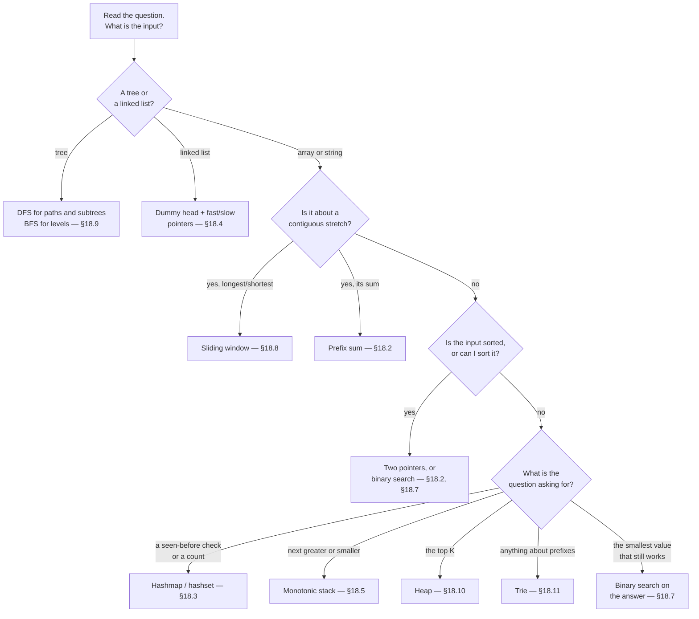

# DSA Foundations & Search — Google Interview Guide (Java)

> "The secret to solving interview problems fast: recognise the pattern in the first 30 seconds."

**What this chapter covers:** The nine templates that solve the overwhelming majority of Google's easy/medium coding rounds — two pointers, prefix sums, hashmaps, sliding windows, monotonic stacks, binary search, tree traversal, heaps and tries. Every pattern is taught the same way: *the problem, why the obvious answer is too slow, the one idea that fixes it, a dry run you can follow with your finger, then the Java.* Chapter 1 of the 4-part DSA sequence (31 / 31b / 31c / 31d); section numbers (§18.1 onward) continue across all four so cross-references stay valid.

---

## Start Here

### Pick a track — you do not have to read all of this

| Track | Time | Read this | Good for |
|-------|------|-----------|----------|
| **Speed run** | ~90 min | This Start Here page, then each pattern's infographic plus the **Approach** + **Java** inside its block. Skip every problem list. | First pass, or a week before the interview |
| **Mastery** | ~4 hr | Everything, plus the first five problems marked ⭐ in each problem list | Real preparation |
| **Refresh** | ~20 min | This page, then jump to the Cheat Sheet at the end | The night before |

### How every pattern is laid out

Under each pattern's heading, one visible line says how to **Recognise** it (how the question sounds) and what to **Use**. Every Java program then sits in one collapsed block, right under its infographic, titled **Problem name — Difficulty · read as text and Java**. Open it and the parts always come in the same order, so you always know where to look. **Nothing asks you to read code before you know what it does.**

| Part | What it gives you |
|------|-------------------|
| **Problem** | what you are given and what to return, in plain words |
| **Example** | one input and its answer — the same one the infographic and the program's output use |
| **Walk-through** | that example traced by hand, one line per step |
| **Approach** | the idea that beats the obvious brute force, and why it works |
| **Java** | the code — read last, when you already know what it will say |
| **Output** | exactly what the program prints |
| **Complexity** | time and space, one line |

When there is a **Trap** — the mistake that silently produces a wrong answer — it sits just before the Complexity line.

### How to read a dry run

A dry run — the **Walk-through** in each block — is the code run by hand on a tiny example, one line per step. Here is one for the easiest problem there is — *find the largest number*:

> **Dry run — `[3, 7, 2, 9]` → `9`**
> *We track:* `best` = the biggest number seen so far.
>
> | Step | Number | Bigger than `best`? | `best` |
> |------|--------|---------------------|--------|
> | 1 | 3 | — (first number) | 3 |
> | 2 | 7 | **yes** | 7 |
> | 3 | 2 | no | 7 |
> | 4 | 9 | **yes** | **9** |
>
> **Why it works:** every number was compared with `best`, so nothing bigger was missed.

| Part | What it tells you |
|------|-------------------|
| **Title** | the input, and the answer |
| *We track* | what the variables mean, in plain words |
| **Steps** | one line each; **bold** marks the choice that was taken |
| **Why it works** | one sentence on why the last step gives the answer |

Arrays, lists, windows and pointers are drawn as **pictures** instead (letters under the numbers mark where each pointer is); code that calls itself is drawn as a **call tree**.

The key patterns also have an **animation** next to their dry run: it starts paused — press ▶ to play, ⏭ to step one move at a time, or change the speed. The dry run beside it is the same run as text.

### The nine templates


| # | When the question says… | Reach for | Cost | Section |
|---|--------------------------|-----------|------|---------|
| 1 | sorted array, find a pair | Two pointers, converging | O(n) | §18.2 |
| 2 | remove / move / compact in place | Two pointers, same direction | O(n) | §18.2 |
| 3 | sum or count over a range | Prefix sum | O(n) | §18.2 |
| 4 | "have I seen this before?" | Hashmap / hashset | O(n) | §18.3 |
| 5 | longest / shortest **contiguous** run | Sliding window | O(n) | §18.8 |
| 6 | next greater, next smaller, brackets | Monotonic stack | O(n) | §18.5 |
| 7 | sorted input, **or** "smallest value that still works" | Binary search | O(log n) | §18.7 |
| 8 | top K, K closest, running median | Heap | O(n log k) | §18.10 |
| 9 | prefix, autocomplete, dictionary | Trie | O(word length) | §18.11 |

Linked lists (§18.4), sorting (§18.6) and trees (§18.9) are data structures rather than triggers — they show up when the input *is* a list or a tree.

### The 30-second decision, as a flowchart



> **The one habit that matters.** Before writing anything, say out loud: *"This is a &lt;template&gt; problem, it will cost O(…), and the thing I have to be careful about is …"* Interviewers score the recognition, not the typing.

---

## Table of Contents

| Part | Topic | Sections |
|------|-------|----------|
| 1 | Foundations | §18.1–18.6: Big-O, Arrays, Hashmaps, Linked Lists, Stacks, Sorting |
| 2 | Search & Trees | §18.7–18.11: Binary Search, Sliding Window, Trees, Heaps, Tries |
| — | Revision | Cheat sheet, 20-minute refresh, spaced-repetition plan (unnumbered, at the end) |

**Continues in:** [31b — Graphs](#content/31b_dsa_graphs) → [31c — Dynamic Programming](#content/31c_dynamic_programming) → [31d — Advanced Patterns & ML Coding](#content/31d_dsa_advanced_ml_coding)

---

# PART 1: FOUNDATIONS

---

## 18.1 Big-O Complexity

**Recognise:** a constraint like "n ≤ 100,000", or "what's the complexity?" · **Use:** the 10^8 rule below.

**Simple explanation.** Big-O answers one question: *when the input gets bigger, how much worse does this get?* It drops constants and hardware and keeps only the growth shape — at n = 1,000,000 the shape is all that matters. Every answer should end with "O(…) time, O(…) space".


### The ladder

```
FAST ◄──────────────────────────────────────────────► SLOW

O(1)  O(log n)  O(n)  O(n log n)  O(n^2)  O(2^n)  O(n!)
 │       │        │       │          │       │       │
hash   binary   single  merge     nested  subsets  permu-
lookup  search   loop    sort      loops           tations
```

| Complexity | n=10 | n=100 | n=1,000 | n=1,000,000 | Typical Use |
|-----------|------|-------|---------|-------------|-------------|
| O(1) | 1 | 1 | 1 | 1 | Hash lookup, array index |
| O(log n) | 3 | 7 | 10 | 20 | Binary search |
| O(n) | 10 | 100 | 1,000 | 1,000,000 | Single scan |
| O(n log n) | 33 | 664 | 9,966 | 19,931,568 | Merge sort |
| O(n^2) | 100 | 10,000 | 1,000,000 | 10^12 — too slow | Nested loops |
| O(2^n) | 1,024 | 10^30 | -- | -- | Subsets |
| O(n!) | 3.6M | -- | -- | -- | Permutations |

### Will my solution time out? The 10^8 rule

A judge (and an interviewer's patience) runs roughly **10^8 simple operations per second**. Work backwards from the constraint:

| n (input size) | Slowest shape you can still use | So reach for |
|---------------|--------------------------------|--------------|
| n ≤ 10 | O(n!) | brute force, permutations |
| n ≤ 20 | O(2^n) | subsets, backtracking, bitmask |
| n ≤ 500 | O(n^3) | triple loop, interval DP |
| n ≤ 10,000 | O(n^2) | nested loops are fine |
| n ≤ 1,000,000 | O(n log n) | sort, heap, binary search |
| n ≤ 100,000,000 | O(n) | one pass: two pointers, window, hashmap |
| n > 10^8 | O(log n) or O(1) | binary search, maths |

> **Use it in reverse, out loud.** "n is 100,000, so O(n^2) is 10^10 and dies — I need O(n) or O(n log n), so sorting is allowed." That sentence is half the solution and takes five seconds.

### Amortised: the occasional expensive step that does not count

`ArrayList.add()` is O(1) almost always, but when the backing array fills it doubles and copies everything — that one add is O(n). Spread over the n adds before it, that is **amortised O(1)**. The same argument makes the monotonic stack (§18.5) and the sliding window (§18.8) O(n) despite their inner loops.

### Three traps that cost real marks

> **Trap — the hidden O(n) inside a loop.** `s += c` in Java builds a whole new String every time, so the loop is O(n^2); use `StringBuilder`. Same for `list.remove(0)` on an `ArrayList` and `list.contains()` inside a loop.

> **Trap — recursion is not free space.** Recursion `d` levels deep holds `d` stack frames: a DFS on a 100,000-node skewed tree is O(n) space and can StackOverflow. For trees, say "O(h) stack space" (`h` = height).

> **Trap — quoting the average as the worst.** HashMap is O(1) *average*, O(n) worst. Quicksort is O(n log n) *average*, O(n^2) worst. Name both; interviewers listen for it.

---

## 18.2 Arrays & Strings

**Simple explanation.** An array is a row of numbered boxes you can open instantly by number. Almost every array trick is the same: *stop looking at pairs; walk the row once while remembering something.* What you remember — a second position, a running total, a best-so-far — names the pattern. Strings are arrays too (`s.toCharArray()` to change one).


### Pattern 1: Two Pointers (Converging)

**Recognise:** "sorted array, find a pair that adds up to a target" · **Use:** a pointer at each end; each comparison rules out one value, so move that pointer.

![Two Sum II infographic (two pointers on a sorted array): nums = [2, 7, 11, 15], target = 9; seven snapshots show 2 + 15 = 17 too big so right--, 2 + 11 = 13 too big so right--, then 2 + 7 = 9 matching and returning [0, 1] after 3 sums, a second run with target 18 going 2 + 15 = 17 too small (left++), 7 + 15 = 22 too big (right--) and 7 + 11 = 18 returning [1, 2], and a trap run on [1, 2, 3] with target 6 stopping at L = R and returning [-1, -1], where while (left <= right) would wrongly add 3 + 3 and return [2, 2]; the Java loop highlights the left < right condition, with O(n) time and O(1) space.](diagrams/dsa31_info_twoptr_ai.png)

**Watch two pointers converge, one comparison per frame** (press ▶ to play, or ⏭ to step). Yellow = the pair being added, grey = ruled out for good. Three runs: the Example, the same array with target 18, and the trap.

![Animated converging two pointers on the sorted array 2, 7, 11, 15. Target 9: 2 + 15 = 17 is too big so R moves left, 2 + 11 = 13 is too big so R moves left, 2 + 7 = 9 matches, answer [0, 1]. Target 18: 2 + 15 = 17 is too small so L moves right, 7 + 15 = 22 is too big so R moves left, 7 + 11 = 18 matches, answer [1, 2]. Then 1, 2, 3 with target 6: L moves right twice, the pointers meet and the loop stops with [-1, -1]; with <= it would wrongly return [2, 2]. Each frame shows the sum against the target, which pointer moves and why, and the Java line that runs.](diagrams/dsa31_two_pointers_anim.gif)

<details>
<summary><strong>Two Sum II — Input Array Is Sorted</strong> — Medium · read as text and Java</summary>

**Problem:** You get a **sorted** array and a target. Return the indices of the two values that add up to the target (0-based; LeetCode's version is 1-based).

**Example:**
```
Input:  nums = [2, 7, 11, 15], target = 9
Output: [0, 1]        (2 + 7 = 9)
```

**Walk-through (the animation as text):** `L` = left pointer, `R` = right pointer, `x` = ruled out.
```
position     0   1   2   3
value        2   7  11  15

target 9
step 1       L           R    2 + 15 = 17  too big   -> 15 can't pair with anything; R moves left
step 2       L       R   x    2 + 11 = 13  too big   -> same for 11; R moves left
step 3       L   R   x   x    2 +  7 =  9  match     -> [0, 1]

target 18
step 1       L           R    2 + 15 = 17  too small -> 2 can't pair with anything; L moves right
step 2       x   L       R    7 + 15 = 22  too big   -> R moves left
step 3       x   L   R   x    7 + 11 = 18  match     -> [1, 2]
```

**Approach:** Brute force tries every pair — O(n²), 10^10 steps at n = 100,000. Sorted order makes each comparison final: sum too big → `nums[right]` is too big even with the smallest partner left, so `right--`; too small → `nums[left]` is too small even with the largest partner, so `left++`. One pass.

**Java:**
```java
import java.util.*;

public class TwoSumSorted {
    public int[] twoSumSorted(int[] nums, int target) {
        int left = 0, right = nums.length - 1;
        while (left < right) {                       // < , not <= : see the trap
            int sum = nums[left] + nums[right];
            if (sum == target) return new int[]{left, right};
            else if (sum < target) left++;           // need a bigger sum
            else right--;                            // need a smaller sum
        }
        return new int[]{-1, -1};
    }

    public static void main(String[] args) {
        TwoSumSorted s = new TwoSumSorted();
        int[][] nums = { {2, 7, 11, 15}, {2, 7, 11, 15}, {1, 2, 3} };
        int[] targets = { 9, 18, 6 };
        for (int i = 0; i < nums.length; i++)
            System.out.println(Arrays.toString(nums[i]) + ", target " + targets[i] + " -> "
                    + Arrays.toString(s.twoSumSorted(nums[i], targets[i])));
    }
}
```

**Output:**
```
[2, 7, 11, 15], target 9 -> [0, 1]
[2, 7, 11, 15], target 18 -> [1, 2]
[1, 2, 3], target 6 -> [-1, -1]
```

> **Trap:** `while (left < right)`, never `<=`. With `<=` the pointers meet on one element, and `[1, 2, 3]` with target 6 returns `[2, 2]` — the 3 used twice.

**Complexity:** O(n) time — at most n pointer moves. O(1) space.
</details>

**Container With Most Water** — **Recognise:** "pick two walls that hold the most water" · **Change:** score a pair by `min(height) × width`, and always move the shorter wall.

<details>
<summary><strong>Container With Most Water</strong> — Medium · read as text and Java</summary>

**Problem:** Each number in `height` is a vertical wall, one unit from the next. Return the most water two walls can hold between them.

**Example:**
```
Input:  height = [1, 8, 6, 2, 5, 4, 8, 3, 7]
Output: 49        (walls at index 1 and 8: min(8, 7) x 7)
```

**Watch it run, one step per frame** (press ▶ to play, or ⏭ to step). Blue = L, purple = R, light blue = water being scored, grey = dropped walls.


**Walk-through (the animation as text):** start with the widest pair, then always move the shorter wall (on a tie the code moves `right`).
```
index        0  1  2  3  4  5  6  7  8
height       1  8  6  2  5  4  8  3  7

left  right  water                 maxWater   move
 0     8     min(1, 7) x 8 =  8        8      1 < 7      -> left++
 1     8     min(8, 7) x 7 = 49       49      7 shorter  -> right--
 1     7     min(8, 3) x 6 = 18       49      3 shorter  -> right--
 1     6     min(8, 8) x 5 = 40       49      tie        -> right--
 1     5     min(8, 4) x 4 = 16       49      4 shorter  -> right--
 1     4     min(8, 5) x 3 = 15       49      5 shorter  -> right--
 1     3     min(8, 2) x 2 =  4       49      2 shorter  -> right--
 1     2     min(8, 6) x 1 =  6       49      6 shorter  -> right--
 1     1     left == right -> stop, return 49
```

**Approach:** Moving the **taller** wall inward can never help: the shorter wall still caps the height and the width just shrank. So the shorter wall cannot be part of any bigger container — drop it. One O(n) pass never skips the best pair.

**Java:**
```java
import java.util.*;

public class ContainerWithMostWater {
    public int maxArea(int[] height) {
        int left = 0, right = height.length - 1, maxWater = 0;
        while (left < right) {
            int water = Math.min(height[left], height[right]) * (right - left);
            maxWater = Math.max(maxWater, water);
            if (height[left] < height[right]) left++;   // move the shorter wall
            else right--;
        }
        return maxWater;
    }

    public static void main(String[] args) {
        int[] height = {1, 8, 6, 2, 5, 4, 8, 3, 7};
        System.out.println(Arrays.toString(height) + " -> " + new ContainerWithMostWater().maxArea(height));
    }
}
```

**Output:**
```
[1, 8, 6, 2, 5, 4, 8, 3, 7] -> 49
```

**Complexity:** O(n) time, O(1) space
</details>

**Practice:** [Two Sum II — Input Array Is Sorted →](#dsa-problem-two-sum-ii-sorted) · [Container With Most Water →](#dsa-problem-container-with-most-water)

### Pattern 2: Two Pointers (Same Direction)

**Recognise:** "remove / move / compact in place, no extra array" · **Use:** a reader that visits everything and a writer that marks the end of the finished part.

![Remove Duplicates infographic (same-direction two pointers): sorted nums = [1, 1, 2, 2, 3]; five snapshots show reader R skipping the duplicate 1 while writer W stays at 0, R finding 2 so W steps to index 1 first and copies it there, R skipping the second 2, R finding 3 so W steps to index 2 and overwrites the stale 2, and R running off the end so the answer is write + 1 = 3, with slots 0 to 2 holding 1, 2, 3 and slots 3 to 4 left over; the Java highlights nums[++write] = nums[read], O(n) time and O(1) space, and the trap is returning write instead of write + 1.](diagrams/dsa31_info_samedir_ai.png)

<details>
<summary><strong>Remove Duplicates from Sorted Array</strong> — Easy · read as text and Java</summary>

**Problem:** Remove the duplicates from a sorted array **in place** (no second array) and return `k`, the number of unique values; the first `k` slots must then hold them in order.

**Example:**
```
Input:  nums = [1, 1, 2, 2, 3]
Output: 3        (array starts [1, 2, 3, ...])
```

**Walk-through:** `W` = writer (the last unique value kept so far), `R` = reader.
```
             1   1   2   2   3
step 1       W   R                R's 1 = W's 1  -> duplicate, R moves on
             1   1   2   2   3
step 2       W       R            R's 2 is new   -> W moves right, copy 2 there
             1   2   2   2   3
step 3           W       R        R's 2 = W's 2  -> duplicate, R moves on
             1   2   2   2   3
step 4           W           R    R's 3 is new   -> W moves right, copy 3 there
             1   2   3   2   3
done                 W            R is finished  -> unique count = W's position + 1 = 3
```

**Approach:** A second array or a `LinkedHashSet` costs O(n) extra space, which the question forbids. Give the pointers *jobs*: the **reader** visits every element; the **writer** marks the end of the finished answer and moves only when the reader finds a new value, which is copied there. Everything up to `write` is final.

**Java:**
```java
import java.util.*;

public class RemoveDuplicates {
    public int removeDuplicates(int[] nums) {
        if (nums.length == 0) return 0;
        int write = 0;
        for (int read = 1; read < nums.length; read++) {
            if (nums[read] != nums[write]) {
                nums[++write] = nums[read];              // advance first, then write
            }
        }
        return write + 1;                                // a count, not an index
    }

    public static void main(String[] args) {
        RemoveDuplicates s = new RemoveDuplicates();
        int[][] tests = { {1, 1, 2, 2, 3}, {} };
        for (int[] nums : tests) {
            String input = Arrays.toString(nums);
            int k = s.removeDuplicates(nums);
            System.out.println(input + " -> " + k + ", array starts "
                    + Arrays.toString(Arrays.copyOf(nums, k)));
        }
    }
}
```

**Output:**
```
[1, 1, 2, 2, 3] -> 3, array starts [1, 2, 3]
[] -> 0, array starts []
```

> **Trap:** return `write + 1`, not `write`. `write` is the last written *index*; the count is one more. The same off-by-one appears in Move Zeroes and Remove Element.

**Complexity:** O(n) time, O(1) space
</details>

**Practice:** [Remove Duplicates from Sorted Array →](#dsa-problem-remove-duplicates-sorted-array)

### Pattern 3: Prefix Sum

**Recognise:** "sum or count over a range", or a nested loop re-adding the same elements · **Use:** running totals — any range sum becomes one subtraction.

![Subarray Sum Equals K infographic (prefix sum + hashmap): nums = [1, 1, 1], k = 2; six snapshots start with seen = {0: 1} for the empty start, then running sum 1 looks for -1 and finds nothing, sum 2 finds total 0 once (stretch 0 to 1, count 1), sum 3 finds total 1 once (stretch 1 to 2, count 2), a second test [1, -1, 0] with k = 0 ends with total 0 seen twice for +2 and count 3, and a trap run without seen.put(0, 1) misses stretch 0 to 1 and returns 1; the Java highlights count += seen.getOrDefault(sum - k, 0), O(n) time and space, so the answer is 2.](diagrams/dsa31_info_prefix_ai.png)

**The tool: running totals.** Add the numbers up once, writing down the total so far: `prefix[i]` = the sum of the **first `i` numbers**, so `prefix[0] = 0` and `prefix` is one box longer than `nums`.


| i | 0 | 1 | 2 | 3 | 4 | 5 | 6 |
|---|---|---|---|---|---|---|---|
| `nums[i]` | 3 | 1 | 4 | 1 | 5 | 9 | |
| `prefix[i]` — sum of the first `i` numbers | 0 | 3 | 4 | 8 | 9 | 14 | 23 |

Sum of positions 1 to 3 = `1 + 4 + 1` = **6** = (first 4 numbers) − (first 1) = `prefix[4] − prefix[1]` = `9 − 3` ✓. In general:

> sum of positions `i` to `j` = `prefix[j + 1] − prefix[i]`  *(the `+ 1` because `prefix` starts with the extra 0)*

<details>
<summary><strong>Subarray Sum Equals K</strong> — Medium · read as text and Java</summary>

**Problem:** Count the **subarrays** (unbroken stretches) of `nums` that add up to exactly `k`.

**Example:**
```
Input:  nums = [1, 1, 1], k = 2
Output: 2        (the first two 1s, and the last two)
```

**Watch it run, one step per frame** (press ▶ to play, or ⏭ to step). Yellow = current number, green = totals that start a matching stretch, cards = the seen map.


**Walk-through (the animation as text):** `total` = running total; `seen` = every running total so far (starting with 0).
```
number   total   look for total - 2   seen before this step   result
(start)    0            -             {}                      remember 0
   1       1           -1             {0}                     not seen  -> count stays 0
   1       2            0             {0, 1}                  seen once -> [1, 1] at positions 0-1, count 1
   1       3            1             {0, 1, 2}               seen once -> [1, 1] at positions 1-2, count 2
```

**Approach:** Brute force tries every start and end — O(n²). With running totals, a stretch **ending here** adds up to `k` exactly when some **earlier** total was `sum − k`, since (total now) − (total then) = `k`. So count running totals in a hashmap `seen` and add `seen[sum − k]` at each step. Each stretch is counted once, at its last number: one pass.

**Java:**
```java
import java.util.*;

public class SubarraySumEqualsK {
    public int subarraySum(int[] nums, int k) {
        Map<Integer, Integer> seen = new HashMap<>();   // running total → how many times seen
        seen.put(0, 1);                                 // the starting total 0, before any number
        int sum = 0, count = 0;
        for (int num : nums) {
            sum += num;
            count += seen.getOrDefault(sum - k, 0);
            seen.merge(sum, 1, Integer::sum);
        }
        return count;
    }

    public static void main(String[] args) {
        SubarraySumEqualsK s = new SubarraySumEqualsK();
        int[][] nums = { {1, 1, 1}, {1, -1, 0} };
        int[] ks = { 2, 0 };
        for (int i = 0; i < nums.length; i++)
            System.out.println(Arrays.toString(nums[i]) + ", k = " + ks[i] + " -> "
                    + s.subarraySum(nums[i], ks[i]));
    }
}
```

**Output:**
```
[1, 1, 1], k = 2 -> 2
[1, -1, 0], k = 0 -> 3
```

> **Trap:** forgetting `seen.put(0, 1)`. Every stretch that starts at position 0 is then missed: the Example returns 1, and `[1, -1, 0]` returns 1 instead of 3.

**Complexity:** O(n) time, O(n) space
</details>

**Practice:** [Subarray Sum Equals K →](#dsa-problem-subarray-sum-equals-k)

### Pattern 4: Kadane's Algorithm (Maximum Subarray)

**Recognise:** "the largest sum of a contiguous subarray" · **Use:** at each number, extend the run or restart from it; keep the best separately.

![Maximum Subarray infographic (Kadane's algorithm): nums = [-2, 1, -3, 4, -1, 2]; seven snapshots start current and best at -2, start fresh at 1 (best 1), extend 1 - 3 = -2 while best stays 1, start fresh at 4 because extending gives only 2 (best 4), extend to 3 while best stays 4, and extend to 3 + 2 = 5 so best becomes 5 for the run [4, -1, 2], then a trap run on [-3, -1, -2] shows that starting best at 0 returns 0 instead of -1; the Java highlights current = Math.max(nums[i], current + nums[i]), O(n) time and O(1) space, so the answer is 5.](diagrams/dsa31_info_kadane_ai.png)

<details>
<summary><strong>Maximum Subarray (Kadane's Algorithm)</strong> — Medium · read as text and Java</summary>

**Problem:** Return the largest sum of a contiguous run (subarray) of at least one number.

**Example:**
```
Input:  nums = [-2, 1, -3, 4, -1, 2]
Output: 5        (the run [4, -1, 2])
```

**Watch it run, one step per frame** (press ▶ to play, or ⏭ to step). Green = extend the run, blue = start fresh, orange = the best run.


**Walk-through (the animation as text):** "run here" = the best sum of a run that ends at this number; "best" = the best run anywhere so far.
```
number   extend the run      start fresh   choose    run here   best
  -2     (first number)          -2           -          -2       -2
   1     -2 + 1 = -1              1         fresh         1        1
  -3      1 - 3 = -2             -3         extend       -2        1
   4     -2 + 4 =  2              4         fresh         4        4
  -1      4 - 1 =  3             -1         extend        3        4
   2      3 + 2 =  5              2         extend        5        5
```

**Approach:** Every start × every end is O(n²). Instead ask at each number: *does the best run ending **here** extend the previous run, or start fresh at me?* A negative running sum can only hurt, so drop it. Keep `best` separately — the best run may have ended long ago. (The DP view, `dp[i]` = best sum ending at `i`, is in [Chapter 31c, Parent 1, Child 4](#content/31c_dynamic_programming).)

**Java:**
```java
import java.util.*;

public class MaximumSubarray {
    public int maxSubArray(int[] nums) {
        int current = nums[0], best = nums[0];       // NOT 0 — see the trap
        for (int i = 1; i < nums.length; i++) {
            current = Math.max(nums[i], current + nums[i]);
            best = Math.max(best, current);
        }
        return best;
    }

    public static void main(String[] args) {
        MaximumSubarray s = new MaximumSubarray();
        int[][] tests = { {-2, 1, -3, 4, -1, 2}, {-3, -1, -2} };
        for (int[] nums : tests)
            System.out.println(Arrays.toString(nums) + " -> " + s.maxSubArray(nums));
    }
}
```

**Output:**
```
[-2, 1, -3, 4, -1, 2] -> 5
[-3, -1, -2] -> -1
```

> **Trap:** initialising `best = 0`. On an all-negative array like `[-3, -1, -2]` that returns 0 — a subarray that does not exist. Start both variables at `nums[0]`.

**Complexity:** O(n) time, O(1) space
</details>

**Practice:** [Maximum Subarray (Kadane's Algorithm) →](#dsa-problem-maximum-subarray)

### Pattern 5: Dutch National Flag (Three-Way Partition)

**Recognise:** "sort 0s, 1s and 2s in one pass" or "split into three groups in place" · **Use:** `low`, `mid`, `high` — swap 0s to the front and 2s to the back.

![Sort Colors infographic (Dutch National Flag): nums = [2, 0, 2, 1, 1, 0] with low, mid and high pointers; six snapshots show mid seeing 2 and swapping it with high (index 0 and 5) while mid stays, two 0s swapped into place with low++ and mid++, a second 2 swapped with high (index 2 and 4), and two 1s passed with mid++ until mid = 4 passes high = 3, giving [0, 0, 1, 1, 2, 2] in one pass, plus a trap run where mid++ after a 2-swap turns [1, 2, 0] into [1, 0, 2]; the Java highlights the else swap(nums, mid, high--) line that keeps mid in place, O(n) time and O(1) space.](diagrams/dsa31_info_dnf_ai.png)

**Watch the three-way partition, one step per frame** (press ▶ to play, or ⏭ to step). Red = settled 0s, white = 1s, blue = 2s, grey = not checked yet; the last frames show the trap on `[1, 2, 0]`.


<details>
<summary><strong>Sort Colors</strong> — Medium · read as text and Java</summary>

**Problem:** Sort an array of only `0`, `1` and `2` (three "colours") **in place, in one pass** — no library sort, no second array.

**Example:**
```
Input:  nums = [2, 0, 2, 1, 1, 0]
Output: [0, 0, 1, 1, 2, 2]
```

**Walk-through (the animation as text):** `L` = where the next 0 goes, `M` = the number being checked, `H` = where the next 2 goes. Each step shows the array **before** the move.
```
              2    0    2    1    1    0
step 1      L,M                        H    M sees 2 -> swap with H; H-- (M stays: the new 0 is unchecked)
              0    0    2    1    1    2
step 2      L,M                   H         M sees 0 -> swap with L; L++, M++
              0    0    2    1    1    2
step 3           L,M              H         M sees 0 -> swap with L; L++, M++
              0    0    2    1    1    2
step 4                L,M         H         M sees 2 -> swap with H; H--
              0    0    1    1    2    2
step 5                L,M    H              M sees 1 -> already in place; M++
              0    0    1    1    2    2
step 6                  L  M,H              M sees 1 -> M++
              0    0    1    1    2    2
done                    L    H    M         M > H -> nothing left to check, sorted
```

**Approach:** `Arrays.sort()` is O(n log n); counting then overwriting takes two passes. One pass grows three regions: left of `low` is all 0, right of `high` is all 2, and `mid` checks what lies between. A value swapped in from the front was already checked, so `mid` moves on; one swapped in **from the back never was**, so `mid` stays put.

**Java:**
```java
import java.util.*;

public class SortColors {
    public void sortColors(int[] nums) {
        int low = 0, mid = 0, high = nums.length - 1;
        while (mid <= high) {
            if (nums[mid] == 0) swap(nums, low++, mid++);
            else if (nums[mid] == 1) mid++;
            else swap(nums, mid, high--);      // 2: don't advance mid — the new value is unseen
        }
    }
    private void swap(int[] a, int i, int j) {
        int tmp = a[i]; a[i] = a[j]; a[j] = tmp;
    }

    public static void main(String[] args) {
        SortColors s = new SortColors();
        int[][] tests = { {2, 0, 2, 1, 1, 0}, {1, 2, 0} };
        for (int[] nums : tests) {
            String input = Arrays.toString(nums);
            s.sortColors(nums);
            System.out.println(input + " -> " + Arrays.toString(nums));
        }
    }
}
```

**Output:**
```
[2, 0, 2, 1, 1, 0] -> [0, 0, 1, 1, 2, 2]
[1, 2, 0] -> [0, 1, 2]
```

> **Trap:** advancing `mid` after the `2`-swap. The value that arrived from the back is skipped, so `[1, 2, 0]` comes out `[1, 0, 2]` — a 0 stranded in the middle.

**Complexity:** O(n) time, O(1) space, one pass
</details>

**Practice:** [Sort Colors →](#dsa-problem-sort-colors)

### 60-second recall

<details>
<summary>1. The array is <strong>unsorted</strong> and you need a pair summing to a target. Why do converging pointers fail, and what replaces them?</summary>

Converging pointers need sorted order to know which side to move — unsorted, "too big" tells you nothing. Use a hashmap (§18.3) for O(n), or sort first (O(n log n)) if you need O(1) extra space.
</details>

<details>
<summary>2. Which two patterns here answer "sum over a range", and how do you choose?</summary>

Prefix sum for **any** subarray sum or count; Kadane only for the **maximum** sum. "Longest contiguous … with at most k" is a sliding window (§18.8).
</details>

<details>
<summary>3. Subarray or subsequence — why does the word matter so much?</summary>

A **subarray** is contiguous, so windows, prefix sums and two pointers apply. A **subsequence** may skip elements, which almost always means dynamic programming (§18.15 in chapter 31c).
</details>

### Key Problems — Detailed Solutions

**3Sum** — **Recognise:** "every unique triplet that sums to 0" · **Change:** sort, fix one number, run Pattern 1 on the rest; skip repeated values.

![3Sum infographic (sort + two pointers): nums = [-1, 0, 1, 2, -1, -4] is sorted to [-4, -1, -1, 0, 1, 2]; snapshots show fixing -4 where every sum stays below 0 so lo++ runs until lo = hi, fixing -1 to find -1, -1, 2 and then -1, 0, 1, skipping the second -1 as a repeated fix, and fixing 0 where 0 + 1 + 2 = 3 is too big, so the answer is two triplets, -1, -1, 2 and -1, 0, 1, while a trap run on [-2, 0, 0, 2, 2] without the inner skips finds -2, 0, 2 twice; the Java highlights the while loops that skip equal values at lo and hi, with O(n squared) time and O(1) extra space.](diagrams/dsa31_info_3sum_ai.png)

<details>
<summary><strong>3Sum</strong> — Medium · read as text and Java</summary>

**Problem:** Return every triplet from three **different** positions of `nums` that adds up to `0` — each set of values once, in any order.

**Example:**
```
Input:  nums = [-1, 0, 1, 2, -1, -4]
Output: [[-1, -1, 2], [-1, 0, 1]]
```

**Watch it run, one step per frame** (press ▶ to play, or ⏭ to step). i = fixed number, lo and hi = pointers, green = triplet found, red = repeat skipped.


**Walk-through (the animation as text):** sort, then fix one number and find a pair that cancels it.
```
sorted: [-4, -1, -1, 0, 1, 2]

fix -4 → need a pair summing to  4 in [-1, -1, 0, 1, 2]  → none (biggest pair is 1 + 2 = 3)
fix -1 → need a pair summing to  1 in [-1, 0, 1, 2]      → (-1, 2) ✓   (0, 1) ✓
fix -1 → same value as the last fix → skip, or we'd find the same triplets again
fix  0 → need a pair summing to  0 in [1, 2]             → none
```

**Approach:** Sort. Fix `nums[i]` and run Pattern 1 on the part to its right for a pair summing to `-nums[i]`. Skip any value equal to the one just before it — at the fixed position and at both pointers — so no triplet is found twice. n two-pointer passes cost O(n²), which dwarfs the sort.

**Java:**
```java
import java.util.*;

public class ThreeSum {
    public List<List<Integer>> threeSum(int[] nums) {
        Arrays.sort(nums);
        List<List<Integer>> res = new ArrayList<>();
        for (int i = 0; i < nums.length - 2; i++) {
            if (i > 0 && nums[i] == nums[i - 1]) continue; // skip dup
            int lo = i + 1, hi = nums.length - 1;
            while (lo < hi) {
                int sum = nums[i] + nums[lo] + nums[hi];
                if (sum == 0) {
                    res.add(List.of(nums[i], nums[lo], nums[hi]));
                    while (lo < hi && nums[lo] == nums[lo + 1]) lo++;
                    while (lo < hi && nums[hi] == nums[hi - 1]) hi--;
                    lo++; hi--;
                } else if (sum < 0) lo++;
                else hi--;
            }
        }
        return res;
    }

    public static void main(String[] args) {
        ThreeSum s = new ThreeSum();
        int[][] tests = { {-1, 0, 1, 2, -1, -4}, {-2, 0, 0, 2, 2} };
        for (int[] nums : tests) {
            String input = Arrays.toString(nums);      // threeSum sorts nums in place
            System.out.println(input + " -> " + s.threeSum(nums));
        }
    }
}
```

**Output:**
```
[-1, 0, 1, 2, -1, -4] -> [[-1, -1, 2], [-1, 0, 1]]
[-2, 0, 0, 2, 2] -> [[-2, 0, 2]]
```

> **Trap:** skipping repeats only at the fixed number. Without the two inner `while` skips, `[-2, 0, 0, 2, 2]` returns `[-2, 0, 2]` twice.

**Complexity:** O(n^2) time, O(1) space (excluding output)
</details>

**Product of Array Except Self** — **Recognise:** "product of everything except me, no division" · **Change:** Pattern 3 with products — a left pass for prefixes, a right pass for suffixes.

![Product of Array Except Self infographic (prefix × suffix): nums = [1, 2, 3, 4]; seven snapshots show pass 1 filling ans with the left products 1, 1, 2, 6, then pass 2 walking right to left with a running suffix that multiplies ans[3] by 1 (6), ans[2] by 4 (8), ans[1] by 12 (12) and ans[0] by 24 (24), so the answer is [24, 12, 8, 6]; the Java highlights ans[i] *= suffix, O(n) time with O(1) extra space, and the trap is that dividing the total by nums[i] breaks on a zero, as in [-1, 1, 0, -3, 3].](diagrams/dsa31_info_product_ai.png)

<details>
<summary><strong>Product of Array Except Self</strong> — Medium · read as text and Java</summary>

**Problem:** Return `answer` where `answer[i]` is the product of every element of `nums` **except** `nums[i]` — in O(n), without division.

**Example:**
```
Input:  nums = [1, 2, 3, 4]
Output: [24, 12, 8, 6]          e.g. answer[1] = 1 × 3 × 4 = 12
```

**Watch it run, one step per frame** (press ▶ to play, or ⏭ to step). Blue = left pass, purple = right pass and suffix, green = finished answers.


**Walk-through (the animation as text):** "everything except me" = (everything on my left) × (everything on my right).
```
i:              0          1          2          3
nums:           1          2          3          4
left product:   1          1          1·2 = 2    1·2·3 = 6     (1 = nothing on the left)
right product:  2·3·4 = 24 3·4 = 12   4          1             (1 = nothing on the right)
answer:         24         12         8          6             left × right
```

**Approach:** One pass left → right writes each position's left product into `ans`. A second pass right → left multiplies in a running right product.

**Java:**
```java
import java.util.*;

public class ProductOfArrayExceptSelf {
    public int[] productExceptSelf(int[] nums) {
        int n = nums.length;
        int[] ans = new int[n];
        ans[0] = 1;
        for (int i = 1; i < n; i++)
            ans[i] = ans[i - 1] * nums[i - 1];   // prefix product
        int suffix = 1;
        for (int i = n - 1; i >= 0; i--) {
            ans[i] *= suffix;
            suffix *= nums[i];                     // suffix product
        }
        return ans;
    }

    public static void main(String[] args) {
        ProductOfArrayExceptSelf s = new ProductOfArrayExceptSelf();
        int[][] tests = { {1, 2, 3, 4}, {-1, 1, 0, -3, 3} };
        for (int[] nums : tests)
            System.out.println(Arrays.toString(nums) + " -> "
                    + Arrays.toString(s.productExceptSelf(nums)));
    }
}
```

**Output:**
```
[1, 2, 3, 4] -> [24, 12, 8, 6]
[-1, 1, 0, -3, 3] -> [0, 0, 9, 0, 0]
```

> **Trap:** "total product ÷ `nums[i]`" breaks on a zero: the second test divides by 0 at index 2.

**Complexity:** O(n) time, O(1) space (output array not counted)
</details>

**Trapping Rain Water** — **Recognise:** "how much water is trapped between the bars" · **Change:** Pattern 1 where each pointer remembers the tallest bar on its side; settle the shorter side.

![Trapping Rain Water infographic (two pointers): height = [0, 1, 0, 2, 1, 0, 1, 3, 2, 1, 2, 1] drawn as bar charts; seven snapshots move l and r inward, always settling the shorter side with water += its max - its height, so the right end lifts rightMax to 1, l = 2 adds 1, r = 9 adds 1 after rightMax becomes 2, l = 4 adds 1 after leftMax becomes 2, l = 5 adds 2 at the deepest spot and l = 6 adds 1 before l meets r at the tallest bar, giving 6 units above bars 2, 4, 5, 6 and 9; the Java highlights water += leftMax - height[l], O(n) time and O(1) space, and the trap is that adding water before updating the max gives 2, not 6.](diagrams/dsa31_info_rainwater_ai.png)

<details>
<summary><strong>Trapping Rain Water</strong> — Hard · read as text and Java</summary>

**Problem:** Each number is the height of a bar of width 1. How many units of rain water are trapped between the bars?

**Example:**
```
Input:  height = [0, 1, 0, 2, 1, 0, 1, 3, 2, 1, 2, 1]
Output: 6
```

**Watch it run, one step per frame** (press ▶ to play, or ⏭ to step). Blue l, purple r, dashed = leftMax and rightMax, light blue = trapped water.


**Walk-through (the animation as text):** `█` = bar, `~` = trapped water. Water above a bar = **min(tallest bar to its left, tallest bar to its right) − its own height**.
```
                       █
           █  ~  ~  ~  █  █  ~  █
     █  ~  █  █  ~  █  █  █  █  █  █
  0  1  2  3  4  5  6  7  8  9 10 11     ← index
  0  0  1  0  1  2  1  0  0  1  0  0     ← water above each bar   (total 6)
```

**Approach:** Brute force finds both tallest bars for every bar — O(n²). Instead put a pointer at each end, each remembering the tallest bar on its side, and always settle the **shorter** side: the other side has a wall at least that tall, so this bar's water depends only on its own side's tallest bar.

**Java:**
```java
import java.util.*;

public class TrappingRainWater {
    public int trap(int[] height) {
        int l = 0, r = height.length - 1;
        int leftMax = 0, rightMax = 0, water = 0;
        while (l < r) {
            if (height[l] < height[r]) {
                leftMax = Math.max(leftMax, height[l]);
                water += leftMax - height[l];
                l++;
            } else {
                rightMax = Math.max(rightMax, height[r]);
                water += rightMax - height[r];
                r--;
            }
        }
        return water;
    }

    public static void main(String[] args) {
        int[] height = {0, 1, 0, 2, 1, 0, 1, 3, 2, 1, 2, 1};
        System.out.println(Arrays.toString(height) + " -> " + new TrappingRainWater().trap(height));
    }
}
```

**Output:**
```
[0, 1, 0, 2, 1, 0, 1, 3, 2, 1, 2, 1] -> 6
```

**Complexity:** O(n) time, O(1) space
</details>

**Practice:** [3Sum →](#dsa-problem-three-sum) · [Product of Array Except Self →](#dsa-problem-product-except-self) · [Trapping Rain Water →](#dsa-problem-trapping-rain-water)

### Problem List

**Start with these five:** Valid Palindrome · Move Zeroes · Best Time Buy/Sell Stock · Merge Sorted Array · Rotate Array. The nine problems solved above are not repeated here.

| # | Problem | Difficulty | Pattern | Key Insight |
|---|---------|-----------|---------|-------------|
| 1 | Valid Palindrome | Easy | Two Ptr (converging) | Skip non-alphanumeric |
| 2 | Move Zeroes | Easy | Two Ptr (same dir) | Slow = write position |
| 3 | Best Time Buy/Sell Stock | Easy | Kadane variant | Track min price so far |
| 4 | Running Sum of Array | Easy | Prefix Sum | Direct prefix sum |
| 5 | Merge Sorted Array | Easy | Two Ptr (reverse) | Fill from the end |
| 6 | Rotate Array | Medium | Reverse trick | Reverse all, then parts |
| 7 | Next Permutation | Medium | Two Ptr + Sort | Find rightmost ascent |
| 8 | Longest Consecutive Sequence | Medium | HashSet | Check if num-1 exists |
| 9 | First Missing Positive | Hard | Cyclic Sort | Place num at index num-1 |
| 10 | Median of Two Sorted Arrays | Hard | Binary Search | Partition both arrays |
| 11 | Minimum Window Substring | Hard | Sliding Window + Map | Covered in 18.8 |

---

## 18.3 Hashmaps & Sets

**Simple explanation.** A hashmap is a coat-check counter: you hand over a key, it computes a ticket number and goes straight to that one hook — it never searches the whole rack. So lookup, insert and delete are all O(1) on average.

Its signature use in interviews: **whenever a nested loop exists only to answer "have I seen this before?", a hashmap deletes the inner loop** and turns O(n²) into O(n).


**The mechanism in 30 seconds:** hash the key and wrap it onto a bucket; keys that share a bucket form a short chain. Past three-quarters full the table doubles and re-files everything (rare, so inserts stay amortised O(1)). In Java 8+ a chain longer than eight becomes a red-black tree, so the worst case is O(log n), not O(n).

### Pattern 1: Complement Lookup (Two Sum)

**Recognise:** "find the two values that add up to a target" in an unsorted array · **Use:** for each `x`, look up `target - x` among the values already passed, then store `x`.

![Infographic for Two Sum with a HashMap (complement lookup): for each x, look up need = target − x in seen before putting x → index; on nums 2, 7, 11, 15 with target 9, i = 0 misses and stores 2 → 0, then i = 1 finds 2 at index 0 → [0, 1]; on 3, 2, 4 with target 6 the 3 misses (putting first would return [0, 0]), 2 is stored and 4 finds it → [1, 2]; on 3, 3 the second 3 finds the first → [0, 1]. O(n) time, O(n) space.](diagrams/dsa31_info_twosum_ai.png)

**Watch Two Sum run, one step per frame** (press ▶ to play, or ⏭ to step). Yellow = the current number; blue = a miss, so `x` is stored; green = a hit, the answer. The second and third inputs show why the lookup comes *before* the store.


**Dry run (the animation as text)** — `seen` maps each value already passed → its index.
```
i   x   need = target - x   need in seen?     then
nums = [2, 7, 11, 15], target = 9
0   2   7                   no                put 2 -> 0
1   7   2                   yes, at index 0   return [0, 1]
nums = [3, 2, 4], target = 6
0   3   3                   no (seen empty)   put 3 -> 0     (put first: 3 finds itself -> [0, 0])
1   2   4                   no                put 2 -> 1
2   4   2                   yes, at index 1   return [1, 2]
nums = [3, 3], target = 6
0   3   3                   no                put 3 -> 0
1   3   3                   yes, at index 0   return [0, 1]
```

<details>
<summary><strong>Two Sum</strong> — Easy · problem, approach, Java and trap</summary>

**Problem:** Given an **unsorted** array and a target, return the indices of the two values that add up to the target (`[-1, -1]` if no pair exists).

**Approach:** Brute force tries every pair — O(n²). Turn the question inside out: standing on `x`, the only partner that works is `need = target - x`, and a hashmap answers "have I passed it?" in O(1). One pass is enough: when we reach a pair's second number, the first is already in `seen`.

**Java:**
```java
import java.util.*;

public class TwoSum {
    public int[] twoSum(int[] nums, int target) {
        Map<Integer, Integer> seen = new HashMap<>();     // value -> index
        for (int i = 0; i < nums.length; i++) {
            int need = target - nums[i];
            if (seen.containsKey(need))
                return new int[]{seen.get(need), i};
            seen.put(nums[i], i);                         // AFTER the check — see the trap
        }
        return new int[]{-1, -1};
    }

    public static void main(String[] args) {
        TwoSum s = new TwoSum();
        System.out.println(Arrays.toString(s.twoSum(new int[]{2, 7, 11, 15}, 9)));
        System.out.println(Arrays.toString(s.twoSum(new int[]{3, 2, 4}, 6)));
    }
}
```

**Output:**
```
[0, 1]
[1, 2]
```

> **Trap:** look up *before* you put. Put first and the 3 in `[3, 2, 4]` finds itself: `[0, 0]`. Looking up first loses nothing — in `[3, 3]` the second 3 still finds the first.

**Complexity:** O(n) time, O(n) space — memory buys away the inner loop.
</details>

**Practice:** [Two Sum →](#dsa-problem-two-sum)

### Pattern 2: Frequency Counting

**Recognise:** "the same letters, the same number of times, in any order" · **Use:** count +1 for one input and −1 for the other; every counter must end at 0.


<details>
<summary><strong>Valid Anagram</strong> — Easy · problem, dry run, approach, Java and trap</summary>

**Problem:** Given lowercase strings `s` and `t`, return `true` if `t` uses exactly the letters of `s`, each the same number of times, in any order.

**Example:** `s = "abb"`, `t = "bab"` → `true`

**Dry run:** one counter per letter, in a single pass.
```
i   +1 (s)   -1 (t)   counters after
0   a        b        a = 1, b = -1
1   b        a        a = 0, b = 0
2   b        b        a = 0, b = 0     every counter is 0 -> true
```

**Approach:** Sorting both and comparing costs O(n log n). An anagram is about **how many of each letter**, not their order, so count. For a fixed a–z alphabet a 26-slot array beats a HashMap: no hashing, no boxing.

**Java:**
```java
public class ValidAnagram {
    public boolean isAnagram(String s, String t) {
        if (s.length() != t.length()) return false;      // required — see the trap
        int[] count = new int[26];
        for (int i = 0; i < s.length(); i++) {
            count[s.charAt(i) - 'a']++;
            count[t.charAt(i) - 'a']--;
        }
        for (int c : count) if (c != 0) return false;
        return true;
    }

    public static void main(String[] args) {
        ValidAnagram s = new ValidAnagram();
        System.out.println(s.isAnagram("abb", "bab"));
        System.out.println(s.isAnagram("a", "ab"));
    }
}
```

**Output:**
```
true
false
```

> **Trap:** the length check is not an optimisation. Without it `"a"` vs `"ab"` returns `true` (the loop never reaches the `b`) and `"ab"` vs `"a"` crashes. And `int[26]` breaks on uppercase or Unicode — say "I'd switch to a `HashMap<Character, Integer>` if the alphabet isn't fixed".

**Complexity:** O(n) time, O(1) space (26 counters)
</details>

**Practice:** [Valid Anagram →](#dsa-problem-valid-anagram)

### Pattern 3: Group by a Canonical Key

**Recognise:** "group", "bucket", "how many identical…" · **Use:** turn each item into a key that every group-mate produces and nobody else does; the map does the grouping.

![Infographic for Group Anagrams by a canonical key: each word's letters are sorted into a key and computeIfAbsent adds the word to that key's list; eat → aet starts a list, tea joins it, tan → ant starts a list, ate joins aet, nat joins ant, and bat → abt starts a third list, giving the groups eat, tea, ate / bat / tan, nat in HashMap order. Trap: key by new String(sorted), because a char[] key compares by identity. O(n · k log k) time.](diagrams/dsa31_info_groupanagrams_ai.png)

**Watch Group Anagrams run, one word per frame** (press ▶ to play, or ⏭ to step). Blue = a new key starts a list; green = the key exists, so the word joins that group.


**Dry run (the animation as text)** — `groups` maps sorted key → the words that produced it.
```
word   key   groups["aet"]      groups["ant"]   groups["abt"]
eat    aet   [eat]
tea    aet   [eat, tea]
tan    ant   [eat, tea]         [tan]
ate    aet   [eat, tea, ate]    [tan]
nat    ant   [eat, tea, ate]    [tan, nat]
bat    abt   [eat, tea, ate]    [tan, nat]      [bat]
```

<details>
<summary><strong>Group Anagrams</strong> — Medium · problem, approach and Java</summary>

**Problem:** Put words that are anagrams of each other into the same group; the groups may come in any order (`groups.values()` returns HashMap order, not input order).

**Approach:** Comparing every pair of words costs O(n² · k) for words of length `k`. Keying each word by its sorted letters lets the map do the grouping — no word is compared with another.

**Java:**
```java
import java.util.*;

public class GroupAnagrams {
    public List<List<String>> groupAnagrams(String[] strs) {
        Map<String, List<String>> groups = new HashMap<>();
        for (String s : strs) {
            char[] sorted = s.toCharArray();
            Arrays.sort(sorted);
            groups.computeIfAbsent(new String(sorted), k -> new ArrayList<>()).add(s);
        }
        return new ArrayList<>(groups.values());
    }

    public static void main(String[] args) {
        String[] strs = {"eat", "tea", "tan", "ate", "nat", "bat"};
        System.out.println(new GroupAnagrams().groupAnagrams(strs));
    }
}
```

**Output:**
```
[[eat, tea, ate], [bat], [tan, nat]]
```

> **Worth saying out loud:** a 26-count signature instead of the sorted string drops the `log k` — O(n · k).

**Complexity:** O(n · k log k) time, O(n · k) space (k = word length)
</details>

**Practice:** [Group Anagrams →](#dsa-problem-group-anagrams)

Other keys that make group-mates collide: digit sum, remainder mod k, a grid row's pattern.

### Pattern 4: Hashmap as the Window's Memory

**Recognise:** "longest / shortest substring that…" · **Use:** two pointers plus a map of what is inside the window, so the window is repaired in O(1) instead of rescanned — taught with a dry run in **§18.8 Sliding Window**.

### HashSet: Membership Without Order

**Recognise:** "does `x` exist?", with nothing to store beside it · **Use:** a `HashSet`; here, walk up only from numbers whose `x - 1` is missing.


<details>
<summary><strong>Longest Consecutive Sequence</strong> — Medium · problem, dry run, approach, Java and trap</summary>

**Problem:** Given an **unsorted** array of integers, return the length of the longest run of consecutive integers (like `1, 2, 3, 4`); the run's values can sit anywhere in the array.

**Example:** `[100, 4, 200, 1, 3, 2]` → `4` (the run 1, 2, 3, 4)

**Watch it run, one step per frame** (press ▶ to play, or ⏭ to step). Yellow = current number, blue = run start, grey = skipped, green = the walk up.


**Dry run (the animation as text):** only a run's start walks up. Shown in array order (the program loops over the set, so its order may differ; the answer doesn't).
```
number   number - 1 in set?                 walk up                    run length
100      99?  no  -> a run starts here      101? no                    1
4        3?   yes -> middle of a run, skip  -                          -
200      199? no  -> a run starts here      201? no                    1
1        0?   no  -> a run starts here      2 yes, 3 yes, 4 yes, 5 no  4   <- longest
3        2?   yes -> skip                   -                          -
2        1?   yes -> skip                   -                          -
```

**Approach:** Sorting then scanning is O(n log n); the interviewer wants O(n). Put everything in a set so "does `x` exist?" is free, then **start counting only from a number whose predecessor `x - 1` is missing** and walk up `x + 1, x + 2, …`. Every run has exactly one start, so each run is walked once: the inner `while` looks like O(n²), but across the whole array it takes at most n steps.

**Java:**
```java
import java.util.*;

public class LongestConsecutiveSequence {
    public int longestConsecutive(int[] nums) {
        Set<Integer> set = new HashSet<>();
        for (int x : nums) set.add(x);
        int longest = 0;
        for (int x : set) {
            if (!set.contains(x - 1)) {          // this guard is what keeps it O(n)
                int len = 1;
                while (set.contains(x + len)) len++;
                longest = Math.max(longest, len);
            }
        }
        return longest;
    }

    public static void main(String[] args) {
        LongestConsecutiveSequence s = new LongestConsecutiveSequence();
        System.out.println(s.longestConsecutive(new int[]{100, 4, 200, 1, 3, 2}));
        System.out.println(s.longestConsecutive(new int[]{1, 2, 0, 0}));
    }
}
```

**Output:**
```
4
3
```

> **Trap:** dropping the `!set.contains(x - 1)` guard. The answer stays correct and the time quietly becomes O(n²) — exactly what the interviewer is testing. Also loop over the **set**, not the array, so a repeated run start (the two 0s above) doesn't re-walk its run.

**Complexity:** O(n) time, O(n) space
</details>

**Practice:** [Longest Consecutive Sequence →](#dsa-problem-longest-consecutive-sequence)

### 60-second recall

<details>
<summary>1. Your solution is O(n²) because an inner loop searches for something. What is the first thing to try?</summary>

A hashmap or hashset. Ask what the inner loop really asks — "have I seen X?", "how many X?", "which group is X in?" — and store exactly that.
</details>

<details>
<summary>2. When is <code>int[26]</code> better than a <code>HashMap</code>, and when does it bite?</summary>

Better whenever the alphabet is small and fixed (a–z, digits, DNA bases): no hashing, no autoboxing, O(1) space. It bites on uppercase, Unicode or arbitrary keys — then you need the map.
</details>

<details>
<summary>3. Why can a <code>while</code> loop nested inside a <code>for</code> loop still be O(n)?</summary>

Complexity counts *total* work, not nesting depth. In Longest Consecutive Sequence the inner walk visits each value at most once in total. The same argument makes the monotonic stack (§18.5) and the sliding window (§18.8) linear.
</details>

### Java specifics worth memorising

- `map.merge(key, 1, Integer::sum)` — the cleanest counter increment.
- `map.computeIfAbsent(key, k -> new ArrayList<>()).add(v)` — the cleanest group-by.
- `map.get(missing)` returns `null`; unboxing that into an `int` throws NPE. Use `getOrDefault(key, 0)`.
- Compare map values with `.equals`, never `==`. `Integer` caches only −128 to 127, so `map.get(a) == map.get(b)` passes small tests and fails at 128.
- **Never use a mutable object as a key.** An `int[]` key compares by identity, so an equal array never finds it; a `List` changed after insertion has a new hash and its entry becomes unreachable. Use a `String` or an unmodified `List`.

### Key Problems — Detailed Solutions

**Recognise:** "O(1) `get` and `put`, evict the least recently used" · **Use:** a HashMap `key → node` plus a doubly linked list kept in order of last use.


<details>
<summary><strong>LRU Cache</strong> — Medium · problem, dry run, approach, Java and trap</summary>

**Problem:** Build a cache with a fixed capacity. `get(key)` returns the value (or `-1`); `put(key, value)` adds or updates. Both must be O(1). When full, adding a new key first evicts the **least recently used** key — the one nobody has read or written for the longest.

**Watch it run, one step per frame** (press ▶ to play, or ⏭ to step). Yellow = the node in use, blue = moved to newest, green = new, red = evicted.


**Dry run (the animation as text):** capacity 2; keys listed oldest-used → newest-used.
```
put(1, 1)    [1]
put(2, 2)    [1, 2]
get(1)       [2, 1]    returns 1; reading 1 makes it the newest
put(3, 3)    [1, 3]    full, so the oldest (2) is evicted
get(2)       [1, 3]    returns -1
put(1, 10)   [3, 1]    existing key: new value, and it becomes the newest
```

**Approach:**
- A **HashMap** `key → node` finds any key in O(1).
- A **doubly linked list** orders the nodes by last use: oldest next to a dummy `head`, newest next to a dummy `tail`. The dummies remove every `null` check.
- `get`: missing → `-1`; otherwise move the node to the newest end and return its value.
- `put`: existing key → update it and move it to the newest end. New key → if full, unlink `head.next` **and** remove its key from the map; then add the new node before `tail`.

> **Shortcut:** in real code, `new LinkedHashMap<>(cap, 0.75f, true)` with `removeEldestEntry` overridden does all of this ([Ch 38 §38.8](#content/38_java_refresher)). Mention it; interviewers almost always want the list built by hand.

**Java:**
```java
import java.util.*;

public class LruCacheDemo {
    static class LRUCache {
        private static class Node {
            int key, val;                  // key is kept so eviction can delete it from the map
            Node prev, next;
            Node(int key, int val) { this.key = key; this.val = val; }
        }

        private final int capacity;
        private final Map<Integer, Node> map = new HashMap<>();
        private final Node head = new Node(0, 0);   // dummy: oldest side
        private final Node tail = new Node(0, 0);   // dummy: newest side

        public LRUCache(int capacity) {
            this.capacity = capacity;
            head.next = tail;
            tail.prev = head;
        }

        public int get(int key) {
            Node node = map.get(key);
            if (node == null) return -1;
            moveToNewest(node);            // a read counts as a use
            return node.val;
        }

        public void put(int key, int value) {
            Node node = map.get(key);
            if (node != null) {
                node.val = value;
                moveToNewest(node);
                return;
            }
            if (map.size() == capacity) {  // full: drop the oldest from list AND map
                Node oldest = head.next;
                unlink(oldest);
                map.remove(oldest.key);
            }
            node = new Node(key, value);
            addNewest(node);
            map.put(key, node);
        }

        private void unlink(Node n) {
            n.prev.next = n.next;
            n.next.prev = n.prev;
        }

        private void addNewest(Node n) {   // just before the tail dummy
            n.prev = tail.prev;
            n.next = tail;
            tail.prev.next = n;
            tail.prev = n;
        }

        private void moveToNewest(Node n) {
            unlink(n);
            addNewest(n);
        }

        @Override
        public String toString() {         // oldest -> newest
            StringJoiner sj = new StringJoiner(", ", "{", "}");
            for (Node n = head.next; n != tail; n = n.next) sj.add(n.key + "=" + n.val);
            return sj.toString();
        }
    }

    static void showPut(LRUCache cache, int key, int value) {
        cache.put(key, value);
        System.out.printf("%-13s cache %s%n", "put(" + key + ", " + value + ")", cache);
    }
    static void showGet(LRUCache cache, int key) {
        int value = cache.get(key);
        System.out.printf("%-13s cache %s%n", "get(" + key + ") -> " + value, cache);
    }

    public static void main(String[] args) {
        LRUCache cache = new LRUCache(2);
        showPut(cache, 1, 1);
        showPut(cache, 2, 2);
        showGet(cache, 1);
        showPut(cache, 3, 3);
        showGet(cache, 2);
        showPut(cache, 1, 10);
    }
}
```

**Output:**
```
put(1, 1)     cache {1=1}
put(2, 2)     cache {1=1, 2=2}
get(1) -> 1   cache {2=2, 1=1}
put(3, 3)     cache {1=1, 3=3}
get(2) -> -1  cache {1=1, 3=3}
put(1, 10)    cache {3=3, 1=10}
```

> **Trap:** evicting from the list but not the map — the map stays "full" and still hands out the dead node. Also: refresh the key on `get`, and update (don't add a second node) when `put` hits an existing key.

**Complexity:** O(1) time per `get`/`put`, O(capacity) space
</details>

**Practice:** [LRU Cache →](#dsa-problem-lru-cache)

### Problem List

**Start with these five:** Two Sum · Valid Anagram · Group Anagrams · Top K Frequent Elements · Longest Consecutive Sequence.

| # | Problem | Difficulty | Pattern | Key Insight |
|---|---------|-----------|---------|-------------|
| 1 | [Two Sum](#dsa-problem-two-sum) | Easy | Complement lookup | One-pass with map |
| 2 | [Valid Anagram](#dsa-problem-valid-anagram) | Easy | Frequency count | int[26] is enough |
| 3 | [Contains Duplicate](#dsa-problem-contains-duplicate) | Easy | HashSet | set.add returns false |
| 4 | [Ransom Note](#dsa-problem-ransom-note) | Easy | Frequency count | Decrement and check |
| 5 | Intersection of Two Arrays | Easy | Two sets | Retain common elements |
| 6 | [Longest Substring No Repeat](#dsa-problem-longest-substring-without-repeating) | Medium | Window + Map | Track last seen index |
| 7 | [Group Anagrams](#dsa-problem-group-anagrams) | Medium | Group by key | Sorted string as key |
| 8 | [Top K Frequent Elements](#dsa-problem-top-k-frequent-elements) | Medium | Freq map + Heap/Bucket | Bucket sort is O(n) |
| 9 | Subarray Sum Equals K | Medium | Prefix sum + Map | Count prefix diffs |
| 10 | 4Sum II | Medium | Split + Map | Store pair sums |
| 11 | Encode and Decode Strings | Medium | Delimiter design | Length prefix encoding |
| 12 | [LRU Cache](#dsa-problem-lru-cache) | Medium | HashMap + doubly linked list | Move to newest on use; evict head.next |
| 13 | [Copy List with Random Pointer](#dsa-problem-copy-list-with-random-pointer) | Medium | Old->New map | Two-pass cloning |
| 14 | [Minimum Window Substring](#dsa-problem-minimum-window-substring) | Hard | Window + Freq map | Maintain "have" vs "need" |
| 15 | [Alien Dictionary](#dsa-problem-alien-dictionary) | Hard | Map + Topo sort | Build graph from words |

---

## 18.4 Linked Lists

**Simple explanation.** A linked list is a treasure hunt. Each node holds a value and the location of the next clue. You cannot jump to the middle — you can only walk from the start. Every linked-list trick works around that one limitation, and nearly all of them are *"use a second pointer."*

```java
public class ListNode {
    int val;
    ListNode next;
    ListNode(int val) { this.val = val; }
    ListNode(int val, ListNode next) { this.val = val; this.next = next; }
}
```

> **Two habits that prevent most linked-list bugs:** draw four nodes on paper before writing anything, and reach for a **dummy head** (`dummy -> head`, return `dummy.next`) the moment the first node might be deleted or replaced. The dummy removes every "but what if it's the head?" special case.

Each block shows one method; `LinkedLists.java` at the end of the section runs them all.

### Pattern 1: Fast & Slow Pointers (Floyd's)

**Recognise:** "find the middle", "is there a cycle, and where does it start?" · **Use:** two pointers from the head: slow moves 1 node per step, fast moves 2.

![Fast and slow pointers infographic (Floyd's): problem A finds the middle of 1 → 2 → 3 → 4 → 5, where slow moves 1 node and fast 2 per step (slow 2, fast 3, then slow 3, fast 5) until fast.next is null, so the middle is 3; problem B runs on 1 → 2 → 3 → 4 → 5 → 6 with 6 linking back to 3, where fast crosses the back-edge on step 3 (5 → 6 → 3) and the pointers meet at node 5 on step 4, then slow resets to the head and both move 1 node (slow 1 → 2 → 3, fast 5 → 6 → 3) until they meet at the cycle start, node 3; the Java highlights slow = head in detectCycleStart, O(n) time and O(1) space, and the trap is that testing fast.next before fast != null throws a NullPointerException on 1 → … → 6.](diagrams/dsa31_info_fastslow_ai.png)

<details>
<summary><strong>Middle of the Linked List</strong> — Easy · read as text and Java</summary>

**Problem:** Return the middle node of a linked list; for an even length, the second middle (`1 -> 2 -> 3 -> 4 -> 5 -> 6` gives node `4`).

**Example:**
```
Input:  1 -> 2 -> 3 -> 4 -> 5
Output: node 3
```

**Walk-through:** `S` = slow (1 step at a time), `F` = fast (2 steps at a time).
```
          1 -> 2 -> 3 -> 4 -> 5
start     S,F
          1 -> 2 -> 3 -> 4 -> 5
step 1         S    F
          1 -> 2 -> 3 -> 4 -> 5
step 2              S         F    F can't take two more steps -> stop; S is the middle
```

**Approach:** Brute force counts the length, then walks again to `n/2` — two passes. Instead move S one node and F two nodes per step. F always covers twice S's distance, so when F can go no further, S is halfway. One pass, no counting.

**Java:**
```java
public ListNode findMiddle(ListNode head) {
    ListNode slow = head, fast = head;
    while (fast != null && fast.next != null) {   // this order matters — see the trap
        slow = slow.next;
        fast = fast.next.next;
    }
    return slow;
}
```

> **Trap:** `fast != null` must come first. On an even length `fast` steps past the last node to `null`, and `&&` then stops before reading `fast.next`. Swapped, `1 -> 2 -> 3 -> 4 -> 5 -> 6` throws a `NullPointerException`.

**Complexity:** O(n) time, O(1) space
</details>

**Watch Floyd's cycle detection run, one step per frame** (press ▶ to play, or ⏭ to step). Blue = slow, purple = fast, orange = the back-edge that closes the loop; yellow = where they meet, green = the cycle start.


<details>
<summary><strong>Linked List Cycle II</strong> — Medium · read as text and Java</summary>

**Problem:** Return the node where a linked list's cycle begins (some node's `next` points back to an earlier node), or `null` if there is none. Use O(1) extra space.

**Example:**
```
Input:  1 -> 2 -> 3 -> 4 -> 5 -> 6, and 6 links back to 3 (index 2)
Output: node 3
```

**Walk-through (the animation as text):** phase 1 proves there is a loop; phase 2 finds its entrance.
```
1 -> 2 -> 3 -> 4 -> 5 -> 6 -> (back to 3)

phase 1: slow moves 1, fast moves 2
  slow:   1   2   3   4   5
  fast:   1   3   5   3   5     slow == fast at node 5 -> a cycle exists
                                (step 3: fast went 5 -> 6 -> back to 3)
phase 2: slow = head, both move 1
  slow:   1   2   3
  fast:   5   6   3             slow == fast at node 3 -> return node 3
```

**Approach:** A `HashSet` of visited nodes costs O(n) space; the interviewer will ask for O(1). Floyd's pointers do it in two phases.

- **Phase 1:** on a straight list fast falls off the end (return `null`). On a loop it never finishes, so it laps slow: **if they ever share a node, there is a cycle.**
- **Phase 2:** reset slow to the head and move both **one** node at a time; they meet at the entrance. Why: at the meeting slow has walked `a + b` (head → entrance → meeting point) and fast twice that, so the extra `a + b` is whole laps. Walking `a` more from the meeting point therefore also lands on the entrance — here `a = 2`: `1 -> 2 -> 3` and `5 -> 6 -> 3`.


**Java:**
```java
public ListNode detectCycleStart(ListNode head) {
    ListNode slow = head, fast = head;
    while (fast != null && fast.next != null) {
        slow = slow.next;
        fast = fast.next.next;
        if (slow == fast) {                 // phase 1: a cycle exists
            slow = head;                    // phase 2: find where it starts
            while (slow != fast) { slow = slow.next; fast = fast.next; }
            return slow;
        }
    }
    return null;                            // fast reached the end — no cycle
}
```

**Complexity:** O(n) time, O(1) space — both phases
</details>

**Practice:** [Middle of the Linked List →](#dsa-problem-middle-of-linked-list) · [Linked List Cycle II →](#dsa-problem-linked-list-cycle-ii) · [Linked List Cycle →](#dsa-problem-linked-list-cycle) (phase 1 only)

### Pattern 2: Reversal

**Recognise:** "reverse the list", or part of it (a half, every k nodes) · **Use:** `prev`, `curr` and a saved `next`; flip one arrow per step.

![Reverse Linked List infographic (prev, curr and a saved next): head = 1 → 2 → 3; six snapshots start with prev = null and curr = 1, save next = 2 and flip 1.next to null (cutting the link 1 → 2), shuffle prev and curr forward so the reversed part is 1, then 2 → 1 after round 2, and 3 → 2 → 1 after round 3 when curr becomes null and prev = 3 is returned, plus a trap run that flips first and then reads next = curr.next (already null), returning just 1 and losing 2 → 3; the Java highlights ListNode next = curr.next, O(n) time and O(1) space, and the trap is returning curr (null) instead of prev.](diagrams/dsa31_info_reverse_ai.png)

**Watch the reversal run, one line of code per frame** (press ▶ to play, or ⏭ to step). Blue = `prev`, orange = `curr`, purple = the saved `next`; green arrows are already flipped.


<details>
<summary><strong>Reverse Linked List</strong> — Easy · read as text and Java</summary>

**Problem:** Reverse a singly linked list and return the new head.

**Example:**
```
Input:  1 -> 2 -> 3
Output: 3 -> 2 -> 1
```

**Walk-through (the animation as text):** `prev` heads the reversed part, `curr` the part still to do.
```
            reversed part      still to do
start       (empty)            1 -> 2 -> 3
step 1      1                  2 -> 3         take 1, point it at the reversed part
step 2      2 -> 1             3              take 2, point it at 1
step 3      3 -> 2 -> 1        (empty)        take 3, point it at 2 -> done, new head is 3
```

**Approach:** A stack costs O(n) extra space. Instead walk once and flip each arrow to point backwards. The instant you overwrite `curr.next`, the rest of the list is unreachable — so **save the next node first**.

**Java:**
```java
public ListNode reverseList(ListNode head) {
    ListNode prev = null, curr = head;
    while (curr != null) {
        ListNode next = curr.next;   // save it BEFORE you destroy it
        curr.next = prev;            // flip
        prev = curr;                 // shuffle both forward
        curr = next;
    }
    return prev;                     // NOT curr — curr is null here
}
```

> **Trap:** returning `curr`. When the loop ends `curr` is `null`; the new head is `prev`.

**Complexity:** O(n) time, O(1) space
</details>

**Practice:** [Reverse Linked List →](#dsa-problem-reverse-linked-list)

### Pattern 3: Merge Two Sorted Lists

**Recognise:** "merge sorted lists", or build a new list node by node · **Use:** a dummy head plus a `tail` pointer.

![Merge Two Sorted Lists infographic (dummy head + tail): l1 = 1 → 2 → 4 on the top row and l2 = 1 → 3 → 4 on the bottom row, each node in the column of its final position; five snapshots show the tie 1 <= 1 taking l1's 1 after the dummy D, 1 < 2 taking l2's 1 (tail.next re-links the node instead of copying it), 2 < 3 and 3 < 4 taking l1's 2 and l2's 3, the tie 4 <= 4 taking l1's 4 so l1 is null, and tail.next = l2 attaching the leftover 4 in one move, returning dummy.next = 1 → 1 → 2 → 3 → 4 → 4; the Java highlights the l1.val <= l2.val line (ties go to l1), O(n + m) time and O(1) space, and the trap is looping until both lists are empty instead of attaching the leftover once.](diagrams/dsa31_info_mergelists_ai.png)

<details>
<summary><strong>Merge Two Sorted Lists</strong> — Easy · read as text and Java</summary>

**Problem:** Splice the nodes of two sorted linked lists into one sorted list and return its head.

**Example:**
```
Input:  l1 = 1 -> 2 -> 4,  l2 = 1 -> 3 -> 4
Output: 1 -> 1 -> 2 -> 3 -> 4 -> 4
```

**Walk-through:** the two heads compared (a tie takes `l1`, because of `<=`) and the result so far.
```
l1: 1 -> 2 -> 4      l2: 1 -> 3 -> 4

1 <= 1 -> take l1's 1      result: 1
1  < 2 -> take l2's 1      result: 1, 1
2  < 3 -> take l1's 2      result: 1, 1, 2
3  < 4 -> take l2's 3      result: 1, 1, 2, 3
4 <= 4 -> take l1's 4      result: 1, 1, 2, 3, 4   <- l1 is now empty
attach whatever remains of l2 in one move          -> 1, 1, 2, 3, 4, 4
```

**Approach:** The merge step of merge sort (§18.6): take the smaller head and attach it to the result's tail. The first node has no tail to attach to — a **dummy head** makes it like all the others.

**Java:**
```java
public ListNode mergeTwoLists(ListNode l1, ListNode l2) {
    ListNode dummy = new ListNode(0), tail = dummy;
    while (l1 != null && l2 != null) {
        if (l1.val <= l2.val) { tail.next = l1; l1 = l1.next; }
        else                  { tail.next = l2; l2 = l2.next; }
        tail = tail.next;
    }
    tail.next = (l1 != null) ? l1 : l2;   // one list is empty; attach the rest of the other
    return dummy.next;
}
```

> **Trap:** looping until *both* lists are empty. The leftover is already sorted — attach it in one assignment.

**Complexity:** O(n + m) time (n, m = the two list lengths), O(1) space
</details>

**Practice:** [Merge Two Sorted Lists →](#dsa-problem-merge-two-sorted-lists)

### Pattern 4: The Fixed Gap (Remove Nth From End)

**Recognise:** "the nth node from the end", "in one pass" · **Use:** two pointers `n + 1` apart, starting at a dummy.

![Remove Nth Node From End infographic (fixed gap): D → 1 → 2 → 3 → 4 → 5 → null with n = 2; six snapshots show fast taking n + 1 = 3 steps from the dummy to node 3 while slow stays on D (gap 3), both moving one step to slow 1 / fast 4 and slow 2 / fast 5 with the gap fixed at 3, fast falling off the end so slow = 3 sits right before the target 4, and slow.next = slow.next.next unlinking 4 to return 1 → 2 → 3 → 5, plus a trap run with a gap of n = 2 where slow stops on 4 and removes 5 instead, giving 1 → 2 → 3 → 4; the Java highlights for (int i = 0; i <= n; i++), O(n) time and O(1) space in one pass, and the trap is returning head instead of dummy.next, which for 1 → 2 with n = 2 would still show 1 → 2.](diagrams/dsa31_info_removenth_ai.png)

<details>
<summary><strong>Remove Nth Node From End of List</strong> — Medium · read as text and Java</summary>

**Problem:** Delete the nth node from the end of a linked list (`n = 1` is the last) and return the head, in one pass.

**Example:**
```
Input:  1 -> 2 -> 3 -> 4 -> 5,  n = 2
Output: 1 -> 2 -> 3 -> 5
```

**Watch it run, one step per frame** (press ▶ to play, or ⏭ to step). Blue = `slow`, purple = `fast`, orange ring = the target, green arc = the unlink.


**Walk-through (the animation as text):** `D` = dummy (a fake node before the head), `S` = slow, `F` = fast.
```
          D -> 1 -> 2 -> 3 -> 4 -> 5 -> null
gap       S              F                   F starts n + 1 = 3 nodes ahead of S
          D -> 1 -> 2 -> 3 -> 4 -> 5 -> null
step 1         S              F
          D -> 1 -> 2 -> 3 -> 4 -> 5 -> null
step 2              S              F
          D -> 1 -> 2 -> 3 -> 4 -> 5 -> null
step 3                   S              F    F is off the end -> stop

S stopped at 3, right before 4 (2nd from the end).
S.next = S.next.next unlinks 4; result: 1 -> 2 -> 3 -> 5
```

**Approach:** Brute force counts the length, then walks `length - n` nodes — two passes. Instead hold two pointers a **fixed gap apart**: when the leader falls off the end, the follower sits one node *before* the target, exactly where you unlink it. Starting at a dummy makes deleting the head like deleting anything else.

**Java:**
```java
public ListNode removeNthFromEnd(ListNode head, int n) {
    ListNode dummy = new ListNode(0, head);
    ListNode fast = dummy, slow = dummy;
    for (int i = 0; i <= n; i++) fast = fast.next;   // n + 1 steps, not n
    while (fast != null) { fast = fast.next; slow = slow.next; }
    slow.next = slow.next.next;
    return dummy.next;                                // NOT head — head may be gone
}
```

> **Trap:** a gap of `n` instead of `n + 1`. It leaves `slow` **on** the target, not before it (here 5 is removed, not 4), and a singly linked list has no way back.

**Complexity:** O(n) time, O(1) space, one pass
</details>

**Practice:** [Remove Nth Node From End of List →](#dsa-problem-remove-nth-from-end)

### 60-second recall

<details>
<summary>1. When should a dummy head be your reflex?</summary>

Whenever the head itself might be removed, replaced, or is not known until the end — deletions, merges, partitions, and anything that builds a new list. Return `dummy.next`, never the original `head`.
</details>

<details>
<summary>2. The fast pointer meets the slow pointer. Have you found the cycle's start?</summary>

No — only that a cycle exists. They meet somewhere inside it. Reset one pointer to the head, then advance both one step at a time; *that* meeting point is the entrance.
</details>

<details>
<summary>3. Which three linked-list problems are just "reverse a list" in disguise?</summary>

Palindrome Linked List (find middle, reverse the second half, compare), Reorder List (find middle, reverse, interleave), and Reverse Nodes in k-Group (reverse in fixed-size chunks). Master the three-pointer reversal and all three become assembly.
</details>

### Key Problems — Detailed Solutions

**Reorder List — Recognise:** "first, last, second, second-last, …" in place · **Change:** nothing new: middle (Pattern 1), reverse the back half (Pattern 2), weave.

![Reorder List infographic (middle + reverse + weave): head = 1 → 2 → 3 → 4 → 5 becomes 1 → 5 → 2 → 4 → 3 in place; five snapshots show findMiddle stopping slow at 3 when fast reaches 5, reverseList(mid.next) turning 4 → 5 into 5 → 4 (second = 5) while 3 still points at 4 until mid.next = null cuts it, leaving 1 → 2 → 3 on the top row and 5 → 4 on the bottom row, round 1 setting 1.next = 5 and 5.next = 2 (first = 2, second = 4), and round 2 setting 2.next = 4 and 4.next = 3 so second is null and the list is 1 → 5 → 2 → 4 → 3, plus a trap run without the cut where 3.next stays 4 and 4.next = 3 closes a 3 ↔ 4 loop; the Java highlights mid.next = null, O(n) time and O(1) space.](diagrams/dsa31_info_reorder_ai.png)

<details>
<summary><strong>Reorder List</strong> — Medium · read as text and Java</summary>

**Problem:** Rearrange a linked list **in place** so it goes first, last, second, second-last, third, … Change the links, not the node values.

**Example:**
```
Input:  1 -> 2 -> 3 -> 4 -> 5
Output: 1 -> 5 -> 2 -> 4 -> 3
```

**Watch it run, one step per frame** (press ▶ to play, or ⏭ to step). Green = the middle; blue and orange arrows = the links each weave round sets.


**Walk-through (the animation as text):** three moves you already know.
```
1 -> 2 -> 3 -> 4 -> 5

1. find the middle (fast/slow)   first half: 1 -> 2 -> 3      second half: 4 -> 5
2. reverse the second half                                    5 -> 4
3. take one from each, in turn   1 -> 5 -> 2 -> 4 -> 3
```

**Approach:** call the Pattern 1 and 2 methods unchanged; only the weave is new.

**Java:**
```java
public void reorderList(ListNode head) {
    if (head == null) return;
    ListNode mid = findMiddle(head);              // Pattern 1, unchanged
    ListNode second = reverseList(mid.next);      // Pattern 2, unchanged
    mid.next = null;                              // cut — see the trap
    for (ListNode first = head; second != null; ) {
        ListNode n1 = first.next, n2 = second.next;
        first.next = second;                      // one from the front half...
        second.next = n1;                         // ...then one from the back half
        first = n1;
        second = n2;
    }
}
```

> **Trap:** not cutting after the middle. `3` still points at `4`, the weave points `4` back at `3`, and the list ends in a `3 <-> 4` loop.

**Complexity:** O(n) time, O(1) space
</details>

**Practice:** [Reorder List →](#dsa-problem-reorder-list) · [Palindrome Linked List →](#dsa-problem-palindrome-linked-list) (middle, reverse, compare)

#### Run the whole topic — `LinkedLists.java`

Every method above in one runnable file, with its output.

<details>
<summary><strong>LinkedLists.java</strong> — every method in this section · Java and output</summary>

**Java:**
```java
import java.util.*;

public class LinkedLists {
    static class ListNode {
        int val;
        ListNode next;
        ListNode(int val) { this.val = val; }
        ListNode(int val, ListNode next) { this.val = val; this.next = next; }
    }

    // ── Pattern 1 ──
    public ListNode findMiddle(ListNode head) {
        ListNode slow = head, fast = head;
        while (fast != null && fast.next != null) {   // this order matters — see the trap
            slow = slow.next;
            fast = fast.next.next;
        }
        return slow;
    }

    public ListNode detectCycleStart(ListNode head) {
        ListNode slow = head, fast = head;
        while (fast != null && fast.next != null) {
            slow = slow.next;
            fast = fast.next.next;
            if (slow == fast) {                 // phase 1: a cycle exists
                slow = head;                    // phase 2: find where it starts
                while (slow != fast) { slow = slow.next; fast = fast.next; }
                return slow;
            }
        }
        return null;                            // fast reached the end — no cycle
    }

    // ── Pattern 2 ──
    public ListNode reverseList(ListNode head) {
        ListNode prev = null, curr = head;
        while (curr != null) {
            ListNode next = curr.next;   // save it BEFORE you destroy it
            curr.next = prev;            // flip
            prev = curr;                 // shuffle both forward
            curr = next;
        }
        return prev;                     // NOT curr — curr is null here
    }

    // ── Pattern 3 ──
    public ListNode mergeTwoLists(ListNode l1, ListNode l2) {
        ListNode dummy = new ListNode(0), tail = dummy;
        while (l1 != null && l2 != null) {
            if (l1.val <= l2.val) { tail.next = l1; l1 = l1.next; }
            else                  { tail.next = l2; l2 = l2.next; }
            tail = tail.next;
        }
        tail.next = (l1 != null) ? l1 : l2;   // one list is empty; attach the rest of the other
        return dummy.next;
    }

    // ── Pattern 4 ──
    public ListNode removeNthFromEnd(ListNode head, int n) {
        ListNode dummy = new ListNode(0, head);
        ListNode fast = dummy, slow = dummy;
        for (int i = 0; i <= n; i++) fast = fast.next;   // n + 1 steps, not n
        while (fast != null) { fast = fast.next; slow = slow.next; }
        slow.next = slow.next.next;
        return dummy.next;                                // NOT head — head may be gone
    }

    // ── Reorder List ──
    public void reorderList(ListNode head) {
        if (head == null) return;
        ListNode mid = findMiddle(head);              // Pattern 1, unchanged
        ListNode second = reverseList(mid.next);      // Pattern 2, unchanged
        mid.next = null;                              // cut — see the trap
        for (ListNode first = head; second != null; ) {
            ListNode n1 = first.next, n2 = second.next;
            first.next = second;                      // one from the front half...
            second.next = n1;                         // ...then one from the back half
            first = n1;
            second = n2;
        }
    }

    // ── helpers ──
    static ListNode list(int... v) {                  // list(1, 2, 3) is 1 -> 2 -> 3
        ListNode dummy = new ListNode(0), tail = dummy;
        for (int x : v) tail = tail.next = new ListNode(x);
        return dummy.next;
    }

    static String show(ListNode head) {               // 1 -> 2 -> 3 prints as [1, 2, 3]
        List<Integer> vals = new ArrayList<>();
        for (ListNode n = head; n != null; n = n.next) vals.add(n.val);
        return vals.toString();
    }

    public static void main(String[] args) {          // each block's Example, plus one trap case
        LinkedLists s = new LinkedLists();
        System.out.println("middle  " + s.findMiddle(list(1, 2, 3, 4, 5)).val
                + "  (even length: " + s.findMiddle(list(1, 2, 3, 4, 5, 6)).val + ")");
        ListNode cyc = list(1, 2, 3, 4, 5, 6), tail = cyc;
        while (tail.next != null) tail = tail.next;
        tail.next = cyc.next.next;                    // 6 links back to 3
        System.out.println("cycle   " + s.detectCycleStart(cyc).val
                + "  (no cycle: " + s.detectCycleStart(list(1, 2, 3)) + ")");
        System.out.println("reverse " + show(s.reverseList(list(1, 2, 3))));
        System.out.println("merge   " + show(s.mergeTwoLists(list(1, 2, 4), list(1, 3, 4))));
        System.out.println("remove  " + show(s.removeNthFromEnd(list(1, 2, 3, 4, 5), 2))
                + "  (the head: " + show(s.removeNthFromEnd(list(1, 2), 2)) + ")");
        ListNode head = list(1, 2, 3, 4, 5);
        s.reorderList(head);
        System.out.println("reorder " + show(head));
    }
}
```

**Output:**
```
middle  3  (even length: 4)
cycle   3  (no cycle: null)
reverse [3, 2, 1]
merge   [1, 1, 2, 3, 4, 4]
remove  [1, 2, 3, 5]  (the head: [2])
reorder [1, 5, 2, 4, 3]
```
</details>

### Problem List

**Start with rows 1–5.** Reverse and Merge are building blocks for half the Medium problems here.

| # | Problem | Difficulty | Pattern | Key Insight |
|---|---------|-----------|---------|-------------|
| 1 | [Reverse Linked List](#dsa-problem-reverse-linked-list) | Easy | Reversal | prev, curr, next |
| 2 | [Merge Two Sorted Lists](#dsa-problem-merge-two-sorted-lists) | Easy | Merge + Dummy | Dummy head |
| 3 | [Linked List Cycle](#dsa-problem-linked-list-cycle) | Easy | Fast/Slow | Fast catches slow |
| 4 | [Middle of Linked List](#dsa-problem-middle-of-linked-list) | Easy | Fast/Slow | Fast moves 2x |
| 5 | [Remove Nth From End](#dsa-problem-remove-nth-from-end) | Medium | Two Ptr gap | n+1 gap, dummy |
| 6 | [Reorder List](#dsa-problem-reorder-list) | Medium | Split + Rev + Merge | Find mid, reverse 2nd, interleave |
| 7 | [Add Two Numbers](#dsa-problem-add-two-numbers) | Medium | Carry propagation | Digit by digit |
| 8 | [Copy List Random Pointer](#dsa-problem-copy-list-with-random-pointer) | Medium | HashMap clone | Old->New mapping |
| 9 | [Linked List Cycle II](#dsa-problem-linked-list-cycle-ii) | Medium | Floyd's | Reset one ptr to head |
| 10 | [Swap Nodes in Pairs](#dsa-problem-swap-nodes-in-pairs) | Medium | Pointer juggling | Draw it step by step |
| 11 | [Reverse Nodes in k-Group](#dsa-problem-reverse-nodes-in-k-group) | Hard | k-reversal loop | Count k, reverse, connect |
| 12 | [Merge k Sorted Lists](#dsa-problem-merge-k-sorted-lists) | Hard | Min-heap merge | PQ of k heads |

---

## 18.5 Stacks & Queues

**Simple explanation.** A stack is a pile of plates: last in, first out. A queue is a ticket line: first in, first out. A stack is the perfect memory for *"the most recent thing still unresolved"* — the latest unmatched bracket, the latest number still waiting for a bigger one. When the answer depends on the nearest thing behind you, think stack.

### Pattern 1: Monotonic Stack (Next Greater Element)

**Recognise:** "next greater", "next smaller", "previous greater", "days until warmer", "stock span", "largest rectangle" · **Use:** one pass with a stack of **indices** still waiting for an answer; only the comparison flips between variants.

![Infographic: Next Greater Element with a monotonic stack on nums 2, 1, 4, 3, 5. Six numbered snapshots show the stack of waiting indices next to the result array: 2 and 1 wait, 4 pops 1 and 2 (both answers become 4), 3 waits, 5 pops 3 and 4 (both answers become 5), and index 4 is left waiting so it keeps -1, giving 4, 4, 5, 5, -1. Includes the chapter's Java loop with the pop line highlighted, O(n) time because each index is pushed once and popped at most once, and the trap of storing values instead of indices.](diagrams/dsa31_info_monostack_ai.png)

**Problem:** for each element, find the first **larger** element to its right, or `-1` if there is none: `[2, 1, 4, 3, 5]` → `[4, 4, 5, 5, -1]`.

**The one idea:** brute force scans right from every element — O(n²). Instead, walk once and keep a stack of the elements **still waiting** for a bigger number. A smaller arrival cannot answer them, so it waits too: the stack always **decreases** bottom → top (a *monotonic* stack). A bigger arrival answers every smaller value on top, and they leave for good. Whatever still waits at the end keeps `-1`.


**Watch the stack run, one step per frame** (press ▶ to play, or ⏭ to step). Red = popped, because the new number is its answer (it drops into the result); green = the new index pushed on top.

![Animated Next Greater Element on nums = [2, 1, 4, 3, 5]: the current index is highlighted in the array, a stack strip holds the indices still waiting (bottom on the left, top on the right), each arrival pops every smaller value in red and writes itself into the result strip as their answer, then is pushed in green; index 4 is left waiting and keeps -1, giving 4, 4, 5, 5, -1.](diagrams/dsa31_monotonic_stack_anim.gif)

**Dry run (the animation as text)** — the stack bottom → top; the code stores indices, their values are shown.
```
i  nums[i]  popped: value -> its answer   stack after   result
0  2        —                             2             [-1, -1, -1, -1, -1]
1  1        — (is 2 < 1? no)              2, 1          [-1, -1, -1, -1, -1]
2  4        1 -> 4, then 2 -> 4           4             [4, 4, -1, -1, -1]
3  3        — (is 4 < 3? no)              4, 3          [4, 4, -1, -1, -1]
4  5        3 -> 5, then 4 -> 5           5             [4, 4, 5, 5, -1]
end         5 is still waiting: it keeps the -1 it started with
```

<details>
<summary><strong>Next Greater Element</strong> — Easy · Java, trap and complexity</summary>

**Java:**
```java
import java.util.*;

public class NextGreaterElement {
    public int[] nextGreaterElement(int[] nums) {
        int n = nums.length;
        int[] result = new int[n];
        Arrays.fill(result, -1);                       // anyone left waiting keeps -1
        Deque<Integer> stack = new ArrayDeque<>();     // stores INDICES — see the trap
        for (int i = 0; i < n; i++) {
            while (!stack.isEmpty() && nums[stack.peek()] < nums[i])
                result[stack.pop()] = nums[i];         // this arrival answers them
            stack.push(i);
        }
        return result;
    }

    public static void main(String[] args) {
        NextGreaterElement s = new NextGreaterElement();
        int[][] tests = { {2, 1, 4, 3, 5}, {1, 1, 2} };   // equal is not greater: both 1s wait
        for (int[] nums : tests)
            System.out.println(Arrays.toString(nums) + " -> "
                    + Arrays.toString(s.nextGreaterElement(nums)));
    }
}
```

**Output:**
```
[2, 1, 4, 3, 5] -> [4, 4, 5, 5, -1]
[1, 1, 2] -> [2, 2, -1]
```

> **Trap:** storing values instead of indices. A value is one lookup away from its index, never the other way round — and Daily Temperatures and Largest Rectangle need the *distance*, which is index arithmetic.

**Complexity:** O(n) time — each index is pushed once and popped at most once. O(n) space.
</details>

**Practice:** [Next Greater Element I →](#dsa-problem-next-greater-element-i) · [Daily Temperatures →](#dsa-problem-daily-temperatures) (answer `i - popped index`) · [Next Greater Element II →](#dsa-problem-next-greater-element-ii) (circular: loop `2n` times over `i % n`)

> **Windows:** the max of every sliding window needs pops at both ends — the same idea on a deque, [§18.30 in chapter 31d](#content/31d_dsa_advanced_ml_coding).

### Pattern 2: Min Stack

**Recognise:** "a stack that also returns its minimum in O(1)" · **Use:** a second stack recording the minimum *as it was* at every push.


<details>
<summary><strong>Min Stack</strong> — Medium · problem, walk-through and Java</summary>

**Problem:** build a stack whose `push`, `pop`, `top` and `getMin` all run in O(1).

**Watch it run, one step per frame** (press ▶ to play, or ⏭ to step). Green = just pushed, red crossed = popped, orange = the value a call returns.


**Example, call by call (the animation as text)** (stacks bottom → top, top on the right):
```
call        stack          minStack        returns
push(-2)    [-2]           [-2]            -
push(0)     [-2, 0]        [-2, -2]        -    (0 > -2, so repeat the old min)
push(-3)    [-2, 0, -3]    [-2, -2, -3]    -    (new minimum)
getMin()    [-2, 0, -3]    [-2, -2, -3]    -3
pop()       [-2, 0]        [-2, -2]        -
top()       [-2, 0]        [-2, -2]        0
getMin()    [-2, 0]        [-2, -2]        -2   restored for free
```

**Approach:** scanning on every `getMin` is O(n), and after a pop the minimum cannot be recomputed cheaply — so **store it in advance**. Each push also records the current minimum on `minStack`; a pop removes that record and exposes the previous minimum.

**Java:**
```java
import java.util.*;

public class MinStackDemo {
    static class MinStack {
        private Deque<Integer> stack = new ArrayDeque<>();
        private Deque<Integer> minStack = new ArrayDeque<>();
        public void push(int val) {
            stack.push(val);
            minStack.push(minStack.isEmpty() ? val : Math.min(val, minStack.peek()));
        }
        public void pop() { stack.pop(); minStack.pop(); }   // always both
        public int top() { return stack.peek(); }
        public int getMin() { return minStack.peek(); }
    }

    public static void main(String[] args) {
        MinStack s = new MinStack();
        s.push(-2);
        s.push(0);
        s.push(-3);
        System.out.println("getMin() -> " + s.getMin());
        s.pop();
        System.out.println("top() -> " + s.top() + ", getMin() -> " + s.getMin());
    }
}
```

**Output:**
```
getMin() -> -3
top() -> 0, getMin() -> -2
```

> **Trap:** pushing to `minStack` only on a new minimum while `pop` still pops both — the heights drift apart. That space-saving variant must push when `val <= getMin()` and pop `minStack` only when `stack.pop().equals(minStack.peek())`. Use `.equals`: `==` on two `Integer`s compares objects, so it is `true` for 127 but `false` for 1000.

**Complexity:** O(1) time per operation, O(n) space.
</details>

**Practice:** [Min Stack →](#dsa-problem-min-stack)

### Pattern 3: Queue From Two Stacks

**Recognise:** "implement a queue (FIFO) using stacks" · **Use:** push onto `in`; serve from `out`, refilling it from `in` only when it is empty.

![Infographic: a FIFO queue built from two stacks, in and out, on push(1), push(2), peek(), pop(), empty(), push(3), pop(), pop(), empty(). Six snapshots: both pushes land on in; peek() finds out empty and pours 2 then 1 across so 1, the oldest, is on top and is returned; pop() returns 1 and empty() is false; push(3) goes to in with no pour; pop() returns 2; the last pop() pours 3, returns it, and empty() is true. Includes the Java with the transfer line highlighted, amortised O(1) per call, and the trap that pouring while 2 is still in out would make pop() return 3.](diagrams/dsa31_info_queue2stacks_ai.png)

<details>
<summary><strong>Implement Queue using Stacks</strong> — Easy · problem, walk-through and Java</summary>

**Problem:** build a first-in-first-out queue — `push`, `pop`, `peek`, `empty` — from two stacks. `pop` and `peek` work on the **oldest** element.

**Example, call by call** (stacks bottom → top, top on the right):
```
push(1):  in=[1]      out=[]
push(2):  in=[1,2]    out=[]
peek():   out is empty, so pour in -> out:  in=[]  out=[2,1]   -> top of out is 1, the oldest
pop():    in=[]       out=[2]     -> returns 1
empty():  out still holds 2       -> false
push(3):  in=[3]      out=[2]     no pour: out is not empty, 2 still waits there
pop():    in=[3]      out=[]      -> returns 2
pop():    out is empty, so pour:  in=[]  out=[3]     -> returns 3
empty():  both stacks empty       -> true
```

**Approach:** a stack reverses order; reversing **twice** restores it — a queue. Each element is poured from `in` to `out` at most once in its life, so every operation is amortised O(1).

**Java:**
```java
import java.util.*;

public class MyQueueDemo {
    static class MyQueue {
        private Deque<Integer> in = new ArrayDeque<>(), out = new ArrayDeque<>();
        public void push(int x) { in.push(x); }
        public int pop()  { transfer(); return out.pop(); }
        public int peek() { transfer(); return out.peek(); }
        public boolean empty() { return in.isEmpty() && out.isEmpty(); }
        private void transfer() { if (out.isEmpty()) while (!in.isEmpty()) out.push(in.pop()); }
    }

    public static void main(String[] args) {
        MyQueue q = new MyQueue();
        q.push(1);
        q.push(2);
        System.out.println("peek " + q.peek() + ", pop " + q.pop() + ", empty " + q.empty());
        q.push(3);                                 // goes to `in` while 2 still waits in `out`
        System.out.println("pop " + q.pop() + ", pop " + q.pop() + ", empty " + q.empty());
    }
}
```

**Output:**
```
peek 1, pop 1, empty false
pop 2, pop 3, empty true
```

> **Trap:** pouring while `out` still holds elements. Newer elements land on top of older ones and leave first, which breaks FIFO; pouring back and forth on every call keeps the order but costs O(n) each time. Pour only when `out` is empty.

**Complexity:** amortised O(1) time per operation, O(n) space.
</details>

**Practice:** [Implement Queue using Stacks →](#dsa-problem-implement-queue-using-stacks)

### Pattern 4: Bracket Matching

**Recognise:** "valid / balanced brackets", anything nested that must close in reverse order · **Use:** push every opener; each closer must match the top.

![Infographic: Valid Parentheses with a stack. For "{\[\]}" five snapshots push { and \[, match \] and } against the top and pop them, and end with an empty stack, so the answer is true; a sixth snapshot runs "(\[)\]": ) needs ( but pop() gives \[, so it returns false even though the bracket counts match. Includes the Java with the closer check highlighted, O(n) time and space, and the trap of checking isEmpty() before popping (")(") and again at the end ("(((").](diagrams/dsa31_info_brackets_ai.png)

<details>
<summary><strong>Valid Parentheses</strong> — Easy · problem, walk-through and Java</summary>

**Problem:** a string of `( ) [ ] { }` is valid if every opener is closed by the same type, in the right order, and nothing is left open.

**Example:**
```
Input:  s = "{[]}"    Output: true
Input:  s = "([)]"    Output: false
```

**Walk-through:** the stack of still-open brackets (top on the right).
```
"{[]}"
char   rule                               stack after
{      opener -> push                     [{]
[      opener -> push                     [{, []
]      closer -> top is [, a match: pop   [{]
}      closer -> top is {, a match: pop   []
end    stack empty -> valid (true)

"([)]"
(      opener -> push                     [(]
[      opener -> push                     [(, []
)      closer -> top is [, not ( -> false
```

`"([)]"` has the same bracket counts as a valid string — only the order is wrong, and only a stack notices.

**Approach:** a closer must match **the most recent still-open bracket** — exactly what sits on top of the stack.

**Java:**
```java
import java.util.*;

public class ValidParentheses {
    public boolean isValid(String s) {
        Deque<Character> stack = new ArrayDeque<>();
        Map<Character, Character> pairs = Map.of(')', '(', ']', '[', '}', '{');
        for (char c : s.toCharArray()) {
            if (pairs.containsValue(c)) stack.push(c);
            else if (stack.isEmpty() || !stack.pop().equals(pairs.get(c)))   // not != : see Min Stack
                return false;
        }
        return stack.isEmpty();     // leftover openers mean "(((" — also invalid
    }

    public static void main(String[] args) {
        ValidParentheses v = new ValidParentheses();
        for (String s : new String[] { "{[]}", "([)]", ")(", "(((" })
            System.out.println("\"" + s + "\" -> " + v.isValid(s));
    }
}
```

**Output:**
```
"{[]}" -> true
"([)]" -> false
")(" -> false
"(((" -> false
```

> **Trap:** two endings people forget — check `isEmpty()` *before* popping (`")("`) and again at the end (`"((("`).

**Complexity:** O(n) time, O(n) space.
</details>

**Practice:** [Valid Parentheses →](#dsa-problem-valid-parentheses)

### 60-second recall

<details>
<summary>1. What phrase in a question should make you think "monotonic stack"?</summary>

The **nearest** element in one direction with a size relation: next greater, previous smaller, days until warmer, largest rectangle, trapping rain water. If you are about to write "scan right until…", use a monotonic stack.
</details>

<details>
<summary>2. Why is a monotonic stack O(n) when it contains a <code>while</code> loop?</summary>

Each index is pushed exactly once and popped at most once. A long inner loop on one step means short ones elsewhere — at most 2n stack operations across the whole run.
</details>

<details>
<summary>3. Which Java class should you use for a stack, and why does it matter?</summary>

`Deque<Integer> stack = new ArrayDeque<>()`. The legacy `Stack` class is synchronised (slower) and iterates bottom → top, the opposite of pop order. Interviewers notice.
</details>

### Problem List

**Start with these five:** Valid Parentheses · Min Stack · Daily Temperatures · Next Greater Element I · Eval Reverse Polish Notation.

| # | Problem | Difficulty | Pattern | Key Insight |
|---|---------|-----------|---------|-------------|
| 1 | [Valid Parentheses](#dsa-problem-valid-parentheses) | Easy | Stack matching | Push open, match close |
| 2 | [Min Stack](#dsa-problem-min-stack) | Medium | Two stacks | Track min at each level |
| 3 | [Implement Queue using Stacks](#dsa-problem-implement-queue-using-stacks) | Easy | Two stacks | Lazy transfer |
| 4 | [Daily Temperatures](#dsa-problem-daily-temperatures) | Medium | Monotonic stack | Decreasing stack of indices |
| 5 | [Next Greater Element I](#dsa-problem-next-greater-element-i) | Easy | Monotonic stack + Map | Build map from NGE |
| 6 | [Eval Reverse Polish Notation](#dsa-problem-evaluate-reverse-polish-notation) | Medium | Stack eval | Push nums, pop for ops |
| 7 | [Largest Rect in Histogram](#dsa-problem-largest-rectangle-histogram) | Hard | Monotonic stack | Heights + widths from stack |
| 8 | [Basic Calculator](#dsa-problem-basic-calculator) | Hard | Stack for nested expr | Push state at '(' |
| 9 | [Decode String](#dsa-problem-decode-string) | Medium | Two stacks | Num stack + String stack |
| 10 | [Asteroid Collision](#dsa-problem-asteroid-collision) | Medium | Stack simulation | Push/pop by direction |

---

## 18.6 Sorting

**Simple explanation.** You will rarely implement a sort — `Arrays.sort()` is the answer. You *will* be asked which sort a library uses and why, and to reuse its two hidden ideas: the **merge step** (Merge K Sorted Lists, counting inversions) and the **partition step** (the Kth largest in O(n) average time, without sorting).

> **The habit that matters more than any of this:** ask "can I sort first?" on every array problem. An O(n log n) sort often unlocks a two-pointer, greedy or sweep solution that beats the O(n²) you were about to write.

### Which sort, and why

| Algorithm | Time (avg) | Time (worst) | Space | Stable? | Use it when |
|-----------|-----------|-------------|-------|---------|-------------|
| `Arrays.sort()` | O(n log n) | O(n log n) | O(n) | Yes* | Always, unless told otherwise |
| Merge sort | O(n log n) | O(n log n) | O(n) | Yes | Stability matters; linked lists; external data |
| Quick sort | O(n log n) | O(n^2) | O(log n) | No | In-place, cache-friendly, average case |
| Counting sort | O(n + k) | O(n + k) | O(k) | Yes | Values are small integers from 0 to `k` |

\* Java uses dual-pivot quicksort for primitives (unstable, but equal primitives are indistinguishable) and TimSort for objects (stable) — worth saying out loud.

**Stable** = equal elements keep their original order — it matters the moment you sort by one field after already sorting by another.

```chart
{
  "type": "bar",
  "data": {
    "labels": ["Bubble O(n^2)", "Insertion O(n^2)", "Merge O(n log n)", "Quick O(n log n)", "Counting O(n+k), k = max value", "Radix O(d*n), d = digits"],
    "datasets": [{
      "label": "Relative speed for n=10,000",
      "data": [100000000, 50000000, 132877, 132877, 10000, 40000],
      "backgroundColor": ["#ff6384", "#ff9f40", "#36a2eb", "#4bc0c0", "#9966ff", "#ffcd56"]
    }]
  },
  "options": {
    "indexAxis": "y",
    "scales": { "x": { "type": "logarithmic", "title": { "display": true, "text": "Operations (log scale)" } } },
    "plugins": { "title": { "display": true, "text": "Sorting Algorithm Comparison (n=10,000)" } }
  }
}
```

### Merge Sort — and the merge step you will actually reuse

**Recognise:** "sort stably", "sort a linked list", "count inversions", "merge sorted lists" · **Use:** sort each half, then **merge** by repeatedly taking the smaller front element.

![Infographic: Merge Sort on 5, 2, 8, 1, 9. Snapshot 1 shows the split tree down to single numbers; the next snapshots show arr and temp strips: 5 and 2 merge to 2 5, then 2 5 8 and 1 9; in the last merge 2 vs 1 takes 1 from the right run, then 2, 5 and 8 are taken from the left until it is empty, and the rest of the right run, 9, is copied, giving 1, 2, 5, 8, 9. Includes the merge-step Java with the <= line highlighted, O(n log n) time with O(n) extra space, and the trap that < instead of <= loses stability.](diagrams/dsa31_info_mergesort_ai.png)

<details>
<summary><strong>Merge Sort</strong> — Medium · problem, walk-through and Java</summary>

**Problem:** sort integers ascending in O(n log n), keeping equal values in their original order (a *stable* sort). Example: `[5, 2, 8, 1, 9]` → `[1, 2, 5, 8, 9]`.

**Watch it run, one step per frame** (press ▶ to play, or ⏭ to step). Yellow = a fresh split, `i` and `j` = the two fronts being compared, green = sorted or taken into `temp`.

![Animated merge sort on [5, 2, 8, 1, 9]: the recursion tree splits the left half first down to single numbers, then each merge compares the fronts with pointers i and j and fills temp, giving [2, 5], [2, 5, 8], [1, 9] and finally [1, 2, 5, 8, 9].](diagrams/dsa31_merge_sort_anim.gif)

**Walk-through (the animation as text):** split down to single numbers, then merge back up.
```
split until each piece has one number      merge back up, smallest pieces first
           [5, 2, 8, 1, 9]                 [5] + [2]           -> [2, 5]
        [5, 2, 8]      [1, 9]              [2, 5] + [8]        -> [2, 5, 8]
      [5, 2]   [8]    [1]   [9]            [1] + [9]           -> [1, 9]
     [5]  [2]                              [2, 5, 8] + [1, 9]  -> [1, 2, 5, 8, 9]

the last merge — compare the two front numbers, take the smaller:
   left [2, 5, 8]   right [1, 9]
   1 vs 2 -> take 1          [1]
   2 vs 9 -> take 2          [1, 2]
   5 vs 9 -> take 5          [1, 2, 5]
   8 vs 9 -> take 8          [1, 2, 5, 8]
   left is empty -> copy the rest of right   [1, 2, 5, 8, 9]
```

**Approach:** a single element is already sorted, so split until everything is one element and do all the work on the way back up. Merging two sorted pieces is easy because the smallest remaining value is always at the front of one of them.

**Java:**
```java
import java.util.*;

public class MergeSort {
    public void mergeSort(int[] arr, int left, int right) {
        if (left >= right) return;                       // one element: already sorted
        int mid = left + (right - left) / 2;
        mergeSort(arr, left, mid);
        mergeSort(arr, mid + 1, right);
        merge(arr, left, mid, right);
    }

    private void merge(int[] arr, int left, int mid, int right) {
        int[] temp = new int[right - left + 1];
        int i = left, j = mid + 1, k = 0;
        while (i <= mid && j <= right) {
            if (arr[i] <= arr[j]) temp[k++] = arr[i++];  // <= keeps it STABLE
            else                   temp[k++] = arr[j++];
        }
        while (i <= mid)   temp[k++] = arr[i++];
        while (j <= right) temp[k++] = arr[j++];
        System.arraycopy(temp, 0, arr, left, temp.length);
    }

    public static void main(String[] args) {
        MergeSort s = new MergeSort();
        for (int[] arr : new int[][] { {5, 2, 8, 1, 9}, {3, 3, 1, 3} }) {
            String input = Arrays.toString(arr);
            s.mergeSort(arr, 0, arr.length - 1);
            System.out.println(input + " -> " + Arrays.toString(arr));
        }
    }
}
```

**Output:**
```
[5, 2, 8, 1, 9] -> [1, 2, 5, 8, 9]
[3, 3, 1, 3] -> [1, 3, 3, 3]
```

> **Trap:** writing `<` instead of `<=` in the merge comparison. It still sorts, but equal values from the right half jump ahead — no longer stable, the whole reason to choose merge sort.

**Complexity:** O(n log n) time always — log n levels, O(n) merging per level. O(n) extra space, its one weakness.
</details>

**Practice:** [Merge Sort →](#dsa-problem-merge-sort) · [Sort an Array →](#dsa-problem-sort-an-array)

### Quick Sort, Partition, and Quick Select

**Recognise:** "Kth largest / smallest", "median", "sort in place" · **Use:** partition around a pivot — quicksort recurses into both sides, quick select only into the side that holds the answer.

![Infographic: Lomuto partition and Quick Select. Partitioning 3, 6, 2, 8, 4 around pivot 4: 3 joins the left zone (swap with itself), 6 is left alone, 2 is swapped into slot 1, 8 is left alone, and swap(2, 4) puts the pivot at index 2, its final spot, giving 3, 2, 4, 8, 6; quickSort then sorts both sides to 2, 3, 4, 6, 8. Quick select on 3, 2, 1, 5, 6, 4 with k = 2 (t = 4): pivot 4 lands at p = 3 < t, so only 4..5 is searched, and pivot 5 lands at p = 4 = t, so the answer is 5. Includes the partition and quickSelect Java with the swap line highlighted, average and worst-case complexity, and the trap that a last-element pivot is O(n squared) on sorted input.](diagrams/dsa31_info_quicksort_ai.png)

**Problem:** two jobs, one tool — (1) sort in place: `[3, 6, 2, 8, 4]` → `[2, 3, 4, 6, 8]`; (2) find the **Kth largest** (k = 1 is the biggest) without sorting everything: `[3, 2, 1, 5, 6, 4]`, `k = 2` → `5`.

**The one idea — partition:** pick a pivot (Lomuto: the last element) and move everything smaller to its left. The pivot lands in its **final sorted position**, and the two sides never need comparing with each other. Quicksort recurses into both sides. Quick select wants sorted index `t = n - k`; the pivot's position says which side holds it, so it recurses into **one** side — about n + n/2 + n/4 + … ≈ 2n steps, O(n) on average.

**Watch partition and quick select run, one step per frame** (press ▶ to play, or ⏭ to step). Green = smaller than the pivot (left of the bar), blue = bigger, purple = the pivot in its final spot, grey = the side quick select drops.

![Animated Lomuto partition and quick select: on arr = [3, 6, 2, 8, 4] with pivot 4, pointer j scans each number; 3 and 2 are swapped into the green smaller zone left of a bar, 6 and 8 stay in the blue bigger zone, and the pivot is swapped into slot 2, giving 3, 2, 4, 8, 6. Then quick select on [3, 2, 1, 5, 6, 4] with k = 2, so t = 4: pivot 4 lands at p = 3, indices 0 to 3 turn grey, and partitioning 4..5 puts pivot 5 at index 4 = t, so the answer is 5.](diagrams/dsa31_quick_partition_anim.gif)

**Partition dry run (the animation as text)** — `[3, 6, 2, 8, 4]`, pivot `4`; smaller numbers collect left of the bar `│`.
```
look at 3:  smaller -> it stays in the left zone       [ 3 │ 6  2  8 ]  4
look at 6:  bigger  -> leave it                        [ 3 │ 6  2  8 ]  4
look at 2:  smaller -> swap it into the left zone      [ 3  2 │ 6  8 ]  4
look at 8:  bigger  -> leave it                        [ 3  2 │ 6  8 ]  4
finally:    put the pivot at the bar                   [ 3  2  4  8  6 ]     4 is at position 2
then sort each side the same way:  [3, 2] -> [2, 3]   [8, 6] -> [6, 8]   -> [2, 3, 4, 6, 8]
```

**Quick select dry run** — `[3, 2, 1, 5, 6, 4]`, `k = 2`, so `t = 6 - 2 = 4`; `lo..hi` = the part still searched, `p` = where the pivot lands.
```
lo..hi   pivot   after partition        p   compare p with t
0..5     4       [3, 2, 1, 4, 6, 5]     3   3 < 4 -> answer is right of p: search 4..5 only
4..5     5       [3, 2, 1, 4, 5, 6]     4   4 = 4 -> return a[4] = 5
```

<details>
<summary><strong>Quick Sort and Quick Select (Kth Largest Element)</strong> — Medium · Java, trap and complexity</summary>

**Java:**
```java
import java.util.*;

public class QuickSortAndSelect {
    // Lomuto partition — the version to write in an interview
    private int partition(int[] arr, int low, int high) {
        int pivot = arr[high], i = low;
        for (int j = low; j < high; j++) {
            if (arr[j] < pivot) swap(arr, i++, j);
        }
        swap(arr, i, high);
        return i;
    }

    public void quickSort(int[] arr, int low, int high) {
        if (low >= high) return;
        int p = partition(arr, low, high);
        quickSort(arr, low, p - 1);
        quickSort(arr, p + 1, high);     // BOTH sides
    }

    public int findKthLargest(int[] nums, int k) {
        return quickSelect(nums, 0, nums.length - 1, nums.length - k);   // Kth largest = index n-k
    }
    private int quickSelect(int[] a, int lo, int hi, int t) {
        int p = partition(a, lo, hi);
        if (p == t) return a[p];
        return p < t ? quickSelect(a, p + 1, hi, t) : quickSelect(a, lo, p - 1, t);   // ONE side
    }

    private void swap(int[] a, int i, int j) {        // the same helper as in Sort Colors
        int tmp = a[i]; a[i] = a[j]; a[j] = tmp;
    }

    public static void main(String[] args) {
        QuickSortAndSelect s = new QuickSortAndSelect();
        for (int[] arr : new int[][] { {3, 6, 2, 8, 4}, {5, 5, 1, 5} }) {
            String input = Arrays.toString(arr);
            s.quickSort(arr, 0, arr.length - 1);
            System.out.println("quickSort " + input + " -> " + Arrays.toString(arr));
        }
        System.out.println("findKthLargest [3, 2, 1, 5, 6, 4], k = 2 -> "
                + s.findKthLargest(new int[] {3, 2, 1, 5, 6, 4}, 2));
    }
}
```

**Output:**
```
quickSort [3, 6, 2, 8, 4] -> [2, 3, 4, 6, 8]
quickSort [5, 5, 1, 5] -> [1, 5, 5, 5]
findKthLargest [3, 2, 1, 5, 6, 4], k = 2 -> 5
```

> **Trap:** calling quicksort O(n log n), full stop. With the last element as pivot, sorted input peels off one element per partition — O(n²), on exactly the input people test with. The fix interviewers listen for: swap a random element into `high` before partitioning (or shuffle once). Quick select also **mutates the input**; mention it.

**Complexity:** quicksort O(n log n) average, **O(n²) worst**; quick select O(n) average, O(n²) worst — say both. O(log n) average extra space for the recursion.
</details>

**Practice:** [Quick Sort →](#dsa-problem-quick-sort) · [Kth Largest Element in an Array →](#dsa-problem-kth-largest-element)

### Counting & Bucket Sort — beating O(n log n)

**Recognise:** "values are small integers", "sort by frequency", "top k frequent" · **Use:** stop comparing — count each value, then read the counts back in order.

Comparison sorts cannot beat O(n log n); counting sort never compares. Each value is its own index into `count`, so walking `count` upwards visits the values in order.

```
arr = [4, 2, 2, 8, 3, 3, 1], maxVal = 8

1. count each value (count[num]++):

   val     0  1  2  3  4  5  6  7  8
   count   0  1  2  2  1  0  0  0  1

2. for val = 0 .. 8, write val count[val] times (arr[idx++] = val):

   1 -> arr[0]    2 -> arr[1], arr[2]    3 -> arr[3], arr[4]    4 -> arr[5]    8 -> arr[6]
   (0, 5, 6, 7 have count 0: nothing written)     -> [1, 2, 2, 3, 3, 4, 8]
```

<details>
<summary><strong>Counting Sort</strong> — problem and Java</summary>

**Problem:** sort small non-negative integers, each between `0` and a known `maxVal`, in place — without comparing elements.

**Java:**
```java
import java.util.*;

public class CountingSort {
    public void countingSort(int[] arr, int maxVal) {
        int[] count = new int[maxVal + 1];
        for (int num : arr) count[num]++;
        int idx = 0;
        for (int val = 0; val <= maxVal; val++)
            while (count[val]-- > 0) arr[idx++] = val;
    }

    public static void main(String[] args) {
        int[] arr = {4, 2, 2, 8, 3, 3, 1};
        new CountingSort().countingSort(arr, 8);
        System.out.println(Arrays.toString(arr));
    }
}
```

**Output:**
```
[1, 2, 2, 3, 3, 4, 8]
```

**Complexity:** O(n + k) time, where `k` = `maxVal`. O(k) extra space for `count`.
</details>

**The interview version — bucket sort for Top K Frequent Elements:** a frequency never exceeds `n`, so make `n + 1` buckets, put each value in the bucket for its count, and read from the back. O(n), beating the heap's O(n log k).

### Custom Comparators

**Recognise:** "sort intervals / pairs / strings by some rule" · **Use:** `Arrays.sort(arr, comparator)` built on `Integer.compare`, never subtraction.

```java
Arrays.sort(intervals, (a, b) -> Integer.compare(a[0], b[0]));   // by start time
// [[1,3],[15,18],[2,6]] → [[1,3],[2,6],[15,18]]
```

> **Trap:** `(a, b) -> a - b` overflows: `Integer.MAX_VALUE - (-1)` wraps to `-2147483648`, so sorting `{-1, Integer.MAX_VALUE, 5, -7}` with it gives `[-7, 5, 2147483647, -1]` — silently wrong, or an `IllegalArgumentException: Comparison method violates its general contract`. Always `Integer.compare(a, b)`.

### 60-second recall

<details>
<summary>1. Kth largest element of a huge array. Name three approaches and pick one.</summary>

Sort and index — O(n log n). A size-K min-heap — O(n log k), best when K is small or the data streams (§18.10). Quick select — O(n) average, best for a one-shot in-memory query. Name all three, then choose by whether K is small and whether the data fits in memory.
</details>

<details>
<summary>2. Why does merge sort suit linked lists while quicksort does not?</summary>

Merge sort needs only sequential access and can splice nodes, so it sorts a list in O(1) extra space. Quicksort's partition relies on random access, which a linked list cannot provide cheaply.
</details>

<details>
<summary>3. When can you legitimately beat O(n log n)?</summary>

When you stop comparing: counting/bucket/radix sort on small-integer or fixed-width keys, O(n + k). It is the expected answer to Top K Frequent Elements and Sort Characters By Frequency.
</details>

### Problem List

**Start with these five:** Sort an Array · Kth Largest Element · Merge Intervals · Sort Colors · Top K Frequent Elements.

| # | Problem | Difficulty | Pattern | Key Insight |
|---|---------|-----------|---------|-------------|
| 1 | [Sort an Array](#dsa-problem-sort-an-array) | Medium | Merge/Quick sort | Implement from scratch |
| 2 | [Kth Largest Element](#dsa-problem-kth-largest-element) | Medium | Quick select | O(n) avg with partition |
| 3 | [Merge Intervals](#dsa-problem-merge-intervals) | Medium | Sort + sweep | Sort by start, merge overlaps |
| 4 | [Sort Colors](#dsa-problem-sort-colors) | Medium | Dutch National Flag | Three-way partition |
| 5 | [Top K Frequent Elements](#dsa-problem-top-k-frequent-elements) | Medium | Bucket sort | Freq array by count |
| 6 | [Largest Number](#dsa-problem-largest-number) | Medium | Custom comparator | Compare a+b vs b+a |
| 7 | [Meeting Rooms II](#dsa-problem-meeting-rooms-ii) | Medium | Sort + sweep/heap | Count overlapping intervals |
| 8 | Wiggle Sort II | Medium | Quick select + interleave | Find median, partition |

---

# PART 2: SEARCH & TREES

---

## 18.7 Binary Search

**Recognise:** "sorted", "first / last position", "minimum X such that…", or "in O(log n)" · **Use:** halve the range each step until a yes/no test flips.

**Simple explanation.** Looking up a word in a dictionary: open the middle, decide which half holds the word, throw the other half away, repeat. Twenty steps cover a million entries.

The interview version is bigger: **binary search finds the border where a yes/no question flips from *no* to *yes* and never flips back.** Seen that way, it solves problems with no sorted array in sight.


### Template 1: Exact Match

**Recognise:** "return the index of `target`, or -1" · **Use:** compare the middle; drop the half that cannot hold it.


<details>
<summary><strong>Binary Search</strong> — Easy · problem, walk-through, Java and the overflow trap</summary>

**Problem:** You get an array sorted in ascending order and a `target`. Return the index of `target`, or `-1` if it is not there.

**Example:**
```
Input:  nums = [-1, 0, 3, 5, 9, 12], target = 9
Output: 4
```

**Walk-through:** `L` = low end, `H` = high end, `M` = middle. The target, if present, is always between `L` and `H`.
```
position     0   1   2   3   4   5
value       -1   0   3   5   9  12

step 1       L       M           H    3 < 9 -> 9 must be right of M; L moves to M + 1
step 2                   L   M   H    9 = 9 -> found at position 4
```

**Approach:** Scanning is O(n) and ignores the sorting. Compare the middle with the target instead: if it is too small, **everything to its left is too small too**, so one comparison drops half the array (too big: drop the right half). Repeat on what remains.

**Java:**
```java
public class BinarySearch {
    public int binarySearch(int[] nums, int target) {
        int lo = 0, hi = nums.length - 1;            // hi is a real index here
        while (lo <= hi) {                           // <= : a single-element range is still valid
            int mid = lo + (hi - lo) / 2;            // NOT (lo + hi) / 2 — see the trap
            if (nums[mid] == target) return mid;
            else if (nums[mid] < target) lo = mid + 1;
            else hi = mid - 1;
        }
        return -1;
    }

    public static void main(String[] args) {
        int[] nums = {-1, 0, 3, 5, 9, 12};
        BinarySearch s = new BinarySearch();
        System.out.println("target 9 -> " + s.binarySearch(nums, 9));   // the Example
        System.out.println("target 2 -> " + s.binarySearch(nums, 2));   // not there
    }
}
```

**Output:**
```
target 9 -> 4
target 2 -> -1
```

> **Trap:** `(lo + hi) / 2` overflows to a negative index once `lo + hi` passes `Integer.MAX_VALUE`. Write `lo + (hi - lo) / 2` every time: same value, no overflow.

**Complexity:** O(log n) time, O(1) space.
</details>

**Practice:** [Binary Search — Implement from Scratch →](#dsa-problem-binary-search-impl)

### Template 2: The Boundary (Lower & Upper Bound)

**Recognise:** "first / last position", "how many copies", "where would it be inserted" · **Use:** find the first index where a yes/no test turns *yes*.


**Watch the boundary search run, one step per frame** (press ▶ to play, or ⏭ to step). Yellow is `mid`; faded cells are discarded. Then the same loop runs over Koko's speeds (Template 3).

![Animated boundary binary search: on [1, 3, 3, 3, 5, 7] with target 3, lo = 0 and hi = 6 (past the end); mid 3 holds 3, a yes, so hi = 3; mid 1 holds 3, a yes, so hi = 1; mid 0 holds 1, a no, so lo = 1; lo meets hi at index 1, where the 3s start. Then binary search on the answer for Koko, piles 3, 6, 7, 11 and h = 8: speed 6 needs 6 hours (yes), 3 needs 10 (no), 5 needs 8 (yes), 4 needs 8 (yes), so the slowest speed is 4.](diagrams/dsa31_binary_search_anim.gif)

<details>
<summary><strong>Find First and Last Position of Element in Sorted Array</strong> — Medium · problem, walk-through (the animation as text), Java and trap</summary>

**Problem:** You get a sorted array that may contain repeats, and a `target`. Find where the run of `target` *starts* and where it *ends*, and so how many copies there are.

**Example:**
```
Input:  nums = [1, 3, 3, 3, 5, 7], target = 3
Output: bisectLeft 1, bisectRight 4, count 3      (the 3s sit at positions 1..3)
```

**Walk-through (the animation as text):** `L`, `M`, `H` = low, middle, high. `H` starts one **past the end** (position 6), in case no value passes the test.
```
bisectLeft — the first index whose value is >= 3 (where the 3s start):

position      0    1    2    3    4    5    6
value         1    3    3    3    5    7  end
≥ 3 ?         N    Y    Y    Y    Y    Y

step 1        L              M              H   Y -> the first Y is at M or left of it; H = M
step 2        L    M         H                  Y -> H = M
step 3      L,M    H                            N -> the first Y is right of M; L = M + 1
done             L,H                            L meets H -> the first Y is position 1

bisectRight — the first index whose value is > 3 (just past the last 3):
> 3 ?         N    N    N    N    Y    Y        same loop -> L meets H at position 4

count = bisectRight - bisectLeft = 4 - 1 = 3;  last 3 = bisectRight - 1 = position 3
```

**Approach:** Finding any 3 and walking outwards is O(n) when the array is all 3s. Search for a **border**, not a value:

- Rewrite the question as a test that is *no* for a while, then *yes* forever: "≥ 3?" gives `N Y Y Y Y Y`. The search returns the **first yes**, where the 3s begin.
- Everything left of `L` is N and everything from `H` on is Y, so where they meet is the first Y.
- First copy = `bisectLeft`, last copy = `bisectRight - 1`, **count** = `bisectRight − bisectLeft`.

**Java:**
```java
public class FirstAndLastPosition {
    // first index where nums[i] >= target
    public int bisectLeft(int[] nums, int target) {
        int lo = 0, hi = nums.length;                // hi = n, past the end
        while (lo < hi) {                            // < , not <=
            int mid = lo + (hi - lo) / 2;
            if (nums[mid] >= target) hi = mid;       // mid may be the answer — don't discard it
            else                     lo = mid + 1;
        }
        return lo;
    }

    // first index where nums[i] > target — flip one comparison
    public int bisectRight(int[] nums, int target) {
        int lo = 0, hi = nums.length;
        while (lo < hi) {
            int mid = lo + (hi - lo) / 2;
            if (nums[mid] <= target) lo = mid + 1;
            else                     hi = mid;
        }
        return lo;
    }

    public static void main(String[] args) {
        int[] nums = {1, 3, 3, 3, 5, 7};
        FirstAndLastPosition s = new FirstAndLastPosition();
        for (int target : new int[] {3, 4}) {            // 4 is missing: both land on its insert spot
            int left = s.bisectLeft(nums, target), right = s.bisectRight(nums, target);
            System.out.println("target " + target + " -> bisectLeft " + left
                    + ", bisectRight " + right + ", count " + (right - left));
        }
    }
}
```

**Output:**
```
target 3 -> bisectLeft 1, bisectRight 4, count 3
target 4 -> bisectLeft 4, bisectRight 4, count 0
```

> **Trap:** mixing the two templates. Exact match: `hi = n - 1`, `while (lo <= hi)`, `hi = mid - 1`. Boundary: `hi = n`, `while (lo < hi)`, `hi = mid` (mid may be the answer). Mix them and you get an infinite loop or a silently missed last element.

**Complexity:** O(log n) time (two binary searches), O(1) space.
</details>

**Practice:** [Find First and Last Position of Element in Sorted Array →](#dsa-problem-find-first-and-last-position)

### Template 3: Binary Search on the Answer (the real power)

**Recognise:** "minimum speed / capacity such that…", no sorted array · **Change:** Template 2 over the possible answers; the test is `feasible(x)`.


<details>
<summary><strong>Koko Eating Bananas</strong> — Medium · problem, walk-through, the three-question checklist, Java and trap</summary>

**Problem:** Koko has piles of bananas and `h` hours. She picks a speed `s` = **bananas per hour**. Each hour she eats from one pile only, up to `s` bananas; if the pile has fewer, she finishes it and waits for the next hour. So a pile takes `ceil(pile / s)` hours. Return the **slowest speed that still finishes every pile within `h` hours**.

**Example:**
```
Input:  piles = [3, 6, 7, 11], h = 8
Output: 4
```

**Watch it run, one step per frame** (press ▶ to play, or ⏭ to step). `lo`, `mid` and `hi` move along the speeds; green chips finish within 8 hours, red ones are too slow, and the bars split each pile into hours.

![Animated binary search on the speed for piles [3, 6, 7, 11] and h = 8: lo = 1, hi = 11; speed 6 needs 6 hours so hi = 6, speed 3 needs 10 so lo = 4, speeds 5 and 4 need 8 so hi = 5 then 4, and lo meets hi at the answer 4.](diagrams/dsa31_koko_anim.gif)

**Walk-through (the animation as text):** the range of speeds that could still be the answer; each try checks the middle speed.
```
speeds left   try   hours needed (one pile per hour)   result
1..11         6     1 + 1 + 2 + 2 =  6                 <= 8 works    -> try slower: 1..6
1..6          3     1 + 2 + 3 + 4 = 10                 >  8 too slow -> try faster: 4..6
4..6          5     1 + 2 + 2 + 3 =  8                 <= 8 works    -> try slower: 4..5
4..5          4     1 + 2 + 2 + 3 =  8                 <= 8 works    -> only 4 is left: answer 4
```

**Approach:** Trying every speed from 1 up is O(max pile × n), hopeless with piles up to 10^9. There is no sorted array, but the **answers** are ordered: if speed 4 finishes in time, so do 5, 6, 7… Speeds 1…11 read `N N N Y Y Y …`, Template 2's shape, so binary search the answer itself.

Binary search the answer when all three hold:
1. The answer is a number in a range you can bound. *(speeds 1 to the largest pile)*
2. You can write `feasible(x)`, a yes/no check for one candidate. *(add up the hours)*
3. Feasibility is monotonic: once yes, always yes. *(a faster speed never takes longer)*

**Java:**
```java
import java.util.*;

public class KokoEatingBananas {
    public int minEatingSpeed(int[] piles, int h) {
        int lo = 1, hi = Arrays.stream(piles).max().getAsInt();
        while (lo < hi) {
            int mid = lo + (hi - lo) / 2;
            if (canFinish(piles, mid, h)) hi = mid;   // works → try slower
            else                          lo = mid + 1;
        }
        return lo;
    }
    private boolean canFinish(int[] piles, int speed, int h) {
        int hours = 0;
        for (int pile : piles) hours += (pile + speed - 1) / speed;   // ceiling division
        return hours <= h;
    }

    public static void main(String[] args) {
        KokoEatingBananas s = new KokoEatingBananas();
        System.out.println(s.minEatingSpeed(new int[] {3, 6, 7, 11}, 8));    // the Example
        System.out.println(s.minEatingSpeed(new int[] {1000000000}, 2));     // 29 checks, not 10^9
    }
}
```

**Output:**
```
4
500000000
```

> **Trap:** integer ceiling division. `(pile + speed - 1) / speed` is the safe idiom; `Math.ceil(pile / speed)` divides **integers** first, so it always returns the floor and quietly gives a wrong answer.

**Complexity:** O(n log max) time, where `max` is the largest pile: log max checks of O(n) each. O(1) space.
</details>

> **Remember the shape, not the problem.** Only `feasible()` changes: the same loop solves Capacity To Ship Packages, Split Array Largest Sum and Minimum Days to Make m Bouquets.

**Practice:** [Koko Eating Bananas →](#dsa-problem-koko-eating-bananas)

### Key Problems — Detailed Solutions

**Recognise:** "sorted, then rotated", in O(log n) · **Change:** Template 1, but first find the sorted half and check if `target` is in its range.

![Search in Rotated Sorted Array infographic on nums 4, 5, 6, 7, 0, 1, 2 with target 0: mid 3 finds the left half 4..7 sorted without 0 so lo = 4, mid 5 finds the left half 0..1 sorted with 0 so hi = 4, and mid 4 holds 0 so it returns 4; the edge case 3, 1 with target 1 shows that nums[lo] <= nums[mid] treats the one-cell left half as sorted and returns 1, while < wrongly returns −1.](diagrams/dsa31_info_rotated_ai.png)

<details>
<summary><strong>Search in Rotated Sorted Array</strong> — Medium · problem, walk-through, Java and trap</summary>

**Problem:** A sorted array was **rotated**: cut at some point and the two pieces swapped, e.g. `[0, 1, 2, 4, 5, 6, 7]` → `[4, 5, 6, 7, 0, 1, 2]`. Return the index of `target`, or `-1`, in O(log n). No duplicates.

**Example:**
```
Input:  nums = [4, 5, 6, 7, 0, 1, 2], target = 0
Output: 4
```

**Watch it run, one step per frame** (press ▶ to play, or ⏭ to step). Bar height = the value; the bracket marks the sorted half (green: the target is inside, red: it is not).

![Animated search in the rotated array [4, 5, 6, 7, 0, 1, 2] for 0: mid 3 holds 7, the sorted left half 4..7 cannot hold 0 so lo = 4; mid 5 holds 1, the sorted half 0..1 does so hi = 4; mid 4 holds 0, answer 4. Then [3, 1] shows why <= matters.](diagrams/dsa31_rotated_search_anim.gif)

**Walk-through (the animation as text):**
```
[4, 5, 6, 7, 0, 1, 2]    target 0

lo=0 hi=6 mid=3 (7)   left half 4..7 is sorted; 0 is not in 4..7   → go right   lo = 4
lo=4 hi=6 mid=5 (1)   left half 0..1 is sorted; 0 is in 0..1       → go left    hi = 4
lo=4 hi=4 mid=4 (0)   found → return 4
```

**Approach:** Cut a rotated array anywhere and **at least one half is still sorted** (`nums[lo] <= nums[mid]` means the left one). If the target lies inside that half's range, search there; otherwise search the other half.

**Java:**
```java
public class SearchRotatedSortedArray {
    public int search(int[] nums, int target) {
        int lo = 0, hi = nums.length - 1;
        while (lo <= hi) {
            int mid = lo + (hi - lo) / 2;
            if (nums[mid] == target) return mid;
            if (nums[lo] <= nums[mid]) {                 // left half sorted (<= : see the trap)
                if (target >= nums[lo] && target < nums[mid]) hi = mid - 1;
                else lo = mid + 1;
            } else {                                     // right half sorted
                if (target > nums[mid] && target <= nums[hi]) lo = mid + 1;
                else hi = mid - 1;
            }
        }
        return -1;
    }

    public static void main(String[] args) {
        SearchRotatedSortedArray s = new SearchRotatedSortedArray();
        System.out.println(s.search(new int[] {4, 5, 6, 7, 0, 1, 2}, 0));   // the Example
        System.out.println(s.search(new int[] {3, 1}, 1));                  // lo == mid
    }
}
```

**Output:**
```
4
1
```

> **Trap:** `nums[lo] <= nums[mid]`, not `<`. When `lo == mid` the left half is one element, which is sorted; with `<`, `[3, 1]` searching for 1 returns -1.

**Complexity:** O(log n) time, O(1) space.
</details>

**Practice:** [Search in Rotated Sorted Array →](#dsa-problem-search-rotated-sorted-array)

### 60-second recall

<details>
<summary>1. The array is rotated, like <code>[4,5,6,7,0,1,2]</code>. Why does binary search still work?</summary>

At every midpoint **one half is still sorted** (compare `nums[lo]` with `nums[mid]`). If the target is inside that half's range, search it; if not, search the other. Half is still discarded per step.
</details>

<details>
<summary>2. Which single word in a question most reliably signals binary-search-on-the-answer?</summary>

"Minimum" or "maximum" paired with a feasibility constraint: *minimum speed such that…*, *smallest capacity that still…*. It asks for the border of a yes/no test.
</details>

<details>
<summary>3. Your boundary search hangs. What is the most likely line?</summary>

`lo = mid` instead of `lo = mid + 1`. When `hi == lo + 1`, `mid` is `lo`, so the range never shrinks. Only `hi` may be set to `mid`; `lo` must always move past it.
</details>

### Problem List

**Start with these five:** Binary Search · Search Insert Position · Search in Rotated Array · Find First and Last Position · Koko Eating Bananas.

| # | Problem | Difficulty | Pattern | Key Insight |
|---|---------|-----------|---------|-------------|
| 1 | [Binary Search](#dsa-problem-binary-search) | Easy | Template 1 | Exact match |
| 2 | First Bad Version | Easy | Bisect-left | First true in FFFTTT |
| 3 | Search Insert Position | Easy | Bisect-left | Insertion point |
| 4 | [Search in Rotated Array](#dsa-problem-search-rotated-sorted-array) | Medium | Modified BS | One half always sorted |
| 5 | [Find First and Last Position](#dsa-problem-find-first-and-last-position) | Medium | Bisect-left + right | Two binary searches |
| 6 | [Search 2D Matrix](#dsa-problem-search-2d-matrix) | Medium | Flatten to 1D | row=mid/cols, col=mid%cols |
| 7 | [Koko Eating Bananas](#dsa-problem-koko-eating-bananas) | Medium | Answer space BS | Feasibility check |
| 8 | [Find Peak Element](#dsa-problem-find-peak-element) | Medium | Gradient BS | Move toward rising side |
| 9 | [Capacity to Ship Packages](#dsa-problem-capacity-to-ship-packages) | Medium | Answer space BS | Min capacity that works |
| 10 | [Split Array Largest Sum](#dsa-problem-split-array-largest-sum) | Hard | Answer space BS | Min max-sum partition |
| 11 | [Median of Two Sorted Arrays](#dsa-problem-median-two-sorted-arrays) | Hard | Partition BS | Binary search on partition |
| 12 | [Find Min in Rotated Array](#dsa-problem-find-min-rotated-sorted-array) | Medium | Bisect on rotation | Compare mid with hi |

---

## 18.8 Sliding Window

**Recognise:** *longest / shortest / maximum / minimum* + **contiguous** ("subarray", "substring", "in a row") · **Use:** grow right; shrink left while the window breaks a rule.

**Simple explanation.** Lay a window frame over the array. The right edge slides forward taking in new elements; the left edge moves only when the window breaks a rule. Neither edge ever moves back, so the scan is one pass, even though it looks like a loop inside a loop. If elements may be skipped, it is a subsequence: use DP, not a window.


### Warm-up: the fixed-size window

**Recognise:** "every block of exactly `k` neighbours" · **Use:** add the element entering, subtract the one leaving.


<details>
<summary><strong>Maximum Sum Subarray of Size K</strong> — Easy · problem, walk-through and Java</summary>

**Problem:** You get an array of numbers and a window size `k`. Return the largest sum of any `k` consecutive elements.

**Example:**
```
Input:  nums = [2, 1, 5, 1, 3, 2], k = 3
Output: 9          (5 + 1 + 3)
```

**Walk-through:** the window's sum as it slides one step at a time.
```
[2, 1, 5, 1, 3, 2], k = 3        first window 2+1+5 = 8

slide -> [1,5,1]:  8 + 1 - 2 = 7
slide -> [5,1,3]:  7 + 3 - 1 = 9     ← best
slide -> [1,3,2]:  9 + 2 - 5 = 6
```

**Approach:** Summing every window from scratch is O(n·k), yet neighbouring windows overlap almost entirely. Sum the first window once; then each slide **adds the element entering and subtracts the one leaving**, O(1).

**Java:**
```java
public class MaxSumSubarrayOfSizeK {
    public int maxSumSubarray(int[] nums, int k) {
        int windowSum = 0;
        for (int i = 0; i < k; i++) windowSum += nums[i];
        int maxSum = windowSum;                        // not 0: every sum may be negative
        for (int i = k; i < nums.length; i++) {
            windowSum += nums[i] - nums[i - k];        // one in, one out
            maxSum = Math.max(maxSum, windowSum);
        }
        return maxSum;
    }

    public static void main(String[] args) {
        MaxSumSubarrayOfSizeK s = new MaxSumSubarrayOfSizeK();
        System.out.println(s.maxSumSubarray(new int[] {2, 1, 5, 1, 3, 2}, 3));   // the Example
        System.out.println(s.maxSumSubarray(new int[] {-1, -2, -3}, 2));         // all negative
    }
}
```

**Output:**
```
9
-3
```

**Complexity:** O(n) time (each element enters and leaves once), O(1) space.
</details>

### The variable-size window — one template for a dozen problems

**Recognise:** "longest substring with no repeated character" · **Use:** grow right; on a repeat, jump `left` past the earlier copy.


<details>
<summary><strong>Longest Substring Without Repeating Characters</strong> — Medium · problem, walk-through, Java and trap</summary>

**Problem:** You get a string. Return the length of the longest substring (neighbouring characters, no gaps) in which no character appears twice.

**Example:**
```
Input:  s = "abcabcbb"
Output: 3          ("abc")
```

**Watch it run, one step per frame** (press ▶ to play, or ⏭ to step). The blue frame is the window, red marks the earlier copy of a repeated letter, and the arrow shows `left` jumping past it.


**Walk-through (the animation as text):** the window `[ ]`, a stretch with no repeated letter.
```
          a  b  c  a  b  c  b  b      ← the string
          0  1  2  3  4  5  6  7      ← position

add a    [a]                        length 1 ← best
add b    [a  b]                     length 2 ← best
add c    [a  b  c]                  length 3 ← best
add a       [b  c  a]               length 3         a repeats -> left jumps past position 0
add b          [c  a  b]            length 3         b repeats -> left jumps past position 1
add c             [a  b  c]         length 3         c repeats -> left jumps past position 2
add b                   [c  b]      length 2         b repeats -> left jumps past position 4
add b                         [b]   length 1         b repeats -> left jumps past position 6
best = 3
```

**Approach:** Checking every substring is O(n²) or worse. Keep a window that is **always valid** instead. Move `right` one step at a time and remember where each character was last seen. If the new character is already inside the window, jump `left` just past its earlier copy: valid again in O(1). The answer is the widest the window ever got. `left` never moves back, so each letter enters and leaves once: one pass.

**Java:**
```java
import java.util.*;

public class LongestSubstringWithoutRepeating {
    public int lengthOfLongestSubstring(String s) {
        Map<Character, Integer> lastSeen = new HashMap<>();
        int left = 0, maxLen = 0;
        for (int right = 0; right < s.length(); right++) {
            char c = s.charAt(right);
            if (lastSeen.containsKey(c) && lastSeen.get(c) >= left)   // >= left — see the trap
                left = lastSeen.get(c) + 1;
            lastSeen.put(c, right);
            maxLen = Math.max(maxLen, right - left + 1);
        }
        return maxLen;
    }

    public static void main(String[] args) {
        LongestSubstringWithoutRepeating s = new LongestSubstringWithoutRepeating();
        System.out.println(s.lengthOfLongestSubstring("abcabcbb"));   // the Example
        System.out.println(s.lengthOfLongestSubstring("abba"));       // the trap
    }
}
```

**Output:**
```
3
2
```

> **Trap:** the `>= left` guard. Without it, a character last seen *outside* the window drags `left` backwards and the window silently becomes invalid. In `"abba"`, the last `a` was seen at 0, already outside the window `[b]`; without the guard `left` jumps back to 1 and the answer becomes 3, not 2.

**Complexity:** O(n) time, O(min(n, alphabet)) space.
</details>

**Practice:** [Longest Substring Without Repeating Characters →](#dsa-problem-longest-substring-without-repeating)

### The universal template — and its two dialects

Every variable window is three moves: **expand right, shrink left while invalid, record the answer.** Only *where you record* changes.

```java
int left = 0, best = 0;                        // shortest: best = Integer.MAX_VALUE
for (int right = 0; right < n; right++) {
    add(s[right]);                             // 1. expand
    while (windowIsInvalid()) {                // 2. shrink   (shortest: while VALID)
        // ── SHORTEST: record HERE, before removing breaks the window ──
        remove(s[left]);
        left++;
    }
    // ── LONGEST: record HERE, once the window is valid again ──
    best = Math.max(best, right - left + 1);
}
```

| You are asked for | Shrink while | Record the answer |
|-------------------|--------------|-------------------|
| **Longest** valid window | the window is **invalid** | after the `while`, when it is valid again |
| **Shortest** valid window | the window is **still valid** | inside the `while`, before you break it |
| **Exactly K** of something | — | `atMost(K) − atMost(K−1)`: run the window twice |

### Minimum Window Substring — the shortest dialect

**Recognise:** "shortest substring containing every character of `t`" · **Change:** shrink *while valid*, recording inside the loop; "valid" is one counter, `have == need.size()`.


<details>
<summary><strong>Minimum Window Substring</strong> — Hard · problem, walk-through, Java and trap</summary>

**Problem:** You get two strings `s` and `t`. Return the shortest substring of `s` that contains every character of `t`, counting repeats (if `t` has two A's, the window needs two A's). If there is none, return `""`.

**Example:**
```
Input:  s = "ADOBECODEBANC", t = "ABC"
Output: "BANC"
```

**Watch it run, one step per frame** (press ▶ to play, or ⏭ to step). Blue = growing, green = valid (`have == total`), red = broken; the orange bar is the best window so far.


**Walk-through (the animation as text):** the key moments. Each time the window holds A, B and C, it is shrunk from the left until it breaks.
```
s = A D O B E C O D E B A  N  C
    0 1 2 3 4 5 6 7 8 9 10 11 12

right edge reaches   valid window      what happens
position 5  (C)      ADOBEC     (6)    shortest so far: 6; dropping A would break it -> stop shrinking
position 10 (A)      DOBECODEBA (10)   shrink down to CODEBA (6) — not shorter; dropping C would break it
position 12 (C)      ODEBANC    (7)    shrink to EBANC (5), then BANC (4) -> shortest: 4; dropping B would break it
answer "BANC"
```

**Approach:** Comparing two maps at every step costs O(alphabet) each time. Keep a counter instead: `need` holds the required count of each character; `have` counts the **distinct characters whose quota is met**. It changes only when a count crosses its quota, so "valid?" is one integer compare.

**Java:**
```java
import java.util.*;

public class MinimumWindowSubstring {
    public String minWindow(String s, String t) {
        Map<Character, Integer> need = new HashMap<>(), window = new HashMap<>();
        for (char c : t.toCharArray()) need.merge(c, 1, Integer::sum);
        int have = 0, total = need.size();
        int left = 0, minLen = Integer.MAX_VALUE, minStart = 0;

        for (int right = 0; right < s.length(); right++) {
            char c = s.charAt(right);
            window.merge(c, 1, Integer::sum);
            if (need.containsKey(c) && window.get(c).equals(need.get(c))) have++;   // just reached quota

            while (have == total) {                        // valid → record, then shrink
                if (right - left + 1 < minLen) { minLen = right - left + 1; minStart = left; }
                char d = s.charAt(left);
                window.merge(d, -1, Integer::sum);
                if (need.containsKey(d) && window.get(d) < need.get(d)) have--;
                left++;
            }
        }
        return minLen == Integer.MAX_VALUE ? "" : s.substring(minStart, minStart + minLen);
    }

    public static void main(String[] args) {
        MinimumWindowSubstring m = new MinimumWindowSubstring();
        System.out.println("\"" + m.minWindow("ADOBECODEBANC", "ABC") + "\"");   // the Example
        System.out.println("\"" + m.minWindow("a", "aa") + "\"");                // no window
    }
}
```

**Output:**
```
"BANC"
""
```

> **Trap:** `window.get(c) == need.get(c)`. These are `Integer` objects and `==` compares references, which works below 128 (Java's integer cache) and then breaks on larger counts. Always `.equals()`.

**Complexity:** O(|s| + |t|) time and space.
</details>

**Practice:** [Minimum Window Substring →](#dsa-problem-minimum-window-substring)

### Longest Repeating Character Replacement — when "invalid" needs thought

**Recognise:** "longest run of one letter after at most `k` replacements" · **Change:** longest dialect; invalid when `size − maxFreq > k`.


**Watch the universal template run, one step per frame** (press ▶ to play, or ⏭ to step). Blue = valid window, red = invalid; a crossed-out letter is dropped from the left.


<details>
<summary><strong>Longest Repeating Character Replacement</strong> — Medium · problem, walk-through (the animation as text), Java and the stale-maxFreq subtlety</summary>

**Problem:** You get a string of capital letters and a number `k`. You may replace at most `k` characters with any letter. Return the length of the longest run of one repeated letter you can create.

**Example:**
```
Input:  s = "AABABBA", k = 1
Output: 4          (replace the B in "AABA" -> "AAAA")
```

**Walk-through (the animation as text):** `size − maxFreq` = replacements the window needs; it must stay ≤ 1. Watch `maxFreq`: it never goes down (see the note below).
```
position  0 1 2 3 4 5 6
s         A A B A B B A        k = 1

add   window   size   maxFreq   size - maxFreq   what happens
A     A          1       1            0          best 1
A     AA         2       2            0          best 2
B     AAB        3       2            1          best 3
A     AABA       4       3            1          best 4
B     AABAB      5       3            2  > 1     drop A from the left -> ABAB (4)
B     ABABB      5       3            2  > 1     drop A from the left -> BABB (4)
A     BABBA      5       3            2  > 1     drop B from the left -> ABBA (4)
answer 4
```

**Approach:** The cheapest plan for any window is to keep its most frequent letter and replace the rest: `size − maxFreq` replacements. So the window is invalid exactly when `size − maxFreq > k`. Plug that into the longest dialect.

**Java:**
```java
public class LongestRepeatingCharacterReplacement {
    public int characterReplacement(String s, int k) {
        int[] count = new int[26];
        int left = 0, maxFreq = 0, result = 0;
        for (int right = 0; right < s.length(); right++) {
            count[s.charAt(right) - 'A']++;
            maxFreq = Math.max(maxFreq, count[s.charAt(right) - 'A']);
            while ((right - left + 1) - maxFreq > k) {
                count[s.charAt(left) - 'A']--;
                left++;
            }
            result = Math.max(result, right - left + 1);
        }
        return result;
    }

    public static void main(String[] args) {
        LongestRepeatingCharacterReplacement s = new LongestRepeatingCharacterReplacement();
        System.out.println(s.characterReplacement("AABABBA", 1));   // the Example
        System.out.println(s.characterReplacement("ABAB", 2));      // the whole string
    }
}
```

**Output:**
```
4
4
```

> **The subtle bit interviewers probe:** `maxFreq` is never lowered when the window shrinks. Not a bug: the window beats its record only when `maxFreq` rises, and it rises only to a real count in the current window, so every record is truly valid. A stale value just lets the window slide at its record size: `ABAB` and `ABBA` above really need 2 replacements, yet pass at size 4, never beating the best 4.

**Complexity:** O(n) time (each letter enters and leaves once), O(1) space (26 counters).
</details>

**Practice:** [Longest Repeating Character Replacement →](#dsa-problem-longest-repeating-character-replacement)

### 60-second recall

<details>
<summary>1. How do you decide where to record the answer?</summary>

**Longest** → the window is valid only *after* the shrink loop, so record after it. **Shortest** → it is valid *before* you shrink, so record inside the loop, before removing an element.
</details>

<details>
<summary>2. "Subarrays with exactly K distinct integers" — why can't a single window do it?</summary>

"Exactly K" is not monotonic: adding an element can take a window from valid to invalid and back. Compute `atMost(K) − atMost(K−1)`; each of those *is* a clean window.
</details>

<details>
<summary>3. When is a window the wrong tool entirely?</summary>

When the elements need not be adjacent (subsequence), or when negative numbers break the monotonicity the shrink step relies on. "Subarray sum equals K" with negatives is prefix sum + hashmap (§18.2), not a window.
</details>

### Problem List

**Start with these five:** Longest Substring No Repeat · Max Consecutive Ones III · Longest Repeating Char Replace · Minimum Size Subarray Sum · Minimum Window Substring.

| # | Problem | Difficulty | Pattern | Key Insight |
|---|---------|-----------|---------|-------------|
| 1 | Maximum Average Subarray I | Easy | Fixed window | Sum / k |
| 2 | [Longest Substring No Repeat](#dsa-problem-longest-substring-without-repeating) | Medium | Variable window | Set or last-seen map |
| 3 | [Longest Repeating Char Replace](#dsa-problem-longest-repeating-character-replacement) | Medium | Variable window | Window size - maxFreq <= k |
| 4 | [Permutation in String](#dsa-problem-permutation-in-string) | Medium | Fixed window + freq | Anagram check in window |
| 5 | [Minimum Window Substring](#dsa-problem-minimum-window-substring) | Hard | Variable window | Have/need counter |
| 6 | Max Consecutive Ones III | Medium | Variable window | At most k zeros |
| 7 | [Fruit Into Baskets](#dsa-problem-fruit-into-baskets) | Medium | Variable window | At most 2 distinct |
| 8 | Subarrays with K Different | Hard | atMost(K) - atMost(K-1) | Two sliding windows |
| 9 | [Minimum Size Subarray Sum](#dsa-problem-minimum-size-subarray-sum) | Medium | Variable window | Shrink while sum >= target |
| 10 | [Sliding Window Maximum](#dsa-problem-sliding-window-maximum) | Hard | Monotonic deque | Max in window via deque |
| 11 | Substring Concat All Words | Hard | Fixed window + map | Window = numWords * wordLen |
| 12 | [Longest Substr At Most K Distinct](#dsa-problem-longest-substring-with-at-most-k-distinct-characters) | Medium | Variable window | Map size <= k |

---

## 18.9 Trees & BSTs

**Recognise:** the input is a tree · **Use:** path, height or subtree → DFS (recursion); level, row or nearest → BFS (a queue); order in a BST → inorder (it comes out sorted).

**Simple explanation.** A tree is a family tree: one root at the top, every node branching into children. Trees are 20–25% of Google coding interviews, and almost every one is **one of two walks**: DFS or BFS.


**Reading tree inputs.** Trees are written the LeetCode way: values **level by level, left to right**, with `null` for a missing child. So `[3, 9, 20, null, null, 15, 7]` means:

```
      3
     / \
    9   20          9 has no children (null, null);
       /  \         20's children are 15 and 7
      15   7
```

Every method below uses this `TreeNode`; all of them run in `TreeTopic.java` at the end of the section.

```java
public class TreeNode {
    int val;
    TreeNode left, right;
    TreeNode(int val) { this.val = val; }
}
```

### Pattern 1: DFS Recursion — the leap of faith (90% of tree problems)

**Recognise:** "depth", "height", "path", "balanced", "same / symmetric tree" · **Use:** recursion — trust the children's answers, then do one step of work.

![Infographic: DFS recursion, the leap of faith, on maxDepth of [3, 9, 20, null, null, 15, 7] and the diameter of [1, 2, 3, 4, 5], in five snapshots: calls go left first and null is the base case returning 0; leaves 9, 15 and 7 each return 1 + max(0, 0) = 1; 20 returns 2 and the root returns 1 + max(1, 2) = 3; for the diameter, node 2 records l + r = 2 (4 → 2 → 5) and returns 2; the root records max(2, 2 + 1) = 3 along 4 → 2 → 1 → 3. Java maxDepth and depth with the return and diameter-record lines highlighted; O(n) time, O(h) stack; trap: reset the diameter field, it keeps the old best between calls.](diagrams/dsa31_info_treedfs_ai.png)

**The leap of faith.** Don't hold the whole tree in your head. **Assume the recursive call already works** and answer one question: *given my two children's correct answers, what is mine?* The base case — what is true of an empty tree — makes the assumption true. Every tree problem fills in three steps:

```java
// The template every tree problem fills in
ReturnType solve(TreeNode node) {
    if (node == null) return baseValue;          // 1. what is true of nothing?
    ReturnType left  = solve(node.left);         // 2. trust the children
    ReturnType right = solve(node.right);
    return combine(node.val, left, right);       // 3. one step of real work
}
```

**The template on the smallest example — Maximum Depth:** the number of nodes on the longest root-to-leaf path (an empty tree: 0). `[3, 9, 20, null, null, 15, 7]` → `3`. Base value 0; combine `1 + max(left, right)`.

**Watch maxDepth run, one call per frame** (press ▶ to play, or ⏭ to step). Yellow calls wait on the call stack; green ones have returned, and their badge is the value handed to the parent.


**Dry run — the call tree (the animation as text):**
```
maxDepth(3)
├─ maxDepth(9)
│  ├─ maxDepth(null) → 0                 base case
│  ├─ maxDepth(null) → 0
│  └─ returns 1 + max(0, 0) = 1
├─ maxDepth(20)
│  ├─ maxDepth(15)
│  │  ├─ maxDepth(null) → 0
│  │  ├─ maxDepth(null) → 0
│  │  └─ returns 1 + max(0, 0) = 1
│  ├─ maxDepth(7) → 1                    same steps as 15
│  └─ returns 1 + max(1, 1) = 2
└─ returns 1 + max(1, 2) = 3             ← the answer
```

**How to read a call tree.** Each call sits under the call that made it; top to bottom is the order Java runs them, and a `returns` line comes after all its children have answered. The call stack at any moment is the chain from the first line down to your finger — here at most 4 deep (3 → 20 → 15 → null).

**Java:**
```java
public int maxDepth(TreeNode node) {
    if (node == null) return 0;               // base case
    int left = maxDepth(node.left);           // leap of faith
    int right = maxDepth(node.right);
    return 1 + Math.max(left, right);         // one step of work
}
```

**Complexity:** O(n) time — each node and each null child is called once. O(h) space for the call stack (`h` = height): O(log n) when balanced, **O(n) for a degenerate chain**. Say both.

**Practice:** [Maximum Depth of Binary Tree →](#dsa-problem-max-depth-binary-tree)

**Recognise:** "longest path between any two nodes" — the answer is not what you return · **Change:** return the depth, but *record* `l + r` in a field.

<details>
<summary><strong>Diameter of Binary Tree</strong> — Easy · read as text and Java</summary>

**Problem:** Return the number of edges on the longest path between any two nodes (it need not pass through the root).

**Example:**
```
Input:  root = [1, 2, 3, 4, 5]
Output: 3          (path 4 -> 2 -> 1 -> 3)
```

**Walk-through:** children finish first; each call records `l + r` and returns `1 + max(l, r)`.
```
        1
       / \
      2   3
     / \
    4   5

call       l   r   diameter = max(diameter, l + r)   returns 1 + max(l, r)
depth(4)   0   0   max(0, 0) = 0                     1
depth(5)   0   0   max(0, 0) = 0                     1
depth(2)   1   1   max(0, 2) = 2                     2
depth(3)   0   0   max(2, 0) = 2                     1
depth(1)   2   1   max(2, 3) = 3                     3
diameterOfBinaryTree returns the field diameter = 3
```

**Approach:** A parent needs its child's **depth**, but the answer is the longest path **bending** at some node (`l + r` edges), wherever that node is. So return the depth and record each bend in a field: every path bends at exactly one highest node.

**Java:**
```java
private int diameter;
public int diameterOfBinaryTree(TreeNode root) {
    diameter = 0;                             // reset: the field outlives the call
    depth(root);
    return diameter;
}
private int depth(TreeNode n) {
    if (n == null) return 0;
    int l = depth(n.left), r = depth(n.right);
    diameter = Math.max(diameter, l + r);     // record: the bend HERE
    return 1 + Math.max(l, r);                // return: what my parent needs
}
```

> **Trap:** the field outlives the call: without the reset, a second call starts from the previous tree's best.

**Complexity:** O(n) time — one post-order pass. O(h) space for the call stack.
</details>

**Practice:** [Diameter of Binary Tree →](#dsa-problem-diameter-of-binary-tree)

**Recognise:** "maximum path sum", negatives allowed · **Change:** a negative gain counts as 0; the best starts at `Integer.MIN_VALUE`.

![Infographic: Binary Tree Maximum Path Sum on [-10, 9, 20, null, null, 15, 7], in five snapshots: leaf 9 bends 0 + 9 + 0 = 9 and lifts maxSum from MIN_VALUE to 9; leaves 15 and 7 make maxSum 15; node 20 records the bend 15 + 20 + 7 = 42 but returns only one side, 35; the root's bend 9 − 10 + 35 = 34 stays below 42, so the answer is 15 → 20 → 7 = 42, a path that skips the root; a trap snapshot on [-3] shows that starting maxSum at 0 returns 0 instead of −3. Java gain() with the maxSum record line highlighted; O(n) time, O(h) stack.](diagrams/dsa31_info_maxpathsum_ai.png)

<details>
<summary><strong>Binary Tree Maximum Path Sum</strong> — Hard · read as text and Java</summary>

**Problem:** Return the largest sum along any path — a chain of connected nodes that may start and end anywhere; it can bend at one node but never fork.

**Example:**
```
Input:  root = [-10, 9, 20, null, null, 15, 7]
Output: 42  (path: 15 -> 20 -> 7)
```

**Watch it run, one step per frame** (press ▶ to play, or ⏭ to step). Yellow calls wait on the stack, green badges are gains handed up, orange marks the best bend.


**Walk-through (the animation as text):** each node asks its children *"how much can you add going down?"*; a negative answer counts as 0.
```
      -10
      /  \
     9    20
         /  \
        15   7

node   gain from left   gain from right   path bending here       returns up
  9         0                 0            9                       9
 15         0                 0           15                      15
  7         0                 0            7                       7
 20        15                 7           15 + 20 + 7 = 42  ← best 20 + 15 = 35
-10         9                35           9 - 10 + 35 = 34        (root)
```

**Approach:** Diameter with sums. Return the best **one-sided** gain (a parent can extend only one side); record the path that **bends** here, `l + val + r`.

**Java:**
```java
private int maxSum;
public int maxPathSum(TreeNode root) {
    maxSum = Integer.MIN_VALUE;               // not 0: every value may be negative
    gain(root);
    return maxSum;
}
private int gain(TreeNode n) {
    if (n == null) return 0;
    int l = Math.max(0, gain(n.left));        // negative? don't go there
    int r = Math.max(0, gain(n.right));
    maxSum = Math.max(maxSum, l + n.val + r); // record: the bend HERE
    return n.val + Math.max(l, r);            // return: one side only
}
```

> **Trap:** starting `maxSum` at 0. On an all-negative tree such as `[-3]` it returns 0, a path that does not exist; the answer is -3.

**Complexity:** O(n) time, O(h) space.
</details>

**Practice:** [Binary Tree Maximum Path Sum →](#dsa-problem-binary-tree-maximum-path-sum)

> **Name the pattern out loud:** "return one value, record another" — whenever the best answer might not pass through the root (also Longest Univalue Path).

### Pattern 2: BFS Level-Order

**Recognise:** "level by level", "each row", "right side view", "minimum depth" · **Use:** a queue, and snapshot `queue.size()` at the start of each level.

![Infographic: BFS level-order traversal of [3, 9, 20, null, null, 15, 7], in five snapshots of the tree and the queue: freeze size = 1, poll 3 and offer 9 and 20; size = 2, poll 9 and 20 and offer 15 and 7; size = 2, poll 15 and 7 and stop with the levels 3 / 9, 20 / 15, 7; a trap where re-reading queue.size() in the for condition also polls 9 in the first round, so the levels come out 3, 9 / 20, 15 / 7. Java level loop with the int size = queue.size() line highlighted; O(n) time, O(w) space.](diagrams/dsa31_info_levelorder_ai.png)

**Watch level order run, one poll per frame** (press ▶ to play, or ⏭ to step). Blue nodes wait in the queue, green ones are done; the last frames show the trap below.


<details>
<summary><strong>Binary Tree Level Order Traversal</strong> — Medium · read as text and Java</summary>

**Problem:** Return the node values level by level — each level as its own list, left to right, starting with the root.

**Example:**
```
Input:  root = [3, 9, 20, null, null, 15, 7]
Output: [[3], [9, 20], [15, 7]]
```

**Walk-through (the animation as text):** at the start of each level, the queue holds exactly that level.
```
queue at the start   take this many   this level   children added to the queue
[3]                  1                [3]          9, 20
[9, 20]              2                [9, 20]      15, 7
[15, 7]              2                [15, 7]      none
[]                   -                -            queue empty -> done
```

**Approach:** A queue visits nodes in level order but does not mark where one level ends. The fix is one line: **snapshot `queue.size()` before the inner loop** — at that instant the queue holds exactly one level.

**Java:**
```java
public List<List<Integer>> levelOrder(TreeNode root) {
    List<List<Integer>> result = new ArrayList<>();
    if (root == null) return result;
    Queue<TreeNode> queue = new LinkedList<>();
    queue.offer(root);
    while (!queue.isEmpty()) {
        int size = queue.size();              // ← the whole trick, in one line
        List<Integer> level = new ArrayList<>();
        for (int i = 0; i < size; i++) {
            TreeNode node = queue.poll();
            level.add(node.val);
            if (node.left != null) queue.offer(node.left);
            if (node.right != null) queue.offer(node.right);
        }
        result.add(level);
    }
    return result;
}
```

> **Trap:** reading `queue.size()` inside the inner loop. It grows as children are enqueued, so the loop swallows part of the next level: `[[3, 9], [20, 15], [7]]`.

> **Same queue, four problems:** last node of each level → Right Side View. Track the level index → Level Order Bottom / Zigzag. Stop at the first leaf → Minimum Depth. Start from many nodes → multi-source BFS (chapter 31b).

**Complexity:** O(n) time, O(w) space where `w` is the widest level — up to n/2 for a full tree.
</details>

**Practice:** [Binary Tree Level Order Traversal →](#dsa-problem-level-order-traversal)

### BSTs: the range, not the parent

**Recognise:** "valid BST", "kth smallest in a BST" · **Use:** pass a `(low, high)` range down — or walk inorder, which comes out sorted.

![Infographic: Validate Binary Search Tree by passing a (low, high) range down, on [5, 4, 6, null, null, 3, 7], in six snapshots: the root 5 is checked against (−∞, +∞); 4 passes in (−∞, 5); 6 passes in (5, +∞) and hands (5, 6) to its left child; 3 fails because 3 ≤ low = 5 even though it is smaller than its parent 6; false travels up and 7 is never checked; a trap snapshot shows that comparing each node only with its parent wrongly says true. Java validate() with the range-check line highlighted; answer false (while [2, 1, 3] is true); O(n) time, O(h) stack; trap: int bounds fail on Integer.MIN_VALUE, use long.](diagrams/dsa31_info_validbst_ai.png)

<details>
<summary><strong>Validate Binary Search Tree</strong> — Medium · read as text and Java</summary>

**Problem:** Return `true` if the tree is a valid binary search tree (BST): every value in a node's left subtree is smaller than it, every value in its right subtree larger (strictly).

**Example:**
```
Input:  root = [5, 4, 6, null, null, 3, 7]
Output: false
```

**Watch it run, one step per frame** (press ▶ to play, or ⏭ to step). Each call's (low, high) range is drawn on the number line: green fits, red breaks it, grey is never checked.


**Walk-through (the animation as text):** the range each node must fit in — going left lowers the ceiling, going right raises the floor.
```
      5
     / \
    4   6
       / \
      3   7

node 5   the root               -> anything goes            ✓
node 4   left of 5              -> must be < 5              ✓
node 6   right of 5             -> must be > 5              ✓
node 3   right of 5, left of 6  -> must be between 5 and 6  ✗  3 is not > 5 -> not a BST
```

**Approach:** Checking each node against its parent passes here: `3` < its parent `6`. But `3` is in `5`'s **right** subtree, so it must exceed 5. **Every ancestor** bounds a node, so pass a `(low, high)` range down.

**Java:**
```java
public boolean isValidBST(TreeNode root) {
    return validate(root, Long.MIN_VALUE, Long.MAX_VALUE);
}
private boolean validate(TreeNode node, long low, long high) {
    if (node == null) return true;
    if (node.val <= low || node.val >= high) return false;
    return validate(node.left, low, node.val)       // going left: I become the ceiling
        && validate(node.right, node.val, high);    // going right: I become the floor
}
```

> **Trap:** `int` bounds. A node equal to `Integer.MIN_VALUE` compares equal to its own sentinel and is wrongly rejected. Use `long` bounds (or nullable `Integer`s); `[MIN_VALUE] true` in the topic output checks exactly this.

> **The other BST fact:** an **inorder traversal of a BST is sorted**. That one line solves Kth Smallest in a BST, Validate BST (is the walk strictly increasing?), Two Sum in a BST and BST to Sorted List.

**Complexity:** O(n) time, O(h) space.
</details>

**Practice:** [Validate Binary Search Tree →](#dsa-problem-validate-bst)

### Lowest Common Ancestor

**Recognise:** "lowest common ancestor" · **Use:** post-order — each subtree reports what it found; where both sides report, that node is the answer. BST: walk down until `p` and `q` split.

![Infographic: Lowest Common Ancestor on the BST [6, 2, 8, 0, 4, 7, 9, null, null, 3, 5] with p = 3 and q = 5, in five snapshots: 0 returns null while 3 and 5 return themselves; at 4 both sides found a target, so 4 is the split point; 2 passes 4 up unchanged while 8, 7 and 9 return null; the root passes 4 up too, so LCA(3, 5) = 4 after visiting every node; the BST shortcut walks 6 → left → 2 → right → 4, visiting three nodes. Java lowestCommonAncestor and lcaBST with the both-sides-found line highlighted; also LCA(0, 5) = 2, LCA(2, 8) = 6, LCA(2, 4) = 2; O(n) for any tree, O(h) for a BST; trap: root == p returns without looking for q.](diagrams/dsa31_info_lca_ai.png)

<details>
<summary><strong>Lowest Common Ancestor (Binary Tree and BST)</strong> — Medium · read as text and Java</summary>

**Problem:** Return the **lowest common ancestor** (LCA) of nodes `p` and `q` — the deepest node with both below it (a node counts as below itself). Solved for any binary tree, and with BST order (the example is a BST).

**Example:**
```
Input:  root = [6, 2, 8, 0, 4, 7, 9, null, null, 3, 5], p = 3, q = 5
Output: 4
```

**Watch it run, one step per frame** (press ▶ to play, or ⏭ to step). Blue reports are p or q, orange is the LCA travelling up, grey null means nothing found below.


**Walk-through (the animation as text):** what each call of `lowestCommonAncestor` returns for LCA(`3`, `5`). Children answer before their parent.
```
            6             LCA(2, 8) = 6
          /   \
         2     8          LCA(0, 5) = 2
        / \   / \
       0   4 7   9
          / \
         3   5            LCA(3, 5) = 4

node   left    right   returns
0      null    null    null    neither target below
3      -       -       3       root == p -> report itself
5      -       -       5       root == q -> report itself
4      3       5       4       both sides found one -> 4 is the LCA
2      null    4       4       pass the single find up
8      null    null    null    (7 and 9 also return null)
6      4       null    4       pass it up -> answer 4

lcaBST: at 6 both are smaller -> go left; at 2 both are bigger -> go right; at 4 they split -> 4
```

**Approach:**

- **Any binary tree** (`lowestCommonAncestor`): each subtree answers *"did you find either target?"*
  - **both children found one** → the targets are on opposite sides → **I am the LCA**
  - **one child found one** → pass that answer up unchanged
  - **I am a target** → report myself; an ancestor decides the rest
- **BST** (`lcaBST`): both values smaller → go left; both larger → go right; **the first node between them is the split point** — the LCA.

**Java:**
```java
public TreeNode lowestCommonAncestor(TreeNode root, TreeNode p, TreeNode q) {
    if (root == null || root == p || root == q) return root;
    TreeNode left = lowestCommonAncestor(root.left, p, q);
    TreeNode right = lowestCommonAncestor(root.right, p, q);
    if (left != null && right != null) return root;      // split point → this is it
    return left != null ? left : right;                  // pass the single find upward
}
public TreeNode lcaBST(TreeNode root, TreeNode p, TreeNode q) {
    if (p.val < root.val && q.val < root.val) return lcaBST(root.left, p, q);
    if (p.val > root.val && q.val > root.val) return lcaBST(root.right, p, q);
    return root;                                          // they split here
}
```

> **Trap:** `root == p` returns at once, without looking for `q` — safe only because both are guaranteed to be in the tree. If `q` may be missing, this still returns `p`; count the finds instead.

**Complexity:** O(n) time for `lowestCommonAncestor`, O(h) for `lcaBST` (one walk down); O(h) stack space for both.
</details>

**Practice:** [Lowest Common Ancestor of a Binary Tree →](#dsa-problem-lowest-common-ancestor) · [LCA of a BST →](#dsa-problem-lowest-common-ancestor-bst)

### Serialize / Deserialize

**Recognise:** "turn a tree into a string and back" · **Use:** preorder with a `null` marker for every missing child; rebuild in the same order.

![Infographic: Serialize and Deserialize Binary Tree on [1, 2, 3], in six snapshots with each node and null marker badged by its token number: preorder writes 1, 2 and a null marker for each of 2's missing children; then 3 and its two markers complete "1,2,null,null,3,null,null,", 4 null markers for 3 nodes; deserialize splits it into 7 tokens, polls 1 and 2 and fills left first; two nulls finish 2, which returns as 1's left; 3 becomes 1's right, its two nulls make it a leaf, and [1, 2, 3] is rebuilt; a trap snapshot shows values-only 1,2 fitting both 2-as-left and 2-as-right, while the markers give 1,2,null,null,null, versus 1,null,2,null,null,. Java serHelper and desHelper with the null-marker and left-then-right lines highlighted; O(n) each way; an empty tree serializes to "null,".](diagrams/dsa31_info_serialize_ai.png)

<details>
<summary><strong>Serialize and Deserialize Binary Tree</strong> — Hard · read as text and Java</summary>

**Problem:** `serialize` turns a binary tree into a string; `deserialize` turns the string back into the same tree (shape and values).

**Example:**
```
Input:  root = [1, 2, 3]
Output: serialize   -> "1,2,null,null,3,null,null,"
        deserialize -> [1, 2, 3]
```

**Watch it run, one step per frame** (press ▶ to play, or ⏭ to step). The top row is the string being written, then the token queue being read; #k links each node to its token.


**Walk-through (the animation as text):** the preorder string with null markers, then the rebuild reading it token by token.
```
Tree:      1              serialize (preorder + nulls):  "1,2,null,null,3,null,null,"
          / \
         2   3            deserialize reads left to right:
                            "1"     -> node(1), now fill its left
                            "2"     -> node(2), now fill ITS left
                            "null"  -> node(2) has no left
                            "null"  -> node(2) has no right -> 2 is finished, back up
                            "3"     -> node(1)'s right
                            "null","null" -> 3 is a leaf -> done
```

**Approach:** With every missing child marked, preorder describes exactly one tree. The rebuild reads the tokens in the same order: a value means "make a node, fill its left, then its right"; `null` means "nothing here".

**Java:**
```java
public String serialize(TreeNode root) {
    StringBuilder sb = new StringBuilder();
    serHelper(root, sb);
    return sb.toString();
}
private void serHelper(TreeNode n, StringBuilder sb) {
    if (n == null) { sb.append("null,"); return; }        // the marker that makes it unambiguous
    sb.append(n.val).append(",");
    serHelper(n.left, sb);
    serHelper(n.right, sb);
}
public TreeNode deserialize(String data) {
    return desHelper(new LinkedList<>(Arrays.asList(data.split(","))));
}
private TreeNode desHelper(Queue<String> q) {
    String val = q.poll();
    if ("null".equals(val)) return null;
    TreeNode node = new TreeNode(Integer.parseInt(val));
    node.left = desHelper(q);                              // order matters: left, then right
    node.right = desHelper(q);
    return node;
}
```

> **Trap:** writing values only. Preorder `1,2` fits two trees (2 as the left or the right child); the null markers remove the guess.

> **Follow-up:** preorder + inorder rebuild a tree without nulls, because inorder shows where the root splits the subtrees — Construct Binary Tree from Preorder and Inorder Traversal.

**Complexity:** O(n) time each way — each node and null marker is handled once. O(n) space for the string and the token queue.
</details>

**Practice:** [Serialize and Deserialize Binary Tree →](#dsa-problem-serialize-deserialize-binary-tree)

### Run the whole topic — `TreeTopic.java`

<details>
<summary><strong>TreeTopic.java</strong> — all seven problems, the tree builder and printer · Java and output</summary>

**Java:**
```java
import java.util.*;

public class TreeTopic {
    static class TreeNode {
        int val;
        TreeNode left, right;
        TreeNode(int val) { this.val = val; }
    }

    // ── Pattern 1 · DFS ──
    public int maxDepth(TreeNode node) {
        if (node == null) return 0;               // base case
        int left = maxDepth(node.left);           // leap of faith
        int right = maxDepth(node.right);
        return 1 + Math.max(left, right);         // one step of work
    }

    private int diameter;
    public int diameterOfBinaryTree(TreeNode root) {
        diameter = 0;                             // reset: the field outlives the call
        depth(root);
        return diameter;
    }
    private int depth(TreeNode n) {
        if (n == null) return 0;
        int l = depth(n.left), r = depth(n.right);
        diameter = Math.max(diameter, l + r);     // record: the bend HERE
        return 1 + Math.max(l, r);                // return: what my parent needs
    }

    private int maxSum;
    public int maxPathSum(TreeNode root) {
        maxSum = Integer.MIN_VALUE;               // not 0: every value may be negative
        gain(root);
        return maxSum;
    }
    private int gain(TreeNode n) {
        if (n == null) return 0;
        int l = Math.max(0, gain(n.left));        // negative? don't go there
        int r = Math.max(0, gain(n.right));
        maxSum = Math.max(maxSum, l + n.val + r); // record: the bend HERE
        return n.val + Math.max(l, r);            // return: one side only
    }

    // ── Pattern 2 · BFS ──
    public List<List<Integer>> levelOrder(TreeNode root) {
        List<List<Integer>> result = new ArrayList<>();
        if (root == null) return result;
        Queue<TreeNode> queue = new LinkedList<>();
        queue.offer(root);
        while (!queue.isEmpty()) {
            int size = queue.size();              // ← the whole trick, in one line
            List<Integer> level = new ArrayList<>();
            for (int i = 0; i < size; i++) {
                TreeNode node = queue.poll();
                level.add(node.val);
                if (node.left != null) queue.offer(node.left);
                if (node.right != null) queue.offer(node.right);
            }
            result.add(level);
        }
        return result;
    }

    // ── BST ──
    public boolean isValidBST(TreeNode root) {
        return validate(root, Long.MIN_VALUE, Long.MAX_VALUE);
    }
    private boolean validate(TreeNode node, long low, long high) {
        if (node == null) return true;
        if (node.val <= low || node.val >= high) return false;
        return validate(node.left, low, node.val)       // going left: I become the ceiling
            && validate(node.right, node.val, high);    // going right: I become the floor
    }

    // ── Lowest Common Ancestor ──
    public TreeNode lowestCommonAncestor(TreeNode root, TreeNode p, TreeNode q) {
        if (root == null || root == p || root == q) return root;
        TreeNode left = lowestCommonAncestor(root.left, p, q);
        TreeNode right = lowestCommonAncestor(root.right, p, q);
        if (left != null && right != null) return root;      // split point → this is it
        return left != null ? left : right;                  // pass the single find upward
    }
    public TreeNode lcaBST(TreeNode root, TreeNode p, TreeNode q) {
        if (p.val < root.val && q.val < root.val) return lcaBST(root.left, p, q);
        if (p.val > root.val && q.val > root.val) return lcaBST(root.right, p, q);
        return root;                                          // they split here
    }

    // ── Serialize / Deserialize ──
    public String serialize(TreeNode root) {
        StringBuilder sb = new StringBuilder();
        serHelper(root, sb);
        return sb.toString();
    }
    private void serHelper(TreeNode n, StringBuilder sb) {
        if (n == null) { sb.append("null,"); return; }        // the marker that makes it unambiguous
        sb.append(n.val).append(",");
        serHelper(n.left, sb);
        serHelper(n.right, sb);
    }
    public TreeNode deserialize(String data) {
        return desHelper(new LinkedList<>(Arrays.asList(data.split(","))));
    }
    private TreeNode desHelper(Queue<String> q) {
        String val = q.poll();
        if ("null".equals(val)) return null;
        TreeNode node = new TreeNode(Integer.parseInt(val));
        node.left = desHelper(q);                              // order matters: left, then right
        node.right = desHelper(q);
        return node;
    }

    // ── helpers: LeetCode level order -> tree, tree -> level order, find a value ──
    static TreeNode tree(Integer... v) {
        if (v.length == 0 || v[0] == null) return null;
        TreeNode root = new TreeNode(v[0]);
        Queue<TreeNode> q = new LinkedList<>(List.of(root));
        for (int i = 1; i < v.length; i += 2) {
            TreeNode n = q.poll();
            if (v[i] != null) q.offer(n.left = new TreeNode(v[i]));
            if (i + 1 < v.length && v[i + 1] != null) q.offer(n.right = new TreeNode(v[i + 1]));
        }
        return root;
    }
    static String show(TreeNode root) {
        List<String> out = new ArrayList<>();
        Queue<TreeNode> q = new LinkedList<>();
        q.offer(root);
        while (!q.isEmpty()) {
            TreeNode n = q.poll();
            out.add(n == null ? "null" : String.valueOf(n.val));
            if (n != null) { q.offer(n.left); q.offer(n.right); }
        }
        while (!out.isEmpty() && out.get(out.size() - 1).equals("null")) out.remove(out.size() - 1);
        return out.toString();
    }
    static TreeNode find(TreeNode node, int val) {
        if (node == null || node.val == val) return node;
        TreeNode left = find(node.left, val);
        return left != null ? left : find(node.right, val);
    }

    public static void main(String[] args) {
        TreeTopic s = new TreeTopic();
        TreeNode t = tree(3, 9, 20, null, null, 15, 7);
        System.out.println("maxDepth " + s.maxDepth(t) + ", chain " + s.maxDepth(tree(1, null, 2, null, 3))
                + ", empty " + s.maxDepth(null));
        System.out.println("diameter " + s.diameterOfBinaryTree(tree(1, 2, 3, 4, 5))
                + ", not through the root " + s.diameterOfBinaryTree(tree(1, 2, null, 3, 4, 5, null, null, 6)));
        System.out.println("maxPathSum " + s.maxPathSum(tree(-10, 9, 20, null, null, 15, 7))
                + ", all negative " + s.maxPathSum(tree(-3)));
        System.out.println("levelOrder " + s.levelOrder(t));
        System.out.println("isValidBST " + s.isValidBST(tree(5, 4, 6, null, null, 3, 7))
                + ", [2, 1, 3] " + s.isValidBST(tree(2, 1, 3))
                + ", [MIN_VALUE] " + s.isValidBST(tree(Integer.MIN_VALUE)));
        TreeNode bst = tree(6, 2, 8, 0, 4, 7, 9, null, null, 3, 5);
        for (int[] pq : new int[][] { {3, 5}, {0, 5}, {2, 8}, {2, 4} }) {
            TreeNode p = find(bst, pq[0]), q = find(bst, pq[1]);
            System.out.println("LCA(" + pq[0] + ", " + pq[1] + ") " + s.lowestCommonAncestor(bst, p, q).val
                    + ", lcaBST " + s.lcaBST(bst, p, q).val);
        }
        for (TreeNode root : new TreeNode[] { tree(1, 2, 3), tree(-10, 20, null, -30), null }) {
            String data = s.serialize(root);
            System.out.println("serialize \"" + data + "\" -> " + show(s.deserialize(data)));
        }
    }
}
```

**Output:**
```
maxDepth 3, chain 3, empty 0
diameter 3, not through the root 4
maxPathSum 42, all negative -3
levelOrder [[3], [9, 20], [15, 7]]
isValidBST false, [2, 1, 3] true, [MIN_VALUE] true
LCA(3, 5) 4, lcaBST 4
LCA(0, 5) 2, lcaBST 2
LCA(2, 8) 6, lcaBST 6
LCA(2, 4) 2, lcaBST 2
serialize "1,2,null,null,3,null,null," -> [1, 2, 3]
serialize "-10,20,-30,null,null,null,null," -> [-10, 20, null, -30]
serialize "null," -> []
```
</details>

### 60-second recall

<details>
<summary>1. DFS or BFS — decide in one sentence.</summary>

Paths, heights, sums and subtrees → DFS. Levels, rows, and "nearest/shortest in an unweighted structure" → BFS. If the question says "level" or "fewest steps", reach for the queue.
</details>

<details>
<summary>2. When do you need the "return one value, record another" trick?</summary>

Whenever the answer might not pass through the root: diameter, maximum path sum, longest univalue path. The recursion returns what a *parent* needs (a depth or a one-sided sum) while a field keeps the real answer.
</details>

<details>
<summary>3. Why is "each node is bigger than its parent" not enough for a BST?</summary>

Because the bounds come from *every* ancestor, not just the parent: a node deep in a right subtree must still exceed an ancestor many levels up. Pass a `(low, high)` range down — or check that the inorder walk is strictly increasing.
</details>

### Two definitions interviewers use precisely

- **Height** = edges from a node down to its deepest leaf. **Depth** = edges from the root down to that node. A leaf has height 0; the root has depth 0.
- **Balanced** means every node's two subtrees differ in height by at most 1 — which is what guarantees the O(log n) you keep quoting.

### Problem List

**Start with these five:** Maximum Depth · Invert Binary Tree · Level Order Traversal · Validate BST · LCA of Binary Tree.

| # | Problem | Difficulty | Pattern | Key Insight |
|---|---------|-----------|---------|-------------|
| 1 | Maximum Depth | Easy | DFS | 1 + max(left, right) |
| 2 | Same Tree | Easy | DFS simultaneous | Node-by-node compare |
| 3 | Invert Binary Tree | Easy | DFS swap | Swap left/right per node |
| 4 | Symmetric Tree | Easy | DFS mirror | left.left vs right.right |
| 5 | Path Sum | Easy | DFS subtract | Subtract, check at leaf |
| 6 | Level Order Traversal | Medium | BFS | Queue + level size snapshot |
| 7 | Validate BST | Medium | DFS bounds | Pass min/max range down |
| 8 | Kth Smallest in BST | Medium | Inorder | Inorder = sorted, count to k |
| 9 | LCA of Binary Tree | Medium | Post-order | Null propagation up |
| 10 | Diameter of Binary Tree | Easy | DFS global var | Max left+right depth |
| 11 | Right Side View | Medium | BFS | Last node per level |
| 12 | Construct Pre+Inorder | Medium | Recursion + Map | Root splits inorder |
| 13 | Serialize/Deserialize | Hard | Preorder + null | Queue deserialization |
| 14 | Max Path Sum | Hard | DFS global var | max(left,0)+max(right,0)+val |
| 15 | Count Good Nodes | Medium | DFS pass max | Track max on path |

---

## 18.10 Heaps / Priority Queues

**Simple explanation.** A heap is a tournament bracket where only the champion is on display. You see the best element instantly; the rest stay only loosely ordered — which is why a heap is cheaper than a sort.

**Recognise:** "Kth largest / smallest", "top K", "K closest", "merge K sorted", "running median" · **Use:** a `PriorityQueue` — the best element is always on top.

```java
PriorityQueue<Integer> minHeap = new PriorityQueue<>();                            // smallest on top
PriorityQueue<Integer> maxHeap = new PriorityQueue<>(Collections.reverseOrder());  // largest on top
minHeap.offer(5);            // O(log n)
int best = minHeap.peek();   // O(1)
int out  = minHeap.poll();   // O(log n)
```

Inside, it is an array read as a tree (children of `i` at `2i + 1`, `2i + 2`), every parent ≤ its children. `offer` and `poll` repair one root-to-leaf path.

### Pattern 1: Top-K With a Size-K Heap

**Recognise:** "Kth largest", "top K", "K closest" · **Use:** a **min**-heap capped at size K — its top is the weakest winner.

![Infographic: Kth largest with a size-k min-heap on nums = 3, 2, 1, 5, 6, 4 and k = 2, in six numbered snapshots showing the nums strip, the heap tree after each offer and the heap array after the poll: 3 and 2 are kept (2 swaps up to the top); 1 swaps to the top and is polled at once; 5 evicts the doorkeeper 2; 6 evicts 3; 4 swaps to the top and is polled at once; peek() returns 5. The Java loop highlights the size > k poll line; O(n log k) time, O(k) space; trap: a max-heap evicts 3, 5, 6, 4 and returns 2.](diagrams/dsa31_info_topk_ai.png)

<details>
<summary><strong>Kth Largest Element in an Array</strong> — Medium · read as text and Java</summary>

**Problem:** Return the Kth largest value in `nums` — position k when sorted from biggest to smallest. Repeated values count separately.

**Example:**
```
Input:  nums = [3, 2, 1, 5, 6, 4], k = 2
Output: 5        (sorted biggest first: 6, 5, 4, 3, 2, 1 -> the 2nd is 5)
```

**Walk-through:** the animation and its dry run below this block.

**Approach:** Sorting costs O(n log n) and holds all n numbers — useless on a stream. To keep the k **largest**, use a **min**-heap of size k (it feels backwards at first). Its top, the smallest winner, is a **doorkeeper**: a bigger arrival evicts it; a smaller one is evicted at once. At the end the doorkeeper *is* the Kth largest.


*(the illustration uses k = 3; the example uses k = 2)*

**Java:**
```java
import java.util.*;

public class KthLargestElement {
    public int findKthLargest(int[] nums, int k) {
        PriorityQueue<Integer> minHeap = new PriorityQueue<>();   // MIN-heap for the K LARGEST
        for (int num : nums) {
            minHeap.offer(num);
            if (minHeap.size() > k) minHeap.poll();               // evict the doorkeeper
        }
        return minHeap.peek();
    }

    public static void main(String[] args) {
        KthLargestElement s = new KthLargestElement();
        System.out.println("k = 2 -> " + s.findKthLargest(new int[]{3, 2, 1, 5, 6, 4}, 2));
        System.out.println("k = 4, repeats -> " + s.findKthLargest(new int[]{3, 2, 3, 1, 2, 4, 5, 5, 6}, 4));
    }
}
```

**Output:**
```
k = 2 -> 5
k = 4, repeats -> 4
```

> **Trap:** a max-heap for "K largest". It evicts the biggest — exactly the elements you wanted — and on the example returns 2, the 2nd *smallest*. Min-heap for K largest, max-heap for K smallest.

**Complexity:** O(n log k) time, **O(k) space** — the real win: it works on an endless stream.
</details>

**Watch the size-K min-heap, one number per frame** (press ▶ to play, or ⏭ to step). Each number joins at the bottom and swaps up past bigger parents; past size k, the top — the smallest — leaves in **red**. Near the end: the max-heap trap.


**Dry run (the animation as text) — `[3, 2, 1, 5, 6, 4]`, k = 2 → `5`** (heaps listed smallest first)
```
num   heap after offer   size > 2? -> poll the top   heap now
 3    [3]                no                          [3]
 2    [2, 3]             no                          [2, 3]
 1    [1, 2, 3]          yes -> evict 1              [2, 3]
 5    [2, 3, 5]          yes -> evict 2              [3, 5]
 6    [3, 5, 6]          yes -> evict 3              [5, 6]
 4    [4, 5, 6]          yes -> evict 4              [5, 6]

the heap holds the 2 largest; its top, 5, is the answer
```

**Practice:** [Kth Largest Element in an Array →](#dsa-problem-kth-largest-element) · [Kth Largest Element in a Stream →](#dsa-problem-kth-largest-element-stream)

### Pattern 2: Merge K Sorted Lists

**Recognise:** "merge K sorted lists / arrays / streams" · **Use:** a min-heap of one head per list — pop the smallest, push its successor.

![Infographic: merging a = 1, 4, 5, b = 1, 3, 4 and c = 2, 6 with a min-heap of list heads, in seven snapshots showing the lists, the heap tree and the merged output: offer the heads 1a, 1b, 2c; poll 1a (tied with 1b) and offer 4a; poll 1b, offer 3b; poll 2c, offer 6c; poll 3b and 4a, offering 4b and 5a; poll 4b, whose list is used up, so the heap shrinks; poll 5a and 6c, giving 1, 1, 2, 3, 4, 4, 5, 6. The Java loop highlights the poll and offer-next lines; O(N log k) time, O(k) space; trap: null lists and a.val - b.val overflow.](diagrams/dsa31_info_mergek_ai.png)

<details>
<summary><strong>Merge K Sorted Lists</strong> — Hard · read as text and Java</summary>

**Problem:** Merge `k` sorted linked lists into one sorted list. Some lists may be empty.

**Example:**
```
Input:  lists = [[1, 4, 5], [1, 3, 4], [2, 6]]      (call them a, b, c)
Output: [1, 1, 2, 3, 4, 4, 5, 6]
```

**Watch it run, one step per frame** (press ▶ to play, or ⏭ to step). Blue = in the heap, green = just pushed, yellow = just polled onto the tail.


**Walk-through (the animation as text):** "1a" means the 1 from list a.
```
heap            pop   push
{1a, 1b, 2c}    1a    4a
{1b, 2c, 4a}    1b    3b
{2c, 3b, 4a}    2c    6c
{3b, 4a, 6c}    3b    4b
{4a, 4b, 6c}    4a    5a
{4b, 5a, 6c}    4b    -       (- = that list is used up)
{5a, 6c}        5a    -
{6c}            6c    -       -> 1, 1, 2, 3, 4, 4, 5, 6
```

**Approach:** Concatenating and sorting costs O(N log N) (N = all values) and wastes the sortedness you were given; merging two lists at a time is O(N·k). The key fact: the next smallest value **must be the head of one of the k lists**. So the only question is "which head is smallest?" — a min-heap of the k heads answers it in O(log k).

**Java:**
```java
import java.util.*;

public class MergeKSortedLists {
    static class ListNode {
        int val;
        ListNode next;
        ListNode(int val) { this.val = val; }
    }

    public ListNode mergeKLists(ListNode[] lists) {
        PriorityQueue<ListNode> pq = new PriorityQueue<>((a, b) -> Integer.compare(a.val, b.val));
        for (ListNode h : lists) if (h != null) pq.offer(h);   // skip nulls, or you NPE on compare
        ListNode dummy = new ListNode(0), tail = dummy;
        while (!pq.isEmpty()) {
            ListNode node = pq.poll();
            tail.next = node;
            tail = tail.next;
            if (node.next != null) pq.offer(node.next);
        }
        return dummy.next;
    }

    static ListNode list(int... v) {                  // {1, 2, 3} -> 1 -> 2 -> 3; {} -> null
        ListNode dummy = new ListNode(0), tail = dummy;
        for (int x : v) { tail.next = new ListNode(x); tail = tail.next; }
        return dummy.next;
    }

    static String show(ListNode head) {
        List<Integer> vals = new ArrayList<>();
        for (ListNode n = head; n != null; n = n.next) vals.add(n.val);
        return vals.toString();
    }

    public static void main(String[] args) {
        MergeKSortedLists s = new MergeKSortedLists();
        System.out.println(show(s.mergeKLists(new ListNode[]{list(1, 4, 5), list(1, 3, 4), list(2, 6)})));
        System.out.println(show(s.mergeKLists(new ListNode[]{list(), list(1), list(0, 2)})));   // an empty list
    }
}
```

**Output:**
```
[1, 1, 2, 3, 4, 4, 5, 6]
[0, 1, 2]
```

> **Trap:** the comparator. Skip `null` lists before the first `offer`, or it throws a `NullPointerException`. And never write `a.val - b.val`: it overflows for far-apart values, so `-2,000,000,000` sorts *after* `2,000,000,000` (§18.6).

**Complexity:** O(N log k) time — each of the N nodes passes once through a heap of size k. O(k) space.
</details>

**Practice:** [Merge K Sorted Lists →](#dsa-problem-merge-k-sorted-lists)

### Pattern 3: Two Heaps (Running Median)

**Recognise:** "median of a stream", "the middle value as numbers arrive" · **Use:** a max-heap for the lower half, a min-heap for the upper half — the median sits on their tops.

![Infographic: running median with two heaps, small (max-heap, lower half) and large (min-heap, upper half), for addNum 1, 2, 3, 10; each snapshot shows the three moves (offer to small, hand its max to large, rebalance): add 1 crosses and comes back, median 1.0; add 2 crosses, sizes equal, median 1.5; add 3 crosses and 2 moves back, median 2.0; add 10 crosses, median 2.5; a trap snapshot shows that without the rebalance every number drains into large and small.peek() throws a NullPointerException. MedianFinder Java with the hand-over and rebalance lines highlighted; O(log n) per add, O(1) per median.](diagrams/dsa31_info_median_ai.png)

<details>
<summary><strong>Find Median from Data Stream</strong> — Hard · read as text and Java</summary>

**Problem:** Numbers arrive one at a time. Build a `MedianFinder` with `addNum(num)` and `findMedian()`, which returns the median of everything added so far — the middle value once sorted, or the average of the two middle values when the count is even.

**Example:**
```
Input:  addNum(1)   addNum(2)   findMedian()   addNum(3)   findMedian()
Output: -           -           1.5            -           2.0
```

**Watch it run, one step per frame** (press ▶ to play, or ⏭ to step). Blue = `small`, purple = `large`, yellow = the number that just moved.


**Walk-through (the animation as text):** `small` = the lower half (biggest on top), `large` = the upper half (smallest on top); both written top first. `small` may hold one extra.
```
call      small    large   what happens
add 1     [1]      []      1 enters small, moves to large; large is now bigger, so 1 moves back
add 2     [1]      [2]     2 enters small; small's biggest (2) moves to large; sizes equal
median?   [1]      [2]     sizes equal -> average the two tops -> (1 + 2) / 2 = 1.5
add 3     [2, 1]   [3]     3 enters small, moves to large ([2, 3]);
                           large is bigger, so its smallest (2) moves back
median?   [2, 1]   [3]     small has one extra -> its top -> 2.0
```

**Approach:** A sorted list costs O(n) per insert. But the median depends only on the **middle**, so keep two halves that face each other: a **max**-heap `small` and a **min**-heap `large`, sizes within one. The median is then on one or both tops. Each `addNum` is three moves: enter `small`, hand its largest across, move one back if `large` grew bigger.

**Java:**
```java
import java.util.*;

public class MedianFinderDemo {
    static class MedianFinder {
        PriorityQueue<Integer> small = new PriorityQueue<>(Collections.reverseOrder()); // lower half
        PriorityQueue<Integer> large = new PriorityQueue<>();                           // upper half

        public void addNum(int num) {
            small.offer(num);            // always enter through `small`…
            large.offer(small.poll());   // …and hand its largest to `large` — keeps the split correct
            if (large.size() > small.size()) small.offer(large.poll());   // rebalance
        }
        public double findMedian() {
            return small.size() > large.size() ? small.peek()
                                               : (small.peek() + large.peek()) / 2.0;
        }
    }

    public static void main(String[] args) {
        MedianFinder finder = new MedianFinder();
        for (int num : new int[]{1, 2, 3, 10}) {
            finder.addNum(num);
            System.out.println("addNum(" + num + ") -> median " + finder.findMedian());
        }
    }
}
```

**Output:**
```
addNum(1) -> median 1.0
addNum(2) -> median 1.5
addNum(3) -> median 2.0
addNum(10) -> median 2.5
```

> **Trap:** skipping one of the three moves. Push straight into the heap that "looks right" and the halves interleave once a value belongs on the other side; drop the rebalance and every number drains into `large`.

**Complexity:** O(log n) per `addNum`, O(1) per `findMedian`, O(n) space.
</details>

**Practice:** [Find Median from Data Stream →](#dsa-problem-find-median-from-data-stream)

### 60-second recall

<details>
<summary>1. K largest — min-heap or max-heap, and why?</summary>

Min-heap of size K. Its top, the weakest winner, is the cheapest to evict when something better arrives — and at the end it is the Kth largest. A max-heap would evict the best.
</details>

<details>
<summary>2. Heap or quick select for "Kth largest"?</summary>

Quick select: O(n) average, but it mutates the array and needs all of it in memory. Heap: O(n log k), O(k) space, and it works on a stream. Name both, then pick from the constraints.
</details>

<details>
<summary>3. Why is <code>pq.remove(someObject)</code> a red flag?</summary>

It is O(n) — a heap has no index for arbitrary elements. To remove arbitrary items, use lazy deletion (mark it, skip it when polled) or a `TreeMap`.
</details>

---

### Problem List

**Start with these five:** Kth Largest Element · Top K Frequent Elements · K Closest Points to Origin · Merge K Sorted Lists · Find Median from Stream.

| # | Problem | Difficulty | Pattern | Key Insight |
|---|---------|-----------|---------|-------------|
| 1 | Kth Largest Element | Medium | Top-K | Min-heap of size K |
| 2 | Top K Frequent Elements | Medium | Freq map + Heap | Count, then top-K |
| 3 | Merge K Sorted Lists | Hard | K-way merge | Min-heap of K heads |
| 4 | Find Median from Stream | Hard | Two heaps | Max-heap + Min-heap |
| 5 | Last Stone Weight | Easy | Max-heap | Simulate with heap |
| 6 | K Closest Points to Origin | Medium | Top-K | Max-heap, evict farthest |
| 7 | Task Scheduler | Medium | Max-heap + cooldown | Greedy with heap |
| 8 | Reorganize String | Medium | Max-heap | Alternate most frequent |
| 9 | Smallest Range from K Lists | Hard | Min-heap + window | Track max, poll min |
| 10 | Meeting Rooms II | Medium | Min-heap | Heap of end times |

---

## 18.11 Tries (Prefix Trees)

**Simple explanation.** A trie is a dictionary filed by shared beginnings. Every word is a path of letters from the root, and words that start the same way share that path — `app`, `apple` and `apex` all travel down the same `a → p` corridor before parting.

**Recognise:** "prefix", "starts with", "autocomplete", "dictionary", "word search" · **Use:** a tree with one letter per edge and an `isEnd` flag where a word finishes.

![Infographic: Implement Trie on the chapter's calls, drawn as the chain root, a, p, p, l, e: insert apple creates 5 nodes and sets isEnd on e; search apple walks to e and returns true; search app stops on the second p with isEnd false and returns false; startsWith app returns true; insert app adds no node and only sets isEnd on the second p; search app now returns true; startsWith b returns false because the root has no b child. Java insert loop, search and startsWith with the two isEnd lines highlighted; O(m) per call; trap: checking only find() != null.](diagrams/dsa31_info_trie_ai.png)

<details>
<summary><strong>Implement Trie (Prefix Tree)</strong> — Medium · read as text and Java</summary>

**Problem:** Build a trie for lowercase words with three operations: `insert(word)` stores a word, `search(word)` returns `true` only if that exact word was inserted, and `startsWith(prefix)` returns `true` if any stored word begins with `prefix`.

**Example:**
```
Input:  insert("apple")   search("apple")   search("app")   startsWith("app")
Output: -                 true              false           true
```

**Walk-through:** where each walk stops, and that node's `isEnd` flag.
```
call                walk from root   stops on   isEnd?        returns
insert("apple")     a p p l e        e          set to true   -       (5 new nodes)
search("apple")     a p p l e        e          true          true
search("app")       a p p            2nd p      false         false   (only a corridor)
startsWith("app")   a p p            2nd p      not checked   true    (find() != null)
insert("app")       a p p            2nd p      set to true   -       (no new nodes)
search("app")       a p p            2nd p      true          true
startsWith("b")     no 'b' child     -          -             false   (find() returns null)
```

**Approach:** A `HashSet<String>` gives O(1)-average exact `search`, but `startsWith` must test every stored word — ten million comparisons per keystroke for a ten-million-word dictionary. A trie stores **one character per edge**, so `startsWith("ap")` is a two-edge walk: the cost depends on what was typed, **not on how many words are stored**. `isEnd` marks nodes where a real word ends — `app` (a word) versus `appl` (just a path).


```
Words: ["app", "apple", "apex", "bat", "bad"]

         (root)
        /      \
       a        b
       |        |
       p        a
      / \      / \
     p*  e    t*  d*        * = isEnd, a complete word ends here
     |   |
     l   x*
     |
     e*
```

**Java:**
```java
import java.util.*;

public class TrieDemo {
    static class Trie {
        private TrieNode root = new TrieNode();
        private static class TrieNode {
            TrieNode[] children = new TrieNode[26];   // one slot per letter
            boolean isEnd = false;                    // "a word finishes here"
        }

        public void insert(String word) {
            TrieNode node = root;
            for (char c : word.toCharArray()) {
                int i = c - 'a';
                if (node.children[i] == null) node.children[i] = new TrieNode();
                node = node.children[i];
            }
            node.isEnd = true;
        }

        public boolean search(String word) {
            TrieNode n = find(word);
            return n != null && n.isEnd;              // the path exists AND a word ends here
        }

        public boolean startsWith(String prefix) { return find(prefix) != null; }

        private TrieNode find(String s) {
            TrieNode node = root;
            for (char c : s.toCharArray()) {
                int i = c - 'a';
                if (node.children[i] == null) return null;
                node = node.children[i];
            }
            return node;
        }
    }

    public static void main(String[] args) {
        Trie trie = new Trie();
        trie.insert("apple");
        System.out.println("search(apple) -> " + trie.search("apple"));
        System.out.println("search(app) -> " + trie.search("app"));
        System.out.println("startsWith(app) -> " + trie.startsWith("app"));
        trie.insert("app");
        System.out.println("after insert(app): search(app) -> " + trie.search("app"));
        System.out.println("startsWith(b) -> " + trie.startsWith("b"));
    }
}
```

**Output:**
```
search(apple) -> true
search(app) -> false
startsWith(app) -> true
after insert(app): search(app) -> true
startsWith(b) -> false
```

> **Trap:** `search("app")` returning true just because the path exists. The `isEnd` check is the whole difference between a stored word and a passing corridor.

**Complexity:** O(m) per operation, m = the length of the word or prefix. Space O(total characters × 26) in the array form — the price of instant prefix work.
</details>

**Practice:** [Implement Trie (Prefix Tree) →](#dsa-problem-implement-trie)

### Autocomplete — walk, then sweep

**Recognise:** "suggest every word that starts with what was typed" · **Use:** **walk** down the prefix, then **sweep** below it with a DFS, collecting every `isEnd` node.

Neither move depends on the dictionary size: the walk costs the prefix length, the sweep the number of matches.

**Watch a trie grow, then answer "ap"** (press ▶ to play, or ⏭ to step). Green nodes are new, blue is a walk over existing ones, a green ring marks `isEnd`; the sweep collects every ring below `p`. The last frame is the `isEnd` trap.

![Animated trie drawn left to right, with the children\[26\] slots of the current node and the code line with live c and node. insert app creates a, p, p and sets isEnd on the second p; insert apple walks a, p, p and adds l, e; insert apex walks a, p and branches with e, x, giving 7 nodes for 12 letters. autocomplete ap walks a, p, then sweeps the children a to z and collects apex, app, apple in sorted order. The trap frame: search ap is false because p has no isEnd, while startsWith ap is true.](diagrams/dsa31_trie_anim.gif)

**Dry run (the animation as text)**
```
insert "app", "apple", "apex"      7 new nodes: a-p-p, then l-e, then e-x

user typed "ap"
walk  a → p                        now standing on the shared node
sweep underneath, children a → z:
      e → x        "apex"    isEnd ✓ collect
      p            "app"     isEnd ✓ collect
      p → l → e    "apple"   isEnd ✓ collect
```

To rank suggestions, keep a frequency on each end-node and the best few in a heap (§18.10) during the sweep — trie + heap is the expected answer to "Design Search Autocomplete".

### Word Search II — the trie as a pruner

**Recognise:** "find every word from a list in a letter grid" · **Use:** all the words in one trie, and one grid DFS that walks the trie alongside — it stops when no word continues.

<details>
<summary><strong>Word Search II</strong> — Hard · read as text and Java</summary>

**Problem:** Given a grid of letters and a list of words, return every word that can be spelled by a path of neighbouring cells (up, down, left, right), using each cell at most once per word.

**Example:**
```
Input:  board = o a a n      words = [oath, pea, eat, rain]
                e t a e
                i h k r
                i f l v
Output: [oath, eat]
```

**Watch it run, one step per frame** (press ▶ to play, or ⏭ to step). Yellow = the current cell and trie node, blue = the path, NO = no trie child.


**Walk-through (the animation as text):** one DFS from every cell, walking the grid and the trie together. Cells are `(row, col)`.
```
trie built from the words:   o-a-t-h*   p-e-a*   e-a-t*   r-a-i-n*     (* = isEnd)

start cell   path walked                       trie check                   result
(0,0) o      o -> a(0,1) -> t(1,1) -> h(2,1)   h is isEnd                   found "oath"
(1,0) e      e, then o / t / i next to it      no "eo", "et" or "ei"        pruned
(2,3) r      r, then e / k / v                 no "re", "rk" or "rv"        pruned
(1,3) e      e -> a(1,2) -> t(1,1)             t is isEnd                   found "eat"
any a, n, t, i, h, k, f, l, v cell             root has no child for it     pruned at once
no cell holds p                                "pea" never starts
found = [oath, eat]
```

**Approach:** A separate DFS per word repeats the same dead ends once per word. Instead put **all the words in one trie** and run one DFS that walks the grid and the trie together. When the trie has no child for the next letter, no word continues this way — return at once. The trie is not storing the answer; it is cutting the search tree. On an `isEnd` node, collect the word and clear `isEnd` so no other start cell reports it again.

**Java:**
```java
import java.util.*;

public class WordSearchII {
    static class TrieNode {                     // the Trie above, cut down to what is needed
        TrieNode[] children = new TrieNode[26];
        boolean isEnd;
    }

    public List<String> findWords(char[][] board, String[] words) {
        TrieNode root = new TrieNode();
        for (String w : words) {                // insert(w), as in Implement Trie
            TrieNode node = root;
            for (char c : w.toCharArray()) {
                if (node.children[c - 'a'] == null) node.children[c - 'a'] = new TrieNode();
                node = node.children[c - 'a'];
            }
            node.isEnd = true;
        }
        List<String> found = new ArrayList<>();
        for (int r = 0; r < board.length; r++)
            for (int c = 0; c < board[0].length; c++)
                dfs(board, r, c, root, new StringBuilder(), found);
        return found;
    }

    private void dfs(char[][] board, int r, int c, TrieNode node, StringBuilder path, List<String> found) {
        if (r < 0 || r >= board.length || c < 0 || c >= board[0].length) return;
        char ch = board[r][c];
        if (ch == '#' || node.children[ch - 'a'] == null) return;   // visited, or pruned by the trie
        node = node.children[ch - 'a'];
        path.append(ch);
        if (node.isEnd) {
            found.add(path.toString());
            node.isEnd = false;                                     // found: never report it again
        }
        board[r][c] = '#';                                          // mark visited
        for (int[] d : new int[][]{{0, 1}, {0, -1}, {1, 0}, {-1, 0}})
            dfs(board, r + d[0], c + d[1], node, path, found);
        board[r][c] = ch;                                           // restore — the backtrack
        path.deleteCharAt(path.length() - 1);
    }

    public static void main(String[] args) {
        WordSearchII s = new WordSearchII();
        char[][] board = {"oaan".toCharArray(), "etae".toCharArray(), "ihkr".toCharArray(), "iflv".toCharArray()};
        System.out.println(s.findWords(board, new String[]{"oath", "pea", "eat", "rain"}));
        char[][] twoAs = {"aa".toCharArray()};  // "a" starts in both cells; "aaa" would reuse one
        System.out.println(s.findWords(twoAs, new String[]{"a", "aa", "aaa"}));
    }
}
```

**Output:**
```
[oath, eat]
[a, aa]
```

> **Trap:** the two restores and the duplicate. A `'#'` left in the board poisons every later start cell; a letter left on the `StringBuilder` corrupts the next branch's word; and without `node.isEnd = false` the second test prints `[a, aa, a, aa]`.

**Complexity:** O(m × n × 4^L) time in the worst case, for m × n cells and longest word length L (pruning helps in practice, not in the worst case), plus O(total letters) to build the trie. Space: O(total letters) + O(L) recursion.
</details>

**Practice:** [Word Search II →](#dsa-problem-word-search-ii)

### Trie or HashMap?

| What you need | Trie | HashMap |
|---------------|------|---------|
| Exact lookup | O(m) | O(m) average — **simpler, use this** |
| "Does anything start with…?" | O(m) | O(n·m) — check every key |
| Autocomplete / list all matches | natural: walk + DFS | filter the entire key set |
| Memory | higher (a node per character) | lower |

### 60-second recall

<details>
<summary>1. Why not just use a HashSet with every prefix of every word pre-inserted?</summary>

It works for `startsWith` — but it costs O(total characters²) space for long words, and it cannot list the matches. A trie gives you the listing for free.
</details>

<details>
<summary>2. <code>TrieNode[26]</code> or <code>HashMap&lt;Character, TrieNode&gt;</code>?</summary>

The array is faster and simpler for lowercase a–z. Switch to the map for Unicode, mixed case, or a sparse alphabet, where 26 mostly-null slots per node waste real memory.
</details>

<details>
<summary>3. In Word Search II, what is the trie actually buying you?</summary>

Pruning. Without it you DFS the whole grid once per word. With it, a single DFS stops the instant the current path is not a prefix of any word.
</details>

### Problem List

**Start with these three:** Implement Trie · Replace Words · Word Search II.

| # | Problem | Difficulty | Pattern | Key Insight |
|---|---------|-----------|---------|-------------|
| 1 | Implement Trie | Medium | Core Trie | Insert/Search/StartsWith |
| 2 | Word Search II | Hard | Trie + Backtrack | Trie prunes DFS |
| 3 | Design Search Autocomplete | Hard | Trie + Priority | Top-3 by frequency |
| 4 | Replace Words | Medium | Trie prefix | Shortest prefix match |
| 5 | Map Sum Pairs | Medium | Trie + values | Sum below prefix |
| 6 | Maximum XOR of Two Numbers | Medium | Binary Trie | Bit-by-bit greedy |

---

## Cheat Sheet & The 20-Minute Refresh

### Every template on one page

| Pattern | The trigger | The skeleton, in one line | Cost | The trap |
|---------|-------------|---------------------------|------|----------|
| Two pointers, converging | sorted + find a pair | `while (l < r)` — move the side that can't be in the answer | O(n) | `l < r`, never `<=` |
| Two pointers, same direction | remove / compact in place | reader visits all, writer marks the answer's end | O(n) | return `write + 1`, a count |
| Prefix sum | sum or count over a range | `count += seen[sum − k]`, seeded with `{0: 1}` | O(n) | forgetting the `{0: 1}` seed |
| Kadane | max sum of a contiguous run | `cur = max(x, cur + x)`, keep `best` apart | O(n) | initialise to `nums[0]`, not 0 |
| Hashmap | "have I seen this?" | store **after** you check | O(n) | storing before checking |
| Sliding window | longest/shortest contiguous | expand right, shrink left while invalid | O(n) | record *after* the shrink for longest, *inside* for shortest |
| Monotonic stack | next/previous greater or smaller | pop while the top loses to the newcomer | O(n) | store indices, not values |
| Binary search, exact | sorted array | `hi = n−1`, `while (lo <= hi)` | O(log n) | `lo + (hi − lo) / 2` |
| Binary search, boundary | first/last occurrence | `hi = n`, `while (lo < hi)`, `hi = mid` | O(log n) | `lo = mid` loops forever |
| Binary search, answer space | "smallest x that still works" | bound the range, write `feasible(x)`, check monotonicity | O(n log range) | integer ceiling division |
| Tree DFS | path, height, subtree | base case → recurse both → combine | O(n), O(h) stack | say O(h), not O(log n) |
| Tree BFS | level, row, nearest | snapshot `queue.size()` per level | O(n) | reading `size()` inside the loop |
| Heap, top-K | top K / Kth largest | **min**-heap capped at size K | O(n log k) | a max-heap for K largest |
| Heap, K-way merge | merge K sorted | heap of K heads: pop, push its next | O(N log k) | an `a − b` comparator overflows |
| Two heaps | running median | max-heap below, min-heap above, rebalance | O(log n) | skipping the rebalance |
| Trie | prefix, autocomplete | one character per edge, `isEnd` marks words | O(word) | forgetting the `isEnd` check |

### Complexity at a glance

| Structure | Access | Search | Insert | Delete | Notes |
|-----------|--------|--------|--------|--------|-------|
| Array | O(1) | O(n) | O(n) | O(n) | O(log n) search if sorted |
| HashMap / HashSet | — | O(1) avg | O(1) avg | O(1) avg | O(n) worst; O(log n) in Java 8+ |
| TreeMap / TreeSet | — | O(log n) | O(log n) | O(log n) | sorted order, `floorKey`, `ceilingKey` |
| Heap | O(1) peek | O(n) | O(log n) | O(log n) | ordered only at the top |
| Linked list | O(n) | O(n) | O(1) at a known node | O(1) at a known node | no random access |
| Balanced BST | O(log n) | O(log n) | O(log n) | O(log n) | degenerates to O(n) if unbalanced |
| Trie | — | O(m) | O(m) | O(m) | m = word length, independent of dictionary size |

### The 20-minute refresh (the night before)

1. **Five minutes.** In Start Here's nine templates, cover the "Reach for" column and name the template for each trigger.
2. **Ten minutes.** For each title, say only the pattern and the complexity — no code: *Two Sum · Trapping Rain Water · Longest Substring Without Repeating · Daily Temperatures · Koko Eating Bananas · Merge K Sorted Lists · Validate BST · Kth Largest · Word Search II · Subarray Sum Equals K.* If you hesitate, reread that pattern's **Recognise** line and **Approach**.
3. **Five minutes.** Reread the trap column above — the bugs that sink a correct idea.

### Spaced repetition — the schedule that actually sticks

Revisit each solved problem on an expanding schedule. A revisit means **re-deriving the key idea in 60 seconds**, not retyping the solution.

| When | What to do | Time |
|------|-----------|------|
| **Day 1** | Solve it. Write the key idea in one line, in your own words. | 20–40 min |
| **Day 3** | Title only: say the pattern, key idea and complexity aloud. Stuck? Reread the Approach and recode. | 2 min |
| **Day 7** | Recode it from scratch without looking — this is where fluency forms. | 10–15 min |
| **Day 14** | Title only, say the idea. Still shaky? Back to day 1. | 1 min |

Two problems a day for twelve weeks, with these revisits, covers this chapter and 31b–31d comfortably.

### What to say in the room

**The first two minutes** — before any code:

1. Restate the problem and give one example back to the interviewer.
2. Ask about constraints — *how large is n? can it be empty? duplicates? negatives? sorted?* The size of n picks your complexity, and your complexity picks your pattern.
3. State the brute force and its cost: *"The obvious way is O(n²) because…"* — it earns credit and frames the improvement.
4. Name the pattern: *"This is a sliding-window problem, so it should come out O(n)."*

**The last two minutes** — after the code:

1. Walk one small example through your code by hand — the dry-run habit from this chapter. Finding your own bug scores better than the interviewer finding it.
2. Name the edge cases you handled: empty input, one element, all-equal elements, overflow.
3. State the final time and space complexity, including any recursion stack.

---

**Previous:** [Chapter 30 — Google ML Ecosystem](#content/30_google_ml_ecosystem) | **Next:** [Chapter 31b — DSA: Graphs](#content/31b_dsa_graphs)
