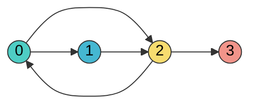

# DSA — Graphs (Java)

> "A graph problem is a BFS/DFS problem wearing a disguise — find the disguise, then the traversal writes itself."

**What this chapter covers:** The seven graph tools — BFS, DFS, Dijkstra, topological sort, Union-Find, cycle detection, and grids — each taught the same way: *the problem, why the obvious answer is too slow, the one idea that fixes it, a dry run you can follow with your finger, then the Java.* Chapter 2 of the 4-part DSA sequence (31 / 31b / 31c / 31d); section numbers continue from chapter 31.

---

## Start Here

### Pick a track

| Track | Time | Read this | Good for |
|-------|------|-----------|----------|
| **Speed run** | ~40 min | This page, then the **Approach** + **Walk-through** + **Java** of BFS, DFS, Dijkstra, topological sort and Union-Find | First pass |
| **Mastery** | ~3 hr | Everything, plus the first five problems marked in each list | Real preparation |
| **Refresh** | ~10 min | This page, then the Cheat Sheet at the end | The night before |

Each topic opens with a visible **Recognise** line: how the question sounds and the tool it calls for. Each Java program sits in one collapsed block, in the same order — **Problem · Example · Walk-through · Approach · Java · Output · Complexity**, plus a **Trap** when there is one — so you never read code before you know what it does. The key algorithms also have an animation (press ▶ to play, ⏭ to step one move, or change the speed), with its walk-through beside it as text. Graph walk-throughs say whether the graph is directed or undirected, and the graph is drawn before it is traced. The format is explained in full in [chapter 31's Start Here](#content/31_dsa_foundations).

### First, find the disguise

Most graph questions never say the word "graph". Your first job is always the same two sentences: **what is a node, and what is an edge?**

| The question is about… | A node is… | An edge is… |
|------------------------|------------|-------------|
| A grid or maze | one cell | a step to an adjacent cell |
| Word transformations | one word | changing exactly one letter |
| Course prerequisites | one course | "must be taken before" |
| A puzzle or lock | one arrangement of the state | one legal move |
| Accounts, friends, provinces | one person or account | "belongs with" |

Once you can say those two sentences, the rest of this chapter is a lookup.

### Which algorithm does the question want?


In the Cost column, **V** = the number of nodes (vertices) and **E** = the number of edges, so O(V + E) means "look at every node and every edge a constant number of times".

| # | When the question asks… | Reach for | Cost | Section |
|---|-------------------------|-----------|------|---------|
| 1 | fewest steps, all moves cost the same | **BFS** | O(V + E) | §18.12 |
| 2 | does a path exist / explore everything | **DFS** | O(V + E) | §18.12 |
| 3 | cheapest route, edges have different costs | **Dijkstra** | O((V+E) log V) | §18.13 |
| 4 | order things that depend on each other | **Topological sort** | O(V + E) | §18.13 |
| 5 | "are these two connected?", asked repeatedly | **Union-Find** | ~O(1) each | §18.13 |
| 6 | is there a loop? | **3-colour DFS** (directed) / **Union-Find** (undirected) | O(V + E) | §18.13 |
| 7 | islands, regions, a maze | **BFS/DFS on the grid** | O(rows × cols) | §18.14 |

> **The sentence to say out loud before coding.** *"Nodes are X, edges are Y, the graph is directed/undirected and weighted/unweighted, so this is a &lt;algorithm&gt; problem costing O(…)."* Everything else follows from that.

---

## Table of Contents

| Part | Topic | Sections |
|------|-------|----------|
| 3 | Graphs | §18.12–18.14: BFS/DFS, Dijkstra, Topo Sort, Union-Find, Grids |
| — | Revision | Cheat sheet and recall drills (unnumbered, at the end) |

**Sequence:** [31 — Foundations & Search](#content/31_dsa_foundations) → **31b (this chapter)** → [31c — Dynamic Programming](#content/31c_dynamic_programming) → [31d — Advanced Patterns & ML Coding](#content/31d_dsa_advanced_ml_coding)

---

# PART 3: GRAPHS

---

## 18.12 Graph Fundamentals

**Simple explanation.** A graph is *things* plus *which things are connected*. The things are **vertices** (nodes); the connections are **edges**. Social networks, road maps, course prerequisites and web links all have this shape.

Two questions decide how you handle one:

- **Directed or undirected?** A directed edge goes one way only (Twitter follows, "must be taken before"); an undirected edge goes both ways (Facebook friendships, roads).
- **Weighted or unweighted?** A weighted edge carries a cost (distance, time, price). In an unweighted graph every edge is one step — *which is what gives BFS shortest paths for free.*

Throughout this chapter **V** is the number of vertices, **E** the number of edges, and a node's **degree** is how many edges touch it.

### Representation: adjacency list vs matrix

**Recognise:** "how should I store the graph?" · **Use:** an adjacency list; a matrix only for a dense graph that needs O(1) edge checks.

Both pictures show the same **directed** graph (drawn below). `0 → [1, 2]` means "0 has arrows to 1 and 2"; in the matrix, row `u`, column `v` is `1` when there is an arrow `u → v`.

```
Adjacency List (what you want 99% of the time):
  0 → [1, 2]
  1 → [2]
  2 → [0, 3]
  3 → []

Adjacency Matrix:
     0  1  2  3
  0 [0, 1, 1, 0]
  1 [0, 0, 1, 0]
  2 [1, 0, 0, 1]
  3 [0, 0, 0, 0]
```

| Feature | Adjacency List | Adjacency Matrix |
|---------|----------------|------------------|
| Space | O(V + E) | O(V^2) |
| "Is there an edge u→v?" | O(degree) | O(1) |
| Iterate a node's neighbours | O(degree) | O(V) |
| Best for | sparse graphs — nearly always | dense graphs, constant-time edge checks |

A matrix costs V² space even for three edges — 10^10 cells at V = 100,000.



### Building a graph in Java

**Recognise:** the input is an edge list `[[u, v], …]` · **Use:** turn it into an adjacency list; an undirected edge goes into **both** endpoints' lists.

![Infographic: building an adjacency list from the undirected edge list 0-1, 0-2, 1-2, 2-3 (nodes 0..3), in six snapshots of the graph and the map: edge [0,1] makes lists for 0 and 1 with computeIfAbsent and writes 0 → 1 and 1 → 0; edge [0,2] appends 2 to 0's list and makes 2's list holding 0; edge [1,2] appends to both existing lists; edge [2,3] makes 3's list, ending at {0:[1,2], 1:[0,2], 2:[0,1,3], 3:[2]}, 8 entries for 4 edges; the same graph as a 4 × 4 matrix takes 16 cells for 8 ones (O(V²) space, O(1) edge check); a trap snapshot builds Topological Sort's directed pairs 3→1, 3→2, 1→0, 2→0 with the reverse line too, so every arrow gets a twin, a fake cycle, and the order is [] instead of [3, 1, 2, 0]. Java Option A (computeIfAbsent map) and Option B (list of lists) with both undirected-ONLY lines highlighted; O(V + E) to build.](diagrams/dsa31b_info_buildgraph_ai.png)

<details>
<summary><strong>Read as text</strong> — the example graph, dry run and trap</summary>

Problems usually hand you an **edge list**: one pair `[u, v]` per edge. The input for the rest of §18.12 is **undirected**, with nodes `0..3` and edges `[[0,1], [0,2], [1,2], [2,3]]`:

```
  0 ─── 1
   \   /
    \ /
     2 ─── 3
```

**Dry run → `{0:[1,2], 1:[0,2], 2:[0,1,3], 3:[2]}`** (written `{node: [its neighbours]}`):

| Edge added | Writes | Map so far |
|------------|--------|------------|
| `[0,1]` | `0 → 1` and `1 → 0` | `{0:[1], 1:[0]}` |
| `[0,2]` | `0 → 2` and `2 → 0` | `{0:[1,2], 1:[0], 2:[0]}` |
| `[1,2]` | `1 → 2` and `2 → 1` | `{0:[1,2], 1:[0,2], 2:[0,1]}` |
| `[2,3]` | `2 → 3` and `3 → 2` | `{0:[1,2], 1:[0,2], 2:[0,1,3], 3:[2]}` |

> **Trap:** adding the reverse edge in a **directed** problem. In Course Schedule it turns every prerequisite `a → b` into a fake cycle `a → b → a`, so any input with a prerequisite answers false. Write the second line only when the relationship is mutual.

</details>

```java
// Option A — adjacency map (works for any node labels)
Map<Integer, List<Integer>> graph = new HashMap<>();
for (int[] edge : edges) {
    graph.computeIfAbsent(edge[0], k -> new ArrayList<>()).add(edge[1]);
    graph.computeIfAbsent(edge[1], k -> new ArrayList<>()).add(edge[0]); // undirected ONLY
}

// Option B — use INSTEAD of A when nodes are exactly 0..n-1
List<List<Integer>> graph = new ArrayList<>();
for (int i = 0; i < n; i++) graph.add(new ArrayList<>());
for (int[] edge : edges) {
    graph.get(edge[0]).add(edge[1]);
    graph.get(edge[1]).add(edge[0]);                       // undirected ONLY
}
```

### BFS — fewest steps

**Recognise:** "shortest", "fewest steps", "minimum moves", and every edge costs the same · **Use:** BFS — a queue, one ring of nodes per step.

![Infographic: BFS fewest steps on the undirected graph with edges 0-1, 0-2, 1-2, 2-3 from start 0 to target 3, in five snapshots of the graph and the queue: offer 0 and mark it visited right away; ring 0 polls 0 and queues 1 and 2, so level becomes 1; ring 1 polls 1, whose neighbours are already visited; polling 2 queues 3 and level becomes 2; ring 2 polls 3 == target and returns 2 along 0 → 2 → 3. Java ring loop with the visited.add(neighbor) line highlighted (mark on enqueue); O(V + E) time, O(V) space; trap: re-reading queue.size() makes 0 → 1 return 0 instead of 1.](diagrams/dsa31b_info_bfs_ai.png)

**Watch BFS run, one step per frame** (press ▶ to play, or ⏭ to step). Green = visited, marked the moment a node joins the queue; yellow = just taken out; the blue bracket = the `size` snapshot, one ring.


<details>
<summary><strong>BFS Shortest Path (unweighted graph)</strong> — read as text and Java</summary>

**Problem:** You get an undirected graph as an adjacency map (built above), a `start` node and a `target` node. Return the fewest edges from `start` to `target`, or `-1` if `target` can't be reached.

**Example:**
```
Input:  edges = [[0,1],[0,2],[1,2],[2,3]], start = 0, target = 3
Output: 2          (0 -> 2 -> 3)
```

**Approach:** Listing every path and keeping the shortest is exponential, and on a graph with cycles it never ends without extra bookkeeping. Instead visit everything **one step** away, then everything **two steps** away, and so on. A queue gives exactly that order (the oldest node comes out first), so **the first time BFS reaches a node is by a shortest route** — stop as soon as the target comes out. Reading `queue.size()` once at the start of a ring tells you where the ring ends.

**Walk-through (the animation as text):** the ring number = how many steps those nodes are from 0.
```
  0 ─── 1
   \   /
    \ /
     2 ─── 3

ring  queue at start   taken out -> newly found                                target?
0     [0]              0 -> finds 1, 2                                         no
1     [1, 2]           1 -> nothing new (0, 2 seen); 2 -> finds 3 (0, 1 seen)  no
2     [3]              3                                                       yes -> return 2
```
Node 3 was first found while emptying ring 1, so it is exactly 2 steps away — nothing could reach it in fewer.


**Java:**
```java
import java.util.*;

public class BfsShortestPath {
    public int bfs(Map<Integer, List<Integer>> graph, int start, int target) {
        Queue<Integer> queue = new LinkedList<>();
        Set<Integer> visited = new HashSet<>();
        queue.offer(start);
        visited.add(start);                       // mark on ENQUEUE — see the trap
        int level = 0;                            // ring number = steps from start

        while (!queue.isEmpty()) {
            int size = queue.size();              // snapshot = exactly one ring
            for (int i = 0; i < size; i++) {
                int node = queue.poll();
                if (node == target) return level;
                for (int neighbor : graph.getOrDefault(node, List.of())) {
                    if (!visited.contains(neighbor)) {
                        visited.add(neighbor);
                        queue.offer(neighbor);
                    }
                }
            }
            level++;
        }
        return -1;                                // target not reachable
    }

    // Option A from "Building a graph in Java"
    static Map<Integer, List<Integer>> build(int[][] edges) {
        Map<Integer, List<Integer>> graph = new HashMap<>();
        for (int[] edge : edges) {
            graph.computeIfAbsent(edge[0], k -> new ArrayList<>()).add(edge[1]);
            graph.computeIfAbsent(edge[1], k -> new ArrayList<>()).add(edge[0]);
        }
        return graph;
    }

    public static void main(String[] args) {
        BfsShortestPath s = new BfsShortestPath();
        Map<Integer, List<Integer>> g = build(new int[][] {{0, 1}, {0, 2}, {1, 2}, {2, 3}});
        System.out.println("0 -> 3: " + s.bfs(g, 0, 3));
        System.out.println("0 -> 1: " + s.bfs(g, 0, 1));          // the size() trap gives 0
        System.out.println("0 -> 3 without edges 0-2, 1-2: "
            + s.bfs(build(new int[][] {{0, 1}, {2, 3}}), 0, 3));  // unreachable
    }
}
```

**Output:**
```
0 -> 3: 2
0 -> 1: 1
0 -> 3 without edges 0-2, 1-2: -1
```

> **Trap:** marking a node visited when you *dequeue* it instead of when you *enqueue* it. In a dense graph the same node is then queued once per incoming edge; memory explodes and the solution times out. Mark it the instant you push it.

> **Trap:** writing `for (int i = 0; i < queue.size(); i++)` instead of reading the size once. The size changes *inside* the loop — down with every `poll`, up with every `offer` — so a ring can stop early or swallow nodes from the next ring. On the graph above, `0 -> 1` returns `0` instead of `1`.

**Complexity:** O(V + E) time — every node leaves the queue once and every edge is examined once. O(V) space.
</details>

### DFS — does a path exist, and explore everything

**Recognise:** "is there a path?", "are these connected?", "visit every reachable node" · **Use:** DFS — recursion plus one `visited` set.

![Infographic: recursive DFS from 0 on the graph with edges 0-1, 0-2, 1-2, 2-3, in five snapshots of the graph and the call stack: dfs(0) marks 0 and calls dfs(1); dfs(1) skips visited 0 and calls dfs(2); dfs(2) skips 0 and 1 and calls dfs(3); dfs(3) is a dead end, so dfs(3), dfs(2) and dfs(1) return; back in dfs(0), 2 is already visited, giving the visit order [0, 1, 2, 3] (an explicit stack gives [0, 2, 3, 1]). Java dfs with the !visited.contains(neighbor) check highlighted; O(V + E) time, O(V) space; trap: one call reaches only one component, so loop over all nodes.](diagrams/dsa31b_info_dfs_ai.png)

**Watch recursive DFS run, one step per frame** (press ▶ to play, or ⏭ to step). The strip under the graph is the call stack: each unvisited neighbour opens a call on the right (purple arrow); a finished call returns (blue arrow).


<details>
<summary><strong>DFS Traversal (recursive and iterative)</strong> — read as text and Java</summary>

**Problem:** You get the same kind of adjacency map and a start node. Visit every node reachable from the start exactly once and record the visit order — the core of "are these connected?", "does a path exist?" and "collect the whole region".

**Example:**
```
Input:  edges = [[0,1],[0,2],[1,2],[2,3]], start = 0
Output: recursive [0, 1, 2, 3]      (iterative [0, 2, 3, 1])
```

**Approach:** Wandering from neighbour to neighbour without remembering where you have been loops forever on a cycle (this graph has `0–1–2`); one `visited` set fixes that. DFS makes the opposite choice to BFS: follow one path to its end, and only when it dead-ends, back up and try the next branch. Recursion gives you the stack for free. A call returns only after trying every neighbour, so nothing reachable is missed. The iterative version swaps the call stack for an explicit `ArrayDeque`.

**Walk-through (the animation as text, then the iterative version):** each `dfs(x)` line is one call; the calls it makes are indented under it. Neighbours are tried in list order.
```
dfs(0)                     visited {0}
├── dfs(1)                 visited {0,1}        ← 0's first neighbour
│   ├── 0 already visited — skip
│   └── dfs(2)             visited {0,1,2}
│       ├── 0, 1 already visited — skip
│       └── dfs(3)         visited {0,1,2,3}
│           └── 2 already visited — skip, back up
└── 2 already visited — skip

visit order: 0, 1, 2, 3

iterative (explicit stack, top on the right):
pop 0  visit, push 1, 2      stack [1, 2]
pop 2  visit, push 1, 3      stack [1, 1, 3]
pop 3  visit (2 seen)        stack [1, 1]
pop 1  visit (0, 2 seen)     stack [1]
pop 1  already visited, skip stack []

visit order: 0, 2, 3, 1
```

**Java:**
```java
import java.util.*;

public class DfsTraversal {
    List<Integer> order = new ArrayList<>();      // visit order

    // recursive — what you write by default
    public void dfs(Map<Integer, List<Integer>> graph, int node, Set<Integer> visited) {
        visited.add(node);
        order.add(node);                          // process node here
        for (int neighbor : graph.getOrDefault(node, List.of())) {
            if (!visited.contains(neighbor)) {
                dfs(graph, neighbor, visited);
            }
        }
    }

    // iterative — when the graph is big enough to blow the call stack
    public void dfsIterative(Map<Integer, List<Integer>> graph, int start) {
        Deque<Integer> stack = new ArrayDeque<>();
        Set<Integer> visited = new HashSet<>();
        stack.push(start);
        while (!stack.isEmpty()) {
            int node = stack.pop();
            if (visited.contains(node)) continue;   // a node can be pushed more than once
            visited.add(node);
            order.add(node);
            for (int neighbor : graph.getOrDefault(node, List.of())) {
                if (!visited.contains(neighbor)) stack.push(neighbor);
            }
        }
    }

    // same build() as in BfsShortestPath
    static Map<Integer, List<Integer>> build(int[][] edges) {
        Map<Integer, List<Integer>> graph = new HashMap<>();
        for (int[] edge : edges) {
            graph.computeIfAbsent(edge[0], k -> new ArrayList<>()).add(edge[1]);
            graph.computeIfAbsent(edge[1], k -> new ArrayList<>()).add(edge[0]);
        }
        return graph;
    }

    public static void main(String[] args) {
        Map<Integer, List<Integer>> g = build(new int[][] {{0, 1}, {0, 2}, {1, 2}, {2, 3}});
        DfsTraversal rec = new DfsTraversal(), it = new DfsTraversal(), split = new DfsTraversal();
        rec.dfs(g, 0, new HashSet<>());
        it.dfsIterative(g, 0);
        split.dfs(build(new int[][] {{0, 1}, {2, 3}}), 0, new HashSet<>());
        System.out.println("recursive " + rec.order + ", iterative " + it.order);
        System.out.println("edges 0-1, 2-3, one call from 0: " + split.order);  // 2 and 3 missed
    }
}
```

**Output:**
```
recursive [0, 1, 2, 3], iterative [0, 2, 3, 1]
edges 0-1, 2-3, one call from 0: [0, 1]
```

> **Order note:** the stack pops the **last** neighbour pushed first, hence `0, 2, 3, 1`. Both are valid DFS orders.

> **Trap:** recursion on a graph with 10^5+ nodes. A long chain becomes a 100,000-frame call stack and throws `StackOverflowError`. If the constraint is large, say so and switch to the iterative version — interviewers listen for exactly this.

> **Trap:** calling DFS only once. If the graph may be **disconnected** (the second output line), loop over every node and start a fresh DFS from each unvisited one — that loop also counts the connected components.

**Complexity:** O(V + E) time. O(V) space for the recursive version (`visited` plus the *call stack*, which is real memory); O(V + E) for the iterative one, because a node can sit on the stack once per edge that reached it before it was visited.
</details>

**Practice:** [Number of Islands →](#dsa-problem-number-of-islands) · [Graph Valid Tree →](#dsa-problem-graph-valid-tree)

### Choosing between them

| The question is about… | Use | Why |
|------------------------|-----|-----|
| Shortest path, unweighted | **BFS** | the first arrival is the shortest one |
| Level-by-level anything | **BFS** | reading `queue.size()` once per ring tells you where each level ends |
| Spreading from many starts at once | **BFS** (multi-source) | seed the queue with all of them |
| Connected components | either | both reach everything |
| Cycle detection (directed) | **DFS** | an edge back to a node still on the current path is a loop (§18.13) |
| Topological ordering | either | Kahn's algorithm (§18.13) is BFS; DFS works if you **reverse** its finishing order |
| All paths between two nodes | **DFS** | backtracking is natural |

> **The one-line rule:** fewest steps on an **unweighted** graph is BFS; add weights and it becomes Dijkstra.

### 60-second recall

<details>
<summary>1. Why does BFS give shortest paths but DFS does not?</summary>

BFS finishes every node `d` steps away before touching anything `d + 1` steps away, so its first arrival at a node uses the fewest steps. DFS commits to one path, so it may reach a node by a long route first and never reconsider it.
</details>

<details>
<summary>2. When do you mark a node visited in BFS, and why does it matter?</summary>

At enqueue time — otherwise a node is queued once per incoming edge (the first trap under BFS).
</details>

<details>
<summary>3. Your DFS works on the samples but crashes on the big test case. What happened?</summary>

`StackOverflowError` from recursion depth: a path of 100,000 nodes means 100,000 stack frames. Rewrite it iteratively with an explicit `ArrayDeque`.
</details>

**Key Problems — Detailed Solutions:**

**Recognise:** "return a deep copy of the graph" · **Change:** BFS, plus a map original → copy that doubles as the visited set.

![Infographic: Clone Graph with BFS and a map from original to copy on the 4-cycle 1-2-3-4 (adjList 2,4 / 1,3 / 2,4 / 1,3), in five snapshots of the original and the copy side by side: copy the given node 1 first and queue it; take 1, create 2' and 4', queue them and link 1' to 2' and 4'; take 2, create 3' and link 2' to 1' and 3'; take 4 and link 4' to 1' and 3'; take 3, link 3' to 2' and 4', the queue is empty and 1' is returned. Java BFS with the map.get(curr).neighbors.add(map.get(neighbor)) line highlighted; O(V + E) time, O(V) space; trap: linking the original neighbor makes the copy shallow.](diagrams/dsa31b_info_clone_ai.png)

<details>
<summary><strong>Clone Graph</strong> — Medium · read as text and Java</summary>

**Problem:** You get one node of a connected, undirected graph; every `Node` has an integer `val` and a list `neighbors` (the class is at the top of the Java below). Return a **deep copy** — brand-new nodes with the same values and connections; no original node may appear in the copy. LeetCode writes the graph as `adjList`, where `adjList[i]` lists the neighbours of the node whose value is `i + 1`, and hands you node 1.

**Example:**
```
Input:  adjList = [[2,4],[1,3],[2,4],[1,3]]
Output: [[2,4],[1,3],[2,4],[1,3]]      same shape, but every node is new
```

**Approach:** BFS (or DFS) with a HashMap from each original node to its copy. When a neighbour has no copy yet, create one and queue the original. Always link **copies to copies** — never point a copy at an original.

**Walk-through:** the input is a 4-node square; `1'` means "the copy of 1".
```
  1 ─── 2
  │     │
  4 ─── 3

take 1 → 2, 4 not copied yet: create 2', 4'; link 1' to 2', 4'    queue [2, 4]
take 2 → 1 copied; create 3'; link 2' to 1', 3'                   queue [4, 3]
take 4 → 1, 3 copied; link 4' to 1', 3'                           queue [3]
take 3 → 2, 4 copied; link 3' to 2', 4'                           queue []
```

**Java:**
```java
import java.util.*;

public class CloneGraph {
    static class Node {
        int val; List<Node> neighbors = new ArrayList<>();
        Node(int v) { val = v; }
    }

    public Node cloneGraph(Node node) {
        if (node == null) return null;
        Map<Node, Node> map = new HashMap<>();
        Queue<Node> queue = new LinkedList<>();
        map.put(node, new Node(node.val));
        queue.offer(node);
        while (!queue.isEmpty()) {
            Node curr = queue.poll();
            for (Node neighbor : curr.neighbors) {
                if (!map.containsKey(neighbor)) {
                    map.put(neighbor, new Node(neighbor.val));
                    queue.offer(neighbor);
                }
                map.get(curr).neighbors.add(map.get(neighbor));
            }
        }
        return map.get(node);
    }

    public static void main(String[] args) {
        int[][] adjList = {{2, 4}, {1, 3}, {2, 4}, {1, 3}};
        Node[] orig = new Node[adjList.length + 1];
        for (int v = 1; v <= adjList.length; v++) orig[v] = new Node(v);
        for (int v = 1; v <= adjList.length; v++)
            for (int u : adjList[v - 1]) orig[v].neighbors.add(orig[u]);

        Map<Integer, Node> copy = new TreeMap<>();               // walk the copy, by value
        Deque<Node> queue = new ArrayDeque<>(List.of(new CloneGraph().cloneGraph(orig[1])));
        boolean allNew = true;
        while (!queue.isEmpty()) {
            Node c = queue.poll();
            allNew &= c != orig[c.val];
            if (copy.putIfAbsent(c.val, c) == null) queue.addAll(c.neighbors);
        }
        List<List<Integer>> adj = new ArrayList<>();
        for (Node c : copy.values()) adj.add(c.neighbors.stream().map(x -> x.val).toList());
        System.out.println(adj + ", every node new: " + allNew);
    }
}
```

**Output:**
```
[[2, 4], [1, 3], [2, 4], [1, 3]], every node new: true
```

**Complexity:** O(V + E) time, O(V) space
</details>

**Practice:** [Clone Graph →](#dsa-problem-clone-graph)

**Recognise:** "the fewest one-letter changes to turn one word into another" · **Change:** BFS where a node is a word; find neighbours by trying `'a'`–`'z'` at each position.

![Infographic: Word Ladder from hit to cog with wordList hot, dot, dog, lot, log, cog, in five snapshots of the word graph, one column per ring: queue hit with steps = 1; poll hit, i→o gives hot, steps = 2; poll hot, h→d gives dot and h→l gives lot, steps = 3; poll dot and lot, giving dog and log, steps = 4; poll dog, d→c gives cog == end, so return 4 + 1 = 5 words. Java expand-one-word loop with the if (next.equals(end)) return steps + 1 line highlighted; O(M² × N) time; trap: end must be in wordList, otherwise the answer is 0.](diagrams/dsa31b_info_wordladder_ai.png)

<details>
<summary><strong>Word Ladder</strong> — Hard · read as text and Java</summary>

**Problem:** You get two lowercase words of the same length, `beginWord` and `endWord`, and a list `wordList`. One move changes exactly one letter, and the word you land on must be in `wordList` — including `endWord`, so if it is not in the list the answer is `0`. Return the **number of words** in the shortest chain, counting both ends, or `0` if there is none.

**Example:**
```
Input:  beginWord = "hit", endWord = "cog",
        wordList = ["hot","dot","dog","lot","log","cog"]
Output: 5          hit → hot → dot → dog → cog  (5 words, 4 moves)
```

**Approach:** each ring of the BFS adds one word to the chain. Building the whole word graph up front is wasted work; instead, for each word taken out, change each letter to `'a'`–`'z'` and keep the results that are in the word set. Remove a word from the set as soon as it is queued, so it is never used twice.

**Walk-through:** one ring per word in the chain.
```
word 1: hit
word 2: hot             only one-letter change of "hit" that is in the list
word 3: dot, lot        one-letter changes of "hot"
word 4: dog, log        from dot and lot
word 5: cog             from dog — that is endWord, so the answer is 5
```

**Java:**
```java
import java.util.*;

public class WordLadder {
    public int ladderLength(String begin, String end, List<String> wordList) {
        Set<String> dict = new HashSet<>(wordList);
        if (!dict.contains(end)) return 0;
        Queue<String> queue = new LinkedList<>();
        queue.offer(begin);
        dict.remove(begin);
        int steps = 1;                                   // words in the chain so far
        while (!queue.isEmpty()) {
            int size = queue.size();
            for (int i = 0; i < size; i++) {
                char[] word = queue.poll().toCharArray();
                for (int j = 0; j < word.length; j++) {
                    char orig = word[j];
                    for (char c = 'a'; c <= 'z'; c++) {
                        word[j] = c;
                        String next = new String(word);
                        if (next.equals(end)) return steps + 1;
                        if (dict.contains(next)) {
                            dict.remove(next);
                            queue.offer(next);
                        }
                    }
                    word[j] = orig;
                }
            }
            steps++;
        }
        return 0;
    }

    public static void main(String[] args) {
        List<String> words = List.of("hot", "dot", "dog", "lot", "log", "cog");
        WordLadder w = new WordLadder();
        System.out.println("hit -> cog: " + w.ladderLength("hit", "cog", words));
        System.out.println("cog not in the list: " + w.ladderLength("hit", "cog", words.subList(0, 5)));
    }
}
```

**Output:**
```
hit -> cog: 5
cog not in the list: 0
```

**Complexity:** with M = word length and N = number of words: O(M² × N) time (each word tries 26 × M changes, each built in O(M)), O(M × N) space.
</details>

**Practice:** [Word Ladder →](#dsa-problem-word-ladder)

**Recognise:** "which cells can drain into both oceans?" · **Change:** run DFS backwards — uphill from each ocean's edge cells — and keep the cells both searches reach.

![Infographic: Pacific Atlantic Water Flow on the 5 × 5 heights grid, with a Pacific grid and an Atlantic grid per snapshot: reverse DFS climbs uphill (>=) from each ocean's edge; from (0,0) the Pacific climb reaches 13 cells; the rest of the left and right edges bring Pacific to 16 and Atlantic to 9; the top and bottom rows bring Atlantic to 16; cell (2,3) is Atlantic-only because its Pacific-side neighbours are higher; the 7 cells reached by both are (0,4), (1,3), (1,4), (2,2), (3,0), (3,1), (4,0). Java dfs with the uphill h[nr][nc] >= h[r][c] condition highlighted; O(m × n) time and space; trap: climbing with > instead of >= returns only 6 cells.](diagrams/dsa31b_info_pacific_ai.png)

<details>
<summary><strong>Pacific Atlantic Water Flow</strong> — Medium · read as text and Java</summary>

**Problem:** You get an `m × n` grid of heights. The Pacific touches the top and left edges; the Atlantic the bottom and right edges. Rain flows to an up/down/left/right neighbour of **equal or lower** height, and from any edge cell into that edge's ocean. Return every cell `[row, col]` (0-based) from which water can reach **both** oceans.

**Example:**
```
Input:  heights = [[1,2,2,3,5],[3,2,3,4,4],[2,4,5,3,1],[6,7,1,4,5],[5,1,1,2,4]]
Output: [[0,4],[1,3],[1,4],[2,2],[3,0],[3,1],[4,0]]
```

**Approach:** Asking "where does water from this cell go?" for every cell repeats the same searches. Reverse it: run one DFS from all Pacific edge cells and one from all Atlantic edge cells, moving only to neighbours of **equal or greater** height — every cell you can climb to can drain back down into that ocean. Return the cells both searches reached.

**Walk-through:**
```
heights          P = Pacific only, A = Atlantic only, B = both
1 2 2 3 5        P P P P B
3 2 3 4 4        P P P B B
2 4 5 3 1        P P B A A
6 7 1 4 5        B B A A A
5 1 1 2 4        B A A A A
```
The seven `B` cells, read row by row, are exactly the output.

**Java:**
```java
import java.util.*;

public class PacificAtlantic {
    public List<List<Integer>> pacificAtlantic(int[][] heights) {
        int m = heights.length, n = heights[0].length;
        boolean[][] pacific = new boolean[m][n], atlantic = new boolean[m][n];
        for (int i = 0; i < m; i++) {
            dfs(heights, pacific, i, 0);
            dfs(heights, atlantic, i, n - 1);
        }
        for (int j = 0; j < n; j++) {
            dfs(heights, pacific, 0, j);
            dfs(heights, atlantic, m - 1, j);
        }
        List<List<Integer>> res = new ArrayList<>();
        for (int i = 0; i < m; i++)
            for (int j = 0; j < n; j++)
                if (pacific[i][j] && atlantic[i][j])
                    res.add(List.of(i, j));
        return res;
    }
    private void dfs(int[][] h, boolean[][] visited, int r, int c) {
        visited[r][c] = true;
        int[][] dirs = {{0,1},{0,-1},{1,0},{-1,0}};
        for (int[] d : dirs) {
            int nr = r + d[0], nc = c + d[1];
            if (nr >= 0 && nr < h.length && nc >= 0 && nc < h[0].length
                && !visited[nr][nc] && h[nr][nc] >= h[r][c])
                dfs(h, visited, nr, nc);
        }
    }

    public static void main(String[] args) {
        int[][] heights = {{1, 2, 2, 3, 5}, {3, 2, 3, 4, 4}, {2, 4, 5, 3, 1}, {6, 7, 1, 4, 5}, {5, 1, 1, 2, 4}};
        System.out.println(new PacificAtlantic().pacificAtlantic(heights));
    }
}
```

**Output:**
```
[[0, 4], [1, 3], [1, 4], [2, 2], [3, 0], [3, 1], [4, 0]]
```

**Complexity:** O(m × n) time, O(m × n) space
</details>

**Practice:** [Pacific Atlantic Water Flow →](#dsa-problem-pacific-atlantic-water-flow)

**Problem List — Graph Fundamentals:**

**Start with these five:** Number of Connected Components · Clone Graph · Graph Valid Tree · Is Graph Bipartite? · Word Ladder.

| #   | Problem                            | Difficulty | Key Insight                          |
|-----|------------------------------------|------------|--------------------------------------|
| 1   | Number of Connected Components (LC 323) | Medium | DFS/BFS from each unvisited node |
| 2   | Clone Graph (LC 133)               | Medium     | BFS + HashMap old→new                |
| 3   | Pacific Atlantic Water Flow (417)  | Medium     | Reverse DFS/BFS from ocean borders   |
| 4   | Graph Valid Tree (LC 261)          | Medium     | n-1 edges + all connected            |
| 5   | Word Ladder (LC 127)               | Hard       | BFS, each word is a node             |
| 6   | Minimum Genetic Mutation (LC 433)  | Medium     | BFS, same pattern as Word Ladder     |
| 7   | Open the Lock (LC 752)             | Medium     | BFS on state space                   |
| 8   | All Paths From Source to Target    | Medium     | DFS backtracking                     |
| 9   | Is Graph Bipartite? (LC 785)       | Medium     | BFS/DFS 2-coloring                   |
| 10  | Shortest Path in Binary Matrix     | Medium     | BFS 8-directional                    |

---

## 18.13 Advanced Graphs

### Dijkstra — cheapest route when edges cost different amounts

**Recognise:** "cheapest / fastest / minimum total cost", edges with different costs that are never negative · **Use:** a min-heap of `(dist, node)` — settle the nearest node, relax its edges.

![Infographic: Dijkstra from source A on edges A–B 1, A–C 4, B–C 2, B–D 5, C–D 1, in five snapshots of the graph, the min-heap and dist: poll A, relax B to 1 and C to 4; poll B, relax C to 3 and D to 6; poll C, relax D to 4; pop the stale copy (4, C) and skip it because 4 > dist C = 3; poll D, then skip stale (6, D), leaving A 0, B 1, C 3, D 4. Java loop with the if (d > dist[u]) continue line highlighted; O((V + E) log V) time, O(V + E) space; trap: a negative edge silently breaks settled = final.](diagrams/dsa31b_info_dijkstra_ai.png)

**Watch Dijkstra run, one step per frame** (press ▶ to play, or ⏭ to step). Each pop takes the smallest `(dist, node)` from the heap and settles that node (**green**); the **blue** arrow is the edge being relaxed, comparing `dist[u] + w` with `dist[v]`. A **red** heap entry is a stale copy that gets skipped.


<details>
<summary><strong>Dijkstra — cheapest cost from one source</strong> — read as text and Java</summary>

**Problem:** You get an **undirected** graph whose edge costs are zero or more, and a source node. Return the cheapest total cost from the source to every node; a node that can't be reached keeps `Integer.MAX_VALUE` (∞).

**Example:**
```
Input:  edges A-B 1, A-C 4, B-C 2, B-D 5, C-D 1, source A
Output: A 0, B 1, C 3, D 4

In the code A = 0, B = 1, C = 2, D = 3:
Input:  n = 4, edges = [[0,1,1],[0,2,4],[1,2,2],[1,3,5],[2,3,1]], src = 0
Output: [0, 1, 3, 4]
```

**Walk-through (the animation as text):** the best known cost to each node (∞ = no route found yet). Each step settles the nearest unsettled node and checks its unsettled neighbours.
```
          B
       1 /|\ 5
        / | \
       A  |2 D
        \ | /
       4 \|/ 1
          C
                                                     best known after
settle (cost)   check its unsettled neighbours       A  B  C  D
start           -                                    0  ∞  ∞  ∞   only the source is known
A (0)           B: 0+1 = 1   C: 0+4 = 4              0  1  4  ∞
B (1)           C: 1+2 = 3 (beats 4)   D: 1+5 = 6    0  1  3  6   C got cheaper: a relaxation
C (3)           D: 3+1 = 4 (beats 6)                 0  1  3  4   D got cheaper
D (4)           no unsettled neighbours              0  1  3  4   done
```
The heap still holds two out-of-date entries, C at 4 and D at 6; when they come out, `if (d > dist[u]) continue` throws them away.

**Approach:** BFS finds the fewest *hops*, not the lowest cost: `A → C` costs 4 in one hop, but `A → B → C` costs 1 + 2 = 3 (and trying every path is exponential). Dijkstra repeatedly **settles** the nearest unsettled node — its distance is now final — then **relaxes** its edges: for an edge `u → v` with cost `w`, if `dist[u] + w < dist[v]`, lower `dist[v]`. Settling is safe only because no edge is negative: any other route to that node passes through a node at least as far away, so it can't come back cheaper. A min-heap finds the nearest unsettled node in O(log V).


**Java:**
```java
import java.util.*;

public class Dijkstra {
    // graph[u] = the [neighbour, cost] pairs of node u
    public int[] dijkstra(List<int[]>[] graph, int n, int src) {
        int[] dist = new int[n];
        Arrays.fill(dist, Integer.MAX_VALUE);
        dist[src] = 0;

        // pq holds [distanceSoFar, node], smallest distance first
        PriorityQueue<int[]> pq = new PriorityQueue<>((a, b) -> Integer.compare(a[0], b[0]));
        pq.offer(new int[]{0, src});

        while (!pq.isEmpty()) {
            int[] curr = pq.poll();
            int d = curr[0], u = curr[1];
            if (d > dist[u]) continue;            // stale copy — see the trap

            for (int[] edge : graph[u]) {
                int v = edge[0], w = edge[1];
                if (dist[u] + w < dist[v]) {       // the relaxation
                    dist[v] = dist[u] + w;
                    pq.offer(new int[]{dist[v], v});
                }
            }
        }
        return dist;
    }

    // edges [u, v, cost]; UNDIRECTED — drop the second add for a directed graph
    @SuppressWarnings("unchecked")
    static List<int[]>[] build(int n, int[][] edges) {
        List<int[]>[] graph = new List[n];
        for (int i = 0; i < n; i++) graph[i] = new ArrayList<>();
        for (int[] e : edges) {
            graph[e[0]].add(new int[]{e[1], e[2]});
            graph[e[1]].add(new int[]{e[0], e[2]});
        }
        return graph;
    }

    public static void main(String[] args) {
        int[][] abcd = {{0, 1, 1}, {0, 2, 4}, {1, 2, 2}, {1, 3, 5}, {2, 3, 1}};   // A–B 1, A–C 4, …
        System.out.println(Arrays.toString(new Dijkstra().dijkstra(build(4, abcd), 4, 0)));
        int[][] lonely = {{0, 1, 7}};                                           // node 2 unreachable
        System.out.println(Arrays.toString(new Dijkstra().dijkstra(build(3, lonely), 3, 0)));
    }
}
```

**Output:**
```
[0, 1, 3, 4]
[0, 7, 2147483647]
```

> **Trap:** dropping `if (d > dist[u]) continue`. Java's `PriorityQueue` has no decrease-key, so a cheaper distance pushes a **second** copy instead of updating the first. Without the guard every stale copy is expanded again and the complexity degrades badly. It is one line and interviewers look for it.

> **Trap:** a negative edge. It breaks exactly the "can't come back cheaper" assumption, and the answer is silently wrong. That is what forces Bellman-Ford (chapter 31d, §18.28).

> **Practice note — Network Delay Time differs in three small ways.** Nodes are `1..n`, the edges `times[i] = [u, v, time]` are **directed**, and the source is `k`. Size `graph` and `dist` as `n + 1` (skip slot 0), add each edge one way only, and return the **largest** distance — or `-1` if a node is unreached. On `times = [[2,1,1],[2,3,1],[3,4,1]], n = 4, k = 2` that gives `2`.

**Complexity:** O((V + E) log V) time, O(V + E) space.
</details>

**Practice:** [Network Delay Time →](#dsa-problem-network-delay-time)

### Topological Sort — ordering things that depend on each other

**Recognise:** "prerequisites", "build order", "order the tasks so each comes after what it depends on" · **Use:** Kahn's algorithm — keep outputting a node that waits for nothing.

![Topological Sort infographic (Kahn's algorithm): n = 4 with pairs 3 before 1, 3 before 2, 1 before 0 and 2 before 0; five graph snapshots count indegrees 0:2, 1:1, 2:1, 3:0 so only 3 starts the queue, taking 3 frees 1 and 2, taking 1 drops 0's count to 1 (not ready), taking 2 frees 0, and taking 0 leaves 4 = n nodes, so the answer is [3, 1, 2, 0], while a sixth snapshot shows the cycle 0 → 1 → 2 → 0 where no node has indegree 0, so it returns an empty list; the Java highlights the --indegree[next] == 0 check, O(V + E) time and space, and the trap is that LeetCode pairs are [course, prereq] and must be flipped.](diagrams/dsa31b_info_topo_ai.png)

**Watch Kahn's algorithm run, one step per frame** (press ▶ to play, or ⏭ to step). Each node shows its indegree; the node taken from the queue (**yellow**) joins the output (**green**), and each arrow it removes (**blue**) lowers a count — a count that hits 0 joins the queue.


<details>
<summary><strong>Topological Sort (Kahn's algorithm)</strong> — read as text and Java</summary>

**Problem:** You get `n` tasks `0..n-1` and **directed** pairs `[a, b]`, each meaning "**a must come before b**". Return any order of all `n` tasks that respects every pair, or an empty list if none exists (exactly when the pairs form a cycle).

**Example:**
```
Input:  n = 4, pairs = [[3,1], [3,2], [1,0], [2,0]]
Output: [3, 1, 2, 0]
```

**Walk-through (the animation as text):** each remaining node's waiting count (`node:count`), the ready queue, and the output. `*` = that count just dropped to 0, so the node joins the queue.
```
  3 ──→ 1 ──→ 0
  │           ↑
  └───→ 2 ────┘

ready queue -> take   what taking it does               waiting counts after   output so far
start                 count the arrows into each node   0:2  1:1  2:1  3:0*    []
[3]    -> take 3      removes 3's arrows into 1 and 2   0:2  1:0* 2:0*         [3]
[1, 2] -> take 1      removes 1's arrow into 0          0:1  2:0               [3, 1]
[2]    -> take 2      removes 2's arrow into 0          0:0*                   [3, 1, 2]
[0]    -> take 0      nothing left to remove            -                      [3, 1, 2, 0]
```
`[3, 2, 1, 0]` would be equally valid; ties can go either way.

**Approach:** Trying all n! orders is hopeless. Instead count, for each node, how many arrows still point into it — its **indegree**, the number of things it still waits for. A node waiting for nothing can go now: output it and remove its outgoing arrows, which may drop other counts to 0. A queue holds the nodes that are ready (this is **Kahn's algorithm**). A node is output only after everything it waits for, so the order is valid.


**Java:**
```java
import java.util.*;

public class TopologicalSort {
    // Kahn's algorithm; edges [a, b] = "a must come before b"
    public List<Integer> topologicalSort(int n, int[][] edges) {
        int[] indegree = new int[n];
        List<List<Integer>> graph = new ArrayList<>();
        for (int i = 0; i < n; i++) graph.add(new ArrayList<>());
        for (int[] e : edges) {
            graph.get(e[0]).add(e[1]);
            indegree[e[1]]++;
        }

        Queue<Integer> queue = new LinkedList<>();
        for (int i = 0; i < n; i++) if (indegree[i] == 0) queue.offer(i);

        List<Integer> order = new ArrayList<>();
        while (!queue.isEmpty()) {
            int node = queue.poll();
            order.add(node);
            for (int next : graph.get(node)) {
                if (--indegree[next] == 0) queue.offer(next);   // freed up
            }
        }
        return order.size() == n ? order : List.of();   // short = a cycle blocked it
    }

    public static void main(String[] args) {
        TopologicalSort t = new TopologicalSort();
        System.out.println(t.topologicalSort(4, new int[][]{{3, 1}, {3, 2}, {1, 0}, {2, 0}}));
        System.out.println(t.topologicalSort(3, new int[][]{{0, 1}, {1, 2}, {2, 0}}));   // a cycle
    }
}
```

**Output:**
```
[3, 1, 2, 0]
[]
```

> **Cycle detection, free.** If the output is shorter than `n`, the leftovers all wait on each other — a cycle — and no valid order exists. That one check *is* the whole of Course Schedule.

> **Trap — LeetCode writes the pairs backwards.** Course Schedule gives `[course, prerequisite]`: `[1,0]` means "take 0 **before** 1". Course Schedule II's `prerequisites = [[1,0],[2,0],[3,1],[3,2]]` are our four pairs read the other way round, which is why its example answer `[0, 2, 1, 3]` is ours reversed. Flip LeetCode pairs `p` when building: `graph.get(p[1]).add(p[0]); indegree[p[0]]++;`. Forgetting the flip produces a plausible-looking wrong answer.

**Complexity:** O(V + E) time, O(V + E) space.
</details>

**Practice:** [Course Schedule →](#dsa-problem-course-schedule) · [Course Schedule II →](#dsa-problem-course-schedule-ii)

### Union-Find (Disjoint Set Union) — "are these two connected?"

**Recognise:** "connected?", "provinces", "groups", "merge accounts", "redundant edge", or connectivity queries while edges keep arriving (re-running DFS each time is too slow) · **Use:** a parent array with path compression + union by rank.

![Union-Find infographic: n = 5 items each leading its own group (parent 0, 1, 2, 3, 4, every rank 0); snapshots show union(0,1) hanging 1 under 0 and raising rank[0] to 1, union(1,2) hanging 2 under leader 0 because rank 1 beats 0, connected(0,2) true because both find leader 0 and connected(0,3) false, union(2,0) returning false because they already share leader 0 (the edge that would close a cycle), and path compression turning the chain 3 → 2 → 1 → 0 into parents 0, 0, 0, 0 so find(3) drops from 3 hops to 1; the Java highlights parent[x] = find(parent[x]), nearly O(1) amortised per call with both rank and compression, and the trap is comparing parent[x] == parent[y] instead of find(x) == find(y).](diagrams/dsa31b_info_unionfind_ai.png)

<details>
<summary><strong>Union-Find (Disjoint Set Union)</strong> — read as text and Java</summary>

**Problem:** `n` items `0..n-1` each start in a group of their own. Support two operations, called many times in any order: `union(x, y)` merges the groups of `x` and `y`; `connected(x, y)` returns `true` if they are now in the same group.

**Example:**
```java
UnionFind uf = new UnionFind(5);   // items 0..4, each alone
uf.union(0, 1);
uf.union(1, 2);
uf.connected(0, 2);                // true  — 0, 1, 2 are one group
uf.connected(0, 3);                // false — 3 is still alone
```

**Walk-through:** every item's parent **after** each call (the item it points up to; a leader points at itself), and the ranks that decide who goes on top.
```
item             0  1  2  3  4
start            0  1  2  3  4    everyone leads their own group; every rank is 0
union(0,1)       0  0  2  3  4    leaders 0, 1 tie on rank → hang 1 under 0; 0's rank → 1
union(1,2)       0  0  0  3  4    leaders 0 (rank 1), 2 (rank 0) → hang 2 under 0
connected(0,2)   0  0  0  3  4    leaders 0 and 0 → true
connected(0,3)   0  0  0  3  4    leaders 0 and 3 → false
```

**Path compression in one picture** — new input: the chain 3 → 2 → 1 → 0 (union by rank never builds it, but a version without it can):
```
item             0  1  2  3
before find(3)   0  0  1  2    3 → 2 → 1 → 0: three hops to the leader
after find(3)    0  0  0  0    3 and 2 now point straight at 0: one hop
```

**Approach:** A BFS or DFS per query costs O(V + E) *each time* — hopeless with 100,000 queries. Instead give every group **one leader**. Each item stores a **parent**, the item it points up to; a leader points at itself. `find(x)` walks up to the leader, so "same group?" becomes "same leader?", and merging is one pointer change: hang one leader under the other. Two refinements make it nearly free:

- **Union by rank** — each leader keeps a **rank** (starting at 0) that bounds its tree's height. Hang the lower-rank leader under the higher one; on a tie either may go on top (this code keeps `x`'s) and the winner's rank goes up by 1.
- **Path compression** — on the way back from `find`, re-point every item you walked past **straight at the leader**, so nobody pays for that path again.


**Java** (it also holds `hasCycleUndirected` from Cycle Detection below):
```java
import java.util.*;

public class UnionFindDemo {
    static class UnionFind {
        int[] parent, rank;
        int components;                                  // how many groups exist right now

        UnionFind(int n) {
            parent = new int[n];
            rank = new int[n];
            components = n;
            for (int i = 0; i < n; i++) parent[i] = i;   // everyone starts as their own leader
        }

        int find(int x) {                                // with path compression
            if (parent[x] != x) parent[x] = find(parent[x]);
            return parent[x];
        }

        boolean union(int x, int y) {                    // by rank; false = already together
            int px = find(x), py = find(y);
            if (px == py) return false;
            if (rank[px] < rank[py]) { int tmp = px; px = py; py = tmp; }  // higher rank on top
            parent[py] = px;
            if (rank[px] == rank[py]) rank[px]++;
            components--;
            return true;
        }

        boolean connected(int x, int y) { return find(x) == find(y); }
    }

    public static boolean hasCycleUndirected(int n, int[][] edges) {
        UnionFind uf = new UnionFind(n + 1);           // n + 1 slots fit nodes 0..n-1 and 1..n
        for (int[] e : edges) {
            if (!uf.union(e[0], e[1])) return true;     // union failed = already connected
        }
        return false;
    }

    static String parents(UnionFind uf) { return "   parent " + Arrays.toString(uf.parent); }

    public static void main(String[] args) {
        UnionFind uf = new UnionFind(5);                 // the example
        System.out.println("union(0, 1) -> " + uf.union(0, 1) + parents(uf));
        System.out.println("union(1, 2) -> " + uf.union(1, 2) + parents(uf));
        System.out.println("connected(0, 2) -> " + uf.connected(0, 2));
        System.out.println("connected(0, 3) -> " + uf.connected(0, 3));
        System.out.println("union(2, 0) -> " + uf.union(2, 0) + "   components " + uf.components);

        UnionFind chain = new UnionFind(4);              // path compression on 3 → 2 → 1 → 0
        chain.parent = new int[]{0, 0, 1, 2};
        System.out.println("find(3) -> " + chain.find(3) + parents(chain));

        System.out.println("hasCycleUndirected, triangle -> "
            + hasCycleUndirected(3, new int[][]{{1, 2}, {1, 3}, {2, 3}}));
    }
}
```

**Output:**
```
union(0, 1) -> true   parent [0, 0, 2, 3, 4]
union(1, 2) -> true   parent [0, 0, 0, 3, 4]
connected(0, 2) -> true
connected(0, 3) -> false
union(2, 0) -> false   components 3
find(3) -> 0   parent [0, 0, 0, 0]
hasCycleUndirected, triangle -> true
```

> **Trap:** writing `find` without path compression. It still works, but each `find` costs O(log n) instead of near-O(1) — union by rank keeps trees at most about log₂ n tall (65,536 items → at most 16 hops). Drop union by rank as well and a long chain makes every `find` O(n). The single line `parent[x] = find(parent[x])` is the whole optimisation.

> **Trap:** comparing `parent[x] == parent[y]` instead of `find(x) == find(y)`. Items in one group often have different *immediate* parents; only the leader identifies the group.

**Complexity:** O(α(n)) per operation, **amortised** (averaged over a long run of operations). α, the inverse Ackermann function, stays below 5 for any input you will ever see, so treat it as O(1). That needs **both** refinements — with only one it is O(log n). O(n) space.
</details>

### Cycle Detection

**Recognise:** "is there a cycle?", "circular dependency", "can every course be finished?" · **Use:** directed → three-colour DFS (or Kahn's short output); undirected → Union-Find.

![Cycle Detection infographic (three-colour DFS): n = 4 with edges 0 → 1, 1 → 2, 2 → 3 and 3 → 1; four snapshots turn 0, 1, 2 and 3 grey as dfs goes deeper until edge 3 → 1 reaches a node that is still grey on the current path, so the answer is true, while a fifth snapshot (edges 0 → 1, 0 → 2, 1 → 2) shows that reaching an already black node is a second route, not a loop (false), and a sixth shows the undirected triangle 1-2, 1-3, 2-3 where Union-Find cannot union 2 and 3 because both already lead to 1, signalling a cycle; the Java highlights if (color[v] == 1) return true, with O(V + E) time, and the trap is that a plain visited flag would call black nodes a cycle.](diagrams/dsa31b_info_cycle_ai.png)

<details>
<summary><strong>Cycle Detection — directed graph (three colours)</strong> — read as text and Java</summary>

**Problem:** You get a **directed** graph with `n` nodes `0..n-1`; each edge `[u, v]` is an arrow `u → v`. Return `true` if you can leave some node and come back to it by following the arrows (a cycle).

**Example:**
```
Input:  n = 4, edges = [[0,1], [1,2], [2,3], [3,1]]
Output: true
```

**Walk-through:** the grey nodes (the path we are standing on right now). Everything else is still white.
```
  0 ──→ 1 ──→ 2
        ↑     │
        │     ↓
        └──── 3

step   now at   grey (current path)   next edge -> verdict
1      0        0                     0->1: 1 is white -> go in
2      1        0, 1                  1->2: 2 is white -> go in
3      2        0, 1, 2               2->3: 3 is white -> go in
4      3        0, 1, 2, 3            3->1: 1 is GREY, still on my path -> cycle, return true
```

**Approach:** Walking every path from every node is exponential. A loop is an edge pointing back into **the path you are standing on**, so give each node one of three colours: **white** (not visited), **grey** (on the current path — I am inside it right now), **black** (finished, I have backed out). An edge into a grey node closes a loop; an edge into a black node is just a second route to a finished place. Start a DFS from every node that is still white, so a cycle in any component is found.


**Java:**
```java
import java.util.*;

public class DirectedCycle {
    // graph.get(u) = the nodes u has arrows to
    // 0 = white (unvisited), 1 = grey (on the current path), 2 = black (finished)
    public boolean hasCycle(List<List<Integer>> graph, int n) {
        int[] color = new int[n];
        for (int i = 0; i < n; i++) {
            if (color[i] == 0 && dfs(graph, i, color)) return true;   // every component
        }
        return false;
    }

    private boolean dfs(List<List<Integer>> graph, int u, int[] color) {
        color[u] = 1;                                 // entering: grey
        for (int v : graph.get(u)) {
            if (color[v] == 1) return true;           // back edge into my own path → cycle
            if (color[v] == 0 && dfs(graph, v, color)) return true;
        }
        color[u] = 2;                                 // leaving: black
        return false;
    }

    static boolean run(int n, int[][] edges) {        // edges [u, v] = an arrow u → v
        List<List<Integer>> graph = new ArrayList<>();
        for (int i = 0; i < n; i++) graph.add(new ArrayList<>());
        for (int[] e : edges) graph.get(e[0]).add(e[1]);
        return new DirectedCycle().hasCycle(graph, n);
    }

    public static void main(String[] args) {
        System.out.println(run(4, new int[][]{{0, 1}, {1, 2}, {2, 3}, {3, 1}}));   // the example
        System.out.println(run(3, new int[][]{{0, 1}, {0, 2}, {1, 2}}));   // two routes into 2: no cycle
    }
}
```

**Output:**
```
true
false
```

> **Trap:** treating a **black** node as a cycle — a plain `visited` boolean instead of three states. `0→1, 0→2, 1→2` has two routes into node 2 but no cycle (every arrow points "forward"), yet a two-state check reports one. Grey means *on the current path*; black means *already done*.

**Complexity:** O(V + E) time — every node and edge is looked at once. O(V) space for the colours and the call stack.
</details>

<details>
<summary><strong>Cycle Detection — undirected graph (Union-Find)</strong> — read as text and Java</summary>

**Problem:** The same question for an **undirected** graph: `n` nodes (numbered `0..n-1` or `1..n`) and edges `[u, v]`; return `true` if it contains a cycle.

**Example:**
```
Input:  n = 3, edges = [[1,2], [1,3], [2,3]]   (nodes 1..3)
Output: true
```

**Walk-through:** the code's `parent` and `rank` arrays, and the two leaders each `union` finds. There are `n + 1 = 4` slots, so slot 0 goes unused.
```
    1
   / \
  2 ─ 3

call          leaders   parent[0..3]   rank[0..3]
start                   0  1  2  3     0  0  0  0
union(1,2)    1, 2      0  1  1  3     0  1  0  0    ranks tie: hang 2 under 1 -> true
union(1,3)    1, 3      0  1  1  1     0  1  0  0    rank 1 > 0: hang 3 under 1 -> true
union(2,3)    1, 1      0  1  1  1     0  1  0  0    same leader -> false
                                                     ^ so hasCycleUndirected returns true
```

**Approach:** No DFS and no colours — reuse Union-Find. `union` the two ends of each edge. If they **already share a leader**, they were already connected, so this edge is a second route between them, and two routes make a loop. That is exactly a `union` that returns `false`: here `[2,3]`, as 2 and 3 are already joined through 1.

**Java** (runs in `UnionFindDemo.java` above):
```java
public static boolean hasCycleUndirected(int n, int[][] edges) {
    UnionFind uf = new UnionFind(n + 1);           // n + 1 slots fit nodes 0..n-1 and 1..n
    for (int[] e : edges) {
        if (!uf.union(e[0], e[1])) return true;     // union failed = already connected
    }
    return false;
}
```

> **Practice note:** Redundant Connection uses this exact example (nodes `1..n`) but asks for the **edge** that closes the loop: return `e` instead of `true` — here `[2, 3]`.

> **Trap:** three-colour DFS on an **undirected** graph. Every edge goes both ways, so the node you just came from is always grey and every edge looks like a cycle. With DFS you must skip the parent you arrived from.

**Complexity:** O(E × α(V)) time — effectively O(E). O(V) space.
</details>

**Practice:** [Redundant Connection →](#dsa-problem-redundant-connection)

### 60-second recall

<details>
<summary>1. When is BFS wrong for a shortest-path question?</summary>

The moment edges carry different costs. BFS minimises hops, not total cost, so it would pick an expensive one-hop route over a cheaper two-hop one. Weighted and non-negative → Dijkstra. Weighted with negatives → Bellman-Ford.
</details>

<details>
<summary>2. Your Dijkstra passes the samples but times out on the big graph. First thing to check?</summary>

The stale-entry guard `if (d > dist[u]) continue` — without it, every out-of-date copy in the heap is expanded again (the first Dijkstra trap).
</details>

<details>
<summary>3. Directed or undirected changes the cycle-detection tool. Why?</summary>

In a directed graph you need to know whether a node is *on the current path* (grey) or merely *finished* (black) — only the former is a cycle. Undirected graphs have no such distinction, so Union-Find is simpler: a repeated leader means a second route.
</details>

**Problem List — Advanced Graphs:**

**Start with these five:** Course Schedule · Course Schedule II · Network Delay Time · Number of Provinces · Redundant Connection.

| #   | Problem                               | Difficulty | Key Insight                        |
|-----|---------------------------------------|------------|------------------------------------|
| 1   | Course Schedule (LC 207)              | Medium     | Topo sort, cycle detection         |
| 2   | Course Schedule II (LC 210)           | Medium     | Kahn's, return the order           |
| 3   | Network Delay Time (LC 743)           | Medium     | Dijkstra's textbook problem        |
| 4   | Cheapest Flights K Stops (LC 787)     | Medium     | Modified Bellman-Ford/BFS          |
| 5   | Redundant Connection (LC 684)         | Medium     | Union-Find, find the cycle edge    |
| 6   | Number of Provinces (LC 547)          | Medium     | Union-Find or DFS                  |
| 7   | Accounts Merge (LC 721)               | Medium     | Union-Find on emails               |
| 8   | Alien Dictionary (LC 269)             | Hard       | Build graph + topo sort            |
| 9   | Swim in Rising Water (LC 778)         | Hard       | Dijkstra's on grid                 |
| 10  | Path With Min Effort (LC 1631)        | Medium     | Dijkstra's, weight = max diff      |
| 11  | Min Cost to Connect All Points (1584) | Medium     | Kruskal's minimum spanning tree: take the cheapest edges that join new groups (Union-Find) |
| 12  | Find if Path Exists (LC 1971)         | Easy       | Union-Find or BFS                  |

---

## 18.14 Grid/Matrix Problems

A grid is a graph someone already drew: **every cell is a node; its four neighbours are its edges.** No adjacency list — you just step in four directions. Islands, mazes and spreading then become BFS or DFS with different bookkeeping.


```java
int[][] dirs = {{0,1},{0,-1},{1,0},{-1,0}};   // right, left, down, up; add 4 diagonals for 8-way

boolean inBounds(int r, int c, int rows, int cols) {
    return r >= 0 && r < rows && c >= 0 && c < cols;
}
```

**Pick the tool from the question:**

| The question asks for… | Use |
|------------------------|-----|
| count the regions / islands | DFS flood fill — count the starts |
| largest region | DFS, counting cells while sinking |
| shortest distance or fewest steps | BFS — one level = one step |
| time for something to spread | **multi-source** BFS — one level = one minute |
| distance from *every* cell to the nearest X | **multi-source** BFS from all the Xs at once |

### Island counting — DFS flood fill

**Recognise:** "count the islands / regions / blobs" · **Use:** scan; unseen land = a new island — sink it all with DFS.

![Number of Islands infographic (DFS flood fill): a 4 × 5 grid with rows 11000 / 11000 / 00100 / 00011; snapshots scan row by row, finding land at (0,0) for count 1 and sinking (0,0), (1,0), (1,1) and (0,1) to '0', skipping those sunk cells, finding the lone cell (2,2) for count 2, and finding (3,3) for count 3 and sinking (3,3) and (3,4), so the answer is 3, plus a diagonal example 101 / 010 / 101 that counts 5 islands and a trap where sinking after recursing makes dfs(0,0) and dfs(1,0) call each other until a StackOverflowError; the Java highlights grid[r][c] = '0' before the four recursive calls, with O(rows × cols) time and space.](diagrams/dsa31b_info_islands_ai.png)

<details>
<summary><strong>Number of Islands</strong> — Medium · read as text and Java</summary>

**Problem:** A grid of characters: `'1'` = land, `'0'` = water. An island is land cells joined up, down, left or right (not diagonally). Return the number of islands.

**Example:**
```
Input:  grid = [["1","1","0","0","0"],
                ["1","1","0","0","0"],
                ["0","0","1","0","0"],
                ["0","0","0","1","1"]]
Output: 3
```

**Walk-through (the animation as text):** cells are `(row, col)`; the scan goes row by row, left to right.
```
1 1 0 0 0
1 1 0 0 0
0 0 1 0 0
0 0 0 1 1

scan reaches        cell is         action                                        count
(0,0)               land, unseen    NEW ISLAND -> sink (0,0) (1,0) (1,1) (0,1)    1
(0,1) (1,0) (1,1)   already sunk    skip                                          1
(2,2)               land, unseen    NEW ISLAND -> sink (2,2) alone                2
(3,3)               land, unseen    NEW ISLAND -> sink (3,3) and (3,4)            3
everything else     water or sunk   skip                                          3
```

**Approach:** Brute force searches from every land cell and de-duplicates the groups — quadratic. Instead scan once. Unseen land must start a **new island**: count it, then **sink the whole blob** with DFS (turn it to water) so none of its cells can start another. One linear pass.

**Java:**
```java
import java.util.*;

public class NumberOfIslands {
    public int numIslands(char[][] grid) {
        int count = 0;
        for (int i = 0; i < grid.length; i++) {
            for (int j = 0; j < grid[0].length; j++) {
                if (grid[i][j] == '1') {
                    count++;
                    dfs(grid, i, j);          // sink the entire island right now
                }
            }
        }
        return count;
    }

    private void dfs(char[][] grid, int r, int c) {
        if (r < 0 || r >= grid.length || c < 0 || c >= grid[0].length
            || grid[r][c] != '1') return;     // out of bounds, water, or already sunk
        grid[r][c] = '0';                     // sink BEFORE recursing — see the trap
        dfs(grid, r + 1, c);
        dfs(grid, r - 1, c);
        dfs(grid, r, c + 1);
        dfs(grid, r, c - 1);
    }

    public static void main(String[] args) {
        String[][] tests = {
            {"11000", "11000", "00100", "00011"},   // the example, one string per row
            {"101", "010", "101"}                   // diagonals don't join → five islands
        };
        for (String[] rows : tests) {
            char[][] grid = new char[rows.length][];
            for (int i = 0; i < rows.length; i++) grid[i] = rows[i].toCharArray();
            System.out.println(Arrays.toString(rows) + " -> " + new NumberOfIslands().numIslands(grid));
        }
    }
}
```

**Output:**
```
[11000, 11000, 00100, 00011] -> 3
[101, 010, 101] -> 5
```

> **Trap:** sinking the cell *after* recursing. The calls step straight back into the cell you came from, forever (the GIF's last frame).

> **Trap:** mutating the input when the problem forbids it. Use a separate `boolean[][] visited`, and say you are trading O(rows × cols) memory for keeping the caller's grid.

**Complexity:** O(rows × cols) time. O(rows × cols) space in the worst case — the recursion stack on an all-land grid.
</details>

**Watch the flood fill run, one step per frame** (press ▶ to play, or ⏭ to step). Navy box = the scan, yellow box = the running `dfs` call, `#k` = the island a sunk cell belonged to; the last frame shows the trap.


**Practice:** [Number of Islands →](#dsa-problem-number-of-islands) · [Max Area of Island →](#dsa-problem-max-area-of-island)

### Shortest path in a grid — BFS

**Recognise:** "fewest steps / shortest clear path" through a grid · **Change:** graph BFS over the grid's neighbours (8 here), counting cells, not moves.

![Shortest Path in Binary Matrix infographic (grid BFS over 8 neighbours): a 2 × 2 grid with rows 01 / 10, walls at (0,1) and (1,0); snapshots enqueue and mark (0,0) with path 1, poll it and find that 5 of its 8 moves fall off the grid and 2 hit walls while the diagonal (1,1) is open and gets marked and queued, finish the level so path becomes 2, and poll the target (1,1), so the answer is 2, while a trap input with rows 10 / 00 shows the start is a wall so the guard returns -1 where an unguarded BFS would return 2; the Java highlights the first-pop target check, with O(n squared) time and space.](diagrams/dsa31b_info_gridbfs_ai.png)

<details>
<summary><strong>Shortest Path in Binary Matrix</strong> — Medium · read as text and Java</summary>

**Problem:** An `n × n` grid of `0` = open and `1` = wall. Return the number of cells on the shortest route from the top-left to the bottom-right cell, stepping only on open cells in any of **8 directions** — or `-1` if there is none.

**Example:**
```
Input:  grid = [[0,1],
                [1,0]]
Output: 2        (one diagonal move, two cells)
```

**Walk-through:** the queue per route length (cells on the route so far).
```
grid:  0 1        0 = open, 1 = wall; start (0,0), target (1,1)
       1 0

route length 1: queue [(0,0)]  → (0,1) wall, (1,0) wall, (1,1) open (diagonal) → add it
route length 2: queue [(1,1)]  → that is the target → return 2
```

**Approach:** Brute force tries every route — exponential. BFS reaches each cell first by the fewest moves, so this is graph BFS with 8 neighbours per cell. The answer counts **cells**, so `path` starts at **1** (the start is on the route), not 0. Mark cells on enqueue.

**Java:**
```java
import java.util.*;

public class ShortestPathBinaryMatrix {
    public int shortestPathBinaryMatrix(int[][] grid) {
        int n = grid.length;
        if (grid[0][0] == 1 || grid[n-1][n-1] == 1) return -1;      // blocked at either end

        int[][] dirs = {{0,1},{0,-1},{1,0},{-1,0},{1,1},{1,-1},{-1,1},{-1,-1}};
        Queue<int[]> queue = new LinkedList<>();
        queue.offer(new int[]{0, 0});
        grid[0][0] = 1;                                         // mark visited on enqueue
        int path = 1;                                           // cells on the route so far

        while (!queue.isEmpty()) {
            int size = queue.size();
            for (int i = 0; i < size; i++) {
                int[] cell = queue.poll();
                if (cell[0] == n-1 && cell[1] == n-1) return path;
                for (int[] d : dirs) {
                    int nr = cell[0] + d[0], nc = cell[1] + d[1];
                    if (nr >= 0 && nr < n && nc >= 0 && nc < n && grid[nr][nc] == 0) {
                        grid[nr][nc] = 1;
                        queue.offer(new int[]{nr, nc});
                    }
                }
            }
            path++;
        }
        return -1;
    }

    public static void main(String[] args) {
        int[][][] tests = {
            {{0, 1}, {1, 0}},                     // the example
            {{1, 0}, {0, 0}}                      // the start itself is a wall — see the trap
        };
        for (int[][] grid : tests) {
            String in = Arrays.deepToString(grid).replace(" ", "");   // print before BFS marks it
            System.out.println(in + " -> " + new ShortestPathBinaryMatrix().shortestPathBinaryMatrix(grid));
        }
    }
}
```

**Output:**
```
[[0,1],[1,0]] -> 2
[[1,0],[0,0]] -> -1
```

> **Trap:** not checking that the **start itself** is blocked. `[[1,0],[0,0]]` has no route, but without the guard BFS starts from the wall and returns `2` instead of `-1`.

**Complexity:** O(n²) time — each cell enters the queue at most once and checks 8 neighbours. O(n²) space for the queue.
</details>

**Practice:** [Shortest Path in Binary Matrix →](#dsa-problem-shortest-path-binary-matrix)

### Multi-source BFS — when everything starts at once

**Recognise:** "how long until it has spread everywhere?" or "distance to the nearest X" · **Use:** put every source in the queue before the loop; one ring = one minute.

![Rotting Oranges infographic (multi-source BFS): grid rows 2 1 1 / 1 1 0 / 0 1 1 with one rotten orange at (0,0) and 6 fresh; snapshots seed the rotten orange into the queue, then minute 1 rots (0,1) and (1,0) (fresh 4), minute 2 rots (0,2) and (1,1) (fresh 2), minute 3 rots (2,1) (fresh 1) and minute 4 rots (2,2) (fresh 0), so the answer is 4 minutes, and a final snapshot shows that with (2,2) also rotten at the start both waves spread together and finish in 2; the Java highlights seeding every rotten orange before the loop, O(rows × cols) time and space, and the trap is returning 0 when nothing is fresh but -1 when a fresh orange is walled off.](diagrams/dsa31b_info_rotting_ai.png)

<details>
<summary><strong>Rotting Oranges</strong> — Medium · read as text and Java</summary>

**Problem:** `0` = empty, `1` = fresh orange, `2` = rotten. Each minute, every fresh orange next to a rotten one (up, down, left, right) rots. Return the minutes until none is fresh — `0` if none was, `-1` if one can never be reached.

**Example:**
```
Input:  grid = [[2,1,1],
                [1,1,0],
                [0,1,1]]
Output: 4
```

**Walk-through (the animation as text):** the grid after each minute. Each minute polls exactly the oranges that rotted the minute before.
```
minute 0      minute 1      minute 2      minute 3      minute 4
2 1 1         2 2 1         2 2 2         2 2 2         2 2 2
1 1 0         2 1 0         2 2 0         2 2 0         2 2 0
0 1 1         0 1 1         0 1 1         0 2 1         0 2 2
fresh 6       fresh 4       fresh 2       fresh 1       fresh 0 → return 4
```
Make `(2,2)` rotten too and both waves start at minute 0: `[[2,1,1],[1,1,0],[0,1,2]]` is done in **2** minutes, not 4.

**Approach:** Brute force runs one BFS per rotten orange — a full grid pass *per source*. Instead **seed every source into the queue before the loop** (multi-source BFS): the waves spread together, one shared ring per minute, and the ring that reaches the last fresh orange is the answer. Count fresh oranges first; any left when the queue runs dry were unreachable. The same pass gives every cell's distance to the nearest gate / zero / exit.

**Java:**
```java
import java.util.*;

public class RottingOranges {
    public int orangesRotting(int[][] grid) {
        int rows = grid.length, cols = grid[0].length;
        Queue<int[]> queue = new LinkedList<>();
        int fresh = 0;

        for (int r = 0; r < rows; r++) {                 // seed EVERY source first
            for (int c = 0; c < cols; c++) {
                if (grid[r][c] == 2) queue.offer(new int[]{r, c});
                if (grid[r][c] == 1) fresh++;
            }
        }

        if (fresh == 0) return 0;                        // nothing to rot — not -1
        int[][] dirs = {{0,1},{0,-1},{1,0},{-1,0}};
        int minutes = 0;

        while (!queue.isEmpty() && fresh > 0) {
            int size = queue.size();                     // this minute's ring
            minutes++;
            for (int i = 0; i < size; i++) {
                int[] cell = queue.poll();
                for (int[] d : dirs) {
                    int nr = cell[0] + d[0], nc = cell[1] + d[1];
                    if (nr >= 0 && nr < rows && nc >= 0 && nc < cols && grid[nr][nc] == 1) {
                        grid[nr][nc] = 2;                // mark on enqueue
                        fresh--;
                        queue.offer(new int[]{nr, nc});
                    }
                }
            }
        }
        return fresh == 0 ? minutes : -1;                // leftovers were unreachable
    }

    public static void main(String[] args) {
        int[][][] tests = {
            {{2, 1, 1}, {1, 1, 0}, {0, 1, 1}},    // the example
            {{2, 1, 1}, {1, 1, 0}, {0, 1, 2}},    // a second source: both waves start at once
            {{2, 1, 1}, {0, 1, 1}, {1, 0, 1}},    // bottom-left orange is walled off
            {{0, 2}}                              // no fresh oranges at all
        };
        for (int[][] grid : tests) {
            String in = Arrays.deepToString(grid).replace(" ", "");   // print before it rots
            System.out.println(in + " -> " + new RottingOranges().orangesRotting(grid));
        }
    }
}
```

**Output:**
```
[[2,1,1],[1,1,0],[0,1,1]] -> 4
[[2,1,1],[1,1,0],[0,1,2]] -> 2
[[2,1,1],[0,1,1],[1,0,1]] -> -1
[[0,2]] -> 0
```

> **Trap:** the two endings. **No fresh oranges at all** answers `0`, not `-1`; a fresh orange walled off from every source answers `-1`.

**Complexity:** O(rows × cols) time — every cell enters the queue at most once, however many sources. O(rows × cols) space for the queue.
</details>

**Watch multi-source BFS run, one step per frame** (press ▶ to play, or ⏭ to step). `min k` = the minute a cell rotted; the queue strip splits this minute's ring from the next. Then a second source halves the time, and a walled-off orange gives `-1`.


**Practice:** [Rotting Oranges →](#dsa-problem-rotting-oranges) · [01 Matrix →](#dsa-problem-01-matrix)

### Word Search — backtracking on a grid

**Recognise:** "spell / trace a path through the grid, no cell used twice" · **Use:** DFS backtracking — mark the cell, try 4 directions, unmark.

![Word Search infographic (backtracking): board rows ABCE / SFCS / ADEE and word = "ABCCED"; snapshots start at (0,0) 'A', mark each used cell '#', reject wrong neighbours and step right to B at (0,1) and C at (0,2), down to C at (1,2) and E at (2,2), then left to D at (2,1), where idx reaches the word length and unwinding restores every cell, so the answer is true, while a sixth snapshot shows "ABCB" failing because the only B next to (0,2) is already on the path; the Java highlights the restore line board[r][c] = tmp, with O(m × n × 4^L) time, and the trap is that forgetting to restore leaves '#' behind so "CSEC" wrongly returns false.](diagrams/dsa31b_info_wordsearch_ai.png)

<details>
<summary><strong>Word Search</strong> — Medium · read as text and Java</summary>

**Problem:** Return `true` if `word` can be spelled on the letter grid `board` (m × n), moving up, down, left or right one cell per letter and never reusing a cell.

**Example:**
```
Input:  board = [["A","B","C","E"],
                 ["S","F","C","S"],
                 ["A","D","E","E"]],  word = "ABCCED"
Output: true
```

**Walk-through:** the search from the top-left `A`, cells numbered in the order used (`·` = unused).
```
board          order used
A B C E        1 2 3 ·
S F C S        · · 4 ·
A D E E        · 6 5 ·
```

**Approach:** Flood fill sinks a cell for good; here a cell is "used" only by the current path. So mark it (`'#'`), try the 4 directions for the next letter, then **restore** it so other paths can use it. Try every start cell; return `true` as soon as the whole word matches.

**Java:**
```java
public class WordSearch {
    public boolean exist(char[][] board, String word) {
        for (int i = 0; i < board.length; i++)
            for (int j = 0; j < board[0].length; j++)
                if (dfs(board, word, i, j, 0)) return true;
        return false;
    }
    private boolean dfs(char[][] board, String word, int r, int c, int idx) {
        if (idx == word.length()) return true;
        if (r < 0 || r >= board.length || c < 0 || c >= board[0].length
            || board[r][c] != word.charAt(idx)) return false;
        char tmp = board[r][c];
        board[r][c] = '#';                                   // used by this path
        boolean found = dfs(board, word, r+1, c, idx+1)
                     || dfs(board, word, r-1, c, idx+1)
                     || dfs(board, word, r, c+1, idx+1)
                     || dfs(board, word, r, c-1, idx+1);
        board[r][c] = tmp;                                   // restore for other paths
        return found;
    }

    public static void main(String[] args) {
        for (String word : new String[]{"ABCCED", "ABCB"}) {     // ABCB needs the same B twice
            char[][] board = {"ABCE".toCharArray(), "SFCS".toCharArray(), "ADEE".toCharArray()};
            System.out.println(word + " -> " + new WordSearch().exist(board, word));
        }
    }
}
```

**Output:**
```
ABCCED -> true
ABCB -> false
```

> **Trap:** forgetting to restore the cell. Failed paths leave `#` behind: `CSEC` (`(1,2)→(1,3)→(0,3)→(0,2)`) returns `false`, because a failed start already marked `(0,2)`.

**Complexity:** with L = length of `word`: O(m × n × 4^L) time (any cell can start, and each letter tries 4 directions), O(L) space for the recursion.
</details>

**Practice:** [Word Search →](#dsa-problem-word-search)

### 60-second recall

<details>
<summary>1. What is the one sentence that turns a grid question into a graph question?</summary>

"Every cell is a node; its four neighbours are its edges." Regions → DFS, distance → BFS, spreading from many places → multi-source BFS.
</details>

<details>
<summary>2. When should you seed the BFS queue with more than one cell?</summary>

When several things start at once, or you want each cell's distance to the *nearest* of many targets (Rotting Oranges, 01 Matrix). One pass replaces one BFS per source.
</details>

<details>
<summary>3. Flood fill sinks cells in the input grid. When is that not allowed, and what do you do instead?</summary>

When the caller still needs the grid. Use a parallel `boolean[][] visited` — O(rows × cols) extra memory, a deliberate trade.
</details>

**Problem List — Grid/Matrix** (all Medium):

**Start with these five:** Number of Islands · Max Area of Island · Rotting Oranges · 01 Matrix · Word Search.

| #   | Problem                                  | Key Insight                  |
|-----|------------------------------------------|------------------------------|
| 1   | Number of Islands (LC 200)               | DFS flood fill               |
| 2   | Max Area of Island (LC 695)              | DFS + count cells            |
| 3   | Rotting Oranges (LC 994)                 | Multi-source BFS             |
| 4   | Walls and Gates (LC 286)                 | Multi-source BFS from gates  |
| 5   | Surrounded Regions (LC 130)              | DFS from borders first       |
| 6   | Shortest Path in Binary Matrix (LC 1091) | BFS 8-directional            |
| 7   | 01 Matrix (LC 542)                       | Multi-source BFS from all 0s |
| 8   | Word Search (LC 79)                      | DFS backtracking on grid     |

---

## Cheat Sheet & Recall

### Every graph tool on one page

| Tool | The trigger | The one idea | Cost | The trap |
|------|-------------|--------------|------|----------|
| **BFS** | fewest steps, unweighted | rings — first arrival is the shortest | O(V + E) | mark visited on **enqueue**, not dequeue |
| **DFS** | path exists, explore all, cycles | commit to one path, then back up | O(V + E) | recursion depth on 10^5 nodes → go iterative |
| **Dijkstra** | cheapest route, weights ≥ 0 | always settle the nearest unsettled node | O((V+E) log V) | keep `if (d > dist[u]) continue`; no negative edges |
| **Topological sort** | ordering with dependencies | Kahn: peel off whatever waits for nothing | O(V + E) | edge direction; fewer than n output = cycle |
| **Union-Find** | repeated "are these connected?" | one leader per group | ~O(1) | union by rank + path compression; compare `find`s, not parents |
| **3-colour DFS** | cycle in a **directed** graph | grey = on my current path | O(V + E) | black is *not* a cycle |
| **Union-Find cycle** | cycle in an **undirected** graph | a repeated leader means a second route | ~O(1) | don't use 3-colour DFS here |
| **Grid BFS/DFS** | islands, mazes, spreading | cell = node, neighbours = edges | O(rows × cols) | sink **before** recursing |
| **Multi-source BFS** | many starts, or "nearest X" | seed every source before the loop | O(rows × cols) | the `0` vs `-1` endings |

### Complexity at a glance

| Operation | Adjacency list | Adjacency matrix |
|-----------|----------------|------------------|
| Space | O(V + E) | O(V²) |
| BFS / DFS a whole graph | O(V + E) | O(V²) |
| "Is there an edge u→v?" | O(degree) | O(1) |
| List a node's neighbours | O(degree) | O(V) |

### The 10-minute refresh

1. **Three minutes.** Name the algorithm and its cost without looking: *Number of Islands · Course Schedule · Network Delay Time · Rotting Oranges · Redundant Connection · Word Ladder · Pacific Atlantic Water Flow · Clone Graph.*
2. **Four minutes.** For a word ladder, a combination lock and a set of merged accounts, say the two sentences: what is a node, what is an edge?
3. **Three minutes.** Reread the trap column above: each one turns a correct idea into a rejected solution.

### 60-second recall — the whole chapter

<details>
<summary>1. A question says "minimum number of moves". What are the two follow-up questions before you pick an algorithm?</summary>

*Do all moves cost the same?* — yes: BFS; no: Dijkstra. *Can any cost be negative?* — yes: Dijkstra is unsafe, use Bellman-Ford (chapter 31d).
</details>

<details>
<summary>2. You need connected components. DFS or Union-Find?</summary>

Graph given up front, counted once: DFS is simpler. Edges arriving over time, or many connectivity queries: Union-Find — each answer is effectively O(1), not a fresh traversal.
</details>

<details>
<summary>3. What does it mean when Kahn's algorithm outputs fewer than n nodes?</summary>

The leftover nodes still wait on each other — a cycle, so no valid ordering exists. That is exactly the answer to Course Schedule.
</details>

<details>
<summary>4. Name three problems that are graphs in disguise, and say what a node and an edge are in each.</summary>

Word Ladder — node = a word, edge = a one-letter change. Open the Lock — node = a 4-digit state, edge = turning one wheel. Accounts Merge — node = an email, edge = "appears in the same account".
</details>

---

**Previous:** [Chapter 31 — DSA: Foundations & Search](#content/31_dsa_foundations) | **Next:** [Chapter 31c — Dynamic Programming](#content/31c_dynamic_programming)
