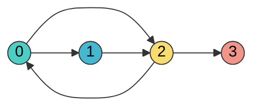

# DSA — Graphs (Java)

> "A graph problem is a BFS/DFS problem wearing a disguise — find the disguise, then the traversal writes itself."

**What this chapter covers:** The seven graph tools — BFS, DFS, Dijkstra, topological sort, Union-Find, cycle detection, and grids — each taught the same way: *the problem, why the obvious answer is too slow, the one idea that fixes it, a dry run you can follow with your finger, then the Java.* Chapter 2 of the 4-part DSA sequence (31 / 31b / 31c / 31d); section numbers continue from chapter 31.

---

## Start Here

### Pick a track

| Track | Time | Read this | Good for |
|-------|------|-----------|----------|
| **Speed run** | ~40 min | This page, then the **Key idea** + **Dry run** + **Java** of BFS, DFS, Dijkstra, topological sort and Union-Find | First pass |
| **Mastery** | ~3 hr | Everything, plus the first five problems marked in each list | Real preparation |
| **Refresh** | ~10 min | This page, then the Cheat Sheet at the end | The night before |

Every pattern below uses the same seven lines — **Problem · Brute force · Key idea · Dry run · Java · Cost · Trap** — so you never read code before you know what it does. Each dry run puts the input and its answer in its title, says in plain words what is being tracked, and ends with one sentence on **why it works**. Graph dry runs say whether the graph is directed or undirected, and the graph is drawn before it is traced. The format is explained in full in [chapter 31's Start Here](#content/31_dsa_foundations).

### First, find the disguise

Most graph questions never say the word "graph". Your first job is always the same two sentences: **what is a node, and what is an edge?**

| The question is about… | A node is… | An edge is… |
|------------------------|------------|-------------|
| A grid or maze | one cell | a step to an adjacent cell |
| Word transformations | one word | changing exactly one letter |
| Course prerequisites | one course | "must be taken before" |
| A puzzle or lock | one arrangement of the state | one legal move |
| Accounts, friends, provinces | one person or account | "belongs with" |

Once you can say those two sentences, the rest of this chapter is a lookup.

### Which algorithm does the question want?


In the Cost column, **V** = the number of nodes (vertices) and **E** = the number of edges, so O(V + E) means "look at every node and every edge a constant number of times".

| # | When the question asks… | Reach for | Cost | Section |
|---|-------------------------|-----------|------|---------|
| 1 | fewest steps, all moves cost the same | **BFS** | O(V + E) | §18.12 |
| 2 | does a path exist / explore everything | **DFS** | O(V + E) | §18.12 |
| 3 | cheapest route, edges have different costs | **Dijkstra** | O((V+E) log V) | §18.13 |
| 4 | order things that depend on each other | **Topological sort** | O(V + E) | §18.13 |
| 5 | "are these two connected?", asked repeatedly | **Union-Find** | ~O(1) each | §18.13 |
| 6 | is there a loop? | **3-colour DFS** (directed) / **Union-Find** (undirected) | O(V + E) | §18.13 |
| 7 | islands, regions, a maze | **BFS/DFS on the grid** | O(rows × cols) | §18.14 |

> **The sentence to say out loud before coding.** *"Nodes are X, edges are Y, the graph is directed/undirected and weighted/unweighted, so this is a &lt;algorithm&gt; problem costing O(…)."* Everything else follows from that.

---

## Table of Contents

| Part | Topic | Sections |
|------|-------|----------|
| 3 | Graphs | §18.12–18.14: BFS/DFS, Dijkstra, Topo Sort, Union-Find, Grids |
| — | Revision | Cheat sheet and recall drills (unnumbered, at the end) |

**Sequence:** [31 — Foundations & Search](#content/31_dsa_foundations) → **31b (this chapter)** → [31c — Dynamic Programming](#content/31c_dynamic_programming) → [31d — Advanced Patterns & ML Coding](#content/31d_dsa_advanced_ml_coding)

---

# PART 3: GRAPHS

---

## 18.12 Graph Fundamentals

**Simple explanation.** A graph is just *things* and *which things are connected to which*. The things are **vertices** (nodes), the connections are **edges**. Social networks, road maps, course prerequisites, web links — all the same shape.

Two questions settle everything about how you handle it:

- **Directed or undirected?** Directed means an edge goes one way only (Twitter follows, "must be taken before"). Undirected means both ways (Facebook friendships, roads).
- **Weighted or unweighted?** Weighted means each edge carries a cost (distance, time, price). Unweighted means every edge is one step — *which is what makes BFS give you shortest paths for free.*

Throughout this chapter, **V** is the number of vertices, **E** the number of edges, and a node's **degree** is the number of edges touching it (how many neighbours it has).

### Representation: adjacency list vs matrix

Both pictures below describe the same small **directed** graph: 4 nodes and 5 one-way edges `0→1, 0→2, 1→2, 2→0, 2→3` (drawn in the diagram further down). `0 → [1, 2]` means "node 0 has arrows to 1 and 2"; in the matrix, row `u`, column `v` is `1` when there is an arrow `u → v`.

```
Adjacency List (what you want 99% of the time):
  0 → [1, 2]
  1 → [2]
  2 → [0, 3]
  3 → []

Adjacency Matrix:
     0  1  2  3
  0 [0, 1, 1, 0]
  1 [0, 0, 1, 0]
  2 [1, 0, 0, 1]
  3 [0, 0, 0, 0]
```

| Feature | Adjacency List | Adjacency Matrix |
|---------|----------------|------------------|
| Space | O(V + E) | O(V^2) |
| "Is there an edge u→v?" | O(degree) | O(1) |
| Iterate a node's neighbours | O(degree) | O(V) |
| Best for | sparse graphs — nearly always | dense graphs, constant-time edge checks |

**Default to the adjacency list.** A matrix costs V² space even when the graph has three edges, so at V = 100,000 it is simply impossible.



### Building a graph in Java

![Building an adjacency list infographic: undirected graph with nodes 0..3 and edges \[\[0,1\],\[0,2\],\[1,2\],\[2,3\]\] added one at a time, each written into both endpoints' lists → {0:\[1,2\], 1:\[0,2\], 2:\[0,1,3\], 3:\[2\]}; also compares list vs matrix costs (O(V + E) vs O(V²) space)](diagrams/dsa31b_info_buildgraph_ai.png)

<details>
<summary><strong>Read as text</strong> — problem, key idea, dry run and trap</summary>

Problems usually hand you an **edge list** — pairs `[u, v]`, one per edge — and you turn it into an adjacency list. New input for the rest of §18.12: an **undirected** graph with nodes `0..3` and edges `[[0,1], [0,2], [1,2], [2,3]]`:

```
  0 ─── 1
   \   /
    \ /
     2 ─── 3
```

**Dry run — undirected edges `[[0,1], [0,2], [1,2], [2,3]]` → `{0:[1,2], 1:[0,2], 2:[0,1,3], 3:[2]}`**
*We track:* the adjacency map, written `{node: [its neighbours]}`. Undirected means each edge is written into **both** endpoints' lists.

| Edge added | Writes | Map so far |
|------------|--------|------------|
| `[0,1]` | `0 → 1` and `1 → 0` | `{0:[1], 1:[0]}` |
| `[0,2]` | `0 → 2` and `2 → 0` | `{0:[1,2], 1:[0], 2:[0]}` |
| `[1,2]` | `1 → 2` and `2 → 1` | `{0:[1,2], 1:[0,2], 2:[0,1]}` |
| `[2,3]` | `2 → 3` and `3 → 2` | `{0:[1,2], 1:[0,2], 2:[0,1,3], 3:[2]}` |

**Why it works:** every edge is stored from both ends, so each node can list all of its neighbours directly.

> **Trap:** adding the reverse edge in a **directed** problem. In Course Schedule, adding both directions turns every prerequisite pair `a → b` into a fake two-node cycle `a → b → a`, so any input with at least one prerequisite answers false. Write the second line only when the problem says the relationship is mutual.

</details>

```java
// Option A — adjacency map (works for any node labels)
Map<Integer, List<Integer>> graph = new HashMap<>();
for (int[] edge : edges) {
    graph.computeIfAbsent(edge[0], k -> new ArrayList<>()).add(edge[1]);
    graph.computeIfAbsent(edge[1], k -> new ArrayList<>()).add(edge[0]); // undirected ONLY
}

// Option B — use INSTEAD of A when nodes are exactly 0..n-1 (n = number of nodes)
List<List<Integer>> graph = new ArrayList<>();
for (int i = 0; i < n; i++) graph.add(new ArrayList<>());
for (int[] edge : edges) {
    graph.get(edge[0]).add(edge[1]);
    graph.get(edge[1]).add(edge[0]);                       // undirected ONLY
}
```

### BFS — fewest steps

![BFS fewest-steps infographic: undirected graph with edges 0–1, 0–2, 1–2, 2–3 explored ring by ring with a queue ([0] → [1, 2] → [3]); start 0, target 3 → 2 steps via 0 → 2 → 3](diagrams/dsa31b_info_bfs_ai.png)

<details>
<summary><strong>Read as text</strong> — problem, key idea, dry run and trap</summary>

**Problem.** You get an undirected graph as an adjacency map (built above), a `start` node and a `target` node. Return the fewest edges you must walk from `start` to `target`, or `-1` if `target` can't be reached. Every edge counts as one step. On the graph above, start `0`, target `3` → `2` (`0 → 2 → 3`).

**Brute force.** Enumerate every path and keep the shortest. On a graph with cycles that never terminates without extra bookkeeping, and even with it, the number of paths is exponential.

**Key idea.** Visit everything **one step away**, then everything **two steps away**, and so on — finishing each ring completely before starting the next. That ordering has a consequence you get for free: **the first time BFS reaches a node is by the shortest route**, so you can stop as soon as the target comes out of the queue. A queue produces exactly that order, because the oldest node comes out first.


**Dry run — undirected graph above, start `0`, target `3` → `2`**
*We track:* the queue (nodes waiting their turn, oldest on the left) and the ring number = how many steps those nodes are from the start. A node is marked seen the moment it joins the queue.

| Ring (steps from 0) | Queue at the start of the ring | Taken out → newly found | Target? |
|---------------------|--------------------------------|-------------------------|---------|
| 0 | `[0]` | 0 → finds 1, 2 | no |
| 1 | `[1, 2]` | 1 → nothing new (0, 2 seen); 2 → finds 3 (0, 1 seen) | no |
| 2 | `[3]` | 3 | **yes → return 2** |

**Why it works:** node 3 was first found while emptying ring 1, so it is exactly 2 steps away — nothing could reach it in fewer.

**Cost.** O(V + E) time — every node leaves the queue once and every edge is examined once. O(V) space.

> **Trap:** marking a node visited when you *dequeue* it instead of when you *enqueue* it. In a dense graph the same node then gets queued once per incoming edge, memory explodes and the solution times out. Mark it the instant you push it.

> **Trap:** writing `for (int i = 0; i < queue.size(); i++)` instead of reading the size once before the loop. The size changes *inside* the loop — it drops with every `poll` and grows with every `offer` — so a ring can stop early or swallow nodes from the next ring, and the step count goes wrong. On the graph above, with target `1` it returns `0` instead of `1`.

</details>

```java
import java.util.*;

public class BfsShortestPath {
    // BFS — shortest path in an unweighted graph
    public int bfs(Map<Integer, List<Integer>> graph, int start, int target) {
        Queue<Integer> queue = new LinkedList<>();
        Set<Integer> visited = new HashSet<>();
        queue.offer(start);
        visited.add(start);                       // mark on ENQUEUE — see the trap
        int level = 0;                            // ring number = steps from start

        while (!queue.isEmpty()) {
            int size = queue.size();              // snapshot = exactly one ring
            for (int i = 0; i < size; i++) {
                int node = queue.poll();
                if (node == target) return level;
                for (int neighbor : graph.getOrDefault(node, List.of())) {
                    if (!visited.contains(neighbor)) {
                        visited.add(neighbor);
                        queue.offer(neighbor);
                    }
                }
            }
            level++;
        }
        return -1;                                // target not reachable
    }

    // Option A from "Building a graph in Java" — UNDIRECTED edge list → adjacency map
    static Map<Integer, List<Integer>> build(int[][] edges) {
        Map<Integer, List<Integer>> graph = new HashMap<>();
        for (int[] edge : edges) {
            graph.computeIfAbsent(edge[0], k -> new ArrayList<>()).add(edge[1]);
            graph.computeIfAbsent(edge[1], k -> new ArrayList<>()).add(edge[0]);
        }
        return graph;
    }

    public static void main(String[] args) {
        BfsShortestPath s = new BfsShortestPath();
        int[][] square = {{0, 1}, {0, 2}, {1, 2}, {2, 3}};      // the chapter's undirected graph
        int[][] split = {{0, 1}, {2, 3}};                       // disconnected: 0–1 and 2–3
        int[][] none = {};                                      // a lone node 0, no edges
        Object[][] tests = { {square, 0, 3}, {square, 0, 1}, {split, 0, 3}, {none, 0, 0} };
        for (Object[] t : tests) {
            int[][] edges = (int[][]) t[0];
            int start = (int) t[1], target = (int) t[2];
            System.out.println("edges=" + Arrays.deepToString(edges) + ", start=" + start
                + ", target=" + target + " -> " + s.bfs(build(edges), start, target));
        }
    }
}
```

**Output:**
```
edges=[[0, 1], [0, 2], [1, 2], [2, 3]], start=0, target=3 -> 2
edges=[[0, 1], [0, 2], [1, 2], [2, 3]], start=0, target=1 -> 1
edges=[[0, 1], [2, 3]], start=0, target=3 -> -1
edges=[], start=0, target=0 -> 0
```

### DFS — does a path exist, and explore everything


<details>
<summary><strong>Read as text</strong> — problem, key idea, dry run and trap</summary>

**Problem.** You get the same kind of adjacency map and a start node. Visit every node reachable from the start, each exactly once — used for connectivity ("are these connected?"), path existence, or collecting a whole region.

**Brute force.** Wander from neighbour to neighbour without remembering where you have been. On any graph with a loop (this one has `0–1–2`) that walks in circles forever. The fix is one set: `visited`.

**Key idea.** The opposite commitment to BFS: follow one path all the way to its end, and only when it dead-ends, back up and try the next branch. Recursion gives you the stack for free, so the code is usually three lines shorter than the BFS equivalent.

**Dry run — the same undirected graph, start at `0` → visits `0, 1, 2, 3`**
*We track:* the `visited` set. Each `dfs(x)` line is one call; the calls it makes are drawn indented underneath it. Neighbours are tried in list order.

```
dfs(0)                     visited {0}
├── dfs(1)                 visited {0,1}        ← 0's first neighbour
│   ├── 0 already visited — skip
│   └── dfs(2)             visited {0,1,2}
│       ├── 0, 1 already visited — skip
│       └── dfs(3)         visited {0,1,2,3}
│           └── 2 already visited — skip, back up
└── 2 already visited — skip

visit order: 0, 1, 2, 3
```

**Why it works:** a call only returns after checking every neighbour of its node, so nothing reachable from 0 is left out — and `visited` stops any node being entered twice.

**Cost.** O(V + E) time. Space: the recursive version uses O(V) for `visited` plus the *call stack*, which is real memory; the iterative version is O(V + E), because a node can sit on the stack once for every edge that reached it before it was visited.

> **Trap:** recursion on a graph with 10^5+ nodes. A long chain becomes a 100,000-frame call stack and throws `StackOverflowError`. If the constraint is large, say so and switch to the iterative version — interviewers listen for exactly this.

> **Trap:** only calling DFS once. If the graph may be **disconnected**, loop over every node and start a fresh DFS from each unvisited one — that loop is also how you count connected components.

</details>

```java
import java.util.*;

public class DfsTraversal {
    List<Integer> order = new ArrayList<>();      // visit order, recorded where a node is processed

    // DFS — recursive (what you write by default)
    public void dfs(Map<Integer, List<Integer>> graph, int node, Set<Integer> visited) {
        visited.add(node);
        order.add(node);                          // process node here
        for (int neighbor : graph.getOrDefault(node, List.of())) {
            if (!visited.contains(neighbor)) {
                dfs(graph, neighbor, visited);
            }
        }
    }

    // DFS — iterative (when the graph is big enough to blow the call stack)
    public void dfsIterative(Map<Integer, List<Integer>> graph, int start) {
        Deque<Integer> stack = new ArrayDeque<>();
        Set<Integer> visited = new HashSet<>();
        stack.push(start);

        while (!stack.isEmpty()) {
            int node = stack.pop();
            if (visited.contains(node)) continue;   // a node can be pushed more than once here
            visited.add(node);
            order.add(node);                        // process node here
            for (int neighbor : graph.getOrDefault(node, List.of())) {
                if (!visited.contains(neighbor)) stack.push(neighbor);
            }
        }
    }

    // Option A from "Building a graph in Java" — UNDIRECTED edge list → adjacency map
    static Map<Integer, List<Integer>> build(int[][] edges) {
        Map<Integer, List<Integer>> graph = new HashMap<>();
        for (int[] edge : edges) {
            graph.computeIfAbsent(edge[0], k -> new ArrayList<>()).add(edge[1]);
            graph.computeIfAbsent(edge[1], k -> new ArrayList<>()).add(edge[0]);
        }
        return graph;
    }

    public static void main(String[] args) {
        int[][] square = {{0, 1}, {0, 2}, {1, 2}, {2, 3}};      // the chapter's undirected graph
        int[][] split = {{0, 1}, {2, 3}};                       // disconnected: 0–1 and 2–3
        int[][] none = {};                                      // a lone node 0, no edges
        Object[][] tests = { {square, 0}, {square, 3}, {split, 0}, {none, 0} };
        for (Object[] t : tests) {
            int[][] edges = (int[][]) t[0];
            int start = (int) t[1];
            DfsTraversal rec = new DfsTraversal(), it = new DfsTraversal();
            rec.dfs(build(edges), start, new HashSet<>());
            it.dfsIterative(build(edges), start);
            System.out.println("edges=" + Arrays.deepToString(edges) + ", start=" + start
                + " -> recursive " + rec.order + ", iterative " + it.order);
        }
    }
}
```

**Output:**
```
edges=[[0, 1], [0, 2], [1, 2], [2, 3]], start=0 -> recursive [0, 1, 2, 3], iterative [0, 2, 3, 1]
edges=[[0, 1], [0, 2], [1, 2], [2, 3]], start=3 -> recursive [3, 2, 0, 1], iterative [3, 2, 1, 0]
edges=[[0, 1], [2, 3]], start=0 -> recursive [0, 1], iterative [0, 1]
edges=[], start=0 -> recursive [0], iterative [0]
```

> **Order note:** the iterative version visits the same nodes in a different order — `0, 2, 3, 1` on the graph above — because the stack pops the **last** neighbour pushed first. Both are valid DFS orders; only the recursive one matches the dry run.

**Practice:** [Number of Islands →](#dsa-problem-number-of-islands) · [Graph Valid Tree →](#dsa-problem-graph-valid-tree)

### Choosing between them

| The question is about… | Use | Why |
|------------------------|-----|-----|
| Shortest path, unweighted | **BFS** | the first arrival is the shortest one |
| Level-by-level anything | **BFS** | reading `queue.size()` once per ring tells you where each level ends |
| Spreading from many starts at once | **BFS** (multi-source) | seed the queue with all of them |
| Connected components | either | both reach everything |
| Cycle detection (directed) | **DFS** | an edge back to a node still on the current path is a loop (§18.13) |
| Topological ordering | either | Kahn's algorithm (§18.13) is BFS; DFS works if you **reverse** its finishing order |
| All paths between two nodes | **DFS** | backtracking is natural |

> **The one-line rule:** if the problem says "shortest", "minimum steps", "fewest", or "nearest" on an **unweighted** graph, it is BFS. Add weights and it becomes Dijkstra.

### 60-second recall

<details>
<summary>1. Why does BFS give shortest paths but DFS does not?</summary>

BFS finishes every node `d` steps from the start before touching anything `d + 1` steps away, so the first time it reaches a node it has used the fewest possible steps. DFS commits to one path to the end, so it may reach a node by a long route first and never reconsider it.
</details>

<details>
<summary>2. When do you mark a node visited in BFS, and why does it matter?</summary>

At enqueue time — otherwise a node is queued once per incoming edge (the first trap under BFS).
</details>

<details>
<summary>3. Your DFS works on the samples but crashes on the big test case. What happened?</summary>

`StackOverflowError` from recursion depth. A path of 100,000 nodes means 100,000 stack frames. Rewrite it iteratively with an explicit `ArrayDeque`.
</details>

**Key Problems — Detailed Solutions:**

![Clone Graph infographic: undirected 4-node square 1–2–3–4 (adjList \[\[2,4\],\[1,3\],\[2,4\],\[1,3\]\]) cloned with BFS and a HashMap original → copy; take 1, 2, 4, 3 in queue order, linking copies to copies (1' → 2', 4'; 2' → 1', 3'; 4' → 1', 3'; 3' → 2', 4') → return 1'](diagrams/dsa31b_info_clone_ai.png)

<details>
<summary><strong>Clone Graph</strong> — Medium · read as text and Java</summary>

**Problem:** You get one node of a connected, undirected graph. Every node has an integer `val` and a list `neighbors`:
```java
class Node { int val; List<Node> neighbors = new ArrayList<>(); Node(int v) { val = v; } }
```
Return a **deep copy** of the whole graph — brand-new `Node` objects with the same values and the same connections. No node in the copy may be one of the original nodes. LeetCode writes the graph as `adjList`, where `adjList[i]` lists the neighbours of the node whose value is `i + 1` (values start at 1), and you are handed node 1.

**Example:**
```
Input:  adjList = [[2,4],[1,3],[2,4],[1,3]]
Output: [[2,4],[1,3],[2,4],[1,3]]      same shape, but every node is new
```

**Walk-through:** the input is a 4-node square. BFS from node 1; `1'` means "the copy of 1".
```
  1 ─── 2
  │     │
  4 ─── 3

take 1 → 2, 4 not copied yet: create 2', 4'; link 1' to 2', 4'    queue [2, 4]
take 2 → 1 copied; create 3'; link 2' to 1', 3'                   queue [4, 3]
take 4 → 1, 3 copied; link 4' to 1', 3'                           queue [3]
take 3 → 2, 4 copied; link 3' to 2', 4'                           queue []
```

**Approach:** BFS (or DFS) with a HashMap from each original node to its copy. When you meet a neighbour that has no copy yet, create one and queue the original. Always link **copies to copies** — never point a copy at an original node.

**Java:**
```java
import java.util.*;

public class CloneGraph {
    static class Node {
        int val; List<Node> neighbors = new ArrayList<>();
        Node(int v) { val = v; }
    }

    public Node cloneGraph(Node node) {
        if (node == null) return null;
        Map<Node, Node> map = new HashMap<>();
        Queue<Node> queue = new LinkedList<>();
        map.put(node, new Node(node.val));
        queue.offer(node);
        while (!queue.isEmpty()) {
            Node curr = queue.poll();
            for (Node neighbor : curr.neighbors) {
                if (!map.containsKey(neighbor)) {
                    map.put(neighbor, new Node(neighbor.val));
                    queue.offer(neighbor);
                }
                map.get(curr).neighbors.add(map.get(neighbor));
            }
        }
        return map.get(node);
    }

    // UNDIRECTED graph from LeetCode's adjList (adjList[i] = neighbours of node i + 1)
    static Node build(int[][] adjList) {
        if (adjList.length == 0) return null;
        Node[] nodes = new Node[adjList.length + 1];
        for (int v = 1; v <= adjList.length; v++) nodes[v] = new Node(v);
        for (int v = 1; v <= adjList.length; v++)
            for (int u : adjList[v - 1]) nodes[v].neighbors.add(nodes[u]);
        return nodes[1];
    }

    // every node reachable from start, keyed by value (BFS)
    static Map<Integer, Node> collect(Node start) {
        Map<Integer, Node> seen = new TreeMap<>();
        if (start == null) return seen;
        Deque<Node> queue = new ArrayDeque<>(List.of(start));
        seen.put(start.val, start);
        while (!queue.isEmpty())
            for (Node nb : queue.poll().neighbors)
                if (seen.putIfAbsent(nb.val, nb) == null) queue.offer(nb);
        return seen;
    }

    // back to adjList form, e.g. [[2, 4], [1, 3], ...]
    static String show(Node start) {
        List<List<Integer>> adj = new ArrayList<>();
        for (Node n : collect(start).values()) {
            List<Integer> vals = new ArrayList<>();
            for (Node nb : n.neighbors) vals.add(nb.val);
            adj.add(vals);
        }
        return adj.toString();
    }

    public static void main(String[] args) {
        int[][][] tests = { {{2, 4}, {1, 3}, {2, 4}, {1, 3}}, {{}}, {{2}, {1}}, {} };
        for (int[][] adjList : tests) {
            Node original = build(adjList);
            Node copy = new CloneGraph().cloneGraph(original);
            Set<Node> originals = Collections.newSetFromMap(new IdentityHashMap<>());
            originals.addAll(collect(original).values());
            boolean allNew = collect(copy).values().stream().noneMatch(originals::contains);
            System.out.println(Arrays.deepToString(adjList) + " -> " + show(copy)
                + ", every node new: " + allNew);
        }
    }
}
```

**Output:**
```
[[2, 4], [1, 3], [2, 4], [1, 3]] -> [[2, 4], [1, 3], [2, 4], [1, 3]], every node new: true
[[]] -> [[]], every node new: true
[[2], [1]] -> [[2], [1]], every node new: true
[] -> [], every node new: true
```

**Complexity:** O(V + E) time, O(V) space
</details>


<details>
<summary><strong>Word Ladder</strong> — Hard · read as text and Java</summary>

**Problem:** You get two lowercase words of the same length, `beginWord` and `endWord`, and a list `wordList`. One move changes exactly one letter, and the word you land on must be in `wordList` — that includes `endWord`, so if `endWord` is not in the list the answer is `0`. Return the **number of words** in the shortest chain from `beginWord` to `endWord`, counting both ends, or `0` if no chain exists.

**Example:**
```
Input:  beginWord = "hit", endWord = "cog",
        wordList = ["hot","dot","dog","lot","log","cog"]
Output: 5          hit → hot → dot → dog → cog  (5 words, 4 moves)
```

**Walk-through:** BFS, one ring per word in the chain; each word is used at most once.
```
word 1: hit
word 2: hot             only one-letter change of "hit" that is in the list
word 3: dot, lot        one-letter changes of "hot"
word 4: dog, log        from dot and lot
word 5: cog             from dog — that is endWord, so the answer is 5
```

**Approach:** BFS where each word is a node and an edge joins two words that differ by one letter. To find a word's neighbours quickly, try replacing each letter with `'a'`–`'z'` and check whether the result is in the word set; remove a word from the set as soon as it is queued so it is never used twice.

**Java:**
```java
import java.util.*;

public class WordLadder {
    public int ladderLength(String begin, String end, List<String> wordList) {
        Set<String> dict = new HashSet<>(wordList);
        if (!dict.contains(end)) return 0;
        Queue<String> queue = new LinkedList<>();
        queue.offer(begin);
        dict.remove(begin);
        int steps = 1;                                   // words in the chain so far
        while (!queue.isEmpty()) {
            int size = queue.size();
            for (int i = 0; i < size; i++) {
                char[] word = queue.poll().toCharArray();
                for (int j = 0; j < word.length; j++) {
                    char orig = word[j];
                    for (char c = 'a'; c <= 'z'; c++) {
                        word[j] = c;
                        String next = new String(word);
                        if (next.equals(end)) return steps + 1;
                        if (dict.contains(next)) {
                            dict.remove(next);
                            queue.offer(next);
                        }
                    }
                    word[j] = orig;
                }
            }
            steps++;
        }
        return 0;
    }

    public static void main(String[] args) {
        Object[][] tests = {
            {"hit", "cog", List.of("hot", "dot", "dog", "lot", "log", "cog")},
            {"hit", "cog", List.of("hot", "dot", "dog", "lot", "log")},   // endWord not in list
            {"hot", "dog", List.of("hot", "dog")},                         // no one-letter chain
            {"a", "c", List.of("a", "b", "c")}                             // a single move
        };
        for (Object[] t : tests) {
            String begin = (String) t[0], end = (String) t[1];
            @SuppressWarnings("unchecked") List<String> words = (List<String>) t[2];
            System.out.println("begin=" + begin + ", end=" + end + ", wordList=" + words + " -> "
                + new WordLadder().ladderLength(begin, end, words));
        }
    }
}
```

**Output:**
```
begin=hit, end=cog, wordList=[hot, dot, dog, lot, log, cog] -> 5
begin=hit, end=cog, wordList=[hot, dot, dog, lot, log] -> 0
begin=hot, end=dog, wordList=[hot, dog] -> 0
begin=a, end=c, wordList=[a, b, c] -> 2
```

**Complexity:** with M = word length and N = number of words in `wordList`: O(M² × N) time (each word tries 26 × M one-letter changes, and building each costs O(M)), O(M × N) space.
</details>

![Pacific Atlantic Water Flow infographic: 5 × 5 heights grid \[\[1,2,2,3,5\],\[3,2,3,4,4\],\[2,4,5,3,1\],\[6,7,1,4,5\],\[5,1,1,2,4\]\]; climb uphill from the Pacific (top/left) and from the Atlantic (bottom/right) edges, and the cells reached by both are the answer → \[0,4\], \[1,3\], \[1,4\], \[2,2\], \[3,0\], \[3,1\], \[4,0\]](diagrams/dsa31b_info_pacific_ai.png)

<details>
<summary><strong>Pacific Atlantic Water Flow</strong> — Medium · read as text and Java</summary>

**Problem:** You get an `m × n` grid of heights (m rows, n columns). The Pacific Ocean touches the top and left edges; the Atlantic touches the bottom and right edges. Rain flows from a cell to an up/down/left/right neighbour whose height is **equal or lower**, and from any edge cell straight into the ocean on that edge. Return every cell, as `[row, col]` (0-based), from which water can reach **both** oceans.

**Example:**
```
Input:  heights = [[1,2,2,3,5],[3,2,3,4,4],[2,4,5,3,1],[6,7,1,4,5],[5,1,1,2,4]]
Output: [[0,4],[1,3],[1,4],[2,2],[3,0],[3,1],[4,0]]
```

**Walk-through:** start from each ocean's edge and climb **uphill** (to equal or higher neighbours) — every cell you can climb to can drain back down into that ocean. The cells marked by both climbs are the answer.
```
heights          P = Pacific only, A = Atlantic only, B = both
1 2 2 3 5        P P P P B
3 2 3 4 4        P P P B B
2 4 5 3 1        P P B A A
6 7 1 4 5        B B A A A
5 1 1 2 4        B A A A A
```
The seven `B` cells, read row by row, are exactly the output.

**Approach:** Reverse the problem. Instead of asking "where does water from this cell go?" for every cell, run one DFS from all Pacific edge cells and one from all Atlantic edge cells, moving only to neighbours with **equal or greater** height. Return the cells both searches reached.

**Java:**
```java
import java.util.*;

public class PacificAtlantic {
    public List<List<Integer>> pacificAtlantic(int[][] heights) {
        int m = heights.length, n = heights[0].length;
        boolean[][] pacific = new boolean[m][n], atlantic = new boolean[m][n];
        for (int i = 0; i < m; i++) {
            dfs(heights, pacific, i, 0);
            dfs(heights, atlantic, i, n - 1);
        }
        for (int j = 0; j < n; j++) {
            dfs(heights, pacific, 0, j);
            dfs(heights, atlantic, m - 1, j);
        }
        List<List<Integer>> res = new ArrayList<>();
        for (int i = 0; i < m; i++)
            for (int j = 0; j < n; j++)
                if (pacific[i][j] && atlantic[i][j])
                    res.add(List.of(i, j));
        return res;
    }
    private void dfs(int[][] h, boolean[][] visited, int r, int c) {
        visited[r][c] = true;
        int[][] dirs = {{0,1},{0,-1},{1,0},{-1,0}};
        for (int[] d : dirs) {
            int nr = r + d[0], nc = c + d[1];
            if (nr >= 0 && nr < h.length && nc >= 0 && nc < h[0].length
                && !visited[nr][nc] && h[nr][nc] >= h[r][c])
                dfs(h, visited, nr, nc);
        }
    }

    public static void main(String[] args) {
        int[][][] tests = {
            {{1, 2, 2, 3, 5}, {3, 2, 3, 4, 4}, {2, 4, 5, 3, 1}, {6, 7, 1, 4, 5}, {5, 1, 1, 2, 4}},
            {{1}},
            {{3, 3, 3}, {3, 1, 3}, {3, 3, 3}},
            {{1, 2}, {4, 3}}
        };
        for (int[][] heights : tests) {
            String in = Arrays.deepToString(heights).replace(" ", "");
            String out = new PacificAtlantic().pacificAtlantic(heights).toString().replace(" ", "");
            System.out.println(in + " -> " + out);
        }
    }
}
```

**Output:**
```
[[1,2,2,3,5],[3,2,3,4,4],[2,4,5,3,1],[6,7,1,4,5],[5,1,1,2,4]] -> [[0,4],[1,3],[1,4],[2,2],[3,0],[3,1],[4,0]]
[[1]] -> [[0,0]]
[[3,3,3],[3,1,3],[3,3,3]] -> [[0,0],[0,1],[0,2],[1,0],[1,2],[2,0],[2,1],[2,2]]
[[1,2],[4,3]] -> [[0,1],[1,0],[1,1]]
```

**Complexity:** O(m × n) time, O(m × n) space
</details>

**Problem List — Graph Fundamentals:**

**Start with these five:** Number of Connected Components · Clone Graph · Graph Valid Tree · Is Graph Bipartite? · Word Ladder.

| #   | Problem                            | Difficulty | Key Insight                          |
|-----|------------------------------------|------------|--------------------------------------|
| 1   | Number of Connected Components (LC 323) | Medium | DFS/BFS from each unvisited node |
| 2   | Clone Graph (LC 133)               | Medium     | BFS + HashMap old→new                |
| 3   | Pacific Atlantic Water Flow (417)  | Medium     | Reverse DFS/BFS from ocean borders   |
| 4   | Graph Valid Tree (LC 261)          | Medium     | n-1 edges + all connected            |
| 5   | Word Ladder (LC 127)               | Hard       | BFS, each word is a node             |
| 6   | Minimum Genetic Mutation (LC 433)  | Medium     | BFS, same pattern as Word Ladder     |
| 7   | Open the Lock (LC 752)             | Medium     | BFS on state space                   |
| 8   | All Paths From Source to Target    | Medium     | DFS backtracking                     |
| 9   | Is Graph Bipartite? (LC 785)       | Medium     | BFS/DFS 2-coloring                   |
| 10  | Shortest Path in Binary Matrix     | Medium     | BFS 8-directional                    |

---

## 18.13 Advanced Graphs

### Dijkstra — cheapest route when edges cost different amounts


<details>
<summary><strong>Read as text</strong> — problem, key idea, dry run and trap</summary>

**Problem.** You get an **undirected** graph whose edges have costs that are zero or more, and a source node. Return the cheapest total cost from the source to every node. Example — edges `A–B 1`, `A–C 4`, `B–C 2`, `B–D 5`, `C–D 1`, source `A` → `A 0, B 1, C 3, D 4`.

```
          B
       1 /|\ 5
        / | \
       A  |2 D
        \ | /
       4 \|/ 1
          C
```

**Brute force.** Enumerate every path — exponential. And **BFS is simply wrong here**: BFS finds the fewest *hops*, but a cheap route with more hops can beat an expensive one-hop route. `A → C` directly costs 4; `A → B → C` costs 1 + 2 = 3 despite taking two hops.

**Key idea.** Two words first. To **settle** a node is to declare its distance final. To **relax** an edge `u → v` is to check whether going through `u` gives `v` a cheaper total than the best known so far — and if so, lower it. Dijkstra repeatedly **settles the nearest node not yet settled**, then relaxes its edges. Settling is only safe because every edge costs **zero or more**: any other route to that node must go through a node that is already at least as far away, so it can't come back cheaper. A priority queue answers "which unsettled node is nearest?" in O(log V).


**Dry run — the graph above, source `A` → `A 0, B 1, C 3, D 4`**
*We track:* the best known cost to each node (∞ = no route found yet). Each step settles the nearest unsettled node and checks its unsettled neighbours.

| Step: settle (its cost) | Check its neighbours | Best known costs after | Note |
|-------------------------|----------------------|------------------------|------|
| start | — | A 0 · B ∞ · C ∞ · D ∞ | only the source is known |
| A (0) | B: 0 + 1 = **1**; C: 0 + 4 = **4** | A 0 · B 1 · C 4 · D ∞ | |
| B (1) | C: 1 + 2 = **3**, beats 4; D: 1 + 5 = **6** | A 0 · B 1 · C 3 · D 6 | C got cheaper — a relaxation |
| C (3) | D: 3 + 1 = **4**, beats 6 | A 0 · B 1 · C 3 · D 4 | D got cheaper |
| D (4) | no unsettled neighbours | A 0 · B 1 · C 3 · D 4 | done |

The queue still holds two out-of-date entries, C at 4 and D at 6; when they come out, `if (d > dist[u]) continue` throws them away.

**Why it works:** each node was settled only when it was the nearest one left, and with no negative edges nothing farther away could offer it a cheaper route.

In the code, nodes are numbers `0..n-1` (here `A = 0, B = 1, C = 2, D = 3`, `n = 4`), `graph[u]` is the list of `[neighbour, cost]` pairs for node `u`, and a node that can't be reached keeps `Integer.MAX_VALUE` (standing for ∞):

```java
// Build: n nodes, edges given as [u, v, cost]
List<int[]>[] graph = new List[n];
for (int i = 0; i < n; i++) graph[i] = new ArrayList<>();
for (int[] e : edges) {
    graph[e[0]].add(new int[]{e[1], e[2]});
    graph[e[1]].add(new int[]{e[0], e[2]});   // undirected ONLY — drop if directed
}
```

**Cost.** O((V + E) log V) time, O(V + E) space.

> **Trap:** dropping `if (d > dist[u]) continue`. Java's `PriorityQueue` has no decrease-key, so improving a node's distance pushes a **second** copy rather than updating the first. Without this guard you re-expand every stale copy and the complexity degrades badly. It is one line and interviewers look for it.

> **Trap:** using Dijkstra with a negative edge. Settling assumes no route can come back cheaper — a negative edge breaks exactly that assumption, and the answer is silently wrong. That constraint is what forces Bellman-Ford (chapter 31d, §18.28).

</details>

```java
import java.util.*;

public class Dijkstra {
    // Dijkstra — O((V + E) log V)
    public int[] dijkstra(List<int[]>[] graph, int n, int src) {
        int[] dist = new int[n];
        Arrays.fill(dist, Integer.MAX_VALUE);
        dist[src] = 0;

        // pq holds [distanceSoFar, node], smallest distance first
        PriorityQueue<int[]> pq = new PriorityQueue<>((a, b) -> Integer.compare(a[0], b[0]));
        pq.offer(new int[]{0, src});

        while (!pq.isEmpty()) {
            int[] curr = pq.poll();
            int d = curr[0], u = curr[1];
            if (d > dist[u]) continue;            // stale copy — see the trap

            for (int[] edge : graph[u]) {          // edge = [neighbour, weight]
                int v = edge[0], w = edge[1];
                if (dist[u] + w < dist[v]) {       // the relaxation
                    dist[v] = dist[u] + w;
                    pq.offer(new int[]{dist[v], v});
                }
            }
        }
        return dist;
    }

    // Build: n nodes, edges given as [u, v, cost] — UNDIRECTED, as in the chapter
    @SuppressWarnings("unchecked")
    static List<int[]>[] build(int n, int[][] edges) {
        List<int[]>[] graph = new List[n];
        for (int i = 0; i < n; i++) graph[i] = new ArrayList<>();
        for (int[] e : edges) {
            graph[e[0]].add(new int[]{e[1], e[2]});
            graph[e[1]].add(new int[]{e[0], e[2]});
        }
        return graph;
    }

    public static void main(String[] args) {
        // A = 0, B = 1, C = 2, D = 3: A–B 1, A–C 4, B–C 2, B–D 5, C–D 1
        int[][] abcd = {{0, 1, 1}, {0, 2, 4}, {1, 2, 2}, {1, 3, 5}, {2, 3, 1}};
        Object[][] tests = {
            {4, abcd, 0},
            {3, new int[][]{{0, 1, 7}}, 0},                    // node 2 unreachable → MAX_VALUE
            {3, new int[][]{{0, 1, 0}, {1, 2, 0}, {0, 2, 5}}, 0},    // zero-cost edges
            {1, new int[][]{}, 0}                              // a single node
        };
        for (Object[] t : tests) {
            int n = (int) t[0], src = (int) t[2];
            int[][] edges = (int[][]) t[1];
            int[] dist = new Dijkstra().dijkstra(build(n, edges), n, src);
            System.out.println("n=" + n + ", edges=" + Arrays.deepToString(edges).replace(" ", "")
                + ", src=" + src + " -> " + Arrays.toString(dist));
        }
    }
}
```

**Output:**
```
n=4, edges=[[0,1,1],[0,2,4],[1,2,2],[1,3,5],[2,3,1]], src=0 -> [0, 1, 3, 4]
n=3, edges=[[0,1,7]], src=0 -> [0, 7, 2147483647]
n=3, edges=[[0,1,0],[1,2,0],[0,2,5]], src=0 -> [0, 0, 0]
n=1, edges=[], src=0 -> [0]
```

> **Practice note — Network Delay Time differs in three small ways.** Nodes are numbered `1..n` (not from 0), the edges `times[i] = [u, v, time]` are **directed**, and the source is called `k`. So size `graph` and `dist` as `n + 1` (slot 0 unused, and skip it at the end), add each edge one way only, run from `k`, and return the **largest** distance — or `-1` if any node is still unreached. On its example `times = [[2,1,1],[2,3,1],[3,4,1]], n = 4, k = 2` that gives `2`.

**Practice:** [Network Delay Time →](#dsa-problem-network-delay-time)

### Topological Sort — ordering things that depend on each other

![Topological sort (Kahn's algorithm) infographic: directed graph 3 → 1, 3 → 2, 1 → 0, 2 → 0 from n = 4, pairs \[\[3,1\],\[3,2\],\[1,0\],\[2,0\]\] (\[3,1\] = 3 must come before 1); count arrows into each node, take whatever waits for nothing (3, then 1 and 2, then 0) and remove its arrows → \[3, 1, 2, 0\]](diagrams/dsa31b_info_topo_ai.png)

<details>
<summary><strong>Read as text</strong> — problem, key idea, dry run and trap</summary>

**Problem.** You get `n` tasks numbered `0..n-1` and a list of **directed** pairs `[a, b]`, each meaning "**a must come before b**". Return any order of all `n` tasks that respects every pair, or an empty list if none exists (that happens exactly when the pairs form a cycle). Example: `n = 4`, pairs `[[3,1], [3,2], [1,0], [2,0]]` → `[3, 1, 2, 0]`.

```
  3 ──→ 1 ──→ 0
  │           ↑
  └───→ 2 ────┘
```

**Brute force.** Try every ordering of the `n` tasks (there are n! of them) and check each one against every pair.

**Key idea.** Count, for each node, **how many arrows still point into it** — how many things it is still waiting for. This count is called its **indegree**. Anything waiting for nothing can be done right now. Do it, remove its outgoing arrows, and that may drop other counts to zero. Keep peeling. A queue holds "ready to go right now". (This is **Kahn's algorithm**.)


**Dry run — `n = 4`, pairs `[[3,1], [3,2], [1,0], [2,0]]` → `[3, 1, 2, 0]`**
*We track:* each remaining node's waiting count (written `node:count`), the ready queue, and the output. **Bold** = that count just dropped to 0, so the node joins the queue.

| Ready queue → take | What taking it does | Waiting counts after | Output so far |
|--------------------|---------------------|----------------------|---------------|
| start | count the arrows into each node | 0:2 · 1:1 · 2:1 · 3:**0** | `[]` |
| `[3]` → take 3 | removes 3's arrows into 1 and 2 | 0:2 · 1:**0** · 2:**0** | `[3]` |
| `[1, 2]` → take 1 | removes 1's arrow into 0 | 0:1 · 2:0 | `[3, 1]` |
| `[2]` → take 2 | removes 2's arrow into 0 | 0:**0** | `[3, 1, 2]` |
| `[0]` → take 0 | nothing left to remove | — | `[3, 1, 2, 0]` |

**Why it works:** a node is only output once every arrow into it has been removed — that is, once everything it waits for is already placed. `[3, 2, 1, 0]` would be equally valid; ties can go either way.

**Cost.** O(V + E) time, O(V + E) space.

> **Trap — LeetCode writes the pairs backwards.** Course Schedule gives each pair as `[course, prerequisite]`: `[1,0]` means "take 0 **before** 1". Course Schedule II's example `prerequisites = [[1,0],[2,0],[3,1],[3,2]]` is the very same four pairs as our example, read the other way round — which is why its answer is `[0, 1, 2, 3]`, the reverse of ours. When building from LeetCode pairs `p`, flip them: `graph.get(p[1]).add(p[0]); indegree[p[0]]++;`. Forgetting the flip produces a plausible-looking wrong answer.

</details>

```java
import java.util.*;

public class TopologicalSort {
    // Kahn's algorithm — BFS-based topological sort
    public List<Integer> topologicalSort(int n, int[][] edges) {
        int[] indegree = new int[n];
        List<List<Integer>> graph = new ArrayList<>();
        for (int i = 0; i < n; i++) graph.add(new ArrayList<>());

        for (int[] e : edges) {
            graph.get(e[0]).add(e[1]);     // e[0] must come before e[1]
            indegree[e[1]]++;
        }

        Queue<Integer> queue = new LinkedList<>();
        for (int i = 0; i < n; i++) if (indegree[i] == 0) queue.offer(i);

        List<Integer> order = new ArrayList<>();
        while (!queue.isEmpty()) {
            int node = queue.poll();
            order.add(node);
            for (int neighbor : graph.get(node)) {
                if (--indegree[neighbor] == 0) queue.offer(neighbor);   // freed up
            }
        }

        return order.size() == n ? order : List.of();   // short = a cycle blocked it
    }

    public static void main(String[] args) {
        // DIRECTED pairs [a, b] = "a must come before b"
        Object[][] tests = {
            {4, new int[][]{{3, 1}, {3, 2}, {1, 0}, {2, 0}}},   // the chapter's example
            {3, new int[][]{{0, 1}, {1, 2}, {2, 0}}},           // a cycle → no valid order
            {3, new int[][]{{1, 0}}},                           // node 2 depends on nothing
            {1, new int[][]{}}                                  // a single task
        };
        for (Object[] t : tests) {
            int n = (int) t[0];
            int[][] edges = (int[][]) t[1];
            System.out.println("n=" + n + ", pairs=" + Arrays.deepToString(edges).replace(" ", "")
                + " -> " + new TopologicalSort().topologicalSort(n, edges));
        }
    }
}
```

**Output:**
```
n=4, pairs=[[3,1],[3,2],[1,0],[2,0]] -> [3, 1, 2, 0]
n=3, pairs=[[0,1],[1,2],[2,0]] -> []
n=3, pairs=[[1,0]] -> [1, 2, 0]
n=1, pairs=[] -> [0]
```

> **Cycle detection, free.** If the output is shorter than `n`, the leftovers are all waiting on each other — a cycle — and no valid order exists. That single check *is* the whole of Course Schedule.

**Practice:** [Course Schedule →](#dsa-problem-course-schedule) · [Course Schedule II →](#dsa-problem-course-schedule-ii)

### Union-Find (Disjoint Set Union) — "are these two connected?"

![Union-Find infographic: 5 items 0..4 each start as their own leader (parent [0, 1, 2, 3, 4]); union(0, 1) hangs 1 under 0 (parent [0, 0, 2, 3, 4]), union(1, 2) hangs 2 under 0 (parent [0, 0, 0, 3, 4]); connected(0, 2) → true (same leader 0), connected(0, 3) → false](diagrams/dsa31b_info_unionfind_ai.png)

<details>
<summary><strong>Read as text</strong> — problem, key idea, dry run and trap</summary>

**Problem.** You have `n` items numbered `0..n-1`, each starting in a group of its own. Support two operations, called many times in any order: `union(x, y)` merges the groups that `x` and `y` are in, and `connected(x, y)` returns `true` if `x` and `y` are now in the same group.

**Example:**
```java
UnionFind uf = new UnionFind(5);   // items 0..4, each alone
uf.union(0, 1);
uf.union(1, 2);
uf.connected(0, 2);                // true  — 0, 1, 2 are one group
uf.connected(0, 3);                // false — 3 is still alone
```

**Brute force.** Run a BFS or DFS per query — O(V + E) *each time*. With 100,000 queries that is hopeless.

**Key idea.** Give every group **one leader**. Each item stores a **parent** — the item it points up to — and a leader is an item that points at itself. Two items are in the same group if and only if following the parent arrows upward lands you on the same leader (`find(x)` does that walk). Merging is then a single pointer change: hang one leader under the other. Two refinements make it nearly free:

- **Union by rank** — each leader keeps a **rank**, a number that bounds how tall its tree is (it starts at 0). Always hang the leader with the *lower* rank under the one with the higher rank, so trees never grow tall unnecessarily. On a tie, either may go on top (this code keeps `x`'s leader), and the winner's rank goes up by 1.
- **Path compression** — on the way back from a `find`, re-point every item you walked past **straight at the leader**. The path you just paid for is flattened, so nobody pays for it again.


**Dry run — 5 items; `union(0,1)`, `union(1,2)`, then `connected(0,2)` → `true`, `connected(0,3)` → `false`**
*We track:* each row shows every item's parent **after** the call (the number under item x is the item x points up to; x is a leader when it points at itself), and the ranks that decide who goes on top.

```
item             0  1  2  3  4
start            0  1  2  3  4    everyone leads their own group; every rank is 0
union(0,1)       0  0  2  3  4    leaders 0, 1 tie on rank → hang 1 under 0; 0's rank → 1
union(1,2)       0  0  0  3  4    leaders 0 (rank 1), 2 (rank 0) → hang 2 under 0
connected(0,2)   0  0  0  3  4    leaders 0 and 0 → true
connected(0,3)   0  0  0  3  4    leaders 0 and 3 → false
```

**Why it works:** "same group?" is decided entirely by "same leader?", and a union always joins two whole groups by joining their leaders.

**Path compression in one picture.** New input: a tall chain where item 3's parent is 2, 2's parent is 1, and 1's parent is 0 (union by rank never builds this, but a version without it can):

```
item             0  1  2  3
before find(3)   0  0  1  2    3 → 2 → 1 → 0: three hops to the leader
after find(3)    0  0  0  0    3 and 2 now point straight at 0: one hop
```

**Cost.** O(α(n)) per operation, **amortized** (averaged over a long run of operations). α is the inverse Ackermann function, which stays below 5 for any input you will ever see, so treat it as O(1). That needs **both** refinements — with only one of them it is O(log n). O(n) space.

> **Trap:** writing `find` without path compression. Everything still works, but each `find` now costs O(log n) instead of near-O(1) — union by rank keeps trees at most about log₂ n tall (65,536 items → at most 16 hops). Drop union by rank as well and a long chain makes every `find` O(n). The single line `parent[x] = find(parent[x])` is the whole optimisation.

> **Trap:** comparing `parent[x] == parent[y]` instead of `find(x) == find(y)`. Two nodes in the same group often have different *immediate* parents; only the leader is a reliable identity.

</details>

```java
import java.util.*;

public class UnionFindDemo {
    static class UnionFind {
        int[] parent, rank;
        int components;                                  // how many groups exist right now

        UnionFind(int n) {
            parent = new int[n];
            rank = new int[n];
            components = n;
            for (int i = 0; i < n; i++) parent[i] = i;   // everyone starts as their own leader
        }

        // find with path compression — flattens the path it walks
        int find(int x) {
            if (parent[x] != x) parent[x] = find(parent[x]);
            return parent[x];
        }

        // union by rank — returns false if they were already together
        boolean union(int x, int y) {
            int px = find(x), py = find(y);
            if (px == py) return false;                 // already one group

            if (rank[px] < rank[py]) { int tmp = px; px = py; py = tmp; }  // higher rank on top
            parent[py] = px;
            if (rank[px] == rank[py]) rank[px]++;
            components--;
            return true;
        }

        boolean connected(int x, int y) { return find(x) == find(y); }
    }

    static String parents(UnionFind uf) { return "   parent " + Arrays.toString(uf.parent); }

    public static void main(String[] args) {
        // 1) the chapter's example, with the parent array after each call
        UnionFind uf = new UnionFind(5);
        System.out.println("union(0, 1) -> " + uf.union(0, 1) + parents(uf));
        System.out.println("union(1, 2) -> " + uf.union(1, 2) + parents(uf));
        System.out.println("connected(0, 2) -> " + uf.connected(0, 2));
        System.out.println("connected(0, 3) -> " + uf.connected(0, 3));

        // 2) merging two items that are already together
        System.out.println("union(2, 0) -> " + uf.union(2, 0) + "   components " + uf.components);

        // 3) path compression on the chain 3 → 2 → 1 → 0
        UnionFind chain = new UnionFind(4);
        chain.parent = new int[]{0, 0, 1, 2};
        System.out.println("find(3) -> " + chain.find(3) + parents(chain));

        // 4) a single item is connected to itself
        System.out.println("UnionFind(1): connected(0, 0) -> " + new UnionFind(1).connected(0, 0));
    }
}
```

**Output:**
```
union(0, 1) -> true   parent [0, 0, 2, 3, 4]
union(1, 2) -> true   parent [0, 0, 0, 3, 4]
connected(0, 2) -> true
connected(0, 3) -> false
union(2, 0) -> false   components 3
find(3) -> 0   parent [0, 0, 0, 0]
UnionFind(1): connected(0, 0) -> true
```

**The tell in the question:** "connected", "provinces", "groups", "merge accounts", "redundant edge", or a stream of connectivity queries. If the graph is also being *built* as you go, Union-Find beats re-running DFS every time.

### Cycle Detection

![Cycle detection infographic: three-colour DFS on the directed graph 0→1, 1→2, 2→3, 3→1 — the grey (current-path) set grows 0 → 0, 1, 2 → 0, 1, 2, 3, then the arrow 3→1 hits grey node 1 → true; one step shows the undirected version: Union-Find on edges [1,2], [1,3], [2,3] finds 2 and 3 already share a leader → cycle](diagrams/dsa31b_info_cycle_ai.png)

<details>
<summary><strong>Read as text</strong> — problem, key idea, dry run and trap</summary>

**Problem.** You get a graph with `n` nodes. Return `true` if it contains a loop (a cycle) — a way to leave a node and come back to it. The right tool depends on whether the edges are directed (one-way) or undirected (two-way).

**Brute force.** From every node, walk every path and see whether you return to where you started — exponential.

**Key idea (directed) — three colours.** A loop means an edge pointing back into **the path you are currently standing in**. So give every node one of three states: **white** (not visited), **grey** (I am inside this node right now — it is on my current path), **black** (finished, I have already backed out). Meeting a **grey** node means a cycle. Meeting a **black** node means nothing — it just means two routes lead to the same finished place.


**Dry run — directed edges `0→1, 1→2, 2→3, 3→1` → `true`**
*We track:* the grey nodes (the path we are standing on right now). Everything else is still white.

```
  0 ──→ 1 ──→ 2
        ↑     │
        │     ↓
        └──── 3
```

| Step | Now at | Grey (current path) | Next edge → verdict |
|------|--------|---------------------|---------------------|
| 1 | 0 | 0 | 0→1: 1 is white → go in |
| 2 | 1 | 0, 1 | 1→2: 2 is white → go in |
| 3 | 2 | 0, 1, 2 | 2→3: 3 is white → go in |
| 4 | 3 | 0, 1, 2, 3 | 3→**1**: **1 is grey — still on my path → cycle, return true** |

**Why it works:** grey nodes are exactly the ones on the path from where this search started to here, so an edge into a grey node closes a loop.

**Cost.** O(V + E) time — every node and edge is looked at once. O(V) space for the colours and the call stack.

> **Trap:** treating a **black** node as a cycle — i.e. using a plain `visited` boolean instead of three states. The graph `0→1, 0→2, 1→2` is a triangle with two routes into node 2 but no cycle at all (every arrow points "forward"), yet a two-state check reports one. Grey means *on the current path*; black means *already done*.

**Key idea (undirected) — Union-Find.** Here it is much simpler: walk the edges and union their endpoints. If the two ends **already share a leader**, this edge joins two nodes that were already connected — which is exactly a second route between them, i.e. a cycle.

**Dry run — undirected edges `[1,2], [1,3], [2,3]` (nodes 1..3) → `true`**
*We track:* the groups; each node starts alone.

```
    1
   / \
  2 ─ 3

edges: [1,2] [1,3] [2,3]          each node starts alone: {1}{2}{3}

union(1,2): different leaders → merge          {1,2}{3}
union(1,3): different leaders → merge          {1,2,3}
union(2,3): SAME leader already → union() returns false → cycle
```

**Why it works:** when `[2,3]` arrives, 2 and 3 are already connected through 1, so this edge is a second route between them — and two routes between the same pair of nodes make a loop.

**Cost.** O(E × α(V)) time — effectively O(E). O(V) space.

> **Trap:** using the three-colour DFS on an **undirected** graph. Every edge is bidirectional, so the node you just came from is always grey and every single edge looks like a cycle. If you insist on DFS there, you must skip the parent you arrived from.

</details>

**Java — directed graph, three colours:**

```java
import java.util.*;

public class DirectedCycle {
    // graph.get(u) = the nodes u has arrows to; nodes are 0..n-1
    // 0 = white (unvisited), 1 = grey (on the current path), 2 = black (finished)
    public boolean hasCycle(List<List<Integer>> graph, int n) {
        int[] color = new int[n];
        for (int i = 0; i < n; i++) {
            if (color[i] == 0 && dfs(graph, i, color)) return true;   // every component
        }
        return false;
    }

    private boolean dfs(List<List<Integer>> graph, int u, int[] color) {
        color[u] = 1;                                 // entering: grey
        for (int v : graph.get(u)) {
            if (color[v] == 1) return true;           // back edge into my own path → cycle
            if (color[v] == 0 && dfs(graph, v, color)) return true;
        }
        color[u] = 2;                                 // leaving: black
        return false;
    }

    // DIRECTED edge list [u, v] = an arrow u → v
    static List<List<Integer>> build(int n, int[][] edges) {
        List<List<Integer>> graph = new ArrayList<>();
        for (int i = 0; i < n; i++) graph.add(new ArrayList<>());
        for (int[] e : edges) graph.get(e[0]).add(e[1]);
        return graph;
    }

    public static void main(String[] args) {
        Object[][] tests = {
            {4, new int[][]{{0, 1}, {1, 2}, {2, 3}, {3, 1}}},   // the chapter's example
            {3, new int[][]{{0, 1}, {0, 2}, {1, 2}}},           // two routes into 2, no cycle
            {4, new int[][]{{0, 1}, {2, 3}, {3, 2}}},           // the cycle is in a later component
            {1, new int[][]{}}                                  // a single node
        };
        for (Object[] t : tests) {
            int n = (int) t[0];
            int[][] edges = (int[][]) t[1];
            System.out.println("n=" + n + ", edges=" + Arrays.deepToString(edges).replace(" ", "")
                + " -> " + new DirectedCycle().hasCycle(build(n, edges), n));
        }
    }
}
```

**Output:**
```
n=4, edges=[[0,1],[1,2],[2,3],[3,1]] -> true
n=3, edges=[[0,1],[0,2],[1,2]] -> false
n=4, edges=[[0,1],[2,3],[3,2]] -> true
n=1, edges=[] -> false
```

**Java — undirected graph, Union-Find:**

```java
import java.util.*;

public class UndirectedCycle {
    // nodes may be 0..n-1 or 1..n — n + 1 slots fit both (one slot just goes unused)
    public boolean hasCycleUndirected(int n, int[][] edges) {
        UnionFind uf = new UnionFind(n + 1);
        for (int[] e : edges) {
            if (!uf.union(e[0], e[1])) return true;   // union failed = already connected
        }
        return false;
    }

    // the UnionFind class from above (path compression + union by rank)
    static class UnionFind {
        int[] parent, rank;
        UnionFind(int n) {
            parent = new int[n];
            rank = new int[n];
            for (int i = 0; i < n; i++) parent[i] = i;
        }
        int find(int x) {
            if (parent[x] != x) parent[x] = find(parent[x]);
            return parent[x];
        }
        boolean union(int x, int y) {
            int px = find(x), py = find(y);
            if (px == py) return false;
            if (rank[px] < rank[py]) { int tmp = px; px = py; py = tmp; }
            parent[py] = px;
            if (rank[px] == rank[py]) rank[px]++;
            return true;
        }
    }

    public static void main(String[] args) {
        // UNDIRECTED edges [u, v]
        Object[][] tests = {
            {3, new int[][]{{1, 2}, {1, 3}, {2, 3}}},           // the chapter's triangle
            {4, new int[][]{{1, 2}, {1, 3}, {1, 4}}},           // a tree: no cycle
            {5, new int[][]{{1, 2}, {3, 4}, {4, 5}, {5, 3}}},   // cycle in a second component
            {1, new int[][]{}}                                  // a single node
        };
        for (Object[] t : tests) {
            int n = (int) t[0];
            int[][] edges = (int[][]) t[1];
            System.out.println("n=" + n + ", edges=" + Arrays.deepToString(edges).replace(" ", "")
                + " -> " + new UndirectedCycle().hasCycleUndirected(n, edges));
        }
    }
}
```

**Output:**
```
n=3, edges=[[1,2],[1,3],[2,3]] -> true
n=4, edges=[[1,2],[1,3],[1,4]] -> false
n=5, edges=[[1,2],[3,4],[4,5],[5,3]] -> true
n=1, edges=[] -> false
```

> **Practice note:** Redundant Connection uses this exact example (nodes `1..n`) but asks for the **edge** that closes the loop, not `true`: return `e` instead of `true` — here `[2, 3]`.

**Practice:** [Redundant Connection →](#dsa-problem-redundant-connection)

### 60-second recall

<details>
<summary>1. When is BFS wrong for a shortest-path question?</summary>

The moment edges carry different costs. BFS minimises the number of hops, not the total cost, so it would pick an expensive one-hop route over a cheaper two-hop one. Weighted and non-negative → Dijkstra. Weighted with negatives → Bellman-Ford.
</details>

<details>
<summary>2. Your Dijkstra passes the samples but times out on the big graph. First thing to check?</summary>

The stale-entry guard `if (d > dist[u]) continue` — without it, every out-of-date copy in the queue is expanded again (the first Dijkstra trap).
</details>

<details>
<summary>3. Directed or undirected changes the cycle-detection tool. Why?</summary>

In a directed graph you need to know whether a node is *on the current path* (grey) or merely *finished* (black) — only the former is a cycle. Undirected graphs have no such distinction, so Union-Find is simpler: a repeated leader means a second route.
</details>

**Problem List — Advanced Graphs:**

**Start with these five:** Course Schedule · Course Schedule II · Network Delay Time · Number of Provinces · Redundant Connection.

| #   | Problem                               | Difficulty | Key Insight                        |
|-----|---------------------------------------|------------|------------------------------------|
| 1   | Course Schedule (LC 207)              | Medium     | Topo sort, cycle detection         |
| 2   | Course Schedule II (LC 210)           | Medium     | Kahn's, return the order           |
| 3   | Network Delay Time (LC 743)           | Medium     | Dijkstra's textbook problem        |
| 4   | Cheapest Flights K Stops (LC 787)     | Medium     | Modified Bellman-Ford/BFS          |
| 5   | Redundant Connection (LC 684)         | Medium     | Union-Find, find the cycle edge    |
| 6   | Number of Provinces (LC 547)          | Medium     | Union-Find or DFS                  |
| 7   | Accounts Merge (LC 721)               | Medium     | Union-Find on emails               |
| 8   | Alien Dictionary (LC 269)             | Hard       | Build graph + topo sort            |
| 9   | Swim in Rising Water (LC 778)         | Hard       | Dijkstra's on grid                 |
| 10  | Path With Min Effort (LC 1631)        | Medium     | Dijkstra's, weight = max diff      |
| 11  | Min Cost to Connect All Points (1584) | Medium     | Kruskal's minimum spanning tree: take the cheapest edges that join new groups (Union-Find) |
| 12  | Find if Path Exists (LC 1971)         | Easy       | Union-Find or BFS                  |

---

## 18.14 Grid/Matrix Problems

**Simple explanation.** A grid is a graph that someone already drew for you. **Every cell is a node; its four neighbours are its edges.** You never build an adjacency list — you just step in four directions. Once you see that, every island, maze, flood and spreading problem becomes BFS or DFS with different bookkeeping.


```java
// The universal direction array — memorise this
int[][] dirs = {{0,1},{0,-1},{1,0},{-1,0}};   // right, left, down, up; add 4 diagonals for 8-way

boolean inBounds(int r, int c, int rows, int cols) {
    return r >= 0 && r < rows && c >= 0 && c < cols;
}
```

**Pick the tool from the question:**

| The question asks for… | Use | Why |
|------------------------|-----|-----|
| count the regions / islands | DFS flood fill | sink each blob once, count the starts |
| largest region | DFS + a counter | count cells while sinking |
| shortest distance or fewest steps | BFS | one level = one step |
| time for something to spread | **multi-source** BFS | one level = one minute |
| distance from *every* cell to the nearest X | **multi-source** BFS from all the Xs | one pass instead of one BFS per cell |
| path exists? | either | |

### Island counting — DFS flood fill


<details>
<summary><strong>Read as text</strong> — problem, key idea, dry run and trap</summary>

**Problem.** You get a grid of characters: `'1'` = land, `'0'` = water. An island is a group of land cells joined up, down, left or right (diagonals do not count). Return the number of islands.

**Example:**
```
Input:  grid = [["1","1","0","0","0"],
                ["1","1","0","0","0"],
                ["0","0","1","0","0"],
                ["0","0","0","1","1"]]
Output: 3
```

**Brute force.** For each land cell, search for every other land cell it connects to and de-duplicate the groups — quadratic and fiddly.

**Key idea.** Scan the grid once. Every time you meet land that hasn't been seen yet, that must be a **new island** — add one to the count, then immediately **sink the whole blob** with DFS (turn its cells into water) so none of its cells can ever start another island. Each cell is visited a constant number of times, so the whole thing is one linear pass.

**Dry run — the 4-row × 5-column grid above → `3`**
*We track:* the island count. Cells are written `(row, col)`, counting from 0; the scan goes row by row, left to right. Quotes are dropped in the picture.

```
1 1 0 0 0
1 1 0 0 0
0 0 1 0 0
0 0 0 1 1
```

| Scan reaches | Cell is | Action | Count |
|--------------|---------|--------|-------|
| (0,0) | land, unseen | **new island** → sink (0,0) (0,1) (1,0) (1,1) | 1 |
| (0,1), (1,0), (1,1) | already sunk | skip | 1 |
| (2,2) | land, unseen | **new island** → sink (2,2) alone | 2 |
| (3,3) | land, unseen | **new island** → sink (3,3) and (3,4) | 3 |
| everything else | water or sunk | skip | 3 |

**Why it works:** every land cell belongs to exactly one island, and only the first cell the scan meets in each island is still land when it is reached — so each island is counted once.

**Cost.** O(rows × cols) time. Space O(rows × cols) in the worst case — the recursion stack on a grid that is entirely land.

> **Trap:** sinking the cell *after* recursing instead of before. The four recursive calls immediately step back into the cell you came from, and it recurses forever.

> **Trap:** mutating the input when the problem forbids it. If the grid must survive, use a separate `boolean[][] visited` — and say out loud that you are trading O(rows × cols) memory for not destroying the caller's data.

</details>

```java
import java.util.*;

public class NumberOfIslands {
    // LC 200: Number of Islands
    public int numIslands(char[][] grid) {
        int count = 0;
        for (int i = 0; i < grid.length; i++) {
            for (int j = 0; j < grid[0].length; j++) {
                if (grid[i][j] == '1') {
                    count++;
                    dfs(grid, i, j);          // sink the entire island right now
                }
            }
        }
        return count;
    }

    private void dfs(char[][] grid, int r, int c) {
        if (r < 0 || r >= grid.length || c < 0 || c >= grid[0].length
            || grid[r][c] != '1') return;     // out of bounds, water, or already sunk
        grid[r][c] = '0';                     // mark visited BEFORE recursing
        dfs(grid, r + 1, c);
        dfs(grid, r - 1, c);
        dfs(grid, r, c + 1);
        dfs(grid, r, c - 1);
    }

    public static void main(String[] args) {
        String[][] tests = {
            {"11000", "11000", "00100", "00011"},   // the chapter's grid, one string per row
            {"11", "11"},                           // all land → one island
            {"000"},                                // all water
            {"101", "010", "101"}                   // diagonals don't join → five islands
        };
        for (String[] rows : tests) {
            char[][] grid = new char[rows.length][];
            for (int i = 0; i < rows.length; i++) grid[i] = rows[i].toCharArray();
            String in = Arrays.toString(rows);
            System.out.println(in + " -> " + new NumberOfIslands().numIslands(grid));
        }
    }
}
```

**Output:**
```
[11000, 11000, 00100, 00011] -> 3
[11, 11] -> 1
[000] -> 0
[101, 010, 101] -> 5
```

**Practice:** [Number of Islands →](#dsa-problem-number-of-islands)

### Shortest path in a grid — BFS

![Shortest path in a binary grid infographic: 2 × 2 grid \[\[0,1\],\[1,0\]\] (0 = open, 1 = wall) as an undirected 8-neighbour graph; BFS from (0,0) with route length 1 finds both straight neighbours are walls and the diagonal (1,1) open, then reaches the target at route length 2 → 2 cells (one diagonal move)](diagrams/dsa31b_info_gridbfs_ai.png)

<details>
<summary><strong>Read as text</strong> — problem, key idea, dry run and trap</summary>

**Problem.** You get an `n × n` grid (n rows and n columns) of `0` = open cell and `1` = wall. Find the shortest route from the top-left cell to the bottom-right cell that only steps on open cells, moving in any of **8 directions** (diagonals allowed). Return the **number of cells** on that route, counting both the start and the end — or `-1` if there is no route (including when either corner is a wall). `[[0,1],[1,0]]` → `2`: one diagonal move, two cells.

**Brute force.** Try every route and keep the shortest — exponential, and it loops forever without a visited set.

**Key idea.** Identical to graph BFS — the grid *is* the graph. Each BFS ring adds one more cell to the route, so the ring number at which the target comes out of the queue is the answer. The count starts at **1**, not 0 as in graph BFS, because the start cell is already on the route — LeetCode counts cells, not moves. Mark cells visited as you enqueue them.

**Dry run — `[[0,1],[1,0]]` → `2`**
*We track:* the queue, and the route length = cells on the route so far.

```
grid:  0 1        0 = open, 1 = wall; start (0,0), target (1,1)
       1 0

route length 1: queue [(0,0)]  → (0,1) wall, (1,0) wall, (1,1) open (diagonal) → add it
route length 2: queue [(1,1)]  → that is the target → return 2
```

**Why it works:** BFS reaches each cell first by the fewest moves, and the number of cells is always one more than the number of moves.

**Cost.** O(n²) time — each cell enters the queue at most once and checks 8 neighbours. O(n²) space for the queue.

> **Trap:** forgetting to check that the **start itself** is blocked. `[[1,0],[0,0]]` has no valid route at all, but without the guard the BFS happily starts from the wall and returns `2` instead of `-1`.

</details>

```java
import java.util.*;

public class ShortestPathBinaryMatrix {
    // LC 1091: Shortest Path in Binary Matrix (8-directional)
    public int shortestPathBinaryMatrix(int[][] grid) {
        int n = grid.length;
        if (grid[0][0] == 1 || grid[n-1][n-1] == 1) return -1;      // blocked at either end

        int[][] dirs = {{0,1},{0,-1},{1,0},{-1,0},{1,1},{1,-1},{-1,1},{-1,-1}};
        Queue<int[]> queue = new LinkedList<>();
        queue.offer(new int[]{0, 0});
        grid[0][0] = 1;                                         // mark visited on enqueue
        int path = 1;                                           // cells on the route so far

        while (!queue.isEmpty()) {
            int size = queue.size();
            for (int i = 0; i < size; i++) {
                int[] cell = queue.poll();
                if (cell[0] == n-1 && cell[1] == n-1) return path;
                for (int[] d : dirs) {
                    int nr = cell[0] + d[0], nc = cell[1] + d[1];
                    if (nr >= 0 && nr < n && nc >= 0 && nc < n && grid[nr][nc] == 0) {
                        grid[nr][nc] = 1;
                        queue.offer(new int[]{nr, nc});
                    }
                }
            }
            path++;
        }
        return -1;
    }

    public static void main(String[] args) {
        int[][][] tests = {
            {{0, 1}, {1, 0}},                     // the chapter's example: one diagonal move
            {{0, 0, 0}, {1, 1, 0}, {1, 1, 0}},    // right, then down the right edge
            {{1, 0}, {0, 0}},                     // the start itself is a wall
            {{0, 0, 1}, {1, 1, 1}, {1, 0, 0}}     // both corners open, but walled off
        };
        for (int[][] grid : tests) {
            String in = Arrays.deepToString(grid).replace(" ", "");   // print before BFS marks it
            int path = new ShortestPathBinaryMatrix().shortestPathBinaryMatrix(grid);
            System.out.println(in + " -> " + path);
        }
    }
}
```

**Output:**
```
[[0,1],[1,0]] -> 2
[[0,0,0],[1,1,0],[1,1,0]] -> 4
[[1,0],[0,0]] -> -1
[[0,0,1],[1,1,1],[1,0,0]] -> -1
```

**Practice:** [Shortest Path in Binary Matrix →](#dsa-problem-shortest-path-binary-matrix)

### Multi-source BFS — when everything starts at once

![Multi-source BFS (Rotting Oranges) infographic: grid \[\[2,1,1\],\[1,1,0\],\[0,1,1\]\] (0 empty, 1 fresh, 2 rotten) as an undirected 4-neighbour graph; every rotten orange is seeded in the queue, then one BFS ring per minute rots the neighbours — fresh count 6 → 4 → 2 → 1 → 0 → 4 minutes](diagrams/dsa31b_info_rotting_ai.png)

<details>
<summary><strong>Read as text</strong> — problem, key idea, dry run and trap</summary>

**Problem.** Rotting oranges. A grid holds `0` = empty, `1` = fresh orange, `2` = rotten orange. Every minute, each fresh orange directly above, below, left or right of a rotten one becomes rotten. Return the number of minutes until no fresh orange is left — `0` if there were none to begin with, or `-1` if some fresh orange can never be reached. `[[2,1,1],[1,1,0],[0,1,1]]` → `4`.

**Brute force.** Run a separate BFS from each rotten orange and take the minimum distance per cell — that is one full grid traversal *per source*.

**Key idea.** You do not need many searches. **Put every source into the queue before the loop starts.** They then expand together, one shared ring per minute, and the ring number is the answer for all of them simultaneously. The same trick answers "distance from every cell to the nearest gate/zero/exit" in one pass — this is called **multi-source BFS**.

**Dry run — `[[2,1,1],[1,1,0],[0,1,1]]` → `4`**
*We track:* the grid at the end of each minute (`2` = rotten) and how many fresh oranges are left. The queue at the start of a minute holds exactly the oranges that turned rotten in the minute before (at minute 1: the one that started rotten).

```
minute 0      minute 1      minute 2      minute 3      minute 4
2 1 1         2 2 1         2 2 2         2 2 2         2 2 2
1 1 0         2 1 0         2 2 0         2 2 0         2 2 0
0 1 1         0 1 1         0 1 1         0 2 1         0 2 2
fresh 6       fresh 4       fresh 2       fresh 1       fresh 0 → return 4
```

**Why it works:** each ring is one minute of everything spreading at once, so the number of rings it takes to reach the last fresh orange is the total time.

**Cost.** O(rows × cols) — every cell enters the queue at most once, no matter how many sources there were.

> **Trap:** the two easy-to-miss endings. A grid with **no fresh oranges at all** answers `0`, not `-1`; a grid with a fresh orange walled off from every source answers `-1`. Both appear in the test set.

</details>

```java
import java.util.*;

public class RottingOranges {
    // LC 994: Rotting Oranges
    public int orangesRotting(int[][] grid) {
        int rows = grid.length, cols = grid[0].length;
        Queue<int[]> queue = new LinkedList<>();
        int fresh = 0;

        for (int r = 0; r < rows; r++) {                 // seed EVERY source first
            for (int c = 0; c < cols; c++) {
                if (grid[r][c] == 2) queue.offer(new int[]{r, c});
                if (grid[r][c] == 1) fresh++;
            }
        }

        if (fresh == 0) return 0;                        // nothing to rot — not -1
        int[][] dirs = {{0,1},{0,-1},{1,0},{-1,0}};
        int minutes = 0;

        while (!queue.isEmpty() && fresh > 0) {
            int size = queue.size();
            minutes++;
            for (int i = 0; i < size; i++) {
                int[] cell = queue.poll();
                for (int[] d : dirs) {
                    int nr = cell[0] + d[0], nc = cell[1] + d[1];
                    if (nr >= 0 && nr < rows && nc >= 0 && nc < cols && grid[nr][nc] == 1) {
                        grid[nr][nc] = 2;
                        fresh--;
                        queue.offer(new int[]{nr, nc});
                    }
                }
            }
        }
        return fresh == 0 ? minutes : -1;                // leftovers were unreachable
    }

    public static void main(String[] args) {
        int[][][] tests = {
            {{2, 1, 1}, {1, 1, 0}, {0, 1, 1}},    // the chapter's example
            {{2, 1, 1}, {0, 1, 1}, {1, 0, 1}},    // bottom-left orange is walled off
            {{0, 2}},                             // no fresh oranges at all
            {{2, 1, 1, 1, 2}}                     // two sources rot toward each other
        };
        for (int[][] grid : tests) {
            String in = Arrays.deepToString(grid).replace(" ", "");   // print before it rots
            System.out.println(in + " -> " + new RottingOranges().orangesRotting(grid));
        }
    }
}
```

**Output:**
```
[[2,1,1],[1,1,0],[0,1,1]] -> 4
[[2,1,1],[0,1,1],[1,0,1]] -> -1
[[0,2]] -> 0
[[2,1,1,1,2]] -> 2
```

**Practice:** [Rotting Oranges →](#dsa-problem-rotting-oranges)

### 60-second recall

<details>
<summary>1. What is the one sentence that turns a grid question into a graph question?</summary>

"Every cell is a node and its four neighbours are its edges." After that, counting regions is DFS, distance is BFS, and spreading from many places at once is multi-source BFS.
</details>

<details>
<summary>2. When should you seed the BFS queue with more than one cell?</summary>

Whenever several things start simultaneously, or whenever you want each cell's distance to the *nearest* of many targets — rotting oranges, walls and gates, 01-matrix. One multi-source pass replaces one BFS per source.
</details>

<details>
<summary>3. Flood fill sinks cells in the input grid. When is that not allowed, and what do you do instead?</summary>

When the caller still needs the grid, or the problem says it is read-only. Use a parallel `boolean[][] visited` — O(rows × cols) extra memory, and worth stating as a deliberate trade.
</details>

**Key Problems — Detailed Solutions:**


<details>
<summary><strong>Word Search</strong> — Medium · read as text and Java</summary>

**Problem:** You get a grid of letters `board` (m rows, n columns) and a string `word`. Return `true` if you can spell `word` by starting on any cell and moving up, down, left or right one cell per letter, never using the same cell twice; otherwise return `false`.

**Example:**
```
Input:  board = [["A","B","C","E"],
                 ["S","F","C","S"],
                 ["A","D","E","E"]],  word = "ABCCED"
Output: true
```

**Walk-through:** the search that starts at the top-left `A` succeeds. The right-hand grid numbers the cells in the order their letters are used (`·` = not used).
```
board          order used
A B C E        1 2 3 ·
S F C S        · · 4 ·
A D E E        · 6 5 ·
```
A → right to B → right to C → down to C → down to E → left to D: all six letters, no cell reused.

**Approach:** DFS backtracking from each cell. At each step, mark the cell as used (e.g. set it to `'#'`), try all 4 directions for the next letter, then restore the cell so other paths can use it. Return true as soon as the whole word is matched.

**Java:**
```java
import java.util.*;

public class WordSearch {
    public boolean exist(char[][] board, String word) {
        for (int i = 0; i < board.length; i++)
            for (int j = 0; j < board[0].length; j++)
                if (dfs(board, word, i, j, 0)) return true;
        return false;
    }
    private boolean dfs(char[][] board, String word, int r, int c, int idx) {
        if (idx == word.length()) return true;
        if (r < 0 || r >= board.length || c < 0 || c >= board[0].length
            || board[r][c] != word.charAt(idx)) return false;
        char tmp = board[r][c];
        board[r][c] = '#';
        boolean found = dfs(board, word, r+1, c, idx+1)
                     || dfs(board, word, r-1, c, idx+1)
                     || dfs(board, word, r, c+1, idx+1)
                     || dfs(board, word, r, c-1, idx+1);
        board[r][c] = tmp;
        return found;
    }

    public static void main(String[] args) {
        String[] chapter = {"ABCE", "SFCS", "ADEE"};          // one string per board row
        Object[][] tests = {
            {chapter, "ABCCED"},                               // the chapter's example
            {chapter, "SEE"},
            {chapter, "ABCB"},                                 // would need the same B twice
            {new String[]{"A"}, "A"}                           // a one-cell board
        };
        for (Object[] t : tests) {
            String[] rows = (String[]) t[0];
            String word = (String) t[1];
            char[][] board = new char[rows.length][];
            for (int i = 0; i < rows.length; i++) board[i] = rows[i].toCharArray();
            System.out.println(Arrays.toString(rows) + ", word=\"" + word + "\" -> "
                + new WordSearch().exist(board, word));
        }
    }
}
```

**Output:**
```
[ABCE, SFCS, ADEE], word="ABCCED" -> true
[ABCE, SFCS, ADEE], word="SEE" -> true
[ABCE, SFCS, ADEE], word="ABCB" -> false
[A], word="A" -> true
```

**Complexity:** with L = length of `word`: O(m × n × 4^L) time (any cell can start, and each letter tries 4 directions), O(L) space for the recursion.
</details>

**Problem List — Grid/Matrix:**

**Start with these five:** Number of Islands · Max Area of Island · Rotting Oranges · 01 Matrix · Word Search.

| #   | Problem                            | Difficulty | Key Insight                          |
|-----|------------------------------------|------------|--------------------------------------|
| 1   | Number of Islands (LC 200)         | Medium     | DFS flood fill                       |
| 2   | Max Area of Island (LC 695)        | Medium     | DFS + count cells                    |
| 3   | Rotting Oranges (LC 994)           | Medium     | Multi-source BFS                     |
| 4   | Walls and Gates (LC 286)           | Medium     | Multi-source BFS from gates          |
| 5   | Surrounded Regions (LC 130)        | Medium     | DFS from borders first               |
| 6   | Shortest Path in Binary Matrix     | Medium     | BFS 8-directional                    |
| 7   | 01 Matrix (LC 542)                 | Medium     | Multi-source BFS from all 0s         |
| 8   | Word Search (LC 79)                | Medium     | DFS backtracking on grid             |

---

## Cheat Sheet & Recall

### Every graph tool on one page

| Tool | The trigger | The one idea | Cost | The trap |
|------|-------------|--------------|------|----------|
| **BFS** | fewest steps, unweighted | rings — first arrival is the shortest | O(V + E) | mark visited on **enqueue**, not dequeue |
| **DFS** | path exists, explore all, cycles | commit to one path, then back up | O(V + E) | recursion depth on 10^5 nodes → go iterative |
| **Dijkstra** | cheapest route, weighted | always settle the nearest unsettled node | O((V+E) log V) | keep `if (d > dist[u]) continue`; no negative edges |
| **Topological sort** | ordering with dependencies | peel off whatever waits for nothing | O(V + E) | edge direction; short output = cycle |
| **Union-Find** | repeated "are these connected?" | one leader per group | ~O(1) | path compression; compare `find`s, not parents |
| **3-colour DFS** | cycle in a **directed** graph | grey = on my current path | O(V + E) | black is *not* a cycle |
| **Union-Find cycle** | cycle in an **undirected** graph | a repeated leader means a second route | ~O(1) | don't use 3-colour DFS here |
| **Grid BFS/DFS** | islands, mazes, spreading | cell = node, neighbours = edges | O(rows × cols) | sink **before** recursing |
| **Multi-source BFS** | many starts, or "nearest X" | seed every source before the loop | O(rows × cols) | the `0` vs `-1` endings |

### Complexity at a glance

| Operation | Adjacency list | Adjacency matrix |
|-----------|----------------|------------------|
| Space | O(V + E) | O(V²) |
| BFS / DFS a whole graph | O(V + E) | O(V²) |
| "Is there an edge u→v?" | O(degree) | O(1) |
| List a node's neighbours | O(degree) | O(V) |

### The 10-minute refresh

1. **Three minutes.** For each of these, name the algorithm and the cost without looking: *Number of Islands · Course Schedule · Network Delay Time · Rotting Oranges · Redundant Connection · Word Ladder · Pacific Atlantic Water Flow · Clone Graph.*
2. **Four minutes.** Say the two sentences for three disguised problems — what is a node, what is an edge — for a word ladder, a combination lock, and a set of merged accounts.
3. **Three minutes.** Reread the trap column above. Those are the bugs that turn a correct idea into a rejected solution.

### 60-second recall — the whole chapter

<details>
<summary>1. A question says "minimum number of moves". What are the two follow-up questions before you pick an algorithm?</summary>

*Do all moves cost the same?* — if yes it is BFS, if no it is Dijkstra. *Can any cost be negative?* — if yes, Dijkstra is unsafe and you need Bellman-Ford (chapter 31d).
</details>

<details>
<summary>2. You need connected components. DFS or Union-Find?</summary>

If the graph is given up front and you count once, DFS is simpler. If edges arrive over time, or you must answer many connectivity queries, Union-Find wins because each answer is effectively O(1) instead of a fresh traversal.
</details>

<details>
<summary>3. What does it mean when Kahn's algorithm outputs fewer than n nodes?</summary>

The remaining nodes all still have a non-zero waiting count, which means they are waiting on each other — a cycle. No valid ordering exists, which is exactly the answer to Course Schedule.
</details>

<details>
<summary>4. Name three problems that are graphs in disguise, and say what a node and an edge are in each.</summary>

Word Ladder — node = a word, edge = a one-letter change. Open the Lock — node = a 4-digit state, edge = turning one wheel. Accounts Merge — node = an email, edge = "appears in the same account". Naming those two things is most of the solution.
</details>

---

**Previous:** [Chapter 31 — DSA: Foundations & Search](#content/31_dsa_foundations) | **Next:** [Chapter 31c — Dynamic Programming](#content/31c_dynamic_programming)
