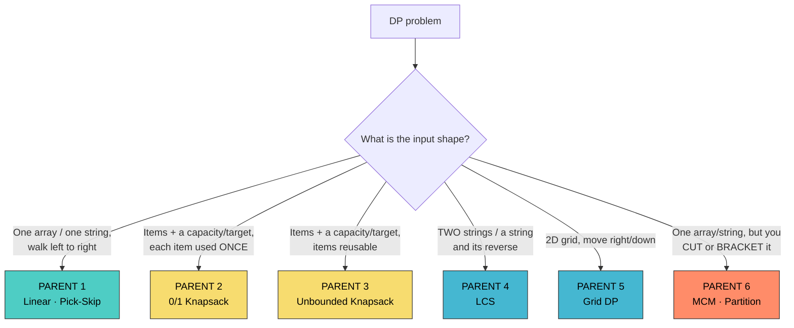
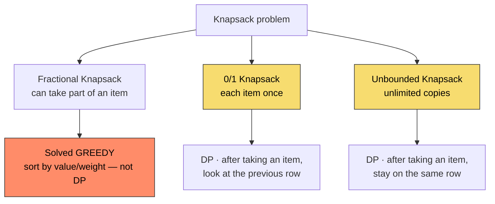
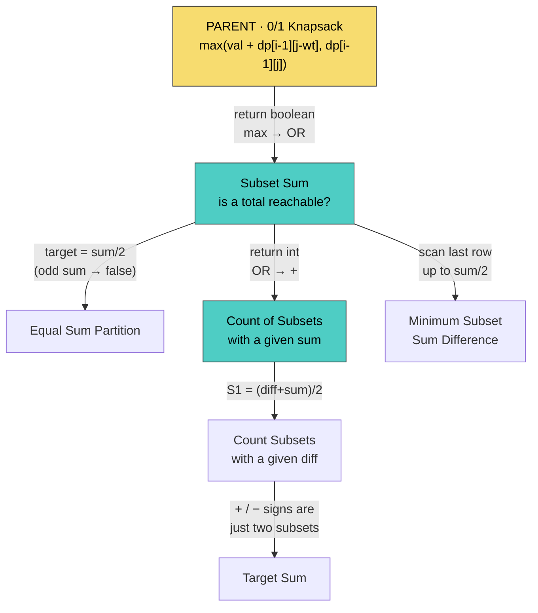
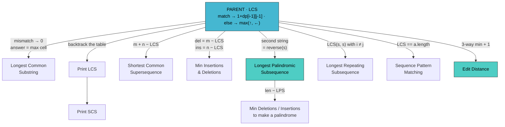
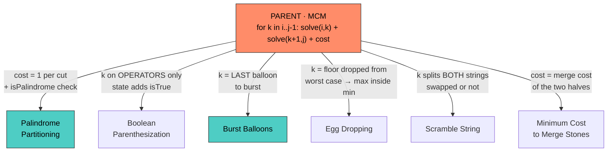

# Dynamic Programming (Java)

> "DP = enhanced recursion. Learn six parent recursions cold; every other problem is one of them with one named change."

**What this chapter covers:** Identification (choice + optimal), the recursion-to-memo-to-table pipeline, and the six parent problems — Linear/Pick-Skip, 0/1 Knapsack, Unbounded Knapsack, LCS, Grid DP, and MCM/Partition DP — each taught end-to-end and then derived into its full family of interview variants. Chapter 3 of the 4-part DSA sequence (31 / 31b / 31c / 31d); section numbers continue from chapters 31/31b.

---

## Start Here

### Pick a track — this is the longest chapter in the sequence

| Track | Time | Read this | Good for |
|-------|------|-----------|----------|
| **Speed run** | ~70 min | All of §18.15 (identification + the pipeline + the six parents), then just the **parent** of each family — skip the children on the first pass | First pass; you will already recognise most problems |
| **Mastery** | ~6 hr | Everything. The children are where the interview variants live, and each one is only a paragraph once you know its parent | Real preparation |
| **Refresh** | ~15 min | §18.20 The DP Cheat Sheet, then the Recognition Triggers table in §18.15 | The night before |

> **Do not read this chapter front to back on a first pass.** The six parents are the whole map; the ~40 children are variations you look up once you can name the parent. Learn to *identify*, then derive.

### How to read this chapter

Each family is taught the same way, and the two lines that matter most are always together:

| Line | What it gives you |
|------|-------------------|
| **Recognition** | the phrasing that tells you it is this problem |
| **Parent + Change** | which of the six it is, and the *one* thing that differs |
| **State / Recurrence / Base** | the three sentences you say out loud before coding (see below) |
| **Java** | the code, once you already know what it will say |
| `> **Trap:**` | the mistake that silently produces a wrong table |

Three words you will see on every page:

- **State** — what one cell of the table means, in plain words. Example: "`dp[i]` = the most money you can rob from the first `i + 1` houses."
- **Recurrence** — the rule that fills one cell from cells that are already filled.
- **Base** — the cells you fill in by hand before the loops start (the smallest inputs).

Dry runs use the same format as [chapter 31](#content/31_dsa_foundations): the title gives the input and the answer, a *We track* line says what each value means in plain words, there is one line per step, and **Why it works** closes it in one sentence.

### The prerequisite that is genuinely required

**You must be comfortable with plain recursion first.** DP is recursion that remembers; if writing the recursion is the hard part, that is the thing to practise, not tables. Recursion and the call-tree dry-run format are covered in [chapter 31 §18.9](#content/31_dsa_foundations). Backtracking — recursion's other child — is [chapter 31d §18.21](#content/31d_dsa_advanced_ml_coding).

---

## Table of Contents

| Part | Topic | Sections |
|------|-------|----------|
| 4 | Dynamic Programming | §18.15–18.20: Identification, the Six Parents, Knapsack, LCS, Grid, MCM, Cheat Sheet |

**Sequence:** [31 — Foundations & Search](#content/31_dsa_foundations) → [31b — Graphs](#content/31b_dsa_graphs) → **31c (this chapter)** → [31d — Advanced Patterns & ML Coding](#content/31d_dsa_advanced_ml_coding)

---

# PART 4: DYNAMIC PROGRAMMING

---

## 18.15 DP Fundamentals — Identification, the Pipeline & the Six Parents

Most people learn DP backwards. They memorise twenty tables, meet a twenty-first problem, and freeze. This part teaches it the other way round, the way Aditya Verma's classic DP series does:

> **DP = enhanced recursion.**

You never "see the table." You write a recursion, notice it repeats work, and give it a memory. The table is what that memory looks like after you flatten it. Learn six **parent problems** properly and roughly forty interview problems become *variations* — the same code with one operator, one index, or one input changed.

### DP Is Not a Table. It Is Recursion That Remembers.

```
Plain recursion          →   solves the subproblem   →   throws the answer away
Recursion + memory       →   solves the subproblem   →   keeps the answer  = DP
```

If you cannot write the recursion, you cannot write the DP. Everything below is built on that one sentence.

### The 30-Second Identification Test

A problem is DP when **both** of these are true:

| Test | Question to ask | What it looks like in code |
|------|-----------------|----------------------------|
| **1. Choice** | At each step, do I have more than one option? | The recursive function makes **two or more calls** |
| **2. Optimal / count** | Am I asked for min, max, longest, "how many ways", or "is it possible"? | The calls are combined with `max` / `min` / `+` / `\|\|` |

One call in a straight chain is **not** DP — that's just recursion (or a loop in disguise). Branching calls that revisit the same state are DP.

```
NOT DP — a single chain, nothing repeats          DP — branching, states repeat

   f(n)                                                    f(n)
    │                                                     /     \
   f(n-1)                                            f(n-1)     f(n-2)
    │                                                /     \     /    \
   f(n-2)                                       f(n-2) f(n-3) f(n-3)  f(n-4)
    │                                                         ^^^^^^
   f(n-3)                                            f(n-3) computed TWICE
                                                     → store it → DP
```

> **The memory hook:** *choice + optimal = DP.* If you can draw a branch, you can write a recurrence.


### Recognition Triggers — Phrase to Parent

When you see these phrases, think DP, and let the phrase point you at a parent:

| Phrase in the question | Likely parent |
|------------------------|---------------|
| "How many ways to..." | Linear (pick/skip), Knapsack-count, or Grid |
| "Fewest coins / pieces to make a total" (each can be reused) | Unbounded Knapsack |
| "Maximum profit / value with a limit" | 0/1 Knapsack |
| "Is there a subset that adds up to X / can these numbers make exactly X" | 0/1 Knapsack (boolean form) |
| "Can you reach the end of the array" | Linear (often greedy — see Jump Game) |
| "Longest / shortest **subsequence** of two strings" | LCS |
| "Convert string A into string B" | LCS |
| "Palindrome + subsequence / deletions" | LCS (with the reverse trick) |
| "Partition / cut / place brackets / burst / merge" | MCM (partition DP) |
| "Non-adjacent, can't pick two in a row" | Linear (pick/skip) |
| "Grid, only move right or down" | Grid DP |
| "Buy / sell / hold / cooldown" | State-machine DP |

### Step 1 of Everything: The Choice Diagram

Before writing a single line of code, draw the **choice diagram**. It is the picture of what you are allowed to do at one step. This is the single highest-leverage habit in DP.

The example below is **0/1 Knapsack** (taught fully in §18.16): you have `n` items, each with a weight and a value, and a bag that holds at most `W` kg; each item can be taken at most once. Let `f(i, W)` = the best total value you can get from the first `i` items with `W` kg of room left. Say item `i` weighs `wt` kg and is worth `val`.

```
0/1 Knapsack — deciding about item i, with W kg of room left:

                          item i
                       /      \
        it fits (wt <= W)       it does NOT fit
            /        \                 |
      take it       leave it       leave it
         |              |              |
val + f(i-1, W-wt)  f(i-1, W)      f(i-1, W)
           \          /
        max(take, leave)
```

Two branches on the page become two recursive calls in the code, combined by whatever the question asks for (`max`, `min`, `+`, `||`). That is the whole translation.

### Base Condition = The Smallest Valid Input

Beginners guess base cases. Don't. Ask two questions:

1. **"Think of the smallest valid input."** No items left? Capacity zero? Empty string? That answer is usually `0`, `1`, `true`, or `""`.
2. **"Think of the invalid input."** When the function works on a range from index `i` to index `j`, `i > j` means the range is empty — usually worth `0`. When you are minimising and an input simply cannot be solved, return a huge "impossible" value instead (`Integer.MAX_VALUE` in Java, or `amount + 1` in coin change).

```
0/1 Knapsack  → n == 0 (no items)      → profit 0
              → W == 0 (no capacity)   → profit 0
LCS           → either string empty     → 0
MCM (§18.18)  → i >= j (0 or 1 matrix)  → 0 (nothing to multiply)
Coin change   → amount == 0             → 0 coins
```

Get these right and the table's first row and first column write themselves — because **the base condition literally becomes the initialisation.**

### The Four-Step Pipeline

Every problem in this part is solved in the same fixed order. Never skip a step in an interview; each one is a checkpoint you can be graded on.

A **state** is one distinct set of arguments to the recursive function — in knapsack, one `(i, W)` pair. The table has one cell per state, and filling one cell costs some **work per state** (one `max` in knapsack, a whole loop in some problems).

```
        STEP 1              STEP 2                 STEP 3                 STEP 4
        RECURSION     →     MEMOISATION      →     TABULATION       →     SPACE-OPTIMISED
        "base + choice"     "recursion + 2 lines"  "table only"           "keep 1-2 rows"

 time   exponential         states x work each     states x work each     same as step 3
 space  call stack          table + call stack     table, no stack        one or two rows
```

| Step | What you write | What changes from the step before |
|------|----------------|-----------------------------------|
| 1. Recursion | Base condition + choice diagram | — |
| 2. Memoisation | **Same code + 2 lines**: check the table, store into the table | Exponential becomes (states × work per state) — e.g. O(n·W) for knapsack, O(n³) for MCM |
| 3. Tabulation | Delete the recursion; two loops fill the same table | Base condition becomes initialisation; each recursive call becomes a table lookup |
| 4. Space optimisation | Keep only the rows you actually read | Drops a whole dimension |

> **"Memoisation = recursion + 2 lines."** That is literally all it is. Keep a memo table `t` with one cell per state, filled with `-1` meaning "not solved yet". Then `if (t[i][j] != -1) return t[i][j];` goes at the top, and `return t[i][j] = ...` at the bottom.


**The table's dimensions come from the parameters that change.** In 0/1 knapsack, `n` and `W` change while `wt[]` and `val[]` stay fixed, so the table is `[n+1][W+1]`. In LCS (two strings of lengths `m` and `n`), both lengths change, so it is `[m+1][n+1]`. In Boolean Parenthesization (§18.18), `i`, `j` **and** `isTrue` change, so you need a third dimension. Count your changing parameters and you have counted your dimensions.

### A Terminology Landmine

Some videos and notes swap these two words. The standard, interview-safe usage is:

| Term | Meaning | Direction |
|------|---------|-----------|
| **Top-down** | Recursion + memo table | Starts at the answer, recurses down to base cases |
| **Bottom-up** | Iterative tabulation | Starts at base cases, builds up to the answer |

Use the standard meanings above when you speak to an interviewer. This chapter uses them consistently.

### Fibonacci — The Whole Pipeline on One Line of Recursion

Fibonacci is not an interview problem, but it is the cheapest place to see all four steps.


**Problem:** Given `n` (0 or more), return the `n`-th Fibonacci number: `fib(0) = 0`, `fib(1) = 1`, and every later number is the sum of the two before it. The program computes it four ways — one method per pipeline step — and all four must agree.

**Example:**
```
Input:  n = 5
Output: 5     (the sequence runs 0, 1, 1, 2, 3, 5)
```

**Walk-through:** the same `n = 5` through each of the four methods.
```
fibRecursive  fib(5) = fib(4) + fib(3)   -> 15 calls; fib(2) alone is solved 3 times
fibMemo       memo[2..5] = 1, 2, 3, 5     -> each fib(k) is solved once, then looked up
fibTable      i      0  1  2  3  4  5
              dp[i]  0  1  1  2  3  5     dp[i] = dp[i-1] + dp[i-2]
                                    ^ dp[5] = 5
fib           start: prev2 = 0, prev1 = 1
              i = 2: prev2 = 1, prev1 = 1
              i = 3: prev2 = 1, prev1 = 2
              i = 4: prev2 = 2, prev1 = 3
              i = 5: prev2 = 3, prev1 = 5   -> return prev1 = 5
```

**Approach:** Parent 1 (Linear) at its simplest. There is no real choice — `fib(n)` always needs `fib(n-1)` and `fib(n-2)` — but those two calls overlap, so each step removes waste: the memo stores every `fib(k)` once, the table fills `dp[]` upward from the base cases, and because `dp[i]` only reads two cells back, two variables replace the table.

```java
import java.util.*;

public class Fibonacci {
    // STEP 1 — Recursion. Base condition + choice. O(1.618^n) — unusable.
    int fibRecursive(int n) {
        if (n <= 1) return n;                 // smallest valid input
        return fibRecursive(n - 1) + fibRecursive(n - 2);  // two calls = branching = DP candidate
    }

    // STEP 2 — Memoisation = the same code + 2 lines.
    int[] memo;                               // memo[k] = fib(k), or -1 = not solved yet
    // before the first call: memo = new int[n + 1]; Arrays.fill(memo, -1);
    int fibMemo(int n) {
        if (n <= 1) return n;
        if (memo[n] != -1) return memo[n];    // line 1: already solved?
        return memo[n] = fibMemo(n - 1) + fibMemo(n - 2);  // line 2: store on the way out
    }
    // Time: O(n)  Space: O(n) table + O(n) stack

    // STEP 3 — Tabulation. Recursion deleted; base condition became initialisation.
    int fibTable(int n) {
        if (n <= 1) return n;
        int[] dp = new int[n + 1];
        dp[0] = 0; dp[1] = 1;                 // <- the base condition, as data
        for (int i = 2; i <= n; i++) {
            dp[i] = dp[i - 1] + dp[i - 2];    // <- the recursive calls, as lookups
        }
        return dp[n];
    }
    // Time: O(n)  Space: O(n), no stack

    // STEP 4 — Space optimisation. dp[i] only ever reads two cells back.
    int fib(int n) {
        if (n <= 1) return n;
        int prev2 = 0, prev1 = 1;
        for (int i = 2; i <= n; i++) {
            int curr = prev1 + prev2;
            prev2 = prev1;
            prev1 = curr;
        }
        return prev1;
    }
    // Time: O(n)  Space: O(1)

    public static void main(String[] args) {
        Fibonacci f = new Fibonacci();
        for (int n : new int[]{5, 0, 1, 10}) {
            f.memo = new int[n + 1];
            Arrays.fill(f.memo, -1);
            System.out.println("n = " + n + " -> recursion " + f.fibRecursive(n)
                + ", memo " + f.fibMemo(n) + ", table " + f.fibTable(n)
                + ", two variables " + f.fib(n));
        }
    }
}
```

**Output:**
```
n = 5 -> recursion 5, memo 5, table 5, two variables 5
n = 0 -> recursion 0, memo 0, table 0, two variables 0
n = 1 -> recursion 1, memo 1, table 1, two variables 1
n = 10 -> recursion 55, memo 55, table 55, two variables 55
```

**Practice:** [Fibonacci Number →](#dsa-problem-fibonacci-number)

```
Why memoisation is not optional — the naive call tree:

                     fib(5)
                   /        \
              fib(4)         fib(3)      <- fib(3) appears twice
             /     \         /     \
         fib(3)   fib(2)  fib(2)  fib(1) <- fib(2) appears three times
         /   \    /   \    /   \
     fib(2) fib(1) ...  ...  ...

WITH memoisation: each fib(k) computed exactly ONCE → O(n) total.
```

> **Fun fact:** naive `fib(n)` makes `2·fib(n+1) − 1` calls — `fib(5)` makes 15 — so the work grows as fast as the Fibonacci numbers themselves, roughly `O(1.618^n)`.

### Recursion → Table: How a Call Becomes a Cell

This mechanical translation is worth learning as a *rule*, because it works for every problem in this part. In `f(n, W)` the items are numbered from 1, but Java arrays start at 0, so item number `n` lives at `wt[n-1]` and `val[n-1]`.

| In the recursion | In the table |
|------------------|--------------|
| Parameter `n` (the first `n` items are still on offer) | Row index `i` |
| Parameter `W` (capacity left) | Column index `j` |
| `if (n == 0 \|\| W == 0) return 0;` | `dp[0][*] = 0` and `dp[*][0] = 0` (initialisation) |
| `f(n-1, W)` | `dp[i-1][j]` |
| `f(n-1, W - wt[n-1])` | `dp[i-1][j - wt[i-1]]` |
| `return f(n, W)` | `return dp[n][W]` |

```
Recursive form                                Tabulated form
-----------------------------------------     -------------------------------------
if (wt[n-1] <= W)                             if (wt[i-1] <= j)
  return max(val[n-1] + f(n-1, W-wt[n-1]),      dp[i][j] = max(val[i-1] + dp[i-1][j-wt[i-1]],
             f(n-1, W));                                       dp[i-1][j]);
else                                          else
  return f(n-1, W);                             dp[i][j] = dp[i-1][j];
```

Nothing is re-derived. You replace calls with lookups, and `n, W` with `i, j`. That is the entire conversion.


### The Six Parents — Your Whole DP Map

Here is the map. Learn these six recursions cold; every other problem in this part is one of them with a small, nameable change.




| # | Parent | Signature you can spot | State | Core recurrence | Children in this chapter |
|---|--------|------------------------|-------|-----------------|--------------------------|
| **1** | **Linear / Pick-Skip** | One array, decide per element, answer depends on 1–2 neighbours | `dp[i]` = best answer using elements `0..i` | `dp[i] = f(dp[i-1], dp[i-2] + a[i])` | Climbing Stairs, House Robber I/II, Decode Ways, Word Break, Jump Game, Kadane, LIS |
| **2** | **0/1 Knapsack** | Items + capacity/target, **each item once** | `dp[i][j]` = best from the first `i` items with budget `j` | `dp[i][j] = max(dp[i-1][j], val + dp[i-1][j-wt])` | Subset Sum, Equal Partition, Count Subsets, Min Subset Diff, Count-with-Diff, Target Sum |
| **3** | **Unbounded Knapsack** | Same, but **items reusable** | `dp[i][j]` = best from the first `i` item types (any number of each) with budget `j` | `dp[i][j] = max(dp[i-1][j], val + dp[i][j-wt])` ← same row | Rod Cutting, Coin Change & Coin Change II, Perfect Squares, Ribbon Cut |
| **4** | **LCS** | **Two** sequences, or one plus its reverse | `dp[i][j]` = answer for the first `i` letters of one string and the first `j` of the other | match → `1 + dp[i-1][j-1]`; else → `max(dp[i-1][j], dp[i][j-1])` | Common Substring, Print LCS, SCS, Edit Distance, LPS, Min Insert/Delete, Distinct Subseq |
| **5** | **Grid DP** | 2D board, movement constrained | `dp[r][c]` = best (or number of) ways to reach row `r`, column `c` | `dp[r][c] = f(dp[r-1][c], dp[r][c-1])` | Unique Paths I/II, Minimum Path Sum, Maximal Square |
| **6** | **MCM / Partition** | Cut, split, bracket, burst, merge a range | `dp[i][j]` = best for range `i..j` | `for k in i..j-1: f(solve(i,k), solve(k+1,j), cost)` | MCM, Palindrome Partitioning, Boolean Parenthesization, Burst Balloons, Egg Drop, Scramble String |

**Two more you will meet at Google** that are not part of the classic six but appear often enough to learn: **State-machine DP** (stock buy/sell — you are in one of a few named states each day) and **Bitmask DP** (n ≤ 20, the state *is* the subset). Both are covered in §18.19.

### Identification Drills

Read the problem, name the parent, name the change. Thirty seconds each.

| Problem | Parent | The change from the parent |
|---------|--------|----------------------------|
| "Can any subset sum to 11?" | 0/1 Knapsack | Return `boolean`; `max` becomes `\|\|` |
| "How many subsets sum to 11?" | 0/1 Knapsack | Return `int`; `\|\|` becomes `+` |
| "Fewest coins to make 11, unlimited coins" | Unbounded Knapsack | `max` becomes `min`, add `+1` per coin |
| "Longest palindromic subsequence of s" | LCS | Second string is `reverse(s)` |
| "Minimum cuts so every piece is a palindrome" | MCM | Cost per cut is `1`, plus a palindrome check |
| "Max money, can't rob adjacent houses" | Linear | Robbing house `i` makes house `i-1` off-limits, so the "rob" branch looks two cells back |
| "Ways to reach bottom-right of a grid" | Grid | Sum instead of max |

### When Nothing Matches: Deriving State From Scratch

The parent map covers most interview DP, but not all of it. When a problem refuses to match, fall back to first principles — this is the step the pattern-matching approach leaves out, and it is what separates a memoriser from an engineer.

1. **Write the brute-force recursion first.** Even exponential. What arguments does it take?
2. **Prune the arguments.** Which of them actually affect the answer? Those, and only those, are your state. (Anything you can recompute from the others is not state.)
3. **Check overlapping subproblems.** Draw two levels of the call tree. If no state repeats, this is divide-and-conquer, not DP — stop.
4. **Check optimal substructure.** Is the best answer for the whole built from best answers of parts? If a *sub-optimal* part could win overall (common in path problems with constraints), you need extra state.
5. **Count the dimensions and estimate.** `states × work-per-state` must fit the limits. Too big? Add a dimension you can drop, switch a dimension to a bitmask, or find a monotonicity you can binary-search.

> **Sanity check you can say out loud:** "My state is `dp[i][j]` = *<English sentence>*. It's enough because nothing outside `i` and `j` changes the answer." If you can't finish that sentence, your state is wrong — fix it before writing code.

---

### Parent 1: Linear / Pick-Skip DP

**The signature:** one array or string, you walk it left to right, and at each index you make a small decision whose answer depends on one or two earlier answers.

**The recursion:**

```java
// The shape of every Parent-1 problem
int solve(int i) {
    if (i < 0) return BASE;                     // smallest valid input
    return combine(solve(i - 1),                // skip / take one step
                   solve(i - 2) + value[i]);    // take / take two steps
}
```

Here `i` is an index into the array, `n` is the array's length, and `BASE`, `combine` and `value[i]` are placeholders each problem fills in.

**State:** `dp[i]` = the answer considering only the elements `0..i`.

**Answer:** `dp[n-1]`. (String problems often use `dp[i]` = the answer for the first `i` characters instead, so their answer is `dp[n]`.)

**Space:** almost always optimisable to `O(1)` — you only read one or two cells back.

#### Climbing Stairs (the Fibonacci child)

**Recognition:** "It takes `n` steps (n ≥ 1) to reach the top. Each move climbs 1 or 2 steps. How many distinct ways are there to reach the top?"

**Parent:** Linear. **Change:** combine with `+` (counting), no value array.

**State:** `dp[i]` = number of ways to reach step `i`.

**Recurrence:** `dp[i] = dp[i-1] + dp[i-2]` (the last move came from one step back or two).

**Base:** `dp[1] = 1` (one single step), `dp[2] = 2` (1+1 or 2) — the code below starts from these two.

**Example:**
```
Input:  n = 5
Output: 8
```

**Walk-through:** ways to reach each step, then the same numbers in the code's two variables.
```
step i   1  2  3  4  5
ways     1  2  3  5  8      ways(i) = ways(i-1) + ways(i-2)
                     ^ answer = 8

start    prev2 = 1, prev1 = 2              (steps 1 and 2)
i = 3    curr = 2 + 1 = 3   ->  prev2 = 2, prev1 = 3
i = 4    curr = 3 + 2 = 5   ->  prev2 = 3, prev1 = 5
i = 5    curr = 5 + 3 = 8   ->  prev2 = 5, prev1 = 8   -> return 8
```

**Approach:** Parent 1 (Linear) with `+` as the combine. Every way onto step `i` ends with either a 1-step from `i-1` or a 2-step from `i-2`; the two groups never overlap, so adding them counts each way once. Only the last two counts are ever read, so `prev2` and `prev1` replace the `dp` array.

```java
import java.util.*;

public class ClimbingStairs {
    public int climbStairs(int n) {
        if (n <= 2) return n;
        int prev2 = 1, prev1 = 2;                // ways to reach step 1 and step 2
        for (int i = 3; i <= n; i++) {
            int curr = prev1 + prev2;
            prev2 = prev1;
            prev1 = curr;
        }
        return prev1;
    }
    // Time: O(n)  Space: O(1)

    public static void main(String[] args) {
        ClimbingStairs s = new ClimbingStairs();
        for (int n : new int[]{3, 1, 2, 5}) {
            System.out.println("n = " + n + " -> " + s.climbStairs(n));
        }
    }
}
```

**Output:**
```
n = 3 -> 3
n = 1 -> 1
n = 2 -> 2
n = 5 -> 8
```

**Example:**
```
Input:  n = 3
Output: 3     (1+1+1, 1+2, 2+1)
```

**Min Cost Climbing Stairs** is the same child with `min` instead of `+`: `cost[i]` is the price of standing on step `i`, and `dp[i] = cost[i] + min(dp[i-1], dp[i-2])`.

**Practice:** [Climbing Stairs →](#dsa-problem-climbing-stairs) · [Min Cost Climbing Stairs →](#dsa-problem-min-cost-climbing-stairs)

#### House Robber (pick/skip with a gap)

![House Robber infographic: dp[i] = max(skip: dp[i-1], rob: nums[i] + dp[i-2]); filling best-so-far for nums = [2, 7, 9, 3, 1] gives 2, 7, 11, 11, 12, so the answer is 12 (rob houses 0, 2 and 4).](diagrams/dsa31c_info_houserobber_ai.png)

<details>
<summary><strong>Read as text</strong> — problem, key idea, dry run and trap</summary>

**Recognition:** "`nums[i]` is the money in house `i` along a street (all ≥ 0). Return the most money you can take without robbing two neighbouring houses."

**Parent:** Linear. **Change:** combine with `max`; robbing house `i` makes house `i-1` off-limits, so the "rob" branch looks two houses back.

**State:** `dp[i]` = the most money you can take from houses `0..i`.

**Recurrence:** `dp[i] = max(dp[i-1], dp[i-2] + nums[i])` — skip this house, or rob it plus the best from two back.

**Base:** `dp[0] = nums[0]`, `dp[1] = max(nums[0], nums[1])`.

**Dry run — `[2, 7, 9, 3, 1]` → `12`**
*We track:* "best so far" = the most money from the houses up to this one (that is `dp[i]`).

| House (money) | Skip it: best up to the house before | Rob it: its money + best two houses back | Best so far |
|---------------|--------------------------------------|------------------------------------------|-------------|
| 0 (2) | — (no house before) | **2** (nothing two back) | 2 |
| 1 (7) | 2 | **7** (nothing two back) | 7 |
| 2 (9) | 7 | **2 + 9 = 11** | 11 |
| 3 (3) | **11** | 7 + 3 = 10 | 11 |
| 4 (1) | 11 | **11 + 1 = 12** | **12** |

**Why it works:** every house is either robbed or skipped, and at each house we kept the better of the two, so the last cell is the best for the whole street (houses 0, 2 and 4: 2 + 9 + 1 = 12).

**Example:**
```
Input:  nums = [2, 7, 9, 3, 1]
Output: 12    (rob houses 0, 2 and 4)
```

</details>

**Java — house robber:**

```java
import java.util.*;

public class HouseRobber {
    public int rob(int[] nums) {
        if (nums.length == 1) return nums[0];
        // prev2 = best up to two houses back, prev1 = best up to the previous house
        int prev2 = nums[0], prev1 = Math.max(nums[0], nums[1]);
        for (int i = 2; i < nums.length; i++) {
            int curr = Math.max(prev1, prev2 + nums[i]);
            prev2 = prev1;
            prev1 = curr;
        }
        return prev1;
    }
    // Time: O(n)  Space: O(1)

    public static void main(String[] args) {
        HouseRobber s = new HouseRobber();
        int[][] tests = { {2, 7, 9, 3, 1}, {5}, {2, 1}, {2, 1, 1, 2} };
        for (int[] nums : tests) {
            System.out.println(Arrays.toString(nums) + " -> " + s.rob(nums));
        }
    }
}
```

**Output:**
```
[2, 7, 9, 3, 1] -> 12
[5] -> 5
[2, 1] -> 2
[2, 1, 1, 2] -> 4
```

**House Robber II (circular street)** is the same child with one trick: the first and last house are now neighbours, so you can never rob both. Run the street solver twice — once on every house except the last (`nums[0..n-2]`), once on every house except the first (`nums[1..n-1]`) — and take the larger answer.

**Problem:** House Robber on a circular street: `nums[i]` is the money in house `i`, and house `n-1` sits next to house `0`. Return the most money you can take without robbing two neighbouring houses.

**Example:**
```
Input:  nums = [2, 3, 2]
Output: 3     (houses 0 and 2 are neighbours on a circle, so rob house 1 alone)
```

**Walk-through:** two straight-line runs of `robRange`, then the larger answer.
```
nums = [2, 3, 2]          house 0 and house 2 are neighbours

robRange(0, 1)  houses [2, 3]   i = 0: curr = max(0, 0 + 2) = 2
                                i = 1: curr = max(2, 0 + 3) = 3   -> 3
robRange(1, 2)  houses [3, 2]   i = 1: curr = max(0, 0 + 3) = 3
                                i = 2: curr = max(3, 0 + 2) = 3   -> 3

answer = max(3, 3) = 3    (rob house 1 alone)
```
On `[2, 7, 9, 3, 1]` the two runs give 11 and 10, so the answer is 11 — not House Robber's 12, because houses 0 and 4 are now neighbours.

**Approach:** Parent 1 (House Robber), run twice. Any allowed choice leaves out house `0` or house `n-1` (or both), so it lies completely inside one of the two straight lines — the better of the two runs is the answer.

**Java — house robber II, circular street:**

```java
import java.util.*;

public class HouseRobberII {
    public int robCircular(int[] nums) {
        int n = nums.length;
        if (n == 1) return nums[0];
        return Math.max(robRange(nums, 0, n - 2), robRange(nums, 1, n - 1));
    }
    private int robRange(int[] nums, int lo, int hi) {   // House Robber on nums[lo..hi]
        int prev2 = 0, prev1 = 0;
        for (int i = lo; i <= hi; i++) {
            int curr = Math.max(prev1, prev2 + nums[i]);
            prev2 = prev1;
            prev1 = curr;
        }
        return prev1;
    }

    public static void main(String[] args) {
        HouseRobberII s = new HouseRobberII();
        int[][] tests = { {2, 3, 2}, {2, 7, 9, 3, 1}, {1, 2, 3, 1}, {5} };
        for (int[] nums : tests) {
            System.out.println(Arrays.toString(nums) + " -> " + s.robCircular(nums));
        }
    }
}
```

**Output:**
```
[2, 3, 2] -> 3
[2, 7, 9, 3, 1] -> 11
[1, 2, 3, 1] -> 4
[5] -> 5
```

**Practice:** [House Robber →](#dsa-problem-house-robber) · [House Robber II →](#dsa-problem-house-robber-ii)

#### Decode Ways (constrained Fibonacci)

**Recognition:** "Letters are coded as numbers, A=1 … Z=26. Given a string of digits, how many ways can it be decoded back into letters?" A `0` cannot stand alone, and a two-digit code must be 10–26 (so `"06"` is not a code).

**Parent:** Linear. **Change:** each of the two branches is *conditional* — a step is only legal if the digits form a valid letter.

**State:** `dp[i]` = number of ways to decode the first `i` characters, `s[0..i-1]` (so `dp` is one longer than `s`).

**Recurrence:** if the last digit `s[i-1]` is not `'0'`, `dp[i] += dp[i-1]`; if the last two digits `s[i-2..i-1]` form 10–26, `dp[i] += dp[i-2]`.

**Base:** `dp[0] = 1` — the empty string has exactly one decoding (decode nothing), which makes the counts add up; `dp[1] = 1` when the first digit is not `'0'`.

**Example:**
```
Input:  s = "226"
Output: 3     ("2,2,6" = BBF, "22,6" = VF, "2,26" = BZ)
```

**Walk-through:** `prev2` = `dp[i-2]` and `prev1` = `dp[i-1]`; each step adds whichever of them is allowed.
```
s = "226"      dp[0] = 1 (empty),  dp[1] = 1 ("2")

i   oneDigit   twoDigit   oneDigit adds   twoDigit adds   dp[i]
2   2  (B)     22  (V)    dp[1] = 1       dp[0] = 1       2
3   6  (F)     26  (Z)    dp[2] = 2       dp[1] = 1       3   <- answer

dp = [1, 1, 2, 3]   ->   "2,2,6"   "22,6"   "2,26"
```

**Approach:** Parent 1 (Fibonacci-style), counting with `+`. Every decoding ends with either a one-digit letter or a two-digit letter; those two groups never overlap, so `dp[i]` adds the count for the shorter prefix in each group — but only when that last code is a real letter (1-9, or 10-26). Only `dp[i-1]` and `dp[i-2]` are read, so two variables are enough.

```java
import java.util.*;

public class DecodeWays {
    public int numDecodings(String s) {
        if (s.charAt(0) == '0') return 0;
        int n = s.length();
        int prev2 = 1, prev1 = 1; // dp[0] = 1, dp[1] = 1

        for (int i = 2; i <= n; i++) {
            int curr = 0;
            int oneDigit = s.charAt(i - 1) - '0';
            int twoDigit = Integer.parseInt(s.substring(i - 2, i));
            if (oneDigit >= 1) curr += prev1;
            if (twoDigit >= 10 && twoDigit <= 26) curr += prev2;
            prev2 = prev1;
            prev1 = curr;
        }
        return prev1;
    }
    // Time: O(n)  Space: O(1)

    public static void main(String[] args) {
        DecodeWays s = new DecodeWays();
        for (String str : new String[]{"226", "11106", "06", "1"}) {
            System.out.println("\"" + str + "\" -> " + s.numDecodings(str));
        }
    }
}
```

**Output:**
```
"226" -> 3
"11106" -> 2
"06" -> 0
"1" -> 1
```

**Practice:** [Decode Ways →](#dsa-problem-decode-ways)

#### Word Break (pick/skip over *every* earlier cut)

![Word Break infographic: dp[i] = can the first i letters of "leetcode" be split into words from ["leet", "code"]; dp[0] = true, dp[4] = true via "leet", dp[8] = true via "code", others false, so the answer is true.](diagrams/dsa31c_info_wordbreak_ai.png)

<details>
<summary><strong>Read as text</strong> — problem, key idea, dry run and trap</summary>

**Recognition:** "Given a string `s` and a list of dictionary words (each may be reused), can `s` be split into a sequence of dictionary words?"

**Parent:** Linear. **Change:** the branch isn't 1-or-2 steps back — it's *any* earlier index, so the inner loop is O(n).

**State:** `dp[i]` = true if the first `i` characters, `s[0..i-1]`, can be split into dictionary words.

**Recurrence:** `dp[i] = true` if some `j < i` has `dp[j] == true` and the piece `s[j..i-1]` (that is, `s.substring(j, i)`) is in the dictionary.

**Example:**
```
Input:  s = "leetcode", wordDict = ["leet", "code"]
Output: true  ("leet" + "code")
```

**Walk-through:** `dp[i]` = can the first `i` letters of `"leetcode"` be split?
```
i      0  1  2  3  4  5  6  7  8
dp[i]  T  F  F  F  T  F  F  F  T
                   ^           ^ answer

dp[0] = T   the empty prefix needs no words
dp[4] = T   j = 0: dp[0] = T and s.substring(0, 4) = "leet" is a word
dp[8] = T   j = 4: dp[4] = T and s.substring(4, 8) = "code" is a word
other i     no cut j has dp[j] = T followed by a dictionary word
```

**Approach:** Parent 1, but the "previous step" can be any earlier cut `j`. Every split has a last word `s[j..i-1]`, and what comes before it must itself be splittable (`dp[j]`), so trying every `j` finds a split whenever one exists.

</details>

```java
import java.util.*;

public class WordBreak {
    public boolean wordBreak(String s, List<String> wordDict) {
        Set<String> dict = new HashSet<>(wordDict);
        boolean[] dp = new boolean[s.length() + 1];
        dp[0] = true;                                  // empty string is always breakable

        for (int i = 1; i <= s.length(); i++) {
            for (int j = 0; j < i; j++) {
                if (dp[j] && dict.contains(s.substring(j, i))) {
                    dp[i] = true;
                    break;
                }
            }
        }
        return dp[s.length()];
    }
    // Time: O(n^3), n = s.length() — n^2 (j, i) pairs, each substring + hash costs up to n.
    // Space: O(n)

    public static void main(String[] args) {
        WordBreak w = new WordBreak();
        String[] strings = {"leetcode", "applepenapple", "catsandog", "aaaaaaa"};
        List<List<String>> dicts = List.of(
            List.of("leet", "code"),
            List.of("apple", "pen"),
            List.of("cats", "dog", "sand", "and", "cat"),
            List.of("aaaa", "aaa"));
        for (int t = 0; t < strings.length; t++) {
            System.out.println("s = \"" + strings[t] + "\", wordDict = " + dicts.get(t)
                + " -> " + w.wordBreak(strings[t], dicts.get(t)));
        }
    }
}
```

**Output:**
```
s = "leetcode", wordDict = [leet, code] -> true
s = "applepenapple", wordDict = [apple, pen] -> true
s = "catsandog", wordDict = [cats, dog, sand, and, cat] -> false
s = "aaaaaaa", wordDict = [aaaa, aaa] -> true
```

**Practice:** [Word Break →](#dsa-problem-word-break)

#### Kadane's Algorithm (Maximum Subarray) — Linear DP in disguise

**Recognition:** "Given an integer array, return the largest sum of a contiguous (unbroken, non-empty) subarray."

**Parent:** Linear. **Change:** the choice is *extend the current run* or *start fresh here*.

**State:** `dp[i]` = the best sum of a subarray that **ends exactly at** index `i`.

**Recurrence:** `dp[i] = max(nums[i], dp[i-1] + nums[i])`. The answer is the largest `dp[i]` anywhere, not `dp[n-1]` — a classic slip.

**Example:**
```
Input:  nums = [-2, 1, -3, 4, -1, 2, 1, -5, 4]
Output: 6     (the subarray [4, -1, 2, 1])
```

**Walk-through:** at each `i`, `curr` = the larger of *start fresh* (`nums[i]`) and *extend* (`curr + nums[i]`); `best` = the largest `curr` so far.
```
i         0   1   2   3   4   5   6   7   8
nums[i]  -2   1  -3   4  -1   2   1  -5   4
extend    -  -1  -2   2   3   5   6   1   5
curr     -2   1  -2   4   3   5   6   1   5
best     -2   1   1   4   4   5   6   6   6
                                  ^ best = 6: the run [4, -1, 2, 1], i = 3..6
```

**Approach:** Parent 1 with an *extend or restart* choice. A subarray ending at `i` is either `nums[i]` alone or the best one ending at `i-1` plus `nums[i]` — if that earlier run is negative it can only hurt, so start fresh. `curr` plays `dp[i]`, and `best` keeps the largest one seen.

```java
import java.util.*;

public class MaximumSubarray {
    public int maxSubArray(int[] nums) {
        int best = nums[0], curr = nums[0];          // curr = dp[i], best = max so far
        for (int i = 1; i < nums.length; i++) {
            curr = Math.max(nums[i], curr + nums[i]);  // start fresh, or extend
            best = Math.max(best, curr);
        }
        return best;
    }
    // Time: O(n)  Space: O(1)

    public static void main(String[] args) {
        MaximumSubarray s = new MaximumSubarray();
        int[][] tests = { {-2, 1, -3, 4, -1, 2, 1, -5, 4}, {1}, {-3, -1, -2}, {5, 4, -1, 7, 8} };
        for (int[] nums : tests) {
            System.out.println(Arrays.toString(nums) + " -> " + s.maxSubArray(nums));
        }
    }
}
```

**Output:**
```
[-2, 1, -3, 4, -1, 2, 1, -5, 4] -> 6
[1] -> 1
[-3, -1, -2] -> -1
[5, 4, -1, 7, 8] -> 23
```

**Practice:** [Maximum Subarray →](#dsa-problem-maximum-subarray)

#### Longest Increasing Subsequence (LIS)

![LIS infographic: dp[i] = length of the longest increasing subsequence ending at nums[i] fills to 1,1,1,2,2,3,4,4 for nums = [10, 9, 2, 5, 3, 7, 101, 18]; the fast tails method goes [10] → [9] → [2] → [2,5] → [2,3] → [2,3,7] → [2,3,7,101] → [2,3,7,18], so the answer is 4.](diagrams/dsa31c_info_lis_ai.png)

<details>
<summary><strong>Read as text</strong> — problem, key idea, dry run and trap</summary>

**Recognition:** "Given an integer array, return the length of the longest **strictly increasing subsequence**." A *subsequence* keeps the original order but may skip elements; a *subarray* may not skip.

**Parent:** Linear. **Change:** `dp[i]` depends on **all** `j < i`, not just `i-1` — so the DP is `O(n^2)`, and a greedy + binary search beats it.

**O(n^2) DP** — the version you should be able to derive on demand. Here `dp[i]` = the length of the longest increasing subsequence that **ends at** `nums[i]`:

```java
public int lengthOfLIS_dp(int[] nums) {
    int n = nums.length, best = 1;
    int[] dp = new int[n];
    Arrays.fill(dp, 1);                    // each element alone has length 1
    for (int i = 1; i < n; i++) {
        for (int j = 0; j < i; j++) {
            if (nums[j] < nums[i]) dp[i] = Math.max(dp[i], dp[j] + 1);
        }
        best = Math.max(best, dp[i]);
    }
    return best;
}
// Time: O(n^2)  Space: O(n)
```

**O(n log n) patience sorting** — the version that wins the interview:

**Example:**
```
Input:  nums = [10, 9, 2, 5, 3, 7, 101, 18]
Output: 4     ([2, 3, 7, 18] or [2, 3, 7, 101])
```

**Dry run — `[10, 9, 2, 5, 3, 7, 101, 18]` → `4`**
*We track:* `tails` = for each length, the smallest last value of an increasing subsequence of that length seen so far (first slot = length 1).

```
  (start) → []
  10  → [10]           (extend)
  9   → [9]            (replace 10 — smaller tail for length 1)
  2   → [2]            (replace 9)
  5   → [2, 5]         (extend)
  3   → [2, 3]         (replace 5 — smaller tail for length 2)
  7   → [2, 3, 7]      (extend)
  101 → [2, 3, 7, 101] (extend)
  18  → [2, 3, 7, 18]  (replace 101)
```

**Why it works:** a number only extends `tails` when it is bigger than every tail, i.e. when it lengthens the best subsequence, so the final size (4) is the LIS length.

> **Trap:** `tails` is *not* always a real subsequence — only its **length** is meaningful. On `[3, 4, 1]` it ends as `[1, 4]`, but 1 comes after 4 in the input. If asked to print the actual subsequence, keep parent pointers alongside.

</details>

```java
import java.util.*;

public class LongestIncreasingSubsequence {
    public int lengthOfLIS(int[] nums) {
        // tails[k] = smallest last value of any increasing subsequence of length k+1
        List<Integer> tails = new ArrayList<>();
        for (int num : nums) {
            int pos = Collections.binarySearch(tails, num);
            if (pos < 0) pos = -(pos + 1);          // insertion point
            if (pos == tails.size()) tails.add(num);   // extends the longest subsequence
            else tails.set(pos, num);                  // replace to keep the smallest tail
        }
        return tails.size();
    }
    // Time: O(n log n)  Space: O(n)

    public static void main(String[] args) {
        LongestIncreasingSubsequence s = new LongestIncreasingSubsequence();
        int[][] tests = {
            {10, 9, 2, 5, 3, 7, 101, 18}, {0, 1, 0, 3, 2, 3}, {7, 7, 7, 7}, {5, 4, 3, 2, 1}
        };
        for (int[] nums : tests) {
            System.out.println(Arrays.toString(nums) + " -> " + s.lengthOfLIS(nums));
        }
    }
}
```

**Output:**
```
[10, 9, 2, 5, 3, 7, 101, 18] -> 4
[0, 1, 0, 3, 2, 3] -> 4
[7, 7, 7, 7] -> 1
[5, 4, 3, 2, 1] -> 1
```

**Practice:** [Longest Increasing Subsequence →](#dsa-problem-longest-increasing-subsequence)

#### Jump Game (where DP loses to greedy)

**Recognition:** "`nums[i]` is the furthest you may jump forward from index `i` (any distance from 0 to `nums[i]`). You start at index 0. Return true if you can reach the last index."

**Parent:** Linear — an `O(n^2)` DP ("can I reach `i`?" for every `i`) works, but it is slower than needed. Track the furthest reachable index instead.

**Example:**
```
Input:  nums = [2, 3, 1, 1, 4]
Output: true   (0 → 1 → 4)

Input:  nums = [3, 2, 1, 0, 4]
Output: false  (every path lands on index 3, whose jump length is 0)
```

**Walk-through:** `reach` = the furthest index we can get to from indices `0..i`.
```
nums = [2, 3, 1, 1, 4]             nums = [3, 2, 1, 0, 4]
i   i + nums[i]   reach            i   i + nums[i]   reach
0   0 + 2 = 2     2                0   0 + 3 = 3     3
1   1 + 3 = 4     4                1   1 + 2 = 3     3
2   2 + 1 = 3     4                2   2 + 1 = 3     3
3   3 + 1 = 4     4                3   3 + 0 = 3     3
4   4 + 4 = 8     8                4   4 > reach 3  -> return false
loop ends -> return true
```

**Approach:** Parent 1 collapsed to a greedy frontier. The reachable indices always form one unbroken block `0..reach`, so a single number replaces the whole boolean `dp[]`. Every index you can stand on pushes `reach` to `i + nums[i]` if that is further; if `i` ever passes `reach`, nothing before it jumps that far, so the answer is false.

```java
import java.util.*;

public class JumpGame {
    public boolean canJump(int[] nums) {
        int reach = 0;                                   // furthest index reachable so far
        for (int i = 0; i < nums.length; i++) {
            if (i > reach) return false;                 // stuck before this index
            reach = Math.max(reach, i + nums[i]);
        }
        return true;
    }
    // Time: O(n)  Space: O(1)

    public static void main(String[] args) {
        JumpGame s = new JumpGame();
        int[][] tests = { {2, 3, 1, 1, 4}, {3, 2, 1, 0, 4}, {0}, {2, 0, 0} };
        for (int[] nums : tests) {
            System.out.println(Arrays.toString(nums) + " -> " + s.canJump(nums));
        }
    }
}
```

**Output:**
```
[2, 3, 1, 1, 4] -> true
[3, 2, 1, 0, 4] -> false
[0] -> true
[2, 0, 0] -> true
```

**Practice:** [Jump Game →](#dsa-problem-jump-game)

> **Interview note:** "It's DP" is not always the best answer. When each state's decision only ever extends a running frontier (reach, current sum, best-so-far), greedy collapses the DP to O(n). Say the DP out loud, then say why greedy is safe here.

**Key Problems — Detailed Solutions:**

<details>
<summary><strong>House Robber</strong> — Medium</summary>

**Problem:** `nums[i]` is the money (≥ 0) in house `i` along a street. Return the most money you can take without robbing two neighbouring houses.

**Example:**
```
Input:  nums = [2, 7, 9, 3, 1]
Output: 12
```

**Walk-through:** best so far after each house:
```
house    0   1   2   3   4
money    2   7   9   3   1
best     2   7  11  11  12     e.g. house 2: max(skip → 7, rob → 2 + 9 = 11) = 11
```
Robbing houses 0, 2 and 4 gives 2 + 9 + 1 = 12.

**Approach:** At each house, take the better of *skip it* (best up to the previous house) or *rob it* (its money + best up to two houses back). Only the last two answers are ever read, so two variables are enough.

**Java:** the two-variable `rob` is in *House Robber (pick/skip with a gap)* above.

**Complexity:** O(n) time, O(1) space
</details>

<details>
<summary><strong>Longest Increasing Subsequence</strong> — Medium</summary>

**Problem:** Given an integer array `nums`, return the length of its longest strictly increasing subsequence (keep the order, skipping elements is allowed).

**Example:**
```
Input:  nums = [10, 9, 2, 5, 3, 7, 101, 18]
Output: 4     (for example [2, 3, 7, 101])
```

**Walk-through:** the smallest possible last value for each length grows like this: `[10]` → `[9]` → `[2]` → `[2, 5]` → `[2, 3]` → `[2, 3, 7]` → `[2, 3, 7, 101]` → `[2, 3, 7, 18]`. Four slots, so the answer is 4.

**Approach:** Mention the O(n²) DP first — it shows you can derive it — then upgrade: keep `tails`, where slot `k` holds the smallest last value of any increasing subsequence of length `k + 1`. Binary-search each number into `tails`: past the end → append (a longer subsequence exists); otherwise overwrite that slot with the smaller value.

**Java:** both versions are in *Longest Increasing Subsequence (LIS)* above.

**Complexity:** O(n log n) time, O(n) space
</details>

<details>
<summary><strong>Word Break</strong> — Medium</summary>

**Problem:** Given a string `s` and a list of dictionary words `wordDict` (each word may be reused), return true if `s` can be split into a sequence of dictionary words.

**Example:**
```
Input:  s = "leetcode", wordDict = ["leet", "code"]
Output: true  ("leet" + "code")
```

**Walk-through:** `dp[i]` = can the first `i` letters be split?
```
dp[0] = true   (the empty string needs no words)
dp[4] = true   "leet" is a word and dp[0] is true
dp[8] = true   "code" is a word and dp[4] is true   → answer
```

**Approach:** For each length `i`, try every earlier cut `j`: if the first `j` letters can be split (`dp[j]`) and the piece `s[j..i-1]` is a word, then `dp[i]` is true.

**Java:** the code is in *Word Break* above.

**Complexity:** O(n³) time (n² cut pairs, each substring costs up to n), O(n) space
</details>

**Problem List — Parent 1: Linear / Pick-Skip:**

**Start with these five:** Climbing Stairs · House Robber · Maximum Subarray · Longest Increasing Subsequence · Word Break. Between them they cover every combine-operator in the family.

| #   | Problem                          | Difficulty | Change from the parent        |
|-----|----------------------------------|------------|-------------------------------|
| 1   | Climbing Stairs (LC 70)          | Easy       | Combine with `+` (count ways) |
| 2   | Min Cost Climbing Stairs (746)   | Easy       | Combine with `min` + cost     |
| 3   | House Robber (LC 198)            | Medium     | Rob → look two back; `max`    |
| 4   | House Robber II (LC 213)         | Medium     | Run the line twice (circular) |
| 5   | Decode Ways (LC 91)              | Medium     | Branches are conditional      |
| 6   | Word Break (LC 139)              | Medium     | Inner loop over all cuts      |
| 7   | Maximum Subarray (LC 53)         | Medium     | "extend or restart"; answer is max over dp |
| 8   | Maximum Product Subarray (152)   | Medium     | Track min AND max (negatives) |
| 9   | Longest Increasing Subseq (300)  | Medium     | All-previous dependency → n log n |
| 10  | Number of LIS (LC 673)           | Medium     | Carry a count alongside length |
| 11  | Jump Game (LC 55)                | Medium     | Greedy frontier beats the DP  |
| 12  | Jump Game II (LC 45)             | Medium     | BFS-style level counting      |
| 13  | Delete and Earn (LC 740)         | Medium     | Bucket by value → House Robber |
| 14  | Paint House (LC 256)             | Medium     | dp per colour (mini state machine) |
| 15  | Best Sightseeing Pair (LC 1014)  | Medium     | Carry best `a[i]+i` seen so far |

---
### 60-second recall

<details>
<summary>1. What are the two questions that decide whether a problem is DP at all?</summary>

Is there a <strong>choice</strong> at each step (two or more recursive calls), and is the answer a <strong>min, max, count, or is-it-possible</strong>? Both must be true. One call in a straight chain is just recursion.
</details>

<details>
<summary>2. You have written the recursion and it is too slow. What are the next two lines, exactly?</summary>

At the top of the function, <code>if (t[i][j] != -1) return t[i][j];</code> and at the bottom, <code>return t[i][j] = ...</code>, where <code>t</code> is the memo table (one cell per state, filled with -1 for "not solved yet"). That is the whole of memoisation — the recursion itself does not change.
</details>

<details>
<summary>3. Why bother converting a working memoised solution into a table?</summary>

Two reasons. It removes the recursion stack — a deep input can overflow the stack, and the table cannot. And the finished table is what step 4 shrinks to one or two rows. The time complexity is identical. In an interview a correct memoised solution beats a half-finished table every time.
</details>

---

## 18.16 Parents 2 & 3 — The Knapsack Family

This is the family that pays the most rent. One recursion, learned properly, generates a dozen interview problems — and the differences between them are so small you can name each one in a single line.

### Parent 2: 0/1 Knapsack

![0/1 Knapsack infographic: dp[i][j] = best value using the first i items with a j kg bag; for weights [1, 3, 4, 5], values [1, 4, 5, 7], W = 7 the full 5 × 8 table is shown, with dp[3][7] = max(5 + dp[2][3] = 9, dp[2][7] = 5) = 9, so the answer dp[4][7] = 9.](diagrams/dsa31c_info_knapsack_ai.png)

<details>
<summary><strong>Read as text</strong> — problem, key idea, dry run and trap</summary>

**The problem:** you are given `n` items; item `i` weighs `wt[i]` kg and is worth `val[i]` (arrays are 0-based). The bag holds at most `W` kg. Each item may be taken **at most once**. Return the largest total value that fits in the bag.

```
                  wt[]  = [1, 3, 4, 5]
                  val[] = [1, 4, 5, 7]          bag capacity W = 7 kg

           item 1        item 2        item 3        item 4
          ┌──────┐      ┌──────┐      ┌──────┐      ┌──────┐          ╭─────────╮
          │ 1 kg │      │ 3 kg │      │ 4 kg │      │ 5 kg │          │   BAG   │
          │  ₹1  │      │  ₹4  │      │  ₹5  │      │  ₹7  │   ───►   │  W = 7  │
          └──────┘      └──────┘      └──────┘      └──────┘          ╰─────────╯

          Best: items 2 + 3  →  weight 3+4 = 7,  value 4+5 = ₹9
          (items are numbered from 1 here; item 2 is wt[1], item 3 is wt[2])
```

</details>

#### How to identify it

Two things must be present — and they are exactly the two things from the 30-second test:

1. **A choice per item:** include it or exclude it.
2. **An optimal ask** over a **bounded resource**: maximum value, or "is a total reachable", or "how many ways to hit a total".

Knapsack comes in three flavours; two of them are DP and the third is greedy:



> **Trap — fractional items are not DP.** If items can be cut into fractions, stop: it is greedy. Sort by value-per-weight and fill. Interviewers use this as a trap.

#### Step 1 — The recursion (base condition + choice diagram)

```java
// knapsack(wt, val, W, n) = the best value using only the first n items, with W kg of room.
// Base condition: think of the smallest valid input.
//   no items left (n == 0)   → nothing to gain → 0
//   no capacity left (W == 0) → nothing fits    → 0
int knapsack(int[] wt, int[] val, int W, int n) {
    if (n == 0 || W == 0) return 0;

    if (wt[n - 1] <= W) {                       // it FITS → two choices
        return Math.max(
            val[n - 1] + knapsack(wt, val, W - wt[n - 1], n - 1),  // include
            knapsack(wt, val, W, n - 1));                          // exclude
    } else {                                    // does NOT fit → one choice
        return knapsack(wt, val, W, n - 1);                        // exclude only
    }
}
// Time: O(2^n) — every item branches in two. Unusable, but it is the truth.
```

Note the shape: **base condition, then the choice diagram, nothing else.** The return type (`int`) came from the question — "return the maximum profit". When the question changes to "is it possible", the return type becomes `boolean`, and that single change is what generates the whole family below.

#### Step 2 — Memoisation (the same code + 2 lines)

The parameters that change are `n` and `W`, so the memo table is `[n+1][W+1]`.

```java
Integer[][] t;   // t[n][W] = answer for (first n items, W kg); null = not yet solved
                 // allocate before the first call: t = new Integer[n + 1][W + 1];

int knapsack(int[] wt, int[] val, int W, int n) {
    if (n == 0 || W == 0) return 0;
    if (t[n][W] != null) return t[n][W];         // line 1 — already solved?

    if (wt[n - 1] <= W) {
        return t[n][W] = Math.max(               // line 2 — store on the way out
            val[n - 1] + knapsack(wt, val, W - wt[n - 1], n - 1),
            knapsack(wt, val, W, n - 1));
    }
    return t[n][W] = knapsack(wt, val, W, n - 1);
}
// Time: O(n * W)  Space: O(n * W) table + O(n) recursion stack
```

> **Why move on from memoisation at all?** Same time complexity, but the recursion stack is real memory and a deep input can blow it. Tabulation removes the stack entirely, and the finished table is what step 4 shrinks to a single row.

#### Step 3 — Tabulation (the table, no recursion)

Two steps, every time: **initialise**, then **translate the recurrence**.


```java
public int knapsack(int[] wt, int[] val, int W, int n) {
    int[][] dp = new int[n + 1][W + 1];

    // (a) Initialisation = the base condition, written as data.
    //     Row 0 (no items) and column 0 (no capacity) are already 0 in Java.

    // (b) The recurrence, with calls replaced by lookups.
    for (int i = 1; i <= n; i++) {
        for (int j = 1; j <= W; j++) {
            if (wt[i - 1] <= j) {
                dp[i][j] = Math.max(val[i - 1] + dp[i - 1][j - wt[i - 1]],
                                    dp[i - 1][j]);
            } else {
                dp[i][j] = dp[i - 1][j];
            }
        }
    }
    return dp[n][W];
}
// Time: O(n * W)  Space: O(n * W), no stack
```

**Dry run — weights `[1, 3, 4, 5]`, values `[1, 4, 5, 7]`, capacity `7` → `9`**
*We track:* each cell `dp[i][j]` = the best value using only the first `i` items (rows) with a bag of `j` kg (columns).

```
              j →   0   1   2   3   4   5   6   7
  i=0 (none)        0   0   0   0   0   0   0   0     ← base: no items
  i=1 (1kg, ₹1)     0   1   1   1   1   1   1   1
  i=2 (3kg, ₹4)     0   1   1   4   5   5   5   5
  i=3 (4kg, ₹5)     0   1   1   4   5   6   6   9
  i=4 (5kg, ₹7)     0   1   1   4   5   7   8  [9]   ← answer dp[n][W]
                    ↑
                    base: capacity 0

  Reading dp[3][7] = 9 (item 3 weighs wt[2] = 4 kg, which fits in 7):
      take it  → val[2] + dp[2][7-4] = 5 + dp[2][3] = 5 + 4 = 9
      leave it → dp[2][7] = 5
      max = 9  ✓
```

**Why it works:** each row offers exactly one new item and only reads the row above, so no item can be used twice, and the last cell has seen every item and the full capacity.

#### Step 4 — Space optimisation

Row `i` only ever reads row `i-1`. Keep one row and **walk capacity backwards**, so the cells you read are still from the previous item.

**Walk-through:** the one row `dp[]` after each item, on the same example (`wt = [1, 3, 4, 5]`, `val = [1, 4, 5, 7]`, `W = 7`).
```
                      j ->  0  1  2  3  4  5  6  7
start                       0  0  0  0  0  0  0  0
after i=0 (wt 1, val 1)     0  1  1  1  1  1  1  1
after i=1 (wt 3, val 4)     0  1  1  4  5  5  5  5
after i=2 (wt 4, val 5)     0  1  1  4  5  6  6  9
after i=3 (wt 5, val 7)     0  1  1  4  5  7  8  9
                                                 ^ answer dp[W] = dp[7] = 9

i=2, j=7: dp[7] = max(dp[7] = 5, dp[7-4] + val[2] = 4 + 5) = 9
j runs 7 -> 4, so dp[3] still holds the old row's value when dp[7] reads it
```

**Approach:** The same Parent 2 take/skip as Step 3 — `dp[j] = max(skip: dp[j], take: dp[j - wt[i]] + val[i])` — but the 2-D table is folded into one row that each item overwrites. Each line above is exactly one row of the Step 3 table.

```java
import java.util.*;

public class Knapsack01 {
    public int knapsack(int[] wt, int[] val, int W) {
        int[] dp = new int[W + 1];
        for (int i = 0; i < wt.length; i++) {
            for (int j = W; j >= wt[i]; j--) {       // BACKWARDS — see the warning below
                dp[j] = Math.max(dp[j], dp[j - wt[i]] + val[i]);
            }
        }
        return dp[W];
    }
    // Time: O(n * W)  Space: O(W)

    public static void main(String[] args) {
        Knapsack01 s = new Knapsack01();
        int[][] wts  = { {1, 3, 4, 5}, {2, 3}, {5, 6}, {1, 3, 4, 5} };
        int[][] vals = { {1, 4, 5, 7}, {3, 5}, {10, 20}, {1, 4, 5, 7} };
        int[] caps = { 7, 6, 4, 0 };
        for (int t = 0; t < caps.length; t++) {
            System.out.println("wt = " + Arrays.toString(wts[t]) + ", val = "
                + Arrays.toString(vals[t]) + ", W = " + caps[t] + " -> "
                + s.knapsack(wts[t], vals[t], caps[t]));
        }
    }
}
```

**Output:**
```
wt = [1, 3, 4, 5], val = [1, 4, 5, 7], W = 7 -> 9
wt = [2, 3], val = [3, 5], W = 6 -> 8
wt = [5, 6], val = [10, 20], W = 4 -> 0
wt = [1, 3, 4, 5], val = [1, 4, 5, 7], W = 0 -> 0
```

> **Trap — the single most important loop direction in DP.** In **0/1** knapsack iterate capacity **backwards** (so each item is used at most once); in **unbounded** knapsack iterate **forwards** (so an item can be reused). Getting this backwards is the most common silent wrong-answer in the whole family.

**Example:**
```
Input:  wt = [1, 3, 4, 5], val = [1, 4, 5, 7], W = 7
Output: 9     (the 3 kg and 4 kg items: 4 + 5)
```

### The 0/1 Knapsack Family Tree

Everything below is the code above, with one named change.



| Child | What changed from its parent | Return type |
|-------|------------------------------|-------------|
| Subset Sum | `max(a, b)` → `a \|\| b`; `val[]` disappears | `boolean` |
| Equal Sum Partition | Call Subset Sum with `target = sum/2`; odd total → immediately false | `boolean` |
| Count of Subsets | `a \|\| b` → `a + b` | `int` |
| Min Subset Sum Diff | Build the Subset Sum table, then read the **last row** | `int` |
| Count Subsets with Diff | Algebra first: `S1 = (diff + sum) / 2`, then Count of Subsets | `int` |
| Target Sum | `+`/`−` signs *are* two subsets → Count Subsets with Diff | `int` |


#### Child 1 — Subset Sum

![Subset Sum infographic: dp[i][j] = true if some of the first i numbers make exactly j; for arr = [2, 3, 7, 8, 10], sum = 11 the true sums per row grow {0} → {0,2} → {0,2,3,5} → {0,2,3,5,7,9,10} → ... 11, reached when 8 is added (dp[4][11] = dp[3][3]), so the answer is true ({3, 8}).](diagrams/dsa31c_info_subsetsum_ai.png)

<details>
<summary><strong>Read as text</strong> — problem, key idea, dry run and trap</summary>

**Problem:** given an array `arr[]` of positive integers and a target `sum`, is there a subset (any selection of elements, each used at most once) that adds up to exactly `sum`? Return true or false.

**Matching:** `arr[]` is the item array, `sum` is the capacity. There is no `val[]` because the question asks *whether*, not *how much*.

**State:** `dp[i][j]` = true if some of the first `i` numbers add up to exactly `j`.

**Example:**
```
Input:  arr = [2, 3, 7, 8, 10], sum = 11
Output: true   ({3, 8})
```

Compare the two recurrences side by side — this is the whole lesson of the family:

```
0/1 Knapsack : dp[i][j] = max( val[i-1] + dp[i-1][j-wt[i-1]] ,  dp[i-1][j] )
Subset Sum   : dp[i][j] =      dp[i-1][j-arr[i-1]]            ||  dp[i-1][j]
                                ^^^ take                           ^^^ skip
```

**Walk-through:** the full `dp` table (`T` = some of the first `i` numbers add up to exactly `j`).
```
            j ->  0  1  2  3  4  5  6  7  8  9 10 11
i=0 (none)        T  F  F  F  F  F  F  F  F  F  F  F
i=1 (2)           T  F  T  F  F  F  F  F  F  F  F  F
i=2 (3)           T  F  T  T  F  T  F  F  F  F  F  F
i=3 (7)           T  F  T  T  F  T  F  T  F  T  T  F
i=4 (8)           T  F  T  T  F  T  F  T  T  T  T  T
i=5 (10)          T  F  T  T  F  T  F  T  T  T  T  T
                                                   ^ dp[5][11] = T -> true

dp[4][11]: take 8 -> dp[3][11-8] = dp[3][3] = T  ||  skip -> dp[3][11] = F   ({3, 8})
```

**Approach:** Parent 2 (0/1 Knapsack) with `max` swapped for `||` and no `val[]`. The number `arr[i-1]` is either taken — then the earlier numbers must make `j - arr[i-1]` — or skipped — then they must make `j` — so the cell is true if either branch is. Reading only row `i-1` keeps each number to one use.

</details>

```java
import java.util.*;

public class SubsetSum {
    public boolean subsetSum(int[] arr, int sum) {
        int n = arr.length;
        boolean[][] dp = new boolean[n + 1][sum + 1];

        // Initialisation from the base condition:
        //   sum 0 with any prefix → true  (take nothing)
        //   empty array, sum > 0  → false (nothing can be made)
        for (int i = 0; i <= n; i++) dp[i][0] = true;

        for (int i = 1; i <= n; i++) {
            for (int j = 1; j <= sum; j++) {
                if (arr[i - 1] <= j) {
                    dp[i][j] = dp[i - 1][j - arr[i - 1]] || dp[i - 1][j];  // take OR skip
                } else {
                    dp[i][j] = dp[i - 1][j];
                }
            }
        }
        return dp[n][sum];
    }
    // Time: O(n * sum)  Space: O(n * sum) → O(sum) with a backwards 1D loop

    public static void main(String[] args) {
        SubsetSum s = new SubsetSum();
        int[][] arrs = { {2, 3, 7, 8, 10}, {3, 34, 4, 12, 5, 2}, {2, 3, 7, 8, 10}, {2, 4, 6} };
        int[] sums = { 11, 30, 0, 5 };
        for (int t = 0; t < sums.length; t++) {
            System.out.println("arr = " + Arrays.toString(arrs[t]) + ", sum = " + sums[t]
                + " -> " + s.subsetSum(arrs[t], sums[t]));
        }
    }
}
```

**Output:**
```
arr = [2, 3, 7, 8, 10], sum = 11 -> true
arr = [3, 34, 4, 12, 5, 2], sum = 30 -> false
arr = [2, 3, 7, 8, 10], sum = 0 -> true
arr = [2, 4, 6], sum = 5 -> false
```

#### Child 2 — Equal Sum Partition

![Equal Sum Partition infographic: arr = [1, 5, 11, 5] totals 22 (even), so look for one subset summing to 11; reachable sums grow {0} → {0,1} → {0,1,5,6} → {0,1,5,6,11}, so the answer is true ({1, 5, 5} and {11}).](diagrams/dsa31c_info_partition_ai.png)

<details>
<summary><strong>Read as text</strong> — problem, key idea, dry run and trap</summary>

**Problem:** can `arr[]` (positive integers) be split into two groups with equal sums? Every element goes into exactly one group.

**The reduction, in two lines:** if the total is odd, no split exists. If it is even, you only need to find **one** subset summing to `total/2` — the rest is automatically the other half.

**Example:**
```
Input:  arr = [1, 5, 11, 5]
Output: true   ({1, 5, 5} and {11}, both sum to 11)
```

**Walk-through:** the total is 1 + 5 + 11 + 5 = 22 (even), so `subsetSum(arr, 11)` fills this table.
```
            j ->  0  1  2  3  4  5  6  7  8  9 10 11
i=0 (none)        T  F  F  F  F  F  F  F  F  F  F  F
i=1 (1)           T  T  F  F  F  F  F  F  F  F  F  F
i=2 (5)           T  T  F  F  F  T  T  F  F  F  F  F
i=3 (11)          T  T  F  F  F  T  T  F  F  F  F  T
i=4 (5)           T  T  F  F  F  T  T  F  F  F  T  T
                                                   ^ dp[4][11] = T -> true

dp[4][11]: take 5 -> dp[3][11-5] = dp[3][6] = T  ||  skip -> dp[3][11] = T
```

**Approach:** Parent 2 via Child 1. `canPartition` only does the odd check and passes `sum / 2` to the unchanged Subset Sum table, where each element is taken or skipped exactly once.

</details>

```java
import java.util.*;

public class EqualSumPartition {
    public boolean canPartition(int[] arr) {
        int sum = 0;
        for (int x : arr) sum += x;
        if (sum % 2 != 0) return false;        // odd total can never split evenly
        return subsetSum(arr, sum / 2);        // that's it — reuse the child above
    }
    // Time: O(n * sum)  Space: O(n * sum) with the 2D subsetSum above
    //                   (O(sum) with the 1D version in Key Problems below)

    // Subset Sum — Child 1 above, unchanged
    public boolean subsetSum(int[] arr, int sum) {
        int n = arr.length;
        boolean[][] dp = new boolean[n + 1][sum + 1];

        // Initialisation from the base condition:
        //   sum 0 with any prefix → true  (take nothing)
        //   empty array, sum > 0  → false (nothing can be made)
        for (int i = 0; i <= n; i++) dp[i][0] = true;

        for (int i = 1; i <= n; i++) {
            for (int j = 1; j <= sum; j++) {
                if (arr[i - 1] <= j) {
                    dp[i][j] = dp[i - 1][j - arr[i - 1]] || dp[i - 1][j];  // take OR skip
                } else {
                    dp[i][j] = dp[i - 1][j];
                }
            }
        }
        return dp[n][sum];
    }

    public static void main(String[] args) {
        EqualSumPartition s = new EqualSumPartition();
        int[][] tests = { {1, 5, 11, 5}, {1, 2, 3, 5}, {1, 2, 5}, {3, 3, 3, 3} };
        for (int[] arr : tests) {
            System.out.println(Arrays.toString(arr) + " -> " + s.canPartition(arr));
        }
    }
}
```

**Output:**
```
[1, 5, 11, 5] -> true
[1, 2, 3, 5] -> false
[1, 2, 5] -> false
[3, 3, 3, 3] -> true
```

**Practice:** [Partition Equal Subset Sum →](#dsa-problem-partition-equal-subset-sum)

#### Child 3 — Count of Subsets with a Given Sum

![Count of Subsets infographic: dp[i][j] = number of subsets of the first i numbers summing to j, base dp[0][0] = 1; for arr = [2, 3, 5, 6, 8, 10], sum = 10 the j = 10 column grows 0, 0, 1, 1, 2, 3 (take + skip), so the answer is 3 ({2, 8}, {2, 3, 5}, {10}).](diagrams/dsa31c_info_countsubsets_ai.png)

<details>
<summary><strong>Read as text</strong> — problem, key idea, dry run and trap</summary>

**Problem:** given `arr[]` (non-negative integers) and a target `sum`, how many subsets add up to exactly `sum`? Two subsets count as different if they use different positions, even when the values are equal.

**The change:** you are no longer asking *whether* a subset exists but *how many*, so `||` becomes `+` and the return type becomes `int`.

**State:** `dp[i][j]` = the number of subsets of the first `i` numbers that add up to exactly `j`.

**Example:**
```
Input:  arr = [2, 3, 5, 6, 8, 10], sum = 10
Output: 3      ({2, 8}, {2, 3, 5}, {10})
```

**Walk-through:** the full `dp` table of counts; each cell = take + skip.
```
            j ->  0  1  2  3  4  5  6  7  8  9 10
i=0 (none)        1  0  0  0  0  0  0  0  0  0  0
i=1 (2)           1  0  1  0  0  0  0  0  0  0  0
i=2 (3)           1  0  1  1  0  1  0  0  0  0  0
i=3 (5)           1  0  1  1  0  2  0  1  1  0  1
i=4 (6)           1  0  1  1  0  2  1  1  2  1  1
i=5 (8)           1  0  1  1  0  2  1  1  3  1  2
i=6 (10)          1  0  1  1  0  2  1  1  3  1  3
                                                ^ dp[6][10] = 3

dp[6][10] = take 10: dp[5][0]  = 1   ({10})
          + skip:    dp[5][10] = 2   ({2, 8}, {2, 3, 5})
```

**Approach:** Parent 2 with `||` swapped for `+`. The subsets of the first `i` numbers that make `j` split into two groups that never overlap — those that use `arr[i-1]` (`dp[i-1][j - arr[i-1]]`) and those that don't (`dp[i-1][j]`) — so adding them counts every subset exactly once.

> **Trap — zeros in the array.** Worth knowing; it is a real interview follow-up. Many write-ups (including the classic notes) initialise the *whole first column* to 1: `dp[i][0] = 1 for all i`. That is wrong as soon as the array contains `0`, because `{0}` and `{}` are two different subsets that both sum to 0. Initialise **only `dp[0][0] = 1`** and let the loop start at `j = 0` — then zeros are counted correctly and you need no `2^(number of zeros)` patch afterwards.
>
> Check it: `arr = [0, 1]`, `sum = 1` → correct answer 2 (`{1}` and `{0,1}`). The `dp[i][0] = 1` version returns 1.

</details>

```java
import java.util.*;

public class CountSubsets {
    public int countSubsets(int[] arr, int sum) {
        int n = arr.length;
        int[][] dp = new int[n + 1][sum + 1];

        dp[0][0] = 1;              // exactly ONE way to make 0 from nothing: the empty subset

        for (int i = 1; i <= n; i++) {
            for (int j = 0; j <= sum; j++) {          // NOTE: j starts at 0, see the warning
                if (arr[i - 1] <= j) {
                    dp[i][j] = dp[i - 1][j - arr[i - 1]] + dp[i - 1][j];  // take + skip
                } else {
                    dp[i][j] = dp[i - 1][j];
                }
            }
        }
        return dp[n][sum];
    }
    // Time: O(n * sum)  Space: O(n * sum) → O(sum) with a backwards 1D loop

    public static void main(String[] args) {
        CountSubsets s = new CountSubsets();
        int[][] arrs = { {2, 3, 5, 6, 8, 10}, {0, 1}, {1, 1, 1, 1}, {2, 4} };
        int[] sums = { 10, 1, 2, 5 };
        for (int t = 0; t < sums.length; t++) {
            System.out.println("arr = " + Arrays.toString(arrs[t]) + ", sum = " + sums[t]
                + " -> " + s.countSubsets(arrs[t], sums[t]));
        }
    }
}
```

**Output:**
```
arr = [2, 3, 5, 6, 8, 10], sum = 10 -> 3
arr = [0, 1], sum = 1 -> 2
arr = [1, 1, 1, 1], sum = 2 -> 6
arr = [2, 4], sum = 5 -> 0
```

#### Child 4 — Minimum Subset Sum Difference

![Infographic: Minimum Subset Sum Difference — diff = |total − 2·S1|; Subset Sum rows for arr = [1, 6, 11, 5] (total 23) list the reachable sums up to 11; scanning down from 11 hits dp[4][11] = true, so the answer is |23 − 2·11| = 1 ({11} vs {1, 5, 6})](diagrams/dsa31c_info_mindiff_ai.png)

<details>
<summary><strong>Read as text</strong> — problem, key idea, dry run and trap</summary>

**Problem:** put every element of `arr[]` (positive integers) into one of two groups. Let `S1` and `S2` be the two group sums. Return the smallest possible `|S1 − S2|`.

**The insight — do the algebra before the code:**

```
Let  total = S1 + S2      →      S2 = total − S1

minimise |S2 − S1| = |(total − S1) − S1| = |total − 2*S1|

S1 can only be a sum that is actually achievable.
Achievable sums are exactly the TRUE cells of the last row of the Subset Sum table.
And since S1 <= S2, we only need to look at S1 up to total/2.
```

**Dry run — `[1, 6, 11, 5]` → `1`**
*We track:* the last row of the Subset Sum table — `T` = some of the numbers add up to this sum, `F` = no selection does. Here `total` = 23.

```
sum         0  1  2  3  4  5  6  7  8  9 10 11 12 ...
reachable?  T  T  F  F  F  T  T  T  F  F  F  T  T ...

Scan S1 from total/2 = 11 downwards; the first T is S1 = 11:
  diff = |23 − 2*11| = 1     ← answer   ({11} vs {1, 5, 6} = 12)
```

**Why it works:** the closer `S1` is to half the total, the smaller the difference, so the first reachable sum at or below `total/2` gives the minimum.

**Example:**
```
Input:  arr = [1, 6, 11, 5]
Output: 1      ({1, 5, 6} = 12 vs {11} = 11)
```

</details>

```java
import java.util.*;

public class MinSubsetSumDifference {
    public int minSubsetSumDiff(int[] arr) {
        int n = arr.length, total = 0;
        for (int x : arr) total += x;

        boolean[][] dp = new boolean[n + 1][total + 1];
        for (int i = 0; i <= n; i++) dp[i][0] = true;

        for (int i = 1; i <= n; i++) {
            for (int j = 1; j <= total; j++) {
                dp[i][j] = (arr[i - 1] <= j && dp[i - 1][j - arr[i - 1]]) || dp[i - 1][j];
            }
        }

        int best = Integer.MAX_VALUE;
        for (int s1 = total / 2; s1 >= 0; s1--) {   // only the lower half matters
            if (dp[n][s1]) { best = total - 2 * s1; break; }  // first hit is the best
        }
        return best;
    }
    // Time: O(n * total)  Space: O(n * total) → O(total) with a 1D boolean array

    public static void main(String[] args) {
        MinSubsetSumDifference s = new MinSubsetSumDifference();
        int[][] tests = { {1, 6, 11, 5}, {1, 2, 3, 9}, {5, 5}, {7} };
        for (int[] arr : tests) {
            System.out.println(Arrays.toString(arr) + " -> " + s.minSubsetSumDiff(arr));
        }
    }
}
```

**Output:**
```
[1, 6, 11, 5] -> 1
[1, 2, 3, 9] -> 3
[5, 5] -> 0
[7] -> 7
```

#### Child 5 — Count Subsets with a Given Difference

![Infographic: Count Subsets with a Given Difference — S1 = (diff + total) / 2 turns arr = [1, 1, 2, 3], diff = 1 into counting subsets with sum 4; the full 5×6 count table ends at dp[4][4] = dp[3][1] + dp[3][4] = 2 + 1 = 3](diagrams/dsa31c_info_countdiff_ai.png)

<details>
<summary><strong>Read as text</strong> — problem, key idea, dry run and trap</summary>

**Problem:** put every element of `arr[]` into one of two groups with sums `S1` and `S2`. Given a number `diff`, count the ways to do it so that `S1 − S2 = diff`.

**Algebra first, DP second:**

```
      S1 − S2 = diff
    + S1 + S2 = total
    ─────────────────
         2*S1 = diff + total
           S1 = (diff + total) / 2
```

So the question collapses into: *count the subsets whose sum is `(diff + total) / 2`* — which is Child 3, already solved.

**Example:**
```
Input:  arr = [1, 1, 2, 3], diff = 1
Output: 3      (S1 must be (1 + 7) / 2 = 4: {1, 3} with either 1, or {1, 1, 2})
```

**Walk-through:** total = 7, and (7 + 1) is even with |1| <= 7, so `countSubsets(arr, 4)` fills this table.
```
            j ->  0  1  2  3  4
i=0 (none)        1  0  0  0  0
i=1 (1)           1  1  0  0  0
i=2 (1)           1  2  1  0  0
i=3 (2)           1  2  2  2  1
i=4 (3)           1  2  2  3  3
                              ^ dp[4][4] = 3

dp[4][4] = take 3: dp[3][1] = 2   ({1, 3} with the first 1, or with the second)
         + skip:   dp[3][4] = 1   ({1, 1, 2})
```

**Approach:** Parent 2 via Child 3. Choosing the group for `S1` fixes `S2` (it is everything else), so each subset with sum `(diff + total) / 2` is exactly one valid split, and `countSubsets` counts them with the take + skip table. The two guards reject an odd or out-of-range target before any table is built.

</details>

```java
import java.util.*;

public class CountSubsetsWithDiff {
    public int countSubsetsWithDiff(int[] arr, int diff) {
        int total = 0;
        for (int x : arr) total += x;

        // Guards: the target must be a non-negative whole number.
        if ((total + diff) % 2 != 0) return 0;
        if (Math.abs(diff) > total) return 0;

        return countSubsets(arr, (total + diff) / 2);
    }
    // Time: O(n * total)  Space: O(n * total) — countSubsets builds the 2D table

    // Count of Subsets with a Given Sum — Child 3 above, unchanged
    public int countSubsets(int[] arr, int sum) {
        int n = arr.length;
        int[][] dp = new int[n + 1][sum + 1];

        dp[0][0] = 1;              // exactly ONE way to make 0 from nothing: the empty subset

        for (int i = 1; i <= n; i++) {
            for (int j = 0; j <= sum; j++) {          // NOTE: j starts at 0, see the warning
                if (arr[i - 1] <= j) {
                    dp[i][j] = dp[i - 1][j - arr[i - 1]] + dp[i - 1][j];  // take + skip
                } else {
                    dp[i][j] = dp[i - 1][j];
                }
            }
        }
        return dp[n][sum];
    }

    public static void main(String[] args) {
        CountSubsetsWithDiff s = new CountSubsetsWithDiff();
        int[][] arrs = { {1, 1, 2, 3}, {1, 1, 1}, {1, 2, 3}, {1, 2} };
        int[] diffs = { 1, 1, 1, 5 };
        for (int t = 0; t < diffs.length; t++) {
            System.out.println("arr = " + Arrays.toString(arrs[t]) + ", diff = " + diffs[t]
                + " -> " + s.countSubsetsWithDiff(arrs[t], diffs[t]));
        }
    }
}
```

**Output:**
```
arr = [1, 1, 2, 3], diff = 1 -> 3
arr = [1, 1, 1], diff = 1 -> 3
arr = [1, 2, 3], diff = 1 -> 0
arr = [1, 2], diff = 5 -> 0
```

#### Child 6 — Target Sum

![Infographic: Target Sum — the + numbers form S1 and the − numbers form S2, so nums = [1, 1, 2, 3], target = 1 becomes counting subsets with sum (1 + 7) / 2 = 4; dp[i][4] column 0, 0, 0, 1, 3 and the three working sign choices (+1 −1 −2 +3, −1 +1 −2 +3, +1 +1 +2 −3) → 3](diagrams/dsa31c_info_targetsum_ai.png)

<details>
<summary><strong>Read as text</strong> — problem, key idea, dry run and trap</summary>

**Problem:** given `nums[]` and a `target`, put a `+` or `−` in front of every number so the expression equals `target`. Return how many sign choices work.

**The reduction:** the `+` numbers form one subset, the `−` numbers form the other. `(sum of + group) − (sum of − group) = target` is *exactly* Child 5.

```
nums = [1, 1, 2, 3],  target = 1

  +1 −1 −2 +3 = 1        S1 = {1,3}, S2 = {1,2}
  −1 +1 −2 +3 = 1        S1 = {1,3}, S2 = {1,2}
  +1 +1 +2 −3 = 1        S1 = {1,1,2}, S2 = {3}
                         →  3 ways
```

**Example:**
```
Input:  nums = [1, 1, 2, 3], target = 1
Output: 3
```

**Walk-through:** the call chain on the example, then the column of the count table that holds the answer.
```
findTargetSumWays([1, 1, 2, 3], 1)
-> countSubsetsWithDiff: total = 7; (7 + 1) % 2 == 0 and |1| <= 7, so no early return
-> countSubsets(nums, (7 + 1) / 2 = 4)

i            0   1   2   3   4
nums[i-1]    -   1   1   2   3
dp[i][4]     0   0   0   1   3
                             ^ answer 3 = the three sign choices listed above
```

**Approach:** Parent 2 via Child 5. Each sign choice picks the `+` subset, and its sum must be `(total + target) / 2`; so counting those subsets with the take + skip table counts the sign choices, one for one.

</details>

```java
import java.util.*;

public class TargetSum {
    public int findTargetSumWays(int[] nums, int target) {
        return countSubsetsWithDiff(nums, target);   // one line — the whole problem
    }
    // Time: O(n * total)  Space: O(n * total)

    // Count Subsets with a Given Difference — Child 5 above, unchanged
    public int countSubsetsWithDiff(int[] arr, int diff) {
        int total = 0;
        for (int x : arr) total += x;

        // Guards: the target must be a non-negative whole number.
        if ((total + diff) % 2 != 0) return 0;
        if (Math.abs(diff) > total) return 0;

        return countSubsets(arr, (total + diff) / 2);
    }

    // Count of Subsets with a Given Sum — Child 3 above, unchanged
    public int countSubsets(int[] arr, int sum) {
        int n = arr.length;
        int[][] dp = new int[n + 1][sum + 1];

        dp[0][0] = 1;              // exactly ONE way to make 0 from nothing: the empty subset

        for (int i = 1; i <= n; i++) {
            for (int j = 0; j <= sum; j++) {          // NOTE: j starts at 0, see the warning
                if (arr[i - 1] <= j) {
                    dp[i][j] = dp[i - 1][j - arr[i - 1]] + dp[i - 1][j];  // take + skip
                } else {
                    dp[i][j] = dp[i - 1][j];
                }
            }
        }
        return dp[n][sum];
    }

    public static void main(String[] args) {
        TargetSum s = new TargetSum();
        int[][] arrs = { {1, 1, 2, 3}, {1, 1, 1, 1, 1}, {0, 1}, {1} };
        int[] targets = { 1, 3, 1, 2 };
        for (int t = 0; t < targets.length; t++) {
            System.out.println("nums = " + Arrays.toString(arrs[t]) + ", target = " + targets[t]
                + " -> " + s.findTargetSumWays(arrs[t], targets[t]));
        }
    }
}
```

**Output:**
```
nums = [1, 1, 2, 3], target = 1 -> 3
nums = [1, 1, 1, 1, 1], target = 3 -> 5
nums = [0, 1], target = 1 -> 2
nums = [1], target = 2 -> 0
```

**Practice:** [Target Sum →](#dsa-problem-target-sum)

### The Operator-Swap Table — The Most Reusable Idea in This Part

One recursion skeleton; the question decides the operator and the return type. Internalise this and half of DP stops being new problems.

| The question asks | Combine branches with | Return type | Base `dp[0][0]` |
|-------------------|----------------------|-------------|-----------------|
| Best value / most profit | `max` | `int` | `0` |
| Least cost / fewest items | `min` (+1 per item taken) | `int` | `0`, others a huge "impossible" value |
| Is it possible? | `\|\|` | `boolean` | `true` |
| How many ways? | `+` | `int` | `1` |
| The actual items chosen | keep the table, **backtrack it** | `List` | — |

### Parent 3: Unbounded Knapsack

**The problem:** identical to 0/1 knapsack, except every item has **unlimited supply** — you may take the same item as many times as you like.

**State:** `dp[i][j]` = the best value using the first `i` item types (any number of each) with a bag of `j` kg.

**The entire code change is one index:**

```
0/1        : dp[i][j] = max(val[i-1] + dp[i-1][j - wt[i-1]], dp[i-1][j])
                                         ^^^^^ previous row: the item is used up

Unbounded  : dp[i][j] = max(val[i-1] + dp[ i ][j - wt[i-1]], dp[i-1][j])
                                         ^^^^^ same row: the item can be taken again
```

**Example:**
```
Input:  wt = [2, 3], val = [3, 5], W = 6
Output: 10     (take the 3 kg item twice; 0/1 knapsack could only reach 3 + 5 = 8)
```

**Walk-through:** the full `dp` table; *take* reads the same row, so an item can be taken again.
```
                    j ->  0  1  2  3  4  5  6
i=0 (none)                0  0  0  0  0  0  0
i=1 (wt 2, val 3)         0  0  3  3  6  6  9
i=2 (wt 3, val 5)         0  0  3  5  6  8 10
                                            ^ answer dp[2][6] = 10

dp[2][6] = max(take: val[1] + dp[2][6-3] = 5 + 5 = 10,    <- dp[2][3] already holds one 3 kg item
               skip: dp[1][6] = 9)                         (9 = the 2 kg item three times)
```

**Approach:** Parent 3: the same take/skip choice as 0/1, but after taking item `i` you stay on row `i` (`dp[i][j - wt[i-1]]`), because that item is still on offer; skipping moves up to row `i-1`, which retires the item for good.

```java
import java.util.*;

public class UnboundedKnapsack {
    public int unboundedKnapsack(int[] wt, int[] val, int W) {
        int n = wt.length;
        int[][] dp = new int[n + 1][W + 1];
        for (int i = 1; i <= n; i++) {
            for (int j = 1; j <= W; j++) {
                if (wt[i - 1] <= j) {
                    dp[i][j] = Math.max(val[i - 1] + dp[i][j - wt[i - 1]],  // same row!
                                        dp[i - 1][j]);
                } else {
                    dp[i][j] = dp[i - 1][j];
                }
            }
        }
        return dp[n][W];
    }
    // Time: O(n * W)  Space: O(n * W) → O(W) with a FORWARD 1D loop

    public static void main(String[] args) {
        UnboundedKnapsack s = new UnboundedKnapsack();
        int[][] wts  = { {2, 3}, {2, 3}, {5, 10, 15}, {2} };
        int[][] vals = { {3, 5}, {3, 5}, {10, 30, 20}, {3} };
        int[] caps = { 6, 1, 100, 7 };
        for (int t = 0; t < caps.length; t++) {
            System.out.println("wt = " + Arrays.toString(wts[t]) + ", val = "
                + Arrays.toString(vals[t]) + ", W = " + caps[t] + " -> "
                + s.unboundedKnapsack(wts[t], vals[t], caps[t]));
        }
    }
}
```

**Output:**
```
wt = [2, 3], val = [3, 5], W = 6 -> 10
wt = [2, 3], val = [3, 5], W = 1 -> 0
wt = [5, 10, 15], val = [10, 30, 20], W = 100 -> 300
wt = [2], val = [3], W = 7 -> 9
```

> **How to spot it in the wording:** "unlimited supply", "you may reuse", "as many times as you want", or simply the fact that reusing an item is not forbidden — e.g. coins, rod pieces, ribbon lengths, perfect squares.

#### Child — Rod Cutting

![Infographic: Rod Cutting as unbounded knapsack — price = [1, 5, 8, 9, 10, 17, 17, 20], n = 8; dp[len] = max over cut of price[cut-1] + dp[len - cut]; best values 1, 5, 8, 10, 13, 17, 18, 22, with dp[8] = 5 + dp[6] = 22 beating the whole rod (20)](diagrams/dsa31c_info_rodcut_ai.png)

<details>
<summary><strong>Read as text</strong> — problem, key idea, dry run and trap</summary>

**Problem:** a rod of length `n` can be cut into whole-number pieces (or sold uncut). `price[i-1]` is the price of a piece of length `i`, so `price[0]` is the price of length 1. Return the most money you can make.

**Matching:** the piece lengths `1, 2, …, n` are the weights, `price[]` is `val[]`, and `n` is the capacity. The same piece length can be cut many times → unbounded.

```
piece length   1   2   3   4   5   6   7   8
price          1   5   8   9  10  17  17  20      n = 8

Cut 8 = 2 + 6  →  5 + 17 = ₹22   (better than selling whole for ₹20)
```

**Example:**
```
Input:  price = [1, 5, 8, 9, 10, 17, 17, 20], n = 8
Output: 22     (pieces of length 2 and 6: 5 + 17)
```

**Walk-through:** `dp[len]` = best revenue for a rod of length `len`; each `len` tries every first piece `cut` and keeps the best.
```
len   best cut   price[cut-1] + dp[len-cut]   dp[len]
1     cut = 1    1 + dp[0]  = 1 + 0           1
2     cut = 2    5 + dp[0]  = 5 + 0           5
3     cut = 3    8 + dp[0]  = 8 + 0           8
4     cut = 2    5 + dp[2]  = 5 + 5           10
5     cut = 2    5 + dp[3]  = 5 + 8           13
6     cut = 6    17 + dp[0] = 17 + 0          17
7     cut = 1    1 + dp[6]  = 1 + 17          18
8     cut = 2    5 + dp[6]  = 5 + 17          22   <- answer (selling it whole: 20)
```

**Approach:** Parent 3 (Unbounded Knapsack) — the piece lengths are the items, and a length can be cut again. The first piece of a rod of length `len` is some `cut`; its price plus the best for the rest, `dp[len - cut]` (already final), covers that choice, and trying every `cut` covers every way to cut the rod.

</details>

```java
import java.util.*;

public class RodCutting {
    public int rodCutting(int[] price, int n) {
        int[] dp = new int[n + 1];                   // dp[len] = best revenue for length len
        for (int len = 1; len <= n; len++) {
            for (int cut = 1; cut <= len; cut++) {   // cut = length of one piece we sell
                // dp[len - cut] is already final and may use the same piece length again
                dp[len] = Math.max(dp[len], price[cut - 1] + dp[len - cut]);
            }
        }
        return dp[n];
    }
    // Time: O(n^2)  Space: O(n)

    public static void main(String[] args) {
        RodCutting s = new RodCutting();
        int[][] prices = {
            {1, 5, 8, 9, 10, 17, 17, 20}, {3, 5, 8, 9, 10, 17, 17, 20}, {1, 5, 8, 9}, {}
        };
        for (int[] price : prices) {
            int n = price.length;
            System.out.println("price = " + Arrays.toString(price) + ", n = " + n + " -> "
                + s.rodCutting(price, n));
        }
    }
}
```

**Output:**
```
price = [1, 5, 8, 9, 10, 17, 17, 20], n = 8 -> 22
price = [3, 5, 8, 9, 10, 17, 17, 20], n = 8 -> 24
price = [1, 5, 8, 9], n = 4 -> 10
price = [], n = 0 -> 0
```

#### Child — Coin Change II (number of ways)

![Infographic: Coin Change II — dp[j] += dp[j − coin] with the coin loop outside; for amount = 5, coins = [1, 2, 3] the row goes 1 0 0 0 0 0 → 1 1 1 1 1 1 → 1 1 2 2 3 3 → 1 1 2 3 4 5, so there are 5 ways](diagrams/dsa31c_info_coinways_ai.png)

<details>
<summary><strong>Read as text</strong> — problem, key idea, dry run and trap</summary>

**Problem:** `coins[]` holds distinct coin values, and you have unlimited coins of each. In how many different ways can you make exactly `amount`? Order does not matter (`1+2` and `2+1` are the same way).

**The change:** unbounded knapsack with `+` instead of `max` (it's a counting question).

**State:** `dp[j]` = the number of ways to make amount `j` with the coins processed so far.

> **Trap — loop order decides what you count.** Coins outside / amount inside counts **combinations** (`1+2` and `2+1` are the same) — that's this problem (LeetCode 518, Coin Change II). Swap them (amount outside, coins inside) and you count **permutations** (they're different) — that's Combination Sum IV. Same table, opposite meaning. Say which one you're computing.

**Example:**
```
Input:  amount = 5, coins = [1, 2, 3]
Output: 5      (2+3, 1+1+3, 1+2+2, 1+1+1+2, 1+1+1+1+1)
```

**Walk-through:** the one row `dp[]` after each coin; `j` runs forwards, so a coin can be reused.
```
              j ->  0  1  2  3  4  5
start               1  0  0  0  0  0
after coin 1        1  1  1  1  1  1
after coin 2        1  1  2  2  3  3
after coin 3        1  1  2  3  4  5
                                   ^ answer dp[5] = 5

coin 3 at j = 5: dp[5] = 3 (ways with no 3) + dp[5-3] = 2 (ways that use a 3) = 5
```

**Approach:** Parent 3 with `+`. When coin `c` is processed, the ways to make `j` are those that never use `c` (the old `dp[j]`) plus those that use it at least once (`dp[j - c]`, already updated, so `c` can repeat). Coins are added in a fixed order, so each combination is built exactly one way.

</details>

```java
import java.util.*;

public class CoinChangeII {
    public int change(int amount, int[] coins) {
        int[] dp = new int[amount + 1];
        dp[0] = 1;                                   // one way to make 0: take nothing
        for (int coin : coins) {                     // coin loop OUTSIDE = combinations
            for (int j = coin; j <= amount; j++) {   // forward = reuse allowed
                dp[j] += dp[j - coin];
            }
        }
        return dp[amount];
    }
    // Time: O(coins.length * amount)  Space: O(amount)

    public static void main(String[] args) {
        CoinChangeII s = new CoinChangeII();
        int[] amounts = { 5, 5, 3, 0 };
        int[][] coins = { {1, 2, 3}, {1, 2, 5}, {2}, {7} };
        for (int t = 0; t < amounts.length; t++) {
            System.out.println("amount = " + amounts[t] + ", coins = " + Arrays.toString(coins[t])
                + " -> " + s.change(amounts[t], coins[t]));
        }
    }
}
```

**Output:**
```
amount = 5, coins = [1, 2, 3] -> 5
amount = 5, coins = [1, 2, 5] -> 4
amount = 3, coins = [2] -> 0
amount = 0, coins = [7] -> 1
```

**Practice:** [Coin Change II →](#dsa-problem-coin-change-ii)

#### Child — Coin Change (minimum number of coins)

![Infographic: Coin Change (minimum coins) — dp[a] = min over coins of 1 + dp[a − coin], infinity = amount + 1; for coins = [1, 3, 4], amount = 6 the fewest coins per amount are 0, 1, 2, 1, 1, 2, 2, and dp[6] = 1 + dp[3] = 2 (3 + 3)](diagrams/dsa31c_info_coinmin_ai.png)

<details>
<summary><strong>Read as text</strong> — problem, key idea, dry run and trap</summary>

**Problem:** `coins[]` holds coin values, with unlimited coins of each. Return the fewest coins that add up to exactly `amount`, or `-1` if it cannot be done.

**The change:** `max` becomes `min`, and taking a coin costs `+1`.

**Dry run — coins `[1, 3, 4]`, amount `6` → `2`**
*We track:* for every amount from 0 up to 6, the fewest coins that make it exactly (that is `dp[a]`). To fill an amount, try each coin as the last one: coins needed = 1 + the fewest for what is left.

| Amount | Try each coin as the last one (1 + fewest for the rest) | Fewest coins |
|--------|----------------------------------------------------------|--------------|
| 0 | — (base: no coins needed) | 0 |
| 1 | coin 1: 1 + 0 = **1** | 1 |
| 2 | coin 1: 1 + 1 = **2** | 2 |
| 3 | coin 1: 1 + 2 = 3; coin 3: 1 + 0 = **1** | 1 |
| 4 | coin 1: 1 + 1 = 2; coin 3: 1 + 1 = 2; coin 4: 1 + 0 = **1** | 1 |
| 5 | coin 1: 1 + 1 = **2**; coin 3: 1 + 2 = 3; coin 4: 1 + 1 = **2** | 2 |
| 6 | coin 1: 1 + 2 = 3; coin 3: 1 + 1 = **2**; coin 4: 1 + 2 = 3 | **2** |

**Why it works:** every amount is built only from smaller amounts that are already final, so the last row cannot be improved — amount 6 = 3 + 3, two coins.

> **Trap — the infinity sentinel.** If you use `Integer.MAX_VALUE` as infinity, `dp[i - coin] + 1` **overflows to a negative number** and silently produces a wrong answer. Use `amount + 1` (as above) or `Integer.MAX_VALUE - 1` with an explicit guard. This is the single most common bug in min-coin code.

**Example:**
```
Input:  coins = [1, 3, 4], amount = 6
Output: 2      (3 + 3)
```

</details>

```java
import java.util.*;

public class CoinChange {
    public int coinChange(int[] coins, int amount) {
        int[] dp = new int[amount + 1];     // dp[a] = fewest coins that make exactly a
        Arrays.fill(dp, amount + 1);        // "infinity" — safely above any real answer
        dp[0] = 0;                          // base: 0 coins make amount 0

        for (int i = 1; i <= amount; i++) {
            for (int coin : coins) {
                if (coin <= i) dp[i] = Math.min(dp[i], dp[i - coin] + 1);
            }
        }
        return dp[amount] > amount ? -1 : dp[amount];
    }
    // Time: O(amount * coins.length)  Space: O(amount)

    public static void main(String[] args) {
        CoinChange s = new CoinChange();
        int[][] coins = { {1, 3, 4}, {1, 2, 5}, {2}, {1} };
        int[] amounts = { 6, 11, 3, 0 };
        for (int t = 0; t < amounts.length; t++) {
            System.out.println("coins = " + Arrays.toString(coins[t]) + ", amount = " + amounts[t]
                + " -> " + s.coinChange(coins[t], amounts[t]));
        }
    }
}
```

**Output:**
```
coins = [1, 3, 4], amount = 6 -> 2
coins = [1, 2, 5], amount = 11 -> 3
coins = [2], amount = 3 -> -1
coins = [1], amount = 0 -> 0
```

**Practice:** [Coin Change →](#dsa-problem-coin-change)

#### Child — Perfect Squares

![Infographic: Perfect Squares as min coin change with coins 1, 4, 9 — dp[i] = min of 1 + dp[i − s·s]; for n = 12 the table rows i = 8 to 12 give dp = 2, 1, 2, 3, 3 and dp[12] = 1 + dp[8] = 3 (4 + 4 + 4), while greedy 9 + 1 + 1 + 1 needs 4](diagrams/dsa31c_info_squares_ai.png)

<details>
<summary><strong>Read as text</strong> — problem, key idea, dry run and trap</summary>

**Problem:** given `n`, return the fewest perfect squares (1, 4, 9, 16, …) that add up to `n`. **The change:** it *is* min-coin change, where the coin set is `1, 4, 9, 16, ...`. Here `dp[i]` = the fewest squares that add up to `i`.

**Example:**
```
Input:  n = 12
Output: 3      (4 + 4 + 4)
```

**Walk-through:** `dp[i]` for every `i` up to 12, then how `dp[12]` is chosen.
```
i      0  1  2  3  4  5  6  7  8  9 10 11 12
dp[i]  0  1  2  3  1  2  3  4  2  1  2  3  3
                                           ^ answer

dp[12]:  s = 1 -> dp[11] + 1 = 4
         s = 2 -> dp[8]  + 1 = 3   <- best: 4 + 4 + 4
         s = 3 -> dp[3]  + 1 = 4   (9 + 1 + 1 + 1, the greedy pick)
```

**Approach:** Parent 3 (min coin change, `+1` per coin) with the squares `s * s <= i` as the coins. The last square used is some `s * s`, so `dp[i]` = 1 + the best for what is left, `dp[i - s*s]`; trying every `s` finds the minimum. Grabbing the biggest square first does not work, as 12 shows.

</details>

```java
import java.util.*;

public class PerfectSquares {
    public int numSquares(int n) {
        int[] dp = new int[n + 1];
        Arrays.fill(dp, n + 1);
        dp[0] = 0;
        for (int i = 1; i <= n; i++) {
            for (int s = 1; s * s <= i; s++) {
                dp[i] = Math.min(dp[i], dp[i - s * s] + 1);
            }
        }
        return dp[n];
    }
    // Time: O(n * sqrt(n))  Space: O(n)

    public static void main(String[] args) {
        PerfectSquares s = new PerfectSquares();
        for (int n : new int[]{12, 13, 1, 7}) {
            System.out.println("n = " + n + " -> " + s.numSquares(n));
        }
    }
}
```

**Output:**
```
n = 12 -> 3
n = 13 -> 2
n = 1 -> 1
n = 7 -> 4
```

**Practice:** [Perfect Squares →](#dsa-problem-perfect-squares)

#### Child — Maximum Ribbon Cut

![Infographic: Maximum Ribbon Cut — unbounded knapsack with value 1 per piece and -1 for impossible lengths; for n = 7, lengths = [2, 3] the table gives dp = 0, -1, 1, 1, 2, 2, 3, 3 so the answer is 3 (2 + 2 + 3)](diagrams/dsa31c_info_ribbon_ai.png)

<details>
<summary><strong>Read as text</strong> — problem, key idea, dry run and trap</summary>

**Problem:** a ribbon of length `n` must be cut completely into pieces whose lengths come from `lengths[]` (each length can be used any number of times). Return the **largest number** of pieces, or `-1` if no exact cut exists. **The change:** unbounded knapsack where every item's value is `1`, plus an explicit "impossible" sentinel so you never report an invalid cut. Here `dp[i]` = the most pieces a ribbon of length `i` can be cut into, or `-1` if it cannot be cut exactly.

**Example:**
```
Input:  n = 7, lengths = [2, 3]
Output: 3      (2 + 2 + 3)
```

**Walk-through:** `dp[i]` for `i = 0..7` (`-1` = cannot be cut exactly); a piece only counts if its leftover is not `-1`.
```
i   len 2: dp[i-2]      len 3: dp[i-3]      dp[i]
0   -                   -                    0   (base)
1   too long            too long            -1
2   dp[0] = 0  -> 1     too long             1
3   dp[1] = -1 (skip)   dp[0] = 0  -> 1      1
4   dp[2] = 1  -> 2     dp[1] = -1 (skip)    2
5   dp[3] = 1  -> 2     dp[2] = 1  -> 2      2
6   dp[4] = 2  -> 3     dp[3] = 1  -> 2      3
7   dp[5] = 2  -> 3     dp[4] = 2  -> 3      3   <- answer (2 + 2 + 3)
```

**Approach:** Parent 3 with every value `1` and `max`. The last piece has some length `len`, so `dp[i] = 1 + dp[i - len]` — but only if `dp[i - len] != -1`; otherwise `-1 + 1 = 0` would turn an impossible leftover into a fake count.

</details>

```java
import java.util.*;

public class MaxRibbonCut {
    public int maxRibbonCut(int n, int[] lengths) {
        int[] dp = new int[n + 1];
        Arrays.fill(dp, -1);                    // -1 = this length is not achievable
        dp[0] = 0;
        for (int i = 1; i <= n; i++) {
            for (int len : lengths) {
                if (len <= i && dp[i - len] != -1) dp[i] = Math.max(dp[i], dp[i - len] + 1);
            }
        }
        return dp[n];
    }
    // Time: O(n * lengths.length)  Space: O(n)

    public static void main(String[] args) {
        MaxRibbonCut s = new MaxRibbonCut();
        int[] ns = { 7, 5, 7, 0 };
        int[][] lengths = { {2, 3}, {2, 3, 5}, {2, 4}, {2} };
        for (int t = 0; t < ns.length; t++) {
            System.out.println("n = " + ns[t] + ", lengths = " + Arrays.toString(lengths[t])
                + " -> " + s.maxRibbonCut(ns[t], lengths[t]));
        }
    }
}
```

**Output:**
```
n = 7, lengths = [2, 3] -> 3
n = 5, lengths = [2, 3, 5] -> 2
n = 7, lengths = [2, 4] -> -1
n = 0, lengths = [2] -> 0
```

### 0/1 vs Unbounded — The Two-Line Summary


| | 0/1 Knapsack | Unbounded Knapsack |
|---|---|---|
| After taking an item, you look at | `dp[i-1][...]` (previous row) | `dp[i][...]` (same row) |
| 1D loop direction over capacity | **backwards** (`j = W … wt`) | **forwards** (`j = wt … W`) |
| Typical wording | "each item once", "a subset" | "unlimited supply", "reuse allowed" |
| Family | Subset Sum, Partition, Target Sum | Coin Change, Rod Cutting, Perfect Squares |

**Key Problems — Detailed Solutions:**

<details>
<summary><strong>Coin Change</strong> — Medium</summary>

**Problem:** `coins` holds coin values, and you have unlimited coins of each. Return the fewest coins that add up to exactly `amount`, or `-1` if it cannot be done.

**Example:**
```
Input:  coins = [1, 3, 4], amount = 6
Output: 2      (3 + 3)
```

**Walk-through:** fewest coins for each amount 0 → 6 is `0, 1, 2, 1, 1, 2, 2`. For 6, try each coin as the last one: coin 1 → 1 + (fewest for 5 = 2) = 3; coin 3 → 1 + (fewest for 3 = 1) = **2**; coin 4 → 1 + (fewest for 2 = 2) = 3. Best is 2.

**Approach:** `dp[a]` = fewest coins for amount `a`, with `dp[0] = 0` and every other cell starting at `amount + 1` as "infinity" (never `Integer.MAX_VALUE`, which overflows when you add 1). For each amount, try every coin as the last one: `dp[a] = min(dp[a], dp[a - coin] + 1)`. Unbounded knapsack with `max → min` and `+1` per coin.

**Java:** the code is in *Coin Change (minimum number of coins)* above.

**Complexity:** O(amount × number of coins) time, O(amount) space
</details>

<details>
<summary><strong>Partition Equal Subset Sum</strong> — Medium</summary>

**Problem:** Given an array `nums` of positive integers, return true if it can be split into two groups with equal sums (every element goes into exactly one group).

**Example:**
```
Input:  nums = [1, 5, 11, 5]
Output: true   ({1, 5, 5} and {11}, both sum to 11)
```

**Walk-through:** the total is 22, so we need one group summing to 11. Sums we can reach (only sums up to 11 are tracked), adding one number at a time:
```
start      {0}
after 1    {0, 1}
after 5    {0, 1, 5, 6}
after 11   {0, 1, 5, 6, 11}           ← 11 reached → true
```

**Approach:** Sum the array; if odd, return false. Otherwise run a boolean 0/1 knapsack for target `total/2`, space-optimised to a 1D array (`dp[j]` = can some numbers seen so far make `j`?) iterated backwards so each number is used at most once.

**Java:**
```java
import java.util.*;

public class PartitionEqualSubsetSum {
    public boolean canPartition(int[] nums) {
        int sum = 0;
        for (int x : nums) sum += x;
        if (sum % 2 != 0) return false;
        int target = sum / 2;

        boolean[] dp = new boolean[target + 1];
        dp[0] = true;                       // empty subset makes 0
        for (int num : nums)
            for (int j = target; j >= num; j--)   // BACKWARDS = 0/1
                dp[j] = dp[j] || dp[j - num];
        return dp[target];
    }

    public static void main(String[] args) {
        PartitionEqualSubsetSum s = new PartitionEqualSubsetSum();
        int[][] tests = { {1, 5, 11, 5}, {1, 2, 3, 5}, {1, 2, 5}, {2, 2, 1, 1} };
        for (int[] nums : tests) {
            System.out.println(Arrays.toString(nums) + " -> " + s.canPartition(nums));
        }
    }
}
```

**Output:**
```
[1, 5, 11, 5] -> true
[1, 2, 3, 5] -> false
[1, 2, 5] -> false
[2, 2, 1, 1] -> true
```

**Complexity:** O(n × sum) time, O(sum) space, where `n` = number of elements and `sum` = their total
</details>

**Problem List — Parents 2 & 3: The Knapsack Family:**

**Start with these five:** Partition Equal Subset Sum · Target Sum · Coin Change · Coin Change II · Perfect Squares. The first two are 0/1, the last three are unbounded — do them in that order and the loop-direction rule sticks.

| #   | Problem                          | Difficulty | Parent → change                       |
|-----|----------------------------------|------------|---------------------------------------|
| 1   | Partition Equal Subset Sum (416) | Medium     | 0/1 → boolean, target = sum/2         |
| 2   | Target Sum (LC 494)              | Medium     | 0/1 → count with diff                 |
| 3   | Last Stone Weight II (LC 1049)   | Medium     | 0/1 → minimum subset difference       |
| 4   | Ones and Zeroes (LC 474)         | Medium     | 0/1 with **two** capacities (3D table)|
| 5   | Coin Change (LC 322)             | Medium     | Unbounded → `min`, `+1` per coin      |
| 6   | Coin Change II (LC 518)          | Medium     | Unbounded → `+`, coins loop outside   |
| 7   | Combination Sum IV (LC 377)      | Medium     | Same table, loops swapped (permutations) |
| 8   | Perfect Squares (LC 279)         | Medium     | Unbounded, coin set = squares         |
| 9   | Rod Cutting (classic)            | Medium     | Unbounded, length = weight            |
| 10  | Maximum Ribbon Cut (classic)     | Medium     | Unbounded, every value = 1            |
| 11  | Subset Sum (classic)             | Medium     | 0/1 → `max` becomes `\|\|`            |
| 12  | Count of Subsets with Sum        | Medium     | 0/1 → `\|\|` becomes `+`              |
| 13  | Minimum Subset Sum Difference    | Medium     | 0/1 → scan the last row               |
| 14  | Number of Dice Rolls (LC 1155)   | Medium     | Bounded-count knapsack (faces per die)|

---
### 60-second recall

<details>
<summary>1. 0/1 or unbounded — how does the recurrence show you which?</summary>

After taking an item, 0/1 looks at the <strong>previous row</strong> (<code>dp[i-1][...]</code>) because the item is used up; unbounded stays on the <strong>same row</strong> (<code>dp[i][...]</code>) because it may be taken again. In the 1D version that is backwards versus forwards over capacity.
</details>

<details>
<summary>2. The question asks "how many ways" instead of "maximum value". What changes?</summary>

The combine operator, the return type and the base cell — <code>max</code> becomes <code>+</code>, <code>int</code> value becomes a count, and the empty-input base becomes 1 (there is exactly one way to do nothing). The loops stay the same — except that <code>j</code> must start at 0 if the array can contain zeros (see the zeros trap in Child 3).
</details>

<details>
<summary>3. Coin Change counts combinations but you wanted permutations. What is wrong?</summary>

The loop order. Coins outside and amount inside counts combinations; amount outside and coins inside counts permutations. Same table, opposite meaning — say which one you are computing.
</details>

---

## 18.17 Parents 4 & 5 — The LCS String Family and Grid DP

### Parent 4: Longest Common Subsequence (LCS)

![Longest Common Subsequence infographic: dp[i][j] = LCS length of the first i letters of text1 and the first j letters of text2; match → 1 + diagonal, else max(up, left), base row/column 0. The full 6 × 4 table for "abcde" vs "ace" is shown with the match cells (a, c, e) highlighted and the backtrack path, so the answer is dp[5][3] = 3 ("ace").](diagrams/dsa31c_info_lcs_ai.png)

<details>
<summary><strong>Read as text</strong> — problem, key idea, dry run and trap</summary>

**The problem:** given two strings, return the length of the longest sequence of characters that appears in both **in the same order**, not necessarily next to each other. Such a sequence is a *common subsequence*; if the characters must also be next to each other it is a *common substring*.

```
x = "abcdgh"      y = "abedfhr"

common subsequence:  a b d h   →  length 4     (order kept, gaps allowed)
common SUBSTRING:    a b       →  length 2     (must be contiguous)
```

</details>

#### How to identify it

> **If the input is two strings (or two arrays), and the answer is about matching them up — it is LCS or one of its children.**

And the sneaky version: **one** string plus a question about palindromes. A palindrome reads the same forwards and backwards, so the hidden second string is `reverse(s)`. That single trick solves four separate interview problems.

| Input pattern | Output asked | It's LCS if… |
|---------------|--------------|--------------|
| two strings | an integer (length / count / edits) | almost always |
| two strings | a string (print the merge/common part) | yes — build the table, then backtrack it |
| one string + "palindrome" | integer | yes — pair it with its reverse |
| one string + "repeating" | integer | yes — pair it with **itself**, banning `i == j` |

#### Step 1 — The recursion

Let `f(m, n)` = the LCS length of the first `m` characters of `x` and the first `n` characters of `y`. The choice diagram is driven by the **last characters**:

```
                 x[m-1] vs y[n-1]
                  /            \
           they MATCH          they DIFFER
               |                    |
      1 + f(m-1, n-1)      max( f(m-1, n), f(m, n-1) )
      (keep the char,       (drop the last char of one
       shrink both)          string or the other)
```

```java
// Base condition: smallest valid input — either string empty → nothing in common.
int lcs(String x, String y, int m, int n) {
    if (m == 0 || n == 0) return 0;

    if (x.charAt(m - 1) == y.charAt(n - 1))
        return 1 + lcs(x, y, m - 1, n - 1);

    return Math.max(lcs(x, y, m - 1, n),
                    lcs(x, y, m, n - 1));
}
// Time: O(2^(m+n)) — and the two branches overlap heavily, which is exactly why DP applies.
```

#### Step 2 & 3 — Memoise, then tabulate

Changing parameters are `m` and `n`, so the table is `[m+1][n+1]`, and the base condition `m == 0 || n == 0 → 0` becomes **row 0 and column 0 filled with 0**.

**State:** `dp[i][j]` = the LCS length of the first `i` letters of `text1` and the first `j` letters of `text2`.


**Walk-through:** the two loops fill `dp` one row at a time, left to right (rows = `text1`, columns = `text2`). Here is the pair from the box at the top, `text1 = "abcdgh"`, `text2 = "abedfhr"` (answer 4); the `"abcde"` / `"ace"` dry run follows the Output.

```
          ""  a  b  e  d  f  h  r
  ""       0  0  0  0  0  0  0  0    row 0 and column 0 = base case
  a        0  1  1  1  1  1  1  1    a = a -> dp[0][0] + 1 = 1
  b        0  1  2  2  2  2  2  2    b = b -> dp[1][1] + 1 = 2
  c        0  1  2  2  2  2  2  2    no match -> max(up, left)
  d        0  1  2  2  3  3  3  3    d = d -> dp[3][3] + 1 = 3
  g        0  1  2  2  3  3  3  3    no match
  h        0  1  2  2  3  3  4 [4]   h = h -> dp[5][5] + 1 = 4
                                ^ dp[m][n] = dp[6][7] = 4   ("abdh")
```

**Approach:** Step 1's recursion with every answer stored instead of recomputed (Parent 4 itself). The call `f(i, j)` becomes the cell `dp[i][j]`, and the base case `m == 0 || n == 0` becomes row 0 and column 0. The loops run `i` and `j` upwards, so the three cells each step reads (up, left, diagonal) are always already filled.

```java
import java.util.*;

public class LongestCommonSubsequence {
    public int longestCommonSubsequence(String text1, String text2) {
        int m = text1.length(), n = text2.length();
        int[][] dp = new int[m + 1][n + 1];        // row 0 / col 0 are already 0 = base case

        for (int i = 1; i <= m; i++) {
            for (int j = 1; j <= n; j++) {
                if (text1.charAt(i - 1) == text2.charAt(j - 1)) {
                    dp[i][j] = dp[i - 1][j - 1] + 1;
                } else {
                    dp[i][j] = Math.max(dp[i - 1][j], dp[i][j - 1]);
                }
            }
        }
        return dp[m][n];
    }
    // Time: O(m * n)  Space: O(m * n) → O(min(m,n)) if you only need the length

    public static void main(String[] args) {
        LongestCommonSubsequence s = new LongestCommonSubsequence();
        String[][] tests = { {"abcde", "ace"}, {"abcdgh", "abedfhr"}, {"abc", "def"}, {"", "abc"} };
        for (String[] t : tests) {
            System.out.println("\"" + t[0] + "\", \"" + t[1] + "\" -> "
                + s.longestCommonSubsequence(t[0], t[1]));
        }
    }
}
```

**Output:**
```
"abcde", "ace" -> 3
"abcdgh", "abedfhr" -> 4
"abc", "def" -> 0
"", "abc" -> 0
```

**Dry run — `"abcde"` vs `"ace"` → `3`**
*We track:* each cell = the LCS length of the first `i` letters of "abcde" (rows) and the first `j` letters of "ace" (columns); `""` = no letters yet.

```
      ""  a  c  e
  ""   0  0  0  0      ← base: an empty string shares nothing
  a    0  1  1  1      'a' matches 'a' → 1 + the diagonal (0)
  b    0  1  1  1      no match → carry the better of ↑ and ←
  c    0  1  2  2      'c' matches 'c' → 1 + diagonal (1)
  d    0  1  2  2
  e    0  1  2 [3]     'e' matches 'e' → 1 + diagonal (2)   ← answer
```

**Why it works:** every pair of prefixes has been answered, and the bottom-right cell is the pair that uses both whole strings; the three matching cells spell "ace".

**Example:**
```
Input:  text1 = "abcde", text2 = "ace"
Output: 3      ("ace")
```

**Practice:** [Longest Common Subsequence →](#dsa-problem-longest-common-subsequence)

### The LCS Family Tree




#### Child 1 — Longest Common Substring

![Longest Common Substring infographic: dp[i][j] = length of the common run ending exactly at a[i-1] and b[j-1]; a match extends the diagonal run, a mismatch resets to 0. The 6 × 7 table for "abcdgh" vs "abedfhr" peaks at 2 (row b, column b), so the answer is 2 ("ab") — the largest cell, not dp[m][n].](diagrams/dsa31c_info_lcsubstring_ai.png)

<details>
<summary><strong>Read as text</strong> — problem, key idea, dry run and trap</summary>

**Problem:** given two strings `a` and `b`, return the length of the longest piece that appears in both **without gaps** (a common substring).

**The change:** a substring must be **contiguous**, so a mismatch doesn't inherit anything — it resets the run to `0`. And because the run can end anywhere, the answer is the **maximum cell**, not `dp[m][n]`.

**State:** `dp[i][j]` = the length of the common run that ends exactly at `a[i-1]` and `b[j-1]` (0 if those two letters differ).

**Example:**
```
Input:  a = "abcdgh", b = "abedfhr"
Output: 2      ("ab")
```

```
                LCS                                   Longest common substring
on a mismatch   max(dp[i-1][j], dp[i][j-1])           0   (the run is broken)
the answer      dp[m][n]                              the largest cell anywhere
```

**Walk-through:** the table for the Example (rows = `a`, columns = `b`). A cell is non-zero only where the two letters match, and a run can only grow along a diagonal.

```
          ""  a  b  e  d  f  h  r
  ""       0  0  0  0  0  0  0  0
  a        0  1  0  0  0  0  0  0    a = a -> dp[0][0] + 1 = 1
  b        0  0 [2] 0  0  0  0  0    b = b -> dp[1][1] + 1 = 2, best = 2
  c        0  0  0  0  0  0  0  0    no c in "abedfhr" -> all 0
  d        0  0  0  0  1  0  0  0    d = d, but dp[3][3] = 0 -> run restarts at 1
  g        0  0  0  0  0  0  0  0
  h        0  0  0  0  0  0  1  0    h = h -> dp[5][5] + 1 = 1
best = 2 ("ab"); the corner dp[6][7] is 0, so returning dp[m][n] would be wrong
```

**Approach:** Parent 4 (LCS) with the mismatch branch changed from `max(...)` to `0`. A cell can only extend its diagonal neighbour, so it always measures a run with no gaps that ends at both letters. The longest common substring ends at some pair of letters, so it is the largest cell, which the loop keeps in `best`.

</details>

```java
import java.util.*;

public class LongestCommonSubstring {
    public int longestCommonSubstring(String a, String b) {
        int m = a.length(), n = b.length(), best = 0;
        int[][] dp = new int[m + 1][n + 1];
        for (int i = 1; i <= m; i++) {
            for (int j = 1; j <= n; j++) {
                if (a.charAt(i - 1) == b.charAt(j - 1)) {
                    dp[i][j] = dp[i - 1][j - 1] + 1;
                    best = Math.max(best, dp[i][j]);
                } else {
                    dp[i][j] = 0;              // discontinuity → the run dies here
                }
            }
        }
        return best;
    }
    // Time: O(m * n)  Space: O(m * n) → O(n) with two rolling rows

    public static void main(String[] args) {
        LongestCommonSubstring s = new LongestCommonSubstring();
        String[][] tests = {
            {"abcdgh", "abedfhr"}, {"zxabcdezy", "yzabcdezx"}, {"abc", "xyz"}, {"aaa", "aa"}
        };
        for (String[] t : tests) {
            System.out.println("\"" + t[0] + "\", \"" + t[1] + "\" -> "
                + s.longestCommonSubstring(t[0], t[1]));
        }
    }
}
```

**Output:**
```
"abcdgh", "abedfhr" -> 2
"zxabcdezy", "yzabcdezx" -> 6
"abc", "xyz" -> 0
"aaa", "aa" -> 2
```

#### Child 2 — Print the LCS (backtracking the table)

Don't recompute — **walk the finished table backwards** from `dp[m][n]`.

```
if characters match   → take the char, move DIAGONALLY (i--, j--)
else                  → move towards the LARGER neighbour (up or left), take nothing
stop when i == 0 or j == 0, then REVERSE what you collected
```

**Problem:** given two strings `a` and `b`, return one longest common subsequence itself (the letters, not just how many).

**Example:**
```
Input:  a = "acbcf", b = "abcdaf"
Output: "abcf"
```

**Walk-through:** fill the normal LCS table (rows = `a`, columns = `b`), then start at the bottom-right cell and walk back; `[ ]` marks the cells the walk visits.

```
        ""   a   b   c   d   a   f
  ""     0   0   0   0   0   0   0
  a      0  [1]  1   1   1   1   1
  c      0  [1]  1   2   2   2   2
  b      0   1  [2]  2   2   2   2
  c      0   1   2  [3] [3] [3]  3
  f      0   1   2   3   3   3  [4]   <- start: dp[5][6] = 4
i=5 j=6  f = f                  -> take 'f', go diagonal
i=4 j=5  c vs a: up 2, left 3   -> go left (up is not larger)
i=4 j=4  c vs d: up 2, left 3   -> go left
i=4 j=3  c = c                  -> take 'c', go diagonal
i=3 j=2  b = b                  -> take 'b', go diagonal
i=2 j=1  c vs a: up 1, left 0   -> go up
i=1 j=1  a = a                  -> take 'a'; now i = 0, stop
collected "fcba" -> reverse -> "abcf"
```

**Approach:** Parent 4: the LCS table, then a walk back that retraces how each cell got its value. A match cell took `dp[i-1][j-1] + 1`, so its letter is in the LCS; any other cell copied its larger neighbour, so stepping to that neighbour keeps the full length. The letters turn up last-first, hence the final reverse.

```java
import java.util.*;

public class PrintLcs {
    public String printLCS(String a, String b) {
        int m = a.length(), n = b.length();
        int[][] dp = new int[m + 1][n + 1];
        for (int i = 1; i <= m; i++)
            for (int j = 1; j <= n; j++)
                dp[i][j] = a.charAt(i - 1) == b.charAt(j - 1)
                         ? dp[i - 1][j - 1] + 1
                         : Math.max(dp[i - 1][j], dp[i][j - 1]);

        StringBuilder sb = new StringBuilder();
        int i = m, j = n;
        while (i > 0 && j > 0) {
            if (a.charAt(i - 1) == b.charAt(j - 1)) {
                sb.append(a.charAt(i - 1));        // part of the LCS
                i--; j--;
            } else if (dp[i - 1][j] > dp[i][j - 1]) {
                i--;
            } else {
                j--;
            }
        }
        return sb.reverse().toString();            // built backwards, so flip it
    }
    // Time: O(m * n)  Space: O(m * n)

    public static void main(String[] args) {
        PrintLcs s = new PrintLcs();
        String[][] tests = {
            {"acbcf", "abcdaf"}, {"AGGTAB", "GXTXAYB"}, {"abc", "def"}, {"aaaa", "aa"}
        };
        for (String[] t : tests) {
            System.out.println("\"" + t[0] + "\", \"" + t[1] + "\" -> "
                + "\"" + s.printLCS(t[0], t[1]) + "\"");
        }
    }
}
```

**Output:**
```
"acbcf", "abcdaf" -> "abcf"
"AGGTAB", "GXTXAYB" -> "GTAB"
"abc", "def" -> ""
"aaaa", "aa" -> "aa"
```

#### Child 3 — Shortest Common Supersequence (SCS)


<details>
<summary><strong>Read as text</strong> — problem, key idea, dry run and trap</summary>

**Problem:** given strings `a` and `b`, find the shortest string that contains **both** of them as subsequences (a *supersequence*). Here `m` and `n` are the lengths of `a` and `b`.

**The insight:** the worst you can do is concatenate them (`m + n`). Every character they share only needs to be written **once**, and the shared characters (in order) are precisely the LCS.

```
a = "AGGTAB"   b = "GXTXAYB"       LCS = "GTAB" (length 4)

concatenate      : AGGTAB + GXTXAYB   → 13 characters
write shared once: AGGXTXAYB          → 6 + 7 − 4 = 9 characters  ✓
```

```java
public int shortestCommonSupersequence(String a, String b) {
    return a.length() + b.length() - longestCommonSubsequence(a, b);
}
// Time: O(m * n)  Space: O(m * n)
```

**Printing the SCS** is Print-LCS with one difference: when characters *don't* match you still **take the character you move over**, and at the end you flush whatever remains of either string.

> **The one-line rule:** *LCS prints only what's common; SCS prints everything, but the common part only once.*

**Example:**
```
Input:  a = "AGGTAB", b = "GXTXAYB"
Output: "AGGXTXAYB"      (length 6 + 7 - 4 = 9)
```

**Walk-through:** the Example needs a 7 x 8 table, so here is the smaller second test, `a = "abac"`, `b = "cab"` (answer `"cabac"`). Fill the LCS table, then walk back from the corner, writing one letter at every step.

```
        ""  c  a  b
  ""     0  0  0  0
  a      0  0  1  1
  b      0  0  1  2
  a      0  0  1  2
  c      0  1  1  2    <- dp[4][3] = 2 = LCS ("ab"), so length = 4 + 3 - 2 = 5
i=4 j=3  c vs b: up 2 > left 1  -> write 'c' (from a), go up
i=3 j=3  a vs b: up 2 > left 1  -> write 'a' (from a), go up
i=2 j=3  b = b                  -> write 'b' once, go diagonal
i=1 j=2  a = a                  -> write 'a' once, go diagonal
i=0 j=1  a is used up           -> flush the rest of b: write 'c'
written "cabac" -> reverse -> "cabac"
```

**Approach:** Parent 4: the LCS table, walked back like Print-LCS. Every step writes exactly one letter and a match writes one letter for both strings, so the result has `m + n - LCS` letters; no merge that keeps both orders can share more than `LCS` letters, so nothing shorter exists.

</details>

```java
import java.util.*;

public class ShortestCommonSupersequence {
    public String printSCS(String a, String b) {
        int m = a.length(), n = b.length();
        int[][] dp = new int[m + 1][n + 1];
        for (int i = 1; i <= m; i++)
            for (int j = 1; j <= n; j++)
                dp[i][j] = a.charAt(i - 1) == b.charAt(j - 1)
                         ? dp[i - 1][j - 1] + 1
                         : Math.max(dp[i - 1][j], dp[i][j - 1]);

        StringBuilder sb = new StringBuilder();
        int i = m, j = n;
        while (i > 0 && j > 0) {
            if (a.charAt(i - 1) == b.charAt(j - 1)) {
                sb.append(a.charAt(i - 1)); i--; j--;      // shared → write ONCE
            } else if (dp[i - 1][j] > dp[i][j - 1]) {
                sb.append(a.charAt(i - 1)); i--;           // not shared → still write it
            } else {
                sb.append(b.charAt(j - 1)); j--;
            }
        }
        while (i > 0) { sb.append(a.charAt(i - 1)); i--; } // flush the leftovers
        while (j > 0) { sb.append(b.charAt(j - 1)); j--; }
        return sb.reverse().toString();
    }
    // Time: O(m * n)  Space: O(m * n)

    // SCS length — the one-liner above, unchanged
    public int shortestCommonSupersequence(String a, String b) {
        return a.length() + b.length() - longestCommonSubsequence(a, b);
    }

    // Longest Common Subsequence — the parent above, unchanged
    public int longestCommonSubsequence(String text1, String text2) {
        int m = text1.length(), n = text2.length();
        int[][] dp = new int[m + 1][n + 1];        // row 0 / col 0 are already 0 = base case

        for (int i = 1; i <= m; i++) {
            for (int j = 1; j <= n; j++) {
                if (text1.charAt(i - 1) == text2.charAt(j - 1)) {
                    dp[i][j] = dp[i - 1][j - 1] + 1;
                } else {
                    dp[i][j] = Math.max(dp[i - 1][j], dp[i][j - 1]);
                }
            }
        }
        return dp[m][n];
    }

    public static void main(String[] args) {
        ShortestCommonSupersequence s = new ShortestCommonSupersequence();
        String[][] tests = { {"AGGTAB", "GXTXAYB"}, {"abac", "cab"}, {"abc", "abc"}, {"", "xy"} };
        for (String[] t : tests) {
            System.out.println("\"" + t[0] + "\", \"" + t[1] + "\" -> \"" + s.printSCS(t[0], t[1])
                + "\" (length " + s.shortestCommonSupersequence(t[0], t[1]) + ")");
        }
    }
}
```

**Output:**
```
"AGGTAB", "GXTXAYB" -> "AGGXTXAYB" (length 9)
"abac", "cab" -> "cabac" (length 5)
"abc", "abc" -> "abc" (length 3)
"", "xy" -> "xy" (length 2)
```

#### Child 4 — Minimum Insertions & Deletions to Convert A into B


<details>
<summary><strong>Read as text</strong> — problem, key idea, dry run and trap</summary>

**Problem:** given strings `a` and `b`, the only allowed operations are deleting one character or inserting one character. Return the fewest deletions and the fewest insertions needed to turn `a` into `b`.

**The insight:** the LCS is the part you get to **keep**. Everything in `a` outside it must be deleted; everything in `b` outside it must be inserted.

```
a = "heap"   b = "pea"    LCS = "ea"

  heap  ──delete h, p (2)──►  ea  ──insert p (1)──►  pea

  deletions  = a.length − LCS = 4 − 2 = 2
  insertions = b.length − LCS = 3 − 2 = 1
```

**Example:**
```
Input:  a = "heap", b = "pea"
Output: deletions 2, insertions 1
```

**Walk-through:** the LCS table for the Example (rows = `a`, columns = `b`); only its corner is needed.

```
        ""  p  e  a
  ""     0  0  0  0
  h      0  0  0  0    no h in "pea"
  e      0  0  1  1    e = e -> dp[1][1] + 1 = 1
  a      0  0  1  2    a = a -> dp[2][2] + 1 = 2
  p      0  1  1 [2]   p = p -> dp[3][0] + 1 = 1; corner = max(up 2, left 1)
lcs = dp[4][3] = 2   ("ea")
deletions  = a.length() - lcs = 4 - 2 = 2    (h and p)
insertions = b.length() - lcs = 3 - 2 = 1    (p)
```

**Approach:** Parent 4, used only for its length. Any letter you keep must appear in both strings in the same order, so at most `lcs` letters can stay; keeping exactly the LCS makes both counts, `a.length() - lcs` deletions and `b.length() - lcs` insertions, as small as they can be.

</details>

```java
import java.util.*;

public class MinInsertDelete {
    public int[] minInsertDelete(String a, String b) {
        int lcs = longestCommonSubsequence(a, b);
        return new int[]{ a.length() - lcs, b.length() - lcs };  // {deletions, insertions}
    }

    // Longest Common Subsequence — the parent above, unchanged
    public int longestCommonSubsequence(String text1, String text2) {
        int m = text1.length(), n = text2.length();
        int[][] dp = new int[m + 1][n + 1];        // row 0 / col 0 are already 0 = base case

        for (int i = 1; i <= m; i++) {
            for (int j = 1; j <= n; j++) {
                if (text1.charAt(i - 1) == text2.charAt(j - 1)) {
                    dp[i][j] = dp[i - 1][j - 1] + 1;
                } else {
                    dp[i][j] = Math.max(dp[i - 1][j], dp[i][j - 1]);
                }
            }
        }
        return dp[m][n];
    }

    public static void main(String[] args) {
        MinInsertDelete s = new MinInsertDelete();
        String[][] tests = { {"heap", "pea"}, {"abc", "abc"}, {"abc", ""}, {"abc", "def"} };
        for (String[] t : tests) {
            int[] r = s.minInsertDelete(t[0], t[1]);
            System.out.println("a = \"" + t[0] + "\", b = \"" + t[1] + "\" -> deletions " + r[0]
                + ", insertions " + r[1]);
        }
    }
}
```

**Output:**
```
a = "heap", b = "pea" -> deletions 2, insertions 1
a = "abc", b = "abc" -> deletions 0, insertions 0
a = "abc", b = "" -> deletions 3, insertions 0
a = "abc", b = "def" -> deletions 3, insertions 3
```

#### Child 5 — Longest Palindromic Subsequence (the hidden-input trick)

![Longest Palindromic Subsequence infographic: pair s = "agbcba" with reverse(s) = "abcbga" and run LCS; the 6 × 6 table (row 0/col 0 omitted) fills to dp[6][6] = 5, and the matched cells spell "abcba", so the answer is 5.](diagrams/dsa31c_info_lps_ai.png)

<details>
<summary><strong>Read as text</strong> — problem, key idea, dry run and trap</summary>

**Problem:** given a string `s` (length `n`), return the length of its longest subsequence that is a palindrome.

**The trick:** LCS needs two strings and you were handed one. A palindrome is a sequence that matches its own reverse — so the hidden second string is `reverse(s)`.

```
s = "agbcba"        reverse(s) = "abcbga"

LCS("agbcba", "abcbga") = "abcba"  → length 5 = LPS
```

**Example:**
```
Input:  s = "agbcba"
Output: 5      ("abcba")
```

**Walk-through:** the LCS table with `s = "agbcba"` down the side and `rev = "abcbga"` across the top.

```
        ""  a  b  c  b  g  a
  ""     0  0  0  0  0  0  0
  a      0  1  1  1  1  1  1
  g      0  1  1  1  1  2  2
  b      0  1  2  2  2  2  2
  c      0  1  2  3  3  3  3
  b      0  1  2  3  4  4  4
  a      0  1  2  3  4  4 [5]
dp[6][6] = 5 = longestPalindromeSubseq("agbcba")   (walking back spells "abcba")
```

**Approach:** Parent 4 with the hidden second input `reverse(s)`. A palindrome reads the same both ways, so every palindromic subsequence of `s` also appears, in order, in `reverse(s)`; the LCS of the two strings finds the longest such shared sequence, and its length is the LPS.

</details>

```java
import java.util.*;

public class LongestPalindromicSubsequence {
    public int longestPalindromeSubseq(String s) {
        String rev = new StringBuilder(s).reverse().toString();
        return longestCommonSubsequence(s, rev);
    }
    // Time: O(n^2)  Space: O(n^2)

    // Longest Common Subsequence — the parent above, unchanged
    public int longestCommonSubsequence(String text1, String text2) {
        int m = text1.length(), n = text2.length();
        int[][] dp = new int[m + 1][n + 1];        // row 0 / col 0 are already 0 = base case

        for (int i = 1; i <= m; i++) {
            for (int j = 1; j <= n; j++) {
                if (text1.charAt(i - 1) == text2.charAt(j - 1)) {
                    dp[i][j] = dp[i - 1][j - 1] + 1;
                } else {
                    dp[i][j] = Math.max(dp[i - 1][j], dp[i][j - 1]);
                }
            }
        }
        return dp[m][n];
    }

    public static void main(String[] args) {
        LongestPalindromicSubsequence s = new LongestPalindromicSubsequence();
        for (String str : new String[]{"agbcba", "bbbab", "abcd", "aaaa"}) {
            System.out.println("\"" + str + "\" -> " + s.longestPalindromeSubseq(str));
        }
    }
}
```

**Output:**
```
"agbcba" -> 5
"bbbab" -> 4
"abcd" -> 1
"aaaa" -> 4
```

**Practice:** [Longest Palindromic Subsequence →](#dsa-problem-longest-palindromic-subsequence)

#### Child 6 — Minimum Deletions (or Insertions) to Make a String a Palindrome


<details>
<summary><strong>Read as text</strong> — problem, key idea, dry run and trap</summary>

**Problem:** given a string `s`, return the fewest characters you must delete (or, in the other version, insert) so that `s` becomes a palindrome.

**The insight:** whatever you keep must itself be a palindrome, and to delete as little as possible you keep the **longest** palindromic subsequence.

```
longer LPS  ⇒  fewer deletions        (they are two sides of the same coin)

minimum deletions  = s.length() − LPS(s)
minimum insertions = s.length() − LPS(s)      ← same number!
```

Insertions equal deletions because each character you would have deleted can instead be mirrored by inserting its partner on the other side.

**Example:**
```
Input:  s = "agbcba"
Output: 1      (delete g, leaving the palindrome abcba)
```

**Walk-through:** the LPS is the corner of the Child 5 table; the rest is one subtraction.

```
s = "agbcba"      rev = "abcbga"
longestPalindromeSubseq(s) = LCS(s, rev) = 5       ("abcba")
deletions  = 6 - 5 = 1     agbcba -> drop the g                -> abcba
insertions = 6 - 5 = 1     agbcba -> add a g before the last a -> agbcbga
```

**Approach:** Parent 4 two levels down: `LCS(s, reverse(s))` gives the LPS (Child 5), then one subtraction answers both questions. It is exact: deleting `s.length() - LPS` letters is enough (keep the LPS), and deleting fewer would leave a palindrome longer than the LPS, which cannot exist.

</details>

```java
import java.util.*;

public class MinDeletionsToPalindrome {
    public int minDeletionsForPalindrome(String s) {
        return s.length() - longestPalindromeSubseq(s);
    }
    public int minInsertionsForPalindrome(String s) {
        return s.length() - longestPalindromeSubseq(s);   // identical by symmetry
    }

    // Longest Palindromic Subsequence — Child 5 above, unchanged
    public int longestPalindromeSubseq(String s) {
        String rev = new StringBuilder(s).reverse().toString();
        return longestCommonSubsequence(s, rev);
    }

    // Longest Common Subsequence — the parent above, unchanged
    public int longestCommonSubsequence(String text1, String text2) {
        int m = text1.length(), n = text2.length();
        int[][] dp = new int[m + 1][n + 1];        // row 0 / col 0 are already 0 = base case

        for (int i = 1; i <= m; i++) {
            for (int j = 1; j <= n; j++) {
                if (text1.charAt(i - 1) == text2.charAt(j - 1)) {
                    dp[i][j] = dp[i - 1][j - 1] + 1;
                } else {
                    dp[i][j] = Math.max(dp[i - 1][j], dp[i][j - 1]);
                }
            }
        }
        return dp[m][n];
    }

    public static void main(String[] args) {
        MinDeletionsToPalindrome p = new MinDeletionsToPalindrome();
        for (String s : new String[]{"agbcba", "abcd", "racecar", "ab"}) {
            System.out.println("\"" + s + "\" -> deletions " + p.minDeletionsForPalindrome(s)
                + ", insertions " + p.minInsertionsForPalindrome(s));
        }
    }
}
```

**Output:**
```
"agbcba" -> deletions 1, insertions 1
"abcd" -> deletions 3, insertions 3
"racecar" -> deletions 0, insertions 0
"ab" -> deletions 1, insertions 1
```

#### Child 7 — Longest Repeating Subsequence

![Longest Repeating Subsequence infographic: LCS of s = "AABEBCDD" with itself, but a match needs i ≠ j; a labelled 7 × 7 slice (rows i = 2–8, columns j = 1–7) shows the banned i = j diagonal in red and the matches A2=A1 (1), B5=B3 (2), D8=D7 (3), so dp[8][8] = max(3, 3) = 3 ("ABD").](diagrams/dsa31c_info_lrs_ai.png)

<details>
<summary><strong>Read as text</strong> — problem, key idea, dry run and trap</summary>

**Problem:** given a string `s` (length `n`), return the length of the longest subsequence that appears **twice** in `s`. The two copies may use equal letters, but never the same position: where copy 1 uses index `i`, copy 2 must use some index `j ≠ i`.

**The change:** run LCS of the string **with itself**, and forbid matching a character with itself: add `i != j`.

**Example:**
```
Input:  s = "AABEBCDD"
Output: 3      ("ABD" appears twice, using different positions)
```

**Walk-through:** the table for the Example; `i` is the row and `j` the column (both count from 1). A letter may not match itself, so a cell with `i == j` never uses the diagonal.

```
        ""  A  A  B  E  B  C  D  D
  ""     0  0  0  0  0  0  0  0  0
  A      0  0  1  1  1  1  1  1  1    A(i=1) = A(j=2) -> dp[0][1] + 1 = 1
  A      0  1  1  1  1  1  1  1  1    A(i=2) = A(j=1) -> 1; A(2) with A(2) is banned
  B      0  1  1  1  1  2  2  2  2    B(i=3) = B(j=5) -> dp[2][4] + 1 = 2
  E      0  1  1  1  1  2  2  2  2
  B      0  1  1  2  2  2  2  2  2    B(i=5) = B(j=3) -> dp[4][2] + 1 = 2
  C      0  1  1  2  2  2  2  2  2
  D      0  1  1  2  2  2  2  2  3    D(i=7) = D(j=8) -> dp[6][7] + 1 = 3
  D      0  1  1  2  2  2  2  3 [3]   D(8) with D(8) is banned -> max(up 3, left 3)
dp[n][n] = dp[8][8] = 3   ("ABD")
```

**Approach:** Parent 4: LCS of `s` with itself, plus the guard `i != j`. Without the guard every letter would pair with its own position and the answer would always be `n`; with it, each matched pair uses two different positions, and the usual `max(up, left)` still finds the longest such pairing.

</details>

```java
import java.util.*;

public class LongestRepeatingSubsequence {
    public int longestRepeatingSubsequence(String s) {
        int n = s.length();
        int[][] dp = new int[n + 1][n + 1];
        for (int i = 1; i <= n; i++) {
            for (int j = 1; j <= n; j++) {
                if (s.charAt(i - 1) == s.charAt(j - 1) && i != j) {  // <- the whole change
                    dp[i][j] = dp[i - 1][j - 1] + 1;
                } else {
                    dp[i][j] = Math.max(dp[i - 1][j], dp[i][j - 1]);
                }
            }
        }
        return dp[n][n];
    }
    // Time: O(n^2)  Space: O(n^2)

    public static void main(String[] args) {
        LongestRepeatingSubsequence s = new LongestRepeatingSubsequence();
        for (String str : new String[]{"AABEBCDD", "abc", "aab", "aaaa"}) {
            System.out.println("\"" + str + "\" -> " + s.longestRepeatingSubsequence(str));
        }
    }
}
```

**Output:**
```
"AABEBCDD" -> 3
"abc" -> 0
"aab" -> 1
"aaaa" -> 3
```

#### Child 8 — Sequence Pattern Matching

![Sequence Pattern Matching infographic: a is a subsequence of b exactly when LCS(a, b) == a.length; the full 4 × 7 LCS table for a = "abc" vs b = "ahbgdc" grows 1 → 2 → 3 on the matches a, b, c, so dp[3][6] = 3 = a.length and the answer is true (in practice, an O(n) two-pointer scan).](diagrams/dsa31c_info_seqmatch_ai.png)

<details>
<summary><strong>Read as text</strong> — problem, key idea, dry run and trap</summary>

**Problem:** given strings `a` (length `m`) and `b` (length `n`), is `a` a subsequence of `b` — can you get `a` by deleting some characters of `b`?

**The change:** `a` is a subsequence of `b` exactly when *all of `a`* survives the matching — i.e. `LCS(a, b) == a.length()`.

**Example:**
```
Input:  a = "abc", b = "ahbgdc"
Output: true
```

**Walk-through:** both methods on the Example.

```
LCS table (rows = a, columns = b):
        ""  a  h  b  g  d  c
  ""     0  0  0  0  0  0  0
  a      0  1  1  1  1  1  1
  b      0  1  1  2  2  2  2
  c      0  1  1  2  2  2 [3]    LCS = 3 == a.length() -> true

two pointers (j walks b, i moves on a match):
  b[j]   a  h  b  g  d  c
  i      1  1  2  2  2  3        i == a.length() -> true
```

**Approach:** Parent 4 turned into a yes/no check: `a` is inside `b` exactly when every letter of `a` gets matched. The two-pointer scan is the fast version: matching each letter of `a` at its earliest chance in `b` never hurts, because it leaves as much of `b` as possible for the letters still to come.

</details>

```java
import java.util.*;

public class SequencePatternMatching {
    public boolean isSubsequenceViaLCS(String a, String b) {
        return longestCommonSubsequence(a, b) == a.length();
    }
    // O(m*n) — correct, and it shows the family link.

    // In practice, answer with the two-pointer scan (and mention the LCS view):
    public boolean isSubsequence(String a, String b) {
        int i = 0;                                   // i = how much of a is matched so far
        for (int j = 0; j < b.length() && i < a.length(); j++)
            if (a.charAt(i) == b.charAt(j)) i++;
        return i == a.length();
    }
    // Time: O(n), one pass over b  Space: O(1)

    // Longest Common Subsequence — the parent above, unchanged
    public int longestCommonSubsequence(String text1, String text2) {
        int m = text1.length(), n = text2.length();
        int[][] dp = new int[m + 1][n + 1];        // row 0 / col 0 are already 0 = base case

        for (int i = 1; i <= m; i++) {
            for (int j = 1; j <= n; j++) {
                if (text1.charAt(i - 1) == text2.charAt(j - 1)) {
                    dp[i][j] = dp[i - 1][j - 1] + 1;
                } else {
                    dp[i][j] = Math.max(dp[i - 1][j], dp[i][j - 1]);
                }
            }
        }
        return dp[m][n];
    }

    public static void main(String[] args) {
        SequencePatternMatching s = new SequencePatternMatching();
        String[][] tests = { {"abc", "ahbgdc"}, {"axc", "ahbgdc"}, {"", "ahbgdc"}, {"abc", ""} };
        for (String[] t : tests) {
            System.out.println("a = \"" + t[0] + "\", b = \"" + t[1] + "\" -> via LCS "
                + s.isSubsequenceViaLCS(t[0], t[1])
                + ", two pointers " + s.isSubsequence(t[0], t[1]));
        }
    }
}
```

**Output:**
```
a = "abc", b = "ahbgdc" -> via LCS true, two pointers true
a = "axc", b = "ahbgdc" -> via LCS false, two pointers false
a = "", b = "ahbgdc" -> via LCS true, two pointers true
a = "abc", b = "" -> via LCS false, two pointers false
```

#### Child 9 — Edit Distance (Levenshtein)

![Edit Distance infographic: dp[i][j] = fewest edits to turn the first i letters of word1 into the first j letters of word2; match → copy the diagonal, else 1 + min(replace = diagonal, delete = up, insert = left), base dp[i][0] = i and dp[0][j] = j. The full 6 × 4 table for "horse" → "ros" ends in 3 (horse → rorse → rose → ros).](diagrams/dsa31c_info_editdistance_ai.png)

<details>
<summary><strong>Read as text</strong> — problem, key idea, dry run and trap</summary>

**Problem:** given strings `word1` (length `m`) and `word2` (length `n`), return the fewest single-character operations — insert, delete, or replace one character — that turn `word1` into `word2`.

**The change:** mismatch now has **three** options instead of two, each costing 1.

**State:** `dp[i][j]` = the fewest edits to turn the first `i` letters of `word1` into the first `j` letters of `word2`.

**Recurrence:**

- if `word1[i-1] == word2[j-1]`: `dp[i][j] = dp[i-1][j-1]` (the last letters already match — free)
- otherwise: `dp[i][j] = 1 + min(dp[i-1][j-1]` *(replace)*`, dp[i-1][j]` *(delete)*`, dp[i][j-1]` *(insert)*`)`

**Base:** `dp[i][0] = i` (delete everything), `dp[0][j] = j` (insert everything) — note these are **not** zero, unlike LCS.

**Dry run — `"horse"` → `"ros"` → `3`**
*We track:* each cell = the fewest edits to turn the first `i` letters of "horse" (rows) into the first `j` letters of "ros" (columns); `""` = no letters.

```
      ""  r  o  s
  ""   0  1  2  3
  h    1  1  2  3
  o    2  2  1  2
  r    3  2  2  2
  s    4  3  3  2
  e    5  4  4 [3] ← answer

  Reading dp[5][3] = 3:
  horse → rorse (replace h→r)
  rorse → rose  (delete r)
  rose  → ros   (delete e)
```

**Why it works:** each cell tries all three possible last operations on top of answers that are already final, so the bottom-right cell is the cheapest way to turn all of "horse" into all of "ros".

**Example:**
```
Input:  word1 = "horse", word2 = "ros"
Output: 3
```

</details>

```java
import java.util.*;

public class EditDistance {
    public int minDistance(String word1, String word2) {
        int m = word1.length(), n = word2.length();
        int[][] dp = new int[m + 1][n + 1];

        for (int i = 0; i <= m; i++) dp[i][0] = i;     // base: delete all of word1
        for (int j = 0; j <= n; j++) dp[0][j] = j;     // base: insert all of word2

        for (int i = 1; i <= m; i++) {
            for (int j = 1; j <= n; j++) {
                if (word1.charAt(i - 1) == word2.charAt(j - 1)) {
                    dp[i][j] = dp[i - 1][j - 1];
                } else {
                    dp[i][j] = 1 + Math.min(dp[i - 1][j - 1],
                                   Math.min(dp[i - 1][j], dp[i][j - 1]));
                }
            }
        }
        return dp[m][n];
    }
    // Time: O(m * n)  Space: O(m * n) → O(n) with two rows

    public static void main(String[] args) {
        EditDistance s = new EditDistance();
        String[][] tests = {
            {"horse", "ros"}, {"intention", "execution"}, {"", "abc"}, {"same", "same"}
        };
        for (String[] t : tests) {
            System.out.println("\"" + t[0] + "\", \"" + t[1] + "\" -> "
                + s.minDistance(t[0], t[1]));
        }
    }
}
```

**Output:**
```
"horse", "ros" -> 3
"intention", "execution" -> 5
"", "abc" -> 3
"same", "same" -> 0
```

> **Know which neighbour is which operation** — interviewers ask. `dp[i-1][j]` = delete from `word1`; `dp[i][j-1]` = insert into `word1`; `dp[i-1][j-1]` = replace. If you can't name them, you can't reconstruct the edit script.

**Practice:** [Edit Distance →](#dsa-problem-edit-distance)

#### Child 10 — Distinct Subsequences (counting instead of maximising)

![Distinct Subsequences infographic: dp[i][j] = ways the first i letters of s can spell the first j letters of t; always skip (dp[i-1][j]) and, when the letters match, also use (+ dp[i-1][j-1]), base dp[i][0] = 1. For s = "rabbbit", t = "rabbit" the cells 2, 3 and 3 are built step by step and a labelled slice of the table (rows i = 3–7, columns j = 3–6) ends in 3.](diagrams/dsa31c_info_distinctsubseq_ai.png)

<details>
<summary><strong>Read as text</strong> — problem, key idea, dry run and trap</summary>

**Problem:** given strings `s` (length `m`) and `t` (length `n`), count the ways to pick characters of `s`, in order, that spell exactly `t`. Picks that use different positions of `s` count as different ways.

**The change:** the same two branches, combined with `+` instead of `max` — the counting swap you already met in the knapsack family.

**State:** `dp[i][j]` = the number of ways the first `i` letters of `s` can spell the first `j` letters of `t`.

**Example:**
```
Input:  s = "rabbbit", t = "rabbit"
Output: 3      (any two of the three b's can be used)
```

**Walk-through:** the table for the Example (rows = `s`, columns = `t`). Column 0 is all 1 (one way to spell the empty string). Every cell starts as the cell above (skip `s[i-1]`) and, when the two letters match, adds the diagonal (use it).

```
        ""  r  a  b  b  i  t
  ""     1  0  0  0  0  0  0
  r      1  1  0  0  0  0  0
  a      1  1  1  0  0  0  0
  b      1  1  1  1  0  0  0    dp[3][3] = 0 + 1 = 1
  b      1  1  1  2  1  0  0    dp[4][3] = 1 + 1 = 2,  dp[4][4] = 0 + 1 = 1
  b      1  1  1  3  3  0  0    dp[5][3] = 2 + 1 = 3,  dp[5][4] = 1 + 2 = 3
  i      1  1  1  3  3  3  0    dp[6][5] = 0 + 3 = 3
  t      1  1  1  3  3  3 [3]   dp[7][6] = 0 + 3 = 3 = answer
```

**Approach:** Parent 4 with `max` swapped for `+` (counting). Each way of spelling the first `j` letters of `t` from the first `i` letters of `s` either leaves `s[i-1]` out or uses it for `t[j-1]`, never both, so adding the two counts counts every way exactly once.

</details>

```java
import java.util.*;

public class DistinctSubsequences {
    public int numDistinct(String s, String t) {
        int m = s.length(), n = t.length();
        long[][] dp = new long[m + 1][n + 1];
        for (int i = 0; i <= m; i++) dp[i][0] = 1;      // one way to match the empty target
        for (int i = 1; i <= m; i++) {
            for (int j = 1; j <= n; j++) {
                dp[i][j] = dp[i - 1][j];                             // skip s[i-1]
                if (s.charAt(i - 1) == t.charAt(j - 1))
                    dp[i][j] += dp[i - 1][j - 1];                    // or use it
            }
        }
        return (int) dp[m][n];
    }
    // Time: O(m * n)  Space: O(m * n) → O(n) iterating j backwards

    public static void main(String[] args) {
        DistinctSubsequences s = new DistinctSubsequences();
        String[][] tests = {
            {"rabbbit", "rabbit"}, {"babgbag", "bag"}, {"abc", ""}, {"abc", "abcd"}
        };
        for (String[] t : tests) {
            System.out.println("\"" + t[0] + "\", \"" + t[1] + "\" -> "
                + s.numDistinct(t[0], t[1]));
        }
    }
}
```

**Output:**
```
"rabbbit", "rabbit" -> 3
"babgbag", "bag" -> 5
"abc", "" -> 1
"abc", "abcd" -> 0
```

**Practice:** [Distinct Subsequences →](#dsa-problem-distinct-subsequences)

#### Child 11 — Wildcard Matching (pattern DP)

![Wildcard Matching infographic: dp[i][j] = do the first j pattern characters match the first i letters of s; a letter or ? copies the diagonal, * takes dp[i-1][j] (eat a letter) OR dp[i][j-1] (empty), base dp[0][0] = T with row 0 true only through leading stars. The full 6 × 5 true/false table for s = "adceb", p = "*a*b" ends in T, so the answer is true.](diagrams/dsa31c_info_wildcard_ai.png)

<details>
<summary><strong>Read as text</strong> — problem, key idea, dry run and trap</summary>

**Problem:** given a string `s` (length `m`) and a pattern `p` (length `n`), return true if `p` matches **all** of `s`, where `?` matches exactly one character and `*` matches any sequence of characters (including none).

**The change:** the "choice" now comes from the *pattern*, not the text: at `*` you either consume a character (`dp[i-1][j]`) or use the star as empty (`dp[i][j-1]`).

**State:** `dp[i][j]` = true if the first `j` characters of `p` match the first `i` characters of `s`.

**Example:**
```
Input:  s = "adceb", p = "*a*b"
Output: true   (first * = "", a = "a", second * = "dce", b = "b")

Input:  s = "aa", p = "a"
Output: false  (the pattern must cover all of s)
```

**Walk-through:** the table for the first Example (rows = `s`, columns = `p`; `T` = true, `F` = false).

```
        ""  *  a  *  b
  ""     T  T  F  F  F    a leading * can match "" -> dp[0][1] = T
  a      F  T  T  T  F    a = a -> copy the diagonal dp[0][1] = T
  d      F  T  F  T  F    the 2nd * eats d: dp[1][3] = T
  c      F  T  F  T  F    ... and c
  e      F  T  F  T  F    ... and e
  b      F  T  F  T [T]   b = b -> copy the diagonal dp[4][3] = T
dp[m][n] = dp[5][4] = T -> true
```

**Approach:** Parent 4 on a true/false table, where the pattern character picks the move. A letter or `?` uses up exactly one letter of `s`, so it copies the diagonal; `*` either eats one more letter (`dp[i-1][j]`, the star stays) or stops (`dp[i][j-1]`, the star is done). Eating one letter at a time covers every length a star can match, so `dp[m][n]` is true exactly when the whole pattern fits the whole string.

</details>

```java
import java.util.*;

public class WildcardMatching {
    public boolean isMatch(String s, String p) {
        int m = s.length(), n = p.length();
        boolean[][] dp = new boolean[m + 1][n + 1];
        dp[0][0] = true;
        for (int j = 1; j <= n; j++)                       // a leading run of '*' matches ""
            dp[0][j] = dp[0][j - 1] && p.charAt(j - 1) == '*';

        for (int i = 1; i <= m; i++) {
            for (int j = 1; j <= n; j++) {
                char pc = p.charAt(j - 1);
                if (pc == '*') {
                    dp[i][j] = dp[i - 1][j] || dp[i][j - 1];   // consume one | match empty
                } else if (pc == '?' || pc == s.charAt(i - 1)) {
                    dp[i][j] = dp[i - 1][j - 1];
                }
            }
        }
        return dp[m][n];
    }
    // Time: O(m * n)  Space: O(m * n)

    public static void main(String[] args) {
        WildcardMatching w = new WildcardMatching();
        String[][] tests = { {"adceb", "*a*b"}, {"aa", "a"}, {"", "**"}, {"cb", "?a"} };
        for (String[] t : tests) {
            System.out.println("s = \"" + t[0] + "\", p = \"" + t[1] + "\" -> "
                + w.isMatch(t[0], t[1]));
        }
    }
}
```

**Output:**
```
s = "adceb", p = "*a*b" -> true
s = "aa", p = "a" -> false
s = "", p = "**" -> true
s = "cb", p = "?a" -> false
```

**Practice:** [Wildcard Matching →](#dsa-problem-wildcard-matching)

**Related practice:** [Regular Expression Matching →](#dsa-problem-regular-expression-matching) — same table, but there `*` means "zero or more copies of the character just before it", so the star rule looks two pattern characters back. · [Interleaving String →](#dsa-problem-interleaving-string) — also a two-index table: `dp[i][j]` = can the first `i` letters of `s1` and the first `j` of `s2` be interleaved into the first `i + j` letters of `s3`.

---

### Parent 5: Grid DP

**The signature:** a 2D board, movement is restricted (usually right/down only), and the answer for a cell depends on the cells you could have come *from*.

**State:** `dp[r][c]` = the best value (or the number of ways) for reaching the cell in row `r`, column `c` (both 0-based).

**Recurrence:** `dp[r][c] = combine(dp[r-1][c], dp[r][c-1])` — combine with `+` for counting, `min`/`max` for cost.

**Base:** the first row and first column, which have only one way in.

> Grid DP is really Parent 1 in two dimensions: the same "where could I have come from?" question, asked of two neighbours instead of one.


#### Unique Paths

![Unique Paths infographic: dp[i][j] = number of routes from the top-left to row i, column j; dp[i][j] = above + left, with the first row and column all 1. The 3 × 4 grid fills to 1 1 1 1 / 1 2 3 4 / 1 3 6 10 (6 = 3 + 3, 10 = 4 + 6), so a 3-row × 4-column grid has 10 routes.](diagrams/dsa31c_info_uniquepaths_ai.png)

<details>
<summary><strong>Read as text</strong> — problem, key idea, dry run and trap</summary>

**Problem:** a robot starts in the top-left cell of a grid with `m` rows and `n` columns and may only move right or down. How many different routes reach the bottom-right cell?

**State:** `dp[i][j]` = number of different routes from the top-left corner to row `i`, column `j`.

**Recurrence:** `dp[i][j] = dp[i-1][j] + dp[i][j-1]`.

**Base:** first row and first column are all 1.

**Dry run — 3 rows × 4 columns → `10`**
*We track:* each cell = the number of different routes from the top-left corner to that cell.

```
  dp:  1   1   1   1     ← base row: only one way along the top edge
       1   2   3   4
       1   3   6  [10]   ← answer
       ↑
  base column: only one way straight down

  every other cell = the cell above + the cell to the left
  e.g. the 6 = 3 (above) + 3 (left)
```

**Why it works:** a route into the bottom-right cell must arrive from above or from the left, and those two counts are already final, so their sum counts every route exactly once.

**Example:**
```
Input:  m = 3, n = 4
Output: 10
```

</details>

**Java — unique paths:**

```java
import java.util.*;

public class UniquePaths {
    public int uniquePaths(int m, int n) {          // m rows, n columns
        int[] dp = new int[n];                 // space-optimised: a single row
        Arrays.fill(dp, 1);                    // base: first row is all 1
        for (int i = 1; i < m; i++) {
            for (int j = 1; j < n; j++) {
                dp[j] += dp[j - 1];            // dp[j] still holds "from above"
            }
        }
        return dp[n - 1];
    }
    // Time: O(m * n)  Space: O(n)

    public static void main(String[] args) {
        UniquePaths s = new UniquePaths();
        int[][] tests = { {3, 4}, {3, 7}, {1, 1}, {3, 2} };
        for (int[] t : tests) {
            System.out.println("m = " + t[0] + ", n = " + t[1] + " -> "
                + s.uniquePaths(t[0], t[1]));
        }
    }
}
```

**Output:**
```
m = 3, n = 4 -> 10
m = 3, n = 7 -> 28
m = 1, n = 1 -> 1
m = 3, n = 2 -> 3
```

**Unique Paths II** (obstacles) is the same code with one guard: in `grid`, `1` marks an obstacle and `0` a free cell. An obstacle cell is unreachable, so set `dp[j] = 0` there instead of adding.

**Problem:** the same robot and the same right/down moves as Unique Paths, but it may not enter an obstacle cell. Count the routes from the top-left cell to the bottom-right cell.

**Example:**
```
Input:  grid = [[0, 0, 0],
                [0, 1, 0],
                [0, 0, 0]]
Output: 2      (around the obstacle: right-right-down-down, or down-down-right-right)
```

**Walk-through:** `dp` holds one row of route counts and is updated in place, row by row.

```
grid row    dp after this row
0 0 0       [1, 1, 1]    top edge: one route to each cell
0 1 0       [1, 0, 1]    obstacle -> dp[1] = 0;  dp[2] = 1 + 0 = 1
0 0 0       [1, 1, 2]    dp[1] = 0 + 1 = 1;  dp[2] = 1 + 1 = 2
                   ^ dp[n-1] = 2
```

**Approach:** Grid DP (Parent 5), counting with `+` as in Unique Paths. Zeroing an obstacle is all it takes: no route passes through it, so it hands 0 on to the cell on its right and the cell below, while every free cell still adds above + left.

**Java — unique paths II, with obstacles:**

```java
import java.util.*;

public class UniquePathsII {
    public int uniquePathsWithObstacles(int[][] grid) {
        int n = grid[0].length;
        int[] dp = new int[n];                      // routes to each column, current row
        dp[0] = grid[0][0] == 1 ? 0 : 1;
        for (int[] row : grid) {
            for (int j = 0; j < n; j++) {
                if (row[j] == 1) dp[j] = 0;                 // blocked → zero ways
                else if (j > 0) dp[j] += dp[j - 1];
            }
        }
        return dp[n - 1];
    }
    // Time: O(m * n)  Space: O(n)

    public static void main(String[] args) {
        UniquePathsII s = new UniquePathsII();
        int[][][] tests = {
            { {0, 0, 0}, {0, 1, 0}, {0, 0, 0} },
            { {0, 1}, {0, 0} },
            { {1} },
            { {0, 0}, {1, 1}, {0, 0} }
        };
        for (int[][] grid : tests) {
            System.out.println(Arrays.deepToString(grid) + " -> "
                + s.uniquePathsWithObstacles(grid));
        }
    }
}
```

**Output:**
```
[[0, 0, 0], [0, 1, 0], [0, 0, 0]] -> 2
[[0, 1], [0, 0]] -> 1
[[1]] -> 0
[[0, 0], [1, 1], [0, 0]] -> 0
```

**Practice:** [Unique Paths →](#dsa-problem-unique-paths)

**Practice:** [Unique Paths II →](#dsa-problem-unique-paths-ii)

#### Minimum Path Sum

![Minimum Path Sum infographic: dp\[i\]\[j\] = cheapest path sum from the top-left to cell (i, j) = min(above, left) + grid\[i\]\[j\], with running sums on the first row and column. For grid \[\[1,3,1\],\[1,5,1\],\[4,2,1\]\] the dp table is 1 4 5 / 2 7 6 / 6 8 7 and the cheapest path 1 → 3 → 1 → 1 → 1 costs 7.](diagrams/dsa31c_info_minpathsum_ai.png)

<details>
<summary><strong>Read as text</strong> — problem, key idea, dry run and trap</summary>

**Problem:** `grid` holds non-negative numbers. Moving only right or down from the top-left cell to the bottom-right cell, return the smallest possible sum of the numbers on the path (both end cells included).

**The change:** `+` becomes `min`, and you add the cell's own cost. Here `dp[j]` = the cheapest path sum to column `j` of the row being filled.

**Example:**
```
Input:  grid = [[1, 3, 1],
                [1, 5, 1],
                [4, 2, 1]]
Output: 7      (1 → 3 → 1 → 1 → 1)
```

**Walk-through:** `dp` is one row of cheapest sums, rewritten row by row; `min(dp[j], dp[j-1])` compares the cell above with the cell to the left.

```
grid row    dp after this row
1 3 1       [1, 4, 5]    first row: running sums 1, 1+3, 4+1
1 5 1       [2, 7, 6]    dp[0] = 1+1;  dp[1] = min(4, 2) + 5;  dp[2] = min(5, 7) + 1
4 2 1       [6, 8, 7]    dp[0] = 2+4;  dp[1] = min(7, 6) + 2;  dp[2] = min(6, 8) + 1
                   ^ dp[n-1] = 7
```

**Approach:** Grid DP (Parent 5) with `min` plus the cell's own cost. Every path into a cell arrives from above or from the left, and both of those cheapest sums are already final, so the smaller one plus `grid[i][j]` is the cheapest sum here. One row is enough: before its update `dp[j]` still holds the cell above, and `dp[j-1]` already holds the cell to the left.

</details>

```java
import java.util.*;

public class MinimumPathSum {
    public int minPathSum(int[][] grid) {
        int m = grid.length, n = grid[0].length;
        int[] dp = new int[n];
        dp[0] = grid[0][0];
        for (int j = 1; j < n; j++) dp[j] = dp[j - 1] + grid[0][j];   // first row

        for (int i = 1; i < m; i++) {
            dp[0] += grid[i][0];                                       // first column
            for (int j = 1; j < n; j++) {
                dp[j] = Math.min(dp[j], dp[j - 1]) + grid[i][j];       // from above or left
            }
        }
        return dp[n - 1];
    }
    // Time: O(m * n)  Space: O(n)

    public static void main(String[] args) {
        MinimumPathSum s = new MinimumPathSum();
        int[][][] tests = {
            { {1, 3, 1}, {1, 5, 1}, {4, 2, 1} },
            { {1, 2, 3}, {4, 5, 6} },
            { {5} },
            { {1}, {2}, {3} }
        };
        for (int[][] grid : tests) {
            System.out.println(Arrays.deepToString(grid) + " -> " + s.minPathSum(grid));
        }
    }
}
```

**Output:**
```
[[1, 3, 1], [1, 5, 1], [4, 2, 1]] -> 7
[[1, 2, 3], [4, 5, 6]] -> 12
[[5]] -> 5
[[1], [2], [3]] -> 6
```

**Practice:** [Minimum Path Sum →](#dsa-problem-minimum-path-sum)

#### Maximal Square (a grid DP that isn't about paths)

![Maximal Square infographic: dp[i][j] = side of the largest all-1 square whose bottom-right corner is this cell; a '1' cell gets 1 + min(up, left, diagonal), a '0' cell gets 0. For the 4 × 5 matrix 10100 / 10111 / 11111 / 10010 the dp table reaches 2 at row 2, columns 3 and 4, so the best side is 2 and the area is 4 (the 2 × 2 block at rows 1–2, columns 2–3).](diagrams/dsa31c_info_maxsquare_ai.png)

<details>
<summary><strong>Read as text</strong> — problem, key idea, dry run and trap</summary>

**Problem:** `matrix` is a grid of the characters `'0'` and `'1'`. Return the **area** of the largest square that contains only `'1'`s.

**State:** `dp[i][j]` = side length of the largest all-1 square whose **bottom-right corner** is `matrix[i-1][j-1]`. (The table has an extra row and column of zeros on top and left, so `dp` is shifted by one from `matrix`.)

**Recurrence:** `dp[i][j] = 1 + min(dp[i-1][j], dp[i][j-1], dp[i-1][j-1])` — a square can only grow if all three neighbours support it.

**Example:**
```
Input:  matrix = [["1","0","1","0","0"],
                  ["1","0","1","1","1"],
                  ["1","1","1","1","1"],
                  ["1","0","0","1","0"]]
Output: 4      (a 2 × 2 square of 1s, e.g. rows 1–2, columns 2–3, counting from 0)
```

**Walk-through:** `dp` without its border of zeros, next to `matrix`. Each `'1'` gets `1 + min(up, left, diagonal)`; each `'0'` stays 0.

```
matrix        dp
1 0 1 0 0     1 0 1 0 0
1 0 1 1 1     1 0 1 1 1
1 1 1 1 1     1 1 1 2 2    dp[3][4] = 1 + min(1, 1, 1) = 2;  dp[3][5] = 1 + min(1, 2, 1) = 2
1 0 0 1 0     1 0 0 1 0
best = 2 -> area = best * best = 4
```

**Approach:** Grid DP (Parent 5) with a three-neighbour `min`. A square of side `s` ending at a cell needs squares of side `s - 1` ending just above, just to the left and diagonally up-left, so the smallest of those three caps how far it can grow. The biggest square can end anywhere, so the loop keeps `best` and returns `best * best`.

</details>

```java
import java.util.*;

public class MaximalSquare {
    public int maximalSquare(char[][] matrix) {
        int m = matrix.length, n = matrix[0].length, best = 0;
        int[][] dp = new int[m + 1][n + 1];
        for (int i = 1; i <= m; i++) {
            for (int j = 1; j <= n; j++) {
                if (matrix[i - 1][j - 1] == '1') {
                    dp[i][j] = 1 + Math.min(dp[i - 1][j],
                                  Math.min(dp[i][j - 1], dp[i - 1][j - 1]));
                    best = Math.max(best, dp[i][j]);
                }
            }
        }
        return best * best;                   // area = side × side
    }
    // Time: O(m * n)  Space: O(m * n) → O(n) with one rolling row

    public static void main(String[] args) {
        MaximalSquare s = new MaximalSquare();
        String[][] tests = {
            {"10100", "10111", "11111", "10010"}, {"01", "10"}, {"0"}, {"11", "11"}
        };
        for (String[] rows : tests) {
            char[][] matrix = new char[rows.length][];
            for (int i = 0; i < rows.length; i++) matrix[i] = rows[i].toCharArray();
            System.out.println(Arrays.toString(rows) + " -> " + s.maximalSquare(matrix));
        }
    }
}
```

**Output:**
```
[10100, 10111, 11111, 10010] -> 4
[01, 10] -> 1
[0] -> 0
[11, 11] -> 4
```

> **The "three neighbours" pattern** shows up whenever a shape must be supported on all sides — maximal square, largest plus sign, counting square submatrices. Recognise it as grid DP with a `min` instead of a `+`.

**Practice:** [Maximal Square →](#dsa-problem-maximal-square)

**Key Problems — Detailed Solutions:**

<details>
<summary><strong>Edit Distance</strong> — Medium</summary>

**Problem:** Given two strings `word1` and `word2`, return the fewest single-character operations — insert, delete or replace one character — that turn `word1` into `word2`.

**Example:**
```
Input:  word1 = "horse", word2 = "ros"
Output: 3
```

**Walk-through:** the bottom-right cell of the table in *Child 9 — Edit Distance* is 3, and walking back through it gives the edits:
```
horse → rorse   replace h with r
rorse → rose    delete the second r
rose  → ros     delete e
```

**Approach:** `dp[i][j]` = fewest edits to turn the first `i` letters of `word1` into the first `j` letters of `word2`. If the last letters match, copy the diagonal; otherwise take 1 + the smallest of replace (diagonal), delete (above) and insert (left). The first row and column count pure insertions and deletions, so they are not zero. It is LCS with a three-way mismatch branch.

**Java:** the code is in *Child 9 — Edit Distance (Levenshtein)* above.

**Complexity:** O(m × n) time, O(m × n) space (O(n) with two rows), where `m` and `n` are the two lengths
</details>

<details>
<summary><strong>Longest Common Subsequence</strong> — Medium</summary>

**Problem:** Given two strings `text1` and `text2`, return the length of their longest common subsequence. A subsequence can skip characters but must keep their relative order.

**Example:**
```
Input:  text1 = "abcde", text2 = "ace"
Output: 3      ("ace")
```

**Walk-through:** in the table from the LCS dry run, each match adds 1 to the diagonal: `a`/`a` → 1, `c`/`c` → 2, `e`/`e` → 3. Non-matching cells carry the larger of the cell above and the cell to the left, so the 3 reaches the bottom-right corner.

**Approach:** `dp[i][j]` = LCS length of the first `i` letters of `text1` and the first `j` letters of `text2`. If the last letters match, `dp[i][j] = dp[i-1][j-1] + 1`; otherwise `dp[i][j] = max(dp[i-1][j], dp[i][j-1])`. This *is* the parent — derive it from the last-character choice diagram.

**Java:** the code is in *Step 2 & 3 — Memoise, then tabulate* above.

**Complexity:** O(m × n) time, O(m × n) space
</details>

<details>
<summary><strong>Unique Paths</strong> — Medium</summary>

**Problem:** A robot starts at the top-left cell of a grid with `m` rows and `n` columns and can only move right or down. How many different routes reach the bottom-right cell?

**Example** (the LeetCode example; the dry run above used 3 × 4):
```
Input:  m = 3, n = 7
Output: 28
```

**Walk-through:** each row is a running sum of the row above:
```
row 0    1   1   1   1   1   1   1
row 1    1   2   3   4   5   6   7
row 2    1   3   6  10  15  21  28    ← answer
```

**Approach:** routes into a cell = routes into the cell above + routes into the cell to the left. The first row and column are all 1. Each row only reads the row above, so one 1D array is enough.

**Java:** the code is in *Unique Paths* above.

**Complexity:** O(m × n) time, O(n) space
</details>

**Problem List — Parents 4 & 5: Strings and Grids:**

**Start with these five:** Longest Common Subsequence · Edit Distance · Longest Palindromic Subsequence · Unique Paths · Minimum Path Sum.

| #   | Problem                          | Difficulty | Parent → change                        |
|-----|----------------------------------|------------|----------------------------------------|
| 1   | Longest Common Subseq (LC 1143)  | Medium     | The parent itself                      |
| 2   | Longest Common Substring         | Medium     | Mismatch → 0; answer = max cell        |
| 3   | Shortest Common Superseq (1092)  | Hard       | `m + n − LCS`, then print by backtracking |
| 4   | Edit Distance (LC 72)            | Medium     | Mismatch → 3-way min + 1               |
| 5   | Delete Operation for Two (583)   | Medium     | `m + n − 2*LCS`                        |
| 6   | Longest Palindromic Subseq (516) | Medium     | `LCS(s, reverse(s))`                   |
| 7   | Min Insertions Palindrome (1312) | Hard       | `len − LPS`                            |
| 8   | Longest Repeating Subseq         | Medium     | `LCS(s, s)` with `i != j`              |
| 9   | Is Subsequence (LC 392)          | Easy       | `LCS == a.length` (or two pointers)    |
| 10  | Distinct Subsequences (LC 115)   | Hard       | `max` → `+` (counting)                 |
| 11  | Interleaving String (LC 97)      | Medium     | Two sources feeding one target         |
| 12  | Wildcard Matching (LC 44)        | Hard       | Choice comes from the pattern          |
| 13  | Regular Expr Matching (LC 10)    | Hard       | `*` looks back two pattern chars       |
| 14  | Unique Paths (LC 62)             | Medium     | Grid, combine with `+`                 |
| 15  | Unique Paths II (LC 63)          | Medium     | Obstacles zero out a cell              |
| 16  | Minimum Path Sum (LC 64)         | Medium     | Grid, combine with `min` + cell cost   |
| 17  | Triangle (LC 120)                | Medium     | Grid on a triangle; fill bottom-up     |
| 18  | Maximal Square (LC 221)          | Medium     | Three-neighbour `min` + 1              |
| 19  | Dungeon Game (LC 174)            | Hard       | Fill **backwards** from the princess   |
| 20  | Cherry Pickup (LC 741)           | Hard       | Two walkers → 3D state                 |

---
### 60-second recall

<details>
<summary>1. The input is two strings and the answer is about matching them. What is the parent?</summary>

Almost always LCS or one of its children. Edit Distance, Shortest Common Supersequence, Distinct Subsequences and Wildcard Matching are all LCS-shaped tables with a different combine step or an extra branch. A few two-string problems (Interleaving String, Regular Expression Matching) use the same two-index table with their own rules.
</details>

<details>
<summary>2. You are given one string and asked for the longest palindromic subsequence. Where is the second string?</summary>

It is the same string reversed. A palindrome matches its own reverse, so <code>LCS(s, reverse(s))</code> is the answer — the classic "hidden second input" trick.
</details>

<details>
<summary>3. Why is grid DP just Parent 1 in disguise?</summary>

Both ask "where could I have come from?". Linear DP asks it of one or two earlier cells; grid DP asks it of the cell above and the cell to the left. Swap <code>+</code> for <code>min</code> (and add the cell's own cost) and the same table answers a cost question instead of a counting one.
</details>

---

## 18.18 Parent 6 — MCM / Partition DP

This is the family people find hardest, and it is the one with the **most rigid template**. Once you can fill in four blanks, every problem in it collapses into the same twenty lines of code.

### How to identify it

> **You are given one array or string, and you are asked to CUT it, BRACKET it, SPLIT it, MERGE it, or BURST it — and different choices of where to cut give different costs.**

The giveaway words: *partition, cut, bracket, parenthesize, burst, merge, split, evaluate an expression*. The answer depends on a **range**, not a prefix — which is why the state is `dp[i][j]` = the best answer for the stretch from index `i` to index `j`, not `dp[i]` over `0..i`. The split point inside the range is called `k`.

```
Prefix DP (Parents 1-5):   the answer for 0..i   depends on 0..i-1
Partition DP (Parent 6):   the answer for i..j   depends on i..k and k+1..j
                                                               ^     ^
                                                  you try EVERY split point k
```

### The Universal MCM Template

```java
// solve(arr, i, j) = the best answer for the stretch arr[i..j]
// ① i and j come from the caller — see the four blanks below
int solve(int[] arr, int i, int j) {
    if (i >= j) return 0;                       // ② base condition: invalid / smallest input

    int best = Integer.MAX_VALUE;               // MIN_VALUE for max, 0 for count

    for (int k = i; k <= j - 1; k++) {          // ③ the k loop: every possible cut
        int temp = solve(arr, i, k)             //    left part
                 + solve(arr, k + 1, j)         //    right part
                 + costOfCombining(i, k, j);    // ④ the local cost of cutting HERE
        best = Math.min(best, temp);            //    combine: min / max / +
    }
    return best;
}
```

**The four blanks, in the order you fill them:**

```
 ① What are i and j?             → the first and last index of the whole input:
                                   usually i = 0, j = n-1 (MCM uses i = 1, see below)
 ② What is the base condition?   → "smallest valid input" + "invalid input"
 ③ What does k loop over?        → every cut position between i and j
 ④ What is the cost of this cut? → the ONLY part that differs between problems
```

Answer those four questions and you have written the problem. **Blank ④ is the only thing you actually have to think about per problem** — the other three are boilerplate.


> **Trap — two legal k-schemes; pick one and stay consistent.**
> ```
> Scheme A:  k = i   .. j-1    →  subproblems (i, k) and (k+1, j)
> Scheme B:  k = i+1 .. j      →  subproblems (i, k-1) and (k, j)
> ```
> They are equivalent. Mixing them mid-problem is the classic off-by-one that produces infinite recursion or a `StackOverflowError`.

### Parent: Matrix Chain Multiplication

![Matrix Chain Multiplication infographic: dp[i][j] = cheapest cost to multiply Ai..Aj, trying every split k (left + right + arr[i-1]·arr[k]·arr[j]) and filling short stretches first. For arr = [40, 20, 30, 10, 30] the lengths fill 24000 / 6000 / 9000, then 14000 / 12000, and the whole chain's splits cost 36000, 69000 and 26000, so the answer is 26000 — (A1·(A2·A3))·A4.](diagrams/dsa31c_info_mcm_ai.png)

<details>
<summary><strong>Read as text</strong> — problem, key idea, dry run and trap</summary>

**The problem:** multiply matrices `A1 · A2 · … · An`. Matrix multiplication is associative — the *result* is the same regardless of bracketing — but the **cost** is not. Given the matrix sizes, return the fewest scalar multiplications any bracketing needs.


**The prerequisite fact:** multiplying an `a×b` matrix by a `b×c` matrix costs `a*b*c` scalar multiplications and yields an `a×c` matrix.

```
A = 10×30,  B = 30×5,  C = 5×60

(A·B)·C :  (10·30·5) + (10·5·60)  = 1500 + 3000 = 4500   ✓
A·(B·C) :  (30·5·60) + (10·30·60) = 9000 + 18000 = 27000  ✗

Same answer, 6× the work. That is the entire problem.
```

**The dimension array.** `n` matrices are given as an array of `n+1` dimensions:

```
arr[] = {40, 20, 30, 10, 30}      (size 5 → 4 matrices)

  A1 = arr[0] × arr[1] = 40×20
  A2 = arr[1] × arr[2] = 20×30
  A3 = arr[2] × arr[3] = 30×10
  A4 = arr[3] × arr[4] = 10×30

  In general:  Ai  =  arr[i-1] × arr[i]
```

**Why `i` starts at 1, not 0.** Because `Ai = arr[i-1] × arr[i]`, using `i = 0` would read `arr[-1]`. So `i = 1` and `j = n-1` (the last valid matrix index).

```
Filling the four blanks for MCM:

 ① i = 1,  j = n - 1                          (n = arr.length)
 ② i >= j  →  0       (one matrix or none: nothing to multiply)
 ③ k = i .. j-1        (cut between matrix k and matrix k+1)
 ④ cost  =  arr[i-1] * arr[k] * arr[j]
            └─ left result is arr[i-1] × arr[k]
               right result is arr[k]  × arr[j]
               multiplying them costs arr[i-1]*arr[k]*arr[j]
```

```java
// Step 1+2 — recursion with memoisation (the standard interview answer)
Integer[][] memo;

public int matrixMultiplication(int[] arr) {
    int n = arr.length;
    memo = new Integer[n][n];
    return solve(arr, 1, n - 1);
}

private int solve(int[] arr, int i, int j) {
    if (i >= j) return 0;                            // ② base
    if (memo[i][j] != null) return memo[i][j];       // memo line 1

    int best = Integer.MAX_VALUE;
    for (int k = i; k <= j - 1; k++) {               // ③ every cut
        int cost = solve(arr, i, k)
                 + solve(arr, k + 1, j)
                 + arr[i - 1] * arr[k] * arr[j];     // ④ local cost
        best = Math.min(best, cost);
    }
    return memo[i][j] = best;                        // memo line 2
}
// Time: O(n^3) — O(n^2) states × O(n) work each.  Space: O(n^2) + O(n) stack
```

**Tabulation** fills by **increasing interval length**, because `dp[i][j]` (the cheapest cost to multiply matrices `Ai` through `Aj`) needs shorter intervals to already be solved:

> **Trap — fill order is the one new idea in partition DP.** Prefix DP fills left to right; partition DP fills **short intervals first**. If your table comes out full of zeros or `MAX_VALUE`, you almost certainly looped `i` and `j` directly instead of looping over length.

**Dry run — dimensions `[40, 20, 30, 10, 30]` → `26000`**
*We track:* the cheapest cost for each stretch of matrices, shortest stretches first. The matrices are `A1 = 40×20`, `A2 = 20×30`, `A3 = 30×10`, `A4 = 10×30`. "Split after A2" means (A1·A2) times (A3·…), and its cost = left stretch + right stretch + the cost of joining the two results.

| Matrices | Where to split → left + right + joining cost | Cheapest |
|----------|-----------------------------------------------|----------|
| A1, A2, A3 or A4 alone | nothing to multiply | 0 each |
| A1·A2 | one product: 40×20×30 | 24000 |
| A2·A3 | one product: 20×30×10 | 6000 |
| A3·A4 | one product: 30×10×30 | 9000 |
| A1..A3 | after A1: 0 + 6000 + 40×20×10 = **14000**; after A2: 24000 + 0 + 40×30×10 = 36000 | 14000 |
| A2..A4 | after A2: 0 + 9000 + 20×30×30 = 27000; after A3: 6000 + 0 + 20×10×30 = **12000** | 12000 |
| A1..A4 | after A1: 0 + 12000 + 40×20×30 = 36000; after A2: 24000 + 9000 + 40×30×30 = 69000; after A3: 14000 + 0 + 40×10×30 = **26000** | **26000** |

**Why it works:** the whole chain tried every possible last split, and both sides of every split were already solved at their cheapest, so the minimum over the splits is the cheapest bracketing — `(A1·(A2·A3))·A4`.

**Example:**
```
Input:  arr = [40, 20, 30, 10, 30]
Output: 26000
```

</details>

```java
import java.util.*;

public class MatrixChainMultiplication {
    public int matrixMultiplicationDP(int[] arr) {
        int n = arr.length;
        int[][] dp = new int[n][n];

        for (int len = 2; len <= n - 1; len++) {         // interval length
            for (int i = 1; i <= n - len; i++) {
                int j = i + len - 1;
                dp[i][j] = Integer.MAX_VALUE;
                for (int k = i; k <= j - 1; k++) {
                    dp[i][j] = Math.min(dp[i][j],
                        dp[i][k] + dp[k + 1][j] + arr[i - 1] * arr[k] * arr[j]);
                }
            }
        }
        return dp[1][n - 1];
    }
    // Time: O(n^3)  Space: O(n^2)

    public static void main(String[] args) {
        MatrixChainMultiplication s = new MatrixChainMultiplication();
        int[][] tests = { {40, 20, 30, 10, 30}, {10, 30, 5, 60}, {1, 2, 3, 4, 3}, {10, 20} };
        for (int[] arr : tests) {
            System.out.println("arr = " + Arrays.toString(arr) + " -> "
                + s.matrixMultiplicationDP(arr));
        }
    }
}
```

**Output:**
```
arr = [40, 20, 30, 10, 30] -> 26000
arr = [10, 30, 5, 60] -> 4500
arr = [1, 2, 3, 4, 3] -> 30
arr = [10, 20] -> 0
```

### The MCM Family Tree



| Child | ① i, j | ③ what k means | ④ cost of the cut |
|-------|--------|----------------|-------------------|
| MCM | `1, n-1` | boundary between matrices | `arr[i-1]*arr[k]*arr[j]` |
| Palindrome Partitioning | `0, n-1` | position of a cut | `1` (plus: stop early if `i..j` is already a palindrome) |
| Boolean Parenthesization | `0, n-1` | index of an **operator** (`k += 2`) | combine left/right true & false counts |
| Burst Balloons | `1, n` | the **last** balloon burst in the range | `arr[i-1]*arr[k]*arr[j+1]` |
| Egg Dropping | `e, f` (eggs and floors — not a range of indexes) | the floor you drop from | `1 + max(break, no-break)` |
| Scramble String | pairs of substrings | split point, tried swapped and unswapped | `0` (boolean combine) |

#### Child 1 — Palindrome Partitioning (minimum cuts)

![Palindrome Partitioning (minimum cuts) infographic: precompute pal[i][j], then dp[j] = fewest cuts for the prefix s[0..j] — 0 if the prefix is already a palindrome, else the min of dp[k] + 1 over palindromic last pieces s[k+1..j]. For s = "nitik" the prefixes give 0, 1, 2, 1 (n | iti), 2 (n | iti | k), so the answer is 2 cuts.](diagrams/dsa31c_info_palpartition_ai.png)

<details>
<summary><strong>Read as text</strong> — problem, key idea, dry run and trap</summary>

**Problem:** given a string `s` (length `n`), cut it into pieces so that every piece is a palindrome (reads the same both ways). Return the **minimum number of cuts**.

```
s = "nitik"

  n | iti | k     → 2 cuts   ✓ minimum
  n | i | t | i | k → 4 cuts (always legal — single chars are palindromes — but wasteful)
```

**Filling the four blanks (the MCM way of seeing it):**

```
 ① i = 0, j = n-1     (no i-1 term here, so we can start at 0)
 ② i >= j          → 0 cuts (empty or single char)
    isPalindrome(i,j) → 0 cuts (already done — the crucial early exit)
 ③ k = i .. j-1
 ④ cost = 1        (one cut, wherever you make it)
```

**From the template to the code below.** Filled in literally, the template tries every cut `k` inside every range `i..j` — O(n³) even with memoisation. But every piece must be a palindrome, so you can fix the left end at 0 and only ask about prefixes: `dp[j]` = the fewest cuts for the first `j + 1` letters, `s[0..j]`. Blank ② becomes "if `s[0..j]` is already a palindrome, 0 cuts"; blank ③ becomes "`k` = where the **last** cut goes (right after index `k`), and the last piece `s[k+1..j]` must be a palindrome"; blank ④ is still `+1`. Same idea, one dimension fewer, O(n²).

**Dry run — `"nitik"` → `2`**
*We track:* the fewest cuts for each prefix (that is `dp[j]`).

```
prefix   fewest cuts   how
n        0             already a palindrome
ni       1             n | i
nit      2             n | i | t
niti     1             n | iti       (last piece "iti"; "n" needs 0 cuts)
nitik    2             n | iti | k   (last piece "k"; "niti" needs 1 cut)
```

**Why it works:** in any split the last piece is a palindrome and the prefix before it already holds its own fewest cuts, so trying every last cut finds the minimum.

**Example:**
```
Input:  s = "nitik"
Output: 2
```

</details>

```java
import java.util.*;

public class PalindromePartitioning {
    public int minCut(String s) {
        int n = s.length();
        // pal[i][j] = is s[i..j] a palindrome? Precomputed in O(n^2) so the DP stays O(n^2).
        boolean[][] pal = new boolean[n][n];
        for (int len = 1; len <= n; len++) {
            for (int i = 0; i + len - 1 < n; i++) {
                int j = i + len - 1;
                pal[i][j] = s.charAt(i) == s.charAt(j) && (len <= 2 || pal[i + 1][j - 1]);
            }
        }

        int[] dp = new int[n];                    // dp[j] = min cuts for s[0..j]
        for (int j = 0; j < n; j++) {
            if (pal[0][j]) { dp[j] = 0; continue; }   // whole prefix is a palindrome
            dp[j] = Integer.MAX_VALUE;
            for (int k = 0; k < j; k++) {
                if (pal[k + 1][j]) dp[j] = Math.min(dp[j], dp[k] + 1);
            }
        }
        return dp[n - 1];
    }
    // Time: O(n^2)  Space: O(n^2) for the palindrome table

    public static void main(String[] args) {
        PalindromePartitioning s = new PalindromePartitioning();
        for (String str : new String[]{"nitik", "aab", "a", "abcd"}) {
            System.out.println("\"" + str + "\" -> " + s.minCut(str));
        }
    }
}
```

**Output:**
```
"nitik" -> 2
"aab" -> 1
"a" -> 0
"abcd" -> 3
```

> **Two optimisations that matter here, and they generalise:**
> 1. **Precompute the expensive predicate.** A naive `isPalindrome(i,j)` inside the k-loop makes the whole thing `O(n^3)`. Precomputing the palindrome table drops it to `O(n^2)`.
> 2. **Check the whole range first.** If `s[0..j]` is already a palindrome, the answer is 0 cuts — skip the k-loop (the `if (pal[0][j])` line). In the recursive MCM version this is the early return that stops it exploring cuts it can never need.

**Related practice:** [Palindrome Partitioning →](#dsa-problem-palindrome-partitioning) — that version asks for *every* way to split into palindromes (backtracking, chapter 31d), not the minimum number of cuts.

#### Child 2 — Boolean Parenthesization (Evaluate Expression to True)

![Boolean Parenthesization infographic: ways(i, j, isTrue) counts bracketings of s[i..j], splitting only at operators (k += 2) and combining left/right true and false counts with each operator's truth table. For "T|F&T^F" the splits at |, & and ^ contribute 2, 1 and 2 ways, with a table of true/false counts for every piece, so the answer is 5.](diagrams/dsa31c_info_boolparen_ai.png)

<details>
<summary><strong>Read as text</strong> — problem, key idea, dry run and trap</summary>

**Problem:** the input is a string like `"T|F&T^F"`: symbols `T` (true) and `F` (false) sit at the even indexes and the operators `&` (and), `|` (or), `^` (xor) at the odd indexes. Count the ways to fully bracket the expression so that it evaluates to **true**.

**Example:**
```
Input:  s = "T^F|F"
Output: 2      ((T^F)|F = T|F = T, and T^(F|F) = T^F = T)

Input:  s = "T|F&T^F"
Output: 5
```

**What's new here:** the answer depends on more than the range. To count how many ways the *whole* evaluates to true, you need to know how many ways each side evaluates to true **and to false** — because `F ^ T` is true. So the state gains a third dimension: `isTrue`.

**Filling the blanks:**

```
 ① i = 0, j = n-1
 ② i > j  → 0
    i == j → does this single symbol match what we want? (T for true, F for false)
 ③ k = i+1, i+3, i+5, …   (k += 2 — operators sit at ODD offsets)
 ④ combine left/right true & false counts per operator
```

```
Operator truth tables → counting formulas
(lT, lF = ways the left part is true / false;  rT, rF = the same for the right part)

  &  true  : lT*rT
     false : lF*rT + lT*rF + lF*rF
  |  true  : lT*rT + lT*rF + lF*rT
     false : lF*rF
  ^  true  : lT*rF + lF*rT
     false : lT*rT + lF*rF
```

**Walk-through:** the first Example, `s = "T^F|F"`. `k` lands only on the operators (index 1 `^` and index 3 `|`); each side reports how many ways it can be true and false.

```
piece    ways true   ways false
"T"      1           0
"F"      0           1
"F|F"    0           1             F|F is false
"T^F"    1           0             T^F is true

k = 1 '^':  "T" ^ "F|F"   lT*rF + lF*rT = 1*1 + 0*0 = 1                 T^(F|F)
k = 3 '|':  "T^F" | "F"   lT*rT + lT*rF + lF*rT = 1*0 + 1*1 + 0*0 = 1   (T^F)|F
countWays("T^F|F") = 1 + 1 = 2
```

**Approach:** Parent 6 (MCM) with `k` on operators and an `isTrue` flag added to the state. Every full bracketing applies exactly one operator last, so summing over that last operator `k` counts each bracketing once; the two sides are bracketed independently, so their counts multiply.

</details>

```java
import java.util.*;

public class BooleanParenthesization {
    Map<String, Integer> memo = new HashMap<>();

    public int countWays(String s) {
        memo.clear();
        return solve(s, 0, s.length() - 1, true);
    }

    private int solve(String s, int i, int j, boolean isTrue) {
        if (i > j) return 0;
        if (i == j) {                                        // single symbol
            char c = s.charAt(i);
            return (isTrue ? c == 'T' : c == 'F') ? 1 : 0;
        }
        String key = i + "|" + j + "|" + isTrue;             // 3D state, flattened into a map
        if (memo.containsKey(key)) return memo.get(key);

        int ways = 0;
        for (int k = i + 1; k <= j - 1; k += 2) {            // k lands on operators only
            int lT = solve(s, i, k - 1, true),  lF = solve(s, i, k - 1, false);
            int rT = solve(s, k + 1, j, true),  rF = solve(s, k + 1, j, false);

            switch (s.charAt(k)) {
                case '&': ways += isTrue ? lT * rT
                                         : lF * rT + lT * rF + lF * rF; break;
                case '|': ways += isTrue ? lT * rT + lT * rF + lF * rT
                                         : lF * rF; break;
                case '^': ways += isTrue ? lT * rF + lF * rT
                                         : lT * rT + lF * rF; break;
            }
        }
        memo.put(key, ways);
        return ways;
    }
    // Time: O(n^3)  Space: O(n^2) states

    public static void main(String[] args) {
        BooleanParenthesization s = new BooleanParenthesization();
        for (String str : new String[]{"T^F|F", "T|F&T^F", "T", "F&T"}) {
            System.out.println("\"" + str + "\" -> " + s.countWays(str));
        }
    }
}
```

**Output:**
```
"T^F|F" -> 2
"T|F&T^F" -> 5
"T" -> 1
"F&T" -> 0
```

> **Two things interviewers probe here:**
> - **Why `k += 2`?** Operands sit at even indices, operators at odd ones. Stepping by 1 would try to "cut" at an operand, which is meaningless.
> - **Why a third dimension?** Because a false sub-result can produce a true parent (`F^T`, `F|T`). Any time a sub-answer's *other* outcome is useful, that outcome belongs in the state. A `[n][n][2]` array works too; the map keeps the key readable.
>
> Real problems also ask for the count **mod 1003** (or `10^9+7`) — apply the modulus at every `+` and `*` or you will overflow.

#### Child 3 — Burst Balloons

![Burst Balloons infographic: pad nums with 1s and let dp[l][r] = most coins from balloons l..r with arr[l-1] and arr[r+1] as walls, choosing k as the LAST balloon burst. For nums = [3, 1, 5, 8] the order 1, 5, 3, 8 earns 3·1·5 + 3·5·8 + 1·3·8 + 1·8·1 = 15 + 120 + 24 + 8, and the top-cell table shows last balloon 3 → 162, 1 → 52, 5 → 75, 8 → 167, so the answer is 167.](diagrams/dsa31c_info_burst_ai.png)

<details>
<summary><strong>Read as text</strong> — problem, key idea, dry run and trap</summary>

**Problem:** `nums[i]` is the number painted on balloon `i`. Bursting a balloon earns (its current left neighbour's number) × (its own number) × (its current right neighbour's number); a missing neighbour past either end counts as `1`. After a burst, its two neighbours become next to each other. Burst every balloon and return the most coins you can collect.

**The insight that makes it a partition problem:** if you ask "which balloon do I burst **first**?", the subproblems aren't independent — bursting changes the neighbours of both sides. So flip it: ask **which balloon is burst LAST** in this range. That balloon's neighbours are then fixed at the range boundaries, and the two sides become independent.

**State:** pad `nums` with a `1` at each end to get `arr` (so `arr[i]` is balloon `i - 1`). `dp[left][right]` = the most coins from bursting every balloon from `left` to `right` (inclusive), while `arr[left-1]` and `arr[right+1]` are still standing as the walls.

```
 ④ cost = arr[i-1] * arr[k] * arr[j+1]        (i = left, j = right in the code)
           └── k is the LAST balloon standing in i..j,
               so its neighbours are exactly the range's outer walls
```

**Example:**
```
Input:  nums = [3, 1, 5, 8]
Output: 167
```

**Walk-through:** one best order is 1, then 5, then 3, then 8 (each line shows the balloons still standing):
```
[3, 1, 5, 8]   burst 1 → 3 × 1 × 5 =  15
[3, 5, 8]      burst 5 → 3 × 5 × 8 = 120
[3, 8]         burst 3 → 1 × 3 × 8 =  24    (nothing on the left counts as 1)
[8]            burst 8 → 1 × 8 × 1 =   8
                                     ---
                                     167
```

**Approach:** Parent 6 (interval DP), filled by increasing `len`. Every bursting order has some balloon that goes last in `left..right`; with `k` as that last balloon, `dp[left][k-1]` and `dp[k+1][right]` are shorter ranges that are already solved, so the best over all `k` is the best over all orders.

</details>

```java
import java.util.*;

public class BurstBalloons {
    // LC 312: Burst Balloons
    public int maxCoins(int[] nums) {
        int n = nums.length;
        int[] arr = new int[n + 2];                  // pad with 1s at both boundaries
        arr[0] = arr[n + 1] = 1;
        for (int i = 0; i < n; i++) arr[i + 1] = nums[i];

        int[][] dp = new int[n + 2][n + 2];
        for (int len = 1; len <= n; len++) {         // fill by interval length
            for (int left = 1; left <= n - len + 1; left++) {
                int right = left + len - 1;
                for (int k = left; k <= right; k++) {    // k = last balloon burst
                    dp[left][right] = Math.max(dp[left][right],
                        dp[left][k - 1] + arr[left - 1] * arr[k] * arr[right + 1] + dp[k + 1][right]);
                }
            }
        }
        return dp[1][n];
    }
    // Time: O(n^3)  Space: O(n^2)

    public static void main(String[] args) {
        BurstBalloons s = new BurstBalloons();
        int[][] tests = { {3, 1, 5, 8}, {1, 5}, {7}, {2, 2, 2} };
        for (int[] nums : tests) {
            System.out.println(Arrays.toString(nums) + " -> " + s.maxCoins(nums));
        }
    }
}
```

**Output:**
```
[3, 1, 5, 8] -> 167
[1, 5] -> 10
[7] -> 7
[2, 2, 2] -> 14
```

> **The "last, not first" reversal** is the single most transferable trick in partition DP. It also solves Minimum Cost to Merge Stones and Strange Printer. When the forward choice entangles the subproblems, ask what happens **last**.

**Practice:** [Burst Balloons →](#dsa-problem-burst-balloons)

#### Child 4 — Egg Dropping

![Egg Dropping infographic: dp[e][f] = fewest drops that guarantee finding the critical floor; dropping at floor k either breaks (dp[e-1][k-1]) or survives (dp[e][f-k]), so dp[e][f] = min over k of 1 + max(breaks, survives). For e = 3, f = 5 the floors k = 1..5 cost 4, 3, 3, 3, 4 in the worst case, so the answer is 3.](diagrams/dsa31c_info_eggdrop_ai.png)

<details>
<summary><strong>Read as text</strong> — problem, key idea, dry run and trap</summary>

**Problem:** you have `e` identical eggs and a building with floors `1..f`. Somewhere there is a critical floor `c` (between 0 and `f`): an egg dropped from any floor above `c` breaks, and from floor `c` or below it survives and can be reused. Return the fewest drops that **guarantee** finding `c`, however unlucky you are.

**Why it's an MCM problem:** the building is an interval of floors, you choose a floor `k` to drop from, and that splits the problem in two.

```
Drop from floor k:

   egg BREAKS      → the critical floor is BELOW k
                   → one fewer egg, k-1 floors    → solve(e-1, k-1)

   egg SURVIVES    → the critical floor is k or ABOVE
                   → same eggs, f-k floors        → solve(e, f-k)

You do not control which happens → assume the WORST → max(...)
You do control which floor to try → pick the BEST  → min over k
                                                      └── "minimax"
```

**Example:**
```
Input:  e = 3, f = 5
Output: 3
```

> **Why `max` inside `min`?** This is the part people get wrong. You are not optimising the average — you are guaranteeing a bound against an adversary. `max` models "assume the unlucky outcome", `min` models "choose the smartest floor". Any problem phrased "in the worst case" needs this shape.
>

**Walk-through:** the values `solve(e, f)` works out for small buildings, then the floor loop for the Example.

```
solve(e, f)   f = 0  1  2  3  4  5
  e = 1           0  1  2  3  4  5    one egg: test every floor
  e = 2           0  1  2  2  3  3
  e = 3           0  1  2  2  3  3

solve(3, 5)   k   breaks: solve(2, k-1)   survives: solve(3, 5-k)   1 + max
              1   0                       3                         4
              2   1                       2                         3
              3   2                       2                         3
              4   2                       1                         3
              5   3                       0                         4
smallest worst case = min(4, 3, 3, 3, 4) = 3
```

**Approach:** Parent 6 with a minimax cost: `solve(e, f)` is the `min` over floors `k` of `1 + max(solve(e-1, k-1), solve(e, f-k))`. It is exact because every first floor is tried, and each outcome leaves a strictly smaller building (`k - 1` or `f - k` floors) whose memoised value is already its true worst-case answer.

</details>

```java
import java.util.*;

public class EggDropping {
    Integer[][] memo;

    public int eggDrop(int e, int f) {
        memo = new Integer[e + 1][f + 1];
        return solve(e, f);
    }

    private int solve(int e, int f) {
        if (f == 0 || f == 1) return f;        // 0 floors → 0 tries; 1 floor → 1 try
        if (e == 1) return f;                  // 1 egg → must test every floor bottom-up
        if (memo[e][f] != null) return memo[e][f];

        int best = Integer.MAX_VALUE;
        for (int k = 1; k <= f; k++) {
            int attempts = 1 + Math.max(solve(e - 1, k - 1),   // it broke
                                        solve(e, f - k));      // it didn't
            best = Math.min(best, attempts);
        }
        return memo[e][f] = best;
    }
    // Time: O(e * f^2)  Space: O(e * f)

    public static void main(String[] args) {
        EggDropping s = new EggDropping();
        int[][] tests = { {3, 5}, {1, 10}, {2, 100}, {2, 0} };
        for (int[] t : tests) {
            System.out.println("e = " + t[0] + ", f = " + t[1] + " -> " + s.eggDrop(t[0], t[1]));
        }
    }
}
```

**Output:**
```
e = 3, f = 5 -> 3
e = 1, f = 10 -> 10
e = 2, f = 100 -> 14
e = 2, f = 0 -> 0
```

> **Faster variants exist** (binary-searching `k` because one side rises and the other falls, giving `O(e·f·log f)`; or the `dp[moves][eggs]` formulation — "how many floors can `moves` drops and `eggs` eggs cover?" — which takes O(e × answer) time; the answer is at most `f` and much smaller once you have a few eggs) — mention them after you have the `O(e·f^2)` version correct.

#### Child 5 — Scramble String


<details>
<summary><strong>Read as text</strong> — problem, key idea, dry run and trap</summary>

**Problem:** a string is *scrambled* by splitting it at any point into two non-empty parts (not necessarily halves), optionally swapping the two parts, and then scrambling each part the same way, recursively. Given two lowercase strings `a` and `b` of the same length `n`, return true if `b` can be produced from `a` this way.

**The change:** `k` splits **both** strings at once, and each split is tried two ways — swapped and not swapped.

**Example:**
```
Input:  a = "great", b = "rgeat"
Output: true   (split "great" into "gr" | "eat", swap "g" and "r" inside "gr")

Input:  a = "abcde", b = "caebd"
Output: false
```

> **Prune before you recurse:** if the two strings don't have identical character counts (the `count` lines above), return `false` immediately. Without that check this times out on adversarial inputs.

**Walk-through:** the first Example. Each split `k` is tried straight, then swapped; the letter-count check ends most branches at once.

```
isScramble("great", "rgeat")     same letters -> try k = 1, 2, ...
  k = 1  straight: "g" vs "r"           letters differ -> false
         swapped:  "g" vs "t"           letters differ -> false
  k = 2  straight: "gr" vs "rg"         its k = 1 swap: "g" = "g", "r" = "r" -> true
              and  "eat" vs "eat"       equal -> true
         swapped:  "gr" vs "at"         letters differ -> false
         ok = true -> the loop stops
answer: true     (great -> gr | eat -> swap inside gr -> rg | eat = rgeat)
```

**Approach:** Parent 6 on two strings at once: the top-level split of any scramble is at some `k`, either kept in order or swapped, so trying every `k` both ways covers every possibility. Each check is on shorter strings, and the memo (keyed by the pair) stops the same pair from being solved twice.

</details>

```java
import java.util.*;

public class ScrambleString {
    Map<String, Boolean> memo = new HashMap<>();

    public boolean isScramble(String a, String b) {
        if (a.equals(b)) return true;
        if (a.length() != b.length()) return false;
        int[] count = new int[26];                           // prune: same letters?
        for (int i = 0; i < a.length(); i++) {
            count[a.charAt(i) - 'a']++;
            count[b.charAt(i) - 'a']--;
        }
        for (int c : count) if (c != 0) return false;
        String key = a + "#" + b;
        if (memo.containsKey(key)) return memo.get(key);

        int n = a.length();
        boolean ok = false;
        for (int k = 1; k < n && !ok; k++) {
            // not swapped: a[0..k) ↔ b[0..k)   and   a[k..n) ↔ b[k..n)
            boolean straight = isScramble(a.substring(0, k), b.substring(0, k))
                            && isScramble(a.substring(k), b.substring(k));
            // swapped: a[0..k) ↔ b[n-k..n)     and   a[k..n) ↔ b[0..n-k)
            boolean swapped = isScramble(a.substring(0, k), b.substring(n - k))
                           && isScramble(a.substring(k), b.substring(0, n - k));
            ok = straight || swapped;
        }
        memo.put(key, ok);
        return ok;
    }
    // Time: O(n^4) with memo  Space: O(n^3) distinct states

    public static void main(String[] args) {
        ScrambleString s = new ScrambleString();
        String[][] tests = { {"great", "rgeat"}, {"abcde", "caebd"}, {"a", "a"}, {"abc", "bca"} };
        for (String[] t : tests) {
            System.out.println("\"" + t[0] + "\", \"" + t[1] + "\" -> "
                + s.isScramble(t[0], t[1]));
        }
    }
}
```

**Output:**
```
"great", "rgeat" -> true
"abcde", "caebd" -> false
"a", "a" -> true
"abc", "bca" -> true
```

### Interval DP — The Same Parent, Stated Generally

Burst Balloons and MCM are instances of a broader shape you should be able to name:

- **Pattern:** operate on a subarray/range and combine results. Think "merge", "burst", or "bracket" operations on contiguous segments.
- **State:** `dp[i][j]` = optimal result for the range `i..j`.
- **Fill order:** by **increasing interval length**.

In the loop below, `best` stands for `min` or `max`, and `cost(i, k, j)` is blank ④.

```java
for (int len = 2; len <= n; len++)
    for (int i = 0; i + len - 1 < n; i++) {
        int j = i + len - 1;
        for (int k = i; k < j; k++)
            dp[i][j] = best(dp[i][j], dp[i][k] + dp[k+1][j] + cost(i,k,j));
    }
```

Recognise this triple loop — `len`, then `i`, then `k` — and you have recognised Parent 6.

**Key Problems — Detailed Solutions:**

<details>
<summary><strong>Palindrome Partitioning II (Minimum Cuts)</strong> — Hard</summary>

**Problem:** Given a string `s`, cut it into pieces so that every piece is a palindrome. Return the **minimum number of cuts** needed.

**Example:**
```
Input:  s = "aab"
Output: 1      ("aa" | "b")
```

**Walk-through:** fewest cuts for each prefix:
```
"a"     0    already a palindrome
"aa"    0    already a palindrome
"aab"   1    not a palindrome; last piece "b" + "aa" (0 cuts) → 0 + 1 = 1
```

**Approach:** Precompute a palindrome table in O(n²) so each palindrome test is O(1). Then `dp[j]` = fewest cuts for `s[0..j]`: 0 if `s[0..j]` is itself a palindrome, otherwise the smallest `dp[k] + 1` over every `k < j` where the last piece `s[k+1..j]` is a palindrome. This is the MCM "try every cut" idea with the left end fixed at 0.

**Java:** the code is in *Child 1 — Palindrome Partitioning (minimum cuts)* above.

**Complexity:** O(n²) time, O(n²) space
</details>

<details>
<summary><strong>Burst Balloons</strong> — Hard</summary>

**Problem:** `nums[i]` is the number on balloon `i`. Bursting a balloon earns (current left neighbour) × (its number) × (current right neighbour), where a missing neighbour past either end counts as 1. Return the most coins you can collect by bursting every balloon.

**Example:**
```
Input:  nums = [3, 1, 5, 8]
Output: 167
```

**Walk-through:** burst 1 (3×1×5 = 15), then 5 (3×5×8 = 120), then 3 (1×3×8 = 24), then 8 (1×8×1 = 8): 15 + 120 + 24 + 8 = 167.

**Approach:** Pad the array with a 1 at each end. `dp[left][right]` = the most coins from bursting every balloon from `left` to `right` inclusive, while the balloons just outside the range are still standing. Fill by increasing range length; for each `k` in the range, treat `k` as the **last** balloon burst — its neighbours are then the two walls, which makes the two sides independent.

**Java:** the code is in *Child 3 — Burst Balloons* above.

**Complexity:** O(n³) time, O(n²) space
</details>

**Problem List — Parent 6: MCM / Partition DP:**

**Start with these three:** Palindrome Partitioning II · Burst Balloons · Minimum Cost to Cut a Stick. MCM problems are rarer than the other five parents — recognising one is worth more than grinding many.

| #   | Problem                          | Difficulty | ④ Cost of the cut                     |
|-----|----------------------------------|------------|---------------------------------------|
| 1   | Matrix Chain Multiplication      | Hard       | `arr[i-1]*arr[k]*arr[j]`              |
| 2   | Palindrome Partitioning II (132) | Hard       | `1` per cut + palindrome precompute   |
| 3   | Boolean Parenthesization         | Hard       | Operator truth-count formulas (3D)    |
| 4   | Burst Balloons (LC 312)          | Hard       | `arr[i-1]*arr[k]*arr[j+1]`, k = last  |
| 5   | Egg Dropping                     | Hard       | `1 + max(break, survive)` (minimax)   |
| 6   | Scramble String (LC 87)          | Hard       | Split both strings, try swapped       |
| 7   | Min Cost to Merge Stones (1000)  | Hard       | Sum of the merged range               |
| 8   | Strange Printer (LC 664)         | Hard       | Same-character merge saves a turn     |
| 9   | Remove Boxes (LC 546)            | Hard       | 3D state (carry a run length)         |
| 10  | Minimum Score Triangulation(1039)| Medium     | `v[i]*v[k]*v[j]` — MCM in disguise    |
| 11  | Guess Number Higher/Lower II(375)| Medium     | `k + max(left, right)` (minimax)      |
| 12  | Stone Game (LC 877 / 1140)       | Medium     | Two-player: `max` over what you take  |
| 13  | Min Cost to Cut a Stick (1547)   | Hard       | Length of the stick being cut         |

---
### 60-second recall

<details>
<summary>1. Which words in a question point at MCM rather than any other parent?</summary>

Cut, bracket, split, merge, burst, partition — anything where <em>where you divide</em> changes the cost. The state is an interval <code>dp[i][j]</code>, not a prefix.
</details>

<details>
<summary>2. Your interval DP table is full of zeros. What did you do?</summary>

Looped <code>i</code> and <code>j</code> directly instead of looping over interval <strong>length</strong>. Partition DP needs every shorter interval solved before the longer one that contains it.
</details>

<details>
<summary>3. What is the one sentence that defines an MCM recurrence?</summary>

"Try every cut <code>k</code>, pay for the left side, the right side, and the cost of joining them — then keep the cheapest." Everything else is what "the cost of joining" means in that specific problem.
</details>

---

## 18.19 Beyond the Six Parents — State Machine, Bitmask & Space Optimisation

The six parents cover most DP you will be asked. These three do not fit the family tree, appear regularly at Google, and each has its own recognisable shape.

### State Machine DP

**The signature:** at every step you are in exactly one of a small number of **named states**, and the question defines the legal transitions between them. The six LeetCode stock problems look different and are all the same machine with the knobs turned.

**How to spot it:** the words *hold, buy, sell, cooldown, at most k times, must wait* — anything where "what am I allowed to do now" depends on what you did before.


**The problem (Stock IV):** `prices[i]` is the price of one share on day `i` (there are `n` days). You may hold at most one share at a time and make at most `k` transactions — one transaction is a buy followed later by a sell. Return the largest total profit.

**Example:**
```
Input:  k = 2, prices = [3, 2, 6, 5, 0, 3]
Output: 7      (buy at 2, sell at 6; buy at 0, sell at 3)
```

**Walk-through (by hand):** `prices = [3, 2, 6, 5, 0, 3]`, `k = 2` (at most 2 buy/sell round trips).

```
day 0, price 3:  wait   (a lower price comes next)
day 1, price 2:  buy    -> HOLDING,     profit so far  0 - 2 = -2   (transaction 1)
day 2, price 6:  sell   -> NOT holding, profit so far -2 + 6 =  4
day 3, price 5:  wait   (holding nothing; a lower price comes next)
day 4, price 0:  buy    -> HOLDING,     profit so far  4 - 0 =  4   (transaction 2)
day 5, price 3:  sell   -> NOT holding, profit so far  4 + 3 =  7

Best: two round trips, 2 → 6 and 0 → 3 -> profit 7
```

```
States for buy/sell with at most k transactions
(a transaction is counted when you buy):

  dp[i][j][0] = max profit after day i, j transactions started, NOT holding stock
  dp[i][j][1] = max profit after day i, j transactions started, HOLDING stock

  Transitions:
  dp[i][j][0] = max(dp[i-1][j][0],              // rest
                    dp[i-1][j][1] + prices[i])  // sell
  dp[i][j][1] = max(dp[i-1][j][1],              // rest
                    dp[i-1][j-1][0] - prices[i])// buy (consumes a transaction)
```

The code keeps only the current day, so `dp[j][0]` and `dp[j][1]` are the same two states with the day dropped.

**Walk-through (inside the code):** the walk-through above is the human view; this is what the code's `dp` holds after each price of the Example. `dp[j][1]` = holding, `dp[j][0]` = not holding, and `-inf` (really `Integer.MIN_VALUE / 2`) means "cannot be holding yet".

```
price   dp[1][1]  dp[1][0]  dp[2][1]  dp[2][0]
start       -inf         0      -inf         0
  3           -3         0        -3         0     first buy, at 3
  2           -2         0        -2         0     buying at 2 is cheaper
  6           -2         4        -2         4     sell: -2 + 6 = 4
  5           -2         4        -1         4     dp[2][1] = dp[1][0] - 5 = -1 (buy again)
  0            0         4         4         4     dp[2][1] = dp[1][0] - 0 = 4
  3            0         4         4         7     dp[2][0] = dp[2][1] + 3 = 7
                                             ^ dp[k][0] = 7
```

**Approach:** State machine DP: for each transaction count `j` there are two states, holding or not, and each day you either rest or follow one arrow, buy (not holding to holding, starting transaction `j`) or sell (holding to not holding). Taking the `max` of those moves every day keeps the best profit for every state, so `dp[k][0]` is the best with at most `k` transactions. When `k >= n / 2` the limit can never bite, so the code simply adds up every price rise.

```java
import java.util.*;

public class BestTimeToBuyAndSellStockIV {
    // LC 188: Best Time to Buy and Sell Stock IV (general k transactions)
    public int maxProfit(int k, int[] prices) {
        int n = prices.length;
        if (n == 0) return 0;

        // When k >= n/2 you can never be transaction-limited → take every rise.
        if (k >= n / 2) {
            int profit = 0;
            for (int i = 1; i < n; i++) profit += Math.max(0, prices[i] - prices[i - 1]);
            return profit;
        }

        int[][] dp = new int[k + 1][2];              // [transactions][holding?]
        for (int j = 0; j <= k; j++) dp[j][1] = Integer.MIN_VALUE / 2;  // /2 avoids overflow

        for (int price : prices) {
            for (int j = k; j >= 1; j--) {
                dp[j][0] = Math.max(dp[j][0], dp[j][1] + price);       // sell
                dp[j][1] = Math.max(dp[j][1], dp[j - 1][0] - price);   // buy
            }
        }
        return dp[k][0];
    }
    // Time: O(n * k)  Space: O(k)

    public static void main(String[] args) {
        BestTimeToBuyAndSellStockIV s = new BestTimeToBuyAndSellStockIV();
        int[] ks = { 2, 2, 1, 0 };
        int[][] prices = { {3, 2, 6, 5, 0, 3}, {2, 4, 1}, {7, 6, 4, 3, 1}, {1, 3} };
        for (int t = 0; t < ks.length; t++) {
            System.out.println("k = " + ks[t] + ", prices = " + Arrays.toString(prices[t]) + " -> "
                + s.maxProfit(ks[t], prices[t]));
        }
    }
}
```

**Output:**
```
k = 2, prices = [3, 2, 6, 5, 0, 3] -> 7
k = 2, prices = [2, 4, 1] -> 2
k = 1, prices = [7, 6, 4, 3, 1] -> 0
k = 0, prices = [1, 3] -> 0
```

Here `k = 2` is less than `n / 2 = 3`, so the code really runs the state machine. (A tiny input such as `[2, 4, 1]` would take the "take every rise" shortcut instead.)

**Practice:** [Best Time to Buy and Sell Stock IV →](#dsa-problem-best-time-buy-sell-stock-iv)

**Stock variant cheat sheet — one machine, six questions:**

| Variant                  | k value      | Extra constraint           |
|--------------------------|--------------|----------------------------|
| Buy/Sell Stock I (121)   | k = 1        | —                          |
| Buy/Sell Stock II (122)  | k = infinity | —                          |
| Buy/Sell Stock III (123) | k = 2        | —                          |
| Buy/Sell Stock IV (188)  | k = given    | —                          |
| With Cooldown (309)      | k = infinity | Must wait 1 day after sell |
| With Fee (714)           | k = infinity | Subtract fee on sell       |

> **Cooldown** adds one state (`sold today`), and **fee** just subtracts on the sell transition. Draw the state diagram before coding — three boxes and four arrows — and the code writes itself.

### Bitmask DP

**The signature:** `n <= 20`, and the state is "which subset have I already used?". The mask *is* the state.

Why 20? Because `2^20 ≈ 10^6` states is fine and `2^25` is not. If you see a tiny `n` next to a question that smells exponential, bitmask DP is the intended answer.

**The problem (task assignment):** there are `n` workers and `n` tasks, and `cost[i][j]` is what worker `i` charges for task `j`. Give every worker exactly one task, all different, at the lowest total cost.

**The mask:** a number whose bits record which tasks are already taken. Bits are read **right to left** — the rightmost bit is task 0 — so `011` means tasks 0 and 1 are taken. `dp[mask]` = the cheapest way to hand out exactly the tasks in `mask` to workers 0, 1, 2, … in order.

**Example:**
```
Input:  cost = [[9, 2, 7], [6, 4, 3], [5, 8, 1]]
Output: 9      (worker 0 → task 1: 2, worker 1 → task 0: 6, worker 2 → task 2: 1)
```

**Walk-through (by hand):** `cost = [[9,2,7],[6,4,3],[5,8,1]]` (rows = workers, columns = tasks).

```
mask 000 (no task assigned yet)                 -> cost 0
assign task 1 to worker 0  -> mask 010          -> cost 2
assign task 0 to worker 1  -> mask 011          -> cost 2 + 6 = 8
assign task 2 to worker 2  -> mask 111 (done)   -> cost 8 + 1 = 9   <- best found

Bit i of mask = 1 means "task i is already given to someone".
Count of set bits in mask = how many workers are done = which worker goes next.
```

**Walk-through (inside the code):** the walk-through above follows one path; the code fills `dp[mask]` for every mask and keeps only the cheapest way in. Listed by how many tasks are taken (`w` = worker, `t` = task):

```
mask   dp[mask]   cheapest way in
000       0       nothing assigned yet
001       9       w0 -> t0 (9)
010       2       w0 -> t1 (2)
100       7       w0 -> t2 (7)
011       8       min(9 + 4, 2 + 6): w1 -> t1, or w1 -> t0
101      12       min(9 + 3, 7 + 6): w1 -> t2, or w1 -> t0
110       5       min(2 + 3, 7 + 4): w1 -> t2, or w1 -> t1
111       9       min(8 + 1, 12 + 8, 5 + 5): w2 takes the last free task
dp[(1 << n) - 1] = dp[111] = 9
```

**Approach:** Bitmask DP: the mask is the state, and `Integer.bitCount(mask)` says which worker is next, so from each mask the code only tries the free tasks for that one worker. Every complete assignment is built worker by worker through these masks, and each mask keeps only its cheapest way in, so `dp[(1 << n) - 1]` is the true minimum.

```java
import java.util.*;

public class TaskAssignment {
    // Assign n tasks to n workers, minimising total cost.
    // cost[i][j] = cost of worker i doing task j
    public int minCostAssignment(int[][] cost) {
        int n = cost.length;
        int[] dp = new int[1 << n];
        Arrays.fill(dp, Integer.MAX_VALUE);
        dp[0] = 0;

        for (int mask = 0; mask < (1 << n); mask++) {
            if (dp[mask] == Integer.MAX_VALUE) continue;
            int worker = Integer.bitCount(mask);          // #assigned tasks = next worker
            if (worker >= n) continue;
            for (int task = 0; task < n; task++) {
                if ((mask & (1 << task)) != 0) continue;  // task already taken
                int next = mask | (1 << task);
                dp[next] = Math.min(dp[next], dp[mask] + cost[worker][task]);
            }
        }
        return dp[(1 << n) - 1];
    }
    // Time: O(2^n * n)  Space: O(2^n)

    public static void main(String[] args) {
        TaskAssignment s = new TaskAssignment();
        int[][][] tests = {
            { {9, 2, 7}, {6, 4, 3}, {5, 8, 1} },
            { {9, 2, 7, 8}, {6, 4, 3, 7}, {5, 8, 1, 8}, {7, 6, 9, 4} },
            { {5} },
            { {1, 2}, {3, 4} }
        };
        for (int[][] cost : tests) {
            System.out.println(Arrays.deepToString(cost) + " -> " + s.minCostAssignment(cost));
        }
    }
}
```

**Output:**
```
[[9, 2, 7], [6, 4, 3], [5, 8, 1]] -> 9
[[9, 2, 7, 8], [6, 4, 3, 7], [5, 8, 1, 8], [7, 6, 9, 4]] -> 13
[[5]] -> 5
[[1, 2], [3, 4]] -> 5
```

> **The trick above is worth stealing:** `Integer.bitCount(mask)` tells you *how many* items are placed, which tells you *which* worker/position is next — so you don't need a second dimension for "step number". That collapses `dp[step][mask]` into `dp[mask]`.

### Digit DP (worth recognising, rarely required)

**The signature:** "count numbers between A and B with property P", where the bounds are up to `10^18` so you cannot loop.

**The state:** `dp[position][tight][started][property]` — walk the number digit by digit, left to right. `tight` = every digit so far equals `N`'s digit, so the next digit may not exceed `N`'s next digit. `started` = a non-zero digit has been placed; before that, zeros are just padding (the number 7 is written `07`), not real digits.

**Problem:** given `N`, count the integers from 0 to `N` (both included) in which no two neighbouring digits are equal.

**Example:**
```
Input:  N = 25
Output: 24      (of the 26 numbers 0..25, only 11 and 22 are left out)
```

**Walk-through:** `N = 25`, property = "no two adjacent digits equal". Every number is written with two digits.

```
first digit 0 → the one-digit numbers 0..9        10 OK   (the 0 is padding)
first digit 1 → 10..19, second digit is not 1      9 OK;  11 REJECTED
first digit 2 → still tight (N = 25), so the
                second digit only goes up to 5:
                20, 21, 23, 24, 25                 5 OK;  22 REJECTED
                                            total 10 + 9 + 5 = 24
```

**Approach:** Digit DP: build the number one digit at a time from the left, skipping any digit equal to `prevDigit`. The count for the rest of the number depends only on (`pos`, `tight`, `started`, `prevDigit`), so a branch that is no longer `tight` and has `started` is counted once, stored in `memo` and reused; that is what keeps it fast for huge `N`.

```java
import java.util.*;

public class NoAdjacentEqualDigits {
    // Count integers in [0, N] with no two adjacent equal digits (sketch)
    int[] digits;          // the digits of N, most significant first
    Integer[][] memo;      // memo[pos][prevDigit + 1], used only when !tight && started

    // pos = which digit we choose next; prevDigit = the last real digit placed (-1 = none)
    int count(int pos, boolean tight, boolean started, int prevDigit) {
        if (pos == digits.length) return 1;                     // one complete valid number
        if (!tight && started && memo[pos][prevDigit + 1] != null)
            return memo[pos][prevDigit + 1];

        int limit = tight ? digits[pos] : 9, total = 0;
        for (int d = 0; d <= limit; d++) {
            if (started && d == prevDigit) continue;            // the property being enforced
            boolean nowStarted = started || d != 0;             // leading zeros are padding
            total += count(pos + 1, tight && d == limit, nowStarted, nowStarted ? d : -1);
        }
        if (!tight && started) memo[pos][prevDigit + 1] = total;
        return total;
    }
    // Call: memo = new Integer[digits.length][11]; count(0, true, false, -1) → 24 for N = 25

    public static void main(String[] args) {
        for (int N : new int[]{25, 0, 11, 100}) {
            NoAdjacentEqualDigits s = new NoAdjacentEqualDigits();
            String str = String.valueOf(N);
            s.digits = new int[str.length()];
            for (int i = 0; i < str.length(); i++) s.digits[i] = str.charAt(i) - '0';
            s.memo = new Integer[s.digits.length][11];
            System.out.println("N = " + N + " -> " + s.count(0, true, false, -1));
        }
    }
}
```

**Output:**
```
N = 25 -> 24
N = 0 -> 1
N = 11 -> 11
N = 100 -> 91
```

You are unlikely to be asked this at Google, but recognising "count numbers up to 10^18 with a property" as digit DP — rather than trying to loop — is worth the thirty seconds it takes to learn.

### Space Optimisation Tricks

Step 4 of the pipeline. Two patterns cover nearly everything.

**1. Rolling array — when `dp[i]` only reads `dp[i-1]`.** Keep two rows, or one row updated in the right direction.

```java
// 2D grid DP → 1D array
// Instead of dp[m][n], use dp[n] and overwrite in place, row by row.
int[] dp = new int[n];
```

**2. Direction decides reuse.** When you squeeze a knapsack table into one row, loop capacity **backwards** for 0/1 (each item once) and **forwards** for unbounded (reuse allowed) — the reason is in the loop-direction trap in §18.16.

**When NOT to optimise space:**

| Situation | Keep the full table |
|-----------|---------------------|
| You must **print** the answer, not just measure it | Yes — backtracking needs all rows |
| You need to answer many queries on the table | Yes |
| The interviewer asked for the clearest correct solution | Write the 2D one, then *say* how you'd compress it |

> **Say it out loud in the interview:** "This is O(n·W) space; since each row only reads the row above, I can compress to O(W) by iterating capacity backwards. I'll keep the 2D version if we need to reconstruct the actual items." That one sentence demonstrates the whole pipeline.

**Problem List — Beyond the Six Parents:**

**Start with these four:** Best Time to Buy and Sell Stock with Cooldown · Best Time to Buy and Sell Stock IV · Partition to K Equal Sum Subsets · Shortest Path Visiting All Nodes. The first two are the same machine twice; the last two are the same mask twice.

| # | Problem | Difficulty | Variant | Key insight |
|---|---------|-----------|---------|-------------|
| 1 | Best Time to Buy/Sell Stock (121) | Easy | State machine, k = 1 | Two states, one pass |
| 2 | Best Time to Buy/Sell Stock II (122) | Medium | State machine, k = ∞ | Take every rise |
| 3 | Best Time to Buy/Sell with Cooldown (309) | Medium | State machine + 1 state | Add a "just sold" box |
| 4 | Best Time to Buy/Sell with Fee (714) | Medium | State machine | Subtract fee on the sell arrow |
| 5 | Best Time to Buy/Sell Stock IV (188) | Hard | State machine + counter | `dp[k][holding]`, loop k backwards |
| 6 | Partition to K Equal Sum Subsets (698) | Medium | Bitmask | Mask = which elements are placed |
| 7 | Shortest Path Visiting All Nodes (847) | Hard | Bitmask + BFS | State = (node, visited mask) |
| 8 | Find the Shortest Superstring (943) | Hard | Bitmask + overlap | Travelling-salesman shape |
| 9 | Count Numbers with Unique Digits (357) | Medium | Digit DP (or maths) | Position by position |
| 10 | Numbers With Repeated Digits (1012) | Hard | Digit DP | Count the complement |

---

### 60-second recall

<details>
<summary>1. When is a state machine the right model?</summary>

When "what am I allowed to do now" depends on what you just did — hold, sell, cooldown, at most k times. Name the states and the legal transitions, and the recurrence is those arrows written down.
</details>

<details>
<summary>2. A problem smells exponential but n is 18. What does that tell you?</summary>

Bitmask DP. The subset of things already used <em>is</em> the state, and 2^18 is about 260,000 states — perfectly affordable. A suspiciously small n next to an exponential-sounding question is the tell.
</details>

<details>
<summary>3. When can you compress a 2D table to one row, and when can you not?</summary>

When each row only ever reads the row immediately above. You cannot when the recurrence reaches further back, or when you must reconstruct the actual answer afterwards — backtracking needs the whole table.
</details>

---

## 18.20 The DP Cheat Sheet

### The Six Parents at a Glance

| Parent | Spot it by | State | Recurrence core | Base | Answer |
|--------|-----------|-------|-----------------|------|--------|
| **1. Linear** | one array, decide per element | `dp[i]` | `f(dp[i-1], dp[i-2] + a[i])` | `dp[0]` trivial | `dp[n-1]` or `max(dp)` |
| **2. 0/1 Knapsack** | items + capacity, each once | `dp[i][j]` | `f(dp[i-1][j], v + dp[i-1][j-w])` | row0/col0 = 0 | `dp[n][W]` |
| **3. Unbounded** | items + capacity, reusable | `dp[i][j]` | `f(dp[i-1][j], v + dp[i][j-w])` | row0/col0 = 0 | `dp[n][W]` |
| **4. LCS** | two strings | `dp[i][j]` | match `1+dp[i-1][j-1]`, else `max(↑,←)` | row0/col0 = 0 | `dp[m][n]` |
| **5. Grid** | 2D board, constrained moves | `dp[r][c]` | `f(dp[r-1][c], dp[r][c-1])` | first row/col | `dp[m-1][n-1]` |
| **6. MCM** | cut / bracket / burst a range | `dp[i][j]` | `min over k of L + R + cost` | `i >= j` → 0 | `dp[0][n-1]` (MCM's dimension array: `dp[1][n-1]`) |

### The Four-Step Pipeline (say these words in the interview)

```
1. "Let me write the recursion first — base condition, then the choice at each step."
2. "This recomputes states, so I'll memoise: two lines, check and store."
3. "I can remove the recursion entirely — the base condition becomes the initialisation."
4. "Each row only reads the one above, so I can compress the space to one row."
```

### The Operator Swap — One Skeleton, Five Questions

| The question asks | Combine with | Return | Base cell |
|-------------------|--------------|--------|-----------|
| maximum value | `max` | `int` | `0` |
| minimum cost | `min` (+1 per pick) | `int` | `0`, rest a huge "impossible" value |
| is it possible | `\|\|` | `boolean` | `true` |
| how many ways | `+` | `int`/`long` | `1` |
| which items | build table, then **backtrack** | `List`/`String` | — |

### Debugging Checklist — When the Table Is Wrong

| Symptom | Almost always |
|---------|---------------|
| Answer is 0 or `MAX_VALUE` everywhere | Base case / initialisation never set, or wrong fill order |
| Off by one row or column | Confusing `dp[i]` (first `i` items) with `arr[i]` (element at `i`) — remember `arr[i-1]` |
| Items counted twice in 0/1 knapsack | 1D loop running forwards instead of backwards |
| Negative garbage in a min-cost DP | `Integer.MAX_VALUE + 1` overflowed — use `amount + 1` as infinity |
| `StackOverflowError` in MCM-style code | Mixed the two k-schemes, so a subproblem isn't strictly smaller |
| Right on small inputs, TLE on large | Memo never hit — the key includes something that never repeats, or you never check the memo before recursing |
| Wrong answers only after adding the memo | The key leaves out part of the state, so two different states share one cell |
| Interval DP full of zeros | Looped `i, j` directly instead of by interval **length** |
| Counting answer is wrong with zeros in the array | Initialised the whole first column to 1; only `dp[0][0]` should be 1 |

### Complexity Quick Reference

| Pattern | Time | Space (optimised) |
|---------|------|-------------------|
| Linear 1D | O(n) | O(1) |
| LIS (DP / patience) | O(n^2) / O(n log n) | O(n) |
| Knapsack (0/1 & unbounded) | O(n·W) | O(W) |
| LCS family | O(m·n) | O(min(m,n)) |
| Grid | O(m·n) | O(n) |
| MCM / interval | O(n^3) | O(n^2) |
| Egg drop (naive / binary-search k) | O(e·f^2) / O(e·f·log f) | O(e·f) |
| Bitmask | O(2^n · n) | O(2^n) |

> **Trap — pseudo-polynomial.** Knapsack's `O(n·W)` is *not* polynomial in the input size — `W` is a value, not a count. With `W = 10^9` the table is impossible, and the intended solution is something else (greedy, meet-in-the-middle, or a different state). Interviewers use huge capacities deliberately.

### The 60-Second DP Opening

When you recognise a DP problem, narrate in this order. It maps exactly to how you'll be graded. (This is the DP-specific script — the general one is in [chapter 31d §18.33](#content/31d_dsa_advanced_ml_coding), and chapter 31 ends with a condensed "what to say in the room" checklist.)

1. **"There's a choice here, and we want a min/max/count — so this is DP."**
2. **"The parent is *(one of the six)*, with *(the one change)*."**
3. **"State: `dp[i][j]` = <a full English sentence>."**
4. **"Base case: the smallest valid input is …, which gives …"**
5. **"Recurrence: …" — then write the recursion, not the table.**
6. **"That's O(...) states × O(...) work = O(...) time; I can compress space to O(...)."**

Then code it. If you're short on time, a correct memoised recursion beats a half-finished table every single time.

---

---

**Previous:** [Chapter 31b — DSA: Graphs](#content/31b_dsa_graphs) | **Next:** [Chapter 31d — DSA: Advanced Patterns & ML Coding](#content/31d_dsa_advanced_ml_coding)
