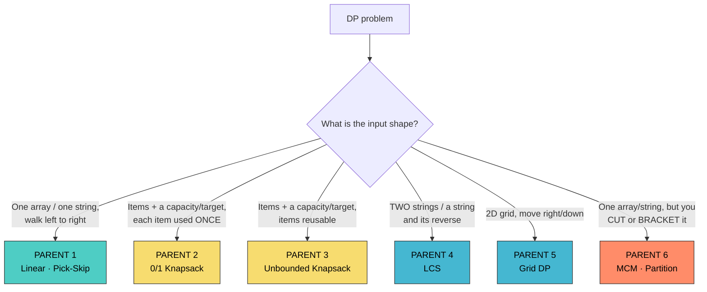
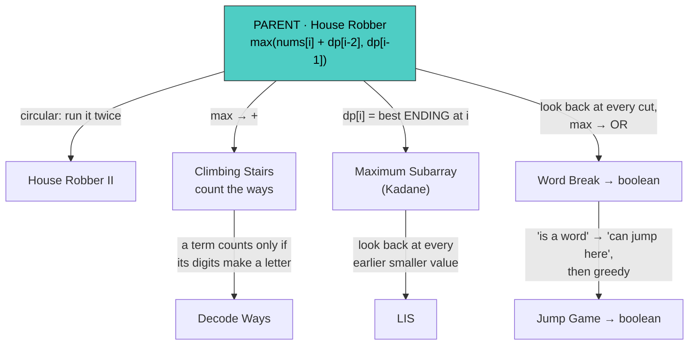
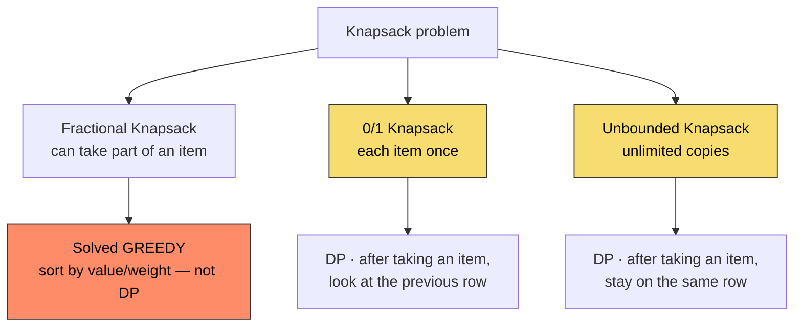
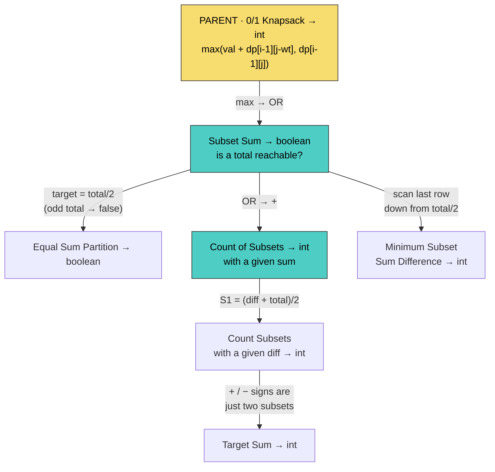
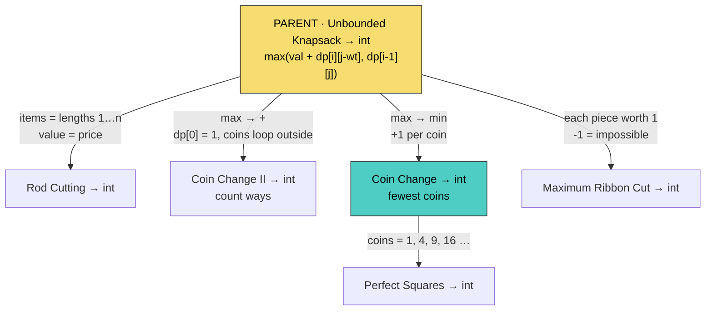
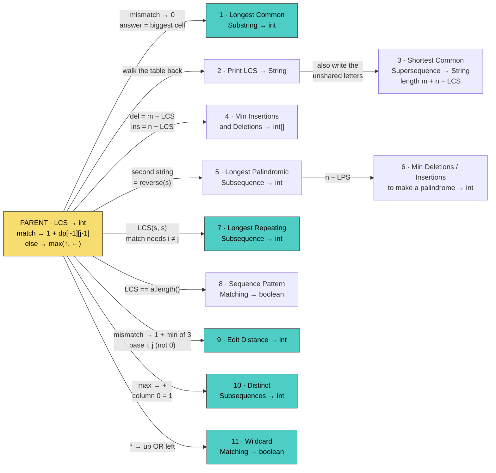
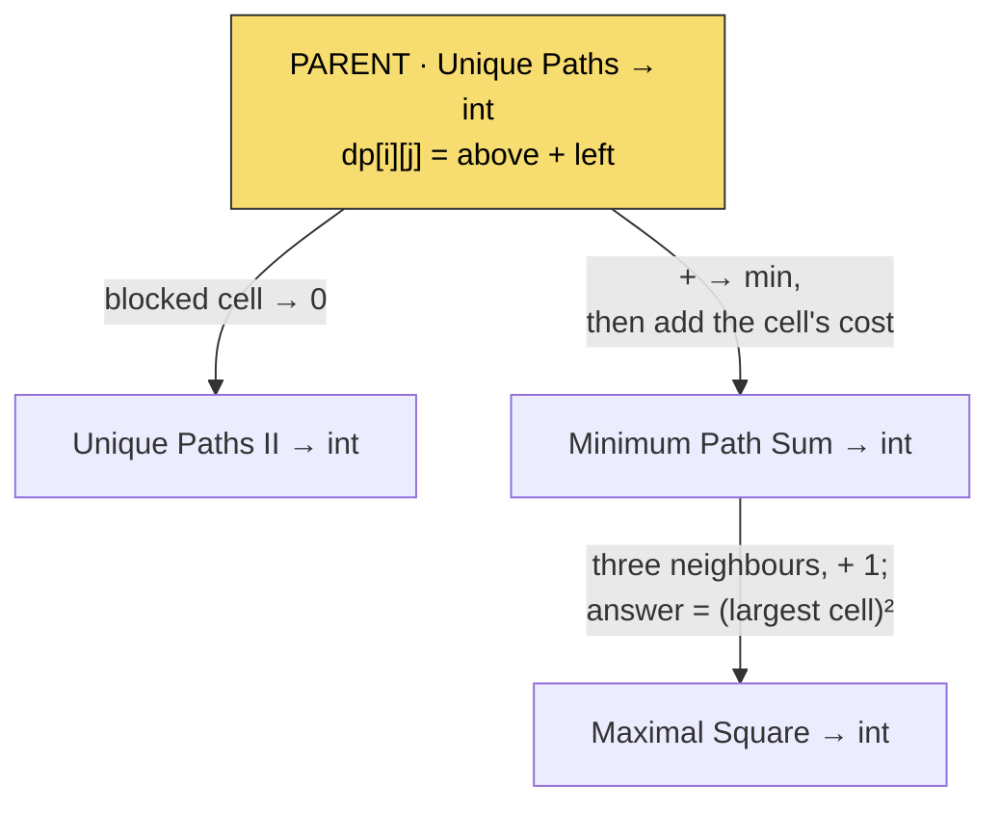
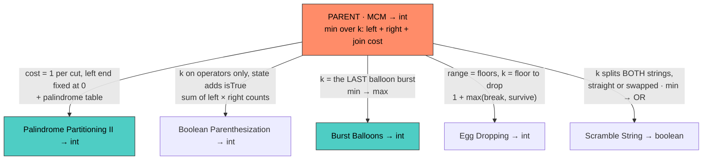

# Dynamic Programming (Java)

> "DP = enhanced recursion. Learn six parent recursions cold; every other problem is one of them with one named change."

**What this chapter covers:** Identification (choice + optimal), the recursion-to-memo-to-table pipeline, and the six parent problems — Linear/Pick-Skip, 0/1 Knapsack, Unbounded Knapsack, LCS, Grid DP, and MCM/Partition DP — each taught end-to-end and then derived into its full family of interview variants. Chapter 3 of the 4-part DSA sequence (31 / 31b / 31c / 31d); section numbers continue from chapters 31/31b.

---

## Start Here

### Pick a track — this is the longest chapter in the sequence

| Track | Time | Read this | Good for |
|-------|------|-----------|----------|
| **Speed run** | ~70 min | All of §18.15 (identification + the pipeline + the six parents), then just the **parent** of each family — skip the children on the first pass | First pass; you will already recognise most problems |
| **Mastery** | ~6 hr | Everything. The children are where the interview variants live, and each one is only a paragraph once you know its parent | Real preparation |
| **Refresh** | ~15 min | §18.20 The DP Cheat Sheet, then the Recognition Triggers table in §18.15 | The night before |

> **Do not read this chapter front to back on a first pass.** The six parents are the whole map; the ~40 children are variations you look up once you can name the parent. Learn to *identify*, then derive.

### How to read this chapter

Each family is taught the same way, and the two lines that matter most are always together:

| Line | What it gives you |
|------|-------------------|
| **Recognition** | the phrasing that tells you it is this problem |
| **Parent + Change** | which of the six it is, and the *one* thing that differs |
| **State / Recurrence / Base** | the three sentences you say out loud before coding (see below) |
| **Java** | the code, once you already know what it will say |
| `> **Trap:**` | the mistake that silently produces a wrong table |

Three words you will see on every page:

- **State** — what one cell of the table means, in plain words. Example: "`dp[i]` = the most money you can rob from the first `i + 1` houses."
- **Recurrence** — the rule that fills one cell from cells that are already filled.
- **Base** — the cells you fill in by hand before the loops start (the smallest inputs).

Each child sits in one collapsed block, in the same order as [chapter 31](#content/31_dsa_foundations) — **Problem · Example · Walk-through · Approach · Java · Complexity**, plus a **Trap** when there is one. The **Approach** gives the state, recurrence and base case; the **Walk-through** shows the table filling on the Example. Above each block, one visible line says how to **Recognise** the problem and the one **Change** from its parent, so a quick revision pass works with every block closed.

Children show only the methods they add. Each family ends with **Run the whole family** — one runnable Java file with every method and its real **Output**. Each parent also has an animated table: press ▶ to play it, ⏭ to step one cell at a time, or change the speed.

### The prerequisite that is genuinely required

**You must be comfortable with plain recursion first.** DP is recursion that remembers; if writing the recursion is the hard part, that is the thing to practise, not tables. Recursion and the call-tree dry-run format are covered in [chapter 31 §18.9](#content/31_dsa_foundations). Backtracking — recursion's other child — is [chapter 31d §18.21](#content/31d_dsa_advanced_ml_coding).

---

## Table of Contents

| Part | Topic | Sections |
|------|-------|----------|
| 4 | Dynamic Programming | §18.15–18.20: Identification, the Six Parents, Knapsack, LCS, Grid, MCM, Cheat Sheet |

**Sequence:** [31 — Foundations & Search](#content/31_dsa_foundations) → [31b — Graphs](#content/31b_dsa_graphs) → **31c (this chapter)** → [31d — Advanced Patterns & ML Coding](#content/31d_dsa_advanced_ml_coding)

---

# PART 4: DYNAMIC PROGRAMMING

---
## 18.15 DP Fundamentals — Identification, the Pipeline & the Six Parents

Most people learn DP backwards: they memorise twenty tables, meet a twenty-first problem, and freeze. This part goes the other way, as Aditya Verma's classic DP series does — **DP = enhanced recursion** — and builds on six **parent problems**. Learn those six and roughly forty interview problems become *variations*: the same code with one operator, one index, or one input changed.

### DP Is Not a Table. It Is Recursion That Remembers.

```
Plain recursion          →   solves the subproblem   →   throws the answer away
Recursion + memory       →   solves the subproblem   →   keeps the answer  = DP
```

The table is that memory, flattened. **If you cannot write the recursion, you cannot write the DP.**

### The 30-Second Identification Test

A problem is DP when **both** of these are true:

| Test | Question to ask | What it looks like in code |
|------|-----------------|----------------------------|
| **1. Choice** | At each step, do I have more than one option? | The recursive function makes **two or more calls** |
| **2. Optimal / count** | Am I asked for min, max, longest, "how many ways", or "is it possible"? | The calls are combined with `max` / `min` / `+` / `\|\|` |

```
NOT DP — a single chain, nothing repeats          DP — branching, states repeat

   f(n)                                                    f(n)
    │                                                     /     \
   f(n-1)                                            f(n-1)     f(n-2)
    │                                                /     \     /    \
   f(n-2)                                       f(n-2) f(n-3) f(n-3)  f(n-4)
    │                                                         ^^^^^^
   f(n-3)                                            f(n-3) computed TWICE
                                                     → store it → DP
```

> **The memory hook:** *choice + optimal = DP.* If you can draw a branch, you can write a recurrence.

### Step 1 of Everything: The Choice Diagram

Before any code, draw the **choice diagram** — what you may do at one step. It is the single highest-leverage habit in DP.

Example, **0/1 Knapsack** (§18.16): `n` items with weights and values, a bag that holds `W` kg, each item taken at most once. Let `f(n, W)` = the best value from the first `n` items with `W` kg of room left, and decide about the last of them, item `n` (weight `wt`, value `val`):

```
0/1 Knapsack — deciding about item n, with W kg of room left:

                          item n
                       /      \
        it fits (wt <= W)       it does NOT fit
            /        \                 |
      take it       leave it       leave it
         |              |              |
val + f(n-1, W-wt)  f(n-1, W)      f(n-1, W)
           \          /
        max(take, leave)
```

Each branch becomes one recursive call; combine them with what the question asks for.

### Base Condition = The Smallest Valid Input

Don't guess base cases. Ask two questions:

1. **What is the smallest valid input?** No items, zero capacity, an empty string. Its answer is usually `0`, `1`, `true`, or `""`.
2. **What is an invalid input?** For a range `i..j`, `i > j` is empty — usually worth `0`. When minimising and an input cannot be solved, return a huge "impossible" value (`Integer.MAX_VALUE`, or `amount + 1` in coin change).

```
0/1 Knapsack  → n == 0 (no items)       → profit 0
              → W == 0 (no capacity)    → profit 0
LCS           → either string empty     → 0
MCM (§18.18)  → i >= j (0 or 1 matrix)  → 0 (nothing to multiply)
Coin change   → amount == 0             → 0 coins
```

Get these right and the table's first row and column write themselves: **the base condition becomes the initialisation.**

### The Four-Step Pipeline

Solve every problem in this order; in an interview each step is a checkpoint you are graded on.

A **state** is one distinct set of arguments to the recursive function — in knapsack, one `(n, W)` pair. The table has one cell per state, and filling one cell costs some **work per state** (one `max` in knapsack, a whole loop in MCM). From Step 2 on, each state is solved once, so time = states × work per state — O(n·W) for knapsack, O(n³) for MCM.

```
        STEP 1              STEP 2                 STEP 3                 STEP 4
        RECURSION     →     MEMOISATION      →     TABULATION       →     SPACE-OPTIMISED
        "base + choice"     "recursion + 2 lines"  "delete the calls,     "keep only the
                                                    loops fill the table"  rows you read"

 time   exponential         states x work each     states x work each     same as step 3
 space  call stack          table + call stack     table, no stack        one dimension fewer
```

> **Memoisation = recursion + 2 lines.** Keep a memo table `t` with one cell per state, filled with `-1` = "not solved yet". Put `if (t[n][W] != -1) return t[n][W];` at the top and `return t[n][W] = ...;` at the bottom.

**The table's dimensions are the parameters that change.** In 0/1 knapsack `n` and `W` change while `wt[]` and `val[]` stay fixed, so the table is `[n+1][W+1]`. In LCS (two strings of lengths `m` and `n`) it is `[m+1][n+1]`. In Boolean Parenthesization (§18.18) `i`, `j` **and** `isTrue` change, so you need a third dimension.

### A Terminology Landmine

Some notes swap these two words; use the standard meanings:

| Term | Meaning | Direction |
|------|---------|-----------|
| **Top-down** | Recursion + memo table (Step 2) | Starts at the answer, recurses down to base cases |
| **Bottom-up** | Iterative tabulation (Step 3) | Starts at base cases, builds up to the answer |

### Fibonacci — The Whole Pipeline on One Line of Recursion

Fibonacci is not an interview problem, but it is the cheapest place to see all four steps.

**Watch the recursion turn into a table** (press ▶ to play, or ⏭ to step). **Red** calls repeat solved work, the memo turns them into **purple** lookups, and each table cell adds the **blue** cell before it to the **green** cell two before.

![Animated Fibonacci pipeline for n = 5: the 15-call recursion tree with the repeated fib(2) and fib(3) calls in red; the memo storing memo[2..5] = 1, 2, 3, 5 so only 9 calls run; the table dp[0..5] = 0, 1, 1, 2, 3, 5 filling left to right; then two variables, ending at prev1 = 5.](diagrams/dsa31c_fib_pipeline_anim.gif)

<details>
<summary><strong>Fibonacci Number — all four pipeline steps</strong> — Easy · read as text and Java</summary>

**Problem:** Given `n ≥ 0`, return the `n`-th Fibonacci number: `fib(0) = 0`, `fib(1) = 1`, `fib(n) = fib(n-1) + fib(n-2)`. Compute it once per pipeline step; all four must agree.

**Example:**
```
Input:  n = 5
Output: 5     (the sequence runs 0, 1, 1, 2, 3, 5)
```

**Walk-through (the animation as text):** Steps 1 and 2 run the same call tree, left call first.
```
                            Step 1: fibRecursive      Step 2: fibMemo (memo all -1)
fib(5)                                                stores memo[5] = 5
├── fib(4)                                            stores memo[4] = 3
│   ├── fib(3)                                        stores memo[3] = 2
│   │   ├── fib(2)                                    stores memo[2] = 1
│   │   │   ├── fib(1)                                base case
│   │   │   └── fib(0)                                base case
│   │   └── fib(1)                                    base case
│   └── fib(2)              ✗ solved again            memo[2] != -1 → return 1
│       ├── fib(1)                                    (never called)
│       └── fib(0)                                    (never called)
└── fib(3)                  ✗ solved again            memo[3] != -1 → return 2
    ├── fib(2)              ✗ solved a third time     (never called)
    │   ├── fib(1)                                    (never called)
    │   └── fib(0)                                    (never called)
    └── fib(1)                                        (never called)

Step 1: 15 calls. fib(3) solved 2×, fib(2) 3×, fib(1) 5×, fib(0) 3×.
Step 2: 9 calls, stored bottom-up: memo[2..5]. memo[0], memo[1] stay -1 (n <= 1 returns first).

Step 3  fibTable
        i      0  1  2  3  4  5
        dp[i]  0  1  1  2  3  5        dp[i] = dp[i-1] + dp[i-2]
               base           ^ answer

Step 4  fib — two variables
        start: prev2 = 0, prev1 = 1
        i = 2: curr = 1 + 0 = 1  →  prev2 = 1, prev1 = 1
        i = 3: curr = 1 + 1 = 2  →  prev2 = 1, prev1 = 2
        i = 4: curr = 2 + 1 = 3  →  prev2 = 2, prev1 = 3
        i = 5: curr = 3 + 2 = 5  →  prev2 = 3, prev1 = 5   → return 5
```

**Approach:** Parent 1 (Linear) at its simplest: no real choice, but the two calls overlap, so each step removes waste.

**Java:**
```java
import java.util.*;

public class Fibonacci {
    // STEP 1 — Recursion: base condition + choice.
    int fibRecursive(int n) {
        if (n <= 1) return n;                 // smallest valid input
        return fibRecursive(n - 1) + fibRecursive(n - 2);  // two calls = branching
    }

    // STEP 2 — Memoisation = the same code + 2 lines.
    int[] memo;                               // memo[k] = fib(k), or -1 = not solved yet
    int fibMemo(int n) {
        if (n <= 1) return n;
        if (memo[n] != -1) return memo[n];    // line 1: already solved?
        return memo[n] = fibMemo(n - 1) + fibMemo(n - 2);  // line 2: store on the way out
    }

    // STEP 3 — Tabulation: no recursion.
    int fibTable(int n) {
        if (n <= 1) return n;
        int[] dp = new int[n + 1];
        dp[0] = 0; dp[1] = 1;                 // <- the base condition, as data
        for (int i = 2; i <= n; i++) {
            dp[i] = dp[i - 1] + dp[i - 2];    // <- the recursive calls, as lookups
        }
        return dp[n];
    }

    // STEP 4 — dp[i] reads only two cells back.
    int fib(int n) {
        if (n <= 1) return n;
        int prev2 = 0, prev1 = 1;
        for (int i = 2; i <= n; i++) {
            int curr = prev1 + prev2;
            prev2 = prev1;
            prev1 = curr;
        }
        return prev1;
    }

    public static void main(String[] args) {
        Fibonacci f = new Fibonacci();
        for (int n : new int[]{5, 0, 1, 10}) {
            f.memo = new int[n + 1];
            Arrays.fill(f.memo, -1);
            System.out.println("n = " + n + " -> recursion " + f.fibRecursive(n)
                + ", memo " + f.fibMemo(n) + ", table " + f.fibTable(n)
                + ", two variables " + f.fib(n));
        }
    }
}
```

**Output:**
```
n = 5 -> recursion 5, memo 5, table 5, two variables 5
n = 0 -> recursion 0, memo 0, table 0, two variables 0
n = 1 -> recursion 1, memo 1, table 1, two variables 1
n = 10 -> recursion 55, memo 55, table 55, two variables 55
```

**Complexity:** recursion O(1.618^n) time (`2·fib(n+1) − 1` calls); memo O(n) time (`2n − 1` calls), O(n) table + O(n) stack; table O(n) time and space; two variables O(n) time, O(1) space.
</details>

**Practice:** [Fibonacci Number →](#dsa-problem-fibonacci-number)

### Recursion → Table: How a Call Becomes a Cell

The animation's last frame, as a rule for every problem in this part:

| Rule | Fibonacci (1-D) | 0/1 Knapsack (2-D) |
|------|-----------------|--------------------|
| Each parameter that changes → a table index | `n` → `i` | `n` (first `n` items on offer) → row `i`; `W` (capacity left) → column `j` |
| Base condition → initialisation | `if (n <= 1) return n;` → `dp[0] = 0; dp[1] = 1;` | `if (n == 0 \|\| W == 0) return 0;` → `dp[0][*] = 0` and `dp[*][0] = 0` |
| Each recursive call → a lookup | `fib(n-1)` → `dp[i-1]`, `fib(n-2)` → `dp[i-2]` | `f(n-1, W)` → `dp[i-1][j]`, `f(n-1, W - wt[n-1])` → `dp[i-1][j - wt[i-1]]` |
| `return f(…)` → `return dp[…]` | `return dp[n];` | `return dp[n][W];` |

Items are numbered from 1 in `f(n, W)` but Java arrays start at 0, so item `n` lives at `wt[n-1]` and `val[n-1]`. Side by side:

```
Recursive form                                Tabulated form
-----------------------------------------     -------------------------------------
if (wt[n-1] <= W)                             if (wt[i-1] <= j)
  return max(val[n-1] + f(n-1, W-wt[n-1]),      dp[i][j] = max(val[i-1] + dp[i-1][j-wt[i-1]],
             f(n-1, W));                                       dp[i-1][j]);
else                                          else
  return f(n-1, W);                             dp[i][j] = dp[i-1][j];
```

Loop in the order the memo finished its states — smallest first — so every cell you read is already filled.

### The Six Parents — Your Whole DP Map

Learn these six recursions cold.




| # | Parent | State | Core recurrence | Children in this chapter |
|---|--------|-------|-----------------|--------------------------|
| **1** | **Linear / Pick-Skip** | `dp[i]` = best answer using elements `0..i` | `dp[i] = f(dp[i-1], dp[i-2] + a[i])` | House Robber (the parent), House Robber II, Climbing Stairs, Decode Ways, Kadane, LIS, Word Break, Jump Game |
| **2** | **0/1 Knapsack** | `dp[i][j]` = best from the first `i` items with budget `j` | `dp[i][j] = max(dp[i-1][j], val + dp[i-1][j-wt])` | Subset Sum, Equal Partition, Count Subsets, Min Subset Diff, Count-with-Diff, Target Sum |
| **3** | **Unbounded Knapsack** | `dp[i][j]` = best from the first `i` item types (any number of each) with budget `j` | `dp[i][j] = max(dp[i-1][j], val + dp[i][j-wt])` ← same row | Rod Cutting, Coin Change & Coin Change II, Perfect Squares, Ribbon Cut |
| **4** | **LCS** | `dp[i][j]` = answer for the first `i` letters of one string and the first `j` of the other | match → `1 + dp[i-1][j-1]`; else → `max(dp[i-1][j], dp[i][j-1])` | Common Substring, Print LCS, SCS, Edit Distance, LPS, Min Insert/Delete, Distinct Subseq |
| **5** | **Grid DP** | `dp[i][j]` = best (or number of) ways to reach row `i`, column `j` | `dp[i][j] = f(dp[i-1][j], dp[i][j-1])` | Unique Paths I/II, Minimum Path Sum, Maximal Square |
| **6** | **MCM / Partition** | `dp[i][j]` = best for range `i..j` | `for k in i..j-1: f(solve(i,k), solve(k+1,j), cost)` | MCM, Palindrome Partitioning, Boolean Parenthesization, Burst Balloons, Egg Drop, Scramble String |

**Two more you will meet at Google**, outside the classic six: **State-machine DP** (stock buy/sell — you are in one of a few named states each day) and **Bitmask DP** (n ≤ 20, the state *is* the subset). Both are covered in §18.19.

### Recognition Triggers — Phrase to Parent

The wording usually names the parent:

| Phrase in the question | Likely parent |
|------------------------|---------------|
| "How many ways to..." | Linear (pick/skip), Knapsack-count, or Grid |
| "Fewest coins / pieces to make a total" (each can be reused) | Unbounded Knapsack |
| "Maximum profit / value with a limit" | 0/1 Knapsack |
| "Is there a subset that adds up to X / can these numbers make exactly X" | 0/1 Knapsack (boolean form) |
| "Can you reach the end of the array" | Linear (often greedy — see Jump Game) |
| "Longest / shortest **subsequence** of two strings" | LCS |
| "Convert string A into string B" | LCS |
| "Palindrome + subsequence / deletions" | LCS (with the reverse trick) |
| "Partition / cut / place brackets / burst / merge" | MCM (partition DP) |
| "Non-adjacent, can't pick two in a row" | Linear (pick/skip) |
| "Grid, only move right or down" | Grid DP |
| "Buy / sell / hold / cooldown" | State-machine DP |

### Identification Drills

Name the parent and the change — thirty seconds each.

| Problem | Parent | The change from the parent |
|---------|--------|----------------------------|
| "Can any subset sum to 11?" | 0/1 Knapsack | Return `boolean`; `max` becomes `\|\|` |
| "How many subsets sum to 11?" | 0/1 Knapsack | Return `int`; `\|\|` becomes `+` |
| "Fewest coins to make 11, unlimited coins" | Unbounded Knapsack | `max` becomes `min`, add `+1` per coin |
| "Longest palindromic subsequence of s" | LCS | Second string is `reverse(s)` |
| "Minimum cuts so every piece is a palindrome" | MCM | Cost per cut is `1`, plus a palindrome check |
| "Max money, can't rob adjacent houses" | Linear | Robbing house `i` makes house `i-1` off-limits, so the "rob" branch looks two cells back |
| "Ways to reach bottom-right of a grid" | Grid | Sum instead of max |

### When Nothing Matches: Deriving State From Scratch

When no parent matches, derive the state from first principles:

1. **Write the brute-force recursion first.** Even exponential. What arguments does it take?
2. **Prune the arguments.** Only those that affect the answer are your state; anything you can recompute from the others is not.
3. **Check overlapping subproblems.** Draw two levels of the call tree. If no state repeats, this is divide-and-conquer, not DP — stop.
4. **Check optimal substructure.** Is the best answer for the whole built from best answers of parts? If a *sub-optimal* part could win overall (common in path problems with constraints), you need extra state.
5. **Count the dimensions and estimate.** `states × work-per-state` must fit the limits. Too big? Find a dimension you can drop, switch a dimension to a bitmask, or find a monotonicity you can binary-search.

> **Sanity check you can say out loud:** "My state is `dp[i][j]` = *<English sentence>*. It's enough because nothing outside `i` and `j` changes the answer." If you can't finish that sentence, your state is wrong — fix it before writing code.

---
### Parent 1: Linear / Pick-Skip DP

The parent problem is **House Robber**, the cleanest take-or-skip walk along an array.

![House Robber infographic: dp[i] = max(nums[i] + dp[i-2], dp[i-1]) on nums = [2, 7, 9, 3, 1] — the base cells are dp[0] = 2 and dp[1] = max(7, 2) = 7, then house 2 robs (9 + 2 = 11 beats 7), house 3 skips (3 + 7 = 10 loses to 11) and house 4 robs (1 + 11 = 12 beats 11); walking back from dp[4] picks houses 0, 2 and 4, so the answer is 12.](diagrams/dsa31c_info_houserobber_ai.png)

<details>
<summary><strong>Read as text</strong> — problem and example</summary>

**The problem:** `nums[i]` (≥ 0) is the money in house `i` along a street. Return the most money you can take without robbing two neighbouring houses.

```
   house 0    house 1    house 2    house 3    house 4
   ┌──────┐   ┌──────┐   ┌──────┐   ┌──────┐   ┌──────┐
   │  ₹2  │   │  ₹7  │   │  ₹9  │   │  ₹3  │   │  ₹1  │
   └──────┘   └──────┘   └──────┘   └──────┘   └──────┘
     ROB         ·         ROB         ·         ROB      →  2 + 9 + 1 = ₹12
```

</details>

#### How to identify it

> **One array walked left to right, a take-or-skip choice at each index, and the answer at `i` built from one or two earlier answers.**

| Say this out loud | House Robber |
|-------------------|--------------|
| **State** | `dp[i]` = the most money from houses `0..i` (`nums[i]` = money in house `i`) |
| **Recurrence** | `dp[i] = max(nums[i] + dp[i-2], dp[i-1])` — rob house `i` (house `i-1` becomes off-limits) or skip it |
| **Base** | `dp[0] = nums[0]`, `dp[1] = max(nums[0], nums[1])` |
| **Answer** | `dp[n-1]` (`n` = number of houses) |

#### Steps 1 & 2 — Recursion, then memoisation (+2 lines)

The recursion is the base condition plus the rob/skip choice; the two `+ memo` lines make it memoisation.

```java
int[] t;   // memo: t[i] = rob(nums, i); before the first call: t = new int[n]; Arrays.fill(t, -1);

int rob(int[] nums, int i) {                // first call: rob(nums, n - 1)
    if (i < 0) return 0;                    // base: no houses
    if (t[i] != -1) return t[i];            // + memo: already solved?
    return t[i] = Math.max(                 // + memo: store on the way out
        nums[i] + rob(nums, i - 2),         // ROB house i
        rob(nums, i - 1));                  // SKIP house i
}
// Recursion: O(1.618^n), the Fibonacci call tree.  Memo: O(n) time, O(n) table + O(n) stack.
```

#### Step 3 — Tabulation (the table, no recursion)

Calls become lookups (`rob(nums, i)` → `dp[i]`); Java has no `dp[-1]`, so the first two cells are filled by hand. O(n) time, O(n) space, no stack.

```java
public int robTable(int[] nums) {
    int n = nums.length;
    if (n == 1) return nums[0];
    int[] dp = new int[n];
    dp[0] = nums[0];                            // one house: rob it
    dp[1] = Math.max(nums[0], nums[1]);         // two neighbours: the richer one
    for (int i = 2; i < n; i++) {
        dp[i] = Math.max(nums[i] + dp[i - 2],   // rob house i
                         dp[i - 1]);            // skip house i
    }
    return dp[n - 1];
}
```

**Watch the array fill, one house per step** (press ▶ to play, or ⏭ to step). Green arrows are *rob* (`nums[i] + dp[i-2]`), the blue arrow is *skip* (`dp[i-1]`), each cell keeps the bigger one, and the last frames walk back to find the robbed houses.

![Animated House Robber dp array for nums = [2, 7, 9, 3, 1]: dp[0] = 2 and dp[1] = max(7, 2) = 7 are filled by hand, then each house i compares rob = nums[i] + dp[i-2] with skip = dp[i-1] (dp[2] = max(11, 7) = 11, dp[3] = max(10, 11) = 11, dp[4] = max(12, 11) = 12), and a walk back from dp[4] shows houses 0, 2 and 4 were robbed.](diagrams/dsa31c_linear_anim.gif)

**Dry run (the animation as text) — `nums = [2, 7, 9, 3, 1]` → `12`**

```
  i                          0     1     2     3     4
  nums[i]                    2     7     9     3     1
  rob  = nums[i] + dp[i-2]   2     7    11    10    12     (no dp[i-2] yet: rob = nums[i])
  skip = dp[i-1]             -     2     7    11    11
  dp[i] = max(rob, skip)     2     7    11    11   [12]  ← answer
                             └ base ┘

  Walk back: dp[4] ≠ dp[3] → house 4 robbed, jump to 2;  dp[2] ≠ dp[1] → house 2;  then house 0
```

#### Step 4 — Space optimisation (two variables)

Starting both variables at `0` (the recursion's `rob(-1) = rob(-2) = 0`) means a one-house street needs no special case.

```java
public int rob(int[] nums) {
    int prev2 = 0, prev1 = 0;                   // dp[i-2], dp[i-1]
    for (int x : nums) {
        int curr = Math.max(x + prev2, prev1);  // rob vs skip
        prev2 = prev1;
        prev1 = curr;
    }
    return prev1;
}
```

Each answer is read as `prev1`, once more as `prev2`, then never again — so two variables are enough:

```
x    prev2  prev1   curr
2    0      0       2
7    0      2       7
9    2      7       11
3    7      11      11
1    11     11      12   -> return 12
```

**Complexity:** O(n) time, O(1) space.

**Practice:** [House Robber →](#dsa-problem-house-robber)

### The Linear Family Tree

Every child keeps the shape `dp[i] = combine(dp[i-1], dp[i-2] + value[i])` and changes one thing, written on its arrow: the operator, how far back a cell looks, or what a cell means.



String children use `dp[i]` = the answer for the first `i` characters, so their answer is `dp[n]`. All the code runs together in **LinearFamily.java** at the end of the family.

#### Child 1 — House Robber II (circular street)

**Recognise:** "the houses stand in a circle" · **Change:** the first and last house are neighbours, so run the parent without the last house, then without the first, and keep the larger.

<details>
<summary><strong>House Robber II</strong> — Medium · read as text and Java</summary>

**Problem:** House Robber on a circular street: house `n-1` sits next to house `0`.

**Example:**
```
Input:  nums = [2, 3, 2]
Output: 3     (houses 0 and 2 are neighbours, so rob house 1 alone)
```

**Walk-through:**
```
rob([2, 3])   without the last house    best so far: 2, 3   -> 3
rob([3, 2])   without the first house   best so far: 3, 3   -> 3
answer = max(3, 3) = 3
```
On `[2, 7, 9, 3, 1]` the runs give 11 and 10, so the answer is 11, not the parent's 12: houses 0 and 4 are now neighbours.

**Approach:** any allowed choice skips house `0` or house `n-1`, so it lies inside one of the two straight lines.

**Java:**
```java
public int robCircular(int[] nums) {
    int n = nums.length;
    if (n == 1) return nums[0];
    return Math.max(rob(Arrays.copyOfRange(nums, 0, n - 1)),  // parent, without the last house
                    rob(Arrays.copyOfRange(nums, 1, n)));     // parent, without the first house
}
```

**Complexity:** O(n) time; O(n) space for the two copies.
</details>

**Practice:** [House Robber II →](#dsa-problem-house-robber-ii)

#### Child 2 — Climbing Stairs

**Recognise:** "how many ways to reach step `n`, climbing 1 or 2 steps at a time?" · **Change:** `max` → `+` (count the ways) and the money disappears.

<details>
<summary><strong>Climbing Stairs</strong> — Easy · read as text and Java</summary>

**Problem:** It takes `n` steps (n ≥ 1) to reach the top. Each move climbs 1 or 2 steps. How many distinct ways are there to reach the top?

**Example:**
```
Input:  n = 5
Output: 8

Input:  n = 3
Output: 3     (1+1+1, 1+2, 2+1)
```

**Walk-through:**
```
step i   1  2  3  4  5
ways     1  2  3  5  8      ways(i) = ways(i-1) + ways(i-2)
                     ^ answer = 8
```

**Approach:**
- **State:** `dp[i]` = number of ways to reach step `i`.
- **Recurrence:** `dp[i] = dp[i-1] + dp[i-2]` — the last move came from one step back or two, and those two groups never overlap.
- **Base:** `dp[1] = 1`, `dp[2] = 2` (1+1 or 2).

**Java:**
```java
public int climbStairs(int n) {
    if (n <= 2) return n;
    int prev2 = 1, prev1 = 2;                // ways to reach steps 1 and 2
    for (int i = 3; i <= n; i++) {
        int curr = prev1 + prev2;            // the parent's max became +
        prev2 = prev1;
        prev1 = curr;
    }
    return prev1;
}
```

**Complexity:** O(n) time, O(1) space
</details>

**Min Cost Climbing Stairs** is the same child with `min` instead of `+`: `cost[i]` is the price of standing on step `i`, `dp[i] = cost[i] + min(dp[i-1], dp[i-2])`, answer `min(dp[n-1], dp[n-2])`.

**Practice:** [Climbing Stairs →](#dsa-problem-climbing-stairs) · [Min Cost Climbing Stairs →](#dsa-problem-min-cost-climbing-stairs)

#### Child 3 — Decode Ways

**Recognise:** "how many ways can a digit string be decoded, with A = 1 … Z = 26?" · **Change** from Child 2: each `+` term counts only when its digits form a valid letter.

<details>
<summary><strong>Decode Ways</strong> — Medium · read as text and Java</summary>

**Problem:** Letters are coded A=1 … Z=26. How many ways can a string of digits be decoded? A `0` cannot stand alone, and a two-digit code must be 10–26 (`"06"` is not a code).

**Example:**
```
Input:  s = "226"
Output: 3     ("2,2,6" = BBF, "22,6" = VF, "2,26" = BZ)
```

**Walk-through:** `prev2` = `dp[i-2]`, `prev1` = `dp[i-1]`; each step adds whichever is allowed.
```
s = "226"      dp[0] = 1 (empty),  dp[1] = 1 ("2")

i   oneDigit   twoDigit   oneDigit adds   twoDigit adds   dp[i]
2   2  (B)     22  (V)    dp[1] = 1       dp[0] = 1       2
3   6  (F)     26  (Z)    dp[2] = 2       dp[1] = 1       3   <- answer
```

**Approach:**
- **State:** `dp[i]` = ways to decode the first `i` characters, `s[0..i-1]`.
- **Recurrence:** if `s[i-1]` is not `'0'`, `dp[i] += dp[i-1]`; if `s[i-2..i-1]` is 10–26, `dp[i] += dp[i-2]`. A decoding ends in a one-digit or a two-digit letter, never both.
- **Base:** `dp[0] = 1` (the empty string has one decoding, which makes the counts add up); `dp[1] = 1` when the first digit is not `'0'`.

**Java:**
```java
public int numDecodings(String s) {
    if (s.charAt(0) == '0') return 0;
    int prev2 = 1, prev1 = 1;                // dp[0], dp[1]
    for (int i = 2; i <= s.length(); i++) {
        int curr = 0;
        int oneDigit = s.charAt(i - 1) - '0';
        int twoDigit = Integer.parseInt(s.substring(i - 2, i));
        if (oneDigit >= 1) curr += prev1;
        if (twoDigit >= 10 && twoDigit <= 26) curr += prev2;
        prev2 = prev1;
        prev1 = curr;
    }
    return prev1;
}
```

**Complexity:** O(n) time, O(1) space
</details>

**Practice:** [Decode Ways →](#dsa-problem-decode-ways)

#### Child 4 — Maximum Subarray (Kadane's Algorithm)

**Recognise:** "the largest sum of a contiguous subarray" · **Change:** `dp[i]` = the best sum **ending at** `i`; the choice is *extend* or *restart*.

<details>
<summary><strong>Maximum Subarray (Kadane's Algorithm)</strong> — Medium · read as text and Java</summary>

**Problem:** Return the largest sum of a contiguous (non-empty) subarray.

**Example:**
```
Input:  nums = [-2, 1, -3, 4, -1, 2, 1, -5, 4]
Output: 6     (the subarray [4, -1, 2, 1])
```

**Walk-through:** `curr` = max(*restart* `nums[i]`, *extend* `curr + nums[i]`); `best` = the largest `curr` so far.
```
i         0   1   2   3   4   5   6   7   8
nums[i]  -2   1  -3   4  -1   2   1  -5   4
extend    -  -1  -2   2   3   5   6   1   5
curr     -2   1  -2   4   3   5   6   1   5
best     -2   1   1   4   4   5   6   6   6
                                  ^ best = 6: the run [4, -1, 2, 1], i = 3..6
```

**Approach:**
- **State:** `dp[i]` = the best sum of a subarray that ends exactly at `i`.
- **Recurrence:** `dp[i] = max(nums[i], dp[i-1] + nums[i])` — a negative run so far can only hurt, so restart.
- **Base:** `dp[0] = nums[0]`.

> **Trap:** the answer is the largest `dp[i]` anywhere, not `dp[n-1]` — a classic slip.

**Java:**
```java
public int maxSubArray(int[] nums) {
    int best = nums[0], curr = nums[0];            // curr = dp[i]
    for (int i = 1; i < nums.length; i++) {
        curr = Math.max(nums[i], curr + nums[i]);  // restart or extend
        best = Math.max(best, curr);
    }
    return best;
}
```

**Complexity:** O(n) time, O(1) space
</details>

**Practice:** [Maximum Subarray →](#dsa-problem-maximum-subarray)

#### Child 5 — Longest Increasing Subsequence (LIS)

**Recognise:** "the longest strictly increasing subsequence" · **Change** from Child 4: a cell still ends at `i`, but looks back at **every** earlier smaller value — O(n²); binary search makes it O(n log n).

![Longest Increasing Subsequence infographic: for nums = [10, 9, 2, 5, 3, 7, 101, 18] every dp[i] starts at 1 and becomes 1 + the largest dp[j] over smaller earlier numbers — 5 gets 2, 7 gets 3 (via 2, 5, 3), 101 gets 4 and 18 gets 4 (101 is not smaller), so dp = 1 1 1 2 2 3 4 4; the fast tails method lets 3 replace 5 and 18 replace 101, ending at 2, 3, 7, 18, so the answer is 4.](diagrams/dsa31c_info_lis_ai.png)

<details>
<summary><strong>Longest Increasing Subsequence</strong> — Medium · read as text and Java</summary>

**Problem:** Return the length of the longest **strictly increasing subsequence** (order kept, skipping allowed; a *subarray* may not skip).

**Example:**
```
Input:  nums = [10, 9, 2, 5, 3, 7, 101, 18]
Output: 4     ([2, 3, 7, 18] or [2, 3, 7, 101])
```

**Walk-through:** the O(n²) `dp`, then the fast version's `tails`.
```
nums     10    9    2    5    3    7  101   18
dp[i]     1    1    1    2    2    3    4    4      largest dp = 4

  10  -> [10]           (extend)
  9   -> [9]            (replace 10 — smaller tail for length 1)
  2   -> [2]            (replace 9)
  5   -> [2, 5]         (extend)
  3   -> [2, 3]         (replace 5 — smaller tail for length 2)
  7   -> [2, 3, 7]      (extend)
  101 -> [2, 3, 7, 101] (extend)
  18  -> [2, 3, 7, 18]  (replace 101)     4 slots -> answer 4
```

**Approach:**
- **O(n²) DP** (derive it first): `dp[i]` = the longest increasing subsequence ending at `nums[i]` = `1 + max dp[j]` over `j < i` with `nums[j] < nums[i]`; every `dp[i]` starts at 1; the answer is the largest `dp[i]`.
- **O(n log n)** (wins the interview): binary-search each number into `tails` — past the end → append, else overwrite that slot with the smaller value. The final size is the LIS length.

**Java:**
```java
public int lengthOfLISDP(int[] nums) {
    int n = nums.length, best = 1;
    int[] dp = new int[n];
    Arrays.fill(dp, 1);                    // each element alone
    for (int i = 1; i < n; i++) {
        for (int j = 0; j < i; j++) {
            if (nums[j] < nums[i]) dp[i] = Math.max(dp[i], dp[j] + 1);
        }
        best = Math.max(best, dp[i]);
    }
    return best;
}

public int lengthOfLIS(int[] nums) {
    List<Integer> tails = new ArrayList<>();   // tails[k] = smallest tail of length k+1
    for (int num : nums) {
        int pos = Collections.binarySearch(tails, num);
        if (pos < 0) pos = -(pos + 1);             // insertion point
        if (pos == tails.size()) tails.add(num);   // extends the longest
        else tails.set(pos, num);                  // smaller tail, same length
    }
    return tails.size();
}
```

> **Trap:** `tails` is *not* always a real subsequence — on `[3, 4, 1]` it ends as `[1, 4]`. Only its length is meaningful; to print the subsequence, keep parent pointers.

**Complexity:** O(n log n) time, O(n) space (the DP: O(n²) time)
</details>

**Practice:** [Longest Increasing Subsequence →](#dsa-problem-longest-increasing-subsequence)

#### Child 6 — Word Break

**Recognise:** "can the string be split into dictionary words?" · **Change:** look back at **every** earlier cut, not one or two cells, and `max` → OR.

![Word Break infographic: dp[i] = can the first i letters of "leetcode" be split into the words leet and code; dp[0] = T, dp[1..3] = F, dp[4] = T from dp[0] + "leet", dp[5..7] = F because c, co and cod are not words, and at i = 8 the cut j = 0 ("leetcode") fails but j = 4 finds dp[4] + "code", so dp[8] = true.](diagrams/dsa31c_info_wordbreak_ai.png)

<details>
<summary><strong>Word Break</strong> — Medium · read as text and Java</summary>

**Problem:** Given a string `s` and dictionary words `wordDict` (reusable), return true if `s` can be split into dictionary words.

**Example:**
```
Input:  s = "leetcode", wordDict = ["leet", "code"]
Output: true  ("leet" + "code")
```

**Walk-through:**
```
i      0  1  2  3  4  5  6  7  8
dp[i]  T  F  F  F  T  F  F  F  T
                   ^           ^ answer

dp[4] = T   j = 0: dp[0] = T and "leet" is a word
dp[8] = T   j = 4: dp[4] = T and "code" is a word
```

**Approach:**
- **State:** `dp[i]` = can the first `i` characters, `s[0..i-1]`, be split?
- **Recurrence:** `dp[i] = true` if some `j < i` has `dp[j]` and `s.substring(j, i)` in the dictionary.
- **Base:** `dp[0] = true` — the empty prefix needs no words.

**Java:**
```java
public boolean wordBreak(String s, List<String> wordDict) {
    Set<String> dict = new HashSet<>(wordDict);
    boolean[] dp = new boolean[s.length() + 1];
    dp[0] = true;                                  // empty prefix
    for (int i = 1; i <= s.length(); i++) {
        for (int j = 0; j < i; j++) {              // every earlier cut
            if (dp[j] && dict.contains(s.substring(j, i))) {
                dp[i] = true;
                break;
            }
        }
    }
    return dp[s.length()];
}
```

**Complexity:** O(n³) time (n² cut pairs, each substring costs up to n), O(n) space
</details>

**Practice:** [Word Break →](#dsa-problem-word-break)

#### Child 7 — Jump Game (where DP loses to greedy)

**Recognise:** "can you reach the last index?" · **Change** from Child 6: "is a word" becomes "`j` can jump to `i`"; the reachable indices form one block, so one number, `reach`, replaces `dp[]`.

<details>
<summary><strong>Jump Game</strong> — Medium · read as text and Java</summary>

**Problem:** `nums[i]` is the furthest you may jump forward from index `i`. Starting at index 0, can you reach the last index?

**Example:**
```
Input:  nums = [2, 3, 1, 1, 4]
Output: true   (0 -> 1 -> 4)

Input:  nums = [3, 2, 1, 0, 4]
Output: false  (every path lands on index 3, whose jump length is 0)
```

**Walk-through:** `reach` = the furthest index reachable from `0..i`.
```
nums = [2, 3, 1, 1, 4]             nums = [3, 2, 1, 0, 4]
i   i + nums[i]   reach            i   i + nums[i]   reach
0   0 + 2 = 2     2                0   0 + 3 = 3     3
1   1 + 3 = 4     4                1   1 + 2 = 3     3
2   2 + 1 = 3     4                2   2 + 1 = 3     3
3   3 + 1 = 4     4                3   3 + 0 = 3     3
4   4 + 4 = 8     8                4   4 > reach 3  -> return false
loop ends -> return true
```

**Approach:** the O(n²) DP works but is not needed: each index you can stand on pushes `reach` to `i + nums[i]`, and if `i` ever passes `reach`, nothing before it jumps that far.

**Java:**
```java
public boolean canJump(int[] nums) {
    int reach = 0;                                   // furthest reachable index
    for (int i = 0; i < nums.length; i++) {
        if (i > reach) return false;                 // stuck before i
        reach = Math.max(reach, i + nums[i]);
    }
    return true;
}
```

**Complexity:** O(n) time, O(1) space
</details>

**Practice:** [Jump Game →](#dsa-problem-jump-game)

> **Interview note:** "It's DP" is not always the best answer. When each decision only extends a running frontier (reach, current sum, best-so-far), greedy collapses the DP to O(n) — say the DP, then say why greedy is safe.

#### Run the whole family — `LinearFamily.java`

The parent and all seven children in one runnable file, with its output.

<details>
<summary><strong>LinearFamily.java</strong> — the parent and all seven children · Java and output</summary>

**Java:**
```java
import java.util.*;

public class LinearFamily {
    // ── Parent 1 · Step 3: the table ──
    public int robTable(int[] nums) {
        int n = nums.length;
        if (n == 1) return nums[0];
        int[] dp = new int[n];
        dp[0] = nums[0];                            // one house: rob it
        dp[1] = Math.max(nums[0], nums[1]);         // two neighbours: the richer one
        for (int i = 2; i < n; i++) {
            dp[i] = Math.max(nums[i] + dp[i - 2],   // rob house i
                             dp[i - 1]);            // skip house i
        }
        return dp[n - 1];
    }

    // ── Parent 1 · Step 4: two variables ──
    public int rob(int[] nums) {
        int prev2 = 0, prev1 = 0;                   // dp[i-2], dp[i-1]
        for (int x : nums) {
            int curr = Math.max(x + prev2, prev1);  // rob vs skip
            prev2 = prev1;
            prev1 = curr;
        }
        return prev1;
    }

    // ── Child 1 · House Robber II ──
    public int robCircular(int[] nums) {
        int n = nums.length;
        if (n == 1) return nums[0];
        return Math.max(rob(Arrays.copyOfRange(nums, 0, n - 1)),  // parent, without the last house
                        rob(Arrays.copyOfRange(nums, 1, n)));     // parent, without the first house
    }

    // ── Child 2 · Climbing Stairs ──
    public int climbStairs(int n) {
        if (n <= 2) return n;
        int prev2 = 1, prev1 = 2;                // ways to reach steps 1 and 2
        for (int i = 3; i <= n; i++) {
            int curr = prev1 + prev2;            // the parent's max became +
            prev2 = prev1;
            prev1 = curr;
        }
        return prev1;
    }

    // ── Child 3 · Decode Ways ──
    public int numDecodings(String s) {
        if (s.charAt(0) == '0') return 0;
        int prev2 = 1, prev1 = 1;                // dp[0], dp[1]
        for (int i = 2; i <= s.length(); i++) {
            int curr = 0;
            int oneDigit = s.charAt(i - 1) - '0';
            int twoDigit = Integer.parseInt(s.substring(i - 2, i));
            if (oneDigit >= 1) curr += prev1;
            if (twoDigit >= 10 && twoDigit <= 26) curr += prev2;
            prev2 = prev1;
            prev1 = curr;
        }
        return prev1;
    }

    // ── Child 4 · Maximum Subarray ──
    public int maxSubArray(int[] nums) {
        int best = nums[0], curr = nums[0];            // curr = dp[i]
        for (int i = 1; i < nums.length; i++) {
            curr = Math.max(nums[i], curr + nums[i]);  // restart or extend
            best = Math.max(best, curr);
        }
        return best;
    }

    // ── Child 5 · LIS ──
    public int lengthOfLISDP(int[] nums) {
        int n = nums.length, best = 1;
        int[] dp = new int[n];
        Arrays.fill(dp, 1);                    // each element alone
        for (int i = 1; i < n; i++) {
            for (int j = 0; j < i; j++) {
                if (nums[j] < nums[i]) dp[i] = Math.max(dp[i], dp[j] + 1);
            }
            best = Math.max(best, dp[i]);
        }
        return best;
    }

    public int lengthOfLIS(int[] nums) {
        List<Integer> tails = new ArrayList<>();   // tails[k] = smallest tail of length k+1
        for (int num : nums) {
            int pos = Collections.binarySearch(tails, num);
            if (pos < 0) pos = -(pos + 1);             // insertion point
            if (pos == tails.size()) tails.add(num);   // extends the longest
            else tails.set(pos, num);                  // smaller tail, same length
        }
        return tails.size();
    }

    // ── Child 6 · Word Break ──
    public boolean wordBreak(String s, List<String> wordDict) {
        Set<String> dict = new HashSet<>(wordDict);
        boolean[] dp = new boolean[s.length() + 1];
        dp[0] = true;                                  // empty prefix
        for (int i = 1; i <= s.length(); i++) {
            for (int j = 0; j < i; j++) {              // every earlier cut
                if (dp[j] && dict.contains(s.substring(j, i))) {
                    dp[i] = true;
                    break;
                }
            }
        }
        return dp[s.length()];
    }

    // ── Child 7 · Jump Game ──
    public boolean canJump(int[] nums) {
        int reach = 0;                                   // furthest reachable index
        for (int i = 0; i < nums.length; i++) {
            if (i > reach) return false;                 // stuck before i
            reach = Math.max(reach, i + nums[i]);
        }
        return true;
    }

    public static void main(String[] args) {
        LinearFamily f = new LinearFamily();
        int[] street = {2, 7, 9, 3, 1};
        int[] seq = {10, 9, 2, 5, 3, 7, 101, 18};
        show("robTable([2, 7, 9, 3, 1])", f.robTable(street));
        show("rob([2, 7, 9, 3, 1])", f.rob(street));
        show("robCircular([2, 3, 2])", f.robCircular(new int[]{2, 3, 2}));
        show("robCircular([2, 7, 9, 3, 1])", f.robCircular(street));
        show("climbStairs(5)", f.climbStairs(5));
        show("numDecodings(\"226\")", f.numDecodings("226"));
        show("maxSubArray([-2, 1, -3, 4, -1, 2, 1, -5, 4])",
             f.maxSubArray(new int[]{-2, 1, -3, 4, -1, 2, 1, -5, 4}));
        show("lengthOfLISDP([10, 9, 2, 5, 3, 7, 101, 18])", f.lengthOfLISDP(seq));
        show("lengthOfLIS([10, 9, 2, 5, 3, 7, 101, 18])", f.lengthOfLIS(seq));
        show("wordBreak(\"leetcode\", [leet, code])",
             f.wordBreak("leetcode", List.of("leet", "code")));
        show("canJump([2, 3, 1, 1, 4])", f.canJump(new int[]{2, 3, 1, 1, 4}));
        show("canJump([3, 2, 1, 0, 4])", f.canJump(new int[]{3, 2, 1, 0, 4}));
    }

    static void show(String call, Object result) {
        System.out.printf("%-44s -> %s%n", call, result);
    }
}
```

**Output:**
```
robTable([2, 7, 9, 3, 1])                    -> 12
rob([2, 7, 9, 3, 1])                         -> 12
robCircular([2, 3, 2])                       -> 3
robCircular([2, 7, 9, 3, 1])                 -> 11
climbStairs(5)                               -> 8
numDecodings("226")                          -> 3
maxSubArray([-2, 1, -3, 4, -1, 2, 1, -5, 4]) -> 6
lengthOfLISDP([10, 9, 2, 5, 3, 7, 101, 18])  -> 4
lengthOfLIS([10, 9, 2, 5, 3, 7, 101, 18])    -> 4
wordBreak("leetcode", [leet, code])          -> true
canJump([2, 3, 1, 1, 4])                     -> true
canJump([3, 2, 1, 0, 4])                     -> false
```

**Complexity:** O(n) time per method, except `lengthOfLISDP` O(n²), `lengthOfLIS` O(n log n) and `wordBreak` O(n³).
</details>

**Problem List — Parent 1: Linear / Pick-Skip:**

**Start with these five:** Climbing Stairs · House Robber · Maximum Subarray · Longest Increasing Subsequence · Word Break. Between them they cover every combine-operator in the family.

| #   | Problem                          | Difficulty | Change from the parent        |
|-----|----------------------------------|------------|-------------------------------|
| 1   | Climbing Stairs (LC 70)          | Easy       | Combine with `+` (count ways) |
| 2   | Min Cost Climbing Stairs (746)   | Easy       | Combine with `min` + cost     |
| 3   | House Robber (LC 198)            | Medium     | The parent                    |
| 4   | House Robber II (LC 213)         | Medium     | Run the line twice (circular) |
| 5   | Decode Ways (LC 91)              | Medium     | Branches are conditional      |
| 6   | Word Break (LC 139)              | Medium     | Inner loop over all cuts      |
| 7   | Maximum Subarray (LC 53)         | Medium     | "extend or restart"; answer is max over dp |
| 8   | Maximum Product Subarray (152)   | Medium     | Track min AND max (negatives) |
| 9   | Longest Increasing Subseq (300)  | Medium     | All-previous dependency → n log n |
| 10  | Number of LIS (LC 673)           | Medium     | Carry a count alongside length |
| 11  | Jump Game (LC 55)                | Medium     | Greedy frontier beats the DP  |
| 12  | Jump Game II (LC 45)             | Medium     | BFS-style level counting      |
| 13  | Delete and Earn (LC 740)         | Medium     | Bucket by value → House Robber |
| 14  | Paint House (LC 256)             | Medium     | dp per colour (mini state machine) |
| 15  | Best Sightseeing Pair (LC 1014)  | Medium     | Carry best `a[i]+i` seen so far |

---
### 60-second recall

<details>
<summary>1. What are the two questions that decide whether a problem is DP at all?</summary>

Is there a <strong>choice</strong> at each step (two or more recursive calls), and is the answer a <strong>min, max, count, or is-it-possible</strong>? Both must be true. One call in a straight chain is just recursion.
</details>

<details>
<summary>2. You have written the recursion and it is too slow. What are the next two lines, exactly?</summary>

At the top of the function, <code>if (t[i][j] != -1) return t[i][j];</code> and at the bottom, <code>return t[i][j] = ...</code>, where <code>t</code> is the memo table (one cell per state, filled with -1 for "not solved yet"). That is the whole of memoisation — the recursion itself does not change.
</details>

<details>
<summary>3. Why bother converting a working memoised solution into a table?</summary>

Two reasons. It removes the recursion stack — a deep input can overflow the stack, and the table cannot. And the finished table is what step 4 shrinks to one or two rows. The time complexity is identical. In an interview a correct memoised solution beats a half-finished table every time.
</details>

---
## 18.16 Parents 2 & 3 — The Knapsack Family

This is the family that pays the most rent. One recursion, learned properly, generates a dozen interview problems — and the differences between them are so small you can name each one in a single line.

### Parent 2: 0/1 Knapsack

![0/1 Knapsack infographic: dp[i][j] = best value from the first i items with a j kg bag, max of take (val + dp[i-1][j-wt]) and skip (dp[i-1][j]); for weights 1, 3, 4, 5 kg, values 1, 4, 5, 7 and W = 7, row 1 fills with 1s, dp[2][3] = 4, dp[2][4] = 4 + 1 = 5, dp[3][7] = 5 + dp[2][3] = 9 beats 5, dp[4][7] skips item 4 (7 + 1 = 8 < 9), and the full 5 × 8 table walks back to items 2 + 3, so the answer is 9.](diagrams/dsa31c_info_knapsack_ai.png)

<details>
<summary><strong>Read as text</strong> — problem and example</summary>

**The problem:** you are given `n` items; item `i` weighs `wt[i]` kg and is worth `val[i]` (arrays are 0-based). The bag holds at most `W` kg. Each item may be taken **at most once**. Return the largest total value that fits in the bag.

```
                  wt[]  = [1, 3, 4, 5]
                  val[] = [1, 4, 5, 7]          bag capacity W = 7 kg

           item 1        item 2        item 3        item 4
          ┌──────┐      ┌──────┐      ┌──────┐      ┌──────┐          ╭─────────╮
          │ 1 kg │      │ 3 kg │      │ 4 kg │      │ 5 kg │          │   BAG   │
          │  ₹1  │      │  ₹4  │      │  ₹5  │      │  ₹7  │   ───►   │  W = 7  │
          └──────┘      └──────┘      └──────┘      └──────┘          ╰─────────╯

          Best: items 2 + 3  →  weight 3+4 = 7,  value 4+5 = ₹9
          (items are numbered from 1 here; item 2 is wt[1], item 3 is wt[2])
```

</details>

#### How to identify it

> **Items + a capacity, each item used at most once, and the question asks for the best value, whether a total is reachable, or how many ways reach it.** That is the 30-second test: a *choice* per item (take or skip) and an *optimal ask* over a limited resource.

| Say this out loud | 0/1 Knapsack |
|-------------------|--------------|
| **State** | `dp[i][j]` = the best value using only the first `i` items with a `j` kg bag |
| **Recurrence** | item `i` (weight `wt`, value `val`) fits (`wt ≤ j`): `max(val + dp[i-1][j-wt], dp[i-1][j])` (take vs skip); too heavy: `dp[i-1][j]` |
| **Base** | row 0 (no items) and column 0 (no room) are all `0` |
| **Answer** | `dp[n][W]`, the bottom-right cell |

Knapsack comes in three flavours; two of them are DP and the third is greedy:



> **Trap — fractional items are not DP.** If items can be cut into fractions, stop: it is greedy. Sort by value-per-weight and fill. Interviewers use this as a trap.

#### Step 1 — The recursion (base condition + choice diagram)

```java
// knapsack(wt, val, W, n) = the best value using only the first n items, with W kg of room.
// Base condition: think of the smallest valid input.
//   no items left (n == 0)   → nothing to gain → 0
//   no capacity left (W == 0) → nothing fits    → 0
int knapsack(int[] wt, int[] val, int W, int n) {
    if (n == 0 || W == 0) return 0;

    if (wt[n - 1] <= W) {                       // it FITS → two choices
        return Math.max(
            val[n - 1] + knapsack(wt, val, W - wt[n - 1], n - 1),  // include
            knapsack(wt, val, W, n - 1));                          // exclude
    } else {                                    // does NOT fit → one choice
        return knapsack(wt, val, W, n - 1);                        // exclude only
    }
}
// Time: O(2^n) — every item branches in two. Unusable, but it is the truth.
```

The shape is **base condition, then the choice diagram, nothing else.** The return type (`int`) comes from the question ("maximum profit"). Change it to `boolean` ("is it possible?") and you get the whole family below.

#### Step 2 — Memoisation (the same code + 2 lines)

The parameters that change are `n` and `W`, so the memo table is `[n+1][W+1]`, filled with `-1` ("not solved yet").

```java
int[][] t;   // t[n][W] = answer for (first n items, W kg); -1 = not solved yet
             // before the first call: t = new int[n + 1][W + 1];
             //                        for (int[] row : t) Arrays.fill(row, -1);

int knapsack(int[] wt, int[] val, int W, int n) {
    if (n == 0 || W == 0) return 0;
    if (t[n][W] != -1) return t[n][W];           // line 1 — already solved?

    if (wt[n - 1] <= W) {
        return t[n][W] = Math.max(               // line 2 — store on the way out
            val[n - 1] + knapsack(wt, val, W - wt[n - 1], n - 1),
            knapsack(wt, val, W, n - 1));
    }
    return t[n][W] = knapsack(wt, val, W, n - 1);
}
// Time: O(n * W)  Space: O(n * W) table + O(n) recursion stack
```

> **Why move on from memoisation at all?** Same time complexity, but the recursion stack is real memory and a deep input can blow it. Tabulation removes the stack entirely, and the finished table is what step 4 shrinks to a single row.

#### Step 3 — Tabulation (the table, no recursion)

Two steps, every time: **initialise**, then **translate the recurrence**.

```java
public int knapsack(int[] wt, int[] val, int W, int n) {
    int[][] dp = new int[n + 1][W + 1];

    // (a) Initialisation = the base condition, written as data.
    //     Row 0 (no items) and column 0 (no capacity) are already 0 in Java.

    // (b) The recurrence, with calls replaced by lookups.
    for (int i = 1; i <= n; i++) {
        for (int j = 1; j <= W; j++) {
            if (wt[i - 1] <= j) {
                dp[i][j] = Math.max(val[i - 1] + dp[i - 1][j - wt[i - 1]],
                                    dp[i - 1][j]);
            } else {
                dp[i][j] = dp[i - 1][j];
            }
        }
    }
    return dp[n][W];
}
// Time: O(n * W)  Space: O(n * W), no stack
```

**Watch the table fill, one cell per step** (press ▶ to play, or ⏭ to step). Every step asks the same question: the **blue** arrow is *skip* (the cell straight above), the **green** arrow is *take* (the item's value + the row above, `wt` columns to the left), and the cell keeps the bigger one. The code panel lights up the line that runs.

![Animated 0/1 Knapsack table for weights [1, 3, 4, 5], values [1, 4, 5, 7], W = 7: row 0 and column 0 start at 0, then the 28 cells fill row by row, left to right. Each cell dp[i][j] compares skip = dp[i-1][j] with take = val + dp[i-1][j-wt] (or copies the cell above when the item is too heavy), ending at dp[4][7] = 9.](diagrams/dsa31c_knapsack_table_anim.gif)

**Dry run (the animation as text) — weights `[1, 3, 4, 5]`, values `[1, 4, 5, 7]`, capacity `7` → `9`**
*We track:* each cell `dp[i][j]` = the best value using only the first `i` items (rows) with a bag of `j` kg (columns).

```
              j →   0   1   2   3   4   5   6   7
  i=0 (none)        0   0   0   0   0   0   0   0     ← base: no items
  i=1 (1kg, ₹1)     0   1   1   1   1   1   1   1
  i=2 (3kg, ₹4)     0   1   1   4   5   5   5   5
  i=3 (4kg, ₹5)     0   1   1   4   5   6   6   9
  i=4 (5kg, ₹7)     0   1   1   4   5   7   8  [9]   ← answer dp[n][W]
                    ↑
                    base: capacity 0

  Reading dp[3][7] = 9 (item 3 weighs wt[2] = 4 kg, which fits in 7):
      take it  → val[2] + dp[2][7-4] = 5 + dp[2][3] = 5 + 4 = 9
      leave it → dp[2][7] = 5
      max = 9  ✓
```

**Why it works:** each row offers exactly one new item and only reads the row above, so no item can be used twice, and the last cell has seen every item and the full capacity.

#### Step 4 — Space optimisation (one row)

Row `i` only ever reads row `i-1`, so one array `dp[j]` is enough: each item overwrites it in place with the same take/skip rule. Walk capacity **backwards**:

```java
public int knapsack1D(int[] wt, int[] val, int W) {
    int[] dp = new int[W + 1];                  // dp[j] = best value for a j kg bag, items so far
    for (int i = 0; i < wt.length; i++) {
        for (int j = W; j >= wt[i]; j--) {      // BACKWARDS, see "Why backwards?"
            dp[j] = Math.max(dp[j], val[i] + dp[j - wt[i]]);
        }
    }
    return dp[W];
}
```

**Why backwards?** `dp[j - wt]` must still hold the value from *before* this item. Item 1 (1 kg, ₹1) with a 2 kg bag, starting from `dp = [0, 0, 0]`:

```
forwards   j = 1:  dp[1] = max(0, 1 + dp[0]) = 1
           j = 2:  dp[2] = max(0, 1 + dp[1]) = 2    ✗ item 1 used twice
backwards  j = 2:  dp[2] = max(0, 1 + dp[1]) = 1    ✓ dp[1] is still 0 here
           j = 1:  dp[1] = max(0, 1 + dp[0]) = 1
```

> **Trap — the single most important loop direction in DP.** In **0/1** knapsack iterate capacity **backwards** (so each item is used at most once); in **unbounded** knapsack iterate **forwards** (so an item can be reused). Getting this backwards is the most common silent wrong-answer in the whole family.

**Complexity:** O(n · W) time, O(W) space — one row instead of the full table.

### The 0/1 Knapsack Family Tree

Every child is the parent's table with **one named change**, written on its arrow. Only two children change the recurrence itself (**Subset Sum** and **Count of Subsets**); the other four rewrite the *question* with a little algebra and then reuse one of those two.



> Each child shows only the code it adds. Everything runs together, with its output, in **KnapsackFamily.java** at the end of the family.

#### Child 1 — Subset Sum

**Recognise:** "can some of these numbers add up to exactly X?" · **Change:** `max` → `||`, `val[]` disappears, returns `boolean`.

![Subset Sum infographic: dp[i][j] = can some of the first i numbers make exactly j, take OR skip with column 0 true in every row; for arr = [2, 3, 7, 8, 10], sum = 11 the reachable sums grow {0, 2} then {0, 2, 3, 5}, adding 7 still misses 11, then 8 makes dp[4][11] true from dp[3][3] (3 + 8) and 10 copies it down, so dp[5][11] = true.](diagrams/dsa31c_info_subsetsum_ai.png)

<details>
<summary><strong>Subset Sum</strong> — Medium · read as text and Java</summary>

**Problem:** Given an array `arr[]` of positive integers and a target `sum`, is there a subset (any selection of elements, each used at most once) that adds up to exactly `sum`? Return true or false.

**Example:**
```
Input:  arr = [2, 3, 7, 8, 10], sum = 11
Output: true   ({3, 8})
```

**Walk-through:** the full `dp` table (`T` = some of the first `i` numbers add up to exactly `j`).
```
            j ->  0  1  2  3  4  5  6  7  8  9 10 11
i=0 (none)        T  F  F  F  F  F  F  F  F  F  F  F
i=1 (2)           T  F  T  F  F  F  F  F  F  F  F  F
i=2 (3)           T  F  T  T  F  T  F  F  F  F  F  F
i=3 (7)           T  F  T  T  F  T  F  T  F  T  T  F
i=4 (8)           T  F  T  T  F  T  F  T  T  T  T  T
i=5 (10)          T  F  T  T  F  T  F  T  T  T  T  T
                                                   ^ dp[5][11] = T -> true

dp[4][11]: take 8 -> dp[3][11-8] = dp[3][3] = T  ||  skip -> dp[3][11] = F   ({3, 8})
```

**Approach:** `arr[]` is the item array and `sum` is the capacity. There is no `val[]` because the question asks *whether*, not *how much*. Compare the two recurrences — this is the whole lesson of the family:

```
0/1 Knapsack : dp[i][j] = max( val[i-1] + dp[i-1][j-wt[i-1]] ,  dp[i-1][j] )
Subset Sum   : dp[i][j] =      dp[i-1][j-arr[i-1]]            ||  dp[i-1][j]
                                ^^^ take                           ^^^ skip
```

Base: `dp[i][0] = true` (taking nothing makes 0); with no numbers, every sum above 0 is false. `subsetSumTable` builds the table once: Subset Sum reads its bottom-right cell, and Child 4 reuses its last row.

**Java:**
```java
// dp[i][j] = can some of the first i numbers add up to exactly j?
public boolean[][] subsetSumTable(int[] arr, int sum) {
    int n = arr.length;
    boolean[][] dp = new boolean[n + 1][sum + 1];
    for (int i = 0; i <= n; i++) dp[i][0] = true;   // sum 0: take nothing
                                                    // row 0, sum > 0: false (Java default)
    for (int i = 1; i <= n; i++) {
        for (int j = 1; j <= sum; j++) {
            if (arr[i - 1] <= j) {
                dp[i][j] = dp[i - 1][j - arr[i - 1]] || dp[i - 1][j];  // take OR skip
            } else {
                dp[i][j] = dp[i - 1][j];
            }
        }
    }
    return dp;
}

public boolean subsetSum(int[] arr, int sum) {
    return subsetSumTable(arr, sum)[arr.length][sum];  // the bottom-right cell
}
```

**Complexity:** O(n · sum) time and space — O(sum) with a backwards one-row loop (Child 2 shows it).
</details>

#### Child 2 — Equal Sum Partition

**Recognise:** "split the array into two groups with equal sums" · **Change:** odd total → `false`; otherwise Subset Sum with target `total / 2`.

![Equal Sum Partition infographic (0/1 knapsack): arr = [1, 5, 11, 5] totals 22, which is even, so the target is 11; the Subset Sum table grows from row 0 (only 0 true) to reach {0, 1} after 1, {0, 1, 5, 6} after 5 (11 still F), dp[3][11] = dp[2][0] || dp[2][11] = T after 11, and 10 as well after the last 5, so the bottom-right cell dp[4][11] is true and the answer is true ({11} versus {1, 5, 5}); the Java returns subsetSum(arr, total / 2) after an odd-total check, with O(n · total) time, and the trap is that [1, 2, 3, 5] totals 11, so skipping the odd check would give a wrong true.](diagrams/dsa31c_info_partition_ai.png)

<details>
<summary><strong>Partition Equal Subset Sum</strong> — Medium · read as text and Java</summary>

**Problem:** Can `arr[]` (positive integers) be split into two groups with equal sums? Every element goes into exactly one group. Return true or false.

**Example:**
```
Input:  arr = [1, 5, 11, 5]
Output: true   ({1, 5, 5} and {11}, both sum to 11)
```

**Walk-through:** the total is 1 + 5 + 11 + 5 = 22 (even), so look for one group summing to 11. The sums you can reach (up to 11) grow one number at a time — each line is one row of the Subset Sum table:
```
start      {0}
after 1    {0, 1}
after 5    {0, 1, 5, 6}
after 11   {0, 1, 5, 6, 11}           <- 11 reached -> true
after 5    {0, 1, 5, 6, 10, 11}
```

**Approach:** If the total is odd, no split exists. If it is even, you only need **one** subset summing to `total / 2`; everything else is automatically the other half.

**Java:**
```java
public boolean canPartition(int[] arr) {
    int total = 0;
    for (int x : arr) total += x;
    if (total % 2 != 0) return false;        // an odd total can never split evenly
    return subsetSum(arr, total / 2);        // Child 1, unchanged
}
```

The one-row version (the usual LeetCode 416 answer) keeps a single `boolean[]` and walks it **backwards**, exactly like the parent's Step 4:

```java
public boolean canPartition1D(int[] arr) {
    int total = 0;
    for (int x : arr) total += x;
    if (total % 2 != 0) return false;
    int target = total / 2;
    boolean[] dp = new boolean[target + 1];  // dp[j] = can the numbers so far make j?
    dp[0] = true;
    for (int x : arr) {
        for (int j = target; j >= x; j--) {   // BACKWARDS = each number once
            dp[j] = dp[j] || dp[j - x];
        }
    }
    return dp[target];
}
```

**Complexity:** O(n · total) time; O(n · total) space with the table, O(total) with one row.
</details>

**Practice:** [Partition Equal Subset Sum →](#dsa-problem-partition-equal-subset-sum)

#### Child 3 — Count of Subsets with a Given Sum

**Recognise:** "how many subsets add up to exactly X?" · **Change:** `||` → `+`, returns `int`, base `dp[0][0] = 1`.

![Count of Subsets with a Given Sum infographic (0/1 knapsack): arr = [2, 3, 5, 6, 8, 10], sum = 10; the table starts with dp[0][0] = 1 (the empty subset) and each cell adds take + skip instead of OR, so adding 3 makes dp[2][5] = 1 ({2, 3}), adding 5 makes dp[3][5] = 1 + 1 = 2 ({5} and {2, 3}), and adding 10 makes dp[6][10] = dp[5][0] + dp[5][10] = 1 + 2 = 3, so the answer is 3 ({10}, {2, 8}, {2, 3, 5}); a trap snapshot on arr = [0, 1] with sum 1 shows that setting only dp[0][0] = 1 counts both {} and {0} to give 2, while forcing column 0 to 1 gives 1, and the Java highlights the take + skip line, with O(n · sum) time.](diagrams/dsa31c_info_countsubsets_ai.png)

<details>
<summary><strong>Count of Subsets with a Given Sum</strong> — Medium · read as text and Java</summary>

**Problem:** Given `arr[]` (non-negative integers) and a target `sum`, how many subsets add up to exactly `sum`? Two subsets count as different if they use different positions, even when the values are equal.

**Example:**
```
Input:  arr = [2, 3, 5, 6, 8, 10], sum = 10
Output: 3      ({2, 8}, {2, 3, 5}, {10})
```

**Walk-through:** the full `dp` table of counts; each cell = take + skip.
```
            j ->  0  1  2  3  4  5  6  7  8  9 10
i=0 (none)        1  0  0  0  0  0  0  0  0  0  0
i=1 (2)           1  0  1  0  0  0  0  0  0  0  0
i=2 (3)           1  0  1  1  0  1  0  0  0  0  0
i=3 (5)           1  0  1  1  0  2  0  1  1  0  1
i=4 (6)           1  0  1  1  0  2  1  1  2  1  1
i=5 (8)           1  0  1  1  0  2  1  1  3  1  2
i=6 (10)          1  0  1  1  0  2  1  1  3  1  3
                                                ^ dp[6][10] = 3

dp[6][10] = take 10: dp[5][0]  = 1   ({10})
          + skip:    dp[5][10] = 2   ({2, 8}, {2, 3, 5})
```

**Approach:** Parent 2 with `||` swapped for `+`: you are no longer asking *whether* a subset exists but *how many*, so the return type becomes `int`. State: `dp[i][j]` = the number of subsets of the first `i` numbers that add up to exactly `j`; base `dp[0][0] = 1` (the empty subset). The subsets that make `j` split into two groups that never overlap — those that use `arr[i-1]` (`dp[i-1][j - arr[i-1]]`) and those that don't (`dp[i-1][j]`) — so adding them counts every subset exactly once.

**Java:**
```java
public int countSubsets(int[] arr, int sum) {
    int n = arr.length;
    int[][] dp = new int[n + 1][sum + 1];
    dp[0][0] = 1;              // exactly ONE way to make 0 from nothing: the empty subset

    for (int i = 1; i <= n; i++) {
        for (int j = 0; j <= sum; j++) {          // j starts at 0, see the zeros trap
            if (arr[i - 1] <= j) {
                dp[i][j] = dp[i - 1][j - arr[i - 1]] + dp[i - 1][j];  // take + skip
            } else {
                dp[i][j] = dp[i - 1][j];
            }
        }
    }
    return dp[n][sum];
}
```

> **Trap — zeros in the array.** Worth knowing; it is a real interview follow-up. Many write-ups (including the classic notes) initialise the *whole first column* to 1: `dp[i][0] = 1 for all i`. That is wrong as soon as the array contains `0`, because `{0}` and `{}` are two different subsets that both sum to 0. Initialise **only `dp[0][0] = 1`** and let the loop start at `j = 0` — then zeros are counted correctly and you need no `2^(number of zeros)` patch afterwards.
>
> Check it: `arr = [0, 1]`, `sum = 1` → correct answer 2 (`{1}` and `{0,1}`). The `dp[i][0] = 1` version returns 1.

**Complexity:** O(n · sum) time, O(n · sum) space — O(sum) with a backwards one-row loop.
</details>

#### Child 4 — Minimum Subset Sum Difference

**Recognise:** "split into two groups whose sums are as close as possible" · **Change:** build the Subset Sum table, then scan its **last row** down from `total / 2`.

![Minimum Subset Sum Difference infographic (0/1 knapsack): arr = [1, 6, 11, 5] totals 23, so diff = |23 - 2·S1| is smallest when S1 is closest to 11; the Subset Sum table reaches {0, 1, 6, 7} after 1 and 6, sets dp[3][11] = T after 11, adds 5 after the last 5, and its last row is scanned down from total / 2 = 11, where last[11] is T at once, so the answer is 23 - 2·11 = 1 ({11} versus {1, 5, 6}); the Java highlights the first-T check in that scan, with O(n · total) time, and the trap is that only T cells are real splits, so had 11 been F the scan would go on to 7 for a diff of 9.](diagrams/dsa31c_info_mindiff_ai.png)

<details>
<summary><strong>Minimum Subset Sum Difference</strong> — Medium · read as text and Java</summary>

**Problem:** Put every element of `arr[]` (positive integers) into one of two groups. Let `S1` and `S2` be the two group sums. Return the smallest possible `|S1 − S2|`.

**Example:**
```
Input:  arr = [1, 6, 11, 5]
Output: 1      ({1, 5, 6} = 12 vs {11} = 11)
```

**Walk-through:** the last row of the Subset Sum table — `T` = some of the numbers add up to this sum, `F` = no selection does. Here `total` = 23, and a reachable sum `S1` gives the difference `|total − 2*S1|`.
```
sum         0  1  2  3  4  5  6  7  8  9 10 11 12 ...
reachable?  T  T  F  F  F  T  T  T  F  F  F  T  T ...

Scan S1 from total/2 = 11 downwards; the first T is S1 = 11:
  diff = |23 − 2*11| = 1     <- answer   ({11} vs {1, 5, 6} = 12)
```

**Approach:** do the algebra before the code:

```
Let  total = S1 + S2      ->      S2 = total − S1

minimise |S2 − S1| = |(total − S1) − S1| = |total − 2*S1|

S1 can only be a sum that is actually achievable.
Achievable sums are exactly the TRUE cells of the last row of the Subset Sum table.
And since S1 <= S2, we only need to look at S1 up to total/2.
```

The closer `S1` is to half the total, the smaller the difference, so the first reachable sum at or below `total / 2` gives the minimum.

**Java:**
```java
public int minSubsetSumDiff(int[] arr) {
    int total = 0;
    for (int x : arr) total += x;
    boolean[] last = subsetSumTable(arr, total)[arr.length];  // Child 1's table, last row
    for (int s1 = total / 2; s1 >= 0; s1--) {                 // closest to half first
        if (last[s1]) return total - 2 * s1;
    }
    return total;                                             // never reached: s1 = 0 is always true
}
```

**Complexity:** O(n · total) time, O(n · total) space — O(total) with a one-row boolean array.
</details>

#### Child 5 — Count Subsets with a Given Difference

**Recognise:** "split into two groups whose sums differ by `diff`; how many ways?" · **Change:** algebra first, `S1 = (diff + total) / 2`, then Count of Subsets.

![Count Subsets with a Given Difference infographic (0/1 knapsack): arr = [1, 1, 2, 3], diff = 1; adding S1 - S2 = 1 and S1 + S2 = 7 gives S1 = 4, then the count table shows the two 1s making dp[2][1] = 2, adding 2 making dp[3][4] = 1 ({1, 1, 2}), and adding 3 making dp[4][4] = 2 + 1 = 3, so the answer is 3 splits, {1, 3} with either 1 and {1, 1, 2}, each giving 4 - 3 = 1; the Java guards against an odd or too-large total + diff before calling countSubsets(arr, (total + diff) / 2), and the trap is that diff = 2 makes S1 = 4.5, so it must return 0.](diagrams/dsa31c_info_countdiff_ai.png)

<details>
<summary><strong>Count Subsets with a Given Difference</strong> — Medium · read as text and Java</summary>

**Problem:** Put every element of `arr[]` into one of two groups with sums `S1` and `S2`. Given a number `diff`, count the ways to do it so that `S1 − S2 = diff`.

**Example:**
```
Input:  arr = [1, 1, 2, 3], diff = 1
Output: 3      (S1 must be (1 + 7) / 2 = 4: {1, 3} with either 1, or {1, 1, 2})
```

**Walk-through:** total = 7, and (7 + 1) is even with |1| <= 7, so `countSubsets(arr, 4)` fills this table.
```
            j ->  0  1  2  3  4
i=0 (none)        1  0  0  0  0
i=1 (1)           1  1  0  0  0
i=2 (1)           1  2  1  0  0
i=3 (2)           1  2  2  2  1
i=4 (3)           1  2  2  3  3
                              ^ dp[4][4] = 3

dp[4][4] = take 3: dp[3][1] = 2   ({1, 3} with the first 1, or with the second)
         + skip:   dp[3][4] = 1   ({1, 1, 2})
```

**Approach:** algebra first, DP second:

```
      S1 − S2 = diff
    + S1 + S2 = total
    ─────────────────
         2*S1 = diff + total
           S1 = (diff + total) / 2
```

So the question becomes *count the subsets that sum to `(diff + total) / 2`*, which is Child 3. Picking the `S1` group fixes `S2` (it is everything else), so each such subset is exactly one valid split. The guard rejects an odd or out-of-range target before any table is built.

**Java:**
```java
public int countSubsetsWithDiff(int[] arr, int diff) {
    int total = 0;
    for (int x : arr) total += x;
    // S1 = (total + diff) / 2 must be a whole number between 0 and total.
    if ((total + diff) % 2 != 0 || Math.abs(diff) > total) return 0;
    return countSubsets(arr, (total + diff) / 2);             // Child 3, unchanged
}
```

**Complexity:** O(n · total) time and space — `countSubsets` builds the table.
</details>

#### Child 6 — Target Sum

**Recognise:** "put `+` or `−` before every number to hit a target; how many ways?" · **Change:** none in the table. The `+` numbers and the `−` numbers are just two subsets, so it *is* Child 5.

![Target Sum infographic: nums = [1, 1, 2, 3], target = 1, where the + numbers form S1 and the - numbers form S2, so S1 - S2 = 1 and S1 + S2 = 7 give S1 = 4 and the problem becomes Child 5; the count table ends at dp[4][4] = dp[3][1] + dp[3][4] = 2 + 1 = 3, matching the three sign choices +1 -1 -2 +3, -1 +1 -2 +3 and +1 +1 +2 -3, so the answer is 3; the Java shows findTargetSumWays simply calling countSubsetsWithDiff(nums, target), and the trap on nums = [0, 1] shows +0 and -0 counting as 2 ways, which only dp[0][0] = 1 with j starting at 0 gets right.](diagrams/dsa31c_info_targetsum_ai.png)

<details>
<summary><strong>Target Sum</strong> — Medium · read as text and Java</summary>

**Problem:** Given `nums[]` and a `target`, put a `+` or `−` in front of every number so the expression equals `target`. Return how many sign choices work.

**Example:**
```
Input:  nums = [1, 1, 2, 3], target = 1
Output: 3      (these three sign choices work)

  +1 −1 −2 +3 = 1        S1 = {1,3}, S2 = {1,2}
  −1 +1 −2 +3 = 1        S1 = {1,3}, S2 = {1,2}
  +1 +1 +2 −3 = 1        S1 = {1,1,2}, S2 = {3}
```

**Walk-through:** the call chain on the example; the table is the same one Child 5 filled.
```
findTargetSumWays([1, 1, 2, 3], 1)
-> countSubsetsWithDiff: total = 7, (7 + 1) is even and |1| <= 7
-> countSubsets(nums, (7 + 1) / 2 = 4) = 3      <- the three sign choices above
```

**Approach:** the `+` numbers form one group (`S1`) and the `−` numbers the other (`S2`), and `S1 − S2 = target` is exactly Child 5. Each sign choice picks one `+` group, so counting those groups counts the sign choices, one for one.

**Java:**
```java
public int findTargetSumWays(int[] nums, int target) {
    return countSubsetsWithDiff(nums, target);   // + group = S1, - group = S2: it IS Child 5
}
```

**Complexity:** O(n · total) time and space.
</details>

**Practice:** [Target Sum →](#dsa-problem-target-sum)

#### Run the whole family — `KnapsackFamily.java`

The parent and all six children in one runnable file, with its output.

<details>
<summary><strong>KnapsackFamily.java</strong> — the parent and all six children · Java and output</summary>

**Java:**
```java
public class KnapsackFamily {
    // ── Parent 2 · Step 3: the table ──
    public int knapsack(int[] wt, int[] val, int W, int n) {
        int[][] dp = new int[n + 1][W + 1];

        // (a) Initialisation = the base condition, written as data.
        //     Row 0 (no items) and column 0 (no capacity) are already 0 in Java.

        // (b) The recurrence, with calls replaced by lookups.
        for (int i = 1; i <= n; i++) {
            for (int j = 1; j <= W; j++) {
                if (wt[i - 1] <= j) {
                    dp[i][j] = Math.max(val[i - 1] + dp[i - 1][j - wt[i - 1]],
                                        dp[i - 1][j]);
                } else {
                    dp[i][j] = dp[i - 1][j];
                }
            }
        }
        return dp[n][W];
    }
    // Time: O(n * W)  Space: O(n * W), no stack

    // ── Parent 2 · Step 4: one row, walked backwards ──
    public int knapsack1D(int[] wt, int[] val, int W) {
        int[] dp = new int[W + 1];                  // dp[j] = best value for a j kg bag, items so far
        for (int i = 0; i < wt.length; i++) {
            for (int j = W; j >= wt[i]; j--) {      // BACKWARDS, see "Why backwards?"
                dp[j] = Math.max(dp[j], val[i] + dp[j - wt[i]]);
            }
        }
        return dp[W];
    }
    // Time: O(n * W)  Space: O(W)

    // ── Child 1 · Subset Sum ──
    // dp[i][j] = can some of the first i numbers add up to exactly j?
    public boolean[][] subsetSumTable(int[] arr, int sum) {
        int n = arr.length;
        boolean[][] dp = new boolean[n + 1][sum + 1];
        for (int i = 0; i <= n; i++) dp[i][0] = true;   // sum 0: take nothing
                                                        // row 0, sum > 0: false (Java default)
        for (int i = 1; i <= n; i++) {
            for (int j = 1; j <= sum; j++) {
                if (arr[i - 1] <= j) {
                    dp[i][j] = dp[i - 1][j - arr[i - 1]] || dp[i - 1][j];  // take OR skip
                } else {
                    dp[i][j] = dp[i - 1][j];
                }
            }
        }
        return dp;
    }

    public boolean subsetSum(int[] arr, int sum) {
        return subsetSumTable(arr, sum)[arr.length][sum];  // the bottom-right cell
    }
    // Time: O(n * sum)  Space: O(n * sum)

    // ── Child 2 · Equal Sum Partition (table, then one row) ──
    public boolean canPartition(int[] arr) {
        int total = 0;
        for (int x : arr) total += x;
        if (total % 2 != 0) return false;        // an odd total can never split evenly
        return subsetSum(arr, total / 2);        // Child 1, unchanged
    }

    public boolean canPartition1D(int[] arr) {
        int total = 0;
        for (int x : arr) total += x;
        if (total % 2 != 0) return false;
        int target = total / 2;
        boolean[] dp = new boolean[target + 1];  // dp[j] = can the numbers so far make j?
        dp[0] = true;
        for (int x : arr) {
            for (int j = target; j >= x; j--) {   // BACKWARDS = each number once
                dp[j] = dp[j] || dp[j - x];
            }
        }
        return dp[target];
    }

    // ── Child 3 · Count of Subsets with a Given Sum ──
    public int countSubsets(int[] arr, int sum) {
        int n = arr.length;
        int[][] dp = new int[n + 1][sum + 1];
        dp[0][0] = 1;              // exactly ONE way to make 0 from nothing: the empty subset

        for (int i = 1; i <= n; i++) {
            for (int j = 0; j <= sum; j++) {          // j starts at 0, see the zeros trap
                if (arr[i - 1] <= j) {
                    dp[i][j] = dp[i - 1][j - arr[i - 1]] + dp[i - 1][j];  // take + skip
                } else {
                    dp[i][j] = dp[i - 1][j];
                }
            }
        }
        return dp[n][sum];
    }
    // Time: O(n * sum)  Space: O(n * sum), O(sum) with a backwards one-row loop

    // ── Child 4 · Minimum Subset Sum Difference ──
    public int minSubsetSumDiff(int[] arr) {
        int total = 0;
        for (int x : arr) total += x;
        boolean[] last = subsetSumTable(arr, total)[arr.length];  // Child 1's table, last row
        for (int s1 = total / 2; s1 >= 0; s1--) {                 // closest to half first
            if (last[s1]) return total - 2 * s1;
        }
        return total;                                             // never reached: s1 = 0 is always true
    }
    // Time: O(n * total)  Space: O(n * total)

    // ── Child 5 · Count Subsets with a Given Difference ──
    public int countSubsetsWithDiff(int[] arr, int diff) {
        int total = 0;
        for (int x : arr) total += x;
        // S1 = (total + diff) / 2 must be a whole number between 0 and total.
        if ((total + diff) % 2 != 0 || Math.abs(diff) > total) return 0;
        return countSubsets(arr, (total + diff) / 2);             // Child 3, unchanged
    }

    // ── Child 6 · Target Sum ──
    public int findTargetSumWays(int[] nums, int target) {
        return countSubsetsWithDiff(nums, target);   // + group = S1, - group = S2: it IS Child 5
    }

    public static void main(String[] args) {
        KnapsackFamily f = new KnapsackFamily();
        int[] wt = {1, 3, 4, 5}, val = {1, 4, 5, 7};
        show("knapsack(wt, val, 7)", f.knapsack(wt, val, 7, wt.length));
        show("knapsack1D(wt, val, 7)", f.knapsack1D(wt, val, 7));
        show("subsetSum([2, 3, 7, 8, 10], 11)", f.subsetSum(new int[]{2, 3, 7, 8, 10}, 11));
        show("canPartition([1, 5, 11, 5])", f.canPartition(new int[]{1, 5, 11, 5}));
        show("canPartition1D([1, 2, 3, 5])", f.canPartition1D(new int[]{1, 2, 3, 5}));
        show("countSubsets([2, 3, 5, 6, 8, 10], 10)", f.countSubsets(new int[]{2, 3, 5, 6, 8, 10}, 10));
        show("countSubsets([0, 1], 1)", f.countSubsets(new int[]{0, 1}, 1));
        show("minSubsetSumDiff([1, 6, 11, 5])", f.minSubsetSumDiff(new int[]{1, 6, 11, 5}));
        show("countSubsetsWithDiff([1, 1, 2, 3], 1)", f.countSubsetsWithDiff(new int[]{1, 1, 2, 3}, 1));
        show("findTargetSumWays([1, 1, 2, 3], 1)", f.findTargetSumWays(new int[]{1, 1, 2, 3}, 1));
    }

    static void show(String call, Object result) {
        System.out.printf("%-38s -> %s%n", call, result);
    }
}
```

**Output:**
```
knapsack(wt, val, 7)                   -> 9
knapsack1D(wt, val, 7)                 -> 9
subsetSum([2, 3, 7, 8, 10], 11)        -> true
canPartition([1, 5, 11, 5])            -> true
canPartition1D([1, 2, 3, 5])           -> false
countSubsets([2, 3, 5, 6, 8, 10], 10)  -> 3
countSubsets([0, 1], 1)                -> 2
minSubsetSumDiff([1, 6, 11, 5])        -> 1
countSubsetsWithDiff([1, 1, 2, 3], 1)  -> 3
findTargetSumWays([1, 1, 2, 3], 1)     -> 3
```

**Complexity:** every method is O(n · capacity) time. The table versions use O(n · capacity) space; `knapsack1D` and `canPartition1D` use O(capacity).
</details>

### The Operator-Swap Table — The Most Reusable Idea in This Part

One recursion skeleton; the question decides the operator and the return type. Internalise this and half of DP stops being new problems.

| The question asks | Combine branches with | Return type | Base `dp[0][0]` |
|-------------------|----------------------|-------------|-----------------|
| Best value / most profit | `max` | `int` | `0` |
| Least cost / fewest items | `min` (+1 per item taken) | `int` | `0`, others a huge "impossible" value |
| Is it possible? | `\|\|` | `boolean` | `true` |
| How many ways? | `+` | `int` | `1` |
| The actual items chosen | keep the table, **backtrack it** | `List` | — |
### Parent 3: Unbounded Knapsack

**The problem:** Parent 2, but each item may be taken any number of times. Return the largest value that fits in a `W` kg bag.

**Example:**
```
Input:  wt = [2, 3], val = [3, 5], W = 6
Output: 10     (the 3 kg item twice; 0/1 Knapsack could only reach 3 + 5 = 8)
```

#### How to identify it

> **Items + a capacity, and reuse is allowed ("unlimited supply", "as many times as you want") or simply not forbidden.** Usual disguises: coins, rod pieces, ribbon lengths, perfect squares.

| Say this out loud | Unbounded Knapsack |
|-------------------|--------------------|
| **State** | `dp[i][j]` = the best value using the first `i` item types (any number of each) with a `j` kg bag |
| **Recurrence** | fits (`wt ≤ j`): `max(val + dp[i][j-wt], dp[i-1][j])`; too heavy: `dp[i-1][j]` |
| **Base** | row 0 (no items) and column 0 (no room) are all `0` |
| **Answer** | `dp[n][W]`, the bottom-right cell |

**The whole change from Parent 2 is one index:**

```
0/1        : dp[i][j] = max(val[i-1] + dp[i-1][j - wt[i-1]], dp[i-1][j])
                                         ^^^^^ previous row: the item is used up

Unbounded  : dp[i][j] = max(val[i-1] + dp[ i ][j - wt[i-1]], dp[i-1][j])
                                         ^^^^^ same row: the item can be taken again
```

#### Steps 1 & 2 — Recursion and memo (one argument changes)

Parent 2's recursion and memo; only the *take* call keeps `n` (the item is still on offer):

```
0/1        : val[n - 1] + knapsack(wt, val, W - wt[n - 1], n - 1)
Unbounded  : val[n - 1] + knapsack(wt, val, W - wt[n - 1], n)
```

#### Step 3 — Tabulation (the table, no recursion)

Parent 2's table, with *take* on row `i`:

```java
public int unboundedKnapsack(int[] wt, int[] val, int W) {
    int n = wt.length;
    int[][] dp = new int[n + 1][W + 1];          // row 0 and column 0 stay 0
    for (int i = 1; i <= n; i++) {
        for (int j = 1; j <= W; j++) {
            if (wt[i - 1] <= j) {
                dp[i][j] = Math.max(val[i - 1] + dp[i][j - wt[i - 1]],  // take: SAME row
                                    dp[i - 1][j]);                      // skip
            } else {
                dp[i][j] = dp[i - 1][j];
            }
        }
    }
    return dp[n][W];
}
```

**Watch the table fill, one cell per step** (press ▶ to play, or ⏭ to step). Same input and colours as Parent 2's animation, but the green *take* arrow starts **on the same row**.


**Dry run (the animation as text) — weights `[1, 3, 4, 5]`, values `[1, 4, 5, 7]`, capacity `7` → `9`**

```
              j →   0   1   2   3   4   5   6   7
  i=0 (none)        0   0   0   0   0   0   0   0     ← base
  i=1 (1kg, ₹1)     0   1   2   3   4   5   6   7     ← item 1 taken j times (0/1: all 1s)
  i=2 (3kg, ₹4)     0   1   2   4   5   6   8   9
  i=3 (4kg, ₹5)     0   1   2   4   5   6   8   9
  i=4 (5kg, ₹7)     0   1   2   4   5   7   8  [9]   ← answer (3 + 3 + 1 kg)

  dp[2][6] = max(take 4 + dp[2][3] = 8, skip dp[1][6] = 6) = 8   ← 3 kg twice (0/1 had 5)
```

#### Step 4 — Space optimisation (one row, walked forwards)

```java
public int unboundedKnapsack1D(int[] wt, int[] val, int W) {
    int[] dp = new int[W + 1];
    for (int i = 0; i < wt.length; i++) {
        for (int j = wt[i]; j <= W; j++) {      // FORWARDS = reuse allowed
            dp[j] = Math.max(dp[j], val[i] + dp[j - wt[i]]);
        }
    }
    return dp[W];
}
```

Only the loop direction differs from Parent 2's Step 4: **forwards**, so `dp[j - wt]` already includes this item and it can be taken again (Parent 2's "Why backwards?" trace shows it). **Complexity:** O(n · W) time, O(W) space.

### The Unbounded Knapsack Family Tree

Each child makes the one change on its arrow, in Step 4's single row.



#### Child 1 — Rod Cutting

**Recognise:** "cut a rod into priced pieces; make the most money" · **Change:** items = piece lengths `1 … n` (value `price[len-1]`), capacity = `n`.

![Rod Cutting infographic (unbounded knapsack): price = 1, 5, 8, 9, 10, 17, 17, 20 for lengths 1 to 8, n = 8; six snapshots fill the dp row 0 1 5 8 10 13 17 18 22 - lengths 1 to 3 sell whole, len 4 = 5 + dp[2] = 10 beats 9, len 5 = 5 + dp[3] = 13, len 6 = 17 uncut, len 7 = 1 + dp[6] = 18, and len 8 = 5 + dp[6] = 22 beats the whole rod's 20, so the answer is 22 (pieces 2 + 6).](diagrams/dsa31c_info_rodcut_ai.png)

<details>
<summary><strong>Rod Cutting</strong> — Medium · read as text and Java</summary>

**Problem:** A rod of length `n` can be cut into whole-number pieces (or sold uncut). `price[i-1]` is the price of a piece of length `i`, so `price[0]` is the price of length 1. Return the most money you can make.

**Example:**
```
Input:  price = [1, 5, 8, 9, 10, 17, 17, 20], n = 8
Output: 22     (pieces of length 2 and 6: 5 + 17 — better than selling it whole for 20)
```

**Walk-through:** `dp[len]` = best revenue for a rod of length `len`; each `len` tries every first piece `cut` and keeps the best.
```
piece length   1   2   3   4   5   6   7   8
price          1   5   8   9  10  17  17  20

len   best cut   price[cut-1] + dp[len-cut]   dp[len]
1     cut = 1    1 + dp[0]  = 1 + 0           1
2     cut = 2    5 + dp[0]  = 5 + 0           5
3     cut = 3    8 + dp[0]  = 8 + 0           8
4     cut = 2    5 + dp[2]  = 5 + 5           10
5     cut = 2    5 + dp[3]  = 5 + 8           13
6     cut = 6    17 + dp[0] = 17 + 0          17
7     cut = 1    1 + dp[6]  = 1 + 17          18
8     cut = 2    5 + dp[6]  = 5 + 17          22   <- answer (selling it whole: 20)
```

**Approach:** `dp[len]` = the best revenue for length `len`: try every first piece `cut`, worth `price[cut-1] + dp[len - cut]` (already final). Base `dp[0] = 0`.

**Java:**
```java
public int rodCutting(int[] price, int n) {
    int[] dp = new int[n + 1];                   // dp[len] = best revenue for length len
    for (int len = 1; len <= n; len++) {
        for (int cut = 1; cut <= len; cut++) {   // cut = length of the first piece
            dp[len] = Math.max(dp[len], price[cut - 1] + dp[len - cut]);
        }
    }
    return dp[n];
}
```

**Complexity:** O(n²) time, O(n) space.
</details>

#### Child 2 — Coin Change II (number of ways)

**Recognise:** "how many ways can the coins make this amount?" (order does not matter) · **Change:** `max` → `+`, `dp[0] = 1`, coin loop **outside**.

![Coin Change II infographic: amount = 5, coins = 1, 2, 3; one dp row starts 1 0 0 0 0 0 (dp[0] = 1), becomes all 1s after coin 1, gets dp[4] = 1 + dp[2] = 3 while adding coin 2 (dp[2] already counts a 2), reads 1 1 2 2 3 3 after coin 2, and ends with dp[5] = 3 + dp[2] = 5 for coin 3 - 5 ways (2+3, 1+1+3, 1+2+2, 1+1+1+2, 1+1+1+1+1); swapping the loops would count 13 orders instead.](diagrams/dsa31c_info_coinways_ai.png)

<details>
<summary><strong>Coin Change II</strong> — Medium · read as text and Java</summary>

**Problem:** `coins[]` holds distinct coin values, and you have unlimited coins of each. In how many different ways can you make exactly `amount`? Order does not matter (`1+2` and `2+1` are the same way).

**Example:**
```
Input:  amount = 5, coins = [1, 2, 3]
Output: 5      (2+3, 1+1+3, 1+2+2, 1+1+1+2, 1+1+1+1+1)
```

**Walk-through:** the one row `dp[]` after each coin; `j` runs forwards, so a coin can be reused.
```
              j ->  0  1  2  3  4  5
start               1  0  0  0  0  0
after coin 1        1  1  1  1  1  1
after coin 2        1  1  2  2  3  3
after coin 3        1  1  2  3  4  5
                                   ^ answer dp[5] = 5

coin 3 at j = 5: dp[5] = 3 (ways with no 3) + dp[5-3] = 2 (ways that use a 3) = 5
```

**Approach:** `dp[j]` = ways to make `j` with the coins so far: old `dp[j]` (without coin `c`) + `dp[j - c]` (with it; already updated, so `c` can repeat). Coins enter in a fixed order, so each combination is counted once.

**Java:**
```java
public int change(int amount, int[] coins) {
    int[] dp = new int[amount + 1];
    dp[0] = 1;                                   // one way to make 0: take nothing
    for (int coin : coins) {                     // coin loop OUTSIDE = combinations
        for (int j = coin; j <= amount; j++) {   // forwards = reuse allowed
            dp[j] += dp[j - coin];
        }
    }
    return dp[amount];
}
```

> **Trap — loop order decides what you count.** Coins outside / amount inside counts **combinations** (`1+2` and `2+1` are the same) — that's this problem (LeetCode 518, Coin Change II). Swap them (amount outside, coins inside) and you count **permutations** (they're different) — that's Combination Sum IV. Same table, opposite meaning. Say which one you're computing.

**Complexity:** O(coins.length × amount) time, O(amount) space.
</details>

**Practice:** [Coin Change II →](#dsa-problem-coin-change-ii) · [Combination Sum IV →](#dsa-problem-combination-sum-iv)

#### Child 3 — Coin Change (minimum number of coins)

**Recognise:** "the fewest coins that make this amount, or -1" · **Change:** `max` → `min`, `+1` per coin, cells start at "infinity" (`amount + 1`).

![Coin Change (fewest coins) infographic: coins = 1, 3, 4, amount = 6; the dp row starts 0 then infinity (amount + 1 = 7), fills 1 and 2 with coin 1, dp[3] = 1 + dp[0] = 1 with coin 3, dp[4] = 1 with coin 4, dp[5] = 2, and dp[6] = 1 + dp[3] = 2 (3 + 3) while greedy 4 + 1 + 1 needs 3; the answer is 2, and an amount still at infinity returns -1.](diagrams/dsa31c_info_coinmin_ai.png)

<details>
<summary><strong>Coin Change</strong> — Medium · read as text and Java</summary>

**Problem:** `coins[]` holds coin values, with unlimited coins of each. Return the fewest coins that add up to exactly `amount`, or `-1` if it cannot be done.

**Example:**
```
Input:  coins = [1, 3, 4], amount = 6
Output: 2      (3 + 3)
```

**Walk-through:** `dp[a]` = the fewest coins that make amount `a` exactly. To fill an amount, try each coin as the last one: 1 + the fewest for what is left.
```
amount   try each coin as the last one (1 + fewest for the rest)        fewest
0        - (base: no coins needed)                                      0
1        coin 1: 1 + 0 = 1                                              1
2        coin 1: 1 + 1 = 2                                              2
3        coin 1: 1 + 2 = 3   coin 3: 1 + 0 = 1                          1
4        coin 1: 1 + 1 = 2   coin 3: 1 + 1 = 2   coin 4: 1 + 0 = 1      1
5        coin 1: 1 + 1 = 2   coin 3: 1 + 2 = 3   coin 4: 1 + 1 = 2      2
6        coin 1: 1 + 2 = 3   coin 3: 1 + 1 = 2   coin 4: 1 + 2 = 3      2   <- answer (3 + 3)
```

**Approach:** `dp[a] = min(dp[a], dp[a - coin] + 1)` over every coin that fits, with `dp[0] = 0`. A cell still above `amount` at the end was never reached, so return `-1`.

**Java:**
```java
public int coinChange(int[] coins, int amount) {
    int[] dp = new int[amount + 1];
    Arrays.fill(dp, amount + 1);        // "infinity": above any real answer, cannot overflow
    dp[0] = 0;
    for (int i = 1; i <= amount; i++) {
        for (int coin : coins) {
            if (coin <= i) dp[i] = Math.min(dp[i], dp[i - coin] + 1);
        }
    }
    return dp[amount] > amount ? -1 : dp[amount];
}
```

> **Trap — the infinity sentinel: never compute `Integer.MAX_VALUE + 1`.** With `Integer.MAX_VALUE` as infinity, `dp[i - coin] + 1` **overflows to a negative number** and silently wins the `min`. Use `amount + 1` (as above), or check `dp[i - coin] != Integer.MAX_VALUE` before adding 1. It is the most common min-coin bug.

**Complexity:** O(amount × coins.length) time, O(amount) space.
</details>

**Practice:** [Coin Change →](#dsa-problem-coin-change)

#### Child 4 — Perfect Squares

**Recognise:** "the fewest perfect squares that add up to n" · **Change:** Child 3 with the coins `1, 4, 9, 16, …`.

![Perfect Squares infographic: n = 12 becomes Coin Change with the coins 1, 4, 9; the dp row fills 1 2 3 using 1, then dp[4] = 1, dp[8] = 1 + dp[4] = 2, dp[9] = 1, and dp[12] = 1 + dp[8] = 3 (4 + 4 + 4) while using 9 or 1 last gives 4; greedy 9 + 1 + 1 + 1 needs 4, so the answer is 3.](diagrams/dsa31c_info_squares_ai.png)

<details>
<summary><strong>Perfect Squares</strong> — Medium · read as text and Java</summary>

**Problem:** Given `n`, return the fewest perfect squares (1, 4, 9, 16, …) that add up to `n`. A perfect square is a whole number times itself.

**Example:**
```
Input:  n = 12
Output: 3      (4 + 4 + 4)
```

**Walk-through:** `dp[i]` for every `i` up to 12, then how `dp[12]` is chosen.
```
i      0  1  2  3  4  5  6  7  8  9 10 11 12
dp[i]  0  1  2  3  1  2  3  4  2  1  2  3  3
                                           ^ answer

dp[12]:  s = 1 -> dp[11] + 1 = 4
         s = 2 -> dp[8]  + 1 = 3   <- best: 4 + 4 + 4
         s = 3 -> dp[3]  + 1 = 4   (9 + 1 + 1 + 1, the greedy pick)
```

**Approach:** the last square `s * s` leaves `i - s*s`, so `dp[i] = 1 + min over s of dp[i - s*s]`: Child 3 with the squares as coins. Grabbing the biggest square first fails, as 12 shows.

**Java:**
```java
public int numSquares(int n) {
    int k = (int) Math.sqrt(n);
    int[] squares = new int[k];                  // the coins: 1, 4, 9, ..., k*k
    for (int s = 1; s <= k; s++) squares[s - 1] = s * s;
    return coinChange(squares, n);               // Child 3, unchanged
}
```

**Complexity:** O(n · √n) time, O(n) space.
</details>

**Practice:** [Perfect Squares →](#dsa-problem-perfect-squares)

#### Child 5 — Maximum Ribbon Cut

**Recognise:** "cut the whole ribbon into allowed lengths; the most pieces, or -1" · **Change:** each piece is worth `1`; `-1` marks an impossible length.

![Maximum Ribbon Cut infographic: n = 7, lengths = 2, 3, every piece worth 1 and -1 for a length that cannot be cut exactly; the dp row becomes 0 -1 1 1 2 2 3 3 - dp[1] stays -1, dp[3] skips the -1 leftover and uses length 3, dp[4] = 2, dp[6] = 3 beats 2, dp[7] = 3 - so the answer is 3 (2 + 2 + 3).](diagrams/dsa31c_info_ribbon_ai.png)

<details>
<summary><strong>Maximum Ribbon Cut</strong> — Medium · read as text and Java</summary>

**Problem:** A ribbon of length `n` must be cut completely into pieces whose lengths come from `lengths[]` (each length can be used any number of times). Return the **largest number** of pieces, or `-1` if no exact cut exists.

**Example:**
```
Input:  n = 7, lengths = [2, 3]
Output: 3      (2 + 2 + 3)
```

**Walk-through:** `dp[i]` for `i = 0..7` (`-1` = cannot be cut exactly); a piece only counts if its leftover is not `-1`.
```
i   len 2: dp[i-2]      len 3: dp[i-3]      dp[i]
0   -                   -                    0   (base)
1   too long            too long            -1
2   dp[0] = 0  -> 1     too long             1
3   dp[1] = -1 (skip)   dp[0] = 0  -> 1      1
4   dp[2] = 1  -> 2     dp[1] = -1 (skip)    2
5   dp[3] = 1  -> 2     dp[2] = 1  -> 2      2
6   dp[4] = 2  -> 3     dp[3] = 1  -> 2      3
7   dp[5] = 2  -> 3     dp[4] = 2  -> 3      3   <- answer (2 + 2 + 3)
```

**Approach:** `dp[i]` = the most pieces for length `i`, or `-1`; `dp[0] = 0`. Add a piece only if `dp[i - len] != -1`, otherwise `-1 + 1 = 0` turns an impossible leftover into a fake count.

**Java:**
```java
public int maxRibbonCut(int n, int[] lengths) {
    int[] dp = new int[n + 1];
    Arrays.fill(dp, -1);                    // -1 = cannot be cut exactly
    dp[0] = 0;
    for (int i = 1; i <= n; i++) {
        for (int len : lengths) {
            if (len <= i && dp[i - len] != -1) dp[i] = Math.max(dp[i], dp[i - len] + 1);
        }
    }
    return dp[n];
}
```

**Complexity:** O(n × lengths.length) time, O(n) space.
</details>

#### Run the whole family — `UnboundedFamily.java`

The parent and all five children in one runnable file, with its output.

<details>
<summary><strong>UnboundedFamily.java</strong> — the parent and all five children · Java and output</summary>

**Java:**
```java
import java.util.*;

public class UnboundedFamily {
    // ── Parent 3 · Step 3: the table ──
    public int unboundedKnapsack(int[] wt, int[] val, int W) {
        int n = wt.length;
        int[][] dp = new int[n + 1][W + 1];          // row 0 and column 0 stay 0
        for (int i = 1; i <= n; i++) {
            for (int j = 1; j <= W; j++) {
                if (wt[i - 1] <= j) {
                    dp[i][j] = Math.max(val[i - 1] + dp[i][j - wt[i - 1]],  // take: SAME row
                                        dp[i - 1][j]);                      // skip
                } else {
                    dp[i][j] = dp[i - 1][j];
                }
            }
        }
        return dp[n][W];
    }

    // ── Parent 3 · Step 4: one row, forwards ──
    public int unboundedKnapsack1D(int[] wt, int[] val, int W) {
        int[] dp = new int[W + 1];
        for (int i = 0; i < wt.length; i++) {
            for (int j = wt[i]; j <= W; j++) {      // FORWARDS = reuse allowed
                dp[j] = Math.max(dp[j], val[i] + dp[j - wt[i]]);
            }
        }
        return dp[W];
    }

    // ── Child 1 · Rod Cutting ──
    public int rodCutting(int[] price, int n) {
        int[] dp = new int[n + 1];                   // dp[len] = best revenue for length len
        for (int len = 1; len <= n; len++) {
            for (int cut = 1; cut <= len; cut++) {   // cut = length of the first piece
                dp[len] = Math.max(dp[len], price[cut - 1] + dp[len - cut]);
            }
        }
        return dp[n];
    }

    // ── Child 2 · Coin Change II ──
    public int change(int amount, int[] coins) {
        int[] dp = new int[amount + 1];
        dp[0] = 1;                                   // one way to make 0: take nothing
        for (int coin : coins) {                     // coin loop OUTSIDE = combinations
            for (int j = coin; j <= amount; j++) {   // forwards = reuse allowed
                dp[j] += dp[j - coin];
            }
        }
        return dp[amount];
    }

    // ── Child 3 · Coin Change ──
    public int coinChange(int[] coins, int amount) {
        int[] dp = new int[amount + 1];
        Arrays.fill(dp, amount + 1);        // "infinity": above any real answer, cannot overflow
        dp[0] = 0;
        for (int i = 1; i <= amount; i++) {
            for (int coin : coins) {
                if (coin <= i) dp[i] = Math.min(dp[i], dp[i - coin] + 1);
            }
        }
        return dp[amount] > amount ? -1 : dp[amount];
    }

    // ── Child 4 · Perfect Squares ──
    public int numSquares(int n) {
        int k = (int) Math.sqrt(n);
        int[] squares = new int[k];                  // the coins: 1, 4, 9, ..., k*k
        for (int s = 1; s <= k; s++) squares[s - 1] = s * s;
        return coinChange(squares, n);               // Child 3, unchanged
    }

    // ── Child 5 · Maximum Ribbon Cut ──
    public int maxRibbonCut(int n, int[] lengths) {
        int[] dp = new int[n + 1];
        Arrays.fill(dp, -1);                    // -1 = cannot be cut exactly
        dp[0] = 0;
        for (int i = 1; i <= n; i++) {
            for (int len : lengths) {
                if (len <= i && dp[i - len] != -1) dp[i] = Math.max(dp[i], dp[i - len] + 1);
            }
        }
        return dp[n];
    }

    public static void main(String[] args) {
        UnboundedFamily f = new UnboundedFamily();
        int[] wt = {2, 3}, val = {3, 5}, price = {1, 5, 8, 9, 10, 17, 17, 20};
        show("unboundedKnapsack([2, 3], [3, 5], 6)", f.unboundedKnapsack(wt, val, 6));
        show("unboundedKnapsack1D([2, 3], [3, 5], 6)", f.unboundedKnapsack1D(wt, val, 6));
        show("rodCutting(price, 8)", f.rodCutting(price, 8));
        show("change(5, [1, 2, 3])", f.change(5, new int[]{1, 2, 3}));
        show("coinChange([1, 3, 4], 6)", f.coinChange(new int[]{1, 3, 4}, 6));
        show("coinChange([2], 3)", f.coinChange(new int[]{2}, 3));
        show("numSquares(12)", f.numSquares(12));
        show("maxRibbonCut(7, [2, 3])", f.maxRibbonCut(7, new int[]{2, 3}));
        show("maxRibbonCut(7, [2, 4])", f.maxRibbonCut(7, new int[]{2, 4}));
    }

    static void show(String call, Object result) {
        System.out.printf("%-38s -> %s%n", call, result);
    }
}
```

**Output:**
```
unboundedKnapsack([2, 3], [3, 5], 6)   -> 10
unboundedKnapsack1D([2, 3], [3, 5], 6) -> 10
rodCutting(price, 8)                   -> 22
change(5, [1, 2, 3])                   -> 5
coinChange([1, 3, 4], 6)               -> 2
coinChange([2], 3)                     -> -1
numSquares(12)                         -> 3
maxRibbonCut(7, [2, 3])                -> 3
maxRibbonCut(7, [2, 4])                -> -1
```

**Complexity:** O(capacity × choices) time; one row of space, except the 2-D table.
</details>

### 0/1 vs Unbounded — The Two-Line Summary


| | 0/1 Knapsack | Unbounded Knapsack |
|---|---|---|
| After taking an item, you look at | `dp[i-1][...]` (previous row) | `dp[i][...]` (same row) |
| 1D loop direction over capacity | **backwards** (`j = W … wt`) | **forwards** (`j = wt … W`) |
| Typical wording | "each item once", "a subset" | "unlimited supply", "reuse allowed" |
| Family | Subset Sum, Partition, Target Sum | Coin Change, Rod Cutting, Perfect Squares |

**Problem List — Parents 2 & 3: The Knapsack Family:**

**Start with these five:** Partition Equal Subset Sum · Target Sum · Coin Change · Coin Change II · Perfect Squares. The first two are 0/1, the last three are unbounded — do them in that order and the loop-direction rule sticks.

| #   | Problem                          | Difficulty | Parent → change                       |
|-----|----------------------------------|------------|---------------------------------------|
| 1   | Partition Equal Subset Sum (416) | Medium     | 0/1 → boolean, target = sum/2         |
| 2   | Target Sum (LC 494)              | Medium     | 0/1 → count with diff                 |
| 3   | Last Stone Weight II (LC 1049)   | Medium     | 0/1 → minimum subset difference       |
| 4   | Ones and Zeroes (LC 474)         | Medium     | 0/1 with **two** capacities (3D table)|
| 5   | Coin Change (LC 322)             | Medium     | Unbounded → `min`, `+1` per coin      |
| 6   | Coin Change II (LC 518)          | Medium     | Unbounded → `+`, coins loop outside   |
| 7   | Combination Sum IV (LC 377)      | Medium     | Same table, loops swapped (permutations) |
| 8   | Perfect Squares (LC 279)         | Medium     | Unbounded, coin set = squares         |
| 9   | Rod Cutting (classic)            | Medium     | Unbounded, length = weight            |
| 10  | Maximum Ribbon Cut (classic)     | Medium     | Unbounded, every value = 1            |
| 11  | Subset Sum (classic)             | Medium     | 0/1 → `max` becomes `\|\|`            |
| 12  | Count of Subsets with Sum        | Medium     | 0/1 → `\|\|` becomes `+`              |
| 13  | Minimum Subset Sum Difference    | Medium     | 0/1 → scan the last row               |
| 14  | Number of Dice Rolls (LC 1155)   | Medium     | Bounded-count knapsack (faces per die)|

---
### 60-second recall

<details>
<summary>1. 0/1 or unbounded — how does the recurrence show you which?</summary>

After taking an item, 0/1 looks at the <strong>previous row</strong> (<code>dp[i-1][...]</code>) because the item is used up; unbounded stays on the <strong>same row</strong> (<code>dp[i][...]</code>) because it may be taken again. In the 1D version that is backwards versus forwards over capacity.
</details>

<details>
<summary>2. The question asks "how many ways" instead of "maximum value". What changes?</summary>

The combine operator, the return type and the base cell — <code>max</code> becomes <code>+</code>, <code>int</code> value becomes a count, and the empty-input base becomes 1 (there is exactly one way to do nothing). The loops stay the same — except that <code>j</code> must start at 0 if the array can contain zeros (see the zeros trap in Parent 2's Child 3).
</details>

<details>
<summary>3. Coin Change II counts combinations but you wanted permutations. What is wrong?</summary>

The loop order. Coins outside and amount inside counts combinations; amount outside and coins inside counts permutations. Same table, opposite meaning — say which one you are computing.
</details>

---
## 18.17 Parents 4 & 5 — The LCS String Family and Grid DP

### Parent 4: Longest Common Subsequence (LCS)


<details>
<summary><strong>Read as text</strong> — problem and example</summary>

**The problem:** given two strings, return the length of the longest sequence of characters that appears in both **in the same order**, gaps allowed (a *common subsequence*; with no gaps it is a *common substring*).

```
text1 = "abcde"     text2 = "ace"     →  3   ("ace")

x = "abcdgh"      y = "abedfhr"
common subsequence:  a b d h   →  length 4     (order kept, gaps allowed)
common SUBSTRING:    a b       →  length 2     (must be contiguous)
```

</details>

#### How to identify it

> **Two strings (or two arrays) and a question about matching them up → LCS or one of its children.** One string plus "palindrome" hides the second string: `reverse(s)`.

| Say this out loud | LCS |
|-------------------|-----|
| **State** | `dp[i][j]` = the LCS length of the first `i` letters of `text1` and the first `j` letters of `text2` |
| **Recurrence** | last letters match: `1 + dp[i-1][j-1]`; otherwise `max(dp[i-1][j], dp[i][j-1])` (drop the last letter of one string) |
| **Base** | row 0 and column 0 (an empty string) are `0` |
| **Answer** | `dp[m][n]`, the bottom-right cell (`m`, `n` = the two lengths) |

| Input pattern | Output asked | It's LCS if… |
|---------------|--------------|--------------|
| two strings | an integer (length / count / edits) | almost always |
| two strings | a string (print the merge/common part) | yes — build the table, then backtrack it |
| one string + "palindrome" | integer | yes — pair it with its reverse |
| one string + "repeating" | integer | yes — pair it with **itself**, banning `i == j` |

#### Steps 1 & 2 — The recursion, memoised (+ 2 lines)

`lcs(x, y, m, n)` decides on the **last characters** of the first `m` letters of `x` and the first `n` of `y`:

```
                    x[m-1] vs y[n-1]
                     /            \
              they MATCH          they DIFFER
                  |                    |
      1 + lcs(m-1, n-1)      max( lcs(m-1, n), lcs(m, n-1) )
      (keep the char,         (drop the last char of one
       shrink both)            string or the other)
```

```java
int[][] t;   // t[m][n] = -1 means "not solved yet"; fill with -1 before the first call

int lcs(String x, String y, int m, int n) {
    if (m == 0 || n == 0) return 0;                    // an empty string shares nothing
    if (t[m][n] != -1) return t[m][n];                 // memo line 1 — already solved?

    if (x.charAt(m - 1) == y.charAt(n - 1))
        return t[m][n] = 1 + lcs(x, y, m - 1, n - 1);  // memo line 2 — "t[m][n] =" stores it
    return t[m][n] = Math.max(lcs(x, y, m - 1, n),
                              lcs(x, y, m, n - 1));
}
// Without the memo lines the overlapping branches cost O(2^(m+n)); with them O(m * n).
```

#### Step 3 — Tabulation (the table, no recursion)

The base case becomes row 0 and column 0, every call becomes a lookup, and the loops run upwards so up, left and diagonal are always filled first. `lcsTable` keeps the whole table so Children 2 and 3 can walk it back.

```java
public int[][] lcsTable(String text1, String text2) {
    int m = text1.length(), n = text2.length();
    int[][] dp = new int[m + 1][n + 1];        // row 0 / col 0 are already 0 = base case
    for (int i = 1; i <= m; i++) {
        for (int j = 1; j <= n; j++) {
            if (text1.charAt(i - 1) == text2.charAt(j - 1)) {
                dp[i][j] = 1 + dp[i - 1][j - 1];                  // match: 1 + diagonal
            } else {
                dp[i][j] = Math.max(dp[i - 1][j], dp[i][j - 1]);  // drop a letter: up or left
            }
        }
    }
    return dp;
}

public int longestCommonSubsequence(String text1, String text2) {
    return lcsTable(text1, text2)[text1.length()][text2.length()];  // bottom-right cell
}
// Time: O(m * n)  Space: O(m * n), no stack
```

**Watch the table fill, then walk back for the letters** (press ▶ to play, or ⏭ to step). Green = the last letters match (`1 +` the diagonal), blue = they differ (keep the bigger of up and left), orange = the walk back that reads "ace".

![Animated LCS table for text1 = "abcde" (rows) and text2 = "ace" (columns): row 0 and column 0 start at 0, then the 15 cells fill row by row, left to right. Each cell compares the last letters of the two prefixes: a match (a/a, c/c, e/e) takes 1 + the diagonal, a mismatch keeps the bigger of the cell above and the cell to the left. dp[5][3] = 3; the walk back from the corner goes diagonal on a match and up otherwise, collecting e, c, a, which reverses to "ace".](diagrams/dsa31c_lcs_anim.gif)

**Dry run (the animation as text) — `"abcde"` vs `"ace"` → `3` ("ace")**
*We track:* `dp[i][j]` for the first `i` letters of "abcde" (rows) and the first `j` of "ace" (columns); `[ ]` marks the walk back.

```
      ""  a  c  e
  ""   0  0  0  0      <- base: an empty string shares nothing
  a    0 [1] 1  1      'a' = 'a' -> 1 + diagonal dp[0][0] = 1
  b    0 [1] 1  1      no match -> the bigger of up and left
  c    0  1 [2] 2      'c' = 'c' -> 1 + diagonal dp[2][1] = 2
  d    0  1 [2] 2
  e    0  1  2 [3]     'e' = 'e' -> 1 + diagonal dp[4][2] = 3   <- answer dp[m][n]

Walk back from dp[5][3]:
  i=5 j=3  e = e                  -> take 'e', go diagonal
  i=4 j=2  d vs c: up 2, left 1   -> go up
  i=3 j=2  c = c                  -> take 'c', go diagonal
  i=2 j=1  b vs a: up 1, left 0   -> go up
  i=1 j=1  a = a                  -> take 'a'; now i = 0, stop
collected "eca" -> reverse -> "ace"
```

**Why it works:** each cell applies the Step 1 choice to smaller prefixes that are already final, and the last cell uses both whole strings.

#### Step 4 — Space optimisation (one row)

For the length alone one row is enough, but the diagonal must be saved before it is overwritten.

```java
public int lcsOneRow(String text1, String text2) {
    if (text2.length() > text1.length()) return lcsOneRow(text2, text1);  // shorter = columns
    int n = text2.length();
    int[] dp = new int[n + 1];
    for (int i = 1; i <= text1.length(); i++) {
        int diag = 0;                                // dp[i-1][j-1]
        for (int j = 1; j <= n; j++) {
            int up = dp[j];                          // still row i-1: save it
            dp[j] = text1.charAt(i - 1) == text2.charAt(j - 1)
                  ? 1 + diag
                  : Math.max(up, dp[j - 1]);         // dp[j-1] is already row i = left
            diag = up;
        }
    }
    return dp[n];
}
```

**Why save it?** By column `j`, `dp[j-1]` already holds row `i`. `"ab"` vs `"aa"`, row 1 (`'a'`):

```
j = 2   saved diag = old dp[1] = 0   -> dp[2] = 1   ✓
        re-read dp[1], now 1         -> dp[2] = 2   ✗ one 'a' counted twice
```

> **Trap:** one row gives only the length; printing the LCS or SCS (Children 2 and 3) needs the full table.

**Complexity:** O(m · n) time, O(min(m, n)) space.

**Practice:** [Longest Common Subsequence →](#dsa-problem-longest-common-subsequence)

### The LCS Family Tree

Each child is the parent's table with **one named change**, written on its arrow; teal children change the cell rule, the others call the parent unchanged.



> Each child shows only the code it adds; everything runs, with its output, in **LcsFamily.java** at the end.

#### Child 1 — Longest Common Substring

**Recognise:** "the longest piece in both strings, with no gaps" · **Change:** a mismatch resets the cell to `0`; the answer is the **biggest cell**, not `dp[m][n]`.


<details>
<summary><strong>Longest Common Substring</strong> — Medium · read as text and Java</summary>

**Problem:** Return the length of the longest piece that appears in both `a` and `b` **without gaps**.

**Example:**
```
Input:  a = "abcdgh", b = "abedfhr"
Output: 2      ("ab")
```

**Walk-through:** rows = `a`, columns = `b`; a run only grows along a diagonal.

```
          ""  a  b  e  d  f  h  r
  ""       0  0  0  0  0  0  0  0
  a        0  1  0  0  0  0  0  0    a = a -> dp[0][0] + 1 = 1
  b        0  0 [2] 0  0  0  0  0    b = b -> dp[1][1] + 1 = 2, best = 2
  c        0  0  0  0  0  0  0  0    no c in "abedfhr" -> all 0
  d        0  0  0  0  1  0  0  0    d = d, but dp[3][3] = 0 -> run restarts at 1
  g        0  0  0  0  0  0  0  0
  h        0  0  0  0  0  0  1  0    h = h -> dp[5][5] + 1 = 1
best = 2 ("ab"); the corner dp[6][7] is 0, so returning dp[m][n] would be wrong
```

**Approach:** `dp[i][j]` = the length of the common run ending exactly at `a[i-1]` and `b[j-1]`:

```
                LCS                                   Longest common substring
on a mismatch   max(dp[i-1][j], dp[i][j-1])           0   (the run is broken)
the answer      dp[m][n]                              the largest cell anywhere
```

**Java:**
```java
public int longestCommonSubstring(String a, String b) {
    int m = a.length(), n = b.length(), best = 0;
    int[][] dp = new int[m + 1][n + 1];
    for (int i = 1; i <= m; i++) {
        for (int j = 1; j <= n; j++) {
            if (a.charAt(i - 1) == b.charAt(j - 1)) {
                dp[i][j] = dp[i - 1][j - 1] + 1;
                best = Math.max(best, dp[i][j]);
            } else {
                dp[i][j] = 0;                  // discontinuity → the run dies here
            }
        }
    }
    return best;                               // the biggest cell, not dp[m][n]
}
```

**Complexity:** O(m · n) time, O(m · n) space (O(n) with two rolling rows).
</details>

#### Child 2 — Print the LCS (backtracking the table)

**Recognise:** "return the common subsequence itself" · **Change:** walk the parent's table backwards from `dp[m][n]`.

<details>
<summary><strong>Print the LCS</strong> — Medium · read as text and Java</summary>

**Problem:** Return one longest common subsequence of `a` and `b` (the letters, not the length).

**Example:**
```
Input:  a = "acbcf", b = "abcdaf"
Output: "abcf"
```

**Walk-through:** the LCS table (rows = `a`, columns = `b`); `[ ]` marks the cells the walk visits.

```
        ""   a   b   c   d   a   f
  ""     0   0   0   0   0   0   0
  a      0  [1]  1   1   1   1   1
  c      0  [1]  1   2   2   2   2
  b      0   1  [2]  2   2   2   2
  c      0   1   2  [3] [3] [3]  3
  f      0   1   2   3   3   3  [4]   <- start: dp[5][6] = 4
i=5 j=6  f = f                  -> take 'f', go diagonal
i=4 j=5  c vs a: up 2, left 3   -> go left (up is not larger)
i=4 j=4  c vs d: up 2, left 3   -> go left
i=4 j=3  c = c                  -> take 'c', go diagonal
i=3 j=2  b = b                  -> take 'b', go diagonal
i=2 j=1  c vs a: up 1, left 0   -> go up
i=1 j=1  a = a                  -> take 'a'; now i = 0, stop
collected "fcba" -> reverse -> "abcf"
```

**Approach:** retrace how each cell got its value — a match cell took `1 +` the diagonal, any other cell copied its larger neighbour:

```
if characters match   → take the char, move DIAGONALLY (i--, j--)
else                  → move towards the LARGER neighbour (up or left), take nothing
stop when i == 0 or j == 0, then REVERSE what you collected
```

**Java:**
```java
public String printLCS(String a, String b) {
    int[][] dp = lcsTable(a, b);                   // the parent's table, unchanged
    StringBuilder sb = new StringBuilder();
    int i = a.length(), j = b.length();
    while (i > 0 && j > 0) {
        if (a.charAt(i - 1) == b.charAt(j - 1)) {
            sb.append(a.charAt(i - 1));            // part of the LCS
            i--; j--;
        } else if (dp[i - 1][j] > dp[i][j - 1]) {
            i--;
        } else {
            j--;                                   // also on a tie
        }
    }
    return sb.reverse().toString();                // built backwards, so flip it
}
```

**Complexity:** O(m · n) time and space.
</details>

#### Child 3 — Shortest Common Supersequence (SCS)

**Recognise:** "the shortest string containing both strings as subsequences" · **Change:** length `m + n − LCS`; to print it, walk back like Child 2 but write **every** letter you pass (shared ones once).


<details>
<summary><strong>Shortest Common Supersequence</strong> — Hard · read as text and Java</summary>

**Problem:** Return the shortest string that contains both `a` (length `m`) and `b` (length `n`) as subsequences.

**Example:**
```
Input:  a = "AGGTAB", b = "GXTXAYB"
Output: "AGGXTXAYB"      (length 6 + 7 - 4 = 9)
```

**Walk-through:** the LCS table (rows = `a`, columns = `b`), walked back from the corner writing one letter per step; `[ ]` marks the walk.

```
        ""   G   X   T   X   A   Y   B
  ""     0   0   0   0   0   0   0   0
  A      0   0   0   0   0   1   1   1
  G      0   1   1   1   1   1   1   1
  G      0  [1] [1]  1   1   1   1   1
  T      0   1   1  [2] [2]  2   2   2
  A      0   1   1   2   2  [3] [3]  3
  B      0   1   1   2   2   3   3  [4]   <- LCS = 4 ("GTAB"): 6 + 7 - 4 = 9 letters, not 13
i=6 j=7  B = B                  -> write 'B' once, go diagonal
i=5 j=6  A vs Y: up 2, left 3   -> write 'Y' (from b), go left
i=5 j=5  A = A                  -> write 'A' once, go diagonal
i=4 j=4  T vs X: up 1, left 2   -> write 'X' (from b), go left
i=4 j=3  T = T                  -> write 'T' once, go diagonal
i=3 j=2  G vs X: up 1, left 1   -> write 'X' (from b), go left (up is not larger)
i=3 j=1  G = G                  -> write 'G' once, go diagonal
i=2 j=0  b is used up           -> flush the rest of a: write 'G', then 'A'
written "BYAXTXGGA" -> reverse -> "AGGXTXAYB"
```

**Approach:** concatenating gives `m + n` letters, and the LCS letters need writing only once, so the length is `m + n − LCS`.

> **The one-line rule:** *LCS prints only what's common; SCS prints everything, but the common part only once.*

**Java:**
```java
public int shortestCommonSupersequence(String a, String b) {
    return a.length() + b.length() - longestCommonSubsequence(a, b);  // the parent, unchanged
}

public String printSCS(String a, String b) {
    int[][] dp = lcsTable(a, b);                       // the parent's table, unchanged
    StringBuilder sb = new StringBuilder();
    int i = a.length(), j = b.length();
    while (i > 0 && j > 0) {
        if (a.charAt(i - 1) == b.charAt(j - 1)) {
            sb.append(a.charAt(i - 1)); i--; j--;      // shared → write ONCE
        } else if (dp[i - 1][j] > dp[i][j - 1]) {
            sb.append(a.charAt(i - 1)); i--;           // not shared → still write it
        } else {
            sb.append(b.charAt(j - 1)); j--;
        }
    }
    while (i > 0) { sb.append(a.charAt(i - 1)); i--; } // flush the leftovers
    while (j > 0) { sb.append(b.charAt(j - 1)); j--; }
    return sb.reverse().toString();
}
```

**Complexity:** O(m · n) time and space.
</details>

#### Child 4 — Minimum Insertions & Deletions to Convert A into B

**Recognise:** "turn A into B using only inserts and deletes" · **Change:** none in the table — deletions = `m − LCS`, insertions = `n − LCS`.


<details>
<summary><strong>Minimum Insertions and Deletions to Convert A into B</strong> — Medium · read as text and Java</summary>

**Problem:** Using only single-character deletions and insertions, return the fewest of each needed to turn `a` into `b`.

**Example:**
```
Input:  a = "heap", b = "pea"
Output: deletions 2, insertions 1
```

**Walk-through:** the LCS table (rows = `a`, columns = `b`); only its corner is needed.

```
        ""  p  e  a
  ""     0  0  0  0
  h      0  0  0  0    no h in "pea"
  e      0  0  1  1    e = e -> dp[1][1] + 1 = 1
  a      0  0  1  2    a = a -> dp[2][2] + 1 = 2
  p      0  1  1 [2]   p = p -> dp[3][0] + 1 = 1; corner = max(up 2, left 1)
lcs = dp[4][3] = 2   ("ea")
deletions  = a.length() - lcs = 4 - 2 = 2    (h and p)
insertions = b.length() - lcs = 3 - 2 = 1    (p)

heap  --delete h, p (2)-->  ea  --insert p (1)-->  pea
```

**Approach:** the LCS is the most you can keep; delete the rest of `a`, insert the rest of `b`.

**Java:**
```java
public int[] minInsertDelete(String a, String b) {
    int lcs = longestCommonSubsequence(a, b);                   // the parent, unchanged
    return new int[]{ a.length() - lcs, b.length() - lcs };     // {deletions, insertions}
}
```

**Complexity:** O(m · n) time and space — one LCS table.
</details>

#### Child 5 — Longest Palindromic Subsequence (the hidden-input trick)

**Recognise:** one string plus "longest palindromic subsequence" · **Change:** the second string is `reverse(s)`; then it is the parent, unchanged.


<details>
<summary><strong>Longest Palindromic Subsequence</strong> — Medium · read as text and Java</summary>

**Problem:** Return the length of the longest subsequence of `s` (length `n`) that is a palindrome.

**Example:**
```
Input:  s = "agbcba"
Output: 5      ("abcba")
```

**Walk-through:** `s = "agbcba"` down the side, `rev = "abcbga"` across the top.

```
        ""  a  b  c  b  g  a
  ""     0  0  0  0  0  0  0
  a      0  1  1  1  1  1  1
  g      0  1  1  1  1  2  2
  b      0  1  2  2  2  2  2
  c      0  1  2  3  3  3  3
  b      0  1  2  3  4  4  4
  a      0  1  2  3  4  4 [5]
dp[6][6] = 5 = longestPalindromeSubseq("agbcba")   (walking back spells "abcba")
```

**Approach:** a palindrome matches its own reverse, so every palindromic subsequence of `s` is a common subsequence of `s` and `reverse(s)`, and the longest one is their LCS.

**Java:**
```java
public int longestPalindromeSubseq(String s) {
    String rev = new StringBuilder(s).reverse().toString();
    return longestCommonSubsequence(s, rev);                    // the parent, unchanged
}
```

**Complexity:** O(n²) time and space.
</details>

**Practice:** [Longest Palindromic Subsequence →](#dsa-problem-longest-palindromic-subsequence)

#### Child 6 — Minimum Deletions (or Insertions) to Make a String a Palindrome

**Recognise:** "fewest deletions (or insertions) to make s a palindrome" · **Change:** `n − LPS` (Child 5), the same for both.


<details>
<summary><strong>Minimum Deletions (or Insertions) to Make a String a Palindrome</strong> — Hard · read as text and Java</summary>

**Problem:** Return the fewest characters to delete (or insert) so that `s` becomes a palindrome.

**Example:**
```
Input:  s = "agbcba"
Output: 1      (delete g, leaving the palindrome abcba)
```

**Walk-through:**

```
s = "agbcba"      rev = "abcbga"
longestPalindromeSubseq(s) = LCS(s, rev) = 5       ("abcba")
deletions  = 6 - 5 = 1     agbcba -> drop the g                -> abcba
insertions = 6 - 5 = 1     agbcba -> add a g before the last a -> agbcbga
```

**Approach:** keep the longest palindrome and delete the rest; inserting a mirror for each of those letters works as well, so both answers are `n − LPS`.

**Java:**
```java
public int minDeletionsForPalindrome(String s) {
    return s.length() - longestPalindromeSubseq(s);             // Child 5, unchanged
}

public int minInsertionsForPalindrome(String s) {
    return s.length() - longestPalindromeSubseq(s);             // identical by symmetry
}
```

**Complexity:** O(n²) time and space.
</details>

#### Child 7 — Longest Repeating Subsequence

**Recognise:** "the longest subsequence that appears twice in one string" · **Change:** LCS of `s` with **itself**, and a match also needs `i != j`.

![Longest Repeating Subsequence infographic: LCS of s = "AABEBCDD" with itself, where a match also needs i ≠ j; six two-row table snapshots show A1 vs A1 banned and A1 = A2 giving 1, B3 vs B3 banned (max 1, not 2), B3 = B5 giving 2 ("AB"), D7 = D8 giving 3 ("ABD"), the banned last cell dp[8][8] = max(3, 3) = 3, and the trap: without i ≠ j the diagonal climbs to 8 = n.](diagrams/dsa31c_info_lrs_ai.png)

<details>
<summary><strong>Longest Repeating Subsequence</strong> — Medium · read as text and Java</summary>

**Problem:** Return the length of the longest subsequence that appears **twice** in `s` (length `n`), the two copies never using the same position.

**Example:**
```
Input:  s = "AABEBCDD"
Output: 3      ("ABD" appears twice, using different positions)
```

**Walk-through:** `i` = row, `j` = column (both from 1); a cell with `i == j` never uses the diagonal.

```
        ""  A  A  B  E  B  C  D  D
  ""     0  0  0  0  0  0  0  0  0
  A      0  0  1  1  1  1  1  1  1    A(i=1) = A(j=2) -> dp[0][1] + 1 = 1
  A      0  1  1  1  1  1  1  1  1    A(i=2) = A(j=1) -> 1; A(2) with A(2) is banned
  B      0  1  1  1  1  2  2  2  2    B(i=3) = B(j=5) -> dp[2][4] + 1 = 2
  E      0  1  1  1  1  2  2  2  2
  B      0  1  1  2  2  2  2  2  2    B(i=5) = B(j=3) -> dp[4][2] + 1 = 2
  C      0  1  1  2  2  2  2  2  2
  D      0  1  1  2  2  2  2  2  3    D(i=7) = D(j=8) -> dp[6][7] + 1 = 3
  D      0  1  1  2  2  2  2  3 [3]   D(8) with D(8) is banned -> max(up 3, left 3)
dp[n][n] = dp[8][8] = 3   ("ABD")
```

**Approach:** without the `i != j` guard every letter matches its own position and the answer is always `n`.

**Java:**
```java
public int longestRepeatingSubsequence(String s) {
    int n = s.length();
    int[][] dp = new int[n + 1][n + 1];
    for (int i = 1; i <= n; i++) {
        for (int j = 1; j <= n; j++) {
            if (s.charAt(i - 1) == s.charAt(j - 1) && i != j) {  // <- the whole change
                dp[i][j] = dp[i - 1][j - 1] + 1;
            } else {
                dp[i][j] = Math.max(dp[i - 1][j], dp[i][j - 1]);
            }
        }
    }
    return dp[n][n];
}
```

**Complexity:** O(n²) time and space.
</details>

#### Child 8 — Sequence Pattern Matching

**Recognise:** "is `a` a subsequence of `b`?" · **Change:** `LCS(a, b) == a.length()`, returns `boolean`.

![Sequence Pattern Matching infographic: a = "abc" is a subsequence of b = "ahbgdc" exactly when LCS(a, b) == a.length(); three LCS-table snapshots grow 1 → 2 → 3 on the matches a, b, c so dp[3][6] = 3 = a.length(), then three two-pointer snapshots match a, b, c at b[0], b[2], b[5] so i = 3 and the answer is true.](diagrams/dsa31c_info_seqmatch_ai.png)

<details>
<summary><strong>Sequence Pattern Matching (Is Subsequence)</strong> — Easy · read as text and Java</summary>

**Problem:** Can you get `a` (length `m`) by deleting some characters of `b` (length `n`)?

**Example:**
```
Input:  a = "abc", b = "ahbgdc"
Output: true
```

**Walk-through:**

```
LCS table (rows = a, columns = b):
        ""  a  h  b  g  d  c
  ""     0  0  0  0  0  0  0
  a      0  1  1  1  1  1  1
  b      0  1  1  2  2  2  2
  c      0  1  1  2  2  2 [3]    LCS = 3 == a.length() -> true

two pointers (j walks b, i moves on a match):
  b[j]   a  h  b  g  d  c
  i      1  1  2  2  2  3        i == a.length() -> true
```

**Approach:** the two-pointer scan is the fast version: matching each letter of `a` at its earliest chance in `b` never hurts.

**Java:**
```java
public boolean isSubsequenceViaLCS(String a, String b) {
    return longestCommonSubsequence(a, b) == a.length();       // the parent, unchanged
}

// In practice, answer with the two-pointer scan (and mention the LCS view):
public boolean isSubsequence(String a, String b) {
    int i = 0;                                   // letters of a matched so far
    for (int j = 0; j < b.length() && i < a.length(); j++) {
        if (a.charAt(i) == b.charAt(j)) i++;
    }
    return i == a.length();
}
```

**Complexity:** LCS check O(m · n) time and space; two-pointer scan O(n) time, O(1) space.
</details>

#### Child 9 — Edit Distance (Levenshtein)

**Recognise:** "fewest inserts, deletes or replaces to turn word1 into word2" · **Change:** a match copies the diagonal; a mismatch is `1 + min` of three neighbours; base `dp[i][0] = i`, `dp[0][j] = j`.


<details>
<summary><strong>Edit Distance</strong> — Medium · read as text and Java</summary>

**Problem:** Return the fewest single-character inserts, deletes or replaces that turn `word1` (length `m`) into `word2` (length `n`).

**Example:**
```
Input:  word1 = "horse", word2 = "ros"
Output: 3
```

**Walk-through:** each cell = the fewest edits to turn the first `i` letters of "horse" into the first `j` letters of "ros".

```
      ""  r  o  s
  ""   0  1  2  3
  h    1  1  2  3
  o    2  2  1  2
  r    3  2  2  2
  s    4  3  3  2
  e    5  4  4 [3] ← answer

  Reading dp[5][3] = 3:
  horse → rorse (replace h→r)
  rorse → rose  (delete r)
  rose  → ros   (delete e)
```

**Approach:** a match is free (copy the diagonal); a mismatch tries all three last operations at cost 1. The base is **not** zero as in LCS: `dp[i][0] = i` (delete everything), `dp[0][j] = j` (insert everything).

**Java:**
```java
public int minDistance(String word1, String word2) {
    int m = word1.length(), n = word2.length();
    int[][] dp = new int[m + 1][n + 1];
    for (int i = 0; i <= m; i++) dp[i][0] = i;     // base: delete all of word1
    for (int j = 0; j <= n; j++) dp[0][j] = j;     // base: insert all of word2

    for (int i = 1; i <= m; i++) {
        for (int j = 1; j <= n; j++) {
            if (word1.charAt(i - 1) == word2.charAt(j - 1)) {
                dp[i][j] = dp[i - 1][j - 1];
            } else {
                dp[i][j] = 1 + Math.min(dp[i - 1][j - 1],
                               Math.min(dp[i - 1][j], dp[i][j - 1]));
            }
        }
    }
    return dp[m][n];
}
```

> **Know which neighbour is which operation** — interviewers ask. `dp[i-1][j]` = delete from `word1`; `dp[i][j-1]` = insert into `word1`; `dp[i-1][j-1]` = replace. If you can't name them, you can't reconstruct the edit script.

**Complexity:** O(m · n) time and space (O(n) with two rows).
</details>

**Practice:** [Edit Distance →](#dsa-problem-edit-distance)

#### Child 10 — Distinct Subsequences (counting instead of maximising)

**Recognise:** "in how many ways can `s` spell `t`?" · **Change:** `max` → `+` (skip, plus the diagonal on a match); column 0 is `1`.

![Distinct Subsequences infographic: ways s = "rabbbit" spells t = "rabbit", each cell = skip (up) + use (diagonal, only on a match) with column 0 = 1; six snapshots build dp[1][1] = 0 + 1 = 1, dp[3][3] = 0 + 1 = 1, dp[4][3] = 1 + 1 = 2, dp[5][4] = 1 + 2 = 3, dp[6][5] = 0 + 3 = 3 and dp[7][6] = 0 + 3 = 3, the answer (any 2 of the 3 b's).](diagrams/dsa31c_info_distinctsubseq_ai.png)

<details>
<summary><strong>Distinct Subsequences</strong> — Hard · read as text and Java</summary>

**Problem:** Count the ways to pick characters of `s` (length `m`), in order, that spell exactly `t` (length `n`); different positions count as different ways.

**Example:**
```
Input:  s = "rabbbit", t = "rabbit"
Output: 3      (any two of the three b's can be used)
```

**Walk-through:** rows = `s`, columns = `t`; column 0 is all 1 (one way to spell the empty string).

```
        ""  r  a  b  b  i  t
  ""     1  0  0  0  0  0  0
  r      1  1  0  0  0  0  0
  a      1  1  1  0  0  0  0
  b      1  1  1  1  0  0  0    dp[3][3] = 0 + 1 = 1
  b      1  1  1  2  1  0  0    dp[4][3] = 1 + 1 = 2,  dp[4][4] = 0 + 1 = 1
  b      1  1  1  3  3  0  0    dp[5][3] = 2 + 1 = 3,  dp[5][4] = 1 + 2 = 3
  i      1  1  1  3  3  3  0    dp[6][5] = 0 + 3 = 3
  t      1  1  1  3  3  3 [3]   dp[7][6] = 0 + 3 = 3 = answer
```

**Approach:** each way either skips `s[i-1]` (`dp[i-1][j]`) or, on a match, uses it (`dp[i-1][j-1]`), never both, so add the two — the counting swap from the knapsack family.

**Java:**
```java
public int numDistinct(String s, String t) {
    int m = s.length(), n = t.length();
    long[][] dp = new long[m + 1][n + 1];
    for (int i = 0; i <= m; i++) dp[i][0] = 1;      // one way to match the empty target
    for (int i = 1; i <= m; i++) {
        for (int j = 1; j <= n; j++) {
            dp[i][j] = dp[i - 1][j];                             // skip s[i-1]
            if (s.charAt(i - 1) == t.charAt(j - 1)) {
                dp[i][j] += dp[i - 1][j - 1];                    // or use it
            }
        }
    }
    return (int) dp[m][n];
}
```

**Complexity:** O(m · n) time and space (O(n) iterating `j` backwards).
</details>

**Practice:** [Distinct Subsequences →](#dsa-problem-distinct-subsequences)

#### Child 11 — Wildcard Matching (pattern DP)

**Recognise:** "does a pattern with `?` and `*` match the whole string?" · **Change:** a `boolean` table; a letter or `?` copies the diagonal, `*` takes up OR left.

![Wildcard Matching infographic: s = "adceb", p = "*a*b" as a true/false table; row 0 is T only through the leading *, a = a copies the diagonal T, the second * first matches empty (left T) and then eats d, c, e (up T), and b = b copies dp[4][3] = T, so dp[5][4] = T and the answer is true.](diagrams/dsa31c_info_wildcard_ai.png)

<details>
<summary><strong>Wildcard Matching</strong> — Hard · read as text and Java</summary>

**Problem:** Does pattern `p` (length `n`) match **all** of `s` (length `m`)? `?` matches one character, `*` any sequence (including none).

**Example:**
```
Input:  s = "adceb", p = "*a*b"
Output: true   (first * = "", a = "a", second * = "dce", b = "b")

Input:  s = "aa", p = "a"
Output: false  (the pattern must cover all of s)
```

**Walk-through:** rows = `s`, columns = `p`; `T` = true, `F` = false.

```
        ""  *  a  *  b
  ""     T  T  F  F  F    a leading * can match "" -> dp[0][1] = T
  a      F  T  T  T  F    a = a -> copy the diagonal dp[0][1] = T
  d      F  T  F  T  F    the 2nd * eats d: dp[1][3] = T
  c      F  T  F  T  F    ... and c
  e      F  T  F  T  F    ... and e
  b      F  T  F  T [T]   b = b -> copy the diagonal dp[4][3] = T
dp[m][n] = dp[5][4] = T -> true
```

**Approach:** at `*` either eat one more letter (`dp[i-1][j]`, the star stays) or match empty (`dp[i][j-1]`); row 0 is true only through a leading run of `*`.

**Java:**
```java
public boolean isMatch(String s, String p) {
    int m = s.length(), n = p.length();
    boolean[][] dp = new boolean[m + 1][n + 1];
    dp[0][0] = true;
    for (int j = 1; j <= n; j++) {                     // a leading run of '*' matches ""
        dp[0][j] = dp[0][j - 1] && p.charAt(j - 1) == '*';
    }
    for (int i = 1; i <= m; i++) {
        for (int j = 1; j <= n; j++) {
            char pc = p.charAt(j - 1);
            if (pc == '*') {
                dp[i][j] = dp[i - 1][j] || dp[i][j - 1];   // consume one | match empty
            } else if (pc == '?' || pc == s.charAt(i - 1)) {
                dp[i][j] = dp[i - 1][j - 1];
            }
        }
    }
    return dp[m][n];
}
```

**Complexity:** O(m · n) time and space.
</details>

**Practice:** [Wildcard Matching →](#dsa-problem-wildcard-matching)

**Related practice:** [Regular Expression Matching →](#dsa-problem-regular-expression-matching) — `*` repeats the character before it, so the star rule looks two pattern characters back. · [Interleaving String →](#dsa-problem-interleaving-string) — `dp[i][j]` = can the first `i` letters of `s1` and the first `j` of `s2` interleave into the first `i + j` of `s3`.

#### Run the whole family — `LcsFamily.java`

The parent and all 11 children in one runnable file, with its output.

<details>
<summary><strong>LcsFamily.java</strong> — the parent and all 11 children · Java and output</summary>

**Java:**
```java
import java.util.*;
import java.util.function.*;

public class LcsFamily {
    // ── Parent 4 · Step 3: the table ──
    public int[][] lcsTable(String text1, String text2) {
        int m = text1.length(), n = text2.length();
        int[][] dp = new int[m + 1][n + 1];        // row 0 / col 0 are already 0 = base case
        for (int i = 1; i <= m; i++) {
            for (int j = 1; j <= n; j++) {
                if (text1.charAt(i - 1) == text2.charAt(j - 1)) {
                    dp[i][j] = 1 + dp[i - 1][j - 1];                  // match: 1 + diagonal
                } else {
                    dp[i][j] = Math.max(dp[i - 1][j], dp[i][j - 1]);  // drop a letter: up or left
                }
            }
        }
        return dp;
    }

    public int longestCommonSubsequence(String text1, String text2) {
        return lcsTable(text1, text2)[text1.length()][text2.length()];  // bottom-right cell
    }
    // Time: O(m * n)  Space: O(m * n), no stack

    // ── Parent 4 · Step 4: one row ──
    public int lcsOneRow(String text1, String text2) {
        if (text2.length() > text1.length()) return lcsOneRow(text2, text1);  // shorter = columns
        int n = text2.length();
        int[] dp = new int[n + 1];
        for (int i = 1; i <= text1.length(); i++) {
            int diag = 0;                                // dp[i-1][j-1]
            for (int j = 1; j <= n; j++) {
                int up = dp[j];                          // still row i-1: save it
                dp[j] = text1.charAt(i - 1) == text2.charAt(j - 1)
                      ? 1 + diag
                      : Math.max(up, dp[j - 1]);         // dp[j-1] is already row i = left
                diag = up;
            }
        }
        return dp[n];
    }

    // ── Child 1 · Longest Common Substring ──
    public int longestCommonSubstring(String a, String b) {
        int m = a.length(), n = b.length(), best = 0;
        int[][] dp = new int[m + 1][n + 1];
        for (int i = 1; i <= m; i++) {
            for (int j = 1; j <= n; j++) {
                if (a.charAt(i - 1) == b.charAt(j - 1)) {
                    dp[i][j] = dp[i - 1][j - 1] + 1;
                    best = Math.max(best, dp[i][j]);
                } else {
                    dp[i][j] = 0;                  // discontinuity → the run dies here
                }
            }
        }
        return best;                               // the biggest cell, not dp[m][n]
    }

    // ── Child 2 · Print the LCS ──
    public String printLCS(String a, String b) {
        int[][] dp = lcsTable(a, b);                   // the parent's table, unchanged
        StringBuilder sb = new StringBuilder();
        int i = a.length(), j = b.length();
        while (i > 0 && j > 0) {
            if (a.charAt(i - 1) == b.charAt(j - 1)) {
                sb.append(a.charAt(i - 1));            // part of the LCS
                i--; j--;
            } else if (dp[i - 1][j] > dp[i][j - 1]) {
                i--;
            } else {
                j--;                                   // also on a tie
            }
        }
        return sb.reverse().toString();                // built backwards, so flip it
    }

    // ── Child 3 · Shortest Common Supersequence ──
    public int shortestCommonSupersequence(String a, String b) {
        return a.length() + b.length() - longestCommonSubsequence(a, b);  // the parent, unchanged
    }

    public String printSCS(String a, String b) {
        int[][] dp = lcsTable(a, b);                       // the parent's table, unchanged
        StringBuilder sb = new StringBuilder();
        int i = a.length(), j = b.length();
        while (i > 0 && j > 0) {
            if (a.charAt(i - 1) == b.charAt(j - 1)) {
                sb.append(a.charAt(i - 1)); i--; j--;      // shared → write ONCE
            } else if (dp[i - 1][j] > dp[i][j - 1]) {
                sb.append(a.charAt(i - 1)); i--;           // not shared → still write it
            } else {
                sb.append(b.charAt(j - 1)); j--;
            }
        }
        while (i > 0) { sb.append(a.charAt(i - 1)); i--; } // flush the leftovers
        while (j > 0) { sb.append(b.charAt(j - 1)); j--; }
        return sb.reverse().toString();
    }

    // ── Child 4 · Minimum Insertions & Deletions ──
    public int[] minInsertDelete(String a, String b) {
        int lcs = longestCommonSubsequence(a, b);                   // the parent, unchanged
        return new int[]{ a.length() - lcs, b.length() - lcs };     // {deletions, insertions}
    }

    // ── Child 5 · Longest Palindromic Subsequence ──
    public int longestPalindromeSubseq(String s) {
        String rev = new StringBuilder(s).reverse().toString();
        return longestCommonSubsequence(s, rev);                    // the parent, unchanged
    }

    // ── Child 6 · Minimum Deletions / Insertions to Make a Palindrome ──
    public int minDeletionsForPalindrome(String s) {
        return s.length() - longestPalindromeSubseq(s);             // Child 5, unchanged
    }

    public int minInsertionsForPalindrome(String s) {
        return s.length() - longestPalindromeSubseq(s);             // identical by symmetry
    }

    // ── Child 7 · Longest Repeating Subsequence ──
    public int longestRepeatingSubsequence(String s) {
        int n = s.length();
        int[][] dp = new int[n + 1][n + 1];
        for (int i = 1; i <= n; i++) {
            for (int j = 1; j <= n; j++) {
                if (s.charAt(i - 1) == s.charAt(j - 1) && i != j) {  // <- the whole change
                    dp[i][j] = dp[i - 1][j - 1] + 1;
                } else {
                    dp[i][j] = Math.max(dp[i - 1][j], dp[i][j - 1]);
                }
            }
        }
        return dp[n][n];
    }

    // ── Child 8 · Sequence Pattern Matching ──
    public boolean isSubsequenceViaLCS(String a, String b) {
        return longestCommonSubsequence(a, b) == a.length();       // the parent, unchanged
    }

    // In practice, answer with the two-pointer scan (and mention the LCS view):
    public boolean isSubsequence(String a, String b) {
        int i = 0;                                   // letters of a matched so far
        for (int j = 0; j < b.length() && i < a.length(); j++) {
            if (a.charAt(i) == b.charAt(j)) i++;
        }
        return i == a.length();
    }

    // ── Child 9 · Edit Distance ──
    public int minDistance(String word1, String word2) {
        int m = word1.length(), n = word2.length();
        int[][] dp = new int[m + 1][n + 1];
        for (int i = 0; i <= m; i++) dp[i][0] = i;     // base: delete all of word1
        for (int j = 0; j <= n; j++) dp[0][j] = j;     // base: insert all of word2

        for (int i = 1; i <= m; i++) {
            for (int j = 1; j <= n; j++) {
                if (word1.charAt(i - 1) == word2.charAt(j - 1)) {
                    dp[i][j] = dp[i - 1][j - 1];
                } else {
                    dp[i][j] = 1 + Math.min(dp[i - 1][j - 1],
                                   Math.min(dp[i - 1][j], dp[i][j - 1]));
                }
            }
        }
        return dp[m][n];
    }

    // ── Child 10 · Distinct Subsequences ──
    public int numDistinct(String s, String t) {
        int m = s.length(), n = t.length();
        long[][] dp = new long[m + 1][n + 1];
        for (int i = 0; i <= m; i++) dp[i][0] = 1;      // one way to match the empty target
        for (int i = 1; i <= m; i++) {
            for (int j = 1; j <= n; j++) {
                dp[i][j] = dp[i - 1][j];                             // skip s[i-1]
                if (s.charAt(i - 1) == t.charAt(j - 1)) {
                    dp[i][j] += dp[i - 1][j - 1];                    // or use it
                }
            }
        }
        return (int) dp[m][n];
    }

    // ── Child 11 · Wildcard Matching ──
    public boolean isMatch(String s, String p) {
        int m = s.length(), n = p.length();
        boolean[][] dp = new boolean[m + 1][n + 1];
        dp[0][0] = true;
        for (int j = 1; j <= n; j++) {                     // a leading run of '*' matches ""
            dp[0][j] = dp[0][j - 1] && p.charAt(j - 1) == '*';
        }
        for (int i = 1; i <= m; i++) {
            for (int j = 1; j <= n; j++) {
                char pc = p.charAt(j - 1);
                if (pc == '*') {
                    dp[i][j] = dp[i - 1][j] || dp[i][j - 1];   // consume one | match empty
                } else if (pc == '?' || pc == s.charAt(i - 1)) {
                    dp[i][j] = dp[i - 1][j - 1];
                }
            }
        }
        return dp[m][n];
    }

    public static void main(String[] args) {
        LcsFamily f = new LcsFamily();
        show("longestCommonSubsequence", f::longestCommonSubsequence, "abcde", "ace");
        show("lcsOneRow", f::lcsOneRow, "ab", "aa");
        show("longestCommonSubstring", f::longestCommonSubstring, "abcdgh", "abedfhr");
        show("printLCS", f::printLCS, "acbcf", "abcdaf");
        show("shortestCommonSupersequence", f::shortestCommonSupersequence, "AGGTAB", "GXTXAYB");
        show("printSCS", f::printSCS, "AGGTAB", "GXTXAYB");
        show("minInsertDelete", f::minInsertDelete, "heap", "pea");
        show("longestPalindromeSubseq", f::longestPalindromeSubseq, "agbcba");
        show("minDeletionsForPalindrome", f::minDeletionsForPalindrome, "agbcba");
        show("minInsertionsForPalindrome", f::minInsertionsForPalindrome, "agbcba");
        show("longestRepeatingSubsequence", f::longestRepeatingSubsequence, "AABEBCDD");
        show("isSubsequenceViaLCS", f::isSubsequenceViaLCS, "abc", "ahbgdc");
        show("isSubsequence", f::isSubsequence, "abc", "ahbgdc");
        show("minDistance", f::minDistance, "horse", "ros");
        show("numDistinct", f::numDistinct, "rabbbit", "rabbit");
        show("isMatch", f::isMatch, "adceb", "*a*b");
        show("isMatch", f::isMatch, "aa", "a");
    }

    static void show(String name, BiFunction<String, String, Object> fn, String a, String b) {
        print(name + "(\"" + a + "\", \"" + b + "\")", fn.apply(a, b));
    }

    static void show(String name, Function<String, Object> fn, String s) {
        print(name + "(\"" + s + "\")", fn.apply(s));
    }

    static void print(String call, Object result) {
        String r = result instanceof String ? "\"" + result + "\""
                 : result instanceof int[] ? Arrays.toString((int[]) result)
                 : String.valueOf(result);
        System.out.printf("%-48s -> %s%n", call, r);
    }
}
```

**Output:**
```
longestCommonSubsequence("abcde", "ace")         -> 3
lcsOneRow("ab", "aa")                            -> 1
longestCommonSubstring("abcdgh", "abedfhr")      -> 2
printLCS("acbcf", "abcdaf")                      -> "abcf"
shortestCommonSupersequence("AGGTAB", "GXTXAYB") -> 9
printSCS("AGGTAB", "GXTXAYB")                    -> "AGGXTXAYB"
minInsertDelete("heap", "pea")                   -> [2, 1]
longestPalindromeSubseq("agbcba")                -> 5
minDeletionsForPalindrome("agbcba")              -> 1
minInsertionsForPalindrome("agbcba")             -> 1
longestRepeatingSubsequence("AABEBCDD")          -> 3
isSubsequenceViaLCS("abc", "ahbgdc")             -> true
isSubsequence("abc", "ahbgdc")                   -> true
minDistance("horse", "ros")                      -> 3
numDistinct("rabbbit", "rabbit")                 -> 3
isMatch("adceb", "*a*b")                         -> true
isMatch("aa", "a")                               -> false
```

**Complexity:** O(m · n) time per table method (`isSubsequence` is O(n)); `lcsOneRow` uses O(min(m, n)) space.
</details>

---
### Parent 5: Grid DP

![Unique Paths infographic (grid DP): m = 3, n = 4; the dp table starts with row 0 and column 0 all 1, then dp[1][1] = above 1 + left 1 = 2, row 1 becomes 1 2 3 4, dp[2][2] = 3 + 3 = 6, and dp[2][3] = above 4 + left 6 = 10, so there are 10 routes (C(5, 2)).](diagrams/dsa31c_info_uniquepaths_ai.png)

<details>
<summary><strong>Read as text</strong> — problem and example</summary>

**The problem (Unique Paths):** a robot starts in the top-left cell of a grid with `m` rows and `n` columns and may only move **right** or **down**. How many different routes reach the bottom-right cell?

```
m = 3, n = 4        START  →    ·     ·
                      ↓    ·    ·     ·
                      ·    ·    ·    END       Output: 10
Every route is 3 rights and 2 downs in some order.
```

</details>

#### How to identify it

> **A 2D board, moves restricted (usually right or down only), and the answer for a cell depends only on the cells you could have come *from*.** Grid DP is Parent 1 in two dimensions: the same "where could I have come from?" question, asked of two neighbours instead of one.

| Say this out loud | Grid DP (Unique Paths) |
|-------------------|------------------------|
| **State** | `dp[i][j]` = the number of routes from the top-left cell to row `i`, column `j` (both 0-based) |
| **Recurrence** | `dp[i][j] = dp[i-1][j] + dp[i][j-1]` — arrive from above + arrive from the left |
| **Base** | row 0 and column 0 are all `1`: one straight route along an edge |
| **Answer** | `dp[m-1][n-1]`, the bottom-right cell |

Change the question and only the combine step changes:


#### Steps 1 & 2 — Recursion, then memoisation

```java
// paths(i, j) = routes from (0, 0) to (i, j); call paths(m - 1, n - 1).
// Step 1 = without the two memo lines: O(2^(m+n)), the same cells solved again and again.
// Step 2 = with them, t = new int[m][n] filled with -1 ("not solved yet"): O(m * n).
int paths(int i, int j) {
    if (i == 0 || j == 0) return 1;                     // base: one route along an edge
    if (t[i][j] != -1) return t[i][j];                  // memo line 1: already solved?
    return t[i][j] = paths(i - 1, j) + paths(i, j - 1); // memo line 2: store (above + left)
}
```

#### Step 3 — Tabulation (the table, no recursion)

Initialise the edges, then fill row by row, left to right, so above and left are always ready.

```java
public int uniquePaths(int m, int n) {                // m rows, n columns
    int[][] dp = new int[m][n];
    for (int i = 0; i < m; i++) dp[i][0] = 1;         // first column
    for (int j = 0; j < n; j++) dp[0][j] = 1;         // first row
    for (int i = 1; i < m; i++) {
        for (int j = 1; j < n; j++) {
            dp[i][j] = dp[i - 1][j] + dp[i][j - 1];   // above + left
        }
    }
    return dp[m - 1][n - 1];
}
// Time: O(m * n)  Space: O(m * n), no stack
```

**Watch the grid fill, one cell per step** (press ▶ to play, or ⏭ to step). Blue brings the cell above and green the cell to the left: part 1 adds them (Unique Paths), part 2 keeps the cheaper one and adds the cell's cost (Minimum Path Sum), part 3 sets a blocked cell to 0 (Unique Paths II).

![Animated Grid DP table: Unique Paths on a 3 × 4 grid fills row 0 and column 0 with 1, then each inner cell as above + left, ending at dp[2][3] = 10; the same fill on the Minimum Path Sum grid (rows 1 3 1 / 1 5 1 / 4 2 1) takes min(above, left) + cost and ends at 7 (route 1 → 3 → 1 → 1 → 1); with the middle cell of a 3 × 3 grid blocked (0), the answer is 2.](diagrams/dsa31c_grid_anim.gif)

**Dry run (the animation as text) — `m = 3`, `n = 4` → `10`.** Parts 2 and 3 are the tables in the Child 2 and Child 1 walk-throughs.

```
            j →   0    1    2    3
  i = 0           1    1    1    1     ← base row: only → moves
  i = 1           1    2    3    4
  i = 2           1    3    6  [10]    ← answer
                  ↑ base column: only ↓ moves

  dp[2][2] = above 3 + left 3 = 6;   dp[2][3] = above 4 + left 6 = 10
```

#### Step 4 — Space optimisation (one row, in place)

Each row reads only the row above and its own left neighbour, so one array is enough. Before `dp[j]` is overwritten it still holds the cell **above**, and `dp[j-1]` already holds the new cell to the **left** — so `j` runs **forwards**, unlike 0/1 Knapsack (Parent 2, Step 4), where `dp[j - wt]` had to stay old.

```java
public int uniquePaths1D(int m, int n) {
    int[] dp = new int[n];
    Arrays.fill(dp, 1);                     // row 0
    for (int i = 1; i < m; i++) {
        for (int j = 1; j < n; j++) {
            dp[j] += dp[j - 1];             // FORWARDS: dp[j] = above, dp[j-1] = left
        }
    }
    return dp[n - 1];
}
```

```
row 0 → row 1:  [1, 1, 1, 1]  →  dp[1] = 1+1 = 2,  dp[2] = 1+2 = 3,  dp[3] = 1+3 = 4  →  [1, 2, 3, 4]
```

**Complexity:** O(m × n) time, O(n) space. LeetCode's `m = 3, n = 7` ends in row `1 3 6 10 15 21 28`: 28 routes.

**Practice:** [Unique Paths →](#dsa-problem-unique-paths)

### The Grid DP Family Tree



> Each child shows only the code it adds; all of it runs in **GridFamily.java** at the end of the family.

#### Child 1 — Unique Paths II (obstacles)

**Recognise:** "count the routes, but some cells are blocked" · **Change:** a blocked cell gets `0` instead of above + left.

<details>
<summary><strong>Unique Paths II</strong> — Medium · read as text and Java</summary>

**Problem:** The same robot and the same right/down moves as Unique Paths, but in `grid` a `1` marks an obstacle and a `0` a free cell, and the robot may not enter an obstacle. Count the routes from the top-left cell to the bottom-right cell.

**Example:**
```
Input:  grid = [[0, 0, 0],
                [0, 1, 0],
                [0, 0, 0]]
Output: 2      (around the obstacle: right-right-down-down, or down-down-right-right)
```

**Walk-through:** `dp` holds one row of route counts and is updated in place, row by row.
```
grid row    dp after this row
0 0 0       [1, 1, 1]    top edge: one route to each cell
0 1 0       [1, 0, 1]    obstacle -> dp[1] = 0;  dp[2] = 1 + 0 = 1
0 0 0       [1, 1, 2]    dp[1] = 0 + 1 = 1;  dp[2] = 1 + 1 = 2
                   ^ dp[n-1] = 2
```

**Approach:** the one-row loop plus one guard: a blocked cell gets `dp[j] = 0`, so it hands nothing on to the cells to its right and below. Row 0 runs through the same loop, starting from `dp = [1, 0, 0]`.

**Java:**
```java
public int uniquePathsWithObstacles(int[][] grid) {
    int n = grid[0].length;
    int[] dp = new int[n];
    dp[0] = grid[0][0] == 1 ? 0 : 1;
    for (int[] row : grid) {
        for (int j = 0; j < n; j++) {
            if (row[j] == 1) dp[j] = 0;         // blocked → zero ways
            else if (j > 0) dp[j] += dp[j - 1];
        }
    }
    return dp[n - 1];
}
```

**Complexity:** O(m × n) time, O(n) space
</details>

**Practice:** [Unique Paths II →](#dsa-problem-unique-paths-ii)

#### Child 2 — Minimum Path Sum

**Recognise:** "the cheapest route from top-left to bottom-right, moving right or down" · **Change:** `+` → `min`, then add the cell's own cost; the edges become running sums.


<details>
<summary><strong>Minimum Path Sum</strong> — Medium · read as text and Java</summary>

**Problem:** `grid` holds non-negative numbers. Moving only right or down from the top-left cell to the bottom-right cell, return the smallest possible sum of the numbers on the path (both end cells included).

**Example:**
```
Input:  grid = [[1, 3, 1],
                [1, 5, 1],
                [4, 2, 1]]
Output: 7      (1 → 3 → 1 → 1 → 1)
```

**Walk-through:** `dp` is one row of cheapest sums, rewritten row by row; `min(dp[j], dp[j-1])` compares the cell above with the cell to the left.

```
grid row    dp after this row
1 3 1       [1, 4, 5]    first row: running sums 1, 1+3, 4+1
1 5 1       [2, 7, 6]    dp[0] = 1+1;  dp[1] = min(4, 2) + 5;  dp[2] = min(5, 7) + 1
4 2 1       [6, 8, 7]    dp[0] = 2+4;  dp[1] = min(7, 6) + 2;  dp[2] = min(6, 8) + 1
                   ^ dp[n-1] = 7
```

**Approach:** both cheapest sums into a cell (above, left) are already final, so the smaller one plus `grid[i][j]` is the cheapest here; edge cells have one way in, so they are running sums. One row works as in the parent's Step 4.

**Java:**
```java
public int minPathSum(int[][] grid) {
    int m = grid.length, n = grid[0].length;
    int[] dp = new int[n];
    dp[0] = grid[0][0];
    for (int j = 1; j < n; j++) dp[j] = dp[j - 1] + grid[0][j];   // first row

    for (int i = 1; i < m; i++) {
        dp[0] += grid[i][0];                                       // first column
        for (int j = 1; j < n; j++) {
            dp[j] = Math.min(dp[j], dp[j - 1]) + grid[i][j];       // from above or left
        }
    }
    return dp[n - 1];
}
```

**Complexity:** O(m × n) time, O(n) space
</details>

**Practice:** [Minimum Path Sum →](#dsa-problem-minimum-path-sum)

#### Child 3 — Maximal Square (a grid DP that isn't about paths)

**Recognise:** "the largest square made only of 1s" · **Change:** three neighbours (up, left, diagonal) with `1 + min`; the answer is the largest cell anywhere, squared.

![Maximal Square infographic: matrix rows 10100 / 10111 / 11111 / 10010; each '1' cell gets 1 + min(up, left, diag) - dp[2][4] = 1 because up is 0, dp[3][3] = 1 because the diagonal is 0, dp[3][4] = 1 + min(1, 1, 1) = 2 and dp[3][5] = 1 + min(1, 2, 1) = 2 - so the best side is 2 and the area is 4 (rows 1 to 2, columns 2 to 3), while the corner dp[4][5] is 0.](diagrams/dsa31c_info_maxsquare_ai.png)

<details>
<summary><strong>Maximal Square</strong> — Medium · read as text and Java</summary>

**Problem:** `matrix` is a grid of the characters `'0'` and `'1'`. Return the **area** of the largest square that contains only `'1'`s.

**Example:**
```
Input:  matrix = [["1","0","1","0","0"],
                  ["1","0","1","1","1"],
                  ["1","1","1","1","1"],
                  ["1","0","0","1","0"]]
Output: 4      (a 2 × 2 square of 1s, e.g. rows 1–2, columns 2–3, counting from 0)
```

**Walk-through:** `dp` without its border of zeros, next to `matrix` (the `dp[3][4]` notes use the code's indices, which count the border row and column). Each `'1'` gets `1 + min(up, left, diagonal)`; each `'0'` stays 0.

```
matrix        dp
1 0 1 0 0     1 0 1 0 0
1 0 1 1 1     1 0 1 1 1
1 1 1 1 1     1 1 1 2 2    dp[3][4] = 1 + min(1, 1, 1) = 2;  dp[3][5] = 1 + min(1, 2, 1) = 2
1 0 0 1 0     1 0 0 1 0
best = 2 -> area = best * best = 4
```

**Approach:** `dp[i][j]` = side of the largest all-1 square whose **bottom-right corner** is `matrix[i-1][j-1]` (`dp` has an extra zero row and column on top and left). A square of side `s` there needs squares of side `s - 1` ending above, to the left and diagonally up-left, so a `'1'` cell gets `1 + min` of those three and a `'0'` stays 0. The best square can end anywhere, so keep `best` and return `best * best`.

**Java:**
```java
public int maximalSquare(char[][] matrix) {
    int m = matrix.length, n = matrix[0].length, best = 0;
    int[][] dp = new int[m + 1][n + 1];
    for (int i = 1; i <= m; i++) {
        for (int j = 1; j <= n; j++) {
            if (matrix[i - 1][j - 1] == '1') {
                dp[i][j] = 1 + Math.min(dp[i - 1][j],
                              Math.min(dp[i][j - 1], dp[i - 1][j - 1]));
                best = Math.max(best, dp[i][j]);
            }
        }
    }
    return best * best;                   // area = side × side
}
```

**Complexity:** O(m × n) time, O(m × n) space (O(n) with one rolling row)
</details>

> **The "three neighbours" pattern** shows up whenever a shape must be supported on all sides — maximal square, largest plus sign, counting square submatrices. Recognise it as grid DP with a `min` instead of a `+`.

**Practice:** [Maximal Square →](#dsa-problem-maximal-square)

#### Run the whole family — `GridFamily.java`

The parent and all three children in one runnable file, with its output.

<details>
<summary><strong>GridFamily.java</strong> — the parent and all three children · Java and output</summary>

**Java:**
```java
import java.util.*;

public class GridFamily {
    // ── Parent 5 · Step 3: the table ──
    public int uniquePaths(int m, int n) {                // m rows, n columns
        int[][] dp = new int[m][n];
        for (int i = 0; i < m; i++) dp[i][0] = 1;         // first column
        for (int j = 0; j < n; j++) dp[0][j] = 1;         // first row
        for (int i = 1; i < m; i++) {
            for (int j = 1; j < n; j++) {
                dp[i][j] = dp[i - 1][j] + dp[i][j - 1];   // above + left
            }
        }
        return dp[m - 1][n - 1];
    }

    // ── Parent 5 · Step 4: one row ──
    public int uniquePaths1D(int m, int n) {
        int[] dp = new int[n];
        Arrays.fill(dp, 1);                     // row 0
        for (int i = 1; i < m; i++) {
            for (int j = 1; j < n; j++) {
                dp[j] += dp[j - 1];             // FORWARDS: dp[j] = above, dp[j-1] = left
            }
        }
        return dp[n - 1];
    }

    // ── Child 1 · Unique Paths II ──
    public int uniquePathsWithObstacles(int[][] grid) {
        int n = grid[0].length;
        int[] dp = new int[n];
        dp[0] = grid[0][0] == 1 ? 0 : 1;
        for (int[] row : grid) {
            for (int j = 0; j < n; j++) {
                if (row[j] == 1) dp[j] = 0;         // blocked → zero ways
                else if (j > 0) dp[j] += dp[j - 1];
            }
        }
        return dp[n - 1];
    }

    // ── Child 2 · Minimum Path Sum ──
    public int minPathSum(int[][] grid) {
        int m = grid.length, n = grid[0].length;
        int[] dp = new int[n];
        dp[0] = grid[0][0];
        for (int j = 1; j < n; j++) dp[j] = dp[j - 1] + grid[0][j];   // first row

        for (int i = 1; i < m; i++) {
            dp[0] += grid[i][0];                                       // first column
            for (int j = 1; j < n; j++) {
                dp[j] = Math.min(dp[j], dp[j - 1]) + grid[i][j];       // from above or left
            }
        }
        return dp[n - 1];
    }

    // ── Child 3 · Maximal Square ──
    public int maximalSquare(char[][] matrix) {
        int m = matrix.length, n = matrix[0].length, best = 0;
        int[][] dp = new int[m + 1][n + 1];
        for (int i = 1; i <= m; i++) {
            for (int j = 1; j <= n; j++) {
                if (matrix[i - 1][j - 1] == '1') {
                    dp[i][j] = 1 + Math.min(dp[i - 1][j],
                                  Math.min(dp[i][j - 1], dp[i - 1][j - 1]));
                    best = Math.max(best, dp[i][j]);
                }
            }
        }
        return best * best;                   // area = side × side
    }

    public static void main(String[] args) {
        GridFamily f = new GridFamily();
        int[][] blocked = {{0, 0, 0}, {0, 1, 0}, {0, 0, 0}};
        int[][] cost = {{1, 3, 1}, {1, 5, 1}, {4, 2, 1}};
        char[][] ones = {"10100".toCharArray(), "10111".toCharArray(),
                         "11111".toCharArray(), "10010".toCharArray()};
        show("uniquePaths(3, 4)", f.uniquePaths(3, 4));
        show("uniquePaths1D(3, 7)", f.uniquePaths1D(3, 7));
        show("uniquePathsWithObstacles(blocked)", f.uniquePathsWithObstacles(blocked));
        show("minPathSum(cost)", f.minPathSum(cost));
        show("maximalSquare(ones)", f.maximalSquare(ones));
    }

    static void show(String call, Object result) {
        System.out.printf("%-34s -> %s%n", call, result);
    }
}
```

**Output:**
```
uniquePaths(3, 4)                  -> 10
uniquePaths1D(3, 7)                -> 28
uniquePathsWithObstacles(blocked)  -> 2
minPathSum(cost)                   -> 7
maximalSquare(ones)                -> 4
```

**Complexity:** O(m × n) time each; `uniquePaths` and `maximalSquare` use O(m × n) space, the rest O(n).
</details>

**Problem List — Parents 4 & 5: Strings and Grids:**

**Start with these five:** Longest Common Subsequence · Edit Distance · Longest Palindromic Subsequence · Unique Paths · Minimum Path Sum.

| #   | Problem                          | Difficulty | Parent → change                        |
|-----|----------------------------------|------------|----------------------------------------|
| 1   | Longest Common Subseq (LC 1143)  | Medium     | The parent itself                      |
| 2   | Longest Common Substring         | Medium     | Mismatch → 0; answer = max cell        |
| 3   | Shortest Common Superseq (1092)  | Hard       | `m + n − LCS`, then print by backtracking |
| 4   | Edit Distance (LC 72)            | Medium     | Mismatch → 3-way min + 1               |
| 5   | Delete Operation for Two (583)   | Medium     | `m + n − 2*LCS`                        |
| 6   | Longest Palindromic Subseq (516) | Medium     | `LCS(s, reverse(s))`                   |
| 7   | Min Insertions Palindrome (1312) | Hard       | `len − LPS`                            |
| 8   | Longest Repeating Subseq         | Medium     | `LCS(s, s)` with `i != j`              |
| 9   | Is Subsequence (LC 392)          | Easy       | `LCS == a.length` (or two pointers)    |
| 10  | Distinct Subsequences (LC 115)   | Hard       | `max` → `+` (counting)                 |
| 11  | Interleaving String (LC 97)      | Medium     | Two sources feeding one target         |
| 12  | Wildcard Matching (LC 44)        | Hard       | Choice comes from the pattern          |
| 13  | Regular Expr Matching (LC 10)    | Hard       | `*` looks back two pattern chars       |
| 14  | Unique Paths (LC 62)             | Medium     | Grid, combine with `+`                 |
| 15  | Unique Paths II (LC 63)          | Medium     | Obstacles zero out a cell              |
| 16  | Minimum Path Sum (LC 64)         | Medium     | Grid, combine with `min` + cell cost   |
| 17  | Triangle (LC 120)                | Medium     | Grid on a triangle; fill bottom-up     |
| 18  | Maximal Square (LC 221)          | Medium     | Three-neighbour `min` + 1              |
| 19  | Dungeon Game (LC 174)            | Hard       | Fill **backwards** from the princess   |
| 20  | Cherry Pickup (LC 741)           | Hard       | Two walkers → 3D state                 |

---
### 60-second recall

<details>
<summary>1. The input is two strings and the answer is about matching them. What is the parent?</summary>

Almost always LCS or one of its children. Edit Distance, Shortest Common Supersequence, Distinct Subsequences and Wildcard Matching are all LCS-shaped tables with a different combine step or an extra branch. A few two-string problems (Interleaving String, Regular Expression Matching) use the same two-index table with their own rules.
</details>

<details>
<summary>2. You are given one string and asked for the longest palindromic subsequence. Where is the second string?</summary>

It is the same string reversed. A palindrome matches its own reverse, so <code>LCS(s, reverse(s))</code> is the answer — the classic "hidden second input" trick.
</details>

<details>
<summary>3. Why is grid DP just Parent 1 in disguise?</summary>

Both ask "where could I have come from?". Linear DP asks it of one or two earlier cells; grid DP asks it of the cell above and the cell to the left. Swap <code>+</code> for <code>min</code> (and add the cell's own cost) and the same table answers a cost question instead of a counting one.
</details>

---
## 18.18 Parent 6 — MCM / Partition DP

This is the family people find hardest, and the one with the **most rigid template**: fill in four blanks and every problem in it becomes the same twenty lines of code.

### How to identify it

> **You are given one array or string and asked to CUT, BRACKET, SPLIT, MERGE or BURST it, and where you cut changes the cost.**

Giveaway words: *partition, cut, bracket, parenthesise, burst, merge, split, evaluate an expression*. The answer depends on a **range**, not a prefix: `dp[i][j]` = the best answer for the stretch `i..j`, split at some point `k`.

```
Prefix DP (Parents 1-5):   the answer for 0..i   depends on 0..i-1
Partition DP (Parent 6):   the answer for i..j   depends on i..k and k+1..j
                                                               ^     ^
                                                  you try EVERY split point k
```

### The Universal MCM Template

```java
// solve(arr, i, j) = the best answer for the stretch arr[i..j]
// ① the first call covers the whole input, e.g. solve(arr, 0, n - 1)
int solve(int[] arr, int i, int j) {
    if (i >= j) return 0;                       // ② base condition: invalid / smallest input

    int best = Integer.MAX_VALUE;               // MIN_VALUE for max, 0 for count

    for (int k = i; k <= j - 1; k++) {          // ③ the k loop: every possible cut
        int temp = solve(arr, i, k)             //    left part
                 + solve(arr, k + 1, j)         //    right part
                 + costOfCombining(i, k, j);    // ④ the local cost of cutting HERE
        best = Math.min(best, temp);            //    combine: min / max / +
    }
    return best;
}
```

**The four blanks, in the order you fill them** — only ④ needs real thought:

```
 ① What are i and j?             → the first and last index of the whole input:
                                   usually i = 0, j = n-1 (MCM uses i = 1, see below)
 ② What is the base condition?   → "smallest valid input" + "invalid input"
 ③ What does k loop over?        → every cut position between i and j
 ④ What is the cost of this cut? → the ONLY part that differs between problems
```

> **Trap — two legal k-schemes; pick one and stay consistent.**
> ```
> Scheme A:  k = i   .. j-1    →  subproblems (i, k) and (k+1, j)
> Scheme B:  k = i+1 .. j      →  subproblems (i, k-1) and (k, j)
> ```
> They are equivalent. Mixing them mid-problem is the classic off-by-one that produces infinite recursion or a `StackOverflowError`.

### Parent: Matrix Chain Multiplication

![Matrix Chain Multiplication infographic: for arr = [40, 20, 30, 10, 30] the dp table fills one chain length at a time — the diagonal 0s and the len-2 joins 24000, 6000, 9000, then dp(1,3) = 14000 (k = 1 beats 36000) and dp(2,4) = 12000 (k = 3 beats 27000), then the whole chain where k = 3 gives 14000 + 0 + 40·10·30 = 26000 against 36000 and 69000; tracing the winning splits back gives (A1·(A2·A3))·A4 = 6000 + 8000 + 12000 = 26000, with the Java tabulation's min line highlighted.](diagrams/dsa31c_info_mcm_ai.png)

<details>
<summary><strong>Read as text</strong> — problem and example</summary>

**The problem:** you must multiply matrices `A1 · A2 · … · An`. Matrix multiplication is associative — the *result* is the same however you bracket it — but the **cost** is not. The sizes come as one array `arr` with one more entry than there are matrices (matrix `Ai` is `arr[i-1] × arr[i]`); return the fewest scalar multiplications any bracketing needs. Multiplying an `a×b` matrix by a `b×c` matrix costs `a*b*c` and yields an `a×c` matrix.


```
A = 10×30,  B = 30×5,  C = 5×60

(A·B)·C :  (10·30·5) + (10·5·60)  = 1500 + 3000 = 4500   ✓
A·(B·C) :  (30·5·60) + (10·30·60) = 9000 + 18000 = 27000  ✗

Same answer, 6× the work. That is the entire problem.
```

**Example:**
```
Input:  arr = [40, 20, 30, 10, 30]    (4 matrices: A1 = 40×20, A2 = 20×30, A3 = 30×10, A4 = 10×30)
Output: 26000                         (cheapest bracketing: (A1·(A2·A3))·A4)
```

</details>

#### Say it out loud — the four blanks for MCM

| Say this out loud | Matrix Chain Multiplication |
|-------------------|-----------------------------|
| **State** | `dp[i][j]` = the fewest scalar multiplications for `Ai … Aj` |
| **Recurrence** | `min` over `k = i … j-1` of `dp[i][k] + dp[k+1][j] + arr[i-1]·arr[k]·arr[j]` (left + right + join) |
| **Base** | `dp[i][i] = 0`: one matrix, nothing to multiply (`i >= j` → 0) |
| **Answer** | `dp[1][n-1]`, `n = arr.length`: the whole chain, top-right cell |

```
 ④ cost  =  arr[i-1] * arr[k] * arr[j]
            └─ the left result  Ai..Ak   is arr[i-1] × arr[k]
               the right result Ak+1..Aj is arr[k]   × arr[j]
```

`i` starts at 1, not 0, because `A0` would need `arr[-1]`.

#### Step 1 & 2 — The recursion, then memoise

Blank ④ in the template is Step 1; it re-solves the same sub-chains (exponential), so Step 2 adds two memo lines on an `[n][n]` table of `-1` ("not solved yet").

```java
int[][] memo;   // memo[i][j] = cheapest cost for Ai..Aj; -1 = not solved yet

int matrixMultiplication(int[] arr) {
    int n = arr.length;
    memo = new int[n][n];
    for (int[] row : memo) Arrays.fill(row, -1);
    return mcm(arr, 1, n - 1);                   // ① the whole chain A1..A(n-1)
}

int mcm(int[] arr, int i, int j) {
    if (i >= j) return 0;                        // ② one matrix: nothing to multiply
    if (memo[i][j] != -1) return memo[i][j];     // memo line 1

    int best = Integer.MAX_VALUE;
    for (int k = i; k <= j - 1; k++) {           // ③ cut after Ak
        int cost = mcm(arr, i, k) + mcm(arr, k + 1, j)
                 + arr[i - 1] * arr[k] * arr[j]; // ④ join the two results
        best = Math.min(best, cost);
    }
    return memo[i][j] = best;                    // memo line 2
}
// Time: O(n^3)  Space: O(n^2) + O(n) stack
```

#### Step 3 — Tabulation: fill by length, not left to right

`dp[i][j]` needs every shorter stretch inside it, so loop over the chain **length** first, then the start `i`, then the split `k`.

```java
public int matrixMultiplicationDP(int[] arr) {
    int n = arr.length;
    int[][] dp = new int[n][n];                  // dp[i][i] = 0: the base case

    for (int len = 2; len <= n - 1; len++) {     // chain LENGTH: short chains first
        for (int i = 1; i <= n - len; i++) {
            int j = i + len - 1;
            dp[i][j] = Integer.MAX_VALUE;
            for (int k = i; k <= j - 1; k++) {   // every split (Ai..Ak)(Ak+1..Aj)
                dp[i][j] = Math.min(dp[i][j],
                    dp[i][k] + dp[k + 1][j] + arr[i - 1] * arr[k] * arr[j]);
            }
        }
    }
    return dp[1][n - 1];
}
```

**Watch the table fill, one diagonal at a time** (press ▶ to play, or ⏭ to step). For each split `k`, **blue** brings `dp[i][k]` (same row), **purple** brings `dp[k+1][j]` (same column), the join cost is added, and the cheapest split turns **green**.

![Animated MCM table for arr = [40, 20, 30, 10, 30]: the diagonal starts at 0; row by row fails because dp[1][3] needs the still-empty dp[2][3]; so the table fills one diagonal (chain length) at a time — 24000, 6000, 9000, then 14000, 12000 — each cell trying every split k (left dp[i][k] + right dp[k+1][j] + join) and keeping the cheapest, ending at dp[1][4] = 26000, i.e. (A1·(A2·A3))·A4.](diagrams/dsa31c_mcm_anim.gif)

**Dry run (the animation as text) — `arr = [40, 20, 30, 10, 30]` → `26000`**

```
len  stretch   split after: left + right + join cost        cheapest
 1   each Ai   alone: nothing to multiply                   0
 2   A1·A2     A1:     0 +     0 + 40×20×30 = 24000         24000
 2   A2·A3     A2:     0 +     0 + 20×30×10 =  6000          6000
 2   A3·A4     A3:     0 +     0 + 30×10×30 =  9000          9000
 3   A1..A3    A1:     0 +  6000 + 40×20×10 = 14000         14000
               A2: 24000 +     0 + 40×30×10 = 36000
 3   A2..A4    A2:     0 +  9000 + 20×30×30 = 27000         12000
               A3:  6000 +     0 + 20×10×30 = 12000
 4   A1..A4    A1:     0 + 12000 + 40×20×30 = 36000
               A2: 24000 +  9000 + 40×30×30 = 69000
               A3: 14000 +     0 + 40×10×30 = 26000         26000  <- answer

            j=1     j=2     j=3     j=4
  i=1         0   24000   14000  [26000]   ← answer dp[1][n-1]
  i=2         —       0    6000   12000
  i=3         —       —       0    9000
  i=4         —       —       —       0    ← diagonal = base
```

**Why it works:** every bracketing has one last multiplication — a split `k` — whose two sides are shorter stretches already at their cheapest.

> **Trap — fill order is the one new idea in partition DP.** Prefix DP fills left to right; partition DP fills **short intervals first**. If your table comes out full of zeros or `MAX_VALUE`, you almost certainly looped `i` and `j` directly instead of looping over length.

#### Step 4 — Space optimisation: none for MCM

A cell reads its whole row to the left and its whole column below (`dp[1][4]` reads `dp[1][1..3]` and `dp[2..4][4]`), so no row can be dropped and the table stays O(n²). Say so in the interview — it shows you checked.

**Complexity:** O(n³) time — O(n²) stretches × O(n) splits. O(n²) space.

### The MCM Family Tree



> Each child shows only the code it adds; **McmFamily.java** at the end runs them all.

#### Child 1 — Palindrome Partitioning (minimum cuts)

**Recognise:** "cut the string so every piece is a palindrome; fewest cuts?" · **Change:** cost = `1` per cut, and the left end is fixed at 0, so `dp[i][j]` shrinks to `dp[j]`.


<details>
<summary><strong>Palindrome Partitioning II (minimum cuts)</strong> — Hard · read as text and Java</summary>

**Problem:** Cut a string `s` into pieces so that every piece is a palindrome (reads the same both ways). Return the **minimum number of cuts**.

**Example:**
```
Input:  s = "nitik"
Output: 2        (n | iti | k)
```

Cutting after every letter (4 cuts) is always legal — single letters are palindromes — but wasteful.

**Walk-through:** the fewest cuts for each prefix (that is `dp[j]`).
```
prefix   fewest cuts   how
n        0             already a palindrome
ni       1             n | i
nit      2             n | i | t
niti     1             n | iti       (last piece "iti"; "n" needs 0 cuts)
nitik    2             n | iti | k   (last piece "k"; "niti" needs 1 cut)
```

**Approach:** the four blanks, filled in literally:
```
 ① i = 0, j = n-1     (no i-1 term here, so we can start at 0)
 ② i >= j          → 0 cuts (empty or single char)
    isPalindrome(i,j) → 0 cuts (already done — the crucial early exit)
 ③ k = i .. j-1
 ④ cost = 1        (one cut, wherever you make it)
```

That is O(n³). Since every piece is a palindrome, fix the left end at 0: `dp[j]` is 0 if `s[0..j]` is a palindrome, else the smallest `dp[k] + 1` over every last cut `k` whose last piece `s[k+1..j]` is a palindrome — O(n²).

**Java:**
```java
public int minCut(String s) {
    int n = s.length();
    boolean[][] pal = new boolean[n][n];             // pal[i][j]: is s[i..j] a palindrome?
    for (int len = 1; len <= n; len++) {
        for (int i = 0; i + len - 1 < n; i++) {
            int j = i + len - 1;
            pal[i][j] = s.charAt(i) == s.charAt(j) && (len <= 2 || pal[i + 1][j - 1]);
        }
    }
    int[] dp = new int[n];                           // dp[j] = min cuts for s[0..j]
    for (int j = 0; j < n; j++) {
        if (pal[0][j]) continue;                     // whole prefix is a palindrome: 0 cuts
        dp[j] = Integer.MAX_VALUE;
        for (int k = 0; k < j; k++) {                // last cut right after index k
            if (pal[k + 1][j]) dp[j] = Math.min(dp[j], dp[k] + 1);
        }
    }
    return dp[n - 1];
}
```

> **Trap — two optimisations that generalise.** (1) **Precompute the expensive predicate:** `isPalindrome(i,j)` inside the k-loop makes it `O(n^3)`; the table keeps it `O(n^2)`. (2) **Check the whole range first:** if `s[0..j]` is already a palindrome, skip the k-loop (the `if (pal[0][j])` line) — in the recursive version, the early return.

**Complexity:** O(n²) time and space.
</details>

**Related practice:** [Palindrome Partitioning →](#dsa-problem-palindrome-partitioning) — that version asks for *every* way to split into palindromes (backtracking, chapter 31d), not the minimum number of cuts.

#### Child 2 — Boolean Parenthesization (Evaluate Expression to True)

**Recognise:** "count the ways to bracket a `T`/`F` expression so it evaluates to true" · **Change:** `k` lands only on operators (`k += 2`), the state gains `isTrue` (3-D), and `min` becomes a sum of left × right counts.


<details>
<summary><strong>Boolean Parenthesization (Evaluate Expression to True)</strong> — Hard · read as text and Java</summary>

**Problem:** The input is a string like `"T|F&T^F"`: `T`/`F` at the even indexes, the operators `&`, `|`, `^` at the odd ones. Count the ways to fully bracket it so that it evaluates to **true**.

**Example:**
```
Input:  s = "T^F|F"
Output: 2      ((T^F)|F = T|F = T, and T^(F|F) = T^F = T)

Input:  s = "T|F&T^F"
Output: 5
```

**Walk-through:** `s = "T^F|F"`. `k` lands only on the operators (index 1 `^` and index 3 `|`); each side reports how many ways it can be true and false.

```
piece    ways true   ways false
"T"      1           0
"F"      0           1
"F|F"    0           1             F|F is false
"T^F"    1           0             T^F is true

k = 1 '^':  "T" ^ "F|F"   lT*rF + lF*rT = 1*1 + 0*0 = 1                 T^(F|F)
k = 3 '|':  "T^F" | "F"   lT*rT + lT*rF + lF*rT = 1*0 + 1*1 + 0*0 = 1   (T^F)|F
countWays("T^F|F") = 1 + 1 = 2
```

**Approach:** each bracketing has exactly one last operator `k`, and the two independently bracketed sides' counts multiply. Filling the blanks:

```
 ① i = 0, j = n-1
 ② i == j → does this single symbol match what we want? (T for true, F for false)
 ③ k = i+1, i+3, i+5, …   (k += 2 — operators sit at ODD offsets)
 ④ combine the counts with the operator's truth table
    (lT, lF = ways the left part is true / false;  rT, rF = the same for the right):
      &  true  : lT*rT                    false : lF*rT + lT*rF + lF*rF
      |  true  : lT*rT + lT*rF + lF*rT    false : lF*rF
      ^  true  : lT*rF + lF*rT            false : lT*rT + lF*rF
```

**Java:**
```java
Map<String, Integer> waysMemo = new HashMap<>();

public int countWays(String s) {
    waysMemo.clear();
    return ways(s, 0, s.length() - 1, true);
}

// ways(s, i, j, isTrue) = bracketings of s[i..j] that evaluate to isTrue
private int ways(String s, int i, int j, boolean isTrue) {
    if (i == j) return (s.charAt(i) == 'T') == isTrue ? 1 : 0;   // single symbol
    String key = i + "|" + j + "|" + isTrue;                      // 3-D state as a map key
    if (waysMemo.containsKey(key)) return waysMemo.get(key);

    int total = 0;
    for (int k = i + 1; k < j; k += 2) {                          // k on operators only
        int lT = ways(s, i, k - 1, true), lF = ways(s, i, k - 1, false);
        int rT = ways(s, k + 1, j, true), rF = ways(s, k + 1, j, false);
        char op = s.charAt(k);
        if (op == '&') total += isTrue ? lT * rT : lF * rT + lT * rF + lF * rF;
        if (op == '|') total += isTrue ? lT * rT + lT * rF + lF * rT : lF * rF;
        if (op == '^') total += isTrue ? lT * rF + lF * rT : lT * rT + lF * rF;
    }
    waysMemo.put(key, total);
    return total;
}
```

> **Trap — two things interviewers probe here:**
> - **Why `k += 2`?** Operands sit at even indices, operators at odd ones; stepping by 1 would "cut" at an operand.
> - **Why a third dimension?** A false side can make a true whole (`F^T`, `F|T`). When a sub-answer's *other* outcome is useful, it belongs in the state; a `[n][n][2]` array works too.
>
> Real problems also ask for the count **mod 1003** (or `10^9+7`) — apply the modulus at every `+` and `*` or you will overflow.

**Complexity:** O(n³) time, O(n²) space (the memo states).
</details>

#### Child 3 — Burst Balloons

**Recognise:** "burst every balloon for left × self × right coins; most coins?" · **Change:** `k` = the balloon burst **last**, cost `arr[i-1]·arr[k]·arr[j+1]` on `nums` padded with 1s, and `min` → `max`.

![Burst Balloons infographic for nums = [3, 1, 5, 8] padded to 1, 3, 1, 5, 8, 1: single balloons earn 3, 15, 40, 40; balloons 1, 5 between walls 3 and 8 are best with 5 last (135); balloons 3, 1, 5 are best with 3 last (159); the whole row is best with 8 burst last, 159 + 1·8·1 = 167 against 162, 52 and 75; reading the last choices back gives the order 1, 5, 3, 8 = 15 + 120 + 24 + 8 = 167, with the Java max line highlighted.](diagrams/dsa31c_info_burst_ai.png)

<details>
<summary><strong>Burst Balloons</strong> — Hard · read as text and Java</summary>

**Problem:** `nums[i]` is the number on balloon `i`. Bursting a balloon earns (current left neighbour) × (its number) × (current right neighbour); a missing neighbour counts as `1`, and the two neighbours then become adjacent. Burst every balloon and return the most coins you can collect.

**Example:**
```
Input:  nums = [3, 1, 5, 8]
Output: 167
```

**Walk-through:** one best order is 1, then 5, then 3, then 8 (each line shows the balloons still standing).
```
[3, 1, 5, 8]   burst 1 -> 3 × 1 × 5 =  15
[3, 5, 8]      burst 5 -> 3 × 5 × 8 = 120
[3, 8]         burst 3 -> 1 × 3 × 8 =  24    (nothing on the left counts as 1)
[8]            burst 8 -> 1 × 8 × 1 =   8
                                     ---
                                     167
```

**Approach:** bursting a balloon *first* changes the neighbours on both sides, so the subproblems tangle. Ask which balloon goes **last** in `left..right` instead: its neighbours are then the fixed walls, so the two sides are independent and already solved (fill by increasing `len`).

```
 ④ cost = arr[i-1] * arr[k] * arr[j+1]        (i = left, j = right in the code)
           └── k is the LAST balloon standing in i..j,
               so its neighbours are exactly the range's outer walls
```

**Java:**
```java
public int maxCoins(int[] nums) {
    int n = nums.length;
    int[] arr = new int[n + 2];                      // pad with 1s at both ends
    arr[0] = arr[n + 1] = 1;
    for (int i = 0; i < n; i++) arr[i + 1] = nums[i];

    int[][] dp = new int[n + 2][n + 2];
    for (int len = 1; len <= n; len++) {             // fill by interval length
        for (int left = 1; left + len - 1 <= n; left++) {
            int right = left + len - 1;
            for (int k = left; k <= right; k++) {    // k = the LAST balloon burst
                dp[left][right] = Math.max(dp[left][right],
                    dp[left][k - 1] + arr[left - 1] * arr[k] * arr[right + 1] + dp[k + 1][right]);
            }
        }
    }
    return dp[1][n];
}
```

> **Trap — "last, not first."** The single most transferable trick in partition DP; it also solves Minimum Cost to Merge Stones and Strange Printer. When the forward choice entangles the subproblems, ask what happens **last**.

**Complexity:** O(n³) time, O(n²) space.
</details>

**Practice:** [Burst Balloons →](#dsa-problem-burst-balloons)

#### Child 4 — Egg Dropping

**Recognise:** "the fewest drops that guarantee the answer, however unlucky you are" · **Change:** the range is `f` floors, `k` = the floor you drop from, and the cost is `1 + max(break, survive)` — `max` inside the `min`.


<details>
<summary><strong>Egg Dropping</strong> — Hard · read as text and Java</summary>

**Problem:** You have `e` identical eggs and floors `1..f`. An egg breaks when dropped above a critical floor `c` (0 ≤ `c` ≤ `f`) and survives (reusable) at or below it. Return the fewest drops that **guarantee** finding `c`.

**Example:**
```
Input:  e = 3, f = 5
Output: 3
```

**Walk-through:** `drops(e, f)` for small buildings, then the floor loop for the Example.

```
drops(e, f)   f = 0  1  2  3  4  5
  e = 1           0  1  2  3  4  5    one egg: test every floor
  e = 2           0  1  2  2  3  3
  e = 3           0  1  2  2  3  3

drops(3, 5)   k   breaks: drops(2, k-1)   survives: drops(3, 5-k)   1 + max
              1   0                       3                         4
              2   1                       2                         3
              3   2                       2                         3
              4   2                       1                         3
              5   3                       0                         4
smallest worst case = min(4, 3, 3, 3, 4) = 3
```

**Approach:** the floors are the interval, and the floor `k` you drop from splits it:

```
Drop from floor k:

   egg BREAKS      → the critical floor is BELOW k
                   → one fewer egg, k-1 floors    → drops(e-1, k-1)

   egg SURVIVES    → the critical floor is k or ABOVE
                   → same eggs, f-k floors        → drops(e, f-k)

You do not control which happens → assume the WORST → max(...)
You do control which floor to try → pick the BEST  → min over k
                                                      └── "minimax"
```

> **Trap — why `max` inside `min`?** You are not optimising the average; you are guaranteeing a bound against an adversary. Any problem phrased "in the worst case" needs this shape.

**Java:**
```java
int[][] eggMemo;   // -1 = not solved yet

public int eggDrop(int e, int f) {
    eggMemo = new int[e + 1][f + 1];
    for (int[] row : eggMemo) Arrays.fill(row, -1);
    return drops(e, f);
}

private int drops(int e, int f) {
    if (f <= 1 || e == 1) return f;                  // 0 or 1 floor, or 1 egg: f drops
    if (eggMemo[e][f] != -1) return eggMemo[e][f];

    int best = Integer.MAX_VALUE;
    for (int k = 1; k <= f; k++) {                   // k = the floor to drop from
        int worst = 1 + Math.max(drops(e - 1, k - 1),    // breaks: look below
                                 drops(e, f - k));       // survives: look above
        best = Math.min(best, worst);
    }
    return eggMemo[e][f] = best;
}
```

> **Follow-up — faster variants:** binary-search `k` (the breaks side rises and the survives side falls as `k` grows) for `O(e·f·log f)`, or flip the state to `dp[moves][eggs]` = floors coverable, O(e × answer). Mention them after the `O(e·f^2)` version is correct.

**Complexity:** O(e · f²) time, O(e · f) space.
</details>

#### Child 5 — Scramble String

**Recognise:** "can string `b` be made from `a` by recursively splitting it and swapping parts?" · **Change:** `k` splits **both** strings and each split is tried straight and swapped; `min` → `||`, so it returns `boolean`.


<details>
<summary><strong>Scramble String</strong> — Hard · read as text and Java</summary>

**Problem:** A string is *scrambled* by splitting it at any point into two non-empty parts, optionally swapping them, and scrambling each part the same way, recursively. Given lowercase strings `a` and `b` of equal length, return true if `b` can be produced from `a`.

**Example:**
```
Input:  a = "great", b = "rgeat"
Output: true   (split "great" into "gr" | "eat", swap "g" and "r" inside "gr")

Input:  a = "abcde", b = "caebd"
Output: false
```

**Walk-through:** the first Example. Each split `k` is tried straight, then swapped; the letter-count check ends most branches at once.

```
isScramble("great", "rgeat")     same letters -> try k = 1, 2, ...
  k = 1  straight: "g" vs "r"           letters differ -> false
         swapped:  "g" vs "t"           letters differ -> false
  k = 2  straight: "gr" vs "rg"         its k = 1 swap: "g" = "g", "r" = "r" -> true
              and  "eat" vs "eat"       equal -> true
         swapped:  "gr" vs "at"         letters differ -> false
         ok = true -> the loop stops
answer: true     (great -> gr | eat -> swap inside gr -> rg | eat = rgeat)
```

**Approach:** the top-level split of any scramble is at some `k`, kept in order or swapped, so trying every `k` both ways covers every possibility; the memo (keyed by the pair) stops the same pair being solved twice.

**Java:**
```java
Map<String, Boolean> scrambleMemo = new HashMap<>();

public boolean isScramble(String a, String b) {
    if (a.equals(b)) return true;
    int[] count = new int[26];                       // prune: same letters?
    for (int i = 0; i < a.length(); i++) {
        count[a.charAt(i) - 'a']++;
        count[b.charAt(i) - 'a']--;
    }
    for (int c : count) if (c != 0) return false;
    String key = a + "#" + b;
    if (scrambleMemo.containsKey(key)) return scrambleMemo.get(key);

    int n = a.length();
    boolean ok = false;
    for (int k = 1; k < n && !ok; k++) {
        boolean straight = isScramble(a.substring(0, k), b.substring(0, k))
                        && isScramble(a.substring(k), b.substring(k));
        boolean swapped = isScramble(a.substring(0, k), b.substring(n - k))
                       && isScramble(a.substring(k), b.substring(0, n - k));
        ok = straight || swapped;
    }
    scrambleMemo.put(key, ok);
    return ok;
}
```

> **Trap — prune before you recurse.** If the two strings don't have identical letter counts, return `false` immediately; without that check this times out on adversarial inputs.

**Complexity:** O(n⁴) time with the memo, O(n³) space.
</details>

#### Run the whole family — `McmFamily.java`

The parent's table and all five children in one runnable file, with its output.

<details>
<summary><strong>McmFamily.java</strong> — the parent and all five children · Java and output</summary>

**Java:**
```java
import java.util.*;

public class McmFamily {
    // ── Parent 6 · Step 3: the table, filled by length ──
    public int matrixMultiplicationDP(int[] arr) {
        int n = arr.length;
        int[][] dp = new int[n][n];                  // dp[i][i] = 0: the base case

        for (int len = 2; len <= n - 1; len++) {     // chain LENGTH: short chains first
            for (int i = 1; i <= n - len; i++) {
                int j = i + len - 1;
                dp[i][j] = Integer.MAX_VALUE;
                for (int k = i; k <= j - 1; k++) {   // every split (Ai..Ak)(Ak+1..Aj)
                    dp[i][j] = Math.min(dp[i][j],
                        dp[i][k] + dp[k + 1][j] + arr[i - 1] * arr[k] * arr[j]);
                }
            }
        }
        return dp[1][n - 1];
    }

    // ── Child 1 · Palindrome Partitioning II ──
    public int minCut(String s) {
        int n = s.length();
        boolean[][] pal = new boolean[n][n];             // pal[i][j]: is s[i..j] a palindrome?
        for (int len = 1; len <= n; len++) {
            for (int i = 0; i + len - 1 < n; i++) {
                int j = i + len - 1;
                pal[i][j] = s.charAt(i) == s.charAt(j) && (len <= 2 || pal[i + 1][j - 1]);
            }
        }
        int[] dp = new int[n];                           // dp[j] = min cuts for s[0..j]
        for (int j = 0; j < n; j++) {
            if (pal[0][j]) continue;                     // whole prefix is a palindrome: 0 cuts
            dp[j] = Integer.MAX_VALUE;
            for (int k = 0; k < j; k++) {                // last cut right after index k
                if (pal[k + 1][j]) dp[j] = Math.min(dp[j], dp[k] + 1);
            }
        }
        return dp[n - 1];
    }

    // ── Child 2 · Boolean Parenthesization ──
    Map<String, Integer> waysMemo = new HashMap<>();

    public int countWays(String s) {
        waysMemo.clear();
        return ways(s, 0, s.length() - 1, true);
    }

    // ways(s, i, j, isTrue) = bracketings of s[i..j] that evaluate to isTrue
    private int ways(String s, int i, int j, boolean isTrue) {
        if (i == j) return (s.charAt(i) == 'T') == isTrue ? 1 : 0;   // single symbol
        String key = i + "|" + j + "|" + isTrue;                      // 3-D state as a map key
        if (waysMemo.containsKey(key)) return waysMemo.get(key);

        int total = 0;
        for (int k = i + 1; k < j; k += 2) {                          // k on operators only
            int lT = ways(s, i, k - 1, true), lF = ways(s, i, k - 1, false);
            int rT = ways(s, k + 1, j, true), rF = ways(s, k + 1, j, false);
            char op = s.charAt(k);
            if (op == '&') total += isTrue ? lT * rT : lF * rT + lT * rF + lF * rF;
            if (op == '|') total += isTrue ? lT * rT + lT * rF + lF * rT : lF * rF;
            if (op == '^') total += isTrue ? lT * rF + lF * rT : lT * rT + lF * rF;
        }
        waysMemo.put(key, total);
        return total;
    }

    // ── Child 3 · Burst Balloons ──
    public int maxCoins(int[] nums) {
        int n = nums.length;
        int[] arr = new int[n + 2];                      // pad with 1s at both ends
        arr[0] = arr[n + 1] = 1;
        for (int i = 0; i < n; i++) arr[i + 1] = nums[i];

        int[][] dp = new int[n + 2][n + 2];
        for (int len = 1; len <= n; len++) {             // fill by interval length
            for (int left = 1; left + len - 1 <= n; left++) {
                int right = left + len - 1;
                for (int k = left; k <= right; k++) {    // k = the LAST balloon burst
                    dp[left][right] = Math.max(dp[left][right],
                        dp[left][k - 1] + arr[left - 1] * arr[k] * arr[right + 1] + dp[k + 1][right]);
                }
            }
        }
        return dp[1][n];
    }

    // ── Child 4 · Egg Dropping ──
    int[][] eggMemo;   // -1 = not solved yet

    public int eggDrop(int e, int f) {
        eggMemo = new int[e + 1][f + 1];
        for (int[] row : eggMemo) Arrays.fill(row, -1);
        return drops(e, f);
    }

    private int drops(int e, int f) {
        if (f <= 1 || e == 1) return f;                  // 0 or 1 floor, or 1 egg: f drops
        if (eggMemo[e][f] != -1) return eggMemo[e][f];

        int best = Integer.MAX_VALUE;
        for (int k = 1; k <= f; k++) {                   // k = the floor to drop from
            int worst = 1 + Math.max(drops(e - 1, k - 1),    // breaks: look below
                                     drops(e, f - k));       // survives: look above
            best = Math.min(best, worst);
        }
        return eggMemo[e][f] = best;
    }

    // ── Child 5 · Scramble String ──
    Map<String, Boolean> scrambleMemo = new HashMap<>();

    public boolean isScramble(String a, String b) {
        if (a.equals(b)) return true;
        int[] count = new int[26];                       // prune: same letters?
        for (int i = 0; i < a.length(); i++) {
            count[a.charAt(i) - 'a']++;
            count[b.charAt(i) - 'a']--;
        }
        for (int c : count) if (c != 0) return false;
        String key = a + "#" + b;
        if (scrambleMemo.containsKey(key)) return scrambleMemo.get(key);

        int n = a.length();
        boolean ok = false;
        for (int k = 1; k < n && !ok; k++) {
            boolean straight = isScramble(a.substring(0, k), b.substring(0, k))
                            && isScramble(a.substring(k), b.substring(k));
            boolean swapped = isScramble(a.substring(0, k), b.substring(n - k))
                           && isScramble(a.substring(k), b.substring(0, n - k));
            ok = straight || swapped;
        }
        scrambleMemo.put(key, ok);
        return ok;
    }

    public static void main(String[] args) {
        McmFamily f = new McmFamily();
        show("matrixMultiplicationDP([40, 20, 30, 10, 30])", f.matrixMultiplicationDP(new int[]{40, 20, 30, 10, 30}));
        show("minCut(\"nitik\")", f.minCut("nitik"));
        show("countWays(\"T^F|F\")", f.countWays("T^F|F"));
        show("maxCoins([3, 1, 5, 8])", f.maxCoins(new int[]{3, 1, 5, 8}));
        show("eggDrop(3, 5)", f.eggDrop(3, 5));
        show("isScramble(\"great\", \"rgeat\")", f.isScramble("great", "rgeat"));
    }

    static void show(String call, Object result) {
        System.out.printf("%-44s -> %s%n", call, result);
    }
}
```

**Output:**
```
matrixMultiplicationDP([40, 20, 30, 10, 30]) -> 26000
minCut("nitik")                              -> 2
countWays("T^F|F")                           -> 2
maxCoins([3, 1, 5, 8])                       -> 167
eggDrop(3, 5)                                -> 3
isScramble("great", "rgeat")                 -> true
```

**Complexity:** as listed under each method above.
</details>

### Interval DP — The Same Parent, Stated Generally

MCM and Burst Balloons are instances of a broader shape: work on a contiguous range ("merge", "burst", "bracket" a segment), with `dp[i][j]` = the best result for `i..j`, filled by **increasing length**. Recognise Step 3's triple loop — `len`, then `i`, then `k` — and you have recognised Parent 6.

**Problem List — Parent 6: MCM / Partition DP:**

**Start with these three:** Palindrome Partitioning II · Burst Balloons · Minimum Cost to Cut a Stick. MCM problems are rarer than the other five parents — recognising one is worth more than grinding many.

| #   | Problem                          | Difficulty | ④ Cost of the cut                     |
|-----|----------------------------------|------------|---------------------------------------|
| 1   | Matrix Chain Multiplication      | Hard       | `arr[i-1]*arr[k]*arr[j]`              |
| 2   | Palindrome Partitioning II (132) | Hard       | `1` per cut + palindrome precompute   |
| 3   | Boolean Parenthesization         | Hard       | Operator truth-count formulas (3D)    |
| 4   | Burst Balloons (LC 312)          | Hard       | `arr[i-1]*arr[k]*arr[j+1]`, k = last  |
| 5   | Egg Dropping                     | Hard       | `1 + max(break, survive)` (minimax)   |
| 6   | Scramble String (LC 87)          | Hard       | Split both strings, try swapped       |
| 7   | Min Cost to Merge Stones (1000)  | Hard       | Sum of the merged range               |
| 8   | Strange Printer (LC 664)         | Hard       | Same-character merge saves a turn     |
| 9   | Remove Boxes (LC 546)            | Hard       | 3D state (carry a run length)         |
| 10  | Minimum Score Triangulation(1039)| Medium     | `v[i]*v[k]*v[j]` — MCM in disguise    |
| 11  | Guess Number Higher/Lower II(375)| Medium     | `k + max(left, right)` (minimax)      |
| 12  | [Stone Game (LC 877)](#dsa-problem-stone-game) / 1140 | Medium | Two-player: `max` over what you take  |
| 13  | Min Cost to Cut a Stick (1547)   | Hard       | Length of the stick being cut         |

---
### 60-second recall

<details>
<summary>1. Which words in a question point at MCM rather than any other parent?</summary>

Cut, bracket, split, merge, burst, partition — anything where <em>where you divide</em> changes the cost. The state is an interval <code>dp[i][j]</code>, not a prefix.
</details>

<details>
<summary>2. Your interval DP table is full of zeros. What did you do?</summary>

Looped <code>i</code> and <code>j</code> directly instead of looping over interval <strong>length</strong>. Partition DP needs every shorter interval solved before the longer one that contains it.
</details>

<details>
<summary>3. What is the one sentence that defines an MCM recurrence?</summary>

"Try every cut <code>k</code>, pay for the left side, the right side, and the cost of joining them — then keep the cheapest." Everything else is what "the cost of joining" means in that specific problem.
</details>

---
## 18.19 Beyond the Six Parents — State Machine, Bitmask & Space Optimisation

The six parents cover most DP you will be asked. These three do not fit the family tree, but they appear regularly at Google and each has a recognisable shape.

### State Machine DP

> **Each day you are in one of a few named states, and the question fixes the legal moves between them.** Listen for *hold, buy, sell, cooldown, at most k times, must wait*.


<details>
<summary><strong>Read as text</strong> — the cooldown machine and its recurrence</summary>

The picture is the cooldown version (LC 309): after a sale you wait one day before buying again.

```
      rest
     ┌─────┐
     │     ▼
  ┌─────────────┐      SELL: + price       ┌─────────────┐
  │   HOLDING   │ ───────────────────────► │  JUST SOLD  │
  └─────────────┘                          └──────┬──────┘
         ▲                                        │  cooldown:
         │  BUY: − price                          │  one day passes
         │                                        ▼
         │                                 ┌─────────────┐
         └──────────────────────────────── │    FREE     │ ◄─┐
                                           └─────────────┘ ──┘ rest
```

Each arrow is one term of the recurrence (right-hand sides are yesterday's values):

```
hold = max(hold, free - price)     rest, or BUY
sold = hold + price                SELL
free = max(free, sold)             rest, or the cooldown ends
answer = max(sold, free)
```
</details>

**Recognise:** "buy and sell, at most `k` transactions" · **Shape:** a holding and a free state for each transaction count `j`.

| Say this out loud | Best Time to Buy and Sell Stock IV |
|-------------------|------------------------------------|
| **State** | `dp[j][1]` / `dp[j][0]` = the best profit so far while holding / not holding a share, with at most `j` buys |
| **Recurrence** | each day, `j` from `k` down to 1: sell `dp[j][0] = max(dp[j][0], dp[j][1] + price)`, buy `dp[j][1] = max(dp[j][1], dp[j-1][0] - price)`; the first argument is *rest* |
| **Base** | `dp[j][0] = 0`, `dp[j][1] = −∞` (you cannot hold before you buy) |
| **Answer** | `dp[k][0]` after the last day |

<details>
<summary><strong>Best Time to Buy and Sell Stock IV</strong> — Hard · read as text and Java</summary>

**Problem:** `prices[i]` is the price of one share on day `i` (there are `n` days). You may hold at most one share at a time and make at most `k` transactions — one transaction is a buy followed later by a sell. Return the largest total profit.

**Example:**
```
Input:  k = 2, prices = [3, 2, 6, 5, 0, 3]
Output: 7      (buy at 2, sell at 6; buy at 0, sell at 3)
```

**Walk-through:** the dry run below this block.

**Approach:** written per day, the state is `dp[i][j][holding]` and day `i` reads only day `i-1`. The code drops `i` and loops `j` downwards, sell before buy, so every right-hand side still holds yesterday's value. When `k >= n / 2` the limit never bites, so the code adds up every price rise (the example has `k = 2 < 6 / 2`, so the machine runs).

**Java:**
```java
import java.util.*;

public class BestTimeToBuyAndSellStockIV {
    // LC 188: Best Time to Buy and Sell Stock IV (general k transactions)
    public int maxProfit(int k, int[] prices) {
        int n = prices.length;
        if (n == 0) return 0;

        // When k >= n/2 you can never be transaction-limited → take every rise.
        if (k >= n / 2) {
            int profit = 0;
            for (int i = 1; i < n; i++) profit += Math.max(0, prices[i] - prices[i - 1]);
            return profit;
        }

        int[][] dp = new int[k + 1][2];              // [transactions][holding?]
        for (int j = 0; j <= k; j++) dp[j][1] = Integer.MIN_VALUE / 2;  // /2 avoids overflow

        for (int price : prices) {
            for (int j = k; j >= 1; j--) {
                dp[j][0] = Math.max(dp[j][0], dp[j][1] + price);       // sell
                dp[j][1] = Math.max(dp[j][1], dp[j - 1][0] - price);   // buy
            }
        }
        return dp[k][0];
    }
    // Time: O(n * k)  Space: O(k)

    public static void main(String[] args) {
        BestTimeToBuyAndSellStockIV s = new BestTimeToBuyAndSellStockIV();
        int[] ks = { 2, 2, 1, 0 };
        int[][] prices = { {3, 2, 6, 5, 0, 3}, {2, 4, 1}, {7, 6, 4, 3, 1}, {1, 3} };
        for (int t = 0; t < ks.length; t++) {
            System.out.println("k = " + ks[t] + ", prices = " + Arrays.toString(prices[t]) + " -> "
                + s.maxProfit(ks[t], prices[t]));
        }
    }
}
```

**Output:**
```
k = 2, prices = [3, 2, 6, 5, 0, 3] -> 7
k = 2, prices = [2, 4, 1] -> 2
k = 1, prices = [7, 6, 4, 3, 1] -> 0
k = 0, prices = [1, 3] -> 0
```

**Complexity:** O(n · k) time, O(k) space
</details>

**Watch the machine run, one state per step** (press ▶ to play, or ⏭ to step). Each cell keeps the bigger of the **blue** arrow (*rest*: same row yesterday) and the **green** arrow (*buy* or *sell*: the row above yesterday, ∓ today's price); **red** means no share to sell yet.

![Animated state machine DP for Best Time to Buy and Sell Stock IV, k = 2, prices [3, 2, 6, 5, 0, 3]: five state rows (FREE start, HOLD buy 1, FREE sell 1, HOLD buy 2, FREE sell 2) start at 0 or −∞; each day fills bottom row first, every cell taking max(rest = the same row yesterday, buy or sell = the row above yesterday ∓ price). The last day ends at dp[2][0] = 7, and the winning path is buy at 2, sell at 6, buy at 0, sell at 3.](diagrams/dsa31c_state_machine_anim.gif)

**Dry run (the animation as text) — `k = 2`, prices `[3, 2, 6, 5, 0, 3]` → `7`**
*We track:* the best profit so far if you end that day in that state.

```
               day →     start    d0    d1    d2    d3    d4    d5
             price →               3     2     6     5     0     3
FREE · start   dp[0][0]      0     0     0     0     0     0     0    ← never written (j ≥ 1)
HOLD · buy 1   dp[1][1]   -inf    -3    -2    -2    -2     0     0
FREE · sell 1  dp[1][0]      0     0     0     4     4     4     4
HOLD · buy 2   dp[2][1]   -inf    -3    -2    -2    -1     4     4
FREE · sell 2  dp[2][0]      0     0     0     4     4     4    [7]   ← answer dp[k][0]

  dp[2][1] on d3 (price 5):  rest -2  vs  buy  dp[1][0] - 5 = 4 - 5 = -1   → -1
  dp[2][0] on d5 (price 3):  rest  4  vs  sell dp[2][1] + 3 = 4 + 3 =  7   →  7  ✓

Winning path: buy at 2 (d1: -2) → sell at 6 (d2: 4) → buy at 0 (d4: 4) → sell at 3 (d5: 7)
```

**Practice:** [Best Time to Buy and Sell Stock IV →](#dsa-problem-best-time-buy-sell-stock-iv)

**One machine, six questions:**

| Problem | Difficulty | `k` | What changes in the machine |
|---------|------------|-----|-----------------------------|
| [Best Time to Buy and Sell Stock (121)](#dsa-problem-best-time-to-buy-sell-stock) | Easy | 1 | Two states, one pass |
| [Stock II (122)](#dsa-problem-best-time-buy-sell-stock-ii) | Medium | ∞ | No counter: take every rise |
| [Stock III (123)](#dsa-problem-best-time-buy-sell-stock-iii) | Hard | 2 | Stock IV with `k = 2` |
| Stock IV (188), above | Hard | given | `dp[j][holding]`, loop `j` backwards |
| [Stock with Cooldown (309)](#dsa-problem-best-time-buy-sell-stock-with-cooldown) | Medium | ∞ | Add a JUST SOLD state (the infographic) |
| Stock with Transaction Fee (714) | Medium | ∞ | Subtract the fee on the sell arrow |

### Bitmask DP

> **`n ≤ 20` and the state is "which things have I used?" — the mask *is* the state.** `2^20 ≈ 10^6` masks is fine, `2^25` is not.

**Recognise:** "give each of `n` workers a different task, cheapest total" · **Shape:** `dp[mask]`, mask = tasks taken.

| Say this out loud | Task Assignment |
|-------------------|-----------------|
| **State** | `dp[mask]` = the cheapest way to give the tasks in `mask` (bit `t` = task `t`) to workers `0, 1, …` in order |
| **Recurrence** | worker `w = bitCount(mask)` takes a free task `t`: `dp[mask \| 1 << t] = min(itself, dp[mask] + cost[w][t])` |
| **Base** | `dp[0] = 0`, other masks "impossible" (`Integer.MAX_VALUE`) |
| **Answer** | `dp[(1 << n) - 1]` |

<details>
<summary><strong>Task Assignment (bitmask DP)</strong> — read as text and Java</summary>

**Problem:** There are `n` workers and `n` tasks, and `cost[i][j]` is what worker `i` charges for task `j`. Give every worker exactly one task, all different, at the lowest total cost.

**Example:**
```
Input:  cost = [[9, 2, 7], [6, 4, 3], [5, 8, 1]]
Output: 9      (worker 0 → task 1: 2, worker 1 → task 0: 6, worker 2 → task 2: 1)
```

**Walk-through:** bits read right to left (`011` = tasks 0 and 1 taken); `w` = worker, `t` = task.

```
mask   dp[mask]   cheapest way in
000       0       nothing assigned yet
001       9       w0 -> t0 (9)
010       2       w0 -> t1 (2)
100       7       w0 -> t2 (7)
011       8       min(9 + 4, 2 + 6): w1 -> t1, or w1 -> t0
101      12       min(9 + 3, 7 + 6): w1 -> t2, or w1 -> t0
110       5       min(2 + 3, 7 + 4): w1 -> t2, or w1 -> t1
111       9       min(8 + 1, 12 + 8, 5 + 5): w2 takes the last free task
dp[111] = 9 = w0 -> t1 (2) + w1 -> t0 (6) + w2 -> t2 (1)
```

**Approach:** every assignment is built worker by worker through these masks, and each mask keeps only its cheapest way in.

**Java:**
```java
import java.util.*;

public class TaskAssignment {
    // Assign n tasks to n workers, minimising total cost.
    // cost[i][j] = cost of worker i doing task j
    public int minCostAssignment(int[][] cost) {
        int n = cost.length;
        int[] dp = new int[1 << n];
        Arrays.fill(dp, Integer.MAX_VALUE);
        dp[0] = 0;

        for (int mask = 0; mask < (1 << n); mask++) {
            if (dp[mask] == Integer.MAX_VALUE) continue;
            int worker = Integer.bitCount(mask);          // #assigned tasks = next worker
            if (worker >= n) continue;
            for (int task = 0; task < n; task++) {
                if ((mask & (1 << task)) != 0) continue;  // task already taken
                int next = mask | (1 << task);
                dp[next] = Math.min(dp[next], dp[mask] + cost[worker][task]);
            }
        }
        return dp[(1 << n) - 1];
    }
    // Time: O(2^n * n)  Space: O(2^n)

    public static void main(String[] args) {
        TaskAssignment s = new TaskAssignment();
        int[][][] tests = {
            { {9, 2, 7}, {6, 4, 3}, {5, 8, 1} },
            { {9, 2, 7, 8}, {6, 4, 3, 7}, {5, 8, 1, 8}, {7, 6, 9, 4} },
            { {5} },
            { {1, 2}, {3, 4} }
        };
        for (int[][] cost : tests) {
            System.out.println(Arrays.deepToString(cost) + " -> " + s.minCostAssignment(cost));
        }
    }
}
```

**Output:**
```
[[9, 2, 7], [6, 4, 3], [5, 8, 1]] -> 9
[[9, 2, 7, 8], [6, 4, 3, 7], [5, 8, 1, 8], [7, 6, 9, 4]] -> 13
[[5]] -> 5
[[1, 2], [3, 4]] -> 5
```

> **The trick worth stealing:** `Integer.bitCount(mask)` says which worker is next, so `dp[step][mask]` collapses into `dp[mask]`.

**Complexity:** O(2ⁿ · n) time, O(2ⁿ) space
</details>

### Digit DP (worth recognising, rarely required)

> **"Count the numbers up to `N` (as big as `10^18`) with property P" — you cannot loop, so build the number digit by digit.**

**Recognise:** "how many numbers up to `N` have no two equal neighbouring digits?" · **Shape:** `count(pos, tight, started, prevDigit)`, memoised.

| Say this out loud | No Two Adjacent Equal Digits |
|-------------------|------------------------------|
| **State** | `count(pos, tight, started, prevDigit)` = ways to fill the digits from `pos` on; `tight` = prefix equals `N`'s, `started` = a non-zero digit is placed (leading zeros are padding), `prevDigit` = last real digit (`-1` = none) |
| **Recurrence** | sum of `count(pos + 1, …)` over digits `d` up to (`tight` ? `N`'s digit : 9), skipping `d == prevDigit` once started |
| **Base** | past the last digit → `1` |
| **Answer** | `count(0, true, false, -1)` |

<details>
<summary><strong>Count Numbers With No Two Adjacent Equal Digits (digit DP)</strong> — read as text and Java</summary>

**Problem:** Given `N`, count the integers from 0 to `N` (both included) in which no two neighbouring digits are equal.

**Example:**
```
Input:  N = 25
Output: 24      (of the 26 numbers 0..25, only 11 and 22 are left out)
```

**Walk-through:** every number is written with two digits.

```
first digit 0 -> the one-digit numbers 0..9        10 OK   (the 0 is padding)
first digit 1 -> 10..19, second digit is not 1      9 OK;  11 REJECTED
first digit 2 -> still tight (N = 25), so the
                 second digit only goes up to 5:
                 20, 21, 23, 24, 25                 5 OK;  22 REJECTED
                                             total 10 + 9 + 5 = 24
```

**Approach:** only states that are not tight and have started are reached by many paths, so only they go in the memo (`-1` = not solved yet). That is about `digits × 10 × 10` steps even for `N = 10^18`, where the count needs a `long`.

**Java:**
```java
import java.util.*;

public class NoAdjacentEqualDigits {
    // Count the integers in [0, N] with no two adjacent equal digits.
    int[] digits;          // the digits of N, most significant first
    long[][] memo;         // memo[pos][prevDigit + 1]; -1 = not solved yet

    // pos = which digit we choose next; prevDigit = the last real digit placed (-1 = none)
    long count(int pos, boolean tight, boolean started, int prevDigit) {
        if (pos == digits.length) return 1;                     // one complete valid number
        boolean reusable = !tight && started;                   // only these states repeat
        if (reusable && memo[pos][prevDigit + 1] != -1) return memo[pos][prevDigit + 1];

        int limit = tight ? digits[pos] : 9;
        long total = 0;
        for (int d = 0; d <= limit; d++) {
            if (started && d == prevDigit) continue;            // the property being enforced
            boolean nowStarted = started || d != 0;             // leading zeros are padding
            total += count(pos + 1, tight && d == limit, nowStarted, nowStarted ? d : -1);
        }
        if (reusable) memo[pos][prevDigit + 1] = total;
        return total;
    }

    long countUpTo(long N) {
        String s = String.valueOf(N);
        digits = new int[s.length()];
        for (int i = 0; i < s.length(); i++) digits[i] = s.charAt(i) - '0';
        memo = new long[digits.length][11];
        for (long[] row : memo) Arrays.fill(row, -1);
        return count(0, true, false, -1);
    }

    public static void main(String[] args) {
        NoAdjacentEqualDigits s = new NoAdjacentEqualDigits();
        for (long N : new long[]{25, 0, 11, 100, 1_000_000_000_000_000_000L}) {
            System.out.println("N = " + N + " -> " + s.countUpTo(N));
        }
    }
}
```

**Output:**
```
N = 25 -> 24
N = 0 -> 1
N = 11 -> 11
N = 100 -> 91
N = 1000000000000000000 -> 168856464709124011
```

**Complexity:** O(d · 10 · 10) time, O(d · 11) space — `d` = digits in `N`
</details>

### Space Optimisation Tricks

Step 4 of the pipeline. Two patterns cover nearly everything.

**1. Rolling array — when row `i` only reads row `i-1`.** Keep two rows, or one row updated in place, where `dp[j]` still holds the row above and `dp[j-1]` already holds this row:

```java
for (int j = 1; j < n; j++) {
    dp[j] = dp[j] + dp[j - 1];   // grid paths: above (old) + left (new)
}
```

**2. Direction decides reuse.** When you squeeze a knapsack table into one row, loop capacity **backwards** for 0/1 (each item once) and **forwards** for unbounded (reuse allowed) — the reason is in the loop-direction trap in §18.16.

**When NOT to optimise space:**

| Situation | Keep the full table |
|-----------|---------------------|
| You must **print** the answer, not just measure it | Yes — backtracking needs all rows |
| You need to answer many queries on the table | Yes |
| The interviewer asked for the clearest correct solution | Write the 2D one, then *say* how you'd compress it |

> **Say it out loud in the interview:** "This is O(n·W) space; since each row only reads the row above, I can compress to O(W) by iterating capacity backwards. I'll keep the 2D version if we need to reconstruct the actual items." That one sentence demonstrates the whole pipeline.

**Problem List — Beyond the Six Parents:**

**Start with these four:** Best Time to Buy and Sell Stock with Cooldown · Best Time to Buy and Sell Stock IV · Partition to K Equal Sum Subsets · Shortest Path Visiting All Nodes. The first two are the same machine twice; the last two are the same mask twice.

The stock problems are in the table under State Machine DP; the rest:

| # | Problem | Difficulty | Variant | Key insight |
|---|---------|-----------|---------|-------------|
| 1 | [Partition to K Equal Sum Subsets (698)](#dsa-problem-partition-to-k-equal-sum-subsets) | Medium | Bitmask | Mask = which elements are placed |
| 2 | [Shortest Path Visiting All Nodes (847)](#dsa-problem-shortest-path-visiting-all-nodes) | Hard | Bitmask + BFS | State = (node, visited mask) |
| 3 | Find the Shortest Superstring (943) | Hard | Bitmask + overlap | Travelling-salesman shape |
| 4 | Count Numbers with Unique Digits (357) | Medium | Digit DP (or maths) | Position by position |
| 5 | Numbers With Repeated Digits (1012) | Hard | Digit DP | Count the complement |

---

### 60-second recall

<details>
<summary>1. When is a state machine the right model?</summary>

When "what am I allowed to do now" depends on what you just did — hold, sell, cooldown, at most k times. Name the states and the legal transitions, and the recurrence is those arrows written down.
</details>

<details>
<summary>2. A problem smells exponential but n is 18. What does that tell you?</summary>

Bitmask DP. The subset of things already used <em>is</em> the state, and 2^18 is about 260,000 states — perfectly affordable. A suspiciously small n next to an exponential-sounding question is the tell.
</details>

<details>
<summary>3. When can you compress a 2D table to one row, and when can you not?</summary>

When each row only ever reads the row immediately above. You cannot when the recurrence reaches further back, or when you must reconstruct the actual answer afterwards — backtracking needs the whole table.
</details>

---

## 18.20 The DP Cheat Sheet

### The Six Parents at a Glance

| Parent | Spot it by | State | Recurrence core | Base | Answer |
|--------|-----------|-------|-----------------|------|--------|
| **1. Linear** | one array, decide per element | `dp[i]` | `f(dp[i-1], dp[i-2] + a[i])` | `dp[0]` trivial | `dp[n-1]` or `max(dp)` |
| **2. 0/1 Knapsack** | items + capacity, each once | `dp[i][j]` | `f(dp[i-1][j], v + dp[i-1][j-w])` | row0/col0 = 0 | `dp[n][W]` |
| **3. Unbounded** | items + capacity, reusable | `dp[i][j]` | `f(dp[i-1][j], v + dp[i][j-w])` | row0/col0 = 0 | `dp[n][W]` |
| **4. LCS** | two strings | `dp[i][j]` | match `1+dp[i-1][j-1]`, else `max(↑,←)` | row0/col0 = 0 | `dp[m][n]` |
| **5. Grid** | 2D board, constrained moves | `dp[i][j]` | `f(dp[i-1][j], dp[i][j-1])` | first row/col | `dp[m-1][n-1]` |
| **6. MCM** | cut / bracket / burst a range | `dp[i][j]` | `min over k of L + R + cost` | `i >= j` → 0 | `dp[0][n-1]` (MCM's dimension array: `dp[1][n-1]`) |

### The Four-Step Pipeline (say these words in the interview)

```
1. "Let me write the recursion first — base condition, then the choice at each step."
2. "This recomputes states, so I'll memoise: check and store, -1 = 'not solved yet'."
3. "I can remove the recursion entirely — the base condition becomes the initialisation."
4. "Each row only reads the one above, so one row is enough (0/1 backwards, unbounded forwards)."
```

### The Operator Swap — One Skeleton, Five Questions

| The question asks | Combine with | Return | Base cell |
|-------------------|--------------|--------|-----------|
| maximum value | `max` | `int` | `0` |
| minimum cost | `min` (+1 per pick) | `int` | `0`, rest a huge "impossible" value |
| is it possible | `\|\|` | `boolean` | `true` |
| how many ways | `+` | `int`/`long` | only `dp[0][0] = 1`; `j` from 0 |
| which items | build table, then **backtrack** | `List`/`String` | — |

### Debugging Checklist — When the Table Is Wrong

| Symptom | Almost always |
|---------|---------------|
| Answer is 0 or `MAX_VALUE` everywhere | Base case / initialisation never set, or wrong fill order |
| Off by one row or column | Confusing `dp[i]` (first `i` items) with `arr[i]` (element at `i`) — remember `arr[i-1]` |
| Items counted twice in 0/1 knapsack | 1D loop running forwards instead of backwards |
| Negative garbage in a min-cost DP | `Integer.MAX_VALUE + 1` overflowed — use `amount + 1` as infinity |
| `StackOverflowError` in MCM-style code | Mixed the two k-schemes, so a subproblem isn't strictly smaller |
| Right on small inputs, TLE on large | Memo never hit — the key includes something that never repeats, or you never check the memo before recursing |
| Wrong answers only after adding the memo | The key leaves out part of the state, so two different states share one cell |
| Interval DP full of zeros | Looped `i, j` directly instead of by interval **length** |
| Counting answer is wrong with zeros in the array | Initialised the whole first column to 1; only `dp[0][0]` should be 1 (`j` from 0) |

### Complexity Quick Reference

| Pattern | Time | Space (optimised) |
|---------|------|-------------------|
| Linear 1D | O(n) | O(1) |
| LIS (DP / patience) | O(n^2) / O(n log n) | O(n) |
| Knapsack (0/1 & unbounded) | O(n·W) | O(W) |
| LCS family | O(m·n) | O(min(m,n)) |
| Grid | O(m·n) | O(n) |
| MCM / interval | O(n^3) | O(n^2) |
| Egg drop (naive / binary-search k) | O(e·f^2) / O(e·f·log f) | O(e·f) |
| Bitmask | O(2^n · n) | O(2^n) |

> **Trap — pseudo-polynomial.** Knapsack's `O(n·W)` is *not* polynomial in the input size — `W` is a value, not a count. With `W = 10^9` the table is impossible, and the intended solution is something else (greedy, meet-in-the-middle, or a different state). Interviewers use huge capacities deliberately.

### The 60-Second DP Opening

When you recognise a DP problem, narrate in this order. It maps exactly to how you'll be graded. (This is the DP-specific script — the general one is in [chapter 31d §18.33](#content/31d_dsa_advanced_ml_coding), and chapter 31 ends with a condensed "what to say in the room" checklist.)

1. **"There's a choice here, and we want a min/max/count — so this is DP."**
2. **"The parent is *(one of the six)*, with *(the one change)*."**
3. **"State: `dp[i][j]` = <a full English sentence>."**
4. **"Base case: the smallest valid input is …, which gives …"**
5. **"Recurrence: …" — then write the recursion, not the table.**
6. **"That's O(...) states × O(...) work = O(...) time; I can compress space to O(...)."**

Then code it. If you're short on time, a correct memoised recursion beats a half-finished table every single time.

---

**Previous:** [Chapter 31b — DSA: Graphs](#content/31b_dsa_graphs) | **Next:** [Chapter 31d — DSA: Advanced Patterns & ML Coding](#content/31d_dsa_advanced_ml_coding)
