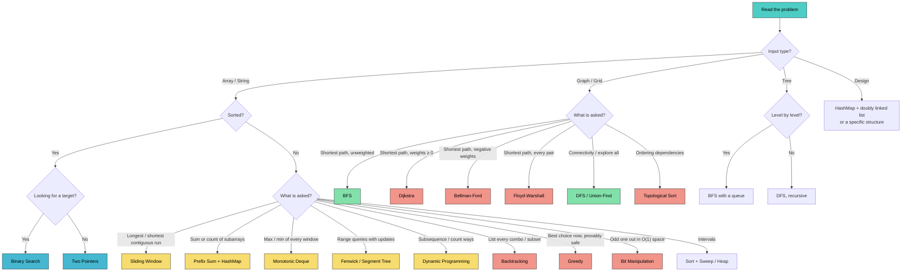

# DSA Advanced Patterns & ML Coding (Java)

> "Match the problem to the pattern table before you touch the keyboard — the code is the easy part once you know which template applies."

**What this chapter covers:** The tools you reach for when the basics are ruled out — backtracking, greedy, bit manipulation, intervals, number theory, segment and Fenwick trees, Bellman-Ford, Floyd-Warshall and monotonic deques — plus the master pattern table, the 45-minute interview plan, and ML-from-scratch coding in Java. Final chapter of the 4-part DSA sequence (31 / 31b / 31c / 31d); section numbers continue from chapters 31/31b/31c.

---

## Start Here

### Pick a track

| Track | Time | Read this | Good for |
|-------|------|-----------|----------|
| **Speed run** | ~60 min | This page, then the **Approach** + **Walk-through** of backtracking, greedy, intervals and the monotonic deque, then §18.31 and §18.33 | First pass |
| **Mastery** | ~5 hr | Everything. The trees and shortest-path sections repay slow reading | Real preparation |
| **ML-focused** | ~45 min | This page, then jump straight to §18.34 | ML engineer / research loops |
| **Refresh** | ~15 min | §18.31 Master Pattern Table, then §18.33 Interview Strategy | The night before |

Each topic opens with a visible **Recognise** line: how the question sounds and the tool it calls for. Each Java program sits in one collapsed block, in the same order — **Problem · Example · Walk-through · Approach · Java · Output · Complexity**, plus a **Trap** when there is one — so you never read code before you know what it does. The key algorithms also have an animation (press ▶ to play, ⏭ to step one move, or change the speed), with its walk-through beside it as text. The walk-through format is explained in full in [chapter 31's Start Here](#content/31_dsa_foundations).

### Read this before reaching for anything here


> **Most interview problems are solved by the basics** — two pointers, hashmaps, sliding windows, BFS. Everything in this chapter exists because some **constraint rules the simple tool out**. So the habit that earns marks is: *name the constraint that forces the tool.* "I'd use a segment tree" is a weaker answer than "the values change between queries, which kills prefix sums, so I need a segment tree."

| # | When the question says… | Reach for | Cost | Section |
|---|--------------------------|-----------|------|---------|
| 1 | list every combination / subset / arrangement | **Backtracking** | O(2ⁿ) or O(n!) | §18.21 |
| 2 | take the best option now and never revisit | **Greedy** | O(n log n) | §18.22 |
| 3 | find the odd one out, or count bits, in O(1) space | **Bit manipulation** | O(n) | §18.23 |
| 4 | merge, overlap or schedule ranges | **Sort the intervals, then sweep** | O(n log n) | §18.24 |
| 5 | range sums **with updates** (or range min / max with updates) | **Fenwick tree** or **segment tree** (min / max: segment tree only) | O(log n) each | §18.26–18.27 |
| 6 | shortest path, but some edges are negative | **Bellman-Ford** | O(V·E) | §18.28 |
| 7 | shortest path between **every** pair | **Floyd-Warshall** | O(V³) | §18.29 |
| 8 | max or min inside a sliding window | **Monotonic deque** | O(n) | §18.30 |

The **full cross-chapter lookup** — every keyword in all four DSA chapters mapped to its pattern and its first line of code — lives in §18.31 below. Chapter 31's Start Here carries a shorter picker covering only the nine foundation templates.

---

## Table of Contents

| Part | Topic | Sections |
|------|-------|----------|
| 5 | Advanced Patterns | §18.21–18.25: Backtracking, Greedy, Bit Manipulation, Intervals, Math |
| 6 | Advanced DS & Paths | §18.26–18.30: Segment Tree, BIT/Fenwick, Bellman-Ford, Floyd-Warshall, Monotonic Deque |
| 7 | Pattern Recognition | §18.31–18.33: Master Table, Decision Flowchart, Interview Strategy |
| 8 | ML Coding | §18.34: Implement ML from Scratch in Java |

**Sequence:** [31 — Foundations & Search](#content/31_dsa_foundations) → [31b — Graphs](#content/31b_dsa_graphs) → [31c — Dynamic Programming](#content/31c_dynamic_programming) → **31d (this chapter)**

---

# PART 5: ADVANCED PATTERNS

---

## 18.21 Backtracking

**Recognise:** "find **all** …", "list every …", "generate every arrangement" · **Use:** build the answer one choice at a time — choose → explore → un-choose.

**Simple explanation.** Systematic trial and error: build an answer one choice at a time, and when a partial answer cannot work, **undo the last choice** and try the next. It lists *every* valid configuration. If the question wants only a *count*, use dynamic programming (chapter 31c) instead — far cheaper.

**Key idea — three steps, always the same.**


```java
void backtrack(List<List<Integer>> result, List<Integer> path, /* params */) {
    if (/* goal reached */) {
        result.add(new ArrayList<>(path));   // COPY — `path` keeps mutating
        return;
    }
    for (/* each candidate */) {
        if (/* candidate is allowed */) {
            path.add(choice);                //  1. CHOOSE
            backtrack(result, path, ...);    //  2. EXPLORE
            path.remove(path.size() - 1);    //  3. UN-CHOOSE
        }
    }
}
```

> **Trap:** `result.add(path)` without a copy. Every entry is then the *same* list, empty when the recursion ends — `[1, 2, 3]` gives `[[], [], [], [], [], [], [], []]`. Always `new ArrayList<>(path)`.

> **Trap:** forgetting step 3. The next branch inherits leftovers, so the output is quietly wrong rather than obviously broken.

**The template on the smallest example — subsets of `[1, 2, 3]`.** Level `i` decides one number: **take** it (choose, explore, un-choose) or **skip** it. Each leaf copies `path` into `result`: 2³ = 8 subsets.

**Watch the decision tree run, one step per frame** (press ▶ to play, or ⏭ to step). Green edges *take*, blue edges *skip*; `path` grows on each choose and shrinks on each un-choose, and each leaf drops a copy into `result`.


**Dry run (the animation as text):**
```
                          []                          i = 0: take or skip 1
             take 1 /            \ skip 1
               [1]                    []              i = 1: take or skip 2
            /       \             /        \
        [1,2]       [1]        [2]          []        i = 2: take or skip 3
        /   \       /  \       /  \        /  \
  [1,2,3]  [1,2] [1,3] [1]  [2,3] [2]    [3]  []      i = 3: leaf, copy path

path: [] → [1] → [1,2] → [1,2,3] copy → [1,2] copy → [1] → [1,3] copy → [1] copy
      → [] → [2] → [2,3] copy → [2] copy → [] → [3] copy → [] copy
```

**Java:**
```java
import java.util.*;

public class TakeOrSkip {
    static void takeOrSkip(int[] nums, int i, List<Integer> path,
                           List<List<Integer>> result) {
        if (i == nums.length) {                  // every number decided: a leaf
            result.add(new ArrayList<>(path));   // COPY — path keeps changing
            return;
        }
        path.add(nums[i]);                       // 1. choose: take nums[i]
        takeOrSkip(nums, i + 1, path, result);   // 2. explore
        path.remove(path.size() - 1);            // 3. un-choose
        takeOrSkip(nums, i + 1, path, result);   //    explore again: skip nums[i]
    }

    public static void main(String[] args) {
        List<List<Integer>> result = new ArrayList<>();
        takeOrSkip(new int[] {1, 2, 3}, 0, new ArrayList<>(), result);
        System.out.println(result);
    }
}
```

**Output:**

```
[[1, 2, 3], [1, 2], [1, 3], [1], [2, 3], [2], [3], []]
```

### The big three: subsets, permutations, combinations

All three are the template; **only what you may pick next changes** (`i` = position of the number just added).

| | What it generates | What restricts the next pick | What counts as an answer |
|---|---|---|---|
| **Subsets** | every include/exclude choice | pass `i + 1` — only numbers to the right | **every node**, including the root |
| **Permutations** | every ordering of everything | a `used[]` flag — anything not yet taken | only the **leaves** |
| **Combinations** | every group of exactly `k` numbers from `1…n` | pass a `start` index — only bigger numbers | only when the group has `k` numbers |

#### Subsets

**Recognise:** "all subsets", "the power set" · **Change:** loop from `start`, recurse with `i + 1`, record at **every** node.

![Subsets infographic (backtracking with a start index): nums = [1, 2, 3]; five snapshots of the recursion tree show the first call recording the empty set on entry, adding 1, 2, 3 and recording [1], [1,2], [1,2,3] before start = 3 returns, un-choosing back to [1] and adding 3 to record [1,3], going back to the root to record [2] and [2,3] (1 is behind the start of [2], so 2,1 never repeats 1,2), and adding 3 to record [3] as the root loop ends with 8 subsets; the Java highlights res.add(new ArrayList<>(path)) on entry and the recursion with i + 1, O(n · 2^n) time, and the trap is res.add(path) without a copy, which leaves 8 references to one empty list.](diagrams/dsa31d_info_subsets_ai.png)

<details>
<summary><strong>Subsets</strong> — Medium · read as text and Java</summary>

**Problem:** Given an array `nums` of different integers, return all 2ⁿ subsets, each exactly once, in any order.

**Example:**
```
Input:  nums = [1, 2, 3]
Output: [[], [1], [1, 2], [1, 2, 3], [1, 3], [2], [2, 3], [3]]
```

**Walk-through:** each call records the list it was handed, then tries adding each number to the **right** of the last one added.
```
[]                                record []
├─ add 1 -> [1]                   record [1]
│    ├─ add 2 -> [1, 2]           record [1, 2]
│    │    └─ add 3 -> [1, 2, 3]   record [1, 2, 3]
│    └─ add 3 -> [1, 3]           record [1, 3]
├─ add 2 -> [2]                   record [2]
│    └─ add 3 -> [2, 3]           record [2, 3]
└─ add 3 -> [3]                   record [3]   (nothing is left to the right of 3)
```

**Approach:** The same 8 subsets as take / skip, but every node here is already an answer, so each call records on entry. Adding only to the right means `[2, 1]` can never repeat `[1, 2]`. Learn this loop form: Combinations, Combination Sum and the duplicates rule all reuse it.

**Java:**
```java
import java.util.*;

public class Subsets {
    public List<List<Integer>> subsets(int[] nums) {
        List<List<Integer>> result = new ArrayList<>();
        backtrackSubsets(result, new ArrayList<>(), nums, 0);
        return result;
    }

    void backtrackSubsets(List<List<Integer>> res, List<Integer> path, int[] nums, int start) {
        res.add(new ArrayList<>(path));                  // every node is a subset
        for (int i = start; i < nums.length; i++) {
            path.add(nums[i]);
            backtrackSubsets(res, path, nums, i + 1);    // i + 1 = never reuse or look back
            path.remove(path.size() - 1);
        }
    }

    public static void main(String[] args) {
        Subsets s = new Subsets();
        System.out.println(s.subsets(new int[] {1, 2, 3}));
        System.out.println(s.subsets(new int[] {}));     // the empty set is a subset too
    }
}
```

**Output:**

```
[[], [1], [1, 2], [1, 2, 3], [1, 3], [2], [2, 3], [3]]
[[]]
```

**Complexity:** O(n · 2ⁿ) time — 2ⁿ subsets, each copied in up to n steps — and O(n) recursion space (not counting the output).
</details>

**Practice:** [Subsets →](#dsa-problem-subsets)

#### Permutations

**Recognise:** "every ordering", "all arrangements" · **Change:** no `start` — loop over everything, skip what `used[]` marks; record full-length lists only.

![Permutations infographic (backtracking with a used[] flag): nums = [1, 2, 3]; five snapshots of the recursion tree show adding 1, 2, 3 while marking used[i] and recording [1,2,3] only at full length, undoing 3 and 2 (path and used) to record [1,3,2], going back to the root to add 2 with used F T F so the loop restarts at 0 and 1 comes back for [2,1], and the remaining leaves [2,1,3], [2,3,1], [3,1,2], [3,2,1] for 6 orderings, then a trap run without used[i] = false where every flag stays true, [1,3], [2] and [3] are skipped and only [1,2,3] is recorded; the Java highlights used[i] = false, with O(n · n!) time.](diagrams/dsa31d_info_permutations_ai.png)

<details>
<summary><strong>Permutations</strong> — Medium · read as text and Java</summary>

**Problem:** Given an array `nums` of different integers, return every ordering of all its numbers (n! of them), in any order.

**Example:**
```
Input:  nums = [1, 2, 3]
Output: [[1, 2, 3], [1, 3, 2], [2, 1, 3], [2, 3, 1], [3, 1, 2], [3, 2, 1]]
```

**Walk-through:** at each level try every number **not yet used**; record only full-length lists.
```
[]
├─ add 1 -> [1] ─┬─ add 2 -> [1, 2] ── add 3 -> [1, 2, 3]   full, record
│                └─ add 3 -> [1, 3] ── add 2 -> [1, 3, 2]   full, record
├─ add 2 -> [2] ─┬─ add 1 -> [2, 1] ── add 3 -> [2, 1, 3]   full, record
│                └─ add 3 -> [2, 3] ── add 1 -> [2, 3, 1]   full, record
└─ add 3 -> [3] ─┬─ add 1 -> [3, 1] ── add 2 -> [3, 1, 2]   full, record
                 └─ add 2 -> [3, 2] ── add 1 -> [3, 2, 1]   full, record
```

**Approach:** Mark `used[i]` when you add `nums[i]`; on the way back undo **both** `path` and `used[i]`.

**Java:**
```java
import java.util.*;

public class Permutations {
    public List<List<Integer>> permute(int[] nums) {
        List<List<Integer>> result = new ArrayList<>();
        backtrackPermute(result, new ArrayList<>(), nums, new boolean[nums.length]);
        return result;
    }

    void backtrackPermute(List<List<Integer>> res, List<Integer> path,
                          int[] nums, boolean[] used) {
        if (path.size() == nums.length) {                // only leaves count
            res.add(new ArrayList<>(path));
            return;
        }
        for (int i = 0; i < nums.length; i++) {
            if (used[i]) continue;
            used[i] = true;
            path.add(nums[i]);
            backtrackPermute(res, path, nums, used);
            path.remove(path.size() - 1);
            used[i] = false;                             // undo BOTH things
        }
    }

    public static void main(String[] args) {
        System.out.println(new Permutations().permute(new int[] {1, 2, 3}));
    }
}
```

**Output:**

```
[[1, 2, 3], [1, 3, 2], [2, 1, 3], [2, 3, 1], [3, 1, 2], [3, 2, 1]]
```

> **Trap:** undoing `path` but forgetting `used[i] = false`. The number stays marked, later branches silently skip it, and you get far fewer permutations.

**Complexity:** O(n · n!) time — n! orderings, each copied in n steps — and O(n) space for the recursion and `used[]` (not counting the output).
</details>

**Practice:** [Permutations →](#dsa-problem-permutations)

#### Combinations

**Recognise:** "choose `k` of …", "every group of size `k`" · **Change:** record only at size `k`; the loop bound stops when too few numbers are left.

<details>
<summary><strong>Combinations</strong> — Medium · read as text and Java</summary>

**Problem:** Given `n` and `k`, return every group of `k` different numbers chosen from `1, 2, …, n`, each group once, in any order.

**Example:**
```
Input:  n = 3, k = 2
Output: [[1, 2], [1, 3], [2, 3]]
```

**Walk-through:** the next number must be bigger than the last one, so each group is built in exactly one order — `[2, 1]` is never produced.
```
[]                         next number may be 1, 2 or 3
├─ add 1 -> [1]            next may be 2 or 3
│    ├─ add 2 -> [1, 2]    size 2 ✓ record
│    └─ add 3 -> [1, 3]    size 2 ✓ record
├─ add 2 -> [2]            next may be 3
│    └─ add 3 -> [2, 3]    size 2 ✓ record
└─ add 3                   never tried: no number is left after 3, so [3]
                           can't reach size 2 — the loop bound skips it
```

**Approach:** Loop from `start`, recurse with `i + 1`, record at size `k`. The bound `n - (k - path.size()) + 1` is the last start that still leaves enough numbers.

**Java:**
```java
import java.util.*;

public class Combinations {
    public List<List<Integer>> combine(int n, int k) {
        List<List<Integer>> result = new ArrayList<>();
        backtrackCombine(result, new ArrayList<>(), 1, n, k);
        return result;
    }

    void backtrackCombine(List<List<Integer>> res, List<Integer> path,
                          int start, int n, int k) {
        if (path.size() == k) {
            res.add(new ArrayList<>(path));
            return;
        }
        // pruning: stop once too few numbers remain to ever reach size k
        for (int i = start; i <= n - (k - path.size()) + 1; i++) {
            path.add(i);
            backtrackCombine(res, path, i + 1, n, k);
            path.remove(path.size() - 1);
        }
    }

    public static void main(String[] args) {
        System.out.println(new Combinations().combine(3, 2));
    }
}
```

**Output:**

```
[[1, 2], [1, 3], [2, 3]]
```

> **Pruning wins marks.** Interviewers rarely require the bound, but naming it earns credit — and on Hard problems, cutting dead branches early is what makes the search finish in time.

**Complexity:** O(k · C(n, k)) time — C(n, k) groups ("n choose k"), each copied in k steps — and O(k) recursion space (not counting the output).
</details>

**Practice:** [Combinations →](#dsa-problem-combinations)

#### Combination Sum

**Recognise:** "add up to a target, numbers may repeat" · **Change:** recurse with `i`, not `i + 1`; track how much is left.

![Combination Sum infographic (backtracking that reuses the current index): candidates = [2, 3, 6, 7], target = 7, drawn as a sum bar against the target; five snapshots show recursing with i so 2 repeats to 2,2,2 with remain 1 where every next pick overshoots, the loop at 2,2 moving on to 3 so 2,2,3 hits remain 0 and is recorded, start = 1 at 2,3 so 2,3,2 is never built while 3, 6 and 7 overshoot, everything else overshooting until 7 alone is recorded for 2 lists (2,2,3 and 7), and a trap run recursing with i + 1 where 2 never repeats and only 7 is found; the Java highlights backtrackSum(res, path, cands, remain - cands[i], i), with O(n^(target/min)) time.](diagrams/dsa31d_info_combsum_ai.png)

<details>
<summary><strong>Combination Sum</strong> — Medium · read as text and Java</summary>

**Problem:** Given different positive integers `candidates` and a `target`, return every list of candidates that adds up to `target`. A number may be used **any number of times**; `[2, 2, 3]` and `[3, 2, 2]` are the same answer.

**Example:**
```
Input:  candidates = [2, 3, 6, 7], target = 7
Output: [[2, 2, 3], [7]]
```

**Walk-through:** "left" = how much of the target is still missing. A number may repeat, but never one that comes *earlier* in `candidates`.
```
[2]        left 5
[2,2]      left 3
[2,2,2]    left 1  → every next pick overshoots ✗
[2,2,3]    left 0  ✓ record
[2,3]      left 2  → next picks (3, 6, 7) all overshoot ✗
[2,6] [2,7]        overshoot ✗
[3]        left 4  → [3,3] left 1 ✗; [3,6], [3,7] overshoot ✗
[6]        left 1  → overshoot ✗
[7]        left 0  ✓ record
```

**Approach:** A start index as in Combinations (each group in one order), but recurse with the **same** `i`. Left 0 → record; below 0 → dead end.

**Java:**
```java
import java.util.*;

public class CombinationSum {
    public List<List<Integer>> combinationSum(int[] candidates, int target) {
        List<List<Integer>> res = new ArrayList<>();
        backtrackSum(res, new ArrayList<>(), candidates, target, 0);
        return res;
    }

    void backtrackSum(List<List<Integer>> res, List<Integer> path,
                      int[] cands, int remain, int start) {
        if (remain == 0) { res.add(new ArrayList<>(path)); return; }
        if (remain < 0) return;
        for (int i = start; i < cands.length; i++) {
            path.add(cands[i]);
            backtrackSum(res, path, cands, remain - cands[i], i);   // i, not i + 1: reuse
            path.remove(path.size() - 1);
        }
    }

    public static void main(String[] args) {
        CombinationSum cs = new CombinationSum();
        System.out.println(cs.combinationSum(new int[] {2, 3, 6, 7}, 7));
        System.out.println(cs.combinationSum(new int[] {2}, 1));    // no way to make 1
    }
}
```

**Output:**

```
[[2, 2, 3], [7]]
[]
```

> **Trap:** the reverse mistake — passing `i` instead of `i + 1` in Subsets or Combinations lets the same element be picked again.

**Complexity:** O(n^(target/min)) time and O(target/min) space, where `n` = number of candidates and `min` = the smallest candidate (so `target/min` is the longest possible list).
</details>

**Practice:** [Combination Sum →](#dsa-problem-combination-sum)

### Handling duplicates

**Recognise:** "the input has repeats; no duplicate answers" (Subsets II, Combination Sum II, Permutations II) · **Change:** sort, then skip a twin at the same level.

**Subsets II** = Subsets + `Arrays.sort(nums)` first + this new first line in the loop of `backtrackSubsets`:

```java
if (i > start && nums[i] == nums[i - 1]) continue;   // same value, same level: skip
```

`[1, 2, 2]` → `[[], [1], [1, 2], [1, 2, 2], [2], [2, 2]]`: 6 subsets, not 8.

> **The subtlety:** `i > start` means "not the first pick at this level". The same value *deeper* is fine (`[2, 2]` stays); only as a *sibling* does it repeat an answer.

**Permutations II** has no `start`, so it uses `used[]`: sort, then add this line right after the `used[i]` check in `backtrackPermute`. Equal values are then placed in their original order, so each ordering appears once:

```java
if (i > 0 && nums[i] == nums[i - 1] && !used[i - 1]) continue;  // twin not placed yet: skip
```

`[1, 1, 2]` → `[[1, 1, 2], [1, 2, 1], [2, 1, 1]]`: 3 orderings, not 6.

### N-Queens

**Recognise:** "place `n` pieces so that none attack each other" (also Sudoku) · **Use:** one queen per row, O(1) column and diagonal flags, un-place on the way back.

![N-Queens infographic (backtracking with O(1) flag checks): n = 4, each snapshot shows the board plus the cols, d1 and d2 flag arrays; queen (0,0) then (1,2) leaves row 2 fully attacked so (1,2) is undone after 8 tries, (1,3) then (2,1) leaves row 3 fully attacked so (2,1) is undone after 15 tries, row 2 fails again and row 1 runs out so (0,0) is undone after 17 tries (no board has a queen there), starting at (0,1) with (1,3), (2,0), (3,2) records .Q.. / ...Q / Q... / ..Q. after 26 tries, and (0,2) records the mirror ..Q. / Q... / ...Q / .Q.. after 38 tries before column 3 only dead-ends, 60 tries and 2 boards in all; the Java highlights if (cols[col] || d1[row - col + n] || d2[row + col]) continue, with roughly O(n!) time.](diagrams/dsa31d_info_nqueens_ai.png)

**Watch 4-Queens run, one step per frame** (press ▶ to play, or ⏭ to step). Each try reads three flags; a red X is an attacked square, a struck-out queen an un-choose.


<details>
<summary><strong>N-Queens</strong> — Hard · read as text and Java</summary>

**Problem:** Place `n` queens on an `n × n` chessboard so that no two share a **row**, a **column** or a **diagonal**. Return every solution as `n` strings, one per row, with `Q` for a queen and `.` for an empty square.

**Example:**
```
Input:  n = 4
Output: [[.Q.., ...Q, Q..., ..Q.], [..Q., Q..., ...Q, .Q..]]     (2 boards)
```

**Walk-through (the animation as text):** `(r,c)` = a queen in row `r`, column `c` (from 0); ✗ = attacked by a queen already placed.
```
row 0  col 0 free                                    -> queen at (0,0)
row 1  col 0 ✗ column, col 1 ✗ diagonal, col 2 free  -> queen at (1,2)
row 2  col 0 ✗ column, col 1 ✗ diagonal,
       col 2 ✗ column, col 3 ✗ diagonal              -> dead end: undo (1,2)
row 1  col 3 free                                    -> queen at (1,3)
row 2  col 0 ✗ column, col 1 free                    -> queen at (2,1)
row 3  cols 0, 1, 3 ✗ column, col 2 ✗ diagonal       -> dead end: undo (2,1)
row 2  col 2 ✗ diagonal, col 3 ✗ column              -> dead end: undo (1,3)
row 1  no columns left                               -> dead end: undo (0,0)
                                                        (no answer has a queen at (0,0))
row 0  col 1, then (1,3), (2,0), (3,2)               -> 4 rows filled: record board 1
row 0  later col 2, then (1,0), (2,3), (3,1)         -> record board 2
row 0  col 3                                         -> dead ends only (mirror of col 0)

board 1     board 2
. Q . .     . . Q .
. . . Q     Q . . .
Q . . .     . . . Q
. . Q .     . Q . .
```

**Approach:** One queen per row, top to bottom, trying every column no earlier queen attacks. For an O(1) check, number every column and diagonal and keep one flag per number: a **↘ diagonal** shares `row − col` (the code adds `n` to keep it non-negative), a **↙ diagonal** shares `row + col`. A branch dies only when its square is attacked, so no board is missed, and each dead end cuts off a whole subtree.

**Java:**
```java
import java.util.*;

public class NQueens {
    public List<List<String>> solveNQueens(int n) {
        List<List<String>> result = new ArrayList<>();
        boolean[] cols = new boolean[n];
        boolean[] diag1 = new boolean[2 * n]; // ↘ diagonals, numbered row - col + n
        boolean[] diag2 = new boolean[2 * n]; // ↙ diagonals, numbered row + col
        char[][] board = new char[n][n];
        for (char[] row : board) Arrays.fill(row, '.');

        solve(result, board, 0, cols, diag1, diag2, n);
        return result;
    }

    void solve(List<List<String>> res, char[][] board, int row,
               boolean[] cols, boolean[] d1, boolean[] d2, int n) {
        if (row == n) {
            List<String> snapshot = new ArrayList<>();
            for (char[] r : board) snapshot.add(new String(r));
            res.add(snapshot);
            return;
        }
        for (int col = 0; col < n; col++) {
            if (cols[col] || d1[row - col + n] || d2[row + col]) continue;
            board[row][col] = 'Q';
            cols[col] = d1[row - col + n] = d2[row + col] = true;
            solve(res, board, row + 1, cols, d1, d2, n);
            board[row][col] = '.';
            cols[col] = d1[row - col + n] = d2[row + col] = false;
        }
    }

    public static void main(String[] args) {
        NQueens q = new NQueens();
        for (int n : new int[] {4, 3, 8}) {
            List<List<String>> boards = q.solveNQueens(n);
            String shown = boards.size() <= 2 ? boards.toString() : boards.size() + " boards";
            System.out.println("n = " + n + " -> " + shown);
        }
    }
}
```

**Output:**

```
n = 4 -> [[.Q.., ...Q, Q..., ..Q.], [..Q., Q..., ...Q, .Q..]]
n = 3 -> []
n = 8 -> 92 boards
```

> **Fun fact:** the count grows faster than exponentially — 92 boards for n = 8, 365,596 for n = 14 — and no closed-form formula is known.

**Complexity:** Roughly O(n!) time — row `r` has at most `n − r` free columns — and O(n) extra space for the flags and the recursion.
</details>

**Practice:** [N-Queens →](#dsa-problem-n-queens)

### 60-second recall

<details>
<summary>1. What are the three steps, and which one do people forget?</summary>

Choose, explore, un-choose. The **un-choose** is forgotten most — the next branch then inherits leftovers, so the output is wrong rather than crashing. Next most common: adding `path` to the results without copying it.
</details>

<details>
<summary>2. Subsets, permutations, combinations — what is the single line that separates them?</summary>

What you may pick next. Subsets pass `i + 1` and record every node. Permutations use a `used[]` flag and record only full-length leaves. Combinations pass a `start` index and record when the size hits k.
</details>

<details>
<summary>3. The question asks "how many ways", not "list the ways". What changes?</summary>

Almost certainly stop backtracking and use DP (chapter 31c). Enumerating 2ⁿ answers to count them is exponential; counting them directly with overlapping subproblems is usually polynomial.
</details>

**Problem List — Backtracking:**

**Start with these five:** Subsets · Permutations · Combination Sum · Palindrome Partitioning · N-Queens.

| #   | Problem                          | Difficulty | Key Insight                       |
|-----|----------------------------------|------------|-----------------------------------|
| 1   | Subsets (LC 78)                  | Medium     | Pick or skip                      |
| 2   | Subsets II (LC 90)               | Medium     | Skip duplicates after sort        |
| 3   | Permutations (LC 46)             | Medium     | used[] boolean array              |
| 4   | Permutations II (LC 47)          | Medium     | Sort + skip a twin while its earlier copy is unused |
| 5   | Combinations (LC 77)             | Medium     | k-sized subsets                   |
| 6   | Combination Sum (LC 39)          | Medium     | Allow reuse (start from i, not i+1) |
| 7   | Combination Sum II (LC 40)       | Medium     | No reuse + skip duplicates        |
| 8   | N-Queens (LC 51)                 | Hard       | Row-by-row + diagonal tracking    |
| 9   | Palindrome Partitioning (131)    | Medium     | Partition string into palindromes |
| 10  | Letter Combinations of Phone (17)| Medium     | Map digits to letters             |

---

## 18.22 Greedy Algorithms

**Simple explanation.** Greedy means: take the best-looking option now and never reconsider. It is the cheapest algorithm there is — usually a sort plus one pass — and it is **wrong far more often than people expect**. The skill is knowing when it is safe.

**The test: an exchange argument.** *"Take any optimal solution that does not make my greedy choice. I can swap my choice in without making it worse, so an optimal solution containing my choice exists."* If you cannot say that, you need dynamic programming ([chapter 31c](#content/31c_dynamic_programming)), which tries every choice and remembers the results.

> **Commit only when you can justify it out loud.** An unjustified greedy is the most common way to fail a Medium.

### Interval Scheduling — keep the most non-overlapping intervals

**Recognise:** "remove the fewest intervals so the rest don't overlap" / "attend the most meetings" · **Use:** sort by **end**; keep each interval that starts at or after the last kept end.

![Non-overlapping Intervals infographic (greedy, sort by end): intervals (1,2), (2,3), (3,4), (1,3) drawn on a timeline with a dashed prevEnd line; six snapshots show sorting by end into (1,2), (2,3), (1,3), (3,4) with the tie kept in input order, keeping (1,2) because nothing is kept yet (prevEnd 2), keeping (2,3) because touching is not overlapping (prevEnd 3), removing (1,3) because 1 < 3 (count 1), and keeping (3,4) with prevEnd 4 so the answer is 1, then a trap run on the second test sorted by start where (1,100) is kept first and swallows the other three, giving 3 removals instead of 2; the Java highlights the sort by end and if (interval[0] >= prevEnd), with O(n log n) time and O(1) extra space.](diagrams/dsa31d_info_intervals_ai.png)

<details>
<summary><strong>Non-overlapping Intervals</strong> — Medium · read as text and Java</summary>

**Problem:** Given intervals `[start, end]`, return the **fewest** you must remove so that none of the rest overlap. Intervals that only touch (one ends at 2, the next starts at 2) do **not** overlap.

**Example:**
```
Input:  intervals = [[1,2],[2,3],[3,4],[1,3]]
Output: 1          (remove [1,3])
```

**Walk-through:** sorted by end: `[1,2] [2,3] [1,3] [3,4]`. `prevEnd` = where the last **kept** interval ends.
```
interval   start >= prevEnd?            action   prevEnd   removed
[1,2]      yes - nothing kept yet       keep     2         0
[2,3]      2 >= 2 -> yes                keep     3         0
[1,3]      1 >= 3 -> no, it overlaps    remove   3         1
[3,4]      3 >= 3 -> yes                keep     4         1
```

**Approach:** Trying every subset is O(2ⁿ). Instead sort by **end** and keep whichever interval finishes first. The exchange argument: in any best answer, replace its first interval with the one that finishes earliest — it ends no later, so everything after it still fits. Repeat on what is left; every interval that does not fit is a removal. It is the sort-then-sweep shape of §18.24, sorted on the other end.

**Java:**
```java
import java.util.*;

public class NonOverlappingIntervals {
    public int eraseOverlapIntervals(int[][] intervals) {
        Arrays.sort(intervals, (a, b) -> Integer.compare(a[1], b[1]));   // by END, not start
        int count = 0, prevEnd = Integer.MIN_VALUE;

        for (int[] interval : intervals) {
            if (interval[0] >= prevEnd) prevEnd = interval[1];           // keep it
            else count++;                                                // remove it
        }
        return count;
    }

    public static void main(String[] args) {
        NonOverlappingIntervals s = new NonOverlappingIntervals();
        int[][][] tests = { {{1, 2}, {2, 3}, {3, 4}, {1, 3}}, {{1, 100}, {11, 22}, {1, 11}, {2, 12}} };
        for (int[][] intervals : tests) {
            String input = Arrays.deepToString(intervals);     // the sort reorders the array
            System.out.println(input + " -> " + s.eraseOverlapIntervals(intervals));
        }
    }
}
```

**Output:**
```
[[1, 2], [2, 3], [3, 4], [1, 3]] -> 1
[[1, 100], [11, 22], [1, 11], [2, 12]] -> 2
```

> **Trap:** sorting by **start**. In the second test `[1,100]` starts first, gets kept, and swallows the other three: 3 removals instead of 2. *Merging* sorts by start; *scheduling* sorts by end (§18.24's table).

**Complexity:** O(n log n) time for the sort, O(1) extra space.
</details>

**Practice:** [Non-overlapping Intervals →](#dsa-problem-non-overlapping-intervals)

### Jump Game — can you reach the end?

**Recognise:** "can you reach the last index?" / "the fewest jumps to reach it" · **Use:** one frontier number, the farthest index reachable so far.

![Jump Game infographic (greedy farthest reach): nums = [2, 3, 1, 1, 4] with the reachable block 0..maxReach framed in green and jump arcs above the cells; six snapshots show i = 0 growing maxReach to 2, i = 1 growing it to 4 so the last index is already reachable, i = 2 and 3 reaching 3 and 4 without changing it, i = 4 standing on the last index so the loop returns true, then nums = [3, 2, 1, 0, 4] where indices 0 to 3 all reach only 3 so maxReach is stuck at 3, and i = 4 > maxReach 3 returning false (stranded); the Java highlights if (i > maxReach) return false, with O(n) time and O(1) space.](diagrams/dsa31d_info_jumpgame_ai.png)

**Why greedy is safe for Jump Game (LC 55).** From index `i` you may jump 1 to `nums[i]` steps forward; can you reach the last index from index 0? [Chapter 31c, Child 7](#content/31c_dynamic_programming) builds it as a DP and dry-runs it; here is the proof. Keep `maxReach`, the farthest index reachable so far. A jump may stop short, so **every** index from 0 to `maxReach` is reachable — one unbroken block, described by one number, with no need to know *how* you got anywhere. If the scan reaches `i > maxReach`, nothing earlier jumps that far: return false.

<details>
<summary><strong>Jump Game II</strong> — Medium · read as text and Java (both games)</summary>

**Problem:** Same `nums`, but return the fewest jumps from index 0 to the last index; the input guarantees it can be reached.

**Example:**
```
Input:  nums = [2, 3, 1, 1, 4]
Output: 2          0 -> 1 -> 4
```

**Walk-through:** `currEnd` = the farthest index reachable with the jumps used so far; `farthest` = the farthest with **one more** jump.
```
index 0: farthest = 0 + 2 = 2;  reached currEnd (0) -> jump 1, currEnd = 2
index 1: farthest = 1 + 3 = 4
index 2: farthest stays 4;      reached currEnd (2) -> jump 2, currEnd = 4 = last index
index 3: farthest stays 4;      the loop stops before the last index -> answer 2
```

**Approach:** BFS by levels, written with two integers instead of a queue. The indices reachable with `jumps` jumps form one block `0..currEnd` (the proof above), and one more jump reaches up to `farthest`, the largest `i + nums[i]` in that block. Spend a jump only when the scan reaches `currEnd`, then set `currEnd = farthest`. Each jump moves exactly one level, so the count is the fewest possible.

**Java:** `canJump` is Jump Game; `jump` adds `currEnd`.
```java
import java.util.*;

public class JumpGame {
    // LC 55 Jump Game
    public boolean canJump(int[] nums) {
        int maxReach = 0;
        for (int i = 0; i < nums.length; i++) {
            if (i > maxReach) return false;                 // stranded
            maxReach = Math.max(maxReach, i + nums[i]);
        }
        return true;
    }

    // LC 45 Jump Game II
    public int jump(int[] nums) {
        int jumps = 0, currEnd = 0, farthest = 0;
        for (int i = 0; i < nums.length - 1; i++) {          // NOT < nums.length — see the trap
            farthest = Math.max(farthest, i + nums[i]);
            if (i == currEnd) {                              // this jump's range is used up
                jumps++;
                currEnd = farthest;
            }
        }
        return jumps;
    }

    public static void main(String[] args) {
        JumpGame g = new JumpGame();
        for (int[] nums : new int[][] { {2, 3, 1, 1, 4}, {3, 2, 1, 0, 4} }) {
            System.out.println(Arrays.toString(nums) + " -> canJump " + g.canJump(nums));
        }
        for (int[] nums : new int[][] { {2, 3, 1, 1, 4}, {0} }) {
            System.out.println(Arrays.toString(nums) + " -> jump " + g.jump(nums));
        }
    }
}
```

**Output:**
```
[2, 3, 1, 1, 4] -> canJump true
[3, 2, 1, 0, 4] -> canJump false
[2, 3, 1, 1, 4] -> jump 2
[0] -> jump 0
```

> **Trap:** looping `i` up to the last index. Standing on it with `i == currEnd` counts a jump you never take: 3 instead of 2 here, and 1 instead of 0 for `[0]`.

**Complexity:** O(n) time — one pass — and O(1) space, for both games.
</details>

**Practice:** [Jump Game →](#dsa-problem-jump-game) · [Jump Game II →](#dsa-problem-jump-game-ii)

### Task Scheduler — let the busiest task set the shape

**Recognise:** "the same task needs `n` slots of cooldown; fewest slots in total" · **Use:** count, don't simulate — the most frequent task fixes a skeleton of gaps.

![Task Scheduler infographic (greedy counting): tasks = AAABBB, n = 2; snapshots count A 3 and B 3 so maxFreq = 3, build the skeleton A _ _ A _ _ A with (3 - 1) × 2 = 4 idle slots, let B fill one slot per gap (idleSlots 4 - 2 = 2) with the third B running after the last A, and return max(6, 6 + 2) = 8, so the answer is 8 slots (A B _ A B _ A B), while a second test AABBCCDD with n = 1 drives idleSlots to -2 so the max keeps the answer at 8, not 6; the Java highlights idleSlots -= Math.min(freq[i], maxFreq - 1), with O(N) time and O(1) space.](diagrams/dsa31d_info_tasks_ai.png)

<details>
<summary><strong>Task Scheduler</strong> — Medium · read as text and Java</summary>

**Problem:** Each letter in `tasks` is one task taking **one slot**. Two copies of the same letter need at least `n` other slots between them — other tasks, or idle. Return the fewest slots that run every task.

**Example:**
```
Input:  tasks = [A, A, A, B, B, B], n = 2
Output: 8          (A B _ A B _ A B, where _ = idle)
```

**Walk-through:** count the slots the busiest task forces.
```
most frequent task              A appears 3 times                       maxFreq = 3
gap slots the skeleton forces   (3 - 1) gaps x 2 slots                  4 idle slots
B fills gaps                    one B fits in each of the 2 gaps;       4 - 2 = 2 idle left
                                the 3rd B runs right after the last A
total                           6 tasks + 2 idle                        8
```

**Approach:** The **most frequent task dictates the skeleton**: its `maxFreq` copies need `maxFreq − 1` gaps of `n` slots, and no schedule is shorter. Every other task fills gap slots, at most one copy per gap (a leftover copy, like the third B, runs after the last A). Subtract what fills the gaps; the answer is the skeleton or the number of tasks, whichever is larger.

**Java:**
```java
import java.util.*;

public class TaskScheduler {
    public int leastInterval(char[] tasks, int n) {
        int[] freq = new int[26];
        for (char t : tasks) freq[t - 'A']++;
        Arrays.sort(freq);

        int maxFreq = freq[25];
        int idleSlots = (maxFreq - 1) * n;

        for (int i = 24; i >= 0 && freq[i] > 0; i--) {
            idleSlots -= Math.min(freq[i], maxFreq - 1);
        }
        return Math.max(tasks.length, tasks.length + idleSlots);   // idleSlots may go negative
    }

    public static void main(String[] args) {
        TaskScheduler s = new TaskScheduler();
        System.out.println("AAABBB, n = 2 -> " + s.leastInterval("AAABBB".toCharArray(), 2));
        System.out.println("AABBCCDD, n = 1 -> " + s.leastInterval("AABBCCDD".toCharArray(), 1));
    }
}
```

**Output:**
```
AAABBB, n = 2 -> 8
AABBCCDD, n = 1 -> 8
```

> **Trap:** returning `tasks.length + idleSlots` directly. With many distinct tasks the gaps overflow with real work and `idleSlots` goes negative — the second test would give 6. The `Math.max` is not decoration.

**Complexity:** O(N) time for N tasks (sorting 26 counts is constant work), O(1) space.
</details>

**Practice:** [Task Scheduler →](#dsa-problem-task-scheduler)

### 60-second recall

<details>
<summary>1. How do you decide between greedy and DP in the room?</summary>

Try to state the exchange argument: "swapping my greedy choice into any optimal solution cannot make it worse." If you can say it convincingly, greedy is safe and far cheaper. If you cannot, the choice genuinely affects the future — that is DP.
</details>

<details>
<summary>2. Name a problem where greedy beats a correct DP, and why.</summary>

Jump Game. The DP is O(n²) over every jump length; the greedy is O(n) because the reachable indices are one block, so only the farthest reachable index matters.
</details>

**Problem List — Greedy:**

**Start with these five:** Jump Game · Non-overlapping Intervals · Task Scheduler · Gas Station · Partition Labels.

| #   | Problem                          | Difficulty | Key Insight                       |
|-----|----------------------------------|------------|-----------------------------------|
| 1   | Jump Game (LC 55)                | Medium     | Track max reachable               |
| 2   | Jump Game II (LC 45)             | Medium     | BFS-style level expansion         |
| 3   | Non-overlapping Intervals (435)  | Medium     | Sort by end, greedily keep        |
| 4   | Task Scheduler (LC 621)          | Medium     | Fill idle slots                   |
| 5   | Gas Station (LC 134)             | Medium     | If total >= 0, solution exists    |
| 6   | Partition Labels (LC 763)        | Medium     | Track last occurrence             |
| 7   | Candy (LC 135)                   | Hard       | Two-pass: left-to-right + right-to-left |

---

## 18.23 Bit Manipulation

**Simple explanation.** Every integer is already a row of switches. Bit manipulation flips those switches directly — which lets you do in **O(1) space** what would otherwise need a hashmap.

**Recognise:** "appears once, everything else twice", "count the set bits", "power of two", "no extra memory", or a *set of up to ~20 flags* · **Use:** XOR, `n & (n - 1)`, or an `int` as a bitmask.


### The operations, and what each is actually for

Bits are numbered from the right, starting at 0: in `6 = 110`, bit 0 is `0`, bit 1 is `1`, bit 2 is `1`. Below, `a` and `b` are integers and `n` / `i` are bit counts or positions.

| Operation | Java | What it is for |
|-----------|------|----------------|
| AND | `a & b` | mask — keep only the bits both have |
| OR | `a \| b` | merge — keep bits either has |
| XOR | `a ^ b` | **difference — 1 where the bits differ, so pairs cancel** |
| NOT | `~a` | flip every bit |
| Shift left | `a << n` | multiply by 2ⁿ |
| Shift right | `a >> n` | divide by 2ⁿ, rounding **down** and **keeping the sign** (`-5 >> 1` is `-3`, while `-5 / 2` is `-2`) |
| Unsigned shift right | `a >>> n` | shift, **filling with zeros** — the value as raw bits |
| Read bit i | `(a >> i) & 1` | is switch i on? |
| Set bit i | `a \| (1 << i)` | turn switch i on |
| Clear bit i | `a & ~(1 << i)` | turn switch i off |
| Flip bit i | `a ^ (1 << i)` | toggle switch i |
| Lowest set bit | `a & (-a)` | isolate the rightmost 1 — **what Fenwick trees jump by** |
| Clear lowest set bit | `a & (a - 1)` | drop the rightmost 1 — **count bits by repeating until zero** |
| Count set bits | `Integer.bitCount(a)` | the built-in; know the manual version too |
| Power of two? | `a > 0 && (a & (a-1)) == 0` | exactly one bit set |

**Why `a & (-a)` and `a & (a - 1)` work.** Java stores negative numbers in *two's complement*: `-a` is "flip every bit of `a`, then add 1". The flip turns the trailing 0s into 1s, and the +1 carries back through them to the lowest 1 — so `a` and `-a` agree **only** at that lowest 1. Subtracting 1 does the opposite: it clears the lowest 1 and turns the 0s below it into 1s.

```
a           =  6  →  0110
-a          = -6  →  1010   (flip 0110 → 1001, then add 1; last 4 bits shown)
a & -a               0010   = 2   ← only the lowest 1 survives

a - 1       =  5  →  0101
a & (a - 1)          0100   = 4   ← the lowest 1 is gone
```

> **Trap:** using `>>` on a negative number in a loop. The sign bit is copied on every shift, so `-1 >> 1` is still `-1` and the loop never terminates. Use `>>>` whenever you treat the value as raw bits.

### XOR — the one to understand deeply

**Recognise:** "every element appears twice except one" (or "find the missing number") in O(1) space · **Use:** XOR everything together — pairs cancel.

![Single Number infographic (XOR): nums = [4, 1, 2, 1, 2]; five snapshots XOR each number into result bit by bit, giving 000 ^ 100 = 4, 100 ^ 001 = 5 and 101 ^ 010 = 7, then the second 1 flips bit 0 back off (111 ^ 001 = 6) and the second 2 flips bit 1 off (110 ^ 010 = 4), so every pair cancels and the answer is 4; the Java highlights result ^= num in the for loop, with O(n) time and O(1) space, and the trap is that a hashmap of counts also works but needs O(n) space.](diagrams/dsa31d_info_xor_ai.png)

<details>
<summary><strong>Single Number</strong> — Easy · read as text and Java</summary>

**Problem:** Every number in the array appears exactly twice, except one that appears once. Return it, using O(1) extra space.

**Example:**
```
Input:  nums = [4, 1, 2, 1, 2]
Output: 4
```

**Walk-through:** the running XOR, in binary and decimal.
```
number (binary)   running XOR              what just happened
(start)           000             = 0      nothing yet
4 (100)           000 ^ 100 = 100 = 4      4 is unpaired
1 (001)           100 ^ 001 = 101 = 5      1 is unpaired
2 (010)           101 ^ 010 = 111 = 7      2 is unpaired
1 (001)           111 ^ 001 = 110 = 6      the two 1s cancelled
2 (010)           110 ^ 010 = 100 = 4      the two 2s cancelled -> only 4 is left
```

**Approach:** A hashmap of counts needs O(n) space, which the question forbids. Three XOR facts do all the work: `a ^ a = 0` (a value cancels itself), `a ^ 0 = a`, and order does not matter. So XOR the whole array: **every pair cancels, wherever its two copies sit, and only the lonely value survives.**

**Java:**
```java
import java.util.*;

public class SingleNumber {
    public int singleNumber(int[] nums) {
        int result = 0;
        for (int num : nums) result ^= num;
        return result;
    }

    public static void main(String[] args) {
        int[] nums = {4, 1, 2, 1, 2};
        System.out.println(Arrays.toString(nums) + " -> " + new SingleNumber().singleNumber(nums));
    }
}
```

**Output:**
```
[4, 1, 2, 1, 2] -> 4
```

> **Same trick, different clothes:** Missing Number (XOR the values *and* the indices — everything pairs off except the missing one) and Find the Difference. Whenever exactly one thing is unpaired, XOR finds it for free.

**Complexity:** O(n) time, **O(1) space** — which is the whole point.
</details>

**Practice:** [Single Number →](#dsa-problem-single-number)

### Counting bits for every number at once

**Recognise:** "the number of 1s in every number from 0 to n" · **Use:** a one-line DP, `dp[i] = dp[i >> 1] + (i & 1)`.

![Counting Bits infographic (bit DP): n = 5; six snapshots fill dp[i] = dp[i >> 1] + (i & 1) starting from dp[0] = 0, so 1 (001) = dp[0] + 1 = 1, 2 (010) = dp[1] + 0 = 1, 3 (011) = dp[1] + 1 = 2, 4 (100) = dp[2] + 0 = 1 and 5 (101) = dp[2] + 1 = 2, giving the answer [0, 1, 1, 2, 1, 2]; the Java loop highlights the dp line, with O(n) time and one lookup per number, and the trap is that the array needs n + 1 entries with the loop running while i <= n.](diagrams/dsa31d_info_countbits_ai.png)

<details>
<summary><strong>Counting Bits</strong> — Easy · read as text and Java</summary>

**Problem:** Given `n`, return an array of length `n + 1` whose entry `i` (for every `i` from 0 to n) is the number of 1s in the binary form of `i`.

**Example:**
```
Input:  n = 5
Output: [0, 1, 1, 2, 1, 2]
```

**Walk-through:** drop each number's last bit and look up the smaller number's count.
```
i (binary)   i >> 1 (binary)   count of i >> 1 + dropped bit   1s in i
0 (0)        -                 -                               0
1 (1)        0 (0)             0 + 1                           1
2 (10)       1 (1)             1 + 0                           1
3 (11)       1 (1)             1 + 1                           2
4 (100)      2 (10)            1 + 0                           1
5 (101)      2 (10)            1 + 1                           2
```

**Approach:** Counting each number's bits separately costs O(n log n). Instead, `i >> 1` drops the last bit (`i / 2` rounded down) and is smaller than `i`, so its count is **already in the array**; `i & 1` is the dropped bit. State `dp[i]` = the 1s in `i`; base `dp[0] = 0`.

**Java:**
```java
import java.util.*;

public class CountingBits {
    public int[] countBits(int n) {
        int[] dp = new int[n + 1];
        for (int i = 1; i <= n; i++) {
            dp[i] = dp[i >> 1] + (i & 1);       // everything above the last bit, plus the last bit
        }
        return dp;
    }

    public static void main(String[] args) {
        System.out.println("n = 5 -> " + Arrays.toString(new CountingBits().countBits(5)));
    }
}
```

**Output:**
```
n = 5 -> [0, 1, 1, 2, 1, 2]
```

**Complexity:** O(n) time, O(n) space.
</details>

**Practice:** [Counting Bits →](#dsa-problem-counting-bits)

### Bitmasks — an integer as a set

**Recognise:** "every subset" or "every set of choices" with `n ≤ 20` · **Use:** an `int` as the set — bit `i` set means element `i` is in.

<details>
<summary><strong>Subsets (bitmask version)</strong> — Medium · read as text and Java</summary>

**Problem:** Subsets from §18.21 — given `nums` with all values different, return all 2ⁿ subsets — built with a plain loop over bitmasks instead of recursion.

**Example:**
```
Input:  nums = [1, 2]
Output: [[], [1], [2], [1, 2]]
```

**Walk-through:** masks run 0..3, in binary (bit 0 is the rightmost digit); bit `i` set means `nums[i]` is in.
```
mask = 00  ->  neither bit set   ->  []
mask = 01  ->  bit 0 set         ->  [1]
mask = 10  ->  bit 1 set         ->  [2]
mask = 11  ->  both bits set     ->  [1, 2]
```

**Approach:** Counting `mask` from `0` to `2ⁿ − 1` visits **every possible subset** exactly once. For each mask, `nums[i]` goes in exactly when bit `i` is set (`(mask & (1 << i)) != 0`). No recursion and nothing to undo.

**Java:**
```java
import java.util.*;

public class SubsetsBitmask {
    public List<List<Integer>> subsets(int[] nums) {
        List<List<Integer>> result = new ArrayList<>();
        int n = nums.length;
        for (int mask = 0; mask < (1 << n); mask++) {      // 2^n masks
            List<Integer> subset = new ArrayList<>();
            for (int i = 0; i < n; i++) {
                if ((mask & (1 << i)) != 0) subset.add(nums[i]);
            }
            result.add(subset);
        }
        return result;
    }

    public static void main(String[] args) {
        int[] nums = {1, 2};
        System.out.println(Arrays.toString(nums) + " -> " + new SubsetsBitmask().subsets(nums));
    }
}
```

**Output:**
```
[1, 2] -> [[], [1], [2], [1, 2]]
```

**Complexity:** O(n · 2ⁿ) time — 2ⁿ masks, n bit checks each. O(n) extra space besides the output.
</details>

**Practice:** [Subsets →](#dsa-problem-subsets)

> **This is also how bitmask DP works** ([chapter 31c, §18.19](#content/31c_dynamic_programming)): the mask *is* the state, so `dp[mask][i]` means "I have visited exactly this set of nodes and I am standing on `i`". `n ≤ 20` in the constraints is the tell.

### 60-second recall

<details>
<summary>1. A question says "O(1) extra space" and something appears an odd number of times. What is the tool?</summary>

XOR the whole array. Pairs cancel, the odd one out survives. The same trick with indices solves Missing Number.
</details>

<details>
<summary>2. What does <code>n & (n - 1)</code> do, and what is it used for?</summary>

It clears the lowest set bit. Repeat until zero and the number of iterations is the number of 1-bits (Brian Kernighan's method). One check of it against zero also tests for a power of two.
</details>

<details>
<summary>3. Why does <code>n &gt;&gt; 1</code> loop forever on a negative number?</summary>

`>>` is an arithmetic shift — it copies the sign bit in, so a negative number never reaches zero. Use `>>>`, the unsigned shift, which fills with zeros.
</details>

**Problem List — Bit Manipulation:**

**Start with these five:** Single Number · Number of 1 Bits · Counting Bits · Missing Number · Power of Two.

| #   | Problem                          | Difficulty | Key Insight                       |
|-----|----------------------------------|------------|-----------------------------------|
| 1   | Single Number (LC 136)           | Easy       | XOR all elements                  |
| 2   | Single Number II (LC 137)        | Medium     | Count bits mod 3                  |
| 3   | Number of 1 Bits (LC 191)        | Easy       | n & (n-1) clears lowest bit       |
| 4   | Counting Bits (LC 338)           | Easy       | dp[i] = dp[i>>1] + (i&1)         |
| 5   | Reverse Bits (LC 190)            | Easy       | Shift and build                   |
| 6   | Missing Number (LC 268)          | Easy       | XOR with indices                  |
| 7   | Sum of Two Integers (LC 371)     | Medium     | Bit-by-bit add with carry         |
| 8   | Power of Two (LC 231)            | Easy       | n & (n-1) == 0                    |

---

## 18.24 Intervals

**Simple explanation.** Interval problems share one shape: **sort, then sweep once**, comparing each interval only with the last one you kept or merged. The one real decision is *which end you sort by* — and it changes the answer.


| The question asks… | Sort by | Why |
|--------------------|---------|-----|
| merge overlapping ranges | **start** | you need to meet ranges in the order they open |
| does anything overlap at all? | **start** | one comparison against the previous end |
| keep the most non-overlapping | **end** | finishing earliest leaves the most room (§18.22) |
| how many rooms / resources at once | **start**, with a min-heap of ends | the heap tells you when one frees up |

### Merge Intervals

**Recognise:** "merge all overlapping intervals" / "the union of these ranges" · **Use:** sort by **start**; each next interval either stretches the last merged one or starts a new one.

![Merge Intervals infographic: intervals [1,3], [2,6], [8,10] and [15,18] on a 0 to 18 timeline; snapshots add [1,3] as the first merged interval, stretch it to [1,6] because 2 ≤ 3 (end = max(3, 6)), start a new interval [8,10] because 8 > 6, and start another [15,18] because 15 > 10, so the answer is [1,6], [8,10], [15,18], while a trap test with [1,10] then [2,3] shows that last[1] = end would shrink [1,10] to [1,3] where max keeps it; the Java highlights last[1] = Math.max(last[1], end), with O(n log n) time and O(n) space.](diagrams/dsa31d_info_mergeintervals_ai.png)

<details>
<summary><strong>Merge Intervals</strong> — Medium · read as text and Java</summary>

**Problem:** Given intervals `[start, end]` in any order, merge every group that overlaps and return the merged list, sorted by start. Touching intervals (`[1,4]` and `[4,5]`) overlap and become `[1,5]`.

**Example:**
```
Input:  intervals = [[1,3], [2,6], [8,10], [15,18]]
Output: [[1,6], [8,10], [15,18]]
```

**Walk-through:** the animation and its dry run below this block.

**Approach:** Comparing every pair is O(n²), and merging changes the set as you go. Instead sort by **start** and keep `last`, the newest interval in the output — the only one that can still grow. If the next interval starts **at or before** `last`'s end, they overlap: stretch the end to the `max` of the two ends. Otherwise add it as a new interval. Starts are sorted, so no later interval can reach back across a gap — one comparison per interval is enough.

**Java:**
```java
import java.util.*;

public class MergeIntervals {
    public int[][] merge(int[][] intervals) {
        Arrays.sort(intervals, (a, b) -> Integer.compare(a[0], b[0]));   // by START
        List<int[]> merged = new ArrayList<>();
        merged.add(intervals[0]);

        for (int i = 1; i < intervals.length; i++) {
            int start = intervals[i][0], end = intervals[i][1];
            int[] last = merged.get(merged.size() - 1);
            if (start <= last[1]) {
                last[1] = Math.max(last[1], end);            // stretch — NOT just end
            } else {
                merged.add(intervals[i]);                    // a gap: new interval
            }
        }
        return merged.toArray(new int[0][]);
    }

    public static void main(String[] args) {
        MergeIntervals m = new MergeIntervals();
        int[][][] tests = { {{1, 3}, {2, 6}, {8, 10}, {15, 18}}, {{1, 10}, {2, 3}} };
        for (int[][] intervals : tests) {
            String input = Arrays.deepToString(intervals);     // merge() sorts and edits the input
            System.out.println(input + " -> " + Arrays.deepToString(m.merge(intervals)));
        }
    }
}
```

**Output:**
```
[[1, 3], [2, 6], [8, 10], [15, 18]] -> [[1, 6], [8, 10], [15, 18]]
[[1, 10], [2, 3]] -> [[1, 10]]
```

> **Trap:** writing `last[1] = end` instead of `Math.max(last[1], end)`. In `[[1,10],[2,3]]` the short interval sits inside the long one, and plain assignment *shrinks* `[1,10]` to `[1,3]`.

**Complexity:** O(n log n) time for the sort, O(n) space for the output.
</details>

**Watch merge intervals run, one step per frame** (press ▶ to play, or ⏭ to step). Each next interval is checked against `last`, the newest merged interval: **green** means it overlaps, so `last` stretches; **blue** means a gap, so a new interval starts. The last frames replay three edge cases: no sort, touching, nested.

![Animated merge intervals on \[\[1,3\],\[2,6\],\[8,10\],\[15,18\]\]: the intervals are bars on a number line from 0 to 20, sorted by start, then swept left to right with the code line and live start, end and last. 2 ≤ 3 stretches last to \[1,6\] in green; 8 ≤ 6 and 15 ≤ 10 fail, so \[8,10\] and \[15,18\] start new blue intervals; the output strip ends as \[1,6\], \[8,10\], \[15,18\]. Edge cases follow: unsorted \[4,5\], \[1,2\] wrongly merges without the sort; touching \[1,4\], \[4,5\] becomes \[1,5\]; nested \[1,10\], \[2,3\] shrinks to \[1,3\] with plain assignment and stays \[1,10\] with max.](diagrams/dsa31d_merge_intervals_anim.gif)

**Dry run (the animation as text) — `[[1,3], [2,6], [8,10], [15,18]]` → `[[1,6], [8,10], [15,18]]`**
```
next      start <= last end?   action                           output so far
[1,3]     - (first one)        start the first                  [[1,3]]
[2,6]     2 <= 3 -> yes        stretch: end = max(3, 6) = 6     [[1,6]]
[8,10]    8 <= 6 -> no         gap -> new interval              [[1,6], [8,10]]
[15,18]   15 <= 10 -> no       gap -> new interval              [[1,6], [8,10], [15,18]]
```

**Practice:** [Merge Intervals →](#dsa-problem-merge-intervals)

### Meeting Rooms II — how many at once?

**Recognise:** "the fewest rooms (servers, platforms) for these bookings" · **Use:** sort by start; a min-heap of end times — reuse the earliest-freed room or open one.

![Meeting Rooms II infographic (min-heap of end times): meetings [0,30], [5,10] and [15,20] on a 0 to 30 timeline; snapshots open room 1 for [0,30] (heap 30), open room 2 for [5,10] because the earliest end 30 > 5 (heap 10, 30), reuse room 2 for [15,20] because 10 ≤ 15 (poll 10, offer 20), and return pq.size() = 2, so the answer is 2 rooms, while a trap test [1,5] then [5,10] shows that ≤ reuses the room for 1 room but a strict < would open a second; the Java highlights polling when pq.peek() <= interval[0], with O(n log n) time and O(n) space.](diagrams/dsa31d_info_meetingrooms_ai.png)

<details>
<summary><strong>Meeting Rooms II</strong> — Medium · read as text and Java</summary>

**Problem:** Given meetings `[start, end]`, return the fewest rooms so that no two meetings in one room overlap. A room whose meeting ends at 10 can host one that starts at 10.

**Example:**
```
Input:  meetings = [[0,30], [5,10], [15,20]]
Output: 2
```

**Walk-through:** the animation and its dry run below this block.

**Approach:** Counting, for each meeting, how many others overlap it is O(n²). Better: a room frees up when its meeting **ends**, and only the **earliest** end can be free next — a min-heap. Sort by start; reuse that room if it is free, else open one. The heap grows only when every room is busy, so **its final size is the answer**: the most meetings running at once.

**Java:**
```java
import java.util.*;

public class MeetingRoomsII {
    public int minMeetingRooms(int[][] intervals) {
        Arrays.sort(intervals, (a, b) -> Integer.compare(a[0], b[0]));
        PriorityQueue<Integer> pq = new PriorityQueue<>();   // end times, earliest on top

        for (int[] interval : intervals) {
            if (!pq.isEmpty() && pq.peek() <= interval[0]) pq.poll();   // a room freed up
            pq.offer(interval[1]);
        }
        return pq.size();
    }

    public static void main(String[] args) {
        MeetingRoomsII m = new MeetingRoomsII();
        int[][][] tests = { {{0, 30}, {5, 10}, {15, 20}}, {{1, 5}, {5, 10}} };
        for (int[][] meetings : tests) {
            String input = Arrays.deepToString(meetings);
            System.out.println(input + " -> " + m.minMeetingRooms(meetings));
        }
    }
}
```

**Output:**
```
[[0, 30], [5, 10], [15, 20]] -> 2
[[1, 5], [5, 10]] -> 1
```

> **Trap:** `pq.peek() < interval[0]`. A meeting ending at 5 frees its room for one starting at 5; the strict `<` opens a second room for the second test.

> **The alternative worth naming:** the *sweep line*. Turn each meeting into events `(start, +1)` and `(end, −1)`, sort them (an end before a start at the same time) and keep a running count; its maximum is the same answer.

**Complexity:** O(n log n) time, O(n) space.
</details>

**Watch the heap decide, one meeting per frame** (press ▶ to play, or ⏭ to step). The dashed line marks the heap top, the earliest end in use: **green** reuses that room, **blue** opens a new one. The last frames replay the `<` trap.

![Animated Meeting Rooms II on \[\[0,30\],\[5,10\],\[15,20\]\]: meetings as bars on a time line from 0 to 30, room rows below and a min-heap strip of end times above, with the code line and live start, end, top and size. \[0,30\] opens room 1, heap 30; 30 ≤ 5 fails so \[5,10\] opens room 2, heap 10, 30; 10 ≤ 15 holds so \[15,20\] reuses room 2, heap 20, 30. Heap size 2 is the answer, the most meetings running at once. Trap: for \[1,5\], \[5,10\] a strict 5 < 5 opens a second room; 5 ≤ 5 reuses the first.](diagrams/dsa31d_meeting_rooms_anim.gif)

**Dry run (the animation as text) — `[[0,30], [5,10], [15,20]]` → `2`**
```
meeting (by start)   top <= start?     action                             heap after
[0,30]               heap empty        open a room                        {30}
[5,10]               30 <= 5 -> no     open another room                  {10, 30}
[15,20]              10 <= 15 -> yes   reuse that room: drop 10, add 20   {20, 30}

heap size = 2 -> 2 rooms
```

**Practice:** [Meeting Rooms II →](#dsa-problem-meeting-rooms-ii)

### 60-second recall

<details>
<summary>1. Sort by start or by end — how do you decide in one sentence?</summary>

If you are combining ranges, sort by start. If you are choosing which ranges to keep, sort by end. Merging cares about where ranges open; scheduling cares about how soon they get out of the way.
</details>

<details>
<summary>2. Why does the merge step need <code>Math.max</code>?</summary>

Because an interval can be entirely nested inside the current one. Assigning the new end directly would shrink an already-correct range — the classic failing test is `[[1,10],[2,3]]`.
</details>

<details>
<summary>3. What is the heap actually storing in Meeting Rooms II?</summary>

The end times of the rooms currently in use, earliest first. The top is the only room that could possibly be free next, so one `peek` decides between reusing and allocating.
</details>

**Problem List — Intervals:**

**Start with these five:** Merge Intervals · Insert Interval · Meeting Rooms · Meeting Rooms II · Non-overlapping Intervals.

| #   | Problem                          | Difficulty | Key Insight                       |
|-----|----------------------------------|------------|-----------------------------------|
| 1   | Merge Intervals (LC 56)          | Medium     | Sort by start, merge overlapping  |
| 2   | Insert Interval (LC 57)          | Medium     | Find overlap window               |
| 3   | Non-overlapping Intervals (435)  | Medium     | Sort by end (§18.22)              |
| 4   | Meeting Rooms (LC 252)           | Easy       | Sort, check any overlap           |
| 5   | Meeting Rooms II (LC 253)        | Medium     | Min-heap of end times             |
| 6   | Minimum Interval to Include (1851)| Hard      | Sort + priority queue             |

---

## 18.25 Math & Number Theory

### GCD (Euclidean Algorithm)

**Recognise:** "gcd", "lcm", "simplify the fraction" · **Use:** `gcd(a, b) = gcd(b, a % b)` until `b` is 0.


<details>
<summary><strong>GCD and LCM (Euclidean algorithm)</strong> — problem, dry run, Java and trap</summary>

**Problem:** Given positive integers `a` and `b`, return their **gcd** (the biggest number that divides both) and their **lcm** (the smallest number both divide).

**Dry run — `a = 48, b = 18` → `gcd = 6, lcm = 144`:** each step replaces the pair `(a, b)` with `(b, a % b)`.
```
(48, 18)   48 % 18 = 12   -> (18, 12)
(18, 12)   18 % 12 =  6   -> (12, 6)
(12, 6)    12 %  6 =  0   -> (6, 0)    second number is 0 -> gcd = 6
lcm = 48 / 6 × 18 = 8 × 18 = 144
```

**Idea:** any number that divides both `a` and `b` also divides `a % b`, so gcd(a, b) = gcd(b, a % b). The pair shrinks but keeps the same common divisors, so it ends at (gcd, 0). The lcm follows from `a × b = gcd × lcm`.

> **Trap:** `a * b / gcd` overflows before it divides — for 50,000 and 60,000 the product passes the `int` limit and the "lcm" comes out as −129,496. Divide first: `a / gcd * b`.

**Java:**
```java
public class GcdLcm {
    int gcd(int a, int b) {
        while (b != 0) {
            int temp = b;
            b = a % b;
            a = temp;
        }
        return a;
    }
    int lcm(int a, int b) { return a / gcd(a, b) * b; }   // divide first — see the trap

    public static void main(String[] args) {
        GcdLcm g = new GcdLcm();
        int[][] tests = { {48, 18}, {50000, 60000} };
        for (int[] t : tests)
            System.out.println(t[0] + ", " + t[1] + " -> gcd " + g.gcd(t[0], t[1]) + ", lcm " + g.lcm(t[0], t[1]));
    }
}
```

**Output:**
```
48, 18 -> gcd 6, lcm 144
50000, 60000 -> gcd 10000, lcm 300000
```

**Complexity:** O(log(min(a, b))) time — every two steps the numbers at least halve. O(1) space.
</details>

### Sieve of Eratosthenes

**Recognise:** "count / list the primes below n" · **Use:** cross out each prime's multiples, from `i * i`.


<details>
<summary><strong>Count Primes (Sieve of Eratosthenes)</strong> — Medium · problem, dry run, Java and trap</summary>

**Problem:** Given `n`, return how many primes are **strictly less than** `n` (a prime is a whole number above 1 whose only divisors are 1 and itself). Testing every number by trial division costs O(n√n); the sieve never divides.

**Dry run — `n = 10` → `4` (2, 3, 5, 7):** `P` = prime (counted), `x` = crossed out, `.` = not reached yet.
```
number    2  3  4  5  6  7  8  9
i = 2     P  .  x  .  x  .  x  .    2 is prime -> cross out 4, 6, 8 (start at 2·2 = 4)
i = 3     P  P  x  .  x  .  x  x    3 is prime -> cross out 9 (next would be 12 >= 10)
i = 4     P  P  x  .  x  .  x  x    4 is crossed out -> skip
i = 5     P  P  x  P  x  .  x  x    5 is prime; 5·5 = 25 >= 10, nothing to cross out
i = 6..9  P  P  x  P  x  P  x  x    7 is prime; 6, 8, 9 are crossed out
```

**Idea:** walk `i` up from 2. If nobody crossed `i` out, it is prime: count it and cross out its multiples from `i × i` (smaller ones, like `2i`, were crossed out by smaller primes). Every non-prime has a smaller prime factor, so it is crossed out before the scan reaches it.

> **Trap:** start at `i * i`, and compute it in `long`: once `i > 46,340` it passes the `int` limit and turns negative — with an `int j`, `n = 50000` throws `ArrayIndexOutOfBoundsException`.

**Java:**
```java
public class CountPrimes {
    public int countPrimes(int n) {
        boolean[] notPrime = new boolean[n];
        int count = 0;
        for (int i = 2; i < n; i++) {
            if (!notPrime[i]) {
                count++;
                for (long j = (long) i * i; j < n; j += i)   // start at i*i, in long
                    notPrime[(int) j] = true;
            }
        }
        return count;
    }

    public static void main(String[] args) {
        CountPrimes c = new CountPrimes();
        for (int n : new int[] {10, 2, 50000})
            System.out.println("n = " + n + " -> " + c.countPrimes(n));
    }
}
```

**Output:**
```
n = 10 -> 4
n = 2 -> 0
n = 50000 -> 5133
```

**Complexity:** O(n log log n) time, O(n) space.
</details>

**Practice:** [Count Primes →](#dsa-problem-count-primes)

### Modular Arithmetic for Large Numbers

**Recognise:** "return the answer modulo 10^9 + 7" · **Use:** `% MOD` after every step, multiply in `long`; powers by repeated squaring.


<details>
<summary><strong>Modular Arithmetic and Fast Power</strong> — problem, dry run, Java and traps</summary>

**Problem:** When the true answer is astronomically large, the question asks for it **modulo 10^9 + 7** — the remainder after dividing by 1,000,000,007, written `x % MOD` in Java — so it fits in an `int`. Add, subtract, multiply and raise to a power modulo 10^9 + 7.

**Mod rules:** remainders survive `+`, `−` and `×`: `(a + b) % m = ((a % m) + (b % m)) % m`, and the same for the others. So take `% MOD` after **every** step, not once at the end.

**Fast power:** multiplying `base` in `exp` times is O(exp) — hopeless for `exp` near 10^9. Instead read `exp` in binary: at each step, if its **last** bit is 1, multiply the current `base` into the result; then square `base` and drop that bit (`exp >>= 1`).

**Dry run — `power(2, 10, MOD)` → `1024`:**
```
exp left (binary)   last digit          result   base after squaring
10 (1010)           0 -> skip           1        2 * 2 = 4
5  (101)            1 -> result * 4     4        4 * 4 = 16
2  (10)             0 -> skip           4        16 * 16 = 256
1  (1)              1 -> result * 256   1024     256 * 256 = 65536
0                   stop
```

10 = 8 + 2, so 2^10 = 2⁸ × 2² = 256 × 4 — exactly the bases multiplied in where the bit was 1.

> **Trap — overflow before `%`:** two values near 10^9 multiply to about 10^18, which wraps an `int` *before* `%` runs: `1000000000 * 1000000000 % MOD` in `int` gives −486,618,617 instead of 49. Cast first: `(long) a * b % MOD`.

> **Trap — negative remainders:** Java's `%` keeps the sign, so `(3 - 5) % MOD` is −2, not 1,000,000,005. Add `MOD` back: `((a - b) % MOD + MOD) % MOD`.

**Java:**
```java
public class ModularArithmetic {
    static final int MOD = 1_000_000_007;

    int addMod(int a, int b) { return (int) ((a + (long) b) % MOD); }
    int subMod(int a, int b) { return ((a - b) % MOD + MOD) % MOD; }   // a, b already in [0, MOD)
    int mulMod(int a, int b) { return (int) ((long) a * b % MOD); }

    long power(long base, long exp, long mod) {
        long result = 1;
        base %= mod;
        while (exp > 0) {
            if ((exp & 1) == 1) result = result * base % mod;   // last bit is 1
            base = base * base % mod;
            exp >>= 1;
        }
        return result;
    }

    public static void main(String[] args) {
        ModularArithmetic m = new ModularArithmetic();
        System.out.println("power(2, 10, MOD) -> " + m.power(2, 10, MOD));
        System.out.println("mulMod(1000000000, 1000000000) -> " + m.mulMod(1_000_000_000, 1_000_000_000));
        System.out.println("subMod(3, 5) -> " + m.subMod(3, 5));
    }
}
```

**Output:**
```
power(2, 10, MOD) -> 1024
mulMod(1000000000, 1000000000) -> 49
subMod(3, 5) -> 1000000005
```

**Complexity:** O(log exp) time for `power`; `addMod`, `subMod` and `mulMod` are O(1). O(1) space.
</details>

**Pow(x, n)** — **Recognise:** "x^n, n may be negative" · **Change:** no `% mod`; flip to `(1/x)^-n`, with `-n` in a `long`.

<details>
<summary><strong>Pow(x, n)</strong> — Medium · problem, dry run, Java and trap</summary>

**Problem:** Given a `double` base `x` and an `int` exponent `n` that may be **negative**, return `x` to the power `n`. There is no modulus; `x^-n = (1/x)^n`.

**Dry run — `x = 2.0, n = -2` → `0.25`:** flip first, then the square-and-multiply loop of `power`.
```
n = -2 < 0   ->   x = 1 / 2.0 = 0.5,   e = 2

e left (binary)   last bit     result               x after squaring
2  (10)           0 -> skip    1.0                  0.5 * 0.5   = 0.25
1  (1)            1 -> * x     1.0 * 0.25 = 0.25    0.25 * 0.25 = 0.0625
0                 stop         0.25
                               ^ answer
```

> **Trap:** `-Integer.MIN_VALUE` (2,147,483,648) does not fit in an `int`, so `int e = -n` stays negative, the loop never runs, and `myPow(2.0, Integer.MIN_VALUE)` returns 1.0 instead of 0.0. Hold the exponent in a `long`.

**Java:**
```java
public class PowXN {
    public double myPow(double x, int n) {
        long e = n;                          // long — see the trap
        if (e < 0) { x = 1 / x; e = -e; }    // x^-n = (1/x)^n
        double result = 1;
        while (e > 0) {
            if ((e & 1) == 1) result *= x;
            x *= x;
            e >>= 1;
        }
        return result;
    }

    public static void main(String[] args) {
        PowXN p = new PowXN();
        System.out.println("myPow(2.0, -2) -> " + p.myPow(2.0, -2));
        System.out.println("myPow(2.0, Integer.MIN_VALUE) -> " + p.myPow(2.0, Integer.MIN_VALUE));
    }
}
```

**Output:**
```
myPow(2.0, -2) -> 0.25
myPow(2.0, Integer.MIN_VALUE) -> 0.0
```

**Complexity:** O(log |n|) time, O(1) space.
</details>

**Practice:** [Pow(x, n) →](#dsa-problem-pow-x-n)

### Integer Overflow Prevention in Java

**Recognise:** "1 ≤ nums[i] ≤ 10^9" in the constraints · **Use:** `left + (right - left) / 2`, and cast to `long` before multiplying.


<details>
<summary><strong>Read as text</strong> — dry run and the three safe forms</summary>

**Dry run — `left = 1,500,000,000`, `right = 2,000,000,000` → midpoint `1,750,000,000`** (both are valid `int`s; the largest is 2,147,483,647)
```
left + right            = 3,500,000,000   → too big for an int: wraps to -794,967,296
left + (right - left)/2 = 1,500,000,000 + 250,000,000 = 1,750,000,000   → correct
```

`right − left` is never bigger than the range, and half of it added to `left` lands between the two — no intermediate value passes the limit.

```java
int mid = (left + right) / 2;          // DANGER: left + right can overflow
int mid = left + (right - left) / 2;   // SAFE

int area = width * height;             // DANGER: may overflow
long area = (long) width * height;     // SAFE: cast the first operand to long

Math.abs(Integer.MIN_VALUE);           // DANGER: still Integer.MIN_VALUE (negative!)
Math.abs((long) Integer.MIN_VALUE);    // SAFE
```

</details>

**Problem List — Math:**

**Start with these five:** Pow(x, n) · Sqrt(x) · Count Primes · Happy Number · Reverse Integer.

| #   | Problem                          | Difficulty | Key Insight                       |
|-----|----------------------------------|------------|-----------------------------------|
| 1   | [Count Primes](#dsa-problem-count-primes) (LC 204) | Medium | Sieve of Eratosthenes |
| 2   | [Pow(x, n)](#dsa-problem-pow-x-n) (LC 50) | Medium | Fast exponentiation |
| 3   | Reverse Integer (LC 7)           | Medium     | Check overflow before multiply    |
| 4   | [Happy Number](#dsa-problem-happy-number) (LC 202) | Easy | Floyd's cycle detection |
| 5   | [Plus One](#dsa-problem-plus-one) (LC 66) | Easy | Handle carry propagation |
| 6   | [Sqrt(x)](#dsa-problem-sqrt-x) (LC 69) | Easy | Binary search on answer |

---

# PART 6: ADVANCED DATA STRUCTURES & SHORTEST PATHS

---

## 18.26 Segment Tree

**Recognise:** range sums or minimums **and** point updates, interleaved · **Use:** a tree of range sums — each request touches O(log n) nodes.

![Sum segment tree infographic for nums = 2, 4, 5, 1, 8, 3: the 11-node tree is built bottom-up to the root [0,5] = 23; query(1, 3) splits the yellow nodes, returns 0 for the grey ones and adds the green [1,1] = 4, [2,2] = 5 and [3,3] = 1 to get 10; update(3, 10) repairs only the path 9 to 18, 12 to 21 and 23 to 32; the same three nodes then give 19; a final tree of node ids #1 to #13 shows why new int[2 * n] = int[12] throws and 4 * n is used.](diagrams/dsa31d_info_segtree_ai.png)

<details>
<summary><strong>Read as text</strong> — why prefix sums fail, and the idea</summary>

**Why prefix sums are not enough.** A running-total array answers a range sum with one subtraction — while **nothing changes**. One update makes every total after it wrong, and rebuilding costs O(n) per update.

**The idea.** Every node owns a **stretch** of the array and stores its sum: leaves own one element, the root owns everything. Change one value and only its **ancestors** need repairing — log n nodes, not n. A range is covered by a handful of whole nodes, again about log n.


You need both halves: a read-only range is a prefix sum (§18.2), and single-element reads need no structure.

</details>

### Java Template — Sum Segment Tree

**Watch it build, answer `query(1, 3)` and take `update(3, 10)`** (press ▶ to play, or ⏭ to step). In the query, **green** nodes lie inside and count whole, **yellow** ones overlap and split, **grey** ones lie outside and return 0.

![Animated sum segment tree for nums = 2, 4, 5, 1, 8, 3: build fills the 11 nodes bottom-up, each node the sum of its two children, up to the root [0,5] = 23; query(1, 3) splits the yellow nodes [0,5], [0,2], [0,1], [3,5] and [3,4], skips the grey [0,0], [4,4] and [5,5], and adds the green [1,1] = 4, [2,2] = 5 and [3,3] = 1 to get 10; update(3, 10) walks down to leaf [3,3] and repairs [3,4] = 18, [3,5] = 21 and [0,5] = 32, so query(1, 3) becomes 19.](diagrams/dsa31d_segment_tree_anim.gif)

<details>
<summary><strong>Segment Tree (range sum)</strong> — problem, dry run (the animation as text), Java and traps</summary>

**Problem:** Keep an array `nums` (0-indexed) and answer, in any mix: `update(i, val)` **sets** `nums[i] = val`, and `query(l, r)` returns `nums[l] + … + nums[r]` (both ends included).

**Dry run (the animation as text) — `nums = [2, 4, 5, 1, 8, 3]`: `query(1, 3)` → `10`, `update(3, 10)`, `query(1, 3)` → `19`.** The tree lives in a plain array: the root is `tree[1]` and the children of `tree[i]` are `tree[2i]` and `tree[2i + 1]`. Below, `#i` = the node's index in `tree[]`, `[lo,hi]` = the stretch of `nums` it owns, and `=` its sum.
```
                              #1 [0,5]=23
                          /                \
            #2 [0,2]=11                       #3 [3,5]=12
              /      \                          /       \
      #4 [0,1]=6   #5 [2,2]=5           #6 [3,4]=9     #7 [5,5]=3
        /     \                          /      \
#8 [0,0]=2  #9 [1,1]=4          #12 [3,3]=1   #13 [4,4]=8
```

`query(1, 3)` — rows in the order the code visits nodes; a "partly" node answers once both children have.

| Node | Owns | Inside [1, 3]? | Returns |
|------|------|----------------|---------|
| #1 | [0,5] | partly | asks #2 and #3 → 9 + 1 = **10** |
| #2 | [0,2] | partly | asks #4 and #5 → 4 + 5 = 9 |
| #4 | [0,1] | partly | asks #8 and #9 → 0 + 4 = 4 |
| #8 | [0,0] | outside | 0 |
| #9 | [1,1] | **inside** | **4** |
| #5 | [2,2] | **inside** | **5** |
| #3 | [3,5] | partly | asks #6 and #7 → 1 + 0 = 1 |
| #6 | [3,4] | partly | asks #12 and #13 → 1 + 0 = 1 |
| #12 | [3,3] | **inside** | **1** |
| #13 | [4,4] | outside | 0 |
| #7 | [5,5] | outside | 0 |

```
update(3, 10)   leaf #12 [3,3] = 10, then repair each ancestor on the way back up:
                #6 [3,4] = 10 + 8 = 18   #3 [3,5] = 18 + 3 = 21   #1 [0,5] = 11 + 21 = 32
query(1, 3)     the same three whole nodes: #9 + #5 + #12 = 4 + 5 + 10 = 19
```

**Approach:** a query puts every node it meets into one of three cases — that trio *is* the algorithm:

1. **Completely outside** the range → return the *identity*, a value that doesn't change the answer (`0` for sum, `Integer.MAX_VALUE` for min).
2. **Completely inside** → return the stored value; never look at its children.
3. **Partly overlapping** → ask both children and combine their answers.

**Java:**
```java
class SegmentTree {
    private final int[] tree;
    private final int n;

    SegmentTree(int[] nums) {
        n = nums.length;
        tree = new int[4 * n];   // 4n, not 2n — see the trap
        build(nums, 1, 0, n - 1);
    }

    private void build(int[] nums, int node, int lo, int hi) {
        if (lo == hi) { tree[node] = nums[lo]; return; }
        int mid = lo + (hi - lo) / 2;
        build(nums, 2 * node,     lo,      mid);
        build(nums, 2 * node + 1, mid + 1, hi);
        tree[node] = tree[2 * node] + tree[2 * node + 1];     // combine on the way back up
    }

    // set nums[idx] = val
    public void update(int idx, int val) { update(1, 0, n - 1, idx, val); }

    private void update(int node, int lo, int hi, int idx, int val) {
        if (lo == hi) { tree[node] = val; return; }
        int mid = lo + (hi - lo) / 2;
        if (idx <= mid) update(2 * node,     lo,      mid, idx, val);
        else            update(2 * node + 1, mid + 1, hi,  idx, val);
        tree[node] = tree[2 * node] + tree[2 * node + 1];     // repair this ancestor
    }

    // sum of nums[l..r]
    public int query(int l, int r) { return query(1, 0, n - 1, l, r); }

    private int query(int node, int lo, int hi, int l, int r) {
        if (l > hi || r < lo) return 0;                       // 1. outside → identity
        if (l <= lo && hi <= r) return tree[node];            // 2. inside  → whole node
        int mid = lo + (hi - lo) / 2;                         // 3. partly  → split
        return query(2 * node,     lo,      mid, l, r)
             + query(2 * node + 1, mid + 1, hi,  l, r);
    }

    public static void main(String[] args) {
        SegmentTree st = new SegmentTree(new int[] {2, 4, 5, 1, 8, 3});
        System.out.println("query(1, 3) -> " + st.query(1, 3));
        st.update(3, 10);
        System.out.println("update(3, 10), query(1, 3) -> " + st.query(1, 3));
        System.out.println("query(0, 5) -> " + st.query(0, 5));
    }
}
```

**Output:**
```
query(1, 3) -> 10
update(3, 10), query(1, 3) -> 19
query(0, 5) -> 32
```

> **Trap:** sizing the array `2 * n`. When `n` is not a power of two, indices run past `2n` — this very example uses `tree[13]` with `n = 6`, so `new int[12]` throws `ArrayIndexOutOfBoundsException`. `4 * n` is the standard safe bound.

> **Trap:** the wrong identity in case 1. A **min** tree that returns `0` for outside nodes answers 0 to every query. Sum → `0`, min → `Integer.MAX_VALUE`, max → `Integer.MIN_VALUE`.

**Range minimum variant:** replace both `+` combinations with `Math.min(...)` and change the identity. Nothing else moves.

**Lazy propagation (range updates):** to add a value to *every* element of a range, point updates cost O(n log n). Lazy propagation tags a node with a pending delta and pushes it to the children only when they are visited, so range updates and queries stay O(log n). It adds a `lazy[]` array and a `pushDown` call at the top of each recursive step.

**Complexity:** build O(n); query and update O(log n) each; O(n) space (the `4n` array).
</details>

**Practice:** [Range Sum Query — Mutable →](#dsa-problem-range-sum-query-mutable)

**Key problems:** Range Sum Query — Mutable (LC 307), [Count of Smaller Numbers After Self](#dsa-problem-count-smaller-after-self) (LC 315), Rectangle Area II (LC 850).

---

## 18.27 Fenwick Tree (Binary Indexed Tree / BIT)

**Recognise:** range **sums** with point updates, in the fewest lines · **Use:** update walks `i += i & -i`, query walks `i -= i & -i`.


### Java Template

**Watch both walks, one slot per frame** (press ▶ to play, or ⏭ to step). Each bar is the block a slot covers, and the orange bit of each index is `i & -i`. Updates climb **up** (orange); the query steps **down** (green).


<details>
<summary><strong>Fenwick Tree (BIT)</strong> — problem, dry run (the animation as text), Java and trap</summary>

**Problem:** the job of §18.26, for sums only, with two differences: positions count from **1**, and `update(i, delta)` **adds** `delta` (it does not overwrite). `query(i)` returns the sum of positions 1 to `i`, and a range `l..r` is `query(r) − query(l − 1)`. For LeetCode 307 (0-based, *sets* the value) call `update(index + 1, val − old)`.

**Idea:** there is no explicit tree — it lives in the binary form of the indices. Slot `i` holds the sum of the block of positions **ending at `i`** whose **length is `i & (-i)`**, the lowest set bit of `i` (the two's-complement trick from §18.23: for `6 = 110` it is `010` = 2).
```
Index:     1       2       3       4       5       6       7       8
Binary:    1       10      11      100     101     110     111     1000
Lowest 1:  1       2       1       4       1       2       1       8
Covers:    [1]     [1..2]  [3]     [1..4]  [5]     [5..6]  [7]     [1..8]
```

**Dry run (the animation as text) — `new BIT(5)`; `update(1, 3)`, `update(2, 5)`, `update(3, -2)`; then `query(3)` → `6` and `query(2, 3)` → `3`.**

`update(1, 3)` walks **up**: adding the lowest set bit jumps to the next slot whose block also contains position 1.

| Slot (binary) | Lowest set bit | Action | Next slot |
|---------------|----------------|--------|-----------|
| 1 (`001`) | 1 | slot 1 += 3 | 1 + 1 = 2 |
| 2 (`010`) | 2 | slot 2 += 3 | 2 + 2 = 4 |
| 4 (`100`) | 4 | slot 4 += 3 | 4 + 4 = 8 — past 5, stop |

Then `update(2, 5)` changes slots 2 and 4, and `update(3, -2)` slots 3 and 4. The positions now hold `[3, 5, −2, 0, 0]`, and slots 1 to 5 hold `[3, 8, −2, 6, 0]`.

`query(3)` walks **down**: subtracting the lowest set bit jumps to the block just before, and the blocks never overlap.

| Slot (binary) | Block it covers | Running sum | Next slot |
|---------------|-----------------|-------------|-----------|
| 3 (`011`) | position 3 → −2 | −2 | 3 − 1 = 2 |
| 2 (`010`) | positions 1..2 → 8 | **6** | 2 − 2 = 0 — stop |

`query(2, 3)` = `query(3) − query(1)` = 6 − 3 = **3**. Each walk touches at most one slot per bit of `i` — hence O(log n).

> **Trap:** 0-indexing it. `i & (-i)` is `0` when `i` is `0`, so `i += 0` loops forever. A Fenwick tree is **always** 1-indexed; convert at the boundary, in one place.

**Java:**
```java
class BIT {
    private final int[] tree;
    private final int n;

    BIT(int n) {
        this.n = n;
        tree = new int[n + 1];                     // 1-indexed — see the trap
    }

    // add delta at position i
    public void update(int i, int delta) {
        for (; i <= n; i += i & (-i)) tree[i] += delta;      // walk UP
    }

    // sum of positions 1..i
    public int query(int i) {
        int sum = 0;
        for (; i > 0; i -= i & (-i)) sum += tree[i];         // walk DOWN
        return sum;
    }

    // sum of positions l..r
    public int query(int l, int r) { return query(r) - query(l - 1); }

    public static void main(String[] args) {
        BIT bit = new BIT(5);
        bit.update(1, 3);
        bit.update(2, 5);
        bit.update(3, -2);
        System.out.println("query(3) -> " + bit.query(3));
        System.out.println("query(2, 3) -> " + bit.query(2, 3));
    }
}
```

**Output:**
```
query(3) -> 6
query(2, 3) -> 3
```

**Complexity:** O(log n) time per update and per query, O(n) space.
</details>

### Which one?

| | Fenwick / BIT | Segment tree |
|---|---|---|
| Space | O(n) — an array of n + 1 | O(n) — an array of 4n |
| Constant factor | ~2× faster | larger |
| Sum, XOR, count | ✅ | ✅ |
| Range **min / max** | ❌ | ✅ |
| Range updates (lazy) | needs two BITs | ✅ |
| Lines of code | ~15 | ~50 |

**Use a Fenwick tree** when the aggregate can be subtracted back out (sum, XOR) and updates are point updates. **Use a segment tree** for min/max, or when you need lazy range updates.

**Key problems:** the same as §18.26 (LC 307, LC 315), plus Reverse Pairs (LC 493).

### 60-second recall

<details>
<summary>1. Prefix sums are O(1) per query. Why would you ever build a tree?</summary>

Because prefix sums assume the array is frozen. One point update invalidates every total after it, costing O(n) to repair. A tree makes both the update and the query O(log n), which wins as soon as updates are interleaved with queries.
</details>

<details>
<summary>2. What are the three cases in a segment-tree query?</summary>

Fully outside → return the identity. Fully inside → return the node and stop. Partially overlapping → split into both children and combine. Getting the identity wrong for a min-tree is the classic bug.
</details>

<details>
<summary>3. Why is a Fenwick tree always 1-indexed?</summary>

Its whole mechanism is `i & (-i)`, the lowest set bit, which is zero for index 0 — so the walk would never advance. Index 0 has no meaningful block.
</details>

---

## 18.28 Bellman-Ford

**Recognise:** "shortest path, but some edges are negative" or "can the cost loop downwards forever?" · **Use:** relax every edge V − 1 times; a V-th round that still relaxes means a negative cycle.


<details>
<summary><strong>Read as text</strong> — why Dijkstra fails here, and the key idea</summary>

**Why not Dijkstra (chapter 31b, §18.13)?** It settles the nearest node and never revisits it. That is only safe because a non-negative edge can never make a settled route cheaper. A negative edge breaks exactly that, and the answer is silently wrong.

**Key idea.** Make no clever choice at all: **relax every edge, round after round**. *Relaxing* an edge `u → v` of weight `w` means: if `dist[u] + w < dist[v]`, lower `dist[v]`.


</details>

| | Dijkstra (§18.13) | Bellman-Ford | Floyd-Warshall (§18.29) |
|---|---|---|---|
| Answers | one source | one source | every pair |
| Negative weights | ❌ silently wrong | ✅ | ✅ |
| Finds negative cycles | ❌ | ✅ one extra round | ✅ `dist[i][i] < 0` |
| Time | O((V+E) log V) | O(V·E) | O(V³) |
| Use when | weights ≥ 0 | a negative weight exists | every pair, small dense graph |

### Why V−1 rounds, exactly

**After `k` rounds, every shortest path that uses at most `k` edges is correct** — round 1 fixes all one-edge paths, round 2 all two-edge paths, and so on. A shortest path never needs to repeat a node (cutting out a loop that costs ≥ 0 never makes it dearer), so it has at most **V−1 edges**. V−1 rounds is exactly enough, not a heuristic.

That gives the negative-cycle test for free: run **one more round**. If anything still gets cheaper, some route improves by going round a loop, so no shortest path exists.

**Watch Bellman-Ford run, one edge check per frame** (press ▶ to play, or ⏭ to step). Yellow = the edge being checked, green = relaxed, grey = no change; the second graph is the Example below.


**Dry run (the animation as text) — directed graph below, source A → distances A 0, B 4, C −3**
*We track:* the best known distance to A, B, C (∞ = not reached yet). A, B, C are nodes 0, 1, 2 in the code; edges are checked in the order listed.

```
      A ───── 4 ─────► B
      │                │
   −3 │                │ 2
      ▼                │
      C ◄──────────────┘
```

| Round | Edge checked | Cheaper? | Distances A, B, C |
|-------|--------------|----------|-------------------|
| start | — | — | 0, ∞, ∞ |
| 1 | A → B (4) | 0 + 4 < ∞ → **yes** | 0, 4, ∞ |
| 1 | A → C (−3) | 0 − 3 < ∞ → **yes** | 0, 4, −3 |
| 1 | B → C (2) | 4 + 2 = 6 < −3? no | 0, 4, −3 |
| 2 | all three | nothing improves → stop early | 0, 4, −3 |
| extra | all three | nothing improves → no negative cycle | 0, 4, −3 |

### Java Template

<details>
<summary><strong>Bellman-Ford</strong> — problem, negative-cycle walk-through and Java</summary>

**Problem:** A **directed** graph has `n` nodes (0 to n − 1) and edges `{u, v, w}`: from `u` to `v` with weight `w`, possibly negative. Return `dist[]`, the cheapest cost from `src` to every node (`Integer.MAX_VALUE`, printed `INF`, if unreachable). If a **negative cycle** (a loop whose weights add up to less than zero) is reachable from `src`, you could circle it forever, so throw.

**Example:**
```
Input:  n = 3, edges = [[0, 1, 1], [1, 2, -1], [2, 1, -1]], src = 0
Output: Negative cycle detected      (1 -> 2 -> 1 costs -1 + -1 = -2 per lap)
```

**Walk-through:** the extra round at work. Edges are checked in the order given, for `n - 1 = 2` rounds.
```
              dist[0]  dist[1]  dist[2]   what changed
start            0       INF      INF
round 1          0       -1       0       0->1 sets 1, 1->2 sets 0, 2->1 lowers 1 to -1
round 2          0       -3       -2      1->2 lowers to -2, 2->1 lowers to -3
extra round                               0->1: 0 + 1 = 1, not < -3
                                          1->2: -3 + -1 = -4 < -2 -> still improving
                                          ^ negative cycle -> throw
```
Skip the extra round and you return `[0, -3, -2]`: finite, confident and wrong.

**Approach:** the rounds above, skipping edges that start at an unreached node and stopping early once a round changes nothing; then the extra round.

**Java:**
```java
import java.util.*;

public class BellmanFord {
    // n = number of nodes (V); edges[i] = {u, v, weight}
    public int[] bellmanFord(int n, int[][] edges, int src) {
        int[] dist = new int[n];
        Arrays.fill(dist, Integer.MAX_VALUE);
        dist[src] = 0;

        for (int round = 0; round < n - 1; round++) {      // V-1 rounds is exactly enough
            boolean updated = false;
            for (int[] edge : edges) {
                int u = edge[0], v = edge[1], w = edge[2];
                if (dist[u] != Integer.MAX_VALUE && dist[u] + w < dist[v]) {   // guard: see the trap
                    dist[v] = dist[u] + w;
                    updated = true;
                }
            }
            if (!updated) break;                            // converged early
        }

        for (int[] edge : edges) {                          // the V-th round = the cycle test
            int u = edge[0], v = edge[1], w = edge[2];
            if (dist[u] != Integer.MAX_VALUE && dist[u] + w < dist[v])
                throw new IllegalStateException("Negative cycle detected");
        }
        return dist;
    }

    static void run(int n, int[][] edges) {
        StringJoiner sj = new StringJoiner(", ", "[", "]");
        try {
            for (int d : new BellmanFord().bellmanFord(n, edges, 0))
                sj.add(d == Integer.MAX_VALUE ? "INF" : String.valueOf(d));
            System.out.println(Arrays.deepToString(edges) + " -> " + sj);
        } catch (IllegalStateException e) {
            System.out.println(Arrays.deepToString(edges) + " -> " + e.getMessage());
        }
    }

    public static void main(String[] args) {
        run(3, new int[][] {{0, 1, 4}, {0, 2, -3}, {1, 2, 2}});   // the dry run
        run(3, new int[][] {{0, 1, 5}, {2, 1, 1}});               // node 2 is never reached
        run(3, new int[][] {{0, 1, 1}, {1, 2, -1}, {2, 1, -1}});  // the Example
    }
}
```

**Output:**

```
[[0, 1, 4], [0, 2, -3], [1, 2, 2]] -> [0, 4, -3]
[[0, 1, 5], [2, 1, 1]] -> [0, 5, INF]
[[0, 1, 1], [1, 2, -1], [2, 1, -1]] -> Negative cycle detected
```

> **Trap:** relaxing from an unreached node. Without the `dist[u] != Integer.MAX_VALUE` guard, `MAX_VALUE + 1` overflows to `-2147483648`, and the second test prints `[0, -2147483648, INF]` — a nonsense distance that spreads to everything downstream.

**Complexity:** O(V·E) time — up to V − 1 rounds over all E edges, plus the extra round. O(V) space.
</details>

**Practice:** [Cheapest Flights Within K Stops →](#dsa-problem-cheapest-flights-within-k-stops) (LC 787) · [Network Delay Time →](#dsa-problem-network-delay-time) (LC 743; no negative edges, so the practice page uses Dijkstra, but Bellman-Ford also passes)

> **The variant that shows up most — Cheapest Flights Within K Stops:** "after k rounds you know every path of at most k edges" *is* the loop, so run exactly `k + 1` rounds. Relax from a copy of the previous round's `dist`, so one round cannot chain two edges.

---

## 18.29 Floyd-Warshall

**Recognise:** "shortest path between every pair" or "which cities are within distance d of each other" · **Use:** three loops with the stopover `k` outermost: `dist[i][j] = min(dist[i][j], dist[i][k] + dist[k][j])`.


<details>
<summary><strong>Read as text</strong> — key idea</summary>

**Key idea.** Every pair at once, with three loops and no data structures. Ask one question over and over: *"is it cheaper to go from i to j by stopping off at k?"* Start with direct edges, then allow node 0 as a stopover, then node 1 too, and so on. Once every node is allowed, `dist[i][j]` is the true shortest path.

</details>

### Why the loop order is k, then i, then j

`dist[i][j]` means *"the best route from i to j using only nodes 0…k as stopovers"*. Round `k` builds on **every** answer from the round before, so all pairs must be updated for stopover `k` before any pair may use stopover `k + 1`. Put `k` innermost and each pair is finalised before the routes it reads are finished: on the graph below it returns 1 → 0 = 7 instead of 5, because the true route 1 → 2 → 3 → 0 needs two stopovers and `dist[1][3]` is still ∞ when `dist[1][0]` is decided.

```
dist[i][j] = min(dist[i][j],                 // don't stop anywhere new
                 dist[i][k] + dist[k][j])    // stop off at k

     k outermost  →  "which stopovers are allowed yet"
       i          →  "where am I starting"
         j        →  "where am I going"
```

**Dry run — the first stopover (k = 0) on a 4-node directed graph**
*We track:* row `i`, column `j` = the best known cost from node `i` to node `j` (∞ = no route yet). Each entry may improve to (cost i → 0) + (cost 0 → j).

```
Before: direct edges  After k = 0: node 0 may be a stopover
   0  1  2  3            0  1  2  3
0 [0, 3, ∞, 7]        0 [0, 3, ∞, 7]   (no change)
1 [8, 0, 2, ∞]        1 [8, 0, 2, 15]  (1→0→3 costs 8+7 = 15, beats ∞)
2 [5, ∞, 0, 1]        2 [5, 8, 0, 1]   (2→0→1 costs 5+3 = 8, beats ∞)
3 [2, ∞, ∞, 0]        3 [2, 5, ∞, 0]   (3→0→1 costs 2+3 = 5, beats ∞)
```

Rounds k = 1, 2, 3 repeat this with one more stopover each.

### Java Template

<details>
<summary><strong>Floyd-Warshall</strong> — problem, all four rounds and Java</summary>

**Problem:** A weighted **directed** graph with `V` nodes is a `V x V` matrix `graph`: `graph[i][j]` = the weight of the edge from `i` to `j`, or `INF` = `Integer.MAX_VALUE / 2` if there is none (see the trap). Return the cheapest cost between every pair of nodes, or throw if there is a negative cycle.

**Example:**
```
Input:  graph = [[0, 3, INF, 7], [8, 0, 2, INF], [5, INF, 0, 1], [2, INF, INF, 0]]
Output: [[0, 3, 5, 6], [5, 0, 2, 3], [3, 6, 0, 1], [2, 5, 7, 0]]
```

**Walk-through:** all four rounds. Each entry `i->j = a + b` is a `dist[i][j]` that got cheaper by stopping at `k` (`a = dist[i][k]`, `b = dist[k][j]`).
```
k = 0   as in the dry run above:  1->3 = 15,  2->1 = 8,  3->1 = 5
k = 1   0->2 = 3 + 2 = 5 (was INF)   3->2 = 5 + 2 = 7 (was INF)
k = 2   0->3 = 5 + 1 = 6 (was 7)     1->0 = 2 + 5 = 7 (was 8)     1->3 = 2 + 1 = 3 (was 15)
k = 3   1->0 = 3 + 2 = 5 (was 7)     2->0 = 1 + 2 = 3 (was 5)     2->1 = 1 + 5 = 6 (was 8)

dist       0  1  2  3
     0  [  0, 3, 5, 6 ]
     1  [  5, 0, 2, 3 ]
     2  [  3, 6, 0, 1 ]
     3  [  2, 5, 7, 0 ]    no dist[i][i] < 0 -> no negative cycle, return dist
```

**Approach:** the `< INF` check skips pairs with no route through `k`, and a negative `dist[i][i]` at the end means a negative cycle.

**Java:**
```java
import java.util.*;

public class FloydWarshall {
    static final int INF = Integer.MAX_VALUE / 2;     // halved so INF + INF cannot overflow

    // graph[i][j] = edge weight, or INF when there is no edge
    public int[][] floydWarshall(int[][] graph) {
        int v = graph.length;
        int[][] dist = new int[v][v];
        for (int i = 0; i < v; i++)
            for (int j = 0; j < v; j++)
                dist[i][j] = (i == j) ? 0 : graph[i][j];

        for (int k = 0; k < v; k++)                    // k MUST be outermost
            for (int i = 0; i < v; i++)
                for (int j = 0; j < v; j++)
                    if (dist[i][k] < INF && dist[k][j] < INF)
                        dist[i][j] = Math.min(dist[i][j], dist[i][k] + dist[k][j]);

        for (int i = 0; i < v; i++)                    // cheaper than 0 from itself = negative cycle
            if (dist[i][i] < 0) throw new IllegalStateException("Negative cycle at node " + i);
        return dist;
    }

    static String show(int[][] m) {
        StringJoiner rows = new StringJoiner(", ", "[", "]");
        for (int[] row : m) {
            StringJoiner sj = new StringJoiner(", ", "[", "]");
            for (int d : row) sj.add(d >= INF ? "INF" : String.valueOf(d));
            rows.add(sj.toString());
        }
        return rows.toString();
    }

    public static void main(String[] args) {
        int[][][] tests = {
            {{0, 3, INF, 7}, {8, 0, 2, INF}, {5, INF, 0, 1}, {2, INF, INF, 0}},   // the Example
            {{0, 1}, {-2, 0}}                                                     // 0 -> 1 -> 0 costs -1
        };
        for (int[][] graph : tests) {
            System.out.println(show(graph));
            try {
                System.out.println("  -> " + show(new FloydWarshall().floydWarshall(graph)));
            } catch (IllegalStateException e) {
                System.out.println("  -> " + e.getMessage());
            }
        }
    }
}
```

**Output:**

```
[[0, 3, INF, 7], [8, 0, 2, INF], [5, INF, 0, 1], [2, INF, INF, 0]]
  -> [[0, 3, 5, 6], [5, 0, 2, 3], [3, 6, 0, 1], [2, 5, 7, 0]]
[[0, 1], [-2, 0]]
  -> Negative cycle at node 0
```

> **Trap:** using `Integer.MAX_VALUE` as infinity. `MAX_VALUE + MAX_VALUE` overflows to a negative number, which looks like a wonderfully cheap route and corrupts the whole matrix. `Integer.MAX_VALUE / 2` is the standard fix.

> **When not to use it:** sparse graphs. Dijkstra from every source, O(V·(V+E) log V), beats O(V³) when E is much smaller than V².

**Complexity:** O(V³) time — three nested loops over the V nodes. O(V²) space for `dist`.
</details>

**Practice:** [Evaluate Division →](#dsa-problem-evaluate-division) (LC 399) — the same three loops with `×` in place of `+`: knowing a / k and k / b gives a / b = (a / k) × (k / b), and unknown ratios play ∞ (the practice page uses DFS/BFS). Also: Find the City With the Smallest Number of Neighbors at a Threshold Distance (LC 1334).

### 60-second recall

<details>
<summary>1. Why can't Dijkstra handle negative edges?</summary>

It settles the nearest node and never revisits it. A negative edge found later could have made that settled distance smaller, but Dijkstra will not reconsider — so the answer is silently wrong, not obviously broken.
</details>

<details>
<summary>2. Why exactly V−1 rounds in Bellman-Ford?</summary>

After k rounds every shortest path of at most k edges is correct, and a shortest path never repeats a node, so it has at most V−1 edges. An extra round that still improves anything proves a negative cycle.
</details>

<details>
<summary>3. What breaks if you move <code>k</code> inside the i and j loops?</summary>

Pairs are finalised before the routes they read are finished, so routes with several stopovers are missed (1 → 0 comes out 7 instead of 5 above).
</details>

---

## 18.30 Monotonic Deque — Sliding Window Maximum

**Recognise:** "the max (or min) of every window of size k" · **Use:** a deque of **indices** whose values decrease front → back; the front is the window max.


<details>
<summary><strong>Read as text</strong> — problem, example and why brute force is slow</summary>

**Problem (LC 239, Hard):** Slide a window of `k` consecutive numbers across `nums`, one step at a time, and return the largest number in each window — `n − k + 1` answers for an array of length `n`.

**Example:**
```
Input:  nums = [1, 3, -1, -3, 5, 3, 6, 7], k = 3
Output: [3, 3, 5, 5, 6, 7]
```

**Brute force** rescans every window: O(n·k). At n = 100,000 and k = 50,000 that is about 2.5 billion steps (50,001 windows × 50,000 numbers each).

</details>

**The one idea:** when a new value arrives, **every smaller value already waiting is finished forever** — it is smaller *and* older, so every future window that holds it also holds the newcomer, which beats it. Throw it away at once. What is left is a deque of **decreasing** values, and its front is the current maximum.


For each new index `i`:

1. **Expire the front** if its index has left the window (`index <= i - k`).
2. **Pop from the back** while those values are `<= nums[i]` — they can never win again.
3. **Push** `i`. Once the window is full (`i >= k - 1`), the front's value is its maximum.

Each index is pushed once and popped at most once, so the whole pass is O(n).

**Watch the deque run, one step per frame** (press ▶ to play, or ⏭ to step). Grey = the front left the window, red = popped from the back because the new value beats it, green = the new index; the front's value drops into the result.

![Animated sliding window maximum on nums = [1, 3, -1, -3, 5, 3, 6, 7] with k = 3: a window bracket slides along the array while a deque strip holds indices with their values; each step expires the front index in grey if it left the window, pops smaller values from the back in red, pushes the new index in green, and copies the front value into the result strip, ending with 3, 3, 5, 5, 6, 7.](diagrams/dsa31d_sliding_window_max_anim.gif)

**Dry run (the animation as text)** — the deque written front → back (it stores indices; their values are shown).
```
i  New   Window        Thrown out of the deque             Deque       Max
0  1     [1]           —                                   1           (not full)
1  3     [1, 3]        1 from the back (≤ 3)               3           (not full)
2  -1    [1, 3, -1]    —                                   3, -1       3
3  -3    [3, -1, -3]   —                                   3, -1, -3   3
4  5     [-1, -3, 5]   3 from the front (left the window)  5           5
                       -3, -1 from the back (≤ 5)
5  3     [-3, 5, 3]    —                                   5, 3        5
6  6     [5, 3, 6]     3, 5 from the back (≤ 6)            6           6
7  7     [3, 6, 7]     6 from the back (≤ 7)               7           7
```

<details>
<summary><strong>Sliding Window Maximum</strong> — Java, traps and the minimum variant</summary>

**Java:**
```java
import java.util.*;

public class SlidingWindowMaximum {
    public int[] maxSlidingWindow(int[] nums, int k) {
        int n = nums.length;
        int[] result = new int[n - k + 1];
        Deque<Integer> deque = new ArrayDeque<>();      // INDICES, values decreasing front -> back

        for (int i = 0; i < n; i++) {
            if (!deque.isEmpty() && deque.peekFirst() <= i - k)
                deque.pollFirst();                      // 1. the front left the window
            while (!deque.isEmpty() && nums[deque.peekLast()] <= nums[i])
                deque.pollLast();                       // 2. beaten by nums[i]: never the max again
            deque.offerLast(i);                         // 3. push the index
            if (i >= k - 1)
                result[i - k + 1] = nums[deque.peekFirst()];   // the front is the max
        }
        return result;
    }

    public static void main(String[] args) {
        SlidingWindowMaximum s = new SlidingWindowMaximum();
        System.out.println(Arrays.toString(s.maxSlidingWindow(new int[] {1, 3, -1, -3, 5, 3, 6, 7}, 3)));
        System.out.println(Arrays.toString(s.maxSlidingWindow(new int[] {9, 8, 7, 6}, 2)));
    }
}
```

**Output:**

```
[3, 3, 5, 5, 6, 7]
[9, 8, 7]
```

> **Trap:** storing **values** instead of indices. You then cannot tell when something has left the window, which is the whole point of step 1. Store indices and look the value up.

> **Trap:** forgetting the front-expiry check. The second test then prints `[9, 9, 9]`: the maximum looks right for a while, then silently comes from outside the window — a bug that survives small tests.

> **Why not a max-heap?** Removing the value that just left the window costs O(log n), or needs lazy deletion. The deque is O(n) overall and simpler.

**Minimum instead of maximum:** flip the comparison to `>=` so values increase front → back.

**Complexity:** O(n) time (see above) and O(k) space.
</details>

**Practice:** [Sliding Window Maximum →](#dsa-problem-sliding-window-maximum) · [Jump Game VI →](#dsa-problem-jump-game-vi) (window max over `dp`) · [Shortest Subarray with Sum at Least K →](#dsa-problem-shortest-subarray-sum-at-least-k) (deque of prefix sums)

---

# PART 7: PATTERN RECOGNITION & STRATEGY

---

## 18.31 Master Pattern Table

**The full cross-chapter lookup.** Scan the problem for a keyword: the keyword names the pattern, and the pattern names your first line of code. (Chapter 31's Start Here has a nine-row version for the foundation templates only.)

| Keywords in the problem | Pattern | First code move |
|-------------------------|---------|-----------------|
| "sorted array", "target" | Binary Search | `int left = 0, right = n - 1;` |
| "subarray sum equals k", "count subarrays with sum" | Prefix Sum + HashMap (works with negative numbers) | `Map<Integer, Integer> seen = new HashMap<>(); seen.put(0, 1);` |
| "longest / shortest subarray", "contiguous", "at most k" | Sliding Window (values must not be negative if the window is driven by a sum) | `int left = 0; for (int right = 0; right < n; right++)` |
| "k closest", "top k", "kth" | Heap (PriorityQueue) | `PriorityQueue<Integer> pq = new PriorityQueue<>();` |
| "shortest path", "minimum steps" (unweighted) | BFS | `Queue<int[]> q = new ArrayDeque<>();` |
| "all combinations", "all subsets" | Backtracking | `void backtrack(result, current, ...)` |
| "connected components", "groups" | Union-Find or DFS | `UnionFind uf = new UnionFind(n);` |
| "how many ways", "count paths" | Dynamic Programming | `int[] dp = new int[n + 1];` |
| "minimum cost", "maximum profit" | Dynamic Programming | `dp[i] = min/max(dp[i - 1] ...)` |
| "can partition into" | DP or Backtracking | `boolean[] dp = new boolean[target + 1];` |
| "parentheses", "brackets", "nested" | Stack | `Deque<Character> stack = new ArrayDeque<>();` |
| "linked list cycle" | Fast & Slow Pointers | `ListNode slow = head, fast = head;` |
| "merge k sorted" | Heap merge | heap holding one element from each list |
| "overlapping intervals" | Sort + Sweep | sort by start, then one pass |
| "string anagram / permutation" | Hash Map / Counter | `int[] count = new int[26];` |
| "trie", "prefix", "dictionary", "autocomplete" | Trie | `class TrieNode { TrieNode[] children; }` |
| "tree paths", "tree depth" | DFS on tree | `int dfs(TreeNode node) { ... }` |
| "level order", "zigzag" | BFS on tree | queue + level-by-level processing |
| "topological order", "prerequisites" | Topological Sort | `int[] indegree = new int[n];` (Kahn's) |
| "weighted shortest path" (no negative edges) | Dijkstra's | `PriorityQueue<int[]>` ordered by distance |
| "grid / island / maze" | DFS/BFS on grid | `int[][] dirs = {{0,1},{0,-1},{1,0},{-1,0}};` |
| "palindrome" | Two Pointers or DP | expand from the centre, or `dp[i][j]` |
| "design data structure" | HashMap + LinkedList | think LRU Cache |
| "stock buy/sell" | State Machine DP | `dp[day][txn][holding]` |
| "bit operations", "XOR", "appears once" | Bit Manipulation | `result ^= num;` or `n & (n - 1)` |
| "range sum query + updates" | Fenwick Tree (BIT) or Segment Tree | `int[] tree = new int[n + 1];` |
| "range min / max query + updates" | Segment Tree (a BIT cannot do min / max) | `int[] tree = new int[4 * n];` |
| "negative edge weights" | Bellman-Ford | relax every edge V − 1 times |
| "all-pairs shortest path" | Floyd-Warshall | `for k: for i: for j: dist[i][j] = min(dist[i][j], dist[i][k] + dist[k][j])` |
| "max / min in a sliding window of size k" | Monotonic Deque | `Deque<Integer> deque = new ArrayDeque<>();` |

> **"It's DP" is not an answer.** Name the parent (§18.15 in the [Dynamic Programming chapter](#content/31c_dynamic_programming)) and the one change: "0/1 knapsack with `max` swapped for `||`" buys you the whole solution.

---

## 18.32 Decision Flowchart

The main patterns from all four DSA chapters (chapter 31 has a foundations-only version).



---

## 18.33 Google Interview Strategy

The full version; chapter 31 ends with a condensed checklist for the night before.

### The 45-Minute Timeline

```
Minutes  0-5:  CLARIFY  — restate the problem, ask questions, state assumptions
Minutes  5-10: APPROACH — say the plan and its time/space cost; get a nod
Minutes 10-35: CODE     — clean code, talking while you write
Minutes 35-42: TEST     — trace the example, then the edge cases
Minutes 42-45: OPTIMISE — improvements and alternatives
```

### Communication Template

| Moment | What to say |
|--------|-------------|
| First read | "We're given [input] and need [output]. Can there be duplicates? Is it sorted? Empty input? How big is n?" |
| Proposing | "I'd use [pattern] because [constraint]. The idea is [one sentence]. That's O(n) time and O(n) space — shall I code it?" |
| Coding | Narrate each block: "this loop visits each element once, so…", "now the edge case where…" |
| Testing | "Let me trace the example… now edge cases: empty, one element, all duplicates, very large n." |

**When stuck (you will be):**

1. **Re-read the problem** — you probably missed a constraint.
2. **Work a small example by hand.**
3. **Ask which data structure would help:** "If I could look up X quickly, I could…"
4. **Start from brute force,** then optimise. A working O(n²) beats a broken O(n).
5. **Think out loud:** "I'm considering X because Y, but I'm stuck on Z."

### Complexity Analysis Template

State time **and** space, each with its reason:

> **Time:** O(n log n) — the sort dominates the O(n) pass. **Space:** O(n) — the hash map holds at most n entries.

| Pattern | Typical time | Typical space |
|---------|--------------|---------------|
| Binary Search | O(log n) | O(1) |
| Two Pointers | O(n) | O(1) |
| Sliding Window | O(n) | O(k) or O(1) |
| BFS / DFS | O(V + E) | O(V) |
| Dijkstra (heap) | O((V + E) log V) | O(V + E) |
| Sorting + scan | O(n log n) | O(1) – O(n) |
| DP (1-D) | O(n) | O(n) or O(1) |
| DP (2-D) | O(n · m) | O(n · m) |
| Backtracking | O(2ⁿ) or O(n!) | O(n) |
| Heap of size k | O(n log k) | O(k) |
| Fenwick / segment tree | O(log n) per query or update | O(n) |
| Trie | O(L · n) | O(L · n) |

---

# PART 8: ML-SPECIFIC CODING

---

## 18.34 Implement from Scratch

ML loops ask you to write the algorithm, not call `sklearn`. They test whether you know the **update rule** — the one line where learning happens — and whether your code is **numerically safe**. Three habits earn marks every time:

1. **Say the update rule before typing:** "each weight moves against its gradient, scaled by the learning rate."
2. **Say the shapes:** `X` is n × d, `w` has d entries, predictions have n. Most bugs here are shape bugs.
3. **Mention numerical safety unprompted:** subtract the max before `exp`, clip before `log`, divide attention scores by `√d_k`, standardise features before measuring distances.

**Notation.** `X` = the inputs, one row per example (n rows), one column per feature (d columns); `y` = the correct labels; `w` = one weight per feature, `b` = the bias added to every prediction; `lr` = the learning rate (the step size). The *loss* is one number measuring how wrong the predictions are; its *gradient* points where the loss grows fastest, so each step goes **against** it. An *epoch* is one pass over all the examples.

### Linear Regression (Gradient Descent)

**Recognise:** "fit a line", "predict a number", "no libraries" · **Use:** gradient descent on the mean squared error.

![Infographic: linear regression by gradient descent on x = [1, 2, 3, 4], y = [2, 4, 6, 8], lr = 0.01, in six snapshots: epoch 0 predicts 0 everywhere (errors -2, -4, -6, -8; sum of errors -20, sum of error·x -60), epoch 1 steps to w = 0.3, b = 0.1, epoch 10 reaches w = 1.51 with loss 0.833, b peaks at 0.56 at epoch 23, epoch 1000 ends at w = 1.99, b = 0.03 so predict(5) = 9.979, and with lr = 0.15 w swings 4.5, -2.25, 7.93, -7.37 ... -45.35 by epoch 8 and diverges; the fit() loop highlights the w and b updates.](diagrams/dsa31d_info_linreg_ai.png)

<details>
<summary><strong>Linear Regression (gradient descent)</strong> — read as text and Java</summary>

**Problem:** Given points `(x, y)`, find the line `y = w·x + b` with the smallest *mean squared error* (MSE): the average of (prediction − y)² over the points.

**Example:**
```
Input:  x = [1, 2, 3, 4], y = [2, 4, 6, 8], lr = 0.01, 1000 epochs
Output: w = 1.99, b = 0.03, predict(5) = 9.979
```

**Walk-through:** the dry run below this block.

**Approach:** With `error = prediction − y`, the MSE gradients are `(2/n)·Σ error·x` for `w` and `(2/n)·Σ error` for `b`. Each epoch, subtract `lr` × each gradient. In the first epoch every prediction is too low, so both gradients are negative and both numbers rise. `b` overshoots (to 0.56 at epoch 23, though the true intercept is 0) and is pulled back to 0.03 by epoch 1000.

**Java:**
```java
import java.util.*;

public class LinearRegression {
    double w = 0, b = 0;

    public void fit(double[] x, double[] y, double lr, int epochs) {
        int n = x.length;
        for (int epoch = 0; epoch < epochs; epoch++) {
            double dwSum = 0, dbSum = 0;
            for (int i = 0; i < n; i++) {
                double error = (w * x[i] + b) - y[i];   // prediction − y
                dwSum += error * x[i];
                dbSum += error;
            }
            w -= lr * (2.0 / n) * dwSum;   // (2/n) turns the sums into the MSE gradients
            b -= lr * (2.0 / n) * dbSum;
        }
    }

    public double predict(double x) {
        return w * x + b;
    }

    static double r3(double v) { return Math.round(v * 1000) / 1000.0; }

    public static void main(String[] args) {
        double[] x = {1, 2, 3, 4}, y = {2, 4, 6, 8};
        LinearRegression model = new LinearRegression();
        model.fit(x, y, 0.01, 1000);
        System.out.println("lr = 0.01, 1000 epochs: w = " + r3(model.w) + ", b = " + r3(model.b)
                + ", predict(5) = " + r3(model.predict(5)));
        LinearRegression tooBig = new LinearRegression();   // the trap
        tooBig.fit(x, y, 0.15, 20);
        System.out.println("lr = 0.15, 20 epochs:   w = " + r3(tooBig.w));
    }
}
```

**Output:**

```
lr = 0.01, 1000 epochs: w = 1.99, b = 0.03, predict(5) = 9.979
lr = 0.15, 20 epochs:   w = -6377.001
```

> **Trap:** too big a learning rate. Each step jumps past the minimum to a point farther away than where it started, so `w` swings wider every epoch instead of settling at 2. If the loss grows, cut `lr` (here anything above about 0.12 diverges).

**Complexity:** O(epochs · n) time — every epoch visits each point once. O(1) extra space.
</details>

**Watch gradient descent fit the line, one epoch per frame** (press ▶ to play, or ⏭ to step). The orange bars are the errors; the right-hand plot is the loss on log scales. The last frames rerun with `lr = 0.15` and show `w` swinging wider until it diverges.


**Dry run (the animation as text)** — the first epoch, from w = 0, b = 0:

| Point (x, y) | Prediction w·x + b | Error = prediction − y | Error × x |
|--------------|--------------------|------------------------|-----------|
| (1, 2) | 0 | −2 | −2 |
| (2, 4) | 0 | −4 | −8 |
| (3, 6) | 0 | −6 | −18 |
| (4, 8) | 0 | −8 | −32 |
| **sum** | | **−20** | **−60** |

```
w = 0 − 0.01 × (2/4) × (−60) = 0.3
b = 0 − 0.01 × (2/4) × (−20) = 0.1

epoch      w       b       loss
1          0.3     0.1     20.84
10         1.51    0.494   0.833
23         1.78    0.56    0.061     <- b peaks
100        1.846   0.452   0.034
1000       1.99    0.03    0.00015   -> predict(5) = 9.979

lr = 0.15: w = 4.5, -2.25, 7.93, -7.37 ... -45.35 at epoch 8   (diverges)
```

### Logistic Regression (Sigmoid + Cross-Entropy)

**Recognise:** "predict 0 or 1", "probability of a class" · **Change:** squash `w·x + b` through a sigmoid; the update stays `error × x`.

![Infographic: logistic regression on x = 0, 1, 2, 3 with labels [0, 0, 1, 1] and lr = 0.1, in five snapshots: epoch 0 gives every p = 0.5 (2 wrong, sum of error·x = -2.0, sum of errors = 0), epoch 1 moves to w = 0.05, b = 0, epoch 98 is the first with all four right (p at x = 1 dips to 0.4998), epoch 1000 ends at w = 3.375, b = -4.76 with p = 0.008, 0.2, 0.88, 0.995 crossing 0.5 at x ≈ 1.41, so the predictions are [0, 0, 1, 1]; the trap: sigmoid(40) rounds to exactly 1.0, so log(1 - p) = -∞ and the loss is NaN unless p is clipped.](diagrams/dsa31d_info_logreg_ai.png)

<details>
<summary><strong>Logistic Regression (sigmoid + cross-entropy)</strong> — read as text and Java</summary>

**Problem:** Each row of `X` has `d` features; each label in `y` is 0 or 1. Learn `w` and `b` so that `sigmoid(w·x + b)` is the probability that the label is 1, and predict 1 when it is at least 0.5. Here `w·x` = w₁x₁ + … + w_d·x_d, and `sigmoid(z) = 1 / (1 + e^(−z))` squashes any `z` into the range 0 to 1.

**Example:**
```
Input:  X = [[0], [1], [2], [3]], y = [0, 0, 1, 1], lr = 0.1, 1000 epochs
Output: w = [3.375], b = -4.76, predictions = [0, 0, 1, 1]
```

**Walk-through:** the first epoch, from w = 0, b = 0. Every `z` is 0, so every prediction is sigmoid(0) = 0.5.

| Example x · label | Prediction | Error = prediction − label | Error × x |
|-------------------|------------|----------------------------|-----------|
| 0 · 0 | 0.5 | +0.5 | 0 |
| 1 · 0 | 0.5 | +0.5 | +0.5 |
| 2 · 1 | 0.5 | −0.5 | −1.0 |
| 3 · 1 | 0.5 | −0.5 | −1.5 |
| **sum** | | **0** | **−2.0** |

```
w = 0 − 0.1 × (−2.0) / 4 = 0.05     (bigger x now pushes the probability up)
b = 0 − 0.1 × 0 / 4      = 0
... 999 more epochs ...  w ≈ 3.375, b ≈ −4.76
probabilities at x = 0, 1, 2, 3:  0.008, 0.2, 0.88, 0.995  -> predictions [0, 0, 1, 1]
```

**Approach:** Training minimises the *cross-entropy* loss, which punishes confident wrong answers heavily. Its gradient with respect to `z` is just `prediction − label`, so the update is linear regression's: `w` moves by `error × x`, `b` by `error`, averaged over the n examples. The learned probability crosses 0.5 at x ≈ 1.41, between the two classes, and the loss falls from ln 2 = 0.693 to 0.091.

**Java:**
```java
import java.util.*;

public class LogisticRegression {
    double[] w;
    double b = 0;

    static double sigmoid(double z) {
        return 1.0 / (1.0 + Math.exp(-z));
    }

    public double prob(double[] x) {
        double z = b;
        for (int j = 0; j < x.length; j++) z += w[j] * x[j];
        return sigmoid(z);
    }

    public void fit(double[][] X, int[] y, double lr, int epochs) {
        int n = X.length, d = X[0].length;
        w = new double[d];
        for (int epoch = 0; epoch < epochs; epoch++) {
            double[] dw = new double[d];
            double db = 0;
            for (int i = 0; i < n; i++) {
                double error = prob(X[i]) - y[i];   // gradient of cross-entropy w.r.t. z
                for (int j = 0; j < d; j++) dw[j] += error * X[i][j];
                db += error;
            }
            for (int j = 0; j < d; j++) w[j] -= lr * dw[j] / n;
            b -= lr * db / n;
        }
    }

    public int predict(double[] x) {
        return prob(x) >= 0.5 ? 1 : 0;
    }

    public double loss(double[][] X, int[] y) {   // mean cross-entropy
        double sum = 0;
        for (int i = 0; i < X.length; i++) {
            double p = Math.min(Math.max(prob(X[i]), 1e-15), 1 - 1e-15);   // clip: see the trap
            sum -= y[i] * Math.log(p) + (1 - y[i]) * Math.log(1 - p);
        }
        return sum / X.length;
    }

    static double r3(double v) { return Math.round(v * 1000) / 1000.0; }

    public static void main(String[] args) {
        double[][] X = { {0}, {1}, {2}, {3} };
        int[] y = { 0, 0, 1, 1 };
        LogisticRegression model = new LogisticRegression();
        model.fit(X, y, 0.1, 1000);
        int[] preds = new int[X.length];
        for (int i = 0; i < X.length; i++) preds[i] = model.predict(X[i]);
        System.out.println("w = [" + r3(model.w[0]) + "], b = " + r3(model.b)
                + ", predictions = " + Arrays.toString(preds) + ", loss = " + r3(model.loss(X, y)));
        double p = sigmoid(40);                        // the trap: rounds to exactly 1.0
        System.out.println("sigmoid(40) = " + p + ", unclipped loss for label 1 = "
                + -(1 * Math.log(p) + 0 * Math.log(1 - p)));
    }
}
```

**Output:**

```
w = [3.375], b = -4.76, predictions = [0, 0, 1, 1], loss = 0.091
sigmoid(40) = 1.0, unclipped loss for label 1 = NaN
```

> **Trap:** `log(0)`. Past z ≈ 37, `sigmoid` rounds to exactly 1.0, so `1 − p` is 0 and `Math.log(0)` is `-Infinity`. Even a *correct* label-1 prediction then computes `0 × −∞ = NaN`, and one NaN poisons the whole loss. Clip `p` into `[1e-15, 1 − 1e-15]` before taking logs.

**Complexity:** O(epochs · n · d) time — every epoch touches each example's d features. O(d) space for `w` and its gradient.
</details>

### K-Means Clustering

**Recognise:** "group unlabelled points into k clusters" · **Use:** assign each point to its nearest centroid, move each centroid to its points' mean, repeat until no label changes.

![Infographic: k-means with k = 2 on points (1,1), (1,2), (10,10), (10,11), in five snapshots: the centroids start on (1,1) and (1,2), so the first assign gives labels [0, 1, 1, 1] because (10,10) is 12.04 from c1 but 12.73 from c0 (inertia 307); c1 jumps to the mean (7, 7.67); (1,2) is 1 from c0 but 8.25 from c1 and switches to group 0, giving [0, 0, 1, 1] (inertia 35.6); the centroids move to (1, 1.5) and (10, 10.5) (inertia 1); the third assign changes nothing, so the loop breaks with rounds = 3.](diagrams/dsa31d_info_kmeans_ai.png)

<details>
<summary><strong>K-Means Clustering</strong> — read as text and Java</summary>

**Problem:** Split `n` points into `k` groups (*clusters*) so that each point belongs to the group whose *centroid* — the mean of the group's points — is nearest. Return each point's group number (0 to k − 1).

**Example:**
```
Input:  points = (1,1), (1,2), (10,10), (10,11), k = 2
Output: labels = [0, 0, 1, 1], centroids = [[1.0, 1.5], [10.0, 10.5]]
```

**Walk-through:** the dry run below this block.

**Approach:** Repeat two steps: **assign** every point to its nearest centroid (straight-line distance), then **update** every centroid to the mean of its points. Stop when an assign pass changes no label. Neither step can raise the *inertia* (the sum of squared point-to-centroid distances), so the loop always stops — but at a *local* best that depends on the start. The code starts from the first `k` points; real code uses k-means++ and several restarts.

**Java:**
```java
import java.util.*;

public class KMeans {
    double[][] centroids;
    int rounds = 0;

    public int[] fit(double[][] data, int k, int maxIter) {
        int n = data.length, d = data[0].length;
        centroids = new double[k][d];
        for (int c = 0; c < k; c++) centroids[c] = data[c].clone();
        int[] labels = new int[n];
        Arrays.fill(labels, -1);                            // so the first pass counts as a change
        for (int iter = 0; iter < maxIter; iter++) {
            rounds++;
            boolean changed = false;
            for (int i = 0; i < n; i++) {                   // ASSIGN
                int best = nearest(data[i]);
                if (best != labels[i]) { labels[i] = best; changed = true; }
            }
            if (!changed) break;                            // converged
            double[][] sums = new double[k][d];             // UPDATE: centroid = mean of its points
            int[] counts = new int[k];
            for (int i = 0; i < n; i++) {
                counts[labels[i]]++;
                for (int j = 0; j < d; j++) sums[labels[i]][j] += data[i][j];
            }
            for (int c = 0; c < k; c++)
                if (counts[c] > 0)                          // empty cluster: keep it, don't divide by 0
                    for (int j = 0; j < d; j++) centroids[c][j] = sums[c][j] / counts[c];
        }
        return labels;
    }

    int nearest(double[] p) {
        int best = 0;
        for (int c = 1; c < centroids.length; c++)
            if (dist(p, centroids[c]) < dist(p, centroids[best])) best = c;
        return best;
    }

    static double dist(double[] a, double[] b) {
        double sum = 0;
        for (int j = 0; j < a.length; j++) sum += (a[j] - b[j]) * (a[j] - b[j]);
        return Math.sqrt(sum);
    }

    public static void main(String[] args) {
        double[][][] datasets = { {{1, 1}, {1, 2}, {10, 10}, {10, 11}}, {{3, 3}, {3, 3}, {3, 3}} };
        for (double[][] data : datasets) {
            KMeans km = new KMeans();
            int[] labels = km.fit(data, 2, 10);
            System.out.println("labels = " + Arrays.toString(labels) + ", centroids = "
                    + Arrays.deepToString(km.centroids) + ", rounds = " + km.rounds);
        }
    }
}
```

**Output:**

```
labels = [0, 0, 1, 1], centroids = [[1.0, 1.5], [10.0, 10.5]], rounds = 3
labels = [0, 0, 0], centroids = [[3.0, 3.0], [3.0, 3.0]], rounds = 2
```

The second run has three identical points: cluster 1 ends up empty, and without the `counts[c] > 0` guard its centroid would become `0 / 0 = NaN`.

> **Trap:** distances mix units. For (age 25, income 50,000) and (age 60, income 51,000) the distance is ≈ 1000.6 — almost all income, so age is ignored. **Standardise** each feature first (subtract its mean, divide by its standard deviation). The same holds for KNN.

**Complexity:** O(rounds · n · k · d) time — each round measures every point against every centroid. O(n + k·d) space.
</details>

**Watch K-Means run, one step per frame** (press ▶ to play, or ⏭ to step). Each point takes the colour of its nearest centroid (the thin lines are its distances); then each big ring jumps to the mean of its colour, along the arrow.


**Dry run (the animation as text)** — `k = 2`; distances are straight-line, inertia is the sum of squared distances.

```
start    c0 = (1,1)   c1 = (1,2)                      (the first k points)

iter 0   ASSIGN  point     to c0   to c1   label
                 (1,1)     0       1       0
                 (1,2)     1       0       1
                 (10,10)   12.7    12.0    1      <- c1 is a bit closer: a bad start
                 (10,11)   13.5    12.7    1
         labels [0, 1, 1, 1]   changed = true    inertia 307
         UPDATE  c1 = mean of its 3 points = (7, 7.67)    inertia 102.7

iter 1   ASSIGN  (1,2): 1 to c0 vs 8.25 to c1 -> switches to 0; the rest stay
         labels [0, 0, 1, 1]   changed = true    inertia 35.6
         UPDATE  c0 = (1, 1.5)   c1 = (10, 10.5)         inertia 1.0

iter 2   ASSIGN  nobody switches -> changed = false -> break   (rounds = 3)
```

### K-Nearest Neighbors (KNN)

**Recognise:** "classify a new point by its neighbours" · **Use:** a max-heap of the k nearest squared distances, then a majority vote.


<details>
<summary><strong>K-Nearest Neighbors (KNN)</strong> — read as text and Java</summary>

**Problem:** Given training points with known labels (`trainX`, `trainY`), predict a new *query* point's label by a majority vote among the `k` training points closest to it.

**Example:**
```
Input:  trainX = [1], [2], [3], [10], [11], [12], trainY = [0, 0, 0, 1, 1, 1], query = [2.5], k = 3
Output: 0
```

**Walk-through:** the heap's squared distances, largest (the top) first.
```
point (label)   squared distance to 2.5   heap after          thrown out
1  (0)          2.25                      2.25                -
2  (0)          0.25                      2.25, 0.25          -
3  (0)          0.25                      2.25, 0.25, 0.25    -
10 (1)          56.25                     2.25, 0.25, 0.25    56.25 (point 10)
11 (1)          72.25                     2.25, 0.25, 0.25    72.25 (point 11)
12 (1)          90.25                     2.25, 0.25, 0.25    90.25 (point 12)

vote: points 1, 2 and 3 all say label 0 -> answer 0
```

**Approach:** Compare *squared* distances — skipping the square root doesn't change which points are nearest. Keep a **max-heap** of the `k` closest points so far (the farthest on top); when it grows past `k`, throw out the top. The `k` survivors vote. That is O(n log k) instead of sorting all `n` distances.

**Java:**
```java
import java.util.*;

public class KNN {
    double[][] trainX;
    int[] trainY;

    public void fit(double[][] X, int[] y) {   // KNN is lazy: training just stores the data
        this.trainX = X;
        this.trainY = y;
    }

    public int predict(double[] query, int k) {
        // max-heap of {squared distance, label}: the farthest of the k kept is on top
        PriorityQueue<double[]> pq = new PriorityQueue<>((a, b) -> Double.compare(b[0], a[0]));
        for (int i = 0; i < trainX.length; i++) {
            double dist = 0;
            for (int j = 0; j < query.length; j++)
                dist += (query[j] - trainX[i][j]) * (query[j] - trainX[i][j]);
            pq.offer(new double[] {dist, trainY[i]});
            if (pq.size() > k) pq.poll();   // evict the farthest
        }
        Map<Integer, Integer> votes = new HashMap<>();
        while (!pq.isEmpty()) votes.merge((int) pq.poll()[1], 1, Integer::sum);
        return Collections.max(votes.entrySet(), Map.Entry.comparingByValue()).getKey();
    }

    public static void main(String[] args) {
        KNN knn = new KNN();
        knn.fit(new double[][] { {1}, {2}, {3}, {10}, {11}, {12} }, new int[] { 0, 0, 0, 1, 1, 1 });
        System.out.println("query = [2.5], k = 3 -> " + knn.predict(new double[] {2.5}, 3));
        System.out.println("query = [6.5], k = 2 -> " + knn.predict(new double[] {6.5}, 2) + "  (a 1-1 tie)");
    }
}
```

**Output:**

```
query = [2.5], k = 3 -> 0
query = [6.5], k = 2 -> 0  (a 1-1 tie)
```

> **Trap:** an even `k` can tie. Query 6.5 is 3.5 from point 3 (label 0) and from point 10 (label 1); the vote is 1–1 and `Collections.max` silently returns the first label it meets. Use an odd `k` for two labels — and standardise the features first, as for K-Means.

**Complexity:** O(n·d + n log k) time per query — one distance per training point, plus a heap of size k. O(k) extra space.
</details>

### Numerically Stable Softmax

**Recognise:** "turn scores / logits into probabilities" · **Use:** subtract the max, exponentiate, divide by the sum.

![Infographic: numerically stable softmax on logits [2.0, 1.0, 0.1], in six snapshots: find the max 2.0, subtract it to get [0, -1.0, -1.9], exponentiate to [1.000, 0.368, 0.150] with sum 1.517, divide to get [0.659, 0.242, 0.099]; logits [1000, 1001, 1002] shift to [-2, -1, 0] and give [0.09, 0.245, 0.665]; without the max, Math.exp(1000) is Infinity and ∞ / ∞ is NaN.](diagrams/dsa31d_info_softmax_ai.png)

<details>
<summary><strong>Numerically Stable Softmax</strong> — read as text and Java</summary>

**Problem:** Turn raw scores — *logits*, any real numbers a model outputs — into probabilities that are positive and add up to 1: `softmax(z_i) = e^(z_i) / (e^(z_1) + … + e^(z_n))`. Do it without overflowing.

**Example:**
```
Input:  logits = [2.0, 1.0, 0.1]
Output: [0.659, 0.242, 0.099]
```

**Walk-through:** the maximum logit is 2.0; divide each `e^(that)` by their sum, 1.518.
```
logit   minus the max   e^(that)   ÷ 1.518
2.0      0              1.000      0.659
1.0     -1.0            0.368      0.242
0.1     -1.9            0.150      0.099
sum                     1.518      1.000
```

**Approach:** Subtracting the same number from every logit doesn't change the answer — the factor cancels between top and bottom. Subtract the **maximum**, and the largest exponent becomes `e^0 = 1`, so nothing can overflow.

**Java:**
```java
import java.util.*;

public class Softmax {
    public static double[] softmax(double[] logits) {
        double max = Double.NEGATIVE_INFINITY;
        for (double v : logits) max = Math.max(max, v);

        double[] exp = new double[logits.length];
        double sum = 0;
        for (int i = 0; i < logits.length; i++) {
            exp[i] = Math.exp(logits[i] - max); // subtract max for stability
            sum += exp[i];
        }
        for (int i = 0; i < exp.length; i++) exp[i] /= sum;
        return exp;
    }

    public static void main(String[] args) {
        for (double[] logits : new double[][] { {2.0, 1.0, 0.1}, {1000.0, 1001.0, 1002.0} }) {
            double[] p = softmax(logits);
            for (int i = 0; i < p.length; i++) p[i] = Math.round(p[i] * 1000) / 1000.0;
            System.out.println(Arrays.toString(logits) + " -> " + Arrays.toString(p));
        }
        double naive = Math.exp(1000) / (Math.exp(1000) + Math.exp(1001) + Math.exp(1002));
        System.out.println("without the max: e^1000 = " + Math.exp(1000) + ", first probability = " + naive);
    }
}
```

**Output:**

```
[2.0, 1.0, 0.1] -> [0.659, 0.242, 0.099]
[1000.0, 1001.0, 1002.0] -> [0.09, 0.245, 0.665]
without the max: e^1000 = Infinity, first probability = NaN
```

> **Trap:** the naive formula. `Math.exp(1000)` overflows to `Infinity`, and `Infinity / Infinity` is `NaN` — the most asked numerical-stability question in ML interviews. Say why the `- max` is there before you are asked.

**Complexity:** O(n) time — three passes over the n logits. O(n) space for the result.
</details>

### Single-Head Self-Attention

**Recognise:** "implement attention", "one transformer head" · **Use:** `softmax(Q·Kᵀ / √d_k) · V`, one softmax per row.

![Infographic: single-head self-attention on 2 tokens with X = the 2 × 2 identity and d_k = 1, so Q = K = (1, 0) and V = (5, 9) per token, in six snapshots: the projections copy the weights; the scores Q·Kᵀ / √1 are rows 1 0 / 0 0; one softmax per row gives weights 0.731, 0.269 and 0.5, 0.5; the outputs are 0.731·5 + 0.269·9 = 6.076 and 0.5·5 + 0.5·9 = 7.0; trap 1: with Q = K = (10, 0) the score is 100, softmax goes one-hot and token 0 just copies 5.0; trap 2: new Random(42) inside randomMatrix makes Wq = Wk = Wv (0.023, 0.018 each), while one shared generator gives three different matrices.](diagrams/dsa31d_info_attention_ai.png)

<details>
<summary><strong>Single-Head Self-Attention</strong> — read as text and Java</summary>

**Problem:** A sequence of `seqLen` tokens arrives as the rows of `X`, each a vector of `dModel` numbers. Produce a new vector for every token that blends in every token, weighted by relevance. Each token's row is multiplied by learned matrices `Wq`, `Wk`, `Wv` to make three vectors:

- a **query** Q ("what am I looking for?"),
- a **key** K ("what do I contain?"),
- a **value** V ("what do I pass on if chosen?").

`d_k` (`dk` in code) is the length of each query and key.

**Example:** 2 tokens, d_k = 1. `main` passes the 2 × 2 identity as `X`, so Q = `Wq`, K = `Wk`, V = `Wv`.
```
Input:  Q = [[1], [0]], K = [[1], [0]], V = [[5], [9]]
Output: [[6.076], [7.0]]
```

**Walk-through:** token 0's query matches token 0's key; token 1's query is 0, so it matches nothing in particular. √d_k = 1, so the scores are not rescaled.
```
token   scores (Q·K with token 0, token 1)   softmax weights   output = weights · V
0       1·1 = 1,  1·0 = 0                    0.731, 0.269      0.731·5 + 0.269·9 = 6.076
1       0·1 = 0,  0·0 = 0                    0.5,   0.5        0.5·5 + 0.5·9     = 7.0

Q = K = [[10], [0]] instead: token 0's scores become 100 and 0, so softmax puts almost all
weight on token 0 -> [[5.0], [7.0]]
```

**Approach:** Token `i`'s score for token `j` is the dot product `Q_i · K_j`, divided by `√d_k`. A softmax turns each row of scores into weights that add to 1, and token `i`'s output is the weighted average of the value vectors: `Attention(Q, K, V) = softmax(Q·Kᵀ / √d_k) · V`. Shapes: `X` is seqLen × dModel, each `W` is dModel × dk, the scores are seqLen × seqLen, and the output is seqLen × dk.

**Java:**
```java
import java.util.*;

public class SelfAttention {
    double[][] Wq, Wk, Wv; // [dModel x dk]
    int dk;
    Random rng = new Random(42); // ONE generator, so Wq, Wk, Wv differ — see trap 2

    public SelfAttention(int dModel, int dk) {
        this.dk = dk;
        Wq = randomMatrix(dModel, dk);   // real models use Xavier/He initialisation
        Wk = randomMatrix(dModel, dk);
        Wv = randomMatrix(dModel, dk);
    }

    public double[][] forward(double[][] X) {
        int seqLen = X.length;
        double[][] Q = matmul(X, Wq), K = matmul(X, Wk), V = matmul(X, Wv);
        double[][] scores = new double[seqLen][seqLen];
        double scale = Math.sqrt(dk);
        for (int i = 0; i < seqLen; i++) {
            for (int j = 0; j < seqLen; j++) {
                for (int k = 0; k < dk; k++) scores[i][j] += Q[i][k] * K[j][k];
                scores[i][j] /= scale;
            }
            scores[i] = softmax(scores[i]);
        }
        return matmul(scores, V);   // [seqLen x dk]
    }

    double[][] matmul(double[][] A, double[][] B) {
        int m = A.length, n = B[0].length, p = B.length;
        double[][] C = new double[m][n];
        for (int i = 0; i < m; i++)
            for (int j = 0; j < n; j++)
                for (int k = 0; k < p; k++)
                    C[i][j] += A[i][k] * B[k][j];
        return C;
    }

    double[][] randomMatrix(int rows, int cols) {
        double[][] m = new double[rows][cols];
        for (int i = 0; i < rows; i++)
            for (int j = 0; j < cols; j++)
                m[i][j] = rng.nextGaussian() * 0.02;
        return m;
    }

    // from Numerically Stable Softmax, unchanged — repeated so this file runs on its own
    public static double[] softmax(double[] logits) {
        double max = Double.NEGATIVE_INFINITY;
        for (double v : logits) max = Math.max(max, v);

        double[] exp = new double[logits.length];
        double sum = 0;
        for (int i = 0; i < logits.length; i++) {
            exp[i] = Math.exp(logits[i] - max); // subtract max for stability
            sum += exp[i];
        }
        for (int i = 0; i < exp.length; i++) exp[i] /= sum;
        return exp;
    }

    public static void main(String[] args) {
        // X = identity, so Q = Wq, K = Wk, V = Wv. s = 10 makes every score 100x bigger (trap 1)
        for (double s : new double[] {1, 10}) {
            SelfAttention toy = new SelfAttention(2, 1);
            toy.Wq = toy.Wk = new double[][] { {s}, {0} };
            toy.Wv = new double[][] { {5}, {9} };
            double[][] out = toy.forward(new double[][] { {1, 0}, {0, 1} });
            for (double[] row : out) row[0] = Math.round(row[0] * 1000) / 1000.0;
            System.out.println("Q = K = [[" + s + "], [0.0]], V = [[5.0], [9.0]] -> " + Arrays.deepToString(out));
        }
    }
}
```

**Output:**

```
Q = K = [[1.0], [0.0]], V = [[5.0], [9.0]] -> [[6.076], [7.0]]
Q = K = [[10.0], [0.0]], V = [[5.0], [9.0]] -> [[5.0], [7.0]]
```

> **Trap 1:** dropping the `/ √d_k`. The spread of a dot product of two d_k-long random vectors grows like √d_k, so wide heads get big scores, and big scores push softmax to almost one-hot — the s = 10 run puts nearly all weight on token 0 — where its gradients are near zero and training stalls.
>
> **Trap 2:** `new Random(42)` *inside* `randomMatrix`. Each call restarts the same sequence, so `Wq`, `Wk` and `Wv` come out identical. Create the generator once.

**Complexity:** O(seqLen · dModel · dk + seqLen² · dk) time — the three projections, then a score for every pair of tokens. O(seqLen² + seqLen · dk) space.
</details>

---

## Key Takeaways

This box covers this chapter; the foundations, graphs and DP each have their own takeaways in chapters 31, 31b and 31c.

```
╔══════════════════════════════════════════════════════════════════════╗
║  DSA ADVANCED PATTERNS & ML CODING (31d) — WHAT TO REMEMBER          ║
╠══════════════════════════════════════════════════════════════════════╣
║  Backtracking & greedy                                               ║
║  • Choose → explore → unchoose; copy the list when you record it     ║
║  • Subsets record every node (pass i+1); permutations use used[];    ║
║    combinations pass a start index and stop at size k                ║
║  • Greedy only with an exchange argument; scheduling sorts by END    ║
╠══════════════════════════════════════════════════════════════════════╣
║  Bits, intervals, math                                               ║
║  • XOR cancels pairs; a & (a-1) drops the lowest 1; a & -a keeps it  ║
║  • Merge → sort by start; keep the most → sort by end; rooms → heap  ║
║  • gcd(a, b) = gcd(b, a % b); sieve from i*i; power by squaring      ║
╠══════════════════════════════════════════════════════════════════════╣
║  Range structures & shortest paths                                   ║
║  • Range sum + updates: Fenwick (1-indexed) or segment tree (4n)     ║
║  • Range min / max + updates: segment tree only                      ║
║  • Negative edges: Bellman-Ford, V-1 rounds (+1 finds a cycle)       ║
║  • All pairs: Floyd-Warshall, k loop outermost, INF = MAX_VALUE/2    ║
║  • Window max / min: monotonic deque of indices, O(n)                ║
╠══════════════════════════════════════════════════════════════════════╣
║  Strategy                                                            ║
║  • Keyword → pattern → first line (§18.31); clarify → brute → test   ║
║  • State time and space; watch int overflow (use long)               ║
╠══════════════════════════════════════════════════════════════════════╣
║  ML from scratch                                                     ║
║  • Regression: error = prediction - label; w -= lr * gradient        ║
║  • K-means: assign → update until no label changes; KNN: max-heap    ║
║  • Softmax: subtract the max; clip p before log; standardise first   ║
║  • Attention = softmax(QK^T / sqrt(d_k)) V                           ║
╚══════════════════════════════════════════════════════════════════════╝
```

---

**Previous:** [Chapter 31c — Dynamic Programming](#content/31c_dynamic_programming) | **Next:** [Chapter 32 — ML Interview Questions](#content/32_interview_questions)
