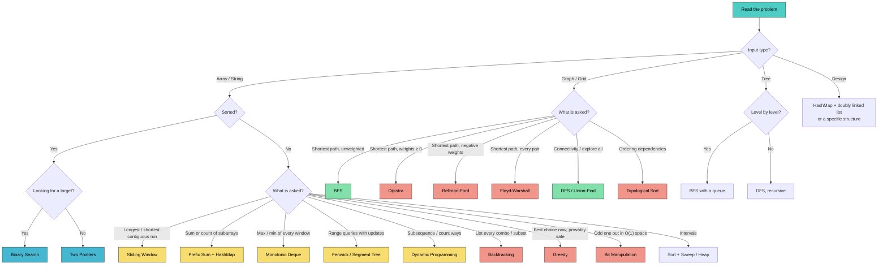

# DSA Advanced Patterns & ML Coding (Java)

> "Match the problem to the pattern table before you touch the keyboard — the code is the easy part once you know which template applies."

**What this chapter covers:** The tools you reach for when the basics are ruled out — backtracking, greedy, bit manipulation, intervals, number theory, segment and Fenwick trees, Bellman-Ford, Floyd-Warshall and monotonic deques — plus the master pattern table, the 45-minute interview plan, and ML-from-scratch coding in Java. Final chapter of the 4-part DSA sequence (31 / 31b / 31c / 31d); section numbers continue from chapters 31/31b/31c.

---

## Start Here

### Pick a track

| Track | Time | Read this | Good for |
|-------|------|-----------|----------|
| **Speed run** | ~60 min | This page, then the **Key idea** + **Dry run** of backtracking, greedy, intervals and the monotonic deque, then §18.31 and §18.33 | First pass |
| **Mastery** | ~5 hr | Everything. The trees and shortest-path sections repay slow reading | Real preparation |
| **ML-focused** | ~45 min | This page, then jump straight to §18.34 | ML engineer / research loops |
| **Refresh** | ~15 min | §18.31 Master Pattern Table, then §18.33 Interview Strategy | The night before |

Most patterns use the same seven lines — **Problem · Brute force · Key idea · Dry run · Java · Cost · Trap** — so you never read code before you know what it does. The shorter reference sections (math, the shortest-path algorithms and the ML code) skip the brute force but still state the problem first. The dry-run format is explained in full in [chapter 31's Start Here](#content/31_dsa_foundations).

### Read this before reaching for anything here


> **Most interview problems are solved by the basics** — two pointers, hashmaps, sliding windows, BFS. Everything in this chapter exists because some **constraint rules the simple tool out**. So the habit that earns marks is: *name the constraint that forces the tool.* "I'd use a segment tree" is a weaker answer than "the values change between queries, which kills prefix sums, so I need a segment tree."

| # | When the question says… | Reach for | Cost | Section |
|---|--------------------------|-----------|------|---------|
| 1 | list every combination / subset / arrangement | **Backtracking** | O(2ⁿ) or O(n!) | §18.21 |
| 2 | take the best option now and never revisit | **Greedy** | O(n log n) | §18.22 |
| 3 | find the odd one out, or count bits, in O(1) space | **Bit manipulation** | O(n) | §18.23 |
| 4 | merge, overlap or schedule ranges | **Sort the intervals, then sweep** | O(n log n) | §18.24 |
| 5 | range sums **with updates** (or range min / max with updates) | **Fenwick tree** or **segment tree** (min / max: segment tree only) | O(log n) each | §18.26–18.27 |
| 6 | shortest path, but some edges are negative | **Bellman-Ford** | O(V·E) | §18.28 |
| 7 | shortest path between **every** pair | **Floyd-Warshall** | O(V³) | §18.29 |
| 8 | max or min inside a sliding window | **Monotonic deque** | O(n) | §18.30 |

The **full cross-chapter lookup** — every keyword in all four DSA chapters mapped to its pattern and its first line of code — lives in §18.31 below. Chapter 31's Start Here carries a shorter picker covering only the nine foundation templates.

---

## Table of Contents

| Part | Topic | Sections |
|------|-------|----------|
| 5 | Advanced Patterns | §18.21–18.25: Backtracking, Greedy, Bit Manipulation, Intervals, Math |
| 6 | Advanced DS & Paths | §18.26–18.30: Segment Tree, BIT/Fenwick, Bellman-Ford, Floyd-Warshall, Monotonic Deque |
| 7 | Pattern Recognition | §18.31–18.33: Master Table, Decision Flowchart, Interview Strategy |
| 8 | ML Coding | §18.34: Implement ML from Scratch in Java |

**Sequence:** [31 — Foundations & Search](#content/31_dsa_foundations) → [31b — Graphs](#content/31b_dsa_graphs) → [31c — Dynamic Programming](#content/31c_dynamic_programming) → **31d (this chapter)**

---

# PART 5: ADVANCED PATTERNS

---

## 18.21 Backtracking

**Simple explanation.** Backtracking is systematic trial and error with a tidy-up rule. You build an answer one choice at a time; when a partial answer cannot possibly work, you **undo the last choice** and try the next one. It is how you generate *every* valid configuration rather than just one.

**The trigger:** "find **all**…", "list every…", "how many ways, and show them". If the question wants a *count* rather than the actual list, stop — that is usually dynamic programming (chapter 31c) and far cheaper.

**Key idea — three steps, always the same.**


```java
void backtrack(List<List<Integer>> result, List<Integer> current, /* params */) {
    if (/* goal reached */) {
        result.add(new ArrayList<>(current));   // COPY — `current` keeps mutating
        return;
    }
    for (/* each candidate */) {
        if (/* candidate is allowed */) {
            current.add(choice);                //  1. CHOOSE
            backtrack(result, current, ...);    //  2. EXPLORE
            current.remove(current.size() - 1); //  3. UNCHOOSE
        }
    }
}
```

> **Trap:** `result.add(current)` without copying. Every entry in your result then points at the *same* list, which is empty by the time the recursion finishes — a very confusing all-empty output. `new ArrayList<>(current)` is mandatory.

> **Trap:** forgetting step 3. Without the undo, the next branch inherits the previous branch's leftovers and your output is quietly wrong rather than obviously broken.

### The big three: subsets, permutations, combinations

All three are the same three steps. **Only the rule about what you may pick next changes** — and that one line is worth memorising as a set. Below, `nums` is the input array, `i` is the position of the number just added, and for combinations you choose `k` numbers out of `1, 2, …, n`.

| | What it generates | What restricts the next pick | What counts as an answer |
|---|---|---|---|
| **Subsets** | every include/exclude choice | pass `i + 1` — only numbers to the right | **every node**, including the root |
| **Permutations** | every ordering of everything | a `used[]` flag — anything not yet taken | only the **leaves** |
| **Combinations** | every group of exactly `k` numbers from `1…n` | pass a `start` index — only bigger numbers | only when the group has `k` numbers |

**Subsets — `nums = [1, 2]`** → 4 subsets. Each call first records the list it was handed, then tries adding each number to the **right** of the last one added:

```
[]                        record []
├─ add 1 → [1]            record [1]
│    └─ add 2 → [1, 2]    record [1, 2]
└─ add 2 → [2]            record [2]   (nothing is left to the right of 2)
```

*Every node is recorded, not just the leaves — 4 nodes, 4 subsets (2ⁿ, where n = 2 is the number of elements). Because you only ever add numbers to the right, `[2, 1]` can never appear as a second copy of `[1, 2]`.*

```java
import java.util.*;

public class Subsets {
    // SUBSETS (LC 78) — record every node, then extend to the right
    public List<List<Integer>> subsets(int[] nums) {
        List<List<Integer>> result = new ArrayList<>();
        backtrackSubsets(result, new ArrayList<>(), nums, 0);
        return result;
    }

    void backtrackSubsets(List<List<Integer>> res, List<Integer> curr, int[] nums, int start) {
        res.add(new ArrayList<>(curr));                  // every state is a valid subset
        for (int i = start; i < nums.length; i++) {
            curr.add(nums[i]);
            backtrackSubsets(res, curr, nums, i + 1);    // i + 1 = never reuse or look back
            curr.remove(curr.size() - 1);
        }
    }

    public static void main(String[] args) {
        Subsets s = new Subsets();
        int[][] tests = { {1, 2, 3}, {}, {7}, {-1, 5} };
        for (int[] nums : tests) {
            System.out.println(Arrays.toString(nums) + " -> " + s.subsets(nums));
        }
    }
}
```

**Output:**

```
[1, 2, 3] -> [[], [1], [1, 2], [1, 2, 3], [1, 3], [2], [2, 3], [3]]
[] -> [[]]
[7] -> [[], [7]]
[-1, 5] -> [[], [-1], [-1, 5], [5]]
```

**Practice:** [Subsets →](#dsa-problem-subsets)

**Permutations — `nums = [1, 2]`** → 2 orderings. Every element must appear, so at each level you try everything **not yet used** (`used` lists the numbers already in the current list):

```
[]                        used: none
├─ add 1 → [1]            used: 1
│    └─ add 2 → [1, 2]    used: 1, 2  → full length, record
└─ add 2 → [2]            used: 2
     └─ add 1 → [2, 1]    used: 1, 2  → full length, record
```

```java
import java.util.*;

public class Permutations {
    // PERMUTATIONS (LC 46) — every element, in every order
    public List<List<Integer>> permute(int[] nums) {
        List<List<Integer>> result = new ArrayList<>();
        backtrackPermute(result, new ArrayList<>(), nums, new boolean[nums.length]);
        return result;
    }

    void backtrackPermute(List<List<Integer>> res, List<Integer> curr,
                          int[] nums, boolean[] used) {
        if (curr.size() == nums.length) {                // only leaves count
            res.add(new ArrayList<>(curr));
            return;
        }
        for (int i = 0; i < nums.length; i++) {
            if (used[i]) continue;
            used[i] = true;
            curr.add(nums[i]);
            backtrackPermute(res, curr, nums, used);
            curr.remove(curr.size() - 1);
            used[i] = false;                             // undo BOTH things
        }
    }

    public static void main(String[] args) {
        Permutations p = new Permutations();
        int[][] tests = { {1, 2, 3}, {0, -1}, {7}, {} };
        for (int[] nums : tests) {
            System.out.println(Arrays.toString(nums) + " -> " + p.permute(nums));
        }
    }
}
```

**Output:**

```
[1, 2, 3] -> [[1, 2, 3], [1, 3, 2], [2, 1, 3], [2, 3, 1], [3, 1, 2], [3, 2, 1]]
[0, -1] -> [[0, -1], [-1, 0]]
[7] -> [[7]]
[] -> [[]]
```

> **Trap:** undoing the list but forgetting `used[i] = false`. The element stays permanently marked, later branches silently skip it, and you get far fewer permutations than you should.

**Practice:** [Permutations →](#dsa-problem-permutations)

**Combinations — choose `k = 2` numbers from `1…n` with `n = 3`** → 3 groups. Passing a `start` index means the next number must be bigger than the last one, so each group is generated in exactly one order:

```
[]                        next number may be 1, 2 or 3
├─ add 1 → [1]            next may be 2 or 3
│    ├─ add 2 → [1, 2]    size 2 ✓ record
│    └─ add 3 → [1, 3]    size 2 ✓ record
├─ add 2 → [2]            next may be 3
│    └─ add 3 → [2, 3]    size 2 ✓ record
└─ add 3                  never tried: no number is left after 3, so [3]
                          can't reach size 2 — the loop bound skips it
```

*Result: `[1,2] [1,3] [2,3]` — `[2,1]` can never be produced, which is exactly what "combination" means.*

```java
import java.util.*;

public class Combinations {
    // COMBINATIONS (LC 77) — choose k numbers from 1..n
    public List<List<Integer>> combine(int n, int k) {
        List<List<Integer>> result = new ArrayList<>();
        backtrackCombine(result, new ArrayList<>(), 1, n, k);
        return result;
    }

    void backtrackCombine(List<List<Integer>> res, List<Integer> curr,
                          int start, int n, int k) {
        if (curr.size() == k) {
            res.add(new ArrayList<>(curr));
            return;
        }
        // pruning: stop early once too few numbers remain to ever reach size k
        for (int i = start; i <= n - (k - curr.size()) + 1; i++) {
            curr.add(i);
            backtrackCombine(res, curr, i + 1, n, k);
            curr.remove(curr.size() - 1);
        }
    }

    public static void main(String[] args) {
        Combinations c = new Combinations();
        int[][] tests = { {3, 2}, {4, 2}, {1, 1}, {3, 3} };   // each test is {n, k}
        for (int[] t : tests) {
            System.out.println("n = " + t[0] + ", k = " + t[1] + " -> " + c.combine(t[0], t[1]));
        }
    }
}
```

**Output:**

```
n = 3, k = 2 -> [[1, 2], [1, 3], [2, 3]]
n = 4, k = 2 -> [[1, 2], [1, 3], [1, 4], [2, 3], [2, 4], [3, 4]]
n = 1, k = 1 -> [[1]]
n = 3, k = 3 -> [[1, 2, 3]]
```

> **Pruning is the difference between passing and timing out.** The loop bound above stops exploring branches that cannot possibly reach `k` elements. Interviewers rarely require it, but naming it earns real credit — and on Hard problems it is the difference between O(2ⁿ) and something that finishes.

**Practice:** [Combinations →](#dsa-problem-combinations)

### Handling duplicates

A question with repeated input values ("Subsets II", "Combination Sum II") needs one extra line. **Sort first**, so equal values sit next to each other, then at each level skip a candidate that equals the previous one *at that same level*:

```java
Arrays.sort(nums);
for (int i = start; i < nums.length; i++) {
    if (i > start && nums[i] == nums[i - 1]) continue;   // same value, same level → skip
    ...
}
// nums = [1,2,2] (Subsets II) → [[], [1], [1,2], [1,2,2], [2], [2,2]]
```

> **The subtlety worth understanding:** `i > start` means "not the first pick at this level". Using the same value *deeper* is fine — it is only reusing it as a *sibling* that produces a duplicate answer.

**Permutations II is different** — it has no `start` index (every level loops over the whole array), so the skip rule uses the `used[]` flags instead. After sorting, skip `nums[i]` when it equals `nums[i - 1]` **and** that earlier copy is not in the current list; this forces equal values to be placed in their original order, so each ordering appears once:

```java
if (used[i]) continue;
if (i > 0 && nums[i] == nums[i - 1] && !used[i - 1]) continue;  // twin not placed yet → skip
// nums = [1,1,2] → [[1,1,2], [1,2,1], [2,1,1]]
```

### N-Queens


<details>
<summary><strong>Read as text</strong> — problem, key idea, dry run and trap</summary>

**Problem.** Place `n` queens on an `n × n` chessboard so that no two attack each other — two queens attack if they share a **row**, a **column** or a **diagonal**. Return every solution as a board: a list of `n` strings, one per row, with `Q` for a queen and `.` for an empty square. `n = 4` → 2 boards.

**Key idea.** Place exactly one queen per row, top to bottom, and for each row try every column that no earlier queen attacks. To check "attacked" in O(1), give every column and every diagonal a number and keep one true/false flag per number:

- every square on the same **↘ diagonal** has the same `row − col` (the code adds `n` so the number is never negative);
- every square on the same **↙ diagonal** has the same `row + col`.

**Dry run — `n = 4` → 2 boards**
*We track:* `(r,c)` = a queen in row `r`, column `c` (both counted from 0); ✗ = that square is attacked by a queen already placed.

```
row 0  col 0 free                                    → queen at (0,0)
row 1  col 0 ✗ column, col 1 ✗ diagonal, col 2 free  → queen at (1,2)
row 2  col 0 ✗ column, col 1 ✗ diagonal,
       col 2 ✗ column, col 3 ✗ diagonal              → dead end: undo (1,2)
row 1  col 3 free                                    → queen at (1,3)
row 2  col 0 ✗ column, col 1 free                    → queen at (2,1)
row 3  cols 0, 1, 3 ✗ column, col 2 ✗ diagonal       → dead end: undo (2,1)
row 2  col 2 ✗ diagonal, col 3 ✗ column              → dead end: undo (1,3)
row 1  no columns left                               → dead end: undo (0,0)
                                                       (no answer has a queen at (0,0))
row 0  col 1, then (1,3), (2,0), (3,2)               → 4 rows filled: record board 1
row 0  later col 2, then (1,0), (2,3), (3,1)         → record board 2

board 1     board 2
. Q . .     . . Q .
. . . Q     Q . . .
Q . . .     . . . Q
. . Q .     . Q . .
```

**Why it works:** every column of every row is tried, and a branch is abandoned only when an earlier queen attacks the square — so no valid board is skipped, and dead ends cut off whole subtrees early.

**Cost.** Roughly O(n!) time — row `r` has at most `n − r` free columns — and O(n) extra space for the flags and the recursion.

</details>

```java
import java.util.*;

public class NQueens {
    public List<List<String>> solveNQueens(int n) {
        List<List<String>> result = new ArrayList<>();
        boolean[] cols = new boolean[n];
        boolean[] diag1 = new boolean[2 * n]; // ↘ diagonals, numbered row - col + n
        boolean[] diag2 = new boolean[2 * n]; // ↙ diagonals, numbered row + col
        char[][] board = new char[n][n];
        for (char[] row : board) Arrays.fill(row, '.');

        solve(result, board, 0, cols, diag1, diag2, n);
        return result;
    }

    void solve(List<List<String>> res, char[][] board, int row,
               boolean[] cols, boolean[] d1, boolean[] d2, int n) {
        if (row == n) {
            List<String> snapshot = new ArrayList<>();
            for (char[] r : board) snapshot.add(new String(r));
            res.add(snapshot);
            return;
        }
        for (int col = 0; col < n; col++) {
            if (cols[col] || d1[row - col + n] || d2[row + col]) continue;
            board[row][col] = 'Q';
            cols[col] = d1[row - col + n] = d2[row + col] = true;
            solve(res, board, row + 1, cols, d1, d2, n);
            board[row][col] = '.';
            cols[col] = d1[row - col + n] = d2[row + col] = false;
        }
    }

    public static void main(String[] args) {
        NQueens q = new NQueens();
        for (int n : new int[] {4, 1, 3, 8}) {
            List<List<String>> boards = q.solveNQueens(n);
            String shown = boards.size() <= 2 ? boards.toString() : boards.size() + " boards";
            System.out.println("n = " + n + " -> " + shown);
        }
    }
}
```

**Output:**

```
n = 4 -> [[.Q.., ...Q, Q..., ..Q.], [..Q., Q..., ...Q, .Q..]]
n = 1 -> [[Q]]
n = 3 -> []
n = 8 -> 92 boards
```

> **Fun fact:** The number of solutions to N-Queens grows faster than exponentially. N=8 has 92 solutions, N=14 has 365,596, and no closed-form formula is known.

**Practice:** [N-Queens →](#dsa-problem-n-queens)

> **Trap:** passing `i` instead of `i + 1` in subsets or combinations. The same element can then be picked again — that is the Combination Sum rule (below), not the subsets one.

**Key Problems — Detailed Solutions:**

![Subsets infographic: backtracking with a start index records every node and only extends to the right; nums = [1, 2, 3] gives 8 subsets [], [1], [1,2], [1,2,3], [1,3], [2], [2,3], [3].](diagrams/dsa31d_info_subsets_ai.png)

<details>
<summary><strong>Subsets</strong> — Medium · read as text and Java</summary>

**Problem:** Given an integer array `nums` whose values are all different, return every possible subset (the "power set"), including the empty one. No subset may appear twice. Any order is accepted; the output below is the order the code produces.

**Example:**

```
Input:  nums = [1, 2, 3]
Output: [[], [1], [1,2], [1,2,3], [1,3], [2], [2,3], [3]]
```

**Walk-through:** record the current list, then extend it with each number to the right of the last one added.
```
record []
add 1 → record [1]
        add 2 → record [1,2]
                add 3 → record [1,2,3]
        add 3 → record [1,3]
add 2 → record [2]
        add 3 → record [2,3]
add 3 → record [3]                        8 subsets = 2³
```

**Approach:** Backtracking with a start index. Every call records its current list (every state is a valid subset), then for each position `i` from `start` to the end it adds `nums[i]` and recurses with `start = i + 1`, so a number is never reused or revisited.

**Java:** the same code as the Subsets template in *The big three* above.

**Complexity:** O(n · 2ⁿ) time — 2ⁿ subsets, each copied in up to n steps — and O(n) space for the recursion (not counting the output).
</details>

![Permutations infographic: backtracking with a used[] flag, recording only full-length leaves; nums = [1, 2, 3] gives 6 orderings [1,2,3], [1,3,2], [2,1,3], [2,3,1], [3,1,2], [3,2,1].](diagrams/dsa31d_info_permutations_ai.png)

<details>
<summary><strong>Permutations</strong> — Medium · read as text and Java</summary>

**Problem:** Given an array `nums` of different integers, return every possible ordering of all of them. Any order of the orderings is accepted; the output below is the order the code produces.

**Example:**

```
Input:  nums = [1, 2, 3]
Output: [[1,2,3], [1,3,2], [2,1,3], [2,3,1], [3,1,2], [3,2,1]]
```

**Walk-through:** pick a first number, then order the rest the same way.
```
first 1 → remaining 2, 3 → [1,2,3], [1,3,2]
first 2 → remaining 1, 3 → [2,1,3], [2,3,1]
first 3 → remaining 1, 2 → [3,1,2], [3,2,1]        3! = 6 orderings
```

**Approach:** Backtracking with a `used[]` true/false array. At each level, try every number not yet used; when the list holds all `n` numbers, record it. Mark a number used when you add it and unused when you remove it.

**Java:** the same code as the Permutations template in *The big three* above.

**Complexity:** O(n · n!) time, O(n) space (excluding output)
</details>

![Combination Sum infographic: backtracking that recurses with the same index so numbers can repeat, tracking how much of the target is left; candidates = \[2, 3, 6, 7\], target = 7 gives \[\[2, 2, 3\], \[7\]\].](diagrams/dsa31d_info_combsum_ai.png)

<details>
<summary><strong>Combination Sum</strong> — Medium · read as text and Java</summary>

**Problem:** Given an array `candidates` of different positive integers and a number `target`, return every list of candidates that adds up to `target`. The same number may be used **any number of times**. Lists with the same numbers in a different order count as one (`[2,2,3]` and `[3,2,2]` are the same answer).

**Example:**

```
Input:  candidates = [2, 3, 6, 7], target = 7
Output: [[2, 2, 3], [7]]
```

**Walk-through:** "left" = how much of the target is still missing. A number may be repeated, but never one that comes *earlier* in `candidates`.
```
[2]        left 5
[2,2]      left 3
[2,2,2]    left 1  → every next pick overshoots ✗
[2,2,3]    left 0  ✓ record
[2,3]      left 2  → next picks (3, 6, 7) all overshoot ✗
[2,6] [2,7]        overshoot ✗
[3]        left 4  → [3,3] left 1 ✗; [3,6], [3,7] overshoot ✗
[6]        left 1  → overshoot ✗
[7]        left 0  ✓ record
```

**Approach:** Backtracking with a start index (so each group is built in one order only). At each level, try candidates from `start` onward and recurse with the **same** index `i`, which allows reusing that number. Stop when the amount left is 0 (record) or below 0 (dead end).

**Java:**
```java
import java.util.*;

public class CombinationSum {
    public List<List<Integer>> combinationSum(int[] candidates, int target) {
        List<List<Integer>> res = new ArrayList<>();
        backtrack(res, new ArrayList<>(), candidates, target, 0);
        return res;
    }
    private void backtrack(List<List<Integer>> res, List<Integer> curr,
                           int[] cands, int remain, int start) {
        if (remain == 0) { res.add(new ArrayList<>(curr)); return; }
        if (remain < 0) return;
        for (int i = start; i < cands.length; i++) {
            curr.add(cands[i]);
            backtrack(res, curr, cands, remain - cands[i], i); // i, not i+1 (reuse)
            curr.remove(curr.size() - 1);
        }
    }

    public static void main(String[] args) {
        CombinationSum cs = new CombinationSum();
        int[][] candidates = { {2, 3, 6, 7}, {2, 3, 5}, {2}, {1} };
        int[] targets = { 7, 8, 1, 2 };
        for (int t = 0; t < targets.length; t++) {
            System.out.println(Arrays.toString(candidates[t]) + ", target = " + targets[t]
                    + " -> " + cs.combinationSum(candidates[t], targets[t]));
        }
    }
}
```

**Output:**

```
[2, 3, 6, 7], target = 7 -> [[2, 2, 3], [7]]
[2, 3, 5], target = 8 -> [[2, 2, 2, 2], [2, 3, 3], [3, 5]]
[2], target = 1 -> []
[1], target = 2 -> [[1, 1]]
```

**Complexity:** O(n^(target/min)) time and O(target/min) space, where `n` = number of candidates and `min` = the smallest candidate (so `target/min` is the longest possible list).
</details>

### 60-second recall

<details>
<summary>1. What are the three steps, and which one do people forget?</summary>

Choose, explore, unchoose. The **unchoose** is forgotten most often — and when it is missing the next branch silently inherits leftovers, so the output is wrong rather than crashing. The second most common bug is adding `current` to the results without copying it.
</details>

<details>
<summary>2. Subsets, permutations, combinations — what is the single line that separates them?</summary>

What you may pick next. Subsets pass `i + 1` and record every node. Permutations use a `used[]` flag and record only full-length leaves. Combinations pass a `start` index and record when the size hits k.
</details>

<details>
<summary>3. The question asks "how many ways", not "list the ways". What changes?</summary>

Almost certainly stop backtracking and use DP (chapter 31c). Enumerating 2ⁿ answers to count them is exponential; counting them directly with overlapping subproblems is usually polynomial.
</details>

**Problem List — Backtracking:**

**Start with these five:** Subsets · Permutations · Combination Sum · Palindrome Partitioning · N-Queens.

| #   | Problem                          | Difficulty | Key Insight                       |
|-----|----------------------------------|------------|-----------------------------------|
| 1   | Subsets (LC 78)                  | Medium     | Pick or skip                      |
| 2   | Subsets II (LC 90)               | Medium     | Skip duplicates after sort        |
| 3   | Permutations (LC 46)             | Medium     | used[] boolean array              |
| 4   | Permutations II (LC 47)          | Medium     | Sort + skip a twin while its earlier copy is unused |
| 5   | Combinations (LC 77)             | Medium     | k-sized subsets                   |
| 6   | Combination Sum (LC 39)          | Medium     | Allow reuse (start from i, not i+1) |
| 7   | Combination Sum II (LC 40)       | Medium     | No reuse + skip duplicates        |
| 8   | N-Queens (LC 51)                 | Hard       | Row-by-row + diagonal tracking    |
| 9   | Palindrome Partitioning (131)    | Medium     | Partition string into palindromes |
| 10  | Letter Combinations of Phone (17)| Medium     | Map digits to letters             |

---

## 18.22 Greedy Algorithms

**Simple explanation.** Greedy means: take the best-looking option right now, and never reconsider. It is the cheapest algorithm there is — usually a sort plus one pass — and it is **wrong far more often than people expect**. The entire skill is knowing when it is safe.

**The test, and the sentence that proves it.** Greedy is valid when you can argue an **exchange**: *"take any optimal solution that does not make my greedy choice — I can swap my choice in without making it worse, so an optimal solution containing my choice also exists."* If you cannot make that argument, you need dynamic programming (chapter 31c), which tries every choice instead of committing to one.

> **Greedy vs DP in one line.** DP explores every choice and remembers the results; greedy commits to one choice and never looks back. Commit only when you can justify it out loud — an unjustified greedy is the most common way to fail a Medium.

### Interval Scheduling — keep the most non-overlapping intervals

![Interval Scheduling infographic: sort by end time and keep the interval that finishes first; \[\[1,2\],\[2,3\],\[3,4\],\[1,3\]\] sorted by end keeps \[1,2\], \[2,3\], \[3,4\] and removes \[1,3\], so the answer is 1.](diagrams/dsa31d_info_intervals_ai.png)

<details>
<summary><strong>Read as text</strong> — problem, key idea, dry run and trap</summary>

**Problem.** You are given a list of intervals, each written `[start, end]`. Return the **fewest** intervals you must remove so that none of the rest overlap. Two intervals that only touch — one ends at 2, the next starts at 2 — do **not** overlap. `[[1,2],[2,3],[3,4],[1,3]]` → `1` (remove `[1,3]`).

**Brute force.** Try every subset and keep the largest non-overlapping one — O(2ⁿ).

**Key idea.** Sort by **end time** and always keep the interval that finishes earliest. Why it is safe: finishing earliest leaves the **most room** for everything after it, so no other choice can ever do better. That is the exchange argument in one sentence.

**Dry run — `[[1,2],[2,3],[3,4],[1,3]]` → `1`**
*We track:* "last end" = where the most recently **kept** interval ends. Sorted by end, the order is `[1,2] [2,3] [1,3] [3,4]`.

| Interval | Starts at or after the last end? | Action | Last end · removed so far |
|----------|----------------------------------|--------|---------------------------|
| `[1,2]` | yes — nothing kept yet | **keep** | 2 · 0 |
| `[2,3]` | 2 ≥ 2 → yes | **keep** | 3 · 0 |
| `[1,3]` | 1 ≥ 3 → no, it overlaps | **remove** | 3 · 1 |
| `[3,4]` | 3 ≥ 3 → yes | **keep** | 4 · 1 |

**Why it works:** each kept interval is the one that frees up the earliest, so it never blocks an interval that another choice would have allowed.

**Cost.** O(n log n) for the sort, O(1) extra space.

> **Trap:** sorting by **start** here. It looks equivalent and it is not — a long interval that starts early swallows several short ones, and you get the wrong count. *Merging* sorts by start; *scheduling* sorts by end. §18.24 has the picture.

</details>

```java
import java.util.*;

public class NonOverlappingIntervals {
    // LC 435: Non-overlapping Intervals (minimum removals)
    public int eraseOverlapIntervals(int[][] intervals) {
        Arrays.sort(intervals, (a, b) -> Integer.compare(a[1], b[1]));   // by END, not start
        int count = 0, prevEnd = Integer.MIN_VALUE;          // prevEnd = "last end"

        for (int[] interval : intervals) {
            if (interval[0] >= prevEnd) prevEnd = interval[1];           // keep it
            else count++;                                                // drop it
        }
        return count;
    }

    public static void main(String[] args) {
        NonOverlappingIntervals s = new NonOverlappingIntervals();
        int[][][] tests = {
            {{1, 2}, {2, 3}, {3, 4}, {1, 3}},
            {{1, 2}, {1, 2}, {1, 2}},
            {{1, 2}, {2, 3}},
            {{1, 100}, {11, 22}, {1, 11}, {2, 12}}
        };
        for (int[][] intervals : tests) {
            String input = Arrays.deepToString(intervals);     // the sort reorders the array
            System.out.println(input + " -> " + s.eraseOverlapIntervals(intervals));
        }
    }
}
```

**Output:**

```
[[1, 2], [2, 3], [3, 4], [1, 3]] -> 1
[[1, 2], [1, 2], [1, 2]] -> 2
[[1, 2], [2, 3]] -> 0
[[1, 100], [11, 22], [1, 11], [2, 12]] -> 2
```

**Practice:** [Non-overlapping Intervals →](#dsa-problem-non-overlapping-intervals)

### Jump Game — can you reach the end?

![Jump Game infographic: sweep left to right tracking the farthest reachable index; nums = [2, 3, 1, 1, 4] reaches farthest 4 at index 1, so the last index is reachable and the answer is true.](diagrams/dsa31d_info_jumpgame_ai.png)

<details>
<summary><strong>Read as text</strong> — problem, key idea, dry run and trap</summary>

**Problem.** You start at index 0 of an array `nums`. From index `i` you may jump forward by any number of steps from 1 up to `nums[i]`. Return `true` if you can reach the last index. `[2,3,1,1,4]` → `true` (jump 0 → 1, then 1 → 4).

**Brute force.** Try every jump length from every position — exponential; with memoisation it is O(n²) DP.

**Key idea.** You do not need to know *how* you get anywhere — only **how far you could possibly get**. Sweep left to right keeping `maxReach` = the farthest index any jump seen so far can land on. If you ever stand on an index beyond `maxReach`, no sequence of jumps could have brought you here, so the answer is false. This is the rare case where a DP collapses to a single greedy variable.

**Dry run — `[2,3,1,1,4]` → `true`**
*We track:* "farthest" = the farthest index reachable using the indices visited so far (the code calls it `maxReach`).

| Index · value | Can we stand here? (index ≤ farthest) | Index + value | Farthest after |
|---------------|---------------------------------------|---------------|----------------|
| 0 · 2 | yes — the start | 2 | 2 |
| 1 · 3 | 1 ≤ 2 → yes | 4 | **4** |
| 2 · 1 | 2 ≤ 4 → yes | 3 | 4 |
| 3 · 1 | 3 ≤ 4 → yes | 4 | 4 |
| 4 · 4 | 4 ≤ 4 → yes — the last index | 8 | 8 |

**Why it works:** every index up to "farthest" is reachable, so standing on the last index without ever passing "farthest" proves a jump sequence exists.

</details>

**Java — can you reach the end:**

```java
import java.util.*;

public class JumpGame {
    // LC 55: can you reach the last index?
    public boolean canJump(int[] nums) {
        int maxReach = 0;
        for (int i = 0; i < nums.length; i++) {
            if (i > maxReach) return false;                 // stranded
            maxReach = Math.max(maxReach, i + nums[i]);
        }
        return true;
    }

    public static void main(String[] args) {
        JumpGame g = new JumpGame();
        int[][] tests = { {2, 3, 1, 1, 4}, {3, 2, 1, 0, 4}, {0}, {2, 0, 0} };
        for (int[] nums : tests) {
            System.out.println(Arrays.toString(nums) + " -> " + g.canJump(nums));
        }
    }
}
```

**Output:**

```
[2, 3, 1, 1, 4] -> true
[3, 2, 1, 0, 4] -> false
[0] -> true
[2, 0, 0] -> true
```

**Jump Game II — the fewest jumps.** Same input, but now return the **fewest** jumps needed to reach the last index (the input guarantees it is reachable). `[2,3,1,1,4]` → `2` (0 → 1 → 4). The code keeps two numbers: `currEnd` = the farthest index reachable with the jumps used so far, and `farthest` = the farthest index reachable with **one more** jump. When the scan reaches `currEnd`, another jump is unavoidable.

```
index 0: farthest = 0 + 2 = 2;  reached currEnd (0) → jump 1, currEnd = 2
index 1: farthest = 1 + 3 = 4
index 2: farthest stays 4;      reached currEnd (2) → jump 2, currEnd = 4 = last index
```

**Java — fewest jumps:**

```java
import java.util.*;

public class JumpGameII {
    // LC 45: fewest jumps to reach the end
    public int jump(int[] nums) {
        int jumps = 0, currEnd = 0, farthest = 0;
        for (int i = 0; i < nums.length - 1; i++) {
            farthest = Math.max(farthest, i + nums[i]);
            if (i == currEnd) {                              // used up the current jump's range
                jumps++;
                currEnd = farthest;                          // commit to the best next range
            }
        }
        return jumps;
    }

    public static void main(String[] args) {
        JumpGameII g = new JumpGameII();
        int[][] tests = { {2, 3, 1, 1, 4}, {2, 3, 0, 1, 4}, {0}, {1, 1, 1, 1} };
        for (int[] nums : tests) {
            System.out.println(Arrays.toString(nums) + " -> " + g.jump(nums));
        }
    }
}
```

**Output:**

```
[2, 3, 1, 1, 4] -> 2
[2, 3, 0, 1, 4] -> 2
[0] -> 0
[1, 1, 1, 1] -> 3
```

> **Jump Game II is BFS in disguise.** `currEnd` marks the end of the current "level" of reachable indices, and each jump moves to the next level — exactly the ring structure of BFS, written with two integers instead of a queue.

**Practice:** [Jump Game →](#dsa-problem-jump-game) · [Jump Game II →](#dsa-problem-jump-game-ii)

### Task Scheduler — let the busiest task set the shape

![Task Scheduler infographic: the most frequent task sets a skeleton of (maxFreq − 1) × n idle slots that other tasks fill; [A,A,A,B,B,B] with n = 2 gives A B _ A B _ A B, so the answer is 8.](diagrams/dsa31d_info_tasks_ai.png)

<details>
<summary><strong>Read as text</strong> — problem, key idea, dry run and trap</summary>

**Problem.** Each letter in `tasks` is one task, and every task takes **one time slot**. Two copies of the same letter must be at least `n` slots apart; other tasks or idle slots can fill the gap. Return the fewest slots needed to run every task. `[A,A,A,B,B,B]`, `n = 2` → `8`.

**Key idea.** Do not simulate. The **most frequent task dictates the skeleton**: if it appears `maxFreq` times, its copies need `maxFreq − 1` gaps of `n` slots between them. Every other task simply fills those gaps. So count the gap slots, subtract what fills them, and the answer is whichever is larger — the skeleton, or simply the number of tasks.

**Dry run — `[A,A,A,B,B,B]`, `n = 2` → `8`**

| Step | Working | Value |
|------|---------|-------|
| most frequent task | A appears 3 times | maxFreq = 3 |
| gap slots the skeleton forces | (3 − 1) gaps × 2 slots | 4 idle slots |
| B fills gaps | B appears 3 times, but only one B fits in each of the 2 gaps; the 3rd B runs right after the last A | 4 − 2 = 2 idle left |
| total | 6 tasks + 2 idle | **8** |

*Schedule: `A B _ A B _ A B` — length 8 (`_` = idle).*

**Why it works:** the A skeleton is the tightest any schedule can be, and every other task either fills an idle gap or sits alongside the last A at no extra cost.

> **Trap:** returning `tasks.length + idleSlots` directly. With many distinct tasks the gaps overflow with real work, `idleSlots` goes negative, and the answer must simply be `tasks.length`. The `Math.max` is not decoration.

</details>

```java
import java.util.*;

public class TaskScheduler {
    // LC 621: minimum intervals with cooldown n
    public int leastInterval(char[] tasks, int n) {
        int[] freq = new int[26];
        for (char t : tasks) freq[t - 'A']++;
        Arrays.sort(freq);

        int maxFreq = freq[25];
        int idleSlots = (maxFreq - 1) * n;

        for (int i = 24; i >= 0 && freq[i] > 0; i--) {
            idleSlots -= Math.min(freq[i], maxFreq - 1);
        }
        return Math.max(tasks.length, tasks.length + idleSlots);   // idleSlots may go negative
    }

    public static void main(String[] args) {
        TaskScheduler s = new TaskScheduler();
        String[] tests = { "AAABBB", "AAABBB", "AAAAAABCDEFG", "AABBCCDD" };
        int[] cooldowns = { 2, 0, 2, 1 };
        for (int t = 0; t < tests.length; t++) {
            char[] tasks = tests[t].toCharArray();
            System.out.println(Arrays.toString(tasks) + ", n = " + cooldowns[t]
                    + " -> " + s.leastInterval(tasks, cooldowns[t]));
        }
    }
}
```

**Output:**

```
[A, A, A, B, B, B], n = 2 -> 8
[A, A, A, B, B, B], n = 0 -> 6
[A, A, A, A, A, A, B, C, D, E, F, G], n = 2 -> 16
[A, A, B, B, C, C, D, D], n = 1 -> 8
```

**Practice:** [Task Scheduler →](#dsa-problem-task-scheduler)

### 60-second recall

<details>
<summary>1. How do you decide between greedy and DP in the room?</summary>

Try to state the exchange argument: "swapping my greedy choice into any optimal solution cannot make it worse." If you can say it convincingly, greedy is safe and far cheaper. If you cannot, the choice genuinely affects the future — that is DP.
</details>

<details>
<summary>2. Name a problem where greedy beats a correct DP, and why.</summary>

Jump Game. The DP is O(n²) over every jump length; the greedy is O(n) because only the furthest reachable index ever matters — every state's decision merely extends a frontier.
</details>

**Problem List — Greedy:**

**Start with these five:** Jump Game · Non-overlapping Intervals · Task Scheduler · Gas Station · Partition Labels.

| #   | Problem                          | Difficulty | Key Insight                       |
|-----|----------------------------------|------------|-----------------------------------|
| 1   | Jump Game (LC 55)                | Medium     | Track max reachable               |
| 2   | Jump Game II (LC 45)             | Medium     | BFS-style level expansion         |
| 3   | Non-overlapping Intervals (435)  | Medium     | Sort by end, greedily keep        |
| 4   | Task Scheduler (LC 621)          | Medium     | Fill idle slots                   |
| 5   | Gas Station (LC 134)             | Medium     | If total >= 0, solution exists    |
| 6   | Partition Labels (LC 763)        | Medium     | Track last occurrence             |
| 7   | Candy (LC 135)                   | Hard       | Two-pass: left-to-right + right-to-left |
| 8   | Meeting Rooms II (LC 253)        | Medium     | Min-heap for end times            |

---

## 18.23 Bit Manipulation

**Simple explanation.** Every integer is already a row of switches. Bit manipulation is reaching past the decimal number and flipping those switches directly — which lets you do in **O(1) space** things that would otherwise need a hashmap.

**The trigger:** "appears once while everything else appears twice", "count the set bits", "without extra memory", "power of two", or any problem where the answer is a *set of up to 32 flags*.


### The operations, and what each is actually for

Bits are numbered from the right, starting at 0: in `6 = 110`, bit 0 is `0`, bit 1 is `1`, bit 2 is `1`. Below, `a` and `b` are integers and `n` / `i` are bit counts or bit positions.

| Operation | Java | What it is for |
|-----------|------|----------------|
| AND | `a & b` | mask — keep only the bits both have |
| OR | `a \| b` | merge — keep bits either has |
| XOR | `a ^ b` | **difference — 1 where the bits differ, so pairs cancel** |
| NOT | `~a` | flip every bit |
| Shift left | `a << n` | multiply by 2ⁿ |
| Shift right | `a >> n` | divide by 2ⁿ, rounding **down** and **keeping the sign** (`-5 >> 1` is `-3`, while `-5 / 2` is `-2`) |
| Unsigned shift right | `a >>> n` | divide by 2ⁿ, **filling with zeros** |
| Read bit i | `(a >> i) & 1` | is switch i on? |
| Set bit i | `a \| (1 << i)` | turn switch i on |
| Clear bit i | `a & ~(1 << i)` | turn switch i off |
| Flip bit i | `a ^ (1 << i)` | toggle switch i |
| Lowest set bit | `a & (-a)` | isolate the rightmost 1 — **this is what Fenwick trees jump by** |
| Clear lowest set bit | `a & (a - 1)` | drop the rightmost 1 — **count bits by repeating until zero** |
| Count set bits | `Integer.bitCount(a)` | the built-in; know the manual version too |
| Power of two? | `a > 0 && (a & (a-1)) == 0` | exactly one bit set |

**Why `a & (-a)` and `a & (a - 1)` work.** Java stores negative numbers in *two's complement*: `-a` is "flip every bit of `a`, then add 1". The flip turns the trailing 0s into 1s, and the +1 carries back through them to the lowest 1 — so `a` and `-a` agree **only** at that lowest 1. Subtracting 1 does the opposite: it clears the lowest 1 and turns the 0s below it into 1s.

```
a           =  6  →  0110
-a          = -6  →  1010   (flip 0110 → 1001, then add 1; last 4 bits shown)
a & -a               0010   = 2   ← only the lowest 1 survives

a - 1       =  5  →  0101
a & (a - 1)          0100   = 4   ← the lowest 1 is gone
```

> **Trap:** using `>>` on a negative number in a loop. The sign bit is copied on every shift, so `-1 >> 1` is still `-1` and the loop never terminates. Use `>>>` whenever you are treating the value as raw bits.

### XOR — the one to understand deeply

![Infographic: Single Number with XOR. Pairs cancel because a ^ a = 0 and a ^ 0 = a; the running XOR of [4, 1, 2, 1, 2] goes 000 → 100 → 101 → 111 → 110 → 100 in binary, leaving 4. O(n) time, O(1) space versus a hashmap's O(n) space.](diagrams/dsa31d_info_xor_ai.png)

<details>
<summary><strong>Read as text</strong> — problem, key idea, dry run and trap</summary>

**Problem.** Every number in the array appears exactly twice, except one number that appears once. Return that number, using O(1) extra space. `[4,1,2,1,2]` → `4`.

**Brute force.** A hashmap of counts — O(n) time but **O(n) space**, which the question forbids.

**Key idea.** XOR (`^`) compares two numbers bit by bit and writes 1 where the bits **differ**, 0 where they match. That gives two properties that do all the work: `a ^ a = 0` (a value cancels itself) and `a ^ 0 = a` (zero leaves things alone). It is also order-independent. So XOR the whole array together: **every pair annihilates itself and only the lonely value survives.** No counting, no memory.

**Dry run — `[4, 1, 2, 1, 2]` → `4`**
*We track:* the running XOR of every number so far, in binary and decimal.

| Number (binary) | Running XOR | What just happened |
|-----------------|-------------|--------------------|
| (start) | `000` = 0 | nothing yet |
| 4 (`100`) | `000 ^ 100 = 100` = 4 | 4 is unpaired |
| 1 (`001`) | `100 ^ 001 = 101` = 5 | 1 is unpaired |
| 2 (`010`) | `101 ^ 010 = 111` = 7 | 2 is unpaired |
| 1 (`001`) | `111 ^ 001 = 110` = 6 | **the two 1s cancelled** |
| 2 (`010`) | `110 ^ 010 = 100` = **4** | **the two 2s cancelled — only 4 is left** |

**Why it works:** each pair XORs to 0 whatever order it arrives in, so only the number without a partner is left.

**Cost.** O(n) time, **O(1) space** — which is the whole point.

</details>

```java
import java.util.*;

public class SingleNumber {
    // LC 136: Single Number
    public int singleNumber(int[] nums) {
        int result = 0;
        for (int num : nums) result ^= num;
        return result;
    }

    public static void main(String[] args) {
        SingleNumber s = new SingleNumber();
        int[][] tests = { {4, 1, 2, 1, 2}, {2, 2, 1}, {1}, {-1, -1, -2} };
        for (int[] nums : tests) {
            System.out.println(Arrays.toString(nums) + " -> " + s.singleNumber(nums));
        }
    }
}
```

**Output:**

```
[4, 1, 2, 1, 2] -> 4
[2, 2, 1] -> 1
[1] -> 1
[-1, -1, -2] -> -2
```

> **Same trick, different clothes:** Missing Number (XOR the values *and* the indices — everything pairs off except the missing one) and Find the Difference. Whenever exactly one thing is unpaired, XOR finds it for free.

**Practice:** [Single Number →](#dsa-problem-single-number)

### Counting bits for every number at once

![Infographic: Counting Bits as a one-line DP, dp[i] = dp[i >> 1] + (i & 1). For n = 5 each i is shown in binary with its last bit dropped (2 = 10, 3 = 11, 5 = 101), filling the array [0, 1, 1, 2, 1, 2]. O(n) versus brute force O(n log n).](diagrams/dsa31d_info_countbits_ai.png)

<details>
<summary><strong>Read as text</strong> — problem, key idea, dry run and trap</summary>

**Problem.** Given `n`, return an array of length `n + 1` whose entry `i` (for every `i` from 0 to n) is the number of 1s in the binary form of `i`. `n = 5` → `[0,1,1,2,1,2]`.

**Brute force.** Count the bits of each number separately — O(n log n).

**Key idea.** Chop off the last bit. `i >> 1` drops the last binary digit of `i` (the same as `i / 2` rounded down), and that smaller number's answer is **already computed**. `i & 1` is the dropped digit — 1 if `i` is odd. So the count for `i` is the count for `i >> 1` plus `i & 1`. A one-line DP built on a bit trick: `dp[i]` = the number of 1s in `i`.

**Dry run — `n = 5` → `[0,1,1,2,1,2]`**
*We track:* every number is shown as decimal (binary).

| i | `i` with its last bit dropped | Its count (already known) + the dropped bit | 1s in `i` |
|---|-------------------------------|---------------------------------------------|-----------|
| 0 (0) | — | — | 0 |
| 1 (1) | 0 (0) | 0 + 1 | 1 |
| 2 (10) | 1 (1) | 1 + 0 | 1 |
| 3 (11) | 1 (1) | 1 + 1 | 2 |
| 4 (100) | 2 (10) | 1 + 0 | 1 |
| 5 (101) | 2 (10) | 1 + 1 | 2 |

**Why it works:** dropping the last bit always gives a smaller number, so its count is already in the array when `i` needs it.

**Cost.** O(n) time, O(n) space.

</details>

```java
import java.util.*;

public class CountingBits {
    // LC 338: Counting Bits
    public int[] countBits(int n) {
        int[] dp = new int[n + 1];
        for (int i = 1; i <= n; i++) {
            dp[i] = dp[i >> 1] + (i & 1);       // everything above the last bit, plus the last bit
        }
        return dp;
    }

    public static void main(String[] args) {
        CountingBits c = new CountingBits();
        for (int n : new int[] {5, 0, 2, 8}) {
            System.out.println("n = " + n + " -> " + Arrays.toString(c.countBits(n)));
        }
    }
}
```

**Output:**

```
n = 5 -> [0, 1, 1, 2, 1, 2]
n = 0 -> [0]
n = 2 -> [0, 1, 1]
n = 8 -> [0, 1, 1, 2, 1, 2, 2, 3, 1]
```

**Practice:** [Counting Bits →](#dsa-problem-counting-bits)

### Bitmasks — an integer as a set

**Key idea.** With `n ≤ 20` or so, an integer's bits can represent *which elements are chosen*. Counting from `0` to `2ⁿ − 1` then enumerates **every possible subset**, with no recursion at all — bit `i` of the mask means "element `i` is in".

```
nums = [1, 2]        masks run 0..3, written in binary (bit 0 is the rightmost digit)

mask = 00  →  neither bit set   →  []
mask = 01  →  bit 0 set         →  [1]
mask = 10  →  bit 1 set         →  [2]
mask = 11  →  both bits set     →  [1, 2]
```

```java
import java.util.*;

public class SubsetsBitmask {
    public List<List<Integer>> subsets(int[] nums) {
        List<List<Integer>> result = new ArrayList<>();
        int n = nums.length;
        for (int mask = 0; mask < (1 << n); mask++) {      // 2^n masks
            List<Integer> subset = new ArrayList<>();
            for (int i = 0; i < n; i++) {
                if ((mask & (1 << i)) != 0) subset.add(nums[i]);
            }
            result.add(subset);
        }
        return result;
    }

    public static void main(String[] args) {
        SubsetsBitmask s = new SubsetsBitmask();
        int[][] tests = { {1, 2}, {1, 2, 3}, {}, {5} };
        for (int[] nums : tests) {
            System.out.println(Arrays.toString(nums) + " -> " + s.subsets(nums));
        }
    }
}
```

**Output:**

```
[1, 2] -> [[], [1], [2], [1, 2]]
[1, 2, 3] -> [[], [1], [2], [1, 2], [3], [1, 3], [2, 3], [1, 2, 3]]
[] -> [[]]
[5] -> [[], [5]]
```

> **This is also how bitmask DP works** (travelling salesman, "visit every city"): the mask *is* the state, so `dp[mask][i]` means "I have visited exactly this set of nodes and I am standing on `i`". The `n ≤ 20` constraint in a problem statement is the tell.

### 60-second recall

<details>
<summary>1. A question says "O(1) extra space" and something appears an odd number of times. What is the tool?</summary>

XOR the whole array. Pairs cancel, the odd one out survives. The same trick with indices solves Missing Number.
</details>

<details>
<summary>2. What does <code>n & (n - 1)</code> do, and what is it used for?</summary>

It clears the lowest set bit. Repeat until zero and the number of iterations is the number of 1-bits (Brian Kernighan's method). One check of it against zero also tests for a power of two.
</details>

<details>
<summary>3. Why does <code>n &gt;&gt; 1</code> loop forever on a negative number?</summary>

`>>` is an arithmetic shift — it copies the sign bit in, so a negative number never reaches zero. Use `>>>`, the unsigned shift, which fills with zeros.
</details>

**Problem List — Bit Manipulation:**

**Start with these five:** Single Number · Number of 1 Bits · Counting Bits · Missing Number · Power of Two.

| #   | Problem                          | Difficulty | Key Insight                       |
|-----|----------------------------------|------------|-----------------------------------|
| 1   | Single Number (LC 136)           | Easy       | XOR all elements                  |
| 2   | Single Number II (LC 137)        | Medium     | Count bits mod 3                  |
| 3   | Number of 1 Bits (LC 191)        | Easy       | n & (n-1) clears lowest bit       |
| 4   | Counting Bits (LC 338)           | Easy       | dp[i] = dp[i>>1] + (i&1)         |
| 5   | Reverse Bits (LC 190)            | Easy       | Shift and build                   |
| 6   | Missing Number (LC 268)          | Easy       | XOR with indices                  |
| 7   | Sum of Two Integers (LC 371)     | Medium     | Bit-by-bit add with carry         |
| 8   | Power of Two (LC 231)            | Easy       | n & (n-1) == 0                    |

---

## 18.24 Intervals

**Simple explanation.** Interval problems are all the same shape: **sort, then sweep once**. The only real decision is *which end you sort by* — and that decision changes the answer, so it is worth getting straight before you write anything.


| The question asks… | Sort by | Why |
|--------------------|---------|-----|
| merge overlapping ranges | **start** | you need to meet ranges in the order they open |
| does anything overlap at all? | **start** | one comparison against the previous end |
| keep the most non-overlapping | **end** | finishing earliest leaves the most room (§18.22) |
| how many rooms / resources at once | **start**, with a min-heap of ends | the heap tells you when one frees up |

### Merge Intervals

![Infographic: Merge Intervals. Sort by start, then sweep: \[\[1,3\],\[2,6\],\[8,10\],\[15,18\]\] merges \[1,3\] and \[2,6\] into \[1,6\] (2 ≤ 3, end = max(3, 6) = 6), while 8 ≤ 6 and 15 ≤ 10 fail and start new intervals, giving \[\[1,6\],\[8,10\],\[15,18\]\]. O(n log n) versus brute force O(n²); trap: use max so \[\[1,10\],\[2,3\]\] does not shrink.](diagrams/dsa31d_info_mergeintervals_ai.png)

<details>
<summary><strong>Read as text</strong> — problem, key idea, dry run and trap</summary>

**Problem.** You are given intervals, each written `[start, end]`, in any order. Merge every group that overlaps and return the merged list, sorted by start. Intervals that merely touch (`[1,4]` and `[4,5]`) count as overlapping and become `[1,5]`. `[[1,3],[2,6],[8,10],[15,18]]` → `[[1,6],[8,10],[15,18]]`.

**Brute force.** Compare every pair and union them repeatedly — O(n²), and merging changes the set as you go, which makes it genuinely fiddly.

**Key idea.** Sort by **start**. Now walk left to right holding one "current" interval: if the next one starts **at or before the current one's end**, they overlap, so stretch the current end; otherwise the current interval is finished, so publish it and start a new one. Sorting is what guarantees you only ever compare against the most recent interval.

**Dry run — `[[1,3],[2,6],[8,10],[15,18]]` → `[[1,6],[8,10],[15,18]]`**
*We track:* the output list; its last interval is the "current" one, and it is the only one that can still grow.

| Next interval | Starts at or before the current end? | Action | Output so far |
|---------------|--------------------------------------|--------|---------------|
| `[1,3]` | — (first one) | start the first | `[[1,3]]` |
| `[2,6]` | 2 ≤ 3 → yes | **overlap** → stretch end to max(3, 6) = 6 | `[[1,6]]` |
| `[8,10]` | 8 ≤ 6 → no | gap → start a new current interval | `[[1,6], [8,10]]` |
| `[15,18]` | 15 ≤ 10 → no | gap → start a new current interval | `[[1,6], [8,10], [15,18]]` |

**Why it works:** the starts are sorted, so once a gap appears no later interval can reach back and overlap an earlier one.

**Cost.** O(n log n) for the sort, O(n) output.

> **Trap:** writing `last[1] = intervals[i][1]` instead of `Math.max(...)`. On input like `[[1,10],[2,3]]` the short interval sits entirely inside the long one, and the assignment *shrinks* your merged range from `[1,10]` to `[1,3]`. It passes the simple test cases and fails the nested one.

</details>

```java
import java.util.*;

public class MergeIntervals {
    // LC 56: Merge Intervals
    public int[][] merge(int[][] intervals) {
        Arrays.sort(intervals, (a, b) -> Integer.compare(a[0], b[0]));   // by START
        List<int[]> merged = new ArrayList<>();
        merged.add(intervals[0]);

        for (int i = 1; i < intervals.length; i++) {
            int[] last = merged.get(merged.size() - 1);
            if (intervals[i][0] <= last[1]) {
                last[1] = Math.max(last[1], intervals[i][1]);            // NOT just intervals[i][1]
            } else {
                merged.add(intervals[i]);
            }
        }
        return merged.toArray(new int[0][]);
    }

    public static void main(String[] args) {
        MergeIntervals m = new MergeIntervals();
        int[][][] tests = {
            {{1, 3}, {2, 6}, {8, 10}, {15, 18}},
            {{1, 4}, {4, 5}},
            {{1, 10}, {2, 3}},
            {{4, 5}, {1, 2}}
        };
        for (int[][] intervals : tests) {
            String input = Arrays.deepToString(intervals);     // merge() sorts and edits the input
            System.out.println(input + " -> " + Arrays.deepToString(m.merge(intervals)));
        }
    }
}
```

**Output:**

```
[[1, 3], [2, 6], [8, 10], [15, 18]] -> [[1, 6], [8, 10], [15, 18]]
[[1, 4], [4, 5]] -> [[1, 5]]
[[1, 10], [2, 3]] -> [[1, 10]]
[[4, 5], [1, 2]] -> [[1, 2], [4, 5]]
```

**Practice:** [Merge Intervals →](#dsa-problem-merge-intervals)

### Meeting Rooms II — how many at once?

![Infographic: Meeting Rooms II with a min-heap of end times. For \[\[0,30\],\[5,10\],\[15,20\]\]: open a room {30}; 30 ≤ 5 fails so open another {10, 30}; 10 ≤ 15 so reuse it, giving {20, 30}. Heap size = 2 rooms. O(n log n) versus brute force O(n²).](diagrams/dsa31d_info_meetingrooms_ai.png)

<details>
<summary><strong>Read as text</strong> — problem, key idea, dry run and trap</summary>

**Problem.** Given meetings, each written `[start, end]`, return the fewest rooms needed so that no two meetings in the same room overlap. A room whose meeting ends at time 10 can host a meeting that starts at 10. `[[0,30],[5,10],[15,20]]` → `2`.

**Brute force.** For each meeting, count how many others overlap it — O(n²).

**Key idea.** A room frees up exactly when its meeting **ends**, so what you need to track is the set of end times currently in use — and specifically **the earliest one**, because that is the only room that could possibly be free next. That is a min-heap. Sort by start, and for each meeting either reuse the earliest-finishing room or open a new one. **The heap's final size is the answer**, because it only ever grew when no room was free.

**Dry run — `[[0,30],[5,10],[15,20]]` → `2`**
*We track:* a min-heap of the end times of the rooms in use, written smallest (top) first.

| Meeting (sorted by start) | Earliest end — free by this start? | Action | Heap after |
|---------------------------|------------------------------------|--------|------------|
| `[0,30]` | heap empty | open a room | `{30}` |
| `[5,10]` | 30 ≤ 5 → no | **open another room** | `{10, 30}` |
| `[15,20]` | 10 ≤ 15 → yes | reuse that room: drop 10, add 20 | `{20, 30}` |

**Why it works:** the heap only grows when every room is still busy, so its final size is the largest number of meetings running at once — the number of rooms.

**Cost.** O(n log n) time, O(n) space.

</details>

```java
import java.util.*;

public class MeetingRoomsII {
    // LC 253: minimum rooms = maximum overlap
    public int minMeetingRooms(int[][] intervals) {
        Arrays.sort(intervals, (a, b) -> Integer.compare(a[0], b[0]));
        PriorityQueue<Integer> pq = new PriorityQueue<>();   // end times, earliest on top

        for (int[] interval : intervals) {
            if (!pq.isEmpty() && pq.peek() <= interval[0]) pq.poll();   // a room freed up
            pq.offer(interval[1]);
        }
        return pq.size();
    }

    public static void main(String[] args) {
        MeetingRoomsII m = new MeetingRoomsII();
        int[][][] tests = {
            {{0, 30}, {5, 10}, {15, 20}},
            {{7, 10}, {2, 4}},
            {{1, 5}, {5, 10}},
            {{1, 10}, {2, 9}, {3, 8}}
        };
        for (int[][] meetings : tests) {
            String input = Arrays.deepToString(meetings);
            System.out.println(input + " -> " + m.minMeetingRooms(meetings));
        }
    }
}
```

**Output:**

```
[[0, 30], [5, 10], [15, 20]] -> 2
[[7, 10], [2, 4]] -> 1
[[1, 5], [5, 10]] -> 1
[[1, 10], [2, 9], [3, 8]] -> 3
```

> **The alternative worth naming:** the *sweep line*. Turn every interval into `(start, +1)` and `(end, −1)`, sort all the events, and sweep while keeping a running count — the maximum that counter reaches is the same answer. It generalises better to "how many at time T" questions, and mentioning both approaches scores well.

**Practice:** [Meeting Rooms II →](#dsa-problem-meeting-rooms-ii)

### 60-second recall

<details>
<summary>1. Sort by start or by end — how do you decide in one sentence?</summary>

If you are combining ranges, sort by start. If you are choosing which ranges to keep, sort by end. Merging cares about where ranges open; scheduling cares about how soon they get out of the way.
</details>

<details>
<summary>2. Why does the merge step need <code>Math.max</code>?</summary>

Because an interval can be entirely nested inside the current one. Assigning the new end directly would shrink an already-correct range — the classic failing test is `[[1,10],[2,3]]`.
</details>

<details>
<summary>3. What is the heap actually storing in Meeting Rooms II?</summary>

The end times of the rooms currently in use, earliest first. The top is the only room that could possibly be free next, so one `peek` decides between reusing and allocating.
</details>

**Problem List — Intervals:**

**Start with these five:** Merge Intervals · Insert Interval · Meeting Rooms · Meeting Rooms II · Non-overlapping Intervals.

| #   | Problem                          | Difficulty | Key Insight                       |
|-----|----------------------------------|------------|-----------------------------------|
| 1   | Merge Intervals (LC 56)          | Medium     | Sort by start, merge overlapping  |
| 2   | Insert Interval (LC 57)          | Medium     | Find overlap window               |
| 3   | Non-overlapping Intervals (435)  | Medium     | Sort by end, count removals       |
| 4   | Meeting Rooms (LC 252)           | Easy       | Sort, check any overlap           |
| 5   | Meeting Rooms II (LC 253)        | Medium     | Min-heap of end times             |
| 6   | Minimum Interval to Include (1851)| Hard      | Sort + priority queue             |

---

## 18.25 Math & Number Theory

### GCD (Euclidean Algorithm)


<details>
<summary><strong>Read as text</strong> — problem, key idea, dry run and trap</summary>

**Problem.** Given two positive integers `a` and `b`, return their **greatest common divisor** (gcd — the biggest number that divides both) and their **least common multiple** (lcm — the smallest number both divide). `a = 48, b = 18` → gcd `6`, lcm `144`.

**Key idea.** Any number that divides both `a` and `b` also divides `a % b` (the remainder of `a ÷ b`), so gcd(a, b) = gcd(b, a % b). Keep replacing the pair until the second number is 0; the first is then the gcd. The lcm follows from `a × b = gcd × lcm`.

**Dry run — `a = 48, b = 18` → gcd 6, lcm 144**
```
(48, 18)   48 % 18 = 12   → (18, 12)
(18, 12)   18 % 12 =  6   → (12, 6)
(12, 6)    12 %  6 =  0   → (6, 0)    second number is 0 → gcd = 6
lcm = 48 / 6 × 18 = 8 × 18 = 144
```

**Why it works:** each step keeps the same set of common divisors while the numbers shrink, so it must end — at the gcd.

</details>

```java
import java.util.*;

public class GcdLcm {
    int gcd(int a, int b) {
        while (b != 0) {
            int temp = b;
            b = a % b;
            a = temp;
        }
        return a;
    }
    int lcm(int a, int b) { return a / gcd(a, b) * b; } // divide first to avoid overflow

    public static void main(String[] args) {
        GcdLcm g = new GcdLcm();
        int[][] tests = { {48, 18}, {17, 5}, {12, 12}, {50000, 60000} };
        for (int[] t : tests) {
            int a = t[0], b = t[1];
            System.out.println("a = " + a + ", b = " + b
                    + " -> gcd = " + g.gcd(a, b) + ", lcm = " + g.lcm(a, b));
        }
    }
}
```

**Output:**

```
a = 48, b = 18 -> gcd = 6, lcm = 144
a = 17, b = 5 -> gcd = 1, lcm = 85
a = 12, b = 12 -> gcd = 12, lcm = 12
a = 50000, b = 60000 -> gcd = 10000, lcm = 300000
```

### Sieve of Eratosthenes


<details>
<summary><strong>Read as text</strong> — problem, key idea, dry run and trap</summary>

**Problem.** Given `n`, return how many prime numbers are **strictly less than** `n`. `n = 10` → `4` (2, 3, 5, 7).

**Key idea.** Walk `i` upward from 2. If nobody has crossed `i` out, it is prime: count it and cross out its multiples, starting at `i × i` (smaller multiples were already crossed out by smaller primes).

**Dry run — `n = 10` → `4`**
*We track:* `P` = prime (counted), `x` = crossed out (not prime), `.` = not reached yet.

```
number    2  3  4  5  6  7  8  9
i = 2     P  .  x  .  x  .  x  .    2 is prime → cross out 4, 6, 8 (start at 2·2 = 4)
i = 3     P  P  x  .  x  .  x  x    3 is prime → cross out 9 (next would be 12 ≥ 10)
i = 4     P  P  x  .  x  .  x  x    4 is crossed out → skip
i = 5     P  P  x  P  x  .  x  x    5 is prime; 5·5 = 25 ≥ 10, nothing to cross out
i = 6..9  P  P  x  P  x  P  x  x    7 is prime; 6, 8, 9 are crossed out
```

**Why it works:** every non-prime below `n` is a multiple of a smaller prime, so it is crossed out before the scan reaches it — four `P`s remain.

</details>

```java
import java.util.*;

public class CountPrimes {
    // Count primes less than n — O(n log log n)
    public int countPrimes(int n) {
        boolean[] notPrime = new boolean[n];
        int count = 0;
        for (int i = 2; i < n; i++) {
            if (!notPrime[i]) {
                count++;
                for (long j = (long) i * i; j < n; j += i) { // start at i*i
                    notPrime[(int) j] = true;
                }
            }
        }
        return count;
    }

    public static void main(String[] args) {
        CountPrimes c = new CountPrimes();
        for (int n : new int[] {10, 0, 2, 100}) {
            System.out.println("n = " + n + " -> " + c.countPrimes(n));
        }
    }
}
```

**Output:**

```
n = 10 -> 4
n = 0 -> 0
n = 2 -> 0
n = 100 -> 25
```

**Practice:** [Count Primes →](#dsa-problem-count-primes)

### Modular Arithmetic for Large Numbers


<details>
<summary><strong>Read as text</strong> — problem, key idea, dry run and trap</summary>

**Problem.** When the true answer is astronomically large, the question asks for it **modulo 10^9 + 7** — the remainder after dividing by 1,000,000,007 — so it fits in an `int`. Written `x % m` in Java (and "x mod m" in maths).

**Key idea.** Remainders survive addition and multiplication: `(a + b) % m = ((a % m) + (b % m)) % m`, and the same with `×`. So take `% MOD` after **every** step, and multiply in `long` — two values just under 10^9 multiply to about 10^18, which overflows an `int` but fits in a `long`.

**Fast exponentiation (base^exp in O(log exp) steps).** Write the exponent in binary. Each step looks at its **last** binary digit: if it is 1, multiply the current `base` into the result; then square `base` and drop that digit (`exp >>= 1`, i.e. halve `exp` rounding down).

**Dry run — 2^10 modulo 10^9 + 7 → `1024`**
*We track:* the exponent still left (in binary), the result so far, and `base` = 2, then 2², 2⁴, 2⁸, …

| Exponent left (binary) | Last binary digit | Result | Base after squaring |
|------------------------|-------------------|--------|---------------------|
| 10 (`1010`) | 0 → skip | 1 | 2 × 2 = 4 |
| 5 (`101`) | 1 → result × 4 | 4 | 4 × 4 = 16 |
| 2 (`10`) | 0 → skip | 4 | 16 × 16 = 256 |
| 1 (`1`) | 1 → result × 256 | **1024** | 256 × 256 = 65536 |
| 0 | stop | | |

**Why it works:** 10 = 8 + 2, so 2^10 = 2⁸ × 2² = 256 × 4 — exactly the two bases multiplied in where the binary digit was 1. (Every value is below 10^9 + 7 here, so the `% mod` never changes anything.)

</details>

**Java — modular arithmetic and fast power:**

```java
import java.util.*;

public class ModularArithmetic {
    static final int MOD = 1_000_000_007;

    // Addition
    int addMod(int a, int b) { return (int) ((a + (long) b) % MOD); }

    // Multiplication
    int mulMod(int a, int b) { return (int) ((long) a * b % MOD); }

    // Fast exponentiation: base^exp % mod
    long power(long base, long exp, long mod) {
        long result = 1;
        base %= mod;
        while (exp > 0) {
            if ((exp & 1) == 1) result = result * base % mod;
            base = base * base % mod;
            exp >>= 1;
        }
        return result;
    }

    public static void main(String[] args) {
        ModularArithmetic m = new ModularArithmetic();
        System.out.println("power(2, 10, MOD) -> " + m.power(2, 10, MOD));
        System.out.println("power(2, MOD - 1, MOD) -> " + m.power(2, MOD - 1, MOD));
        System.out.println("addMod(1000000006, 5) -> " + m.addMod(1_000_000_006, 5));
        System.out.println("mulMod(1000000000, 1000000000) -> "
                + m.mulMod(1_000_000_000, 1_000_000_000));
    }
}
```

**Output:**

```
power(2, 10, MOD) -> 1024
power(2, MOD - 1, MOD) -> 1
addMod(1000000006, 5) -> 4
mulMod(1000000000, 1000000000) -> 49
```

**The practice problem is a little different.** LeetCode's *Pow(x, n)* has a real-number base `x`, **no** modulus, and an exponent `n` that may be **negative** (`x^-n = (1/x)^n`). The loop above returns 1 for a negative exponent, so flip the base first:

**Java — Pow(x, n), where n may be negative:**

```java
import java.util.*;

public class PowXN {
    // LC 50: Pow(x, n) — x is a double, n may be negative
    public double myPow(double x, int n) {
        long e = n;                          // long: -Integer.MIN_VALUE overflows an int
        if (e < 0) { x = 1 / x; e = -e; }    // x^-n = (1/x)^n
        double result = 1;
        while (e > 0) {
            if ((e & 1) == 1) result *= x;
            x *= x;
            e >>= 1;
        }
        return result;
    }

    public static void main(String[] args) {
        PowXN p = new PowXN();
        double[] xs = { 2.0, 2.0, -2.0, 1.0 };
        int[] ns = { 10, -2, 3, Integer.MIN_VALUE };
        for (int t = 0; t < xs.length; t++) {
            System.out.println("myPow(" + xs[t] + ", " + ns[t] + ") -> " + p.myPow(xs[t], ns[t]));
        }
    }
}
```

**Output:**

```
myPow(2.0, 10) -> 1024.0
myPow(2.0, -2) -> 0.25
myPow(-2.0, 3) -> -8.0
myPow(1.0, -2147483648) -> 1.0
```

**Practice:** [Pow(x, n) →](#dsa-problem-pow-x-n)

### Integer Overflow Prevention in Java


<details>
<summary><strong>Read as text</strong> — problem, key idea, dry run and trap</summary>

**Dry run — `left = 1,500,000,000`, `right = 2,000,000,000` → safe midpoint `1,750,000,000`** (both are valid `int`s; the largest `int` is about 2.147 billion)
```
left + right            = 3,500,000,000   → too big for an int: wraps to -794,967,296
left + (right - left)/2 = 1,500,000,000 + 250,000,000 = 1,750,000,000   → correct
```

**Why it works:** `right − left` is never bigger than the range itself, and adding half of it to `left` lands between `left` and `right` — so no intermediate value can pass the `int` limit.

```java
// DANGER: int overflow
int mid = (left + right) / 2;          // can overflow if left+right > Integer.MAX_VALUE
int mid = left + (right - left) / 2;   // SAFE — always use this

// DANGER: multiplication overflow
int area = width * height;             // may overflow
long area = (long) width * height;     // SAFE — cast first operand to long

// DANGER: absolute value
Math.abs(Integer.MIN_VALUE);           // returns Integer.MIN_VALUE (still negative!)
// Use long to avoid: Math.abs((long) Integer.MIN_VALUE)
```

</details>

**Problem List — Math:**

**Start with these five:** Pow(x, n) · Sqrt(x) · Count Primes · Happy Number · Reverse Integer.

| #   | Problem                          | Difficulty | Key Insight                       |
|-----|----------------------------------|------------|-----------------------------------|
| 1   | Count Primes (LC 204)            | Medium     | Sieve of Eratosthenes             |
| 2   | Pow(x, n) (LC 50)               | Medium     | Fast exponentiation               |
| 3   | Reverse Integer (LC 7)           | Medium     | Check overflow before multiply    |
| 4   | Happy Number (LC 202)            | Easy       | Floyd's cycle detection           |
| 5   | Plus One (LC 66)                 | Easy       | Handle carry propagation          |
| 6   | Sqrt(x) (LC 69)                 | Easy       | Binary search on answer           |

---

# PART 6: ADVANCED DATA STRUCTURES & SHORTEST PATHS

---

## 18.26 Segment Tree

![Infographic: Sum segment tree over nums = [2, 4, 5, 1, 8, 3]. The tree shows each node's range and sum ([0,5]=23 down to the leaves). query(1, 3) is covered by [1,1]=4, [2,2]=5 and [3,3]=1, giving 10. update(3, 10) changes only the leaf and its ancestors ([3,4]=18, [3,5]=21, [0,5]=32), so query(1, 3) becomes 19. O(log n) per query and update, versus O(n) to rebuild prefix sums.](diagrams/dsa31d_info_segtree_ai.png)

<details>
<summary><strong>Read as text</strong> — problem, key idea, dry run and trap</summary>

**Simple explanation.** A running-total array answers "what is the sum of this range?" in one subtraction — as long as **nothing ever changes**. The moment one value is updated, every running total after it is wrong, and rebuilding costs O(n). Do that on every update and the whole approach collapses.

A segment tree fixes exactly that. Every node owns a **stretch** of the array and stores the answer for it: leaves own single elements, their parents own pairs, and the root owns everything. Change one value and only its **ancestors** need repairing — that is log n nodes, not n. Ask for a range and it is covered by a handful of whole nodes, again log n of them.


**The trigger:** *range* query **plus** updates. Either half alone has a cheaper answer — a read-only range is a prefix sum (§18.2), and a point query needs no structure at all.

**Problem.** Keep an array `nums` (positions counted from 0) and answer two kinds of request quickly, in any mix: `update(i, val)` **sets** `nums[i] = val`, and `query(l, r)` returns `nums[l] + nums[l+1] + … + nums[r]` (both ends included). `nums = [2, 4, 5, 1, 8, 3]`: `query(1, 3)` → `10`; after `update(3, 10)`, `query(1, 3)` → `19`.

The tree is stored in a plain array `tree[]`. The root sits at `tree[1]`; the node at `tree[i]` has its children at `tree[2i]` and `tree[2i + 1]` and its parent at `tree[i / 2]`. In the picture, `#i` is that array position, `[lo,hi]` is the stretch of `nums` the node owns, and the number after `=` is its stored sum.

```
Array: [2, 4, 5, 1, 8, 3]   (0-indexed, length 6)

                              #1 [0,5]=23
                          /                \
            #2 [0,2]=11                       #3 [3,5]=12
              /      \                          /       \
      #4 [0,1]=6   #5 [2,2]=5           #6 [3,4]=9     #7 [5,5]=3
        /     \                          /      \
#8 [0,0]=2  #9 [1,1]=4          #12 [3,3]=1   #13 [4,4]=8
```

</details>

### Java Template — Sum Segment Tree

**Key idea for a query.** Recurse from the root and classify every node you meet into exactly one of three cases — that trio *is* the algorithm:

1. **Completely outside** the asked-for range → return the *identity*, a value that doesn't change the answer when combined (`0` for sum, `Integer.MAX_VALUE` for min).
2. **Completely inside** it → return this node's stored value and stop; you never look at its children.
3. **Partially overlapping** → split into the two children and combine their answers.

**Dry run — sum of positions 1 to 3 in `[2, 4, 5, 1, 8, 3]` → `10`** (that is `4 + 5 + 1`)
*We track:* rows are in the order the code visits nodes; a "partly" node's answer is filled in once both of its children have answered.

| Node | Owns | Inside [1, 3]? | Returns |
|------|------|----------------|---------|
| #1 | [0,5] | partly | asks #2 and #3 → 9 + 1 = **10** |
| #2 | [0,2] | partly | asks #4 and #5 → 4 + 5 = 9 |
| #4 | [0,1] | partly | asks #8 and #9 → 0 + 4 = 4 |
| #8 | [0,0] | outside | 0 |
| #9 | [1,1] | **inside** | **4** |
| #5 | [2,2] | **inside** | **5** |
| #3 | [3,5] | partly | asks #6 and #7 → 1 + 0 = 1 |
| #6 | [3,4] | partly | asks #12 and #13 → 1 + 0 = 1 |
| #12 | [3,3] | **inside** | **1** |
| #13 | [4,4] | outside | 0 |
| #7 | [5,5] | outside | 0 |

**Why it works:** the range [1, 3] is covered exactly by the whole nodes #9, #5 and #12, which don't overlap — so each number is counted once.

```java
import java.util.*;

class SegmentTree {
    private final int[] tree;
    private final int n;

    SegmentTree(int[] nums) {
        n = nums.length;
        tree = new int[4 * n];   // 4n is the safe upper bound — see the trap
        build(nums, 1, 0, n - 1);
    }

    private void build(int[] nums, int node, int lo, int hi) {
        if (lo == hi) { tree[node] = nums[lo]; return; }
        int mid = lo + (hi - lo) / 2;
        build(nums, 2 * node,     lo,      mid);
        build(nums, 2 * node + 1, mid + 1, hi);
        tree[node] = tree[2 * node] + tree[2 * node + 1];     // combine on the way back up
    }

    // Point update: set nums[idx] = val — O(log n)
    public void update(int idx, int val) { update(1, 0, n - 1, idx, val); }

    private void update(int node, int lo, int hi, int idx, int val) {
        if (lo == hi) { tree[node] = val; return; }
        int mid = lo + (hi - lo) / 2;
        if (idx <= mid) update(2 * node,     lo,      mid, idx, val);
        else            update(2 * node + 1, mid + 1, hi,  idx, val);
        tree[node] = tree[2 * node] + tree[2 * node + 1];     // repair this ancestor
    }

    // Range sum [l, r] — O(log n)
    public int query(int l, int r) { return query(1, 0, n - 1, l, r); }

    private int query(int node, int lo, int hi, int l, int r) {
        if (l > hi || r < lo) return 0;                       // 1. outside → identity
        if (l <= lo && hi <= r) return tree[node];            // 2. inside  → whole node
        int mid = lo + (hi - lo) / 2;                         // 3. partial → split
        return query(2 * node,     lo,      mid, l, r)
             + query(2 * node + 1, mid + 1, hi,  l, r);
    }

    public static void main(String[] args) {
        int[] nums = {2, 4, 5, 1, 8, 3};
        SegmentTree st = new SegmentTree(nums);
        System.out.println("nums = " + Arrays.toString(nums));
        System.out.println("query(1, 3) -> " + st.query(1, 3));
        st.update(3, 10);
        System.out.println("update(3, 10)");
        System.out.println("query(1, 3) -> " + st.query(1, 3));
        System.out.println("query(0, 5) -> " + st.query(0, 5));
        st.update(0, -2);
        System.out.println("update(0, -2)");
        System.out.println("query(0, 2) -> " + st.query(0, 2));
        System.out.println("query(4, 4) -> " + st.query(4, 4));
    }
}
```

**Output:**

```
nums = [2, 4, 5, 1, 8, 3]
query(1, 3) -> 10
update(3, 10)
query(1, 3) -> 19
query(0, 5) -> 32
update(0, -2)
query(0, 2) -> 7
query(4, 4) -> 8
```

**Cost.** Build O(n), query O(log n), update O(log n), space O(n).

> **Trap:** sizing the array `2 * n`. When `n` is not a power of two the recursion reaches indices beyond that, and you get an `ArrayIndexOutOfBoundsException` on inputs that are not neatly sized. `4 * n` is the standard safe bound — say why if asked.

> **Trap:** using the wrong identity in case 1. For a **min** tree, returning `0` for an out-of-range node makes every query answer 0. Sum → `0`, min → `Integer.MAX_VALUE`, max → `Integer.MIN_VALUE`.

**Range minimum variant:** replace both `+` combinations with `Math.min(...)` and change the out-of-range identity. Nothing else moves — that generality is precisely what a segment tree buys you over a Fenwick tree.

**Lazy propagation (range updates):** when you must add a value to *every* element in a range, doing O(log n) point updates is not enough. Lazy propagation tags a node with a pending delta and only pushes it down to children when they are actually visited, keeping both range updates and queries at O(log n). It adds a `lazy[]` array and a `pushDown` helper at the top of each recursive step.

**Practice:** [Range Sum Query — Mutable →](#dsa-problem-range-sum-query-mutable)

**Key problems:** Range Sum Query — Mutable (LC 307), Count of Smaller Numbers After Self (LC 315), Rectangle Area II (LC 850).

---

## 18.27 Fenwick Tree (Binary Indexed Tree / BIT)

![Infographic: Fenwick tree (BIT), always 1-indexed. Block length is i & (-i), e.g. 4 = 100 covers [1..4], 6 = 110 covers [5..6] and 7 = 111 covers [7]. update(1, 3) walks up through slots 1 (001), 2 (010) and 4 (100) and stops at 8 > 5. After update(1, 3), update(2, 5) and update(3, -2) the tree is [3, 8, -2, 6, 0]. query(3) walks down through 3 (011) and 2 (010): -2 + 8 = 6. O(log n) per operation.](diagrams/dsa31d_info_fenwick_ai.png)

<details>
<summary><strong>Read as text</strong> — problem, key idea, dry run and trap</summary>

**Simple explanation.** A Fenwick tree does the same job as a segment tree for **sums**, in about fifteen lines instead of fifty. The trick is that it never builds an explicit tree: it stores the tree *implicitly in the binary representation of the indices*.

**Problem.** The same job as §18.26, for sums only, with two differences: positions count from **1**, and `update(i, delta)` **adds** `delta` to position `i` (it does not overwrite it). `query(i)` returns the sum of positions 1 to `i`; any range `l..r` is then `query(r) − query(l − 1)`. To solve LeetCode 307 (0-based `index`, and it *sets* the value), call `update(index + 1, val − old)`, where `old` is the value currently stored there.

**Key idea.** Each slot `i` of the internal array `tree[]` is made responsible for a block of positions **ending at `i`**, and the **length of that block is `i & (-i)`** — the lowest set bit of `i` (the two's-complement trick from §18.23: for `6 = 110` it is `010` = 2). So slot 4 (binary `100`) covers four positions, slot 6 (`110`) covers two, slot 7 (`111`) covers one. Adding that lowest bit walks *up* to the next slot whose block also contains you; subtracting it walks *down* to the block just before yours. Both walks touch only as many slots as `i` has bits — hence O(log n).

```
Which positions each slot is responsible for (1-indexed, n = 8):

Index:     1       2       3       4       5       6       7       8
Binary:    1       10      11      100     101     110     111     1000
Lowest 1:  1       2       1       4       1       2       1       8
Covers:    [1]     [1..2]  [3]     [1..4]  [5]     [5..6]  [7]     [1..8]

Block length = i & (-i), the lowest set bit of i.
```

</details>

### Java Template

**Dry run — add 3 at position 1 of a 5-position tree (all zeros) → slots 1, 2 and 4 change**
*We track:* the slot being updated; each step adds its lowest set bit to jump to the next slot whose block also contains position 1.

| Slot (binary) | Lowest set bit | Action | Next slot |
|---------------|----------------|--------|-----------|
| 1 (`001`) | 1 | slot 1 += 3 | 1 + 1 = 2 |
| 2 (`010`) | 2 | slot 2 += 3 | 2 + 2 = 4 |
| 4 (`100`) | 4 | slot 4 += 3 | 4 + 4 = 8 — past 5, stop |

Then add 5 at position 2 (changes slots 2 and 4) and −2 at position 3 (slots 3 and 4). The positions now hold `[3, 5, −2, 0, 0]`, and slots 1 to 5 of `tree` hold `[3, 8, −2, 6, 0]`.

**Why it works:** slots 1, 2 and 4 are exactly the blocks `[1]`, `[1..2]` and `[1..4]` that contain position 1, so every block sum that includes it is updated.

**Dry run — sum of positions 1 to 3 → `6`** (that is `3 + 5 − 2`)
*We track:* the running sum; each step subtracts the slot's lowest set bit to jump to the block just before it.

| Slot (binary) | Block it covers | Running sum | Next slot |
|---------------|-----------------|-------------|-----------|
| 3 (`011`) | position 3 → −2 | −2 | 3 − 1 = 2 |
| 2 (`010`) | positions 1..2 → 8 | **6** | 2 − 2 = 0 — stop |

**Why it works:** the blocks `[3]` and `[1..2]` don't overlap and together cover exactly positions 1 to 3.

```java
import java.util.*;

class BIT {
    private final int[] tree;
    private final int n;

    BIT(int n) {
        this.n = n;
        tree = new int[n + 1];                     // 1-indexed — see the trap
    }

    // add delta at position i — O(log n)
    public void update(int i, int delta) {
        for (; i <= n; i += i & (-i)) tree[i] += delta;      // walk UP
    }

    // prefix sum [1..i] — O(log n)
    public int query(int i) {
        int sum = 0;
        for (; i > 0; i -= i & (-i)) sum += tree[i];         // walk DOWN
        return sum;
    }

    // range sum [l..r], 1-indexed
    public int query(int l, int r) { return query(r) - query(l - 1); }

    public static void main(String[] args) {
        BIT bit = new BIT(5);
        System.out.println("new BIT(5)");
        bit.update(1, 3);
        System.out.println("update(1, 3)");
        bit.update(2, 5);
        System.out.println("update(2, 5)");
        bit.update(3, -2);
        System.out.println("update(3, -2)");
        System.out.println("query(3) -> " + bit.query(3));
        System.out.println("query(2, 3) -> " + bit.query(2, 3));
        bit.update(5, 4);
        System.out.println("update(5, 4)");
        System.out.println("query(1, 5) -> " + bit.query(1, 5));
        System.out.println("query(4, 5) -> " + bit.query(4, 5));
    }
}
```

**Output:**

```
new BIT(5)
update(1, 3)
update(2, 5)
update(3, -2)
query(3) -> 6
query(2, 3) -> 3
update(5, 4)
query(1, 5) -> 10
query(4, 5) -> 4
```

**Cost.** O(log n) per update and per query, O(n) space — and a much smaller constant than a segment tree.

> **Trap:** 0-indexing it. `i & (-i)` is `0` when `i` is `0`, so `i += 0` loops forever. A Fenwick tree is **always** 1-indexed; convert at the boundary and keep the conversion in one place.

### Which one?

| | Fenwick / BIT | Segment tree |
|---|---|---|
| Space | O(n) — an array of n + 1 | O(n) — an array of 4n |
| Constant factor | ~2× faster | larger |
| Sum, XOR, count | ✅ | ✅ |
| Range **min / max** | ❌ | ✅ |
| Range updates (lazy) | needs two BITs | ✅ |
| Lines of code | ~15 | ~50 |

**Use a Fenwick tree** when the aggregate is invertible (sum, XOR) and updates are point updates. **Use a segment tree** for min/max, for anything you cannot subtract back out, or when you need lazy range updates.

**Key problems:** the same as §18.26 (LC 307, LC 315), plus Reverse Pairs (LC 493).

### 60-second recall

<details>
<summary>1. Prefix sums are O(1) per query. Why would you ever build a tree?</summary>

Because prefix sums assume the array is frozen. One point update invalidates every total after it, costing O(n) to repair. A tree makes both the update and the query O(log n), which wins as soon as updates are interleaved with queries.
</details>

<details>
<summary>2. What are the three cases in a segment-tree query?</summary>

Fully outside → return the identity. Fully inside → return the node and stop. Partially overlapping → split into both children and combine. Getting the identity wrong for a min-tree is the classic bug.
</details>

<details>
<summary>3. Why is a Fenwick tree always 1-indexed?</summary>

Its whole mechanism is `i & (-i)`, the lowest set bit, which is zero for index 0 — so the walk would never advance. Index 0 has no meaningful block.
</details>

---

## 18.28 Bellman-Ford

![Infographic: Bellman-Ford on the directed graph A -> B (4), A -> C (-3), B -> C (2) with source A. Round 1 relaxes A -> B (B = 4) and A -> C (C = -3). B -> C gives 6, which is not less than -3, so C stays -3. Round 2 changes nothing, so the answer is [0, 4, -3]. Covers why V - 1 rounds are enough and the extra round that detects negative cycles. O(V·E) versus Dijkstra's O((V+E) log V), which is wrong when edges are negative.](diagrams/dsa31d_info_bellmanford_ai.png)

<details>
<summary><strong>Read as text</strong> — problem, key idea, dry run and trap</summary>

**Simple explanation.** Dijkstra's whole method is "settle the nearest node, never revisit it" — which is only safe because a non-negative edge can never make an already-settled route cheaper. **Allow a negative edge and that assumption collapses**, so you need an algorithm that is willing to keep revising.

Bellman-Ford is that algorithm, and it is almost embarrassingly simple: it makes no clever choice at all. It just **relaxes every edge, over and over**.


**The trigger:** negative edge weights, or "detect whether costs can loop forever downwards". It is the standard **single-source** algorithm that detects negative cycles (Floyd-Warshall, §18.29, detects them too, but answers every pair at O(V³)). At O(V·E) it is much slower than Dijkstra, so reach for it only when negatives are actually present.

**Problem.** A **directed** graph has `V` nodes (numbered 0 to V − 1) and `E` edges, each written `{u, v, w}` = an edge from `u` to `v` with weight `w`, where `w` may be negative. Return the shortest distance from a source node to every node — or report a **negative cycle** (a loop whose weights add up to less than zero), because then you could circle forever and no shortest path exists.

**Key idea.** *Relaxing* an edge `u → v` means: if reaching `u` and then taking this edge is cheaper than the best known route to `v` (`dist[u] + w < dist[v]`), lower `dist[v]`. Bellman-Ford relaxes **every** edge, round after round.

</details>

### Why V−1 rounds, exactly

This is the part worth being able to justify. **After `k` rounds, every shortest path that uses at most `k` edges is correct.** Round 1 fixes all one-edge paths, round 2 all two-edge paths, and so on. A shortest path never repeats a node (repeating one would mean a cycle, which either costs something — making it worse — or costs nothing useful), so it uses at most **V−1 edges**. Hence V−1 rounds is not a heuristic; it is exactly enough.

And that gives the negative-cycle test for free: run **one more** round. If anything still improves, some path is getting cheaper by going round and round, so no shortest path exists at all.

**Dry run — directed graph below, source A → distances A 0, B 4, C −3**
*We track:* the best known distance to A, B, C (∞ = not reached yet). A, B, C are nodes 0, 1, 2 in the code; edges are checked in the order listed.

```
      A ───── 4 ─────► B
      │                │
   −3 │                │ 2
      ▼                │
      C ◄──────────────┘
```

| Round | Edge checked | Cheaper? | Distances A, B, C |
|-------|--------------|----------|-------------------|
| start | — | — | 0, ∞, ∞ |
| 1 | A → B (4) | 0 + 4 < ∞ → **yes** | 0, 4, ∞ |
| 1 | A → C (−3) | 0 − 3 < ∞ → **yes** | 0, 4, −3 |
| 1 | B → C (2) | 4 + 2 = 6 < −3? no | 0, 4, −3 |
| 2 | all three | nothing improves → stop early | 0, 4, −3 |

**Why it works:** after round 1 every one-edge path is settled, and here no longer path is cheaper (A → B → C costs 6), so the direct negative edge wins.

### Java Template

```java
import java.util.*;

public class BellmanFord {
    // Bellman-Ford — O(V * E) time, O(V) space
    // n = number of nodes (V); edges[i] = {u, v, weight}
    public int[] bellmanFord(int n, int[][] edges, int src) {
        int[] dist = new int[n];
        Arrays.fill(dist, Integer.MAX_VALUE);
        dist[src] = 0;

        for (int round = 0; round < n - 1; round++) {      // V-1 rounds is exactly enough
            boolean updated = false;
            for (int[] edge : edges) {
                int u = edge[0], v = edge[1], w = edge[2];
                if (dist[u] != Integer.MAX_VALUE && dist[u] + w < dist[v]) {
                    dist[v] = dist[u] + w;
                    updated = true;
                }
            }
            if (!updated) break;                            // converged early
        }

        for (int[] edge : edges) {                          // one extra round = the cycle test
            int u = edge[0], v = edge[1], w = edge[2];
            if (dist[u] != Integer.MAX_VALUE && dist[u] + w < dist[v]) {
                throw new IllegalStateException("Negative cycle detected");
            }
        }
        return dist;
    }

    static String show(int[] dist) {
        StringJoiner sj = new StringJoiner(", ", "[", "]");
        for (int d : dist) sj.add(d == Integer.MAX_VALUE ? "INF" : String.valueOf(d));
        return sj.toString();
    }

    public static void main(String[] args) {
        BellmanFord bf = new BellmanFord();
        int[] ns = { 3, 4, 3, 3 };
        int[][][] edgeSets = {
            {{0, 1, 4}, {0, 2, -3}, {1, 2, 2}},
            {{0, 1, 4}, {0, 2, 5}, {2, 1, -3}, {1, 3, 2}},
            {{0, 1, 5}},
            {{0, 1, 1}, {1, 2, -1}, {2, 1, -1}}
        };
        for (int t = 0; t < ns.length; t++) {
            String input = "n = " + ns[t] + ", edges = " + Arrays.deepToString(edgeSets[t])
                    + ", src = 0";
            try {
                System.out.println(input + " -> " + show(bf.bellmanFord(ns[t], edgeSets[t], 0)));
            } catch (IllegalStateException e) {
                System.out.println(input + " -> " + e.getMessage());
            }
        }
    }
}
```

**Output:**

```
n = 3, edges = [[0, 1, 4], [0, 2, -3], [1, 2, 2]], src = 0 -> [0, 4, -3]
n = 4, edges = [[0, 1, 4], [0, 2, 5], [2, 1, -3], [1, 3, 2]], src = 0 -> [0, 2, 5, 4]
n = 3, edges = [[0, 1, 5]], src = 0 -> [0, 5, INF]
n = 3, edges = [[0, 1, 1], [1, 2, -1], [2, 1, -1]], src = 0 -> Negative cycle detected
```

> **Trap:** relaxing from an unreached node. Without the `dist[u] != Integer.MAX_VALUE` guard, `MAX_VALUE + w` overflows to a large negative number and infects the whole array with nonsense distances.

**Practice:** [Cheapest Flights Within K Stops →](#dsa-problem-cheapest-flights-within-k-stops) · [Network Delay Time →](#dsa-problem-network-delay-time) (no negative edges there, so the practice page uses Dijkstra; Bellman-Ford also passes)

**Dijkstra vs Bellman-Ford:**

| | Dijkstra | Bellman-Ford |
|---|---|---|
| Negative weights | ❌ | ✅ |
| Negative cycle detection | ❌ | ✅ |
| Time | O((V+E) log V) | O(V·E) |
| Space | O(V) | O(V) |
| Use when | weights are non-negative | a negative weight exists |

> **The variant that shows up most:** Cheapest Flights Within K Stops. Because "after k rounds you know all paths of at most k edges" is *literally* the loop structure, capping the rounds at `k + 1` solves it directly — you just need a copy of the distance array per round so one round cannot feed itself.

**Key problems:** Cheapest Flights Within K Stops (LC 787), Network Delay Time (LC 743).

---

## 18.29 Floyd-Warshall

![Infographic: Floyd-Warshall on the chapter's 4-node directed graph. The direct-edge matrix \[\[0,3,∞,7\],\[8,0,2,∞\],\[5,∞,0,1\],\[2,∞,∞,0\]\] becomes, after k = 0, a matrix with 1->0->3 = 15, 2->0->1 = 8 and 3->0->1 = 5. The final matrix is \[\[0,3,5,6\],\[5,0,2,3\],\[3,6,0,1\],\[2,5,7,0\]\]. The k-outermost loop order and the trap of using Integer.MAX_VALUE as infinity are explained. O(V³) time, O(V²) space.](diagrams/dsa31d_info_floyd_ai.png)

<details>
<summary><strong>Read as text</strong> — problem, key idea, dry run and trap</summary>

**Simple explanation.** Every other shortest-path algorithm answers "from **one** source". Floyd-Warshall answers "between **every** pair" — and it does so with three nested loops and no data structures at all.

**Problem.** A weighted **directed** graph with `V` nodes is given as a `V × V` matrix: `graph[i][j]` = the weight of the edge from `i` to `j`, or `INF` if there is no such edge (use `Integer.MAX_VALUE / 2`, the same value the code uses — see the trap). Return the matrix of shortest distances between every pair of nodes.

**Key idea.** Ask one question repeatedly: *"is it cheaper to go from i to j by stopping off at k?"* Start with only direct edges, then allow node 0 as a stopover, then also node 1, and so on. After allowing every node, `dist[i][j]` is the true shortest path.

</details>

### Why the loop order is k, then i, then j

This is the detail interviewers probe, and the reason is precise. `dist[i][j]` means *"the best route from i to j using only nodes 0…k as stopovers"*. Each round of `k` is allowed to build on **every answer from the previous round** — so all pairs must be updated for stopover `k` before anyone is allowed to use stopover `k+1`.

Put `k` in an inner loop and you are asking the question before the answers it depends on exist: some pairs would be computed using a richer set of stopovers than others, and the results become inconsistent and wrong.

```
dist[i][j] = min(dist[i][j],                 // don't stop anywhere new
                 dist[i][k] + dist[k][j])    // stop off at k

     k outermost  →  "which stopovers are allowed yet"
       i          →  "where am I starting"
         j        →  "where am I going"
```

**Dry run — the first stopover (k = 0) on a 4-node directed graph**
*We track:* row `i`, column `j` = the best known cost from node `i` to node `j` (∞ = no route yet). Each entry may improve to (cost i → 0) + (cost 0 → j).

```
Before: direct edges  After k = 0: node 0 may be a stopover
   0  1  2  3            0  1  2  3
0 [0, 3, ∞, 7]        0 [0, 3, ∞, 7]   (no change)
1 [8, 0, 2, ∞]        1 [8, 0, 2, 15]  (1→0→3 costs 8+7 = 15, beats ∞)
2 [5, ∞, 0, 1]        2 [5, 8, 0, 1]   (2→0→1 costs 5+3 = 8, beats ∞)
3 [2, ∞, ∞, 0]        3 [2, 5, ∞, 0]   (3→0→1 costs 2+3 = 5, beats ∞)
```

**Why it works:** every entry now holds the best route that uses no stopover or node 0; rounds k = 1, 2, 3 repeat the same check with one more allowed stopover each.

### Java Template

```java
import java.util.*;

public class FloydWarshall {
    // Floyd-Warshall — O(V^3) time, O(V^2) space
    // graph[i][j] = edge weight, or Integer.MAX_VALUE / 2 when there is no edge
    public int[][] floydWarshall(int[][] graph) {
        int v = graph.length;
        int INF = Integer.MAX_VALUE / 2;          // halved so INF + INF cannot overflow
        int[][] dist = new int[v][v];

        for (int i = 0; i < v; i++)
            for (int j = 0; j < v; j++)
                dist[i][j] = (i == j) ? 0 : graph[i][j];

        for (int k = 0; k < v; k++) {             // k MUST be outermost
            for (int i = 0; i < v; i++) {
                for (int j = 0; j < v; j++) {
                    if (dist[i][k] < INF && dist[k][j] < INF) {
                        dist[i][j] = Math.min(dist[i][j], dist[i][k] + dist[k][j]);
                    }
                }
            }
        }

        for (int i = 0; i < v; i++) {             // a node cheaper than 0 from itself = negative cycle
            if (dist[i][i] < 0) throw new IllegalStateException("Negative cycle at node " + i);
        }
        return dist;
    }

    static final int INF = Integer.MAX_VALUE / 2;

    static String show(int[][] m) {
        StringJoiner rows = new StringJoiner(", ", "[", "]");
        for (int[] row : m) {
            StringJoiner sj = new StringJoiner(", ", "[", "]");
            for (int d : row) sj.add(d >= INF ? "INF" : String.valueOf(d));
            rows.add(sj.toString());
        }
        return rows.toString();
    }

    public static void main(String[] args) {
        FloydWarshall fw = new FloydWarshall();
        int[][][] tests = {
            {{0, 3, INF, 7}, {8, 0, 2, INF}, {5, INF, 0, 1}, {2, INF, INF, 0}},
            {{0, 4, INF}, {INF, 0, -1}, {INF, INF, 0}},
            {{0}},
            {{0, 1}, {-2, 0}}
        };
        for (int[][] graph : tests) {
            System.out.println(show(graph));
            try {
                System.out.println("  -> " + show(fw.floydWarshall(graph)));
            } catch (IllegalStateException e) {
                System.out.println("  -> " + e.getMessage());
            }
        }
    }
}
```

**Output:**

```
[[0, 3, INF, 7], [8, 0, 2, INF], [5, INF, 0, 1], [2, INF, INF, 0]]
  -> [[0, 3, 5, 6], [5, 0, 2, 3], [3, 6, 0, 1], [2, 5, 7, 0]]
[[0, 4, INF], [INF, 0, -1], [INF, INF, 0]]
  -> [[0, 4, 3], [INF, 0, -1], [INF, INF, 0]]
[[0]]
  -> [[0]]
[[0, 1], [-2, 0]]
  -> Negative cycle at node 0
```

> **Trap:** using `Integer.MAX_VALUE` as infinity. `MAX_VALUE + MAX_VALUE` overflows to a negative number, which then looks like a wonderfully cheap route and corrupts the whole matrix. `Integer.MAX_VALUE / 2` is the standard fix.

> **When not to use it:** sparse graphs. If E is much smaller than V², running Dijkstra from every source costs O(V·(V+E) log V) and beats O(V³) comfortably. Floyd-Warshall wins on small, dense graphs — roughly a few hundred nodes.

**Practice:** [Evaluate Division →](#dsa-problem-evaluate-division) — the same three loops with `×` in place of `+`: if you know a / k and k / b, then a / b = (a / k) × (k / b). Unknown ratios play the role of ∞. The practice page solves it with DFS/BFS instead, which is equally accepted.

**Key problems:** Find the City With the Smallest Number of Neighbors at a Threshold Distance (LC 1334), Evaluate Division (LC 399).

### 60-second recall

<details>
<summary>1. Why can't Dijkstra handle negative edges?</summary>

It settles the nearest node and never revisits it. A negative edge discovered later could have made that settled distance smaller, but Dijkstra will not reconsider — so the answer is silently wrong rather than obviously broken.
</details>

<details>
<summary>2. Why exactly V−1 rounds in Bellman-Ford?</summary>

After k rounds every shortest path using at most k edges is correct, and a shortest path never repeats a node, so it has at most V−1 edges. One extra round that still improves anything proves a negative cycle.
</details>

<details>
<summary>3. What breaks if you move <code>k</code> inside the i and j loops?</summary>

The meaning of `dist[i][j]` — "best route using stopovers 0…k" — no longer holds uniformly. Some pairs get computed with more stopovers available than others, so the matrix becomes inconsistent and the answers are wrong.
</details>

---

## 18.30 Monotonic Deque — Sliding Window Maximum

![Infographic: Sliding window maximum with a monotonic deque on [1, 3, -1, -3, 5, 3, 6, 7], k = 3. The deque keeps decreasing values with the maximum at the front: when 5 arrives, 3 leaves from the front and -3 and -1 are popped from the back; when 6 arrives, 3 and 5 are popped. The full dry-run table gives the answer [3, 3, 5, 5, 6, 7]. O(n) time versus O(n·k) brute force.](diagrams/dsa31d_info_deque_ai.png)

<details>
<summary><strong>Read as text</strong> — problem, key idea, dry run and trap</summary>

**Problem.** Slide a window of `k` consecutive numbers across `nums`, one step at a time, and return the largest number in each window — `n − k + 1` answers for an array of length `n`. `[1,3,-1,-3,5,3,6,7]`, `k = 3` → `[3,3,5,5,6,7]`.

**Brute force.** Scan each window for its maximum — O(n·k). At n = 100,000 and k = 50,000 that is about 2.5 billion operations (50,001 windows × 50,000 numbers each).

**Key idea — and it is one sentence.** When a new value arrives, **every smaller value already waiting is finished forever**: it is both smaller *and* older, so any future window containing it also contains the newcomer, which beats it. Throw them away immediately. What is left is a deque of **decreasing** values, and its front is always the current maximum. Each index is pushed once and popped once, so the whole thing is O(n).


Let `right` be the index of the number that just arrived. Two cleanups happen before it is added:

1. **Expire the front** if its index has slid out of the window (`index <= right - k`).
2. **Pop from the back** while the values there are `<= nums[right]` — they can never win again.

**Dry run — `[1, 3, -1, -3, 5, 3, 6, 7]`, `k = 3` → `[3, 3, 5, 5, 6, 7]`**
*We track:* the deque, written front → back (it stores positions; their values are shown). Values always decrease from front to back, so the front is the window's maximum.

```
New     Window        Thrown out of the deque             Deque       Max
1       [1]           —                                   1           (not full)
3       [1, 3]        1 from the back (≤ 3)               3           (not full)
-1      [1, 3, -1]    —                                   3, -1       3
-3      [3, -1, -3]   —                                   3, -1, -3   3
5       [-1, -3, 5]   3 from the front (left the window)  5           5
                      -3, -1 from the back (≤ 5)
3       [-3, 5, 3]    —                                   5, 3        5
6       [5, 3, 6]     3, 5 from the back (≤ 6)            6           6
7       [3, 6, 7]     6 from the back (≤ 7)               7           7
```

**Why it works:** anything bigger than the front has already left the window, and anything smaller was thrown out, so the front is always the largest number still inside.

**Cost.** O(n) time — each index enters and leaves at most once — and O(k) space.

> **Trap:** storing **values** instead of indices. You then cannot tell when something has slid out of the window, which is the entire point of cleanup 1. Store indices and look the value up.

> **Trap:** forgetting the front-expiry check. The maximum stays correct for a while and then silently reports a value from outside the window — a bug that survives small test cases.

</details>

```java
import java.util.*;

public class SlidingWindowMaximum {
    // Sliding Window Maximum — LC 239
    public int[] maxSlidingWindow(int[] nums, int k) {
        int n = nums.length;
        int[] result = new int[n - k + 1];
        Deque<Integer> deque = new ArrayDeque<>();      // stores INDICES, decreasing by value

        for (int right = 0; right < n; right++) {
            // 1. drop the front if it has slid out of the window
            if (!deque.isEmpty() && deque.peekFirst() <= right - k) deque.pollFirst();

            // 2. drop everything at the back that this value beats
            while (!deque.isEmpty() && nums[deque.peekLast()] <= nums[right]) deque.pollLast();

            deque.offerLast(right);

            // 3. the window is complete from index k-1 onwards
            if (right >= k - 1) result[right - k + 1] = nums[deque.peekFirst()];
        }
        return result;
    }

    public static void main(String[] args) {
        SlidingWindowMaximum s = new SlidingWindowMaximum();
        int[][] tests = { {1, 3, -1, -3, 5, 3, 6, 7}, {1}, {9, 8, 7, 6}, {2, 2, 2, 2} };
        int[] ks = { 3, 1, 2, 3 };
        for (int t = 0; t < tests.length; t++) {
            System.out.println(Arrays.toString(tests[t]) + ", k = " + ks[t]
                    + " -> " + Arrays.toString(s.maxSlidingWindow(tests[t], ks[t])));
        }
    }
}
```

**Output:**

```
[1, 3, -1, -3, 5, 3, 6, 7], k = 3 -> [3, 3, 5, 5, 6, 7]
[1], k = 1 -> [1]
[9, 8, 7, 6], k = 2 -> [9, 8, 7]
[2, 2, 2, 2], k = 3 -> [2, 2]
```

> **The alternative, and why it loses:** a max-heap also gives you the maximum, but removing the element that just slid out costs O(log n) — or you need lazy deletion. The deque is O(n) overall and simpler once you see the "smaller and older is finished" insight.

**Minimum instead of maximum:** flip the comparison to `>=` so the deque increases from front to back. Nothing else changes.

**Practice:** [Sliding Window Maximum →](#dsa-problem-sliding-window-maximum)

---

# PART 7: PATTERN RECOGNITION & STRATEGY

---

## 18.31 Master Pattern Table

**This is the full cross-chapter lookup** — every keyword across all four DSA chapters, mapped to its pattern and the first line of code it produces. Chapter 31's Start Here carries a shorter nine-row picker covering only the foundation templates; this is the one to revise from.

When you read a problem, scan for keywords. The keyword names the pattern. The pattern names your first line.

| Keywords in the problem | Pattern | First code move |
|-------------------------|---------|-----------------|
| "sorted array", "target" | Binary Search | `int left = 0, right = n - 1;` |
| "subarray sum equals k", "count subarrays with sum" | Prefix Sum + HashMap (works with negative numbers) | `Map<Integer, Integer> seen = new HashMap<>(); seen.put(0, 1);` |
| "longest / shortest subarray", "contiguous", "at most k" | Sliding Window (values must not be negative if the window is driven by a sum) | `int left = 0; for (int right = 0; right < n; right++)` |
| "k closest", "top k", "kth" | Heap (PriorityQueue) | `PriorityQueue<Integer> pq = new PriorityQueue<>();` |
| "shortest path", "minimum steps" (unweighted) | BFS | `Queue<int[]> q = new ArrayDeque<>();` |
| "all combinations", "all subsets" | Backtracking | `void backtrack(result, current, ...)` |
| "connected components", "groups" | Union-Find or DFS | `UnionFind uf = new UnionFind(n);` |
| "how many ways", "count paths" | Dynamic Programming | `int[] dp = new int[n + 1];` |
| "minimum cost", "maximum profit" | Dynamic Programming | `dp[i] = min/max(dp[i - 1] ...)` |
| "can partition into" | DP or Backtracking | `boolean[] dp = new boolean[target + 1];` |
| "parentheses", "brackets", "nested" | Stack | `Deque<Character> stack = new ArrayDeque<>();` |
| "linked list cycle" | Fast & Slow Pointers | `ListNode slow = head, fast = head;` |
| "merge k sorted" | Heap merge | heap holding one element from each list |
| "overlapping intervals" | Sort + Sweep | sort by start, then one pass |
| "string anagram / permutation" | Hash Map / Counter | `int[] count = new int[26];` |
| "trie", "prefix", "dictionary", "autocomplete" | Trie | `class TrieNode { TrieNode[] children; }` |
| "tree paths", "tree depth" | DFS on tree | `int dfs(TreeNode node) { ... }` |
| "level order", "zigzag" | BFS on tree | queue + level-by-level processing |
| "topological order", "prerequisites" | Topological Sort | `int[] indegree = new int[n];` (Kahn's) |
| "weighted shortest path" (no negative edges) | Dijkstra's | `PriorityQueue<int[]>` ordered by distance |
| "grid / island / maze" | DFS/BFS on grid | `int[][] dirs = {{0,1},{0,-1},{1,0},{-1,0}};` |
| "palindrome" | Two Pointers or DP | expand from the centre, or `dp[i][j]` |
| "design data structure" | HashMap + LinkedList | think LRU Cache |
| "stock buy/sell" | State Machine DP | `dp[day][txn][holding]` |
| "bit operations", "XOR", "appears once" | Bit Manipulation | `result ^= num;` or `n & (n - 1)` |
| "range sum query + updates" | Fenwick Tree (BIT) or Segment Tree | `int[] tree = new int[n + 1];` |
| "range min / max query + updates" | Segment Tree (a BIT cannot do min / max) | `int[] tree = new int[4 * n];` |
| "negative edge weights" | Bellman-Ford | relax every edge V − 1 times |
| "all-pairs shortest path" | Floyd-Warshall | `for k: for i: for j: dist[i][j] = min(dist[i][j], dist[i][k] + dist[k][j])` |
| "max / min in a sliding window of size k" | Monotonic Deque | `Deque<Integer> deque = new ArrayDeque<>();` |

> **If the pattern comes back "Dynamic Programming", don't stop there.** Go one level deeper and name the *parent* (§18.15 in the [Dynamic Programming chapter](#content/31c_dynamic_programming)): which of the six is it, and what is the one change? "It's DP" buys you nothing in an interview; "it's 0/1 knapsack with `max` swapped for `||`" buys you the whole solution.

---

## 18.32 Decision Flowchart

This covers the main patterns from all four DSA chapters. (Chapter 31 has a smaller version scoped to arrays, strings, trees and search only — use that one for a foundations-only refresh.)



---

## 18.33 Google Interview Strategy

**This is the full version.** Chapter 31 ends with a condensed "what to say in the room" checklist for quick revision; read this one once properly, then use that one the night before.

### The 45-Minute Timeline

```
Minutes  0-5:  CLARIFY — Read problem, ask questions, state assumptions
Minutes  5-10: APPROACH — Explain your plan, discuss time/space complexity
Minutes 10-35: CODE — Write clean code, talk while you code
Minutes 35-42: TEST — Walk through examples, edge cases
Minutes 42-45: OPTIMIZE — Discuss improvements, alternative approaches
```

### Communication Template

**When you first see the problem:**
> "Let me make sure I understand. We're given [input], and we need to find [output]. A few clarifying questions: [Can there be duplicates? Is the array sorted? What about empty input? What's the range of n?]"

**When proposing your approach:**
> "I'm thinking we can use [pattern] because [reason]. The idea is [1-2 sentence explanation]. This should be O(n) time and O(n) space. Does that sound good before I start coding?"

**While coding:**
> Talk out loud. Explain each block. "Now I'm handling the edge case where..." / "This loop processes each element once, so..."

**When testing:**
> "Let me trace through with the example. [Walk through step by step.] Now let me think about edge cases: empty input, single element, all duplicates, very large input..."

**When stuck (and you will get stuck):**

1. **Re-read the problem.** You probably missed a constraint.
2. **Work a small example by hand.** Write out the steps.
3. **Think about what data structure would help.** "If I had a way to quickly look up X, I could..."
4. **Consider brute force first.** Then optimize. A working O(n^2) beats a broken O(n).
5. **Say it out loud.** "I'm considering [X] because [Y], but I'm stuck on [Z]. Let me think about whether [alternative]..."

### Complexity Analysis Template

Always state both time and space. Use this format:

> **Time:** O(n log n) — sorting takes O(n log n), then one pass through the array O(n), dominated by the sort.
>
> **Space:** O(n) — we store at most n elements in the hash map.

**Common complexity by pattern:**

| Pattern              | Typical Time      | Typical Space |
|----------------------|-------------------|---------------|
| Binary Search        | O(log n)          | O(1)          |
| Two Pointers         | O(n)              | O(1)          |
| Sliding Window       | O(n)              | O(k) or O(1)  |
| BFS/DFS              | O(V + E)          | O(V)          |
| Sorting + scan       | O(n log n)        | O(1) - O(n)   |
| DP (1D)              | O(n)              | O(n) or O(1)  |
| DP (2D)              | O(n * m)          | O(n * m)      |
| Backtracking         | O(2^n) or O(n!)   | O(n)          |
| Heap operations      | O(n log k)        | O(k)          |
| Trie                 | O(L * n)          | O(L * n)      |

---

# PART 8: ML-SPECIFIC CODING

---

## 18.34 Implement from Scratch

**Why this section exists.** ML-focused loops ask you to write the algorithm, not to call `sklearn`. What they are really testing is whether you understand the *update rule* — the one line where learning actually happens — and whether you can write numerically safe code. Each implementation below is kept short and interview-ready, and each one leads with the single idea you would say out loud before typing.

**The three things that earn marks every time:**

1. **Name the update rule.** "Every step, each weight moves against its gradient, scaled by the learning rate." If you can say it, you can derive the code.
2. **Say the shapes.** `X` is (n samples × d features), `w` is (d), predictions are (n). Most bugs in these questions are shape bugs.
3. **Mention numerical safety unprompted.** Subtracting the max before `exp`, clipping a log's argument, dividing attention scores by `sqrt(d_k)` (defined in Self-Attention below) — these are the lines that separate someone who has trained models from someone who has read about them.

**Notation used below.**

- `X` = the input table: one row per example (`n` rows), one column per feature (`d` columns). With a single feature it is just a list `x`.
- `y` = the correct answers (labels), one per example.
- `w` = the weights, one per feature; `b` = the bias, one number added to every prediction.
- `lr` = the learning rate — how big a step each update takes.
- *Loss* = one number measuring how wrong the predictions are. Its *gradient* says which way each weight should move to make the loss grow fastest, so stepping **against** it lowers the loss.
- *Epoch* = one full pass over all the examples.

### Linear Regression (Gradient Descent)

![Infographic: linear regression by gradient descent on x = [1, 2, 3, 4], y = [2, 4, 6, 8], lr = 0.01. Defines x, y, w, b and the learning rate, gives the MSE gradients (2/n)·sum(error·x) and (2/n)·sum(error), and walks the first update (errors -2, -4, -6, -8; sums -20 and -60) to w = 0.3, b = 0.1; after 1000 epochs w ≈ 1.99, b ≈ 0.03, predict(5) = 9.979.](diagrams/dsa31d_info_linreg_ai.png)

<details>
<summary><strong>Read as text</strong> — problem, key idea, dry run and trap</summary>

**Problem.** Given points `(x, y)` with one feature each, find the line `y = w·x + b` that fits them best — "best" meaning the smallest *mean squared error*, the average of (prediction − y)² over all points. The code below uses a single feature, so `w` and `b` are plain numbers.

**Key idea.** With `error = prediction − y`, the gradient of the mean squared error is `(2/n) · Σ error·x` for `w` and `(2/n) · Σ error` for `b` (n = number of points). Each epoch, subtract `lr` times each gradient.

**Dry run — the first update on x = [1, 2, 3, 4], y = [2, 4, 6, 8], lr = 0.01, starting from w = 0, b = 0 → w = 0.3, b = 0.1**

| Point (x, y) | Prediction w·x + b | Error = prediction − y | Error × x |
|--------------|--------------------|------------------------|-----------|
| (1, 2) | 0 | −2 | −2 |
| (2, 4) | 0 | −4 | −8 |
| (3, 6) | 0 | −6 | −18 |
| (4, 8) | 0 | −8 | −32 |
| **sum** | | **−20** | **−60** |

```
w = 0 − 0.01 × (2/4) × (−60) = 0 + 0.3 = 0.3
b = 0 − 0.01 × (2/4) × (−20) = 0 + 0.1 = 0.1
```

**Why it works:** every prediction was too low, so both gradients are negative and both numbers move up. `w` keeps climbing toward 2; `b` overshoots at first (it peaks at about 0.56 around epoch 23, although the true intercept is 0) and is then pulled back to ≈ 0.03 by epoch 1000.

</details>

```java
import java.util.*;

/**
 * Linear Regression via Gradient Descent.
 * Fits y = w*x + b by minimizing mean squared error.
 */
public class LinearRegression {
    double w = 0, b = 0; // weight and bias

    public void fit(double[] x, double[] y, double lr, int epochs) {
        int n = x.length;
        for (int epoch = 0; epoch < epochs; epoch++) {
            double dwSum = 0, dbSum = 0;
            for (int i = 0; i < n; i++) {
                double pred = w * x[i] + b;
                double error = pred - y[i];
                dwSum += error * x[i];   // this point's share of the w-gradient
                dbSum += error;          // this point's share of the b-gradient
            }
            w -= lr * (2.0 / n) * dwSum; // (2/n) turns the sums into the MSE gradients
            b -= lr * (2.0 / n) * dbSum;
        }
    }

    public double predict(double x) {
        return w * x + b;
    }

    static double r3(double v) { return Math.round(v * 1000) / 1000.0; }

    static String r3(double[] a) {
        double[] r = new double[a.length];
        for (int i = 0; i < a.length; i++) r[i] = r3(a[i]);
        return Arrays.toString(r);
    }

    public static void main(String[] args) {
        double[][] xs = { {1, 2, 3, 4}, {0, 1, 2, 3}, {1, 2, 3}, {1, 2, 3} };
        double[][] ys = { {2, 4, 6, 8}, {1, 4, 7, 10}, {5, 3, 1}, {4, 4, 4} };
        double[] lrs = { 0.01, 0.01, 0.05, 0.05 };
        for (int t = 0; t < xs.length; t++) {
            LinearRegression model = new LinearRegression();
            model.fit(xs[t], ys[t], lrs[t], 1000);                // 1000 epochs each
            System.out.println("x = " + Arrays.toString(xs[t]) + ", y = " + Arrays.toString(ys[t])
                    + ", lr = " + lrs[t]);
            System.out.println("  -> w = " + r3(model.w) + ", b = " + r3(model.b)
                    + ", predict(5) = " + r3(model.predict(5)));
        }
    }
}
```

**Output:**

```
x = [1.0, 2.0, 3.0, 4.0], y = [2.0, 4.0, 6.0, 8.0], lr = 0.01
  -> w = 1.99, b = 0.03, predict(5) = 9.979
x = [0.0, 1.0, 2.0, 3.0], y = [1.0, 4.0, 7.0, 10.0], lr = 0.01
  -> w = 3.0, b = 1.001, predict(5) = 15.999
x = [1.0, 2.0, 3.0], y = [5.0, 3.0, 1.0], lr = 0.05
  -> w = -2.0, b = 7.0, predict(5) = -3.0
x = [1.0, 2.0, 3.0], y = [4.0, 4.0, 4.0], lr = 0.05
  -> w = 0.0, b = 4.0, predict(5) = 4.0
```

### Logistic Regression (Sigmoid + Cross-Entropy)

![Infographic: logistic regression on X = \[\[0\],\[1\],\[2\],\[3\]\], y = \[0, 0, 1, 1\], lr = 0.1. Shows z = w·x + b, sigmoid(z) = 1/(1 + e^-z) and error = prediction - label; the first update from all-0.5 predictions (sum of error·x = -2.0) gives w = 0.05, b = 0; after 1000 epochs w ≈ 3.375, b ≈ -4.76, the probabilities are 0.008/0.2/0.88/0.995, it crosses 0.5 at x ≈ 1.41, and the predictions are \[0, 0, 1, 1\].](diagrams/dsa31d_info_logreg_ai.png)

<details>
<summary><strong>Read as text</strong> — problem, key idea, dry run and trap</summary>

**Problem.** Each row of `X` is an example with `d` features, and each label in `y` is 0 or 1. Learn `w` and `b` so that `sigmoid(w·x + b)` is the probability that the label is 1, then predict 1 when that probability is at least 0.5. Here `w·x` = w₁x₁ + … + w_d·x_d, and `sigmoid(z) = 1 / (1 + e^(−z))` squashes any number `z` into the range 0 to 1.

**Key idea.** Training minimises the *cross-entropy loss* (it punishes confident wrong answers heavily). Its gradient with respect to `z` is simply `prediction − label`, so the update looks exactly like linear regression's: `w` moves by `error × x`, `b` by `error`, averaged over the `n` examples.

**Dry run — the first update on X = [[0],[1],[2],[3]], y = [0, 0, 1, 1], lr = 0.1, starting from w = 0, b = 0 → w = 0.05, b = 0**
*We track:* with w = 0 and b = 0 every `z` is 0, so every prediction is sigmoid(0) = 1 / (1 + e⁰) = 0.5.

| Example x · label | Prediction | Error = prediction − label | Error × x |
|-------------------|------------|----------------------------|-----------|
| 0 · 0 | 0.5 | +0.5 | 0 |
| 1 · 0 | 0.5 | +0.5 | +0.5 |
| 2 · 1 | 0.5 | −0.5 | −1.0 |
| 3 · 1 | 0.5 | −0.5 | −1.5 |
| **sum** | | **0** | **−2.0** |

```
w = 0 − 0.1 × (−2.0) / 4 = 0.05     (bigger x now pushes the probability up)
b = 0 − 0.1 × 0 / 4      = 0
```

**Why it works:** the label-1 examples have the bigger `x`, so the summed gradient pushes `w` up. After 1000 epochs w ≈ 3.37 and b ≈ −4.76: the probability is 0.008 at x = 0 and 0.995 at x = 3, and it crosses 0.5 at x ≈ 1.41 — between the two classes.

</details>

```java
import java.util.*;

/**
 * Binary Logistic Regression via Gradient Descent.
 * Fits P(y=1|x) = sigmoid(w . x + b).
 */
public class LogisticRegression {
    double[] w;
    double b = 0;

    double sigmoid(double z) {
        return 1.0 / (1.0 + Math.exp(-z));
    }

    public void fit(double[][] X, int[] y, double lr, int epochs) {
        int n = X.length, d = X[0].length;
        w = new double[d];

        for (int epoch = 0; epoch < epochs; epoch++) {
            double[] dw = new double[d];
            double db = 0;
            for (int i = 0; i < n; i++) {
                double z = b;
                for (int j = 0; j < d; j++) z += w[j] * X[i][j];
                double pred = sigmoid(z);
                double error = pred - y[i]; // gradient of cross-entropy w.r.t. z
                for (int j = 0; j < d; j++) dw[j] += error * X[i][j];
                db += error;
            }
            for (int j = 0; j < d; j++) w[j] -= lr * dw[j] / n;
            b -= lr * db / n;
        }
    }

    public int predict(double[] x) {
        double z = b;
        for (int j = 0; j < x.length; j++) z += w[j] * x[j];
        return sigmoid(z) >= 0.5 ? 1 : 0;
    }

    static double r3(double v) { return Math.round(v * 1000) / 1000.0; }

    static String r3(double[] a) {
        double[] r = new double[a.length];
        for (int i = 0; i < a.length; i++) r[i] = r3(a[i]);
        return Arrays.toString(r);
    }

    public static void main(String[] args) {
        double[][][] Xs = {
            {{0}, {1}, {2}, {3}},
            {{0}, {1}, {2}, {3}},
            {{0, 0}, {0, 1}, {1, 0}, {1, 1}},
            {{1}, {2}, {3}}
        };
        int[][] ys = { {0, 0, 1, 1}, {1, 1, 0, 0}, {0, 0, 0, 1}, {1, 1, 1} };
        for (int t = 0; t < Xs.length; t++) {
            LogisticRegression model = new LogisticRegression();
            model.fit(Xs[t], ys[t], 0.1, 1000);                   // lr = 0.1, 1000 epochs each
            int[] preds = new int[Xs[t].length];
            for (int i = 0; i < preds.length; i++) preds[i] = model.predict(Xs[t][i]);
            System.out.println("X = " + Arrays.deepToString(Xs[t])
                    + ", y = " + Arrays.toString(ys[t]));
            System.out.println("  -> w = " + r3(model.w) + ", b = " + r3(model.b)
                    + ", predictions = " + Arrays.toString(preds));
        }
    }
}
```

**Output:**

```
X = [[0.0], [1.0], [2.0], [3.0]], y = [0, 0, 1, 1]
  -> w = [3.375], b = -4.76, predictions = [0, 0, 1, 1]
X = [[0.0], [1.0], [2.0], [3.0]], y = [1, 1, 0, 0]
  -> w = [-3.375], b = 4.76, predictions = [1, 1, 0, 0]
X = [[0.0, 0.0], [0.0, 1.0], [1.0, 0.0], [1.0, 1.0]], y = [0, 0, 0, 1]
  -> w = [3.038, 3.038], b = -4.774, predictions = [0, 0, 0, 1]
X = [[1.0], [2.0], [3.0]], y = [1, 1, 1]
  -> w = [2.553], b = 1.855, predictions = [1, 1, 1]
```

### K-Means Clustering

![Infographic: k-means with k = 2 on points (1,1), (1,2), (10,10), (10,11). The centroids start at (1,1) and (1,2); round 1 assigns groups [0, 1, 1, 1] (distance table: 0/1, 1/0, ≈12.7/≈12.0, ≈13.5/≈12.7); recomputing gives c1 = (7, 7.67), so (1,2) moves to group 0 (1 vs ≈ 8.3); round 2 gives [0, 0, 1, 1] with centroids (1, 1.5) and (10, 10.5); round 3 changes nothing.](diagrams/dsa31d_info_kmeans_ai.png)

<details>
<summary><strong>Read as text</strong> — problem, key idea, dry run and trap</summary>

**Problem.** Split `n` points into `k` groups (*clusters*) so that each point belongs to the group whose *centroid* — the average of the group's points — is nearest. Return the group number (0 to k − 1) of every point.

**Key idea.** Repeat two steps: **assign** every point to its nearest centroid (straight-line, i.e. Euclidean, distance), then **recompute** each centroid as the average of its points. Stop when nothing changes or after `maxIter` rounds. The code starts the centroids at the first `k` points.

**Dry run — points (1,1), (1,2), (10,10), (10,11), k = 2 → groups [0, 0, 1, 1]**
*We track:* c0 and c1 = the two centroids, starting at the first two points: c0 = (1,1), c1 = (1,2).

| Round 1: point | Distance to c0 (1,1) | Distance to c1 (1,2) | Group |
|----------------|----------------------|----------------------|-------|
| (1,1) | 0 | 1 | 0 |
| (1,2) | 1 | 0 | 1 |
| (10,10) | ≈ 12.7 | ≈ 12.0 | 1 |
| (10,11) | ≈ 13.5 | ≈ 12.7 | 1 |

```
recompute:  c0 = average of (1,1)                     = (1, 1)
            c1 = average of (1,2), (10,10), (10,11)   = (7, 7.67)
round 2:    (1,2) is now 1 from c0 but ≈ 8.3 from c1  → group 0; the others stay
            groups [0, 0, 1, 1];  c0 = (1, 1.5),  c1 = (10, 10.5)
round 3:    nothing changes → done
```

**Why it works:** each round can only lower the total distance from points to their centroids, so the groups settle — here on the two obvious clusters.

</details>

```java
import java.util.*;

/**
 * K-Means Clustering.
 * Partitions n points into k clusters by iterating
 * assign-to-nearest-centroid → recompute-centroids.
 */
public class KMeans {
    double[][] centroids;

    public int[] fit(double[][] data, int k, int maxIter) {
        int n = data.length, d = data[0].length;
        centroids = new double[k][d];
        int[] labels = new int[n];

        // Initialize centroids to first k points (simple; use k-means++ in practice)
        for (int i = 0; i < k; i++)
            centroids[i] = data[i].clone();

        for (int iter = 0; iter < maxIter; iter++) {
            // Assign each point to nearest centroid
            for (int i = 0; i < n; i++) {
                double minDist = Double.MAX_VALUE;
                for (int c = 0; c < k; c++) {
                    double dist = euclidean(data[i], centroids[c]);
                    if (dist < minDist) { minDist = dist; labels[i] = c; }
                }
            }
            // Recompute centroids
            double[][] sums = new double[k][d];
            int[] counts = new int[k];
            for (int i = 0; i < n; i++) {
                counts[labels[i]]++;
                for (int j = 0; j < d; j++) sums[labels[i]][j] += data[i][j];
            }
            for (int c = 0; c < k; c++)
                for (int j = 0; j < d; j++)
                    centroids[c][j] = counts[c] > 0 ? sums[c][j] / counts[c] : centroids[c][j];
        }
        return labels;
    }

    double euclidean(double[] a, double[] b) {
        double sum = 0;
        for (int i = 0; i < a.length; i++) sum += (a[i] - b[i]) * (a[i] - b[i]);
        return Math.sqrt(sum);
    }

    static double r3(double v) { return Math.round(v * 1000) / 1000.0; }

    static String r3(double[] a) {
        double[] r = new double[a.length];
        for (int i = 0; i < a.length; i++) r[i] = r3(a[i]);
        return Arrays.toString(r);
    }

    static String r3(double[][] m) {
        StringJoiner sj = new StringJoiner(", ", "[", "]");
        for (double[] row : m) sj.add(r3(row));
        return sj.toString();
    }

    public static void main(String[] args) {
        double[][][] datasets = {
            {{1, 1}, {1, 2}, {10, 10}, {10, 11}},
            {{0, 0}, {2, 0}, {4, 6}},
            {{3, 3}, {3, 3}, {3, 3}},
            {{1}, {10}, {20}, {2}, {11}, {21}}
        };
        int[] ks = { 2, 1, 2, 3 };
        for (int t = 0; t < datasets.length; t++) {
            KMeans km = new KMeans();
            int[] labels = km.fit(datasets[t], ks[t], 5);
            System.out.println("data = " + Arrays.deepToString(datasets[t]) + ", k = " + ks[t]);
            System.out.println("  -> labels = " + Arrays.toString(labels)
                    + ", centroids = " + r3(km.centroids));
        }
    }
}
```

**Output:**

```
data = [[1.0, 1.0], [1.0, 2.0], [10.0, 10.0], [10.0, 11.0]], k = 2
  -> labels = [0, 0, 1, 1], centroids = [[1.0, 1.5], [10.0, 10.5]]
data = [[0.0, 0.0], [2.0, 0.0], [4.0, 6.0]], k = 1
  -> labels = [0, 0, 0], centroids = [[2.0, 2.0]]
data = [[3.0, 3.0], [3.0, 3.0], [3.0, 3.0]], k = 2
  -> labels = [0, 0, 0], centroids = [[3.0, 3.0], [3.0, 3.0]]
data = [[1.0], [10.0], [20.0], [2.0], [11.0], [21.0]], k = 3
  -> labels = [0, 1, 2, 0, 1, 2], centroids = [[1.5], [10.5], [20.5]]
```

### K-Nearest Neighbors (KNN)

![Infographic: k-nearest neighbours with trainX = [1],[2],[3],[10],[11],[12], trainY = [0,0,0,1,1,1], query = 2.5, k = 3. Squared distances 2.25, 0.25, 0.25, 56.25, 72.25, 90.25 feed a max-heap of size 3 (farthest on top); 56.25, 72.25 and 90.25 are thrown out, and the remaining points 1, 2, 3 all vote label 0, so the answer is 0. The cost is O(n log k), against O(n log n) for sorting.](diagrams/dsa31d_info_knn_ai.png)

<details>
<summary><strong>Read as text</strong> — problem, key idea, dry run and trap</summary>

**Problem.** Given training points with known labels (`trainX`, `trainY`), predict the label of a new *query* point by a majority vote among the `k` training points closest to it. Pick an odd `k` for two labels, so the vote cannot tie.

**Key idea.** Compare *squared* distances — skipping the square root doesn't change which points are nearest. Keep a **max-heap** of the `k` closest points seen so far (the farthest of them on top); when it grows past `k`, throw out the top. That is O(n log k) instead of sorting all `n` distances.

**Dry run — trainX = [1], [2], [3], [10], [11], [12], trainY = [0, 0, 0, 1, 1, 1], query = [2.5], k = 3 → `0`**
*We track:* the heap's squared distances, written largest (top) first.

| Training point (label) | Squared distance to 2.5 | Heap after | Thrown out |
|------------------------|-------------------------|------------|------------|
| 1 (label 0) | 2.25 | 2.25 | — |
| 2 (label 0) | 0.25 | 2.25, 0.25 | — |
| 3 (label 0) | 0.25 | 2.25, 0.25, 0.25 | — |
| 10 (label 1) | 56.25 | 2.25, 0.25, 0.25 | 56.25 — point 10 |
| 11 (label 1) | 72.25 | 2.25, 0.25, 0.25 | 72.25 — point 11 |
| 12 (label 1) | 90.25 | 2.25, 0.25, 0.25 | 90.25 — point 12 |

**Why it works:** the heap ends holding points 1, 2 and 3 — the three nearest — and all three vote label 0.

</details>

```java
import java.util.*;

/**
 * KNN Classifier.
 * Predicts label of a query point by majority vote of k nearest training points.
 */
public class KNN {
    double[][] trainX;
    int[] trainY;

    public void fit(double[][] X, int[] y) {
        this.trainX = X;
        this.trainY = y;
    }

    public int predict(double[] query, int k) {
        // PQ keeps k smallest distances: max-heap so we can evict the farthest
        PriorityQueue<double[]> pq = new PriorityQueue<>(
            (a, b) -> Double.compare(b[0], a[0])); // max-heap by distance

        for (int i = 0; i < trainX.length; i++) {
            double dist = 0;
            for (int j = 0; j < query.length; j++)
                dist += (query[j] - trainX[i][j]) * (query[j] - trainX[i][j]);
            pq.offer(new double[]{dist, trainY[i]});
            if (pq.size() > k) pq.poll(); // evict farthest
        }

        // Majority vote
        Map<Integer, Integer> votes = new HashMap<>();
        while (!pq.isEmpty()) {
            int label = (int) pq.poll()[1];
            votes.merge(label, 1, Integer::sum);
        }
        return votes.entrySet().stream()
            .max(Map.Entry.comparingByValue()).get().getKey();
    }

    public static void main(String[] args) {
        KNN knn = new KNN();
        double[][] trainX = { {1}, {2}, {3}, {10}, {11}, {12} };
        int[] trainY = { 0, 0, 0, 1, 1, 1 };
        knn.fit(trainX, trainY);
        System.out.println("trainX = " + Arrays.deepToString(trainX)
                + ", trainY = " + Arrays.toString(trainY));
        double[] queries = { 2.5, 7.0, 9.0, 0.0 };
        int[] ks = { 3, 3, 1, 5 };
        for (int t = 0; t < queries.length; t++) {
            int label = knn.predict(new double[] {queries[t]}, ks[t]);
            System.out.println("query = [" + queries[t] + "], k = " + ks[t] + " -> " + label);
        }
    }
}
```

**Output:**

```
trainX = [[1.0], [2.0], [3.0], [10.0], [11.0], [12.0]], trainY = [0, 0, 0, 1, 1, 1]
query = [2.5], k = 3 -> 0
query = [7.0], k = 3 -> 1
query = [9.0], k = 1 -> 1
query = [0.0], k = 5 -> 0
```

### Numerically Stable Softmax

![Infographic: numerically stable softmax on logits [2.0, 1.0, 0.1]. It defines logits, subtracts the max 2.0 to get [0, -1.0, -1.9], exponentiates to [1.000, 0.368, 0.150] (sum 1.518), and divides to get [0.659, 0.242, 0.099]. It also shows [1000, 1001, 1002] giving [0.09, 0.245, 0.665], and warns that without the max subtraction Math.exp(1000) is Infinity and the result is NaN.](diagrams/dsa31d_info_softmax_ai.png)

<details>
<summary><strong>Read as text</strong> — problem, key idea, dry run and trap</summary>

**Problem.** Turn a list of raw scores — *logits*, any real numbers a model outputs — into probabilities that are positive and add up to 1: `softmax(z_i) = e^(z_i) / (e^(z_1) + … + e^(z_n))`. Do it without overflowing.

**Key idea.** Subtracting the same number from every logit doesn't change the answer (it cancels between top and bottom). Subtract the **maximum**, and the largest exponent becomes `e^0 = 1`, so nothing can overflow — without it, `Math.exp(1000)` is `Infinity` and the result is `NaN`.

**Dry run — logits `[2.0, 1.0, 0.1]` → `[0.659, 0.242, 0.099]`**
*We track:* the maximum logit is 2.0, and the sum of the third column is 1.0 + 0.368 + 0.150 = 1.518.

| Logit | Minus the max | e^(that) | ÷ 1.518 |
|-------|---------------|----------|---------|
| 2.0 | 0 | 1.000 | **0.659** |
| 1.0 | −1.0 | 0.368 | **0.242** |
| 0.1 | −1.9 | 0.150 | **0.099** |

**Why it works:** dividing by the sum makes the three values add up to 1, and the subtraction only rescaled the top and bottom by the same factor.

</details>

```java
import java.util.*;

public class Softmax {
    /**
     * Softmax: converts raw scores (logits) to probabilities.
     * Numerically stable: subtract max to prevent overflow in exp().
     *
     * softmax(z_i) = exp(z_i - max(z)) / sum(exp(z_j - max(z)))
     */
    public static double[] softmax(double[] logits) {
        double max = Double.NEGATIVE_INFINITY;
        for (double v : logits) max = Math.max(max, v);

        double[] exp = new double[logits.length];
        double sum = 0;
        for (int i = 0; i < logits.length; i++) {
            exp[i] = Math.exp(logits[i] - max); // subtract max for stability
            sum += exp[i];
        }
        for (int i = 0; i < exp.length; i++) exp[i] /= sum;
        return exp;
    }

    public static void main(String[] args) {
        double[][] tests = { {2.0, 1.0, 0.1}, {1000.0, 1001.0, 1002.0}, {5.0}, {-3.0, -3.0} };
        for (double[] logits : tests) {
            double[] p = softmax(logits);
            double[] rounded = new double[p.length];
            for (int i = 0; i < p.length; i++) rounded[i] = Math.round(p[i] * 1000) / 1000.0;
            System.out.println(Arrays.toString(logits) + " -> " + Arrays.toString(rounded));
        }
    }
}
```

**Output:**

```
[2.0, 1.0, 0.1] -> [0.659, 0.242, 0.099]
[1000.0, 1001.0, 1002.0] -> [0.09, 0.245, 0.665]
[5.0] -> [1.0]
[-3.0, -3.0] -> [0.5, 0.5]
```

> The `- max` line is the single most asked numerical-stability question in ML interviews — say why it is there before you are asked.

### Single-Head Self-Attention

![Infographic: single-head self-attention on the 2-token toy example (d_k = 1, Q = K = \[\[1\],\[0\]\], V = \[\[5\],\[9\]\]). It defines query, key and value (Q = X·Wq, K = X·Wk, V = X·Wv) and d_k, and gives softmax(Q·K^T / sqrt(d_k))·V. The scores \[\[1, 0\], \[0, 0\]\] become softmax weights \[\[0.731, 0.269\], \[0.5, 0.5\]\], so the outputs are 0.731·5 + 0.269·9 = 6.076 and 0.5·5 + 0.5·9 = 7.0. The Trap: new Random(42) inside randomMatrix makes Wq = Wk = Wv.](diagrams/dsa31d_info_attention_ai.png)

<details>
<summary><strong>Read as text</strong> — problem, key idea, dry run and trap</summary>

**Problem.** A sequence of `seqLen` tokens arrives as the rows of `X`, each a vector of `dModel` numbers. Produce a new vector for every token that blends in information from every token, weighted by relevance. Each token first makes three vectors by multiplying its row by learned weight matrices `Wq`, `Wk`, `Wv`:

- a **query** Q ("what am I looking for?"),
- a **key** K ("what do I contain?"),
- a **value** V ("what do I pass on if chosen?").

`d_k` (written `dk` in code) is the length of each query and key vector.

**Key idea.** Token `i`'s score for token `j` is the dot product `Q_i · K_j` (multiply matching entries and add them up), divided by `√d_k`. A softmax turns each row of scores into weights that add to 1, and token `i`'s output is the weighted average of all the value vectors: `Attention(Q, K, V) = softmax(Q·Kᵀ / √d_k) · V`.

**Dry run — toy input: 2 tokens, d_k = 1, with Q, K and V picked directly (skipping the weight matrices): Q = [[1], [0]], K = [[1], [0]], V = [[5], [9]] → outputs [[6.08], [7.00]]**
*We track:* token 0's query matches token 0's key; token 1's query is 0, so it matches nothing in particular. √d_k = √1 = 1.

| Token | Scores (Q·K with token 0, token 1) | Softmax weights | Output = weights · V |
|-------|------------------------------------|-----------------|----------------------|
| 0 | 1·1 = 1, 1·0 = 0 | 0.731, 0.269 | 0.731·5 + 0.269·9 ≈ **6.08** |
| 1 | 0·1 = 0, 0·0 = 0 | 0.5, 0.5 | 0.5·5 + 0.5·9 = **7.00** |

**Why it works:** each output is a blend of the value vectors, leaning toward the tokens whose keys best match that token's query — token 0 leans toward its own value 5, token 1 splits evenly.

> **Trap:** creating `new Random(42)` *inside* `randomMatrix`. Every call then restarts the same sequence, so `Wq`, `Wk` and `Wv` come out identical and Q = K = V. Create the generator once, as above.

</details>

```java
import java.util.*;

/**
 * Single-Head Self-Attention (simplified transformer attention).
 *
 * Input:  X is [seqLen x dModel]
 * Output: Attention(Q, K, V) = softmax(Q * K^T / sqrt(dk)) * V
 *
 * Q = X * Wq, K = X * Wk, V = X * Wv
 */
public class SelfAttention {
    double[][] Wq, Wk, Wv; // weight matrices [dModel x dk]
    int dk;
    java.util.Random rng = new java.util.Random(42); // ONE generator → Wq, Wk, Wv differ

    public SelfAttention(int dModel, int dk) {
        this.dk = dk;
        // Random init (simplified — real impl uses Xavier/He)
        Wq = randomMatrix(dModel, dk);
        Wk = randomMatrix(dModel, dk);
        Wv = randomMatrix(dModel, dk);
    }

    public double[][] forward(double[][] X) {
        int seqLen = X.length;
        double[][] Q = matmul(X, Wq); // [seqLen x dk]
        double[][] K = matmul(X, Wk);
        double[][] V = matmul(X, Wv);

        // Attention scores: Q * K^T / sqrt(dk)
        double[][] scores = new double[seqLen][seqLen];
        double scale = Math.sqrt(dk);
        for (int i = 0; i < seqLen; i++)
            for (int j = 0; j < seqLen; j++) {
                for (int k = 0; k < dk; k++)
                    scores[i][j] += Q[i][k] * K[j][k];
                scores[i][j] /= scale;
            }

        // Softmax each row (softmax() is the method from the section above)
        for (int i = 0; i < seqLen; i++)
            scores[i] = softmax(scores[i]);

        // Weighted sum of values
        return matmul(scores, V); // [seqLen x dk]
    }

    // --- Helper methods ---
    double[][] matmul(double[][] A, double[][] B) {
        int m = A.length, n = B[0].length, p = B.length;
        double[][] C = new double[m][n];
        for (int i = 0; i < m; i++)
            for (int j = 0; j < n; j++)
                for (int k = 0; k < p; k++)
                    C[i][j] += A[i][k] * B[k][j];
        return C;
    }

    double[][] randomMatrix(int rows, int cols) {
        double[][] m = new double[rows][cols];
        for (int i = 0; i < rows; i++)
            for (int j = 0; j < cols; j++)
                m[i][j] = rng.nextGaussian() * 0.02;
        return m;
    }

    // softmax() from the section above, so this file runs on its own
    public static double[] softmax(double[] logits) {
        double max = Double.NEGATIVE_INFINITY;
        for (double v : logits) max = Math.max(max, v);

        double[] exp = new double[logits.length];
        double sum = 0;
        for (int i = 0; i < logits.length; i++) {
            exp[i] = Math.exp(logits[i] - max); // subtract max for stability
            sum += exp[i];
        }
        for (int i = 0; i < exp.length; i++) exp[i] /= sum;
        return exp;
    }

    static double r3(double v) { return Math.round(v * 1000) / 1000.0; }

    static String r3(double[] a) {
        double[] r = new double[a.length];
        for (int i = 0; i < a.length; i++) r[i] = r3(a[i]);
        return Arrays.toString(r);
    }

    static String r3(double[][] m) {
        StringJoiner sj = new StringJoiner(", ", "[", "]");
        for (double[] row : m) sj.add(r3(row));
        return sj.toString();
    }

    public static void main(String[] args) {
        double[][][] inputs = {
            {{1, 0, 1, 0}, {0, 2, 0, 2}, {1, 1, 1, 1}},   // the example: seqLen 3, dModel 4
            {{1, 2, 3, 4}}                                // one token: it can only attend to itself
        };
        for (double[][] X : inputs) {
            // seed 42, so the same weights every run. They are tiny (0.02 scale), so every score
            // is near 0, attention is almost uniform and each row is about the mean of the V rows
            SelfAttention attn = new SelfAttention(4, 2);
            System.out.println("X = " + Arrays.deepToString(X));
            System.out.println("  -> " + r3(attn.forward(X)));
        }
        // X = the 2 x 2 identity, so Q = Wq, K = Wk, V = Wv. s = 1 is the dry run above;
        // s = 10 makes the scores 100x bigger, and softmax puts almost all weight on one token
        double[][] V = { {5}, {9} };
        for (double s : new double[] {1, 10}) {
            double[][] QK = { {s}, {0} };
            SelfAttention toy = new SelfAttention(2, 1);
            toy.Wq = QK;
            toy.Wk = QK;
            toy.Wv = V;
            System.out.println("Q = K = " + Arrays.deepToString(QK)
                    + ", V = " + Arrays.deepToString(V));
            System.out.println("  -> " + r3(toy.forward(new double[][] {{1, 0}, {0, 1}})));
        }
    }
}
```

**Output:**

```
X = [[1.0, 0.0, 1.0, 0.0], [0.0, 2.0, 0.0, 2.0], [1.0, 1.0, 1.0, 1.0]]
  -> [[0.0, 0.05], [0.0, 0.05], [0.0, 0.05]]
X = [[1.0, 2.0, 3.0, 4.0]]
  -> [[0.074, 0.172]]
Q = K = [[1.0], [0.0]], V = [[5.0], [9.0]]
  -> [[6.076], [7.0]]
Q = K = [[10.0], [0.0]], V = [[5.0], [9.0]]
  -> [[5.0], [7.0]]
```

**Example (new input — checks the shapes):**

```
Input:  X = [[1,0,1,0], [0,2,0,2], [1,1,1,1]]   (seqLen = 3, dModel = 4), dk = 2
Output: forward(X) is a 3 × 2 matrix — row i is a weighted average of the 3 value rows,
        weighted by softmax(Q·Kᵀ / √2); the exact numbers depend on the random weights
```

> **Interview context:** You won't be asked to implement a full transformer, but understanding how Q, K, V are computed and how the attention matrix forms is essential. The scaling by `sqrt(dk)` prevents dot products from growing too large, which would push softmax into a region with near-zero gradients.

---

## Key Takeaways

This box covers this chapter; the foundations, graphs and DP each have their own takeaways in chapters 31, 31b and 31c.

```
╔══════════════════════════════════════════════════════════════════════╗
║  DSA ADVANCED PATTERNS & ML CODING (31d) — WHAT TO REMEMBER          ║
╠══════════════════════════════════════════════════════════════════════╣
║  Backtracking & greedy                                               ║
║  • Choose → explore → unchoose; copy the list when you record it     ║
║  • Subsets record every node (pass i+1); permutations use used[];    ║
║    combinations pass a start index and stop at size k                ║
║  • Greedy only with an exchange argument; scheduling sorts by END    ║
╠══════════════════════════════════════════════════════════════════════╣
║  Bits, intervals, math                                               ║
║  • XOR cancels pairs; a & (a-1) drops the lowest 1; a & -a keeps it  ║
║  • Merge → sort by start; keep the most → sort by end; rooms → heap  ║
║  • gcd(a, b) = gcd(b, a % b); sieve from i*i; power by squaring      ║
╠══════════════════════════════════════════════════════════════════════╣
║  Range structures & shortest paths                                   ║
║  • Range sum + updates: Fenwick (1-indexed) or segment tree (4n)     ║
║  • Range min / max + updates: segment tree only                      ║
║  • Negative edges: Bellman-Ford, V-1 rounds (+1 finds a cycle)       ║
║  • All pairs: Floyd-Warshall, k loop outermost, INF = MAX_VALUE/2    ║
║  • Window max / min: monotonic deque of indices, O(n)                ║
╠══════════════════════════════════════════════════════════════════════╣
║  Strategy                                                            ║
║  • Keyword → pattern → first line (§18.31); clarify → brute → test   ║
║  • State time and space; watch int overflow (use long)               ║
╠══════════════════════════════════════════════════════════════════════╣
║  ML from scratch                                                     ║
║  • Regression: error = prediction - label; w -= lr * gradient        ║
║  • K-means: assign → recompute; KNN: max-heap of the k nearest       ║
║  • Softmax: subtract the max; attention = softmax(QK^T/sqrt(d_k))V   ║
╚══════════════════════════════════════════════════════════════════════╝
```

---

**Previous:** [Chapter 31c — Dynamic Programming](#content/31c_dynamic_programming) | **Next:** [Chapter 32 — ML Interview Questions](#content/32_interview_questions)
