# Chapter 34 (Part 1 of 2) — Google's Top 10 Most Asked ML Interview Topics

> Interview-ready deep dives into the ML topics that candidates most often report from Google (and other big-tech) machine-learning interviews — each with a plain-language explanation, the maths, diagrams, worked numbers, a 30-second answer and the follow-up questions that come next.
>
> **This is Part 1 of 2.** It covers **Topics 1–10** — the classic ML core. The LLM deep-dives (**Topics 11–14**: architecture, training, serving, evaluation & frontier research) and the quick-reference summary are in **[Part 2 →](#content/34b_google_top10_ml_interview_part2)**.

---

## How to Use This Chapter

```
┌──────────────────────────────────────────────────────────────────────┐
│  EVERY TOPIC HAS THE SAME SHAPE                                      │
│                                                                      │
│  1. Why Google Asks This    what the interviewer is testing          │
│  2. Common Questions        the variations you will hear             │
│  3. Simple Explanation      the analogy - say this first             │
│  4. Deep dives              the maths, diagrams and worked numbers,  │
│                             plus a "Maths in one line" summary       │
│  5. Interview-Ready Answer  a 30-second opener, then the structure   │
│  6. Follow-Up Questions     what comes next, with short answers      │
│  7. Common Mistakes         what NOT to say                          │
│                                                                      │
│  "Go deeper" links lead to the chapter that teaches each idea in     │
│  full. Question banks: Ch 32 (ML), Ch 33 / 33b (LLMs).               │
│                                                                      │
│  TIP: open with the 30-second answer, then go as deep as they ask.   │
│  Clear structure counts as much as technical depth.                  │
└──────────────────────────────────────────────────────────────────────┘
```

**A study plan that works:** first pass — read only the Simple Explanation and the Interview-Ready Answer of all ten topics; second pass — the deep dives and worked numbers; third pass — say each answer out loud in under two minutes, then answer the follow-ups without looking.

---

## Table of Contents

| # | Topic | Key Questions | Go deeper (home chapter) |
|---|-------|---------------|--------------------------|
| 1 | [Bias-Variance Tradeoff](#topic-1--bias-variance-tradeoff) | Decomposition, learning curves, fixes, double descent | [Ch 8](#content/08_core_concepts), [Ch 13](#content/13_model_evaluation) |
| 2 | [Gradient Descent & Optimization](#topic-2--gradient-descent--optimization) | Mini-batch SGD, momentum, Adam/AdamW, learning-rate schedules | [Ch 8](#content/08_core_concepts), [Ch 16](#content/16_deep_learning) |
| 3 | [Regularization Techniques](#topic-3--regularization-techniques) | L1 vs L2, Dropout, Batch Norm, Early Stopping | [Ch 8](#content/08_core_concepts), [Ch 16](#content/16_deep_learning) |
| 4 | [Decision Trees & Ensemble Methods](#topic-4--decision-trees--ensemble-methods) | Random Forest, XGBoost, Bagging vs Boosting | [Ch 12](#content/12_key_algorithms) |
| 5 | [Neural Networks & Backpropagation](#topic-5--neural-networks--backpropagation) | Forward pass, chain rule, vanishing gradients | [Ch 14](#content/14_neural_networks), [Ch 16](#content/16_deep_learning) |
| 6 | [Transformers & Attention Mechanism](#topic-6--transformers--attention-mechanism) | Self-attention, multi-head, positional encoding | [Ch 17](#content/17_llm) |
| 7 | [Evaluation Metrics & Experiment Design](#topic-7--evaluation-metrics--experiment-design) | Precision/Recall, AUC-ROC, A/B testing | [Ch 13](#content/13_model_evaluation) |
| 8 | [Dimensionality Reduction](#topic-8--dimensionality-reduction) | PCA, t-SNE, curse of dimensionality | [Ch 11](#content/11_unsupervised_learning), [Ch 6](#content/06_math_fundamentals) |
| 9 | [Data Preprocessing & Feature Engineering](#topic-9--data-preprocessing--feature-engineering) | Missing data, imbalanced classes, data leakage | [Ch 9](#content/09_data_preprocessing) |
| 10 | [ML System Design](#topic-10--ml-system-design) | End-to-end pipelines, serving, monitoring | [Ch 26](#content/26_ml_system_design) |
| 11–14 | [LLM Architecture, Training, Serving & Frontier → **Part 2**](#content/34b_google_top10_ml_interview_part2) | Tokenization, RoPE, KV cache, Flash Attention, MoE, RLHF/DPO, quantization, RAG, LLM eval | [Ch 17](#content/17_llm), [Ch 17c](#content/17c_llm_systems) |

---

# Topic 1 — Bias-Variance Tradeoff

## Why Google Asks This

Candidates commonly report it as an opening question in ML rounds, because almost every later discussion — regularization, ensembles, model size, "should we collect more data?" — rests on it. It tests whether you understand **why** models fail, not just **how** to train them, and whether you can turn a pair of training/validation numbers into a diagnosis and a fix.

---

## Common Interview Questions

- "Explain the bias-variance tradeoff."
- "Your model has 95% training accuracy but 70% test accuracy. What's happening and how do you fix it?"
- "How do you decide between a simple and a complex model?"
- "Derive the bias-variance decomposition of MSE."
- "Neural networks have more parameters than training examples. Why don't they always overfit?"

---

## Simple Explanation

Imagine you're throwing darts at a bullseye:

- **High Bias**: your darts land in a tight cluster, but always to the left. Your aim is systematically off. (The model is too simple and misses the real pattern — **underfitting**.)
- **High Variance**: your throws are scattered all over the board, and a new round lands somewhere else. (The model is too sensitive to the particular training data — **overfitting**.)
- **Both**: scattered *and* off-centre — a badly chosen model trained on too little data can manage both at once.
- **Goal**: low bias AND low variance — a tight cluster on the centre.

The tradeoff: making the model more flexible usually lowers bias but raises variance; making it simpler does the opposite. You look for the complexity where the **total** error is lowest.

---

## Deep Dive — The Mathematical Decomposition ★★★

> **Maths in one line:** $E[(y-\hat f(x))^2] = (E[\hat f(x)] - f(x))^2 + \text{Var}[\hat f(x)] + \sigma^2$ — retrain the model on many training sets and score each on the same new point $x$: the average squared error is **bias²** (how far the *average* model is from the truth) **+ variance** (how much the models disagree) **+ noise** (randomness in the label that no model can remove).

![Infographic on the bias-variance decomposition: expected test error = bias² + variance + noise σ², with each term of the formula labelled; the measured sums for polynomials fitted to 20 noisy sine points with noise 0.09 (degree 1: 0.193 + 0.007 + 0.09 = 0.290, degree 3: 0.005 + 0.014 + 0.09 = 0.109 best, degree 15: 0.000 + 0.071 + 0.09 = 0.161); a to-scale chart of bias², variance and test error against polynomial degree above the noise floor; a double-descent curve peaking at the interpolation threshold; and a simple / right-sized / over-flexible model spectrum.](diagrams/top34_info_bias_variance_decomposition_ai.png)

<details>
<summary><strong>Read as text</strong> — the set-up and the formal decomposition</summary>

Set-up: the true relationship is $y = f(x) + \varepsilon$, where the noise $\varepsilon$ has mean $0$ and variance $\sigma^2$ (it need not be Gaussian) and is independent of the training data. $\hat{f}(x)$ is the prediction of a model trained on a random training set $D$. The expectation $E[\cdot]$ averages over **training sets** (which change $\hat f$) and over the **noise in the new label**; the point $x$ is held fixed.

$$\text{Expected Prediction Error} = \underbrace{\text{Bias}^2(\hat{f}(x))}_{\substack{\text{Systematic error from} \\ \text{wrong assumptions}}} + \underbrace{\text{Variance}(\hat{f}(x))}_{\substack{\text{Sensitivity to} \\ \text{training data}}} + \underbrace{\sigma^2}_{\substack{\text{Noise we} \\ \text{can never remove}}}$$

**Formally:**

$$E\!\left[(y - \hat{f}(x))^2\right] = \underbrace{\left[E[\hat{f}(x)] - f(x)\right]^2}_{\text{Bias}^2} + \underbrace{E\!\left[(\hat{f}(x) - E[\hat{f}(x)])^2\right]}_{\text{Variance}} + \underbrace{\sigma^2}_{\text{Noise}}$$

</details>

### Step-by-Step Derivation ★★★

<details>
<summary><strong>Read as text</strong> — the seven-step derivation and the fine print</summary>

**Step 1:** Start with the expected squared error

$$E\!\left[(y - \hat{f}(x))^2\right]$$

**Step 2:** Since $y = f(x) + \varepsilon$, substitute:

$$= E\!\left[(f(x) + \varepsilon - \hat{f}(x))^2\right]$$

**Step 3:** Add and subtract $E[\hat{f}(x)]$:

$$= E\!\left[\bigl(f(x) - E[\hat{f}(x)] + E[\hat{f}(x)] - \hat{f}(x) + \varepsilon\bigr)^2\right]$$

**Step 4:** Name the three pieces: $A = f(x) - E[\hat{f}(x)]$ (the bias — a constant, because the expectation has already averaged over training sets), $B = E[\hat{f}(x)] - \hat{f}(x)$ (the model's random wobble around its average), $C = \varepsilon$ (the noise in the new label, independent of $B$)

**Step 5:** Expand $(A + B + C)^2 = A^2 + B^2 + C^2 + 2AB + 2AC + 2BC$

**Step 6:** Take expectations:

$$\begin{aligned}
E[A^2] &= A^2 = \left[f(x) - E[\hat{f}(x)]\right]^2 &&= \text{Bias}^2 \\
E[B^2] &= E\!\left[(\hat{f}(x) - E[\hat{f}(x)])^2\right] &&= \text{Variance} \\
E[C^2] &= E[\varepsilon^2] = \sigma^2 &&= \text{Irreducible noise} \\
E[2AB] &= 2A \cdot E[B] = 0 &&\text{(since } E[B] = 0 \text{ by definition)} \\
E[2AC] &= 2A \cdot E[C] = 0 &&\text{(since } E[\varepsilon] = 0\text{)} \\
E[2BC] &= 2 \cdot E[B] \cdot E[C] = 0 &&\text{(independence + } E[B]=0\text{)}
\end{aligned}$$

**Step 7:** Therefore:

$$E\!\left[(y - \hat{f}(x))^2\right] = \text{Bias}^2 + \text{Variance} + \sigma^2$$

> **Fine print worth saying out loud:** the split is exact only for **squared error**; for 0-1 loss and cross-entropy there are analogous but messier versions. And the noise $\sigma^2$ is irreducible only *for these features* — a new, informative feature can lower it.

**Go deeper:** [Ch 8 §8.14](#content/08_core_concepts) — the same decomposition measured by simulation.

</details>

---

## Visual — The Tradeoff Curve ★★★

<details>
<summary><strong>Read as text</strong> — the simple-to-over-flexible model spectrum</summary>

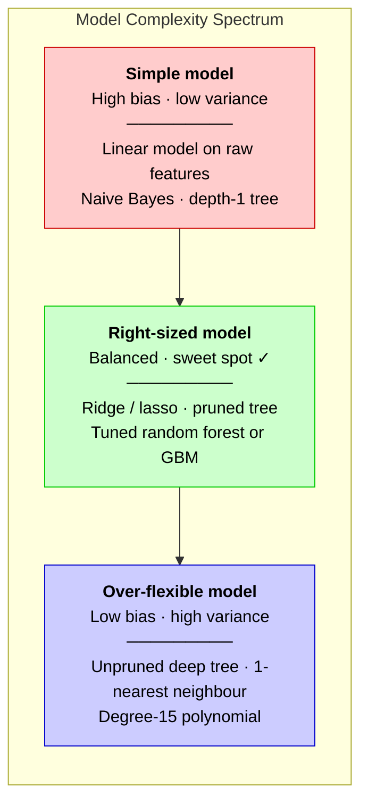

</details>

### The Tradeoff in Real Numbers

<details>
<summary><strong>Read as text</strong> — bias², variance and test MSE by polynomial degree</summary>

Fit polynomials of growing degree to 20 noisy points from a sine curve (noise variance $\sigma^2 = 0.09$), refit each one on 500 fresh training sets, and measure every term ([Ch 8 §8.14](#content/08_core_concepts) has the program):

| Polynomial degree | Bias² | Variance | Bias² + variance + 0.09 noise = test MSE |
|---|---|---|---|
| 1 — too simple (underfits) | 0.193 | 0.007 | 0.290 |
| 3 — the sweet spot ✓ | 0.005 | 0.014 | **0.109** |
| 9 | 0.000 | 0.033 | 0.124 |
| 15 — too flexible (overfits) | 0.000 | 0.071 | 0.161 |

Read it left to right: bias² collapses once the model can bend like a sine wave, variance grows tenfold (0.007 → 0.071), and the total is a **U** with its bottom at degree 3 — sitting on a noise floor of 0.09 that no model can go below.

</details>

### Beyond the U-Curve — Double Descent ★★

<details>
<summary><strong>Read as text</strong> — the interpolation threshold and implicit regularization</summary>

The U describes the classical regime. Very over-parameterized models can show **double descent**: test error peaks near the **interpolation threshold** — the size at which the model can first fit the training set exactly (for simple models, roughly when the number of parameters reaches the number of training examples) — and then **falls again** as the model keeps growing (Belkin et al., 2019; Nakkiran et al., 2019, "Deep Double Descent"). The leading explanation is **implicit regularization**: among the many weight settings that fit the training data perfectly, gradient descent tends to find smooth, small-norm ones, so variance drops again. The decomposition still holds; what breaks is the rule "more parameters ⇒ more variance".

**Go deeper:** [Ch 8 §8.14](#content/08_core_concepts) — measured table, U-curve chart and the double-descent chart.

</details>

---

## How to Diagnose: Learning Curves ★★★

![Infographic on diagnosing bias versus variance: avoidable bias = training error − target error and variance = validation error − training error, a decision flow (training error far above target → high bias; validation much worse than training → high variance; otherwise good fit), the Gmail spam example against a 95% target (logistic regression 72%/70% high bias, deep net 99.5%/78% high variance, tuned random forest 93%/91% good fit) as worked steps and a to-scale bar chart, a target-2% table (15/16 high bias, 3/14 high variance, 15/30 both, 3/4 good fit), and the fixes for high bias and high variance.](diagrams/top34_info_diagnose_and_fix_ai.png)

<details>
<summary><strong>Read as text</strong> — learning curves and the train / validation / target table</summary>

A **learning curve** plots training and validation error — against training **epochs**, or against **training-set size**. Read it against a **target error**: the best error you could hope for (human-level performance, or the best known system). The distance from training error to the target is the **bias** you could still remove; the gap between training and validation error is **variance**.

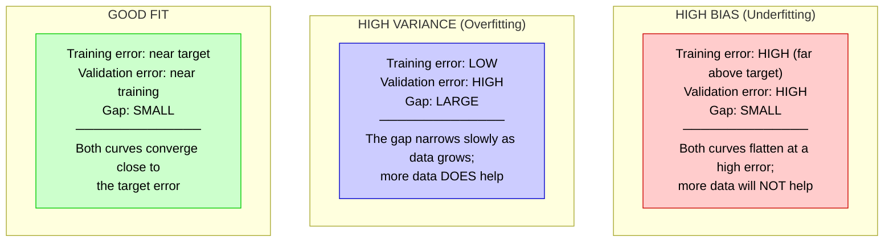

**Read three numbers** (a classifier whose target, human-level error is 2%):

| Training error | Validation error | Avoidable bias (train − target) | Variance (val − train) | Diagnosis |
|---|---|---|---|---|
| 15% | 16% | 13 points | 1 point | High bias |
| 3% | 14% | 1 point | 11 points | High variance |
| 15% | 30% | 13 points | 15 points | Both |
| 3% | 4% | 1 point | 1 point | Good fit ✓ |

These are rules of thumb: on a noisy task a gap of several points can be healthy, which is why you compare with a target rather than with zero.

**Go deeper:** [Ch 13 §13.9](#content/13_model_evaluation) — learning curves against training-set size, with code; [Ch 8 §8.13](#content/08_core_concepts) — learning curves against epochs.

</details>

---

## How to Fix ★★★

<details>
<summary><strong>Read as text</strong> — the fix flowchart — bias first, then variance</summary>

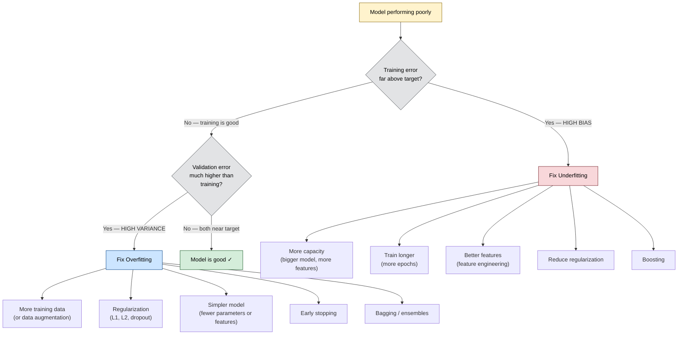

Check bias first: until training error is close to the target, a validation gap tells you little. If both are high, fix bias first, then variance. **Cross-validation is not a fix** — it *measures* generalization and picks hyperparameters such as the regularization strength.

**Go deeper:** [Ch 8 §8.15](#content/08_core_concepts) — regularization; [Ch 12 §12.5](#content/12_key_algorithms) and [§12.6](#content/12_key_algorithms) — bagging (random forest) and boosting.

</details>

---

## Worked Example ★★★

<details>
<summary><strong>Read as text</strong> — three Gmail spam models against a 95% target</summary>

Scenario: a spam classifier for Gmail. Assume the best achievable accuracy (careful human raters agreeing) is about **95%**, so that is the target. (A real spam system would track precision and recall — Topic 7 — accuracy just keeps the arithmetic simple.)

| Model | Training acc. | Validation acc. | Avoidable bias (95 − train) | Gap (train − val) | Diagnosis → fix |
|---|---|---|---|---|---|
| 1. Logistic regression on a few hand-made features | 72% | 70% | 23 points | 2 points | **High bias** → richer features (word n-grams, sender reputation), a more flexible model (gradient-boosted trees, a neural net) |
| 2. Large deep network, no regularization | 99.5% | 78% | none (it memorised the training set) | 21.5 points | **High variance** → more data, dropout or L2, early stopping, a smaller network |
| 3. Random forest with tuned hyperparameters | 93% | 91% | 2 points | 2 points | **Good fit** ✓ → ship it; further gains come from new features or data |

</details>

---

## Interview-Ready Answer Template

**Say this first (30 sec):** Bias is error from wrong assumptions — a model too simple for the pattern, wrong in the same way whatever data it sees. Variance is error from sensitivity to the particular training set. For squared error, expected test error = bias² + variance + irreducible noise, so as complexity grows bias falls and variance rises, and I choose the complexity that minimizes the total on validation data.

**Then the structure:**

1. **Numbers:** fitting polynomials to 20 noisy sine points, degree 1 has bias² 0.193 (test MSE 0.290), degree 15 has variance 0.071 (0.161), and degree 3 is best at 0.109.
2. **Diagnose:** compare training error with a target such as human-level error (the gap is bias), then validation with training (the gap is variance).
3. **Fix bias:** more capacity, better features, less regularization, boosting.
4. **Fix variance:** more data, regularization, bagging, early stopping, a smaller model.
5. **Modern caveat:** heavily over-parameterized networks can show double descent, so "bigger" does not automatically mean "more variance".

---

## Follow-Up Questions & Answers

**Q: "Can you have both high bias AND high variance?"**
> Yes — training error far above the target *and* a large train–validation gap (e.g. target 2%, training 15%, validation 30%). A typical cause is a flexible model trained on too little data with the wrong features: it memorises noise (variance) yet cannot see the real signal (bias). Fix the bias first (features, model), then the variance (data, regularization).

**Q: "How do ensemble methods relate to bias-variance?"**
> Bagging (random forest) mainly **reduces variance** by averaging many deep, low-bias, high-variance trees. Boosting (XGBoost, LightGBM) mainly **reduces bias** by adding shallow, high-bias trees one after another, each fitted to the remaining errors. That is why random forests use deep trees and boosting uses shallow ones.

**Q: "Does more data fix bias or variance?"**
> Variance. With more examples the fitted model changes less from one training set to the next, but a model that cannot represent the pattern (a straight line through a curve) keeps the same bias however much data it sees.

**Q: "What about the double descent phenomenon?"**
> Past the interpolation threshold — the size at which the model can first fit the training set exactly — test error can fall again as the model grows, instead of rising forever (Belkin et al., 2019; Nakkiran et al., 2019). Among the many perfect fits, gradient descent tends to find smooth, small-norm ones (implicit regularization), so variance shrinks again. The decomposition still holds; only the "more parameters ⇒ more variance" story breaks.

**Q: "Then why doesn't a huge LLM just overfit?"**
> It trains on trillions of tokens, most of them seen only once — Chinchilla's rule of thumb is about 20 training tokens per parameter — so training and held-out loss stay close; its behaviour is described by scaling laws ([Ch 17 §3.7](#content/17_llm)) rather than by the U-curve.

---

## Common Mistakes

| Mistake | Why It's Wrong |
|---------|---------------|
| "Bias means the model is biased/unfair" | Technical bias ≠ fairness bias. Here bias = systematic prediction error. |
| "Error = bias + variance" | It is bias² + variance + irreducible noise — and the split is exact only for squared error. |
| "Just add more data to fix everything" | More data helps variance, NOT bias. A linear model won't learn a curved pattern no matter how much data you give it. |
| "Complex models are always better" | Complexity reduces bias but can increase variance. Prefer the simplest model that captures the true pattern. |
| "Cross-validation fixes overfitting" | Cross-validation measures generalization and tunes hyperparameters; the fixes are data, regularization or a simpler model. |
| Forgetting irreducible noise | Some error can never be removed. Acknowledge σ² — and a target error — before promising a number. |

---

---

# Topic 2 — Gradient Descent & Optimization

## Why Google Asks This

Gradient descent is how every neural network, and most classical models, learn. Interviewers use it to check that you can reason about learning rates, batch sizes and optimizers — and debug a run that diverges or stalls — rather than just call `model.fit()`. At scale these choices are also cost: AdamW keeps two extra numbers per weight, which in FP32 is 560 GB of optimizer state for a 70-billion-parameter model ([Ch 16 §1.2](#content/16_deep_learning)).

---

## Common Interview Questions

- "Explain gradient descent step by step."
- "What's the difference between SGD, Mini-batch GD, and Batch GD?"
- "How does the Adam optimizer work? Why is it popular? Adam or AdamW?"
- "How do you choose a learning rate? Why do Transformers use warmup?"
- "You doubled the batch size — what else do you change?"
- "What are local minima and saddle points? How does optimization handle them?"

---

## Simple Explanation

Imagine you're blindfolded on a hilly landscape and you want to find the lowest valley. You can only feel the slope under your feet. Your strategy: always take a step in the downhill direction. That's gradient descent.

- **Step size** = learning rate (too big: you overshoot the valley; too small: you take forever)
- **Slope** = gradient (tells you which direction is downhill and how steep)
- **Valley** = minimum loss (the best your model can do)
- **Momentum** = a ball rolling downhill: it builds speed in a consistent direction and rolls through small bumps

---

## Deep Dive — The Algorithm ★★★

> **Maths in one line:** $\theta \leftarrow \theta - \alpha\,\nabla J(\theta)$ — move every weight a small step against its slope; steeper slope, bigger step. On a bowl-shaped (quadratic) loss this only converges if $\alpha < 2/\lambda_{\max}$, where $\lambda_{\max}$ is the steepest curvature — in the worked example below, $\alpha < 0.18$.

![Infographic on gradient descent and its three variants: the update θ ← θ − α∇J(θ) with each symbol labelled and the mini-batch form, the four-step loop (initialize, forward pass, gradient, update), one update by hand on the points (1,2), (2,4), (3,5) with α = 0.1 (J = 15.0, gradients −16.67 and −7.33, w = 1.667, b = 0.733, J falls to 0.234), three paths on a contour plot (batch GD 1 update per epoch, SGD 1,000, mini-batch 16), and a table for N = 1,000 examples comparing batch GD, mini-batch B = 64 and SGD.](diagrams/top34_info_gradient_descent_variants_ai.png)

### Core Update Rule ★★★

<details>
<summary><strong>Read as text</strong> — the update rule and its symbols</summary>

$$\theta_{\text{new}} = \theta_{\text{old}} - \alpha \cdot \nabla J(\theta)$$

Where:
- $\theta$ = model parameters (weights)
- $\alpha$ = learning rate (step size)
- $\nabla J(\theta)$ = gradient of the loss with respect to the parameters — the vector of partial derivatives $\partial J/\partial\theta_j$, pointing uphill
- $J(\theta)$ = loss function (how wrong the model is)

</details>

### Step-by-Step Process ★★★

<details>
<summary><strong>Read as text</strong> — the five-step training loop</summary>

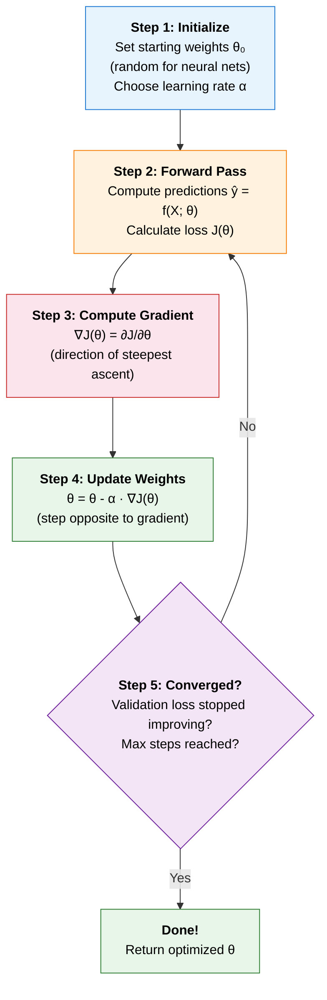

**Go deeper:** [Ch 8 §8.9](#content/08_core_concepts) — gradient descent with a learning-rate demo; [Ch 6 §4.1](#content/06_math_fundamentals) — the maths.

</details>

---

## Three Variants of Gradient Descent ★★★

<details>
<summary><strong>Read as text</strong> — batch, stochastic and mini-batch side by side</summary>

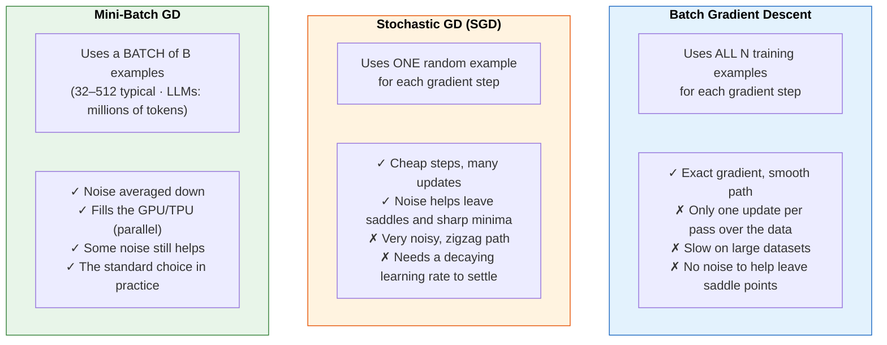

</details>

### Mathematical Comparison ★★★

<details>
<summary><strong>Read as text</strong> — the three update formulas and the N = 1,000 table</summary>

$$\begin{aligned}
\textbf{Batch GD:} \quad & \theta \leftarrow \theta - \alpha \cdot \frac{1}{N} \sum_{i=1}^{N} \nabla L_i(\theta) && \leftarrow \text{all } N \text{ examples} \\[6pt]
\textbf{Stochastic GD:} \quad & \theta \leftarrow \theta - \alpha \cdot \nabla L_i(\theta) && \leftarrow \text{one random example } i \\[6pt]
\textbf{Mini-Batch GD:} \quad & \theta \leftarrow \theta - \alpha \cdot \frac{1}{B} \sum_{i \in \mathcal{B}} \nabla L_i(\theta) && \leftarrow \text{a random batch } \mathcal{B} \text{ of } B \text{ examples}
\end{aligned}$$

| On N = 1,000 examples | Examples per update | Updates per epoch | Gradient noise (std) |
|---|---|---|---|
| Batch GD | 1,000 | 1 | none |
| Mini-batch, B = 64 | 64 | 16 | 1/√64 = 1/8 of SGD's |
| SGD | 1 | 1,000 | highest |

The "SGD" optimizer in PyTorch or Keras is really **mini-batch** SGD — you choose B through the data loader.

**Go deeper:** [Ch 8 §8.11](#content/08_core_concepts) — the three variants raced on the same data.

</details>

---

## Advanced Optimizers ★★★

> **Maths in one line:** $\theta \leftarrow \theta - \alpha\,\hat m_t / (\sqrt{\hat v_t} + \varepsilon)$ (Adam) — step along a smoothed gradient $\hat m$ (momentum) divided by the weight's typical gradient size $\sqrt{\hat v}$ (adaptive step), so every weight moves by roughly $\alpha$ per step whatever the scale of its gradient.

![Infographic on momentum, RMSProp, Adam and AdamW: the AdamW update θ ← θ − α(m̂ₜ/(√v̂ₜ + ε) + λθ) with each symbol labelled plus Adam's moment and bias-correction formulas, a family tree from plain SGD through momentum, RMSProp and bias correction to Adam and AdamW (the Transformer and LLM default), bias correction worked at t = 1 (uncorrected step 0.1/√0.001 = 3.16 times too large), a bar chart of the weight after 2,000 steps (Adam + L2 0.023 / 0.830 / 1.012 vs AdamW 0.830 for quiet, medium and loud gradients), and Adam defaults versus the Llama 2 AdamW recipe.](diagrams/top34_info_adam_and_adamw_ai.png)

### Momentum — "Ball rolling downhill with inertia" ★★★

<details>
<summary><strong>Read as text</strong> — velocity, the 10× speed-up and damped zigzags</summary>

$$\begin{aligned}
v_t &= \beta \cdot v_{t-1} + \nabla J(\theta) && \leftarrow \text{accumulate velocity } (\beta \approx 0.9) \\
\theta &= \theta - \alpha \cdot v_t && \leftarrow \text{update with velocity}
\end{aligned}$$

Key insight: Momentum helps in two ways:
1. Accelerates in consistent gradient directions — with a steady gradient the step grows to $\alpha/(1-\beta)$, i.e. **10× for β = 0.9** (β = 0.9 ≈ "remember the last 10 gradients")
2. Dampens oscillations in directions where the gradient keeps flipping sign

(This is PyTorch's form. Some texts write $v_t = \beta v_{t-1} + (1-\beta)\nabla J$ — the same idea with a 10× smaller velocity, so its learning rate is 10× larger.)

</details>

### RMSProp — "Adaptive learning rate per parameter" ★★★

<details>
<summary><strong>Read as text</strong> — per-weight step sizes, and Adagrad</summary>

$$\begin{aligned}
s_t &= \beta \cdot s_{t-1} + (1-\beta) \cdot (\nabla J(\theta))^2 && \leftarrow \text{running average of squared gradients} \\
\theta &= \theta - \alpha \cdot \frac{\nabla J(\theta)}{\sqrt{s_t} + \varepsilon} && \leftarrow \text{larger gradients} \to \text{smaller steps}
\end{aligned}$$

Key insight: each weight's step is divided by the size of its own recent gradients, so weights with large gradients get smaller steps and weights with small gradients get larger ones. (Adagrad does the same with a running *sum*, which only grows — so its learning rate decays towards zero.)

</details>

### Adam — "Momentum + RMSProp + Bias Correction" ★★★

<details>
<summary><strong>Read as text</strong> — the update equations, the defaults and the family diagram</summary>

$$\begin{aligned}
m_t &= \beta_1 \cdot m_{t-1} + (1-\beta_1) \cdot \nabla J(\theta) && \leftarrow \text{1st moment (mean of gradients)} \\
v_t &= \beta_2 \cdot v_{t-1} + (1-\beta_2) \cdot (\nabla J(\theta))^2 && \leftarrow \text{2nd moment (mean of squared grads)} \\[8pt]
\hat{m}_t &= \frac{m_t}{1 - \beta_1^t} && \leftarrow \text{bias-corrected 1st moment} \\
\hat{v}_t &= \frac{v_t}{1 - \beta_2^t} && \leftarrow \text{bias-corrected 2nd moment} \\[8pt]
\theta &= \theta - \alpha \cdot \frac{\hat{m}_t}{\sqrt{\hat{v}_t} + \varepsilon} && \leftarrow \text{final update}
\end{aligned}$$

Default hyperparameters (Kingma & Ba, 2015): $\alpha = 10^{-3}$, $\beta_1 = 0.9$, $\beta_2 = 0.999$, $\varepsilon = 10^{-8}$. LLM pre-training usually lowers $\beta_2$ to **0.95**, so the size estimate reacts faster to spiky batches.

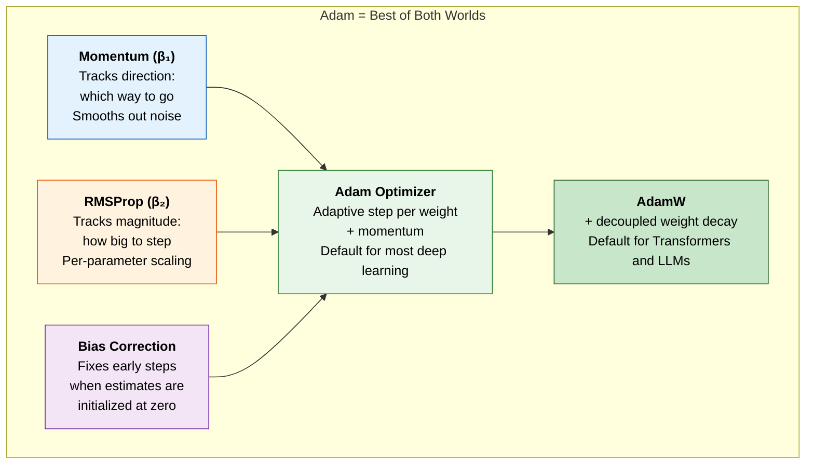

</details>

### AdamW — Adam with Decoupled Weight Decay ★★★

<details>
<summary><strong>Read as text</strong> — decoupled weight decay, the Llama 2 recipe, Lion and Muon</summary>

**The problem.** Classic "L2 regularization" adds $\lambda\theta$ to the gradient. Under plain SGD that is exactly weight decay. Under Adam the sum is divided by $\sqrt{\hat v}$, so a weight with large gradients is barely decayed and a weight with tiny gradients is decayed hard — the regularization strength ends up depending on gradient history.

**The fix** (Loshchilov & Hutter, ICLR 2019): apply the decay to the weight directly, outside Adam's per-weight scaling:

$$\theta \leftarrow \theta - \alpha\left(\frac{\hat m_t}{\sqrt{\hat v_t}+\varepsilon} + \lambda\,\theta\right)$$

With $\alpha = 10^{-3}$ and $\lambda = 0.1$ every weight shrinks by $\alpha\lambda$ = 0.01% per step, whatever its gradients. In Ch 16's simulation (2,000 steps, start 1.0), Adam + L2 leaves a weight at 0.023, 0.830 or 1.012 depending on whether its gradients are quiet, medium or loud; AdamW leaves all three at 0.830.

**A real recipe** — Llama 2 pre-training: AdamW with $\beta_1 = 0.9$, $\beta_2 = 0.95$, $\varepsilon = 10^{-5}$, weight decay 0.1, gradient clipping at norm 1.0, 2,000 warmup steps, then cosine decay to 10% of the peak learning rate (peak $3\times10^{-4}$ for the 7B model). Weight decay is usually applied to the weight matrices but not to biases or normalization gains; PyTorch's `AdamW` defaults to `weight_decay=0.01`.

**Beyond AdamW, in one line each:** **Lion** (Google, 2023) steps by the *sign* of a momentum blend, keeping one number per weight instead of two (it needs a 3–10× smaller learning rate); **Muon** (2024) orthogonalizes the momentum of each 2-D weight matrix and has been used in frontier runs such as Kimi K2. AdamW is still the default — see [Ch 16 §1.2](#content/16_deep_learning), "Beyond AdamW".

**Go deeper:** [Ch 8 §8.10](#content/08_core_concepts) — SGD vs momentum vs Adam on a thin valley; [Ch 16 §1.2](#content/16_deep_learning) — Adam by hand, AdamW vs L2, Muon.

</details>

---

## Why Bias Correction Matters in Adam ★★★

<details>
<summary><strong>Read as text</strong> — the t = 1 arithmetic and why the uncorrected step is too large</summary>

Problem: $m_0 = 0$ and $v_0 = 0$, so the early running averages are pulled towards zero.

At $t=1$, with first gradient $g_1$: $m_1 = 0.9 \times 0 + 0.1 \times g_1 = 0.1\,g_1$ (10× too small) and $v_1 = 0.001\,g_1^2$ (1,000× too small).

Correction: $\hat{m}_1 = m_1 / (1 - 0.9^1) = g_1$ and $\hat{v}_1 = v_1 / (1 - 0.999^1) = g_1^2$, so the first step is $\alpha \cdot g_1/|g_1| = \pm\alpha$ — exactly the learning rate, whatever the gradient's size.

**The part most explanations get backwards:** without correction the first step would be $m_1/\sqrt{v_1} = 0.1/\sqrt{0.001} = 3.16$ times too **large**, not too small — $v$ is understated far more than $m$, and it sits under a square root. For a steady gradient the uncorrected step peaks at about **6.6×** around step 12 ([Ch 16 §1.2](#content/16_deep_learning)). The Adam paper makes the same point: without the correction, initial steps would be much larger.

**How long it matters:** $m$'s factor $1/(1-0.9^t)$ is already 1.005 at $t = 50$, but $v$'s factor $1/(1-0.999^t)$ is still **10.5 at $t = 100$** and 1.58 at $t = 1{,}000$. So bias correction matters for the first few thousand steps, not just the first few.

**Go deeper:** [Ch 16 §1.2](#content/16_deep_learning) — the worked Adam step and a program that measures the oversized steps.

</details>

---

## Learning Rate — The Most Important Hyperparameter ★★★

![Infographic on the learning rate: the cosine schedule αₜ = α_min + ½(α_max − α_min)(1 + cos(πt/T)) with each symbol labelled and worked halfway (peak 1e-3, floor 1e-4 gives 5.5e-4), a chart of warmup + cosine versus warmup–stable–decay, the stability ceiling on the 3-point regression (curvatures 0.240 and 11.09, α < 2/11.09 = 0.18) with loss curves for α = 0.1 and 0.17 converging and 0.19 exploding, a schedule table (constant, warmup + cosine, WSD) and the α = 0.1 run J = 15.0 → 0.234 → 0.058 → 0.0556.](diagrams/top34_info_learning_rate_and_schedules_ai.png)

<details>
<summary><strong>Read as text</strong> — too small, just right, too large — and how to pick it</summary>

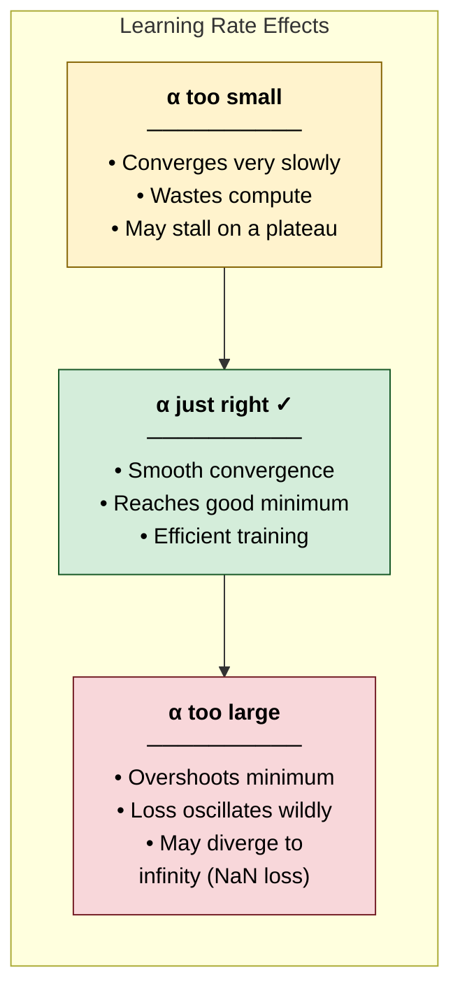

**How to pick it:** run short trials on a log scale (1e-4, 3e-4, 1e-3, 3e-3…) and keep the largest value that trains smoothly, or run an LR range test (raise the rate every step and pick a value below where the loss starts to blow up). Typical starting points: Adam at 1e-3 for small networks; 2e-5 to 5e-5 for fine-tuning BERT-style models; for LLM pre-training the peak shrinks as models grow (Llama 2 7B: 3e-4; Llama 3 405B: 8e-5).

</details>

### Learning Rate Schedules ★★★

<details>
<summary><strong>Read as text</strong> — the cosine formula, six schedules, warmup and decay</summary>

> **Maths in one line:** $\alpha_t = \alpha_{\min} + \tfrac12(\alpha_{\max} - \alpha_{\min})\bigl(1 + \cos(\pi t / T)\bigr)$ — after warmup, slide from the peak to the floor along half a cosine over $T$ steps; halfway ($t = T/2$) it sits exactly between them, e.g. $5.5\times10^{-4}$ for a peak of $10^{-3}$ and a floor of $10^{-4}$.

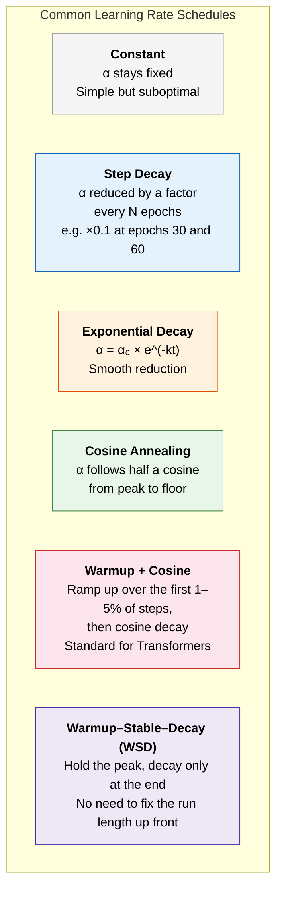

**Why warmup?** On its first steps Adam moves every weight by about the full learning rate (see bias correction above) while $\hat v$ is estimated from only a few batches, and a freshly initialized Transformer is at its most fragile. Ramping the rate up from near zero (Llama 2: over 2,000 steps) avoids early loss spikes. **Why decay?** A large rate makes fast progress but keeps bouncing around the minimum; shrinking it lets the weights settle. Cosine needs the total step count up front; **WSD** does not, which is why many LLM pre-training runs use it.

**Go deeper:** [Ch 16 §1.3](#content/16_deep_learning) — warmup + cosine vs WSD with numbers; [Ch 14 §14.13](#content/14_neural_networks) — schedules in practice.

</details>

---

## Worked Example — Linear Regression with Gradient Descent ★★★

<details>
<summary><strong>Read as text</strong> — two iterations by hand, the end point and the ceiling</summary>

Given: 3 data points $\to (1, 2),\ (2, 4),\ (3, 5)$

$$\text{Model: } \hat{y} = w \cdot x + b \qquad \text{Loss: } J = \frac{1}{3} \sum (y_i - \hat{y}_i)^2 \qquad \alpha = 0.1$$

**Initialize:** $w = 0,\ b = 0$

**ITERATION 1:**

Forward pass: $\hat{y}_1 = 0,\quad \hat{y}_2 = 0,\quad \hat{y}_3 = 0$

$$J = \tfrac{1}{3}\!\left[(2-0)^2 + (4-0)^2 + (5-0)^2\right] = \tfrac{1}{3}[4 + 16 + 25] = 15.0$$

$$\begin{aligned}
\frac{\partial J}{\partial w} &= \tfrac{1}{3} \times 2 \times [(-2)(1) + (-4)(2) + (-5)(3)] = \tfrac{2}{3}(-25) = -16.67 \\[4pt]
\frac{\partial J}{\partial b} &= \tfrac{1}{3} \times 2 \times [(-2) + (-4) + (-5)] = \tfrac{2}{3}(-11) = -7.33
\end{aligned}$$

$$w = 0 - 0.1 \times (-16.67) = 1.667 \qquad b = 0 - 0.1 \times (-7.33) = 0.733$$

**ITERATION 2:**

Forward pass: $\hat{y}_1 = 2.4,\quad \hat{y}_2 = 4.067,\quad \hat{y}_3 = 5.733$

$$J = \tfrac{1}{3}\!\left[(2-2.4)^2 + (4-4.067)^2 + (5-5.733)^2\right] = \tfrac{1}{3}[0.16 + 0.0044 + 0.538] = 0.234 \quad \leftarrow \text{much lower!}$$

$$\begin{aligned}
\frac{\partial J}{\partial w} &= \tfrac{2}{3}\,[(0.4)(1) + (0.067)(2) + (0.733)(3)] = \tfrac{2}{3}(2.733) = 1.822 \\[4pt]
\frac{\partial J}{\partial b} &= \tfrac{2}{3}\,[0.4 + 0.067 + 0.733] = \tfrac{2}{3}(1.2) = 0.8
\end{aligned}$$

$$w = 1.667 - 0.1 \times 1.822 = 1.484 \qquad b = 0.733 - 0.1 \times 0.8 = 0.653 \qquad (J = 0.058)$$

The first step overshot the slope ($w = 1.667$ is above the best value 1.5), so the second step comes back — the gradients changed sign.

**Where it ends:** the least-squares line $w = 1.5$, $b = 0.667$, with $J = 0.0556$ (the three points are not on one line, so the loss cannot reach 0). The loss gets there in about 3 steps, but the weights take about 70 steps to settle within 0.001: the loss surface is a long, thin valley whose two curvatures differ 46×, and along the flat direction each step closes only 2.4% of the remaining gap. That is exactly the problem momentum and Adam were invented for.

**The ceiling:** gradient descent on this loss is stable only for $\alpha < 2/\lambda_{\max} = 2/11.09 = 0.18$. At $\alpha = 0.17$ it converges; at $\alpha = 0.19$ the loss explodes.

</details>

```python
# Gradient descent on the chapter's 3 points: the iterations above, where it ends, and the learning-rate ceiling
import numpy as np

x = np.array([1.0, 2.0, 3.0])
y = np.array([2.0, 4.0, 5.0])

def gd(lr, steps):
    w = b = 0.0
    hist = []                                       # (w, b, J) at the start of each iteration
    for _ in range(steps):
        err = (w * x + b) - y                       # prediction minus truth
        hist.append((float(w), float(b), float(np.mean(err ** 2))))
        dw, db = 2 * np.mean(err * x), 2 * np.mean(err)   # dJ/dw and dJ/db
        w, b = w - lr * dw, b - lr * db
    return hist

# 1. The chapter's run, alpha = 0.1
h = gd(0.1, 1000)
for t in (0, 1, 2):
    w, b, J = h[t]
    print(f"iteration {t + 1}: w = {w:.3f}, b = {b:.3f}, J = {J:.4f}")

# 2. Where it ends: the least-squares line. The loss gets there fast, the weights slowly
w_ls, b_ls = np.polyfit(x, y, 1)
J_min = float(np.mean((w_ls * x + b_ls - y) ** 2))
print(f"least squares:  w = {w_ls:.3f}, b = {b_ls:.3f}, J = {J_min:.4f}")
nJ = next(t for t, (_, _, J) in enumerate(h) if J - J_min < 1e-4)
nw = next(t for t, (w, b, _) in enumerate(h) if abs(w - w_ls) < 1e-3 and abs(b - b_ls) < 1e-3)
print(f"J within 0.0001 of its minimum after {nJ} steps; w and b within 0.001 after {nw} steps")
assert nJ < 5 and nw > 50

# 3. Why so slow, and the ceiling: on a quadratic loss GD is stable only if alpha < 2 / (largest curvature)
H = 2 * np.array([[np.mean(x * x), np.mean(x)], [np.mean(x), 1.0]])   # Hessian (curvature matrix) of J
lo, hi = np.linalg.eigvalsh(H)
print(f"curvatures {lo:.3f} and {hi:.2f} ({hi / lo:.0f}x apart); flat direction shrinks {0.1 * lo:.1%} per step")
print(f"max stable alpha = 2 / {hi:.2f} = {2 / hi:.3f}")
for lr in (0.17, 0.19):
    print(f"alpha = {lr}: J after 100 steps = {gd(lr, 101)[100][2]:.3g}")
assert gd(0.19, 101)[100][2] > 15.0 > gd(0.17, 101)[100][2]
```

**Output:**

```
iteration 1: w = 0.000, b = 0.000, J = 15.0000
iteration 2: w = 1.667, b = 0.733, J = 0.2341
iteration 3: w = 1.484, b = 0.653, J = 0.0577
least squares:  w = 1.500, b = 0.667, J = 0.0556
J within 0.0001 of its minimum after 3 steps; w and b within 0.001 after 72 steps
curvatures 0.240 and 11.09 (46x apart); flat direction shrinks 2.4% per step
max stable alpha = 2 / 11.09 = 0.180
alpha = 0.17: J after 100 steps = 0.0556
alpha = 0.19: J after 100 steps = 1.14e+10
```

<details>
<summary><strong>Read as text</strong> — continued: where to go deeper</summary>

**Go deeper:** [Ch 8 §8.9](#content/08_core_concepts) — learning rates that crawl, converge and diverge on a one-weight loss.

</details>

---

## Local Minima vs Saddle Points ★★★

![Infographic on saddle points and choosing an optimizer: the chance that a zero-gradient point is a minimum is about 2 to the minus n, worked as 1/2, 1/4 and 1/1,024 (about 1 in 1,000) for n = 10; a 3-D saddle surface where the ball crawls on the plateau then rolls off downhill; mini-panels for local minimum, plateau and global minimum; a table of SGD + momentum, Adam, AdamW (default), LAMB / LARS and Adagrad with best-for and avoid-when; trap: you need a good minimum that generalizes, not the global one.](diagrams/top34_info_saddles_and_optimizer_choice_ai.png)

<details>
<summary><strong>Read as text</strong> — minima, saddles, plateaus and the 2⁻ⁿ argument</summary>

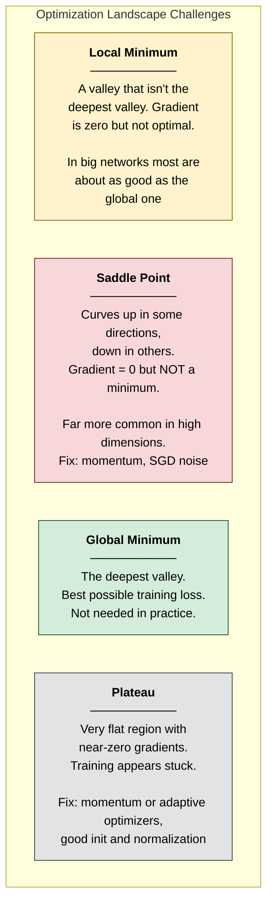

**Key insight for interviews**: in high-dimensional spaces, saddle points are far more common than bad local minima. At a point where the gradient is zero, a minimum needs **every** direction to curve upward; if each direction were a coin flip, that would happen with probability $2^{-n}$ — about 1 in 1,000 for $n = 10$, and networks have millions or billions of weights. Dauphin et al. (2014) found the same in real networks: critical points with high training error were saddles. Gradient descent from a random start almost never converges to such a saddle (Lee et al., 2016), but it can **crawl** near one — the long plateaus in training curves — which momentum and SGD noise help to cross. And for large networks the local minima SGD does find tend to have similar loss (Choromanska et al., 2015), so the goal is a *good* minimum, not *the* global one.

**Go deeper:** [Ch 6 §4.6](#content/06_math_fundamentals) — convexity, the swap argument and a saddle-point program.

</details>

---

## When to Use Which Optimizer ★★★

<details>
<summary><strong>Read as text</strong> — the optimizer chooser table</summary>

| Optimizer | Best For | Avoid When |
|-----------|----------|-----------|
| SGD + Momentum | ResNet-style CNNs when you can tune the learning rate and schedule — well tuned, it often generalizes as well as Adam or better | Transformers (AdamW is the standard), quick prototyping |
| Adam | A fast default for small networks and prototyping | You want weight decay — use AdamW, not Adam + L2 |
| AdamW | Transformers, LLMs and modern vision models (e.g. ConvNeXt: lr 4e-3 at batch 4,096, weight decay 0.05) — the default | Memory is the bottleneck (2 extra numbers per weight) — consider 8-bit AdamW, Adafactor or Lion |
| LAMB / LARS | Very large batch training (distributed) — per-layer step scaling | Small-scale experiments |
| Adagrad | Sparse features (classic NLP, recommendations) | Long training (its learning rate decays towards zero) |
| Muon / Lion (newer) | Muon: 2-D hidden weight matrices in some frontier LLM runs; Lion: one state per weight instead of two | You can't afford to re-tune — learning rate and weight decay differ from AdamW's |

**Go deeper:** [Ch 16 §1.2](#content/16_deep_learning) — optimizer cheat sheet, optimizer-state memory and "Beyond AdamW".

</details>

---

## Interview-Ready Answer Template

**Say this first (30 sec):** Gradient descent learns by repeatedly stepping against the gradient of the loss, θ ← θ − α∇J(θ), estimated on a mini-batch of examples. In practice I use AdamW (momentum + per-weight step sizes + decoupled weight decay) with warmup and a cosine or warmup–stable–decay schedule, and the learning rate is the first thing I tune.

**Then the structure:**

1. **Variants:** batch GD (all N examples — exact, one update per pass), SGD (one example — cheap, noisy), mini-batch (32–512; LLMs use millions of tokens) — the standard.
2. **Optimizers:** momentum (β = 0.9 ≈ the last 10 gradients); Adam adds a per-weight step size and bias correction (defaults 1e-3, 0.9, 0.999); AdamW applies weight decay to the weights directly.
3. **Learning rate:** sweep on a log scale; too high oscillates or gives NaN.
4. **A real recipe:** Llama 2 — AdamW (β₂ 0.95, weight decay 0.1), clipping at 1.0, 2,000 warmup steps, cosine decay to 10% of peak.
5. **Landscape:** saddle points, not bad local minima, are the usual stall; momentum and SGD noise get through them.

---

## Follow-Up Questions & Answers

**Q: "SGD often finds better generalization than Adam. Why?"**
> On image classifiers, well-tuned SGD with momentum often matched or beat Adam (Wilson et al., 2017). A popular explanation is that SGD's noise favours flatter minima, which generalize better (Keskar et al., 2017) — but flatness alone is debated, since sharpness can change under a reparametrization that leaves the function unchanged (Dinh et al., 2017). With decoupled weight decay the gap largely closed: Transformers, LLMs and modern vision models such as ConvNeXt train with AdamW, while SGD + momentum remains common for ResNet-style CNNs.

**Q: "What is gradient clipping and when do you use it?"**
> If the gradient's norm exceeds a threshold c, rescale it to length c: g ← g · c/‖g‖ — the direction is kept, only the step is capped. Example: g = (3, 4) has norm 5; with c = 1 it becomes (0.6, 0.8). It guards against exploding gradients in RNNs and Transformers; GPT-3 and Llama 2 clip at 1.0.

**Q: "What batch size should you use? What changes if you double it?"**
> Larger batches give less noisy gradients (noise falls as 1/√B) and better hardware use, but fewer updates per epoch and diminishing returns past a "critical batch size"; typical ranges are 32–512 examples, and LLMs use millions of tokens (Llama 2: 4M; Llama 3 405B grew from 4M to 16M). If you double the batch, raise the learning rate: ×2 under the linear scaling rule for SGD (Goyal et al., 2017 — ResNet-50 went from 0.1 at batch 256 to 3.2 at 8,192, with warmup), about ×1.4 under the square-root rule commonly used for Adam — then confirm with a short sweep.

**Q: "Why do Transformers need learning-rate warmup?"**
> In the first steps Adam moves every weight by about the full learning rate while its squared-gradient estimate rests on a few batches, and a freshly initialized Transformer is fragile, so a full-size step can cause a loss spike or NaN. Ramping the rate up over the first 1–5% of steps (Llama 2: 2,000 steps) lets the statistics settle first.

**Q: "Your loss went to NaN. What do you check?"**
> First the learning rate (lower it, add warmup and gradient clipping); then the data (NaN/inf inputs, labels out of range); then numerics — use stable losses such as log-softmax + cross-entropy rather than log(softmax), and in FP16 use loss scaling or switch to BF16.

---

## Common Mistakes

| Mistake | Why It's Wrong |
|---------|---------------|
| "Adam is always better than SGD" | Well-tuned SGD with momentum can generalize as well or better, especially on CNNs. The choice is empirical. |
| "Learning rate doesn't matter with Adam" | Adam is less sensitive but still needs tuning — a bad learning rate still causes divergence or slow training. |
| "Adam + an L2 penalty is weight decay" | In Adam the L2 gradient is divided by √v̂, so weights with large gradients barely decay. Use AdamW. |
| "Bias correction fixes steps that are too small" | The opposite: uncorrected, the first step is about 3.2× too large, because v is understated 1,000× and m only 10×. |
| "We need to find the global minimum" | In deep learning many minima are about equally good. The goal is a good minimum that generalizes, not the global one. |
| Confusing learning rate with convergence speed | A higher learning rate doesn't always mean faster convergence — past 2/λ_max it oscillates or diverges. |

---

---

# Topic 3 — Regularization Techniques

## Why Google Asks This

Regularization is how you bridge the gap between "works on training data" and "works in production." Interviewers use it to check that you can build models that generalize — not just memorize — and that you know which tool fits which model: weight penalties for linear models, weight decay and dropout for neural networks, depth limits and early stopping for trees.

---

## Common Interview Questions

- "What is regularization and why do we need it?"
- "Explain L1 vs L2 regularization. Why does L1 produce sparsity?"
- "How does Dropout work? Why is it considered regularization?"
- "What is Batch Normalization and why does it help? Why do Transformers use LayerNorm instead?"
- "How is Early Stopping a form of regularization?"
- "What are label smoothing and data augmentation, and when do they help?"

---

## Simple Explanation

Regularization is like giving a student a rule: "Your essay answer can't be longer than 500 words." Without the limit, the student might write 10 pages trying to memorize every detail (overfitting). With the limit, they must focus on the core ideas that matter (generalization).

In ML, regularization **penalizes model complexity** so the model focuses on true patterns rather than memorizing noise. The price: training accuracy drops a little. If your training score didn't drop at all, the regularizer isn't doing anything.

---

## Deep Dive — L1 vs L2 Regularization ★★★

> **Maths in one line:** `J(w) = Loss(data, w) + λ · penalty(w)`, with penalty `Σ|wᵢ|` (L1) or `Σwᵢ²` (L2) — λ sets how much training fit you trade for smaller weights. For standardized, uncorrelated features L1 *subtracts* a fixed amount from every |w| and stops at 0; L2 *divides* every w by the same factor.

![Infographic on L1 vs L2 regularization: J(w) = Loss(data, w) + lambda times penalty(w) with each symbol labelled; the L1 pull is a constant lambda times sign(w), the L2 pull 2 lambda w fades; a loss ellipse touches the L1 diamond at its corner on the w2 axis (w1 = 0 exactly) but the L2 circle at an ordinary point; penalty alone from 0.100, L1 reaches 0 in 10 steps while L2 is still 0.012 after 20; Ch 8's six weights 2.10, 0.30, -4.20, 0.050, 1.80, -0.010 become 1.70, 0, -3.80, 0, 1.40, 0 under L1 (3 exact zeros) and 1.68, 0.24, -3.36, 0.040, 1.44, -0.008 under L2 (no zeros); trap: L2 never removes features.](diagrams/top34_info_l1_vs_l2_sparsity_ai.png)

### The Modified Loss Function ★★★

<details>
<summary><strong>Read as text</strong> — the penalized loss and three practical rules</summary>

$$\begin{aligned}
\textbf{Without regularization:} \quad & J(\theta) = \text{Loss}(\text{data}, \theta) \\[8pt]
\textbf{With L2 (Ridge):} \quad & J(\theta) = \text{Loss}(\text{data}, \theta) + \underbrace{\lambda \sum w_i^2}_{\text{Penalizes large weights (squared)}} \\[8pt]
\textbf{With L1 (Lasso):} \quad & J(\theta) = \text{Loss}(\text{data}, \theta) + \underbrace{\lambda \sum |w_i|}_{\text{Penalizes absolute size}} \\[8pt]
\textbf{With Elastic Net:} \quad & J(\theta) = \text{Loss}(\text{data}, \theta) + \underbrace{\lambda_1 \sum |w_i| + \lambda_2 \sum w_i^2}_{\text{Sparsity + stability with correlated features}}
\end{aligned}$$

Three practical rules:

1. **λ is a hyperparameter** — sweep it on a log scale and keep the value with the lowest validation loss.
2. **Standardize features first.** The penalty depends on units: a length in millimetres needs a 1,000× smaller weight than the same length in metres, so it would be penalized very differently.
3. **The bias (intercept) is usually not penalized** — it only shifts predictions, it adds no complexity.

(Bayesian view, a common follow-up: L2 is a Gaussian prior on the weights, L1 a Laplace prior — the penalty is the negative log-prior of a MAP estimate.)

</details>

### Why L1 Produces Sparsity — The Geometric Intuition ★★★

<details>
<summary><strong>Read as text</strong> — diamond vs circle, and why corners give exact zeros</summary>

Candidates commonly report this as the follow-up to "L1 vs L2". Here's why:

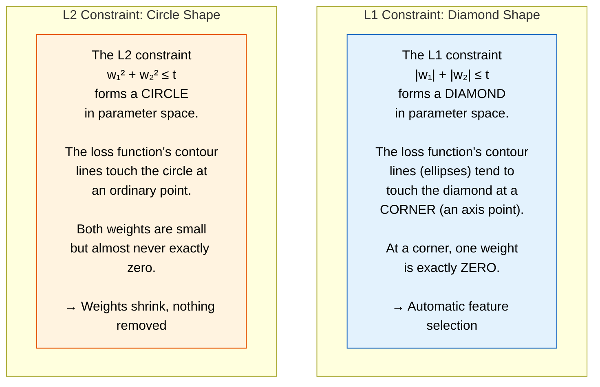

(The constraint form "‖w‖ ≤ t" and the penalty form "loss + λ·penalty" are the same problem: every λ corresponds to some budget t.)

</details>

### Mathematical Explanation of Sparsity ★★★

<details>
<summary><strong>Read as text</strong> — the two gradient updates and soft-thresholding</summary>

**The gradient update with L1** (α = learning rate, as in Topic 2):

$$w = w - \alpha \cdot \left(\frac{\partial \text{Loss}}{\partial w} + \lambda \cdot \text{sign}(w)\right)$$

If $w > 0$ the penalty pushes $w$ down by $\alpha\lambda$; if $w < 0$ it pushes it up by $\alpha\lambda$. The push is the **same size however small $w$ gets**, so weak weights are driven all the way to zero. A weight survives only if its data gradient fights back harder than λ.

**The gradient update with L2:**

$$w = w - \alpha \cdot \left(\frac{\partial \text{Loss}}{\partial w} + 2\lambda w\right)$$

The push is **proportional to $w$**: as $w$ gets small, the push gets small. On the penalty alone each step multiplies $w$ by $(1 - 2\alpha\lambda)$ — geometric decay that never reaches zero; with data, the weight settles at a smaller, non-zero value.

**The detail most answers miss:** plain (sub)gradient steps with an L1 term overshoot zero, flip sign and **jitter around it** — they almost never land exactly on 0. Lasso solvers use **soft-thresholding** (the "proximal" step): shrink $|w|$ by $\alpha\lambda$ and clip at zero, $w \leftarrow \text{sign}(w)\cdot\max(|w| - \alpha\lambda,\ 0)$. That is what produces exact zeros. The program uses Ch 8's six weights:

</details>

```python
# L1 vs L2 in motion: soft-thresholding lands on exact zeros, plain subgradient steps only jitter near zero
import numpy as np

w_ols = np.array([2.10, 0.30, -4.20, 0.050, 1.80, -0.010])   # Ch 8's six weights (standardized, uncorrelated features)
lam1, lam2, lr, steps = 0.4, 0.125, 0.1, 300                 # per weight: loss 0.5*(w - w_ols)^2 + penalty

def soft(z, t):                                               # shrink |z| by t, clip at 0 (the L1 "prox" step)
    return np.sign(z) * np.maximum(np.abs(z) - t, 0.0)

w_sub, w_prox, w_l2 = np.zeros(6), np.zeros(6), np.zeros(6)
for _ in range(steps):
    w_sub = w_sub - lr * ((w_sub - w_ols) + lam1 * np.sign(w_sub))     # L1 by plain (sub)gradient descent
    w_prox = soft(w_prox - lr * (w_prox - w_ols), lr * lam1)            # L1 by proximal gradient (ISTA)
    w_l2 = w_l2 - lr * ((w_l2 - w_ols) + 2 * lam2 * w_l2)               # L2: penalty gradient 2*lam2*w

def show(name, w):
    print(f"{name:13s}" + " ".join(f"{v + 0.0:7.3f}" for v in w) + f"   exact zeros: {int(np.sum(w == 0.0))}")

show("before", w_ols)
show("L1 subgrad", w_sub)
show("L1 prox", w_prox)
show("L2", w_l2)
assert np.allclose(w_prox, soft(w_ols, lam1))                  # closed form: subtract 0.4, stop at 0
assert np.allclose(w_l2, w_ols / (1 + 2 * lam2))               # closed form: divide by 1.25
assert np.sum(w_prox == 0.0) == 3 and np.sum(w_sub == 0.0) == 0

# Contrast: the penalty alone, starting from w = 0.100 (no data pulling back)
w1 = w2 = 0.100
for _ in range(20):
    w1 = soft(w1, 0.010)            # L1: the same 0.010 pull every step
    w2 = w2 - 0.10 * w2             # L2: a pull of 10% of whatever is left
print(f"penalty only, 20 steps from 0.100: L1 -> {w1:.3f}, L2 -> {w2:.3f}")
```

**Output:**

```
before         2.100   0.300  -4.200   0.050   1.800  -0.010   exact zeros: 0
L1 subgrad     1.700   0.011  -3.800   0.015   1.400   0.011   exact zeros: 0
L1 prox        1.700   0.000  -3.800   0.000   1.400   0.000   exact zeros: 3
L2             1.680   0.240  -3.360   0.040   1.440  -0.008   exact zeros: 0
penalty only, 20 steps from 0.100: L1 -> 0.000, L2 -> 0.012
```

<details>
<summary><strong>Read as text</strong> — continued: what the run shows, the L1 vs L2 table and AdamW</summary>

Both L1 runs agree on the big weights (2.10 → 1.70: subtract 0.4), but only soft-thresholding gives the three exact zeros — the subgradient version leaves 0.011–0.015 of jitter. L2 divides everything by 1.25 and zeroes nothing. The last line is the whole story in one number: a constant pull reaches zero in 10 steps; a proportional pull is still at 0.012 after 20.

| | L1 (Lasso) | L2 (Ridge / weight decay) |
|---|---|---|
| Penalty | $\lambda\sum\lvert w_i\rvert$ | $\lambda\sum w_i^2$ |
| Pull on one weight | Constant ±λ, all the way to 0 | 2λw — fades as w shrinks |
| Result | Sparse: exact zeros → feature selection | Dense: all small, none exactly zero |
| Two copies of one feature (Ch 8 §8.15) | Keeps one arbitrarily (1.6 and 0.0) | Shares it (0.889 and 0.889) |
| Use when | You suspect many irrelevant features | Most features matter a little — the default |

**Weight decay ≠ L2 under Adam.** With plain SGD the L2 term is exactly weight decay: $w \leftarrow (1 - 2\alpha\lambda)\,w - \alpha\nabla\text{Loss}$. Adam divides the penalty's gradient by its per-weight scale, so weights with large gradients barely decay; **AdamW** applies the decay to the weights directly (Topic 2).

**Go deeper:** [Ch 8 §8.15](#content/08_core_concepts) · [Ch 6 §4.5](#content/06_math_fundamentals) · [Ch 10 §10.9](#content/10_supervised_learning) · [Ch 32 Q4](#content/32_interview_questions)

</details>

---

## Dropout — Regularization for Neural Networks ★★★

> **Maths in one line:** `ã = a · m / (1 − p)`, where the mask m = 0 with probability p and 1 otherwise — each activation is dropped with probability p and the survivors are scaled up by 1/(1 − p), so the expected value E[ã] = a and inference uses the full network unchanged.

![Infographic on dropout: a-tilde = a times m / (1 - p) with each symbol labelled, E of a-tilde = a and Var = a squared times p / (1 - p); a 3-input, 5-hidden network in training with hidden units 2 and 4 dropped and the kept units scaled by 2, beside the same network at inference with all units on; worked steps at p = 0.5: outputs 3, 4, 7, 2, 5 with mask 1, 0, 1, 0, 1 give 3, 0, 7, 0, 5, times 2 gives 6, 0, 14, 0, 10, and neuron 1 averages (6 + 0) / 2 = 3; three views (ensemble of 2^N masks, 64 for N = 6; no co-adaptation; noise injection); typical p about 0.1 in Transformers, 0.3-0.5 on dense layers, none in PaLM pre-training; trap: forgetting model.eval().](diagrams/top34_info_dropout_ai.png)

### How It Works ★★★

<details>
<summary><strong>Read as text</strong> — kept and dropped neurons in one training step</summary>

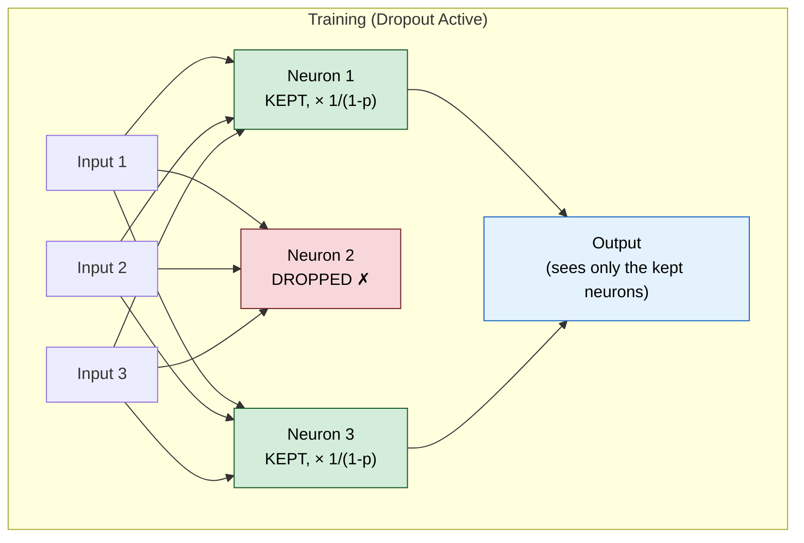

</details>

### Step-by-Step Mechanism ★★★

<details>
<summary><strong>Read as text</strong> — training vs inference, a worked mask, typical rates and the naming trap</summary>

```
During TRAINING (a fresh random mask for every mini-batch):
  1. For each neuron, draw r ~ Uniform(0, 1)
  2. If r < p (the dropout rate): set the neuron's output to 0 (dropped)
  3. Scale the remaining outputs by 1/(1-p) so the expected value is unchanged
     (this is "inverted dropout" — the standard implementation)

During INFERENCE:
  1. Use ALL neurons (no dropout) — call model.eval()
  2. No scaling needed (inverted dropout already did it during training)

Example with p = 0.5 (this step, neurons 2 and 4 happen to be dropped):
  Full outputs:       [3, 4, 7, 2, 5]
  Training (masked):  [3, 0, 7, 0, 5]  → scale by 1/(1-0.5) = 2 → [6, 0, 14, 0, 10]
  Inference:          [3, 4, 7, 2, 5]  → no change
  Neuron 1 over many training steps: 6 half the time, 0 half the time → average 3 = its inference value
```

**Typical rates:** about 0.1 in Transformers, 0.3–0.5 on large fully connected layers; large LLM pre-training often uses **no** dropout (PaLM was trained without it), adding it back for fine-tuning on small datasets.

**Naming trap:** PyTorch's `nn.Dropout(p)` and Keras's `Dropout(rate)` give the probability of **dropping** a unit, but the original paper (Srivastava et al., *JMLR* 2014) used p for the probability of **keeping** it (p = 0.5 for hidden units, 0.8 for inputs). Say which convention you mean.

</details>

### Why Dropout Works — Three Perspectives ★★★

<details>
<summary><strong>Read as text</strong> — ensemble, no co-adaptation and noise injection</summary>

| Perspective | The idea | What it buys |
|---|---|---|
| **Ensemble** | Each mask is a different "thinned" sub-network; N droppable units give 2ᴺ masks (64 for N = 6), all sharing weights | Inference with the full network ≈ averaging them — exact for one linear layer, approximate after non-linearities |
| **No co-adaptation** | A neuron can't rely on a specific partner being present ("I'll handle X if you handle Y") | Each feature must be useful on its own → more robust features |
| **Noise injection** | Multiplicative Bernoulli noise on activations: Var(ã) = a² · p/(1 − p) — at p = 0.5 the noise is as large as the signal | Like data augmentation for hidden layers |

**Go deeper:** [Ch 6 §4.5](#content/06_math_fundamentals) (the expectation and variance, simulated) · [Ch 14 §14.7](#content/14_neural_networks) · [Ch 32 Q28](#content/32_interview_questions)

</details>

---

## Batch Normalization ★★★

> **Maths in one line:** `x̂ = (x − μ_B) / √(σ²_B + ε),  y = γ·x̂ + β` — standardize each feature with the current mini-batch's mean and variance, then let the learned scale γ and shift β choose the final range.

![Infographic comparing BatchNorm, LayerNorm and RMSNorm: x-hat = (x - batch mean) / sqrt(batch variance + epsilon), y = gamma times x-hat + beta, with each symbol labelled; a 4 x 3 batch grid drawn three times, BatchNorm averaging one feature column (2, 4, 6, 8 gives mean 5, variance 5, sigma 2.24, x-hat -1.34, -0.45, 0.45, 1.34), LayerNorm one token row (3.0, 1.5, 2.0 gives mean 2.17, sigma 0.62, x-hat 1.34, -1.07, -0.27) and RMSNorm the same row with no mean (RMS 2.25 gives 1.33, 0.67, 0.89); a table of statistics, train vs inference, batch size 1 and typical models; notes on running averages with m = 0.1 in PyTorch, the plus or minus 71% wobble at batch size 2, and Santurkar 2018; trap: forgetting model.eval().](diagrams/top34_info_batchnorm_vs_layernorm_ai.png)

### The Problem It Solves ★★★

<details>
<summary><strong>Read as text</strong> — internal covariate shift and the modern caveat</summary>

```
During training, each layer receives inputs from the previous layer.
As weights update, the input distribution to each layer shifts.
The original paper (Ioffe & Szegedy, Google, 2015) called this
"Internal Covariate Shift" — each layer must constantly readapt.

BatchNorm keeps each layer's inputs in a stable range → you can use a
larger learning rate, care less about initialization, and train faster.
```

> **Modern caveat:** The original "Internal Covariate Shift" explanation is now contested. Santurkar et al. (NeurIPS 2018) showed BatchNorm's main benefit is **smoothing the loss landscape** (making gradients more predictable), not reducing ICS — the two are only weakly correlated. Cite the loss-landscape view in interviews.

</details>

### Step-by-Step Computation ★★★

<details>
<summary><strong>Read as text</strong> — the four steps, a worked batch of four and the flow</summary>

For a mini-batch $B = \{x_1, x_2, \ldots, x_m\}$:

**Step 1:** Compute batch mean

$$\mu_B = \frac{1}{m} \sum x_i$$

**Step 2:** Compute batch variance

$$\sigma_B^2 = \frac{1}{m} \sum (x_i - \mu_B)^2$$

**Step 3:** Normalize

$$\hat{x}_i = \frac{x_i - \mu_B}{\sqrt{\sigma_B^2 + \varepsilon}} \qquad \leftarrow \varepsilon \text{ for numerical stability}$$

**Step 4:** Scale and shift (learnable parameters!)

$$y_i = \gamma \cdot \hat{x}_i + \beta$$

$\gamma$ (scale) and $\beta$ (shift) are LEARNED during training. They allow the network to undo the normalization if needed. Without them, we'd be forcing a $\mathcal{N}(0,1)$ distribution, which might not be optimal.

```
One feature, a batch of 4:   x = [2, 4, 6, 8]

  μ_B  = (2 + 4 + 6 + 8) / 4         = 5
  σ²_B = (9 + 1 + 1 + 9) / 4         = 5      → σ = 2.24
  x̂    = (x − 5) / 2.24              = [−1.34, −0.45, 0.45, 1.34]
  y    = γ·x̂ + β                     = x̂ at the start (γ = 1, β = 0)
```

In a CNN a "feature" is a **channel**, and its statistics are pooled over the batch *and* every pixel position.

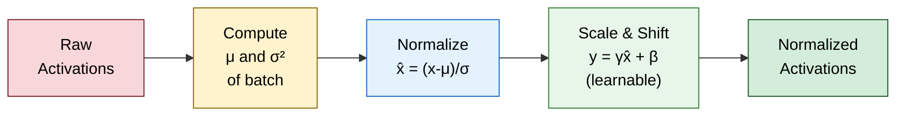

</details>

### BatchNorm During Inference ★★★

<details>
<summary><strong>Read as text</strong> — running averages, momentum conventions and small batches</summary>

Problem: At inference, we may have a single sample — no "batch" to compute $\mu, \sigma^2$.

Solution: During training, keep a running average of $\mu$ and $\sigma^2$, updated after every batch with a momentum $m$:

$$\begin{aligned}
\mu_{\text{running}} &= (1 - m) \times \mu_{\text{running}} + m \times \mu_{\text{batch}} \\
\sigma^2_{\text{running}} &= (1 - m) \times \sigma^2_{\text{running}} + m \times \sigma^2_{\text{batch}}
\end{aligned}$$

At inference: use $\mu_{\text{running}}$ and $\sigma^2_{\text{running}}$ instead of batch statistics. PyTorch's default is $m = 0.1$ — the weight on the **new** batch (it also stores the unbiased variance). Keras defines `momentum` the other way round: its default 0.99 is the weight on the **old** value. Two consequences:

1. You **must** switch to evaluation mode (`model.eval()`) at test time; in training mode the same example gets a different output depending on its batch-mates.
2. **Small batches hurt.** The batch mean wobbles by about σ/√B — ±71% of σ at B = 2 — so below roughly 16–32 examples per device, use GroupNorm or LayerNorm instead.

At inference BatchNorm is a fixed per-channel scale and shift, so it can be folded into the preceding convolution and costs nothing.

</details>

### LayerNorm & RMSNorm — Why Transformers Don't Use BatchNorm ★★★

<details>
<summary><strong>Read as text</strong> — BatchNorm vs LayerNorm vs RMSNorm, with numbers</summary>

All three normalizers apply the same two lines; they differ only in **which numbers** the statistics are taken over.

| | BatchNorm | LayerNorm | RMSNorm |
|---|---|---|---|
| Statistics over | One feature across the batch | One token's d features | One token's d features, no mean |
| Learned parameters | γ, β per feature | γ, β per feature (2d) | gain g only (d) |
| Training vs inference | Different (running averages) | Identical | Identical |
| Works at batch size 1? | Poorly | Yes | Yes |
| Typical home | CNNs (ResNet) | Original Transformer, BERT, GPT-2 | Llama, Gemma, Mistral, Qwen, DeepSeek |

**With numbers** (one token, x = [3.0, 1.5, 2.0], the example in [Ch 16 §1.5](#content/16_deep_learning)):

```
LayerNorm:  μ = 2.17, σ = 0.62          →  x̂ = [ 1.34, −1.07, −0.27]   (centred and scaled)
RMSNorm:    RMS = √((9 + 2.25 + 4)/3) = 2.25  →  x / 2.25 = [1.33, 0.67, 0.89]   (scaled only)
```

**Why Transformers use LayerNorm or RMSNorm instead of BatchNorm:**

1. **Variable lengths and padding.** "The same feature across the batch" mixes different positions and padding tokens, and statistics leak between sequences.
2. **Unstable batch statistics.** In NLP the batch statistics fluctuate strongly during training, which makes naive BatchNorm unstable and worse than LayerNorm (Shen et al., "PowerNorm", ICML 2020).
3. **Generation is per token.** LayerNorm normalizes each token on its own, so training and inference compute exactly the same thing — no running averages, any batch size.

RMSNorm (Zhang & Sennrich, 2019) drops the mean subtraction and β: one reduction instead of two, same quality, slightly faster — which is why most modern open LLMs use it, placed *before* each attention and MLP block ("pre-norm").

**Is normalization a regularizer?** Mostly it is an optimization aid. BatchNorm's batch-to-batch noise adds a *mild* regularizing effect; LayerNorm and RMSNorm have no batch noise, so they don't.

**Go deeper:** [Ch 16 §1.5](#content/16_deep_learning) · [Ch 6 §4.7](#content/06_math_fundamentals) · [Ch 32 Q27](#content/32_interview_questions)

</details>

---

## Early Stopping ★★★

> **Maths in one line:** `λ ≈ 1 / (2·α·τ)` — for a quadratic loss, τ gradient steps at learning rate α (starting near zero) act roughly like an L2 penalty λΣw² of this strength: more steps = weaker regularization (Goodfellow et al., *Deep Learning*, §7.8).

![Infographic on early stopping, label smoothing and augmentation: lambda is about 1 / (2 alpha tau), so more steps mean weaker L2-like regularization, and y_smooth = (1 - epsilon) times the one-hot target + epsilon / K; a loss-vs-epoch chart with training loss falling and validation loss U-shaped, marked STOP + restore best with a patience bracket; label smoothing with epsilon 0.1 and K = 5 turns 0, 0, 1, 0, 0 into 0.02, 0.02, 0.92, 0.02, 0.02, best logit gap ln(0.92 / 0.02) = 3.83; MixUp at lambda 0.7 gives cat 0.7 / dog 0.3 and CutMix 112x112 on 224x224 gives 25%, cat 0.75 / dog 0.25; a table of which regularizer to use for linear models, trees and neural nets, and the default order; trap: never use label-changing transforms such as rotating a 6 into a 9.](diagrams/top34_info_early_stopping_and_data_regularizers_ai.png)

<details>
<summary><strong>Read as text</strong> — the stopping rule, step by step</summary>

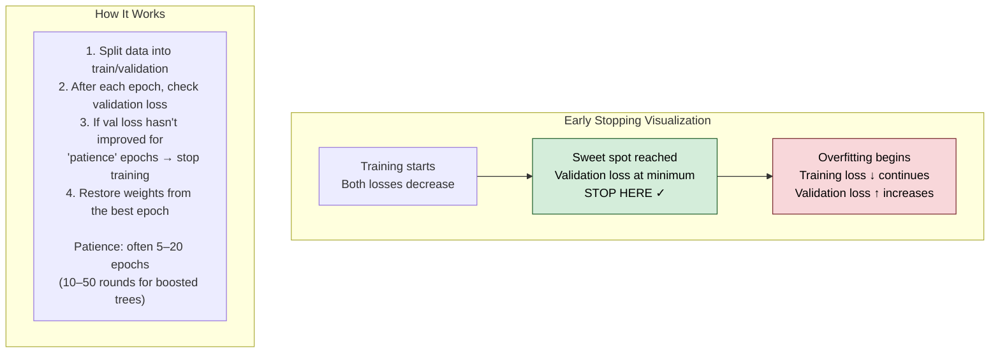

</details>

### Why It's Regularization ★★★

<details>
<summary><strong>Read as text</strong> — why fewer steps act like L2, and two traps</summary>

```
Early stopping limits training time → limits how many gradient steps
the model takes → limits how far weights can move from initialization.

For a quadratic loss and small steps, early stopping is APPROXIMATELY
equivalent to L2 regularization (Bishop, 1995; derivation in
Goodfellow et al., Deep Learning, §7.8):
  - More training steps ↔ smaller λ (less regularization)
  - Fewer training steps ↔ larger λ (more regularization)

The number of training steps is an implicit regularization parameter.
```

**Two traps:** (1) Step 4 is not automatic everywhere — Keras's `EarlyStopping` keeps the **last** weights unless you set `restore_best_weights=True`, and boosted-tree libraries expose `best_iteration` for the roll-back. (2) The validation score you stopped on is now optimistic — you used it to choose the stopping point, so report a separate test set.

**Go deeper:** [Ch 8 §8.15](#content/08_core_concepts) (early stopping in practice) · [Ch 12 §12.6](#content/12_key_algorithms) (the mechanics for boosted trees) · [Ch 14 §14.13](#content/14_neural_networks)

</details>

---

## Label Smoothing & Data Augmentation ★★

<details>
<summary><strong>Read as text</strong> — label smoothing, augmentation and the training-only rule</summary>

Two regularizers that change the **data** instead of the weights: label smoothing softens the targets, augmentation multiplies the inputs.

> **Maths in one line:** `y_smooth = (1 − ε)·y_one-hot + ε/K` — train toward "about 90% sure" instead of "100% sure": with ε = 0.1 and K = 5 classes, the target [0, 0, 1, 0, 0] becomes [0.02, 0.02, 0.92, 0.02, 0.02].

**Label smoothing.** With one-hot targets, cross-entropy keeps rewarding a bigger logit for the right class forever, so the model becomes over-confident. With smoothed targets the best prediction *is* the smoothed target, so the best logit gap is finite: ln(0.92 / 0.02) = 3.83 for K = 5. ε = 0.1 is the classic value (Inception-v3 on ImageNet, the original Transformer). It improves calibration but hurts knowledge distillation (a smoothed teacher's soft labels carry less information), and LLM pre-training usually uses plain cross-entropy.

**Data augmentation.** Create label-preserving variants of each training example, so the model learns the invariances you want:

| Technique | What changes | Example | Watch out |
|---|---|---|---|
| Flips, crops, colour jitter | The input; label unchanged | Every training image | Transforms that change the label (rotate a "6" by 180° → "9") |
| MixUp | Two images **and** their labels, blended | λ = 0.7 → label [cat 0.7, dog 0.3] | Training only — never at test time |
| CutMix | A patch of image 2 pasted on image 1; label by area | 112×112 patch on 224×224 = 25% → [cat 0.75, dog 0.25] | Recompute the share if the patch is clipped |
| RandAugment | N random operations at strength M | Two knobs, no search | Too strong a policy hurts small models |
| Text: back-translation, synonyms | A paraphrase of the input | English → French → English | Meaning drift; for LLMs, synthetic data from another model |

Augment the **training** set only. The one test-time exception, test-time augmentation (TTA), averages the model's predictions over a few flipped or cropped copies — it never changes labels.

**Go deeper:** [Ch 16 §1.4](#content/16_deep_learning) (label smoothing) · [Ch 16 §2.5](#content/16_deep_learning) (MixUp, CutMix, RandAugment) · [Ch 14 §14.13](#content/14_neural_networks) (basic augmentation)

</details>

---

## All Regularization Techniques — Decision Guide ★★★

<details>
<summary><strong>Read as text</strong> — which regularizer for which model, and a default order</summary>

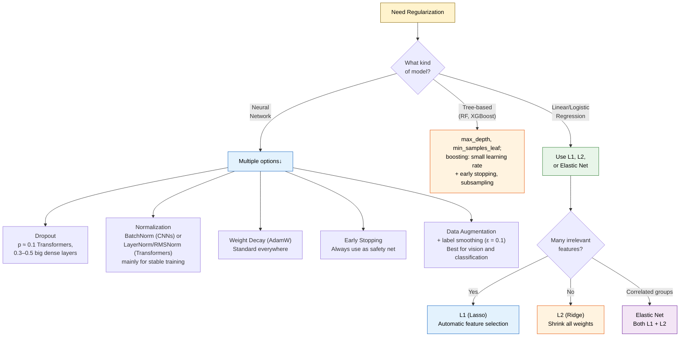

**A default order** when a model overfits: (1) more data or augmentation — it fixes the cause; (2) early stopping — nearly free; (3) L2 / weight decay; (4) dropout; (5) L1 only when you want sparsity; (6) a simpler model.

**Go deeper:** [Ch 8 §8.15](#content/08_core_concepts) ("Which One Should You Reach For?") · [Ch 16 §1.2](#content/16_deep_learning) (AdamW)

</details>

---

## Interview-Ready Answer Template

**Say this first (30 sec):** Regularization trades a little training fit for better generalization by limiting model complexity — classically, total loss = data loss + λ × penalty. L2 shrinks every weight smoothly and is the default; L1's constant pull drives weak weights to exactly zero, so it doubles as feature selection. For neural networks I combine weight decay via AdamW, dropout — about 0.1 in Transformers — and early stopping.

1. **L1 vs L2 —** L1's pull is a constant ±λ, so weak weights hit exactly zero (0.30 → 0 at λ = 0.4); L2's pull, 2λw, fades, so none do. Elastic Net for correlated features.
2. **Dropout —** drop each activation with probability p, scale survivors by 1/(1 − p); an implicit ensemble, off at inference.
3. **Normalization —** BatchNorm stabilizes CNN training (mild regularization from batch noise); Transformers use LayerNorm or RMSNorm — no batch statistics.
4. **Early stopping —** stop when validation loss stalls, restore the best checkpoint; ≈ L2 with strength ∝ 1/(steps × learning rate).
5. **Data side —** augmentation and label smoothing (ε = 0.1).

---

## Follow-Up Questions & Answers

**Q: "Why doesn't plain SGD with an L1 term give exact zeros?"**
> Its subgradient step overshoots zero and flips sign, so the weight jitters within about α·λ of zero (0.011–0.015 in the program above). Lasso solvers use soft-thresholding — shrink |w| by αλ and clip at zero — which lands exactly on 0.

**Q: "Is L2 regularization the same as weight decay?"**
> With plain SGD, yes: w ← (1 − 2αλ)·w − α·∇Loss. Under Adam the penalty's gradient is divided by Adam's per-weight scale, so heavily-updated weights barely decay; AdamW decays the weights directly ([Ch 16 §1.2](#content/16_deep_learning)).

**Q: "Should you use dropout and BatchNorm together?"**
> Carefully. Dropout changes a unit's variance between training and inference, while BatchNorm keeps the variance it accumulated in training — a "variance shift" that can hurt accuracy (Li et al., CVPR 2019). Put dropout after the last BatchNorm layer, or skip it: ResNets use BatchNorm with no dropout.

**Q: "Does dropout help large language models?"**
> Rarely in pre-training: one pass over trillions of tokens barely overfits, so many large models use no dropout at all (PaLM didn't). It comes back, around 0.1, when fine-tuning on small datasets.

**Q: "How do you choose λ or the dropout rate?"**
> They are hyperparameters: sweep on a log scale (say 10⁻⁴ to 10 for λ) and keep the value with the lowest validation loss. Too little and validation loss stays high from overfitting; too much and even training loss is high.

---

## Common Mistakes

| Mistake | Why It's Wrong |
|---------|---------------|
| "L2 removes useless features" | L2 shrinks weights but almost never to exactly zero. Only L1 (with soft-thresholding) selects features. |
| Regularizing unscaled features | The penalty depends on units, so a feature measured in millimetres is penalized very differently from one in metres. Standardize first. |
| Forgetting `model.eval()` | Dropout stays on and BatchNorm keeps using batch statistics, so predictions become noisy and depend on the other examples in the batch. |
| Calling Adam + L2 "weight decay" | Adam rescales the penalty per weight; decoupled weight decay is AdamW. |
| "Early stopping is exactly L2" | Only approximately, for a quadratic loss with small steps — and it only works if you restore the best checkpoint. |

---

---

# Topic 4 — Decision Trees & Ensemble Methods

## Why Google Asks This

Tree ensembles — Random Forest and gradient-boosted trees such as XGBoost and LightGBM — remain the default for tabular data across the industry: fraud detection, credit risk, click prediction, ranking features. Interviewers want to know you understand not just how to call them, but **why** they work, what the splitting criteria mean, and how bagging differs from boosting.

---

## Common Interview Questions

- "How does a Decision Tree decide where to split?"
- "What is Information Gain? Compare Gini Impurity vs Entropy."
- "Explain Random Forest. Why is it better than a single tree?"
- "Explain Gradient Boosting step by step."
- "Bagging vs Boosting — when would you use each?"
- "What makes XGBoost so effective? How do LightGBM and CatBoost differ?"
- "Which feature importance would you trust, and why?"

---

## Simple Explanation

A **Decision Tree** is like a game of 20 Questions. At each step, you ask the single best yes/no question to narrow down the answer. "Is it a mammal?" → "Does it have four legs?" → "Is it bigger than a cat?" → "It's a dog!"

A **Random Forest** is like asking 100 different people to play 20 Questions, each with slightly different rules, then taking a vote. The crowd is smarter than any individual.

**Gradient Boosting** is like a team of specialists. The first doctor makes a diagnosis. The second doctor looks at what the first got wrong and corrects those mistakes. The third corrects the remaining mistakes, and so on.

---

## Decision Tree — Splitting Criteria ★★★

> **Maths in one line:** `gain = I(parent) − Σⱼ (nⱼ / N) · I(childⱼ)`, with impurity `I` = Gini `1 − Σpᵢ²` or entropy `−Σpᵢ log₂ pᵢ` — at each node the tree tries every feature and threshold and keeps the split whose children are purest once each child is weighted by its share of the rows.

![Infographic: how a decision tree picks a split. Formula gain = I(parent) − Σⱼ (nⱼ/N) · I(childⱼ), with Gini = 1 − Σpᵢ² and entropy = −Σpᵢ log₂ pᵢ, each symbol labelled. Worked example on 100 emails with 60 spam: parent Gini 0.48 and entropy 0.971 bits; the split 'contains FREE' gives children 48/2 and 12/38 with entropy 0.242 and 0.795, so information gain = 0.971 − 0.519 = 0.452 bits. A tree drawing adds a 'known sender?' split (2/28 and 10/10). A table compares splits A, B and C by information, Gini and error gain (0.4523, 0.2592, 0.2600 / 0.0013, 0.0008, 0 / 0.1140, 0.0612, 0), showing that misclassification error scores the useful split C as zero.](diagrams/top34_info_tree_splitting_criteria_ai.png)

### How a Tree Decides Where to Split ★★★

<details>
<summary><strong>Read as text</strong> — the spam tree and the greedy search</summary>

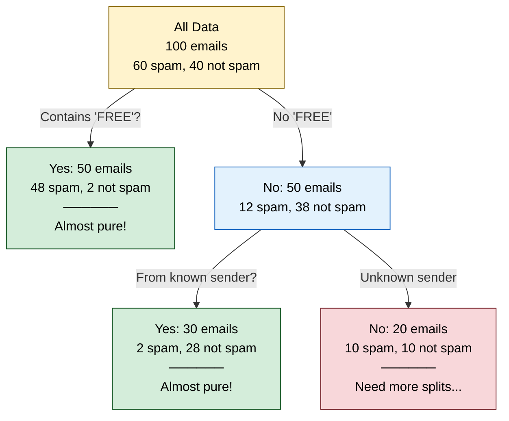

The search is **greedy**: the best question *now*, with no look-ahead, because finding the truly optimal tree is NP-complete. For a numeric feature the candidate thresholds are the midpoints between its sorted distinct values.

</details>

### Gini Impurity ★★★

<details>
<summary><strong>Read as text</strong> — the Gini formula, worked on 60 spam / 40 not</summary>

$$\text{Gini}(\text{node}) = 1 - \sum p_i^2$$

Where $p_i$ = fraction of class $i$ in the node.

**Example:** Node with 60 spam, 40 not-spam (100 total): $p_{\text{spam}} = 0.6$, $p_{\text{not}} = 0.4$

$$\text{Gini} = 1 - (0.6^2 + 0.4^2) = 1 - (0.36 + 0.16) = 0.48$$

Pure node (all spam): $\text{Gini} = 1 - (1.0^2) = 0$ — perfect!

Perfectly mixed: $\text{Gini} = 1 - (0.5^2 + 0.5^2) = 0.5$ — worst!

Range: 0 (pure) to 0.5 for two classes; with K classes the maximum is 1 − 1/K. Read it as "the chance that two randomly drawn examples from the node have different classes".

</details>

### Entropy & Information Gain ★★★

<details>
<summary><strong>Read as text</strong> — entropy and information gain, worked on 60 spam / 40 not</summary>

$$\text{Entropy}(\text{node}) = -\sum p_i \cdot \log_2(p_i)$$

**Example:** Node with 60 spam, 40 not-spam:

$$H = -(0.6 \times \log_2(0.6) + 0.4 \times \log_2(0.4)) = -(0.6 \times (-0.737) + 0.4 \times (-1.322)) = 0.971 \text{ bits}$$

Pure node: $H = 0$ bits. Perfectly mixed: $H = 1.0$ bit.

$$\text{Information Gain} = H(\text{parent}) - \sum \frac{n_j}{N} \times H(\text{child}_j) = \text{entropy before split} - \text{weighted entropy after split}$$

The tree picks the split with HIGHEST information gain (= biggest reduction in entropy/uncertainty).

</details>

### Worked Example — Choosing the Best Split ★★★

<details>
<summary><strong>Read as text</strong> — splits A and B by hand, and Gini vs entropy</summary>

Dataset: 100 emails (60 spam, 40 not-spam). Two candidate features to split on:

**OPTION A:** Split on "Contains FREE"
- Left child (yes): 50 emails → 48 spam, 2 not-spam
- Right child (no): 50 emails → 12 spam, 38 not-spam

$$H(\text{left}) = -\!\left(\tfrac{48}{50} \log_2 \tfrac{48}{50} + \tfrac{2}{50} \log_2 \tfrac{2}{50}\right) = -(0.96 \times (-0.059) + 0.04 \times (-4.644)) = 0.242 \text{ bits}$$

$$H(\text{right}) = -\!\left(\tfrac{12}{50} \log_2 \tfrac{12}{50} + \tfrac{38}{50} \log_2 \tfrac{38}{50}\right) = -(0.24 \times (-2.059) + 0.76 \times (-0.396)) = 0.795 \text{ bits}$$

$$\text{IG}(A) = 0.971 - \left(\tfrac{50}{100} \times 0.242 + \tfrac{50}{100} \times 0.795\right) = 0.971 - 0.519 = 0.452 \text{ bits}$$

**OPTION B:** Split on "Email length > 100 words"
- Left child (yes): 40 emails → 25 spam, 15 not-spam
- Right child (no): 60 emails → 35 spam, 25 not-spam

$$H(\text{left}) = -\!\left(\tfrac{25}{40} \log_2 \tfrac{25}{40} + \tfrac{15}{40} \log_2 \tfrac{15}{40}\right) = 0.954 \text{ bits}$$

$$H(\text{right}) = -\!\left(\tfrac{35}{60} \log_2 \tfrac{35}{60} + \tfrac{25}{60} \log_2 \tfrac{25}{60}\right) = 0.980 \text{ bits}$$

$$\text{IG}(B) = 0.971 - \left(\tfrac{40}{100} \times 0.954 + \tfrac{60}{100} \times 0.980\right) = 0.971 - 0.970 = 0.001 \text{ bits}$$

**WINNER:** Split A (Contains "FREE") with $\text{IG} = 0.452 \gg 0.001$. Split B barely changes the class mix (62.5% and 58.3% spam vs 60% in the parent).

**Gini or entropy?** They rank splits almost identically — Gini gain here is 0.259 for A and 0.001 for B. Gini is scikit-learn's default because it skips the logarithm. What you should **not** split on is plain misclassification error — the program shows why:

</details>

```python
# Choosing a split: entropy and Gini agree on the chapter's spam example; misclassification error can't see a good split
import numpy as np

def entropy(spam, ham):
    p = np.array([spam, ham]) / (spam + ham)
    p = p[p > 0]
    return float(-(p * np.log2(p)).sum())

def gini(spam, ham):
    p = np.array([spam, ham]) / (spam + ham)
    return float(1 - (p ** 2).sum())

def error(spam, ham):                                  # misclassification rate if the node predicts its majority
    return min(spam, ham) / (spam + ham)

def gain(impurity, parent, children):
    n = sum(parent)
    after = sum((s + h) / n * impurity(s, h) for s, h in children)
    return impurity(*parent) - after

parent = (60, 40)                                      # 100 emails: 60 spam, 40 not-spam
splits = {"A: contains FREE": [(48, 2), (12, 38)],
          "B: length > 100": [(25, 15), (35, 25)],
          "C: one rare word": [(19, 1), (41, 39)]}     # contrast: purifies a small child
print(f"parent: entropy {entropy(*parent):.3f} bits, Gini {gini(*parent):.3f}, error {error(*parent):.2f}")
print(f"{'split':18s} {'info gain':>9s} {'Gini gain':>9s} {'error gain':>10s}")
for name, kids in splits.items():
    ig, gg, eg = (round(gain(f, parent, kids), 4) + 0.0 for f in (entropy, gini, error))
    print(f"{name:18s} {ig:9.4f} {gg:9.4f} {eg:10.4f}")

assert round(gain(entropy, parent, splits["A: contains FREE"]), 3) == 0.452
assert gain(gini, parent, splits["A: contains FREE"]) > 100 * gain(gini, parent, splits["B: length > 100"])
assert abs(gain(error, parent, splits["C: one rare word"])) < 1e-12 < gain(gini, parent, splits["C: one rare word"])
```

**Output:**

```
parent: entropy 0.971 bits, Gini 0.480, error 0.40
split              info gain Gini gain error gain
A: contains FREE      0.4523    0.2592     0.2600
B: length > 100       0.0013    0.0008     0.0000
C: one rare word      0.1140    0.0612     0.0000
```

<details>
<summary><strong>Read as text</strong> — continued: why error gain cannot see split C</summary>

Split C isolates 20 emails that are 95% spam, yet its error gain is **zero**: both children still predict "spam", so the count of mistakes (40) doesn't move. Gini and entropy are strictly concave, so any split that changes the class mix scores above zero — the tree can make progress one useful split at a time. That is why trees split on Gini or entropy and only *report* accuracy.

</details>

### Regression Trees, Overfitting & Cost ★★

<details>
<summary><strong>Read as text</strong> — regression trees, overfitting controls and cost</summary>

- **Regression trees** use the same loop with variance (squared error) as the impurity, and a leaf predicts the mean of its rows — so a tree can never predict outside the range of targets it was trained on.
- **A tree grown until every leaf is pure memorizes the training set** (low bias, high variance). Control it with `max_depth`, `min_samples_leaf`, or cost-complexity pruning (`ccp_alpha` in scikit-learn).
- **Cost:** building a balanced tree takes about O(d · n log n) for n rows and d features; a prediction walks one root-to-leaf path, O(depth). Trees need no feature scaling — a split is a threshold, so any monotonic rescaling gives the same tree.

**Go deeper:** [Ch 12 §12.4](#content/12_key_algorithms) · [Ch 10 §10.7](#content/10_supervised_learning) (Gini vs entropy side by side)

</details>

---

## Random Forest ★★★

> **Maths in one line:** `Var(average of K trees) = ρσ² + (1 − ρ)σ²/K` — with K trees of variance σ² and pairwise correlation ρ, adding trees shrinks only the second term; only making the trees disagree (smaller ρ) lowers the floor ρσ².

![Infographic: Random Forest. Each tree trains on a bootstrap sample of N rows (about 63.2% unique) and tries a random √M features per split; the trees vote or average. Formula Var(average of K trees) = ρσ² + (1 − ρ)σ²/K with ρ, σ² and K labelled and ρσ² marked as the floor. Worked numbers with σ² = 1 and K = 100: ρ = 0.9 gives 0.901, ρ = 0.3 gives 0.307, ρ = 0 gives 0.010, plotted as variance against 1, 10 and 100 trees flattening at the dashed floors. A feature-importance table contrasts MDI (a random ID scored 0.439), permutation importance (the same ID only +0.018) and SHAP (not causal); out-of-bag notes: each row is unseen by about 36.8% of trees, OOB accuracy 0.722 vs 5-fold CV 0.726.](diagrams/top34_info_random_forest_ai.png)

<details>
<summary><strong>Read as text</strong> — bootstrap samples, random features and the vote</summary>

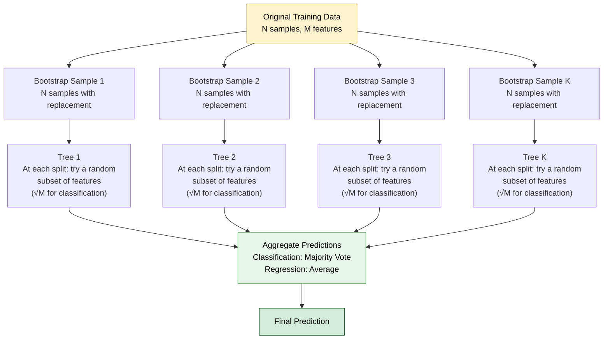

(√M is scikit-learn's default for classification; its regression default uses all M features, and Breiman's classic M/3 is worth trying to decorrelate regression trees.)

</details>

### Why Random Forest Works — Two Levels of Randomness ★★★

<details>
<summary><strong>Read as text</strong> — two levels of randomness and the variance formula</summary>

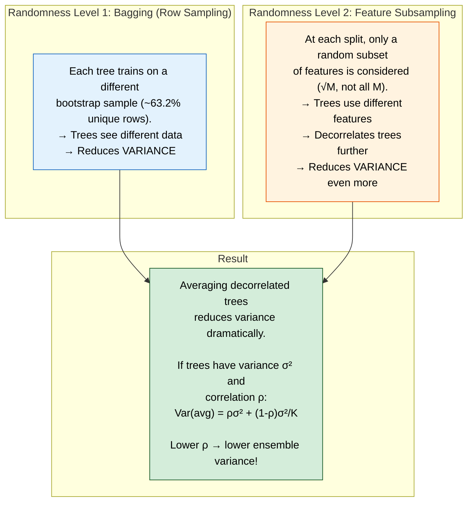

Why bother with the second level? If one feature dominates, every bootstrapped tree splits on it first and the trees stay alike (high ρ). Hiding it from some splits forces genuinely different trees. The simulation checks the formula and the 63.2%:

</details>

```python
# Why random forests decorrelate trees: Var(average of K trees) = rho*sigma^2 + (1 - rho)*sigma^2/K
import numpy as np

rng = np.random.default_rng(0)
sigma2, trials = 1.0, 20_000                     # each tree's prediction error has variance 1

def simulate(rho, K):
    shared = rng.normal(size=(trials, 1))        # the part of the error every tree shares
    own = rng.normal(size=(trials, K))           # the part unique to each tree
    trees = np.sqrt(rho * sigma2) * shared + np.sqrt((1 - rho) * sigma2) * own   # corr(tree i, tree j) = rho
    return trees.mean(axis=1).var()

print(f"{'rho':>4s} {'K':>4s} {'formula':>8s} {'simulated':>9s}")
for rho in (0.9, 0.3, 0.0):
    for K in (1, 10, 100):
        formula = rho * sigma2 + (1 - rho) * sigma2 / K
        sim = simulate(rho, K)
        print(f"{rho:4.1f} {K:4d} {formula:8.3f} {sim:9.3f}")
        assert abs(sim - formula) < 0.05

# The bootstrap behind bagging: a sample of N rows drawn with replacement
N = 100
unique = [len(np.unique(rng.integers(0, N, size=N))) / N for _ in range(2_000)]
print(f"bootstrap of N = {N}: unique rows {np.mean(unique):.3f}, theory 1 - (1 - 1/N)^N = {1 - (1 - 1 / N) ** N:.3f}")
```

**Output:**

```
 rho    K  formula simulated
 0.9    1    1.000     0.996
 0.9   10    0.910     0.906
 0.9  100    0.901     0.902
 0.3    1    1.000     0.998
 0.3   10    0.370     0.374
 0.3  100    0.307     0.312
 0.0    1    1.000     0.991
 0.0   10    0.100     0.099
 0.0  100    0.010     0.010
bootstrap of N = 100: unique rows 0.635, theory 1 - (1 - 1/N)^N = 0.634
```

<details>
<summary><strong>Read as text</strong> — continued: what the simulation shows</summary>

With ρ = 0.9, a hundred trees still keep 90% of one tree's variance (0.901); cut the correlation to 0.3 and the same hundred trees reach 0.307. More trees can never beat the ρσ² floor — decorrelation is the lever.

</details>

### Out-of-Bag (OOB) Error ★★★

<details>
<summary><strong>Read as text</strong> — out-of-bag error as free validation</summary>

```
Each bootstrap sample leaves out about 36.8% of the rows ((1 − 1/N)^N → e⁻¹),
so every row is "out-of-bag" (OOB) for roughly a third of the trees.

For each row, collect predictions only from the trees that never saw it
→ vote or average → compare with the true label → OOB error.

OOB error ≈ cross-validation error from ONE fit (Ch 12: OOB accuracy 0.722
vs 5-fold CV 0.726). Use it for tuning instead of a separate validation
set — but still keep an untouched test set for the number you report.
```

Boosting has no equivalent: its trees are built in sequence on the errors of all previous trees, so no row is left untouched — boosted models need an explicit validation set for early stopping.

</details>

### Feature Importance — Which Number to Trust ★★★

<details>
<summary><strong>Read as text</strong> — MDI vs permutation vs SHAP, and what to say</summary>

| Method | How it works | Pitfall |
|---|---|---|
| **MDI** (impurity; scikit-learn's `feature_importances_`) | Sum of impurity drops from every split on the feature, on training data | Biased toward high-cardinality and continuous features: in Ch 12 a random ID scored MDI 0.439 but permutation importance only +0.018 |
| **Permutation** | Shuffle one column on held-out data and measure the score drop | Correlated features share credit — shuffle one and the model uses its twin, so both can look unimportant |
| **SHAP** (TreeSHAP) | Each prediction = base value + one signed share per feature (Shapley values); exact for trees in polynomial time | Explains the model, not causation; correlated features still split credit; classifier SHAP values add up in log-odds |

**Say:** "I report permutation importance on held-out data for the global ranking and SHAP for individual predictions — never the default MDI alone — and I don't read either as causal."

**Go deeper:** [Ch 12 §12.5](#content/12_key_algorithms) · [Ch 10 §10.8](#content/10_supervised_learning) · [Ch 10 §10.10](#content/10_supervised_learning) (MDI vs permutation vs SHAP) · [Ch 32 Q7](#content/32_interview_questions)

</details>

---

## Gradient Boosting — Step by Step ★★★

> **Maths in one line:** `F_m(x) = F_{m−1}(x) + η · h_m(x)`, with each small tree h_m fit to the pseudo-residuals `rᵢ = −∂L/∂F(xᵢ)` (just y − F for squared error) — every round takes an η-sized step downhill on the loss, one tree at a time.

![Infographic: gradient boosting to XGBoost. Formula Fₘ(x) = Fₘ₋₁(x) + η · hₘ(x) with η = 0.1 and each small tree fit to the residuals y − F, plus the XGBoost leaf weight w* = −G / (H + λ) with G, H and λ labelled. Worked example on three houses (targets 300, 500, 200): F₀ = 333.3, residuals −33.3, +166.7, −133.3, the stump 'size < 2,000?' gives leaves −83.3 and +166.7, so F₁ = 325, 350, 325 and SSE falls 46,666.7 → 38,750.0 → 32,337.5 after round 2. The XGBoost leaf {A, C} with G = +166.7, H = 2 shrinks from −83.3 to −55.6 at λ = 1 and the one-row leaf {B} halves from +166.7 to +83.3. A mini diagram contrasts bagging (deep parallel trees, averaged, cuts variance) with boosting (shallow trees, depth 3–8, in sequence, summed, cuts bias).](diagrams/top34_info_gradient_boosting_and_xgboost_ai.png)

<details>
<summary><strong>Read as text</strong> — the boosting loop and why it is called "gradient"</summary>

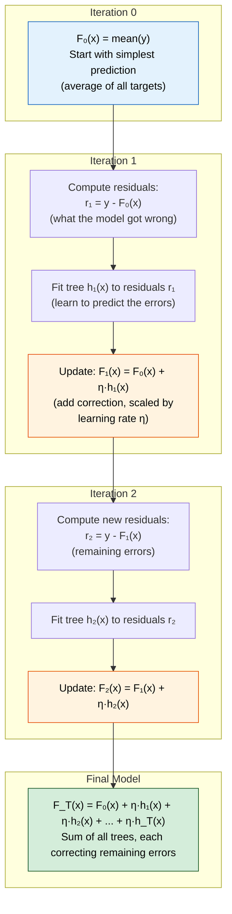

Why "gradient"? For squared error $L = \tfrac12 (y - F)^2$ the negative gradient is exactly the residual $y - F$. For other losses the same loop fits the tree to $-\partial L / \partial F$ instead — for log-loss that is $y - p$ — which is why one algorithm handles regression, classification and ranking. ($F_0$ is the best constant: the mean for squared error, the log-odds of the base rate for log-loss.)

</details>

### Worked Numerical Example ★★★

<details>
<summary><strong>Read as text</strong> — three rounds by hand on three houses</summary>

```
Data: predict house price (in thousands)
  House A: 1,500 sq ft, actual 300
  House B: 2,500 sq ft, actual 500
  House C: 1,000 sq ft, actual 200
  Each tree is a stump (one split on size); learning rate η = 0.1

STEP 0: F₀ = mean = (300 + 500 + 200) / 3 = 333.3
  Residuals r = y − F₀:   A = −33.3,  B = +166.7,  C = −133.3       SSE = 46,667

STEP 1: Fit stump h₁ to the residuals. Best split: "size < 2,000?"
  left  {A, C} → mean residual (−33.3 − 133.3) / 2 = −83.3
  right {B}    → +166.7
  F₁ = F₀ + 0.1 × h₁:   A = 333.3 − 8.3 = 325.0
                        B = 333.3 + 16.7 = 350.0
                        C = 333.3 − 8.3 = 325.0
  New residuals:        A = −25.0,  B = +150.0,  C = −125.0         SSE = 38,750

STEP 2: h₂ on the new residuals: same split, leaves −75.0 / +150.0
  F₂:  A = 317.5,  B = 365.0,  C = 317.5                            SSE = 32,338

  ... each round removes 10% of the error the stump can see. A and C share a
  leaf, so the stump cannot tell them apart yet; from round 6 it starts
  splitting C off as well. Hundreds of small rounds, stopped early on a
  validation set, drive the error down without memorizing noise.
```

The program reproduces the three rounds, then previews the XGBoost leaf formula from the next sections on round 1's stump:

</details>

```python
# Gradient boosting by hand on the chapter's three houses (stumps, eta = 0.1), then XGBoost's leaf weight -G/(H + lambda)
import numpy as np

size = np.array([1500, 2500, 1000])              # square feet: the one feature a stump can split on
y = np.array([300.0, 500.0, 200.0])              # price in thousands of dollars
eta = 0.1

def best_stump(x, r):                            # try every threshold, keep the lowest squared error
    best = None
    xs = np.unique(x)
    for t in (xs[:-1] + xs[1:]) / 2:             # midpoints between sorted values
        left = x < t
        pred = np.where(left, r[left].mean(), r[~left].mean())
        sse = ((r - pred) ** 2).sum()
        if best is None or sse < best[0]:
            best = (sse, t, pred)
    return best[1], best[2]

F = np.full(3, y.mean())                         # round 0: predict the mean, 333.3
print(f"round 0: F = {np.round(F, 1).tolist()}  SSE {((y - F) ** 2).sum():,.1f}")
for m in range(1, 4):
    r = y - F                                    # residual = negative gradient of 0.5*(y - F)^2
    t, h = best_stump(size, r)
    print(f"round {m}: residuals {np.round(r, 1).tolist()}  stump 'size < {t:,.0f}?' -> h = {np.round(h, 1).tolist()}")
    F = F + eta * h
    print(f"         F = {np.round(F, 2).tolist()}  SSE {((y - F) ** 2).sum():,.1f}")
assert np.allclose(y.mean() + eta * np.array([-83.333, 166.667, -83.333]), [325, 350, 325], atol=1e-3)

# XGBoost leaf weight for round 1's stump: squared loss gives g = F - y and h = 1 per row
g = np.full(3, y.mean()) - y
for lam in (0.0, 1.0):
    for leaf, rows in (("A,C", [0, 2]), ("B", [1])):
        G, H = g[rows].sum(), len(rows) * 1.0
        print(f"lambda = {lam:.0f}: leaf {{{leaf}}}  G = {G:+.1f}, H = {H:.0f}  ->  w* = {-G / (H + lam):+.1f}")
assert np.isclose(-g[[0, 2]].sum() / 2, -83.333, atol=1e-3)     # lambda = 0: w* is just the mean residual
```

**Output:**

```
round 0: F = [333.3, 333.3, 333.3]  SSE 46,666.7
round 1: residuals [-33.3, 166.7, -133.3]  stump 'size < 2,000?' -> h = [-83.3, 166.7, -83.3]
         F = [325.0, 350.0, 325.0]  SSE 38,750.0
round 2: residuals [-25.0, 150.0, -125.0]  stump 'size < 2,000?' -> h = [-75.0, 150.0, -75.0]
         F = [317.5, 365.0, 317.5]  SSE 32,337.5
round 3: residuals [-17.5, 135.0, -117.5]  stump 'size < 2,000?' -> h = [-67.5, 135.0, -67.5]
         F = [310.75, 378.5, 310.75]  SSE 27,143.4
lambda = 0: leaf {A,C}  G = +166.7, H = 2  ->  w* = -83.3
lambda = 0: leaf {B}  G = -166.7, H = 1  ->  w* = +166.7
lambda = 1: leaf {A,C}  G = +166.7, H = 2  ->  w* = -55.6
lambda = 1: leaf {B}  G = -166.7, H = 1  ->  w* = +83.3
```

<details>
<summary><strong>Read as text</strong> — continued: where to go deeper</summary>

**Go deeper:** [Ch 12 §12.6](#content/12_key_algorithms) (three rounds on Maple Street, early stopping, the learning-rate trade-off) · [Ch 32 Q8](#content/32_interview_questions)

</details>

---

## Bagging vs Boosting — Comprehensive Comparison ★★★

<details>
<summary><strong>Read as text</strong> — average vs sum, aspect by aspect</summary>

> **Maths in one line:** bagging `f̂ = (1/K) Σₖ fₖ` (an **average** of independent models: cuts variance, down to the ρσ² floor) vs boosting `F_M = F₀ + η Σₘ hₘ` (a **sum** of dependent corrections: each term cuts the bias that is left).

| Aspect | Bagging (Random Forest) | Boosting (XGBoost, LightGBM) |
|--------|------------------------|-------------------|
| Training | Trees independent — built in parallel | Trees sequential — each fits the errors so far (parallelism is only inside one tree's split search) |
| Base trees | Deep (low bias, high variance) | Shallow, depth 3–8 (XGBoost default 6); AdaBoost classically uses depth-1 stumps |
| Mainly reduces | Variance | Bias (shrinkage and subsampling also curb variance) |
| More trees | Never overfits; gains fade after a few hundred | Eventually overfits — choose the count with early stopping |
| Tuning effort | Low — defaults work well | Higher — learning rate, depth, subsampling |
| Noisy labels / outliers | Robust | Can chase noise; use a robust loss and early stopping |
| When to use | Quick, stable baseline with little tuning | Maximum accuracy on tabular data, with a validation set |

Bagging needs **low-bias** learners (averaging cannot remove bias — an average of stumps is still a stump-quality model); boosting needs **weak, low-variance** learners because it removes bias one step at a time.

**Go deeper:** [Ch 10 §10.8](#content/10_supervised_learning) · [Ch 32 Q6](#content/32_interview_questions)

</details>

---

## What Makes XGBoost Special ★★★

<details>
<summary><strong>Read as text</strong> — the leaf-weight formula and what XGBoost adds, with defaults</summary>

> **Maths in one line:** `w* = −G / (H + λ)` and `Gain = ½ [G_L²/(H_L+λ) + G_R²/(H_R+λ) − (G_L+G_R)²/(H_L+H_R+λ)] − γ` — G and H are the sums of the loss's first and second derivatives over a leaf's rows; λ shrinks leaf values toward zero and γ is the price of one more leaf.

| What XGBoost adds | How it works | Default (XGBoost docs) |
|---|---|---|
| **Second-order (Newton) steps** | Uses each row's gradient g and curvature h; any twice-differentiable loss plugs into the same solver | — |
| **Regularized objective** | Ω = γT + ½λΣw²; a split whose gain is below γ is pruned (`alpha` adds an L1 term) | λ = 1, γ = 0, alpha = 0 |
| **Sparsity-aware splits** | Every split learns a default direction for missing values from the training loss | NaN = missing |
| **Fast split search** | Weighted quantile sketch in the paper; today histogram binning (`tree_method="hist"`) | `hist` (the default since 2.0), max_bin 256 |
| **System design** | Cache-aware column blocks, out-of-core training, multithreaded split search, GPU (`device="cuda"`) | CPU |
| **Shrinkage + column subsampling** | Borrowed from Friedman's GBM and from random forests | eta 0.3, max_depth 6, colsample 1 |

</details>

### XGBoost Objective Function ★★★

<details>
<summary><strong>Read as text</strong> — the regularized objective, with the chapter's numbers</summary>

$$\text{Obj} = \underbrace{\sum L(y_i, \hat{y}_i)}_{\text{Training loss}} + \underbrace{\sum \Omega(f_k)}_{\text{Regularization on trees}}$$

$$\text{where } \Omega(f) = \gamma T + \tfrac{1}{2}\lambda \sum w_j^2$$

- $T$ = number of terminal nodes (leaves)
- $w_j$ = score of leaf $j$
- $\gamma$ = minimum loss reduction to make a split (complexity cost per leaf)
- $\lambda$ = L2 regularization on leaf weights

This is why XGBoost is called "regularized boosting." Friedman's original gradient boosting has no $\Omega$ term — it controls complexity only through depth, shrinkage and subsampling.

**With the chapter's numbers.** For squared loss, $g_i = F - y_i$ and $h_i = 1$, so a leaf's weight is $-G/(H + \lambda)$ = (sum of residuals) / (rows + λ). In round 1 above, leaf {A, C} has G = +166.7 and H = 2: at λ = 0 its weight is −83.3, the plain mean residual; at XGBoost's default λ = 1 it shrinks to −55.6. The one-row leaf {B} is halved, +166.7 → +83.3 — **λ shrinks leaves with few rows the most**, which is exactly where overfitting lives.

</details>

### XGBoost vs LightGBM vs CatBoost ★★

<details>
<summary><strong>Read as text</strong> — three libraries, their tricks and the leaf-wise trap</summary>

All three run the same boosting loop; they differ in how they grow trees and handle categories.

| Library | Its trick | Reach for it when |
|---|---|---|
| **XGBoost** | Newton steps + regularized objective; **level-wise** growth by default | You want the most battle-tested option and ecosystem |
| **LightGBM** | Histogram binning (max_bin 255) + **leaf-wise** growth (num_leaves 31), plus GOSS row sampling and EFB feature bundling | Large data and training speed |
| **CatBoost** | **Ordered target statistics** and ordered boosting (category encodings and residuals use only "earlier" rows, so no target leakage); **oblivious** (symmetric) trees for fast inference | Many high-cardinality categorical features |

**Trap:** leaf-wise growth keeps splitting the single highest-loss leaf, so LightGBM overfits small data more readily — control it with `num_leaves` (keep it below 2^max_depth), not just `max_depth`. With equal tuning the three usually land close together; features and validation design matter more. As of Nov 2026, boosted trees remain the default for tabular data, though on small tables (roughly ≤ 10K rows) a tabular foundation model such as TabPFN is worth a quick try ([Ch 12 §12.10](#content/12_key_algorithms)).

**Go deeper:** [Ch 12 §12.6](#content/12_key_algorithms) (XGBoost vs LightGBM vs CatBoost, tuning order) · [Ch 32 Q8](#content/32_interview_questions)

</details>

---

## Interview-Ready Answer Template

**Say this first (30 sec):** A decision tree greedily picks the split that most reduces impurity (Gini or entropy) — readable, but a deep tree memorizes. Ensembles fix that in opposite ways: a Random Forest averages hundreds of deep, decorrelated trees to cut variance, while gradient boosting adds shallow trees one at a time, each fitting the remaining errors, to cut bias. On tabular data, boosted trees with early stopping are my default.

1. **Splits —** on 100 emails (60 spam), "contains FREE" gains 0.452 bits, "length > 100" only 0.001.
2. **Random Forest —** bootstrap rows plus a random feature subset per split; Var = ρσ² + (1 − ρ)σ²/K, so decorrelation beats adding trees. OOB error is free validation.
3. **Boosting —** `F_m = F_{m−1} + η·h_m`, each tree fit to the negative gradient; small η, many trees, early stopping.
4. **XGBoost —** Newton leaf weights −G/(H + λ), penalty γT + ½λΣw², learned missing-value directions, histogram splits. LightGBM: leaf-wise, fastest; CatBoost: categorical features.
5. **Importance —** permutation or SHAP, not the default MDI.

---

## Follow-Up Questions & Answers

**Q: "Gini or entropy?"**
> They rank splits almost identically — both pick A by a wide margin (Gini gain 0.259 vs 0.001, information gain 0.452 vs 0.001). Gini is scikit-learn's default because it skips the logarithm. The criterion to avoid is misclassification error, which scored the useful split C as zero.

**Q: "Can a Random Forest overfit?"**
> Adding trees cannot make it overfit — they only shrink the (1 − ρ)σ²/K term. Very deep trees on noisy labels still memorize, so raise `min_samples_leaf` or cap the depth and watch the OOB score.

**Q: "Why does boosting use shallow trees and Random Forest deep ones?"**
> Averaging cancels variance but not bias, so bagging needs low-bias deep trees. Boosting removes bias step by step, so each step should be a weak, low-variance tree; deep boosted trees overfit within a few rounds.

**Q: "Your model ranks `user_id` as its most important feature. What happened?"**
> MDI bias: a high-cardinality column can carve near-pure leaves by memorizing rows. Confirm with permutation importance on held-out data — it will barely move — then drop the column, because an ID also invites leakage.

**Q: "Are Random Forest probabilities calibrated?"**
> No — they are averaged vote shares, pulled toward the middle. Calibrate on held-out data with Platt scaling or isotonic regression before treating 0.9 as "90%" ([Ch 13 §13.12](#content/13_model_evaluation)).

---

## Common Mistakes

| Mistake | Why It's Wrong |
|---------|---------------|
| "XGBoost trains its trees in parallel" | The trees are strictly sequential — each needs the previous ensemble's errors. The parallelism is inside one tree's split search. |
| "More trees keep reducing Random Forest error" | Only the (1 − ρ)σ²/K term shrinks; the ρσ² floor drops only when the trees disagree. |
| Trusting the default (MDI) feature importance | It favours high-cardinality features and is measured on training data; use permutation importance or SHAP. |
| Predicting with every tree after early stopping | Roll back to the best iteration (`best_iteration`); the extra rounds only proved that they overfit. |
| Scaling or one-hot encoding everything "for the trees" | Trees split on thresholds, so scaling changes nothing; LightGBM and CatBoost handle categorical features natively. |

---

---

# Topic 5 — Neural Networks & Backpropagation

## Why Google Asks This

Neural networks power many of Google's products — Search ranking, Translate, Ads, Photos, YouTube recommendations and Gemini. If you can't explain how a network learns (backpropagation), you can't debug training failures (a loss that stays flat, a loss that turns into NaN), design architectures, or reason about model behavior. Candidates commonly report being asked to trace gradients through a small network by hand, so practise the worked examples below until you can do them on a whiteboard.

---

## Common Interview Questions

- "Explain how a neural network makes a prediction (forward pass)."
- "Explain backpropagation step by step."
- "Walk me through computing gradients for a simple network."
- "What are vanishing and exploding gradients? How do you fix them?"
- "Compare activation functions: Sigmoid, ReLU, GELU."
- "Why do we need non-linear activation functions at all?"
- "How should you initialize the weights — and why not all zeros?"
- "Why do residual (skip) connections let us train very deep networks?"

---

## Simple Explanation

A neural network is like a factory assembly line:
- **Forward pass**: Raw material (input data) goes through stations (layers). Each station transforms it a bit. The final station outputs a product (prediction).
- **Loss**: We check how good the product is compared to what was ordered.
- **Backpropagation**: The quality inspector goes backwards through the factory, telling each station exactly how to adjust its settings to produce a better product next time.
- **Chain rule**: If station 3 caused an error, and station 3 depends on station 2, we figure out how much station 2 contributed to station 3's error — and propagate the blame backwards.

The words used in the rest of this topic:

| Term | Plain meaning | In the example below |
|---|---|---|
| Weight $w$ and bias $b$ | The numbers the network learns (the station settings) | $w_{11} = 0.5$, $b_1 = 0.1$ |
| Pre-activation $z$ | Weighted sum of the inputs plus the bias | $z_1 = 0.5 \times 1 + 0.3 \times 2 + 0.1 = 1.2$ |
| Activation $f$, output $h$ | A non-linear "squash" applied to $z$ (here the sigmoid $\sigma$) | $h_1 = \sigma(1.2) = 0.769$ |
| Loss $L$ | One number saying how wrong the prediction is | $L = 0.335$ |
| Gradient $\partial L / \partial w$ | How much the loss changes when $w$ is nudged; its sign says which way to move $w$ | negative, so $w$ goes up |

---

## Deep Dive — Forward Pass ★★★

> **Maths in one line:** `a⁽ˡ⁾ = f(W⁽ˡ⁾ a⁽ˡ⁻¹⁾ + b⁽ˡ⁾)` — every layer does the same three things: multiply the previous layer's outputs by a weight matrix, add a bias, apply a non-linear activation f. The last layer's output is the prediction ŷ.

![Infographic: the forward pass. Formula a⁽ˡ⁾ = f(W⁽ˡ⁾ a⁽ˡ⁻¹⁾ + b⁽ˡ⁾) with the activation, weight matrix, previous outputs and bias labelled, plus σ(z) = 1 / (1 + e⁻ᶻ). A 2-2-1 network with inputs x₁ = 1 and x₂ = 2, all six weights (0.5, 0.3, 0.2, 0.7 into the hidden layer; 0.4, 0.6 into the output) and biases 0.1, 0.2 and 0.1: hidden h₁ = σ(1.2) = 0.769, h₂ = σ(1.8) = 0.858, output ŷ = σ(0.922) = 0.716, loss −log(0.7155) = 0.335 for y = 1. A matrix panel shows W with rows (0.5, 0.3) and (0.2, 0.7), b = (0.1, 0.2) and z = Wx + b = (1.2, 1.8), and a five-step table repeats the calculation; the trap notes that without activations W₂(W₁x) = (W₂W₁)x collapses to one linear layer.](diagrams/top34_info_forward_pass_ai.png)

### Architecture of a Neural Network ★★★

<details>
<summary><strong>Read as text</strong> — the 2-2-1 network, its 9 numbers and the matrix form</summary>

The smallest network that shows every idea: 2 inputs, one hidden layer of 2 sigmoid neurons, 1 sigmoid output — a "2-2-1" network with 2×2 + 2 + 2 + 1 = **9 learnable numbers**. The labels are the numbers used in the worked example below.

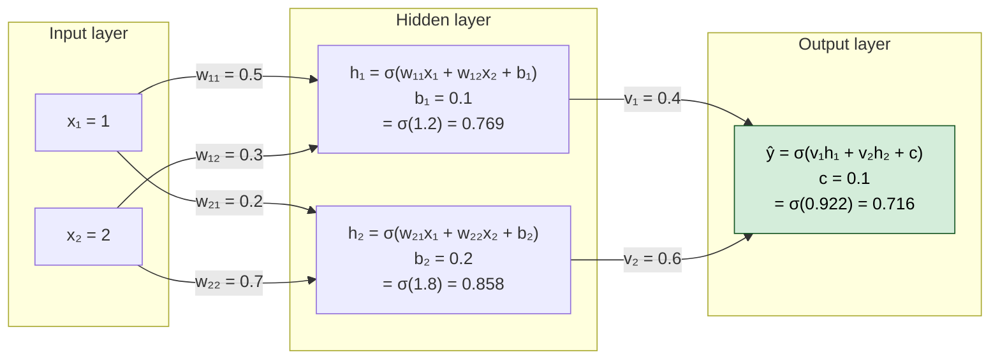

In matrix form the hidden layer is $\vec{z} = W\vec{x} + \vec{b}$: row $i$ of $W$ holds the weights *into* hidden neuron $i$, so $w_{12}$ is the weight from $x_2$ to $h_1$.

</details>

### Forward Pass — Step by Step ★★★

<details>
<summary><strong>Read as text</strong> — the five steps with numbers, from z = Wx + b to the loss 0.335</summary>

Given: Input $\vec{x} = [1, 2]$, Weights (hidden): $W = \begin{pmatrix} 0.5 & 0.3 \\ 0.2 & 0.7 \end{pmatrix}$, $\vec{b} = [0.1, 0.2]$, Weights (output): $\vec{v} = [0.4, 0.6]$, $c = 0.1$, Activation: $\sigma(z) = 1/(1+e^{-z})$

**Step 1:** Hidden layer pre-activation

$$z_1 = 0.5 \times 1 + 0.3 \times 2 + 0.1 = 1.2 \qquad z_2 = 0.2 \times 1 + 0.7 \times 2 + 0.2 = 1.8$$

**Step 2:** Hidden layer activation

$$h_1 = \sigma(1.2) = \frac{1}{1+e^{-1.2}} = 0.769 \qquad h_2 = \sigma(1.8) = \frac{1}{1+e^{-1.8}} = 0.858$$

**Step 3:** Output pre-activation

$$z_{\text{out}} = 0.4 \times 0.769 + 0.6 \times 0.858 + 0.1 = 0.922$$

**Step 4:** Output activation (for binary classification)

$$\hat{y} = \sigma(0.922) = 0.7155 \approx 0.716$$

**Step 5:** Compute loss (binary cross-entropy with the natural log, true label $y=1$)

$$L = -[y \cdot \log(\hat{y}) + (1-y) \cdot \log(1-\hat{y})] = -[1 \times \log(0.7155) + 0 \times \log(0.2845)] = 0.335$$

The network says "72% yes" for a true "yes": the loss is small but not zero, so backpropagation will nudge all 9 numbers to push $\hat{y}$ towards 1 — computed in [Backprop on the Forward-Pass Network](#backprop-on-the-forward-pass-network--all-nine-gradients-) below.

**Go deeper:** [Ch 14 §14.2](#content/14_neural_networks) · [Ch 14 §14.4](#content/14_neural_networks) · [Ch 06 §2.6](#content/06_math_fundamentals)

</details>

---

## Deep Dive — Backpropagation ★★★

> **Maths in one line:** `δ_l = (W_{l+1}ᵀ δ_{l+1}) ⊙ f′(z_l)` and `∂L/∂W_l = δ_l · a_{l−1}ᵀ` — a layer's error signal δ (the gradient of the loss with respect to that layer's pre-activation z) is the next layer's signal sent back through its weights, times this layer's activation slope; a weight's gradient is its neuron's δ times the input that weight multiplied.

![Infographic: backpropagation. Formula δₗ = (Wₗ₊₁ᵀ δₗ₊₁) ⊙ f′(zₗ) and ∂L/∂Wₗ = δₗ · aₗ₋₁ᵀ with every symbol labelled, plus the one-neuron chain rule ∂L/∂w = ∂L/∂z₂ × ∂z₂/∂z₁ × ∂z₁/∂w. Worked example for one sigmoid neuron with squared error: forward x = 2, w = 0.5, z₁ = 1.0, z₂ = σ(1) = 0.731, L = (1 − 0.731)² = 0.072; backward ∂L/∂z₂ = −0.538, times σ′(1) = 0.197 gives −0.106, times x = 2 gives ∂L/∂w = −0.212; update with α = 0.1 gives w = 0.5212. A table compares ∂L/∂w for squared error and cross-entropy: −0.2115 vs −0.5379 at z₁ = 1 and −0.0264 vs −1.9866 at z₁ = −5, about 75 times larger with cross-entropy because ∂L/∂z = ŷ − y.](diagrams/top34_info_backpropagation_ai.png)

### The Chain Rule — Core Idea ★★★

<details>
<summary><strong>Read as text</strong> — the chain rule, Jacobians and summing over paths</summary>

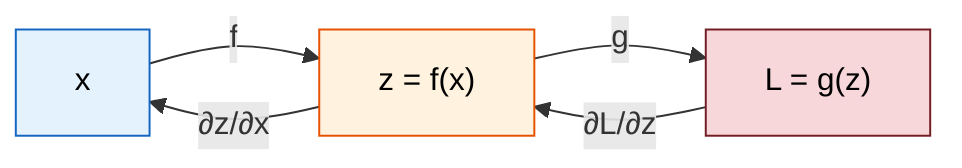

**Chain Rule:**

$$\frac{\partial L}{\partial x} = \frac{\partial L}{\partial z} \times \frac{\partial z}{\partial x}$$

In words: "How much does $x$ affect $L$?" = "How much does $z$ affect $L$?" $\times$ "How much does $x$ affect $z$?"

For a deep network with many layers:

$$\frac{\partial L}{\partial w_1} = \underbrace{\frac{\partial L}{\partial \hat{y}}}_{\text{loss}} \times \underbrace{\frac{\partial \hat{y}}{\partial h_3}}_{\text{layer 4}} \times \underbrace{\frac{\partial h_3}{\partial h_2}}_{\text{layer 3}} \times \underbrace{\frac{\partial h_2}{\partial h_1}}_{\text{layer 2}} \times \underbrace{\frac{\partial h_1}{\partial w_1}}_{\text{layer 1}}$$

Two details interviewers check. With many neurons per layer each factor is a matrix of partial derivatives (a **Jacobian**), and the product is a chain of matrix products. And where one value feeds several later nodes, its gradient is the **sum** of the gradients along every path.

</details>

### Backpropagation — Worked Example ★★★

<details>
<summary><strong>Read as text</strong> — the backward pass by hand, the update, and why cross-entropy</summary>

```mermaid
graph LR
    subgraph "Forward Pass →"
        X["x = 2"] -->|"w = 0.5"| MUL["z₁ = w·x<br/>= 1.0"]
        MUL -->|"sigmoid"| SIG["z₂ = σ(z₁)<br/>= 0.731"]
        SIG -->|"loss"| LOSS["L = (y-z₂)²<br/>y=1<br/>L = 0.072"]
    end

    subgraph "← Backward Pass"
        DLOSS["∂L/∂L = 1"]
        DZ2["∂L/∂z₂ = 2(z₂-y)<br/>= 2(0.731-1)<br/>= -0.538"]
        DZ1["∂L/∂z₁ = ∂L/∂z₂ × σ'(z₁)<br/>= -0.538 × 0.197<br/>= -0.106"]
        DW["∂L/∂w = ∂L/∂z₁ × x<br/>= -0.106 × 2<br/>= <b>-0.212</b>"]
        DLOSS --> DZ2 --> DZ1 --> DW
    end

    style LOSS fill:#f8d7da,stroke:#721c24,color:#000
    style DW fill:#d4edda,stroke:#155724,color:#000
```

**FORWARD:**

$$z_1 = w \times x = 0.5 \times 2 = 1.0 \qquad z_2 = \sigma(z_1) = \frac{1}{1+e^{-1}} = 0.731 \qquad L = (y - z_2)^2 = (1 - 0.731)^2 = 0.072$$

**BACKWARD** (applying chain rule right-to-left):

**Step 1:** $\partial L / \partial z_2$ (how does the output affect the loss?)

$$L = (y - z_2)^2 \quad \Rightarrow \quad \frac{\partial L}{\partial z_2} = 2(z_2 - y) = 2(0.731 - 1) = -0.538$$

**Step 2:** $\partial L / \partial z_1$ (how does the pre-activation affect the loss?)

$$z_2 = \sigma(z_1),\text{ so } \frac{\partial z_2}{\partial z_1} = \sigma(z_1)(1-\sigma(z_1)) = 0.731 \times 0.269 = 0.197$$

$$\frac{\partial L}{\partial z_1} = \frac{\partial L}{\partial z_2} \times \frac{\partial z_2}{\partial z_1} = -0.538 \times 0.197 = -0.106$$

**Step 3:** $\partial L / \partial w$ (how does the weight affect the loss?)

$$z_1 = w \times x,\text{ so } \frac{\partial z_1}{\partial w} = x = 2 \qquad \frac{\partial L}{\partial w} = \frac{\partial L}{\partial z_1} \times \frac{\partial z_1}{\partial w} = -0.106 \times 2 = -0.212$$

**WEIGHT UPDATE** (learning rate $\alpha = 0.1$):

$$w_{\text{new}} = w - \alpha \times \frac{\partial L}{\partial w} = 0.5 - 0.1 \times (-0.212) = 0.5212$$

The weight increased! This makes sense because the prediction (0.731) was less than the target (1.0), so the weight should increase to make the output larger.

**Why classifiers use cross-entropy, not squared error, after a sigmoid.** This example uses squared error to keep the algebra short. With binary cross-entropy the sigmoid's slope cancels out of step 2, leaving $\partial L/\partial z_1 = z_2 - y = -0.269$ — no $\times 0.197$ — so $\partial L/\partial w = -0.538$, 2.5× larger. The gap matters most when the neuron is confidently wrong: at $z_1 = -5$ squared error's gradient is about 75× smaller than cross-entropy's, because $\sigma'(-5) = 0.0066$ nearly erases it.

</details>

```python
# One sigmoid neuron: the chapter's squared-error backprop, a gradient check, then why cross-entropy learns faster
import numpy as np

sigmoid = lambda z: 1 / (1 + np.exp(-z))

def backprop(w, x, y, loss):
    z1 = w * x                                  # forward: pre-activation
    z2 = sigmoid(z1)                            # forward: prediction
    if loss == "squared":
        L = (y - z2) ** 2
        dL_dz1 = 2 * (z2 - y) * z2 * (1 - z2)   # step 1 x step 2 (the sigmoid slope)
    else:                                       # binary cross-entropy
        L = -(y * np.log(z2) + (1 - y) * np.log(1 - z2))
        dL_dz1 = z2 - y                         # the sigmoid slope cancels out
    return z2, L, dL_dz1, dL_dz1 * x            # step 3: dz1/dw = x

# 1. The chapter's example: w = 0.5, x = 2, y = 1, squared error, learning rate 0.1
z2, L, dL_dz1, dL_dw = backprop(0.5, 2.0, 1.0, "squared")
print(f"z2 = {z2:.3f}  L = {L:.3f}  dL/dz1 = {dL_dz1:.3f}  dL/dw = {dL_dw:.3f}")
w_new = 0.5 - 0.1 * dL_dw
print(f"w_new = {w_new:.4f}  new loss = {backprop(w_new, 2.0, 1.0, 'squared')[1]:.4f} (was {L:.4f})")

# 2. Gradient check: nudge w up and down by 1e-5 and measure the loss change
eps = 1e-5
numeric = (backprop(0.5 + eps, 2.0, 1.0, "squared")[1]
           - backprop(0.5 - eps, 2.0, 1.0, "squared")[1]) / (2 * eps)
print(f"numerical dL/dw = {numeric:.3f}  (backprop {dL_dw:.3f})")
assert abs(numeric - dL_dw) < 1e-8

# 3. Contrast: same neuron, cross-entropy loss, then a confidently WRONG start (w = -2.5, so z1 = -5)
print(f"{'start':<12}{'loss':<15}{'prediction':>11}{'dL/dw':>9}")
for w in (0.5, -2.5):
    for loss in ("squared", "cross-entropy"):
        z2, L, dL_dz1, dL_dw = backprop(w, 2.0, 1.0, loss)
        print(f"{'z1 = ' + str(w * 2):<12}{loss:<15}{z2:>11.4f}{dL_dw:>9.4f}")
assert abs(backprop(-2.5, 2.0, 1.0, "cross-entropy")[3]) > 50 * abs(backprop(-2.5, 2.0, 1.0, "squared")[3])
```

**Output:**

```
z2 = 0.731  L = 0.072  dL/dz1 = -0.106  dL/dw = -0.212
w_new = 0.5212  new loss = 0.0680 (was 0.0723)
numerical dL/dw = -0.212  (backprop -0.212)
start       loss            prediction    dL/dw
z1 = 1.0    squared             0.7311  -0.2115
z1 = 1.0    cross-entropy       0.7311  -0.5379
z1 = -5.0   squared             0.0067  -0.0264
z1 = -5.0   cross-entropy       0.0067  -1.9866
```

### Backprop on the Forward-Pass Network — All Nine Gradients ★★★

<details>
<summary><strong>Read as text</strong> — the four backprop lines and all nine gradients</summary>

Now the 2-2-1 network from the forward pass ($\hat{y} = 0.7155$, $y = 1$, cross-entropy loss 0.335). Four lines give all 9 gradients, working from the output back to the input ($\odot$ = multiply element by element):

| Step | Formula | Numbers |
|---|---|---|
| 1. Output error | $\delta_{\text{out}} = \hat{y} - y$ (sigmoid + cross-entropy) | $0.7155 - 1 = -0.2845$ |
| 2. Output weights | $\partial L/\partial \vec{v} = \delta_{\text{out}}\,\vec{h}$ and $\partial L/\partial c = \delta_{\text{out}}$ | $[-0.2186, -0.2441]$ and $-0.2845$ |
| 3. Hidden error | $\vec{\delta}_h = \delta_{\text{out}}\,\vec{v} \odot \vec{h} \odot (1 - \vec{h})$ | $[-0.0202, -0.0208]$ |
| 4. Hidden weights | $\partial L/\partial W = \vec{\delta}_h\,\vec{x}^{\top}$ and $\partial L/\partial \vec{b} = \vec{\delta}_h$ | rows $[-0.0202, -0.0405]$ and $[-0.0208, -0.0416]$ |

Every gradient is negative, so one gradient-descent step raises all 9 numbers and pushes $\hat{y}$ towards 1. Notice the hidden layer's gradients are about 7.5× smaller than the output layer's: on the way back each sigmoid multiplied the signal by $h(1-h) \le 0.25$. That is the vanishing-gradient problem in miniature (next section). The program below confirms every number with a **gradient check** — nudge each weight by $\pm\varepsilon$ and compare $\frac{L(w+\varepsilon) - L(w-\varepsilon)}{2\varepsilon}$ with backprop's answer.

</details>

```python
# Backprop on the chapter's 2-2-1 network: all nine gradients, a numerical check, one update
import numpy as np

sigmoid = lambda z: 1 / (1 + np.exp(-z))
x, y = np.array([1.0, 2.0]), 1.0
W = np.array([[0.5, 0.3], [0.2, 0.7]]); b = np.array([0.1, 0.2])
v = np.array([0.4, 0.6]); c = 0.1
fmt = lambda a: "[" + ", ".join(f"{t:.4f}" for t in np.ravel(a)) + "]"

def forward(W, b, v, c):
    h = sigmoid(W @ x + b)                      # hidden layer: z = Wx + b, then sigmoid
    y_hat = sigmoid(v @ h + c)                  # output neuron
    return h, y_hat, -(y * np.log(y_hat) + (1 - y) * np.log(1 - y_hat))

# 1. Forward pass: the hand-computed numbers
h, y_hat, L = forward(W, b, v, c)
print(f"forward:  h = {fmt(h)}  y_hat = {y_hat:.4f}  loss = {L:.4f}")

# 2. Backward pass, output to input
delta_out = y_hat - y                           # sigmoid + cross-entropy shortcut
grad_v, grad_c = delta_out * h, delta_out
delta_h = delta_out * v * h * (1 - h)           # back through v, times the hidden sigmoid slope
grad_W, grad_b = np.outer(delta_h, x), delta_h  # each weight: its neuron's delta x its input
print(f"delta_out = {delta_out:.4f}  dL/dv = {fmt(grad_v)}  dL/dc = {grad_c:.4f}")
print(f"delta_h = {fmt(delta_h)}  dL/dW = {fmt(grad_W)}")

# 3. Gradient check: nudge each of the 9 parameters by +-1e-6
p = np.concatenate([W.ravel(), b, v, [c]])
unpack = lambda p: (p[:4].reshape(2, 2), p[4:6], p[6:8], p[8])
backprop = np.concatenate([grad_W.ravel(), grad_b, grad_v, [grad_c]])
numeric = np.zeros(9)
for i in range(9):
    up, down = p.copy(), p.copy()
    up[i] += 1e-6; down[i] -= 1e-6
    numeric[i] = (forward(*unpack(up))[2] - forward(*unpack(down))[2]) / 2e-6
rel_err = np.abs(numeric - backprop).max() / np.abs(backprop).max()
print(f"gradient check: largest relative error = {rel_err:.1e}")
assert rel_err < 1e-6

# 4. One update with learning rate 0.1: the loss must fall
L_new = forward(*unpack(p - 0.1 * backprop))[2]
print(f"loss {L:.4f} -> {L_new:.4f} after one step")
print(f"output layer gets {np.abs(grad_v).mean() / np.abs(grad_W).mean():.1f}x bigger gradients than the hidden layer")
assert L_new < L
```

**Output:**

```
forward:  h = [0.7685, 0.8581]  y_hat = 0.7155  loss = 0.3348
delta_out = -0.2845  dL/dv = [-0.2186, -0.2441]  dL/dc = -0.2845
delta_h = [-0.0202, -0.0208]  dL/dW = [-0.0202, -0.0405, -0.0208, -0.0416]
gradient check: largest relative error = 2.3e-10
loss 0.3348 -> 0.3159 after one step
output layer gets 7.5x bigger gradients than the hidden layer
```

<details>
<summary><strong>Read as text</strong> — continued: where to go deeper</summary>

**Go deeper:** [Ch 14 §14.5](#content/14_neural_networks) · [Ch 16 §1.1](#content/16_deep_learning) · [Ch 06 §2.3](#content/06_math_fundamentals) · [Ch 32 Q23](#content/32_interview_questions)

</details>

---

## Vanishing & Exploding Gradients ★★★

> **Maths in one line:** `∂L/∂w₁ ∝ Π_l f′(z⁽ˡ⁾) · W⁽ˡ⁾ ≈ (factor per layer)^depth` — backprop multiplies one factor per layer (activation slope × weights): factors below 1 shrink the gradient exponentially (0.25¹⁰ ≈ 10⁻⁶), factors above 1 blow it up (1.5¹⁰ ≈ 58).

![Infographic: vanishing and exploding gradients. Formula ∂L/∂w₁ ∝ Πₗ f′(z⁽ˡ⁾) · W⁽ˡ⁾ ≈ (factor per layer)^depth with each symbol labelled. Three worked panels: 10 sigmoid layers keep at most 0.25¹⁰ = 0.00000095 (about 10⁻⁶) of the gradient, drawn as a fading arrow; a factor of 1.5 grows it to 1.5¹⁰ = 57.7, drawn as a swelling arrow; a residual block y = x + F(x) has ∂y/∂x = 1 + F′(x), so with slope 0.01 fifty plain layers pass back 0.01⁵⁰ = 10⁻¹⁰⁰ while fifty residual blocks pass back 1.01⁵⁰ ≈ 1.64. A table of the real 50-layer, width-64 run: sigmoid Xavier plain 3.9 × 10⁻³² and ReLU std 0.01 9.3 × 10⁻⁶³ vanish, ReLU He 2.19 and sigmoid with residual skips 1.09 stay healthy, ReLU 1.5 × He 1.4 × 10⁹ explodes. Fix list: ReLU, residuals and LSTM gates for vanishing; He 2/n_in, Xavier 2/(n_in + n_out) and normalization for both; clipping g ← c · g / ‖g‖ with c = 1.0 for exploding only.](diagrams/top34_info_vanishing_exploding_gradients_ai.png)

### The Problem ★★★

<details>
<summary><strong>Read as text</strong> — why gradients vanish or explode, who suffers, how to diagnose</summary>

```mermaid
graph TD
    subgraph "Deep Network Gradient Flow"
        L10["Layer 10<br/>Gradient: 1.0"] --> L9["Layer 9"]
        L9 --> L8["Layer 8"]
        L8 --> L7["Layer 7"]
        L7 --> L6["..."]
        L6 --> L1["Layer 1"]
    end

    subgraph "With Sigmoid Activation"
        VS["σ′(z) = σ(z)(1 − σ(z))<br/>Maximum value = 0.25<br/><br/>After 10 layers, at most:<br/>gradient × 0.25¹⁰ = 0.00000095<br/>(activation slopes only)<br/><br/><b>VANISHED</b> — early layers<br/>learn almost nothing"]
    end

    subgraph "With Weights Too Large"
        EX["Each layer's factor<br/>(slope × weight) is about 1.5:<br/><br/>gradient × 1.5¹⁰ = 57.7<br/><br/><b>EXPLODED</b> — huge updates,<br/>loss spikes, then NaN"]
    end

    style VS fill:#f8d7da,stroke:#721c24,color:#000
    style EX fill:#f8d7da,stroke:#721c24,color:#000
```

The 0.25¹⁰ is an upper bound on the **activation** factors only — the weights can shrink the gradient further or offset the shrinking (a weight of 4 cancels a slope of 0.25). Who suffers most: very deep plain networks, and RNNs, where the same weight matrix multiplies the gradient at every time step (a factor of 0.9 leaves 0.9¹⁰⁰ ≈ 0.00003 after 100 steps). To diagnose it, log the gradient norm of every layer: vanishing shows early layers' norms orders of magnitude below the last layers' while the loss plateaus; exploding shows norm spikes, then a NaN loss.

</details>

### Solutions ★★★

<details>
<summary><strong>Read as text</strong> — which fix targets vanishing, exploding or both</summary>

Every fix keeps the per-layer factor close to 1. Know which problem each one targets:

```mermaid
graph LR
    VAN["Vanishing<br/>factors below 1"] --> RELU["<b>ReLU-family activations</b><br/>slope exactly 1 when active,<br/>no saturation"]
    VAN --> RES["<b>Residual connections</b><br/>y = x + F(x), so ∂y/∂x = 1 + F′(x):<br/>a direct path for the gradient"]
    VAN --> GATE["<b>LSTM / GRU gates</b><br/>additive cell state in RNNs;<br/>forget gate near 1 keeps the gradient"]
    BOTH["Both"] --> INIT["<b>He / Xavier initialization</b><br/>He: Var(w) = 2/n_in<br/>Xavier: Var(w) = 2/(n_in + n_out)"]
    BOTH --> NORM["<b>Normalization</b><br/>BatchNorm in CNNs,<br/>LayerNorm / RMSNorm in Transformers"]
    EXP["Exploding<br/>factors above 1"] --> CLIP["<b>Gradient clipping</b><br/>if ‖g‖ > c: g ← c · g / ‖g‖<br/>(LLM recipes: c = 1.0)"]

    style VAN fill:#f8d7da,stroke:#721c24,color:#000
    style EXP fill:#f8d7da,stroke:#721c24,color:#000
    style BOTH fill:#fff3e0,stroke:#e65100,color:#000
    style RELU fill:#d4edda,stroke:#155724,color:#000
    style RES fill:#d4edda,stroke:#155724,color:#000
    style GATE fill:#d4edda,stroke:#155724,color:#000
    style INIT fill:#d4edda,stroke:#155724,color:#000
    style NORM fill:#d4edda,stroke:#155724,color:#000
    style CLIP fill:#d4edda,stroke:#155724,color:#000
```

</details>

### Initialization and Residual Connections — The Two Fixes Interviewers Probe ★★★

<details>
<summary><strong>Read as text</strong> — the symmetry problem, Xavier vs He, and the +1 residual path</summary>

**Initialization.** The weights must be *random*: if every hidden neuron starts with the same weights, they all compute the same output and receive the same gradient, so they stay identical forever (the **symmetry** problem). Zero *biases* are fine. The weights' *scale* is chosen so each layer passes on a signal of the same size. A neuron sums $n_{\text{in}}$ inputs (its fan-in), and variances of independent terms add, so $\operatorname{Var}(z) \approx n_{\text{in}} \operatorname{Var}(w) \operatorname{Var}(x)$; setting $n_{\text{in}} \operatorname{Var}(w) = 1$ keeps the size steady.

| Scheme | Weight variance | Use with | Std for a 256 → 256 layer |
|---|---|---|---|
| Xavier / Glorot (2010) | $2/(n_{\text{in}} + n_{\text{out}})$ — averages fan-in and fan-out | tanh, sigmoid, linear | $\sqrt{2/512} = 0.0625$ |
| He / Kaiming (2015) | $2/n_{\text{in}}$ — doubled because ReLU zeroes about half its inputs | ReLU family | $\sqrt{2/256} = 0.088$ |

**Residual connections.** A residual block outputs its input plus a learned correction, $y = x + F(x)$, so $\partial y/\partial x = 1 + F'(x)$. The **+1** is a path on which the gradient is never shrunk. With numbers: if every layer's local slope were 0.01, 50 plain layers would pass back $0.01^{50} = 10^{-100}$ of the gradient, while 50 residual blocks pass back about $1.01^{50} \approx 1.64$. ResNet (He et al., 2015) used this to train a 152-layer network. Every Transformer block wraps both attention and the feed-forward layer in a residual connection; most modern LLMs use the **pre-norm** form $x + F(\text{Norm}(x))$.

The program measures both fixes on a real 50-layer network (width 64; the residual version adds a skip around every layer) and then clips an exploded gradient:

</details>

```python
# 50 layers deep: which fixes keep the gradient alive? Plain vs residual, four inits, then clipping
import numpy as np

# 1. The chapter's activation-only numbers
print(f"sigmoid slopes, 10 layers: 0.25^10 = {0.25 ** 10:.2e}   factor 1.5, 10 layers: 1.5^10 = {1.5 ** 10:.1f}")

sigmoid = lambda z: 1 / (1 + np.exp(-z))
acts = {"sigmoid": (sigmoid, lambda z: sigmoid(z) * (1 - sigmoid(z))),
        "ReLU": (lambda z: np.maximum(0, z), lambda z: (z > 0) * 1.0)}

def grad_at_layer1(act, w_std, residual, depth=50, n=64):
    f, slope = acts[act]
    rng = np.random.default_rng(0)
    a, cache = rng.standard_normal((256, n)), []
    for _ in range(depth):                      # forward: a -> f(aW), or a + f(aW) with a skip
        W = rng.standard_normal((n, n)) * w_std
        z = a @ W
        cache.append((W, z))
        a = a + f(z) if residual else f(z)
    g = np.ones_like(a)                         # backward: start with dL/da = 1
    for W, z in reversed(cache):
        through_layer = (g * slope(z)) @ W.T
        g = g + through_layer if residual else through_layer   # the skip adds an identity path
    return g

# 2. A real backward pass through 50 layers of width 64 (He std = sqrt(2/64) = 0.177)
n, results = 64, {}
cases = [("sigmoid, Xavier, plain", "sigmoid", np.sqrt(1 / n), False),
         ("ReLU, std 0.01, plain", "ReLU", 0.01, False),
         ("ReLU, He, plain", "ReLU", np.sqrt(2 / n), False),
         ("ReLU, 1.5 x He, plain", "ReLU", 1.5 * np.sqrt(2 / n), False),
         ("sigmoid, Xavier, residual", "sigmoid", np.sqrt(1 / n), True)]
for name, act, w_std, residual in cases:
    results[name] = grad_at_layer1(act, w_std, residual)
    print(f"{name:<27} average |gradient| at layer 1 = {np.abs(results[name]).mean():.2e}")

# 3. Clipping by global norm (c = 1) shrinks the exploded gradient but keeps its direction
g = results["ReLU, 1.5 x He, plain"]
norm = np.linalg.norm(g)
clipped = g * min(1.0, 1.0 / norm)
cosine = (g * clipped).sum() / (norm * np.linalg.norm(clipped))
print(f"clip: norm {norm:.2e} -> {np.linalg.norm(clipped):.2f}, direction kept (cosine {cosine:.3f})")
assert np.abs(results["sigmoid, Xavier, plain"]).mean() < 1e-20 < 0.5 < np.abs(results["sigmoid, Xavier, residual"]).mean() < 2
```

**Output:**

```
sigmoid slopes, 10 layers: 0.25^10 = 9.54e-07   factor 1.5, 10 layers: 1.5^10 = 57.7
sigmoid, Xavier, plain      average |gradient| at layer 1 = 3.94e-32
ReLU, std 0.01, plain       average |gradient| at layer 1 = 9.32e-63
ReLU, He, plain             average |gradient| at layer 1 = 2.19e+00
ReLU, 1.5 x He, plain       average |gradient| at layer 1 = 1.40e+09
sigmoid, Xavier, residual   average |gradient| at layer 1 = 1.09e+00
clip: norm 2.44e+11 -> 1.00, direction kept (cosine 1.000)
```

<details>
<summary><strong>Read as text</strong> — continued: what the 50-layer run shows</summary>

Fifty plain sigmoid layers leave about $4 \times 10^{-32}$ of the gradient, and a too-small initialization (std 0.01) kills even ReLU. He initialization keeps it near 1; weights just 1.5× too large explode it by $1.5^{50} \approx 6.4 \times 10^{8}$ (2.19 → 1.40 × 10⁹). The *same* 50 sigmoid layers with skip connections keep it at 1.09 — the identity path carries it. Clipping cuts the exploded gradient to length 1 without changing its direction; it cannot rescue a vanished one.

**Go deeper:** [Ch 14 §14.6](#content/14_neural_networks) · [Ch 14 §14.8](#content/14_neural_networks) · [Ch 16 §1.6](#content/16_deep_learning) · [Ch 16 §1.8](#content/16_deep_learning) · [Ch 32 Q24](#content/32_interview_questions)

</details>

---

## Activation Functions — Deep Comparison ★★★

> **Maths in one line:** `gradient sent back = gradient arriving × f′(z)` — the activation's slope is a per-layer multiplier on the learning signal: sigmoid at most 0.25, tanh at most 1, ReLU exactly 1 (active) or 0 (inactive).

![Infographic comparing five activation functions, each with an exactly plotted curve: sigmoid 1/(1 + e⁻ˣ), range (0, 1), max slope 0.25; tanh, range (−1, 1), max slope 1; ReLU max(0, x), range 0 to ∞, slope 1 or 0; Leaky ReLU max(0.01x, x), range (−∞, ∞), slope 1 or 0.01; GELU x · Φ(x), range from about −0.17 to ∞ with its lowest point −0.17 at x ≈ −0.75. Formula: gradient sent back = gradient arriving × f′(z), with σ′(z) = σ(z)(1 − σ(z)). Worked steps: σ′(0) = 0.5 × (1 − 0.5) = 0.25 and σ′(5) = 0.99331 × 0.00669 = 0.0066, drawn as a bell curve; tanh′(2) = 1 − 0.964² = 0.071; ten sigmoid layers pass back at most 0.25¹⁰ ≈ 0.000001 while ten active ReLUs pass back 1¹⁰ = 1. A table shows where each goes: ReLU in MLP and CNN hidden layers, GELU or SwiGLU and GeGLU in Transformers, sigmoid per output for binary or multi-label, softmax for multi-class, none for regression.](diagrams/top34_info_activation_functions_ai.png)

<details>
<summary><strong>Read as text</strong> — the five activations compared and where each goes</summary>

```mermaid
graph TD
    subgraph "Sigmoid"
        SIG_F["f(x) = 1/(1+e⁻ˣ)<br/>Range: (0, 1)<br/>──────────<br/>✓ Outputs are probabilities<br/>✗ Vanishing gradient at extremes<br/>✗ Not zero-centered<br/>✗ Slower (needs exp)<br/>Use: binary / multi-label outputs, LSTM gates"]
    end

    subgraph "Tanh"
        TANH_F["f(x) = tanh(x)<br/>Range: (−1, 1)<br/>──────────<br/>✓ Zero-centered<br/>✗ Still saturates: slope 0.071 at x = ±2<br/>Use: RNN / LSTM hidden states"]
    end

    subgraph "ReLU"
        RELU_F["f(x) = max(0, x)<br/>Range: [0, ∞)<br/>──────────<br/>✓ Slope 1 for x > 0 (no saturation)<br/>✓ Very fast to compute<br/>✓ Sparse activations<br/>✗ Dying ReLU: a unit negative for<br/>every input gets zero gradient<br/>Use: Default for MLP / CNN hidden layers"]
    end

    subgraph "Leaky ReLU"
        LRELU_F["f(x) = max(0.01x, x)<br/>Range: (−∞, ∞)<br/>──────────<br/>✓ Fixes dead neuron problem<br/>✓ Still fast<br/>(PReLU learns the 0.01)<br/>Use: When ReLU has dying neurons"]
    end

    subgraph "GELU"
        GELU_F["f(x) = x·Φ(x)<br/>Φ = standard normal CDF<br/>Range: about [−0.17, ∞)<br/>(lowest at x ≈ −0.75)<br/>──────────<br/>✓ Smooth version of ReLU<br/>✓ Slope rarely exactly 0: no dead units<br/>Use: BERT, GPT-2/3, ViT"]
    end

    style SIG_F fill:#fff3e0,stroke:#e65100,color:#000
    style TANH_F fill:#fffde7,stroke:#f9a825,color:#000
    style RELU_F fill:#e8f5e9,stroke:#2e7d32,color:#000
    style LRELU_F fill:#e3f2fd,stroke:#1565c0,color:#000
    style GELU_F fill:#f3e5f5,stroke:#6a1b9a,color:#000
```

**Where each activation goes:**

| Location | Activation |
|---|---|
| Hidden layers, MLP / CNN | **ReLU** (Leaky ReLU if many units die) |
| Hidden layers, Transformer | **GELU** (BERT, GPT-2/3, ViT); most modern LLMs use a *gated* version — **SwiGLU** (Llama, Qwen, DeepSeek) or **GeGLU** (Gemma) |
| Output, binary or multi-label | **Sigmoid** per output → a probability each |
| Output, multi-class | **Softmax** → probabilities that sum to 1 |
| Output, regression | **None** (linear) |

A gated unit multiplies two projections of the input, one passed through an activation: $\text{SwiGLU}(x) = \text{SiLU}(xW_1) \odot (xW_2)$, with $\text{SiLU}(z) = z \cdot \sigma(z)$. See [Ch 16 §1.8](#content/16_deep_learning).

</details>

### Why ReLU Dominates ★★★

<details>
<summary><strong>Read as text</strong> — sigmoid vs ReLU slopes, and why a non-linearity at all</summary>

**Sigmoid gradient:** $\sigma'(z) = \sigma(z)(1-\sigma(z))$

| $z$ | $\sigma'(z)$ | Note |
|-----|-------------|------|
| $0$ | $0.25$ | maximum! |
| $5$ | $0.0066$ | nearly zero (vanishing!) |
| $-5$ | $0.0066$ | nearly zero (vanishing!) |

**ReLU gradient:** For $z > 0$: $f'(z) = 1$ (constant, no vanishing!). For $z < 0$: $f'(z) = 0$ (an input with $z < 0$ sends no gradient back through this unit; a unit negative for *every* input is "dead").

$$\text{10 sigmoid layers: activation factors multiply to at most } 0.25^{10} \approx 0.000001$$

$$\text{10 active ReLU layers: } 1^{10} = 1 \text{ (the activation no longer shrinks the gradient)}$$

ReLU removes the activation's shrinking, not the weights': a poorly scaled initialization still vanishes or explodes (the program above). ReLU is also cheap (a comparison, no exponential) and sparse (about half the units output 0).

**Why a non-linearity at all?** Without one, two layers collapse into one: $W_2(W_1 x) = (W_2 W_1) x$, a single matrix. A 100-layer network with no activations can only draw the same straight-line boundaries as a 1-layer one.

**Go deeper:** [Ch 14 §14.3](#content/14_neural_networks) · [Ch 16 §1.8](#content/16_deep_learning)

</details>

---

## Interview-Ready Answer Template

**Say this first (30 sec):** "A network predicts with a **forward pass**: each layer takes a weighted sum of its inputs, adds a bias and applies a non-linear activation. **Backpropagation** applies the chain rule backwards from the loss, so one backward sweep — costing about two forward passes — gives the gradient for every weight; an optimizer such as SGD or Adam then updates the weights."

**Then the structure:**

1. **Chain rule:** each layer multiplies the incoming gradient by its local slope and its weights: δ_l = (W_{l+1}ᵀ δ_{l+1}) ⊙ f′(z_l), and ∂L/∂W_l = δ_l · a_{l−1}ᵀ.
2. **Vanishing / exploding:** that product of per-layer factors shrinks or grows exponentially — ten sigmoid layers pass back at most 0.25¹⁰ ≈ 10⁻⁶. Fixes: ReLU-family activations, He/Xavier initialization, residual connections, normalization; gradient clipping for explosions.
3. **Activations:** ReLU in MLP/CNN hidden layers; GELU or gated SwiGLU in Transformers; sigmoid or softmax at the output for probabilities.
4. **Trust but verify:** a numerical gradient check — nudge a weight by ±ε — should match backprop to about 10⁻⁶ relative error.

---

## Follow-Up Questions & Answers

**Q: "Is backpropagation the same as gradient descent?"**
> No. Backprop only *computes* ∂L/∂w for every weight; gradient descent (or Adam) is the rule that *uses* them: w ← w − α·∂L/∂w. You can run backprop without any update — for a gradient check or a saliency map.

**Q: "Why cross-entropy rather than squared error with a sigmoid output?"**
> With cross-entropy the sigmoid's slope cancels and ∂L/∂z = ŷ − y. With squared error the gradient keeps a σ′(z) factor, which is nearly 0 when the neuron is confidently wrong — at z = −5 the gradient is about 75× smaller than cross-entropy's.

**Q: "What happens if you initialize all weights to zero?"**
> Every hidden neuron in a layer computes the same output and receives the same gradient, so they stay identical and the layer behaves like a single neuron (the symmetry problem). Random weights — He for ReLU, Xavier for tanh — break the symmetry; zero biases are fine.

**Q: "What does backprop cost?"**
> About twice the forward pass: each linear layer needs two matrix multiplies on the way back (δ·aᵀ for its own weights, Wᵀ·δ for the layer below) against one on the way forward, so a training step ≈ 3 forward passes. The price is memory — every forward activation is kept until the backward pass uses it (activation checkpointing trades recomputation for that memory).

**Q: "What is a dead ReLU, and how do you fix it?"**
> A ReLU unit whose input is negative for every training example outputs 0 and gets zero gradient, so it never recovers — often after a learning rate that is too high. Fixes: a lower learning rate, He initialization, Leaky ReLU or GELU (non-zero slope below 0), or normalization before the activation.

**Q: "Why do RNNs suffer most from vanishing gradients?"**
> The same weight matrix multiplies the gradient at every time step: a factor of 0.9 leaves 0.9¹⁰⁰ ≈ 0.00003 after 100 steps. An LSTM's cell state is updated by addition and scaled only by the forget gate, so f = 0.99 still keeps 0.99¹⁰⁰ ≈ 0.37.

---

## Common Mistakes

| Mistake | Why It's Wrong |
|---------|---------------|
| "Backprop updates the weights" | Backprop only computes the gradients; the optimizer updates the weights, after the whole backward pass. |
| "ReLU solves vanishing gradients" | It removes the activation's shrinking only. The weights still multiply the gradient (a std-0.01 init vanishes even with ReLU), and dead ReLUs pass back 0. |
| "Gradient clipping fixes vanishing gradients" | Clipping only shrinks gradients that are too large. A vanished gradient needs a better path: residuals, ReLU, good initialization, normalization. |
| "A 10-layer sigmoid net's gradient is 0.25¹⁰" | That is an upper bound on the activation factors alone; the weight factors also count. |
| Initializing all weights to the same value | Hidden units stay identical (symmetry). Use random He or Xavier weights. |
| Squared error + sigmoid for classification | The σ′ factor stalls learning when the model is confidently wrong. Use cross-entropy (computed from logits for numerical stability). |

---

---

# Topic 6 — Transformers & Attention Mechanism

## Why Google Asks This

Google researchers introduced the Transformer in "Attention Is All You Need" (Vaswani et al., 2017). It sits behind BERT in Google Search (since October 2019), behind Gemini (whose technical report describes it as built on Transformer decoders) and behind almost every modern language, vision and speech model. Candidates commonly report being asked to **compute** self-attention with real numbers, not just describe it, and then to explain what has changed since 2017 (GQA, RoPE, FlashAttention, the KV cache).

---

## Common Interview Questions

- "What is the attention mechanism, and what problem did it solve?"
- "Walk me through self-attention step by step with actual numbers."
- "What are Q, K, V? Where do they come from?"
- "Why multi-head attention instead of single-head?"
- "What is the difference between MHA, MQA and GQA?"
- "Why do we need positional encoding? Why did RoPE replace sinusoidal encoding?"
- "Explain the Transformer architecture end-to-end. Encoder-only vs decoder-only — when would you use each?"
- "What is the computational complexity of self-attention? How can it be reduced?"

---

## Simple Explanation

Imagine reading the sentence: "The **cat** sat on the mat because **it** was tired."

What does "it" refer to? To understand, your brain automatically looks back at earlier words and figures out "it" = "cat." Your brain assigns different amounts of **attention** to different words when interpreting each word.

That's exactly what the attention mechanism does. For each word, it computes how much to "look at" every other word in the sentence to build a richer understanding.

Before Transformers, sequence models called **RNNs** (recurrent neural networks) read one word at a time, passing a memory forward — slow to train and forgetful over long distances. A Transformer looks at all words **at once**: any word connects directly to any other word, however far apart. That parallelism is why Transformers train efficiently on GPUs and TPUs at huge scale. The price: every word is compared with every other word, so the work grows with the **square** of the sequence length — the bottleneck covered in "Computational Complexity" below.

---

## Deep Dive — Self-Attention Step by Step ★★★

> **Maths in one line:** `Attention(Q, K, V) = softmax(Q·Kᵀ / √d_k) · V` — every token scores every token, turns its scores into weights that sum to 1, and takes the weighted average of their value vectors.

![Infographic: self-attention step by step. Formula Attention(Q, K, V) = softmax(Q·Kᵀ / √d_k) · V with Q, Kᵀ, √d_k and V labelled. Worked example for the tokens I, love and ML with d_k = 2: the score grid Q·Kᵀ (rows 1 0 1, 1 1 0, 2 1 1) is divided by √2 = 1.414, softmaxed row by row into a weight heat-map (0.401 0.198 0.401, 0.401 0.401 0.198, 0.503 0.248 0.248) and multiplied by V, giving outputs I = 3.000, 4.000; love = 2.593, 3.593; ML = 2.490, 3.490. Row ML is worked out line by line (exp values 4.113, 2.028, 2.028, sum 8.169). A causal-mask grid shows −∞ above the diagonal becoming weight 0, so love becomes 2.000, 3.000 and ML is unchanged. A table explains the √d_k scaling: for d_k = 4, 64 and 512 the spread of q·k is 2.00, 7.96 and 22.71 and the winning weight is 0.52, 0.88 and 0.96 raw but 0.34, 0.36 and 0.37 after scaling; the softmax slope w(1 − w) is 0.001 raw vs 0.249 scaled.](diagrams/top34_info_self_attention_step_by_step_ai.png)

### The Three Vectors: Query, Key, Value ★★★

<details>
<summary><strong>Read as text</strong> — Q, K and V from one embedding, and the library analogy</summary>

Each token's embedding x (a row of d_model numbers) is multiplied by three **learned** matrices W_Q, W_K, W_V — the same matrices for every token — giving its query, key and value vectors (d_k numbers each in one head).

```mermaid
graph TD
    subgraph "For each word/token:"
        INPUT["Input embedding<br/>x (dimension d_model)"] --> Q["<b>Query (Q)</b><br/>Q = x · W_Q<br/>'What am I looking for?'"]
        INPUT --> K["<b>Key (K)</b><br/>K = x · W_K<br/>'What do I contain?'"]
        INPUT --> V["<b>Value (V)</b><br/>V = x · W_V<br/>'What information do I carry?'"]
    end

    subgraph "Analogy: Library Search"
        QA["<b>Query</b> = Your search question<br/>'books about machine learning'"]
        KA["<b>Key</b> = Book titles on the shelf<br/>(used to match your query)"]
        VA["<b>Value</b> = Book contents<br/>(the actual information you get<br/>when a key matches your query)"]
    end

    style Q fill:#e3f2fd,stroke:#1565c0,color:#000
    style K fill:#fff3e0,stroke:#e65100,color:#000
    style V fill:#e8f5e9,stroke:#2e7d32,color:#000
    style QA fill:#e3f2fd,stroke:#1565c0,color:#000
    style KA fill:#fff3e0,stroke:#e65100,color:#000
    style VA fill:#e8f5e9,stroke:#2e7d32,color:#000
```

Unlike a real library, attention never returns just one book: it returns a **blend of all the values**, weighted by how well each key matches the query.

</details>

### The Attention Formula ★★★

<details>
<summary><strong>Read as text</strong> — the formula in four steps, plus the causal mask</summary>

$$\text{Attention}(Q, K, V) = \text{softmax}\!\left(\frac{Q \cdot K^T}{\sqrt{d_k}}\right) \cdot V$$

Step by step:
1. $Q \cdot K^T$ — Dot product of every query with every key → an n × n score matrix (how relevant each pair is)
2. $/ \sqrt{d_k}$ — Scale down: dot products of $d_k$-long vectors spread out by about $\sqrt{d_k}$, so without this, large $d_k$ → huge scores → softmax outputs near 0 or 1 → vanishing gradients
3. $\text{softmax}(\ldots)$ — Convert scores to probabilities (sum to 1 per row) → each row = attention weights for one token
4. $\times V$ — Weighted sum of values → output = mix of all values, weighted by relevance

In a **decoder**, one extra step comes before the softmax: the **causal mask** sets the score of every future position to −∞, so its weight becomes exactly 0.

</details>

### Worked Example — Step by Step with Numbers ★★★

<details>
<summary><strong>Read as text</strong> — the 3-token example by hand, with and without the mask</summary>

```
Input: 3 tokens ["I", "love", "ML"]. Assume their embeddings have already been
multiplied by W_Q, W_K, W_V, giving Q, K, V with d_k = 2:

  Q = [Q_I,    Q_love,  Q_ML]       K = [K_I,    K_love,  K_ML]
    = [[1, 0],          = [[1, 1],
       [0, 1],             [0, 1],
       [1, 1]]             [1, 0]]

  V = [[1, 2],
       [3, 4],
       [5, 6]]

───────────────────────────────────────────────────────────────

STEP 1: Compute Q · K^T (score matrix)

  Q · K^T = [[1,0],  × [[1, 0, 1],   = [[1, 0, 1],
             [0,1],     [1, 1, 0]]      [1, 1, 0],
             [1,1]]                      [2, 1, 1]]

  Score matrix:        I    love   ML
             I      [ 1.0,  0.0,  1.0]
             love   [ 1.0,  1.0,  0.0]
             ML     [ 2.0,  1.0,  1.0]

  Reading: "ML" scores highest with "I" (score = 2)

───────────────────────────────────────────────────────────────

STEP 2: Scale by √d_k = √2 ≈ 1.414

  Scaled scores:       I      love    ML
             I      [ 0.707, 0.000,  0.707]
             love   [ 0.707, 0.707,  0.000]
             ML     [ 1.414, 0.707,  0.707]

───────────────────────────────────────────────────────────────

STEP 3: Apply softmax (row-wise)

  For row "I":   softmax([0.707, 0.000, 0.707])
                 = exp([0.707, 0.000, 0.707]) / sum
                 = [2.028, 1.000, 2.028] / 5.056
                 = [0.401, 0.198, 0.401]

  For row "love": softmax([0.707, 0.707, 0.000])
                  = [2.028, 2.028, 1.000] / 5.056
                  = [0.401, 0.401, 0.198]

  For row "ML":   softmax([1.414, 0.707, 0.707])
                  = [4.113, 2.028, 2.028] / 8.169
                  = [0.503, 0.248, 0.248]

  Attention weights:    I      love    ML
             I      [ 0.401, 0.198, 0.401]  ← "I" looks at "I" and "ML" equally
             love   [ 0.401, 0.401, 0.198]  ← "love" looks at "I" and "love"
             ML     [ 0.503, 0.248, 0.248]  ← "ML" focuses most on "I"

───────────────────────────────────────────────────────────────

STEP 4: Multiply attention weights × V
(sums use the unrounded weights, so a last digit can differ by 0.001)

  Output for "I":
    = 0.401 × [1,2] + 0.198 × [3,4] + 0.401 × [5,6]
    = [0.401, 0.802] + [0.593, 0.791] + [2.006, 2.407]
    = [3.000, 4.000]

  Output for "love":
    = 0.401 × [1,2] + 0.401 × [3,4] + 0.198 × [5,6]
    = [0.401, 0.802] + [1.203, 1.604] + [0.989, 1.187]
    = [2.593, 3.593]

  Output for "ML":
    = 0.503 × [1,2] + 0.248 × [3,4] + 0.248 × [5,6]
    = [0.503, 1.007] + [0.745, 0.993] + [1.241, 1.490]
    = [2.490, 3.490]

───────────────────────────────────────────────────────────────

STEP 5 (decoder only): causal mask — hide the future BEFORE softmax

  Masked scores:       I      love    ML
             I      [ 0.707,   -∞,     -∞  ]
             love   [ 0.707, 0.707,    -∞  ]
             ML     [ 1.414, 0.707,  0.707 ]

  Weights:  I → [1.000, 0, 0]    love → [0.500, 0.500, 0]    ML → [0.503, 0.248, 0.248]
  Outputs:  I → [1.000, 2.000]   love → [2.000, 3.000]       ML → [2.490, 3.490]
            (the last token already saw everything, so it does not change)

RESULT: Each token now has a NEW representation that is an
attention-weighted mix of the value vectors. "ML" is pulled most
toward "I" (weight 0.503), capturing the relationship between them.
```

The program below reproduces every number above, with and without the causal mask.

</details>

```python
# Scaled dot-product attention on the chapter's 3-token example, then the same with a causal mask
import numpy as np

def softmax(z):
    e = np.exp(z - z.max(axis=-1, keepdims=True))     # subtract the row max: same result, no overflow
    return e / e.sum(axis=-1, keepdims=True)

def attention(Q, K, V, causal=False):
    d_k = Q.shape[-1]
    scores = Q @ K.T / np.sqrt(d_k)
    if causal:                                         # future positions get -inf -> weight exactly 0
        scores = np.where(np.tri(len(Q), dtype=bool), scores, -np.inf)
    weights = softmax(scores)
    return weights, weights @ V

tokens = ["I", "love", "ML"]
Q = np.array([[1, 0], [0, 1], [1, 1]], dtype=float)
K = np.array([[1, 1], [0, 1], [1, 0]], dtype=float)
V = np.array([[1, 2], [3, 4], [5, 6]], dtype=float)

for causal in (False, True):
    weights, out = attention(Q, K, V, causal)
    print("causal mask (decoder):" if causal else "no mask (encoder):")
    for t, w, o in zip(tokens, weights, out):
        print(f"  {t:>4}: weights [{', '.join(f'{x:.3f}' for x in w)}] -> output [{o[0]:.3f}, {o[1]:.3f}]")
    assert np.allclose(weights.sum(axis=1), 1)         # every row is a probability distribution

w_full, out_full = attention(Q, K, V)
w_causal, out_causal = attention(Q, K, V, causal=True)
assert np.allclose(np.triu(w_causal, 1), 0)            # nothing above the diagonal
assert np.allclose(out_full[-1], out_causal[-1])       # the last token already sees everything
assert np.allclose(out_full[0], [3, 4])
```

**Output:**

```
no mask (encoder):
     I: weights [0.401, 0.198, 0.401] -> output [3.000, 4.000]
  love: weights [0.401, 0.401, 0.198] -> output [2.593, 3.593]
    ML: weights [0.503, 0.248, 0.248] -> output [2.490, 3.490]
causal mask (decoder):
     I: weights [1.000, 0.000, 0.000] -> output [1.000, 2.000]
  love: weights [0.500, 0.500, 0.000] -> output [2.000, 3.000]
    ML: weights [0.503, 0.248, 0.248] -> output [2.490, 3.490]
```

### Why Scale by √d_k? ★★★

<details>
<summary><strong>Read as text</strong> — why dot products spread by √d_k and saturate softmax</summary>

A dot product q · k of two $d_k$-long vectors with independent, unit-variance entries is a sum of $d_k$ terms, so its variance is $d_k$ and its spread (standard deviation) is $\sqrt{d_k}$ — **8 when $d_k = 64$**. Scores that far apart make softmax nearly one-hot, and its gradient for the winner, w(1 − w), nearly zero. Dividing by $\sqrt{d_k}$ brings the spread back to about 1 whatever the head size. The program measures both effects.

</details>

```python
# Why divide by sqrt(d_k): raw dot products spread out as d_k grows, and softmax saturates
import numpy as np
rng = np.random.default_rng(0)

def softmax(z):
    e = np.exp(z - z.max(axis=-1, keepdims=True))
    return e / e.sum(axis=-1, keepdims=True)

print(" d_k | std of q.k | top weight, raw | top weight, scaled")
for d_k in (4, 64, 512):
    q = rng.standard_normal((2000, d_k))               # 2,000 queries, unit-variance entries
    k = rng.standard_normal((2000, 8, d_k))            # 8 keys per query
    raw = np.einsum("nd,nkd->nk", q, k)                # 2,000 x 8 dot products
    top_raw = softmax(raw).max(axis=1).mean()          # average weight on the winning key
    top_scaled = softmax(raw / np.sqrt(d_k)).max(axis=1).mean()
    print(f"{d_k:4d} | {raw.std():10.2f} | {top_raw:15.2f} | {top_scaled:18.2f}")
    assert abs(raw.std() / np.sqrt(d_k) - 1) < 0.05    # std of q.k is about sqrt(d_k)

s = np.array([8.0, 0.0, 0.0, 0.0])                     # a typical spread when d_k = 64 (std 8)
slopes = []
for name, z in (("raw", s), ("divided by 8", s / 8)):
    w = softmax(z)
    slopes.append(w[0] * (1 - w[0]))                   # softmax gradient for the winner
    print(f"{name:>12}: weights [{', '.join(f'{x:.3f}' for x in w)}], slope w(1-w) = {slopes[-1]:.3f}")
assert slopes[0] < 0.002 and slopes[1] > 0.2           # about 250x more gradient after scaling
```

**Output:**

```
 d_k | std of q.k | top weight, raw | top weight, scaled
   4 |       2.00 |            0.52 |               0.34
  64 |       7.96 |            0.88 |               0.36
 512 |      22.71 |            0.96 |               0.37
         raw: weights [0.999, 0.000, 0.000, 0.000], slope w(1-w) = 0.001
divided by 8: weights [0.475, 0.175, 0.175, 0.175], slope w(1-w) = 0.249
```

<details>
<summary><strong>Read as text</strong> — continued: what the run shows and where to go deeper</summary>

Without scaling, the winning key's weight climbs from 0.52 to 0.96 as $d_k$ grows; with scaling it stays near 0.35 for every head size.

**Go deeper:** [Ch 16 §3.3](#content/16_deep_learning) (self-attention from scratch, the causal mask, self- vs cross-attention) · [Ch 34b §11.3](#content/34b_google_top10_ml_interview_part2) (the full derivation and the variance proof).

</details>

---

## Multi-Head Attention ★★★

> **Maths in one line:** `MultiHead(X) = Concat(head₁, …, head_h) · W_O`, with `headᵢ = Attention(X·W_Qⁱ, X·W_Kⁱ, X·W_Vⁱ)` — run h small attentions side by side, each on a d_model/h-wide slice, glue their outputs together, then mix them with W_O.

![Infographic: multi-head attention, GQA and MQA. Formula MultiHead(X) = Concat(head₁, …, head_h) · W_O with headᵢ = Attention(X·W_Qⁱ, X·W_Kⁱ, X·W_Vⁱ), each part labelled. Panel 1 splits a 512-wide embedding into 8 slices of 64, one per head, concatenated back to 512 and mixed by W_O (512×512): parameters 4 × 512² = 1,048,576 per layer for h = 1 or h = 8, and score FLOPs h × n² × d_k = n² × 512. Panel 2 computes the KV cache per token for a 70B-sized model (80 layers, head size 128, FP16) as 2 × layers × K/V heads × head size × bytes: MHA 2.5 MiB, GQA 320 KiB, MQA 40 KiB, so GQA is 8× smaller. Wiring diagrams show one K/V head per query (MHA), K/V heads shared by groups of 4 (GQA) and one K/V head for all (MQA). A table, as of Nov 2026: MHA 64 K/V heads, 10 GiB at 4K tokens (GPT-2/3, Llama 2 7B/13B); GQA 8, 1.25 GiB (Llama 3, Mistral 7B, Gemma 2/3); MQA 1, 160 MiB (PaLM, Falcon-7B); MLA in DeepSeek-V2/V3 caches 576 numbers per token per layer.](diagrams/top34_info_multi_head_gqa_ai.png)

### Why Multiple Heads? ★★★

<details>
<summary><strong>Read as text</strong> — one blend vs several, and why head roles are learned</summary>

```mermaid
graph TD
    subgraph "Single Head Attention"
        SH["One set of weights per token<br/>= ONE blend of the values<br/><br/>e.g., only the syntactic link"]
    end

    subgraph "Multi-Head Attention (h=8) — head roles are illustrative"
        MH1["Head 1: Syntactic<br/>'subject → verb'"]
        MH2["Head 2: Coreference<br/>'it → cat'"]
        MH3["Head 3: Positional<br/>'nearby words'"]
        MH4["Head 4: Semantic<br/>'similar meaning'"]
        MH5["Head 5-8: Other<br/>learned patterns"]
        
        MH1 --> CONCAT["Concatenate all heads<br/>then project with W_O"]
        MH2 --> CONCAT
        MH3 --> CONCAT
        MH4 --> CONCAT
        MH5 --> CONCAT
        CONCAT --> OUT["Rich output that captures<br/>MULTIPLE relationship types<br/>simultaneously"]
    end

    style SH fill:#f8d7da,stroke:#721c24,color:#000
    style OUT fill:#d4edda,stroke:#155724,color:#000
```

Head roles are **learned, not assigned**. Probing studies do find some readable heads (previous-token, coreference), but many heads can be pruned after training with little loss — so do not over-claim that each head has one neat job.

</details>

### Mathematical Formulation ★★★

<details>
<summary><strong>Read as text</strong> — the dimensions, parameters and FLOPs of 8 heads</summary>

```
MultiHead(Q, K, V) = Concat(head₁, head₂, ..., headₕ) · W_O

Where headᵢ = Attention(Q · Wᵢ_Q, K · Wᵢ_K, V · Wᵢ_V)

Dimensions (original Transformer):
  d_model = 512 (total embedding dimension)
  h = 8 heads
  d_k = d_v = d_model / h = 64 per head

  Each head's W_Q, W_K, W_V: [512 × 64]   (8 heads × 64 = 512 columns in total)
  W_O: [512 × 512]

Parameters: W_Q + W_K + W_V + W_O = 4 × 512² = 1,048,576 per layer —
            the same for h = 1 or h = 8; the heads only split the width.
Score FLOPs: h × n² × d_k = n² × 512 — the same as ONE 512-wide head.
What grows: h score matrices (n × n each) instead of one — more softmax
            work and more memory if they are stored (FlashAttention avoids that).
```

</details>

### MQA and GQA — Sharing Keys and Values ★★★

<details>
<summary><strong>Read as text</strong> — the KV cache for MHA, GQA, MQA and MLA</summary>

During generation every past token's K and V vectors are kept in the **KV cache** (see the follow-up questions below), and that cache — not the weights — is often what fills GPU memory. Sharing K and V across query heads shrinks it. **MHA** (multi-head attention) gives every query head its own K and V; **MQA** (multi-query) shares one K/V head across all query heads; **GQA** (grouped-query) shares each K/V head within a group. For a Llama-2/3-70B-sized model (80 layers, 64 query heads, head size 128, FP16):

| Variant | K/V heads | KV cache per token | At 4K tokens | Used by |
|---|---|---|---|---|
| MHA | 64 (one per query head) | 2.5 MiB | 10 GiB | original Transformer, GPT-2/3, Llama 2 7B/13B |
| GQA | 8 (each shared by 8 query heads) | 320 KiB | 1.25 GiB | Llama 2 70B, Llama 3, Mistral 7B, Gemma 2/3 |
| MQA | 1 (shared by all 64) | 40 KiB | 160 MiB | PaLM, Falcon-7B |

GQA keeps quality close to MHA at 8× less cache here, which is why most open LLMs use it; MQA saves the most but can lose a little quality on hard tasks. DeepSeek-V2/V3 go further with **MLA** (multi-head latent attention), caching one small compressed vector per token (576 numbers per layer).

**Go deeper:** [Ch 34b §11.3](#content/34b_google_top10_ml_interview_part2) (why multi-head costs the same, GQA/MQA) · [Ch 17 §2.4](#content/17_llm) (runnable GQA, MLA, sliding window) · [Ch 17c §1.2](#content/17c_llm_systems) (the KV cache with real numbers).

</details>

---

## Positional Encoding ★★★

> **Maths in one line:** `PE(pos, 2i) = sin(pos / 10000^(2i/d_model))`, `PE(pos, 2i+1) = cos(pos / 10000^(2i/d_model))` — each pair of dimensions is a clock hand turning at its own speed; together the hands give every position a unique stamp.

![Infographic on positional encoding from sinusoidal to RoPE: attention is order-blind, so in Dog bites man and Man bites dog each word gets the same output; the sinusoidal formula PE(pos, 2i) = sin(pos / 10000^(2i/d_model)) and PE(pos, 2i+1) = cos(...) with every symbol labelled; a worked d_model = 4 table (pos 0 = 0.00, 1.00, 0.00, 1.00; pos 1 = 0.84, 0.54, 0.01, 1.00; pos 2 = 0.91, -0.42, 0.02, 1.00); two clock hands turning at 1 rad and 0.01 rad per position; RoPE rotating q by m times theta and k by n times theta so (R_m q)·(R_n k) = q·R_(n-m) k depends only on n - m; and a table of sinusoidal, learned, RoPE and ALiBi with the models that use them.](diagrams/top34_info_positional_encoding_rope_ai.png)

### Why It's Needed ★★★

<details>
<summary><strong>Read as text</strong> — why attention is order-blind without positions</summary>

```mermaid
graph TD
    subgraph "The Problem"
        P1["Self-attention sees a SET,<br/>not a SEQUENCE.<br/><br/>In 'Dog bites man' and<br/>'Man bites dog', each word gets<br/>the SAME output in both —<br/>only the output order changes.<br/><br/>Word order is lost."]
    end

    subgraph "The Solution: Positional Encoding"
        P2["Add position-dependent<br/>vectors to embeddings:<br/><br/>x_final = x_embedding + PE(position)<br/><br/>Now the model knows WHERE<br/>each token appears.<br/>(RoPE instead rotates Q and K)"]
    end

    P1 --> P2

    style P1 fill:#f8d7da,stroke:#721c24,color:#000
    style P2 fill:#d4edda,stroke:#155724,color:#000
```

Strictly, this holds for unmasked attention; a causal mask leaks some order information (see NoPE in [Ch 16 §3.4](#content/16_deep_learning)), but nearly all production LLMs still use explicit positions.

</details>

### Sinusoidal Positional Encoding (Original Transformer) ★★★

<details>
<summary><strong>Read as text</strong> — the sin/cos formula, why it works and the d_model = 4 table</summary>

```
PE(pos, 2i)   = sin(pos / 10000^(2i/d_model))
PE(pos, 2i+1) = cos(pos / 10000^(2i/d_model))

Where:
  pos = position in the sequence (0, 1, 2, ...)
  i   = index of the dimension pair (0, 1, ..., d_model/2 − 1)

Why sinusoidal?
  1. Each position gets a unique vector (wavelengths run from 2π to 10000·2π)
  2. PE(pos+k) is a fixed linear map (a rotation) of PE(pos), the same for
     every pos → the model can learn to attend to relative positions
  3. Bounded values: sin/cos always in [-1, 1]
  4. No parameters, and defined for any position. The paper hoped this would
     let models handle longer sequences than in training; in practice it
     extrapolates poorly (Press et al., 2022). Learned position embeddings
     gave nearly identical results in the original paper.

Example (d_model=4):
  Position 0: [sin(0), cos(0), sin(0), cos(0)]     = [0.00, 1.00, 0.00, 1.00]
  Position 1: [sin(1), cos(1), sin(0.01), cos(0.01)] = [0.84, 0.54, 0.01, 1.00]
  Position 2: [sin(2), cos(2), sin(0.02), cos(0.02)] = [0.91, -0.42, 0.02, 1.00]
```

The program shows the problem (without positions, "dog" gets the same output in both sentences), rebuilds the table above, and checks property 2.

</details>

```python
# Attention without positions is order-blind; sinusoidal PE fixes it, and a shift by k is one fixed linear map
import numpy as np

def softmax(z):
    e = np.exp(z - z.max(axis=-1, keepdims=True))
    return e / e.sum(axis=-1, keepdims=True)

def self_attention(X):                                 # Q = K = V = X keeps it tiny
    return softmax(X @ X.T / np.sqrt(X.shape[1])) @ X

def sinusoidal_pe(n_pos, d_model):
    pos = np.arange(n_pos)[:, None]
    i = np.arange(d_model // 2)[None, :]               # i = 0 .. d_model/2 - 1
    angle = pos / 10000 ** (2 * i / d_model)
    pe = np.zeros((n_pos, d_model))
    pe[:, 0::2], pe[:, 1::2] = np.sin(angle), np.cos(angle)
    return pe

emb = {"dog": [1.0, 0.0, 0.5, 0.2], "bites": [0.0, 1.0, 0.1, 0.4], "man": [0.6, 0.3, 1.0, 0.0]}
X1 = np.array([emb[w] for w in ["dog", "bites", "man"]])
X2 = np.array([emb[w] for w in ["man", "bites", "dog"]])
pe = sinusoidal_pe(3, 4)

same_plain = np.allclose(self_attention(X1)[0], self_attention(X2)[2])          # "dog" in both sentences
same_pe = np.allclose(self_attention(X1 + pe)[0], self_attention(X2 + pe)[2])
print(f"no positions: 'dog' gets the same output in both sentences? {same_plain}")
print(f"with PE     : 'dog' gets the same output in both sentences? {same_pe}")
assert same_plain and not same_pe

print("PE table (d_model = 4):")
for p, row in enumerate(pe):
    print(f"  pos {p}: [{', '.join(f'{v:5.2f}' for v in row)}]")

k, w = 2, 1.0                                          # shift by k = 2; pair 0 turns at w = 1 rad per position
R = np.array([[np.cos(k * w), np.sin(k * w)], [-np.sin(k * w), np.cos(k * w)]])
pe10 = sinusoidal_pe(10, 4)
assert all(np.allclose(R @ pe10[p, :2], pe10[p + k, :2]) for p in range(8))
print(f"PE(pos + {k}) = R @ PE(pos) for positions 0-7 with ONE fixed 2x2 rotation R")
```

**Output:**

```
no positions: 'dog' gets the same output in both sentences? True
with PE     : 'dog' gets the same output in both sentences? False
PE table (d_model = 4):
  pos 0: [ 0.00,  1.00,  0.00,  1.00]
  pos 1: [ 0.84,  0.54,  0.01,  1.00]
  pos 2: [ 0.91, -0.42,  0.02,  1.00]
PE(pos + 2) = R @ PE(pos) for positions 0-7 with ONE fixed 2x2 rotation R
```

### RoPE and Other Modern Choices ★★★

<details>
<summary><strong>Read as text</strong> — sinusoidal, learned, RoPE and ALiBi compared</summary>

| Method | How position enters | Absolute or relative? | Used by |
|---|---|---|---|
| Sinusoidal (2017) | add a fixed sin/cos vector to the input | absolute | original Transformer |
| Learned | add a trained vector per position (a lookup table) | absolute; nothing past the table's length | BERT, GPT-2 |
| **RoPE** (Su et al., 2021) | rotate each pair of q and k numbers by angle position × θᵢ, in every layer | **relative** — q·k depends only on the gap | Llama, Gemma, Qwen, Mistral |
| ALiBi (Press et al., 2022) | subtract slope × distance from each attention score | relative | BLOOM, MPT |

RoPE's key property is `(R_m q)·(R_n k) = q·R_(n−m) k`: rotating both vectors by their positions leaves a score that depends only on the distance n − m, with no added parameters. Long-context models stretch RoPE (Position Interpolation, NTK-aware scaling, YaRN) to read beyond their training length.

**Go deeper:** [Ch 34b §11.2](#content/34b_google_top10_ml_interview_part2) (RoPE derivation and worked example) · [Ch 16 §3.4](#content/16_deep_learning) (runnable RoPE, ALiBi, NoPE and context stretching).

</details>

---

## Full Transformer Architecture ★★★

> **Maths in one line:** each sub-layer is wrapped as `x ← LayerNorm(x + Sublayer(x))` in the 2017 model (post-norm); modern LLMs use `x ← x + Sublayer(RMSNorm(x))` (pre-norm) — the residual "+ x" lets gradients flow straight through deep stacks.

![Infographic: the Transformer from the 2017 blueprint to today's LLM. The 2017 model has 6 encoder and 6 decoder layers, d_model = 512 and 8 heads. Formulas contrast post-norm x ← LayerNorm(x + Sublayer(x)) with today's pre-norm x ← x + Sublayer(RMSNorm(x)), labelling the sublayer, the residual shortcut and where the norm sits. A two-tower diagram shows the encoder (embedding + positions, self-attention, Add & Norm, FFN 512 → 2,048 → 512, Add & Norm) feeding K, V into the decoder's cross-attention, then FFN and Linear + Softmax. Three mask grids show full encoder self-attention, the lower-triangle causal decoder mask (future = −∞) and decoder-rows × encoder-columns cross-attention. A 2017 → today table lists decoder only, pre-norm RMSNorm, SwiGLU with 3 matrices, RoPE on Q and K, and GQA + FlashAttention (e.g. Llama 3); family picks: encoder-only BERT, RoBERTa, ModernBERT (loss on 15% masked tokens), decoder-only GPT, Gemini, Llama, Gemma (100% of tokens), encoder-decoder T5, BART, Whisper.](diagrams/top34_info_transformer_architecture_variants_ai.png)

<details>
<summary><strong>Read as text</strong> — the 2017 encoder–decoder, layer by layer</summary>

The original model was built for translation: an encoder of 6 identical layers and a decoder of 6 layers, with d_model = 512, 8 heads and a feed-forward inner size of 2,048.

```mermaid
graph TD
    subgraph "Encoder (× 6 layers in the original)"
        IE["Input Embedding<br/>+ Positional Encoding"] --> MHA1["Multi-Head<br/>Self-Attention"]
        MHA1 --> AN1["Add & Norm<br/>(residual + LayerNorm)"]
        AN1 --> FFN1["Feed-Forward Network<br/>FFN(x) = ReLU(xW₁+b₁)W₂+b₂<br/>512 → 2,048 → 512"]
        FFN1 --> AN2["Add & Norm"]
        AN2 --> ENC_OUT["Encoder Output"]
    end

    subgraph "Decoder (× 6 layers in the original)"
        OE["Output Embedding<br/>+ Positional Encoding"] --> MMHA["Masked Multi-Head<br/>Self-Attention<br/>(can only look LEFT)"]
        MMHA --> AN3["Add & Norm"]
        AN3 --> CROSS["Cross-Attention<br/>Q from decoder<br/>K, V from encoder"]
        ENC_OUT --> CROSS
        CROSS --> AN4["Add & Norm"]
        AN4 --> FFN2["Feed-Forward Network"]
        FFN2 --> AN5["Add & Norm"]
    end

    AN5 --> LINEAR["Linear + Softmax<br/>→ next-token probabilities"]

    style IE fill:#e3f2fd,stroke:#1565c0,color:#000
    style OE fill:#fff3e0,stroke:#e65100,color:#000
    style MHA1 fill:#f3e5f5,stroke:#6a1b9a,color:#000
    style CROSS fill:#fce4ec,stroke:#c62828,color:#000
    style LINEAR fill:#d4edda,stroke:#155724,color:#000
```

</details>

### Three Types of Attention in a Transformer ★★★

<details>
<summary><strong>Read as text</strong> — encoder self, masked decoder self and cross-attention</summary>

```mermaid
graph TD
    subgraph "1. Encoder Self-Attention"
        ESA["Every input token attends<br/>to every other input token.<br/>Bidirectional — sees full context.<br/><br/>Example: Understanding the<br/>source sentence in translation"]
    end

    subgraph "2. Masked Decoder Self-Attention"
        MDA["Output tokens attend only to<br/>PREVIOUS output tokens.<br/>Future scores set to -∞ → weight 0.<br/><br/>Prevents cheating — can't look<br/>at words you haven't generated yet"]
    end

    subgraph "3. Cross-Attention"
        CA["Decoder tokens attend to<br/>ALL encoder tokens.<br/>Q from decoder, K/V from encoder.<br/><br/>Connects input understanding<br/>to output generation"]
    end

    style ESA fill:#e3f2fd,stroke:#1565c0,color:#000
    style MDA fill:#fff3e0,stroke:#e65100,color:#000
    style CA fill:#e8f5e9,stroke:#2e7d32,color:#000
```

</details>

### What Changed Since 2017 — the Modern LLM Block ★★★

<details>
<summary><strong>Read as text</strong> — the classic opener question</summary>

"How does a modern LLM differ from the 2017 Transformer?" is a common opener. The attention idea is unchanged; the parts around it changed:

</details>

| Part | 2017 Transformer | Modern decoder-only LLM (e.g. Llama 3) | Why |
|---|---|---|---|
| Layout | encoder + decoder | decoder only | one stack for any text-in, text-out task |
| Norm | post-norm LayerNorm | pre-norm RMSNorm | stable deep training; slightly cheaper |
| Feed-forward | ReLU, 2 matrices | SwiGLU (gated), 3 matrices | better quality at equal parameters |
| Position | sinusoidal, added to the input | RoPE on Q and K | relative positions; can be stretched |
| Attention | MHA | GQA (or MLA), run with FlashAttention kernels | smaller KV cache; less memory traffic |

<details>
<summary><strong>Read as text</strong> — continued: where to go deeper</summary>

**Go deeper:** [Ch 17 §2.4](#content/17_llm) ("What else changed since 2017" and the full block) · [Ch 16 §3.3](#content/16_deep_learning) (where attention sits in a block, pre-LN vs post-LN).

</details>

---

## Encoder-Only vs Decoder-Only vs Encoder-Decoder ★★★

<details>
<summary><strong>Read as text</strong> — the key number: 15% vs 100% of tokens</summary>

> **Key number:** BERT's masked-language-model loss uses only the 15% of tokens it masks, while a decoder gets a next-token loss at 100% of positions — one reason next-token prediction scales so well.

</details>

| | Encoder-only | Decoder-only | Encoder-decoder |
|---|---|---|---|
| Attention | bidirectional — every token sees all tokens | causal — left to right only | bidirectional encoder; causal decoder + cross-attention |
| Pre-training objective | predict masked tokens (BERT masks 15%) | predict the next token | reconstruct corrupted spans (T5) or noised text (BART) |
| Best for | classification, NER, embeddings, rerankers — NOT generation | generation, chat, code, reasoning — today's LLMs | input → output tasks: translation, summarisation, speech-to-text |
| Examples | BERT, RoBERTa, ModernBERT (2024) | GPT, Gemini, Llama, Gemma | original Transformer, T5, BART, Whisper |

<details>
<summary><strong>Read as text</strong> — continued: why decoder-only won, and where to go deeper</summary>

Why decoder-only won for LLMs: one simple objective works on any text, any task can be phrased as "continue this text", and causal attention lets past tokens' keys and values be cached, so generation is cheap. Encoders remain the efficient choice for classification, embeddings and reranking.

**Go deeper:** [Ch 16 §3.5](#content/16_deep_learning) (BERT, GPT and T5 in numbers, with masking code).

</details>

---

## Computational Complexity ★★★

> **Maths in one line:** `attention FLOPs ≈ 4 · n² · d per layer` (Q·Kᵀ and weights·V, 2·n²·d each) and `n²` scores per head — doubling the context quadruples the attention work.

![Infographic: the O(n²) cost of attention and how to beat it. Formula attention FLOPs ≈ 4 · n² · d per layer, with 4 labelled as Q·Kᵀ and weights·V at 2·n²·d each, n as sequence length and d as model width. A to-scale drawing shows that a 2n × 2n score grid holds 4 n × n grids, so doubling the context quadruples the work. Score memory in FP16 step by step: n = 1,000 gives 1,000,000 scores × 2 bytes = 2 MB (fine); n = 100K gives 10,000,000,000 scores × 2 bytes = 20 GB per head per layer (cannot be stored). Storing the n × n matrix is solved exactly by FlashAttention; n² compute and the growing KV cache need a new pattern, layer type or more devices. A table compares FlashAttention (memory O(n), compute still O(n²), exact), Ring Attention (exact), sliding window (Mistral 7B v0.1, W = 4,096, O(n · W)), sparse patterns (O(n) to O(n√n)) and linear attention or SSMs (O(n), weaker at exact recall); GQA, MQA and MLA cut bytes per token, not the n².](diagrams/top34_info_attention_complexity_ai.png)

<details>
<summary><strong>Read as text</strong> — the n² cost, the two separate problems and the fixes</summary>

```
Self-attention per layer: time O(n² · d), score memory O(n²) per head
  n = sequence length, d = model width

The n² comes from every token attending to every other token.

n = 1,000:  n² = 1,000,000 scores        →  2 MB per head per layer (FP16)   ← fine
n = 100K :  n² = 10,000,000,000 scores   → 20 GB per head per layer (FP16)   ← cannot be stored
```

There are two separate problems: (1) **storing** the n × n matrix — solved exactly by FlashAttention; (2) the n² **compute** and the KV cache that grows with every token — these need a different attention pattern, a different layer type, or more devices.

| Fix | Idea | Cost | Exact? |
|---|---|---|---|
| FlashAttention | compute in tiles in fast on-chip SRAM with a running softmax; never store n × n | memory O(n); compute still O(n²) | **yes** — same result, less memory traffic |
| Ring Attention | split the sequence across devices; pass K/V blocks around a ring | memory per device ÷ number of devices | **yes** |
| Sliding window | each token sees only the last W tokens (Mistral 7B v0.1: W = 4,096) | O(n · W) | no — Gemma 2/3 mix local and global layers |
| Sparse patterns | Sparse Transformer O(n√n); Longformer and BigBird local + global tokens O(n); Reformer hashing O(n log n) | O(n) to O(n√n) | no |
| Linear attention, SSMs | Performer-style kernels; Mamba-style state-space layers, often in hybrids | O(n) | no — weaker at exact recall |

GQA, MQA and MLA (above) attack a different cost: the **bytes per token** in the KV cache, not the n².

**Go deeper:** [Ch 34b §11.5](#content/34b_google_top10_ml_interview_part2) (FlashAttention and the online softmax) · [Ch 17 §2.7](#content/17_llm) (long context) · [Ch 16 §6.2](#content/16_deep_learning) (SSMs and hybrids).

</details>

---

## Interview-Ready Answer Template

> **Say this first (30 sec):** "Self-attention builds each token's new representation as a weighted average of every token's value vector, with weights softmax(QKᵀ/√d_k) from query–key dot products. Multi-head attention runs several of these in parallel on slices of the model width, and positional encoding — today usually RoPE — adds the word order that attention otherwise ignores. The cost is O(n²) in sequence length, which FlashAttention, GQA and sliding windows attack."
>
> **Then the detail:**
> 1. **Q, K, V** — the embedding times three learned matrices. Divide by √d_k because dot products spread by √d_k (8 at d_k = 64) and would saturate softmax.
> 2. **Multi-head** — h heads of d_model/h (512 = 8 × 64 originally); same 4·d_model² parameters as one wide head.
> 3. **Position** — attention is order-blind; RoPE (Llama, Gemma) rotates q and k so scores depend on relative distance.
> 4. **Architecture** — encoder (bidirectional) + decoder (causal mask + cross-attention). LLMs are decoder-only with pre-norm RMSNorm, SwiGLU and GQA.
> 5. **Cost** — FlashAttention is exact and never stores the n × n matrix; GQA cuts the KV cache of a Llama-2-70B-sized model to 320 KiB per token, 8× less than MHA.

---

## Follow-Up Questions & Answers

**Q: "Why divide by √d_k?"**

> If q and k have independent unit-variance entries, q · k is a sum of d_k terms with variance d_k, so scores spread by √d_k (8 at d_k = 64). Softmax of such spread-out scores is nearly one-hot and its gradient w(1 − w) nearly zero (0.001 in the program above, versus 0.249 after scaling). Dividing by √d_k restores unit variance at initialisation and keeps gradients healthy.

**Q: "What is causal masking and why is it needed in decoders?"**

> During training the decoder sees the whole target sequence at once, for parallelism. The causal mask sets the score of every future position to −∞ *before* the softmax, so those weights become exactly 0 and each row still sums to 1; each position then predicts its next token from earlier tokens only — matching generation, where the future does not exist yet. Zeroing weights *after* the softmax would be wrong: the rows would no longer sum to 1.

**Q: "What is the KV cache and why does it matter?"**

> When generating, each new token's query attends to the keys and values of all earlier tokens. The KV cache stores them, so each step computes K and V for the new token only instead of re-running the whole prefix — K/V work drops from O(n²) to O(n) over a generation, though attention at each step still reads all n cached entries. The price is memory: 2 × layers × KV heads × head size × bytes per token — 320 KiB per token for Llama-2/3-70B in FP16, 1.25 GiB at 4K tokens ([Ch 34b §11.4](#content/34b_google_top10_ml_interview_part2), [Ch 17c §1.2](#content/17c_llm_systems)).

**Q: "What is the difference between MHA, MQA and GQA?"**

> MHA gives every query head its own K and V; MQA shares one K/V head across all query heads; GQA shares each K/V head within a group (Llama 3 70B: 64 query heads, 8 K/V heads). GQA cuts the KV cache by h/g — 8× here — with quality close to MHA, which is why most open LLMs use it; MQA saves the most but can lose quality.

**Q: "Why did RoPE replace sinusoidal encoding?"**

> RoPE rotates q and k by an angle proportional to their positions, so their dot product depends only on the distance between the tokens — relative position built into every layer's scores, with no added parameters. It also stretches to longer contexts with rescaling (Position Interpolation, NTK-aware, YaRN); see [Ch 34b §11.2](#content/34b_google_top10_ml_interview_part2).

**Q: "Is FlashAttention an approximation?"**

> No. It computes exactly the same result, tile by tile in fast on-chip SRAM, using an online softmax (a running max and sum), so the n × n matrix is never written to GPU memory. Memory drops from O(n²) to O(n), FLOPs stay O(n²), and it runs faster because attention is limited by memory traffic, not arithmetic ([Ch 34b §11.5](#content/34b_google_top10_ml_interview_part2)).

**Q: "Why LayerNorm (or RMSNorm) and not BatchNorm in Transformers?"**

> BatchNorm normalises each feature across the batch, which misbehaves with padded variable-length sequences, small batches and one-token-at-a-time generation. LayerNorm normalises each token across its own features, so training and inference behave identically; modern LLMs use RMSNorm (rescale only), placed before each sub-layer ([Ch 16 §1.5](#content/16_deep_learning)).

**Q: "Why are today's LLMs decoder-only?"**

> Next-token prediction works on any text and gives a training signal at every position; any task can be phrased as "continue this text"; and causal attention means past tokens never change, so their keys and values can be cached for cheap generation. Encoder-only models remain the efficient choice for classification and embeddings.

---

## Common Mistakes

| Mistake | Correct version |
|---|---|
| "Multi-head attention costs h times more than one head." | Same 4·d_model² parameters and the same score FLOPs — the heads split the width. |
| Forgetting the scale, or dividing by d_k. | Divide by √d_k: it brings the score variance back to 1. |
| Applying the causal mask after the softmax (multiplying weights by 0). | Put −∞ in the scores before the softmax so every row still sums to 1. |
| "FlashAttention approximates attention" or "makes it O(n) compute." | Exact result; memory O(n), compute still O(n²). |
| "The KV cache makes each new token O(1)." | It removes recomputation of past K and V; each step still reads all n cached entries, and the cache grows with n. |

---

---

# Topic 7 — Evaluation Metrics & Experiment Design

## Why Google Asks This

Google's own paper on its experiment platform opens with: "At Google, experimentation is practically a mantra; we evaluate almost every change that potentially affects what our users experience" (Tang et al., KDD 2010). Interviewers therefore test two skills. First, picking the **metric that matches the cost of each mistake** — choose the wrong one and you optimize the wrong thing (a fraud model with 99% accuracy can catch zero fraud). Second, **proving a win with a trustworthy A/B test** rather than an offline number.

---

## Common Interview Questions

- "Explain precision, recall, and F1-score. When would you optimize for each?"
- "What is AUC-ROC? How do you interpret it?"
- "Your model has 99% accuracy on fraud detection. Is it good? Why or why not?"
- "What metrics would you use for an imbalanced dataset? When is PR-AUC better than ROC-AUC?"
- "Can you trust the model's predicted probabilities?" (calibration)
- "How would you design an A/B test for a Google product change? How many users do you need?"

---

## Simple Explanation

Imagine you're a doctor screening for a rare disease:

- **Precision**: Of all patients you flagged as sick, what fraction actually are sick? (How trustworthy are your alarms?)
- **Recall**: Of all actually sick patients, what fraction did you catch? (How many did you miss?)
- **Accuracy**: Of all patients, what fraction did you classify correctly? (Misleading when 99% are healthy!)

```
You tested 1000 patients for a disease:
  - 10 actually have the disease
  - 990 are healthy

Your "always predict healthy" model:
  - Accuracy: 990/1000 = 99%   ← looks great!
  - Recall: 0/10 = 0%          ← missed EVERY sick patient!

This is why accuracy is dangerous for imbalanced data.
```

An **A/B test** applies the same care to product changes: show the current version to a random half of users and the new version to the other half, at the same time. Because a coin flip decided who saw what, a clear gap between the two groups was caused by the change.

---

## Deep Dive — Confusion Matrix ★★★

![Infographic: from the confusion matrix to precision, recall and F1. Formulas precision = TP / (TP + FP), recall = TP / (TP + FN) and F1 = 2PR / (P + R) = 2TP / (2TP + FP + FN), with TP labelled hits, FP false alarms, FN misses and F1 as a harmonic mean. Spam-filter example on 10,000 pages with 100 spam: TP 80, FN 20, FP 50, TN 9,850, giving accuracy 99.3%, precision 80 / 130 = 61.5%, recall 80 / 100 = 80% and F1 = 160 / 230 = 0.696. A to-scale bar chart shows the accuracy trap: flag nothing still scores 99.0% accuracy with 0% recall. A table maps the costlier mistake to the metric: false alarm → precision (spam filter), miss → recall (cancer screening, fraud), both → F1 (named-entity recognition), no threshold yet → ROC-AUC / PR-AUC; F0.5 = 0.645 and F2 = 0.755.](diagrams/top34_info_classification_metrics_ai.png)

<details>
<summary><strong>Read as text</strong> — the four boxes, the formulas and the question each metric answers</summary>

Every prediction lands in one of four boxes. Name each box by **what the model said** (Positive / Negative) and **whether it was right** (True / False):

| | Predicted + (flagged) | Predicted − (not flagged) |
|---|---|---|
| **Actual +** | **TP** — true positive (a hit) | **FN** — false negative (a miss) |
| **Actual −** | **FP** — false positive (a false alarm) | **TN** — true negative (correctly left alone) |

> **Maths in one line:** `precision = TP/(TP+FP)`, `recall = TP/(TP+FN)`, `F1 = 2PR/(P+R) = 2TP/(2TP+FP+FN)` — precision divides by the alarms you raised, recall by the positives that exist.

| Metric | Formula | Question it answers |
|---|---|---|
| **Accuracy** | (TP+TN) / all | What fraction of all calls were right? |
| **Precision** | TP / (TP+FP) | When I say YES, am I right? |
| **Recall** (sensitivity, true positive rate) | TP / (TP+FN) | Of all real YES cases, how many did I catch? |
| **Specificity** (true negative rate) | TN / (TN+FP) | Of all real NO cases, how many did I leave alone? |
| **F1-score** | 2 × P × R / (P + R) | One number when both matter — a harmonic mean, so the weaker of P and R drags it down |

**Go deeper:** [Ch 13 §13.2–13.3](#content/13_model_evaluation) (confusion matrix, F-beta, macro vs micro averaging, MCC).

</details>

---

## When to Prioritize Which Metric ★★★

<details>
<summary><strong>Read as text</strong> — which mistake costs more, metric floors and F-beta</summary>

```mermaid
graph TD
    START["Which mistake costs more?"] -->|"False positive<br/>(false alarm)"| HP["<b>Maximize PRECISION</b><br/>──────────<br/>Spam filter: a real email in the<br/>spam folder is very annoying.<br/>Recommendations: show only<br/>items you're confident about."]
    START -->|"False negative<br/>(a miss)"| HR["<b>Maximize RECALL</b><br/>──────────<br/>Cancer screening: a missed<br/>cancer is life-threatening.<br/>Fraud: missed fraud costs money."]
    START -->|"Both about equally"| HF["<b>Maximize F1</b><br/>──────────<br/>Named-entity recognition:<br/>wrong and missed entities<br/>both hurt quality."]
    START -->|"Comparing models,<br/>no threshold yet"| HA["<b>Threshold-free</b><br/>──────────<br/>ROC-AUC for ranking quality;<br/>PR-AUC when positives are rare."]

    style HP fill:#e3f2fd,stroke:#1565c0,color:#000
    style HR fill:#fff3e0,stroke:#e65100,color:#000
    style HF fill:#e8f5e9,stroke:#2e7d32,color:#000
    style HA fill:#f3e5f5,stroke:#6a1b9a,color:#000
```

In practice you rarely maximize one metric alone. You **set a floor on one and maximize the other** — "recall ≥ 95% for cancer screening, then the best precision" — by moving the decision threshold: a higher threshold flags fewer items, so precision usually rises and recall falls. When one error matters more but both count, use **F-beta**: `Fβ = (1+β²)·P·R / (β²·P + R)`, where β = 2 weights recall more and β = 0.5 weights precision more.

</details>

### Worked Example ★★★

<details>
<summary><strong>Read as text</strong> — the spam filter worked by hand</summary>

```
Google Search Spam Detection:
  10,000 pages. 100 are spam. 9,900 are legitimate.

Model predictions:
  TP = 80   (correctly flagged as spam)
  FP = 50   (legitimate pages wrongly flagged as spam)
  FN = 20   (spam pages that slipped through)
  TN = 9850 (correctly identified as legitimate)

Accuracy    = (80+9850) / 10000 = 99.3%  ← high but misleading
Precision   = 80 / (80+50)      = 61.5%  ← 38.5% of "spam" flags are wrong!
Recall      = 80 / (80+20)      = 80%    ← catching 80% of spam
Specificity = 9850 / 9900       = 99.5%
F1          = 2×80 / (2×80+50+20) = 160/230 = 0.696

Baseline "flag nothing": accuracy 99.0%, recall 0% — only 0.3 points worse on accuracy!

What to optimize?
  FP = legitimate page blocked = bad user experience
  FN = spam gets through = annoying but less harmful
  → Prioritize PRECISION (don't block good pages)
  → Set a high threshold for flagging spam
```

**Run it** — the same confusion matrix, the "flag nothing" baseline, and the two F-beta scores:

</details>

```python
# Spam filter: every metric from one confusion matrix, then the "flag nothing" baseline and F-beta
import numpy as np

def metrics(tp, fp, fn, tn):
    accuracy = (tp + tn) / (tp + fp + fn + tn)
    precision = tp / (tp + fp) if tp + fp else 0.0     # no alarms raised -> define as 0
    recall = tp / (tp + fn)
    f1 = 2 * tp / (2 * tp + fp + fn)                   # same as 2PR / (P + R)
    specificity = tn / (tn + fp)
    return accuracy, precision, recall, f1, specificity

models = {"spam model": (80, 50, 20, 9850),            # TP, FP, FN, TN on 10,000 pages
          "flag nothing": (0, 0, 100, 9900)}
print("model          accuracy  precision  recall     F1  specificity")
for name, cm in models.items():
    acc, prec, rec, f1, spec = metrics(*cm)
    print(f"{name:13s} {acc:9.1%} {prec:10.1%} {rec:7.0%} {f1:6.3f} {spec:12.2%}")

P, R = metrics(*models["spam model"])[1:3]
f_beta = lambda b: (1 + b**2) * P * R / (b**2 * P + R)
print(f"F0.5 (precision counts more) = {f_beta(0.5):.3f}   F2 (recall counts more) = {f_beta(2):.3f}")

assert np.isclose(metrics(*models["spam model"])[3], 2 * P * R / (P + R))
assert metrics(*models["flag nothing"])[0] > 0.98 and metrics(*models["flag nothing"])[2] == 0
```

**Output:**

```
model          accuracy  precision  recall     F1  specificity
spam model        99.3%      61.5%     80%  0.696       99.49%
flag nothing      99.0%       0.0%      0%  0.000      100.00%
F0.5 (precision counts more) = 0.645   F2 (recall counts more) = 0.755
```

<details>
<summary><strong>Read as text</strong> — continued: the accuracy trap, and F0.5 vs F2</summary>

The second row is the accuracy trap in one line: 99.0% accuracy with 0% recall. Because a blocked legitimate page hurts more here, F0.5 (0.645) is the score that matches the business; F2 (0.755) would suit a task where misses cost more.

**Go deeper:** [Ch 13 §13.3](#content/13_model_evaluation) (F-beta and the precision-recall trade-off).

</details>

---

## AUC-ROC Curve ★★★

![Infographic: ROC-AUC vs PR-AUC, and calibration. Formulas AUC = P(score of a random positive > score of a random negative), AP = Σₙ (Rₙ − Rₙ₋₁) · Pₙ and Brier = mean((p − y)²), with each part labelled. A to-scale ROC plot for 1,000 emails with 100 spam passes through (FPR, TPR) = (0.006, 0.30), (0.033, 0.60), (0.111, 0.80) and (0.222, 0.90), shaded AUC ≈ 0.90 above the random diagonal (AUC 0.5). With 10× more legitimate mail, FPR at threshold 0.5 stays 0.111 but precision collapses from 0.444 to 0.074 and the PR baseline falls from 0.100 to 0.011. A reliability diagram shows a flatter, over-confident curve (says 0.97, really 0.83) against the perfectly calibrated diagonal, and the Brier score for predictions 0.9, 0.8, 0.3 on outcomes 1, 0, 0 is (0.01 + 0.64 + 0.09) / 3 ≈ 0.247. A table says what to report: ROC-AUC for balanced ranking, PR-AUC (average precision) for rare positives, precision@k for a fixed review budget, Brier or ECE when probabilities are used as numbers; Platt, isotonic or temperature scaling fix calibration.](diagrams/top34_info_roc_pr_calibration_ai.png)

<details>
<summary><strong>Read as text</strong> — scores, thresholds and what AUC measures</summary>

Most classifiers output a **score**, and you choose the threshold that turns it into yes/no. The **ROC curve** (Receiver Operating Characteristic) plots the true positive rate (recall) against the **false positive rate** — FPR = FP / (FP + TN) = 1 − specificity — at every threshold. **AUC** is the area under that curve.

> **Maths in one line:** `AUC = P(score of a random positive > score of a random negative)` (ties count ½) — 1.0 is a perfect ranking, 0.5 a coin flip, and no threshold is needed.

</details>

### What It Is ★★★

<details>
<summary><strong>Read as text</strong> — perfect, good, random and worse-than-random curves</summary>

```mermaid
graph TD
    subgraph "ROC Curve Interpretation"
        PERF["<b>Perfect Classifier</b><br/>AUC = 1.0<br/>──────────<br/>Every positive scores above<br/>every negative"]

        GOOD["<b>Good Classifier</b><br/>AUC = 0.85<br/>──────────<br/>Curve bows toward<br/>top-left corner"]

        RAND["<b>Random Classifier</b><br/>AUC = 0.5<br/>──────────<br/>Diagonal line<br/>No discrimination power"]

        BAD["<b>Worse than random</b><br/>AUC below 0.5<br/>──────────<br/>Below the diagonal: the scores<br/>are reversed. Flip them and<br/>AUC becomes 1 − AUC"]
    end

    style PERF fill:#d4edda,stroke:#155724,color:#000
    style GOOD fill:#e8f5e9,stroke:#2e7d32,color:#000
    style RAND fill:#fff3cd,stroke:#856404,color:#000
    style BAD fill:#f8d7da,stroke:#721c24,color:#000
```

</details>

### How to Build the ROC Curve ★★★

<details>
<summary><strong>Read as text</strong> — sweeping the threshold on 1,000 emails</summary>

```
ROC Curve:
  X-axis: False Positive Rate (FPR) = FP / (FP + TN)
  Y-axis: True Positive Rate (TPR) = TP / (TP + FN)  [= Recall]

Steps:
  1. Your model outputs a probability score for each sample (e.g., 0.0 to 1.0)
  2. Flag a sample as positive when its score ≥ threshold;
     vary the threshold from 1 down to 0
  3. At each threshold, compute FPR and TPR
  4. Plot the (FPR, TPR) points
  5. AUC = area under this curve

Threshold = 0.0: Everything is positive → TPR=1, FPR=1 (top-right)
Threshold above every score: Nothing is positive → TPR=0, FPR=0 (bottom-left)

A second model scores 1,000 emails (100 spam, 900 legitimate):
  Threshold 0.9: TP=30, FP=5,   FN=70, TN=895  → TPR=0.30, FPR=0.006
  Threshold 0.7: TP=60, FP=30,  FN=40, TN=870  → TPR=0.60, FPR=0.03
  Threshold 0.5: TP=80, FP=100, FN=20, TN=800  → TPR=0.80, FPR=0.11
  Threshold 0.3: TP=90, FP=200, FN=10, TN=700  → TPR=0.90, FPR=0.22

  Trapezoid area through (0,0), these 4 points and (1,1): AUC ≈ 0.90
  (an estimate — the full sweep over every score gives the exact value)
```

</details>

### AUC-ROC Intuition ★★★

<details>
<summary><strong>Read as text</strong> — AUC as a pairwise chance, and what it does not tell you</summary>

```
AUC = Probability that a randomly chosen positive sample gets a
      higher score than a randomly chosen negative sample.

AUC = 0.85 means: if I pick a random spam email and a random
legitimate email, there's an 85% chance the model gives the
spam email a higher "spam probability" score.

Two things AUC does NOT tell you:
  - whether the probabilities are trustworthy (that is calibration)
  - how many of your alerts will be real when positives are rare
    (that is precision — next section)
```

Credit scoring often reports the same quantity as **Gini = 2·AUC − 1** (not the Gini impurity of decision trees).

**Go deeper:** [Ch 13 §13.4](#content/13_model_evaluation) (an ROC built by hand, and AUC by pair counting = 0.8125).

</details>

---

## Precision-Recall Curve (Better for Imbalanced Data) ★★★

<details>
<summary><strong>Read as text</strong> — why ROC flatters rare positives, and average precision</summary>

When positives are rare, ROC flatters the model. FPR = FP / (FP + TN) divides by the **huge negative class**, so thousands of false alarms barely move it. Precision = TP / (TP + FP) divides by the **alarms you actually raised**, so the same false alarms dominate it. The **PR curve** plots precision (y) against recall (x) at every threshold and ignores the true negatives altogether.

> **Maths in one line:** `AP = Σₙ (Rₙ − Rₙ₋₁) · Pₙ` — average precision, the step-wise area under the PR curve; a random model scores the positive rate, not 0.5.

**Run it** — the four thresholds above as ROC and PR points, then the same model facing 10× more legitimate mail:

</details>

```python
# ROC vs PR on the 1,000-email model: four thresholds, a trapezoid AUC, then 10x more legit mail
import numpy as np

thresholds = [0.9, 0.7, 0.5, 0.3]
TP = np.array([30, 60, 80, 90])                     # 100 spam emails
FP = np.array([5, 30, 100, 200])                    # 900 legit emails
tpr, fpr, precision = TP / 100, FP / 900, TP / (TP + FP)
print("threshold   TPR    FPR   precision")
for t, a, b, p in zip(thresholds, tpr, fpr, precision):
    print(f"{t:9.1f} {a:6.2f} {b:6.3f} {p:9.3f}")

x, y = np.r_[0, fpr, 1], np.r_[0, tpr, 1]           # add the (0,0) and (1,1) corners
auc = np.sum(np.diff(x) * (y[1:] + y[:-1]) / 2)     # trapezoid rule
print(f"ROC-AUC from these 4 points (trapezoid) = {auc:.2f}")

FP10 = FP * 10                                      # same model, 10x the legit mail (9,000)
fpr10, precision10 = FP10 / 9000, TP / (TP + FP10)
print(f"10x legit, threshold 0.5: FPR {fpr[2]:.3f} -> {fpr10[2]:.3f}, "
      f"precision {precision[2]:.3f} -> {precision10[2]:.3f}")
print(f"PR-AUC baseline (= spam rate): {100 / 1000:.3f} -> {100 / 9100:.3f}")

assert np.allclose(fpr, fpr10)                      # ROC cannot see the class ratio...
assert precision10[2] < precision[2] / 5            # ...precision can
```

**Output:**

```
threshold   TPR    FPR   precision
      0.9   0.30  0.006     0.857
      0.7   0.60  0.033     0.667
      0.5   0.80  0.111     0.444
      0.3   0.90  0.222     0.310
ROC-AUC from these 4 points (trapezoid) = 0.90
10x legit, threshold 0.5: FPR 0.111 -> 0.111, precision 0.444 -> 0.074
PR-AUC baseline (= spam rate): 0.100 -> 0.011
```

<details>
<summary><strong>Read as text</strong> — continued: 10× more legit mail and what to report</summary>

Ten times more legitimate mail leaves every FPR — and so the whole ROC curve and its AUC — unchanged, yet precision at threshold 0.5 falls from 0.444 to 0.074: about 13 of every 14 alerts are now false. The PR-AUC baseline falls with the spam rate, from 0.10 to 0.011, so always compare a PR-AUC with the positive rate, never with 0.5.

| Situation | Report |
|---|---|
| Balanced classes; comparing ranking quality | ROC-AUC |
| Rare positives (fraud, disease, spam) | PR-AUC as average precision, plus precision and recall at the chosen threshold |
| A team can review only k alerts a day | precision@k |
| Class ratio differs between test set and production | ROC-AUC to compare models; PR-AUC only at the real ratio |

Compute PR-AUC as **average precision** (scikit-learn `average_precision_score`); joining PR points with straight lines (the trapezoid rule) can be too optimistic.

**Go deeper:** [Ch 13 §13.5](#content/13_model_evaluation) (why ROC flatters an imbalanced model; average precision 0.493 vs trapezoid 0.638).

</details>

---

## Calibration — Can You Trust the Probabilities? ★★

<details>
<summary><strong>Read as text</strong> — reliability diagram, Brier score and the fixes</summary>

A model is **calibrated** if, of all the cases it scores 0.7, about 70% really are positive. Ranking and calibration are different properties: a model can rank perfectly (high AUC) and still say "0.97" when the truth is 0.83. Calibration matters whenever a probability is used **as a number** — an ad's expected value = predicted click probability × bid, a lending risk cut-off, a confidence shown to users.

> **Maths in one line:** `calibrated ⇔ P(y = 1 | predicted p) = p`; score it with `Brier = mean((p − y)²)` or ECE (expected calibration error: the size-weighted average gap between confidence and actual accuracy across bins).

| Step | What to do |
|---|---|
| **See it** | Reliability diagram: bin the predictions, plot mean predicted p against the actual positive rate; perfect = the diagonal |
| **Score it** | Brier score: predictions 0.9, 0.8, 0.3 for outcomes 1, 0, 0 → (0.01 + 0.64 + 0.09) / 3 ≈ 0.247; the confident miss (0.8 on a negative) supplies most of it |
| **Expect it** | Over-confident: Naive Bayes, modern deep nets. Under-confident (S-shaped): random forests, SVMs, AdaBoost-style boosted trees. Logistic regression: close by construction |
| **Fix it** | On held-out data: Platt scaling (a logistic regression on the scores), isotonic regression (with more than ~1,000 samples), temperature scaling for neural nets |

Platt and temperature scaling are strictly increasing maps, so they leave the ranking — and ROC-AUC — exactly unchanged; isotonic regression can create ties and move AUC slightly.

**Go deeper:** [Ch 13 §13.12](#content/13_model_evaluation) (reliability diagram, ECE, Platt vs isotonic in code).

</details>

---

## A/B Testing — Google's Decision Framework ★★★

![Infographic: A/B testing design, sample size and pitfalls. Formula n per group ≈ 2σ²(z₁₋α/₂ + z₁₋β)² / δ² with σ² as the variance p(1 − p), 1.96 for α = 0.05, 0.84 for 80% power and δ the smallest effect worth detecting; ≈ 16σ²/δ², so halving δ needs 4× the users. Users are split 50/50 by hash(user_id) into control (old model) and treatment (new model). Worked sample size for CTR 10% → 11%: σ² = 0.10 × 0.90 = 0.09, δ = 0.01, (1.96 + 0.84)² ≈ 7.84, n ≈ 2 × 0.09 × 7.84 / 0.01² ≈ 14,100 users per group. Result 10.0% vs 11.0% gives z ≈ 2.74, p ≈ 0.006 and a 95% CI of +0.3 to +1.7 points, drawn to scale on a number line that excludes 0, so ship if guardrails hold. A pitfalls table: peeking with 10 daily looks gives 19% false positives instead of 5%; 20 metrics give a 64% chance of a false win (Bonferroni α/20 = 0.0025); a 50.6% / 49.4% split of 10M users gives χ² = 1,440 > 3.84; novelty and network effects need 2+ weeks and cluster randomization. CUPED cut variance about 50% at Bing.](diagrams/top34_info_ab_testing_ai.png)

<details>
<summary><strong>Read as text</strong> — randomization, causality and the sample-size formula</summary>

An **A/B test** (online controlled experiment) randomly assigns users to **control** (A, the current system) or **treatment** (B, the change) during the same period and compares metrics chosen in advance. Randomization makes the difference causal; a hypothesis test and a confidence interval separate it from noise.

> **Maths in one line:** `n per group ≈ 2σ²(z₁₋α/₂ + z₁₋β)² / δ²`, with σ² = p(1 − p) for a rate and δ the smallest effect worth detecting — at α = 0.05 and 80% power, (1.96 + 0.84)² ≈ 7.84, so n ≈ 16σ²/δ²: halving δ needs 4× the users.

</details>

### How to Design an A/B Test ★★★

<details>
<summary><strong>Read as text</strong> — the seven steps and the CTR 10% → 11% example</summary>

```mermaid
graph TD
    H["<b>1. Hypothesis</b><br/>H₀: the new model does not change CTR<br/>H₁: CTR changes (two-sided test)"] --> M["<b>2. Metrics</b><br/>Primary: CTR (click-through rate)<br/>Guardrails: latency, revenue per user<br/>Don't degrade user experience"]
    M --> SS["<b>3. Sample size</b><br/>n ≈ 2σ²(z₁₋α/₂ + z₁₋β)² / δ²<br/>δ = minimum detectable effect<br/>α = 0.05, power = 80% (β = 0.2)"]
    SS --> R["<b>4. Randomize</b><br/>By user (hash of user_id), sticky<br/>50/50 control vs treatment<br/>Same time period for both"]
    R --> RUN["<b>5. Run</b><br/>To the planned n, in whole weeks<br/>(weekday and weekend patterns)<br/>Don't stop early on a good day"]
    RUN --> AN["<b>6. Analyze</b><br/>First check the split (SRM)<br/>Then p-value and 95% CI of the lift<br/>Guardrails, then segments"]
    AN --> DEC{"<b>7. Decide</b><br/>CI excludes 0, lift worth it,<br/>guardrails OK?"}
    DEC -->|"Yes"| SHIP["Ship (ramp up gradually)"]
    DEC -->|"No"| ITER["Iterate on the model"]

    style H fill:#e3f2fd,stroke:#1565c0,color:#000
    style SS fill:#fff3e0,stroke:#e65100,color:#000
    style R fill:#f3e5f5,stroke:#6a1b9a,color:#000
    style DEC fill:#fff3cd,stroke:#856404,color:#000
    style SHIP fill:#d4edda,stroke:#155724,color:#000
```

```
Worked example — will a new ranking model lift CTR from 10% to 11%?

  σ² = 0.10 × 0.90 = 0.09      δ = 0.01      (1.96 + 0.84)² ≈ 7.84
  n per group ≈ 2 × 0.09 × 7.84 / 0.01² ≈ 14,100 users  (≈ 28,200 in total)
  Duration    = 28,200 ÷ eligible users per day, rounded UP to whole weeks

  Result: control 10.0%, treatment 11.0%, 14,100 users each
  z ≈ 2.74 → p ≈ 0.006;   95% CI for the lift ≈ +0.3 to +1.7 points
  → significant; ship if a lift as small as +0.3 points still pays
    for the change and no guardrail regresses

  Note: +1 point on 10% is a 10% RELATIVE lift — say which one you mean.
```

**Run it** — the sample size, the test on the result, and three traps measured:

</details>

```python
# A/B test for CTR 10% -> 11%: sample size, z-test + 95% CI, then three traps in numbers
import numpy as np
from statistics import NormalDist

N01 = NormalDist()
p_a, p_b, alpha, power = 0.10, 0.11, 0.05, 0.80
z_a, z_b = N01.inv_cdf(1 - alpha / 2), N01.inv_cdf(power)           # 1.96 and 0.84
delta = p_b - p_a
n = 2 * p_a * (1 - p_a) * (z_a + z_b) ** 2 / delta ** 2              # sigma^2 = p(1 - p)
print(f"z = {z_a:.2f} + {z_b:.2f};  n per group = {n:,.0f}  (about 14,100)")

n_g = 14_100                                                         # run it: 10.0% vs 11.0% observed
clicks_a, clicks_b = round(0.10 * n_g), round(0.11 * n_g)
pa, pb = clicks_a / n_g, clicks_b / n_g
p_pool = (clicks_a + clicks_b) / (2 * n_g)
z = (pb - pa) / np.sqrt(p_pool * (1 - p_pool) * 2 / n_g)             # pooled two-proportion z-test
p_value = 2 * (1 - N01.cdf(abs(z)))
se = np.sqrt(pa * (1 - pa) / n_g + pb * (1 - pb) / n_g)              # unpooled SE for the CI
lo, hi = (pb - pa - z_a * se) * 100, (pb - pa + z_a * se) * 100
print(f"observed {pa:.1%} vs {pb:.1%}: z = {z:.2f}, p = {p_value:.4f}, 95% CI = +{lo:.1f} to +{hi:.1f} points")

# Trap 1 - peeking: NO real effect, look after each of 10 equal daily batches, stop at the first |z| > 1.96
rng = np.random.default_rng(0)
z_path = np.cumsum(rng.standard_normal((20_000, 10)), axis=1) / np.sqrt(np.arange(1, 11))
print(f"false positives: look once {np.mean(np.abs(z_path[:, -1]) > z_a):.1%}, "
      f"peek daily {np.mean((np.abs(z_path) > z_a).any(axis=1)):.1%}")

# Trap 2 - twenty metrics, each tested at alpha = 0.05
print(f"20 metrics: P(at least one false win) = {1 - 0.95 ** 20:.0%};  Bonferroni alpha = {0.05 / 20}")

# Trap 3 - sample-ratio mismatch: planned 50/50 of 10M users, got 50.6% / 49.4%
obs = np.array([5_060_000, 4_940_000], dtype=float)                  # float: squares overflow 32-bit ints
exp = np.array([5_000_000, 5_000_000], dtype=float)
chi2 = np.sum((obs - exp) ** 2 / exp)
print(f"SRM chi-square = {chi2:,.0f}  (above 3.84 means the split is broken)")

assert 14_000 < n < 14_200 and p_value < 0.01 and lo > 0 and chi2 > 3.84
```

**Output:**

```
z = 1.96 + 0.84;  n per group = 14,128  (about 14,100)
observed 10.0% vs 11.0%: z = 2.74, p = 0.0062, 95% CI = +0.3 to +1.7 points
false positives: look once 4.9%, peek daily 19.4%
20 metrics: P(at least one false win) = 64%;  Bonferroni alpha = 0.0025
SRM chi-square = 1,440  (above 3.84 means the split is broken)
```

<details>
<summary><strong>Read as text</strong> — continued: what the peeking simulation shows</summary>

The peeking line simulates 20,000 tests in which the change does nothing: each day adds an independent batch of evidence, and the z-score after k days is the running sum divided by √k. Looking once gives the promised ~5% false positives; stopping at the first daily p < 0.05 gives about 19%.

</details>

### Common A/B Testing Pitfalls ★★★

<details>
<summary><strong>Read as text</strong> — six pitfalls, their fixes and CUPED</summary>

| Pitfall | What goes wrong | Fix |
|---|---|---|
| **Peeking** | Checking daily and stopping at the first p < 0.05: about 19% false positives with 10 looks instead of 5% | Fix n in advance, or use a sequential test designed for monitoring (group-sequential boundaries, always-valid p-values) |
| **Multiple comparisons** | 20 metrics at α = 0.05: a 64% chance of at least one false "win" | One pre-chosen primary metric; Bonferroni (α / m = 0.0025 for 20) or false-discovery-rate control for the rest |
| **Sample-ratio mismatch (SRM)** | Planned 50/50, got 50.6% / 49.4% of 10M users: χ² = 1,440, far above 3.84 → an assignment or logging bug | Check the split before reading any metric; a failed SRM check invalidates the result |
| **Novelty / primacy effect** | Users click on anything new (or resist change), so the early effect fades or grows | Run 2+ weeks; compare new vs returning users; keep a long-term holdout |
| **Network effects (interference)** | One user's treatment changes another user's experience (social feeds, marketplaces), so simple user randomization fails | Randomize by cluster, region or time window (switchback) |
| **Simpson's paradox** | The pooled result reverses the result inside every segment because the arms have different segment mixes — e.g. the traffic split was changed mid-test | Keep the split fixed; analyse per period and per segment (mobile vs desktop, new vs returning) |

**Need more power without more users? Use CUPED** (Controlled-experiment Using Pre-Experiment Data): replace each user's metric Y with `Y − θ(X − mean of X)`, where X is the same metric for that user before the test and θ = cov(X, Y) / var(X). Variance shrinks by the factor (1 − ρ²), ρ being the correlation of X and Y; at Bing it cut variance by about 50% — like doubling the traffic (Deng et al., WSDM 2013).

**Go deeper:** [Ch 32 Q17](#content/32_interview_questions) (A/B design interview card) · [Ch 26 — A/B Testing](#content/26_ml_system_design) (SRM, interleaving, long-term holdouts) · [Ch 17c §4.4](#content/17c_llm_systems) (A/B-testing an LLM feature) · [Ch 6 §3.7](#content/06_math_fundamentals) (hypothesis tests).

</details>

---

## Interview-Ready Answer Template

> **Say this first (30 sec):** I pick the metric from the cost of each mistake — precision when false alarms are expensive, recall when misses are, F1 when both matter — and on imbalanced data I report PR-AUC, never accuracy. Then I prove the win online with an A/B test whose primary metric, minimum effect and sample size are fixed before it starts.
>
> - **Accuracy trap:** with 1% fraud, "predict all legitimate" scores 99% accuracy and 0% recall.
> - **Ranking:** ROC-AUC is the chance a random positive outscores a random negative; PR-AUC's baseline is the positive rate, not 0.5.
> - **Probabilities:** if a score feeds a decision (bids, risk cut-offs), I check calibration (reliability diagram, Brier score).
> - **A/B design:** hypothesis → primary metric plus guardrails → sample size (about 14,100 users per group to detect CTR 10% → 11% at α = 0.05, 80% power) → randomize by user → whole weeks → check SRM, then the 95% CI → ship if guardrails hold.
> - **Pitfalls:** peeking (about 19% false positives with 10 looks), many metrics, novelty, network effects; CUPED cuts variance.

---

## Follow-Up Questions & Answers

**Q: "How do you choose the decision threshold?"**
> Sweep thresholds on validation data and pick the one that minimises expected cost (cost_FP × FP + cost_FN × FN) or meets a constraint such as "precision ≥ 95%". The ROC or PR curve is the menu; the business costs pick the point. Re-check it when the class ratio drifts.

**Q: "ROC-AUC is 0.97, but the fraud team says the model is useless. How can both be true?"**
> FPR divides by the enormous legitimate class, so thousands of false alarms barely move the ROC curve. Analysts experience precision — of the alerts they open, how many are real — and those same false alarms dominate it. Report PR-AUC (average precision) and precision@k for the number of alerts the team can review.

**Q: "The A/B test gives p = 0.04 on the primary metric. Do you ship?"**
> Not yet: first check SRM, that this was the pre-registered primary metric rather than one of twenty, and the guardrails. Then compare the confidence interval with the smallest lift that pays for the change — statistically significant is not the same as worth shipping.

**Q: "Offline AUC improved, but the online A/B test is flat. Why?"**
> The offline metric is only a proxy for the online goal; there may be training-serving skew; logged data only shows items the old model chose (feedback loop); or the gain sits in score ranges that don't change any decision. Trust the online test and debug with slice analysis or interleaving.

**Q: "Macro-F1 or micro-F1 for a multi-class problem?"**
> Macro-F1 averages per-class F1 equally, so a rare class counts as much as a common one; micro-F1 pools all TP/FP/FN and, for single-label multi-class, equals accuracy. Use macro when rare classes matter.

---

## Common Mistakes

| Mistake | Why It's Wrong |
|---------|---------------|
| "99% accuracy, so the model is good" | With 1% positives a constant "no" also scores 99%; report precision, recall and PR-AUC. |
| Comparing PR-AUC with 0.5 | A random model's PR-AUC equals the positive rate (0.011 when 1.1% are positive), not 0.5. |
| "High AUC means the probabilities are right" | AUC measures ranking only; check calibration separately. |
| "Stop the test as soon as p < 0.05" | Peeking turns a 5% false-positive rate into about 19% with 10 looks; fix n or use a sequential test. |
| "p = 0.03 means a 3% chance the change does nothing" | The p-value is P(data at least this extreme, if H₀ is true), not P(H₀ is true, given the data). |

---

---

# Topic 8 — Dimensionality Reduction

## Why Google Asks This

Google works with very large feature spaces — sparse features in ad ranking, high-dimensional embeddings in search, thousands of signals for recommendations. Interviewers check that you know **why** many dimensions hurt (sparsity, distance concentration, overfitting, compute cost), can derive **PCA** by hand, and know which tool to use for **compressing features** versus **drawing a picture** of the data.

---

## Common Interview Questions

- "What is the curse of dimensionality?"
- "Explain PCA step by step."
- "When would you use PCA vs t-SNE vs UMAP?"
- "How do you choose the number of components in PCA?"
- "What are the limitations of PCA?"
- "Your teammate fed t-SNE output into a classifier. What's wrong?"

---

## Simple Explanation

Imagine you have a spreadsheet with 10,000 columns describing each customer. Most of those columns are redundant or noisy. Dimensionality reduction is like finding the 50 most important "super-columns" that capture 95% of the variation (the spread of the data), throwing away the other 9,950.

**PCA** finds these super-columns by rotating your data so that the axes align with the directions of maximum variation.

**t-SNE/UMAP** are mainly for visualization — they squeeze high-dimensional data into 2D/3D while preserving which points are neighbors.

---

## The Curse of Dimensionality ★★★

![Infographic: dimensionality reduction, from the curse of dimensionality to PCA and t-SNE or UMAP. Formula C v = λ v and explained ratio λᵢ / Σⱼ λⱼ, with each symbol labelled. Bars drawn to scale show a ball inside a cube holding 78.5% of a square, 52.4% of a 3-D cube and 0.25% of a 10-D cube; in 1,000-D the farthest point is only 11% farther than the nearest. PCA by hand on the points (2,4), (4,6), (6,8), (8,10), (10,12): mean (6, 8), covariance matrix with 10 in every cell, eigenvalues 20 and 0, PC1 = (0.707, 0.707) explains 100%, scores −5.66, −2.83, 0, 2.83, 5.66, plotted as five dots on the PC1 line. A table picks the tool: PCA keeps global variance and has transform, for compressing features; t-SNE keeps local neighbours only and must be re-run, for 2-D pictures only; UMAP keeps neighbours plus some global layout and has transform. Trap: gaps and cluster sizes in t-SNE or UMAP plots mean nothing, and t-SNE output must never feed a model.](diagrams/top34_info_dimensionality_reduction_ai.png)

<details>
<summary><strong>Read as text</strong> — sparse data, vanishing distances and four problems</summary>

The **curse of dimensionality** is the set of problems that appear when data has many features: the volume of the space grows exponentially with each new dimension, so a fixed dataset becomes sparse and distances stop telling points apart.

> **Maths in one line:** `(D_max − D_min) / D_min → 0 as d → ∞` — for random, independent features the farthest point is barely farther away than the nearest (Beyer et al., 1999). In Ch 11's simulation of 1,000 random points, the farthest is ~136× the nearest in 2-D but only 11% farther in 1,000-D.

```mermaid
graph TD
    subgraph "Why High Dimensions Are Problematic"
        D1["<b>Data becomes sparse</b><br/>In 1D, 10 points fill [0,1] well.<br/>In 100D, 10 points are lost in<br/>a VAST empty space.<br/>Need exponentially more data<br/>to maintain the same density."]

        D2["<b>Distance loses meaning</b><br/>The nearest and farthest<br/>neighbours end up almost<br/>equally far away:<br/>(d_max − d_min)/d_min → 0<br/>KNN, K-Means and RBF kernels<br/>weaken (real data with a low<br/>intrinsic dimension suffers less)"]

        D3["<b>Overfitting risk</b><br/>More features = more parameters.<br/>With limited data, models find<br/>spurious patterns in noise.<br/>100 features, 50 samples → overfit"]

        D4["<b>Computational cost</b><br/>Distance computation: O(d)<br/>Matrix operations: O(d²) to O(d³)<br/>Model training time explodes."]
    end

    style D1 fill:#f8d7da,stroke:#721c24,color:#000
    style D2 fill:#f8d7da,stroke:#721c24,color:#000
    style D3 fill:#fff3cd,stroke:#856404,color:#000
    style D4 fill:#fff3cd,stroke:#856404,color:#000
```

</details>

### The Volume of a Hypersphere ★★★

<details>
<summary><strong>Read as text</strong> — the ball in the cube, and intrinsic dimension</summary>

```
Fit a ball of radius 0.5 inside the unit cube (it touches every face).
What share of the cube's volume does the ball hold?

  2D:   π/4 ≈ 0.785          (78.5% — the circle fills most of the square)
  3D:   π/6 ≈ 0.524          (52.4%)
  10D:  ≈ 0.0025             (0.25%)
  100D: ≈ 1.9 × 10⁻⁷⁰        (essentially zero!)

Almost all of a high-dimensional cube's volume sits out in its 2^d
corners, far from the centre. Uniform random points therefore lie far
from the centre and at nearly the SAME distance from one another, so
"nearest neighbour" carries little information.
```

Why it is not hopeless: real data usually has a low **intrinsic dimension** — it lies near a much lower-dimensional surface. In Ch 11's demo, 1,000 columns generated from 2 hidden factors keep a nearest-vs-farthest contrast of 54 instead of 0.11, which is exactly why reducing dimensions first (PCA) works.

**Go deeper:** [Ch 11 §11.2](#content/11_unsupervised_learning) (distance-concentration simulation and remedies).

</details>

---

## PCA — Step by Step ★★★

<details>
<summary><strong>Read as text</strong> — rotating onto the axes of most variance</summary>

**PCA (Principal Component Analysis)** rotates the data onto new perpendicular axes — the **principal components** — ordered by how much variance each one captures, then keeps the first k.

> **Maths in one line:** `C = XcᵀXc / (n − 1)`, `C v = λ v`, explained-variance ratio `λᵢ / Σⱼ λⱼ` — the components are the eigenvectors of the covariance matrix, and each eigenvalue λ is the variance of the data along its component.

</details>

### Algorithm ★★★

<details>
<summary><strong>Read as text</strong> — the five steps, and the SVD shortcut</summary>

```mermaid
graph TD
    A["<b>Step 1: Center the data</b><br/>Subtract the mean from each feature<br/>X_centered = X − mean(X)<br/>(also standardize if units differ)"] --> B["<b>Step 2: Compute covariance matrix</b><br/>C = X_centeredᵀ × X_centered / (n − 1)<br/>C is d×d where d = number of features"]
    B --> C["<b>Step 3: Eigendecomposition</b><br/>C × v = λ × v<br/>Find eigenvalues λ₁ ≥ λ₂ ≥ ... ≥ λ_d<br/>and eigenvectors v₁, v₂, ..."]
    C --> D["<b>Step 4: Select top k components</b><br/>Choose k eigenvectors with largest<br/>eigenvalues (most variance explained)<br/>Form projection matrix W = [v₁|v₂|...|vₖ]"]
    D --> E["<b>Step 5: Project data</b><br/>X_reduced = X_centered × W<br/>Now d-dimensional → k-dimensional"]

    style A fill:#e3f2fd,stroke:#1565c0,color:#000
    style B fill:#fff3e0,stroke:#e65100,color:#000
    style C fill:#f3e5f5,stroke:#6a1b9a,color:#000
    style D fill:#fce4ec,stroke:#c62828,color:#000
    style E fill:#d4edda,stroke:#155724,color:#000
```

Libraries reach the same answer through the **SVD** of the centred data (no covariance matrix needed): the right singular vectors are the components and λᵢ = σᵢ² / (n − 1).

</details>

### Worked Example — PCA on 2D Data ★★★

<details>
<summary><strong>Read as text</strong> — five points reduced to one component by hand</summary>

Data points: $(2,4),\ (4,6),\ (6,8),\ (8,10),\ (10,12)$

**STEP 1:** Center the data. $\bar{x} = 6$, $\bar{y} = 8$. Centered: $(-4,-4),\ (-2,-2),\ (0,0),\ (2,2),\ (4,4)$

**STEP 2:** Covariance matrix. The squared centred $x$'s add to 40, the squared $y$'s to 40 and the products $x \cdot y$ to 40; divide by $n - 1 = 4$:

$$C = \begin{pmatrix} 10 & 10 \\ 10 & 10 \end{pmatrix}$$

**STEP 3:** Eigendecomposition

$$|C - \lambda I| = 0 \quad \Rightarrow \quad (10-\lambda)^2 - 100 = 0 \quad \Rightarrow \quad \lambda^2 - 20\lambda = 0 \quad \Rightarrow \quad \lambda(\lambda - 20) = 0$$

$$\lambda_1 = 20 \to \vec{v}_1 = \left[\tfrac{1}{\sqrt{2}},\ \tfrac{1}{\sqrt{2}}\right] = [0.707,\ 0.707]$$

$$\lambda_2 = 0 \to \vec{v}_2 = \left[\tfrac{1}{\sqrt{2}},\ -\tfrac{1}{\sqrt{2}}\right] = [0.707,\ -0.707]$$

Variance explained by PC1: $20/(20+0) = 100\%$! (Data is perfectly correlated — lies on a straight line.) Dividing by $n = 5$ instead would give $C$ entries of 8 and $\lambda_1 = 16$ — the same directions and the same 100%; `np.cov` and scikit-learn use $n - 1$.

**STEP 4:** Select $k=1$ component ($\vec{v}_1$)

**STEP 5:** Project: $\text{PC1} = X_{\text{centered}} \times \vec{v}_1 = [-5.66,\ -2.83,\ 0,\ 2.83,\ 5.66]$

Check: the variance of these scores is $(32 + 8 + 0 + 8 + 32)/4 = 20 = \lambda_1$ — an eigenvalue **is** the variance along its component. We reduced 2D → 1D while capturing ALL the variance.

**Run it** — the chapter's points, then noisy points that are not on a line, then choosing k for 95% on 100 columns built from 5 hidden factors:

</details>

```python
# PCA by hand: the chapter's points lie on a line (100% in PC1); real data never does
import numpy as np

def pca(X):
    Xc = X - X.mean(axis=0)                          # step 1: centre
    C = Xc.T @ Xc / (len(X) - 1)                     # step 2: covariance (n - 1, like np.cov)
    lam, V = np.linalg.eigh(C)                       # step 3: eigenpairs, ascending
    lam, V = np.abs(lam[::-1]), V[:, ::-1]           # largest first (abs: rounding can give -0.0)
    return Xc, C, lam, V * np.sign(V[0])             # fix each sign so the x-part is positive

X = np.array([[2, 4], [4, 6], [6, 8], [8, 10], [10, 12]], dtype=float)
Xc, C, lam, V = pca(X)
z = Xc @ V[:, 0]                                     # step 5: project onto PC1
print(f"C = {C.tolist()}   eigenvalues = {lam.round(2).tolist()}")
print(f"PC1 = {V[:, 0].round(3).tolist()}   explains {lam[0] / lam.sum():.0%}")
print("PC1 scores:", z.round(2).tolist())

Y = np.array([[1, 2], [2, 3], [3, 5], [4, 4], [5, 6]], dtype=float)   # noisy points (Ch 06 §1.6)
Yc, _, lam_y, V_y = pca(Y)
z_y = Yc @ V_y[:, 0]
lost = ((Yc - np.outer(z_y, V_y[:, 0])) ** 2).sum()  # squared error after rebuilding from PC1
print(f"noisy points: eigenvalues = {lam_y.round(2).tolist()}, PC1 explains {lam_y[0] / lam_y.sum():.0%}, "
      f"rebuild error = {lost:.2f} = (n-1) x lambda_2")

rng = np.random.default_rng(0)                       # choosing k: 100 columns, 5 hidden factors
F = rng.normal(size=(500, 5)) @ rng.normal(size=(5, 100)) + 0.3 * rng.normal(size=(500, 100))
_, _, lam_f, _ = pca(F)
cum = np.cumsum(lam_f) / lam_f.sum()
k = int(np.argmax(cum >= 0.95)) + 1
print(f"100 features, 5 hidden factors: cumulative = {cum[:5].round(3).tolist()} -> k = {k} for 95%")
print(f"component 6 adds only {lam_f[5] / lam_f.sum():.2%} - the rest is noise")

assert np.isclose(lam[1], 0) and np.isclose(z.var(ddof=1), lam[0])
assert np.isclose(lost, 4 * lam_y[1]) and k <= 5
```

**Output:**

```
C = [[10.0, 10.0], [10.0, 10.0]]   eigenvalues = [20.0, 0.0]
PC1 = [0.707, 0.707]   explains 100%
PC1 scores: [-5.66, -2.83, 0.0, 2.83, 5.66]
noisy points: eigenvalues = [4.75, 0.25], PC1 explains 95%, rebuild error = 1.00 = (n-1) x lambda_2
100 features, 5 hidden factors: cumulative = [0.265, 0.489, 0.674, 0.84, 0.983] -> k = 5 for 95%
component 6 adds only 0.04% - the rest is noise
```

<details>
<summary><strong>Read as text</strong> — continued: the noisy points and the elbow at five factors</summary>

The noisy points keep 95% in one component, and what is thrown away is exactly $(n-1)\lambda_2 = 4 \times 0.25 = 1$. On the 100-column data the cumulative curve jumps to 98.3% at the fifth component and then goes flat — the elbow sits at the true number of hidden factors.

</details>

### Choosing k — The Explained Variance Ratio ★★★

<details>
<summary><strong>Read as text</strong> — the 95% rule, the scree elbow and validation</summary>

$$\text{Explained variance ratio for component } i = \frac{\lambda_i}{\sum \lambda_j}$$

Cumulative explained variance for an illustrative 1,000-feature dataset:

| Component | Cumulative | Note |
|-----------|-----------|------|
| 1 | 45% | biggest direction of variation |
| 2 | 65% | adds 20% more |
| 3 | 80% | adds 15% more |
| 4 | 90% | adds 10% more |
| 5 | 95% | 95% of the variance in just 5 dimensions! |
| ... | ... | |
| 1000 | 100% | |

Rules for choosing $k$: keep enough components for **90–95%** cumulative variance (scikit-learn: `PCA(n_components=0.95)`); look for the **elbow** in the scree plot; or, when PCA feeds a model, treat $k$ as a hyperparameter and pick it by validation score. When features are highly correlated this often shrinks thousands of features to tens or hundreds of components.

</details>

### Limitations of PCA ★★★

<details>
<summary><strong>Read as text</strong> — linear, label-blind, scale-sensitive — and the fixes</summary>

| Limitation | What to do |
|---|---|
| **Linear only** — misses curved structure (manifolds) | Kernel PCA, autoencoders, UMAP |
| **Variance ≠ importance** — PCA ignores the label, so a low-variance direction that predicts y can be dropped | Pick k by validation score; LDA (supervised, at most C − 1 components for C classes) |
| **Scale-sensitive** — features in big units dominate PC1 (Ch 06: y in cm instead of m → PC1 explains 99.998%) | Standardize first (equivalent to PCA on the correlation matrix) |
| **Hard to interpret** — every component mixes all features | Feature selection, or sparse PCA |
| **Learns a mean and directions** — fitting it on all data leaks the test set | Fit on the training split only (inside a Pipeline) |

**Go deeper:** [Ch 11 §11.11](#content/11_unsupervised_learning) (PCA by hand three ways, scree plot, scaling trap) · [Ch 6 §1.6](#content/06_math_fundamentals) (eigenvectors and SVD behind PCA).

</details>

---

## PCA vs t-SNE vs UMAP ★★★

<details>
<summary><strong>Read as text</strong> — what t-SNE and UMAP optimize</summary>

**t-SNE** (t-distributed Stochastic Neighbor Embedding) and **UMAP** (Uniform Manifold Approximation and Projection) are non-linear methods that draw a 2-D or 3-D map in which points that were neighbours in the original space stay neighbours.

> **Maths in one line:** t-SNE minimizes `KL(P‖Q) = Σ pᵢⱼ log(pᵢⱼ / qᵢⱼ)` between neighbour probabilities in high-D (P) and in 2-D (Q) — tearing real neighbours apart is expensive, while placing distant points at any distance is almost free, so **neighbourhoods survive and gaps do not**. UMAP optimizes a similar cross-entropy on a k-nearest-neighbour graph.

</details>

| Aspect | PCA | t-SNE | UMAP |
|--------|-----|-------|------|
| Type | Linear | Non-linear | Non-linear |
| Preserves | Global variance | Local neighbours only | Local neighbours; somewhat more of the global layout |
| Cost | O(min(nd², n²d)) for a full SVD; randomized versions are faster | O(n²) exact, O(n log n) Barnes-Hut | About O(n^1.14) empirically (approximate k-NN graph) |
| Scale | Millions of points | scikit-learn slows beyond tens of thousands; FFT-accelerated versions (FIt-SNE, openTSNE) reach millions | Millions of points |
| Deterministic | Yes (up to the sign of each component) | No — non-convex; changes with seed and initialization | No — changes with seed |
| New data | `transform` projects new points | No `transform` in scikit-learn — must re-run | `transform` places new points |
| Key knobs | k | perplexity (typically 5–50; default 30) | n_neighbors (15), min_dist (0.1) |
| Use for | Feature reduction, denoising, compression | 2-D/3-D pictures only | Pictures, and features with care |

<details>
<summary><strong>Read as text</strong> — continued: four caveats interviewers probe</summary>

**Caveats interviewers probe:**

1. **Gaps and cluster sizes mean nothing** in t-SNE or UMAP plots — only who sits next to whom.
2. **"UMAP preserves global structure better" is mostly initialization:** UMAP starts from a graph-based layout; give t-SNE a PCA start (scikit-learn's default since version 1.2) and most of the gap closes (Kobak & Linderman, *Nature Biotechnology*, 2021).
3. **Hyperparameters and seeds change the picture** — try several `perplexity` / `n_neighbors` values before trusting a cluster.
4. **Run PCA first:** reduce to ~50 dimensions, then run t-SNE or UMAP — faster and less noisy (scikit-learn's documentation recommends this).

**Go deeper:** [Ch 11 §11.12–11.13](#content/11_unsupervised_learning) (a t-SNE demo where gaps of 10 and 90 come out equal; UMAP `transform` on new points).

</details>

---

## Interview-Ready Answer Template

> **Say this first (30 sec):** With many features the space grows exponentially, so data gets sparse, distances concentrate and models overfit. I use PCA to compress features — center and standardize, eigendecompose the covariance matrix, keep the top components that explain about 95% of the variance — and t-SNE or UMAP only to draw 2-D pictures of the data.
>
> - **Curse in one number:** a ball inside a cube fills 78.5% of a square but only 0.25% of a 10-D cube.
> - **PCA:** linear, fast, deterministic, has `transform`; each eigenvalue is the variance along its component; libraries compute it with an SVD.
> - **PCA limits:** linear only, ignores the label (variance ≠ importance), scale-sensitive, must be fit on training data only.
> - **t-SNE:** keeps neighbours, not distances — gaps and cluster sizes are meaningless; no `transform`; never use its output as model features.
> - **UMAP:** faster, has `transform`, scales to millions; still don't read gaps. In practice: PCA to ~50 dimensions, then t-SNE or UMAP.

---

## Follow-Up Questions & Answers

**Q: "How are PCA and SVD related?"**
> PCA is the SVD of the centred data matrix: the right singular vectors are the principal components and λᵢ = σᵢ² / (n − 1). Libraries use the SVD because it never forms XᵀX, which is more numerically stable; TruncatedSVD skips centring so it works directly on sparse matrices.

**Q: "Is PCA a feature-selection method?"**
> No — it is feature extraction: each component is a mix of all original features. If you need to keep interpretable original columns, use feature selection (L1, mutual information, permutation importance).

**Q: "When would PCA hurt a classifier?"**
> When the signal lives in a low-variance direction: PCA never looks at the label, so it may drop exactly that direction. Tune k by validation score or use a supervised method such as LDA.

**Q: "If the curse of dimensionality is real, why do models work on million-pixel images?"**
> Natural images occupy a tiny, low-dimensional part of pixel space (low intrinsic dimension), and CNNs share weights so parameters don't grow with pixel count. The curse bites hardest when features are independent and noise-like.

---

## Common Mistakes

| Mistake | Why It's Wrong |
|---------|---------------|
| "PCA picks the most important features" | It builds new axes (mixtures of all features) with the most variance; variance is not predictive importance. |
| Skipping standardization | Features in big units dominate PC1 — in Ch 06's example, y in cm makes PC1 explain 99.998%. |
| Fitting PCA before the train/test split | The test set shapes the components — leakage. Fit it inside the training pipeline. |
| Reading gaps or cluster sizes in a t-SNE/UMAP plot | Only neighbourhoods are meaningful; in Ch 11, clusters 10 and 90 apart come out about equally far apart. |
| Feeding t-SNE output to a classifier | There is no `transform` for new points and each seed gives a different map; use PCA or UMAP instead. |

---

---

# Topic 9 — Data Preprocessing & Feature Engineering

## Why Google Asks This

Real-world data is messy. At Google scale it arrives from billions of users, logs, sensors and third parties — with gaps, typos, skewed classes and hidden shortcuts. Interviewers want to see that you can turn raw data into model-ready features **without fooling yourself**, because better data and features usually beat a fancier model: a simple model on good features beats a complex model on poor ones.

---

## Common Interview Questions

- "How do you handle missing data? What are the trade-offs of each approach?"
- "How do you handle class imbalance?"
- "What is data leakage? Give examples and how to prevent it."
- "How do you split time-series data, and how can a feature leak the future?"
- "How do you encode categorical variables? One-hot vs target encoding vs embedding?"
- "Describe different feature selection methods."
- "When do you need to scale features — and when not?"

---

## Simple Explanation

Preprocessing is a chef's prep work before cooking:

| Kitchen | Data | What can go wrong |
|---|---|---|
| Some ingredients never arrived | **Missing values** | Substituting carelessly changes the dish — and the gap itself can be a clue |
| 99 potatoes and 1 truffle | **Class imbalance** | The cook ignores the truffle — the model ignores the rare class |
| Peeking at the judges' scorecards | **Data leakage** | You shine in rehearsal and fail the real contest |
| Translating "red", "Paris" into amounts | **Encoding** | Inventing an order that isn't there (red > green?) |
| Binning useless ingredients, cutting the rest to similar sizes | **Selection and scaling** | One huge ingredient (income in dollars) drowns out the rest |

**The golden rule:** every "recipe" — a fill-in value, a scaler's mean, an encoder's categories — is learned from the **training** data only, then applied unchanged to validation, test and live traffic.

---

## Handling Missing Data ★★★

![Infographic: missing data and class imbalance. Formulas var(mean-filled) = (1 − q) · var(observed) and the balanced class weight w_c = n / (K · n_c), with each symbol labelled. Panel 1: why is it missing, MCAR (pure chance, dropping rows OK), MAR (depends on seen columns, use KNN or iterative imputation), MNAR (depends on the value, flag and investigate); the MAR demo with q = 36.2% missing shows income std 15.1 true, 11.7 after mean-filling and 14.8 after KNN, drawn to scale, with (1 − 0.362) × var(observed) = 136.3 and √136.3 = 11.7, and RMSE on the gaps 17.1 for mean vs 5.6 for KNN. Panel 2: the imbalance ladder for 9,900 legit and 100 fraud rows: measure PR-AUC and recall, threshold t* = C_FP / (C_FP + C_FN) = 1 / (1 + 9) = 0.1, class weights fraud 10,000 / (2 × 100) = 50 and legit ≈ 0.505, SMOTE on training folds only: 2,3 + 0.6 × (4,5 − 2,3) = 3.2, 4.2, drawn 60% along the segment; then recalibrate. Table: always legit recall 0.00, PR-AUC 0.01; threshold 0.5 recall 0.28, precision 0.74; threshold 0.1 recall 0.61, precision 0.29; balanced weights recall 0.98, precision 0.08; PR-AUC stays 0.45. Trap: imputing or running SMOTE before the split leaks the test set.](diagrams/top34_info_missing_data_and_imbalance_ai.png)

<details>
<summary><strong>Read as text</strong> — MCAR, MAR, MNAR and the imputation menu</summary>

*Why* a value is missing decides what you can safely do. **MCAR** (Missing Completely At Random) = pure chance; **MAR** (Missing At Random) = the gaps depend on other columns you *can* see; **MNAR** (Missing Not At Random) = the gaps depend on the missing value itself.

> **Maths in one line:** `var(mean-filled column) = (1 − q) · var(observed values)` — filling a share q of a column with its mean adds no spread, so the variance shrinks by (1 − q) and the column's correlations with everything else weaken.

```mermaid
graph TD
    MISSING["Missing Data Detected"] --> TYPE{"What type of<br/>missingness?"}

    TYPE -->|"MCAR: Missing<br/>Completely At Random"| MCAR["Pure chance<br/>(sensor glitch)<br/>Dropping rows is unbiased<br/>— it only loses data"]

    TYPE -->|"MAR: Missing<br/>At Random"| MAR["Depends on other<br/>observed columns<br/>(older people skip the<br/>income question)"]

    TYPE -->|"MNAR: Missing<br/>Not At Random"| MNAR["Depends on the<br/>missing value itself<br/>(high earners skip the<br/>income question)"]

    MCAR --> STRATEGY
    MAR --> STRATEGY
    MNAR --> STRATEGY

    STRATEGY["Choose Strategy"] --> S1["<b>Drop rows</b><br/>Simple, fast<br/>OK if few rows (rule of thumb: under 5%)<br/>AND the data is MCAR"]
    STRATEGY --> S2["<b>Drop column</b><br/>Mostly empty (rule of thumb: over 30%)<br/>or unimportant —<br/>or keep only an is_missing flag"]
    STRATEGY --> S3["<b>Impute: Mean / Median / Mode</b><br/>Fast, simple<br/>✗ Shrinks variance<br/>✗ Weakens correlations<br/>✗ Biased under MAR"]
    STRATEGY --> S4["<b>Impute: KNN</b><br/>Average of the k most similar rows<br/>✓ Keeps relationships<br/>✗ Slow on big data, scale first"]
    STRATEGY --> S5["<b>Impute: Model-based</b><br/>(IterativeImputer, MICE-style)<br/>Predict each column<br/>from the others<br/>✓ Often best ✗ Expensive"]
    STRATEGY --> S6["<b>Add indicator column</b><br/>is_missing = 1/0<br/>Lets the model learn that<br/>missingness is informative<br/>(the main defence for MNAR)"]
    STRATEGY --> S7["<b>Let the model handle NaN</b><br/>XGBoost, LightGBM,<br/>HistGradientBoosting learn<br/>which branch gaps follow"]

    style MCAR fill:#d4edda,stroke:#155724,color:#000
    style MAR fill:#fff3cd,stroke:#856404,color:#000
    style MNAR fill:#f8d7da,stroke:#721c24,color:#000
```

No imputation fully fixes MNAR — add the flag and find out *why* values are missing. The 5% and 30% cut-offs are rules of thumb, not laws.

**Try it — mean vs KNN imputation when the data is MAR.** Income rises with age, and older people skip the income question more often:

</details>

```python
# Mean vs KNN imputation when data is MAR (older people skip the income question more often)
import numpy as np
from sklearn.impute import KNNImputer, SimpleImputer

rng = np.random.default_rng(0)
n = 1000
age = rng.uniform(20, 70, n)
income = 20 + 1.0 * age + rng.normal(0, 5, n)              # income (thousands) rises with age
p_skip = 0.05 + 0.6 * (age - 20) / 50                      # MAR: missingness depends on AGE, which we see
missing = rng.random(n) < p_skip
X = np.column_stack([age, np.where(missing, np.nan, income)])
q = missing.mean()

mean_filled = SimpleImputer(strategy="mean").fit_transform(X)[:, 1]
knn_filled = KNNImputer(n_neighbors=5).fit_transform(X)[:, 1]   # neighbours found by age

def rmse(filled):
    return np.sqrt(np.mean((filled[missing] - income[missing]) ** 2))

obs = income[~missing]
print(f"missing share q = {q:.1%} (mostly older, richer people)")
print(f"true mean income        = {income.mean():6.1f}")
print(f"mean of observed values = {obs.mean():6.1f}   <- biased low under MAR")
print(f"{'method':<6}{'RMSE on gaps':>13}{'std':>7}{'corr(age, income)':>19}")
for name, f in [("true", income), ("mean", mean_filled), ("KNN", knn_filled)]:
    err = "" if name == "true" else f"{rmse(f):.1f}"
    print(f"{name:<6}{err:>13}{f.std():>7.1f}{np.corrcoef(age, f)[0, 1]:>19.2f}")
print(f"variance check: (1 - q) x var(observed) = {(1 - q) * obs.var():.1f}, "
      f"var(mean-filled) = {mean_filled.var():.1f}")

assert np.isclose(mean_filled.var(), (1 - q) * obs.var())   # mean-filling shrinks variance by (1 - q)
assert rmse(knn_filled) < rmse(mean_filled) / 2
```

**Output:**

```
missing share q = 36.2% (mostly older, richer people)
true mean income        =   65.8
mean of observed values =   62.0   <- biased low under MAR
method RMSE on gaps    std  corr(age, income)
true                  15.1               0.94
mean           17.1   11.7               0.72
KNN             5.6   14.8               0.96
variance check: (1 - q) x var(observed) = 136.3, var(mean-filled) = 136.3
```

<details>
<summary><strong>Read as text</strong> — continued: what mean vs KNN filling did to the numbers</summary>

**What to notice:** older (richer) people are missing more often, so the observed mean (62.0) is biased low against the true 65.8 — and mean-filling copies that bias into every gap. Mean-filling also shrinks the spread (true std 15.1, mean-filled 11.7 — the last line confirms the variance is exactly (1 − q) × the observed variance) and weakens the age–income correlation (0.94 → 0.72). KNN finds people of the same age, so its error on the gaps (5.6) is close to the noise level of 5 (its correlation, 0.96, is slightly above the true 0.94 because filled-in values carry no noise).

</details>

### The Correct Order of Operations ★★★

<details>
<summary><strong>Read as text</strong> — fit on train, transform both, forward-fill time series</summary>

```
CRITICAL: Fit imputers ONLY on training data, then transform both
train and test. Never use test data statistics for imputation!

Correct:
  1. Split data → train/test
  2. Fit imputer on train: imputer.fit(X_train)
  3. Transform train: X_train_imputed = imputer.transform(X_train)
  4. Transform test: X_test_imputed = imputer.transform(X_test)

Wrong:
  1. Impute on all data (test statistics leak into training!)
  2. Then split → DATA LEAKAGE!

Best:
  Put the imputer inside a scikit-learn Pipeline, so cross-validation
  refits it on the training part of every fold automatically.

Time series:
  Forward-fill (carry the last known value forward) — never back-fill,
  which copies a FUTURE value into the past.
```

**Go deeper:** [Ch 09 Step 1 — Missing Values](#content/09_data_preprocessing) · [Ch 08 §8.4](#content/08_core_concepts)

</details>

---

## Handling Imbalanced Datasets ★★★

<details>
<summary><strong>Read as text</strong> — the cheapest-first ladder, in numbers</summary>

**Class imbalance** = one class is rare — say 100 frauds among 10,000 transactions. A model that always answers "legit" scores 99% accuracy and catches no fraud. Work through the fixes **cheapest first**.

> **Maths in one line:** `w_c = n / (K · n_c)` — the "balanced" class weight. With n = 10,000 rows, K = 2 classes and 100 frauds: fraud gets 10,000 / (2 × 100) = 50, legit gets 10,000 / (2 × 9,900) ≈ 0.505, so both classes carry the same total weight.

```mermaid
graph TD
    IMB["Imbalanced Dataset<br/>e.g., 9,900 legit / 100 fraud<br/>always 'legit' = 99% accuracy"] --> M1["<b>1. Measure honestly</b><br/>NOT accuracy<br/>Precision, Recall, F1,<br/>PR-AUC, MCC (Matthews corr.)"]
    M1 --> M2["<b>2. Move the threshold</b> (free)<br/>t* = C_FP / (C_FP + C_FN)<br/>a miss costing 9× a false alarm → t* = 0.1<br/>or pick t on the validation PR curve"]
    M2 --> M3["<b>3. Re-weight the loss</b><br/>Class weights (balanced)<br/>or Focal Loss:<br/>−(1 − p_t)^γ · log(p_t), γ = 2 typical<br/>down-weights easy examples<br/>(RetinaNet, object detection)"]
    M3 --> M4["<b>4. Resample the TRAINING folds only</b><br/>Oversample: SMOTE<br/>Undersample: random, Tomek Links, NearMiss<br/>Combine: SMOTE + Tomek<br/>Ensembles: BalancedRandomForest, EasyEnsemble"]
    M3 --> CAL["<b>After 3 or 4: recalibrate</b><br/>weights and resampling inflate<br/>predicted probabilities"]
    M4 --> CAL

    style IMB fill:#f8d7da,stroke:#721c24,color:#000
    style M1 fill:#e3f2fd,stroke:#1565c0,color:#000
    style M2 fill:#d4edda,stroke:#155724,color:#000
    style M3 fill:#e8f5e9,stroke:#2e7d32,color:#000
    style M4 fill:#fff3e0,stroke:#e65100,color:#000
    style CAL fill:#fff3cd,stroke:#856404,color:#000
```

**The ladder in numbers** — Ch 10 §10.11's logistic regression on the same 9,900 / 100 fraud data, scored on a fresh 10,000 rows:

| Fix | Recall | Precision | PR-AUC |
|---|---|---|---|
| Always "legit" | 0.00 | — | 0.01 (= the fraud rate) |
| Threshold 0.5 | 0.28 | 0.74 | 0.45 |
| Threshold 0.1 (free) | 0.61 | 0.29 | 0.45 |
| Balanced class weights, threshold 0.5 | 0.98 | 0.08 | 0.45 |

Thresholds and weights move the **operating point**; the ranking quality (PR-AUC 0.45) does not change. Pick the point from the business cost of a miss vs a false alarm.

</details>

### SMOTE — How It Works ★★★

<details>
<summary><strong>Read as text</strong> — the interpolation recipe, a worked point and the caveats</summary>

```
SMOTE (Synthetic Minority Over-sampling Technique, Chawla et al. 2002):

1. For each minority sample x:
   a. Find its k nearest neighbors in the minority class (k = 5 by default)
   b. Randomly pick one neighbor x_nn
   c. Create synthetic sample: x_new = x + λ × (x_nn - x), λ random in [0, 1]
      (a random point on the line connecting x and x_nn)

Example:
  Minority point:   x = [2, 3]
  Nearest neighbor:  x_nn = [4, 5]
  Random λ = 0.6
  x_new = [2,3] + 0.6 × ([4,5] - [2,3])
        = [2,3] + 0.6 × [2,2]
        = [2,3] + [1.2, 1.2]
        = [3.2, 4.2]   ← new synthetic minority sample!
```

**Caveats:** SMOTE can create noisy points where the classes overlap, and — like class weights — it distorts predicted probabilities. A 2022 simulation study of logistic-regression risk models (van den Goorbergh et al., *JAMIA*) found that over-sampling, under-sampling and SMOTE gave strongly over-estimated probabilities and no ROC-AUC gain, while simply moving the threshold matched their sensitivity and specificity. **Tomek links** are nearest-neighbour pairs from opposite classes — dropping the majority member cleans the boundary; **NearMiss** keeps only the majority points nearest the minority class; **BalancedRandomForest** and **EasyEnsemble** train each ensemble member on a balanced, under-sampled subset. Use resampling **last**, and only **inside the training folds** (imbalanced-learn's `Pipeline` does this) — never before the split, never on the test set.

**Go deeper:** [Ch 10 §10.11](#content/10_supervised_learning) · [Ch 13 §13.5](#content/13_model_evaluation)

</details>

---

## Data Leakage — The Silent Killer ★★★

![Infographic: data leakage, the silent killer. Rule: use feature x only if t_known(x) ≤ t_predict, with each symbol labelled. Panel 1 shows a time split: TRAIN Jan–Mar, a gap equal to the label delay (label = buys within 7 days, so a 7-day gap), VALIDATE Apr; on a day ruler with t = the day being predicted, the window mean(sales over t−7 … t−1) is safe, while t−7 … t includes day t and the centred t−3 … t+3 peeks 3 days ahead. Panel 2, too good to be true: the takes_insulin column, prescribed after diagnosis, gave 97.4% test accuracy but 67.6% in production, against 67.4% for always answering no, drawn to scale. Table of four sources and fixes: target leakage (takes_insulin, drop it after a feature audit), preprocessing (scaler fit on all rows, split first and use a Pipeline), temporal (random split or back-fill, split by time and .shift(1).rolling(7)), group (one patient's two X-rays, keep each entity in one split). Remember: gap = label delay (chargebacks 30–90 days), forward-fill only, check leakage first when validation AUC is 0.99. Trap: a Pipeline fixes only preprocessing leakage.](diagrams/top34_info_data_leakage_ai.png)

<details>
<summary><strong>Read as text</strong> — the four sources of leakage and the insulin example</summary>

**Data leakage** = training on information that will not exist at the moment of prediction. Almost every other bug makes your score go *down*; leakage makes it go *up*, so nobody investigates. In Ch 08's diabetes demo a `takes_insulin` column (prescribed *after* diagnosis) gave 97.4% test accuracy — and 67.6% in production, no better than always answering "no" (67.4%).

> **Maths in one line:** `use feature x only if t_known(x) ≤ t_predict` — every feature must already exist at the moment you predict; anything computed later, or from the label, is leakage.

```mermaid
graph TD
    subgraph "What is Data Leakage?"
        DEF["Using information during training<br/>that would NOT be available at<br/>prediction time.<br/><br/>Your model learns to 'cheat' —<br/>great validation scores,<br/>terrible production performance."]
    end

    subgraph "The Four Common Sources"
        L1["<b>Target leakage</b><br/>A feature derived from the target<br/>e.g., 'takes_insulin' predicting<br/>'diabetes' (insulin is prescribed<br/>after the diagnosis)"]

        L2["<b>Preprocessing leakage</b><br/>(train-test contamination)<br/>Scaling, imputing or selecting<br/>features using ALL rows,<br/>then splitting"]

        L3["<b>Temporal leakage</b><br/>Future data used to predict the past<br/>e.g., a random split of stock data,<br/>or features computed from<br/>tomorrow's prices"]

        L4["<b>Group / duplicate leakage</b><br/>The same entity in train and test<br/>(one patient's two X-rays,<br/>one user's sessions, exact duplicates)"]
    end

    style DEF fill:#f8d7da,stroke:#721c24,color:#000
    style L1 fill:#fff3cd,stroke:#856404,color:#000
    style L2 fill:#fff3cd,stroke:#856404,color:#000
    style L3 fill:#fff3cd,stroke:#856404,color:#000
    style L4 fill:#fff3cd,stroke:#856404,color:#000
```

</details>

### Leakage in Time Series ★★★

<details>
<summary><strong>Read as text</strong> — the time split, safe windows and five temporal leaks</summary>

Time-ordered data (sales, clicks, transactions) leaks in quieter ways than a random split. The fix is always the same question: *at the moment of this prediction, did this value already exist?*

```
time ──────────────────────────────────────────────────────────────────────►
│◄──── TRAIN (Jan–Mar) ────►│◄─ gap = label delay ─►│◄── VALIDATE (Apr) ──►│
                             e.g. label = "buys
                             within 7 days" → 7 days

feature for day t:   mean(sales[t−7 … t−1])   ✓ only the past
                     mean(sales[t−7 … t])     ✗ includes the day being predicted
                     mean(sales[t−3 … t+3])   ✗ a centred window peeks 3 days ahead
```

| Leak | Example | Fix |
|---|---|---|
| Random split / shuffled K-fold | Friday's rows train a model that predicts Wednesday | Split by time; expanding-window CV (`TimeSeriesSplit`) |
| Rolling or lag features that include "now" | 7-day average that contains the target day | Shift by one step before rolling (`.shift(1).rolling(7)`) |
| Filling gaps backwards | Back-fill copies a future value into the past | Forward-fill only |
| Mean / target encodings over all time | City's average sale price computed over the whole year | Expanding mean of **past** rows only |
| Labels that arrive late | Fraud chargebacks land 30–90 days later | Leave a gap = label delay; build features "as of" prediction time (point-in-time joins) |

</details>

### How to Prevent Data Leakage ★★★

<details>
<summary><strong>Read as text</strong> — split first, pipelines, feature audits and too-good scores</summary>

```mermaid
graph TD
    P1["<b>Always split first</b><br/>Split into train/val/test<br/>BEFORE any preprocessing"] --> P2["<b>Use pipelines</b><br/>sklearn Pipeline ensures<br/>fit on train, transform on test"]
    P2 --> P3["<b>Time-based splitting</b><br/>For temporal data, ALWAYS<br/>split by time, not randomly"]
    P3 --> P4["<b>Feature audit</b><br/>For each feature, ask:<br/>'Would I have this at<br/>prediction time?'"]
    P4 --> P5["<b>Group awareness</b><br/>If multiple rows belong to<br/>the same entity (same user),<br/>keep them in the same split"]
    P5 --> P6["<b>Suspiciously good results</b><br/>Validation AUC 0.99 on a hard problem?<br/>CHECK FOR LEAKAGE first:<br/>drop your best feature —<br/>if the score collapses, inspect it"]

    style P6 fill:#f8d7da,stroke:#721c24,color:#000
    style P1 fill:#d4edda,stroke:#155724,color:#000
```

A `Pipeline` stops **preprocessing** leakage only. Target, temporal and group leakage live in the data and the split — the feature audit and the split strategy catch those.

**Go deeper:** [Ch 08 §8.4](#content/08_core_concepts) · [Ch 13 §13.7](#content/13_model_evaluation) · [Ch 09 — A Leakage-Safe Pipeline](#content/09_data_preprocessing)

</details>

---

## Feature Encoding ★★★

![Infographic: feature engineering, encode, select, scale. Formula for smoothed target encoding enc(c) = (n_c · ȳ_c + m · ȳ) / (n_c + m), with each symbol labelled: rows in category c, the category's mean label, smoothing strength and the global mean label. Worked example: a one-row city with label 1, ȳ = 0.625 and m = 2 gives (1 × 1 + 2 × 0.625) / (1 + 2) = 2.25 / 3 = 0.750. Bar chart of the leak on coin-flip labels with 500 IDs: in-sample AUC 0.778, smoothed 0.771, out-of-fold 0.502 and test 0.506 against a dashed 0.5 no-signal line. Scaling z = (x − μ_train) / σ_train: KNN 72.2% raw vs 96.3% scaled, a tree 94.4% both ways, drawn to scale. Table to pick the encoder: one-hot for few categories (K columns), ordinal for truly ordered values, target for many values such as city or ID (smooth and out-of-fold), hashing for huge or streaming vocabularies (B buckets, collisions), embedding for deep learning and IDs with about K^0.25 dimensions (81 → 3). Remember: select inside CV (noise scored 91% vs an honest 47%), correlation 0.062 misses an x² link that mutual information 0.940 finds, RobustScaler (x − median) / IQR for outliers. Trap: in-sample target encoding scored coin-flip labels at AUC 0.78.](diagrams/top34_info_encoding_selection_scaling_ai.png)

<details>
<summary><strong>Read as text</strong> — the five encoders and when to use each</summary>

Models need numbers, so categories ("red", "Paris", user 48213) must be encoded. The right encoder depends on **cardinality** — how many distinct values the column has — and on the model.

> **Maths in one line:** $\text{enc}(c) = \dfrac{n_c\,\bar{y}_c + m\,\bar{y}}{n_c + m}$ — smoothed target encoding: category c's mean label $\bar{y}_c$ over its $n_c$ rows, pulled toward the global mean $\bar{y}$ with strength m. In Ch 09, a city with one row (label 1) and global mean 0.625 becomes (1 + 2 × 0.625) / 3 = 0.750 with m = 2.

```mermaid
graph TD
    subgraph "Categorical Feature Encoding"
        OHE["<b>One-Hot Encoding</b><br/>──────────<br/>color=[red,blue,green]<br/>→ [1,0,0], [0,1,0], [0,0,1]<br/><br/>✓ No ordinal assumption<br/>✗ K categories = K columns<br/>Use: few categories (low cardinality)"]

        LABEL["<b>Label / Ordinal Encoding</b><br/>──────────<br/>size=[S,M,L] → [0, 1, 2]<br/><br/>✓ Single column<br/>✗ Implies an order<br/>(is blue 'less than' green?)<br/>Use: truly ordered features;<br/>quick codes for tree models"]

        TARGET["<b>Target Encoding</b><br/>──────────<br/>Replace category with the mean<br/>target for that category<br/>city=NYC → avg price in NYC<br/><br/>✓ One column, captures signal<br/>✗ Leaks unless smoothed AND<br/>computed out-of-fold<br/>Use: high cardinality (city, product ID)"]

        HASH["<b>Hashing / Frequency</b><br/>──────────<br/>hash(category) mod B buckets,<br/>or replace with its count<br/><br/>✓ Fixed size, handles unseen values<br/>✗ Collisions mix categories<br/>Use: huge or streaming vocabularies"]

        EMB["<b>Learned Embeddings</b><br/>──────────<br/>category → dense vector<br/>learned by a neural network<br/>NYC → [0.3, -0.1, 0.8, ...]<br/><br/>✓ Similar categories land close<br/>✓ Low dimensional<br/>Start: dims ≈ categories^0.25<br/>Use: deep learning, IDs, NLP"]
    end

    style OHE fill:#e3f2fd,stroke:#1565c0,color:#000
    style LABEL fill:#fff3e0,stroke:#e65100,color:#000
    style TARGET fill:#fce4ec,stroke:#c62828,color:#000
    style HASH fill:#f3e5f5,stroke:#6a1b9a,color:#000
    style EMB fill:#e8f5e9,stroke:#2e7d32,color:#000
```

The embedding-size starting point is a rule of thumb from Google's TensorFlow team (dimensions ≈ fourth root of the number of categories: 81 categories → 3 dimensions); tune it like any other hyperparameter.

</details>

### Target Encoding Without the Leak ★★★

<details>
<summary><strong>Read as text</strong> — why in-sample encoding copies the label</summary>

Encoding a row with a mean that **includes its own label** hands the model a copy of the answer — badly so for rare categories, where the "mean" is mostly that one label. The test below uses a 500-value ID column and **coin-flip labels**, so the honest answer is "no signal" (AUC 0.5):

</details>

```python
# Target-encoding leak: on coin-flip labels, in-sample encoding looks predictive; out-of-fold does not
import numpy as np
from sklearn.metrics import roc_auc_score

rng = np.random.default_rng(0)
n_train, n_ids = 2000, 500                       # a high-cardinality ID: ~4 rows per category
ids = rng.integers(0, n_ids, n_train)
y = rng.integers(0, 2, n_train)                  # coin-flip labels: the ID carries NO signal
test_ids = rng.integers(0, n_ids, n_train)
y_test = rng.integers(0, 2, n_train)
prior = y.mean()

def encode(fit_ids, fit_y, apply_ids, m):
    sums, counts = np.zeros(n_ids), np.zeros(n_ids)
    np.add.at(sums, fit_ids, fit_y)              # per-category label sum
    np.add.at(counts, fit_ids, 1)                # per-category row count
    # smoothed category mean (m = 0 is the raw mean); max() only guards unused IDs
    return ((sums + m * prior) / np.maximum(counts + m, 1e-9))[apply_ids]

def out_of_fold(m, k=5):
    enc = np.empty(n_train)
    fold = rng.permutation(n_train) % k
    for f in range(k):                           # each row is encoded WITHOUT its own label
        enc[fold == f] = encode(ids[fold != f], y[fold != f], ids[fold == f], m)
    return enc

rows = [("in-sample, raw mean (m=0)", encode(ids, y, ids, 0)),
        ("in-sample, smoothed (m=10)", encode(ids, y, ids, 10)),
        ("out-of-fold, 5 folds (m=10)", out_of_fold(10))]
test_enc = encode(ids, y, test_ids, 10)          # test rows always use train-fitted encodings
auc_test = roc_auc_score(y_test, test_enc)
print(f"{'train encoding':<31}{'train AUC':>10}")
auc = {}
for name, enc in rows:
    auc[name] = roc_auc_score(y, enc)
    print(f"{name:<31}{auc[name]:>10.3f}")
print(f"{'test rows (train-fitted, m=10)':<31}{auc_test:>10.3f}   <- the truth: no signal")

assert auc["in-sample, raw mean (m=0)"] > 0.75        # leak: the feature "predicts" noise
assert abs(auc["out-of-fold, 5 folds (m=10)"] - 0.5) < 0.05 and abs(auc_test - 0.5) < 0.05
```

**Output:**

```
train encoding                  train AUC
in-sample, raw mean (m=0)           0.778
in-sample, smoothed (m=10)          0.771
out-of-fold, 5 folds (m=10)         0.502
test rows (train-fitted, m=10)      0.506   <- the truth: no signal
```

<details>
<summary><strong>Read as text</strong> — continued: what the coin-flip test shows</summary>

**What to notice:** in-sample encoding "predicts" pure noise at AUC 0.778, and smoothing alone barely helps (0.771). Out-of-fold encoding — each row encoded only from the *other* folds — gives the honest 0.502, matching the test rows. scikit-learn's `TargetEncoder` (version 1.3+) does this cross-fitting inside `fit_transform`; for time series, use an expanding mean of past rows only. CatBoost's "ordered target statistics" are the same idea built into the model.

**Go deeper:** [Ch 09 Step 3 — Encoding Categorical Features](#content/09_data_preprocessing)

</details>

---

## Feature Selection Methods ★★★

<details>
<summary><strong>Read as text</strong> — filter, wrapper, embedded and after-training methods</summary>

Fewer, better features train faster, overfit less and are easier to explain. Selection that looks at the labels must run **inside** cross-validation: in Ch 08, choosing the 20 "best" of 5,000 pure-noise features on all rows gave 91% cross-validated accuracy on coin-flip labels; re-selecting inside each fold gave the honest 47%.

> **Maths in one line:** `importance(j) = score(model, X_val) − score(model, X_val with column j shuffled)` — permutation importance: how much the validation score drops when one feature's link to the target is broken.

```mermaid
graph TD
    subgraph "Filter Methods (Fast, Independent of Model)"
        F1["<b>Correlation with target</b><br/>Drop features with tiny<br/>correlation — ✗ sees only<br/>straight-line links"]
        F2["<b>Variance threshold</b><br/>Remove near-constant<br/>features (var ≈ 0)"]
        F3["<b>Chi-square / ANOVA F-test</b><br/>Statistical test of<br/>feature-target association"]
        F4["<b>Mutual Information</b><br/>Any kind of dependency<br/>between feature and target"]
    end

    subgraph "Wrapper Methods (Accurate, Expensive)"
        W1["<b>Forward Selection</b><br/>Start empty, add best<br/>feature one at a time"]
        W2["<b>Backward Elimination</b><br/>Start with all, remove<br/>worst feature one at a time"]
        W3["<b>Recursive Feature Elimination</b><br/>Train model, remove least<br/>important, repeat"]
    end

    subgraph "Embedded Methods (Built into Training)"
        E1["<b>L1 Regularization</b><br/>Drives weights to exactly zero<br/>Automatic selection"]
        E2["<b>Tree impurity importance</b><br/>Total impurity decrease per feature<br/>✗ Biased toward high-cardinality<br/>and continuous features"]
    end

    subgraph "Model-Agnostic (After Training)"
        A1["<b>Permutation Importance</b><br/>Shuffle one feature,<br/>measure the validation score drop<br/>✗ Correlated features mask each other"]
        A2["<b>SHAP</b><br/>Per-prediction contributions<br/>that sum to prediction − average"]
    end

    style F1 fill:#e3f2fd,stroke:#1565c0,color:#000
    style W1 fill:#fff3e0,stroke:#e65100,color:#000
    style E1 fill:#e8f5e9,stroke:#2e7d32,color:#000
    style A1 fill:#f3e5f5,stroke:#6a1b9a,color:#000
```

**Correlation can miss the best feature:** in Ch 09's example the target depends on x², so x has correlation 0.062 with it — yet mutual information ranks x first (0.940).

**Go deeper:** [Ch 09 Step 5 — Feature Selection](#content/09_data_preprocessing) · [Ch 10 §10.10](#content/10_supervised_learning)

</details>

---

## Feature Scaling ★★★

<details>
<summary><strong>Read as text</strong> — standard, min-max and robust scaling, and who needs it</summary>

Distance- and gradient-based models compare raw magnitudes, so a feature measured in thousands drowns out one measured in units. In Ch 09's wine example, KNN went from 72.2% accuracy on raw features to 96.3% after scaling, while a decision tree scored 94.4% either way.

> **Maths in one line:** `z = (x − μ_train) / σ_train` — standardization, with the mean and standard deviation learned on the training split only and reused unchanged on test and live data.

```
WHY: Many algorithms (linear/logistic regression, SVM, KNN, PCA,
neural nets) are sensitive to feature scale. Feature A in range
[0, 1000] will dominate Feature B in range [0, 1], and gradient
descent zig-zags on unscaled features.

Tree-based models (RF, XGBoost) do NOT need scaling — a split
threshold works the same on any monotonic rescaling.

StandardScaler (Z-score normalization):
  x_scaled = (x - mean) / std
  Result: mean=0, std=1 (the SHAPE of the distribution is unchanged)
  Use when: the default for linear models, SVM, KNN, PCA, neural nets

MinMaxScaler:
  x_scaled = (x - min) / (max - min)
  Result: all training values in [0, 1]
  Use when: you need bounded values (e.g., image pixels / 255)
  Watch out: one outlier squashes every other value toward 0

RobustScaler:
  x_scaled = (x - median) / IQR
  Use when: data has outliers (median and IQR are outlier-robust)

Skewed features (income, counts): apply log(1 + x) first, then scale.
Always: fit the scaler on TRAIN only (inside the Pipeline).
```

**Go deeper:** [Ch 09 Step 4 — Feature Scaling](#content/09_data_preprocessing) · [Ch 08 §8.9](#content/08_core_concepts)

</details>

---

## Interview-Ready Answer Template

**Say this first (30 sec):** "Preprocessing turns raw data into features a model can learn from without cheating. I choose a missing-value strategy from *why* values are missing, fix imbalance cheapest-first, encode categories by cardinality, and scale only for distance- and gradient-based models — and I learn every statistic from the training split inside one pipeline, because leakage is the bug that makes a bad model look great."

| Problem | My default | The number / trap I mention |
|---|---|---|
| Missing values | Median/mode + `is_missing` flag; KNN or iterative imputation if MAR; trees can take NaN | Mean-filling 36% of a column cut its std from 15.1 to 11.7 |
| Imbalance | PR-AUC → move threshold → class weights → resample training folds only | Weights and resampling inflate probabilities — recalibrate |
| Leakage | Split first (by time or group), Pipeline, "known at prediction time?" audit | A too-good score is a leak until proven otherwise |
| Categories | One-hot (few) · out-of-fold target encoding (many) · embeddings (huge, deep learning) | In-sample target encoding "predicted" coin flips at AUC 0.78 |
| Scaling | Standard by default, Robust with outliers, none for trees | KNN 72.2% → 96.3% after scaling |

---

## Follow-Up Questions & Answers

**Q: "Mean or median imputation?"**
> Median when the column is skewed or has outliers — in Ch 09, ages 25, 30, 28, 27 plus a typo of 290 have mean 80.0 but median 28.0. Either way, add an `is_missing` flag, and remember both shrink the column's variance.

**Q: "Can I run SMOTE before splitting the data?"**
> No. Synthetic points are interpolations of real rows, so a test row's near-copies end up in training and the score is inflated. Resample only the training part of each fold (imbalanced-learn's `Pipeline`), and keep the test set at the real class ratio.

**Q: "Your validation AUC is 0.99 on a hard problem. What do you check first?"**
> Leakage. Drop the strongest feature and see whether the score collapses; check that every feature exists at prediction time; check for the same user or patient on both sides of the split; and check that nothing was fitted on all rows before splitting.

**Q: "How do tree models change your preprocessing?"**
> Trees ignore feature scale, can split on integer codes, and XGBoost, LightGBM and HistGradientBoosting learn which branch missing values should follow. LightGBM and CatBoost also handle categorical features natively — CatBoost with ordered target statistics, a built-in leak-free target encoding.

**Q: "One-hot or embedding for a user-ID column with 10 million values?"**
> Not one-hot: 10 million sparse columns, and no notion that two users are similar. Use the hashing trick for a linear model, or a learned embedding in a neural network — the fourth-root rule suggests about 56 dimensions (10,000,000^0.25 ≈ 56) as a starting point to tune.

---

## Common Mistakes

| Mistake | Why It's Wrong |
|---------|---------------|
| Imputing, scaling or selecting features before the split | Test statistics leak into training — feature selection on all rows turned pure noise into 91% CV accuracy (Ch 08) |
| Judging an imbalanced model by accuracy | Always predicting the majority class scores 99% on 1% positives and catches nothing |
| SMOTE on the full dataset or the test set | Synthetic neighbors of test rows leak into training; the test set must keep the real class ratio |
| Label-encoding a nominal feature for a linear model, KNN or neural net | Invents an order (red > green > blue) that the model treats as real |
| Target-encoding in-sample | The encoding contains each row's own label — coin-flip labels scored AUC 0.78 |
| Random split or centred windows on time-series data | The model sees the future during training and cannot in production |
| Dropping every row with a missing value | Unbiased only under MCAR, and it throws away data |

---

---

# Topic 10 — ML System Design

## Why Google Asks This

Google doesn't just build models — it builds **ML systems** that serve billions of users with millisecond latency. Especially for senior roles, interviewers want to see that you can think beyond model accuracy: data pipelines, features, training, serving, monitoring and retraining. An ML model in a notebook is a toy; an ML system in production is engineering — in Google's "Hidden Technical Debt in Machine Learning Systems" (Sculley et al., NeurIPS 2015), the ML code is drawn as a small box inside a much larger system.

---

## Common Interview Questions

- "Walk me through designing an ML system end-to-end."
- "Design YouTube's home-feed recommendations / a spam filter / search ranking."
- "How do you serve a model at Google scale (billions of requests/day)?"
- "What is training-serving skew and how do you prevent it?"
- "How do you monitor an ML model in production? What can go wrong?"
- "What is the difference between online and batch inference?"
- "How do you handle model retraining? When do you retrain?"
- "When would you use an LLM instead of a classic model?"

---

## Simple Explanation

Building an ML system is like running a restaurant:

| Restaurant | ML system |
|---|---|
| Supply chain — ingredients arrive daily, with quality checks | **Data pipeline** (ingestion + validation) |
| Prep kitchen — ingredients washed, chopped, ready for every cook | **Feature store** |
| Developing the recipe | **Training** |
| Choosing tonight's wines: shortlist 50 from a cellar of 10,000, taste and rank them, then balance the final five | **Retrieval → ranking → re-ranking funnel** |
| Cooking each order during dinner service | **Serving** |
| The head chef tasting dishes + customer reviews | **Monitoring** |
| Updating the menu as tastes change | **Retraining** |

---

## End-to-End ML System Architecture ★★★

![Infographic: building the ML system. Formula score(user, item) = u · v, with u the 128-dim user-tower embedding, · the dot product and v the precomputed item embedding, so finding the best items becomes a nearest-neighbor ANN search. Panel 1 shows the five layers stacked: Data (ingest and validate), Features (the Feature Store), Training (train, evaluate, register), Serving (online, batch, edge) and Monitoring (drift, latency, alerts); the Feature Store feeds both Training and Serving, and a red retrain arrow loops from Monitoring back to Training. Panel 2 is the StreamFlix funnel: 800M videos, retrieval with two-tower plus ANN in about 10 ms to about 1,000, ranking with a multi-task DCN in about 20 ms to about 100, re-ranking for diversity, freshness and safety in about 10 ms to about 25 shown, all inside a page of about 300 ms. Panel 3 works the numbers: 800,000,000 × 128 = 102,400,000,000, about 1.0 × 10^11 multiply-adds per request; calls per day = QPS × 86,400, so 10,000 QPS is 864 million a day. Table LLM or classic model: tabular high-QPS work uses gradient-boosted trees, few labels on text or images use an LLM, answering from documents uses LLM plus RAG, LLM quality at classic cost means distilling a small model, text-heavy ranking uses LLM embeddings as features. Remember: point-in-time join, a 770M T5 student beat few-shot 540B PaLM on one benchmark, Agent Platform Feature Store, formerly Vertex AI, as of Nov 2026. Trap: separate feature code for training and serving causes silent skew.](diagrams/top34_info_ml_system_build_ai.png)

<details>
<summary><strong>Read as text</strong> — the five layers from data to monitoring</summary>

Five layers, each feeding the next — and monitoring closes the loop back to training. The model is the small part: most of the work is data, features, serving and monitoring.

```mermaid
graph TD
    subgraph "1. Data Layer"
        RAW["Raw Data Sources<br/>──────────<br/>Logs, databases, APIs,<br/>user events, third-party"] --> INGEST["Data Ingestion<br/>──────────<br/>Streaming: Kafka, Pub/Sub<br/>Batch: BigQuery, Hive"]
        INGEST --> VALIDATE["Data Validation<br/>──────────<br/>Schema checks<br/>Distribution drift<br/>Missing value rates<br/>(TensorFlow Data Validation)"]
        VALIDATE --> STORE["Data Lake / Warehouse<br/>──────────<br/>Raw + processed data<br/>Versioned, reproducible"]
    end

    subgraph "2. Feature Layer"
        STORE --> FE["Feature Engineering<br/>──────────<br/>Transformations,<br/>aggregations, embeddings"]
        FE --> FS["Feature Store<br/>──────────<br/>Offline: batch features<br/>Online: real-time features<br/>(Feast, Agent Platform<br/>Feature Store — formerly Vertex AI)"]
    end

    subgraph "3. Training Layer"
        FS --> TRAIN["Model Training<br/>──────────<br/>Distributed training<br/>Hyperparameter tuning<br/>Experiment tracking"]
        TRAIN --> EVAL["Model Evaluation<br/>──────────<br/>Offline metrics<br/>Fairness checks<br/>Slice analysis"]
        EVAL --> REG["Model Registry<br/>──────────<br/>Versioned models<br/>Metadata, lineage<br/>Approval workflow"]
    end

    subgraph "4. Serving Layer"
        REG --> SERVE["Model Serving<br/>──────────<br/>Online: REST/gRPC<br/>Batch: scheduled jobs<br/>Edge: on-device"]
        FS --> SERVE
    end

    subgraph "5. Monitoring Layer"
        SERVE --> MON["Monitoring<br/>──────────<br/>Prediction distribution<br/>Latency, throughput<br/>Data drift, model decay"]
        MON --> ALERT["Alerts + Retraining<br/>──────────<br/>Trigger retraining<br/>when performance drops"]
        ALERT --> TRAIN
    end

    style RAW fill:#e3f2fd,stroke:#1565c0,color:#000
    style FS fill:#fff3e0,stroke:#e65100,color:#000
    style TRAIN fill:#f3e5f5,stroke:#6a1b9a,color:#000
    style SERVE fill:#e8f5e9,stroke:#2e7d32,color:#000
    style MON fill:#fce4ec,stroke:#c62828,color:#000
```

**Go deeper:** [Ch 26 — ML System Design](#content/26_ml_system_design) · [Ch 27 §18.1](#content/27_practical_ml)

</details>

---

## Feature Store — Why It Matters ★★★

<details>
<summary><strong>Read as text</strong> — training-serving skew and point-in-time joins</summary>

**Training-serving skew** = a feature is computed one way for training (say, a Python batch job) and another way at serving time (say, C++ per request), so the live model sees different inputs from the ones it learned on — and degrades silently. Ch 26 calls it the #1 cause of "great offline, terrible live". A **feature store** keeps one definition of each feature and serves it to both paths.

> **Maths in one line:** `training value of feature f for an event at time t = the latest value of f with timestamp ≤ t` — a point-in-time join: training sees exactly what serving would have seen, never a value computed later.

```mermaid
graph TD
    subgraph "Without Feature Store"
        WO1["Training pipeline computes<br/>features one way"]
        WO2["Serving pipeline computes<br/>features a different way"]
        WO3["<b>TRAINING-SERVING SKEW!</b><br/>Features differ between<br/>training and production<br/>→ model degrades silently"]
    end

    subgraph "With Feature Store"
        W1["<b>Single source of truth</b><br/>One feature definition,<br/>shared between training<br/>and serving"]
        W2["<b>Offline store</b><br/>Historical features for<br/>training (BigQuery, S3),<br/>point-in-time correct"]
        W3["<b>Online store</b><br/>Latest features for<br/>real-time serving (Redis, Bigtable)"]
        W4["<b>Consistent by construction</b><br/>Same feature code in training<br/>and serving — still monitor:<br/>stale or missing values cause skew too"]
    end

    style WO3 fill:#f8d7da,stroke:#721c24,color:#000
    style W4 fill:#d4edda,stroke:#155724,color:#000
```

On Google Cloud (as of Nov 2026) this is the **Agent Platform Feature Store** (formerly Vertex AI Feature Store): BigQuery is the offline store and Bigtable online serving is the recommended online path. **Feast** is the common open-source choice.

**Go deeper:** [Ch 26 Part 2 — Feed the Machine](#content/26_ml_system_design)

</details>

---

## The Recommendation Funnel — Retrieval → Ranking → Re-ranking ★★★

<details>
<summary><strong>Read as text</strong> — retrieval, ranking and re-ranking with the StreamFlix numbers</summary>

You cannot score 800 million videos per request inside a ~300 ms page budget. So recommenders — and search and ads — **cascade**: a cheap model narrows the field, a heavier model ranks the short list, and business rules polish the final page. The numbers below are Ch 26's StreamFlix example.

> **Maths in one line:** `score(user, item) = u · v` — the two-tower model embeds the user and the item separately (128-dim each), so item vectors are precomputed and "find the best items" becomes a nearest-neighbor search. Scoring all 800M × 128 exactly would cost ≈ 1.0 × 10¹¹ multiply-adds per request.

```mermaid
flowchart LR
    A["800M videos"] --> B["Retrieval<br/>two-tower + ANN<br/>~10 ms"]
    B -->|"~1,000"| C["Ranking<br/>multi-task DCN<br/>~20 ms"]
    C -->|"~100"| D["Re-rank<br/>diversity · freshness · safety<br/>~10 ms"]
    D -->|"~25 shown"| E["Feed"]
    style A fill:#f0f0f0,color:#333
    style B fill:#4285F4,color:#fff
    style C fill:#EA4335,color:#fff
    style D fill:#FBBC05,color:#000
    style E fill:#34A853,color:#fff
```

| Stage | Model | Why this model here |
|---|---|---|
| **Retrieval** | Two-tower (dual encoder): user tower and item tower → 128-dim **embeddings** (dense vectors where similar things land close together), searched with ANN (approximate nearest neighbor, e.g. ScaNN) | Item vectors are precomputed offline; per request you embed only the user and look up neighbors in milliseconds |
| **Ranking** | Heavier model with cross features — Wide & Deep (2016), DCN-v2 (2021) — multi-task heads such as P(click), expected watch time, P(like) | ~1,000 candidates is small enough for rich user × item interactions the dot product cannot see |
| **Re-ranking** | Rules + light models | Diversity (no wall of near-duplicates), freshness, policy and safety filters, dedupe of already-seen items |

**How the towers learn:** each logged (user, watched video) pair is a positive; the other videos in the same mini-batch serve as negatives (in-batch softmax), with a correction so popular videos are not unfairly pushed down (Yi et al., Google/YouTube, 2019). A brand-new video has no history, but its item tower can still embed it from content features (title, category) — the standard cold-start fix.

**Go deeper:** [Ch 26 Part 3 — Build the Brain](#content/26_ml_system_design) · [Ch 28 — Semantic Search](#content/28_semantic_search)

</details>

---

## LLM or Classic Model? ★★★

<details>
<summary><strong>Read as text</strong> — which model fits which situation, and the cost trap</summary>

Now that LLMs are cheap to call, "why not just use an LLM?" is a natural follow-up. **Default answer:** start with the cheapest model that meets the quality bar, and add an LLM only where language understanding or generation is the core of the task — or where you lack labels.

> **Maths in one line:** `calls per day = QPS × 86,400` — at 10,000 QPS that is 864 million calls a day, so the per-call cost and latency of the model dominate the design.

| Situation | Usually pick | Why |
|---|---|---|
| Tabular data, high QPS, tight latency (CTR, fraud, churn) | Gradient-boosted trees; two-tower + ranker for recommendations | Milliseconds per prediction, cheap, calibrated, explainable |
| Unstructured text or images with few labels, or many small tasks | An LLM, prompted or fine-tuned | Works zero- or few-shot; no big labelled set needed |
| Generate, summarize, or answer from documents | LLM + retrieval (RAG) | It is a generation task by nature |
| Need LLM quality at classic cost | LLM as **teacher**: it labels data or explains answers, then a small model is distilled from it | In "Distilling step-by-step" (Hsieh et al., 2023) a 770M T5 beat few-shot 540B PaLM on one benchmark using 80% of the labelled data |
| Text-heavy ranking or matching | LLM or encoder **embeddings as features** inside the classic ranker | Language understanding, classic latency |

**The trap:** "use an LLM for everything". Generating a response typically takes hundreds of milliseconds to seconds on accelerators, against milliseconds for a tree model on a CPU.

**Go deeper:** [Ch 20 §20.14–§20.15](#content/20_2026_landscape) · [Ch 17c §3.4](#content/17c_llm_systems) · [Ch 26 Part 8](#content/26_ml_system_design)

</details>

---

## Online vs Batch Inference ★★★

![Infographic: serve it fast, keep it healthy. Formula PSI = Σᵢ (aᵢ − eᵢ) · ln(aᵢ / eᵢ), with each symbol labelled: add over the 10 bins, live share in bin i, training share in bin i, natural log; under 0.1 stable, 0.1 to 0.25 watch, over 0.25 act. Panel 1 draws the 300 ms page budget to scale: feature lookup 10, retrieval 20, ranking 40 and re-rank 10, so 10 + 20 + 40 + 10 = 80 ms of models and about 220 ms for network and rendering; a cascade averages 1 + 0.1 × 50 = 6 ms, not 50 ms. Panel 2: one request fans out to 10 shards, each slow 1% of the time, so 1 − 0.99^10 = 1 − 0.904, about 9.6% of requests are slow. Panel 3 is a PSI gauge for session length in minutes, drawn to scale from 0 to 0.5 with stable, watch and act zones and markers at 0.001 for the same users, 0.178 for sessions up 30% and 0.425 for sessions up 50%, plus an off-scale 8.283 skew bug where serving sends seconds. Table of inference modes: online takes tens to a few hundred ms (search ranking, home feed), batch takes hours (nightly churn scores), streaming takes seconds (fraud velocity features); most real systems are a hybrid. Remember: 90% cache hits mean 10× less backend load, DistilBERT is 40% smaller and 60% faster and keeps 97% of GLUE, INT8 weights are 4× smaller than FP32. Trap: deploy and done.](diagrams/top34_info_serve_and_monitor_ai.png)

<details>
<summary><strong>Read as text</strong> — online, batch and streaming, and the 300 ms budget</summary>

**Online** inference computes a prediction per request; **batch** precomputes predictions on a schedule; **streaming** keeps features or scores fresh within seconds. Most real systems are a **hybrid**: precompute what is stable (item embeddings, user profiles) in batch, and combine it with live session context per request.

> **Maths in one line:** `end-to-end p99 ≈ Σ stage budgets + network` — Ch 26's 300 ms page: feature lookup 10 + retrieval 20 + ranking 40 + re-rank 10 = 80 ms of model work, leaving ~220 ms for network and rendering.

```mermaid
graph TD
    subgraph "Online (Real-time) Inference"
        ON["<b>Request-response pattern</b><br/>──────────<br/>Latency: tens to a few hundred ms<br/>Throughput: high QPS, scale out<br/>Infrastructure: CPU/GPU/TPU servers,<br/>load balancers, auto-scaling<br/><br/>Example: Google Search ranking,<br/>YouTube home feed<br/><br/>Challenges:<br/>• Tail latency (p99)<br/>• Feature freshness<br/>• Model size limits"]
    end

    subgraph "Batch Inference"
        BATCH["<b>Pre-compute predictions</b><br/>──────────<br/>Latency: hours (acceptable)<br/>Throughput: billions per run<br/>Infrastructure: Spark,<br/>Beam / Dataflow, BigQuery<br/><br/>Example: nightly churn scores<br/>for a CRM, weekly email picks,<br/>precomputed item embeddings<br/><br/>Advantages:<br/>• No latency pressure<br/>• Use complex models<br/>• Cost-efficient<br/>✗ Stale; wasted on inactive users"]
    end

    subgraph "Near Real-time (Streaming)"
        STREAM["<b>Process events as they arrive</b><br/>──────────<br/>Latency: seconds<br/>Infrastructure: Kafka / Pub/Sub<br/>+ Flink / Dataflow<br/><br/>Example: velocity features<br/>(transactions in the last 1/5/60 min)<br/>feeding an online fraud model;<br/>trending-topic detection"]
    end

    style ON fill:#e3f2fd,stroke:#1565c0,color:#000
    style BATCH fill:#fff3e0,stroke:#e65100,color:#000
    style STREAM fill:#e8f5e9,stroke:#2e7d32,color:#000
```

**Go deeper:** [Ch 26 Part 5 — Ship It](#content/26_ml_system_design) · [Ch 27 §18.2](#content/27_practical_ml)

</details>

---

## Model Serving at Scale ★★★

<details>
<summary><strong>Read as text</strong> — caching, distillation, quantization, cascades and tail latency</summary>

Serving means meeting a latency budget at high QPS for an acceptable cost. The levers: scale out, cache, shrink the model, batch requests, and cascade cheap → expensive models.

> **Maths in one line:** `average cost = c₁ + f · c₂` — a cascade: a 1 ms first stage that passes only f = 10% of traffic to a 50 ms model averages 1 + 0.1 × 50 = 6 ms instead of 50 ms.

```mermaid
graph TD
    subgraph "Serving Architecture"
        CLIENT["Client Request"] --> LB["Load Balancer"]
        LB --> S1["Server 1<br/>GPU/CPU"]
        LB --> S2["Server 2<br/>GPU/CPU"]
        LB --> S3["Server N<br/>GPU/CPU"]

        S1 --> CACHE["Prediction Cache<br/>──────────<br/>Cache frequent queries<br/>(same user, same items)<br/>hit rate h → backend load × (1 − h)<br/>90% hits = 10× less load"]

        S1 --> FEAT["Feature Service<br/>──────────<br/>Real-time feature lookup<br/>from the Feature Store<br/>(e.g., ~10 ms p99 budget)"]
    end

    subgraph "Optimization Techniques"
        O1["<b>Model Distillation</b><br/>Train a small 'student' model<br/>to mimic a large 'teacher'<br/>DistilBERT: 40% smaller, 60% faster,<br/>keeps 97% of BERT's GLUE score"]

        O2["<b>Quantization</b><br/>FP32 → INT8 weights<br/>4× smaller; speed-up depends<br/>on hardware support<br/>Typically under 1% accuracy loss"]

        O3["<b>Pruning</b><br/>Remove near-zero weights<br/>Little loss at moderate sparsity;<br/>runs faster only with structured<br/>sparsity or sparse kernels"]

        O4["<b>Batching</b><br/>Group requests, run inference<br/>on batch → better GPU utilization<br/>(trades a little latency)"]

        O5["<b>Model Cascade</b><br/>Cheap model handles most traffic;<br/>expensive model only the<br/>uncertain fraction<br/>e.g., Search: cheap retrieval<br/>then a heavy re-ranker"]
    end

    style CLIENT fill:#e3f2fd,stroke:#1565c0,color:#000
    style CACHE fill:#fff3cd,stroke:#856404,color:#000
    style O5 fill:#d4edda,stroke:#155724,color:#000
```

**Tails compound under fan-out:** if one request queries 10 shards in parallel and each is slow 1% of the time, 1 − 0.99¹⁰ ≈ 9.6% of requests hit at least one slow shard — the per-shard p99 becomes your overall p90.

**Go deeper:** [Ch 26 Part 5 — Ship It](#content/26_ml_system_design) · [Ch 17c §3.4](#content/17c_llm_systems)

</details>

---

## Model Monitoring — What Can Go Wrong ★★★

<details>
<summary><strong>Read as text</strong> — data, concept and prediction drift, skew and feedback loops</summary>

Models decay after launch because the world changes. **Data drift** = the inputs change (P(x) shifts); **concept drift** = the right answer for the same inputs changes (P(y | x) shifts); **prediction drift** = the model's outputs change (P(ŷ) shifts).

> **Maths in one line:** `PSI = Σᵢ (aᵢ − eᵢ) · ln(aᵢ / eᵢ)` — the Population Stability Index compares the share of live traffic aᵢ with the training share eᵢ in each bin; rules of thumb: under 0.1 stable, 0.1–0.25 watch, over 0.25 significant shift.

```mermaid
graph TD
    subgraph "Things That Go Wrong in Production"
        DD["<b>Data Drift</b> — P(x)<br/>──────────<br/>Input distribution changes<br/>e.g., new user demographics,<br/>seasonal shifts, new products<br/><br/>Detect: PSI, KS-test,<br/>feature distribution monitoring"]

        CD["<b>Concept Drift</b> — P(y | x)<br/>──────────<br/>The relationship between<br/>features and target changes<br/>e.g., 'spam' patterns evolve,<br/>user preferences shift<br/><br/>Detect: metrics on fresh<br/>(often delayed) labels"]

        PD["<b>Prediction Drift</b> — P(ŷ)<br/>──────────<br/>Output distribution changes<br/>e.g., a broken pipeline sends zeros<br/>and 30% of items suddenly score 'love it'<br/><br/>Detect: score distribution,<br/>business metrics, shadow scoring"]

        SK["<b>Training-Serving Skew</b><br/>──────────<br/>Feature computation differs<br/>between training and serving<br/><br/>Detect: log serving features,<br/>compare distributions to training"]

        FP["<b>Feedback Loops</b><br/>──────────<br/>Model predictions influence<br/>future training data<br/>e.g., recommendation model only<br/>gets feedback on items it showed<br/><br/>Fix: exploration traffic,<br/>propensity weighting, diversity"]
    end

    style DD fill:#fff3cd,stroke:#856404,color:#000
    style CD fill:#f8d7da,stroke:#721c24,color:#000
    style PD fill:#f8d7da,stroke:#721c24,color:#000
    style SK fill:#fff3cd,stroke:#856404,color:#000
    style FP fill:#fff3cd,stroke:#856404,color:#000
```

</details>

### Measuring Drift — PSI in Numbers ★★

<details>
<summary><strong>Read as text</strong> — how PSI bins and compares traffic</summary>

Training data is split into 10 equal bins (deciles); live traffic is binned the same way and compared. Four scenarios for a "session length in minutes" feature:

</details>

```python
# PSI (Population Stability Index): stable traffic vs real drift vs a training-serving skew bug
import numpy as np

rng = np.random.default_rng(0)
train = rng.lognormal(mean=1.5, sigma=0.6, size=50_000)          # session length in minutes
edges = np.quantile(train, np.linspace(0, 1, 11))                 # 10 bins, 10% of TRAIN each
edges[0], edges[-1] = -np.inf, np.inf

def psi(expected, actual, eps=1e-4):
    e = np.histogram(expected, edges)[0] / len(expected)
    a = np.histogram(actual, edges)[0] / len(actual)
    e, a = np.clip(e, eps, None), np.clip(a, eps, None)          # avoid log(0) for empty bins
    return np.sum((a - e) * np.log(a / e))

cases = {
    "next week, same users": rng.lognormal(1.5, 0.6, 20_000),
    "new app: sessions +30%": rng.lognormal(1.5 + np.log(1.3), 0.6, 20_000),
    "new app: sessions +50%": rng.lognormal(1.5 + np.log(1.5), 0.6, 20_000),
    "skew: serving sends SECONDS": rng.lognormal(1.5, 0.6, 20_000) * 60,
}
print(f"{'serving traffic':<30}{'PSI':>7}  verdict (<0.1 stable, 0.1-0.25 watch, >0.25 act)")
scores = {}
for name, live in cases.items():
    scores[name] = psi(train, live)
    s = scores[name]
    verdict = "stable" if s < 0.1 else ("watch" if s < 0.25 else "ACT")
    print(f"{name:<30}{s:>7.3f}  {verdict}")

assert scores["next week, same users"] < 0.01
assert scores["skew: serving sends SECONDS"] > 5      # a units bug is unmissable
```

**Output:**

```
serving traffic                   PSI  verdict (<0.1 stable, 0.1-0.25 watch, >0.25 act)
next week, same users           0.001  stable
new app: sessions +30%          0.178  watch
new app: sessions +50%          0.425  ACT
skew: serving sends SECONDS     8.283  ACT
```

<details>
<summary><strong>Read as text</strong> — continued: reading the four PSI scores</summary>

**What to notice:** same-population traffic scores 0.001. A real behavior change of +30% lands in "watch" and +50% in "act". A training-serving skew bug — serving sends seconds while training used minutes — scores 8.3: skew usually looks like an enormous, overnight "drift", which is how you catch it. For a roughly bell-shaped feature, a shift of δ standard deviations gives PSI ≈ δ² (the +30% case is a 0.44σ shift of log-length: 0.44² ≈ 0.19, measured 0.178).

</details>

### Monitoring Dashboard — What to Track ★★★

<details>
<summary><strong>Read as text</strong> — real-time and daily metrics, retraining triggers and the rollout</summary>

```
REAL-TIME METRICS (alert within minutes):
  □ Prediction latency (p50, p95, p99)
  □ Error rate / null predictions
  □ Feature null rates
  □ Input feature distributions (mean, std, quantiles)
  □ Prediction distribution (mean, std)
  □ QPS (queries per second)

DAILY METRICS (review daily):
  □ Model accuracy on ground-truth (when labels arrive)
  □ Feature drift scores (PSI for each feature)
  □ Prediction drift (vs baseline distribution)
  □ Training-serving skew (logged serving features vs training)
  □ Calibration (predicted rate vs actual rate per score bucket)
  □ Segment-level performance (by country, device, user type)
  □ Business metrics (CTR, revenue, user satisfaction)

TRIGGERS FOR RETRAINING:
  □ Accuracy drops below threshold
  □ Sustained drift on a key feature (e.g., PSI > 0.25 for days, not a one-day blip)
  □ Scheduled (daily for fast-moving rankers; weekly/monthly for stable domains)
  □ Major data distribution change detected
  □ New feature/label source available

EVERY RETRAINED MODEL SHIPS THROUGH:
  offline eval → shadow → canary (1–5% of users) → gradual ramp,
  with auto-rollback if a guardrail breaks
```

**Go deeper:** [Ch 27 §18.7–§18.9](#content/27_practical_ml) · [Ch 26 Part 6 — Keep It Alive](#content/26_ml_system_design)

</details>

---

## ML System Design Template — For Interviews ★★★

```mermaid
graph TD
    subgraph "Interview Framework (use this structure!)"
        S1["<b>1. Clarify Requirements</b><br/>──────────<br/>What are we predicting?<br/>What are the constraints?<br/>(latency, scale, freshness)<br/>What metrics matter?<br/>What data do we have?"]

        S2["<b>2. Data Pipeline</b><br/>──────────<br/>Data sources & collection<br/>Data cleaning strategy<br/>Label generation approach<br/>Train/val/test split strategy"]

        S3["<b>3. Feature Engineering</b><br/>──────────<br/>What features to extract<br/>Feature store design<br/>Online vs offline features<br/>How to avoid leakage"]

        S4["<b>4. Model Selection</b><br/>──────────<br/>Start simple (baseline)<br/>Iterate to complex<br/>Justify each choice<br/>Training infrastructure"]

        S5["<b>5. Evaluation</b><br/>──────────<br/>Offline metrics<br/>Online metrics (A/B test)<br/>Fairness & bias checks<br/>Error analysis"]

        S6["<b>6. Deployment & Serving</b><br/>──────────<br/>Online vs batch inference<br/>Latency optimization<br/>Scaling strategy<br/>Rollout plan"]

        S7["<b>7. Monitoring & Iteration</b><br/>──────────<br/>What to monitor<br/>When to retrain<br/>Feedback loops<br/>Continuous improvement"]
    end

    S1 --> S2 --> S3 --> S4 --> S5 --> S6 --> S7

    style S1 fill:#e3f2fd,stroke:#1565c0,color:#000
    style S2 fill:#fff3e0,stroke:#e65100,color:#000
    style S3 fill:#f3e5f5,stroke:#6a1b9a,color:#000
    style S4 fill:#fce4ec,stroke:#c62828,color:#000
    style S5 fill:#fff3cd,stroke:#856404,color:#000
    style S6 fill:#e8f5e9,stroke:#2e7d32,color:#000
    style S7 fill:#d4edda,stroke:#155724,color:#000
```

**Time-box a 45-minute round** (Ch 26's split): requirements and metrics ~10 min · data and features ~8 · model ~10 · serving ~10 · monitoring ~7. Evaluation threads through the metrics and the model.

### Example: Design a Spam Filter for Gmail ★★★

```
1. REQUIREMENTS:
   - Classify each incoming email as spam / not-spam before it reaches the inbox
   - Latency budget: assume < 200 ms per email
   - Scale: Google says Gmail blocks nearly 15 billion unwanted emails
     a day and stops more than 99.9% of spam, phishing and malware
   - HIGH precision (a real email lost in spam is the costly error)
   - High recall (catch almost all spam)

2. DATA:
   - Labels: users' "Report spam" / "Not spam" clicks, spam traps
     (honeypot addresses), human raters for hard cases
   - Challenge: adversarial (spammers adapt) and noisy labels
     (people "report" newsletters they once signed up for)

3. FEATURES:
   - Text: subject, body (TF-IDF baseline; embeddings robust to tricks
     like look-alike characters — Gmail's RETVec vectorizer)
   - Sender: reputation score, domain age, authentication (SPF, DKIM,
     DMARC — required of bulk senders above 5,000 emails/day since Feb 2024)
   - Behavioral: send volume, recipient patterns, user-reported spam rate
     (Gmail tells bulk senders to stay below 0.3%)
   - Network & links: IP reputation, blocklists, URL reputation
   - Online features: the sender's volume spike in the last few minutes

4. MODEL:
   - Baseline: Logistic Regression on TF-IDF + sender features
   - Improvement: two-stage cascade
     Stage 1: cheap reputation, hash and rule checks (catch known-bad
              senders and repeated campaigns almost instantly)
     Stage 2: deep text model for the remaining, harder emails
   - Personalization: one user's spam is another user's newsletter
   - Final: ensemble of models for robustness

5. EVALUATION:
   - Offline: recall at a fixed, very low false-positive rate, PR-AUC
   - Online: A/B test; false-positive rate via "Not spam" clicks
   - Fairness: test across languages, email types
   - Real number: swapping in RETVec raised Gmail's spam detection rate
     by 38% and cut false positives by 19.4% (Google, Nov 2023)

6. SERVING:
   - Online inference for incoming emails
   - Cache verdicts by sender/content hash (spam campaigns repeat)
   - Model cascade for the latency budget
   - Canary deployment (1% → 10% → 100%)

7. MONITORING:
   - Track false positive rate (user "Not spam" clicks)
   - Monitor feature distributions daily (PSI)
   - Retrain frequently (spammers adapt fast)
   - Adversarial monitoring: detect new spam evasion techniques
```

---

## Interview-Ready Answer Template

**Say this first (30 sec):** "I design the system, not just the model: clarify the goal, label, scale and latency budget; build validated data and a shared feature store so training and serving can't drift apart; use a cheap-to-expensive funnel — retrieval, ranking, re-ranking — to fit the budget; prove it offline and then with an A/B test; and monitor drift and skew, retraining on a schedule or a trigger."

| Stage | What I cover | Number I drop |
|---|---|---|
| Requirements | Prediction target and label, scale, latency, guardrail metrics | "500M users, 800M items, under 300 ms" |
| Data & features | Ingestion + validation, feature store with point-in-time joins | Skew: Ch 26's "#1 silent killer" |
| Model | Baseline first; two-tower retrieval → ranker → re-rank | 800M → ~1,000 → ~100 → ~25 |
| Evaluation | Time-split offline; A/B test with guardrails | ~3M users per arm to detect 5.00% → 5.05% CTR |
| Serving | Batch + real-time hybrid; cache, distill, quantize | 90% cache hits = 10× less backend load |
| Monitoring | PSI drift, delayed labels, shadow → canary → ramp with rollback | PSI over 0.25 → investigate and retrain |

---

## Follow-Up Questions & Answers

**Q: "What is training-serving skew, and how do you catch it?"**
> The model sees features at serving time that were computed differently from training — different code, units or freshness. Prevent it with one feature definition (a feature store) and point-in-time joins; catch it by logging serving features and comparing them with training — the seconds-vs-minutes bug above scored PSI 8.3.

**Q: "Your model wins offline but loses in the A/B test. Why?"**
> First confirm the right model actually shipped and the split has no sample-ratio mismatch. Then the usual suspects: distribution shift between offline data and live traffic, leakage, position bias in the logged data, or an offline metric (NDCG) that doesn't measure what users want.

**Q: "How do you handle cold start?"**
> New users: fall back to popularity and context (device, location, time). New items: embed them from content features in the item tower, and give them a small exploration budget to collect real feedback.

**Q: "How do you break feedback loops?"**
> Reserve 1–5% of traffic for exploration, weight logged examples by 1 / P(shown) (inverse propensity scoring), add diversity in re-ranking, and keep a long-term holdout on the old model to see slow effects.

**Q: "When do you retrain?"**
> Match the schedule to how fast the world moves — Ch 26's ranker retrains daily on a rolling 30-day window — and add triggers for sustained drift or a metric drop. Every new model still walks offline eval → shadow → canary → ramp, with auto-rollback.

**Q: "Would you use an LLM for the Gmail spam filter?"**
> Not on every email: billions a day under a tight latency budget favors a compact classifier. I'd use an LLM offline — to label hard cases, generate adversarial examples or act as a teacher to distill from — and perhaps online only for a small, uncertain slice.

---

## Common Mistakes

| Mistake | Why It's Wrong |
|---------|---------------|
| Jumping straight to a model architecture | Without the goal, metric and latency budget you can't justify any choice |
| Optimizing raw clicks | Breeds clickbait; use a composite label (click + meaningful watch + likes − "not interested") |
| One heavy model scoring the whole corpus | 800M × 128 ≈ 10¹¹ multiply-adds per request — use the retrieval → ranking funnel |
| Random train/test split on logged data | Leaks the future; split by time with a gap equal to the label delay |
| Separate feature code for training and serving | Training-serving skew — the model degrades silently |
| "Deploy and done" | Drift, feedback loops and broken pipelines need monitoring, retraining and rollback |
| Reaching for an LLM where a tree model fits | Far more latency and cost for tabular, high-QPS problems with plenty of labels |

---

> **Continued in [Part 2 — LLM Architecture, Training, Serving & Frontier Research (Topics 11–14)](#content/34b_google_top10_ml_interview_part2).** Part 2 covers the four LLM topics — architecture deep dive, the training pipeline (pre-training → SFT → RLHF/DPO), serving & production at scale, and evaluation & frontier research — plus the quick-reference cheat sheet, final interview tips, and chapter Key Takeaways.
