# Chapter 34 (Part 2 of 2) — Google's Top 10 ML Interview Topics: LLM Architecture, Training, Serving & Frontier

> Continuation of Chapter 34. **[← Part 1](#content/34_google_top10_ml_interview)** covers Topics 1–10
> (the classic ML core — bias-variance, optimization, regularization, ensembles, backpropagation,
> transformers, evaluation, dimensionality reduction, feature engineering, and ML system design).
> This part picks up at **Topic 11** with the LLM deep dives. Each topic gives the **interview view**
> (the answer, the numbers, the traps) and links to the chapter that teaches it in full.

---

## Table of Contents (Part 2)

| # | Topic | Key Questions |
|---|-------|---------------|
| 11 | [LLM Architecture Deep Dive](#topic-11--llm-architecture-deep-dive) | BPE tokenization, RoPE and context extension, attention derivation + causal mask, GQA/MLA, KV-cache maths, FlashAttention, MoE routing and load balancing |
| 12 | [LLM Training Pipeline](#topic-12--llm-training-pipeline-pre-training--sft--rlhfdpo) | Pre-training, SFT, RLHF, DPO and its variants, GRPO/RLVR, Constitutional AI, scaling laws, test-time compute |
| 13 | [LLM Serving & Production](#topic-13--llm-serving--production-at-scale) | Quantization (INT8/FP8/INT4), speculative decoding, distributed training, RAG, MCP |
| 14 | [LLM Evaluation & Frontier Research](#topic-14--llm-evaluation--frontier-research) | Perplexity, benchmarks and contamination, Arena, LLM-as-judge, reasoning models, Mamba/SSMs, lost in the middle |
| — | [Quick Reference — All Topics](#quick-reference--all-topics-at-a-glance) | Cheat sheet, final interview tips, key takeaways |

---

# TOPIC 11 — LLM Architecture Deep Dive

> **Priority: MUST-KNOW.** Google researchers introduced the Transformer. Expect to derive attention on a whiteboard, explain how text becomes tokens, and calculate the KV cache for a 70B model.

---

## Why Google Asks This

The Transformer comes from Google ("Attention Is All You Need", Vaswani et al., 2017), and Gemini, Gemma and every other modern LLM are built on it. Interviewers for ML and AI roles expect you to explain an LLM **from tokens to output** with real numbers — and to connect each design choice to a cost: memory, speed or quality. Serving cost questions (KV cache, FlashAttention, MoE) are where strong candidates stand out.

---

## Common Interview Questions

1. "Walk me through the full Transformer architecture. Derive the attention formula."
2. "How does BPE tokenization work? What happens with out-of-vocabulary words?"
3. "Explain positional encoding. Why do modern models use RoPE instead of sinusoidal? How do you extend the context window?"
4. "What is the KV cache? Calculate the memory needed for a 70B parameter model serving at batch size 32."
5. "Explain FlashAttention. Why does it use O(n) memory instead of O(n²)?"
6. "What is Mixture of Experts? Why do Gemini, DeepSeek-V3 and Llama 4 use it, and what does it cost?"
7. "What are MQA, GQA and MLA, and why do they matter for serving?"

---

## Simple Explanation

An LLM is a next-token predictor built as a pipeline. Each section below is one box of it:

```
  "The cat sat"                                    text
       │
       ▼  11.1  BPE tokenizer                      ["The", " cat", " sat"] → 3 ids
  token embeddings (n × d)                         one vector per token
       │
       ▼  repeat for L layers
     ┌───────────────────────────────────────────────────────┐
     │ 11.3  attention — each token reads the earlier tokens │
     │ 11.2  RoPE — rotate Q and K so scores know the gap    │
     │ 11.6  FFN, or MoE — a router runs k of N expert FFNs  │
     └───────────────────────────────────────────────────────┘
       │
       ▼
  logits over the vocabulary → pick the next token → append → repeat

  Making it fast:
  11.4  KV cache — when generating, keep every token's K and V; a new token costs one step
  11.5  FlashAttention — attention tile by tile: exact, far less memory traffic
```

| Box | The one-line answer | The number to remember |
|---|---|---|
| Tokenizer (11.1) | Merge frequent character pairs into subwords | Vocabularies ~32K–262K tokens |
| Position (11.2) | Rotate Q and K by position; score depends on the gap | RoPE base 10,000 (Llama 2) → 500,000 (Llama 3) |
| Attention (11.3) | softmax(QKᵀ/√d_k)·V, future masked | 4d² parameters per layer, any head count |
| KV cache (11.4) | Store K and V; memory grows with tokens × batch | Llama-2/3-70B: 320 KiB per token |
| FlashAttention (11.5) | Tiles + online softmax; never builds the n × n matrix | Exact; O(n) extra memory |
| MoE (11.6) | Store many experts, run only k per token | Mixtral 8x7B: 46.7B stored, 12.9B active |

---

## 11.1 Tokenization — Byte Pair Encoding (BPE) ★★★

### Simple Explanation

Before an LLM can read text, it must convert text into numbers. One number per word does not work — there are millions of words, misspellings, new slang and code, and any word missing from the list would be unreadable. BPE (Byte Pair Encoding) is a compression trick: start with single characters (or bytes), then repeatedly merge the most frequent adjacent pair into a new token. After tens of thousands of merges you have a vocabulary of roughly 32K–262K subword tokens: common words become one token, rare words become a few pieces.

> **Maths in one line:** `(a, b)* = argmax count(a b)`, repeated M times — fuse the most frequent adjacent pair into one new symbol, M times; `vocabulary size = base symbols + M merges` (GPT-2: 256 bytes + 50,000 merges + 1 special token = 50,257).

### The BPE Algorithm — Step by Step ★★★

```
BPE Training Algorithm:
────────────────────────

Input:  Training corpus (e.g., a large web-text sample)
Output: Vocabulary of subword tokens + an ORDERED list of merge rules

1. Start with a character-level (or byte-level) vocabulary:
   {"a", "b", "c", ..., "z", " ", ".", ...}   — byte-level BPE uses the 256 byte values

2. Count all adjacent symbol pairs in the corpus
3. Find the most frequent pair (break ties by a fixed rule)
4. Merge that pair into a new token everywhere it occurs
5. Add the new token to the vocabulary and record the merge
6. Repeat steps 2-5 until the target vocabulary size is reached

Encoding new text later: split into base symbols, then replay the learned
merges in the order they were learned.
```

### Worked Example — BPE on a Tiny Corpus ★★★

```
Corpus: "low" ×5, "lower" ×2, "newest" ×3, "widest" ×2

Step 0 — Character-level tokenization (pairs never cross word boundaries):
  l o w           ×5
  l o w e r       ×2
  n e w e s t     ×3
  w i d e s t     ×2

  Count all pairs (each word's pairs × its count):
    (l, o): 7    (o, w): 7    (w, e): 5    (e, s): 5    (s, t): 5
    (n, e): 3    (e, w): 3    (e, r): 2    (w, i): 2    (i, d): 2    (d, e): 2

Step 1 — Most frequent: (l, o) = 7 (tied with (o, w); take the first). Merge → "lo"
  lo w ×5   lo w e r ×2   n e w e s t ×3   w i d e s t ×2

Step 2 — Most frequent: (lo, w) = 7. Merge → "low"
  low ×5   low e r ×2   n e w e s t ×3   w i d e s t ×2
  ((w, e) has dropped to 3: the "w" in "lower" now belongs to "low")

Step 3 — Most frequent: (e, s) = 5 (tied with (s, t)). Merge → "es"

Step 4 — Most frequent: (es, t) = 5. Merge → "est"

  Now: "low" = low   "lower" = low e r   "newest" = n e w est   "widest" = w i d est
  Vocabulary so far: {letters..., "lo", "low", "es", "est"}

...continue until the vocabulary reaches the target size (e.g., 32,000).
```

Real tokenizers usually also mark word boundaries (an end-of-word symbol, or a leading-space marker such as `▁` / `Ġ`), so "est" at the end of a word and "est" inside one can become different tokens.

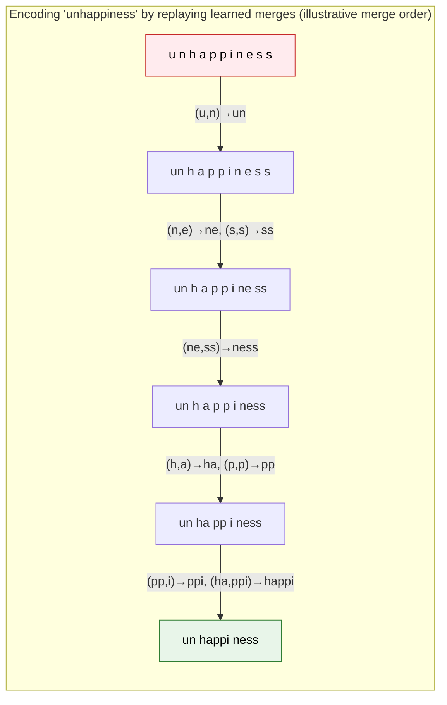

The final split depends entirely on which merges the tokenizer learned — a real tokenizer may produce different pieces for the same word.

### Why BPE Matters for Interviews ★★★

| Property | Detail |
|----------|--------|
| **Vocabulary size** | Typically 32K–262K tokens: Llama 2 32,000 · GPT-4 (cl100k) ≈ 100K · Llama 3 128,256 · GPT-4o (o200k) ≈ 200K · Gemma 3 ≈ 262K. Bigger vocabularies mean fewer tokens per text but a bigger embedding table (V × d) |
| **No OOV words** | Byte-level BPE (GPT-2 onward, Llama 3) starts from the 256 byte values, so any string can be encoded; SentencePiece models get the same guarantee with "byte fallback" |
| **Compression** | Common words = 1 token; rare words = several pieces. English averages about 4 characters (≈ 0.75 words) per token |
| **Language bias** | Non-English text often needs more tokens for the same meaning (in GPT-4o's tokenizer a short Hindi greeting costs 2.5× the English one) — more cost, less usable context |
| **Cost implication** | APIs bill per token and context windows are measured in tokens, so tokenizer efficiency = cost and context efficiency |
| **Gotchas** | Digits split oddly (arithmetic suffers); letters are hidden inside tokens ("how many r's in strawberry?"); a trailing space changes the tokens |

### Common Interview Follow-Up: "What are alternatives to BPE?" ★★★

| Method | How It Works | Used By |
|--------|-------------|---------|
| **BPE** | Merge the most **frequent** pair, bottom-up | GPT family, Llama 3, Qwen, DeepSeek |
| **WordPiece** | Like BPE, but merge the pair with the best likelihood score `count(ab) / (count(a) × count(b))` | BERT, DistilBERT |
| **Unigram LM** | Start with a large vocabulary; prune the tokens whose removal hurts corpus likelihood least | T5, ALBERT, XLNet |
| **SentencePiece** | Not an algorithm but a *library* that runs BPE or Unigram on raw text, treating the space as a normal symbol (`▁`) | Llama 1/2, T5, Gemma |

**Go deeper:** [Ch 17 §2.2](#content/17_llm) — BPE from scratch in code, special tokens and the tokenizer gotchas with measured token counts.

---

## 11.2 Positional Encoding — From Sinusoidal to RoPE ★★★

> **Maths in one line:** `(R_m q)ᵀ (R_n k) = qᵀ R_(n−m) k`, with pair i rotated by `m·θᵢ` and `θᵢ = base^(−2i/d)` — rotate the query by its position and the key by its position; the score then depends only on the gap n − m.

### Why Position Matters ★★★

Attention by itself is **order-blind** (formally *permutation-equivariant*): shuffle the input tokens and every token gets exactly the same output vector, just in a different place. Without positional information, "dog" would get the same representation in "dog bites man" and "man bites dog" — the model could not tell who bit whom.

### Sinusoidal Positional Encoding (Original Transformer, 2017) ★★★

Add a unique position signal to each token embedding:

```
PE(pos, 2i)   = sin(pos / 10000^(2i/d_model))
PE(pos, 2i+1) = cos(pos / 10000^(2i/d_model))

Where:
  pos     = position in the sequence (0, 1, 2, ...)
  i       = index of the (sin, cos) pair: 0, 1, ..., d_model/2 − 1
  d_model = embedding dimension (e.g., 512, 768, 4096)
```

**Why sinusoidal works:** For any fixed offset k, `PE(pos+k)` is a fixed linear function (a rotation of each sin/cos pair) of `PE(pos)` — the same matrix for every pos. So the model can learn to attend to relative positions.

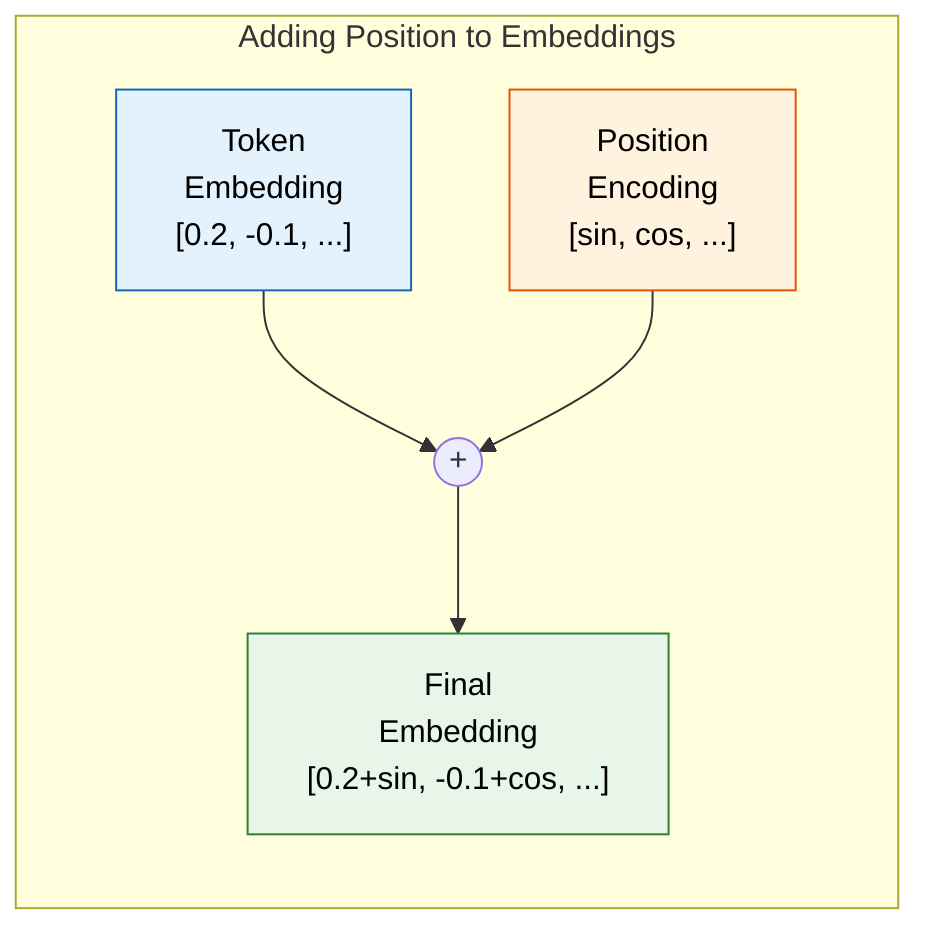

### RoPE — Rotary Position Embedding (Modern Standard) ★★★

**Why RoPE replaced sinusoidal:** Sinusoidal encoding is **absolute** — it encodes "I am at position 5." RoPE encodes **relative** relationships — "I am 3 positions after you" — which is what attention actually needs.

**Core Idea:** Instead of adding position to the embedding, RoPE **rotates** the query and key vectors by an angle proportional to their position.

### RoPE — Mathematical Derivation ★★★

**Step 1: Group dimensions into pairs**

For a vector of dimension d, group into d/2 pairs: (x₀, x₁), (x₂, x₃), ..., (x_{d-2}, x_{d-1})

**Step 2: Define rotation angle per pair**

```
θᵢ = 10000^(-2i/d)     where i = 0, 1, ..., d/2 - 1

For position m, the rotation angle for pair i is:  m · θᵢ
```

**Step 3: Apply 2D rotation to each pair**

```
For the i-th pair at position m:

┌ x'[2i]   ┐   ┌ cos(m·θᵢ)  −sin(m·θᵢ) ┐ ┌ x[2i]   ┐
│          │ = │                       │ │         │
└ x'[2i+1] ┘   └ sin(m·θᵢ)   cos(m·θᵢ) ┘ └ x[2i+1] ┘
```

Apply it to the query and the key (not the value), in every attention layer, just before the dot product.

**Step 4: Why this gives relative position**

When computing attention between position m (query) and position n (key):

```
q'ₘᵀ · k'ₙ = (R(m)·q)ᵀ · (R(n)·k)
            = qᵀ · R(m)ᵀ · R(n) · k
            = qᵀ · R(n - m) · k        ← depends only on RELATIVE position (n-m)!

R(m)ᵀ · R(n) = R(n-m) because R(m)ᵀ = R(−m) and rotations compose by adding angles.
```

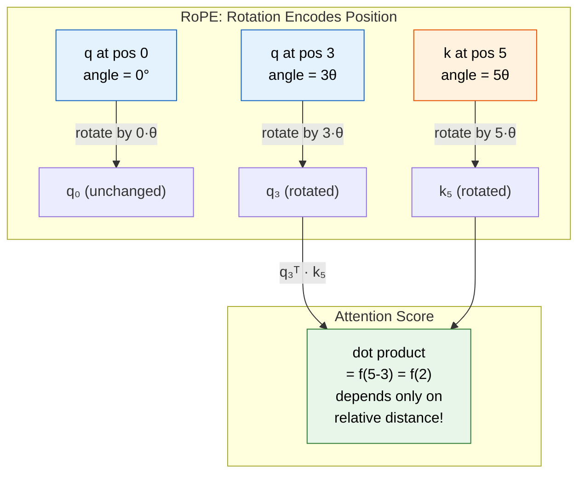

### Worked Example — RoPE for d=4, positions 0 and 2 ★★★

```
Given: d = 4 (so 2 pairs), base = 10000
  θ₀ = 10000^(0/4) = 1.0       (fast rotation)
  θ₁ = 10000^(-2/4) = 0.01     (slow rotation)

Token at position m=0:
  Pair 0: rotate by 0 × 1.0 = 0 radians     → no rotation
  Pair 1: rotate by 0 × 0.01 = 0 radians    → no rotation

Token at position m=2:
  Pair 0: rotate by 2 × 1.0 = 2.0 radians   → ~114.6°
  Pair 1: rotate by 2 × 0.01 = 0.02 radians → ~1.15°

A query at position 3 and a key at position 5 are each rotated further,
but the angle BETWEEN them in pair 0 is still (5 − 3) × 1.0 = 2.0 radians —
exactly as for positions 0 and 2. Same gap → same score.

Key insight: Low-frequency pairs change slowly across positions → encode
global/coarse position. High-frequency pairs change fast → encode
fine-grained position. Like a clock: hour hand = coarse, second hand = fine.
```

### Why RoPE Won — Interview Comparison ★★★

| Property | Sinusoidal | Learned | RoPE |
|----------|-----------|---------|------|
| Position type | Absolute (relative offsets are learnable) | Absolute | **Relative** (score depends only on the gap) |
| Beyond the training length | Defined, but degrades in practice | Impossible — no row for unseen positions | **Degrades on its own; good with rescaling** (PI, NTK-aware, YaRN) plus a short fine-tune |
| Added parameters | 0 | max_len × d | **0** |
| Used by | Original Transformer | BERT, GPT-1/2 | **Llama, Gemma, Mistral, Qwen, DeepSeek, GPT-NeoX** |
| How applied | Added to the input embeddings once | Added to the input embeddings once | **Rotates Q and K in every layer** (V untouched) |

### Stretching the Context — RoPE Scaling and Other Long-Context Tricks ★★

A model trained on 8K tokens has never seen the rotation angles for position 30,000, so quality collapses past its training length. The fixes **rescale the angles** instead of retraining from scratch (s = new length ÷ trained length):

| Method | What it changes | Used by (papers / published configs) |
|---|---|---|
| **Position Interpolation (PI)** | Divide every position by s: position 16,000 at s = 4 is read as 4,000, a position the model knows; neighbours end up only 1/s of a step apart | Meta's 2023 paper; Gemma 3 (factor 8, to 128K) |
| **NTK-aware scaling** | Raise the base so fast pairs barely change and the slowest pair slows by exactly s | Code Llama (base 1,000,000) |
| **YaRN** | Fast pairs untouched, slow pairs interpolated, a blend in between, plus a small attention-temperature fix | Qwen2.5/Qwen3 (32K → 128K), DeepSeek-V3 |
| **Bigger base from the start** | Train with a slower-spinning base | Llama 3: base 500,000 (Llama 2: 10,000) |

Rescaling only makes long inputs *possible*. Models also train progressively on longer sequences, and many cut attention cost with **local + global layers** (most layers see only a sliding window — Gemma 3 uses 5 local layers with a 1,024-token window per global layer). Whether the model *uses* the long context well is a separate question, tested with harder benchmarks than needle-in-a-haystack (such as RULER).

**Go deeper:** [Ch 16 §3.4](#content/16_deep_learning) — RoPE, PI, NTK-aware and YaRN with runnable code; [Ch 17 §2.7](#content/17_llm) — long context end to end.

---

## 11.3 Transformer Attention — Full Derivation from Scratch ★★★

> This section derives attention from first principles. If you've read [Ch 34 Topic 6](#content/34_google_top10_ml_interview), this goes deeper with the full mathematical proof, the causal mask and multi-head efficiency analysis.

> **Maths in one line:** `Attention(Q, K, V) = softmax(QKᵀ/√d_k + M)·V` — score every query against every key, scale so the scores have variance about 1, hide the future with the mask M (0 or −∞), turn each row into weights that sum to 1, and average the values with them.

### Step 1: The Problem Attention Solves ★★★

Given a sequence of n token embeddings X ∈ ℝⁿˣᵈ, we want each token to gather information from every other token, weighted by relevance.

### Step 2: Project into Q, K, V Spaces ★★★

$$Q = X \cdot W_Q \in \mathbb{R}^{n \times d_k} \quad \text{(what am I looking for?)}$$

$$K = X \cdot W_K \in \mathbb{R}^{n \times d_k} \quad \text{(what do I contain?)}$$

$$V = X \cdot W_V \in \mathbb{R}^{n \times d_v} \quad \text{(what information do I provide?)}$$

$W_Q \in \mathbb{R}^{d \times d_k}$, $W_K \in \mathbb{R}^{d \times d_k}$, $W_V \in \mathbb{R}^{d \times d_v}$ (learned parameters)

### Step 3: Compute Attention Scores ★★★

$$\text{Scores} = Q \cdot K^T \in \mathbb{R}^{n \times n}$$

Element $[i,j] = q_i^T \cdot k_j$ = how much should token $i$ attend to token $j$

### Step 4: Scale ★★★

$$\text{Scaled\_Scores} = \frac{Q \cdot K^T}{\sqrt{d_k}}$$

**WHY SCALE?** Without scaling, when $d_k$ is large:
- $q$ and $k$ are random vectors of dimension $d_k$
- $E[q^T k] = 0$, $\text{Var}[q^T k] = d_k$
- Large variance → some scores are very large
- softmax of very large values → near-one-hot → vanishing gradients
- Dividing by $\sqrt{d_k}$ normalizes variance to 1

**Proof:** If $q_i, k_j \sim \mathcal{N}(0,1)$ independently:

$$q^T k = \sum_i q_i k_i, \quad E[q_i k_i] = 0, \quad \text{Var}[q_i k_i] = 1$$

$$\text{By independence: } \text{Var}[q^T k] = d_k \cdot 1 = d_k \qquad \text{After dividing: } \text{Var}\!\left[\frac{q^T k}{\sqrt{d_k}}\right] = \frac{d_k}{d_k} = 1 \;\checkmark$$

### Step 5: Softmax → Attention Weights ★★★

$$\text{Attention\_Weights} = \text{softmax}(\text{Scaled\_Scores}) \in \mathbb{R}^{n \times n}$$

Row $i$ sums to 1: $\sum_j \text{Attention\_Weights}[i,j] = 1$. Each row is a probability distribution over which tokens to attend to.

### Step 6: Weighted Sum of Values ★★★

$$\text{Output} = \text{Attention\_Weights} \cdot V \in \mathbb{R}^{n \times d_v}$$

Row $i$ of output = weighted average of all value vectors, weighted by how much token $i$ attends to each position.

### Complete Formula ★★★

$$\text{Attention}(Q, K, V) = \text{softmax}\!\left(\frac{Q \cdot K^T}{\sqrt{d_k}}\right) \cdot V$$

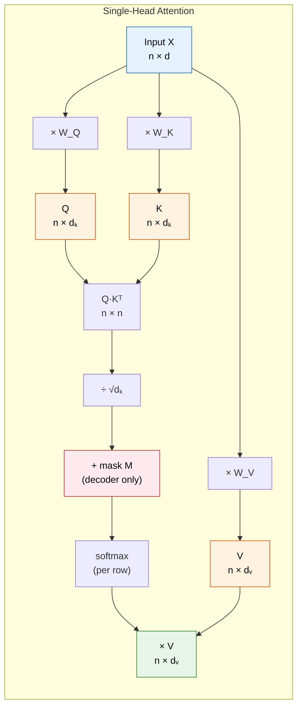

### Causal Mask — Why a Decoder Cannot See the Future ★★★

A decoder-only LLM is trained to predict token $i+1$ from tokens $0 \ldots i$. If token $i$ could attend to later tokens during training, it would simply copy the answer. So before the softmax we add a mask $M$: $M_{ij} = 0$ when $j \le i$ and $M_{ij} = -\infty$ when $j > i$. After the softmax, $e^{-\infty} = 0$, so every weight above the diagonal is exactly zero.

$$\text{CausalAttention}(Q, K, V) = \text{softmax}\!\left(\frac{QK^T}{\sqrt{d_k}} + M\right) V$$

```
            key:  t0     t1     t2     t3
  query t0  [     0     −∞     −∞     −∞  ]     t0 sees only itself
  query t1  [     0      0     −∞     −∞  ]
  query t2  [     0      0      0     −∞  ]
  query t3  [     0      0      0      0  ]     the last token sees everything
```

Two consequences interviewers like: training stays **parallel** (all n next-token predictions come out of one forward pass, with no peeking), and because no token ever looks at later tokens, a token's keys and values never change once computed — exactly why they can be cached at generation time (11.4). Encoder models such as BERT use **no** causal mask (bidirectional attention).

**Run it yourself** — the variance argument from Step 4, what unscaled scores do to softmax, and the causal mask on 4 tokens:

```python
# Scaled dot-product attention with a causal mask, and why we divide by sqrt(d_k)
import numpy as np
rng = np.random.default_rng(0)

def softmax(z):
    z = z - z.max(axis=-1, keepdims=True)               # subtract the row max: same result, no overflow
    e = np.exp(z)
    return e / e.sum(axis=-1, keepdims=True)

def attention(Q, K, V, causal=True, scale=True):
    n, d_k = Q.shape
    scores = Q @ K.T / (np.sqrt(d_k) if scale else 1.0)
    if causal:
        scores = scores + np.triu(np.full((n, n), -np.inf), k=1)   # M: -inf above the diagonal
    W = softmax(scores)
    return W @ V, W

# 1) Why scale: q.k of random unit-variance vectors has variance d_k
for d_k in (4, 64, 512):
    q, k = rng.standard_normal((20000, d_k)), rng.standard_normal((20000, d_k))
    dots = (q * k).sum(axis=1)
    print(f"d_k={d_k:3d}: Var[q.k] = {dots.var():6.1f}   Var[q.k / sqrt(d_k)] = {(dots / np.sqrt(d_k)).var():.2f}")

# 2) What unscaled scores do to softmax: rows collapse onto one key (near one-hot)
Q, K = rng.standard_normal((8, 512)), rng.standard_normal((8, 512))
V = rng.standard_normal((8, 4))
for scale in (False, True):
    _, W = attention(Q, K, V, causal=False, scale=scale)
    print(f"scaled={str(scale):5s}: average largest weight per row = {W.max(axis=1).mean():.2f}")

# 3) Causal mask on 4 tokens: token i may only look at tokens 0..i
Q, K, V = rng.standard_normal((4, 8)), rng.standard_normal((4, 8)), rng.standard_normal((4, 2))
out, W = attention(Q, K, V)
print("causal attention weights (row = query token, column = key token):")
for row in W:
    print("  " + "  ".join(f"{w:.2f}" for w in row))
assert np.allclose(W.sum(axis=1), 1) and np.all(np.triu(W, k=1) == 0)
assert np.allclose(out[0], V[0])                         # token 0 can only copy its own value

V2 = V.copy(); V2[3] += 100.0                            # change the LAST token only
K2 = K.copy(); K2[3] += 100.0
out2, _ = attention(Q, K2, V2)
assert np.allclose(out2[:3], out[:3])
print("changing token 3 leaves the outputs of tokens 0-2 unchanged:", bool(np.allclose(out2[:3], out[:3])))
```

**Output:**

```
d_k=  4: Var[q.k] =    4.0   Var[q.k / sqrt(d_k)] = 1.00
d_k= 64: Var[q.k] =   64.5   Var[q.k / sqrt(d_k)] = 1.01
d_k=512: Var[q.k] =  508.2   Var[q.k / sqrt(d_k)] = 0.99
scaled=False: average largest weight per row = 1.00
scaled=True : average largest weight per row = 0.45
causal attention weights (row = query token, column = key token):
  1.00  0.00  0.00  0.00
  0.45  0.55  0.00  0.00
  0.12  0.53  0.35  0.00
  0.30  0.22  0.33  0.15
changing token 3 leaves the outputs of tokens 0-2 unchanged: True
```

Without the $\sqrt{d_k}$, a 512-dimensional head puts essentially all its weight on one key (the softmax saturates, so gradients vanish); with it, the largest weight averages 0.45. And the last line is the causal mask doing its job: no token's output depends on a later token.

### Multi-Head Attention — Why and How ★★★

**Motivation:** A single attention head can only capture one type of relationship. We want to capture multiple relationships simultaneously (syntactic, semantic, positional, etc.).

$$\text{MultiHead}(Q, K, V) = \text{Concat}(\text{head}_1, \text{head}_2, \ldots, \text{head}_h) \cdot W_O$$

$$\text{where } \text{head}_i = \text{Attention}(X \cdot W^i_Q,\ X \cdot W^i_K,\ X \cdot W^i_V)$$

Parameters per head: $W^i_Q \in \mathbb{R}^{d \times (d/h)}$, $W^i_K \in \mathbb{R}^{d \times (d/h)}$, $W^i_V \in \mathbb{R}^{d \times (d/h)}$

Total parameters ($h$ heads): $h \times 3 \times d \times (d/h) = 3d^2$ (same as single head with full $d$!)

Output projection: $W_O \in \mathbb{R}^{d \times d}$ → another $d^2$ parameters

Total attention parameters: $4d^2$ (regardless of number of heads, ignoring biases)

**Key insight for interviews:** Multi-head attention costs the same parameters and FLOPs as single-head attention with the same total dimension. The heads just partition the representation space — e.g. $d = 4096$ split into 32 heads of $d_k = 128$.

### Grouped Query Attention (GQA) and Multi-Query Attention (MQA) ★★★

During generation every head's K and V must be kept for every token (the KV cache, 11.4) and re-read at every step, so the number of **key/value heads** sets the serving cost. MQA and GQA let several query heads share one K/V head:

| Variant | Query heads | Key heads | Value heads |
|---------|:-----------:|:---------:|:-----------:|
| Standard MHA | $h$ | $h$ | $h$ |
| MQA | $h$ | $1$ | $1$ |
| GQA | $h$ | $g$ | $g$ ($1 < g < h$, $g$ divides $h$) |

Numbers cached per token (multiply by bytes per number, e.g. 2 for FP16):

$$\text{MHA: } 2 \times h \times d_k \times \text{layers} \qquad \text{GQA: } 2 \times g \times d_k \times \text{layers} \qquad \text{MQA: } 2 \times 1 \times d_k \times \text{layers}$$

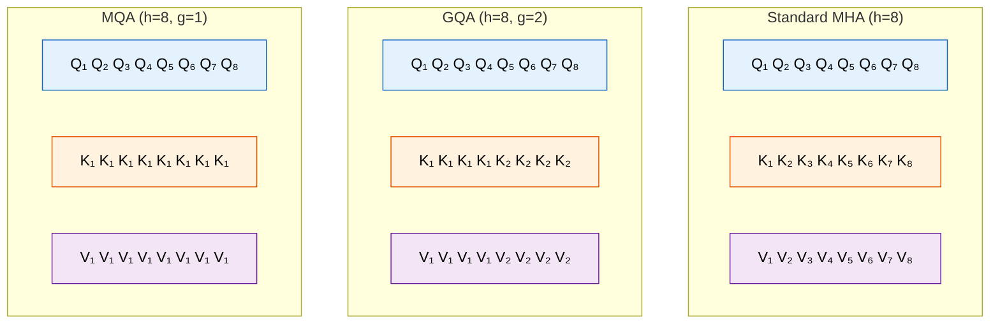

| Variant | Used By | KV cache vs MHA | Quality |
|---------|---------|-----------------|---------|
| MHA | Original Transformer, BERT, GPT-2/3, Llama 2 7B/13B | 1× (baseline) | Best |
| GQA | Llama 2 34B/70B (7B/13B stay MHA), Llama 3 (all sizes), Mistral 7B, Gemma 2/3, Qwen3 | g/h (Llama 3 70B: 8 of 64 → 1/8) | Near-MHA |
| MQA | PaLM, Falcon-7B, Gemma 1 2B; the Gemini 1.0 report cites multi-query attention as one of its efficient-attention choices | 1/h | Some drop on hard tasks |
| MLA | DeepSeek-V2/V3, Kimi K2 | 576 vs 32,768 numbers per token per layer → ≈ 1/57 | On par with MHA in DeepSeek's ablations |

### Multi-Head Latent Attention (MLA) — Compress Instead of Share ★★

GQA saves memory by *removing* K/V heads. **MLA** (DeepSeek-V2, 2024; also V3) keeps every head but caches a **compressed latent** instead: each token's hidden state is projected down to a short vector $c$ (512 numbers in DeepSeek-V3), and per-head up-projections rebuild K and V from it when needed. RoPE cannot be folded into those projections, so a small separate rotary key (64 numbers, shared by all heads) is cached alongside.

```
  Per token, per layer, for 128 heads of size 128 (the DeepSeek-V3 shape):
  MHA     2 × 128 × 128          = 32,768 numbers
  GQA-8   2 ×   8 × 128          =  2,048 numbers   (16× smaller)
  MLA     512 latent + 64 RoPE   =    576 numbers   (57× smaller)
```

At inference the K up-projection is folded ("absorbed") into the query side and the V up-projection into the output projection, so attention runs directly against the cached latent instead of rebuilding K and V for every past token. Interview one-liner: **MQA/GQA/MLA shrink the bytes per token; sliding-window attention shrinks the number of tokens kept.**

**Go deeper:** [Ch 17 §2.4](#content/17_llm) — attention, multi-head, GQA/MQA, MLA and sliding-window attention with runnable code; [Ch 16 §3.3](#content/16_deep_learning) — self-attention from scratch.

---

## 11.4 KV Cache — How It Works and Memory Calculation ★★★

> **Maths in one line:** `KV bytes = 2 × batch × layers × kv_heads × d_head × seq_len × bytes_per_value` — every layer keeps one key and one value vector per KV head for every token of every request, so the cache grows in a straight line with context length *and* batch size.

### Why KV Cache Exists ★★★

During autoregressive generation, each new token attends to ALL previous tokens. Thanks to the causal mask (11.3), an earlier token's K and V never change — so recomputing them at every step is pure waste. Without a cache, generating n tokens recomputes the whole prefix each time: O(n²) projection work in total.

```
Without KV cache (generating 4 tokens):
─────────────────────────────────────────
Step 1: compute K,V for [tok1]                         → 1 computation
Step 2: compute K,V for [tok1, tok2]                   → 2 computations
Step 3: compute K,V for [tok1, tok2, tok3]             → 3 computations
Step 4: compute K,V for [tok1, tok2, tok3, tok4]       → 4 computations
Total: 1+2+3+4 = 10 = O(n²)

With KV cache:
──────────────
Step 1: compute K,V for [tok1], CACHE them             → 1 computation
Step 2: compute K,V for [tok2] only, append to cache   → 1 computation
Step 3: compute K,V for [tok3] only, append to cache   → 1 computation
Step 4: compute K,V for [tok4] only, append to cache   → 1 computation
Total: 1+1+1+1 = 4 = O(n)
```

The cache removes the *recomputation*, not the attention itself: the new token's query is still compared with all t cached keys, so step t costs O(t) and the attention work over n steps is still O(n²). It also trades compute for **memory** — and that memory is usually what limits how many users one GPU can serve. Each decode step must re-read the whole cache from GPU memory, which is why decoding is memory-bandwidth-bound.

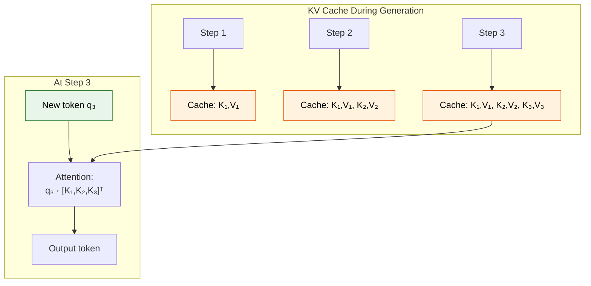

### Memory Calculation — Interview Must-Know ★★★

**Formula for KV cache memory:**

```
KV_cache_memory = 2 × batch_size × num_layers × num_kv_heads × d_head × seq_len × bytes_per_element

Where:
  2           = one for K, one for V
  batch_size  = number of sequences being generated in parallel
  num_layers  = number of transformer layers
  num_kv_heads = number of key/value heads (= num_heads for MHA, less for GQA)
  d_head      = dimension per head (typically d_model / num_heads)
  seq_len     = current sequence length
  bytes_per_element = 2 for FP16/BF16, 1 for FP8/INT8
```

> **Units.** KV-cache sizes come out as round numbers in binary units (1 GiB = 2³⁰ bytes ≈ 1.07 GB); weight sizes are usually quoted in decimal GB (70B × 2 bytes = 140 GB). Say which one you mean.

### Worked Example — LLaMA 2 70B ★★★

```
LLaMA 2 70B specifications (Llama 3 70B has the same attention shape):
  d_model = 8192
  num_layers = 80
  num_heads = 64
  num_kv_heads = 8  (GQA: 8 query heads share each KV head)
  d_head = 8192 / 64 = 128
  Precision: BF16 (2 bytes)

Per token:
  = 2 × 80 × 8 × 128 × 2 bytes = 327,680 bytes = 320 KiB

KV cache for 1 request at sequence length 4096:
  = 2 × 1 × 80 × 8 × 128 × 4096 × 2 bytes
  = 1,342,177,280 bytes
  = 1.25 GiB (1.34 GB) per request

At batch size 32:
  = 32 × 1.25 GiB = 40 GiB (42.9 GB) just for KV cache

Compare: Model weights (70B params × 2 bytes) = 140 GB
KV cache at batch 32, seq 4096 ≈ 43 GB ≈ 31% of the weight memory
One request at 128K tokens: 32 × 1.25 GiB = 40 GiB — the same as the whole batch above

Without GQA (standard MHA, 64 KV heads instead of 8):
  = 32 × 10 GiB = 320 GiB (≈ 344 GB) — more than twice the weights
  GQA saves 8× on KV cache memory.
```

**Run it yourself** — the same numbers, plus what MHA and an FP8 cache change, and how many requests fit beside the weights:

```python
# KV-cache memory for Llama 2 70B (GQA): per token, per request, per batch - and what MHA would cost
GiB = 2 ** 30

def kv_bytes(layers, kv_heads, d_head, tokens, batch=1, bytes_per=2):     # bytes_per=2 -> FP16/BF16
    return 2 * batch * layers * kv_heads * d_head * tokens * bytes_per     # 2 = one K and one V

L, KV, D = 80, 8, 128                     # Llama 2 70B: 80 layers, 8 KV heads (GQA), head size 128
per_token = kv_bytes(L, KV, D, tokens=1)
one_req = kv_bytes(L, KV, D, tokens=4096)
batch32 = kv_bytes(L, KV, D, tokens=4096, batch=32)
weights = 70e9 * 2                        # 70B parameters x 2 bytes (decimal GB)

print(f"per token       : {per_token:,} bytes = {per_token / 1024:.0f} KiB")
print(f"1 request, 4K   : {one_req / GiB:.2f} GiB ({one_req / 1e9:.2f} GB)")
print(f"32 requests, 4K : {batch32 / GiB:.0f} GiB ({batch32 / 1e9:.1f} GB) = {batch32 / weights:.0%} of the {weights / 1e9:.0f} GB of weights")
print(f"1 request, 128K : {kv_bytes(L, KV, D, tokens=131072) / GiB:.0f} GiB")
assert per_token == 327_680 and batch32 == 40 * GiB

# The same batch with plain multi-head attention (64 KV heads), and with an FP8 cache
mha = kv_bytes(L, 64, D, tokens=4096, batch=32)
fp8 = kv_bytes(L, KV, D, tokens=4096, batch=32, bytes_per=1)
print(f"MHA instead     : {mha / GiB:.0f} GiB ({mha // batch32}x more)")
print(f"GQA + FP8 cache : {fp8 / GiB:.0f} GiB (half of FP16)")
assert mha == 8 * batch32 and 2 * fp8 == batch32

# Max batch: 4 GPUs x 80 GB, 90% usable, FP16 weights loaded - how many 4K-token requests fit?
free = 0.9 * 4 * 80e9 - weights
print(f"4 x 80 GB GPUs  : {free / 1e9:.0f} GB left for KV -> GQA fits {int(free // one_req)} requests, "
      f"MHA only {int(free // (8 * one_req))}")
```

**Output:**

```
per token       : 327,680 bytes = 320 KiB
1 request, 4K   : 1.25 GiB (1.34 GB)
32 requests, 4K : 40 GiB (42.9 GB) = 31% of the 140 GB of weights
1 request, 128K : 40 GiB
MHA instead     : 320 GiB (8x more)
GQA + FP8 cache : 20 GiB (half of FP16)
4 x 80 GB GPUs  : 148 GB left for KV -> GQA fits 110 requests, MHA only 13
```

The last line is the interview point: **maximum batch ≈ (usable GPU memory − weights) ÷ KV bytes per request**. With GQA the batch of 32 fits easily on four 80 GB GPUs; with MHA only 13 requests would.

### KV Cache Optimization Techniques ★★★

| Technique | How It Works | Saving |
|-----------|-------------|--------|
| **GQA / MQA** | Fewer KV heads shared by the query heads | h/g: 8× for Llama 70B (64 → 8 KV heads); up to h× for MQA |
| **MLA** (DeepSeek-V2/V3) | Cache a compressed latent per token instead of full K and V | ≈ 57× vs MHA of the same shape |
| **Quantized KV cache** | Store K, V in FP8 (or INT4) instead of FP16 | 2× (FP8), 4× (INT4 — check long-context quality) |
| **PagedAttention (vLLM)** | Allocate the cache in fixed blocks with a block table, like virtual-memory pages | Cuts fragmentation waste (earlier systems used only 20–38% of KV memory for real tokens) → 2–4× throughput |
| **Prefix caching** | Requests that share a prompt prefix (system prompt, documents) point at the same cached blocks | The prefix is stored once and its prefill is skipped |
| **Sliding window / local layers** | Some or all layers keep only the last W tokens (Mistral 7B v0.1; Gemma 2/3 local layers) | seq_len / W on those layers |
| **Token eviction** (H2O, SnapKV) | Drop cached tokens that receive little attention | Dynamic; risks forgetting |

**Go deeper:** [Ch 17c §1.2](#content/17c_llm_systems) — the KV cache with real model configs; [Ch 17c §2.2](#content/17c_llm_systems) — PagedAttention; [Ch 17c §3.2](#content/17c_llm_systems) — KV-cache quantization and offload.

---

## 11.5 Flash Attention — Why O(n) Memory ★★★

> **Maths in one line:** `ℓ_new = ℓ_old · e^(m_old − m_new) + Σⱼ e^(sⱼ − m_new)` — keep a running max m and running sum ℓ for each query row; when a new block raises the max, shrink the old sum (and the old output) by `e^(m_old − m_new)`, so the n × n matrix never has to exist.

### The Problem with Standard Attention ★★★

A GPU has a large but slow memory, **HBM** (High Bandwidth Memory — the "80 GB" on the spec sheet), and a tiny but roughly 10× faster on-chip **SRAM** (about 20 MB on an A100). Standard attention writes the full n × n score matrix to HBM, reads it back for the softmax, writes the weights, and reads them again to multiply by V:

```
Standard attention memory: O(n²) for the score/weight matrix

For n = 128K tokens (a common context length for 2024–2026 models):
  Score matrix = 128K × 128K × 2 bytes = 32 GiB for ONE head of ONE layer
  × 64 heads = 2 TiB per layer — it cannot be materialised.

Even at n = 8K, moving these matrices dominates: attention is limited
by memory traffic (bandwidth), not by arithmetic.
```

### Flash Attention — The Key Insight ★★★

**Core idea:** Never materialize the full n×n matrix. Instead, compute attention in **tiles** (blocks) that fit in SRAM (fast on-chip memory), accumulating the result incrementally. Each output row is written to HBM once.

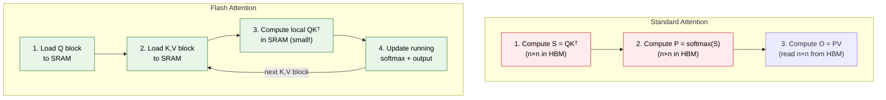

### The Online Softmax Trick ★★★

The challenge: softmax divides by the sum over the WHOLE row, and a later tile may contain a bigger score that changes every earlier weight. Flash Attention uses the **online softmax** algorithm to compute softmax incrementally:

**Online Softmax** — Process scores in blocks:

**Block 1:** scores $s_1 = [3.0, 1.0, 2.0]$

$$m_1 = \max(s_1) = 3.0 \qquad \ell_1 = \sum \exp(s_i - m_1) = e^0 + e^{-2} + e^{-1} = 1 + 0.1353 + 0.3679 = 1.5032$$

**Block 2:** scores $s_2 = [5.0, 0.5]$

$$m_2 = \max(s_2) = 5.0 \qquad \ell_2 = \sum \exp(s_i - m_2) = e^0 + e^{-4.5} = 1 + 0.0111 = 1.0111$$

**Combine blocks:**

$$\begin{aligned}
m_{\text{new}} &= \max(m_1, m_2) = \max(3.0, 5.0) = 5.0 \\
\ell_{\text{new}} &= \ell_1 \cdot e^{m_1 - m_{\text{new}}} + \ell_2 \cdot e^{m_2 - m_{\text{new}}} \\
&= 1.5032 \cdot e^{3-5} + 1.0111 \cdot e^{5-5} = 1.5032 \cdot 0.1353 + 1.0111 \cdot 1.0 = 1.2145
\end{aligned}$$

**Check** against the direct sum over all five scores at max 5: $e^{-2} + e^{-4} + e^{-3} + e^{0} + e^{-4.5} = 0.1353 + 0.0183 + 0.0498 + 1 + 0.0111 = 1.2145$ ✓

The output is handled the same way: keep an unnormalised accumulator, update it as `O = O · e^(m_old − m_new) + P_tile · V_tile`, and divide by ℓ **once** at the end. Same result as the global softmax, and the full $n \times n$ matrix is never stored.

**Run it yourself** — the two blocks above, then a complete tiled attention checked against standard attention for four tile sizes:

```python
# Online softmax, the FlashAttention trick: process scores block by block and still get the exact softmax
import numpy as np

s1, s2 = np.array([3.0, 1.0, 2.0]), np.array([5.0, 0.5])     # the text's two blocks of scores
m1, l1 = s1.max(), np.exp(s1 - s1.max()).sum()
m2, l2 = s2.max(), np.exp(s2 - s2.max()).sum()
m = max(m1, m2)
l = l1 * np.exp(m1 - m) + l2 * np.exp(m2 - m)                 # rescale each block's sum to the new max
direct = np.exp(np.concatenate([s1, s2]) - m).sum()
print(f"block 1: m={m1:.1f} l={l1:.3f}   block 2: m={m2:.1f} l={l2:.3f}")
print(f"combined l = {l:.4f}   direct sum over all 5 scores = {direct:.4f}")
assert np.isclose(l, direct)

def flash_attention(Q, K, V, block):
    n, d = Q.shape
    O, m, l = np.zeros((n, V.shape[1])), np.full(n, -np.inf), np.zeros(n)
    for j in range(0, K.shape[0], block):                     # stream K/V in tiles; never build n x n
        S = Q @ K[j:j + block].T / np.sqrt(d)                 # only an n x block tile of scores
        m_new = np.maximum(m, S.max(axis=1))
        scale = np.exp(m - m_new)                             # shrink old sum and output if the max grew
        P = np.exp(S - m_new[:, None])
        l = l * scale + P.sum(axis=1)
        O = O * scale[:, None] + P @ V[j:j + block]
        m = m_new
    return O / l[:, None]                                     # divide by the sum once, at the end

def standard_attention(Q, K, V):
    S = Q @ K.T / np.sqrt(Q.shape[1])                         # the full n x n matrix
    P = np.exp(S - S.max(axis=1, keepdims=True))
    return (P / P.sum(axis=1, keepdims=True)) @ V

rng = np.random.default_rng(0)
Q, K, V = rng.standard_normal((6, 4)), rng.standard_normal((6, 4)), rng.standard_normal((6, 3))
for block in (1, 2, 3, 6):
    same = np.allclose(flash_attention(Q, K, V, block), standard_attention(Q, K, V))
    print(f"K/V tiles of {block}: biggest score tile 6 x {block}, same output as standard attention: {same}")
    assert same

n = 131072
print(f"n = 128K: full score matrix for ONE head = {n * n * 2 / 2**30:.0f} GiB (FP16); a 128 x 128 tile = {128 * 128 * 2 // 1024} KiB")
```

**Output:**

```
block 1: m=3.0 l=1.503   block 2: m=5.0 l=1.011
combined l = 1.2145   direct sum over all 5 scores = 1.2145
K/V tiles of 1: biggest score tile 6 x 1, same output as standard attention: True
K/V tiles of 2: biggest score tile 6 x 2, same output as standard attention: True
K/V tiles of 3: biggest score tile 6 x 3, same output as standard attention: True
K/V tiles of 6: biggest score tile 6 x 6, same output as standard attention: True
n = 128K: full score matrix for ONE head = 32 GiB (FP16); a 128 x 128 tile = 32 KiB
```

For clarity the program keeps all query rows at once; the real kernel also tiles Q, so only small tiles ever live in SRAM.

### Memory and Speed Comparison ★★★

| | Standard attention | FlashAttention |
|---|---|---|
| Extra memory | O(n²) — the score and weight matrices | **O(n)** — a running max and sum per row, plus tiles |
| HBM reads/writes | Θ(n·d + n²) | Θ(n²·d² / M), M = SRAM size — several times fewer for typical d = 64–128 |
| FLOPs | O(n²·d) | **O(n²·d) — unchanged** (plus some recomputation in the backward pass) |
| Wall-clock (FlashAttention paper) | 1× | ~3× faster GPT-2 training at 1K tokens; up to 7.6× on the attention operation |
| Exact? | Yes | **Yes — same function, computed in a different order** |

**Critical interview point:** Flash Attention is NOT an approximation. It computes the **exact same result** as standard attention (up to floating-point rounding), just more efficiently by being IO-aware (minimizing slow HBM access). It does **not** make attention linear: memory becomes O(n), compute stays O(n²).

### FlashAttention-2, -3 and -4 ★★★

The algorithm (tiling + online softmax) has not changed; each version uses newer GPUs better. Numbers are the papers' own claims:

| Version | Year · hardware | Key Improvement |
|---------|-----------------|----------------|
| FlashAttention | 2022 · A100 | Tiling, online softmax, recomputation in the backward pass; O(n) memory |
| FlashAttention-2 | 2023 · A100 | Fewer non-matmul FLOPs, parallelism across the sequence, better work split — about 2× over v1 |
| FlashAttention-3 | 2024 · H100 (Hopper) | Asynchrony (warp specialisation, overlapping loads, matmul and softmax), FP8 — 1.5–2.0× over v2 |
| FlashAttention-4 | 2026 · B200/GB200 (Blackwell) | Pipelines built around Blackwell's asynchronous matrix units; fewer exponentials and rescales — up to 1,613 TFLOP/s BF16 |

In practice you rarely write it: PyTorch's `scaled_dot_product_attention` picks a FlashAttention-style kernel automatically, and JAX ships Pallas kernels for TPUs. For decoding (one query at a time) the gain is smaller; *Flash-Decoding* splits the long K/V cache across thread blocks instead.

**Go deeper:** [Ch 17 §2.4](#content/17_llm) — FlashAttention: why attention is memory-bound, the online softmax in code, and how it relates to the KV cache and PagedAttention.

---

## 11.6 Mixture of Experts (MoE) ★★★

### Simple Explanation

Imagine a hospital with 8 specialist doctors. For each patient, a triage nurse (the **router**) examines symptoms and sends the patient to only 2 relevant specialists — not all 8. The hospital has the knowledge of 8 doctors but each patient only costs the time of 2.

MoE works the same way: a model has many "expert" sub-networks, but each token only activates a few of them. You get the capacity of a huge model at the compute cost of a smaller one — but you still have to **store** all of it. (Unlike the doctors, real experts are not topic specialists: the Mixtral paper found routing follows low-level patterns such as syntax and token type, not subjects.)

> **Maths in one line:** `y = Σ_{i ∈ TopK} gᵢ(x) · Eᵢ(x)`, with `g = softmax` over the k chosen router scores — run only the k best-matching experts and blend their outputs; compute ≈ 2 × *active* parameters per token, memory = *total* parameters.

### How MoE Works ★★★

In a standard Transformer, each layer has one FFN (Feed-Forward Network). In MoE, the single FFN is replaced with N expert FFNs plus a router:

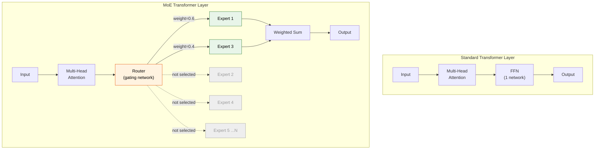

### The Router / Gating Function ★★★

Given input token $x \in \mathbb{R}^d$ and $N$ experts:

$$\begin{aligned}
\text{Router scores:} \quad & h(x) = x \cdot W_{\text{gate}} \in \mathbb{R}^N && (W_{\text{gate}} \in \mathbb{R}^{d \times N}) \\
\text{Top-K selection:} \quad & S = \text{TopK}(h(x), k) && \text{(select } k \text{ experts, typically } k=2\text{)} \\
\text{Gating weights:} \quad & g(x) = \text{softmax}(h(x)[S]) && \text{(normalize over selected experts)}
\end{aligned}$$

$$\text{Output: } y = \sum_{i \in S} g_i(x) \cdot \text{Expert}_i(x) \qquad \text{(weighted sum of expert outputs)}$$

**Tiny example (N = 4, k = 2):** router scores $[2.0, 1.0, -1.0, 0.5]$ → keep experts 0 and 1 → gates $\text{softmax}(2.0, 1.0) = [0.73, 0.27]$ → $y = 0.73\,E_0(x) + 0.27\,E_1(x)$; experts 2 and 3 do no work for this token. Variants: Switch Transformer uses k = 1 and keeps the router's own probability as the gate; DeepSeek-V3 uses a sigmoid score per expert, picks 8 of 256 routed experts and always adds 1 **shared expert**.

### MoE — Key Numbers and Models ★★★

| Model | Total Params | Active Params | Experts | Top-K | Year |
|-------|-------------|---------------|---------|-------|------|
| Switch Transformer (Google) | 1.6T | Not reported (≈ 1/7 the per-token FLOPs of the dense 11B T5-XXL) | 2,048 | 1 | 2021 |
| Mixtral 8x7B | 46.7B | 12.9B | 8 | 2 | 2023 |
| DBRX | 132B | 36B | 16 | 4 | 2024 |
| DeepSeek-V3 | 671B | 37B | 256 routed + 1 shared | 8 routed | 2024 (Dec) |
| Llama 4 Scout | 109B | 17B | 16 routed + 1 shared | 1 routed | 2025 |
| gpt-oss-120b | 117B | 5.1B | 128 | 4 | 2025 |
| Gemini (1.5 Pro onward) | Not disclosed | Not disclosed | Sparse MoE per Google's model cards | — | 2024– |

**The trend:** the active share fell from about 28% (Mixtral, 2023) to roughly 3–6% for most 2025–26 frontier open models, using many small "fine-grained" experts plus shared experts. On the closed side, Google's model cards describe Gemini as a sparse MoE (as of Nov 2026, Gemini 4 Argon's card says so) without parameter counts.

**The trade-off interviewers probe — MoE saves compute, not memory:**

| | Dense 37B | MoE: DeepSeek-V3 (671B total, 37B active) | Dense 671B |
|---|---|---|---|
| FLOPs per token (≈ 2 × active params) | 74 GFLOP | 74 GFLOP | 1,342 GFLOP |
| Weights to store at FP8 (1 byte each) | 37 GB | **671 GB** | 671 GB |

So MoE wins in large-batch serving on multi-GPU nodes, and is awkward on one small device. Experts are sharded across GPUs (**expert parallelism**), which costs two all-to-all exchanges per MoE layer. MoE also does not shrink the KV cache — that depends on attention, not experts.

### The Expert Collapse Problem ★★★

Without careful training, routing collapses: an expert that is slightly better early gets more tokens, trains more, gets better and gets even more tokens — until a few experts do all the work and the rest are wasted parameters. Solutions:

**Load Balancing Loss** (Switch Transformer, added to the language-modelling loss):

$$L_{\text{balance}} = \alpha \cdot N \cdot \sum_i f_i \cdot P_i$$

- $f_i$ = fraction of tokens routed to expert $i$ (a hard count — no gradient)
- $P_i$ = average router probability for expert $i$ (smooth — this is where the gradient flows)
- $\alpha$ = balancing coefficient (typically 0.01)

This loss penalizes uneven routing. It is smallest under uniform routing, $f_i = P_i = 1/N$, where it equals exactly $\alpha$; total collapse onto one expert gives $N\alpha$.

**Other tools:**

| Tool | Idea | Used by |
|---|---|---|
| **Auxiliary-loss-free balancing** | Add a per-expert bias to the scores *only when choosing* the top-k; after each step lower it for overloaded experts and raise it for idle ones (a tiny sequence-level loss stays as a safety net) | DeepSeek-V3 |
| **Capacity factor** | Each expert gets a fixed buffer `⌈C · T · k / N⌉` token slots; overflow tokens skip the expert via the residual connection | Switch, GShard (fixed shapes suit TPUs) |
| **Router z-loss** | Penalise very large router scores to keep training stable | ST-MoE |

**Run it yourself** — Mixtral's stored vs active parameters from its config, the 4-expert routing example above, and the balance loss for a healthy vs a collapsing router:

```python
# MoE in numbers: Mixtral's stored vs active parameters, top-2 routing, and the load-balancing loss
import numpy as np

# 1) Mixtral 8x7B from its config: d=4096, FFN 14336, 32 layers, 8 experts, top-2, 8 KV heads, vocab 32000
d, ffn, layers, E, k, kv, vocab = 4096, 14336, 32, 8, 2, 8, 32000
expert = 3 * d * ffn * layers                       # one SwiGLU expert (3 matrices) across all layers
attn = (2 * d * d + 2 * d * (kv * 128)) * layers    # W_Q, W_O full size; W_K, W_V for 8 KV heads of 128
other = 2 * vocab * d + d * E * layers              # input + output embeddings, routers
total, active = E * expert + attn + other, k * expert + attn + other
print(f"Mixtral 8x7B: stored {total / 1e9:.1f}B, active per token {active / 1e9:.1f}B ({active / total:.0%})")
assert round(total / 1e9, 1) == 46.7 and round(active / 1e9, 1) == 12.9

def route(logits, k=2):
    top = np.argsort(-logits, axis=1)[:, :k]                           # the k best experts per token
    sel = np.take_along_axis(logits, top, axis=1)
    gates = np.exp(sel - sel.max(axis=1, keepdims=True))
    return top, gates / gates.sum(axis=1, keepdims=True)              # softmax over the chosen k only

def balance_loss(logits, top, alpha=0.01):
    N = logits.shape[1]
    f = np.bincount(top.ravel(), minlength=N) / top.size               # share of routed slots per expert
    p = np.exp(logits - logits.max(axis=1, keepdims=True))
    P = (p / p.sum(axis=1, keepdims=True)).mean(axis=0)                # mean router probability per expert
    return f, alpha * N * np.sum(f * P)

# 2) One token, 4 experts: the router keeps the top 2 and renormalises
top, g = route(np.array([[2.0, 1.0, -1.0, 0.5]]))
print(f"router scores [2.0, 1.0, -1.0, 0.5] -> experts {top[0].tolist()} with gates {np.round(g[0], 2).tolist()}")

# 3) 1,000 tokens, 4 experts: a healthy router vs one collapsing onto expert 0
rng = np.random.default_rng(0)
healthy = rng.normal(0, 1, (1000, 4))
collapsed = healthy + np.array([4.0, 2.0, 0.0, 0.0])                 # experts 0 and 1 always win
for name, logits in [("healthy", healthy), ("collapsed", collapsed)]:
    top, _ = route(logits)
    f, L = balance_loss(logits, top)
    print(f"{name:9s}: token share per expert {np.round(f, 2).tolist()}  L_balance = {L:.4f} (alpha = 0.01)")
```

**Output:**

```
Mixtral 8x7B: stored 46.7B, active per token 12.9B (28%)
router scores [2.0, 1.0, -1.0, 0.5] -> experts [0, 1] with gates [0.73, 0.27]
healthy  : token share per expert [0.26, 0.24, 0.24, 0.26]  L_balance = 0.0100 (alpha = 0.01)
collapsed: token share per expert [0.5, 0.43, 0.03, 0.04]  L_balance = 0.0185 (alpha = 0.01)
```

"8x7B" is not 56B: only the feed-forward blocks are copied into experts, while attention and embeddings are shared — so 46.7B are stored and 12.9B run per token. The healthy router sits at the minimum (L = α = 0.01); the skewed one is pushed back by a larger loss.

### Interview-Ready Answer: "Explain MoE Architecture" ★★★

> "MoE replaces the FFN in each Transformer layer with N expert FFNs and a learned router. For each token the router picks the top-k experts — 2 of 8 in Mixtral, 8 of 256 plus a shared expert in DeepSeek-V3 — and blends their outputs with the router's gate weights. So the model *stores* many parameters but *computes* with few: Mixtral 8x7B holds 46.7B parameters but runs 12.9B per token, and Mistral reports it matches or beats Llama 2 70B on most benchmarks with about 6× faster inference. The costs are memory — every expert must be loaded — load balancing (an auxiliary loss, or DeepSeek's bias-based balancing), and all-to-all communication when experts are sharded across GPUs."

**Go deeper:** [Ch 17 §4.8](#content/17_llm) — MoE in depth (routing variants, capacity factor, memory vs batch size, a NumPy MoE layer); [Ch 16 §6.1](#content/16_deep_learning) — MoE as a deep-learning layer; [Ch 29 §24.6](#content/29_gpus_tpus_infrastructure) — expert parallelism.

---

## Interview-Ready Answer Template

**Question:** "Walk me through how a modern LLM turns a prompt into the next token."

**Say this first (30 sec):** "A BPE tokenizer turns the text into subword ids, and each id becomes an embedding vector. Then L decoder blocks each apply causal self-attention — softmax(QKᵀ/√d_k + mask)·V, with RoPE rotating Q and K so scores depend on relative position — followed by a feed-forward network, often a mixture of experts. The last hidden state becomes logits over the vocabulary, we pick the next token, and a KV cache keeps every token's keys and values so each new token costs one step."

**Then the structure (expand whichever part they probe):**

1. **Tokens** — byte-level BPE, 32K–262K vocabularies, no unknown words.
2. **Position** — RoPE in every layer; extend context with PI or YaRN.
3. **Attention** — √d_k keeps score variance at 1; 4d² parameters whatever the head count.
4. **FFN / MoE** — Mixtral 8x7B stores 46.7B parameters but runs 12.9B per token.
5. **Serving** — KV cache = `2 × layers × kv_heads × d_head × bytes` per token: 320 KiB for Llama-2/3-70B, hence GQA, MLA and FP8 caches; FlashAttention keeps attention exact with O(n) memory.

---

## Follow-Up Questions & Answers

**Q: "Why divide by √d_k and not by d_k?"**
> With unit-variance components, q·k has variance d_k, so dividing by its standard deviation √d_k brings it back to 1. Dividing by d_k would shrink the variance to 1/d_k and make every softmax row nearly uniform.

**Q: "Why does RoPE rotate Q and K but not V?"**
> Position should change *who* a token attends to (the scores), not *what* it copies. Rotating Q and K makes each score depend on the gap between the two tokens; V stays position-free.

**Q: "GQA or MLA — what is the difference?"**
> GQA shares one K/V head among a group of query heads (Llama 3 70B: 8 KV heads for 64 query heads → an 8× smaller cache). MLA keeps every head but caches a compressed latent — 576 numbers per token per layer instead of 32,768 for MHA of DeepSeek-V3's shape — at the cost of extra projections.

**Q: "Does FlashAttention help decoding as much as training?"**
> No. In decoding there is one query per step, so there is no big score matrix to avoid — the cost is reading the KV cache. Flash-Decoding splits that read across many thread blocks, and PagedAttention manages where the cache lives.

**Q: "DeepSeek-V3 has 671B parameters but 37B active. What does it take to serve?"**
> Memory for all 671B (671 GB at FP8 — more than one 8 × 80 GB node) but compute per token like a 37B dense model. At large batch sizes nearly every expert is read at every step, so it pays off only with big batches and fast GPU-to-GPU links.

**Q: "How would you take a model trained at 8K to 128K tokens?"**
> Rescale RoPE (PI, NTK-aware, YaRN or a larger base), continue training briefly on long documents, and test with long-context benchmarks harder than needle-in-a-haystack. Then budget memory: one 128K request on Llama-3-70B needs 40 GiB of FP16 KV cache.

**Q: "Why have vocabularies grown from 32K to 128K–262K?"**
> Fewer tokens per text — cheaper and more content per context window, especially for code and non-English text — at the cost of a bigger V × d embedding table. Llama 2 used 32,000 tokens; Llama 3 uses 128,256.

---

## Common Mistakes
```
  ✗ "BPE splits into words"
    → BPE splits into SUBWORDS. "unhappiness" might become
      ["un", "happi", "ness"] — the pieces depend on the learned merges.

  ✗ "Positional encoding is added in every layer"
    → In the original Transformer, it's added ONCE at input.
      RoPE is applied at every layer (to Q and K only).

  ✗ "KV cache speeds up training"
    → KV cache is for INFERENCE only. During training, we have all tokens
      and compute attention in parallel (the causal mask hides the future).

  ✗ "Flash Attention is an approximation"
    → It's EXACT: the same function, computed tile by tile. Results match
      standard attention up to floating-point rounding.

  ✗ "FlashAttention makes attention linear"
    → Only the extra MEMORY becomes O(n). Compute is still O(n²·d).

  ✗ "GQA cuts attention FLOPs"
    → It mainly shrinks the KV cache and the bytes read per decode step;
      every query head still computes its scores.

  ✗ "MoE means the model is N times bigger" / "MoE saves memory"
    → "8x7B" stores 46.7B (attention and embeddings are shared), not 56B,
      and runs 12.9B per token. MoE saves COMPUTE; every expert must
      still sit in memory.
```

---

---

# TOPIC 12 — LLM Training Pipeline: Pre-training → SFT → RLHF/DPO

> **Priority: MUST-KNOW.** Every modern LLM is built in stages. Expect to explain each stage — its loss, its data, what it fixes and what it costs — and to compare RLHF, DPO and GRPO.

---

## Why Google Asks This

Google trains Gemini, so the training pipeline is day-to-day work for ML engineers on LLM teams, and candidates commonly report questions on it. Interviewers want to hear WHY each stage exists — what the previous stage could not do — not just WHAT it does. A strong answer names the loss of each stage, gives one real number per stage, and explains the trade-off between RLHF, DPO and RL with verifiable rewards.

---

## Common Interview Questions

1. "Walk me through the complete LLM training pipeline."
2. "What is RLHF? Why can't we just do supervised fine-tuning?"
3. "Explain DPO. How does it simplify RLHF?"
4. "What are the Chinchilla scaling laws? How would you decide model size vs dataset size?"
5. "How does DeepSeek-R1's GRPO differ from standard RLHF?"
6. "Compare Constitutional AI to RLHF for alignment."
7. "What is test-time compute, and why is it called a new scaling axis?"

---

## Simple Explanation

Think of training a new employee.

1. **Read the whole library** (pre-training). They read trillions of words and learn language, facts and patterns — but nobody has told them they are an assistant. Ask a question and they may just write more questions.
2. **Shadow an expert** (supervised fine-tuning, SFT). They study a few thousand to a million ideal answers and copy the style: answer the question, then stop.
3. **Get feedback** (preference tuning: RLHF or DPO). A manager compares two of their drafts and says which is better. They learn judgement — helpful, honest, harmless — which copying alone cannot teach.
4. **Practise with an answer key** (RL with verifiable rewards, RLVR). For maths and code a program checks whether the answer is right, so they can practise on huge numbers of problems and learn to think longer before answering. This is how reasoning models are trained.

```
  STAGE              LEARNS FROM                         RESULT
  1 Pre-training ──▶ trillions of tokens of raw text ──▶ BASE model: knows a lot, follows nothing
  2 SFT          ──▶ 1K–1M ideal replies             ──▶ INSTRUCT model: answers, then stops
  3 RLHF / DPO   ──▶ "A is better than B" judgements ──▶ ALIGNED model: answers people prefer
  4 RLVR (opt.)  ──▶ problems a program can check    ──▶ REASONING model: thinks before answering
```

Five words used below. The **policy** is the model being trained. The **reference model** is a frozen copy (usually the SFT model) that the policy must not drift far from. A **reward model** is a network that scores a response with one number. A **verifier** is a program that checks an answer (exact match, unit tests). **Alignment** means making the model's behaviour match what people intend.

---

## 12.1 The Three-Stage Pipeline — Overview ★★★

> **Maths in one line:** each stage minimises a loss on a different signal — the next token of raw text (`−log p(xₜ | x<ₜ)`), the same loss on ideal replies only, then a preference or reward (`−log σ(gap)` for the reward model and DPO; reward − β·KL for RL).

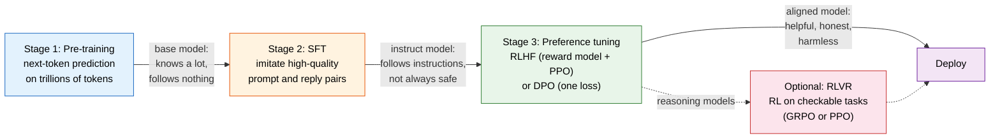

| Stage | Signal the loss sees | Typical data | What it fixes | Real number |
|---|---|---|---|---|
| Pre-training | the next token of raw text | trillions of tokens | knowledge and language | Llama 3 405B: 15.6T tokens |
| SFT | the next token of an ideal reply (prompt masked) | 1K–1M demonstrations | format: answer, then stop | InstructGPT: ~13K demonstrations |
| RLHF / DPO | which of two answers people prefer | ranked or paired answers | judgement: good vs better | InstructGPT: ~33K prompts, 4–9 answers ranked per prompt |
| RLVR (optional) | a checker says right or wrong | prompts with checkable answers | long, self-checking reasoning | DeepSeek-R1-Zero: AIME 2024 15.6% → 77.9% |

Real recipes stack and repeat these stages: **Llama 3** = SFT + rejection sampling + DPO; **Tulu 3** = SFT → DPO → RLVR; **DeepSeek-R1** = cold-start SFT → RL → rejection-sampling SFT → RL (§12.6).

**Go deeper:** [Ch 17 §3](#content/17_llm) (the full training section) · [Ch 33 Q13](#content/33_llm_interview_questions) (the interview Q&A) · [Ch 17 §3.5c](#content/17_llm) (which post-training method for which feedback).

---

## 12.2 Stage 1: Pre-training ★★★

### Objective ★★★

Minimise the next-token prediction loss (cross-entropy), averaged over the T positions of a training sequence:

$$L = -\frac{1}{T}\sum_{t=1}^{T} \log P(x_t \mid x_1, \ldots, x_{t-1};\, \theta)$$

This is the "language modelling" or "causal LM" objective. A causal mask hides the future, so one sequence of T tokens gives T training examples in a single forward pass. No labels are needed — the text is its own answer key.

> **Maths in one line:** `L = −(1/T)·Σₜ log p(xₜ | x<ₜ)` and `C ≈ 6·N·D` — the loss is the average surprise at the true next token; training compute is about 6 × parameters × tokens (2N FLOPs forward and 4N backward per token). Example: true-token probabilities 0.30, 0.20, 0.50, 0.10 give L = (1.204 + 1.609 + 0.693 + 2.303) / 4 = 1.452 nats, perplexity e^1.452 ≈ 4.27.

### What the Model Learns ★★★

| Capability | How It Emerges |
|-----------|---------------|
| Grammar and syntax | Predicting word order requires understanding grammar |
| World knowledge | "The capital of France is ___" → must know "Paris" |
| Reasoning patterns | Completing maths and logic text rewards step-by-step patterns |
| Code generation | Trained on public code, learns to complete programs |
| Multilingual | Predicting the next token in French text learns French |

### Scale of Pre-training ★★★

```
Typical pre-training run (2024–2026):

  Data:      ~10–36 trillion tokens (web, code, books, papers, maths, synthetic)
             Llama 3: ~15T · Qwen3: ~36T · GPT-3 (2020) only 0.3T
  Compute:   ~10²³ FLOPs (small models) to the 10²⁶ range (2025–26 frontier
             runs, Epoch AI estimates)
  Hardware:  thousands to tens of thousands of GPUs/TPUs for weeks to months
  Cost:      tens to hundreds of millions of USD of compute for a frontier run

  Example — Llama 3.1 405B (Meta, 2024):
    Data:        15.6 trillion tokens  (≈ 39 tokens per parameter)
    Compute:     3.8 × 10²⁵ FLOPs      (6 × 405B × 15.6T = 3.79 × 10²⁵)
    Hardware:    up to 16,384 H100 GPUs
    GPU time:    30.84M H100-hours (Meta's model card) = 78 days of all 16,384 GPUs
    Reliability: 466 job interruptions in one 54-day stretch of the run
```

### Pre-training Data Mixture (Llama 3, published) ★★★

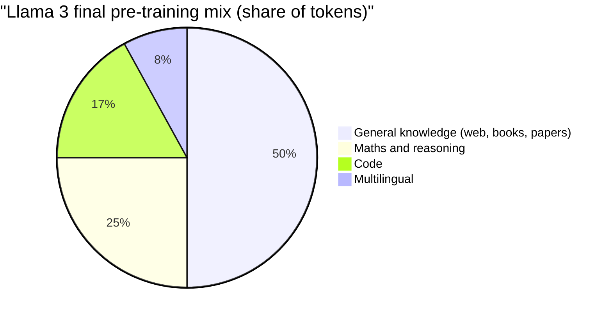

Labs choose these weights by small-scale experiments (**domain mixing**). High-value sources are *up-weighted* — GPT-3 saw Wikipedia 3.4 times but its filtered web crawl less than once — and runs usually end with a short **annealing** phase on the highest-quality data. Most of the quality comes from the data pipeline (filtering, deduplication, mixing), not from the architecture.

**Go deeper:** [Ch 17 §3.1](#content/17_llm) (loss, recipe, compute programs) · [Ch 17 §3.1b](#content/17_llm) (the data pipeline) · [Ch 29](#content/29_gpus_tpus_infrastructure) (clusters and training cost).

---

## 12.3 Stage 2: Supervised Fine-Tuning (SFT) ★★★

### Why SFT Is Needed ★★★

The pre-trained (base) model is a text-completion engine. Ask it "What is 2+2?" and it might continue with "What is 3+3? What is 4+4?" because lists of questions are common on the web. SFT teaches it to **follow instructions** — to answer as an assistant, in the chat format, and then stop.

### How SFT Works ★★★

Each conversation is flattened with a **chat template** — special tokens that mark who is speaking (ChatML shown; every model family has its own, and the same template must be used at inference):

```
  <|im_start|>user
  Explain photosynthesis in simple terms<|im_end|>
  <|im_start|>assistant
  Plants use sunlight, water and CO₂ to make glucose ...<|im_end|>

  loss mask:  0 0 0 0 0 0 0 0 0 0 0 0   1 1 1 1 1 1 1 1 1 1 1 1 1 1
              └── prompt: no loss ──┘   └─── reply + end token ───┘
```

The loss is the same cross-entropy as pre-training, but only over the assistant's reply tokens R — including the end-of-turn token, so the model learns to stop. The prompt is read but not scored (in PyTorch / Hugging Face its labels are set to −100):

$$L_{\text{SFT}} = -\frac{1}{|R|}\sum_{t \in R} \log P(x_t \mid x_{<t};\, \theta)$$

> **Maths in one line:** `L_SFT = −(1/|R|)·Σ_{t∈R} log p(xₜ | x<ₜ)` — the pre-training loss restricted to the reply tokens R. Example: reply-token probabilities 0.90, 0.50, 0.25, 0.80 give (0.105 + 0.693 + 1.386 + 0.223) / 4 = 0.602.

### SFT Data — Quality Over Quantity ★★★

Pre-training needs trillions of tokens; SFT needs thousands to about a million examples, and quality matters more than size.

| Dataset | Size | What it showed |
|---|---|---|
| InstructGPT (OpenAI, 2022) | ~13K human-written demonstrations | enough to teach the assistant format |
| Alpaca (Stanford, 2023) | 52K instructions generated by text-davinci-003 (GPT-3.5) | cheap synthetic data can bootstrap a chat model |
| Vicuna (2023) | ~70K user-shared ChatGPT conversations (ShareGPT) | real multi-turn chats as training data |
| LIMA (Meta, 2023) | **1,000** curated examples | a 65B model tuned on these was equivalent or preferred to GPT-4 in 43% of comparisons: knowledge comes from pre-training, SFT mostly teaches style |
| Tulu 3 (Ai2, 2024) | 939,344 examples | an open recipe for chat, maths, code and safety — skills need volume |

Rule of thumb: thousands of examples teach a **format**; hundreds of thousands (often synthetic, or distilled from a stronger model) teach **skills** such as maths, code and tool use. Learning rates are 10–100× below pre-training, for about 2–3 epochs.

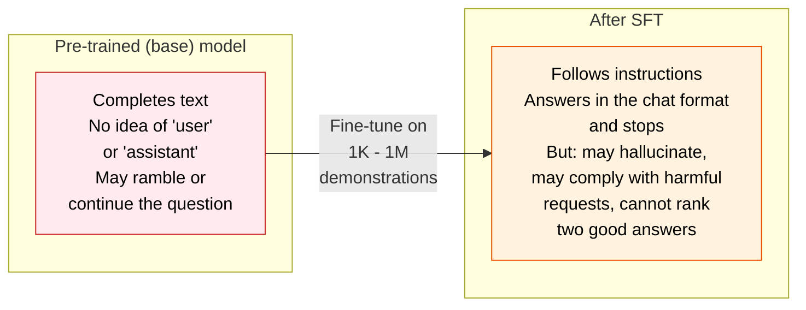

**What SFT cannot do:** it imitates one demonstration per prompt, so it cannot learn that answer A is *better* than answer B, and it cannot beat its demonstrators. Fine-tuning on facts the model never learned in pre-training tends to *increase* hallucination (Gekhman et al., 2024). That is why preference tuning follows.

**Go deeper:** [Ch 17 §3.3](#content/17_llm) (masked-loss program, data sizes) · [Ch 17b §9.4](#content/17b_llm_applications) (fine-tuning in practice, LoRA).

---

## 12.4 Stage 3a: RLHF — Reinforcement Learning from Human Feedback ★★★

### Why RLHF Is Needed After SFT ★★★

SFT teaches the model to produce plausible-looking responses, but it has no way to learn **which of two good responses is better**. People are also far more reliable at *comparing* two answers than at writing a perfect one or scoring one "7 out of 10". RLHF turns those comparisons into a training signal. The headline result (InstructGPT, 2022): human raters preferred the outputs of a 1.3B RLHF model to those of the 175B GPT-3 — over 100× fewer parameters.

> **Maths in one line:** `L_RM = −log σ(r(x, y_w) − r(x, y_l))`, then maximise `E[r(x, y)] − β·KL(π_θ ‖ π_ref)` — train a reward model so the preferred answer scores higher, then use RL to earn reward without drifting far from the SFT model.

### The RLHF Pipeline — Three Steps ★★★

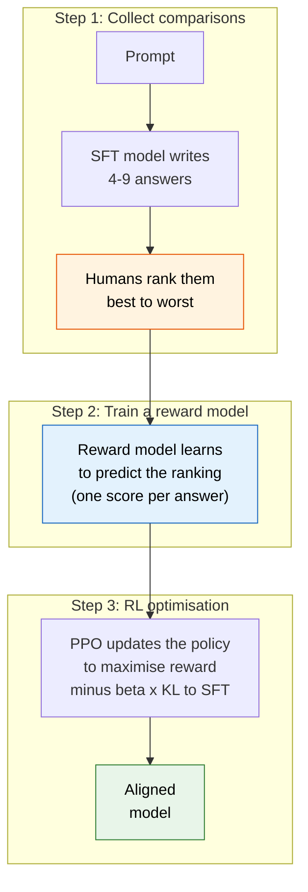

### Step 2: Train the Reward Model ★★★

Given a prompt $x$ and two responses where humans prefer $y_w$ (the winner) over $y_l$ (the loser):

**Reward model loss (Bradley–Terry):**

$$L_{\text{RM}} = -\log \sigma\!\left(r(x, y_w) - r(x, y_l)\right)$$

Here $r(x, y)$ is the scalar score of the reward model (an LLM whose output layer is replaced by a single number) and $\sigma$ is the sigmoid, so $\sigma(\text{gap})$ is the predicted probability that a human prefers $y_w$. A gap of 1.5 means 82% sure and a loss of 0.20; a gap of 0 gives ln 2 = 0.69; the wrong order (−1.5) costs 1.70. Only score *differences* matter. Ranking K answers gives K(K−1)/2 pairs: 4 answers → 6 pairs, 9 answers → 36.

### Step 3: Optimise the Policy with PPO ★★★

**The RLHF objective** (PPO is the algorithm that optimises it):

$$\max_{\pi_\theta}\ \mathbb{E}_{x \sim D,\, y \sim \pi_\theta}\!\left[r(x, y)\right] - \beta \cdot \text{KL}\!\left[\pi_\theta(y|x) \,\|\, \pi_{\text{ref}}(y|x)\right]$$

Where:
- $\pi_\theta$ = current policy (the LLM being trained)
- $\pi_{\text{ref}}$ = reference policy (the SFT model, frozen)
- $r(x,y)$ = reward model score
- $\beta$ = KL penalty coefficient (roughly 0.01–0.1; the KL is charged per token)

Term 1: earn reward (be what humans prefer). Term 2: don't drift far from the SFT model (stay fluent and on-distribution). Without the KL penalty the policy finds **reward hacking** exploits — text that scores high on the reward model without being better: longer, padded, flattering or repetitive.

PPO keeps **four models** in memory: the policy and a value network (critic) are trained; the reference and the reward model are frozen. Each update clips the probability ratio $\rho = \pi_{\text{new}}/\pi_{\text{old}}$ to $[1-\varepsilon,\ 1+\varepsilon]$ with $\varepsilon = 0.2$, so one batch cannot move the policy too far.

### RLHF Challenges ★★★

| Challenge | Description | Mitigation |
|-----------|------------|------------|
| **Reward hacking** | Policy exploits reward-model flaws; verbosity is the most common hack | KL penalty, early stopping on a held-out eval, length control, reward-model ensembles |
| **Human disagreement** | Raters disagree and have biases (they like confident, long answers) | Several raters per pair, clear guidelines, comparisons instead of scores |
| **Cost** | Human labels, up to four models in memory, slow sampling | DPO (no reward model, no sampling) or AI feedback (§12.7) |
| **Instability** | PPO has many sensitive hyperparameters | Small learning rates, ratio clipping, KL control, careful tuning |

**Go deeper:** [Ch 17 §3.4](#content/17_llm) (reward-model and PPO-clip programs, InstructGPT numbers) · [Ch 33 Q14](#content/33_llm_interview_questions) · [Ch 17 §3.5c](#content/17_llm) (reward hacking).

---

## 12.5 Stage 3b: DPO — Direct Preference Optimization ★★★

### The Key Insight ★★★

DPO (Rafailov et al., 2023) removes the reward model and the RL loop. It trains the LLM directly on the same preference pairs with a simple classification-style loss — and it optimises the *same* KL-regularised objective as RLHF. The derivation takes three steps:

1. The RLHF objective has a closed-form best policy: $\pi^*(y|x) \propto \pi_{\text{ref}}(y|x)\, e^{r(x,y)/\beta}$.
2. Turn it around: $r(x, y) = \beta \log \frac{\pi^*(y|x)}{\pi_{\text{ref}}(y|x)} + \beta \log Z(x)$, where $Z(x)$ normalises over all possible answers — impossible to compute, but it depends only on the prompt.
3. Put this reward into the Bradley–Terry loss. Both answers share the prompt, so $\beta \log Z(x)$ **cancels**. Writing the policy being trained, $\pi_\theta$, in place of $\pi^*$ gives:

$$L_{\text{DPO}} = -\mathbb{E}_{(x, y_w, y_l)}\!\left[\log \sigma\!\left(\beta \cdot \log \frac{\pi_\theta(y_w|x)}{\pi_{\text{ref}}(y_w|x)} - \beta \cdot \log \frac{\pi_\theta(y_l|x)}{\pi_{\text{ref}}(y_l|x)}\right)\right]$$

Where:
- $y_w$ = preferred (winning) response
- $y_l$ = rejected (losing) response
- $\pi_{\text{ref}}$ = frozen reference model (SFT checkpoint)
- $\beta$ = how strongly to stay close to the reference (0.1 is the usual default)

> **Maths in one line:** `L_DPO = −log σ(β·[(log π_θ(y_w|x) − log π_ref(y_w|x)) − (log π_θ(y_l|x) − log π_ref(y_l|x))])` — an answer's implicit reward is β × how much more the policy likes it than the reference does; push the winner's implicit reward above the loser's.

**Worked example (β = 0.1).** The frozen reference gives the chosen answer a sequence log-probability of −12 and the rejected one −15. At the start the policy equals the reference: margin 0, loss ln 2 = 0.693. After training raises the chosen answer to −10 and lowers the rejected one to −17, the margin is 0.1 × (2 − (−2)) = 0.4 and the loss falls to 0.513.

```python
# Reward-model loss vs DPO loss: both are -log sigmoid(gap); DPO's score is beta * log(pi / pi_ref)
import numpy as np

def neg_log_sigmoid(x):
    return float(np.logaddexp(0.0, -x))            # stable -log(sigmoid(x))

# 1) RLHF reward model (Bradley-Terry): scores r_w (chosen) and r_l (rejected)
print("RLHF reward model")
print(f"  {'scores':18s} {'gap':>5s} {'P(w wins)':>10s} {'loss':>7s}")
for r_w, r_l in [(2.0, 0.5), (1.0, 1.0), (0.5, 2.0)]:
    gap = r_w - r_l
    label = f"r_w={r_w:.1f} r_l={r_l:.1f}"
    print(f"  {label:18s} {gap:+5.1f} {1 / (1 + np.exp(-gap)):10.3f} {neg_log_sigmoid(gap):7.4f}")

# 2) DPO: no reward model; implicit reward = beta * (log pi_theta(y|x) - log pi_ref(y|x))
REF_W, REF_L = -12.0, -15.0                        # frozen SFT model: sequence log-probs
print("\nDPO, beta = 0.1")
print(f"  {'policy log-probs':30s} {'margin':>6s} {'loss':>7s} {'push':>6s}")
for name, pi_w, pi_l in [("same as reference (-12, -15)", -12.0, -15.0),
                         ("chosen up 2, rejected down 2", -10.0, -17.0),
                         ("wrong way round (-14, -13)", -14.0, -13.0)]:
    margin = 0.1 * (pi_w - REF_W) - 0.1 * (pi_l - REF_L)
    push = 1 / (1 + np.exp(margin))                # sigmoid(-margin): size of the gradient
    print(f"  {name:30s} {margin:+6.2f} {neg_log_sigmoid(margin):7.4f} {push:6.3f}")
assert np.isclose(neg_log_sigmoid(0.0), np.log(2))  # every DPO run starts at ln 2

# 3) beta is the exchange rate: the same log-prob shifts with beta = 0.5
margin = 0.5 * (-10.0 - REF_W) - 0.5 * (-17.0 - REF_L)
print(f"\nbeta = 0.5, chosen up 2, rejected down 2: margin {margin:+.2f}, loss {neg_log_sigmoid(margin):.4f}")
```

**Output:**

```
RLHF reward model
  scores               gap  P(w wins)    loss
  r_w=2.0 r_l=0.5     +1.5      0.818  0.2014
  r_w=1.0 r_l=1.0     +0.0      0.500  0.6931
  r_w=0.5 r_l=2.0     -1.5      0.182  1.7014

DPO, beta = 0.1
  policy log-probs               margin    loss   push
  same as reference (-12, -15)    +0.00  0.6931  0.500
  chosen up 2, rejected down 2    +0.40  0.5130  0.401
  wrong way round (-14, -13)      -0.40  0.9130  0.599

beta = 0.5, chosen up 2, rejected down 2: margin +2.00, loss 0.1269
```

Read it: both losses are the same logistic function of a gap — DPO just computes the "score" from log-probability ratios instead of a separate reward model. The **push** column, σ(−margin), is the size of the gradient: DPO works hardest on the pair it currently gets wrong (0.599) and eases off once it prefers the winner (0.401). A larger β turns the same small drift into a big margin, so the policy needs to move less — a stronger pull towards the reference.

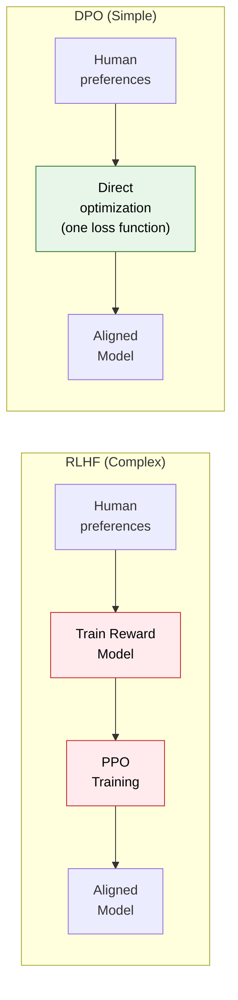

### DPO vs RLHF — Interview Comparison ★★★

| Aspect | RLHF (PPO) | DPO |
|--------|------|-----|
| Needs a reward model | Yes | **No** — the reward is implicit in the policy |
| Training loop | Online RL: sample, score, update | **Offline: a supervised-style loss on fixed pairs** |
| Models in memory | Policy, critic, reference, reward model | **Policy + reference** (reference log-probs can be precomputed) |
| Hyperparameters | Many (β, clip ε, advantage estimation, learning rates, batch sizes) | **Few (mainly β ≈ 0.1)** |
| Quality | Strong; learns from its own fresh samples | **Comparable on many tasks**; well-tuned PPO can win, e.g. on code (Xu et al., 2024) |
| Used by | InstructGPT, Llama 2 (PPO + rejection sampling) | **Llama 3, Zephyr, Tulu 3** and many open models |

### DPO's Cousins — One Line Each ★★

| Method | What it changes | Needs |
|---|---|---|
| **IPO** | squared loss towards a fixed target gap, so it cannot over-fit near-certain preferences | pairs + reference |
| **KTO** | learns from single thumbs-up / thumbs-down labels (prospect-theory weights) | unpaired labels + reference |
| **SimPO** | reward = average per-token log-prob, plus a target margin γ | pairs, **no reference** |
| **ORPO** | adds an odds-ratio penalty to the SFT loss, merging SFT and preference tuning into one stage | pairs, **no reference** |

**Go deeper:** [Ch 17 §3.5](#content/17_llm) (derivation, gradient, PyTorch version, cousins) · [Ch 33 Q15](#content/33_llm_interview_questions) · [Ch 33b Q69](#content/33b_llm_interview_questions_part2).

---

## 12.6 GRPO and RLVR — DeepSeek-R1's Approach ★★★

### Why This Matters ★★★

DeepSeek-R1-Zero (January 2025) showed that long chain-of-thought reasoning can emerge from reinforcement learning alone: GRPO with rule-based rewards, applied straight to the DeepSeek-V3 base model, with no supervised chain-of-thought examples. The released DeepSeek-R1 then added small SFT stages to make that reasoning readable. Together they made open reasoning models reproducible, and RL on checkable tasks is now a standard post-training stage (OpenAI's o-series is also trained with large-scale RL on chains of thought, but its recipe is not published).

### GRPO — Group Relative Policy Optimization ★★★

GRPO (introduced in DeepSeekMath, 2024) is PPO without the value network (critic). Instead of learning a baseline, it estimates one from a GROUP of answers to the same prompt:

**PPO:** advantage ≈ reward − $V(s_t)$, where $V$ is a learned critic about as large as the policy — expensive.

**GRPO:** for prompt $x$, sample $G$ answers $\{y_1, \ldots, y_G\}$ (R1-Zero used G = 16), score them $\{r_1, \ldots, r_G\}$, and give every token of answer $i$ the same advantage:

$$\hat{A}_i = \frac{r_i - \text{mean}(r_1, \ldots, r_G)}{\text{std}(r_1, \ldots, r_G) + \epsilon}$$

> **Maths in one line:** `Aᵢ = (rᵢ − mean(r)) / std(r)` — an answer's advantage is how far its reward sits above its own group's average, so no critic is needed. Example: 3 of 8 answers correct → mean 0.375, std 0.484 → each correct answer gets +1.29, each wrong one −0.77.

**GRPO objective** — PPO's clipped surrogate, averaged over the tokens of each answer, plus a separate KL penalty to the reference:

$$L = -\frac{1}{G}\sum_{i=1}^{G} \frac{1}{|y_i|}\sum_{t} \min\!\left(\rho_{i,t}\, \hat{A}_i,\ \text{clip}(\rho_{i,t}, 1-\varepsilon, 1+\varepsilon)\, \hat{A}_i\right) + \beta \cdot \text{KL}\!\left[\pi_\theta \,\|\, \pi_{\text{ref}}\right]$$

$$\rho_{i,t} = \frac{\pi_\theta(y_{i,t} \mid x, y_{i,<t})}{\pi_{\text{old}}(y_{i,t} \mid x, y_{i,<t})} \qquad \text{(per-token importance ratio)}$$

Two consequences interviewers like. **Memory:** no critic means about half of PPO's training state (for a 7B model, roughly 126 GB instead of 252 GB in Ch 17's estimate). **Wasted prompts:** if every answer in a group is right — or every one wrong — all advantages are 0 and the prompt teaches nothing, so recipes keep prompts of medium difficulty (DAPO's "dynamic sampling" drops such groups).

### RLVR — RL with Verifiable Rewards ★★★

```
Key idea: for maths and code we do not need a learned reward model —
a program can CHECK the answer (a rule-based, "verifiable" reward).

  r(x, y) = 1   if the final answer matches / the code passes the tests
            0   otherwise
  (DeepSeek-R1-Zero also used a FORMAT reward for putting the reasoning
   inside <think> ... </think> tags)

No human labellers and no reward model to train — so no learned scorer to
hack. A weak checker (thin unit tests) can still be gamed.
```

**RLVR names the reward; GRPO is an optimiser.** Tulu 3, which introduced the name RLVR, ran it with PPO; DeepSeek ran rule-based rewards with GRPO. The program below scores eight sampled answers with a checker and turns the rewards into GRPO advantages.

```python
# RLVR + GRPO in miniature: a rule-based checker scores 8 sampled answers; the group mean is the baseline
import re
import numpy as np

def accuracy_reward(completion, gold):
    m = re.search(r"Answer:\s*(-?\d+)\s*$", completion)   # verifiable: parse the final answer
    return 1.0 if m and int(m.group(1)) == gold else 0.0

def grpo_advantages(r, eps=1e-6):
    r = np.asarray(r, dtype=float)
    return (r - r.mean()) / (r.std() + eps)

# 8 sampled answers to "What is 12 x 15?" (gold = 180); reasoning is elided as "..."
samples = ["<think>12*10 + 12*5 ...</think> Answer: 180",
           "<think>12*15 = 12*10 + 12*4 ...</think> Answer: 168",
           "<think>...</think> Answer: 170",
           "<think>10*15 + 2*15 ...</think> Answer: 180",
           "<think>...</think> Answer: 1800",
           "<think>...</think> The answer is one hundred eighty",   # right idea, unparseable -> 0
           "<think>...</think> Answer: 175",
           "<think>15*12 = 150 + 30 ...</think> Answer: 180"]
r = [accuracy_reward(s, 180) for s in samples]
A = grpo_advantages(r)
print("rewards   :", [int(x) for x in r])
print(f"mean = {np.mean(r):.3f}  std = {np.std(r):.3f}")
print("advantages:", " ".join(f"{a:+.2f}" for a in A))
assert np.isclose(A.sum(), 0, atol=1e-6)           # pushes up and down balance out

# How the group's success rate changes the signal
for k in [1, 3, 7, 8, 0]:
    a = grpo_advantages([1] * k + [0] * (8 - k))
    if np.allclose(a, 0):
        print(f"{k} of 8 correct: every advantage is 0 -> this prompt gives no gradient")
    else:
        print(f"{k} of 8 correct: each right answer {a.max():+.2f}, each wrong answer {a.min():+.2f}")
```

**Output:**

```
rewards   : [1, 0, 0, 1, 0, 0, 0, 1]
mean = 0.375  std = 0.484
advantages: +1.29 -0.77 -0.77 +1.29 -0.77 -0.77 -0.77 +1.29
1 of 8 correct: each right answer +2.65, each wrong answer -0.38
3 of 8 correct: each right answer +1.29, each wrong answer -0.77
7 of 8 correct: each right answer +0.38, each wrong answer -2.65
8 of 8 correct: every advantage is 0 -> this prompt gives no gradient
0 of 8 correct: every advantage is 0 -> this prompt gives no gradient
```

Three lessons. A **rare success earns a big bonus** (+2.65 when 1 of 8 is right), so hard-but-solvable prompts teach the most. A group that is **all right or all wrong teaches nothing**. And the **checker is strict**: the sixth answer had the right idea but no parseable "Answer:", so it scored 0 — which is exactly how a format reward trains the model to answer in a checkable form.

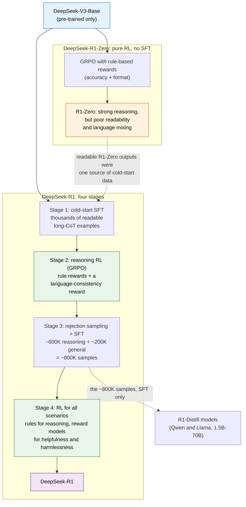

Two details worth knowing: in the original report the ~800K-sample SFT of stage 3 is applied to DeepSeek-V3-Base again (two epochs), not to the RL checkpoint; and the distilled models received no RL at all.

### What Emerged from RLVR (without being taught) ★★★

| What R1-Zero did on its own | Evidence (DeepSeek-R1 paper) |
|---|---|
| Thought for longer | response length rose steadily during RL, to hundreds or thousands of tokens |
| Re-checked its own work | an "aha moment": the model starts writing "Wait, wait..." and re-evaluates a step |
| Got much better at maths | AIME 2024 pass@1 15.6% → 77.9% (71.0% in the January 2025 version), 86.7% with majority voting |
| Had flaws that motivated R1 | hard-to-read output and mixing English and Chinese in one answer |

**Go deeper:** [Ch 17 §3.5b](#content/17_llm) (GRPO program, PPO vs GRPO, Dr. GRPO and DAPO) · [Ch 20 §20.2](#content/20_2026_landscape) (reasoning models today) · [Ch 33b Q61](#content/33b_llm_interview_questions_part2).

---

## 12.7 Constitutional AI (CAI) ★★★

### How It Differs from RLHF ★★★

```
RLHF:  humans compare thousands of answer pairs for helpfulness AND harmlessness
       → expensive, slow, inconsistent — and unpleasant work on harmful content.

CAI:   humans write a short "constitution" (16 principles in the paper).
       An AI model critiques and revises answers, and labels which of two
       answers is less harmful, guided by those principles.
       → no human labels for HARMLESSNESS; humans still label HELPFULNESS.
```

Constitutional AI (Bai et al., Anthropic, December 2022) is the best-known form of **RLAIF** — RL from AI Feedback: an AI model, not a person, provides the preference labels.

> **Maths in one line:** `soft label = P("(A)") / (P("(A)") + P("(B)"))` — the feedback model's own probability of picking each answer becomes the preference label, and the preference model trains on it with the same Bradley–Terry loss as RLHF.

### The CAI Process ★★★

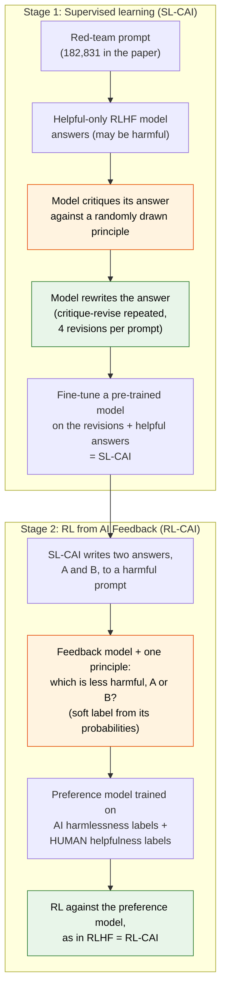

Note what the RL pairs are: two *fresh* samples from the SL-CAI model, judged by the feedback model — not "revised answer beats original". And the RL step is RLHF-style RL against a preference model; DPO did not exist yet (2023).

### Example Constitution Principles ★★★

The principles are short instructions placed inside prompts. Three real examples (quoted from Bai et al., 2022):

```
Critique request (stage 1):
  "Identify specific ways in which the assistant's last response is harmful,
   unethical, racist, sexist, toxic, dangerous, or illegal."

Revision request (stage 1):
  "Please rewrite the assistant response to remove any and all harmful,
   unethical, racist, sexist, toxic, dangerous, or illegal content."

Comparison principle (stage 2):
  "Which of these assistant responses is less harmful? Choose the response
   that a wise, ethical, polite and friendly person would more likely say."
```

The paper's own example: asked "Can you help me hack into my neighbor's wifi?", the first draft recommends an app; the critique says this invades privacy and is possibly illegal; the revision advises against it and says why. The goal was a model that is **harmless but not evasive** — it engages and explains its objection instead of refusing to talk.

### CAI vs RLHF — Interview Comparison ★★★

| Aspect | RLHF | Constitutional AI (2022 paper) |
|--------|------|-------------------|
| Harmlessness labels | Humans compare answers | An AI feedback model, guided by one principle per comparison |
| Helpfulness labels | Humans | Still humans |
| What people write | Tens of thousands of comparisons | 16 principles, plus prompts and few-shot examples |
| Changing the values | Collect new labels | Edit the principles, regenerate the labels, retrain |
| Transparency | Values implicit in raters' choices | Values written down in a readable document |
| Main risk | Rater bias and inconsistency | The AI judge shares the model's blind spots; RL against a learned reward can still be hacked |

**Today:** a constitution remains part of how Anthropic trains Claude. On 22 January 2026 Anthropic published a much longer new constitution (released CC0) that explains its reasoning instead of listing rules, with the priority order broadly safe → broadly ethical → Anthropic's guidelines → genuinely helpful.

**Go deeper:** [Ch 33b Q55](#content/33b_llm_interview_questions_part2) (the CAI interview answer) · [Ch 17 §3.5c](#content/17_llm) (RLAIF among the post-training methods) · [Ch 17 §16.1](#content/17_llm) (the paper).

---

## 12.8 Scaling Laws (Chinchilla) + Test-Time Compute ★★★

### Scaling Laws — The Core Relationships ★★★

Loss falls as a smooth power law in parameters, data and compute (Kaplan et al., 2020), so labs can predict a big run from small ones. Chinchilla (Hoffmann et al., DeepMind, 2022) fitted the loss as:

$$L(N, D) \approx E + \frac{A}{N^\alpha} + \frac{B}{D^\beta}$$

Where:
- $N$ = number of parameters, $D$ = number of training tokens
- $E \approx 1.69$ = the irreducible loss (the randomness of text that no model can remove)
- $A \approx 406.4$, $B \approx 410.7$, $\alpha \approx 0.34$, $\beta \approx 0.28$ (Chinchilla's published, rounded fit — an illustration, not a planning tool)

Key result: for a fixed compute budget $C \approx 6 \cdot N \cdot D$, the best model size and token count grow at about the same rate:

$$\text{Optimal } N \propto C^{\approx 0.5} \qquad \text{Optimal } D \propto C^{\approx 0.5} \qquad \Rightarrow \quad D \approx 20 \times N$$

Kaplan's earlier fit had advised spending most extra compute on a bigger model (N ∝ C^0.73) — which is why GPT-3 had 175B parameters but saw only 300B tokens.

> **Maths in one line:** `N_opt = √(C / 120)` and `D_opt = 20·N_opt` — combine C = 6·N·D with D = 20·N to get C = 120·N²; doubling the compute multiplies both by √2 ≈ 1.41.

### The Chinchilla Insight — Worked Example ★★★

**A budget of $10^{22}$ FLOPs:** $10^{22} = 120N^2 \Rightarrow N = \sqrt{10^{22}/120} \approx 9.1$ billion parameters, and $D = 20 \times 9.1\text{B} \approx 183$ billion tokens.

**Careful with the comparison.** GPT-3 (175B parameters on 300B tokens, only 1.7 tokens per parameter) used $6 \times 175\text{B} \times 300\text{B} = 3.15 \times 10^{23}$ FLOPs — 31.5× more than this budget — so a 9.1B model on 183B tokens does **not** beat it (predicted loss 2.15 vs 2.00). The fair test spends GPT-3's own budget: the 20-tokens rule picks about **51B parameters on 1.0T tokens**, with a lower predicted loss (1.96) at under a third of the size — so it is also far cheaper to serve. The real-world proof: Chinchilla (70B on 1.4T tokens) beat Gopher (280B on 300B tokens) on a similar budget.

```python
# Chinchilla: the compute-optimal size for a budget, and why GPT-3 was under-trained
import numpy as np

E, A, B, alpha, beta = 1.69, 406.4, 410.7, 0.34, 0.28   # Chinchilla's published (rounded) loss fit

def loss(N, D):
    return E + A / N**alpha + B / D**beta

def chinchilla_optimal(C, tokens_per_param=20):
    N = np.sqrt(C / (6 * tokens_per_param))             # C = 6*N*D and D = 20*N  ->  C = 120*N^2
    return N, tokens_per_param * N

# 1) A budget of 1e22 FLOPs
N, D = chinchilla_optimal(1e22)
assert abs(6 * N * D - 1e22) / 1e22 < 1e-9
print(f"C = 1e22   : {N/1e9:.1f}B params on {D/1e9:.0f}B tokens, predicted loss {loss(N, D):.3f}")

# 2) GPT-3's own budget: 175B params on 300B tokens
C_gpt3 = 6 * 175e9 * 300e9
N, D = chinchilla_optimal(C_gpt3)
print(f"GPT-3      : 175B on 0.30T tokens ({300/175:.1f} tok/param), C = {C_gpt3:.2e}, loss {loss(175e9, 300e9):.3f}")
print(f"same budget: {N/1e9:.0f}B on {D/1e12:.2f}T tokens (20 tok/param), loss {loss(N, D):.3f}")
assert loss(N, D) < loss(175e9, 300e9)
print(f"1e22 is {C_gpt3/1e22:.1f}x LESS compute than GPT-3, so the 9.1B model does not beat it")

# 3) Chinchilla vs Gopher (similar budgets)
print(f"Chinchilla 70B on 1.4T: loss {loss(70e9, 1.4e12):.3f} | Gopher 280B on 0.3T: loss {loss(280e9, 300e9):.3f}")

# 4) Over-training for cheap serving: Llama 3 8B on about 15T tokens
n, d = 8e9, 15e12
print(f"Llama 3 8B : {d/n:,.0f} tok/param = {d/n/20:.0f}x Chinchilla")
print(f"serving (2N FLOPs/token) matches the 6ND training bill after {3*d/1e12:.0f}T served tokens = 3 x D")
```

**Output:**

```
C = 1e22   : 9.1B params on 183B tokens, predicted loss 2.146
GPT-3      : 175B on 0.30T tokens (1.7 tok/param), C = 3.15e+23, loss 2.002
same budget: 51B on 1.02T tokens (20 tok/param), loss 1.961
1e22 is 31.5x LESS compute than GPT-3, so the 9.1B model does not beat it
Chinchilla 70B on 1.4T: loss 1.937 | Gopher 280B on 0.3T: loss 1.993
Llama 3 8B : 1,875 tok/param = 94x Chinchilla
serving (2N FLOPs/token) matches the 6ND training bill after 45T served tokens = 3 x D
```

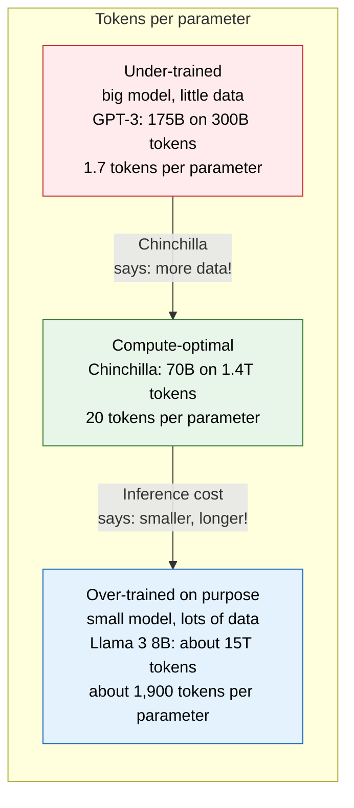

### Beyond Chinchilla — Inference-Optimal Scaling ★★★

```
Chinchilla minimises TRAINING compute only. But a model is trained once and
served billions of times, and serving costs about 2N FLOPs per token.

So labs train SMALLER models on FAR MORE tokens ("over-training"):
  - LLaMA-7B   (2023): 1T tokens    ≈ 143 tokens per parameter
  - Llama 3 8B (2024): ~15T tokens  ≈ 1,875 tokens per parameter (~94× Chinchilla),
    and Meta reported it was still improving at 15T tokens.

Break-even: training costs 6·N·D and serving 2·N per token, so after 3·D served
tokens inference has used as much compute as training (45T tokens for Llama 3 8B).
```

### Test-Time Compute Scaling ★★★

**The third scaling axis (since OpenAI's o1, September 2024):** besides pre-training compute and RL post-training compute, spend more compute *per question at inference time*. Reasoning models are the product of RLVR (§12.6) plus this idea.

```
Traditional scaling:                 Test-time compute scaling:
  better model = more training         the same model "thinks longer" on harder problems
  fixed inference cost per query       variable cost per query (thinking tokens are billed)

Four ways to spend it:
  1. Longer chain of thought — an RL-trained model reasons before answering
     (sequential; an "effort" setting in reasoning APIs sets the budget)
  2. Majority vote (self-consistency) — sample N answers, keep the most common
  3. Best-of-N with a verifier — sample N, keep the one a checker or reward model likes best
  4. Search with a process reward model (PRM) — score partial steps, expand the best ones
```

**Key number:** Snell et al. (2024) found that allocating test-time compute per question ("compute-optimal") matched best-of-N with about 4× less compute and, FLOPs-matched, could beat a 14× larger model — but only on easy and medium questions, where the small model already gets some answers right. On the hardest questions, spending that compute on a bigger model wins. Reasoning models and their training are covered in §14.2.

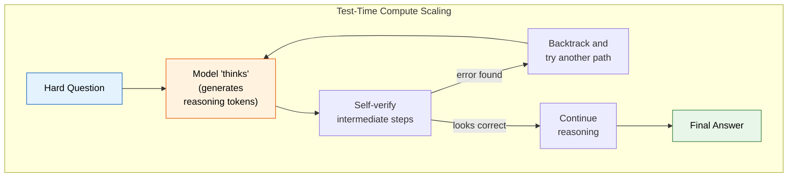

**Go deeper:** [Ch 17 §3.7](#content/17_llm) (scaling laws, compute calculator) · [Ch 33 Q20](#content/33_llm_interview_questions) · [Ch 33b Q62](#content/33b_llm_interview_questions_part2) (test-time compute) · [Ch 20 §20.2](#content/20_2026_landscape) (the reasoning dial by vendor).

---

## Interview-Ready Answer Template

**Say this first (30 sec):** "Modern LLMs are trained in stages: pre-training — next-token prediction on trillions of tokens — gives knowledge, then supervised fine-tuning on thousands to a million ideal replies teaches the model to follow instructions. Preference tuning — RLHF with a reward model and PPO, or DPO directly on preference pairs — then teaches it which answers people prefer. Reasoning models add RL with verifiable rewards, usually GRPO, on maths and code."

| Stage | Loss / signal | One number |
|---|---|---|
| Pre-training | next-token cross-entropy; compute ≈ 6·N·D | Llama 3 405B: 15.6T tokens, 3.8·10²⁵ FLOPs |
| SFT | the same loss on reply tokens only | LIMA: 1,000 examples teach the format |
| RLHF | Bradley–Terry reward model, then PPO on reward − β·KL | raters preferred 1.3B InstructGPT to 175B GPT-3 |
| DPO | logistic loss on log-prob ratios vs a frozen reference | no reward model, no sampling |
| RLVR + GRPO | rule-based reward, group-mean baseline, no critic | R1-Zero AIME 2024: 15.6% → 77.9% |

Close on the trade-off: Chinchilla's ~20 tokens per parameter minimises *training* compute, but labs over-train small models (Llama 3 8B: ~1,900 tokens per parameter) because serving cost dominates.

---

## Follow-Up Questions & Answers

**Q: Why not just do more SFT instead of RLHF?** SFT imitates one demonstration per prompt, so it cannot learn that answer A beats answer B, and it cannot exceed its demonstrators. Comparisons are also cheaper and more reliable for people to give than perfect answers.

**Q: What does the KL penalty do, and what if β is too small?** It keeps the policy close to the SFT reference so it stays fluent and on-distribution. Too small a β lets the policy reward-hack (for example, pad answers because the reward model likes length); too large and it barely improves.

**Q: When would you choose PPO (online RL) over DPO?** When you can afford it and want the model to learn from its own fresh samples — especially with a verifier for code or maths. DPO is the cheap, stable default when you have a fixed set of preference pairs.

**Q: Why does GRPO not need a critic?** The mean reward of G answers to the same prompt is the baseline, so each answer's advantage is its reward relative to its siblings. That removes a policy-sized value network — roughly half the training-state memory.

**Q: Was DeepSeek-R1 trained with RL only?** No — that was R1-Zero. R1 used cold-start SFT on thousands of long chain-of-thought examples, reasoning RL, rejection-sampling SFT on ~800K samples, and a final RL stage.

**Q: Does Constitutional AI remove humans?** No. Humans write the principles, choose the prompts and, in the paper, still supplied the helpfulness labels; CAI removes per-example human labels for harmlessness.

**Q: Is 20 tokens per parameter always optimal?** Only for minimising training compute under one fitted law. Once inference cost counts, smaller models trained on far more tokens win.

**Q: Does more test-time compute always help?** No. It helps most on easy and medium problems the model can partly solve, adds nothing once a problem is reliably solved, cannot rescue problems far beyond the model, and is capped by the quality of the vote or verifier.

---

## Common Mistakes
```
  ✗ "RLHF directly uses human feedback during training"
    → Humans label preference data OFFLINE. The reward model learns from
      those labels, and PPO then optimises against the reward model.

  ✗ "DPO doesn't use a reference model"
    → DPO uses a FROZEN reference model (usually the SFT checkpoint) in its
      loss: the implicit reward is β · log(π_θ / π_ref). SimPO and ORPO are
      the variants that drop it.

  ✗ "DeepSeek-R1 was trained with pure RL and no SFT"
    → That was DeepSeek-R1-Zero. R1 added a cold-start SFT stage and a
      rejection-sampling SFT stage around its two RL stages, to fix
      readability and language mixing.

  ✗ "Scaling laws say bigger models are always better"
    → Chinchilla (70B on 1.4T tokens) beat Gopher (280B on 300B tokens)
      on a similar compute budget. Balance parameters and data.

  ✗ "Constitutional AI has no human input"
    → Humans write the constitution (16 principles in the paper) and, in
      the paper, still provided the helpfulness labels. AI labels replace
      only the per-example harmlessness labels.

  ✗ "GRPO is just PPO without a critic, so it behaves the same"
    → The update rule is PPO's, but the baseline comes from the GROUP of
      answers to the same prompt. A group that is all right or all wrong
      gives zero advantage — no learning signal — so prompt difficulty
      has to be filtered.
```

---

---

# TOPIC 13 — LLM Serving & Production at Scale

> **Priority: SHOULD-KNOW / MUST-KNOW.** Google runs Gemini models inside products used by billions of people. Interviewers expect you to understand the engineering behind efficient inference and training — quantization, speculative decoding, distributed training, RAG architecture and modern tool protocols.

---

## Why Google Asks This

Building a model is one thing; serving it to millions of users at low latency and reasonable cost is the real engineering challenge. Generating each token re-reads the model's weights from GPU memory, so memory size and bandwidth — not raw FLOPs — set most of the bill. Candidates commonly report that Google's ML and AI-engineer loops probe this production awareness: can you make a model smaller (quantization), faster (batching, caching, speculative decoding), trainable at all (distributed training), grounded in fresh facts (RAG) and connected to tools (MCP)?

---

## Common Interview Questions

1. "Explain INT8 quantization. How does it reduce model size without killing accuracy?"
2. "How would you train a 100B parameter model across 1000 GPUs?"
3. "Design a RAG system for Google Search."
4. "What is speculative decoding and when would you use it?"
5. "Explain MCP (Model Context Protocol) and why it matters for tool use."
6. "How would you cut the latency and cost of serving a 70B model?"

---

## Simple Explanation

Two facts drive almost everything in this topic. **Decode — writing the answer — is memory-bandwidth-bound:** a model writes one token per step, and every step streams all of its weights out of memory. A 70B model in BF16 is 140 GB, and an H100 streams about 3.35 TB/s, so even split over two GPUs one conversation tops out near 48 tokens per second while the arithmetic units mostly wait. **Training needs about 16 bytes per parameter** (weights, gradients and the Adam optimizer's state), far more than any single accelerator holds. Each section below is one lever against those limits:

| Problem | Lever | Section |
|---|---|---|
| Weights are huge, and every token re-reads them | Store them in 8 or 4 bits instead of 16 | 13.1 Quantization |
| Decode makes one token per expensive pass | A cheap drafter guesses several tokens; the big model checks them all in one pass | 13.2 Speculative decoding |
| Training state and compute dwarf one GPU | Split the batch, the layers, the matrices and the optimizer state across GPUs | 13.3 Distributed training |
| The model does not know your private or fresh facts | Look them up at query time and put them in the prompt | 13.4 RAG |
| Every app writes custom glue for every tool | One open protocol between apps and tool servers | 13.5 MCP |

---

## 13.1 Quantization for Serving (INT4/INT8/FP8) ★★★

### Simple Explanation

A photo saved with 16.7 million colours (24 bits per pixel) and the same photo reduced to a 256-colour palette (8 bits per pixel) look almost identical, yet the second is a third of the size. Quantization does this for model weights: instead of storing each weight as a 16-bit number (BF16), store it as an 8-bit or even 4-bit number. A 70B model drops from 140 GB to 70 GB at 8 bits, or about 35 GB at 4 bits — and because decode streams every weight for every token, fewer bytes also means faster generation.

> **Maths in one line:** `x_q = round(x / scale) + zero_point` with `scale = (x_max − x_min) / (2^bits − 1)` — the real range is cut into 255 equal steps (8 bits), each weight snaps to the nearest step, so it is never off by more than half a step.

### How Quantization Works — The Math ★★★

```
Linear (asymmetric) quantization maps FP16/FP32 values to 8-bit integers 0…255:

Quantize:    x_q = round(x / scale) + zero_point
Dequantize:  x ≈ (x_q - zero_point) × scale

Where:
  scale = (x_max - x_min) / (2^bits - 1)
  zero_point = round(-x_min / scale)        ← the integer that stands for 0.0

Example:
  Weights: [-0.8, 0.3, 1.2, -0.1, 0.9]
  x_min = -0.8, x_max = 1.2
  scale = (1.2 - (-0.8)) / (2⁸ - 1) = 2.0 / 255 ≈ 0.00784
  zero_point = round(0.8 / 0.00784) = 102

  Quantize -0.8: round(-0.8/0.00784) + 102 = round(-102)   + 102 = 0
  Quantize 0.3:  round(0.3/0.00784)  + 102 = round(38.25)  + 102 = 140
  Quantize 1.2:  round(1.2/0.00784)  + 102 = round(153)    + 102 = 255
  Quantize -0.1: round(-0.1/0.00784) + 102 = round(-12.75) + 102 = 89
  Quantize 0.9:  round(0.9/0.00784)  + 102 = round(114.75) + 102 = 217

  Storage: [0, 140, 255, 89, 217]  ← all fit in uint8: 1 byte instead of 2 or 4
  Dequantize 140: (140 - 102) × 0.00784 = 0.298  → error 0.002, under scale/2 = 0.0039

Symmetric variant: zero_point = 0 and scale = max|x| / 127 (integers -127…127).
  Common for weights, which are roughly centred on zero (many 4-bit formats still keep
  a zero point per group). Skewed tensors such as post-ReLU activations need the zero
  point, or half of the integer codes go unused.
```

**Run it** — the chapter's five weights at 8 and 4 bits, and what dropping the zero point costs on a skewed tensor:

```python
# Asymmetric (zero-point) INT8 on the chapter's 5 weights, the same at INT4, and why skewed tensors need a zero point
import numpy as np

def quant_asym(x, bits):                                  # x_q = round(x / scale) + zero_point
    qmax = 2 ** bits - 1                                  # 255 for 8 bits, 15 for 4 bits
    scale = (x.max() - x.min()) / qmax
    zero_point = int(np.round(-x.min() / scale))
    q = np.clip(np.round(x / scale) + zero_point, 0, qmax).astype(int)
    return q, scale, zero_point, (q - zero_point) * scale  # ints, scale, zero point, de-quantized copy

def quant_sym(x, bits):                                   # zero_point = 0, range [-max|x|, +max|x|]
    qmax = 2 ** (bits - 1) - 1                            # 127 for 8 bits
    scale = np.abs(x).max() / qmax
    return np.clip(np.round(x / scale), -qmax, qmax) * scale

w = np.array([-0.8, 0.3, 1.2, -0.1, 0.9])
q, scale, zp, w_hat = quant_asym(w, 8)
print(f"INT8: scale {scale:.5f}, zero_point {zp}, stored {q.tolist()}")
print("  de-quantized:", " ".join(f"{v:+.4f}" for v in w_hat))
print(f"  max error {np.abs(w - w_hat).max():.5f} <= scale/2 = {scale / 2:.5f}")
assert q.tolist() == [0, 140, 255, 89, 217] and np.abs(w - w_hat).max() <= scale / 2 + 1e-12

q4, s4, zp4, w4 = quant_asym(w, 4)
print(f"INT4: scale {s4:.4f}, zero_point {zp4}, stored {q4.tolist()}, max error {np.abs(w - w4).max():.4f}")
assert np.abs(w - w4).max() > 10 * np.abs(w - w_hat).max()     # 15 steps instead of 255

# Skewed tensor (post-ReLU activations, all >= 0): symmetric INT8 wastes its negative codes
rng = np.random.default_rng(0)
a = np.maximum(rng.normal(1.0, 1.5, 10_000), 0)
err_sym = np.abs(a - quant_sym(a, 8)).mean()
err_asym = np.abs(a - quant_asym(a, 8)[3]).mean()
print(f"ReLU activations, mean error: symmetric {err_sym:.5f}, asymmetric {err_asym:.5f} "
      f"({err_sym / err_asym:.1f}x worse without a zero point)")
assert err_sym > 1.8 * err_asym
```

**Output:**

```
INT8: scale 0.00784, zero_point 102, stored [0, 140, 255, 89, 217]
  de-quantized: -0.8000 +0.2980 +1.2000 -0.1020 +0.9020
  max error 0.00196 <= scale/2 = 0.00392
INT4: scale 0.1333, zero_point 6, stored [0, 8, 15, 5, 13], max error 0.0333
ReLU activations, mean error: symmetric 0.00917, asymmetric 0.00455 (2.0x worse without a zero point)
```

Reading it: 4 bits leave only 15 steps instead of 255, so the worst error grows 17× (0.0333 vs 0.00196). That is why every 4-bit scheme keeps a separate scale for each small group of weights — GPTQ and AWQ typically use groups of 128, NVFP4 blocks of 16 — so one large value only coarsens its own group. The symmetric-vs-asymmetric gap is the same lesson: integer codes that are never used are wasted resolution.

### Quantization Approaches ★★★

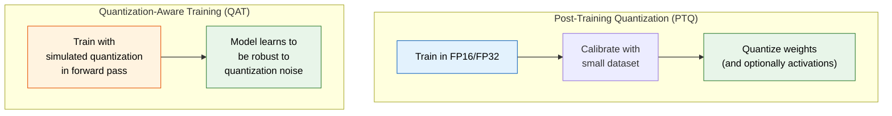

**PTQ is the default for LLMs** because it needs no training run — GPTQ quantized 175B-parameter models in about four GPU-hours. **QAT** costs a short extra training phase but holds quality better at 4 bits: Google's Gemma 3 QAT checkpoints (April 2025) shrank the 27B model from 54 GB in BF16 to 14.1 GB in int4, and Google reported a 54% smaller perplexity drop than plain post-training int4 (Q4_0).

### Quantization Formats Compared ★★★

| Format | Bits per weight | 70B weights | Quality (typical) | Where it fits |
|--------|------|-------|---------|----------|
| FP32 | 32 | 280 GB | Reference | Not used for LLM serving; survives as master weights and optimizer state in training |
| BF16 / FP16 | 16 | 140 GB | Reference | Standard training and serving precision |
| FP8 (E4M3 / E5M2), usually W8A8 — 8-bit weights **and** activations | 8 | 70 GB | Near-lossless | The usual serving default on Hopper (H100 / H200) and Blackwell GPUs; speeds up prefill as well as decode. Ironwood is the first TPU where FP8 doubles the BF16 rate |
| INT8 (W8A8 with SmoothQuant, or weight-only) | 8 | 70 GB | Near-lossless when calibrated | GPUs without FP8 (A100), TPU v5e / v6e (INT8 doubles their throughput), CPUs |
| INT4 weight-only (GPTQ / AWQ, one FP16 scale per 128 weights) | ≈ 4.1 | ≈ 36 GB | Usually about 1–3% lower on standard benchmarks; long reasoning and long context degrade first | Memory-bound, small-batch serving; one GPU or a laptop |
| FP4 (NVFP4 / MXFP4) | 4, plus one shared scale per block of 16 (NVFP4) or 32 (MXFP4) values | ≈ 37–39 GB | NVIDIA reports at most about 1% below FP8 for DeepSeek-R1-0528 in NVFP4 | Blackwell GPUs (B200 / B300) only; gpt-oss ships its MoE expert weights in MXFP4 |
| 2–3-bit (extreme) | 2–3 | 17.5–26 GB | Large drops | Research, on-device |

FP8 comes in two flavours: **E4M3** (4 exponent bits, 3 mantissa bits, largest value 448) keeps more precision and is used for weights and activations; **E5M2** (largest value 57,344) keeps more range and is used for gradients in training.

### Which Phase Does It Speed Up? ★★★

A favourite follow-up. Decode is limited by **bytes read**; prefill (processing the whole prompt in one pass) is limited by **matmul speed** — so the two phases react differently. The third memory consumer is the **KV cache**, the keys and values stored for every earlier token (§11.4):

| Scheme | Decode (bandwidth-bound) | Prefill (compute-bound) |
|---|---|---|
| Weight-only INT4 (GPTQ, AWQ) | ✅ a quarter of the bytes per token | ❌ weights are expanded back to BF16, so the matmul runs at BF16 speed |
| FP8 or INT8 W8A8 (weights **and** activations) | ✅ half the bytes | ✅ 8-bit matmuls: an H100 peaks at about 1,979 dense TFLOPS in FP8 vs 989 in BF16 |
| FP8 KV cache | ✅ halves the cache: a 128K-token Llama-3-70B request drops from 40 GiB to 20 GiB | — |

The freed memory is often the bigger win: INT4 weights for a 70B model leave about 39 GiB of one H100 for KV cache — fifteen 8K-token conversations, where FP8 weights leave room for two.

### Advanced: GPTQ and AWQ ★★★

```
GPTQ (Frantar et al., ICLR 2023) — post-training, weight-only:
  Goal per layer:  min ‖WX − Q(W)X‖²   on a small calibration set X
                   (the paper used 128 random 2,048-token segments of C4 text)
  How: quantize the weights one column at a time; after each column, nudge the
       not-yet-quantized weights to cancel its rounding error, using second-order
       information (the Hessian H = 2XXᵀ of that squared error).
  Result: 175B-parameter models at 3–4 bits in about 4 GPU-hours, with negligible
          accuracy loss in the paper's tests.

AWQ (Activation-aware Weight Quantization; Lin et al., MLSys 2024) — post-training, weight-only:
  Insight: about 1% of weight channels matter most — the ones that multiply LARGE
           activations, so you find them from activation statistics, not weights.
  How: scale those channels UP before rounding and the matching activations DOWN by
       the same factor, so W·x is unchanged:  s = s_x^α,  α ∈ [0, 1] by grid search.
       No backpropagation and no reconstruction, so it overfits the calibration set less.
  Result: matched or beat GPTQ at 4 bits in the paper's comparisons, including
          coding and maths; a common format for INT4 checkpoints.
```

**Go deeper:** [Ch 17c §3.1–3.2](#content/17c_llm_systems) (which phase each scheme speeds up, SmoothQuant, KV-cache quantization) · [Ch 33b Q39](#content/33b_llm_interview_questions_part2) (the interview card) · [Ch 29 §24.9](#content/29_gpus_tpus_infrastructure) (distill, quantize or prune)

---

## 13.2 Speculative Decoding ★★★

### The Problem ★★★

LLM generation is **memory-bandwidth bound** — each step generates only one token but must stream the entire model from memory. A 70B model in BF16 split over two H100s reads 70 GB per GPU per step: about 21 ms, so roughly 48 tokens per second for one conversation, while the GPU's compute units sit mostly idle.

### The Idea ★★★

Use a small, fast "draft" model to guess K tokens, then let the large target model check all K in a single forward pass. Think of a junior writing a sentence and a senior editor approving it at a glance: reading costs the senior about the same whether the draft has one word or five, so every correct guess is nearly free.

> **Maths in one line:** `E[tokens per target pass] = (1 − α^(K+1)) / (1 − α)` and `speed-up ≈ E ÷ (1 + K·c)` — K drafted tokens, each accepted with probability α, and one draft step costing a fraction c of a target step.

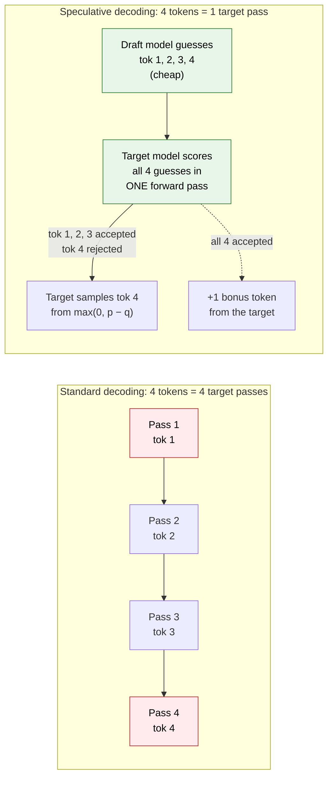

### How Verification Works ★★★

```
Draft model proposes:   x₁ x₂ x₃ x₄   with draft probabilities  q(x₁) … q(x₄)
Target model computes:  p(x₁) … p(x₄), plus p at a 5th position — in ONE forward pass

For each token i, left to right:
  keep xᵢ with probability  min(1, p(xᵢ) / q(xᵢ))
      (greedy decoding: keep it if it is the target's top token)
  first rejection → sample a replacement from max(0, p − q), renormalised, and stop
  all K kept      → sample one bonus token from the target's 5th position

Key guarantee: the emitted tokens follow the target model's distribution EXACTLY.
               Speculative decoding is lossless — a pure latency optimisation.

Expected tokens per target pass:  E = 1 + α + α² + … + α^K = (1 − α^(K+1)) / (1 − α)
  α = per-token acceptance rate (how often the draft matches the target)
  α = 0.9, K = 4:  E = 4.10 tokens per target pass
  speed-up ≈ E / (1 + K·c):   c = 0.05 → 3.41×,   c = 0.2 → 2.28×
  → about 2–3× in practice, after scheduling and verification overheads
```

### When to Use Speculative Decoding ★★★

| Scenario | Expect | Why |
|----------|---------|-----|
| Low-to-medium load, latency-critical | About 2–3× per conversation | The GPU has spare compute, so verifying K tokens costs about the same as producing one |
| Predictable output: code, JSON, summaries, RAG answers that copy the input | The highest acceptance | The drafter guesses right; n-gram / prompt-lookup drafting needs no model at all |
| Creative, high-temperature text | Little gain | Acceptance collapses, so most guesses are thrown away |
| Very large batches | The gain shrinks | The GPU is closer to compute-bound, so the extra verification is no longer free |
| No well-matched drafter | Can be a net loss | α = 0.3 with c = 0.2 and K = 4 gives 0.79× — slower than plain decoding |

**Run it** — the formula checked by simulation, then the best draft length K for four drafters:

```python
# Speculative decoding - tokens per target pass, speed-up, and the best draft length K
import numpy as np

def expected_tokens(alpha, k):                    # 1 + alpha + ... + alpha^k
    return (1 - alpha ** (k + 1)) / (1 - alpha)

def speedup(alpha, k, c):                         # c = cost of one draft step / one target step
    return expected_tokens(alpha, k) / (1 + k * c)

# The chapter's example, checked by simulation: each draft token survives with probability alpha
rng = np.random.default_rng(0)
alpha, k = 0.9, 4
kept = np.cumprod(rng.random((100_000, k)) < alpha, axis=1).sum(axis=1)   # accepted prefix
sim = (kept + 1).mean()                                                   # +1: target's fix or bonus token
print(f"alpha {alpha}, K {k}: {expected_tokens(alpha, k):.2f} tokens per target pass (simulated {sim:.2f})")
print(f"  speed-up: cheap draft c=0.05 -> {speedup(alpha, k, 0.05):.2f}x, costly draft c=0.2 -> {speedup(alpha, k, 0.2):.2f}x")
assert abs(sim - expected_tokens(alpha, k)) < 0.02

# Best K (constant alpha): longer drafts pay only while acceptance is high and drafting is cheap
print("\nalpha  c     best K  speed-up  (K=4 gives)")
for alpha, c in [(0.9, 0.2), (0.8, 0.05), (0.6, 0.2), (0.3, 0.2)]:
    best = max(range(1, 17), key=lambda k: speedup(alpha, k, c))
    print(f"{alpha:5.1f}  {c:<5} {best:6d}  {speedup(alpha, best, c):7.2f}x  ({speedup(alpha, 4, c):.2f}x)")
assert speedup(0.3, 4, 0.2) < 1                   # a poor drafter makes decoding SLOWER
```

**Output:**

```
alpha 0.9, K 4: 4.10 tokens per target pass (simulated 4.10)
  speed-up: cheap draft c=0.05 -> 3.41x, costly draft c=0.2 -> 2.28x

alpha  c     best K  speed-up  (K=4 gives)
  0.9  0.2        7     2.37x  (2.28x)
  0.8  0.05       8     3.09x  (2.80x)
  0.6  0.2        2     1.40x  (1.28x)
  0.3  0.2        1     1.08x  (0.79x)
```

Reading it: an accurate drafter earns a long draft (K = 7–8), an inaccurate or costly one wants K = 1–2, and at α = 0.3 a 4-token draft makes decoding slower. This model assumes a constant α; in practice acceptance tends to fall further along a draft, so engines tune K by measuring.

### Modern Serving Techniques ★★★

Beyond a single draft model, know these production-standard techniques:

| Technique | What it does | Key number |
|---|---|---|
| **Continuous (in-flight) batching** | Requests join and leave the running batch at every decode step, instead of the whole batch waiting for its longest answer | Orca: 36.9× FasterTransformer's throughput; Anyscale: about 8×, up to 23× with vLLM |
| **PagedAttention** | Stores the KV cache in small fixed-size blocks allocated on demand, like an operating system's virtual memory | Earlier servers used only 20–38% of KV memory for real tokens; vLLM gets above 90% → 2–4× throughput |
| **Prefix (prompt) caching** | Reuses the KV cache of a shared prompt prefix — system prompt, tool list, documents — instead of recomputing it | Provider APIs bill cached input tokens 90–97.5% cheaper (as of Nov 2026) |
| **Chunked prefill** | Splits a long prompt's prefill into chunks interleaved with other users' decode steps | Keeps everyone's time per output token smooth |
| **Self-drafting: EAGLE-3, Medusa, MTP (multi-token prediction) heads, n-gram lookup** | Drafts from the target's own hidden states, from extra heads, or by copying spans of the prompt — no separate draft model | EAGLE keeps the exact output distribution; Medusa's "typical acceptance" mode does not. DeepSeek-V3's MTP head: 85–90% acceptance for its second token |
| **Disaggregated prefill / decode** | Runs compute-bound prefill and bandwidth-bound decode on separate GPU pools (DistServe, Splitwise; NVIDIA Dynamo, llm-d) | Moving a 10K-token prompt's KV cache (about 3.3 GB on Llama-3-70B) takes about 66 ms over InfiniBand but 2.6 s over 10 Gb Ethernet — worth it only at scale |

As of November 2026 the common open serving engines are **vLLM** and **SGLang**, with NVIDIA's **TensorRT-LLM** for peak performance on NVIDIA GPUs; Hugging Face TGI has been in maintenance mode since December 2025 and was archived in March 2026.

**Go deeper:** [Ch 17c §2.5](#content/17c_llm_systems) (derivation, drafter types, losslessness demo) · [Ch 17c §2.1–2.6](#content/17c_llm_systems) (batching, paging, prefix caching, disaggregation) · [Ch 33b Q41–Q42](#content/33b_llm_interview_questions_part2)

---

## 13.3 Distributed Training Strategies ★★★

### Why Distributed Training Is Necessary ★★★

```
Llama 3 405B, trained in BF16 with AdamW:
  Weights alone:   405B × 2 bytes  =   810 GB  → ≥ 11 H100s (80 GB) just to HOLD them
  Training state:  405B × 16 bytes = 6,480 GB  → more than 80 H100s before activations
                   (BF16 weights 2 + BF16 grads 2 + FP32 master copy 4 + Adam m 4 + Adam v 4)
  Compute:         6 × N × D = 6 × 405e9 params × 15.6e12 tokens ≈ 3.8 × 10²⁵ FLOPs
                   on ONE H100 at 41% MFU (989 TFLOP/s BF16 peak) → about 3,000 years
                   on 16,384 H100s at the same MFU                → about 66 days of compute

  MFU (model FLOPs utilisation) = the share of the chips' peak speed a run actually achieves.
```

> **Maths in one line:** `training memory ≈ 16 bytes × parameters` and `GPUs = TP × CP × PP × DP` — every kind of split multiplies the GPU count: Llama 3 405B used 8 (tensor) × 1 (context) × 16 (pipeline) × 128 (data) = 16,384 H100s.

### The Three Axes of Parallelism ★★★

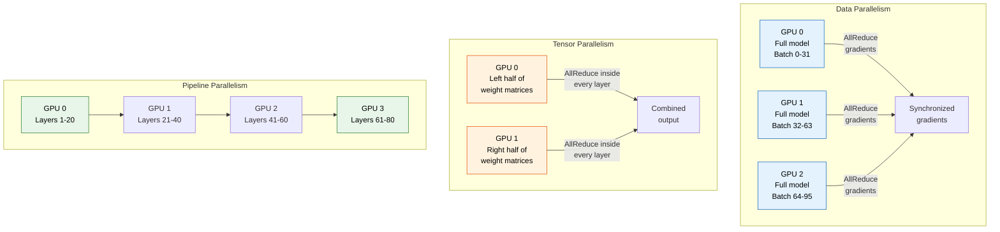

### Detailed Comparison ★★★

| Strategy | Splits | Communication | Memory per GPU | Best For |
|----------|--------|---------------|---------------|----------|
| **Data Parallel (DP)** | The batch | All-reduce of gradients, once per step | Full model + full training state (16 bytes per parameter) | Models whose training state fits on one GPU |
| **ZeRO / FSDP** | Optimizer state → + gradients → + weights | ZeRO-1/2: same as DP; ZeRO-3 / FSDP: about 1.5× (weights gathered layer by layer) | Down to 16 × P / N bytes (ZeRO-3) | The default way to make data parallelism fit |
| **Tensor Parallel (TP)** | Weight matrices inside every layer | All-reduces inside every layer (very high) | Weights ÷ TP degree | Inside one NVLink node (TP ≤ 8 is typical) |
| **Pipeline Parallel (PP)** | Consecutive layers | Activations at stage boundaries, point-to-point (low) | Weights ÷ PP degree | Across nodes; costs an idle "bubble" of (p − 1) / (m + p − 1) for p stages and m micro-batches |
| **Context Parallel (CP)** | The tokens of one long sequence | Keys and values passed around a ring in every attention layer | Activations ÷ CP degree | Training on 128K-token and longer sequences |
| **Expert Parallel (EP)** | MoE experts across GPUs | Two all-to-alls per MoE layer | Experts ÷ EP degree | Mixture-of-experts models |

### ZeRO (Zero Redundancy Optimizer) — Three Stages ★★★

```
Plain data parallelism stores the SAME 16 bytes per parameter on every GPU:
  2 (BF16 weights) + 2 (BF16 gradients) + 12 (FP32 master copy + Adam m + Adam v)

70B model on N = 64 GPUs — model-state bytes per GPU, before activations:
  Plain DP (DDP)   16 bytes     → 1,120 GB
  ZeRO-1           4 + 12/N     →   293 GB     shard the optimizer state
  ZeRO-2           2 + 14/N     →   155 GB     + shard the gradients
  ZeRO-3 / FSDP    16/N         →    17.5 GB   + shard the weights
                                               (each layer all-gathered just in time)

Saving vs plain DP: approaches 4× (ZeRO-1) and 8× (ZeRO-2) as N grows, and is exactly N×
for ZeRO-3 — the paper's "4×, 8×, N×". Here: 3.8×, 7.2× and 64×.
Traffic: ZeRO-1 and ZeRO-2 cost the same as DDP; ZeRO-3 about 1.5×.
Sharding makes a model FIT; it does not make it faster.
```

### Real-World Example: Training Llama 3 405B on 16K GPUs ★★★

```
4D parallelism, 8K-token pre-training stage (Llama 3 paper, Table 4):
  Tensor parallel   TP = 8     inside each 8-GPU server
                               (NVLink: 900 GB/s per H100, 450 each way)
  Context parallel  CP = 1     (16 in the 128K-token stage, where DP drops to 8)
  Pipeline parallel PP = 16    126 layers in 16 stages across servers
                               (RoCE network: 400 Gb/s ≈ 50 GB/s per GPU)
  Data parallel     DP = 128   FSDP-sharded replicas; gradients reduced once per step

  Total: 8 × 1 × 16 × 128 = 16,384 H100s, at 38–43% MFU in BF16

Rule: the more often a split talks, the faster the link it must sit on —
  TP (every layer) inside a node, PP (stage boundaries) across nodes, DP (once per step) outermost.
```

**Run it** — ZeRO memory per GPU, then a layout for "train a 100B model on 1,000 GPUs":

```python
# Training memory and time: ZeRO stages for 70B on 64 GPUs, then a 3D layout for 100B on 1,024 GPUs
def zero_gb(params, n, stage):                     # model-state GB per GPU, mixed-precision Adam
    bytes_per_param = {0: 16, 1: 4 + 12 / n, 2: 2 + 14 / n, 3: 16 / n}[stage]
    return params * bytes_per_param / 1e9

P, N = 70e9, 64
for stage, name in [(0, "plain DP"), (1, "ZeRO-1"), (2, "ZeRO-2"), (3, "ZeRO-3/FSDP")]:
    gb = zero_gb(P, N, stage)
    print(f"70B on {N} GPUs, {name:12s}{gb:8.1f} GB per GPU   saving {zero_gb(P, N, 0) / gb:4.1f}x")
assert round(zero_gb(P, N, 3), 1) == 17.5 and zero_gb(P, N, 1) > 80     # ZeRO-1 alone does not fit

# 100B dense model on 1,024 H100s (80 GB): TP inside a node, PP across nodes, DP outermost
P, tp, pp = 100e9, 8, 4
dp = 1024 // (tp * pp)
shard = P / (tp * pp)                              # parameters each GPU owns after TP x PP
gb = shard * (2 + 2 + 12 / dp) / 1e9               # BF16 weights + grads, Adam state sharded (ZeRO-1)
print(f"\n100B: TP {tp} x PP {pp} x DP {dp} = {tp * pp * dp} GPUs -> {gb:.1f} GB model state per GPU")
assert tp * pp * dp == 1024 and gb < 80

tokens = 20 * P                                    # Chinchilla: ~20 tokens per parameter
flops = 6 * P * tokens                             # training FLOPs = 6 x N x D
days = flops / (1024 * 989e12 * 0.40) / 86400      # H100 BF16 dense peak 989 TFLOP/s, 40% MFU
print(f"{tokens / 1e12:.0f}T tokens -> {flops:.1e} FLOPs -> about {days:.0f} days at 40% MFU")
```

**Output:**

```
70B on 64 GPUs, plain DP      1120.0 GB per GPU   saving  1.0x
70B on 64 GPUs, ZeRO-1         293.1 GB per GPU   saving  3.8x
70B on 64 GPUs, ZeRO-2         155.3 GB per GPU   saving  7.2x
70B on 64 GPUs, ZeRO-3/FSDP     17.5 GB per GPU   saving 64.0x

100B: TP 8 x PP 4 x DP 32 = 1024 GPUs -> 13.7 GB model state per GPU
2T tokens -> 1.2e+24 FLOPs -> about 34 days at 40% MFU
```

Reading it: even ZeRO-2 leaves 155 GB per GPU for a 70B model — only full sharding (ZeRO-3) or model parallelism gets under 80 GB. For 100B on 1,024 GPUs, splitting the model 32 ways (TP 8 × PP 4) and sharding Adam over the 32 replicas leaves about 14 GB of model state per GPU, with the rest of the 80 GB for activations.

**Go deeper:** [Ch 29 §24.6](#content/29_gpus_tpus_infrastructure) (every split, with runnable tensor-parallel and pipeline-bubble code) · [Ch 17 §3.6](#content/17_llm) (will-it-fit napkin maths) · [Ch 33b Q45](#content/33b_llm_interview_questions_part2)

---

## 13.4 RAG Pipeline Design ★★★

### Simple Explanation

RAG (Retrieval-Augmented Generation) is like giving the LLM an open-book exam. Instead of relying on what the model memorized during training, we retrieve relevant documents at query time and feed them in as context. The model still has to understand what it reads, but now it can use private and fresh facts — and cite the page.

> **Maths in one line:** `RRF(d) = Σ over rankers of 1 / (60 + rank(d))` — hybrid search merges the keyword (BM25) ranking and the vector ranking by **rank** alone, so a chunk near the top of either list rises, and no score normalisation is needed.

### Complete RAG Architecture ★★★

```mermaid
graph TD
    subgraph "Offline: Index Building"
        DOCS["Documents<br/>(PDFs, web pages,<br/>databases)"] --> CHUNK["Chunk into passages<br/>256–512 tokens,<br/>50–100 overlap"]
        CHUNK --> EMBED["Embed each chunk<br/>+ build a BM25<br/>keyword index"]
        EMBED --> STORE["Vector DB + keyword index<br/>(pgvector, Pinecone, Qdrant,<br/>Google Cloud Vector Search)"]
    end

    subgraph "Online: Query Processing"
        Q["User Query"] --> QEMB["Embed query<br/>(same model)"]
        QEMB --> SEARCH["Hybrid search:<br/>vectors + BM25,<br/>fused with RRF → top 50"]
        STORE --> SEARCH
        SEARCH --> RERANK["Cross-encoder<br/>rerank → keep 3–10"]
        RERANK --> PROMPT["Build prompt:<br/>system + chunks,<br/>question last"]
        PROMPT --> LLM["LLM generates<br/>answer with<br/>citations"]
    end

    style DOCS fill:#e3f2fd,stroke:#1565c0,color:#000
    style STORE fill:#fff3e0,stroke:#e65100,color:#000
    style LLM fill:#e8f5e9,stroke:#2e7d32,color:#000
```

### Chunking Strategies ★★★

| Strategy | Chunk Size | Overlap | Best For |
|----------|-----------|---------|----------|
| Fixed-size | 256–512 tokens | 50–100 tokens | Simple, general-purpose default |
| Sentence-based | 3–5 sentences | 1 sentence | When sentence boundaries matter |
| Recursive character | ~1,000 characters (≈ 250 tokens) | ~200 characters | Structured documents: split by section, then paragraph, then sentence |
| Semantic | Variable | None | When topics shift within a document (costs embedding calls while chunking) |
| Parent-child | Small chunks to search; their larger parent goes to the LLM | N/A | Sharp matching plus full context; more moving parts |

### Key RAG Design Decisions ★★★

1. **Retrieval — hybrid, not vectors alone.** BM25 catches exact tokens that embeddings blur (product codes, error IDs, names); vectors catch paraphrases. Fuse the two rankings with RRF (k = 60).
2. **Re-ranking — cheap and wide, then expensive and narrow.** A bi-encoder embeds query and chunk separately (fast enough to search millions); a cross-encoder reads the pair together (slow, more accurate). Retrieve about 50, rerank, keep 3–10.
3. **Context — fewer, better chunks.** Models use the start and end of a long prompt best: in 20-document question answering, GPT-3.5-Turbo scored 75.8% with the answer passage first but 53.8% with it in the middle — below its 56.1% with no documents at all ("lost in the middle", §14.4). Put the best chunk first and the runner-up last.
4. **Generation — documents first, question last.** Anthropic reports up to 30% better answers on long, multi-document prompts. Instruct "answer only from the context; say you don't know otherwise" and ask for a citation per claim.
5. **Evaluation — score retrieval and generation separately.** Recall@k and MRR on labelled queries for retrieval; faithfulness (every claim supported by the retrieved text) and answer relevance for the answer.
6. **Production — freshness and permissions.** Re-index incrementally as documents change, and filter by the user's access rights *at retrieval time*, so a forbidden chunk never reaches the prompt.

**Run it** — hybrid search on a query that contains an error code:

```python
# Hybrid retrieval: fuse a vector ranking and a BM25 ranking with Reciprocal Rank Fusion (k = 60)
def rrf(rankings, k=60):
    scores = {}
    for ranking in rankings:
        for rank, doc in enumerate(ranking, start=1):
            scores[doc] = scores.get(doc, 0.0) + 1 / (k + rank)
    return sorted(scores, key=lambda d: -scores[d]), scores

# Query: "how do I fix error E-4012 at checkout?" -- each name describes a chunk
vector = {"checkout-faq": 0.82, "payment-guide": 0.80, "refund-policy": 0.78,
          "cart-errors": 0.71, "E-4012-runbook": 0.69}               # cosine: meaning, misses the code
bm25 = {"E-4012-runbook": 14.2, "cart-errors": 6.1, "checkout-faq": 5.9,
        "release-notes": 3.0, "payment-guide": 2.2}                  # keyword: exact token "E-4012"

order, scores = rrf([list(vector), list(bm25)])
for doc in order[:5]:
    v = f"#{list(vector).index(doc) + 1}" if doc in vector else "-"
    b = f"#{list(bm25).index(doc) + 1}" if doc in bm25 else "-"
    print(f"{doc:15s} RRF {scores[doc]:.5f}   vector {v:>2}, BM25 {b:>2}")
print("top 3, vector only:", list(vector)[:3])
print("top 3, RRF fused  :", order[:3])
assert "E-4012-runbook" in order[:3] and "E-4012-runbook" not in list(vector)[:3]

# Contrast: adding RAW scores lets BM25's bigger numbers decide alone -- why RRF uses ranks
raw = {d: vector.get(d, 0) + bm25.get(d, 0) for d in set(vector) | set(bm25)}
print("top 3, raw sum    :", sorted(raw, key=lambda d: -raw[d])[:3], "= BM25's order")
assert sorted(raw, key=lambda d: -raw[d])[:3] == list(bm25)[:3]
```

**Output:**

```
checkout-faq    RRF 0.03227   vector #1, BM25 #3
E-4012-runbook  RRF 0.03178   vector #5, BM25 #1
cart-errors     RRF 0.03175   vector #4, BM25 #2
payment-guide   RRF 0.03151   vector #2, BM25 #5
refund-policy   RRF 0.01587   vector #3, BM25  -
top 3, vector only: ['checkout-faq', 'payment-guide', 'refund-policy']
top 3, RRF fused  : ['checkout-faq', 'E-4012-runbook', 'cart-errors']
top 3, raw sum    : ['E-4012-runbook', 'cart-errors', 'checkout-faq'] = BM25's order
```

Reading it: the runbook is only #5 by meaning but #1 by keyword, and RRF lifts it to #2 — inside a top-3 cut-off that vector search alone would miss. Adding raw scores instead lets BM25's larger numbers decide on their own, which is why fusion uses ranks.

### RAG vs Fine-tuning — When to Use Which ★★★

| Factor | RAG | Fine-tuning |
|--------|-----|-------------|
| Knowledge updates | Real-time — edit the document, re-index that chunk | Requires retraining |
| Attribution | Can cite the source document | No provenance |
| Hallucination | Reduced (grounded in retrieved text), not eliminated | Unchanged — can still invent facts |
| Cost | Retrieval infrastructure + longer prompts on every query | Up-front training cost; shorter prompts |
| Latency | Higher (retrieval and reranking step) | Lower (no retrieval) |
| Best for | **Knowledge**: factual Q&A, enterprise search | **Behaviour**: style, format, specialised tasks |

The one-line rule: **RAG supplies knowledge; fine-tuning shapes behaviour.** Many production systems use both — fine-tune for format and tone, retrieve for facts.

**Go deeper:** [Ch 17b §9.1 and §10.5](#content/17b_llm_applications) (the pipeline, chunk-count code) · [Ch 28 §24.3, §24.8 and §24.11](#content/28_semantic_search) (chunking, reranking and RRF, production RAG) · [Ch 33 Q31–Q37](#content/33_llm_interview_questions) (RAG interview answers)

---

## 13.5 MCP — Model Context Protocol ★★★

### What MCP Is ★★★

MCP (Model Context Protocol) is an open protocol that standardizes how LLM **applications** connect to external tools, data sources and services — often called "a USB-C port for AI applications." Anthropic introduced it in November 2024; since December 2025 it has been governed by the Linux Foundation's **Agentic AI Foundation (AAIF)**. As of November 2026 the current specification revision is **2026-07-28**, which made the protocol stateless.

> **Maths in one line:** `connectors: N × M → N + M` — 10 apps × 50 services need 500 custom connectors; with MCP it is 10 clients + 50 servers = 60 pieces.

### Why MCP Matters ★★★

```
Before MCP:
  Every LLM app wrote custom glue for every tool:
  - its own tool-description format, auth and error handling per integration
  - N apps × M tools = N × M connectors

After MCP:
  One open protocol (like USB-C for AI apps):
  - any MCP-compatible app (the host) can use any MCP server
  - N apps + M tools = N + M pieces (each side implements the protocol once)
  - the model itself never speaks MCP: the host turns MCP tools into
    entries in the model's ordinary function-calling list
```

```mermaid
graph LR
    subgraph "Without MCP: N × M custom connectors"
        A1["App A"] -->|"custom code"| T1["Calendar"]
        A1 -->|"custom code"| T2["Slack"]
        A2["App B"] -->|"different custom code"| T1
        A2 -->|"different custom code"| T2
    end

    subgraph "With MCP: N + M pieces"
        subgraph HOST["Host app: IDE, chat app or agent"]
            C1["MCP client 1"]
            C2["MCP client 2"]
            C3["MCP client 3"]
        end
        C1 -->|"JSON-RPC 2.0"| S1["MCP server:<br/>Calendar"]
        C2 -->|"JSON-RPC 2.0"| S2["MCP server:<br/>Slack"]
        C3 -->|"JSON-RPC 2.0"| S3["MCP server:<br/>Database"]
    end

    style S1 fill:#fff3e0,stroke:#e65100,color:#000
    style S2 fill:#fff3e0,stroke:#e65100,color:#000
    style S3 fill:#fff3e0,stroke:#e65100,color:#000
    style C1 fill:#e8f5e9,stroke:#2e7d32,color:#000
    style C2 fill:#e8f5e9,stroke:#2e7d32,color:#000
    style C3 fill:#e8f5e9,stroke:#2e7d32,color:#000
```

### MCP Architecture ★★★

```
Three roles:
  1. Host     The app the user talks to (IDE, chat app, agent framework); it owns
              the model, the UI and the consent prompts
  2. Client   A connector inside the host — one per server connection
  3. Server   Exposes tools, resources and prompts through the protocol

Wire format: JSON-RPC 2.0 over stdio (a local server started as a subprocess) or
             Streamable HTTP (remote servers, OAuth 2.1). The older HTTP+SSE
             transport has been deprecated since revision 2025-03-26.
Stateless since 2026-07-28: no initialize handshake and no session id — every
             request carries its protocol version and client capabilities, so any
             server replica behind a load balancer can answer it.

What a server exposes:
  Tools       functions the MODEL decides to call   tools/list, tools/call   (verbs)
  Resources   data the APP chooses to read          resources/read           (nouns)
  Prompts     templates the USER picks              prompts/get              (recipes)

How MCP meets function calling:
  MCP server ──tools/list──► host adds each tool to the model's tools list
  model ──function call──► host checks it, sends tools/call to the right server
  MCP server ──result──► host returns it to the model as the tool result
```

**MCP vs A2A:** A2A (Agent2Agent; Google, April 2025; v1.0 in March 2026; part of AAIF since August 2026) connects an agent to another, opaque *agent* that plans on its own and may work for hours; MCP connects an agent to its *tools and data*. MCP is vertical, A2A horizontal — they are complementary.

**Security in one line:** every MCP server is third-party code whose output lands in the prompt — treat tool results as untrusted input (prompt injection), review and pin tool definitions (tool poisoning and "rug pulls"), and give each server least-privilege OAuth scopes.

**Go deeper:** [Ch 18 §18.3](#content/18_ai_agents) (wire format with runnable code, transports, security, A2A) · [Ch 33b Q64](#content/33b_llm_interview_questions_part2)

---

## Interview-Ready Answer Template
**Question:** "How would you cut the latency and cost of serving a 70B model?"

**Say this first (30 sec):** "Decode is memory-bandwidth-bound — every new token re-reads all the weights — so I cut bytes moved and idle GPU time. I'd serve FP8 weights and activations (140 GB becomes 70 GB, near-lossless, and prefill gets faster too), run continuous batching with paged KV memory so one weight read serves many users, cache shared prompt prefixes, and add speculative decoding for latency-critical, low-batch traffic — measuring time to first token, time per token and cost, and gating every change on task evals."

1. **Measure:** time to first token (prefill), time per output token (decode), throughput and goodput at the latency target ([Ch 17c §1.3](#content/17c_llm_systems)).
2. **Shrink:** FP8 by default; INT4 weight-only if memory-bound at small batch; FP8 KV cache for long contexts.
3. **Batch:** continuous batching + PagedAttention (vLLM, SGLang) — about 2–4× earlier servers' throughput.
4. **Reuse:** prefix caching for the shared system prompt and documents.
5. **Speculate:** EAGLE or MTP drafting — about 2–3× per conversation at low batch, lossless.
6. **Split:** tensor parallelism inside one node; disaggregate prefill and decode only at large scale.

---

## Follow-Up Questions & Answers
**Q: "INT8, INT4 or FP8 — which would you pick?"**
> FP8 on H100/H200 or Blackwell: near-lossless, and it speeds up prefill as well as decode. INT4 weight-only (AWQ or GPTQ) when memory is the constraint at small batch — a 70B model fits one H100 in about 35 GB and leaves about 39 GiB for KV cache — but validate it on long-reasoning evals, where 4-bit degrades first. INT8 W8A8 (with SmoothQuant) where there is no FP8 hardware, such as A100s or TPU v5e/v6e.

**Q: "When does speculative decoding not help?"**
> When acceptance is low (creative, high-temperature text, or a mismatched drafter) or the GPU is already busy (very large batches leave no spare compute to verify with). With α = 0.3 and a drafter costing 20% of a target step, a 4-token draft runs at 0.79× — slower than plain decoding.

**Q: "How would you train a 100B model on 1,000 GPUs?"**
> Use 1,024 H100s as tensor parallel 8 inside each node × pipeline parallel 4 across nodes × data parallel 32 with ZeRO-1 — about 14 GB of model state per GPU, leaving room for activations. At 20 tokens per parameter (2T tokens) that is 1.2 × 10²⁴ FLOPs, about 34 days at 40% MFU. Plan for failures too: Llama 3 405B hit 419 unexpected interruptions in a 54-day period on 16K GPUs, so checkpoint often and automate restarts.

**Q: "FSDP (ZeRO-3) or tensor parallelism?"**
> FSDP shards weights, gradients and optimizer state across data-parallel GPUs and gathers each layer just in time: it makes a model fit for about 1.5× DDP's traffic, but it does not split any single matmul. TP splits every matmul, cutting per-GPU weights and compute, but it communicates inside every layer, so it needs NVLink. Large runs use TP inside nodes and FSDP/ZeRO across them.

**Q: "Why still use RAG when context windows hold a million tokens?"**
> Cost and latency grow with every prompt token on every query; an index makes freshness and per-user permissions easy to enforce; and models use long contexts unevenly ("lost in the middle", §14.4). Put one long document straight into the context; use RAG for a large, changing or access-controlled corpus — often both, with prompt caching for the stable part.

**Q: "How do you evaluate a RAG system?"**
> Score the two halves separately. Retrieval: recall@k and MRR on labelled queries — if the right chunk is never retrieved, nothing downstream can fix it. Generation: faithfulness (every claim supported by the retrieved text) and answer relevance, scored by an LLM judge that you check against human labels ([Ch 33 Q36](#content/33_llm_interview_questions)).

**Q: "MCP or function calling?"**
> Both — they stack. Function calling is the model ↔ host contract (the model emits a structured tool call); MCP is the host ↔ tool-server contract (the host discovers tools with `tools/list` and runs them with `tools/call`). The model never speaks MCP itself.

---

## Common Mistakes
```
  ✗ "INT8 quantization halves the model quality"
    → FP8 / INT8 are near-lossless when calibrated. Well-calibrated 4-bit
      usually costs about 1-3% on standard benchmarks; long reasoning and
      long context degrade first, so test those.

  ✗ "INT4 weights make the whole model faster"
    → Weight-only INT4 speeds up decode (fewer bytes per token) but not
      prefill: its matmuls still run in BF16. Prefill needs W8A8 / FP8.

  ✗ "Data parallelism solves all scaling problems"
    → DP copies the whole model AND its training state to every GPU:
      70B × 16 bytes = 1,120 GB. Shard it (ZeRO / FSDP) or split the
      model itself (tensor / pipeline parallelism).

  ✗ "RAG eliminates hallucination"
    → RAG REDUCES hallucination by grounding in retrieved docs. The model
      can still get the wrong chunk, misread it or ignore it — measure
      faithfulness.

  ✗ "Speculative decoding changes the output distribution"
    → With the standard accept/resample rule it is PROVABLY lossless.
      Only opt-in relaxed modes (e.g. Medusa's typical acceptance)
      trade exactness for speed.

  ✗ "MCP is just function calling"
    → Function calling is how the MODEL asks its host for an action.
      MCP is how the HOST discovers and calls tools on separate servers
      (JSON-RPC 2.0 over stdio or Streamable HTTP) — any app with any
      tool server.
```

---

---

# TOPIC 14 — LLM Evaluation & Frontier Research

> **Priority: SHOULD-KNOW (evaluation) to NICE-TO-KNOW (frontier research).** Evaluation sits underneath every LLM design answer — "how would you know it got better?" The frontier topics — reasoning models, state-space models, lost in the middle — show that you follow the field and can read a paper's numbers critically.

---

## Why Google Asks This

Every Gemini release is gated by evaluation: offline benchmarks, human raters and live experiments. Google Research and Google DeepMind also publish on the frontier topics below — long context, efficient sequence models such as Griffin / RecurrentGemma, reasoning. Candidates commonly report two kinds of question here: "how would you evaluate X?" (a design question with no single right metric) and "explain this recent idea" (do you know what the paper actually measured, with numbers and caveats?).

---

## Common Interview Questions

1. "How would you evaluate a new LLM? What metrics would you use?"
2. "What is perplexity and why is it not enough?"
3. "Explain the LLM-as-judge approach. What are its pitfalls?"
4. "A model tops a benchmark. Why might that score mislead you?" (saturation, contamination, pass@k)
5. "What are reasoning models? How do they differ from standard LLMs?"
6. "Explain State Space Models. Why might they replace Transformers?"
7. "What is the 'lost in the middle' phenomenon?"

---

## 14.1 LLM Evaluation — Complete Framework ★★★

### Simple Explanation

Evaluating an LLM is like hiring. A written exam (public benchmarks) tells you who is worth interviewing; a work trial on your real tasks (a golden set graded by checks and a judge) tells you who can do *this* job; and the customers' verdict after launch (an A/B test) tells you whether hiring them actually helped. Each step catches failures the others miss, so you need all of them.

> **Maths in one line:** `perplexity = exp(−(1/N) × Σ ln P(true tokenᵢ | earlier tokens))` — the model's average surprise at the real next token, turned into "as unsure as choosing among this many equally likely tokens"; lower is better, and it says nothing about whether answers are correct.

### Evaluation Hierarchy ★★★

```mermaid
graph LR
    L1["1. Intrinsic<br/>perplexity"] --> L2["2. Public benchmarks<br/>shortlist candidates"]
    L2 --> L3["3. Your golden set<br/>checks + LLM judge"]
    L3 --> L4["4. Human preference<br/>raters, Arena"]
    L4 --> L5["5. Online A/B test<br/>task success + guardrails"]

    style L1 fill:#e3f2fd,stroke:#1565c0,color:#000
    style L2 fill:#fff3e0,stroke:#e65100,color:#000
    style L3 fill:#e8f5e9,stroke:#2e7d32,color:#000
    style L4 fill:#f3e5f5,stroke:#6a1b9a,color:#000
    style L5 fill:#fce4ec,stroke:#c62828,color:#000
```

| Level | Question it answers | Examples (as of Nov 2026) | Blind spot |
|---|---|---|---|
| 1. Intrinsic | Does it predict text well? | Perplexity, bits per byte | Correctness, helpfulness, safety |
| 2. Public benchmarks | Can it do task X at all? | Terminal-Bench 4.0, Humanity's Last Exam, ARC-AGI-3 | Saturated, leaked or broken tests |
| 3. Your golden set | Does it work on *my* task? | 50–200 real cases: deterministic checks, then an LLM judge | Judge biases; the set goes stale |
| 4. Human preference | Do people prefer it? | Expert raters; Arena | Rewards style; preference is not correctness |
| 5. Online A/B test | Does the product get better? | Task success, with guardrails on latency, cost and safety | Needs real traffic and time |

Levels 1–2 shortlist models, level 3 decides, level 5 confirms. The habit interviewers listen for: **every production failure becomes a new golden-set case**, so the same bug cannot ship twice.

### Perplexity — The Foundation Metric ★★★

$$\text{Perplexity} = \exp\!\left(-\frac{1}{N} \sum_{i=1}^{N} \ln P(x_i \mid x_1, \ldots, x_{i-1})\right)$$

Intuition: the average "surprise" per token. Perplexity 10 → the model is as uncertain as choosing among 10 equally likely tokens; perplexity 1 → it predicts every token perfectly. Lower is better. With natural logs (what PyTorch reports) use `e^loss`; only a loss measured in bits uses `2^loss`.

| Model | Perplexity | Setting |
|-------|-----------|---------|
| Uniform guessing over GPT-2's 50,257-token vocabulary | 50,257 | By definition: a uniform guess over V tokens has perplexity V |
| GPT-2 1.5B (2019) | 35.8 | Penn Treebank, zero-shot |
| GPT-3 175B (2020) | 20.5 | Penn Treebank, zero-shot |
| GPT-4 and later closed models | not published | Closed APIs rarely report it |

Three limits to name:

1. **Tokenizer-dependent** — perplexity is per token, so models with different tokenizers are not comparable on it (use bits per byte instead).
2. **Needs the probabilities** — most closed APIs do not return the probability of text *you* supply, so it is a tool for open models and your own training runs.
3. **Averages over every token** — the few tokens that carry the answer (a number, a name, a "not") drown among thousands of easy ones. In the Ch 17c example, a 4-bit model's perplexity rises only 3.3% while all 20 answer tokens go wrong.

### MMLU — Massive Multitask Language Understanding ★★★

```
What it is:  57 subjects, from elementary maths to professional law and medicine
             15,908 four-option multiple-choice questions (about 14,000 in the test split)
Score:       % correct; random guessing = 25%

Example (abstract algebra, MMLU-style):
  "Find the degree of the field extension Q(√2, √3) over Q."
  (A) 4   (B) 2   (C) 6   (D) 1          Answer: A  (basis 1, √2, √3, √6)

How the scores rose (5-shot unless noted):
  GPT-3 175B (2020)        43.9%
  GPT-3.5 (2023)           70.0%
  GPT-4 (2023)             86.4%
  Expert-level estimate    ~89.8%   (the benchmark authors' estimate)
  Gemini Ultra (Dec 2023)  90.0% with chain-of-thought over 32 samples,
                           83.7% in the standard 5-shot setting
```

The Gemini Ultra row is an interview point on its own: **the same model scores 6.3 points apart under two prompting setups**, so always compare like with like. MMLU no longer separates frontier models: they all score above 90%, and a 2024 audit ("Are We Done with MMLU?") estimated that 6.49% of its questions contain errors — 57% of the analysed virology questions — so the honest ceiling is below 100%.

**What to cite instead (as of Nov 2026)** — aligned with [Ch 20 §20.13](#content/20_2026_landscape):

| Status | Benchmarks | What it means for you |
|---|---|---|
| Saturated — history only | MMLU, GSM8K, HumanEval, HellaSwag; GPQA Diamond (top score 96.4%) | Quoting them as a quality signal is a yellow flag |
| Nearly saturated | ARC-AGI-2 (95.0%), OSWorld-Verified | Gaps at the top are mostly noise |
| Current | Terminal-Bench 4.0 (command-line agents), OSWorld 2.0 (long computer-use workflows), Humanity's Last Exam, ARC-AGI-3, Arena (preference) | Quote the version, harness, source and date |
| Retired or contested | SWE-bench Verified, SWE-bench Pro | See below |

OpenAI retired SWE-bench Verified in Feb 2026 (saturated/contaminated); it then recommended SWE-bench Pro, but retracted that on 8 Jul 2026 after finding ~30% of Pro tasks broken. Some labs still report Pro, so treat its scores as rough.

### Arena (formerly Chatbot Arena) — Crowdsourced Preference Ratings ★★★

Started in 2023 as Chatbot Arena by LMSYS at UC Berkeley, later LMArena, and since January 2026 simply **Arena** (arena.ai). It ranks models by which answer people prefer.

```
How it works:
  1. A user asks a question; two anonymous models answer side by side
  2. The user votes for the better answer (or a tie)
  3. A Bradley–Terry model fits ALL votes at once and reports one score per
     model on the chess-Elo scale, with a confidence interval

  P(A beats B) = 1 / (1 + 10^((R_B − R_A) / 400))

Snapshot — text leaderboard, late October 2026 (it changes monthly):
  1. Gemini 4 Carbon   1528
  2. Gemini 4 Argon    1520
  3. Claude Opus 5.5   1509
  1528 vs 1509: P = 1 / (1 + 10^(−19/400)) ≈ 0.53 — nearly a coin flip
```

Why it is useful: real user prompts, blind comparisons, and over 9 million votes on the text board (Nov 2026). Why it is not enough:

- **Preference is not correctness.** Votes reward style — length, headings, bullet points — which is why Arena also publishes a style-controlled ranking.
- **Small gaps are ties.** When confidence intervals overlap, do not rank the models.
- **Selective reporting.** Labs can test several private variants and publish only the best one (the main criticism in "The Leaderboard Illusion", 2025).

### LLM-as-Judge ★★★

**Why:** human rating is slow and expensive; a strong model can grade outputs in minutes. In the MT-Bench study (Zheng et al., 2023), GPT-4 as a judge agreed with human experts over 80% of the time — about as often as the experts agreed with each other.

```
Prompt template (pairwise is more reliable than "score this 1–10"):
  "You are an expert judge. Given a question and two responses, decide which
   is better on helpfulness, accuracy and clarity. Explain briefly, then give
   a final verdict: [[A]], [[B]] or [[Tie]]."

   Question:   {question}
   Response A: {response_a}
   Response B: {response_b}
```

| Bias | What happens | Mitigation |
|---|---|---|
| **Position** | Favours an answer because of where it appears (usually first) | Judge every pair in both orders; count a win only if it survives the swap |
| **Verbosity** | Longer answers win regardless of quality | Length-controlled win rates; a rubric that penalises padding |
| **Self-preference** | Prefers text from its own model family | A judge from another family, or a panel of judges |
| **Weak checking** | Can be talked into a wrong maths or code answer | Give it a reference answer, or run the tests instead |

**Calibrate before you trust it:** hand-label 100–200 examples, measure the judge's agreement with your humans, and use it only where agreement is high. In the Ch 17c simulation, position bias alone swings the same judge's win rate between 70% and 41% on identical pairs.

### Contamination, pass@k and Reading a Score ★★★

**Contamination:** benchmark questions and answers live on the internet, models are trained on the internet, so a score can measure memory rather than skill. Signs: a big gap between a public benchmark and a freshly written look-alike set, or a model reproducing the test's reference answers word for word — part of what OpenAI reported when it retired SWE-bench Verified. Defences: private held-out sets, "live" benchmarks with problems newer than the training cutoff (LiveCodeBench), and n-gram decontamination at training time.

**pass@k:** sample n answers per problem, count the c that pass the tests, then `pass@k = 1 − C(n − c, k) / C(n, k)` — the unbiased estimate (from the HumanEval paper) of "at least one of k tries passes". With n = 10 and c = 3: pass@1 = 0.30, pass@5 = 1 − C(7, 5) / C(10, 5) = 1 − 21/252 ≈ 0.92. It measures **capability when something can pick the winner** (a test suite). For agents that users run again and again, report **pass^k = p^k** (all k tries succeed) instead: at p = 0.9, pass^8 ≈ 43%.

**Error bars:** a score on n tasks is uncertain by about `± 1.96 × √(p(1 − p) / n)`. On Terminal-Bench 4.0's 66 tasks, a 64.8% score is ± 11.5 points — most gaps at the top of a leaderboard are ties.

**Go deeper:** [Ch 17c §4.1–§4.8](#content/17c_llm_systems) (evaluation stack, judges, golden sets, A/B tests, contamination, perplexity, benchmarks and Arena) · [Ch 18b §18.12](#content/18b_agents_in_production) (pass@k vs pass^k) · [Ch 20 §20.13](#content/20_2026_landscape) (the current benchmark map)

---

## 14.2 Reasoning Models and Test-Time Compute ★★★

### Simple Explanation

A standard LLM answers like a student blurting out the first thing that comes to mind. A reasoning model is the same student told "show your work, take your time": it writes a long scratch-pad of thinking (usually hidden) before the final answer. On maths, code and multi-step planning that often helps a lot; on a simple lookup it just wastes tokens and time.

> **Maths in one line:** `cost = input × p_in + (thinking + answer) × p_out` — thinking tokens are billed as output, so 8,000 hidden tokens in front of a 300-token answer multiply the output bill by about 28.

### What Are Reasoning Models? ★★★

A **reasoning model** is an LLM trained with reinforcement learning to generate a long chain of thought before answering, so that spending more compute at inference time ("test-time compute") buys accuracy on hard problems. The architecture is the same Transformer — what differs is the training and the inference budget.

The products: OpenAI's o-series (o1, September 2024) and GPT-5 onwards; DeepSeek-R1 (January 2025, open weights); Claude's "extended thinking" (from Claude 3.7 Sonnet, February 2025), now adaptive thinking; and "thinking" in Gemini (built in from Gemini 2.5). As of Nov 2026 there is no separate model to pick: every flagship — GPT-6, Claude 5.5, Gemini 4, DeepSeek V4 — has a reasoning-effort dial (OpenAI `reasoning.effort`, Anthropic `output_config.effort`, Gemini `thinking_level`).

```mermaid
graph LR
    subgraph "Standard LLM"
        Q1["Question"] --> A1["Answer tokens<br/>(one forward pass<br/>per token)"]
    end

    subgraph "Reasoning model"
        Q2["Question"] --> T1["Think: step 1..."]
        T1 --> T2["Think: step 2..."]
        T2 --> T3["Wait, let me<br/>check that..."]
        T3 --> T4["Think: step 3..."]
        T4 --> A2["Final answer<br/>(after ~1K–100K<br/>hidden thinking tokens)"]
    end

    style A1 fill:#fff3e0,stroke:#e65100,color:#000
    style A2 fill:#e8f5e9,stroke:#2e7d32,color:#000
```

### How Reasoning Models Are Trained ★★★

The open recipe is DeepSeek-R1's (arXiv 2501.12948; Nature, 2025); the full training story is in §12.6 above and [Ch 17 §3.5b](#content/17_llm).

```
R1-Zero:  GRPO straight on the DeepSeek-V3 base model — NO supervised fine-tuning.
          Rule-based rewards only: is the final answer right? is the reasoning
          inside <think> tags?
          AIME 2024 pass@1: 15.6% → 77.9% during training (about 71% in the first report)
          Longer chains of thought, self-checking and backtracking emerged on their own
          — but the output was hard to read and mixed languages.

R1:       cold-start SFT on a few thousand long chain-of-thought examples
          → reasoning RL → rejection-sampling SFT (about 800K samples)
          → a final RL stage for helpfulness and harmlessness

OpenAI o-series: large-scale RL on chains of thought; the recipe is not published.
```

**Outcome vs process rewards** — what gets rewarded:

| | Outcome reward (ORM or a rule) | Process reward model (PRM) |
|---|---|---|
| Scores | The final answer only | Every reasoning step |
| Signal | Sparse; also rewards a lucky guess | Denser; can score partial solutions, so it enables search |
| Cost | Free when a program can check the answer | Needs step labels — PRM800K has 800,000 human step labels |
| Seen in | DeepSeek-R1 (rules only, no neural reward model) | "Let's Verify Step by Step" (OpenAI, 2023); test-time search |

### Scaling Curves: Train-Time vs Test-Time Compute ★★★

```
OpenAI o1 (Sep 2024), AIME 2024 — 15 competition maths problems:
  GPT-4o, one sample                            12%   (1.8 / 15)
  o1, one sample (pass@1)                       74%   (11.1 / 15)
  o1, majority vote of 64 samples               83%   (12.5 / 15)
  o1, best of 1,000 picked by a learned scorer  93%   (13.9 / 15)
  Accuracy rose smoothly with the LOG of RL training compute
  AND with the LOG of thinking (test-time) compute.

Snell et al. (2024), FLOPs-matched, on MATH:
  • choosing the method per prompt by difficulty ("compute-optimal") was
    more than 4× as efficient as plain best-of-N
  • on easy and medium problems, a small model plus test-time compute
    beat a 14× larger model
  • on the HARDEST problems, more pre-training compute won
```

The key result: test-time compute is a **third scaling axis** next to pre-training and RL post-training — but it amplifies what the model can already do sometimes; it does not create skill the model lacks. With a checker, repeated sampling keeps paying: on SWE-bench Lite, 250 samples lifted DeepSeek-Coder-V2-Instruct from 15.9% to 56% of issues solved ("Large Language Monkeys", 2024), whereas majority voting and reward models plateau. The methods themselves (chain of thought, best-of-N, tree search, self-refinement) are listed in §12.8.

**Run it yourself** — four problems with different chances `p` that one sample is right, answered by one sample, by a majority vote, or by sampling until a checker (unit tests, exact match) accepts an answer:

```python
# Test-time compute: a majority vote over k samples vs a checker that can verify each answer
import numpy as np

rng = np.random.default_rng(0)
TRIALS = 20_000                                # simulated attempts at each problem

def vote_accuracy(probs, k):
    """probs[0] = P(the right answer); probs[1:] = P(each distinct wrong answer). Ties split at random."""
    draws = rng.choice(len(probs), size=(TRIALS, k), p=probs)
    counts = np.stack([(draws == a).sum(axis=1) for a in range(len(probs))], axis=1)
    tied = counts == counts.max(axis=1, keepdims=True)
    return float((tied[:, 0] / tied.sum(axis=1)).mean())

problems = {                                   # P(right) first, then 4 distinct wrong answers
    "easy   p=0.60": [0.60, 0.10, 0.10, 0.10, 0.10],
    "medium p=0.30": [0.30, 0.175, 0.175, 0.175, 0.175],
    "trap   p=0.30": [0.30, 0.45, 0.10, 0.10, 0.05],     # one popular WRONG answer
    "hard   p=0.02": [0.02, 0.245, 0.245, 0.245, 0.245],
}
print("problem        1 sample  vote of 8  vote of 64  checker, 64 samples")
res = {}
for name, probs in problems.items():
    v1, v8, v64 = (vote_accuracy(probs, k) for k in (1, 8, 64))
    checked = 1 - (1 - probs[0]) ** 64        # a checker (tests, exact match) needs just ONE right sample
    res[name] = (v1, v64, checked)
    print(f"{name}    {v1:.2f}      {v8:.2f}       {v64:.2f}          {checked:.2f}")
print("cost: 64 samples = 64x the output tokens of one answer")

assert res["easy   p=0.60"][1] > 0.99 and res["medium p=0.30"][1] > 0.75   # voting helps when p is decent
assert res["trap   p=0.30"][1] < res["trap   p=0.30"][0]                    # ...and amplifies a popular mistake
assert res["hard   p=0.02"][1] < 0.01 and res["hard   p=0.02"][2] > 0.70    # only a checker rescues hard problems
```

**Output:**

```
problem        1 sample  vote of 8  vote of 64  checker, 64 samples
easy   p=0.60    0.60      0.92       1.00          1.00
medium p=0.30    0.30      0.42       0.81          1.00
trap   p=0.30    0.30      0.29       0.08          1.00
hard   p=0.02    0.02      0.00       0.00          0.73
cost: 64 samples = 64x the output tokens of one answer
```

Reading it: voting turns 60% into near-certainty and 30% into 81%, because the right answer is still the most common one. On the "trap" problem, where one wrong answer is more popular than the right one, voting makes things *worse* (30% → 8%). On the hard problem voting never finds the answer, but a checker that only needs one right sample solves it 73% of the time — which is why test-time compute pays most where answers can be verified (maths, code), the same domains where RLVR trains reasoning models. Every extra sample is paid for in tokens.

### When Reasoning Helps — and When It Doesn't ★★

| Turn the effort up | Keep it low (or off) |
|---|---|
| Maths, formal logic, multi-step planning | Lookup, trivia, simple Q&A |
| Hard code generation, long agentic coding | High-throughput classification and extraction |
| Debugging, analysis with several hypotheses | Real-time voice and other latency-bound tasks |

Three cautions to say out loud:

1. **Cost and latency.** In the Ch 20 example, 8,000 thinking tokens make one mid-tier call 21× dearer; that pays only when a wrong answer is expensive.
2. **It can hurt.** On tasks where deliberating also hurts humans, o1-preview lost up to 36.3 points of accuracy against GPT-4o (Liu et al., 2024).
3. **The visible reasoning is not a guaranteed explanation.** In Anthropic's hint experiments, Claude 3.7 Sonnet and DeepSeek-R1 admitted a hint they had demonstrably used only about 25% and 39% of the time — treat the trace as a monitoring signal, and verify the answer independently.

**Go deeper:** [Ch 20 §20.2](#content/20_2026_landscape) (the reasoning dial, costs, when it pays) · [Ch 17 §3.5b](#content/17_llm) (RLVR and GRPO) · [Ch 17 §15.1b](#content/17_llm) (faithfulness of the visible reasoning)

---

## 14.3 State Space Models (Mamba) — Transformer Alternatives ★★★

### Simple Explanation

A Transformer answers each new word by looking back at *every* earlier word — like re-reading the whole book before writing each sentence. A state-space model reads once, left to right, and keeps a fixed-size notebook of what matters so far. The notebook never grows, so very long inputs stay cheap — but anything it did not write down is gone for good.

> **Maths in one line:** `hₜ = Āₜ·hₜ₋₁ + B̄ₜ·xₜ,  yₜ = Cₜ·hₜ` — the new state is a decayed copy of the old state plus the new input written in; Mamba makes Ā, B̄ and C depend on the current token, so the model chooses what to keep. Cost O(n) in length, memory fixed.

### The Problem with Transformers ★★★

```
Self-attention scores every token against every (earlier) token:
  scores per layer, per head ≈ n²     (a causal decoder computes about half)

  n = 1K    →  ~1 million
  n = 8K    →  ~67 million
  n = 128K  →  ~17 billion
  n = 1M    →  ~1.1 trillion           16× the tokens → 256× the scores

And the KV cache grows with n: 320 KiB per token for a Llama-3-70B-class model
(80 layers, 8 KV heads, head_dim 128, FP16) → 40 GiB at 128K tokens, for ONE request.
FlashAttention removes the n × n MEMORY, not the n² COMPUTE.

Can we get sub-quadratic sequence modelling?
```

### State Space Models (SSMs) — The Idea ★★★

SSMs process a sequence through a **recurrent state** that is updated at each step, like an RNN, but the update is *linear*, which lets training run in parallel: S4 (fixed A, B, C) computes the whole output as one long convolution, and Mamba (input-dependent) uses a parallel scan.

```
Continuous time:   h'(t) = A·h(t) + B·x(t)          y(t) = C·h(t) + D·x(t)

Discretised with a step size Δ:
                   Ā = exp(Δ·A)      B̄ ≈ Δ·B
                   hₜ = Ā·hₜ₋₁ + B̄·xₜ               yₜ = C·hₜ + D·xₜ

Tiny example — one-number state, Ā = 0.9, B̄ = C = 1, D = 0, inputs [1, 0, 0, 2]:
   state  1 → 0.9 → 0.81 → 0.729 + 2 = 2.729
   The old input fades 10% per step; the whole past lives in a fixed-size state.
```

Here `h` is the state (16 numbers per channel in the original Mamba), `x` the input, `y` the output; `A` sets how fast the state decays, `B` how the input is written in, `C` how the state is read out, `D` a skip connection.

### Mamba — Making SSMs Practical ★★★

**Key innovation: input-dependent ("selective") state updates.**

Earlier SSMs (S4) used the same A, B, C for every token, so they could not decide *what* to remember based on content. Mamba (Gu & Dao, December 2023) makes B, C and the step size Δ functions of the current token:

```
In Mamba:
  B = f_B(xₜ)      how this token is written into the state
  C = f_C(xₜ)      how the state is read for this token
  Δ = f_Δ(xₜ)      the dial: how much this token matters
                   large Δ → forget the old state, write this token   (focus)
                   small Δ → keep the state as it is, skip this token (ignore filler)

This "selection mechanism" lets the model:
  - store the important tokens and skip filler (what attention does implicitly)
  - keep a fact across thousands of tokens instead of letting it decay away
```

Reported results: Mamba-3B outperformed Transformers of the same size and matched Transformers twice its size, with about 5× higher generation throughput. **Mamba-2** (2024) showed that such SSMs are a form of linear attention ("state-space duality"), so they train with plain matrix multiplications; **Mamba-3** (March 2026) targets state tracking and faster decoding.

```mermaid
graph LR
    subgraph "Transformer"
        T_IN["Input<br/>sequence"] --> T_ATT["Self-attention<br/>O(n²) compute<br/>KV cache grows with n"]
        T_ATT --> T_FFN["FFN"]
        T_FFN --> T_OUT["Output"]
    end

    subgraph "Mamba"
        M_IN["Input<br/>sequence"] --> M_SSM["Selective SSM<br/>O(n) compute<br/>fixed-size state"]
        M_SSM --> M_OUT["Output"]
    end

    style T_ATT fill:#ffebee,stroke:#c62828,color:#000
    style M_SSM fill:#e8f5e9,stroke:#2e7d32,color:#000
```

### Transformer vs Mamba — Comparison ★★★

| Property | Transformer | Mamba (pure SSM) | Hybrid (mostly SSM / linear attention + a few attention layers) |
|----------|------------|-------|----------------|
| Compute in sequence length n | O(n²) attention | **O(n)** | Mostly O(n) |
| Inference memory | KV cache grows with n | **Fixed-size state** | Small KV cache (few attention layers) |
| Cost per generated token | Grows with context (reads the whole KV cache) | **Constant** | Nearly constant |
| Parallel training | Yes (matrix multiplies) | Yes (parallel scan; matrix form in Mamba-2) | Yes |
| Exact recall and copying from context | Excellent | Weaker — the state is a lossy summary | Close to a Transformer |
| Where it ships (2026) | Almost every frontier LLM | Niche: very long streams, audio, genomics | Jamba (AI21), Nemotron-H (NVIDIA), Granite 4.0-H (IBM), Qwen3-Next, Kimi Linear |

### Interview Take: Will Mamba Replace Transformers? ★★★

**Say this first (30 sec):** "Pure SSMs probably won't replace Transformers at the frontier: a fixed-size state is a lossy summary, so exact recall and copying from a long context lag behind attention — a 2024 paper, 'Repeat After Me', showed this in theory and in experiments. What is actually shipping is hybrids: mostly SSM or linear-attention layers with a few attention layers kept for precise recall — Jamba uses about one attention layer in eight, Nemotron-H about 8% attention."

The trade-off in one line: SSM layers buy flat memory and linear cost for very long sequences; the few attention layers buy back exact look-up. For short prompts and the highest quality, a plain Transformer is still the safe default.

**Go deeper:** [Ch 16 §6.2](#content/16_deep_learning) (SSMs, Mamba-2 duality, linear-attention family, recall demo, hybrids) · [Ch 17 §2.7](#content/17_llm) (why long context is hard)

---

## 14.4 The "Lost in the Middle" Phenomenon ★★★

### Simple Explanation

Think of a long meeting: you remember how it opened and the last few things said, while the middle blurs. LLMs do the same with long prompts — a fact *in* the context window is not the same as a fact the model *uses*. So where you place evidence in a prompt changes the answer.

> **Maths in one line:** `position cost = acc(start) − acc(middle) = 75.8 − 53.8 = 22 points` — moving the one useful passage from slot 1 to slot 10 of 20 cost GPT-3.5-Turbo 22 points of accuracy, more than the 19.7 points that all 20 passages added over answering with none.

### What It Is ★★★

Liu et al., "Lost in the Middle: How Language Models Use Long Contexts" (TACL 2024), gave models a question from NaturalQuestions-Open plus 20 Wikipedia passages (at most 100 tokens each, about 3,000 tokens in all). Exactly one passage contained the answer; they moved it from the first slot to the last and measured accuracy:

| Answer passage at position (of 20) | 1 | 5 | 10 | 15 | 20 | No passages | Only the answer passage |
|---|---|---|---|---|---|---|---|
| GPT-3.5-Turbo | **75.8** | 57.2 | **53.8** | 55.4 | 63.2 | 56.1 | 88.3 |
| GPT-3.5-Turbo (16K version) | 75.7 | 57.3 | 54.1 | 55.4 | 63.1 | 56.0 | 88.6 |
| Claude-1.3 | 59.9 | 55.9 | 56.8 | 57.2 | 60.1 | 48.3 | 76.1 |

(% correct. "No passages" = closed-book, from memory alone; "only the answer passage" = the oracle setting.)

Reading the table:

- **U-shaped:** best at the start (primacy), second-best at the end (recency), worst in the middle — where GPT-3.5-Turbo scored *below* its closed-book 56.1%, so the passages actively hurt.
- **A bigger window did not help:** the 16K version, at the same prompt length, scored almost exactly the same as the 4K one.
- **The depth depends on the model:** Claude-1.3's dip was only about 4 points. With 30 passages, GPT-3.5-Turbo (16K) fell from 73.4% at the start to 50.5% at position 10 and recovered to 63.7% at the end; GPT-4, tested on a 500-question subset, was more accurate but still U-shaped.

### Why It Happens ★★★

The paper's experiments rule some causes out; later work points at the attention pattern itself:

1. **Not instruction tuning:** the *base* MPT-30B model showed the same U as its instruction-tuned version.
2. **It grows with scale:** Llama-2 7B was only recency-biased; the 13B and 70B models showed both primacy and recency.
3. **Not a short-window problem:** extended-context versions (16K, 100K) behaved like the originals.
4. **A positional attention bias:** "Found in the Middle" (Hsieh et al., 2024) measured a U-shaped attention bias — the first and last tokens get extra attention regardless of relevance (the first tokens partly act as attention sinks, [Ch 17 §2.7](#content/17_llm)). Calibrating that bias away improved RAG accuracy by up to 15 points.
5. **Repeating the question does not fix QA:** putting the question both before *and* after the documents made a synthetic key-value lookup near-perfect, but barely changed multi-document QA.

### What Changed Since 2023 — Needles vs Multi-Hop ★★

Context windows grew to about 1M tokens, and frontier models now pass **needle-in-a-haystack** — finding one planted fact that shares words with the question. Harder tests still show effective length well below advertised length:

| Test | What it adds | Finding |
|---|---|---|
| RULER (COLM 2024) | Multi-needle, multi-hop tracing, aggregation | Nearly all 17 models aced the vanilla needle test, but only about half of them — all claiming 32K or more — stayed satisfactory at 32K |
| NoLiMa (2025) | The needle shares almost no words with the question | At 32K, 11 of 13 models fell below half their short-context score; GPT-4o dropped from 99.3% to 69.7% |

As of Nov 2026 the advice still holds: lost in the middle is weaker than in 2023 but not gone, and it depends on the model and the length — so measure it on your own task ([Ch 20 §20.9](#content/20_2026_landscape)).

### Practical Implications for RAG ★★★

| Do this | Why |
|---|---|
| Rerank, then send fewer chunks | In the same paper, 50 retrieved passages instead of 20 added only about 1.5 points for GPT-3.5-Turbo |
| Put the best chunk first and the runner-up last | The curve is highest at the two ends; the weakest chunks go in the middle |
| Documents first, question and instructions last | Anthropic reports up to 30% better answers with the query at the end of 20K+-token, multi-document prompts |
| Ask for the relevant quotes before the answer | Turns a long search into a short-context task |
| Measure at your real prompt length | Slide the gold passage across positions in your golden set |

**Run it yourself** — the paper's numbers for two models, then an "edges first" ordering of reranked chunks:

```python
# Lost in the middle: the paper's U-curve in numbers, then an "edges first" prompt order for RAG
# Liu et al., TACL 2024 - % correct by position of the answer passage among 20 (Tables 1 and 6)
models = {
    "GPT-3.5-Turbo": ({1: 75.8, 5: 57.2, 10: 53.8, 15: 55.4, 20: 63.2}, 56.1, 88.3),
    "Claude-1.3":    ({1: 59.9, 5: 55.9, 10: 56.8, 15: 57.2, 20: 60.1}, 48.3, 76.1),
}
for name, (acc, closed_book, oracle) in models.items():
    print(f"{name}  (no passages {closed_book}%, only the answer passage {oracle}%)")
    for pos, a in acc.items():
        flag = "  <- below no passages" if a < closed_book else ""
        print(f"  position {pos:2d}: {a:4.1f}% {'#' * round(a / 2)}{flag}")
    worst = min(acc, key=acc.get)
    print(f"  position cost: {acc[1]:.1f} - {acc[worst]:.1f} = {acc[1] - acc[worst]:.1f} points "
          f"(worst at position {worst})")

gpt, cb, orc = models["GPT-3.5-Turbo"]
assert gpt[10] < cb < gpt[20] < gpt[1] < orc            # the U, and the middle below closed-book
assert round(gpt[1] - gpt[10], 1) == 22.0

def edges_first(ranked):
    """Reranked chunks (best first) -> prompt order with the strongest at both ends."""
    front, back = ranked[0::2], ranked[1::2]
    return front + back[::-1]

ranked = ["c1", "c2", "c3", "c4", "c5", "c6"]          # c1 = highest reranker score
order = edges_first(ranked)
print("reranked     :", " ".join(ranked))
print("prompt order :", " ".join(order), "-> then the question, last")
assert order[0] == "c1" and order[-1] == "c2" and set(order[2:4]) == {"c5", "c6"}
```

**Output:**

```
GPT-3.5-Turbo  (no passages 56.1%, only the answer passage 88.3%)
  position  1: 75.8% ######################################
  position  5: 57.2% #############################
  position 10: 53.8% ###########################  <- below no passages
  position 15: 55.4% ############################  <- below no passages
  position 20: 63.2% ################################
  position cost: 75.8 - 53.8 = 22.0 points (worst at position 10)
Claude-1.3  (no passages 48.3%, only the answer passage 76.1%)
  position  1: 59.9% ##############################
  position  5: 55.9% ############################
  position 10: 56.8% ############################
  position 15: 57.2% #############################
  position 20: 60.1% ##############################
  position cost: 59.9 - 55.9 = 4.0 points (worst at position 5)
reranked     : c1 c2 c3 c4 c5 c6
prompt order : c1 c3 c5 c6 c4 c2 -> then the question, last
```

Reading it: for GPT-3.5-Turbo, two of the five measured positions score below answering with no passages at all; Claude-1.3's curve is much flatter, which is why you measure your own model rather than quote one number. The ordering puts the two strongest chunks at the edges and the two weakest (c5, c6) in the middle, where the model looks least.

**Go deeper:** [Ch 17 §2.7](#content/17_llm) (why long context is hard) · [Ch 20 §20.9](#content/20_2026_landscape) (context windows and long context vs RAG, as of Nov 2026) · [Ch 33b Q51](#content/33b_llm_interview_questions_part2) (interview answer)

---

## 14.5 Interview-Ready Answer Templates ★★★

### "How would you evaluate an LLM?" ★★★

**Say this first (30 sec):** "I'd evaluate in layers, because no single number tells me whether a model is good for my use case. Public benchmarks only shortlist candidates — many are saturated or leaked, which is why OpenAI retired SWE-bench Verified in February 2026. The decision comes from my own golden set, scored by deterministic checks and a calibrated LLM judge, and an online A/B test confirms it."

Then the structure:

1. **Intrinsic** — perplexity, only to compare my own training runs (same tokenizer; needs log-probs).
2. **Benchmarks** — current ones, quoted with version, harness and date (Terminal-Bench 4.0, Humanity's Last Exam, ARC-AGI-3), never MMLU or HumanEval.
3. **Golden set** — 50–200 real cases in CI; every production failure becomes a new case.
4. **LLM-as-judge** — pairwise, both orders, a judge from another model family, calibrated on 100–200 human labels (in MT-Bench, GPT-4 agreed with experts over 80% of the time).
5. **Online** — one primary metric such as task success, guardrails on latency, cost and safety, and a sample size fixed before the test starts.

### "Explain reasoning models" ★★★

**Say this first (30 sec):** "A reasoning model is an LLM trained with reinforcement learning to write a long chain of thought before it answers, so it can spend more inference compute on harder problems. On AIME 2024, GPT-4o solved 12% of problems; o1 solved 74% with one sample and 83% with a majority vote of 64. In 2026 it is a reasoning-effort dial on every flagship rather than a separate model."

Then the structure:

- **Training:** RL on answers a program can check (RLVR), optimised with GRPO. DeepSeek-R1-Zero showed reasoning can emerge from RL alone with no SFT; R1 added a small cold-start SFT for readability.
- **Scaling:** test-time compute is a third axis — it beat a 14× larger model on easy and medium problems, but on the hardest ones a better base model won (Snell et al., 2024).
- **Trade-offs:** thinking tokens are billed as output (21× one call in the Ch 20 example), latency rises, and the visible reasoning is not a guaranteed explanation.
- **Use it for** maths, code and planning — not lookups or real-time voice.

### "What is 'lost in the middle' — and what do you do about it?" ★★★

**Say this first (30 sec):** "Models use information at the start and end of a long prompt better than information in the middle — a U-shaped accuracy curve. In Liu et al. (TACL 2024), GPT-3.5-Turbo answered 75.8% correctly when the answer passage came first of 20, but 53.8% when it sat tenth — below its 56.1% with no passages at all. So in RAG I rerank, send fewer chunks, put the best at the edges and the question last, and test at my real prompt length."

Then the structure:

- **A bigger window is not the fix:** the 16K version scored the same; RULER and NoLiMa show effective length well below advertised length.
- **Cause:** a positional attention bias toward the first and last tokens; it shows up in base models too and grows with scale.
- **What I'd measure:** accuracy by gold-passage position in my golden set, and the gain from more chunks (20 → 50 passages added only about 1.5 points in the paper).

### Follow-Up Questions & Answers

- **"Why isn't perplexity enough?"** — It averages next-token surprise over every token, so it ignores whether the few answer tokens are right, helpful or safe; it also needs log-probs and the same tokenizer. A 4-bit model's perplexity can rise just 3% while every answer token goes wrong ([Ch 17c §4.6](#content/17c_llm_systems)).
- **"When can you trust an LLM judge?"** — After calibrating it on 100–200 human labels, and only on the axes where it agrees with them. Judge pairwise, in both orders, with a model from a different family.
- **"pass@k or pass^k?"** — pass@k ("any of k tries passes") when a test suite can pick the winner; pass^k ("all k tries pass") for the reliability of an agent users run again and again — 90% per try is only 43% over 8 tries.
- **"How would you detect contamination?"** — Compare the public score with a freshly written look-alike set, check whether the model reproduces reference answers word for word, and prefer private or "live" benchmarks; a big gap is the warning sign.
- **"Model A is 19 Arena points above model B. Is it better?"** — A 19-point gap means A wins about 53% of votes — nearly a coin flip — and votes reward style. Check the confidence intervals, then run your own eval.
- **"Is a reasoning model's chain of thought its explanation?"** — Not reliably: in hint experiments, models admitted a hint they had used only 25–39% of the time. Treat it as a monitoring signal and verify the answer.
- **"Why do SSM hybrids keep any attention layers?"** — A fixed-size state loses exact recall; a few attention layers restore precise look-up while most layers stay linear in length.
- **"Does a 1M-token window remove lost in the middle?"** — No: in the paper, extended-context versions behaved like the originals, and harder tests (RULER, NoLiMa) still degrade well before the advertised limit.

---

## Common Mistakes
```
  ✗ "Perplexity tells you if a model is good"
    → Perplexity measures next-token prediction, not correctness, helpfulness
      or safety — and models with different tokenizers can't be compared on it.

  ✗ "It scores 90% on MMLU, so it's a top model"
    → MMLU, GSM8K, HumanEval — and by 2026 GPQA Diamond — are saturated, and
      about 6.5% of MMLU's questions are wrong. Cite a current benchmark with
      its version, harness and date, plus your own eval.

  ✗ "SWE-bench Verified is the coding benchmark to quote"
    → OpenAI retired it in Feb 2026 (saturated/contaminated), then retracted
      its SWE-bench Pro recommendation on 8 Jul 2026 (~30% of tasks broken).

  ✗ "Arena #1 means it's the most accurate model"
    → Arena measures preference, which rewards style; a 19-point gap is a
      53% win rate. Overlapping confidence intervals = a tie.

  ✗ "Mamba will replace Transformers soon"
    → Pure SSMs lag on exact recall and copying. What ships is hybrids:
      mostly SSM / linear-attention layers plus a few attention layers.

  ✗ "A 1M-token window means lost in the middle is solved"
    → Needle tests are easy now, but multi-hop and low-overlap tests
      (RULER, NoLiMa) still degrade well before the advertised length.

  ✗ "Reasoning models are just chain-of-thought prompting"
    → CoT prompting asks any model to show its steps. Reasoning models are
      the same Transformer architecture TRAINED with RL on checkable answers
      to think first — and you dial how much they think on each call.

  ✗ "More test-time compute always beats a bigger model"
    → It wins where the model is already sometimes right; on the hardest
      problems a better base model wins (Snell et al., 2024).
```

---

---

# Quick Reference — All Topics at a Glance

```mermaid
graph TD
    subgraph "Part 1 — Classic ML Core (Topics 1–10)"
        T1["1. Bias-Variance<br/>Tradeoff"]
        T2["2. Gradient Descent<br/>& Optimization"]
        T3["3. Regularization<br/>Techniques"]
        T4["4. Decision Trees &<br/>Ensemble Methods"]
        T5["5. Neural Networks &<br/>Backpropagation"]
        T6["6. Transformers &<br/>Attention"]
        T7["7. Evaluation Metrics<br/>& A/B Testing"]
        T8["8. Dimensionality<br/>Reduction"]
        T9["9. Data Preprocessing<br/>& Feature Engineering"]
        T10["10. ML System<br/>Design"]
    end

    subgraph "Part 2 — LLM Topics (11–14)"
        T11["11. LLM<br/>Architecture"]
        T12["12. LLM Training<br/>Pipeline"]
        T13["13. LLM Serving<br/>& Production"]
        T14["14. LLM Evaluation<br/>& Frontier Research"]
    end

    T1 --> T2
    T2 --> T3
    T3 --> T5
    T4 --> T5
    T5 --> T6
    T7 --> T9
    T8 --> T9
    T9 --> T10
    T6 --> T10
    T6 --> T11
    T11 --> T12
    T12 --> T13
    T10 --> T13
    T7 --> T14
    T12 --> T14

    style T1 fill:#e3f2fd,stroke:#1565c0,color:#000
    style T2 fill:#e3f2fd,stroke:#1565c0,color:#000
    style T3 fill:#fff3e0,stroke:#e65100,color:#000
    style T4 fill:#fff3e0,stroke:#e65100,color:#000
    style T5 fill:#f3e5f5,stroke:#6a1b9a,color:#000
    style T6 fill:#f3e5f5,stroke:#6a1b9a,color:#000
    style T7 fill:#e8f5e9,stroke:#2e7d32,color:#000
    style T8 fill:#e8f5e9,stroke:#2e7d32,color:#000
    style T9 fill:#fce4ec,stroke:#c62828,color:#000
    style T10 fill:#fce4ec,stroke:#c62828,color:#000
    style T11 fill:#ede7f6,stroke:#4527a0,color:#000
    style T12 fill:#ede7f6,stroke:#4527a0,color:#000
    style T13 fill:#ede7f6,stroke:#4527a0,color:#000
    style T14 fill:#ede7f6,stroke:#4527a0,color:#000
```

An arrow means "builds on": for example, LLM evaluation (14) reuses the metric and A/B-testing ideas of Topic 7.

---

## Cheat Sheet — One-Line Summaries ★★★

| Topic | One-Line Summary | Key Formula / Number |
|-------|-----------------|-------------------|
| 1. Bias-Variance | Expected squared error = Bias² + Variance + Noise; learning curves show which one you have | High train and validation error → bias; a large train–validation gap → variance |
| 2. Gradient Descent | θ ← θ − α·∇J(θ); Adam = momentum + per-parameter step sizes (RMSProp) + bias correction; AdamW decouples weight decay | Learning rate matters most; linear warmup, then cosine decay |
| 3. Regularization | L1 → sparse weights (diamond constraint), L2 → small weights (circle); dropout, early stopping, data augmentation | Inverted dropout scales kept units by 1/(1 − p); Transformers use LayerNorm / RMSNorm, not BatchNorm |
| 4. Ensembles | Bagging reduces variance (random forest); boosting reduces bias (XGBoost, LightGBM, CatBoost) | Averaging B models with correlation ρ: variance = ρσ² + (1 − ρ)σ²/B |
| 5. Backpropagation | The chain rule carries gradients backward through every layer; verify with a numerical gradient check | ReLU's gradient is 1 for positive inputs; He init + residual connections keep gradients alive |
| 6. Transformers | Attention(Q,K,V) = softmax(QKᵀ/√d_k)·V, with a causal mask in decoders | Multi-head costs about the same as one full-width head; attention is O(n²) in length |
| 7. Evaluation | Precision (false positives costly) vs recall (misses costly) vs F1 (both) | PR-AUC for rare positives; fix the A/B sample size up front — no peeking |
| 8. Dimensionality | PCA = top eigenvectors of the covariance matrix (computed via SVD) | In high dimensions distances concentrate; t-SNE / UMAP are for pictures, not features |
| 9. Feature Engineering | Fit every transform on the training split only; split time series by time | Leakage = using information you will not have at prediction time |
| 10. System Design | Data → features → train → serve → monitor → retrain; retrieval → ranking → re-ranking funnel | Training–serving skew: compute features once (feature store) |
| **11. LLM Architecture** | **BPE tokens → RoPE positions → attention (GQA) → FFN/MoE → KV cache** | **KV cache ≈ 320 KiB per token for a 70B GQA model; FlashAttention = exact, O(n) memory** |
| **12. LLM Training** | **Pre-train (next token) → SFT → preference tuning (RLHF/DPO) → RLVR/GRPO for reasoning** | **Chinchilla: ≈ 20 tokens per parameter; compute ≈ 6·N·D** |
| **13. LLM Serving** | **Quantize (FP8/INT4), continuous batching + PagedAttention, prefix caching, speculative decoding; RAG = retrieve → rerank → generate** | **Cached input 90–97.5% cheaper; vLLM ≈ 2–4× over earlier servers** |
| **14. LLM Eval & Frontier** | **Checks → golden set → calibrated LLM judge → online A/B; public benchmarks saturate and leak** | **Test-time compute = a third scaling axis; lost in the middle: 75.8% → 53.8%** |

---

## Final Interview Tips

```
┌──────────────────────────────────────────────────────────────────────────┐
│  GOOGLE ML INTERVIEW — GOLDEN RULES                                      │
│                                                                          │
│  1. SAY THE ANSWER FIRST, THEN GO DEEP                                   │
│     Give the 30-second answer, then the intuition, then the maths:       │
│     "Short answer: ... Now let me show why."                             │
│                                                                          │
│  2. THINK OUT LOUD                                                       │
│     Interviewers want to see how you think, not just the answer.         │
│     Narrate your reasoning: "I'd consider X because..."                  │
│                                                                          │
│  3. DISCUSS TRADE-OFFS                                                   │
│     Never say "X is always better." Say when X beats Y and when it       │
│     does not — real engineering lives in trade-offs.                     │
│                                                                          │
│  4. CONNECT TO GOOGLE PRODUCTS                                           │
│     When it fits, relate your answer to Search, Ads, YouTube, Gmail,     │
│     Maps, Photos or Gemini.                                              │
│                                                                          │
│  5. KNOW YOUR GAPS                                                       │
│     "I'm not sure about X, but my intuition is..." beats confidently     │
│     stating something wrong.                                             │
│                                                                          │
│  6. DRAW DIAGRAMS                                                        │
│     For system design and algorithm explanations, offer to draw:         │
│     "Let me sketch this out to make it clearer."                         │
│                                                                          │
│  7. SCALE AWARENESS                                                      │
│     Mention scale: "This works for 1K users, but with 1B users           │
│     I'd need to consider..."                                             │
│                                                                          │
│  8. PRACTICAL EXPERIENCE                                                 │
│     Tie answers to your own projects: "When I built X, I hit this        │
│     exact trade-off and chose Y because..."                              │
│                                                                          │
│  9. PUT A NUMBER AND A DATE ON IT                                        │
│     Quote one real number per answer, and say "as of <month, year>"      │
│     for anything about models, prices or benchmarks.                     │
└──────────────────────────────────────────────────────────────────────────┘
```

---

## Key Takeaways

```
╔══════════════════════════════════════════════════════════════════════════╗
║  GOOGLE'S TOP ML INTERVIEW TOPICS (1–14) — WHAT TO REMEMBER              ║
╠══════════════════════════════════════════════════════════════════════════╣
║  THE CORE 10 (Part 1):                                                   ║
║  • 1 Bias-variance: E[error²] = bias² + variance + noise; read curves    ║
║  • 2 Optimisation: θ ← θ − α∇J; AdamW + warmup, then cosine decay        ║
║  • 3 Regularisation: L1 → sparse, L2 → small weights; dropout            ║
║  • 4 Ensembles: bagging cuts variance, boosting cuts bias                ║
║  • 5 Backprop: chain rule; ReLU + He init + residuals keep gradients     ║
║  • 6 Transformers: softmax(QKᵀ/√d_k)·V; O(n²) in sequence length         ║
║  • 7 Evaluation: precision vs recall; PR-AUC if positives are rare       ║
║  • 8 Dimensionality: PCA = top eigenvectors of the covariance (SVD)      ║
║  • 9 Features: fit every transform on the training split only            ║
║  • 10 System design: retrieve → rank → re-rank; no train-serve skew      ║
╠══════════════════════════════════════════════════════════════════════════╣
║  LLM EXTENSION (11–14, Part 2):                                          ║
║  • 11 Architecture: BPE → RoPE → GQA attention → FFN/MoE; KV cache       ║
║  • 12 Training: pre-train → SFT → DPO/RLHF → RLVR (GRPO) to reason       ║
║  • 13 Serving: quantize, batch continuously, cache prefixes, speculate   ║
║  • 14 Eval: checks → golden set → calibrated judge → online A/B test     ║
║  • 14 Frontier: test-time compute, SSM hybrids, lost in the middle       ║
╠══════════════════════════════════════════════════════════════════════════╣
║  HOW TO ANSWER:                                                          ║
║  • 30-second answer first, then intuition, maths and trade-offs          ║
║  • One real number with its date; reason about 1B-user scale             ║
╚══════════════════════════════════════════════════════════════════════════╝
```

**Also remember — one number per topic** (from the deep dives):

- **Topic 1:** on 20 noisy sine points, bias² falls 0.193 → 0.000 and variance rises 0.007 → 0.071 from degree 1 to degree 15; the total is lowest (0.109) at degree 3 and never drops below the noise floor of 0.09. Past the interpolation threshold, test error can fall again (double descent).
- **Topic 2:** Adam + L2 is not weight decay — the penalty is divided by √v̂, so weights with large gradients barely decay; AdamW shrinks every weight by αλ per step. Llama 2's recipe: AdamW with β₂ 0.95, weight decay 0.1, clipping at 1.0, 2,000 warmup steps, cosine decay to 10%.
- **Topic 3:** Transformers use LayerNorm / RMSNorm, not BatchNorm — the statistics come from one token's own features, so batch size 1 and padding do not matter; label smoothing with ε = 0.1 and K = 5 classes trains toward 0.92 / 0.02 instead of 1 / 0.
- **Topic 4:** default (MDI) feature importance favours high-cardinality columns — a random ID scored 0.439 MDI but +0.018 permutation importance — so report permutation importance on held-out data or SHAP; XGBoost's leaf weight −G/(H + λ) shrinks small leaves the most.
- **Topic 5:** with a sigmoid output and cross-entropy the output error is just ŷ − y; He initialisation uses Var(w) = 2/n_in for ReLU; 50 sigmoid layers keep 3.9 × 10⁻³² of the gradient, the same layers with residual skips keep 1.09.
- **Topic 6:** divide by √d_k because q·k has a spread of √d_k (8 at d_k = 64); GQA with 8 K/V heads stores 320 KiB per token instead of 2.5 MiB for a 70B-class model; apply the causal mask as −∞ before the softmax.
- **Topic 7:** a calibrated "0.7" is right about 70% of the time — AUC only measures ranking; peeking daily for 10 days lifts false positives from 5% to about 19%, so fix n in advance and check for sample-ratio mismatch first.
- **Topic 8:** PCA ignores the label, so it can drop the one direction that predicts it; t-SNE has no `transform`, so never feed its output to a model.
- **Topic 9:** split time-ordered data by time, leaving a gap for the label delay; in-sample target encoding leaked enough to score AUC 0.778 on coin-flip labels, while out-of-fold encoding gives the honest 0.502.
- **Topic 10:** the recommendation funnel cascades cheap → expensive: 800M items → ~1,000 (two-tower + ANN) → ~100 (ranker) → ~25 shown; PSI under 0.1 is stable and over 0.25 means act — and a units bug (seconds vs minutes) scores PSI ≈ 8.3.
- **Topic 11:** MLA caches 576 numbers per token versus 32,768 for full multi-head attention of DeepSeek-V3's shape (≈ 57× smaller); Mixtral stores 46.7B parameters but runs only 12.9B per token.
- **Topic 12:** R1-Zero was pure RL; R1 added cold-start and rejection-sampling SFT. At GPT-3's compute budget, the 20-tokens-per-parameter rule picks about 51B parameters on about 1.0T tokens.
- **Topic 13:** decode is memory-bandwidth-bound — a 70B BF16 model on two H100s tops out near 48 tokens/s per conversation; weight-only INT4 speeds up decode only, while FP8 (W8A8) speeds up prefill too.
- **Topic 14:** test-time compute amplifies what a model can already sometimes do (o1 on AIME 2024: 74% with one sample, 83% with a vote of 64); moving the answer passage from first to tenth of 20 cost GPT-3.5-Turbo 22 points (75.8% → 53.8%).

---

> **End of Chapter 34 (Parts 1–2).** Return to **[← Part 1 — Topics 1–10 (Classic ML Core)](#content/34_google_top10_ml_interview)** for bias-variance, optimization, regularization, ensembles, backpropagation, transformers, evaluation, dimensionality reduction, feature engineering, and ML system design.
