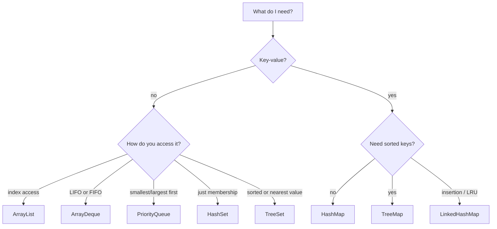
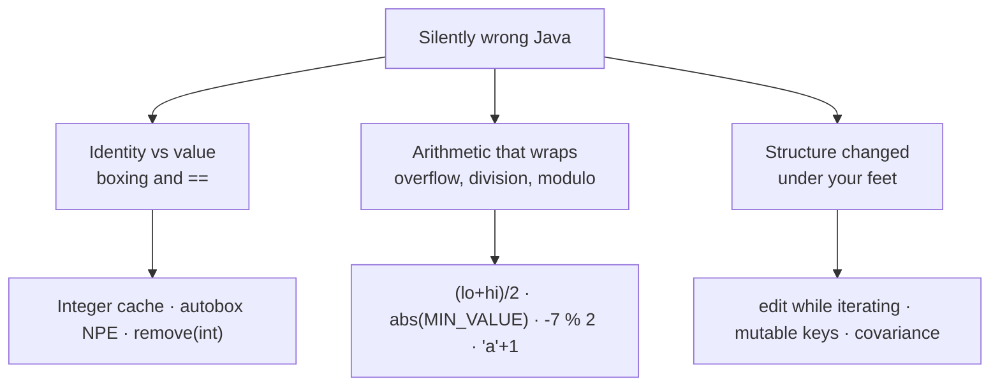

# Chapter 38 — Java Refresher: Core & DSA Toolkit

> "You haven't forgotten Java. You've just stopped reaching for it automatically. This chapter is about making it automatic again."

---

## What You'll Learn

After this chapter you will be able to:
- Tell in one glance what actually changed in Java since you left, and what didn't
- Reach for the right array idiom without thinking — 1-D, 2-D, jagged, copy, fill, sort, binary search, prefix sums
- Build strings the way interviewers expect, and know why `+=` in a loop is a bug
- Pick between `ArrayList`, `HashMap`, `HashSet`, `ArrayDeque`, `PriorityQueue` and `TreeMap` in seconds
- Write comparators that don't overflow and don't violate their contract
- Recognise the traps that silently produce wrong answers — the Integer cache, autoboxing NPEs, `(lo+hi)/2`
- Write `equals`/`hashCode` that behave correctly inside a `HashMap`

**Markers:** ★★★ = know cold for interviews · ★★ = high priority · ★ = good to know.

**Quick check** boxes are retrieval practice — attempt before revealing.

**Interview** boxes give the question, what to say, and the follow-up trap.

> **This chapter is the on-ramp to the DSA chapters, [Ch 31–31d — DSA in Java](#content/31_dsa_foundations).** Those chapters and their 400+ in-browser problems assume Java fluency and explain the language only in passing. Everything here exists to close that gap. The *modern* language and ecosystem — records, sealed types, pattern matching, virtual threads, Spring Boot 4, build tools, the JVM — live in the companion chapter, [Ch 38b — Modern Java](#content/38b_java_modern).

---

## 38.1 What Changed While You Were Away ★★

![Map of what changed in Java since 2022: a release timeline from Java 8 LTS in 2014 through Java 11, 17, 21 and Java 25 LTS (current) to non-LTS Java 26 and 27, with Java 29 LTS planned for Sep 2027 and the rule LTS = 17 + 4k; six unchanged topics to reload in Ch 38 (arrays, strings, ArrayList/HashMap/HashSet, lambdas and comparators, == vs equals, generics and equals/hashCode) beside five superseded habits (Stack to ArrayDeque, data classes to records, type if-chains to sealed types plus pattern matching, I/O thread pools to virtual threads, Spring Boot 2 javax to Boot 4 jakarta); a pick-by-goal reading table, usage counts (int() 3,000+, stream() 2, Optional 0) and the preview-feature trap.](diagrams/java38_info_java_whats_changed_ai.png)

<details>
<summary><strong>Read as text</strong> — the release timeline, the LTS rule and why your old code still runs</summary>

You left Java somewhere around 2022. Most likely you were on **Java 8** or **Java 11**, with Java 17 perhaps on a roadmap somewhere. Since then two more **long-term-support (LTS)** releases have shipped: **Java 21** (September 2023) and **Java 25** (September 2025). An LTS release gets years of security patches from vendors, so it is what companies standardise on. In between, a non-LTS feature release ships every six months and is replaced by the next one; as of November 2026 the newest is **Java 27** (15 September 2026).

> **Maths in one line:** `LTS = 17 + 4k` → 17, 21, 25, then 29 (planned for September 2027) — a release every six months, and every fourth one (every two years) is LTS. In 2026 "which Java?" means 21 or 25.

```
  2014         2018         2021         2023         2025         2026
   │            │            │            │            │            │
 Java 8       Java 11      Java 17      Java 21      Java 25      Java 26, 27
  LTS          LTS          LTS          LTS          LTS          non-LTS
   ▲            ▲            ▲            ▲            ▲            ▲
 lambdas,     var (10),    records,     virtual      scoped       structured
 streams,     String       sealed       threads,     values,      concurrency:
 Optional     strip,       types,       pattern      compact      still
              repeat       text blocks  matching,    source       preview
                                        sequenced    files
                                        collections
```

Every feature listed under an LTS release is *final* there — no flag needed. "Preview" (the last column) means you must compile with `--enable-preview` and the API may still change: structured concurrency is on its seventh preview in Java 27, so do not plan production code around it yet.

Here is the reassuring part, and it is worth saying plainly before anything else: **almost nothing you learned was invalidated.** Java's compatibility discipline is close to obsessive. Code you wrote in 2022 still compiles and still runs. What changed is that a lot of what used to take ten lines now takes one — and a few habits that were correct then are merely *acceptable* now.

</details>

### The diff map

Read the middle column first. If a row says "unchanged," you can skip that topic entirely.

| What you knew | Status in 2026 | Where it's covered |
|---|---|---|
| Arrays, `int[]`, 2-D grids | **Unchanged** | §38.2 — reactivation only |
| `String`, `StringBuilder`, `char[]` | **Unchanged** (+ `strip`, `isBlank`, `repeat`) | §38.3 |
| `ArrayList` / `HashMap` / `HashSet` | **Unchanged**, but three idioms replace old boilerplate | §38.4 |
| `Stack` for stacks | **Superseded** — use `ArrayDeque` | §38.4 |
| Lambdas and comparators (Java 8) | **Unchanged** — still the tool DSA needs | §38.5 |
| `==` vs `.equals()`, boxing traps | **Unchanged** — and still the top source of silent bugs | §38.6 |
| Generics, `equals`/`hashCode` | **Unchanged**, but records now generate them | §38.7 |
| Hand-written data classes (fields, constructor, `equals`/`hashCode`/`toString`) | **Superseded** by **records** (Java 16) | [Ch 38b](#content/38b_java_modern) §38b.2 |
| `if/else if` chains on type | **Superseded** by **sealed types + pattern matching** | [Ch 38b](#content/38b_java_modern) §38b.3 |
| Explicit types on every local | **Optional** — `var` since Java 10 | [Ch 38b](#content/38b_java_modern) §38b.1 |
| Escaped multi-line strings | **Superseded** by **text blocks** | [Ch 38b](#content/38b_java_modern) §38b.1 |
| `public static void main(String[] args)` in every file | **Optional** — Java 25 allows a bare `void main()` in a small file; the DSA problems here still use `public class Main` | [Ch 38b](#content/38b_java_modern) §38b.1 |
| `list.get(list.size() - 1)` | **Shortcut added** — `getFirst()`, `getLast()`, `reversed()` (Java 21 sequenced collections) | [Ch 38b](#content/38b_java_modern) §38b.4 |
| Thread pools sized to cores | **Superseded** for I/O by **virtual threads** | [Ch 38b](#content/38b_java_modern) §38b.6 |
| `CompletableFuture` chains | **Often unnecessary** — write blocking code on virtual threads | [Ch 38b](#content/38b_java_modern) §38b.6 |
| Spring Boot 2, `javax.*` | **Migrated** — Boot 3 moved to `jakarta.*` and Java 17+; Boot 4 (November 2025, on Spring Framework 7) is the current major | [Ch 38b](#content/38b_java_modern) §38b.7 |

<details>
<summary><strong>Read as text</strong> — what the sixteen rows add up to</summary>

Six of those sixteen rows say "unchanged" — and they are the rows coding interviews lean on hardest. Most of the rest is new syntax or backend practice. That is the honest summary of your situation: **you are not relearning a language, you are reloading one** — and then picking up a handful of genuinely new ideas.

</details>

### Which chapter should you read first?

The two chapters exist for two different jobs, and the right order depends on yours.

| Your goal | Read |
|---|---|
| Grind DSA and pass a coding interview | **This chapter**, then [Ch 31–31d](#content/31_dsa_foundations). §38b is optional. |
| Return to backend work on a modern codebase | Skim §38.6 for the traps, then all of [Ch 38b](#content/38b_java_modern) |
| Both | This chapter → [Ch 38b](#content/38b_java_modern) → [Ch 31–31d](#content/31_dsa_foundations) |

<details>
<summary><strong>Read as text</strong> — why arrays and collections get the space here, not streams</summary>

A note on why this chapter weights things the way it does. Counting the Java in [Ch 31–31d](#content/31_dsa_foundations) plus the descriptions and starter code of the 400+ in-browser problems (November 2026): `int[]` appears **more than 3,000** times; `ArrayList` about 190; `ArrayDeque`, `Deque` and `Queue` together about 190. `stream()` appears **twice**, and `Optional` **not at all**. So arrays, collections and comparators get the space here, and streams are covered in [Ch 38b](#content/38b_java_modern) where they actually belong — in backend code.

</details>

### Rust check

Answer these before reading on. They are diagnostic, not a test — each one maps to a section, so a wrong answer tells you exactly where to slow down.

1. What does `new Integer[3]` contain? *(§38.2)*
2. `List<Integer> l = Arrays.asList(1,2,3); l.add(4);` — what happens? *(§38.2)*
3. Why is building a string with `s += c` inside a loop a bug? *(§38.3)*
4. You need a stack. `Stack` or `ArrayDeque`? *(§38.4)*
5. What's wrong with `(a, b) -> a - b` as a comparator? *(§38.5)*
6. `Integer a = 127, b = 127; a == b` → ? And at 128? *(§38.6)*
7. Why does `int mid = (lo + hi) / 2;` break on large arrays? *(§38.6)*
8. You override `equals` but not `hashCode`, then use the object as a `HashMap` key. What happens? *(§38.7)*

<details>
<summary><strong>Answers.</strong> Score yourself, then use the table below to decide what to skip.</summary>

| # | Answer | § |
|---|---|---|
| 1 | Three `null`s, not three zeros. Only **primitive** arrays zero-fill — which is why `int[]` and `Integer[]` are not interchangeable. | 38.2 |
| 2 | `UnsupportedOperationException`. `asList` returns a **fixed-size view** backed by the array: `set` works, `add`/`remove` never do. | 38.2 |
| 3 | `String` is immutable, so every `+=` allocates and copies the whole string — $O(n^2)$. `StringBuilder` is $O(n)$. | 38.3 |
| 4 | `ArrayDeque`. `Stack` extends `Vector`, so every method is synchronized — and it iterates **bottom-to-top**, the opposite of pop order. | 38.4 |
| 5 | It overflows. With `a = 2_000_000_000` and `b = -2_000_000_000` the subtraction wraps negative and the order inverts. Use `Integer.compare(a, b)`. | 38.5 |
| 6 | `true`, then `false`. Boxed integers are cached in −128..127, so `==` accidentally works small and fails large — passes your tests, fails the real input. | 38.6 |
| 7 | `lo + hi` can exceed `Integer.MAX_VALUE` and wrap negative, so `mid` goes negative and you index out of bounds. Write `lo + (hi - lo) / 2`. | 38.6 |
| 8 | Lookups (almost always) fail. `HashMap` picks the bucket by `hashCode` first, so two "equal" objects land in different buckets and `get` returns `null`. | 38.7 |

| Score | What to do |
|---|---|
| **7–8** | Skim §38.2–38.5 for the tables, read §38.6 properly, go to [Ch 31–31d](#content/31_dsa_foundations) |
| **4–6** | Normal for a four-year gap. Read the chapter in order; you'll move fast. |
| **0–3** | Read every section and type the examples out rather than reading them. |

</details>

> **Interview —** *"You've been away from Java for a while. How current are you?"*
>
> **Say:**
> - Name the delta precisely rather than apologising for it — you left around **Java 11**.
> - The material changes since: **records** and **sealed types** (Java 16–17), **pattern matching for `switch`** and **virtual threads** (Java 21), and **scoped values** final in Java 25, the current LTS. **Structured concurrency** is still a preview feature in Java 27.
> - Then say what it *means*: data modelling got terser and exhaustively checkable, and thread-per-request became viable again — which removes much of the motivation for reactive stacks.
>
> **They follow up with:** *"So what would you use virtual threads for?"* — I/O-bound request handling, where blocking code on a virtual thread is now both simpler and about as scalable as an async pipeline. Not CPU-bound work, which is still bounded by core count.

---

## 38.2 Arrays — The Workhorse ★★★

![Cheat card for Java arrays: address(a(i)) = start + i x 4 gives O(1) access; a 3 by 4 grid drawn as an outer array of three row references (grid.length = 3 rows, grid(0).length = 4 cols); binarySearch on 1, 2, 5, 7, 9 for key 6 returns -4 = -(3) - 1, insert at index 3; prefix sums of 2, 4, 6, 8 are 0, 2, 6, 12, 20 so sum a(1..2) = 12 - 2 = 10; a cost table (sort of int() is dual-pivot quicksort, not stable; sort with a comparator is TimSort, stable); traps: new Integer(3) holds nulls, Arrays.asList(int()) has size 1, shallow grid.clone(), and 3,000,000,000 in an int becomes -1,294,967,296 so use long().](diagrams/java38_info_java_arrays_workhorse_ai.png)

<details>
<summary><strong>Read as text</strong> — why arrays come first, and what this section covers</summary>

If you only reactivate one thing before opening [Ch 31–31d](#content/31_dsa_foundations), make it this. The token `int[]` appears **more than 3,000 times** across those chapters and the 400+ in-browser problems. Nothing else comes close. Interview Java is, to a first approximation, *array Java* — with a hash map bolted on when you need one.

The good news is that arrays are the part of the language that changed least. Almost everything below worked identically in Java 8; the few newer methods are marked with their version. You are not learning; you are re-loading.

**In this section**

- Declaration and defaults — and why `new Integer[3]` is three `null`s, not three zeros
- 2-D as an array-of-arrays: jagged rows, `deepToString`, the direction-array idiom
- `Arrays.sort`'s two hidden algorithms, the copy/fill toolbox, and `Arrays.asList`'s two traps
- `binarySearch`'s insertion point, prefix sums, and the `int` overflow that breaks them

</details>

#### Simple Explanation

<details>
<summary><strong>Read as text</strong> — the locker-row analogy, the definition and the O(1) address formula</summary>

Think of an array as a row of numbered lockers, all the same size, bolted to a wall. Because they are identical and adjacent, the caretaker can jump straight to locker 47 without walking past the first 46 — that is what makes `a[i]` instant.

The cost of that speed is rigidity. You cannot bolt on an extra locker later. The row's length is fixed the moment you build it, and the only way to "grow" it is to build a longer row and carry everything across. Every "resizable" structure in Java — `ArrayList`, `StringBuilder`, `ArrayDeque` — is that carrying trick wrapped in a friendly interface.

The second thing to hold onto: in Java, `a` is not the lockers. `a` is the sticky note with the room number on it. Copy the sticky note and both notes point at the same lockers. This is why passing an array into a method lets that method scribble on your data.

> **An array** is a fixed-length, contiguously allocated, homogeneously typed sequence whose elements are reachable in constant time by integer index.

> **Maths in one line:** `address(a[i]) = start + i × elementSize` (4 bytes for an `int`) — one multiply and one add, so `a[0]` and `a[999_999]` cost the same: $O(1)$.

</details>

### Declaration and initialisation

<details>
<summary><strong>Read as text</strong> — three ways to write an array, the brace-only shortcut and length vs length() vs size()</summary>

Three forms, and they are not interchangeable.

```java
int[] sized   = new int[5];           // length known, values 0
int[] literal = {1, 2, 3};            // ONLY at declaration
int[] inline  = new int[]{4, 5, 6};   // anywhere
```

The bare-brace form `{1, 2, 3}` is a *declaration-only* shortcut. The moment you need an array anywhere else — as a method argument, in a `return`, inside a bigger expression — you must spell out `new int[]{...}`. That is exactly why the DSA problem starter code you are about to see 400 times reads:

```java
System.out.println(linearSearch(new int[]{3, 7, 1, 9, 4}, 9));
```

Write `linearSearch({3, 7, 1, 9, 4}, 9)` and it will not compile.

One spelling trap, three forms of the same idea:

- `a.length` — a **field** on arrays (no parentheses)
- `s.length()` — a **method** on `String`
- `list.size()` — a different method again on collections

You will type the wrong one at least twice this week. The compiler catches all three, so it costs seconds, not correctness.

</details>

### Default values, and why `new Integer[3]` is a trap

<details>
<summary><strong>Read as text</strong> — zero-fill defaults and why a boxed array starts as nulls</summary>

A freshly allocated array is *always* zero-filled — for the appropriate meaning of zero.

```java
int[] a = new int[5];              // [0, 0, 0, 0, 0]
double[] d = new double[3];        // [0.0, 0.0, 0.0]
boolean[] b = new boolean[3];      // [false, false, false]
char[] c = new char[3];            // ['\u0000', '\u0000', '\u0000']
String[] s = new String[3];        // [null, null, null]
Integer[] boxed = new Integer[3];  // [null, null, null] — NOT 0

// int sum = 0;
// for (Integer x : boxed) sum += x;   -> NullPointerException
```

That last line is the whole point. `Integer` is a *reference* type, so `new Integer[3]` is three null pointers wearing a numeric costume. The instant you do `sum += x` the JVM unboxes `null` and throws. In DSA code this shows up when someone reaches for `Integer[]` so they can pass a comparator to `Arrays.sort` — and then forgets that the array starts empty in a different sense than `int[]` does.

Rule of thumb for interviews: **use `int[]` unless you specifically need `null`, generics, or a custom comparator.** Boxing costs memory — each `Integer` is a separate ~16-byte object plus a 4-byte reference in the array, so about 20 bytes versus 4 for an `int` — and it costs cache locality, which is the thing that actually makes array code fast.

</details>

<details>
<summary><strong>Quick check.</strong> You need to sort an array of numbers into descending order. Why can't you just call <code>Arrays.sort(intArray, comparator)</code>?</summary>

There is no such overload. `Comparator<T>` is generic and generics do not accept primitives, so `Arrays.sort(int[], Comparator)` cannot exist. Your options are: sort ascending and reverse in place ($O(n)$ extra pass, still $O(n \log n)$ overall, no boxing); or box into `Integer[]` and pass a comparator. In an interview, say the first one — it shows you know why the overload is missing.

</details>

### 2-D and jagged arrays

<details>
<summary><strong>Read as text</strong> — rows as references, jagged arrays, the fill trap and the direction-array idiom</summary>

Java has no true rectangular 2-D array. `int[][]` is an **array of references to arrays**. Once that clicks, every 2-D question answers itself.

```
int[][] grid = new int[3][4];

  grid ──► ┌───┐
           │ 0 │──► [ 0 ][ 1 ][ 2 ][ 3 ]   row 0
           ├───┤
           │ 1 │──► [ 4 ][ 5 ][ 6 ][ 7 ]   row 1
           ├───┤
           │ 2 │──► [ 8 ][ 9 ][10 ][11 ]   row 2
           └───┘

  grid.length    = 3   (number of rows)
  grid[0].length = 4   (width of row 0 only)
```

So `grid.length` is the **row count** because the outer array holds one slot per row, and `grid[0].length` is the **column count** because that is the length of one inner array. The asymmetry is not a quirk — it falls straight out of the representation.

```java
int[][] grid = new int[3][4];
for (int r = 0; r < grid.length; r++)
    for (int c = 0; c < grid[0].length; c++)
        grid[r][c] = r * 4 + c;
// grid.length = 3 (rows), grid[0].length = 4 (cols)
// deepToString -> [[0, 1, 2, 3], [4, 5, 6, 7], [8, 9, 10, 11]]

int[][] jag = new int[3][];      // rows unallocated (null)
jag[0] = new int[]{1};           // [1]
jag[1] = new int[]{1, 2};        // [1, 2]
jag[2] = new int[]{1, 2, 3};     // [1, 2, 3] — rows may differ in length

int[][] lit = {{1, 2, 3}, {4, 5, 6}};

int[][] fill = new int[2][3];
for (int[] row : fill) Arrays.fill(row, -1);   // must go row by row
// fill -> [[-1, -1, -1], [-1, -1, -1]]
```

Two consequences worth internalising:

- **`new int[3][]` gives you three `null` rows** — a *jagged* array. That is how you represent triangular DP tables, adjacency lists and Pascal's triangle without wasting space.
- **`Arrays.fill(grid, -1)` does not work.** It even compiles — Java picks the `fill(Object[], Object)` overload and boxes `-1` — and then throws `ArrayStoreException` at runtime, because every slot of `grid` must hold an `int[]` row, not an `Integer`. Loop the rows, as above.

For grid traversal, the direction-array idiom is worth having in muscle memory, because it turns four near-identical bounds checks into one loop:

```java
int[][] DIRS = {{-1, 0}, {1, 0}, {0, -1}, {0, 1}};
for (int[] d : DIRS) {
    int nr = r + d[0], nc = c + d[1];
    if (nr < 0 || nr >= grid.length ||
        nc < 0 || nc >= grid[0].length) continue;
    // visit grid[nr][nc]
}
```

> **Interview —** *"Walk me through how a 2-D array is laid out in Java, and how that differs from C."*
>
> **Say:**
> - In C, `int a[3][4]` is **one contiguous block** of 12 ints and the compiler does the index arithmetic.
> - In Java, `int[3][4]` is one array of three *references* plus three separate 4-element arrays — **four objects on the heap**, not one.
> - Two consequences: rows can have different lengths (jagged arrays are legal and useful), and row-major traversal is meaningfully faster than column-major, because each row is contiguous but rows are not contiguous with each other.
>
> **They follow up with:** *"So does loop order matter for performance?"* — Yes. Iterating `for r { for c { grid[r][c] } }` walks each row linearly and is cache-friendly; swapping the loops jumps between separately allocated rows on every step and thrashes the cache. Same $O(mn)$, materially different wall clock.

</details>

### Sorting: two algorithms hiding behind one name

<details>
<summary><strong>Read as text</strong> — dual-pivot quicksort vs TimSort, stability and the outdated anti-quicksort advice</summary>

`Arrays.sort` dispatches to two completely different implementations, and the difference is genuinely interview-relevant.

| Call | Algorithm | Stable? | Complexity |
|---|---|---|---|
| `Arrays.sort(int[])` (any primitive array) | dual-pivot quicksort, with a heapsort fallback (JDK 14+) | no | $O(n \log n)$ worst case |
| `Arrays.sort(Integer[])`, `Arrays.sort(T[], cmp)`, `list.sort(cmp)` | TimSort (a merge-sort hybrid) | **yes** | $O(n \log n)$ worst case; $O(n)$ if already sorted |

Primitives get dual-pivot quicksort because stability is meaningless for primitives — two equal `int`s are indistinguishable, so there is nothing to preserve — and quicksort works (almost entirely) in place. Objects get TimSort because stability *is* observable (two records with equal keys but different payloads) and because TimSort exploits pre-sorted runs, which real object data is full of. TimSort pays for that with up to $n/2$ extra slots of scratch memory.

You may remember an old warning: quicksort has an $O(n^2)$ worst case, competitive-programming judges published "anti-quicksort" inputs that pushed `Arrays.sort(int[])` into quadratic time, and the fix was to box into `Integer[]` or shuffle first. **That advice is out of date.** Since **JDK 14** the primitive sort tracks its recursion depth and switches to heapsort when partitioning goes badly, and the Javadoc now promises $O(n \log n)$ "on all data sets". On Java 17, 21 or 25, box only when you need a comparator or stability — never for safety. If an interviewer raises it, that one sentence is the whole answer.

```java
int[] a = {5, 2, 9, 1, 7};
Arrays.sort(a);                          // [1, 2, 5, 7, 9]

Integer[] boxed = {5, 2, 9, 1, 7};
Arrays.sort(boxed, (x, y) -> Integer.compare(y, x));   // [9, 7, 5, 2, 1]

int[] p = {9, 8, 7, 3, 2, 1};
Arrays.sort(p, 1, 4);                    // [9, 3, 7, 8, 2, 1] — range is [from, to)
```

Note the range form sorts the half-open interval `[1, 4)` — indices 1, 2, 3 — and leaves the rest untouched. Half-open intervals are the Java convention everywhere (`substring`, `copyOfRange`, `subList`, `subMap`), which is one fewer thing to remember. Descending order on `int[]`, comparators, and sorting `int[][]` intervals are in §38.5.

</details>

### Copy, fill, and the rest of the `Arrays` toolbox

<details>
<summary><strong>Read as text</strong> — the copy and fill toolbox, and alias vs clone</summary>

```java
int[] a = {1, 2, 5, 7, 9};

int[] f = new int[5];
Arrays.fill(f, -1);                           // [-1, -1, -1, -1, -1] — whole array
int[] grown = Arrays.copyOf(a, 8);            // [1, 2, 5, 7, 9, 0, 0, 0] — pads with 0
int[] slice = Arrays.copyOfRange(a, 1, 4);    // [2, 5, 7] — half-open [1, 4)
int[] dst   = new int[7];
System.arraycopy(a, 0, dst, 1, 5);            // src, srcPos, dst, dstPos, n
                                              // dst -> [0, 1, 2, 5, 7, 9, 0]
```

The copy that bites is the one you *think* you made. `b = a` copies the sticky note, not the lockers; `clone()` copies the lockers — but for a 2-D grid it copies only the outer row of sticky notes. One small program shows the whole rule:

</details>

```java
// Alias vs copy: `alias = a` shares the array; clone() copies a 1-D array but only the row references of a 2-D grid.
import java.util.Arrays;

public class CopyDemo {
    public static void main(String[] args) {
        int[] a = {1, 2, 3};
        int[] alias = a;                 // same object, two names
        int[] copy = a.clone();          // new array, same values
        alias[0] = 99;
        System.out.println("a     = " + Arrays.toString(a));
        System.out.println("copy  = " + Arrays.toString(copy));

        int[][] grid = {{1, 2}, {3, 4}};
        int[][] shallow = grid.clone();  // new outer array, SAME rows
        int[][] deep = new int[grid.length][];
        for (int r = 0; r < grid.length; r++) deep[r] = grid[r].clone();
        shallow[0][0] = -1;              // writes into a row that grid shares
        System.out.println("grid  = " + Arrays.deepToString(grid));
        System.out.println("deep  = " + Arrays.deepToString(deep));
        System.out.println("shallow shares rows: " + (shallow[0] == grid[0])
                + ", deep shares rows: " + (deep[0] == grid[0]));

        if (a[0] != 99 || copy[0] != 1) throw new AssertionError("1-D alias/clone");
        if (grid[0][0] != -1 || deep[0][0] != 1) throw new AssertionError("2-D shallow/deep");
    }
}
```

**Output:**

```
a     = [99, 2, 3]
copy  = [1, 2, 3]
grid  = [[-1, 2], [3, 4]]
deep  = [[1, 2], [3, 4]]
shallow shares rows: true, deep shares rows: false
```

<details>
<summary><strong>Read as text</strong> — continued: shallow 2-D clones and System.arraycopy</summary>

Two things to bank from that:

- **`clone()` on `int[]` is a real copy; on `int[][]` it is not.** `grid.clone()` copies the row *references*, so a write through the "copy" lands in the original. For a deep copy, clone each row. This is the classic backtracking and DP bug: you "save" a grid state, keep mutating, and the saved state changes too.
- **`System.arraycopy` is a JVM intrinsic** — the JIT turns it into a fast, vectorised memory move. `copyOf` and `copyOfRange` use it (or `clone()`) internally, so use whichever reads better. Reach for `arraycopy` directly when you copy *into* an existing array at an offset, or shift elements inside one array to insert or delete — it handles overlapping ranges correctly.

</details>

### Binary search and the insertion point

<details>
<summary><strong>Read as text</strong> — the insertion-point formula and its two rules</summary>

`Arrays.binarySearch(a, key)` finds `key` in a **sorted** array in $O(\log n)$. The interesting part is what it returns when the key is *absent*.

> **Maths in one line:** `r = binarySearch(a, key)`; if `r < 0`, then `insertionPoint = -r - 1` — the index of the first element greater than `key` (it can equal `a.length`).

Why the extra `- 1`? Because the insertion point can be 0, and `-0` is just `0`, which would look like "found at index 0". Subtracting one more makes every "absent" answer strictly negative. Two rules come with it:

1. **The array must be sorted ascending.** On unsorted input the result is undefined — no exception, just a wrong index.
2. **With duplicates, you get *some* matching index**, not necessarily the first. For "first index whose value is ≥ x" (the *lower bound*), write the loop yourself — the binary-search templates live in [Ch 31 §18.7](#content/31_dsa_foundations).

</details>

```java
// Arrays.binarySearch: found -> index; absent -> -(insertion point) - 1; with duplicates, any match.
import java.util.Arrays;

public class BinarySearchDemo {
    // first index whose value is >= key (the lower bound); a.length if there is none
    static int lowerBound(int[] a, int key) {
        int lo = 0, hi = a.length;               // search the half-open range [lo, hi)
        while (lo < hi) {
            int mid = lo + (hi - lo) / 2;        // not (lo + hi) / 2 — see §38.6
            if (a[mid] < key) lo = mid + 1; else hi = mid;
        }
        return lo;
    }

    public static void main(String[] args) {
        int[] a = {1, 2, 5, 7, 9};
        for (int key : new int[]{7, 6, 0, 10}) {
            int r = Arrays.binarySearch(a, key);
            String meaning = r >= 0 ? "found at " + r : "absent, insert at " + (-r - 1);
            System.out.printf("key %2d -> %2d  (%s)%n", key, r, meaning);
            if (r < 0 && -r - 1 != lowerBound(a, key)) throw new AssertionError("insertion point");
        }

        int[] dup = {1, 2, 2, 2, 3};
        int any = Arrays.binarySearch(dup, 2);
        int first = lowerBound(dup, 2);
        System.out.println("dup " + Arrays.toString(dup) + ": binarySearch(2) = " + any
                + ", lowerBound(2) = " + first);
        if (dup[any] != 2 || first != 1) throw new AssertionError("duplicates");
    }
}
```

**Output:**

```
key  7 ->  3  (found at 3)
key  6 -> -4  (absent, insert at 3)
key  0 -> -1  (absent, insert at 0)
key 10 -> -6  (absent, insert at 5)
dup [1, 2, 2, 2, 3]: binarySearch(2) = 2, lowerBound(2) = 1
```

<details>
<summary><strong>Read as text</strong> — continued: reading the output and the duplicates trap</summary>

Read the `6` row: it belongs between `5` and `7`, at index 3, so the call returns `-(3) - 1 = -4`, and `-(-4) - 1` gives the 3 back. That one call answers "where would x go?" and "what is the smallest element greater than x?" (`a[3] = 7`). The last line is the trap: the JDK probed the middle `2` first and stopped there, so it returned index 2, not the first `2` at index 1.

</details>

### Printing and comparing — the debugging essentials

<details>
<summary><strong>Read as text</strong> — toString vs deepToString, equals vs deepEquals, and why arrays make bad map keys</summary>

You will lose real minutes to this if you don't reload it now.

```java
int[] a = {1, 2, 3};
System.out.println(a);                    // [I@4b67cf4d  — useless
System.out.println(Arrays.toString(a));   // [1, 2, 3]
System.out.println(Arrays.deepToString(grid));  // for 2-D
```

An array's inherited `toString()` prints its type descriptor and identity hash, which tells you nothing — and `Arrays.toString` on a 2-D array is just as useless, because it calls `toString` on each *row*:

```java
Arrays.toString(grid);      // [[I@4b67cf4d, [I@7ea987ac, [I@12a3a380]
Arrays.deepToString(grid);  // [[0, 1, 2, 3], [4, 5, 6, 7], [8, 9, 10, 11]]
```

(The hex values differ on every run — they are identity hash codes.) For anything nested, `deepToString`.

Equality follows exactly the same split, and for exactly the same reason:

```java
int[] a = {1, 2, 3}, b = {1, 2, 3}, c = {1, 2, 4};
a == b                  // false — different objects
a.equals(b)             // false — Object.equals is identity
Arrays.equals(a, b)     // true  — element-wise
Arrays.compare(a, c)    // -1    — lexicographic: a < c (Java 9+); 0 when equal
Arrays.mismatch(a, c)   // 2     — index of the first difference; -1 if none (Java 9+)

int[][] x = {{1, 2}, {3}}, y = {{1, 2}, {3}};
Arrays.equals(x, y)     // false — 2-D: compares row references
Arrays.deepEquals(x, y) // true  — element-wise, recursive
```

Arrays never override `equals` or `hashCode`. That is why **an array is a terrible `HashMap` key** — two arrays with identical contents hash differently, so `map.get(equalContentArray)` returns `null`. Key on a `List<Integer>` or on a `String` such as `Arrays.toString(a)` instead. (Do not key on `Arrays.hashCode(a)` alone — two different arrays can share a hash. Use it, together with `Arrays.equals`, inside the `hashCode`/`equals` of a class that wraps an array; §38.7.)

</details>

### `Arrays.asList` — read this twice

<details>
<summary><strong>Read as text</strong> — the two independent gotchas</summary>

About 70 uses across the DSA chapters and problem code, and it is the single most trap-laden method in `java.util.Arrays`. It has **two** independent gotchas.

</details>

#### Simple Explanation

<details>
<summary><strong>Read as text</strong> — a List-shaped window, the int[] trap and the mutability ladder</summary>

`Arrays.asList` does not build you a list. It puts a *List-shaped window* on top of an array you already have. The window lets you look at elements and swap them out, because both of those map onto array operations. It does not let you add or remove, because an array cannot grow or shrink. It is an adapter, not a constructor.

And because it is a window, changes go both ways: write through the list and the underlying array changes too.

> **`Arrays.asList(T... a)`** returns a fixed-size `List` view backed by the supplied array; structural modification throws, and element writes propagate to the array.

```java
List<Integer> fixed = Arrays.asList(1, 2, 3);
fixed.set(0, 99);   // fine -> [99, 2, 3]
fixed.add(4);       // UnsupportedOperationException
fixed.remove(0);    // UnsupportedOperationException

Integer[] backing = {1, 2, 3};
List<Integer> view = Arrays.asList(backing);
view.set(0, 42);    // backing[0] is now 42 — writes through

int[] prim = {1, 2, 3};
List<int[]> wrong = Arrays.asList(prim);   // size 1! one element, an int[]

List.of(1, 2, 3).set(0, 9);   // UnsupportedOperationException — fully immutable
```

**Gotcha two** is the one that produces wrong answers rather than exceptions. `asList` is generic — `<T> List<T> asList(T... a)`. An `int[]` is not a `T[]`, because `T` cannot be a primitive. So the compiler infers `T = int[]` and hands you a `List<int[]>` **of size 1**. Your "list of three numbers" is a list containing one array. It compiles cleanly and silently does the wrong thing.

```java
// 2022 — how you'd have written it
List<Integer> list = new ArrayList<>();
for (int v : prim) list.add(v);              // a mutable ArrayList

// 2026 — how you'd write it now (Java 16+)
List<Integer> list = IntStream.of(prim).boxed().toList();   // UNMODIFIABLE: add throws
```

Both are fine, with one difference to remember: the loop gives you a mutable `ArrayList`, while `Stream.toList()` returns an unmodifiable list. In an interview under time pressure, honestly, write the loop — it needs no imports beyond `java.util`, no one ever questions it, and the DSA chapters use `stream()` only twice. Know the stream form so you can read it; reach for the loop so you can write it fast.

The mutability ladder is worth memorising as four rungs:

| Expression | Add/remove? | Replace element? | Backed by |
|---|---|---|---|
| `Arrays.asList(1, 2, 3)` | no | **yes** | the varargs array |
| `List.of(1, 2, 3)` | no | no | an immutable copy |
| `IntStream.of(prim).boxed().toList()` | no | no | its own unmodifiable list |
| `new ArrayList<>(List.of(1, 2, 3))` | yes | yes | its own array |

That last form is the one you actually want most of the time: `new ArrayList<>(Arrays.asList(...))` or `new ArrayList<>(List.of(...))` gives you a genuinely mutable list seeded with literals.

> **Interview —** *"`Arrays.asList(arr)` — what does it return and what can you do with it?"*
>
> **Say:**
> - A **fixed-size `List` view** backed by that array.
> - `get` and `set` work, and `set` writes through to the array.
> - `add` and `remove` throw `UnsupportedOperationException`, because the backing array can't resize.
> - Pass an `int[]` rather than an `Integer[]` and generic inference gives you a `List<int[]>` with **one** element — a silent bug rather than an error.
>
> **They follow up with:** *"How is that different from `List.of`?"* — `List.of` is fully immutable (even `set` throws), rejects nulls, and copies its input rather than viewing it, so later changes to the source array aren't visible. `asList` is a mutable-element view; `List.of` is a frozen snapshot.

</details>

### Converting between shapes

<details>
<summary><strong>Read as text</strong> — boxing, unboxing and toArray conversions</summary>

The conversions you need, each checked on JDK 25:

```java
int[] prim = {3, 1, 2};
List<Integer> list = List.of(3, 1, 2);
List<String> words = List.of("a", "b");

Integer[] boxed = IntStream.of(prim).boxed().toArray(Integer[]::new);   // [3, 1, 2]
int[] back      = Stream.of(boxed).mapToInt(Integer::intValue).toArray(); // [3, 1, 2]
int[] fromList  = list.stream().mapToInt(Integer::intValue).toArray();    // [3, 1, 2]
String[] arr    = words.toArray(new String[0]);                           // [a, b]
String[] arr11  = words.toArray(String[]::new);                           // [a, b] — Java 11+
```

`toArray(new String[0])` looks wasteful but is not: on modern HotSpot JVMs the zero-length form is as fast as, or faster than, `toArray(new String[list.size()])`, because the JVM allocates the right-sized array itself and can skip zero-filling it (Aleksey Shipilëv's 2016 benchmark, "Arrays of Wisdom of the Ancients"). Java 11's `toArray(String[]::new)` does the same job and reads better. What you cannot do is call bare `toArray()` and cast: it returns an `Object[]`, and `(String[])` on that throws `ClassCastException`.

</details>

### The DSA problem shape

<details>
<summary><strong>Read as text</strong> — the class Main skeleton every problem uses</summary>

Almost every one of the 400+ in-browser problems hands you this skeleton: static methods on a class called `Main`, driven from `main`, with `import java.util...` lines at the top when the problem needs them. Here it is as a complete program:

</details>

```java
// The DSA problem shape: static methods on class Main, driven from main; the method can rewrite the caller's array.
import java.util.Arrays;

public class Main {
    public static void reverseInPlace(int[] a) {
        int lo = 0, hi = a.length - 1;
        while (lo < hi) {
            int tmp = a[lo];
            a[lo++] = a[hi];
            a[hi--] = tmp;
        }
    }

    public static int[] prefixSums(int[] a) {
        int[] pre = new int[a.length + 1];
        for (int i = 0; i < a.length; i++) pre[i + 1] = pre[i] + a[i];
        return pre;
    }

    public static void main(String[] args) {
        int[] nums = {3, 7, 1, 9, 4};
        reverseInPlace(nums);
        System.out.println(Arrays.toString(nums));

        int[] pre = prefixSums(new int[]{2, 4, 6, 8});
        System.out.println(Arrays.toString(pre));
        System.out.println("sum a[1..2] = " + (pre[3] - pre[1]));
        if (nums[0] != 4 || pre[3] - pre[1] != 10) throw new AssertionError("shape demo");
    }
}
```

**Output:**

```
[4, 9, 1, 7, 3]
[0, 2, 6, 12, 20]
sum a[1..2] = 10
```

<details>
<summary><strong>Read as text</strong> — continued: why a method can rewrite the caller's array</summary>

`reverseInPlace` mutates the caller's array and returns `void` — that works because Java passes the *reference* by value. The method cannot make `nums` point somewhere else, but it can absolutely rewrite what `nums` points at. Half of all "in-place" DSA problems depend on exactly this.

</details>

### Prefix sums — and the `int` overflow that breaks them

<details>
<summary><strong>Read as text</strong> — the formula, the n + 1 slot, long[] and 2-D prefix sums</summary>

`prefixSums` above is the most reused array trick in DSA: one $O(n)$ pass, then any range sum in $O(1)$. The pattern itself is taught in [Ch 31, Pattern 3: Prefix Sum](#content/31_dsa_foundations); here are the Java details that cost people the problem.

> **Maths in one line:** `pre[i+1] = pre[i] + a[i]`, so `sum(a[l..r]) = pre[r+1] − pre[l]` — the extra slot `pre[0] = 0` means `l = 0` needs no special case.

1. **Size it `n + 1`.** `pre[i]` is the sum of the first `i` elements. With `a = {2, 4, 6, 8}`, `pre = [0, 2, 6, 12, 20]`, so `sum(a[1..2]) = pre[3] − pre[1] = 12 − 2 = 10`.
2. **Make the prefix array `long[]`.** An `int` tops out at `Integer.MAX_VALUE` = 2,147,483,647 and then **wraps silently** — no exception. Three values of one billion already overflow. Constraints like "n ≤ 10⁵, values ≤ 10⁹" (sums up to 10¹⁴) are the interviewer's hint. (The `int[]` version in the skeleton above is safe only because its sums are tiny.) The overflow trap in general — `(lo + hi) / 2`, products, `Math.addExact` — is §38.6, Trap 3.
3. **In 2-D, add two strips and subtract the corner they share:** `P[r+1][c+1] = g[r][c] + P[r][c+1] + P[r+1][c] − P[r][c]`. A rectangle sum is then four lookups.

</details>

```java
// Prefix sums: O(1) range sums in 1-D and 2-D, and why the prefix array should be long[].
import java.util.Arrays;

public class PrefixSumDemo {
    public static void main(String[] args) {
        int[] a = {2, 4, 6, 8};
        long[] pre = new long[a.length + 1];
        for (int i = 0; i < a.length; i++) pre[i + 1] = pre[i] + a[i];
        System.out.println("pre = " + Arrays.toString(pre) + ", sum a[1..2] = " + (pre[3] - pre[1]));

        int[] big = {1_000_000_000, 1_000_000_000, 1_000_000_000};
        int intSum = 0;
        long longSum = 0;
        for (int v : big) { intSum += v; longSum += v; }
        System.out.println("3 x 1e9 as int  = " + intSum + "   (wrapped silently)");
        System.out.println("3 x 1e9 as long = " + longSum);

        int[][] g = {{0, 1, 2, 3}, {4, 5, 6, 7}, {8, 9, 10, 11}};   // the 3 x 4 grid from above
        long[][] P = new long[g.length + 1][g[0].length + 1];
        for (int r = 0; r < g.length; r++)
            for (int c = 0; c < g[0].length; c++)
                P[r + 1][c + 1] = g[r][c] + P[r][c + 1] + P[r + 1][c] - P[r][c];
        long rect = P[3][3] - P[1][3] - P[3][1] + P[1][1];          // rows 1..2, cols 1..2
        System.out.println("rect sum rows 1..2, cols 1..2 = " + rect + "  (5 + 6 + 9 + 10)");

        if (pre[3] - pre[1] != 10 || longSum != 3_000_000_000L || intSum >= 0 || rect != 30)
            throw new AssertionError("prefix sums");
    }
}
```

**Output:**

```
pre = [0, 2, 6, 12, 20], sum a[1..2] = 10
3 x 1e9 as int  = -1294967296   (wrapped silently)
3 x 1e9 as long = 3000000000
rect sum rows 1..2, cols 1..2 = 30  (5 + 6 + 9 + 10)
```

<details>
<summary><strong>Read as text</strong> — continued: reading the overflow and rectangle lines</summary>

The int line is the bug you will not see in small tests: 3,000,000,000 − 2³² = −1,294,967,296. The rectangle line reads as `P[3][3] − P[1][3] − P[3][1] + P[1][1] = 45 − 3 − 12 + 0 = 30`: the whole 3 × 3 top-left block, minus the strip above row 1, minus the strip left of column 1, plus the corner that was subtracted twice.

</details>

### Array complexity — commit this to memory

<details>
<summary><strong>Read as text</strong> — the array cost table</summary>

| Operation | Cost | Note |
|---|---|---|
| `a[i]` read or write | $O(1)$ | one address computation |
| `a.length` | $O(1)$ | stored field, not a scan |
| Linear scan / unsorted search | $O(n)$ | |
| `Arrays.binarySearch` (sorted) | $O(\log n)$ | negative result encodes insertion point; any match among duplicates |
| `Arrays.sort(int[])` | $O(n \log n)$ | dual-pivot quicksort; heapsort fallback makes it the worst case too (JDK 14+) |
| `Arrays.sort(Integer[])` | $O(n \log n)$ | TimSort, stable, guaranteed |
| `Arrays.fill` | $O(n)$ | |
| `copyOf` / `copyOfRange` / `clone` | $O(n)$ | allocates; `clone` of a 2-D array is shallow |
| `System.arraycopy` | $O(n)$ | intrinsic; fastest constant factor |
| Prefix sums: build / range query | $O(n)$ / $O(1)$ | `n + 1` slots; use `long[]` |
| Insert or delete at index `i` | $O(n)$ | shift the tail |
| Grow | $O(n)$ | allocate + copy; there is no in-place grow |
| Space | $O(n)$ | 4 bytes per `int`; ~20 per `Integer` |

</details>

---

## 38.3 Strings and `char[]` ★★★

![Cheat card for Java strings in DSA: read with charAt(i) in O(1), copy to char() with toCharArray to mutate or sort, count letters in an int(26) indexed by c - a, build in a StringBuilder then toString; pipeline from String listen to int(26) counts e1 i1 l1 n1 s1 t1 to a StringBuilder whose capacity grows 16, 34, 70, 142; at n = 50,000 s += c copies 1,250,025,000 chars (n(n+1)/2, O(n^2)) while StringBuilder copies 73,686 chars in 12 growths (O(n)); a what-to-reach-for table, isAnagram listen silent is true, and traps: split takes a regex so a.b.c split on dot is empty, trim and strip both keep U+00A0, and == compares identity so use equals.](diagrams/java38_info_strings_stringbuilder_ai.png)

<details>
<summary><strong>Read as text</strong> — the strategy, the maths and what this section covers</summary>

Open almost any string solution in the DSA chapters ([Ch 31](#content/31_dsa_foundations) to 31d) and you meet the same two types: `char[]` and `StringBuilder`. That is the whole strategy. In DSA Java you rarely manipulate a `String`. You *read it* with `charAt`, or *convert it to a `char[]`* and work on the array, and you *build the answer with a `StringBuilder`*. Strings are the input and output format; arrays are the working format.

> **Maths in one line:** `s += c` done n times writes 1 + 2 + … + n = n(n+1)/2 characters — $O(n^2)$; a `StringBuilder` copies fewer than 2n — $O(n)$.

**In this section**

- Why `s += c` in a loop is $O(n^2)$, measured and counted — and the `StringBuilder` working set that replaces it
- The `String` → `char[]` → mutate → `new String` round trip that unlocks half the string problems
- Char arithmetic, the `int[26]` frequency array, and the four `split`/`trim` traps

</details>

#### Simple Explanation

<details>
<summary><strong>Read as text</strong> — carved in stone: immutability, compact strings and surrogate pairs</summary>

A Java `String` is carved in stone. Not "conventionally treated as read-only" — genuinely, structurally unchangeable. Every method that looks like it edits a string (`toUpperCase`, `replace`, `trim`, `substring`, `+`) actually carves a brand-new stone and hands it back, leaving the original untouched.

That is great for safety: you can pass a string anywhere and know nobody will alter it, it can be safely shared between threads, and its hash code can be cached forever, which is why strings are excellent hash-map keys.

It is terrible for building things one character at a time. Appending a character to an $n$-character string means copying all $n$ characters into a new $n+1$-character string. Do that in a loop and you have written an $O(n^2)$ algorithm by accident. `StringBuilder` is the mutable scratchpad that exists precisely to avoid that.

> **`String`** is an immutable sequence of UTF-16 code units; **`StringBuilder`** is its mutable, non-thread-safe counterpart with amortised $O(1)$ append.

Two storage facts round out the picture. Since Java 9, a string whose characters all fit in Latin-1 is stored as **one byte per character** (*compact strings*, JEP 254) — invisible to your code, since `length()` and `charAt(i)` still count UTF-16 `char`s and stay $O(1)$, but it halves the memory of ASCII text. And a character outside the 16-bit range, such as an emoji, takes **two** `char`s (a *surrogate pair*), so `"a\uD83D\uDE00"` — an `a` plus one emoji — has `length()` 3. That only matters when a problem says "Unicode"; for `a`–`z` inputs, one `char` is one letter.

</details>

### The cost of immutability, measured

<details>
<summary><strong>Read as text</strong> — the quadratic loop, the timing and the n(n+1)/2 arithmetic</summary>

```java
static String withConcat(int n) {
    String s = "";
    for (int i = 0; i < n; i++) s += 'x';   // O(n^2)
    return s;
}
static String withBuilder(int n) {
    StringBuilder sb = new StringBuilder();
    for (int i = 0; i < n; i++) sb.append('x');   // O(n)
    return sb.toString();
}
```

On one laptop with JDK 25, $n = 50{,}000$ took roughly 80–200 ms with `+=` and under 5 ms with `StringBuilder`. Quadrupling $n$ to 200,000 made the `+=` version about 10–15 times slower (1.3–2.2 s) while `StringBuilder` stayed in the low milliseconds. Absolute times vary with the machine and JIT warm-up; the **growth rate** is the point — 4× the input costing ~16× the time is the signature of $O(n^2)$.

The arithmetic is worth being able to state out loud, because interviewers ask for it rather than for the benchmark. Each `s += c` copies the current length, so the total work is

$$1 + 2 + 3 + \cdots + n = \frac{n(n+1)}{2} = O(n^2)$$

`StringBuilder` instead keeps an internal buffer with spare capacity and, when it is full, grows it to roughly double (2 × old + 2: 16 → 34 → 70 → 142 → …). Doubling means the total copying across all growths is $n + n/2 + n/4 + \cdots < 2n$, so appends are **amortised $O(1)$** and the whole build is $O(n)$.

You can count both instead of timing them — this program watches `StringBuilder`'s real capacity grow and adds up the characters each approach copies:

</details>

```java
// Counts characters copied while building an n-char string: s += c vs StringBuilder
import java.util.Locale;

public class CopyCount {
    public static void main(String[] args) {
        for (int n : new int[] {1_000, 50_000}) {
            long concatCopies = 0;
            String s = "";
            for (int i = 0; i < n; i++) {
                s += 'x';                           // a NEW string of length i + 1
                concatCopies += s.length();
            }
            long builderCopies = 0;
            int growths = 0;
            StringBuilder sb = new StringBuilder();  // starts with capacity 16
            for (int i = 0; i < n; i++) {
                int before = sb.capacity();
                sb.append('x');
                if (sb.capacity() != before) {       // buffer was full: i old chars copied
                    builderCopies += i;
                    growths++;
                }
            }
            if (concatCopies != (long) n * (n + 1) / 2) throw new AssertionError("not n(n+1)/2");
            if (builderCopies >= 2L * n) throw new AssertionError("builder copied 2n or more");
            System.out.printf(Locale.ROOT, "n = %,6d | s += c copies %,13d chars | StringBuilder copies %,6d chars in %2d growths%n",
                    n, concatCopies, builderCopies, growths);
        }
    }
}
```

**Output:**

```
n =  1,000 | s += c copies       500,500 chars | StringBuilder copies  1,122 chars in  6 growths
n = 50,000 | s += c copies 1,250,025,000 chars | StringBuilder copies 73,686 chars in 12 growths
```

<details>
<summary><strong>Read as text</strong> — continued: 1.25 billion vs 74 thousand, and the single-expression exception</summary>

At $n = 50{,}000$ the `+=` loop moves about 1.25 *billion* characters; the builder moves about 74 thousand — fewer than $2n$, exactly as the doubling argument promised.

One important caveat so you don't over-apply the rule: `String a = "x" + y + "z";` in a *single expression* is fine. Since Java 9 the compiler compiles it to an `invokedynamic` call that builds the result in one pass. The $O(n^2)$ problem is specifically concatenation **in a loop**, where each iteration is its own separate expression.

</details>

<details>
<summary><strong>Quick check.</strong> A candidate writes <code>for (char c : s.toCharArray()) out += c;</code> and says it is $O(n)$ because the loop runs $n$ times. What do you say?</summary>

The loop body is not $O(1)$. Each `out += c` allocates a new string and copies the accumulated characters, so iteration $i$ costs $O(i)$ and the total is $O(n^2)$. Counting loop iterations only gives you the complexity when every iteration is constant-time — and with immutable strings it is not. Replace with a `StringBuilder`.

</details>

### `StringBuilder` — the full working set

<details>
<summary><strong>Read as text</strong> — the methods, the practical notes and the interview answer</summary>

```java
StringBuilder sb = new StringBuilder("hello");
sb.append(" world");                 // hello world
sb.append('!').append(42);           // hello world!42  — chainable, any type
sb.insert(0, ">> ");                 // >> hello world!42
sb.setCharAt(3, 'H');                // >> Hello world!42
sb.deleteCharAt(sb.length() - 1);    // >> Hello world!4
sb.delete(0, 3);                     // Hello world!4   — [from, to)
sb.charAt(0);                        // H
sb.length();                         // 13
sb.indexOf("world");                 // 6
new StringBuilder("abc").reverse();  // cba
sb.setLength(5);                     // Hello — truncate
sb.setLength(0);                     // clear and reuse (keeps capacity)
```

Notes that matter in practice:

- **`append` is overloaded** for every primitive plus `Object`, so `sb.append(42)` needs no conversion.
- **`reverse()` is in-place and returns `this`**, which makes `new StringBuilder(s).reverse().toString()` the standard one-liner for reversing a string.
- **`setLength(0)` clears the builder while keeping the allocated capacity** — the right way to reuse one builder across a loop of test cases.
- **`new StringBuilder(n)` pre-allocates** if you know the final size, skipping the growth copies entirely.
- **Do not use `StringBuffer`.** It is the synchronised ancestor of `StringBuilder` and every method pays for a lock you do not need. If you see it in old code, that is the only reason it is there.

> **Interview —** *"Why does every string-building answer use `StringBuilder`?"*
>
> **Say:**
> - `String` is immutable, so `+=` in a loop is $O(n^2)$ — each append copies the whole accumulated string.
> - `StringBuilder` wraps a growable buffer and roughly doubles its capacity when full, giving amortised $O(1)$ appends and an $O(n)$ build.
> - It also avoids allocating $n$ garbage strings, which matters for GC pressure as much as for time.
>
> **They follow up with:** *"Is `s = a + b + c` also a problem?"* — No. That's one expression; since Java 9 `javac` compiles it to a single `invokedynamic` that builds the result in one pass. The quadratic behaviour only appears when the concatenation is spread across loop iterations.

</details>

### `char[]` — the conversion that unlocks everything

<details>
<summary><strong>Read as text</strong> — the round trip, the null and printing traps, and the cost of substring</summary>

```java
char[] c = "hello".toCharArray();
Arrays.sort(c);
new String(c);          // ehllo
String.valueOf(c);      // ehllo
Arrays.toString(c);     // [e, h, l, l, o]
```

`toCharArray()` gives you a **fresh, mutable copy** — sorting it does not disturb the original string. That round trip (`String` → `char[]` → mutate → `new String(...)`) is *the* standard move for anagram grouping, in-place reversal, sorting characters, and anything else where you need write access.

`new String(char[])` and `String.valueOf(char[])` do the same job — and both throw `NullPointerException` on a `null` array (only `String.valueOf(Object)` turns `null` into the text `"null"`) — so pick one and stop thinking about it. Careful with a subtlety: `System.out.println(charArray)` prints the characters (there's a dedicated overload), but `"x " + charArray` prints something like `x [C@424fd310` — the array's type code and identity hash — because concatenation calls `Object.toString()`. Always wrap explicitly.

Two more read-side methods. `charAt(i)` is $O(1)$ and is what two-pointer palindrome checks use directly, avoiding the array copy entirely. And `substring(from, to)` — note carefully — **has copied its characters, costing $O(k)$ for a length-$k$ result, since Java 7 update 6 (2012)**. Before that it shared the backing array and was $O(1)$; that was changed because a one-character substring of a 10 MB string kept the whole 10 MB alive. So a loop that takes a substring on every iteration is $O(n^2)$, not $O(n)$. State that when you analyse complexity; plenty of candidates still quote the old behaviour.

</details>

### Char arithmetic and the `int[26]` frequency array

<details>
<summary><strong>Read as text</strong> — c - 'a', the one-pass anagram check and the interview answer</summary>

This is the single most common string idiom in interview Java, and it is worth being able to write without a pause.

A `char` is a 16-bit unsigned integer. Arithmetic on it promotes to `int`. So `c - 'a'` maps `'a'`→0, `'b'`→1, … `'z'`→25 — a perfect index into a 26-slot array.

```java
'c' - 'a'           // 2
(char)('a' + 2)     // c   — cast back to build a char from an index
'7' - '0'           // 7   — same trick for digits

public static boolean isAnagram(String a, String b) {
    if (a.length() != b.length()) return false;
    int[] freq = new int[26];
    for (int i = 0; i < a.length(); i++) {
        freq[a.charAt(i) - 'a']++;
        freq[b.charAt(i) - 'a']--;
    }
    for (int f : freq) if (f != 0) return false;
    return true;
}
// isAnagram("listen", "silent") -> true
// isAnagram("rat",    "car")    -> false
```

Note the single-pass trick: increment for `a`, decrement for `b`, then assert all zeros. One array, one loop, $O(n)$ time and $O(1)$ space — because 26 is a constant, no matter how long the strings get. Say "$O(1)$ space, since the alphabet is fixed at 26" out loud; it is exactly the observation the interviewer is listening for.

The same pattern generalises: `c - '0'` for digits, an `int[128]` indexed by the `char` itself for ASCII, and for mixed-case letters either that `int[128]` or `c - 'A'` with **58** slots, not 52 — six punctuation characters sit between `'Z'` and `'a'`, so `'z' - 'A'` is 57. Going the other way, `(char)('a' + k)` builds a character from an index — the cast is required, because `'a' + k` is an `int` (that promotion trap is Trap 9 in §38.6). If the alphabet isn't fixed — full Unicode, arbitrary keys — swap `int[26]` for a `HashMap<Character, Integer>` and accept the constant-factor hit.

> **Interview —** *"Check whether two strings are anagrams."*
>
> **Say:**
> - Length check first, as a cheap reject.
> - Then a single `int[26]` frequency array — increment on the first string, decrement on the second, verify every slot is zero.
> - $O(n)$ time, $O(1)$ space. The sort-both-strings approach is valid too, but it's $O(n \log n)$ — I'd only offer it if the alphabet weren't bounded.
>
> **They follow up with:** *"What if the input is Unicode, not lowercase ASCII?"* — Then `int[26]` breaks and I'd use a `HashMap<Integer, Integer>` keyed on code point, iterating with `codePointAt` rather than `charAt` so surrogate pairs count as one character.

</details>

### The rest of the `String` API you actually use

<details>
<summary><strong>Read as text</strong> — the everyday methods, four split and trim traps, and what is new since Java 8</summary>

```java
"  Hello  ".trim();            // "Hello"  — code points <= U+0020 only
"  Hello  ".strip();           // "Hello"  — Unicode-aware (Java 11)
"   ".isBlank();               // true     — empty or all whitespace
"".isEmpty();                  // true
"ab".repeat(3);                // ababab
"abcdefgh".substring(2, 7);    // cdefg    — [from, to)
"abcdefgh".substring(5);       // fgh
"abcdefgh".indexOf("ef");      // 4
String.join("-", "a", "b", "c");   // a-b-c
"abc".chars().distinct().count();  // 3

Character.isLetterOrDigit('a');    // true — the "valid palindrome" filter
Character.isDigit('7');            // true
Character.toLowerCase('Q');        // q
Integer.parseInt("-42");           // -42  — String to int
String.valueOf(42);                // "42" — int to String
```

Four traps live in `split` and `trim`:

- **`split` takes a regex, not a literal.** `"a.b.c".split(".")` returns an **empty array**, because `.` matches every character, every piece between matches is empty, and trailing empty pieces are dropped. You need `split("\\.")`.
- **Other regex symbols fail in other ways.** `split("+")`, `split("*")`, `split("?")` and `split("(")` throw `PatternSyntaxException`; `split("|")` splits between every character; `split("$")` does not split at all. Escape with `\\`, or wrap the separator in `Pattern.quote(...)`.
- **`split` silently drops trailing empty strings.** `"a,b,,".split(",")` gives you 2 elements, not 4. Pass a negative limit — `split(",", -1)` — when the empty tail is meaningful, e.g. parsing CSV.
- **`trim` and `strip` are not synonyms.** `trim` (ancient) removes anything with a code point ≤ U+0020; `strip` (Java 11) removes whatever `Character.isWhitespace` calls whitespace, so it also removes Unicode spaces such as the em space U+2003. Neither removes the **non-breaking space** U+00A0 — `isWhitespace` deliberately excludes it — so text pasted from a web page may need `replace('\u00A0', ' ')` first. Default to `strip` in new code.

If your last codebase was Java 8, the conveniences you may not have used are all from Java 11: `strip()`, `isBlank()`, `repeat(n)` and `lines()`. `chars()` (an `IntStream` of `char` values — handy for `.distinct().count()`) is older, from Java 8, and Java 21 added `StringBuilder.repeat(...)`. For multi-line string literals (text blocks), see [Ch 38b §38b.1](#content/38b_java_modern).

</details>

### `equals` vs `==`, the string pool, and `compareTo`

<details>
<summary><strong>Read as text</strong> — the string pool, intern() and why compareTo returns a difference</summary>

```java
String a = "hello";
String b = "hello";
String c = new String("hello");
String d = "hel" + "lo";        // constant-folded at compile time
String part = "hel";
String e = part + "lo";         // built at runtime

a == b            // true  — both are the pooled literal
a == c            // false — new String() forces a fresh object
a.equals(c)       // true
a == d            // true  — javac folded "hel" + "lo" into the literal
a == e            // false — assembled at runtime
a == e.intern()   // true  — intern() returns the canonical pooled instance

"apple".compareTo("banana")    // -1 — first differing chars, 'a' - 'b'
"banana".compareTo("apple")    //  1
"app".compareTo("apple")       // -2 — one is a prefix: LENGTH difference
"app".compareTo("app")         //  0
```

String literals live in the **string pool**, an interned table in the heap, so every occurrence of `"hello"` in your program is the *same object* — hence `a == b` is `true`. `new String("hello")` explicitly forces a fresh object, so `a == c` is `false`. And `d` is `true` because `"hel" + "lo"` is a compile-time constant that `javac` folds into the literal `"hello"`, whereas `e` is assembled at runtime into a new object. `intern()` looks the runtime-built string up in the pool and hands back the canonical instance.

The practical rule is unchanged and absolute: **compare strings with `.equals()`, always.** `==` accidentally works for literals, which is what makes it dangerous — it passes your hand-written test and fails on input read from `Scanner` or built in a loop. Prefer `"literal".equals(maybeNull)` over the reverse when null is possible; it cannot throw.

`compareTo` returns a difference, not just a sign: the difference of the first differing characters (`'a' - 'b'` = −1), or, if one string is a prefix of the other, the **length** difference (`"app"` vs `"apple"` = −2). Any negative means "comes first". Never assume it returns exactly −1, 0 or 1 — that assumption breaks comparators.

</details>

### What to reach for

<details>
<summary><strong>Read as text</strong> — the task-to-tool table</summary>

| Task | Reach for | Why |
|---|---|---|
| Count letters a–z | `int[26]`, index `c - 'a'` | $O(1)$ space, no boxing, no hashing |
| Count arbitrary chars | `HashMap<Character,Integer>` + `merge` | alphabet not bounded |
| Build a result string | `StringBuilder` | $O(n)$ instead of $O(n^2)$ |
| Reverse a string | `new StringBuilder(s).reverse()` | reverses its own buffer in place; keeps surrogate pairs intact |
| Sort characters (anagram key) | `toCharArray` → `Arrays.sort` → `new String` | $O(n \log n)$, canonical form |
| Palindrome check | two pointers on `charAt` | $O(1)$ space, no copy |
| Sliding window over a string | `charAt(i)` + `int[128]` window counts | avoids substring copies |
| Compare content | `.equals()` / `.equalsIgnoreCase()` | `==` compares identity |
| Split on a literal `.` or `+` | `split("\\.")` or `split(Pattern.quote("+"))` | argument is a regex |

</details>

---

## 38.4 Collections for DSA ★★★

![Comparison card for the four everyday Java collections: ArrayList (array 10, 20, 40, 50, 60 growing 1.5x; get(i) O(1), append amortised O(1), insert or remove in the middle O(n)); HashMap (buckets the=3, quick=1, lazy=1 from counts.merge(w, 1, Integer::sum); O(1) average, a bucket over 8 becomes a tree; getOrDefault and computeIfAbsent); HashSet (seen.add(3) returns false for a duplicate); ArrayDeque circular buffer where push 1, 2, 3 prints 3, 2, 1 and offer 1, 2, 3 prints 1, 2, 3 while java.util.Stack prints bottom first; a worked word count where merge returning null removes quick, a pick-by-need table, mix-ups (remove(1) removes index 1, ConcurrentModificationException, pop vs poll) and the map.get null-unboxing NullPointerException trap.](diagrams/java38_info_everyday_collections_ai.png)

<details>
<summary><strong>Read as text</strong> — the seven types, the maths, what changed since Java 8 and the chooser flowchart</summary>

Six types cover essentially every data-structures problem you will be asked: `ArrayList`, `HashMap`, `HashSet`, `ArrayDeque`, `PriorityQueue`, and `TreeMap`/`TreeSet` — plus `LinkedHashMap` when you need insertion order or an LRU cache. There are dozens more in `java.util`. You can ignore them.

> **Maths in one line:** hash table = $O(1)$ average, balanced tree = $O(\log n)$, binary heap = $O(\log n)$ add/poll with $O(1)$ peek — so the k largest of n items cost $O(n \log k)$ with a size-k heap.

The API barely moved between Java 8 and today. Two things *did* change. A handful of `Map` default methods collapse four lines of ceremony into one — worth relearning deliberately, because clunky map code is the most visible tell that someone has been away. And Java 21 gave every ordered collection `getFirst()`, `getLast()` and `reversed()` (*sequenced collections*, taught in [Ch 38b §38b.4](#content/38b_java_modern)), so `list.getLast()` now replaces `list.get(list.size() - 1)`.

**In this section**

- The three `Map` idioms that replace `containsKey`-then-`put`: `getOrDefault`, `merge`, `computeIfAbsent`
- Why `ArrayDeque` replaces both `Stack` and `LinkedList`, and the sharp edges on `PriorityQueue`
- `TreeMap`'s navigation methods, a free LRU cache, and a decision table to pick between all seven



</details>

### `ArrayList` — a growable array with a nicer face

#### Simple Explanation

<details>
<summary><strong>Read as text</strong> — the growable array, its two landmines and pre-sizing</summary>

`ArrayList` is an array that pretends it can grow. Internally it holds an ordinary `Object[]` with some slack at the end. Adding at the end just fills the next slot. When the slack runs out it allocates a new array 1.5× larger and copies everything across.

Because the copy happens rarely and each copy is proportional to the size at that moment, the *average* cost of an append stays constant — that is what "amortised $O(1)$" means. Inserting in the *middle*, though, has to shift every following element by one, so that is $O(n)$ and no amount of cleverness avoids it.

> **`ArrayList`** is a resizable-array implementation of `List` with $O(1)$ indexed access and amortised $O(1)$ append.

```java
List<Integer> list = new ArrayList<>(List.of(10, 20, 30, 40, 50));
list.get(2);                       // 30 — O(1)
list.add(60);                      // amortised O(1)
list.add(0, 5);                    // [5, 10, 20, ...] — O(n), shifts everything
list.remove(0);                    // removes INDEX 0
list.remove(Integer.valueOf(30));  // removes VALUE 30 -> [10, 20, 40, 50, 60]
list.contains(40);                 // true  — O(n)
list.indexOf(40);                  // 2
Collections.sort(list);            // ascending
Collections.reverse(list);         // in place -> [60, 50, 40, 20, 10]
Collections.max(list);             // 60

for (Integer n : list) list.remove(n);   // ConcurrentModificationException
list.removeIf(n -> n % 2 == 0);          // the fix — one O(n) pass
```

Two landmines in there, each with its own entry in §38.6:

- **`remove(int)` and `remove(Object)` are different overloads** (Trap 4). On a `List<Integer>`, the literal `list.remove(1)` deletes **index** 1, while `list.remove(Integer.valueOf(1))` deletes the **value** 1.
- **Mutating a list while a for-each loop is iterating throws `ConcurrentModificationException`** (Trap 5). The fix is `removeIf(predicate)`, or an explicit `Iterator` with `it.remove()`.

If you know the final size, `new ArrayList<>(1000)` pre-allocates capacity and skips every growth copy. Note that this sets *capacity*, not *size* — the list is still empty.

</details>

### `HashMap` — and the three idioms that date you

<details>
<summary><strong>Read as text</strong> — treeified buckets and the three Map idioms, old vs new</summary>

`HashMap` itself is unchanged: `put`, `get`, `containsKey`, `remove`, average $O(1)$ for all of them, backed by an array of buckets. Since Java 8 a bucket that collects more than eight entries switches from a linked list to a red-black tree (once the table has at least 64 buckets — a smaller table just doubles instead), so heavy collisions degrade to $O(\log n)$ rather than $O(n)$, fully so when the keys are `Comparable`.

What changed is how you write the two most common map patterns. Both replacements are Java 8 default methods, so they existed when you left — but they were not yet reflex, and now they are expected.

**Frequency counting:**

```java
String text = "the quick the lazy the";

// 2022 — how you'd have written it
Map<String, Integer> old = new HashMap<>();
for (String w : text.split(" ")) {
    if (!old.containsKey(w)) old.put(w, 0);
    old.put(w, old.get(w) + 1);
}

// 2026 — how you'd write it now
Map<String, Integer> counts = new HashMap<>();
for (String w : text.split(" ")) counts.merge(w, 1, Integer::sum);
// both give the=3, quick=1, lazy=1
```

**Grouping into buckets** (here `k` is a word's first letter and `v` the word):

```java
// 2022 — how you'd have written it
if (!groups.containsKey(k)) groups.put(k, new ArrayList<>());
groups.get(k).add(v);

// 2026 — how you'd write it now
groups.computeIfAbsent(k, x -> new ArrayList<>()).add(v);
// both -> {a=[apple, avocado], b=[beet]}
```

Same answers, a third of the code, and — for `computeIfAbsent` — one hash lookup instead of three.

The three to know cold:

- **`getOrDefault(k, d)`** — read with a fallback. `map.put(k, map.getOrDefault(k, 0) + 1)` is the most readable counter.
- **`merge(k, v, fn)`** — insert `v` if absent, otherwise apply `fn(old, v)`. `merge(w, 1, Integer::sum)` is the terse counter. Bonus: if `fn` returns `null`, the entry is **removed** — which is how you decrement-and-delete in one call (the program below does it).
- **`computeIfAbsent(k, fn)`** — get the value, creating it with `fn` if missing. Returns the value, so you can chain `.add(...)` straight onto it. This is the adjacency-list builder for every graph problem.

Also remember `map.get(missing)` returns `null`, not `0`. Assigning that to an `int` throws `NullPointerException` on unboxing — Trap 2 in §38.6, and one of the most common silent crashes in map-heavy DSA code. `getOrDefault` exists to make that impossible.

All three idioms in one runnable program, plus the `entrySet()` loop you use to walk the result (one lookup per entry, instead of `keySet()` followed by `get`):

</details>

```java
// Counts words with merge, reads safely with getOrDefault, groups with computeIfAbsent
import java.util.*;

public class WordFreq {
    public static void main(String[] args) {
        String text = "the quick the lazy the";
        Map<String, Integer> counts = new HashMap<>();
        for (String w : text.split(" ")) counts.merge(w, 1, Integer::sum);
        System.out.println("counts       : " + new TreeMap<>(counts));   // TreeMap only to print sorted

        int fox = counts.getOrDefault("fox", 0);                     // missing key -> 0, no NPE
        System.out.println("fox          : " + fox);

        Map<Character, List<String>> groups = new TreeMap<>();
        for (String w : List.of("apple", "beet", "avocado"))
            groups.computeIfAbsent(w.charAt(0), k -> new ArrayList<>()).add(w);
        System.out.println("groups       : " + groups);

        // decrement by 1; a function that returns null REMOVES the entry
        counts.merge("quick", -1, (cur, d) -> cur + d == 0 ? null : cur + d);
        counts.merge("the", -1, (cur, d) -> cur + d == 0 ? null : cur + d);
        if (counts.containsKey("quick")) throw new AssertionError("quick should be gone");
        if (counts.get("the") != 2) throw new AssertionError("the should be 2");

        System.out.println("after merges :");
        for (Map.Entry<String, Integer> e : new TreeMap<>(counts).entrySet())
            System.out.println("  " + e.getKey() + " -> " + e.getValue());
    }
}
```

**Output:**

```
counts       : {lazy=1, quick=1, the=3}
fox          : 0
groups       : {a=[apple, avocado], b=[beet]}
after merges :
  lazy -> 1
  the -> 2
```

<details>
<summary><strong>Read as text</strong> — continued: how merge-to-null deleted quick</summary>

`quick` went from 1 to 0, the function returned `null`, and the entry vanished — no separate `remove` call. The `TreeMap` copies are only there to print in sorted order; `HashMap` iteration order is not something to rely on.

</details>

<details>
<summary><strong>Quick check.</strong> Build an adjacency list from <code>int[][] edges</code> in as few lines as you can.</summary>

```java
Map<Integer, List<Integer>> adj = new HashMap<>();
for (int[] e : edges) {
    adj.computeIfAbsent(e[0], k -> new ArrayList<>()).add(e[1]);
    adj.computeIfAbsent(e[1], k -> new ArrayList<>()).add(e[0]);
}
```

If the vertices are `0..n-1` — which they usually are in interview problems — skip the map entirely and use an array of lists, `List<Integer>[] adj = new List[n]` with each slot filled by `new ArrayList<>()` (it compiles with an "unchecked" warning; §38.7 explains why), or better, build a CSR pair of `int[]` arrays (*compressed sparse row*: one array of per-vertex start offsets, one array holding every neighbour). The array versions are faster, and CSR avoids boxing entirely.

</details>

### `HashSet` — membership in one call

<details>
<summary><strong>Read as text</strong> — add() as a one-call duplicate check</summary>

`HashSet` is a `HashMap` with the values thrown away, which is exactly how it is implemented. `add` returns `false` if the element was already there, which lets you detect duplicates and insert in a single operation:

```java
Set<Integer> seen = new HashSet<>();
for (int v : nums) if (!seen.add(v)) return true;   // found a duplicate
```

Use it for dedupe, for "have I visited this node", and for turning an $O(n^2)$ nested-loop search into an $O(n)$ single pass. `new HashSet<>(list)` deduplicates a list in one line; `new ArrayList<>(set)` goes back.

</details>

### `ArrayDeque` — the one to actually learn

#### Simple Explanation

<details>
<summary><strong>Read as text</strong> — the circular buffer, stack vs queue printing, the method-name table and the interview answer</summary>

A deque ("deck") is a queue you can push and pop at *both* ends. That sounds like a niche luxury until you notice it makes the deque a strict superset of both a stack and a queue — use one end and it's a stack; use opposite ends and it's a queue.

`ArrayDeque` implements this as a **circular buffer**: a plain array plus a head index and a tail index that wrap around. Nothing is ever shifted; adding at either end just moves a pointer. That is why it beats `LinkedList` on both speed and memory — no per-element node objects, and every element sits next to its neighbours in cache.

> **`ArrayDeque`** is a resizable circular-array deque supporting amortised $O(1)$ insertion and removal at both ends; it is the Javadoc's recommended replacement for `Stack` and the usual choice for a `Queue`.

```java
Deque<Integer> stack = new ArrayDeque<>();  // LIFO
stack.push(1); stack.push(2); stack.push(3);
// stack  -> [3, 2, 1]   prints TOP first
stack.peek();  // 3
stack.pop();   // 3, leaving [2, 1]

Queue<Integer> q = new ArrayDeque<>();      // FIFO
q.offer(1); q.offer(2); q.offer(3);
// q      -> [1, 2, 3]
q.peek();      // 1
q.poll();      // 1, leaving [2, 3]

Stack<Integer> legacy = new Stack<>();      // don't
legacy.push(1); legacy.push(2); legacy.push(3);
// legacy -> [1, 2, 3]   prints BOTTOM first
legacy.pop();  // 3

// both ends
Deque<Integer> d = new ArrayDeque<>(List.of(1, 2, 3));
d.peekFirst(); d.peekLast();   // 1 / 3
d.pollLast();                  // 3, leaving [1, 2]

// on an EMPTY deque, and with null
Deque<Integer> empty = new ArrayDeque<>();
empty.peek();      // null
empty.poll();      // null
empty.pop();       // NoSuchElementException
empty.offer(null); // NullPointerException — null is never allowed
```

Look carefully at the two `toString` lines. Push 1, 2, 3 onto an `ArrayDeque` and it prints `[3, 2, 1]` — top first, exactly the mental model of a stack. Push the same values onto a `java.util.Stack` and it prints `[1, 2, 3]` — **bottom first**. `Stack` extends `Vector`, so iteration follows insertion order rather than pop order. Print a `Stack` while debugging and you are reading it upside down.

That is the second-worst thing about `java.util.Stack`. The worst is that its methods are `synchronized`, so you pay for a lock in single-threaded code. It is not formally deprecated, but its own Javadoc says a `Deque` "should be used in preference to this class" and gives `new ArrayDeque<>()` as the example.

**You will still meet `Stack` in older solutions and textbooks** — a lot of DSA material predates the advice. The DSA chapters in this app ([Ch 31](#content/31_dsa_foundations) onwards) write `Deque<Integer> stack = new ArrayDeque<>()` throughout. Read both, write `ArrayDeque`.

Two behavioural details that bite:

- **Two method families, two failure modes.** `pop` / `element` / `remove` / `removeFirst` **throw** `NoSuchElementException` on an empty deque; `poll` / `peek` return **`null`** instead. (`offer` signals a full queue by returning `false`, which only happens on capacity-bounded queues — `ArrayDeque` grows, so it always returns `true`.)
- **`ArrayDeque` rejects `null` elements**, because `null` is its "empty" sentinel. If you genuinely need nulls in a queue, use `LinkedList`, which also implements `Deque`.

The method-name table is worth one pass, because the same operation has three names:

| Intent | Stack style | Queue style | Deque style |
|---|---|---|---|
| Add to front | `push(x)` | — | `addFirst(x)` / `offerFirst(x)` |
| Add to back | — | `offer(x)` / `add(x)` | `addLast(x)` / `offerLast(x)` |
| Remove front | `pop()` | `poll()` / `remove()` | `pollFirst()` / `removeFirst()` |
| Remove back | — | — | `pollLast()` / `removeLast()` |
| Look at front | `peek()` | `peek()` / `element()` | `peekFirst()` |
| Look at back | — | — | `peekLast()` |

> **Interview —** *"You need a stack in Java. What do you use?"*
>
> **Say:**
> - `Deque<Integer> stack = new ArrayDeque<>();` — then `push`, `pop`, `peek`.
> - `java.util.Stack` is legacy: it extends `Vector`, so its methods are synchronized and you pay for a lock you don't need.
> - Worse, it inherits `Vector`'s iteration order, so it prints and iterates **bottom-to-top** — the opposite of pop order, and a real debugging hazard.
> - `ArrayDeque` is a circular buffer, so no node allocation and much better cache behaviour than `LinkedList` too.
>
> **They follow up with:** *"When would you still use `LinkedList`?"* — When I need `null` elements, which `ArrayDeque` forbids, or when I genuinely need a `List` and a `Deque` view of the same object. For pure stack or queue work, essentially never.

</details>

### `PriorityQueue` — a binary heap with sharp edges

![Comparison card for ordered Java collections: a PriorityQueue min-heap drawn as a tree with root 1, children 3 and 2, leaves 9, 7, 8, 5 and array 1, 3, 2, 9, 7, 8, 5 (only the root is guaranteed; polls 1 2 3 5 7 8 9; 3rd largest = 7 with a size-k min-heap); a TreeMap calendar {5=10, 10=20, 20=30} on a 0 to 30 number line where request 15 to 25 clashes via floorKey(15) = 10 and request 0 to 6 clashes via ceilingKey(0) = 5; a LinkedHashMap LRU with capacity 3 going 1, 2, 3 then get(1) gives 2, 3, 1 then put(4) gives 3, 1, 4 with 2 evicted; Maths line heap O(log n) offer and poll, O(1) peek, tree O(log n), top k in O(n log k) vs O(n log n); a pick-by-need table, watch-outs (heap-order toString, O(n) contains, TreeSet drops duplicates) and the b - a comparator overflow trap.](diagrams/java38_info_heap_treemap_lru_ai.png)

#### Simple Explanation

<details>
<summary><strong>Read as text</strong> — the heap invariant, three sharp edges and the top-k pattern</summary>

A priority queue is a queue where the *most important* item leaves first, not the oldest. Underneath it is a binary heap: a complete binary tree flattened into an array, where every parent is no larger than its children. That invariant is weak enough to maintain in $O(\log n)$ but strong enough to guarantee that the smallest element is always sitting at index 0.

The trade-off worth internalising: the heap knows its *minimum* instantly and knows nothing else. There is no cheap "second smallest", no cheap search, and no ordering among the rest.

> **`PriorityQueue`** is an unbounded binary min-heap ordered by natural ordering or a supplied `Comparator`, with $O(\log n)$ `offer`/`poll` and $O(1)$ `peek`.

```java
PriorityQueue<Integer> min = new PriorityQueue<>();          // min-heap
min.addAll(List.of(5, 9, 1, 7, 3, 8, 2));
min.peek();       // 1
// min             -> [1, 3, 2, 9, 7, 8, 5]   HEAP order, not sorted
// repeated poll() -> 1 2 3 5 7 8 9

// max-heap — both correct
PriorityQueue<Integer> max =
        new PriorityQueue<>(Comparator.reverseOrder());      // same values: peek() -> 9
PriorityQueue<Integer> max2 =
        new PriorityQueue<>((a, b) -> Integer.compare(b, a));

// max-heap — WRONG, can overflow
PriorityQueue<Integer> broken = new PriorityQueue<>((a, b) -> b - a);
```

Three sharp edges:

- **The `b - a` trap, concretely.** Put `2_000_000_000` and `-2_000_000_000` into `broken`. Their difference is ±4,000,000,000, which does not fit in an `int` and wraps to the **wrong sign** (4,000,000,000 becomes −294,967,296). The comparator now claims −2,000,000,000 is the larger value, so the "max"-heap's `peek()` returns −2,000,000,000 — while every small test passes. `Integer.compare(b, a)` cannot overflow — use it every time (§38.5, "The subtraction trap", has the full story).
- **`toString` prints heap order, not sorted order.** The comment above shows `[1, 3, 2, 9, 7, 8, 5]` — only the *root* is guaranteed to be the minimum. Iterating a `PriorityQueue` gives you array order too. The only way to get sorted output is to `poll` repeatedly, which drains it.
- **`contains` and `remove(Object)` are $O(n)$.** The heap has no index, so both do a linear scan. If you need "remove an arbitrary element from a priority queue" — a real requirement in Dijkstra with decrease-key — the standard workaround is **lazy deletion**: push the updated entry and skip stale ones when you pop.

The two patterns you will actually write:

```java
// top-k: keep a size-k MIN-heap, evict the smallest   (nums = {5, 9, 1, 7, 3, 8, 2}, k = 3)
PriorityQueue<Integer> topK = new PriorityQueue<>();
for (int v : nums) {
    topK.offer(v);
    if (topK.size() > k) topK.poll();
}
// topK.peek() is now the k-th largest -> 7

// custom ordering by field
PriorityQueue<Task> byPri =
        new PriorityQueue<>(Comparator.comparingInt(Task::pri));
```

The top-k idiom is counter-intuitive enough to be worth stating: to find the k **largest** elements you keep a **min**-heap of size k, because you want cheap access to the *weakest survivor* so you can evict it. $O(n \log k)$ time and $O(k)$ space, versus $O(n \log n)$ for sorting everything. (When you do need a heap of *all* n items, `new PriorityQueue<>(collection)` builds it in $O(n)$ — cheaper than n separate `offer` calls.)

The same numbers, run — heap order, the top-k answer, and the overflowing comparator side by side:

</details>

```java
// PriorityQueue: heap order vs sorted order, top-k with a min-heap, and the b - a overflow
import java.util.*;

public class TopK {
    static int kthLargest(int[] nums, int k) {
        PriorityQueue<Integer> topK = new PriorityQueue<>();      // min-heap of the k best so far
        for (int v : nums) {
            topK.offer(v);
            if (topK.size() > k) topK.poll();                     // evict the weakest survivor
        }
        return topK.peek();
    }

    public static void main(String[] args) {
        int[] nums = {5, 9, 1, 7, 3, 8, 2};
        PriorityQueue<Integer> heap = new PriorityQueue<>();
        for (int v : nums) heap.offer(v);
        System.out.println("heap toString   : " + heap);
        List<Integer> drained = new ArrayList<>();
        while (!heap.isEmpty()) drained.add(heap.poll());
        System.out.println("poll until empty: " + drained);

        int kth = kthLargest(nums, 3);
        System.out.println("3rd largest     : " + kth);
        if (kth != 7) throw new AssertionError("expected 7");

        PriorityQueue<Integer> broken = new PriorityQueue<>((a, b) -> b - a);
        PriorityQueue<Integer> safe = new PriorityQueue<>((a, b) -> Integer.compare(b, a));
        for (int v : new int[] {2_000_000_000, -2_000_000_000}) { broken.offer(v); safe.offer(v); }
        System.out.println("max with b - a  : " + broken.peek() + "  <- WRONG");
        System.out.println("max with compare: " + safe.peek());
        if (safe.peek() != 2_000_000_000) throw new AssertionError("safe max-heap is wrong");
    }
}
```

**Output:**

```
heap toString   : [1, 3, 2, 9, 7, 8, 5]
poll until empty: [1, 2, 3, 5, 7, 8, 9]
3rd largest     : 7
max with b - a  : -2000000000  <- WRONG
max with compare: 2000000000
```

### `TreeMap` and `TreeSet` — sorted, and the methods that win interviews

<details>
<summary><strong>Read as text</strong> — the navigation methods, inclusive vs exclusive, and the calendar answer</summary>

`TreeMap` is a red-black tree: everything is $O(\log n)$ rather than $O(1)$, and in exchange the keys are **kept in sorted order**. That extra structure buys you a family of navigation methods that turn several classic problems into three lines.

```java
TreeMap<Integer, String> map = new TreeMap<>(Map.of(10, "ten", 20, "twenty", 30, "thirty", 40, "forty"));
// map -> {10=ten, 20=twenty, 30=thirty, 40=forty}   sorted, whatever the insert order
map.firstKey();        // 10
map.lastKey();         // 40
map.floorKey(25);      // 20      — greatest key <= 25
map.ceilingKey(25);    // 30      — smallest key >= 25
map.higherKey(20);     // 30      — strictly greater
map.lowerKey(20);      // 10      — strictly smaller
map.floorKey(5);       // null    — nothing qualifies: ALWAYS null-check
map.headMap(30);       // {10=ten, 20=twenty}
map.tailMap(30);       // {30=thirty, 40=forty}
map.subMap(15, 35);    // {20=twenty, 30=thirty}
map.pollFirstEntry();  // 10=ten  — reads and REMOVES, so 10 is gone below
map.descendingMap();   // {40=forty, 30=thirty, 20=twenty}

TreeSet<Integer> set = new TreeSet<>(List.of(1, 5, 9, 14));
set.floor(8);          // 5
set.ceiling(8);        // 9
set.headSet(9);        // [1, 5]
set.subSet(2, 10);     // [5, 9]
set.descendingSet();   // [14, 9, 5, 1]
```

Note the inclusive/exclusive split precisely, because it is the only part people get wrong:

| Method | Means | Includes the key itself? |
|---|---|---|
| `floorKey(k)` | greatest key $\le k$ | yes |
| `lowerKey(k)` | greatest key $< k$ | no |
| `ceilingKey(k)` | smallest key $\ge k$ | yes |
| `higherKey(k)` | smallest key $> k$ | no |
| `headMap(k)` | all keys $< k$ | no (by default) |
| `tailMap(k)` | all keys $\ge k$ | yes (by default) |
| `subMap(a, b)` | keys in $[a, b)$ | `a` yes, `b` no |

All four navigation methods return `null` when nothing qualifies — `floorKey(5)` above, with 10 as the smallest key. Always null-check.

These are the right tool for calendar-booking problems ("does this interval overlap anything?" → `floorKey(start)` and `ceilingKey(start)`), for "find the closest value", for "list every key in a range" (`subMap`), and for sliding-window median. `TreeSet` gives you the same navigation (`floor`, `ceiling`, `higher`, `lower`, `headSet`, `subSet`) on a plain set of values.

One trap: **a `TreeSet` silently drops duplicates**, so it cannot hold a window like `[3, 3, 5]`. When you need a sorted *multiset*, use a `TreeMap<Integer, Integer>` of counts — add with `merge(x, 1, Integer::sum)` and remove one copy with the merge-to-`null` trick from the `HashMap` section.

> **Interview —** *"Design a calendar that books meetings and rejects overlaps."*
>
> **Say:**
> - A `TreeMap<Integer, Integer>` from start time to end time.
> - For a candidate `[s, e)`, check `floorKey(s)` — the latest meeting starting at or before `s` — and reject if its end is greater than `s`.
> - Then check `ceilingKey(s)` — the earliest meeting starting at or after `s` — and reject if it starts before `e`.
> - Two $O(\log n)$ lookups, and the tree keeps everything ordered for free.
>
> **They follow up with:** *"Why not a sorted `ArrayList` with binary search?"* — Lookup would still be $O(\log n)$, but insertion becomes $O(n)$ because you shift the tail. `TreeMap` gives $O(\log n)$ for both.

That answer, run on six requests — two are caught by `floorKey`, one by `ceilingKey`:

</details>

```java
// Meeting calendar on a TreeMap: floorKey / ceilingKey reject overlapping [start, end) bookings
import java.util.*;

public class BookingCalendar {
    private final TreeMap<Integer, Integer> booked = new TreeMap<>();   // start -> end

    String book(int s, int e) {
        Integer prev = booked.floorKey(s);                 // latest start <= s
        if (prev != null && booked.get(prev) > s)
            return "clashes with [" + prev + ", " + booked.get(prev) + ") found by floorKey";
        Integer next = booked.ceilingKey(s);               // earliest start >= s
        if (next != null && next < e)
            return "clashes with [" + next + ", " + booked.get(next) + ") found by ceilingKey";
        booked.put(s, e);
        return "OK";
    }

    public static void main(String[] args) {
        BookingCalendar cal = new BookingCalendar();
        int[][] requests = {{10, 20}, {15, 25}, {20, 30}, {5, 10}, {8, 12}, {0, 6}};
        int accepted = 0;
        for (int[] r : requests) {
            String result = cal.book(r[0], r[1]);
            if (result.equals("OK")) accepted++;
            System.out.printf("book [%2d, %2d) -> %s%n", r[0], r[1], result);
        }
        if (accepted != 3 || cal.booked.size() != 3) throw new AssertionError("expected 3 bookings");
        System.out.println("calendar      : " + cal.booked);
        System.out.println("floorKey(3)   : " + cal.booked.floorKey(3) + "   <- nothing starts at or before 3");
    }
}
```

**Output:**

```
book [10, 20) -> OK
book [15, 25) -> clashes with [10, 20) found by floorKey
book [20, 30) -> OK
book [ 5, 10) -> OK
book [ 8, 12) -> clashes with [5, 10) found by floorKey
book [ 0,  6) -> clashes with [5, 10) found by ceilingKey
calendar      : {5=10, 10=20, 20=30}
floorKey(3)   : null   <- nothing starts at or before 3
```

<details>
<summary><strong>Read as text</strong> — continued: why 20 to 30 is accepted right after 10 to 20</summary>

Note `[20, 30)` is accepted right after `[10, 20)`: the intervals are half-open, so ending at 20 and starting at 20 do not overlap — that is why the check is `end > s`, not `end >= s`.

</details>

### `LinkedHashMap` — order, and a free LRU cache

<details>
<summary><strong>Read as text</strong> — access order plus removeEldestEntry</summary>

`LinkedHashMap` is a `HashMap` that also threads a doubly linked list through its entries, so iteration order is predictable — insertion order by default, or **access order** if you pass `true` as the third constructor argument. That second mode plus one overridable method gives you an LRU (*least recently used*) cache in about ten lines:

</details>

```java
// LRU cache from LinkedHashMap in access order: get() refreshes a key, put() evicts the eldest
import java.util.*;

public class LruCache<K, V> extends LinkedHashMap<K, V> {
    private final int cap;

    LruCache(int cap) {
        super(16, 0.75f, true);                  // true = ACCESS order, not insertion order
        this.cap = cap;
    }

    @Override
    protected boolean removeEldestEntry(Map.Entry<K, V> eldest) {
        return size() > cap;                     // checked after every put
    }

    public static void main(String[] args) {
        Map<String, Integer> linked = new LinkedHashMap<>(), hashed = new HashMap<>();
        for (String k : List.of("c", "a", "b")) {
            linked.put(k, k.charAt(0) - 'a' + 1);
            hashed.put(k, k.charAt(0) - 'a' + 1);
        }
        System.out.println("LinkedHashMap : " + linked + "   (insertion order)");
        System.out.println("HashMap       : " + hashed + "   (hash order, an accident)");

        LruCache<Integer, String> cache = new LruCache<>(3);
        cache.put(1, "a"); cache.put(2, "b"); cache.put(3, "c");
        System.out.println("start         : " + cache.keySet());
        cache.get(1);
        System.out.println("after get(1)  : " + cache.keySet());
        cache.put(4, "d");
        System.out.println("after put(4)  : " + cache.keySet() + "   (2 evicted)");
        if (!new ArrayList<>(cache.keySet()).equals(List.of(3, 1, 4))) throw new AssertionError("not LRU");
    }
}
```

**Output:**

```
LinkedHashMap : {c=3, a=1, b=2}   (insertion order)
HashMap       : {a=1, b=2, c=3}   (hash order, an accident)
start         : [1, 2, 3]
after get(1)  : [2, 3, 1]
after put(4)  : [3, 1, 4]   (2 evicted)
```

<details>
<summary><strong>Read as text</strong> — continued: reading the LRU story and HashMap's accidental order</summary>

Read the last three lines as a story. The cache holds 1, 2, 3. A `get(1)` moves key 1 to the most-recent end — the order becomes `[2, 3, 1]`. Then inserting 4 exceeds the capacity, `removeEldestEntry` returns `true`, and `LinkedHashMap` removes the **eldest by access**, which is now 2. Result: `[3, 1, 4]`. That is textbook LRU behaviour with no eviction logic written by you.

It's worth knowing for the "implement an LRU cache" question — but say up front that you know the built-in exists, then implement it manually with a `HashMap` plus your own doubly linked list, because the manual version is what they're actually testing.

Also note the first two output lines: `LinkedHashMap` preserved the `c, a, b` insertion order while `HashMap` printed `a, b, c`. `HashMap` order is an accident of hashing — repeatable for a given JDK and key set, but not something to rely on. If your output needs an order, wrap in a `TreeMap` or sort the keys. (Java 21 also gave `LinkedHashMap` `putFirst`, `putLast`, `firstEntry` and `pollFirstEntry` — see [Ch 38b §38b.4](#content/38b_java_modern).)

</details>

### Decision table

<details>
<summary><strong>Read as text</strong> — the need-to-collection table</summary>

| I need to… | Use | Because |
|---|---|---|
| Index into a growing sequence | `ArrayList` | $O(1)$ `get`, amortised $O(1)$ append |
| Look up a value by key | `HashMap` | $O(1)$ average, no ordering overhead |
| Ask "have I seen this?" | `HashSet` | $O(1)$ `contains`; `add` returns `false` on dupes |
| LIFO — DFS, bracket matching, monotonic stack | `ArrayDeque` as stack | $O(1)$ ends, no lock, prints top-first |
| FIFO — BFS, level-order traversal | `ArrayDeque` as queue | $O(1)$ ends, no node allocation |
| Both ends — sliding-window max | `ArrayDeque` | `addLast` / `pollFirst` / `pollLast` |
| Repeatedly take the smallest/largest | `PriorityQueue` | $O(\log n)$ `poll`, $O(1)$ `peek` |
| k largest of n, with $k \ll n$ | size-k min-`PriorityQueue` | $O(n \log k)$, $O(k)$ space |
| Nearest key above/below | `TreeMap` / `TreeSet` | `floorKey` / `ceilingKey` in $O(\log n)$ |
| Sorted values *with duplicates* | `TreeMap<Integer, Integer>` of counts | a `TreeSet` silently drops repeats |
| Iterate keys in sorted order | `TreeMap` | sorted by construction |
| Preserve insertion order | `LinkedHashMap` | hash speed plus a linked order |
| Evict least-recently-used | `LinkedHashMap` + `removeEldestEntry` | access order gives LRU free |
| Fixed small alphabet count | `int[26]` — not a map | no boxing, no hashing, $O(1)$ space |

</details>

### Complexity table

<details>
<summary><strong>Read as text</strong> — the Big-O table and the hash worst case</summary>

| Type | Add | Lookup | Remove | Ordering |
|---|---|---|---|---|
| `ArrayList` | $O(1)$ amortised at end; $O(n)$ at index | $O(1)$ by index; $O(n)$ by value | $O(1)$ at end; $O(n)$ elsewhere | insertion |
| `HashMap` | $O(1)$ avg | $O(1)$ avg | $O(1)$ avg | none |
| `HashSet` | $O(1)$ avg | $O(1)$ avg | $O(1)$ avg | none |
| `ArrayDeque` | $O(1)$ amortised, both ends | $O(1)$ `peek`; $O(n)$ `contains` | $O(1)$ at ends | insertion |
| `PriorityQueue` | $O(\log n)$ | $O(1)$ `peek`; $O(n)$ `contains` | $O(\log n)$ `poll`; $O(n)$ by value | heap order only |
| `TreeMap` / `TreeSet` | $O(\log n)$ | $O(\log n)$, incl. `floorKey` / `ceilingKey` | $O(\log n)$ | fully sorted |
| `LinkedHashMap` | $O(1)$ avg | $O(1)$ avg | $O(1)$ avg | insertion or access |

For the three hash-based rows, "avg" assumes a decent `hashCode`. The worst case per operation is $O(\log n)$ once a crowded bucket has turned into a tree, and the single `put` that triggers a resize costs $O(n)$ — amortised away over all the cheap ones.

</details>

<details>
<summary><strong>Quick check.</strong> BFS over a grid. Which two collections, and why those specifically?</summary>

`ArrayDeque<int[]>` as the frontier queue — $O(1)$ `offer`/`poll` at both ends, no per-node allocation, and no synchronisation overhead. And for "visited", a `boolean[][]` sized to the grid rather than a `HashSet<int[]>`. The set version is a trap twice over: arrays don't override `equals`/`hashCode`, so `contains` never matches, and even with a working key you'd pay hashing and boxing for something a direct 2-D index answers in $O(1)$.

</details>

<details>
<summary><strong>Read as text</strong> — continued: HashMap vs TreeMap in an interview</summary>

> **Interview —** *"What's the difference between `HashMap` and `TreeMap`, and when would you pick each?"*
>
> **Say:**
> - `HashMap` is a bucket array: $O(1)$ average operations, no ordering.
> - `TreeMap` is a red-black tree: $O(\log n)$ operations, keys kept sorted.
> - I default to `HashMap` and switch to `TreeMap` only when I need order — sorted iteration, or the navigation methods like `floorKey` and `ceilingKey` for range and nearest-neighbour queries.
>
> **They follow up with:** *"Is `HashMap` ever worse than $O(1)$?"* — Yes. With many colliding keys a bucket degrades, though since Java 8 a bucket past eight entries converts to a red-black tree, so the worst case is $O(\log n)$ rather than $O(n)$. It also rehashes the whole table when the entry count passes 0.75 × the bucket count, which is $O(n)$ for that one insert — amortised away, but worth pre-sizing if you know the count. Use `HashMap.newHashMap(n)` (Java 19+), which sizes for n entries; `new HashMap<>(n)` sets the *bucket count* (n rounded up to a power of two), so it can still resize before it holds n entries.

</details>

---

## 38.5 Comparators and Lambdas — The Java 8 Skill DSA Actually Needs ★★★

![Cheat card for Java comparators: compare(a, b) returns only a sign (negative = a first, 0 = tie, positive = b first) and must agree across every pair; the subtraction trap on a number line, where big = 2,000,000,000 minus small = -2,000,000,000 wraps to -294967296 so a - b sorts big before small while Integer.compare(big, small) = 1 sorts correctly; a comparingInt(Task::prio), thenComparing(Task::name), .reversed() chain that flips both keys to give build/2, apply/2, zip/1, test/1; a table of the fuzzy within-2-is-a-tie comparator (n = 8 and 31 finish wrong under binary insertion sort, n = 100 finishes with 47 wrong pairs under TimSort, n = 200 throws IllegalArgumentException); and the trap that a - b on 64 random ints throws nothing but leaves 63 of 64 in the wrong slot.](diagrams/java38_info_comparators_lambdas_ai.png)

<details>
<summary><strong>Read as text</strong> — why comparators matter and what this section covers</summary>

Here is the observation that should shape how you spend the next hour. In the DSA chapters ([Ch 31](#content/31_dsa_foundations) to 31d), almost every lambda is either a **comparator** — sorting rows, ordering a `PriorityQueue` — or a one-line map idiom such as `merge(k, 1, Integer::sum)`. `.stream()` appears in their Java code only twice. Comparators are where a rusty Java developer loses points, because their failure modes produce *plausible-looking wrong answers* rather than compiler errors.

> **Maths in one line:** `sign(compare(a, b))` — negative means `a` goes first, zero means tie, positive means `b` goes first; only the sign counts, and the answers must agree with each other across every pair.

**In this section**

- The comparator contract, and why a broken one never throws below 32 elements (and often not above)
- The two everyday failure modes: `a - b` overflow, and `.reversed()` reversing more than you meant
- Sorting an `int[]` in descending order — the one sort that takes no comparator
- Sorting `int[][]` rows and `PriorityQueue` entries — the two shapes you'll write most

</details>

### Lambda refresher — you knew this, it's just cold

#### Simple Explanation

<details>
<summary><strong>Read as text</strong> — lambdas, method references and effectively final</summary>

A lambda is a method with the ceremony removed. Before Java 8 (2014) you passed behaviour around by writing an anonymous class: several lines of scaffolding wrapped around one line of logic. A lambda keeps the logic and deletes the scaffolding. The compiler works out the types from the context, so `(a, b) -> a.compareTo(b)` is enough — it already knows `a` and `b` are `String` because you handed the lambda to something that sorts strings.

A **method reference** goes one step further. When the lambda body does nothing but call an existing method with exactly the arguments it received, you can name that method instead: `String::length` instead of `s -> s.length()`. It reads better and, more practically, it is what interviewers write on the whiteboard.

One rule to re-learn: a lambda can **read** local variables of the enclosing method, but only if they are **effectively final** (never reassigned). So `count++` on a captured local does not compile. In DSA code people either use a one-slot array (`int[] count = {0};` then `count[0]++`) or, better, a plain loop.

> A lambda is an inline implementation of a **functional interface** — an interface with exactly one abstract method — whose parameter and return types are inferred from the target type.

```java
record Task(String name, int prio) {}      // the type used in this section

// Before Java 8 — anonymous class
Comparator<Task> old = new Comparator<Task>() {
    @Override public int compare(Task x, Task y) {
        return Integer.compare(x.prio(), y.prio());
    }
};

// Java 8+ — the same comparator in one line
Comparator<Task> now = Comparator.comparingInt(Task::prio);
// both give the identical verdict on every pair
```

</details>

### The Comparator contract, and the exception that proves it matters

#### Simple Explanation

<details>
<summary><strong>Read as text</strong> — the sign rule and the three contract laws</summary>

A comparator answers one question: *given `a` and `b`, which goes first?* It answers with a sign, not a boolean. Negative means "`a` first", zero means "tie", positive means "`b` first". The actual magnitude is meaningless — `-1` and `-2000000000` say the same thing.

The part people forget is that the answer has to be **coherent across every pair in the collection**, not just the pair in front of you. If you tell the sort that `a` ties `b`, and `b` ties `c`, then it will assume `a` ties `c`. If your comparator disagrees, the sort is being fed contradictory facts. Sometimes TimSort notices and refuses to continue; more often it just builds a wrong answer.

Think of it as a courtroom. The sort is the judge; your comparator is the only witness. The judge does not re-check your testimony against reality — it just builds a picture from what you say. Contradict yourself and the verdict is wrong; only occasionally does the judge catch the contradiction and throw the case out.

> A `Comparator<T>` must be **antisymmetric** (`sgn(compare(a,b)) == -sgn(compare(b,a))`), **transitive** (`compare(a,b) > 0` and `compare(b,c) > 0` imply `compare(a,c) > 0`), and **consistent on ties** (`compare(a,b) == 0` implies `sgn(compare(a,c)) == sgn(compare(b,c))` for every `c`).

Here is a comparator that a reasonable person writes and that is quietly illegal — "values within 2 of each other count as a tie". It says `1` ties `3` and `3` ties `5`, but `1 < 5`: a broken equality relation. The program sorts the same kind of data (seeded random numbers from 0 to 29) at four sizes:

</details>

```java
// A comparator that breaks the contract: never throws below 32 elements, only sometimes above
import java.util.*;

public class FuzzyComparator {
    // "values within 2 of each other tie" -- 1 ties 3, 3 ties 5, but 1 < 5
    static final Comparator<Integer> FUZZY =
        (a, b) -> Math.abs(a - b) <= 2 ? 0 : Integer.compare(a, b);

    // pairs the comparator ITSELF says are in the wrong order (0 for a correct sort)
    static int badPairs(Integer[] xs) {
        int bad = 0;
        for (int i = 0; i < xs.length; i++)
            for (int j = i + 1; j < xs.length; j++)
                if (FUZZY.compare(xs[i], xs[j]) > 0) bad++;
        return bad;
    }

    public static void main(String[] args) {
        System.out.printf("compare(1,3)=%d  compare(3,5)=%d  compare(1,5)=%d%n",
                FUZZY.compare(1, 3), FUZZY.compare(3, 5), FUZZY.compare(1, 5));
        boolean threwBelow32 = false;
        for (int n : new int[] {8, 31, 100, 200}) {
            Random rnd = new Random(42);
            Integer[] xs = new Integer[n];
            for (int i = 0; i < n; i++) xs[i] = rnd.nextInt(30);
            try {
                Arrays.sort(xs, FUZZY);
                String head = n == 8 ? "  " + Arrays.toString(xs) : "";
                System.out.printf("n=%3d  finished, %2d pairs out of order%s%n", n, badPairs(xs), head);
            } catch (IllegalArgumentException e) {
                if (n < 32) threwBelow32 = true;
                System.out.printf("n=%3d  IllegalArgumentException: %s%n", n, e.getMessage());
            }
        }
        if (threwBelow32) throw new AssertionError("binary insertion sort never checks");
    }
}
```

**Output:**

```
compare(1,3)=0  compare(3,5)=0  compare(1,5)=-1
n=  8  finished,  0 pairs out of order  [0, 3, 5, 8, 14, 20, 18, 25]
n= 31  finished,  3 pairs out of order
n=100  finished, 47 pairs out of order
n=200  IllegalArgumentException: Comparison method violates its general contract!
```

<details>
<summary><strong>Read as text</strong> — continued: the four sizes read as one story, and the interview answer</summary>

"Pairs out of order" counts pairs that the comparator *itself* says are in the wrong order — a correct sort has zero. Read the four rows as one story:

| $n$ | What `Arrays.sort` did | Result |
|---|---|---|
| 8 | binary insertion sort — never checks | finished; `20` before `18` (a "tie" by the fuzzy rule) |
| 31 | binary insertion sort — never checks | finished; 3 pairs wrong even by the comparator's own rule |
| 100 | TimSort — merge phase *can* check | finished; 47 pairs wrong, **no exception** |
| 200 | TimSort — the merge happened to hit the contradiction | `IllegalArgumentException` |

`Arrays.sort` on objects sorts arrays under 32 elements with binary insertion sort, which has no way to notice a contradiction. Larger arrays go through TimSort, and only its merge step can detect one — when the data happen to expose it. **Your small test case cannot find this bug, and a large one finds it only by luck.** That is why it shows up in production and in the large hidden test, never in the example the interviewer gave you.

> **Interview —** *"Have you ever seen 'Comparison method violates its general contract'?"*
>
> **Say:**
> - It means the comparator isn't a valid total order — usually because it returns `0` for things that aren't actually interchangeable, or because it overflows.
> - TimSort raises it while merging runs, so it can only appear on 32 or more elements, and even then not reliably. Most of the time a broken comparator just returns a wrong order — which is why it survives unit tests.
>
> **They follow up with:** *"How would you fix it?"* — "Within 2 counts as a tie" can't be kept exactly: that relation isn't transitive, so no sort can honour it. Replace it with a rule that is: compare a canonical key such as the bucket `Math.floorDiv(v, 3)`. Now 0–2 tie, 3–5 tie, and so on — a genuine equivalence — and because object sorts are stable, values in the same bucket keep their original order.

</details>

### The subtraction trap

#### Simple Explanation

<details>
<summary><strong>Read as text</strong> — why a - b overflows and the one-call fix</summary>

`(a, b) -> a - b` looks like the cleverest comparator ever written. It is negative when `a < b`, zero when equal, positive when `a > b`. It is also the single most common latent bug in Java interview code, because `int` subtraction wraps around.

If `a` is near `Integer.MAX_VALUE` and `b` is near `Integer.MIN_VALUE`, their true difference does not fit in 32 bits. The result silently wraps negative, so the comparator confidently reports that the huge value is *smaller* than the tiny one, and your sort inverts. The fix is one call and should be reflexive: **`Integer.compare(a, b)`**, which compares instead of subtracting and therefore cannot overflow.

> `Integer.compare(x, y)` returns a negative number, zero, or a positive number (in practice `-1`, `0`, `1`) by comparison rather than subtraction, and is therefore overflow-safe for all `int` inputs.

</details>

```java
// (a, b) -> a - b overflows on wide-ranged ints; Integer.compare cannot
import java.util.*;

public class SubtractionComparator {
    static boolean isSorted(Integer[] xs) {
        for (int i = 1; i < xs.length; i++) if (xs[i - 1] > xs[i]) return false;
        return true;
    }

    public static void main(String[] args) {
        int big = 2_000_000_000, small = -2_000_000_000;
        System.out.println("big - small                 = " + (big - small));
        System.out.println("Integer.compare(big, small) = " + Integer.compare(big, small));

        Integer[] bad = { big, small, 0 }, good = { big, small, 0 };
        Arrays.sort(bad, (a, b) -> a - b);
        Arrays.sort(good, Integer::compare);
        System.out.println("3 values, a - b           : " + Arrays.toString(bad));
        System.out.println("3 values, Integer::compare: " + Arrays.toString(good));

        Random rnd = new Random(42);
        Integer[] wide = new Integer[64];
        for (int i = 0; i < wide.length; i++) wide[i] = rnd.nextInt();   // anywhere in the int range
        Integer[] right = wide.clone();
        Arrays.sort(wide, (a, b) -> a - b);                               // no exception...
        Arrays.sort(right, Integer::compare);
        int misplaced = 0;
        for (int i = 0; i < wide.length; i++) if (!wide[i].equals(right[i])) misplaced++;
        System.out.printf("64 values, a - b           : sorted? %b, %d of 64 in the wrong slot%n",
                isSorted(wide), misplaced);
        System.out.printf("64 values, Integer::compare: sorted? %b%n", isSorted(right));
        if (!isSorted(good) || !isSorted(right) || isSorted(wide)) throw new AssertionError();
    }
}
```

**Output:**

```
big - small                 = -294967296
Integer.compare(big, small) = 1
3 values, a - b           : [2000000000, -2000000000, 0]
3 values, Integer::compare: [-2000000000, 0, 2000000000]
64 values, a - b           : sorted? false, 63 of 64 in the wrong slot
64 values, Integer::compare: sorted? true
```

<details>
<summary><strong>Read as text</strong> — continued: no exception, and the same rule for long and double</summary>

`2000000000 - (-2000000000)` is four billion, which does not fit in an `int` (max about 2.147 billion), so it wraps to `-294967296` and the comparator says `big` comes *before* `small`. Note carefully what did **not** happen: no exception. With 64 values spread over the whole `int` range it still doesn't throw — it hands back an array in which 63 of the 64 values sit in the wrong slot.

Same rule for `long` (`Long.compare`) and `double` (`Double.compare`). Doubles have an extra trap: a comparator must return an `int`, so people write `(a, b) -> (int) (a - b)`, and the cast truncates — `0.7 - 0.3` becomes `0`, so the two values "tie". `Double.compare` also gives `NaN` and `-0.0` a fixed place in the order.

</details>

<details>
<summary><strong>Quick check.</strong> Why is <code>(a, b) -> a.length() - b.length()</code> considered safe, while <code>(a, b) -> a - b</code> on ints is not?</summary>

Because `String.length()` is never negative, the difference of two lengths always lies between `-Integer.MAX_VALUE` and `Integer.MAX_VALUE`, so it can never overflow. The trap needs operands with opposite signs and large magnitudes. That said — write `Integer.compare` anyway. It costs nothing, it removes the need to reason about bounds at all, and in an interview it signals that you know the trap exists.
</details>

### Building comparators: `comparing`, `thenComparing`, `reversed`

#### Simple Explanation

<details>
<summary><strong>Read as text</strong> — comparing, thenComparing and where .reversed() bites</summary>

`Comparator.comparing(keyExtractor)` says "sort by this field", `thenComparing` adds a tiebreaker, `reversed` flips direction. Chained, they read like a `SORT BY` clause.

Three things are not obvious:

- **`comparing` boxes.** `Comparator.comparing(Task::prio)` turns the `int` key into an `Integer` on every comparison, just to call `compareTo` — up to about $2n \log_2 n$ wasted boxings in a sort. `comparingInt`, `comparingLong` and `comparingDouble` compare the primitives directly.
- **`.reversed()` reverses the entire chain built so far**, not just the last key. It is a method on the finished comparator, not on the clause you just added.
- **`.reversed()` can break type inference.** `ts.sort(Comparator.comparingInt(t -> t.prio()))` compiles, but add `.reversed()` and it fails with *cannot find symbol: prio()*. Once you call a method on the result, Java can no longer use the `sort` target to work out the type of `t`, so `t` becomes `Object`. Fix it with a method reference (`Task::prio`), a typed lambda (`(Task t) -> t.prio()`), or a type witness (`Comparator.<Task>comparingInt(t -> t.prio())`).

```java
// Task is the record above: record Task(String name, int prio) {}; results shown as name/prio
List<Task> ts = new ArrayList<>(List.of(
    new Task("build", 2), new Task("test", 1),
    new Task("apply", 2), new Task("zip", 1)));

ts.sort(Comparator.comparing(Task::name));
// [apply/2, build/2, test/1, zip/1]

ts.sort(Comparator.comparingInt(Task::prio).thenComparing(Task::name));
// [test/1, zip/1, apply/2, build/2]

ts.sort(Comparator.comparingInt(Task::prio)
                  .thenComparing(Task::name).reversed());
// [build/2, apply/2, zip/1, test/1]   <- names DESCENDING too

ts.sort(Comparator.comparingInt(Task::prio).reversed()
                  .thenComparing(Task::name));
// [apply/2, build/2, test/1, zip/1]   <- only prio descending

ts.sort(Comparator.comparingInt(Task::prio)
                  .thenComparing(Task::name, Comparator.reverseOrder()));
// [zip/1, test/1, build/2, apply/2]   <- only name descending

Comparator<String> nullSafe = Comparator.nullsFirst(Comparator.naturalOrder());
// sorting [pear, null, fig] with it -> [null, fig, pear]
```

Compare the third and fourth calls. The first `.reversed()` put the names in *descending* order too (`build` before `apply`); the second kept names ascending. If you want only the primary key descending, call `.reversed()` on that key before chaining. To reverse only a *later* key, pass `Comparator.reverseOrder()` as the second argument of `thenComparing` (fifth call).

| You want | Write |
|---|---|
| Ascending by one key | `Comparator.comparingInt(T::k)` |
| Descending by one key | `Comparator.comparingInt(T::k).reversed()` |
| Key A asc, key B asc | `comparingInt(T::a).thenComparing(T::b)` |
| Key A desc, key B asc | `comparingInt(T::a).reversed().thenComparing(T::b)` |
| Key A asc, key B desc | `comparingInt(T::a).thenComparing(T::b, Comparator.reverseOrder())` |
| Everything descending | `comparingInt(T::a).thenComparing(T::b).reversed()` |
| Nulls allowed | `Comparator.nullsFirst(Comparator.naturalOrder())` |

</details>

### The three ways to sort, and the one that can't take a comparator

<details>
<summary><strong>Read as text</strong> — the three sort calls and four ways to sort an int[] descending</summary>

Java gives you three entry points, and they are all the same machinery underneath:

| Target | Call |
|---|---|
| Object array | `Arrays.sort(arr, cmp)` |
| `List` (Java 8+) | `list.sort(cmp)` |
| `List` (older style) | `Collections.sort(list, cmp)` |

Prefer `list.sort(cmp)` — `Collections.sort` just delegates to it. All three are **stable** (equal elements keep their relative order), which matters when you sort by one key and then by another.

Now the part that surprises returning developers: **`Arrays.sort` on a primitive array cannot take a comparator at all.** There is no `Arrays.sort(int[], Comparator)` overload — generics don't cover primitives, and the primitive sort (dual-pivot quicksort) has no comparator hook. So "sort an `int[]` descending" needs a workaround:

```java
int[] prim = { 5, 1, 9, 3 };
// Arrays.sort(prim, (a, b) -> b - a);  // does NOT compile: no sort(int[], Comparator)

// 1. box into Integer[] and sort that
Integer[] boxed = new Integer[prim.length];
for (int i = 0; i < prim.length; i++) boxed[i] = prim[i];
Arrays.sort(boxed, Comparator.reverseOrder());   // [9, 5, 3, 1]

// 2. sort an index array by looking into the data
int[] a = { 50, 10, 40, 20 };
Integer[] order = { 0, 1, 2, 3 };
Arrays.sort(order, (i, j) -> Integer.compare(a[i], a[j]));   // [1, 3, 2, 0]

// 3. sort ascending, then reverse in place
int[] asc = a.clone();
Arrays.sort(asc);
for (int i = 0, j = asc.length - 1; i < j; i++, j--) {
    int t = asc[i]; asc[i] = asc[j]; asc[j] = t;
}                                                // [50, 40, 20, 10]

// 4. negate, sort ascending, negate back -- WRONG if the array holds Integer.MIN_VALUE
int[] neg = prim.clone();
for (int i = 0; i < neg.length; i++) neg[i] = -neg[i];
Arrays.sort(neg);
for (int i = 0; i < neg.length; i++) neg[i] = -neg[i];   // [9, 5, 3, 1]
// same trick on { 5, Integer.MIN_VALUE, 9 } -> [-2147483648, 9, 5]  (see Trap 3)
```

| Way | Extra memory | Watch out |
|---|---|---|
| 1. Box to `Integer[]` | $n$ `Integer` objects | Slower; must copy back if you need an `int[]` |
| 2. Sort indices | $n$ `Integer` indices | The idiom when you need the *original positions* |
| 3. Sort, then reverse | none | The safe interview default for plain descending order |
| 4. Negate trick | none | Breaks on `Integer.MIN_VALUE`, because `-MIN_VALUE` is still `MIN_VALUE` |

Option 3 is what to reach for in an interview when you just need descending order: it stays on primitives, with no boxing and no edge case. The one-liner `IntStream.of(prim).boxed().sorted(Comparator.reverseOrder()).mapToInt(Integer::intValue).toArray()` also works, but it is option 1 in disguise.

One piece of old advice — "box to `Integer[]`, because the primitive quicksort can be forced into $O(n^2)$" — is out of date since JDK 14 (§38.2 explains). Box when you need a comparator; the difference that remains is **stability**: object sorts are stable, primitive sorts don't need to be.

</details>

### Sorting 2-D arrays and priority queues — the two DSA workhorses

#### Simple Explanation

<details>
<summary><strong>Read as text</strong> — int[][] rows, PriorityQueue comparators and top-K by frequency</summary>

Most of the comparators you write in [Ch 31](#content/31_dsa_foundations) do one of two jobs: order the rows of an `int[][]`, or order entries inside a `PriorityQueue`. An `int[][]` in Java is an array of `int[]` **objects**, not a rectangular block — which is exactly why `Arrays.sort(intervals, cmp)` works at all. The outer array is an object array, so it takes a comparator, and your comparator receives two `int[]` rows.

```java
int[][] intervals = { {8, 10}, {1, 9}, {2, 3}, {15, 18} };
Arrays.sort(intervals, (x, y) -> Integer.compare(x[0], y[0]));
// by start : [[1, 9], [2, 3], [8, 10], [15, 18]]
Arrays.sort(intervals, Comparator.comparingInt(r -> r[1]));
// by end   : [[2, 3], [1, 9], [8, 10], [15, 18]]

// two keys: start ascending, then end DESCENDING
int[][] jobs = { {2, 9}, {1, 5}, {2, 3}, {1, 8} };
Arrays.sort(jobs, (x, y) -> x[0] != y[0] ? Integer.compare(x[0], y[0])
                                         : Integer.compare(y[1], x[1]));
// the same order with a chain (note the <int[]> witness):
// Arrays.sort(jobs, Comparator.<int[]>comparingInt(r -> r[0])
//                             .thenComparing(r -> r[1], Comparator.reverseOrder()));
// 2 keys   : [[1, 8], [1, 5], [2, 9], [2, 3]]
```

Sort by `[0]` for merge-intervals; sort by `[1]` for the greedy activity-selection family. For two keys, the explicit lambda is the safest thing to write on a whiteboard: swapping `x` and `y` in the second `Integer.compare` is what makes that key descending. If you chain instead, you need the explicit `Comparator.<int[]>comparingInt(...)` — without it the compiler sees `r` as `Object` and reports *array required, but Object found*.

For heaps, `PriorityQueue` is a **min-heap by default**. The comparator is passed to the constructor, not to a sort call:

```java
PriorityQueue<Integer> min = new PriorityQueue<>();
PriorityQueue<Integer> max = new PriorityQueue<>(Comparator.reverseOrder());
min.addAll(List.of(5, 1, 9));    // min.peek() -> 1
max.addAll(List.of(5, 1, 9));    // max.peek() -> 9

// Dijkstra-style entries {node, dist}, ordered by dist
PriorityQueue<int[]> byDist =
    new PriorityQueue<>((a, b) -> Integer.compare(a[1], b[1]));
byDist.add(new int[] {0, 7});
byDist.add(new int[] {1, 2});
byDist.add(new int[] {2, 5});
byDist.peek();   // {1, 2} — closest node is 1, at dist 2
// System.out.println(byDist)  -> [[I@1b6d3586, ...]  identity hashes, not contents
// Arrays.deepToString(byDist.toArray(new int[0][]))  -> [[1, 2], [0, 7], [2, 5]]  heap order
```

Those last two lines are a free bonus lesson: arrays have no useful `toString`, so printing a `PriorityQueue<int[]>` while debugging shows you identity hashes. Copy it out with `toArray` and print with `Arrays.deepToString`. Even then, the order is **heap order**, not sorted order (`[0, 7]` sits before `[2, 5]`) — only repeated `poll()` yields sorted output (§38.4 covers the heap's other sharp edges).

Finally, the "top-K by frequency" shape, which is really just sorting a map by value:

```java
Map<String, Integer> freq = new HashMap<>();
for (String s : "a b a c a b d".split(" ")) freq.merge(s, 1, Integer::sum);

List<Map.Entry<String, Integer>> es = new ArrayList<>(freq.entrySet());
es.sort(Map.Entry.<String, Integer>comparingByValue().reversed()
        .thenComparing(Map.Entry.comparingByKey()));
// [a=3, b=2, c=1, d=1]
```

`Map.Entry.comparingByValue()` and `comparingByKey()` save you writing `e -> e.getValue()` by hand, and the `thenComparing(comparingByKey())` makes the result deterministic when counts tie — worth doing, because `HashMap` iteration order is not something you should rely on. See §38.4 for why.

> **Interview —** *"Top K frequent elements. Which is better — sort the entries, or use a heap?"*
>
> **Say:**
> - Counting is $O(n)$ for $n$ input elements either way. Then sorting all $m$ distinct keys is $O(m \log m)$.
> - A size-$K$ min-heap is $O(m \log K)$, which wins when $K \ll m$ — and it's the answer they're fishing for.
> - If $K$ is close to $m$, sorting is simpler and no worse. Bucket sort by frequency is $O(n)$, because no count can exceed $n$.
>
> **They follow up with:** *"Which way does the heap comparator point?"* — a **min**-heap on frequency. You push everything and evict the smallest whenever size exceeds $K$, so what survives is the K largest.

</details>

---

## 38.6 The Traps That Silently Break DSA Answers ★★★

![Comparison card of the silent Java traps that compile and pass the example but fail the hidden test: the rule that int maths is modulo 2^32 so MAX_VALUE + 1 = MIN_VALUE; three families side by side, identity vs value (127 == 127 is true from the cache, 128 == 128 is false, list.remove(1) on 1, 2, 3 removes the index), arithmetic that wraps (with lo = 1,500,000,000 and hi = 2,000,000,000, (lo + hi) / 2 = -397,483,648 but lo + (hi - lo) / 2 = 1,750,000,000; -7 / 2 = -3, -7 % 2 = -1, a + 1 = 98) and structure changed under you (ConcurrentModificationException, removing 2 from 1, 2, 4 silently skips 4, a mutated HashMap key gives get null with size 1); a pick-the-fix table (Objects.equals, lo + (hi - lo) / 2, 100_000L * 100_000, Math.floorMod(-7, 2) = 1, removeIf) and the Integer-cache trap counting 2 matches in 5, 7, 5 but 0 in 500, 700, 500.](diagrams/java38_info_silent_traps_ai.png)

<details>
<summary><strong>Read as text</strong> — the three families of silent traps</summary>

This is the section to read twice. Every trap below **compiles cleanly and passes the small example**. Most then give a wrong answer with no stack trace and no red squiggle; the rest throw only on inputs your example didn't cover. In an interview that means you write a solution, walk through the example, get the right output, submit — and fail the hidden tests. They fall into three families:

> **Maths in one line:** `int` arithmetic is done modulo $2^{32}$ — any result outside −2,147,483,648 … 2,147,483,647 wraps around silently (`Integer.MAX_VALUE + 1 == Integer.MIN_VALUE`), and `int / int` throws away the remainder.

**In this section**

- Identity vs value: the Integer cache, the autoboxing NPE on a missing key, `remove(int)` vs `remove(Object)`
- Arithmetic that wraps or truncates: `(lo + hi) / 2`, `Math.abs(MIN_VALUE)`, integer division, negative modulo, `char` promotion
- Structure changing under you: `ConcurrentModificationException`, mutable keys, array covariance
- A one-page **trap summary table** at the end — the part to re-read before an interview



</details>

### Trap 1 — `==` on boxed types, and the Integer cache

#### Simple Explanation

<details>
<summary><strong>Read as text</strong> — identity vs value and the Integer cache</summary>

`==` on objects asks "are these the same object?" `.equals()` asks "do these represent the same value?" You know this. What you may have half-forgotten is that Java **caches** small boxed integers, so `==` accidentally gives the right answer for small numbers and the wrong answer for large ones.

Autoboxing routes through `Integer.valueOf(int)`, and that method keeps a preallocated table for values where $-128 \le i \le 127$. Two boxes of `127` are literally the same object, so `==` is `true`. Two boxes of `128` are two distinct objects, so `==` is `false`. Nothing in your code changed; only the magnitude of the data did.

This is the perfect interview failure: your example uses small numbers and passes; the real test uses realistic ones and fails.

> Java guarantees that `Integer.valueOf(i)` returns a cached, shared instance when $-128 \le i \le 127$; outside that range a new object may be allocated on every call.

```java
Integer a = 127,  b = 127;
Integer c = 128,  d = 128;
Integer lo = -128, lo2 = -128;
Integer un = -129, un2 = -129;
Long l1 = 127L, l2 = 127L;
Long l3 = 128L, l4 = 128L;

a == b          // true  — both come from the cache
c == d          // false — two distinct objects
c.equals(d)     // true
lo == lo2       // true  — bottom of the cache
un == un2       // false — one below it
l1 == l2        // true
l3 == l4        // false
Integer.valueOf(127) == Integer.valueOf(127)   // true
```

`Long`, `Short` and `Byte` cache the same −128..127 range. `Character` caches only 0..127 (`'\u0000'` to `'\u007F'`). `Boolean` caches both values. `Double` and `Float` cache **nothing** — `Double d1 = 1.0, d2 = 1.0; d1 == d2` is `false`.

Now the version that actually costs you the offer — the same counting loop, run on small and on large values:

</details>

```java
// == on two Integers compares identity: right inside the cache (-128..127), wrong outside
import java.util.*;

public class IntegerCacheTrap {
    static int countMatches(List<Integer> xs, Integer target) {   // BUG: == on two Integers
        int c = 0;
        for (Integer x : xs) if (x == target) c++;
        return c;
    }

    static int countFixed(List<Integer> xs, Integer target) {     // compares values
        int c = 0;
        for (Integer x : xs) if (Objects.equals(x, target)) c++;
        return c;
    }

    public static void main(String[] args) {
        List<Integer> small = List.of(5, 7, 5), large = List.of(500, 700, 500);
        System.out.printf("%-16s target %-3d -> countMatches %d, countFixed %d%n",
                small, 5, countMatches(small, 5), countFixed(small, 5));
        System.out.printf("%-16s target %-3d -> countMatches %d, countFixed %d%n",
                large, 500, countMatches(large, 500), countFixed(large, 500));

        int p = 500;
        Integer q = 500;
        System.out.println("int 500 == Integer 500 -> " + (p == q) + " (one side is primitive, so it compares values)");
        if (countFixed(large, 500) != 2 || countMatches(large, 500) != 0) throw new AssertionError();
    }
}
```

**Output:**

```
[5, 7, 5]        target 5   -> countMatches 2, countFixed 2
[500, 700, 500]  target 500 -> countMatches 0, countFixed 2
int 500 == Integer 500 -> true (one side is primitive, so it compares values)
```

<details>
<summary><strong>Read as text</strong> — continued: how to avoid it forever, and the interview answer</summary>

Identical logic, identical types, and the buggy one returns `0` the moment the values leave the cache — while the example with small numbers gave the right answer by accident.

**How to avoid it forever:**

- Never write `==` between two things whose static type is a wrapper.
- If **either** side is a primitive `int`, `==` is fine — Java unboxes the other side and compares numerically.
- If **both** sides are `Integer`, use `.equals` or `Objects.equals` (which also survives `null`).
- Better still, keep your hot data in `int[]` and `int` locals, which is what [Ch 31](#content/31_dsa_foundations) does throughout.

> **Interview —** *"Why does `Integer a = 128, b = 128; a == b` print false when the same code with 127 prints true?"*
>
> **Say:**
> - Autoboxing goes through `Integer.valueOf`, which returns shared cached instances for −128 to 127.
> - Inside that range both references point at the same object, so `==` is accidentally right; outside it you get two objects and a reference comparison that's wrong.
> - The comparison was never correct — the cache just hid it.
>
> **They follow up with:** *"Can you rely on 128 always being false?"* — No. The upper bound is tunable with `-XX:AutoBoxCacheMax`, and the spec only *guarantees* caching within −128..127. Anything outside that is implementation-defined, which is another reason never to use `==` on wrappers.

</details>

<details>
<summary><strong>Quick check.</strong> <code>Map&lt;String,Integer&gt; m; if (m.get("a") == m.get("b"))</code> — safe or not?</summary>

Not safe. Both sides are `Integer`, so this is a reference comparison and will be wrong for any count above 127. Write `Objects.equals(m.get("a"), m.get("b"))`. If you know both keys exist, `m.get("a").intValue() == m.get("b")` also works, because one primitive side forces numeric comparison.
</details>

### Trap 2 — autoboxing NPE on a missing key

<details>
<summary><strong>Read as text</strong> — the NPE on a missing key and getOrDefault</summary>

`Map.get` returns `null` for a missing key. Assigning that to an `int` triggers a hidden unboxing call — `null.intValue()` — which throws. The stack trace points at the assignment line, not at the map. Since Java 15 the message itself names the culprit, so read it: *Cannot invoke "java.lang.Integer.intValue()" because the return value of "java.util.Map.get(Object)" is null*.

```java
Map<String, Integer> m = new HashMap<>();
m.put("a", 1);

// Wrong — silently assumes the key is present
int x = m.get("missing");           // NullPointerException — null.intValue()

// Right — state the default
int y = m.getOrDefault("missing", 0);   // 0
```

`getOrDefault` is the fix for reads. For accumulate-into-a-map, `merge(key, 1, Integer::sum)` and `computeIfAbsent(key, k -> new ArrayList<>())` remove the null check entirely — see §38.4.

</details>

### Trap 3 — overflow, and why `(lo + hi) / 2` is the famous one

#### Simple Explanation

<details>
<summary><strong>Read as text</strong> — why the midpoint sum overflows</summary>

`int` is 32 bits and wraps. There is no warning, no exception, no saturation — `Integer.MAX_VALUE + 1` simply becomes `Integer.MIN_VALUE`. The binary search in Jon Bentley's *Programming Pearls* (1986) carried this bug for two decades, and the JDK's own `Arrays.binarySearch` for about nine years, until Joshua Bloch wrote it up in 2006.

The midpoint calculation `(lo + hi) / 2` is correct mathematics and incorrect Java. When `lo` and `hi` are both large, their *sum* overflows even though the *midpoint* is perfectly representable. The result goes negative, and you index out of bounds — or worse, you don't, and you search the wrong half. The program below shows the midpoint bug and the other wrapping rules, all on JDK 25:

</details>

```java
// int arithmetic wraps silently: the midpoint bug, MIN_VALUE, products, and the fixes
public class OverflowTrap {
    public static void main(String[] args) {
        int lo = 1_500_000_000, hi = 2_000_000_000;
        int midBad = (lo + hi) / 2;          // the sum overflows first
        int mid = lo + (hi - lo) / 2;        // never exceeds hi
        int alt = (lo + hi) >>> 1;           // unsigned shift: only for non-negative lo, hi
        System.out.println("(lo + hi) / 2       = " + midBad);
        System.out.println("lo + (hi - lo) / 2  = " + mid);
        System.out.println("(lo + hi) >>> 1     = " + alt);

        System.out.println("MAX_VALUE + 1       = " + (Integer.MAX_VALUE + 1));
        System.out.println("-MIN_VALUE          = " + (-Integer.MIN_VALUE));
        System.out.println("Math.abs(MIN_VALUE) = " + Math.abs(Integer.MIN_VALUE));
        System.out.println("Math.abs(MIN) % 10  = " + Math.abs(Integer.MIN_VALUE) % 10);
        System.out.println("100_000 * 100_000   = " + 100_000 * 100_000);
        System.out.println("(long) (100_000 * 100_000) = " + (long) (100_000 * 100_000));
        System.out.println("100_000L * 100_000  = " + 100_000L * 100_000);
        try {
            Math.multiplyExact(100_000, 100_000);
        } catch (ArithmeticException e) {
            System.out.println("Math.multiplyExact  -> ArithmeticException: " + e.getMessage());
        }
        try {
            Math.absExact(Integer.MIN_VALUE);
        } catch (ArithmeticException e) {
            System.out.println("Math.absExact       -> ArithmeticException: " + e.getMessage());
        }
        if (midBad >= 0 || mid != 1_750_000_000 || alt != mid) throw new AssertionError();
    }
}
```

**Output:**

```
(lo + hi) / 2       = -397483648
lo + (hi - lo) / 2  = 1750000000
(lo + hi) >>> 1     = 1750000000
MAX_VALUE + 1       = -2147483648
-MIN_VALUE          = -2147483648
Math.abs(MIN_VALUE) = -2147483648
Math.abs(MIN) % 10  = -8
100_000 * 100_000   = 1410065408
(long) (100_000 * 100_000) = 1410065408
100_000L * 100_000  = 10000000000
Math.multiplyExact  -> ArithmeticException: integer overflow
Math.absExact       -> ArithmeticException: Overflow to represent absolute value of Integer.MIN_VALUE
```

<details>
<summary><strong>Read as text</strong> — continued: the three surprising results, long and the Exact methods</summary>

Three results deserve a pause:

- **`-MIN_VALUE` and `Math.abs(MIN_VALUE)` are still negative.** The negative range has one more value than the positive range, so −2,147,483,648 has no positive twin. That is why `Math.abs(hash) % buckets` is one unlucky hash away from a negative index (here `-8`).
- **`100_000 * 100_000` wraps to `1410065408`.** Casting the *result* to `long` is too late — the multiply already happened in `int`. Make **one operand** `long` (`100_000L`) before the multiply.
- **`(lo + hi) >>> 1` works here** — the unsigned shift reads the wrapped sum as the 33-bit value it really is, and it is what `Arrays.binarySearch` uses. But it is only correct when `lo` and `hi` are non-negative; `lo + (hi - lo) / 2` says what it means, so prefer that.

Reach for `long` when a sum, product, or prefix-sum could exceed roughly $2 \times 10^9$, and for `Math.addExact` / `multiplyExact` (Java 8+) or `Math.absExact` (Java 15+) when you would rather crash than be wrong — they throw `ArithmeticException` instead of wrapping. [Ch 31d §18.25](#content/31d_dsa_advanced_ml_coding) has a dedicated overflow-prevention walkthrough with the same numbers; this is the groundwork for it.

> **Interview —** *"Walk me through your binary search template."*
>
> **Say:**
> - `int mid = lo + (hi - lo) / 2;`
> - And say *why* out loud: `lo + hi` can exceed `Integer.MAX_VALUE`. It takes four seconds and it is one of the cheapest signals of seniority available in a coding round.
>
> **They follow up with:** *"What if `lo` can be negative?"* — Then `(lo + hi) >>> 1` is **wrong** (for `lo = -10, hi = -2` it gives `2147483642`), and `hi - lo` can itself overflow when the range is wider than `Integer.MAX_VALUE` (say `lo = Integer.MIN_VALUE, hi = Integer.MAX_VALUE`). Do the arithmetic in `long`: `int mid = (int) (((long) lo + hi) >> 1);`. In array-index binary search `lo >= 0` always, so the standard form is safe.

</details>

### Trap 4 — `remove(int)` vs `remove(Object)`

<details>
<summary><strong>Read as text</strong> — the index overload vs the value overload</summary>

`List<Integer>` has two `remove` methods: `remove(int index)` from `List`, and `remove(Object o)` from `Collection`. An `int` literal picks the *index* overload. Overload resolution prefers the exact primitive match over boxing, so `list.remove(1)` deletes position 1, not the value 1.

```java
List<Integer> list  = new ArrayList<>(List.of(1, 2, 3));
List<Integer> list2 = new ArrayList<>(List.of(1, 2, 3));

// Wrong — reads like "remove the value 1"; removes INDEX 1
list.remove(1);                    // [1, 3] — the 2 is gone, the 1 is still there

// Right — say which one you mean
list2.remove(Integer.valueOf(1));  // [2, 3] — removed the VALUE 1

list.remove(7);                    // IndexOutOfBoundsException: Index 7 out of bounds for length 2
```

You wanted to delete the value `1`; the first call deleted whatever sat at position 1 (the `2`) and left the `1` in place. The last line shows the tell: `remove(7)` throws `IndexOutOfBoundsException` rather than doing nothing, proving it was never looking for the *value* 7. **Fix:** always `remove(Integer.valueOf(v))` when you mean the value. This is only ambiguous for `List<Integer>`; `List<String>` has no such problem.

</details>

### Trap 5 — mutating a collection while iterating

<details>
<summary><strong>Read as text</strong> — modCount, removeIf and the silently skipped element</summary>

Collections keep a `modCount`. The iterator snapshots it and re-checks on every `next()`. Structurally modify the collection through any path other than the iterator and the next `next()` throws `ConcurrentModificationException` — despite the name, this has nothing to do with threads.

```java
List<Integer> nums = new ArrayList<>(List.of(1, 2, 3, 4, 5));

// Wrong — throws ConcurrentModificationException on the next() after the first removal
for (Integer n : nums) {
    if (n % 2 == 0) nums.remove(n);
}

// Right — either of these (each starting again from [1, 2, 3, 4, 5])
Iterator<Integer> it = nums.iterator();
while (it.hasNext()) if (it.next() % 2 == 0) it.remove();   // [1, 3, 5]

nums.removeIf(n -> n % 2 == 0);                             // [1, 3, 5]

Map<String, Integer> map = new HashMap<>(Map.of("a", 1, "b", 2, "c", 3));
map.entrySet().removeIf(e -> e.getValue() % 2 == 1);        // {b=2}
```

`removeIf` is the one-liner and it is $O(n)$ on `ArrayList` — repeated `list.remove(i)` inside a loop is $O(n^2)$ because every removal shifts the tail. Detection is only best-effort: removing the **second-to-last** element shrinks the list so that `hasNext()` returns `false` early, and the loop exits silently with a wrong result instead of throwing. The program after Trap 6 shows both outcomes.

</details>

### Trap 6 — mutable objects as HashMap keys

<details>
<summary><strong>Read as text</strong> — how a mutated key gets stranded in its old bucket</summary>

`HashMap` files an entry into a bucket chosen by the key's `hashCode()` **at insertion time**. Mutate a field that `hashCode` reads, and the key now hashes to a different bucket — but the entry never moved. It is stranded: not findable by the old value, not findable by the new one, and still counted in `size()`.

Traps 5 and 6, proved in one run — `Key` is a small class whose `equals` and `hashCode` read a mutable `id`:

</details>

```java
// Changing a collection under its own feet: fail-fast iterators and stranded HashMap keys
import java.util.*;

public class StructureTraps {
    static final class Key {                  // mutable: hashCode reads a non-final field
        int id;
        Key(int id) { this.id = id; }
        @Override public boolean equals(Object o) { return o instanceof Key other && other.id == id; }
        @Override public int hashCode() { return Integer.hashCode(id); }
        @Override public String toString() { return "Key(" + id + ")"; }
    }

    public static void main(String[] args) {
        List<Integer> nums = new ArrayList<>(List.of(1, 2, 3, 4, 5));
        try {
            for (Integer n : nums) if (n % 2 == 0) nums.remove(n);
        } catch (ConcurrentModificationException e) {
            System.out.println("[1..5] for-each + remove -> ConcurrentModificationException, list " + nums);
        }
        List<Integer> quiet = new ArrayList<>(List.of(1, 2, 4));
        for (Integer n : quiet) if (n % 2 == 0) quiet.remove(n);   // 2 is second-to-last
        System.out.println("[1, 2, 4] same loop      -> no exception, list " + quiet + " (4 never visited)");
        List<Integer> fixed = new ArrayList<>(List.of(1, 2, 3, 4, 5));
        fixed.removeIf(n -> n % 2 == 0);
        System.out.println("[1..5] removeIf          -> " + fixed);

        Map<Key, String> map = new HashMap<>();
        Key k = new Key(1);
        map.put(k, "one");
        System.out.println("before: get(k) = " + map.get(k));
        k.id = 99;                                                 // mutate the key in place
        System.out.println("after : get(k) = " + map.get(k) + ", get(new Key(1)) = " + map.get(new Key(1))
                + ", containsKey(k) = " + map.containsKey(k));
        System.out.println("        size = " + map.size() + ", map = " + map);
        if (!fixed.equals(List.of(1, 3, 5)) || map.containsKey(k) || map.size() != 1) throw new AssertionError();
    }
}
```

**Output:**

```
[1..5] for-each + remove -> ConcurrentModificationException, list [1, 3, 4, 5]
[1, 2, 4] same loop      -> no exception, list [1, 4] (4 never visited)
[1..5] removeIf          -> [1, 3, 5]
before: get(k) = one
after : get(k) = null, get(new Key(1)) = null, containsKey(k) = false
        size = 1, map = {Key(99)=one}
```

<details>
<summary><strong>Read as text</strong> — continued: reading the output, and the immutable-key fix</summary>

Read the last two lines together: `containsKey(k)` is `false` for the very object you are holding, yet `size()` counts it and printing the map shows it. That is a memory leak with a friendly face. **Fix:** make keys immutable — `final` fields, no setters. This is exactly what records give you for free ([Ch 38b](#content/38b_java_modern)). The same rule applies to `HashSet` elements and to anything in a `TreeMap` whose `compareTo` reads a mutable field.

</details>

### Trap 7 — arrays are covariant, generics are not

<details>
<summary><strong>Read as text</strong> — ArrayStoreException and why generics are invariant</summary>

`String[]` **is a** `Object[]` as far as the compiler is concerned. That was a deliberate decision in Java 1.0 (1996), long before generics existed, and it means the compiler will let you store an `Integer` into an `Object[]` that is really a `String[]`. The JVM checks on every array store and throws at runtime.

```java
Object[] objs = new String[2];
objs[0] = Integer.valueOf(1);   // compiles fine
                                // -> java.lang.ArrayStoreException: java.lang.Integer
```

Generics learned from this. `List<String>` is **not** a `List<Object>` — the assignment is rejected at compile time, so there is no runtime check to fail. That invariance is why you need wildcards, which is where §38.7 picks up.

</details>

### Trap 8 — integer division and negative modulo

<details>
<summary><strong>Read as text</strong> — truncating division, negative modulo and Math.floorMod</summary>

First the everyday one: `int / int` is **integer division** — it throws away the remainder *before* anything else happens. `5 / 2` is `2`, and `double avg = sum / count;` with `sum = 5, count = 2` stores `2.0`, not `2.5`, because the division finished in `int` before the result was widened. Cast first: `(double) sum / count`, or divide by `2.0`.

If you have been writing Python, the negative case will get you too. Java truncates division **toward zero**; Python floors it. So `-7 / 2` is `-3` in Java and `-4` in Python. And because Java keeps the rule `a == (a / b) * b + a % b`, its `%` takes the sign of the **dividend**: `-7 % 2` is `-1` (since `-7 = -3 × 2 + (-1)`), where Python gives `1`.

```java
int sum = 5, count = 2;
double avg  = sum / count;           // 2.0 — int division happened first
double avg2 = (double) sum / count;  // 2.5

-7 / 2                     // -3  — truncates toward zero (Python gives -4)
-7 % 2                     // -1  — sign of the DIVIDEND (Python gives 1)
-7 % 3                     // -1
Math.floorDiv(-7, 2)       // -4  — Python-style
Math.floorMod(-7, 2)       //  1  — always in [0, n) for n > 0
Math.floorMod(-3, 5)       //  2  — safe hash bucketing

// circular indexing, i = 1, k = 3, n = 5
arr[(i - k) % n];               // index -2 -> ArrayIndexOutOfBoundsException
arr[Math.floorMod(i - k, n)];   // index  3 -> correct
```

Negative modulo bites in two common places:

- **Circular-array indexing.** `arr[(i - k) % n]` throws `ArrayIndexOutOfBoundsException` the moment `i < k`.
- **Hash bucketing.** `table[hash % size]` goes negative whenever `hashCode()` does.

**Fix for both:** `Math.floorMod(x, n)`, which for positive `n` always returns a result $r$ with $0 \le r < n$. The manual equivalent is `((x % n) + n) % n` if you want to show your work.

</details>

### Trap 9 — `char` arithmetic promotes to `int`

<details>
<summary><strong>Read as text</strong> — char promotion, += and the append overloads</summary>

Any arithmetic on `char` promotes both operands to `int`. So `'a' + 1` is the number `98`; print it, or append it to a `StringBuilder`, and you get `98`, not `b`. You need an explicit cast back.

```java
'a' + 1              // 98   — an int, not a char
(char)('a' + 1)      // b    — cast back
'c' - 'a'            // 2    — the promotion you actually want
"" + 'a' + 'b'       // ab   — leading "" forces string concatenation
'a' + 'b'            // 195  — plain integer addition

char ch = 'a';
ch += 1;             // b    — compound assignment has an IMPLICIT narrowing cast
// ch = ch + 1;      // does NOT compile — int cannot be assigned to char

StringBuilder sb = new StringBuilder();
sb.append(ch + 1);          // appends "99" — append(int)
sb.append((char) (ch + 1)); // appends "c"  — append(char)
```

Three subtleties worth banking:

- **Compound assignment `ch += 1` contains an implicit narrowing cast**, so it compiles while `ch = ch + 1` does not.
- **`"" + 'a' + 'b'` gives `"ab"`** because the leading empty string forces string concatenation left-to-right, whereas `'a' + 'b'` is plain integer addition — `195`.
- **`sb.append(c + 1)` picks the `append(int)` overload** and writes digits. This one hides inside string-building solutions (Caesar cipher, "next letter" problems) and only shows up in the output.

The one promotion you *want* is `c - 'a'`, the 26-bucket frequency-array index from §38.3, used all over [Ch 31](#content/31_dsa_foundations).

</details>

### Trap summary

<details>
<summary><strong>Read as text</strong> — every trap with its symptom and fix</summary>

| Trap | Symptom | Fix |
|---|---|---|
| `==` on wrappers | Right in −128..127, wrong outside | `Objects.equals` / unbox one side |
| `map.get` into `int` | NPE on the assignment line | `getOrDefault(k, 0)` |
| `(lo + hi) / 2` | Negative index on big inputs | `lo + (hi - lo) / 2` |
| `int` sum or product | Silent wrap to a negative | Promote one operand to `long`, or `Math.multiplyExact` |
| `Math.abs(MIN_VALUE)` | Still negative | `Math.floorMod(h, n)` for buckets; `Math.absExact` to fail loudly |
| `list.remove(1)` | Deletes a position, not a value | `remove(Integer.valueOf(1))` |
| Edit while iterating | `ConcurrentModificationException` — or a silently skipped element | `removeIf` or `Iterator.remove` |
| Mutable map key | Entry stranded; `size()` still counts it | Immutable keys / records |
| `Object[] = String[]` | `ArrayStoreException` at runtime | Use `List<T>`, not arrays, for generics |
| `sum / count` into a `double` | `2.0` instead of `2.5` | `(double) sum / count` |
| `-7 % 2` | `-1`, so a negative array index | `Math.floorMod(x, n)` |
| `'a' + 1` | Prints `98` instead of `b` | Cast: `(char)('a' + 1)` |
| `(a, b) -> a - b` | Sort order inverts on wide ranges | `Integer.compare(a, b)` |
| "Fuzzy" comparator (ties not transitive) | Wrong order; exception only sometimes, only at 32+ elements | Compare a canonical key |

</details>

---

## 38.7 Generics, equals/hashCode, and Iteration ★★

![Cheat card for Java generics: erasure turns List<String> and List<Integer> into one runtime class, java.util.ArrayList (same runtime class: true); PECS in one line, read from List<? extends T> and write into List<? super T>, shown as sum of 1, 2, 3 = 6.0 read from a List<? extends Number> and fill(dst, 4) writing 0, 1, 2, 3 into a List<? super Integer>; generic arrays, where naiveArray(3) works when assigned to an Object array (length 3) but throws ClassCastException at a String array caller, while arrayOf(3, String array constructor) gives a real String array; a you-cannot / do-instead table (new T of size n, new T(), instanceof List<String>, overloads with the same erasure, List<int>); and maxOf giving 9 and plum.](diagrams/java38_info_generics_erasure_pecs_ai.png)

<details>
<summary><strong>Read as text</strong> — what this section covers</summary>

**In this section**

- What erasure removes at runtime, and the things you therefore cannot write
- Bounds and wildcards — **PECS** in one rule
- `equals`/`hashCode` as one contract — and the exact failure signature when you break it
- `Comparable` vs `Comparator` — natural order or supplied order
- How for-each really works, and how to walk (and edit) a `Map` safely

</details>

### Type erasure and what it costs you

#### Simple Explanation

<details>
<summary><strong>Read as text</strong> — erasure, what it removes and what you cannot write</summary>

Java generics are a compile-time fiction. The compiler checks your types, inserts casts where needed, and then **throws the type arguments away**. At runtime there is no such thing as a `List<String>` — there is only a `List`. This is called *erasure*. Java 5 chose it for *migration compatibility*: new generic code had to work with the huge pile of pre-generics libraries (and their raw `List`s) without anyone recompiling them.

C# made the other choice and kept type arguments at runtime ("reified" generics). Java's choice bought painless migration and cost you a handful of specific abilities, all of which show up in interviews.

> **Erasure**: generic type parameters are removed at compile time and replaced by their bound (usually `Object`), so type arguments do not exist at runtime.

```java
List<String> a = new ArrayList<>();
List<Integer> b = new ArrayList<>();
a.getClass() == b.getClass()   // true — both are plain java.util.ArrayList
Object o = a;
o instanceof List<?>           // true
o instanceof List<String>      // compile error: Object cannot be safely cast to List<String>
```

Two lists of different element types, one runtime class. (Since Java 16, `instanceof List<String>` *is* allowed when the compiler can already vouch for the `<String>` part — e.g. on a variable declared `Collection<String>` — because then only the `List` part needs a runtime check.) The consequences follow directly:

| You cannot | Because | Do this instead |
|---|---|---|
| `new T[n]` | `T` is unknown at runtime | Keep an `Object[]` inside, or let the caller pass `String[]::new` (next subsection) |
| `new T()` or `T.class` | Same — no `T` at runtime | Take a `Supplier<T>` or a `Class<T>` parameter |
| `o instanceof List<String>` on an `Object` | The `<String>` isn't there to check | `o instanceof List<?>`, then check elements |
| Overload `f(List<String>)` and `f(List<Integer>)` | Both erase to `f(List)` — name clash | Give the methods different names |
| `class MyEx<T> extends Exception` | `catch` matches a runtime class, so generic exception classes are banned | A non-generic exception that carries the data in a field |
| `List<int>` | Type arguments erase to `Object`, and `int` is not an object | `List<Integer>` (boxed) — or an `int[]` when speed matters |

The overload one is worth seeing, because the compiler error is confusing the first time:

```java
static int count(List<String> xs) { return xs.size(); }
// static int count(List<Integer> xs) { return xs.size(); }
// error: name clash: count(List<Integer>) and count(List<String>) have the same erasure
```

</details>

### Generic arrays and the two workarounds

<details>
<summary><strong>Read as text</strong> — why new T[n] fails and where the cast really breaks</summary>

You cannot write `new T[n]`. The tempting trick is to allocate an `Object[]` and cast it to `T[]` — but that cast is erased too, so it checks nothing. The real check happens later, **at the caller**, where the compiler quietly inserts a cast to the concrete type. Run it and watch which line fails:

</details>

```java
// Erasure in action: one runtime class for every List<T>, and where an unchecked (T[]) cast really fails.
import java.util.*;
import java.util.function.IntFunction;

public class GenericArrays {
    @SuppressWarnings("unchecked")
    static <T> T[] naiveArray(int n) { return (T[]) new Object[n]; }   // compiles; fails at some callers

    static <T> T[] arrayOf(int n, IntFunction<T[]> make) { return make.apply(n); }

    static final class Box<T> {                          // workaround 1: how ArrayList stores elements
        private final Object[] data;
        Box(int n) { data = new Object[n]; }
        void set(int i, T v) { data[i] = v; }
        @SuppressWarnings("unchecked") T get(int i) { return (T) data[i]; }
    }

    public static void main(String[] args) {
        List<String> a = new ArrayList<>();
        List<Integer> b = new ArrayList<>();
        System.out.println("same runtime class: " + (a.getClass() == b.getClass()));

        Object[] ok = naiveArray(3);
        System.out.println("into Object[]:      length " + ok.length);
        String outcome;
        try {
            String[] bad = naiveArray(3);                // the CALLER gets a hidden cast to String[]
            outcome = "no error, length " + bad.length;
        } catch (ClassCastException e) {
            outcome = "ClassCastException";
        }
        System.out.println("into String[]:      " + outcome);

        Box<String> box = new Box<>(2);
        box.set(0, "hi");
        System.out.println("Box.get(0):         " + box.get(0));

        String[] real = arrayOf(3, String[]::new);       // workaround 2: caller passes the constructor
        System.out.println("generator gives:    " + real.getClass().getSimpleName());
        String[] copy = List.of("x", "y").toArray(String[]::new);   // the JDK's own version (Java 11+)
        System.out.println("toArray gives:      " + Arrays.toString(copy));

        if (!outcome.equals("ClassCastException") || real.getClass() != String[].class)
            throw new AssertionError("unexpected erasure behaviour");
    }
}
```

**Output:**

```
same runtime class: true
into Object[]:      length 3
into String[]:      ClassCastException
Box.get(0):         hi
generator gives:    String[]
toArray gives:      [x, y]
```

<details>
<summary><strong>Read as text</strong> — continued: reading the output and the two workarounds</summary>

Read the third line carefully. `naiveArray` itself never fails — its `(T[])` cast became a no-op. Assigning the result to `Object[]` needs no check, so it works; assigning it to `String[]` makes the caller check "is this really a `String[]`?", and an `Object[]` is not. (The real message is `class [Ljava.lang.Object; cannot be cast to class [Ljava.lang.String;` — `[L…;` is the JVM's name for an array of that class.) Hence the two workarounds that actually hold up:

| Workaround | How | Used by |
|---|---|---|
| 1. Keep `Object[]` inside, cast each element on the way out | `Box<T>` above | `ArrayList` itself — its source declares `Object[] elementData` |
| 2. Let the caller pass the array constructor | `arrayOf(3, String[]::new)` — an `IntFunction<T[]>` | `list.toArray(String[]::new)` (Java 11+), `stream.toArray(String[]::new)` |

Option 2 gives you a genuine `String[]`, which matters only when the array escapes to code that checks its element type. In DSA work you will rarely need either: use `List<T>` and move on.

</details>

### Bounded types and PECS

<details>
<summary><strong>Read as text</strong> — bounds, wildcards and the PECS rule</summary>

To call `compareTo` on a `T`, the compiler has to know that `T` has one. That is what a **bound** is for: `<T extends Comparable<…>>` erases to `Comparable` rather than `Object`, so the method call resolves.

Wildcards solve the opposite problem — letting one method accept a `List<Integer>`, a `List<Double>` *and* a `List<Number>`. Generics are invariant (a `List<Integer>` is **not** a `List<Number>` — Trap 7, §38.6), so a plain `List<Number>` parameter would reject the first two. The rule for choosing the wildcard is **PECS — Producer Extends, Consumer Super**:

| The parameter… | Declare it | You can read elements as | You can add |
|---|---|---|---|
| **produces** values you read out | `List<? extends T>` | `T` | nothing (the exact subtype is unknown) |
| **consumes** values you write in | `List<? super T>` | only `Object` | a `T` |
| does both | `List<T>` | `T` | a `T` |

</details>

```java
// A bound lets you call compareTo on T; PECS wildcards let one method accept many list types.
import java.time.LocalDate;
import java.util.*;

public class Pecs {
    static <T extends Comparable<? super T>> T maxOf(List<T> xs) {   // the JDK's own bound
        T best = xs.get(0);
        for (T x : xs) if (x.compareTo(best) > 0) best = x;
        return best;
    }

    static double sum(List<? extends Number> src) {       // Producer Extends: we only READ
        double t = 0;
        for (Number x : src) t += x.doubleValue();
        return t;
    }

    static void fill(List<? super Integer> dst, int n) {  // Consumer Super: we only WRITE
        for (int i = 0; i < n; i++) dst.add(i);
    }

    public static void main(String[] args) {
        System.out.println("maxOf ints:    " + maxOf(List.of(3, 9, 1)));
        System.out.println("maxOf strings: " + maxOf(List.of("fig", "plum", "ash")));
        List<LocalDate> dates = List.of(LocalDate.of(2026, 11, 6), LocalDate.of(2026, 1, 5));
        System.out.println("maxOf dates:   " + maxOf(dates));    // compiles only because of ? super T

        System.out.println("sum ints:      " + sum(List.of(1, 2, 3)));
        System.out.println("sum doubles:   " + sum(List.of(1.5, 2.5)));

        List<Number> nums = new ArrayList<>();
        List<Object> objs = new ArrayList<>();
        fill(nums, 4);
        fill(objs, 2);
        System.out.println("fill Number:   " + nums);
        System.out.println("fill Object:   " + objs);

        if (sum(nums) != 6.0) throw new AssertionError("sum of 0..3 should be 6");
    }
}
```

**Output:**

```
maxOf ints:    9
maxOf strings: plum
maxOf dates:   2026-11-06
sum ints:      6.0
sum doubles:   4.0
fill Number:   [0, 1, 2, 3]
fill Object:   [0, 1]
```

<details>
<summary><strong>Read as text</strong> — continued: why sum, fill and the dates line compile</summary>

Two things to notice. `sum` takes integers and doubles because it only *reads* (producer → `extends`); `fill` writes into a `List<Number>` and a `List<Object>` because it only *writes* (consumer → `super`). And the dates line compiles only because of the `? super T` in the bound: `LocalDate` implements `Comparable<ChronoLocalDate>`, not `Comparable<LocalDate>`, so the simpler `<T extends Comparable<T>>` rejects a `List<LocalDate>` with *"inference variable T has incompatible equality constraints"*. That is why the JDK declares `Collections.max` with `Comparable<? super T>`, takes a `Comparator<? super T>` everywhere (a `Comparator<Object>` can sort `String`s), and spells the textbook PECS signature `Collections.copy(List<? super T> dest, List<? extends T> src)`.

</details>

### `equals` and `hashCode` — the contract that breaks HashMap

![Cheat card on what Java collections need from your objects: equal objects must have equal hash codes because bucket = (h ^ (h >>> 16)) & (capacity - 1) comes from the hash alone; a HashMap lookup chain key, hashCode(), bucket, equals(); a TreeSet panel where nodes 3:5, 1:2, 2:5 give size 3 under natural order (freq, val) but size 2 under a freq-only comparator, silently dropping 2:5; map iteration order (LinkedHashMap pear=2 fig=3 apple=1 by insertion, TreeMap apple=1 fig=3 pear=2 sorted, HashMap unspecified); a table of two equal points (1, 2) where equals-only gives map.get null and map and set size 2 while equals + hashCode or a record give found, 1, 1; Objects.hash(1, 2) = 994; and the warning that putting a new key mid-loop throws ConcurrentModificationException.](diagrams/java38_info_equality_order_iteration_ai.png)

#### Simple Explanation

<details>
<summary><strong>Read as text</strong> — how HashMap looks up a key and the one-way contract</summary>

`HashMap` finds an entry in two steps: hash the key to pick a bucket, then walk that bucket calling `equals`. Both steps have to agree. Override `equals` and forget `hashCode`, and you inherit `Object`'s identity hash — two "equal" objects get different hash codes, so the map looks in the wrong bucket (and even within one bucket it compares hash codes before it bothers calling `equals`). Your `equals` never runs.

> **Maths in one line:** `bucket = (h ^ (h >>> 16)) & (capacity - 1)` with `h = key.hashCode()` — the bucket is chosen from the hash alone, so equal keys with different `h` are searched for in different places.

The rule is one-directional and worth memorising in that form: **equal objects must have equal hash codes.** The converse is not required — unequal objects may share a hash, and that is just a collision. But read it backwards and you get *different hash ⇒ different objects*, which is why a broken `hashCode` makes lookups fail outright rather than merely run slowly.

> If `a.equals(b)` then `a.hashCode() == b.hashCode()`. Both must be computed from the same fields, and those fields must not change while the object is in a hash structure.

Here are three versions of the same point class — `equals` only, `equals` + `hashCode`, and a record — each put through the same five checks. (`o instanceof PointBad p` tests and casts in one step — Java 16, [Ch 38b §38b.3](#content/38b_java_modern).)

</details>

```java
// equals WITHOUT hashCode: every linear structure works, every hash structure breaks.
import java.util.*;

public class HashContract {
    static final class PointBad {                         // equals only
        final int x, y;
        PointBad(int x, int y) { this.x = x; this.y = y; }
        @Override public boolean equals(Object o) {
            return o instanceof PointBad p && x == p.x && y == p.y;
        }
    }

    static final class PointGood {                        // equals + hashCode from the SAME fields
        final int x, y;
        PointGood(int x, int y) { this.x = x; this.y = y; }
        @Override public boolean equals(Object o) {
            return o instanceof PointGood p && x == p.x && y == p.y;
        }
        @Override public int hashCode() { return Objects.hash(x, y); }
    }

    record PointRec(int x, int y) { }                     // the compiler writes both

    static String probe(Object a, Object b) {             // a and b are two equal points
        Map<Object, String> map = new HashMap<>();
        map.put(a, "found");
        String got = map.get(b);
        map.put(b, "again");                              // re-put the "same" key
        int setSize = new HashSet<>(List.of(a, b)).size();
        return String.format("equals=%-5b list.contains=%-5b map.get=%-5s map.size=%d set.size=%d",
                a.equals(b), List.of(a).contains(b), got, map.size(), setSize);
    }

    public static void main(String[] args) {
        System.out.println("bad    " + probe(new PointBad(1, 2), new PointBad(1, 2)));
        System.out.println("good   " + probe(new PointGood(1, 2), new PointGood(1, 2)));
        System.out.println("record " + probe(new PointRec(1, 2), new PointRec(1, 2)));
        int h = Objects.hash(1, 2);
        System.out.println("Objects.hash(1, 2) = 31*(31*1 + 1) + 2 = " + h);
        if (h != 31 * (31 + 1) + 2) throw new AssertionError("hash formula");
    }
}
```

**Output:**

```
bad    equals=true  list.contains=true  map.get=null  map.size=2 set.size=2
good   equals=true  list.contains=true  map.get=found map.size=1 set.size=1
record equals=true  list.contains=true  map.get=found map.size=1 set.size=1
Objects.hash(1, 2) = 31*(31*1 + 1) + 2 = 994
```

<details>
<summary><strong>Read as text</strong> — continued: the failure signature, Objects.hash and records</summary>

Read the `bad` row left to right. `equals` says the two points are equal. `List.contains` — a linear scan that calls `equals` — agrees. But `map.get` returns `null`, re-putting the "same" key grows the map to 2, and the `HashSet` fails to deduplicate. **Every hash-based structure is broken; every linear structure is fine.** That asymmetry is the diagnostic signature — when you see it, look for a missing or mismatched `hashCode`. One extra method (`good`) fixes all of it.

`Objects.hash(...)` combines fields with the classic polynomial `result = 31 * result + fieldHash`, starting from 1 — the last line shows it by hand. `Objects.equals(a, b)` is the null-safe partner. Use them and stop hand-rolling. Better still, a **record** generates both methods from its components and makes the fields `final` so they cannot drift — which also closes Trap 6 ([Ch 38b §38b.2](#content/38b_java_modern) covers records). One catch for DSA keys: a record compares an **array** component by reference, so `record Key(int[] cells)` is as broken a key as a bare `int[]` (§38.2). For grid coordinates use `record Cell(int r, int c)` or `List.of(r, c)`.

> **Interview —** *"Why must equal objects have equal hash codes?"*
>
> **Say:**
> - `HashMap` uses the hash to choose a bucket **before** it ever calls `equals`.
> - If two equal objects hash differently they land in different buckets, so the equality check never happens and lookup returns `null` for a key that is definitely present.
>
> **They follow up with:** *"Can two unequal objects share a hash code?"* — Yes, and they must be allowed to: there are more possible objects than `int` values. That's a collision, handled by chaining (and, since Java 8, by converting the bucket to a red-black tree once it holds more than eight entries in a table of at least 64 buckets).

</details>

### `Comparable` vs `Comparator` — natural order or supplied order

<details>
<summary><strong>Read as text</strong> — natural order vs supplied order, and the consistency rule</summary>

`Comparable<T>` is the type's **natural order**, declared by the class itself via `compareTo`. `Comparator<T>` is an order supplied from outside. Use `Comparable` when there is one obvious ordering; use `Comparator` for everything else, including when you need a second ordering of a type you don't own.

The contract mirror-images `equals`: `compareTo` should return `0` exactly when `equals` returns `true`. If it doesn't, `TreeMap` and `TreeSet` — which order by `compareTo` and ignore `equals` entirely — will disagree with `HashSet` about whether two elements are duplicates.

In [Ch 31](#content/31_dsa_foundations) you will mostly *pass* comparators — `new PriorityQueue<>((a, b) -> Integer.compare(a.val, b.val))` for Merge k Sorted Lists, a `PriorityQueue<int[]>` ordered by `a[0]` for Dijkstra (§38.5 builds them). Implementing `Comparable` yourself is for a type with one obvious order, such as a (value, frequency) node in a Huffman tree or a top-k-frequent heap. Here is one as a record, with the tiebreaker that keeps `compareTo` consistent with `equals` — and a contrast comparator without it:

</details>

```java
// Natural order (Comparable) vs a supplied Comparator — and why compareTo may return 0 only for equal objects.
import java.util.*;

public class NodeOrder {
    record Node(int val, int freq) implements Comparable<Node> {
        @Override public int compareTo(Node o) {
            int c = Integer.compare(freq, o.freq);           // never freq - o.freq (§38.5)
            return c != 0 ? c : Integer.compare(val, o.val); // tiebreak: 0 only when equal
        }
        @Override public String toString() { return val + ":" + freq; }
    }

    public static void main(String[] args) {
        List<Node> nodes = List.of(new Node(3, 5), new Node(1, 2), new Node(2, 5));

        List<Node> sorted = new ArrayList<>(nodes);
        Collections.sort(sorted);
        System.out.println("natural order (freq, val):   " + sorted);
        sorted.sort(Comparator.comparingInt(Node::freq).reversed().thenComparingInt(Node::val));
        System.out.println("comparator (freq desc, val): " + sorted);

        PriorityQueue<Node> minHeap = new PriorityQueue<>(nodes);   // no comparator needed
        StringBuilder drained = new StringBuilder();
        while (!minHeap.isEmpty()) drained.append(minHeap.poll()).append(' ');
        System.out.println("min-heap drains:             " + drained.toString().trim());
        PriorityQueue<Node> maxHeap = new PriorityQueue<>(Comparator.reverseOrder());
        maxHeap.addAll(nodes);
        System.out.println("max-heap peek:               " + maxHeap.peek());

        TreeSet<Node> full = new TreeSet<>(nodes);
        TreeSet<Node> lossy = new TreeSet<>(Comparator.comparingInt(Node::freq));  // no tiebreak
        lossy.addAll(nodes);
        System.out.println("TreeSet, natural order:      " + full.size() + " " + full);
        System.out.println("TreeSet, freq only:          " + lossy.size() + " " + lossy);

        if (full.size() != 3 || lossy.size() != 2) throw new AssertionError("TreeSet sizes");
    }
}
```

**Output:**

```
natural order (freq, val):   [1:2, 2:5, 3:5]
comparator (freq desc, val): [2:5, 3:5, 1:2]
min-heap drains:             1:2 2:5 3:5
max-heap peek:               3:5
TreeSet, natural order:      3 [1:2, 2:5, 3:5]
TreeSet, freq only:          2 [1:2, 3:5]
```

<details>
<summary><strong>Read as text</strong> — continued: the tiebreak and the silently dropped node</summary>

`Integer.compare` rather than `freq - o.freq` (§38.5). The `val` tiebreaker means `compareTo` returns `0` only when `equals` does (a record's `equals` compares both components), so the natural-order `TreeSet` keeps all three nodes. The freq-only comparator calls `2:5` and `3:5` "the same", so its `TreeSet` keeps whichever arrived first (`3:5`) and **silently drops** `2:5` — no exception, just a size of 2. And because `Node` is `Comparable`, `new PriorityQueue<>(nodes)` needs no comparator; for a max-heap, pass `Comparator.reverseOrder()`.

</details>

<details>
<summary><strong>Quick check.</strong> You put a <em>mutable</em> node class (a <code>freq</code> field with a setter) into a <code>TreeSet</code>, then change its <code>freq</code>. What happens?</summary>

The same class of failure as Trap 6, but through `compareTo` rather than `hashCode`. The tree placed the node according to its old `freq`; the node is now in the wrong position, so `contains` can follow the comparison path into the wrong subtree and return `false`, while iteration still yields it. `TreeSet` never re-sorts on mutation. Make anything you put in an ordered or hashed collection immutable — final fields, no setters, or just use a record as above.
</details>

<details>
<summary><strong>Read as text</strong> — continued: when to implement Comparable (interview)</summary>

> **Interview —** *"When would you implement `Comparable` instead of passing a `Comparator`?"*
>
> **Say:**
> - When the type has one ordering that is genuinely intrinsic — version numbers, timestamps, priorities — and you want it to work in a `TreeMap` or a bare `PriorityQueue` without callers supplying anything.
> - Anything context-dependent, or any *second* ordering, is a `Comparator`.
> - And `Comparable` is a commitment: it's part of your public API and it must stay consistent with `equals`.
>
> **They follow up with:** *"What if the natural order disagrees with equals?"* — Then `TreeSet` and `HashSet` disagree about duplicates. `BigDecimal` is the standard example: `new BigDecimal("1.0").equals(new BigDecimal("1.00"))` is `false`, but `compareTo` returns `0`, so a `TreeSet` holds one of them and a `HashSet` holds both.

</details>

### `Iterable`, `Iterator`, and the for-each loop

<details>
<summary><strong>Read as text</strong> — what for-each compiles to, and Iterator.remove</summary>

The for-each loop is pure syntax sugar. Over a collection, `for (T x : c)` compiles to a call to `c.iterator()` and a `hasNext()`/`next()` loop; over an array it compiles to a plain index loop. That is why implementing `Iterable<T>` is all it takes to make your own type work with for-each, and why you cannot get the index out of a for-each without tracking it yourself.

```java
static final class Countdown implements Iterable<Integer> {
    private final int from;
    Countdown(int from) { this.from = from; }
    @Override public Iterator<Integer> iterator() {
        return new Iterator<Integer>() {
            private int cur = from;
            @Override public boolean hasNext() { return cur > 0; }
            @Override public Integer next() {
                if (!hasNext()) throw new NoSuchElementException();
                return cur--;
            }
        };
    }
}
// for (int n : new Countdown(3))  ->  3 2 1
```

`Iterator.remove()` is the only safe way to delete *inside* an explicit iterator loop (§38.6, Trap 5). It is an optional operation: the general-purpose collections (`ArrayList`, `LinkedList`, `ArrayDeque`, `HashSet`, `TreeSet`, `PriorityQueue`, and the views of `HashMap`/`TreeMap`) support it, while `List.of` (immutable) and `Arrays.asList` (fixed-size) throw `UnsupportedOperationException`. On an `ArrayList` each removal still shifts the tail, so it is $O(n)$ and removing many elements one at a time is $O(n^2)$; `removeIf` does the whole job in one $O(n)$ pass and is the better default.

</details>

### Iterating a `Map`

<details>
<summary><strong>Read as text</strong> — the three views, safe edits and iteration order</summary>

A `Map` is **not** `Iterable` — there is no `for (x : map)`. You walk one of its three *views*: `keySet()`, `values()` or `entrySet()`. The views are live windows onto the map, not copies, so the Trap 5 rules apply to them too.

| You want | Write | Note |
|---|---|---|
| key **and** value | `for (Map.Entry<K, V> e : map.entrySet())` | One pass. `keySet()` + `get(k)` pays a second lookup per key |
| the same, as a lambda | `map.forEach((k, v) -> ...)` | No `break`, and no checked exceptions inside |
| update every value | `map.replaceAll((k, v) -> ...)` or `e.setValue(...)` | Changing a value is not a structural change — safe mid-loop |
| delete matching entries | `map.entrySet().removeIf(e -> ...)` | Or `values().removeIf(...)`, or `it.remove()` |
| add a key | after the loop | `put` of a **new** key mid-loop → `ConcurrentModificationException` |

The order you get depends on the map: `HashMap` gives an unspecified order (never rely on it — sort, or pick one of the other two, when order matters), `LinkedHashMap` gives insertion order, `TreeMap` gives sorted key order.

</details>

```java
// Walking a Map: entrySet / forEach, the order each Map gives, and safe ways to change it mid-walk.
import java.util.*;

public class MapIteration {
    public static void main(String[] args) {
        String[] words = {"pear", "fig", "apple", "fig", "pear", "fig"};
        Map<String, Integer> linked = new LinkedHashMap<>();
        for (String w : words) linked.merge(w, 1, Integer::sum);
        Map<String, Integer> tree = new TreeMap<>(linked);

        StringBuilder sb = new StringBuilder();
        for (Map.Entry<String, Integer> e : linked.entrySet())     // key AND value, no second lookup
            sb.append(e.getKey()).append('=').append(e.getValue()).append(' ');
        System.out.println("LinkedHashMap (insertion): " + sb.toString().trim());

        StringBuilder sb2 = new StringBuilder();
        tree.forEach((k, v) -> sb2.append(k).append('=').append(v).append(' '));
        System.out.println("TreeMap (sorted by key):   " + sb2.toString().trim());

        tree.replaceAll((k, v) -> v * 10);                         // change values: not structural
        System.out.println("replaceAll v * 10:         " + tree);
        tree.entrySet().removeIf(e -> e.getValue() < 20);          // bulk delete, one pass
        System.out.println("removeIf value < 20:       " + tree);

        Iterator<String> it = linked.keySet().iterator();
        while (it.hasNext()) if (it.next().startsWith("p")) it.remove();   // one-by-one delete
        System.out.println("iterator.remove p*:        " + linked);

        String result;
        try {
            for (String k : linked.keySet()) linked.put(k + "!", 0);   // ADDS a key mid-loop
            result = "no error";
        } catch (ConcurrentModificationException e) {
            result = "ConcurrentModificationException";
        }
        System.out.println("put during for-each:       " + result);

        if (tree.size() != 2 || !result.startsWith("Concurrent")) throw new AssertionError();
    }
}
```

**Output:**

```
LinkedHashMap (insertion): pear=2 fig=3 apple=1
TreeMap (sorted by key):   apple=1 fig=3 pear=2
replaceAll v * 10:         {apple=10, fig=30, pear=20}
removeIf value < 20:       {fig=30, pear=20}
iterator.remove p*:        {fig=3, apple=1}
put during for-each:       ConcurrentModificationException
```

<details>
<summary><strong>Read as text</strong> — continued: two orders, in-place edits and the CME</summary>

Same counts, two orders: insertion order from the `LinkedHashMap` (`pear` came first), alphabetical from the `TreeMap`. `replaceAll` and `removeIf` edit the map in place without any iterator bookkeeping, `it.remove()` handles one-at-a-time deletes, and the last line is what happens when you add a key while a for-each is still walking the map.

</details>

---

## Key Takeaways

```
╔════════════════════════════════════════════════════════════════╗
║  JAVA CORE & DSA TOOLKIT — WHAT TO REMEMBER                    ║
║  ────────────────────────────────────────────────────────────  ║
║  The interview core — arrays, strings, collections,            ║
║  comparators, traps, generics — is UNCHANGED (§38.1).          ║
║  You are reloading a language, not relearning one.             ║
║  ────────────────────────────────────────────────────────────  ║
║  ARRAYS  (int[] is the most-used type in Ch 31's code)         ║
║  new int[n] zero-fills; new Integer[n] is all NULLS            ║
║  2-D: grid.length = rows, grid[0].length = cols                ║
║  Arrays.toString for 1-D, Arrays.deepToString for 2-D          ║
║  Arrays.asList is FIXED-SIZE; add/remove throw                 ║
║  Arrays.asList(int[]) makes List<int[]> of size 1, not boxed   ║
║  Arrays never override equals/hashCode: never a HashMap key    ║
║  binarySearch miss returns -(insertionPoint) - 1               ║
║  Prefix sums: n + 1 slots, sum(l..r) = pre[r+1] - pre[l];      ║
║  store them in long[] — int wraps past 2,147,483,647           ║
║  ────────────────────────────────────────────────────────────  ║
║  STRINGS                                                       ║
║  Immutable: s += c in a loop is O(n^2). Use StringBuilder      ║
║  substring COPIES since Java 7u6 — it is O(k), not O(1)        ║
║  int[26] with c - 'a' is the frequency-count idiom             ║
║  ────────────────────────────────────────────────────────────  ║
║  COLLECTIONS                                                   ║
║  ArrayDeque is BOTH stack and queue. Stack is legacy and       ║
║  iterates bottom-to-top — do not use it                        ║
║  merge / computeIfAbsent / getOrDefault replace the old        ║
║  containsKey-then-put boilerplate                              ║
║  PriorityQueue: O(log n) offer/poll, O(1) peek, O(n)           ║
║  contains/remove; toString prints HEAP order, not sorted       ║
║  TreeMap floorKey/ceilingKey wins "closest key" questions      ║
║  A merge function that returns null DELETES the entry          ║
║  ────────────────────────────────────────────────────────────  ║
║  COMPARATORS                                                   ║
║  NEVER (a,b) -> a - b. It overflows. Integer.compare(a,b)      ║
║  A broken comparator is SILENT below 32 elements (wrong        ║
║  order, no error) and is not guaranteed to throw above it      ║
║  .reversed() flips the WHOLE chain to its left; reverse one    ║
║  key with thenComparing(key, Comparator.reverseOrder())        ║
║  Arrays.sort on primitives takes no comparator at all:         ║
║  for int[] descending, sort then reverse in place              ║
║  ────────────────────────────────────────────────────────────  ║
║  THE TRAPS THAT COST INTERVIEWS                                ║
║  Integer cache -128..127: == works small, fails big. equals    ║
║  int x = map.get(missing) is an NPE, not 0. getOrDefault       ║
║  (lo + hi) / 2 overflows. lo + (hi - lo) / 2                   ║
║  list.remove(int) is BY INDEX; remove(Integer) is by value     ║
║  -7 % 2 is -1, not 1. Math.floorMod for circular indexing      ║
║  sum / count is INTEGER division. (double) sum / count         ║
║  Mutate a key after insert and the entry is unreachable        ║
║  Edit inside for-each -> CME. removeIf or Iterator.remove      ║
║  ────────────────────────────────────────────────────────────  ║
║  GENERICS, EQUALITY, ITERATION                                 ║
║  Erased at runtime: no new T[], no new T(), no List<int>       ║
║  PECS: read from ? extends T, write into ? super T             ║
║  equals WITHOUT hashCode: lists work, HashMap/HashSet fail     ║
║  A record writes both — but compares arrays by reference       ║
║  compareTo must return 0 only when equals is true, or a        ║
║  TreeSet silently drops "duplicates"                           ║
║  Map: walk entrySet(); delete with removeIf; add keys after    ║
╚════════════════════════════════════════════════════════════════╝
```

---

## Review Questions — Test Your Understanding

**1.** You write `int[] counts = new int[26];` then `counts[c - 'a']++` for each character. Why does this work, and what breaks it?

<details>
<summary>Answer</summary>

`char` promotes to `int` in arithmetic, so `c - 'a'` yields the 0-based offset of a lowercase letter — `'a'` → 0, `'z'` → 25. That is exactly the index range of the array, so the whole frequency count is $O(n)$ time and $O(1)$ space.

**It breaks on anything that isn't a lowercase ASCII letter.** Uppercase letters, digits and spaces all sit *below* `'a'` in ASCII, so they give negative indexes (`'A' - 'a'` is −32, `' ' - 'a'` is −65); characters above `'z'` (`'{'`, `'é'`) give indexes of 26 or more. Both throw `ArrayIndexOutOfBoundsException`. Normalise first (`toLowerCase`), filter, or use `new int[128]` indexed by `c` itself for any ASCII text.
</details>

**2.** `Arrays.asList(1, 2, 3).add(4)` throws. `Arrays.asList(new int[]{1,2,3}).size()` returns 1. Explain both.

<details>
<summary>Answer</summary>

**The first:** `Arrays.asList` returns a fixed-size `List` *view backed by the original array*. `set` works; `add` and `remove` cannot, because the backing array can't change length — hence `UnsupportedOperationException`. For a real list, wrap it: `new ArrayList<>(Arrays.asList(...))`.

**The second:** `asList` is generic over object types, and `int` isn't one. The compiler treats the whole `int[]` as a **single** `T`, giving `List<int[]>` with one element. `Integer[]` would have given you three. To box properly: `IntStream.of(a).boxed().toList()` — unmodifiable (Java 16+); wrap it in `new ArrayList<>(...)` if you need to edit it.
</details>

**3.** Your binary search passes every test locally but fails on a large hidden input. The line is `int mid = (lo + hi) / 2;`. What happens, and why did small tests hide it?

<details>
<summary>Answer</summary>

`lo + hi` is evaluated as `int`. Once the sum exceeds `Integer.MAX_VALUE` (2,147,483,647) it **wraps negative**. `mid` is then negative and the next array access throws `ArrayIndexOutOfBoundsException`. Since `lo ≤ hi`, that needs `hi` above about 1.07 billion ($2^{30}$) — an array of at least about a billion elements.

Small tests hide it because the sum never gets near the limit. Write `int mid = lo + (hi - lo) / 2;` — mathematically identical, but the intermediate value can never overflow. This is the same class of bug as `(a,b) -> a - b` in a comparator (§38.5), and it famously sat in the JDK's own binary search for nine years or so before Joshua Bloch wrote it up in 2006.
</details>

**4.** You need a stack. Why is `ArrayDeque` the right answer and `java.util.Stack` the wrong one?

<details>
<summary>Answer</summary>

`Stack` extends `Vector`, so every single operation is `synchronized` — you pay for locking you don't need in a single-threaded algorithm.

The sharper reason is **iteration order**. `Stack` inherits `Vector`'s iterator, so it walks *bottom-to-top* — the opposite of pop order. Printing a `Stack` to debug it shows the reverse of what you'd expect, and any `for (T x : stack)` loop silently processes elements in the wrong order.

`ArrayDeque` is unsynchronized, faster, and iterates in pop order. Use `push`/`pop`/`peek` for a stack and `offer`/`poll`/`peek` for a queue — one class does both.
</details>

**5.** `Integer a = 127, b = 127; a == b` is `true`. At `128` it's `false`. Why is this the most dangerous bug on this list?

<details>
<summary>Answer</summary>

Java caches boxed `Integer` objects for −128..127, so small values are the *same object* and reference comparison accidentally succeeds. Above 127 each box is a new object and `==` compares references, which differ.

It is the most dangerous because **it fails in exactly the direction that defeats testing.** Hand-written test cases use small numbers, so `==` appears to work; the real input uses large ones and the answer is silently wrong — no exception, no stack trace. Always `.equals()` for boxed types, or unbox to `int` first.
</details>

**6.** A `HashMap<Point, String>` returns `null` for a key you just inserted. Give two distinct causes.

<details>
<summary>Answer</summary>

**Cause 1 — `equals` without `hashCode`.** `HashMap` locates the bucket by `hashCode` first. Two "equal" `Point`s with different default hashes land in different buckets, so the lookup never even reaches your `equals`. Override both, always, together.

**Cause 2 — a mutated key.** If `Point` is mutable and you change a field *after* insertion, its hash changes, so the entry now sits in the bucket for its old hash and is unreachable by any lookup — and won't be removed either. It's a memory leak with a wrong answer attached. Use immutable keys; a **record** (see [Ch 38b §38b.2](#content/38b_java_modern)) gives you correct `equals`/`hashCode` and immutability for free.
</details>

**7.** Why does `Arrays.sort` sometimes throw `IllegalArgumentException: Comparison method violates its general contract!` — and why is *not* throwing worse?

<details>
<summary>Answer</summary>

TimSort assumes a consistent comparator (antisymmetric and transitive). When it detects merge invariants breaking, it throws rather than corrupt data.

**But the detection only fires on larger inputs.** Below the threshold — arrays under 32 elements — TimSort uses a binary insertion sort that never checks, so a broken comparator **silently returns a wrongly-ordered array**. Above 32 the check is opportunistic, not guaranteed. That's worse than an exception: an exception is a bug report, wrong order is a wrong answer that looks fine. The run in §38.5 shows it: at $n = 31$ the sort finished with 3 pairs out of order, at $n = 100$ with 47 — still no exception — and only $n = 200$ threw.
</details>

**8.** You return `list.subList(0, k)` from a method. Later the caller does `list.add(...)`, and the next read of the sub-list throws `ConcurrentModificationException`. What's going on, and how does this generalise?

<details>
<summary>Answer</summary>

`subList` returns a **view**, not a copy — it holds a reference to the parent and a snapshot of the parent's modification counter. Structurally changing the parent (an `add` or `remove`) invalidates the view, so the next access to it throws.

The general rule: several JDK methods return *views* rather than copies — `subList`, `Arrays.asList`, `Map.keySet`, `Map.values`, `Map.entrySet`. Views are cheap and write through to the backing collection, and changes to the backing collection show up in them. `subList` is the fragile one: it dies on any structural change to its parent. The map views stay valid, but an *iterator* over them fails fast if the map changes structurally mid-loop (§38.7). When you intend to hand out an independent snapshot, copy explicitly: `new ArrayList<>(list.subList(0, k))` or `List.copyOf(...)`.
</details>

**9.** A helper `static <T> T[] toArray(List<T> xs)` builds its result with `(T[]) new Object[xs.size()]`. It compiles with one unchecked warning, then `String[] s = toArray(names);` throws `ClassCastException`. Where exactly does it fail, and what is the fix?

<details>
<summary>Answer</summary>

**At the call site, not inside the helper.** Erasure turns `T[]` into `Object[]`, so the `(T[])` cast inside the method checks nothing and the method happily returns an `Object[]`. The caller wants a `String[]`, so the compiler inserted a real cast there — and an `Object[]` is not a `String[]`.

**Fix:** let the caller supply the array constructor — `static <T> T[] toArray(List<T> xs, IntFunction<T[]> make)` called as `toArray(names, String[]::new)` — which is exactly what the JDK's own `names.toArray(String[]::new)` (Java 11+) does. Or keep `Object[]` internally and cast element by element, as `ArrayList` does. In DSA code, usually just return a `List<T>`.
</details>

**10.** Write the signature of a method that copies every element of one list into another, so that `copyAll(numbers, integers)` works for a `List<Number>` destination and a `List<Integer>` source. Explain each wildcard.

<details>
<summary>Answer</summary>

`static <T> void copyAll(List<? super T> dst, List<? extends T> src)`

**PECS — Producer Extends, Consumer Super.** `src` *produces* the values you read, so it is `? extends T`: a `List<Integer>` qualifies when `T` is `Integer`, and you can read each element as a `T`. `dst` *consumes* the values you write, so it is `? super T`: a `List<Number>` or `List<Object>` can safely accept an `Integer`. Without the wildcards, invariance (`List<Integer>` is not a `List<Number>`) would force both lists to have exactly the same type. The JDK's `Collections.copy` has this exact shape.
</details>

**11.** You count words in a `HashMap<String, Integer>` and then want to delete every word seen fewer than 2 times. A for-each over `keySet()` that calls `map.remove(k)` throws `ConcurrentModificationException`. Give two correct fixes — and explain why `e.setValue(...)` inside the same loop would have been fine.

<details>
<summary>Answer</summary>

**Fix 1:** `map.values().removeIf(c -> c < 2);` (or `map.entrySet().removeIf(e -> e.getValue() < 2)`) — one pass, no iterator bookkeeping. **Fix 2:** an explicit `Iterator` over `entrySet()` and `it.remove()` on the entries to drop.

`map.remove(k)` is a **structural** change made behind the iterator's back, so the iterator's saved modification count no longer matches and the next `next()` throws. `e.setValue(...)` replaces the value inside an existing entry; no entry is added or removed, so the structure — and the modification count — is unchanged. The same logic makes `put` of an *existing* key safe mid-loop and `put` of a *new* key unsafe.
</details>

**12.** `Arrays.binarySearch(new int[]{1, 2, 5, 7, 9}, 6)` returns what — and how do you turn that into the insertion point?

<details>
<summary>Answer</summary>

**−4.** The key 6 is missing; it belongs at index 3 (before the 7), and a miss is reported as `-(insertionPoint) - 1` = −3 − 1 = −4. Recover the insertion point with `-r - 1` = 3, and `a[3] = 7` is the smallest element greater than 6. The encoding exists so that a miss is always negative, even when the insertion point is 0. Two caveats from §38.2: the array must be sorted, and with duplicates you get *some* matching index, not the first — write your own lower-bound loop when the first occurrence matters.
</details>

**13.** With `a = {2, 4, 6, 8}`, build the prefix-sum array and use it to get `a[1] + a[2]`. Why should `pre` usually be a `long[]`?

<details>
<summary>Answer</summary>

`pre` has `n + 1` slots with `pre[0] = 0` and `pre[i+1] = pre[i] + a[i]`, so `pre = [0, 2, 6, 12, 20]`. Any range sum is then one subtraction: `sum(a[1..2]) = pre[3] - pre[1] = 12 - 2 = 10`, in $O(1)$ after $O(n)$ setup.

`long[]` because prefix sums grow with `n`: an `int` wraps silently past 2,147,483,647, so three values of 1,000,000,000 already sum to −1,294,967,296. No exception — just a wrong answer on the big hidden test.
</details>

**14.** Why does `"a.b.c".split(".")` return an empty array, and what are two fixes?

<details>
<summary>Answer</summary>

`split` takes a **regular expression**, and `.` means "any character". Every character is a separator, so every piece is empty, and `split` drops trailing empty strings — leaving nothing (length 0). Escape it, `split("\\.")`, or quote it, `split(Pattern.quote("."))`; both give `[a, b, c]`. The same trap hits `|`, `+`, `*`, `?` and `(` (§38.3).
</details>

**15.** `int sum = 5, count = 2; double avg = sum / count;` — what is stored in `avg`, and how do you fix it?

<details>
<summary>Answer</summary>

**2.0.** `sum / count` is evaluated first, as `int` division — 5 / 2 is 2 — and only then widened to `double`. The assignment target does not change how the right-hand side is computed. Cast one operand before dividing: `(double) sum / count` gives 2.5. Same family as `-7 % 2` being −1 (§38.6, Trap 8).
</details>

---

**Next:** [Ch 38b — Modern Java: Language, Concurrency & Ecosystem](#content/38b_java_modern) for records, sealed types, pattern matching and virtual threads — or go straight to [Ch 31 — DSA & ML Coding (Java)](#content/31_dsa_foundations) and start solving.
