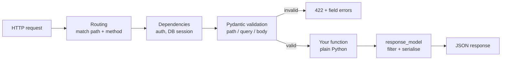

# Chapter 39 — Python Refresher: Core & FastAPI

> "Python interviews rarely test obscure syntax. They test whether you reach for the right built-in without thinking, and whether you know the six ways the language quietly lies to you."

---

## What You'll Learn

After this chapter you will be able to:
- Pick between `list`, `dict`, `set`, `tuple`, the `collections` types, `heapq` and `bisect` in seconds
- Write comprehensions, generators and decorators without looking them up
- Replace a 30-line class with a one-line `@dataclass`, and know when not to
- Recognise the traps that silently produce wrong answers — mutable defaults, aliasing, scope (LEGB), late-binding closures
- Explain the GIL and say which Python version is current
- Read and write modern type hints, and handle errors the way reviewers expect
- Build a small **FastAPI** service: routing, Pydantic validation, dependency injection, tests

**Markers:** ★★★ = know cold for interviews · ★★ = high priority · ★ = good to know.

**Quick check** boxes are retrieval practice — attempt before revealing.

**Interview** boxes give the question, what to say, and the follow-up trap.

> ▶ **Most code blocks here are live.** Press **Run** and they execute in your browser on **Python 3.11** (the in-browser Pyodide engine). Everything up to §39.8 runs for real: the outputs shown in `# comments` or in an **Output** block were captured from an actual run. A block whose first line says `# Python 3.12+` uses newer syntax, so run it locally. The §39.8 blocks need a server runtime, so they show a "copy this locally" note instead.

> **Companion chapters:** [Ch 38 — Java Refresher](#content/38_java_refresher) does the same job for Java, [Ch 31 — DSA Foundations](#content/31_dsa_foundations) (and 31b–31d) is the algorithm practice, and [Ch 40 — Python for ML & AI](#content/40_python_ml_ai) covers NumPy, pandas and scikit-learn. This chapter is the **fast brush-up**: enough to write clean Python in an interview and to talk credibly about a Python API service.

---

## 39.1 The 10-Minute Mental Model ★★

![Cheat card for Python's mental model: names are labels, not boxes - sticky notes a and b point at one list (1, 2, 3, 4) while c = a(:) is a separate copy (1, 2, 3, 4, 5), so b is a is True and c is a is False; a falsy vs truthy table (False, None, 0, 0.0, empty string, (), {}, set() are falsy; '0' and (0) are truthy); f-strings f"{3.14159:.2f}" gives 3.14, f"{1234567:,}" gives 1,234,567, f"{value=}" gives value=42; key numbers as of Nov 2026 (3.15 newest stable, 3.14 free-threaded build opt-in, this app runs 3.11); a GIL table (I/O-bound: threads or asyncio, CPU-bound pure Python: processes, heavy maths: NumPy / PyTorch release the GIL); write x is None, never x == None.](diagrams/py39_info_mental_model_ai.png)

<details>
<summary><strong>Read as text</strong> — what this section covers</summary>

**In this section**

- Names are labels, not boxes — the single idea that explains half of Python's surprises
- Truthiness, `None`, and the comparisons that actually matter
- f-strings, the only string formatting you need
- Which Python is current, and what the GIL means for your code

</details>

#### Simple Explanation

<details>
<summary><strong>Read as text</strong> — names as sticky labels, and the aliasing demo</summary>

In Python, a variable is a **sticky note**, not a box. `x = 5` does not put `5` inside `x`; it sticks the label `x` onto an object that already exists. Assignment moves labels around. It never copies anything.

That one sentence explains most of the confusion that follows. If two labels point at the same list and you change the list through one label, the other label sees the change — because there was only ever one list.

The second idea: **everything is an object.** Numbers, functions, classes, modules — all of them are objects you can pass around, store in a dict, and attach to a name. There is no primitive/object split like Java's `int` vs `Integer`.

> **Python** is dynamically typed (names have no declared type; objects do) and strongly typed (it will not silently add a string to an integer). In CPython, the standard interpreter, an object is freed when its reference count drops to zero, and a cyclic garbage collector cleans up objects that only point at each other.

```python
x = 5
print(type(x), isinstance(x, object))   # <class 'int'> True

a = [1, 2, 3]
b = a           # NOT a copy — b is a second label on the same list
b.append(4)
print(a)        # [1, 2, 3, 4]  <- a changed too

c = a[:]        # a real (shallow) copy
c.append(5)
print(a, c)     # [1, 2, 3, 4] [1, 2, 3, 4, 5]
print(b is a, c is a)   # True False  <- same object vs a different one
```

</details>

### Truthiness — what counts as false

<details>
<summary><strong>Read as text</strong> — the falsy list and the "0" / [0] trap</summary>

Python does not need `if len(x) > 0`. Empty things are falsy. Memorise this list and stop writing length checks:

| Falsy | Truthy |
|---|---|
| `False`, `None` | any non-empty container |
| `0`, `0.0`, `0j` | any non-zero number |
| `""`, `[]`, `()`, `{}`, `set()` | `"0"`, `"False"`, `[0]` — **non-empty is truthy** |

```python
print(bool([]), bool([0]))      # False True   <- [0] is non-empty
print(bool(""), bool("0"))      # False True   <- "0" is a 1-char string
print(bool(0.0), bool(None))    # False False
```

The trap in that table is `"0"` and `[0]`. Both look "zero-ish" and both are **truthy**, because truthiness asks *"is there anything here?"*, not *"is the content zero?"*

</details>

### The comparison rules

<details>
<summary><strong>Read as text</strong> — == vs is, and why you write x is None</summary>

- **`==` compares value, `is` compares identity** (same object in memory).
- Use `is` for singletons: `x is None` above all. `is True` / `is False` only when you must tell `True` apart from other truthy values; to test a flag, just write `if flag:`. Everything else is `==`.
- `None` is a singleton, so `x is None` is both correct and fast. `x == None` is wrong style and can be fooled: a class with a custom `__eq__` decides the answer itself, and a NumPy array compares element by element, so `arr == None` returns an array, not `True`/`False`.
- Why `is` sometimes *seems* to work on numbers (the small-int cache) is Trap 3 in §39.6.

</details>

### f-strings

<details>
<summary><strong>Read as text</strong> — format specs, {value=} and two version notes</summary>

One way to format strings. Use it everywhere.

```python
name, n = "Ada", 3
print(f"{name} x{n} = {name*n!r}")   # Ada x3 = 'AdaAdaAda'   (!r calls repr)
print(f"{3.14159:.2f}")              # 3.14
print(f"{255:#x}")                   # 0xff
print(f"{1234567:,}")                # 1,234,567
print(f"{'hi':>6}|{'hi':<6}|{'hi':^6}|")   #     hi|hi    |  hi  |
value = 42
print(f"{value=}")                   # value=42   (3.8+: name and value together)
```

The one you will use in debugging is the last: `f"{value=}"` prints the name and the value together, with no extra typing.

Two version notes. Python 3.12+ lets you reuse the same quote inside the braces (`f"{d["k"]}"`); on 3.11, this app's Python, that is a syntax error, so write `f"{d['k']}"`. Python 3.14 added **t-strings** (`t"..."`), which build a `Template` object instead of a `str` so a library can escape the values (for SQL or HTML) before joining them. You will not need them in a coding interview.

</details>

### Which Python? Versions and the GIL

<details>
<summary><strong>Read as text</strong> — the version table, the GIL and the interview answer</summary>

A new Python version ships every October. The snapshot below is **as of November 2026** ([python.org/downloads](https://www.python.org/downloads/)):

| Version | Status | Worth knowing |
|---|---|---|
| **3.15** | newest stable (3.15.0: 9 Oct 2026) | `lazy import` for faster start-up, built-in `frozendict`, UTF-8 as the default file encoding |
| **3.14** | stable, bug-fix releases | free-threaded build officially supported (still opt-in), t-strings, `heapq` max-heap functions |
| **3.13** | security fixes only | first *experimental* free-threaded build and JIT compiler |
| **3.12** | security fixes only | `def f[T](x: T)` generics, `type` aliases, f-strings can reuse quotes |
| **3.11** | security fixes until Oct 2027 | the version this app's ▶ Run uses (Pyodide) |

**The GIL (global interpreter lock)** is a lock inside standard CPython that lets only **one thread run Python bytecode at a time**. Picture a meeting with one microphone: many people (threads) can be in the room, but only the one holding the mic can speak. A thread that is waiting on the network or the disk puts the mic down, so threads still speed up **I/O-bound** work. For **CPU-bound** pure-Python work they do not; use processes (`multiprocessing`, `concurrent.futures.ProcessPoolExecutor`) or push the maths into NumPy or PyTorch, whose C code releases the GIL while it computes.

Since 3.13 there is a separate **free-threaded** build with no GIL (`python3.14t`, for example). Python 3.14 made it officially supported, but it is still a separate, opt-in build, and importing a C extension that is not marked as free-thread-safe can switch the GIL back on (Python prints a warning). The **JIT** compiler is still experimental in 3.15. The interpreter you normally install still has the GIL.

> **Interview —** *"What is the GIL, and does it hurt ML code?"*
>
> **Say:**
> - It is a lock in CPython that lets one thread execute Python bytecode at a time; it keeps reference counting simple and safe.
> - Threads still help I/O-bound work, because the lock is released while a thread waits. CPU-bound pure Python needs processes.
> - Heavy ML maths runs inside NumPy / PyTorch C and CUDA kernels that release the GIL, so it rarely limits training. It bites in pure-Python preprocessing loops and request handling.
> - Free-threaded CPython (officially supported since 3.14, still opt-in) removes it.
>
> **They follow up with:** *"Threads or `asyncio` for 1,000 concurrent API calls?"* — Both work for I/O. `asyncio` runs thousands of waiting tasks on one thread with less memory per task, which is why FastAPI is built on it (§39.8).

</details>

---

## 39.2 Data Structures That Cover 90% ★★★

![Comparison card for Python containers: four columns (list: ordered, O(1) index and append, in and pop(0) are O(n); dict / set: hash table, O(1) average lookup, dict keeps insertion order since 3.7; deque: O(1) appendleft / popleft for BFS; heapq: O(log n) push and pop, top-k with a size-k min-heap); maths line m lookups cost O(m·n) on a list vs O(n + m) on a set; a cost grid for in, append and pop front; the heap built by heapify on scores 42, 7, 93, 15, 68, 23, 88 with root 7 and top-3 93, 88, 68; bisect_left(xs, 68) = 4 on the sorted list and 3 scores in 20 to 70; a pick-by-question table (set, Counter, defaultdict(list), deque, heapq) and mix-ups such as s += piece in a loop being quadratic.](diagrams/py39_info_data_structures_ai.png)

<details>
<summary><strong>Read as text</strong> — what this section covers, and the maths line</summary>

**In this section**

- The four built-ins and when each one is the right answer
- Comprehensions — the idiom interviewers expect instead of `append` loops
- `Counter`, `defaultdict`, `deque` — three imports that delete a lot of code
- `heapq` and `bisect` — top-k and binary search without writing either

> **Maths in one line:** `m` membership tests cost `m × O(n) = O(m·n)` on a list but `O(n) + m × O(1) = O(n + m)` on a set — pick the container by the operation you repeat.

</details>

### Pick one in five seconds

<details>
<summary><strong>Read as text</strong> — the container chooser table</summary>

| I need to… | Use | Why |
|---|---|---|
| Keep an ordered, changeable sequence | `list` | $O(1)$ index and append |
| Look up a value by key | `dict` | $O(1)$ average, insertion-ordered since 3.7 |
| Ask "have I seen this?" / dedupe | `set` | $O(1)$ membership, no duplicates |
| Return several values / use as a dict key | `tuple` | immutable, hashable |
| Count occurrences | `collections.Counter` | one line instead of a loop |
| Group into buckets | `collections.defaultdict(list)` | no "if key missing" check |
| Push/pop at **both** ends | `collections.deque` | $O(1)$ both ends; `list.pop(0)` is $O(n)$ |
| Repeatedly take the smallest / keep the top-k | `heapq` | $O(\log n)$ push and pop |
| Search or insert into a sorted list | `bisect` | $O(\log n)$ search |
| Fixed field names, light object | `@dataclass` (§39.4) | free `__init__`, `__repr__`, `__eq__` |

</details>

### `list` — the workhorse

<details>
<summary><strong>Read as text</strong> — list methods, costs and slicing</summary>

```python
xs = [3, 1, 4, 1, 5]
xs.append(9)            # [3, 1, 4, 1, 5, 9]      O(1)
xs.insert(0, 0)         # [0, 3, 1, 4, 1, 5, 9]   O(n) — shifts everything
xs.pop()                # 9   removes from the end,   O(1)
xs.pop(0)               # 0   removes from the front, O(n)
xs.remove(1)            # deletes the FIRST 1, by value
print(sorted(xs, reverse=True))   # [5, 4, 3, 1]   returns a new list
xs.sort()                         # sorts in place, returns None
```

**Slicing** is the thing to have in muscle memory. `xs[start:stop:step]`, with `stop` exclusive:

```python
xs = [0, 1, 2, 3, 4, 5]
print(xs[1:3])     # [1, 2]        <- stop is exclusive
print(xs[:3])      # [0, 1, 2]
print(xs[-2:])     # [4, 5]        <- last two
print(xs[::2])     # [0, 2, 4]     <- every other
print(xs[::-1])    # [5, 4, 3, 2, 1, 0]   <- reversed, and a full copy
```

`xs[::-1]` is the idiomatic reverse: it returns a new, reversed copy (`reversed(xs)` gives a lazy iterator instead). Slicing works on strings too, so a palindrome check is just `s == s[::-1]`.

</details>

### `dict` — and the three methods that delete `if` statements

<details>
<summary><strong>Read as text</strong> — get, setdefault, merging and the key rules</summary>

```python
d = {"a": 1}
print(d.get("zz"))          # None    <- no KeyError
print(d.get("zz", 0))       # 0       <- supply a default
d.setdefault("b", 2)        # inserts b=2 if missing, returns the value
print(d)                    # {'a': 1, 'b': 2}

merged = {**d, "c": 3}      # merge (3.5+);  d | {"c": 3} also works (3.9+)
print(merged)               # {'a': 1, 'b': 2, 'c': 3}
print(d | {"a": 9})         # {'a': 9, 'b': 2}   <- on a clash, the right side wins

for k, v in d.items():      # key and value together — no d[k] lookup
    pass
```

- **`d[k]` raises `KeyError`; `d.get(k)` returns `None`.** Use `get` when absence is normal, `d[k]` when absence is a bug.
- **Dicts preserve insertion order** (guaranteed since 3.7). You can rely on it.
- **Keys must be hashable** — so `str`, `int`, `tuple` are fine; `list` and `dict` are not.

</details>

### `set` — membership and set algebra

<details>
<summary><strong>Read as text</strong> — set algebra and the unstable-order warning</summary>

```python
s = {1, 2, 3}
print(s & {2, 3, 4})   # {2, 3}       intersection
print(s | {9})         # {1, 2, 3, 9} union
print(s - {1})         # {2, 3}       difference
print(s ^ {3, 7})      # {1, 2, 7}    symmetric difference
print(3 in s)          # True         O(1), vs O(n) for a list
print(sorted(set("banana")))   # ['a', 'b', 'n']  <- sort before printing!
```

> ⚠️ **Never print a raw set of strings and expect a stable order.** Python randomises string hashes per process, so `print({c for c in "banana"})` genuinely prints a different order on different runs. Wrap it in `sorted()` whenever the order is visible.

</details>

### `tuple` — immutable, and therefore hashable

<details>
<summary><strong>Read as text</strong> — unpacking, the swap and hashability</summary>

```python
point = (51.5, -0.1)
lat, lon = point           # unpacking
print(lat, lon)            # 51.5 -0.1

seen = {(0, 0), (1, 2)}    # tuples CAN be set members / dict keys
a, b = 1, 2
a, b = b, a                # the swap — no temp variable
print(a, b)                # 2 1

first, *rest = [1, 2, 3, 4]
print(first, rest)         # 1 [2, 3, 4]
```

A tuple is hashable only if everything inside it is: `(1, 2)` can be a dict key, `(1, [2])` cannot. When you need a hashable *set*, use `frozenset`.

</details>

### Comprehensions

<details>
<summary><strong>Read as text</strong> — the syntax and the rules of thumb</summary>

The single most Python-looking thing you can write. `[expr for item in iterable if condition]`.

```python
print([n*n for n in range(6) if n % 2 == 0])   # [0, 4, 16]
print({w: len(w) for w in ["hi", "there"]})    # {'hi': 2, 'there': 5}
print(sorted({c for c in "banana"}))           # ['a', 'b', 'n']
```

Rules of thumb:

- **One loop plus one optional `if`** — readable. Two nested loops plus a condition — write the loop out.
- A comprehension **builds the whole result in memory**. For a big or infinite source, swap `[...]` for `(...)` and get a generator (§39.5).
- Never write a comprehension purely for its side effects. `[print(x) for x in xs]` builds a list of `None`s; just use a `for` loop.

</details>

### The three `collections` imports worth memorising

<details>
<summary><strong>Read as text</strong> — Counter, defaultdict and deque</summary>

```python
from collections import Counter, defaultdict, deque

print(Counter("banana"))                  # Counter({'a': 3, 'n': 2, 'b': 1})
print(Counter("banana").most_common(2))   # [('a', 3), ('n', 2)]

graph = defaultdict(list)
graph[1].append(2)          # no "if 1 not in graph" needed
graph[1].append(3)
print(dict(graph))          # {1: [2, 3]}

dq = deque([1, 2, 3])
dq.appendleft(0)            # deque([0, 1, 2, 3])   O(1) — a list would be O(n)
print(dq.popleft())         # 0
print(dq.pop())             # 3
```

- **`Counter`** — frequency counting, plus `most_common(k)` for top-k.
- **`defaultdict(list)`** — adjacency lists and grouping; the factory is called on first access.
- **`deque`** — BFS queues and sliding windows. `list.pop(0)` shifts every element; `deque.popleft()` does not. `deque(maxlen=k)` keeps only the last `k` items.

</details>

### `heapq` and `bisect` — top-k and binary search

#### Simple Explanation

<details>
<summary><strong>Read as text</strong> — the to-do pile and binary search</summary>

A **heap** is a to-do pile that always keeps the most urgent card on top. You can add a card or take the top one quickly, in $O(\log n)$, but the rest of the pile is only *partly* sorted. Python's `heapq` keeps that pile inside an ordinary `list`, and `heap[0]` is always the **smallest** item.

**`bisect`** is binary search on a list you keep sorted: "where would 68 go?" takes $O(\log n)$ comparisons instead of a scan.

</details>

```python
# heapq = "always hand me the smallest"; bisect = binary search on a sorted list
import heapq
from bisect import bisect_left, bisect_right, insort

scores = [42, 7, 93, 15, 68, 23, 88]

heap = scores[:]                     # copy, then heapify in place: O(n)
heapq.heapify(heap)
print("peek smallest:", heap[0])     # O(1)
print("pop 3 smallest:", [heapq.heappop(heap) for _ in range(3)])   # O(log n) each

top = []                             # top-k: keep a min-heap of size k
for s in scores:
    heapq.heappush(top, s)
    if len(top) > 3:
        heapq.heappop(top)           # evict the smallest of the k + 1
print("top-3 by hand:", sorted(top, reverse=True))
print("top-3 builtin:", heapq.nlargest(3, scores))

maxheap = [-s for s in scores]       # max-heap on Python 3.11: store negatives
heapq.heapify(maxheap)
print("largest:", -heapq.heappop(maxheap))

tasks = [(2, "write"), (1, "plan"), (3, "ship")]   # (priority, item) pairs
heapq.heapify(tasks)
print("first task:", heapq.heappop(tasks)[1])

xs = sorted(scores)
print("sorted:", xs)
print("index of 68:", bisect_left(xs, 68))
print("scores in [20, 70]:", bisect_right(xs, 70) - bisect_left(xs, 20))
insort(xs, 50)                       # O(log n) search, then an O(n) insert
print("after insort(50):", xs)

assert sorted(top, reverse=True) == heapq.nlargest(3, scores) == [93, 88, 68]
assert xs == sorted(scores + [50])
```

**Output:**

```
peek smallest: 7
pop 3 smallest: [7, 15, 23]
top-3 by hand: [93, 88, 68]
top-3 builtin: [93, 88, 68]
largest: 93
first task: plan
sorted: [7, 15, 23, 42, 68, 88, 93]
index of 68: 4
scores in [20, 70]: 3
after insort(50): [7, 15, 23, 42, 50, 68, 88, 93]
```

<details>
<summary><strong>Read as text</strong> — continued: the cost table, max-heaps and the tie trap</summary>

| Call | Cost | Use it for |
|---|---|---|
| `heapify(xs)` | $O(n)$ | turn an existing list into a heap |
| `heappush` / `heappop` | $O(\log n)$ | priority queue, Dijkstra, merge k sorted lists |
| `nlargest(k, xs)` / `nsmallest` | $O(n \log k)$ | top-k in one line |
| `bisect_left` / `bisect_right` | $O(\log n)$ | position, count in a range, "first value ≥ x" |
| `insort(xs, x)` | $O(n)$ | keep a list sorted; the insert shifts elements |

- **Before Python 3.14, `heapq` is min-heap only.** For a max-heap, push negated numbers (as above). Python 3.14 added `heapify_max`, `heappush_max` and `heappop_max`, but your interview environment may run an older Python (this app runs 3.11), so know the negation trick.
- **Top-k largest = a min-heap of size k.** Each new item evicts the current smallest, so you hold only `k` items: $O(n \log k)$ time, $O(k)$ memory.
- **The tie trap:** tuples compare item by item, so two tasks with equal priority compare their second items, and if those are dicts or objects, Python raises `TypeError`. Push `(priority, counter, item)` with a running counter to break ties.
- `bisect_left` returns the first position where `x` could go (before equal values); `bisect_right` returns the position after them. Both accept `key=` since 3.10.

</details>

### Complexity table — commit this to memory

<details>
<summary><strong>Read as text</strong> — the cost grid and the string-building trap</summary>

| Operation | `list` | `dict` / `set` | `deque` |
|---|---|---|---|
| Index / key lookup | $O(1)$ | $O(1)$ avg | $O(1)$ at the ends, $O(n)$ in the middle |
| `in` (membership) | $O(n)$ | **$O(1)$ avg** | $O(n)$ |
| Append / pop at the end | $O(1)$ amortised | $O(1)$ avg (add / delete) | $O(1)$ |
| Insert / delete at front | $O(n)$ | — | **$O(1)$** |
| Insert / delete in middle | $O(n)$ | — | $O(n)$ |
| Sort | $O(n \log n)$ | — | — |

- "avg" matters: if many keys collide in the hash table, a dict or set lookup degrades to $O(n)$. With ordinary keys (`int`, `str`, `tuple`) this is rare.
- **Strings are immutable.** `s += piece` inside a loop builds a new string each time, so the loop is quadratic in the total length. Collect the pieces in a list and call `"".join(parts)` once.

</details>

### Interview patterns — the containers in action

Most "easy/medium" coding questions are one of these containers used in a single pass. Each function below is the standard answer to a classic problem:

```python
# The containers in action: three classic interview problems, one pass each
from collections import Counter, defaultdict, deque

def two_sum(nums, target):                 # dict: value -> index seen so far
    seen = {}
    for i, x in enumerate(nums):
        if target - x in seen:             # O(1) lookup replaces an inner loop
            return seen[target - x], i
        seen[x] = i
    return None

def group_anagrams(words):                 # defaultdict: signature -> words
    groups = defaultdict(list)
    for w in words:
        groups["".join(sorted(w))].append(w)
    return list(groups.values())

def bfs_steps(grid, start, goal):          # deque: breadth-first search
    dist, q = {start: 0}, deque([start])
    while q:
        r, c = q.popleft()                 # O(1); list.pop(0) would be O(n)
        if (r, c) == goal:
            return dist[(r, c)]
        for nr, nc in ((r + 1, c), (r - 1, c), (r, c + 1), (r, c - 1)):
            if (0 <= nr < len(grid) and 0 <= nc < len(grid[0])
                    and grid[nr][nc] == "." and (nr, nc) not in dist):
                dist[(nr, nc)] = dist[(r, c)] + 1
                q.append((nr, nc))
    return -1

print("two_sum:", two_sum([2, 7, 11, 15], 9))
print("anagrams:", group_anagrams(["eat", "tea", "tan", "ate", "nat", "bat"]))
words = "the cat and the hat and the bat".split()
print("top-2 words:", Counter(words).most_common(2))
grid = ["..#",
        ".##",
        "..."]
print("BFS steps:", bfs_steps(grid, (0, 0), (2, 2)))

assert two_sum([3, 3], 6) == (0, 1)
assert Counter("listen") == Counter("silent")    # anagram check in one line
```

**Output:**

```
two_sum: (0, 1)
anagrams: [['eat', 'tea', 'ate'], ['tan', 'nat'], ['bat']]
top-2 words: [('the', 3), ('and', 2)]
BFS steps: 4
```

<details>
<summary><strong>Read as text</strong> — which container fits which problem shape, and the BFS route</summary>

| Problem shape | Container | Cost |
|---|---|---|
| "Have I seen the complement / a duplicate?" | `dict` or `set` | $O(n)$ instead of $O(n^2)$ |
| "Group items that share a signature" | `defaultdict(list)` | $O(n \cdot k \log k)$ for words of length $k$ |
| "How often…? / top-k frequent" | `Counter` + `most_common(k)` | $O(n)$ to count, then $O(m \log k)$ for $m$ distinct items |
| "Fewest steps in a grid or unweighted graph" | `deque` (BFS) | $O(V + E)$ |
| "k largest / smallest, a running median" | `heapq` | $O(n \log k)$ |

The BFS answer is 4 because the walls force the shortest route down the left column and along the bottom row: (0,0) → (1,0) → (2,0) → (2,1) → (2,2). Ch 31–31d practise these patterns in Java ([Ch 31b — Graphs](#content/31b_dsa_graphs) for BFS).

</details>

<details>
<summary><strong>Quick check.</strong> You have 10 million user IDs and must answer "is this ID present?" millions of times. Why is a <code>list</code> the wrong container?</summary>

`x in some_list` is a linear scan — $O(n)$ per query, so millions of queries is $O(nm)$ and hopeless. A `set` hashes the value and checks one bucket, $O(1)$ average, and `set(my_list)` converts once in $O(n)$. The same reasoning is why "two-sum"-style problems use a dict: you trade $O(n)$ memory for turning an $O(n^2)$ nested loop into one $O(n)$ pass.

</details>

---

## 39.3 Functions, Scope & the Traps ★★★

![Cheat card for Python function traps: the mutable default bad(item, bucket=()) keeps one list in __defaults__, so bad(1), bad(2), bad(3) return (1), (1, 2), (1, 2, 3) and the fix is bucket=None; LEGB lookup drawn as nested rings Local, Enclosing, Global, Built-in searched from the inside out, with count += 1 raising UnboundLocalError; a @retry(times=3) decorator as three nested functions retry(times), decorator(fn), wrapper(*args) with attempts 1 and 2 timing out and attempt 3 returning 200 OK; maths line naive fib(n) makes 2·F(n+1) − 1 calls, 242,785 for n = 25, vs 26 lru_cache misses; late-binding lambdas give (2, 2, 2) while lambda i=i gives (0, 1, 2); xs = xs.sort() leaves None.](diagrams/py39_info_functions_traps_ai.png)

<details>
<summary><strong>Read as text</strong> — what this section covers</summary>

**In this section**

- `*args` / `**kwargs` and how to read any signature you meet
- The **mutable default argument** — Python's most famous silent bug
- Scope (LEGB), `global` / `nonlocal`, and the late-binding closure trap
- Sorting with `key`, and decorators, explained by building them

</details>

### Arguments

<details>
<summary><strong>Read as text</strong> — positional, keyword-only, / and *, and call-site unpacking</summary>

```python
def greet(name, greeting="Hello", *args, punct="!", **kwargs):
    return f"{greeting}, {name}{punct} extra={args} kw={kwargs}"

print(greet("Ada"))
# Hello, Ada! extra=() kw={}

print(greet("Ada", "Hi", 1, 2, punct="?", lang="en"))
# Hi, Ada? extra=(1, 2) kw={'lang': 'en'}
```

Reading the signature left to right:

| Part | Means |
|---|---|
| `name` | required, positional or keyword |
| `greeting="Hello"` | optional, with a default |
| `*args` | any further **positional** args, collected into a tuple |
| `punct="!"` | **keyword-only** — it comes after `*args`, so you must name it |
| `**kwargs` | any further **keyword** args, collected into a dict |

Two more markers appear in library signatures such as `sorted(iterable, /, *, key=None, reverse=False)`:

| Marker | Means |
|---|---|
| `/` (3.8+) | every parameter **before** it is positional-only — you cannot pass it by name |
| bare `*` | every parameter **after** it is keyword-only, without collecting extra positionals |

The same two stars work at the *call* site, to unpack:

```python
def add(a, b): return a + b
nums = [3, 4]
print(add(*nums))              # 7   — unpack a list into positions
opts = {"a": 1, "b": 2}
print(add(**opts))             # 3   — unpack a dict into keywords
```

</details>

### Trap — the mutable default argument

<details>
<summary><strong>Read as text</strong> — why the default is built only once</summary>

This is the one that gets asked. Default values are evaluated **once, when the function is defined** — not on each call. They are stored on the function object (in `__defaults__`), so a mutable default is shared by every call forever.

</details>

```python
# The mutable-default trap: the default list lives ON the function object
def bad(item, bucket=[]):          # the [] is built ONCE, when `def` runs
    bucket.append(item)
    return bucket

print(bad(1))
print(bad(2))                      # the previous call's data is still there
print(bad(3))
print("bad's stored default:", bad.__defaults__)

def good(item, bucket=None):       # the standard fix: None means "not given"
    if bucket is None:
        bucket = []                # a NEW list on every call
    bucket.append(item)
    return bucket

print(good(1), good(2))
print("good's stored default:", good.__defaults__)

assert bad(4) == [1, 2, 3, 4] and good(4) == [4]
```

**Output:**

```
[1]
[1, 2]
[1, 2, 3]
bad's stored default: ([1, 2, 3],)
[1] [2]
good's stored default: (None,)
```

<details>
<summary><strong>Read as text</strong> — continued: the rule for safe defaults</summary>

**Rule:** a default value may be `None`, a number, a string, or a tuple — anything immutable. Never a `list`, `dict`, `set`, or any other object that can be changed in place. If `None` is itself a valid argument, use a private marker object instead: `_MISSING = object()` and `if bucket is _MISSING:` (Python 3.15 adds a built-in `sentinel` type for exactly this).

</details>

### Scope — LEGB, `global` and `nonlocal`

#### Simple Explanation

<details>
<summary><strong>Read as text</strong> — the four scopes and UnboundLocalError</summary>

When Python meets a name, it looks in four places, in order, and stops at the first hit:

```text
L  Local      — names assigned inside the current function
E  Enclosing  — names in any outer function (for nested functions)
G  Global     — names at the top level of the module
B  Built-in   — len, print, sum, max, ...
```

The rule that surprises people: **one assignment anywhere in a function makes that name local for the whole function**, even on the lines *before* the assignment. Reading it before it is assigned raises `UnboundLocalError`, even if a global with the same name exists. `global x` and `nonlocal x` say "I mean the outer one; rebind that instead".

</details>

```python
# LEGB: how Python finds a name, and the keywords that change the rule
count = 0                          # G: module-level (global) name

def read_only():
    return count + 1               # no assignment here -> L misses, G finds it

def broken():
    count += 1                     # an assignment makes `count` LOCAL everywhere in this function
    return count

def make_counter():
    n = 0                          # E: enclosing scope of inc()
    def inc():
        nonlocal n                 # rebind the enclosing n instead of making a new local
        n += 1
        return n
    return inc

print("read_only:", read_only())
try:
    broken()
except UnboundLocalError as e:
    print("broken:", type(e).__name__)

tick = make_counter()
print("counter:", tick(), tick(), tick())

len = lambda xs: 42                # shadow the B (built-in) len with a global
print("shadowed len:", len([1, 2]))
del len                            # delete the global; lookup falls through to B again
print("built-in len:", len([1, 2]))

assert count == 0 and tick() == 4
```

**Output:**

```
read_only: 1
broken: UnboundLocalError
counter: 1 2 3
shadowed len: 42
built-in len: 2
```

<details>
<summary><strong>Read as text</strong> — continued: nonlocal, global and shadowed built-ins</summary>

- **`nonlocal`** is how a closure keeps private, changing state (the counter above). **`global`** works too, but shared module state is harder to test — prefer returning a value.
- **Shadowing a built-in** is the everyday version of this bug: name a variable `list`, `dict`, `sum`, `max`, `id` or `input`, and the built-in is unreachable for the rest of that scope.
- Mutating is not assigning: `items.append(x)` inside a function changes a global list without any keyword, because the name `items` is only read, never rebound.

</details>

### Trap — late-binding closures

<details>
<summary><strong>Read as text</strong> — why loop lambdas all see the last value, and the two fixes</summary>

A closure captures the **variable**, not its value at the time. The lambda looks `i` up in its enclosing scope (the E in LEGB) when it is *called*, and by then the loop has finished. So a lambda made inside a loop sees the loop variable's *final* value.

```python
fs = [lambda: i for i in range(3)]
print([f() for f in fs])          # [2, 2, 2]   <- all see the final i

fs2 = [lambda i=i: i for i in range(3)]   # bind now, via a default arg
print([f() for f in fs2])         # [0, 1, 2]

from functools import partial
fs3 = [partial(lambda i: i, i) for i in range(3)]   # bind now, via partial
print([f() for f in fs3])         # [0, 1, 2]
```

This bites when building callbacks, event handlers, or a list of partially-applied functions in a loop. The two fixes are the default-argument trick (a default is evaluated at definition time, the same rule as the mutable-default trap) and `functools.partial`.

</details>

### Sorting with `key`

<details>
<summary><strong>Read as text</strong> — key functions, tie-breaks and stability</summary>

Python sorts by `key`, not by a Java-style `Comparator`: `key` is a function that maps each element to the thing you want to sort by. This is almost always what interviewers are looking for.

```python
people = [("Bea", 36), ("Linus", 54), ("Guido", 68), ("Ada", 36)]

print(sorted(people, key=lambda p: p[1]))
# [('Bea', 36), ('Ada', 36), ('Linus', 54), ('Guido', 68)]   <- ties keep input order

print(sorted(people, key=lambda p: (p[1], p[0])))   # two keys — a tuple
# [('Ada', 36), ('Bea', 36), ('Linus', 54), ('Guido', 68)]   <- name breaks the tie

print(sorted(people, key=lambda p: (-p[1], p[0])))  # age descending, then name
# [('Guido', 68), ('Linus', 54), ('Ada', 36), ('Bea', 36)]

print(max(people, key=lambda p: p[1]))              # ('Guido', 68)
```

- **`sorted()` returns a new list; `.sort()` mutates and returns `None`.** Writing `xs = xs.sort()` sets `xs` to `None` — a common slip.
- **Sort by several keys with a tuple**: `key=lambda p: (p[1], p[0])`. Tuples compare item by item, so the second item only matters on a tie.
- **Descending:** `reverse=True`, or negate a numeric key. Negation is how you mix directions — age descending but name ascending, as in the third call.
- **The sort is stable**: items with equal keys keep their input order (Bea stays before Ada in the first call). `reverse=True` keeps that stability too.
- **When the order depends on comparing two items together** (the "largest number" puzzle: put `a` before `b` if `a + b > b + a` as strings), write a two-argument function that returns a negative number, zero or a positive number, and wrap it: `sorted(xs, key=functools.cmp_to_key(cmp))`.

</details>

### Decorators

#### Simple Explanation

<details>
<summary><strong>Read as text</strong> — gift-wrapping, @timed and decorators that take an argument</summary>

A decorator is a function that takes a function and returns a replacement wrapped in extra behaviour. `@timed` above a definition is just shorthand for `slow_sum = timed(slow_sum)`.

Think of it as gift-wrapping. The present is unchanged; you have added a layer that gets touched first on the way in and last on the way out. That is why decorators are the natural home for timing, logging, caching, retries and auth checks — anything that surrounds a call rather than belonging to it.

> A **decorator** is any callable that accepts a function and returns a function. `functools.wraps` copies the original's name and docstring onto the wrapper so introspection and debuggers still work.

```python
import functools, time

def timed(fn):
    @functools.wraps(fn)                 # keep __name__ and __doc__
    def wrapper(*args, **kwargs):
        t0 = time.perf_counter()
        out = fn(*args, **kwargs)
        print(f"{fn.__name__} took {(time.perf_counter()-t0)*1000:.1f} ms")
        return out
    return wrapper

@timed
def slow_sum(n):
    """Adds 0..n-1."""
    return sum(range(n))

print(slow_sum(1_000_000))       # e.g. "slow_sum took 20.3 ms" (varies), then 499999500000
print(slow_sum.__name__)         # slow_sum   <- without @wraps this says 'wrapper'
print(slow_sum.__doc__)          # Adds 0..n-1.
```

**A decorator that takes an argument** needs one more layer. `@retry(times=3)` first *calls* `retry(times=3)`, which returns the real decorator; that decorator then wraps the function. So `@retry(times=3)` above `fetch` means `fetch = retry(times=3)(fetch)` — three nested functions instead of two:

</details>

```python
# A decorator WITH an argument: @retry(times=3) needs three nested functions
import functools

def retry(times):                          # 1) takes the argument, returns a decorator
    def decorator(fn):                     # 2) takes the function, returns the wrapper
        @functools.wraps(fn)
        def wrapper(*args, **kwargs):      # 3) runs on every call
            for attempt in range(1, times + 1):
                try:
                    return fn(*args, **kwargs)
                except ConnectionError as e:
                    print(f"  attempt {attempt} failed: {e}")
            raise RuntimeError(f"{fn.__name__} failed {times} times")
        return wrapper
    return decorator

outcomes = iter([False, False, True])      # scripted network: fail, fail, succeed

@retry(times=3)                            # means: fetch = retry(times=3)(fetch)
def fetch():
    if not next(outcomes):
        raise ConnectionError("timeout")
    return "200 OK"

print("fetch ->", fetch())

@retry(times=2)
def always_down():
    raise ConnectionError("refused")

try:
    always_down()
except RuntimeError as e:
    print("gave up:", e)

assert fetch.__name__ == "fetch"           # @functools.wraps kept the name
```

**Output:**

```
  attempt 1 failed: timeout
  attempt 2 failed: timeout
fetch -> 200 OK
  attempt 1 failed: refused
  attempt 2 failed: refused
gave up: always_down failed 2 times
```

<details>
<summary><strong>Read as text</strong> — continued: the output order and the lru_cache maths</summary>

The two "attempt" lines print before `fetch -> 200 OK` because Python evaluates `fetch()` before `print` can show its result. A production retry would also wait between attempts, with exponential backoff plus random jitter, and retry only errors that can succeed on a second try (timeouts, not "404 Not Found").

The one decorator you get for free and should name in an interview is `functools.lru_cache`. It remembers each argument's result, so a naive exponential recursion becomes linear:

> **Maths in one line:** naive `fib(n)` makes `2·F(n+1) − 1` calls, where `F(k)` is the k-th Fibonacci number (242,785 calls for `n = 25`); with `@lru_cache` each `n` is computed once, so `fib(n)` costs `n + 1` cache misses.

</details>

```python
# Memoisation: count the calls with and without @lru_cache
import functools

calls = 0
def fib_naive(n):
    global calls                   # rebind the module-level counter
    calls += 1
    return n if n < 2 else fib_naive(n - 1) + fib_naive(n - 2)

@functools.lru_cache(maxsize=None)  # same as @functools.cache (3.9+)
def fib(n):
    return n if n < 2 else fib(n - 1) + fib(n - 2)

print(f"naive  fib(25) = {fib_naive(25):,}  calls = {calls:,}")
print(f"cached fib(25) = {fib(25):,}  {fib.cache_info()}")
print(f"cached fib(50) = {fib(50):,}  {fib.cache_info()}")

assert calls == 242_785 and fib(25) == 75_025
```

**Output:**

```
naive  fib(25) = 75,025  calls = 242,785
cached fib(25) = 75,025  CacheInfo(hits=23, misses=26, maxsize=None, currsize=26)
cached fib(50) = 12,586,269,025  CacheInfo(hits=49, misses=51, maxsize=None, currsize=51)
```

<details>
<summary><strong>Read as text</strong> — continued: cache misses, hashable arguments, recursion depth and the interview answer</summary>

- **26 misses for `fib(25)`** — one per value 0…25. Computing `fib(50)` afterwards adds only the 25 new values (51 misses in total) and reuses the rest.
- **Arguments must be hashable**, which is why it works on `int` but not on a `list` (pass a tuple instead).
- **Recursion depth:** CPython stops at about 1,000 nested calls by default (`sys.getrecursionlimit()`), so a memoised `fib(5000)` written recursively raises `RecursionError`. For deep inputs, write the loop bottom-up instead.

> **Interview —** *"What is a decorator and when have you used one?"*
>
> **Say:**
> - A callable that takes a function and returns a wrapped replacement — `@d` is sugar for `f = d(f)`.
> - It is the right tool for **cross-cutting concerns**: timing, logging, retries, caching, auth checks. Anything that surrounds a call rather than being part of its logic.
> - Always apply `functools.wraps` in the wrapper, or the decorated function loses its name and docstring and stack traces get confusing.
>
> **They follow up with:** *"How would you write one that takes an argument, like `@retry(times=3)`?"* — You need one more layer: `retry(times)` returns the actual decorator, which then returns the wrapper. Three nested functions instead of two, exactly as in the `retry` program above.

</details>

---

## 39.4 Classes, Dunders & Dataclasses ★★

![Cheat card for Python classes and dataclasses: a plain class PointOld prints an object address and PointOld(1, 2) == PointOld(1, 2) is False; after @dataclass(frozen=True, slots=True) class Point prints Point(x=3, y=4), compares equal, dist() gives 5.0 and a set of two equal points keeps 1; maths line a == b implies hash(a) == hash(b); a hashable table (plain @dataclass has __hash__ = None, frozen=True is hashable, frozen with a list field raises unhashable type: 'list', frozen with a tuple field is hashable); method badges self, cls (Temp.from_fahrenheit(212) gives Temp(celsius=100.0)) and static (Temp.is_physical(-300) gives False); Circle(2).area is 12.566; items: list = () in a dataclass raises ValueError.](diagrams/py39_info_classes_dataclasses_ai.png)

<details>
<summary><strong>Read as text</strong> — what this section covers</summary>

**In this section**

- The dunder methods that actually matter, and what each one powers
- `@dataclass` — the 30-line class in one line, and the `__eq__` / `__hash__` rule behind `frozen=True`
- `@property`, `@classmethod` and `@staticmethod` — which one to reach for
- When a class is the wrong answer

</details>

### The plain class, and why it disappoints

<details>
<summary><strong>Read as text</strong> — the plain class and the boilerplate it would need</summary>

```python
class PointOld:
    def __init__(self, x, y):
        self.x, self.y = x, y

p = PointOld(1, 2)
print(p)                        # <__main__.PointOld object at 0x...>  useless
print(p == PointOld(1, 2))      # False  <- identity comparison, not value
```

Out of the box you get an unreadable `repr` and identity-based equality. Fixing that by hand means writing `__repr__`, `__eq__` and `__hash__` — about thirty lines of boilerplate you will get subtly wrong.

</details>

### `@dataclass` — the fix

<details>
<summary><strong>Read as text</strong> — what <code>@dataclass</code> writes, <code>frozen</code> and <code>slots</code>, and the <code>__eq__</code> / <code>__hash__</code> rule</summary>

```python
from dataclasses import dataclass

@dataclass(frozen=True, slots=True)
class Point:
    x: int
    y: int
    def dist(self) -> float:
        return (self.x**2 + self.y**2) ** 0.5

q = Point(3, 4)
print(q)                       # Point(x=3, y=4)     <- real repr, free
print(q == Point(3, 4))        # True                <- value equality, free
print(q.dist())                # 5.0
print({Point(3,4), Point(3,4)})  # {Point(x=3, y=4)} <- hashable, dedupes
```

Two arguments worth always considering:

- **`frozen=True`** makes instances immutable, and because they can no longer change, `@dataclass` also writes a `__hash__` for them — so they can be dict keys and set members. Assigning to a field raises `FrozenInstanceError`.
- **`slots=True`** (3.10+) drops the per-instance `__dict__`: less memory, slightly faster attribute access, and on a non-frozen class a typo such as `p.z = 1` raises `AttributeError` instead of silently creating a new attribute.

**The `__eq__` / `__hash__` rule.** Dicts and sets find a key by its hash first, then confirm with `==`. That only works if equal objects always hash the same.

> **Maths in one line:** `a == b  ⇒  hash(a) == hash(b)` — equal objects must land in the same hash bucket, and the hash must never change while the object sits in a dict or set.

So a plain `@dataclass` (it writes `__eq__`, the object is still mutable) sets `__hash__ = None` — the instances are deliberately **unhashable**. `frozen=True` makes them hashable, but only as deep as the fields: a frozen dataclass holding a `list` still fails, because the list inside can change.

</details>

```python
# The __eq__/__hash__ rule: which dataclasses can be a dict key or set member
from dataclasses import dataclass, field

@dataclass
class Mutable:
    x: int

@dataclass(frozen=True)
class Frozen:
    x: int

@dataclass(frozen=True)
class FrozenWithList:
    tags: list = field(default_factory=list)

for obj in [Mutable(1), Frozen(1), FrozenWithList(["a"])]:
    try:
        hash(obj)
        print(f"{type(obj).__name__:<15} hashable")
    except TypeError as e:
        print(f"{type(obj).__name__:<15} TypeError: {e}")

print("Mutable.__hash__ is None:", Mutable.__hash__ is None)
print("set size:", len({Frozen(1), Frozen(1), Frozen(2)}))   # equal objects dedupe
assert hash(Frozen(1)) == hash(Frozen(1))
```

**Output:**

```
Mutable         TypeError: unhashable type: 'Mutable'
Frozen          hashable
FrozenWithList  TypeError: unhashable type: 'list'
Mutable.__hash__ is None: True
set size: 2
```

<details>
<summary><strong>Read as text</strong> — continued: tuple fields and <code>default_factory</code></summary>

Use a `tuple` instead of a `list` field when a frozen dataclass must be hashable.

> ⚠️ **The dataclass version of the mutable-default trap** (§39.3). A bare `items: list = []` is rejected outright by `@dataclass` with a `ValueError`. Use `field(default_factory=list)` — it calls the factory once **per instance**.

```python
from dataclasses import dataclass, field

@dataclass
class Cart:
    items: list[str] = field(default_factory=list)

c1, c2 = Cart(), Cart()
c1.items.append("apple")
print(c1, c2)     # Cart(items=['apple']) Cart(items=[])   <- independent
```

</details>

### The dunders worth knowing

<details>
<summary><strong>Read as text</strong> — the dunder table: what each one powers</summary>

| Dunder | Powers | Note |
|---|---|---|
| `__init__` | construction | not a constructor — `__new__` already created the object; `__init__` fills it in |
| `__repr__` | `repr(x)`, the REPL, debuggers | aim for unambiguous; define this one first |
| `__str__` | `str(x)`, `print(x)` | falls back to `__repr__` if missing |
| `__eq__` | `==` | defining it without `__hash__` makes the object unhashable (see the rule above) |
| `__hash__` | dict keys, set members | must agree with `__eq__`; must not change |
| `__lt__` | `<`, `sorted()`, `min()`, `heapq` | sorting only needs `<`; `@dataclass(order=True)` writes it for you |
| `__len__` | `len(x)`, truthiness | an object with `__len__` of 0 is falsy (unless it defines `__bool__`) |
| `__getitem__` / `__contains__` | `obj[i]`, `x in obj` | `in` falls back to iterating if `__contains__` is missing |
| `__iter__` | `for x in obj` | see §39.5 |
| `__enter__` / `__exit__` | `with obj:` | guarantees cleanup (§39.7) |
| `__call__` | `obj()` | makes an instance behave like a function |

</details>

### `@property` — a method that reads like an attribute

<details>
<summary><strong>Read as text</strong> — a validating setter, a computed area and why Python has no private</summary>

```python
import math

class Circle:
    def __init__(self, r):
        self.r = r                     # goes through the setter below
    @property
    def r(self):
        return self._r
    @r.setter
    def r(self, value):                # validation added without changing callers
        if value < 0:
            raise ValueError("radius must be >= 0")
        self._r = value
    @property
    def area(self):
        return math.pi * self._r ** 2

c = Circle(2)
print(round(c.area, 3))   # 12.566   <- no parentheses on .area
try:
    c.r = -1
except ValueError as e:
    print("ValueError:", e)   # ValueError: radius must be >= 0
```

Python has no `private`. The convention is a leading underscore (`_r`) meaning "internal, don't touch". Nothing enforces it — and that is deliberate. A double underscore (`__r`) only **renames** the attribute to `_Circle__r` (name mangling) so subclasses don't clash with it; it is not privacy either. Use `@property` when you want a computed value to look like plain data, or to add validation later without changing every caller — as the setter above does.

</details>

### `@classmethod` vs `@staticmethod`

<details>
<summary><strong>Read as text</strong> — self, cls or nothing: which method kind for which job</summary>

| Kind | First argument | Use it for |
|---|---|---|
| plain method | `self` — the instance | normal behaviour that reads or changes the object |
| `@classmethod` | `cls` — the class | **alternative constructors** (`from_json`, `from_fahrenheit`); `cls` follows subclasses |
| `@staticmethod` | nothing | a helper that belongs in the class's namespace but needs neither |

</details>

```python
# @classmethod receives the class (so it builds subclasses too); @staticmethod receives nothing
from dataclasses import dataclass

@dataclass
class Temp:
    celsius: float

    @classmethod
    def from_fahrenheit(cls, f):
        return cls(round((f - 32) * 5 / 9, 2))

    @staticmethod
    def is_physical(c):
        return c >= -273.15

class LabTemp(Temp):
    pass

print(Temp.from_fahrenheit(212))
print(LabTemp.from_fahrenheit(32))    # cls is LabTemp here, not Temp
print(Temp.is_physical(-300))
assert isinstance(LabTemp.from_fahrenheit(32), LabTemp)
```

**Output:**

```
Temp(celsius=100.0)
LabTemp(celsius=0.0)
False
```

<details>
<summary><strong>Read as text</strong> — continued: why <code>cls</code> beats hard-coding the class</summary>

Hard-coding `Temp(...)` inside `from_fahrenheit` would silently return the parent class for every subclass — that is the reason `cls` exists.

</details>

### When not to write a class

<details>
<summary><strong>Read as text</strong> — when a class is the wrong tool, and the <code>__repr__</code> vs <code>__str__</code> interview question</summary>

A class earns its place when **state and behaviour belong together**. Otherwise:

- One method and no state → write a **function**.
- Just grouped fields → `@dataclass`, or a plain `dict` if the shape is dynamic.
- Untrusted data from outside (JSON bodies, config) that must be validated → a Pydantic `BaseModel` (§39.8).
- Constants → a module-level constant or an `Enum`.
- A class named `*Manager`, `*Helper` or `*Utils` with only static methods → that is a module, not a class.

> **Interview —** *"What's the difference between `__str__` and `__repr__`?"*
>
> **Say:**
> - `__repr__` is for developers — unambiguous, ideally valid Python that would recreate the object. It's what the REPL and debuggers show.
> - `__str__` is for users — readable. `print()` uses it.
> - If you only write one, write `__repr__`: `str()` falls back to it, but not the other way round.
>
> **They follow up with:** *"What does `@dataclass` generate?"* — `__init__`, `__repr__` and `__eq__` from the annotated fields — and, because it wrote `__eq__`, it sets `__hash__` to `None`, so a plain dataclass cannot go in a set. Add `frozen=True` and you get `__hash__` plus immutability; `order=True` adds `<`, `<=`, `>`, `>=` (comparing the fields as a tuple); `slots=True` adds `__slots__`.

</details>

---

## 39.5 Iterators, Generators & Laziness ★★★

![Cheat card for Python generators and laziness: a list of 1,000,000 squares takes 8,448,728 bytes of pointers while a generator is about 200 bytes for any n (a printed book vs a storyteller); maths line list is about n x 8 bytes of pointers plus the objects; a lazy pipeline naturals() then if n % 2 == 0 then n*n then islice(..., 3) gives (4, 16, 36) after pulling only 6 numbers; yield from walks a tree with root 2, left 1, right 4 (children 3 and 5) in order to (1, 2, 3, 4, 5); a list vs generator table (memory O(n) vs O(1), eager vs on demand, re-iterable vs single use, len and indexing vs none); when to use and not; trap: zip drops extras, use zip(strict=True).](diagrams/py39_info_generators_laziness_ai.png)

<details>
<summary><strong>Read as text</strong> — what this section covers</summary>

**In this section**

- `yield` — producing values one at a time instead of building a list
- `yield from` and lazy pipelines — recursive generators, and stopping early
- When laziness actually matters (and when it is just showing off)
- The four `itertools` functions worth remembering

</details>

#### Simple Explanation

<details>
<summary><strong>Read as text</strong> — the printed book vs the storyteller, and the definition</summary>

A list is a **printed book**: every page exists, all at once, taking up shelf space. A generator is a **storyteller**: it produces the next sentence only when you ask, and remembers where it was.

That is the entire trade-off. The book lets you flip to page 400 and re-read chapter 2. The storyteller can't do either — but it can narrate a story of a billion sentences without needing a billion pages of shelf space, and it can start before the story is finished.

A function becomes a storyteller the moment it contains `yield`. Calling it runs **no code at all**; it hands you a generator object. Each `next()` runs until the following `yield`, then freezes.

> A **generator function** contains `yield` and returns a generator when called. It implements the iterator protocol (`__iter__` and `__next__`), produces values lazily, and raises `StopIteration` when exhausted.

```python
def squares_gen(n):
    for i in range(n):
        yield i * i

g = squares_gen(5)
print(next(g), next(g))   # 0 1      <- only two values computed so far
print(list(g))            # [4, 9, 16]  <- the rest; g is now exhausted
print(list(g))            # []          <- a generator is single-use
```

</details>

### The memory argument, measured

<details>
<summary><strong>Read as text</strong> — the measured sizes, the list vs generator table and when laziness pays</summary>

> **Maths in one line:** list ≈ `n × 8` bytes of pointers (64-bit) plus the objects themselves; generator ≈ one paused frame, about 200 bytes, **whatever `n` is**.

```python
import sys

def squares_list(n):
    return [i*i for i in range(n)]

def squares_gen(n):
    for i in range(n):
        yield i * i

print(sys.getsizeof(squares_list(1_000_000)))   # 8448728 on 64-bit CPython (4224364 in this browser)
print(sys.getsizeof(squares_gen(1_000_000)))    # 200 on 64-bit CPython 3.12 (108 here) — for ANY n
```

The generator's size does not depend on `n` at all. It stores a frozen stack frame, not data. (The browser figures are smaller because the in-browser Python is a 32-bit build: 4-byte pointers instead of 8.) And the list figure is an **under**count: `getsizeof` measures only the list's array of pointers, not the million `int` objects they point to.

| | List / list comprehension | Generator / genexp |
|---|---|---|
| Memory | $O(n)$ — holds every element | $O(1)$ — holds a paused frame |
| Built | eagerly, all at once | lazily, on demand |
| Re-iterable | yes, as many times as you like | **no** — single use |
| `len()`, indexing, slicing | yes | no |
| Best for | small results you reuse | big/streamed/infinite sources |

**The syntax difference is one character.** Square brackets build a list; parentheses build a generator:

```python
print(sum(i*i for i in range(1000)))   # 332833500 — no intermediate list
```

When a genexp is the only argument to a function, you can drop its parentheses — which is why `sum(...)`, `any(...)`, `max(...)` read so cleanly.

**When laziness actually pays:** reading a large file line by line, streaming API pages, pipelines where you only need the first match, and infinite sequences. **When it doesn't:** small collections you iterate more than once — just build the list.

</details>

### `itertools` — the four to remember

<details>
<summary><strong>Read as text</strong> — <code>islice</code>, <code>chain</code>, <code>pairwise</code>, <code>combinations</code>, plus <code>accumulate</code>, <code>groupby</code> and <code>batched</code></summary>

```python
import itertools

print(list(itertools.islice(itertools.count(10), 4)))   # [10, 11, 12, 13]
print(list(itertools.chain([1, 2], [3])))               # [1, 2, 3]
print(list(itertools.pairwise([1, 2, 3, 4])))           # [(1, 2), (2, 3), (3, 4)]
print(list(itertools.combinations("abc", 2)))           # [('a', 'b'), ('a', 'c'), ('b', 'c')]
```

- **`islice`** — take the first `k` of anything, including an infinite source.
- **`chain`** — flatten several iterables into one pass, without concatenating.
- **`pairwise`** (3.10+) — sliding window of two; perfect for "compare each element to the next".
- **`combinations` / `permutations` / `product`** — the brute-force helpers.

Two more that save DSA code: **`accumulate`** gives running totals — `list(accumulate([3, 1, 4]))` is `[3, 4, 8]`, i.e. prefix sums — and **`groupby`** groups *consecutive* equal keys, so sort by the key first. Python 3.12 added **`batched(it, n)`** for fixed-size chunks; on 3.11 use `islice` in a loop.

</details>

### `yield from` and lazy pipelines

<details>
<summary><strong>Read as text</strong> — delegating to a sub-generator, and stopping an infinite pipeline early</summary>

`yield from sub` hands control to another generator and passes along everything it yields — the natural way to write a **recursive** generator, such as walking a tree. And because each stage of a generator pipeline pulls only what the next stage asks for, an infinite source is fine as long as something downstream stops early.

</details>

```python
# yield from delegates to a sub-generator; a lazy pipeline does only the work you consume
import itertools

def inorder(node):                     # node = (left, value, right) or None
    if node is None:
        return
    left, value, right = node
    yield from inorder(left)           # everything the left subtree yields
    yield value
    yield from inorder(right)

tree = ((None, 1, None), 2, ((None, 3, None), 4, (None, 5, None)))
print(list(inorder(tree)))

pulled = 0
def naturals():                        # infinite source that counts what it hands out
    global pulled
    for n in itertools.count(1):
        pulled += 1
        yield n

even_squares = (n * n for n in naturals() if n % 2 == 0)   # builds the pipeline; runs nothing
print("pulled before:", pulled)
print(list(itertools.islice(even_squares, 3)), "pulled after:", pulled)
assert pulled == 6
```

**Output:**

```
[1, 2, 3, 4, 5]
pulled before: 0
[4, 16, 36] pulled after: 6
```

<details>
<summary><strong>Read as text</strong> — continued: six numbers pulled, and the recursion-limit caution</summary>

Three squares needed six numbers (1–6) and not one more, even though the source never ends. One caution for interviews: each level of a recursive generator is a Python frame, so a degenerate (linked-list-shaped) tree deeper than about 1,000 levels — the default recursion limit — raises `RecursionError`; use an explicit stack there.

</details>

### `enumerate` and `zip`

<details>
<summary><strong>Read as text</strong> — the index-free built-ins and <code>zip(strict=True)</code></summary>

Two built-ins that remove nearly every manual index:

```python
print(list(enumerate("ab", start=1)))   # [(1, 'a'), (2, 'b')]
print(list(zip([1, 2, 3], "ab")))       # [(1, 'a'), (2, 'b')]  <- stops at the shortest
```

`zip` silently stops at the shortest input, which quietly drops data. Pass `strict=True` (3.10+) to raise instead when the lengths differ — use it whenever the inputs are meant to be parallel.

</details>

<details>
<summary><strong>Quick check.</strong> You need to find the first line of a 40 GB log file that contains <code>"ERROR"</code>. Sketch the approach.</summary>

```
with open("huge.log") as f:                 # the file object is already lazy
    hit = next((line for line in f if "ERROR" in line), None)
```

Iterating a file object yields one line at a time, so memory stays flat regardless of file size. The genexp filters lazily and `next(..., None)` stops at the **first** match instead of scanning the rest — and returns `None` rather than raising if there is no match. The wrong answer is `f.readlines()`, which pulls all 40 GB into RAM before you look at any of it.

</details>

---

## 39.6 The Traps That Silently Break Answers ★★★

![Infographic of six Python traps in a 2 by 3 grid, each with the wrong code and output and its fix: multiplying a list of rows makes three references to one shared row, so writing one cell changes all rows, fixed with a list comprehension; copy.copy shares the inner lists while copy.deepcopy does not; int('257') is int('257') is False while == is True, with only -5 to 256 cached; removing the 2s from the list 1, 2, 2, 3 while looping leaves 1, 2, 3 and deleting dict keys in a loop raises RuntimeError; 0.1 + 0.2 == 0.3 is False, use math.isclose; -7 // 2 is -4 and -7 % 2 is 1 in Python versus -3 and -1 in Java, with int(-7 / 2) giving -3. Includes the floor-division formula, a fix table and common mix-ups.](diagrams/py39_info_python_traps_ai.png)

<details>
<summary><strong>Read as text</strong> — what this section covers</summary>

**In this section**

- Six traps that compile, run, and hand you a wrong answer
- Why small test cases hide every one of them
- A one-page summary table to re-read before an interview

</details>

### Trap 1 — aliasing vs copying

<details>
<summary><strong>Read as text</strong> — the shared-row grid and the comprehension fix</summary>

Assignment never copies. This bites hardest when building grids:

```python
grid = [[0]*3]*3          # THREE REFERENCES to ONE row
grid[0][0] = 9
print(grid)               # [[9, 0, 0], [9, 0, 0], [9, 0, 0]]   <- all rows changed

grid2 = [[0]*3 for _ in range(3)]   # a NEW row each iteration
grid2[0][0] = 9
print(grid2)              # [[9, 0, 0], [0, 0, 0], [0, 0, 0]]   <- correct
```

`[x]*3` repeats the *reference* three times. It is fine for immutable elements (`[0]*3` is a genuinely fine flat row) and catastrophic for mutable ones.

</details>

### Trap 2 — shallow vs deep copy

<details>
<summary><strong>Read as text</strong> — what <code>copy.copy</code> shares, and when to deep-copy</summary>

`copy.copy` duplicates the outer container only; the inner objects are still shared.

```python
import copy
nested = [[1, 2], [3, 4]]
shallow = copy.copy(nested)      # same as nested[:] or list(nested)
deep = copy.deepcopy(nested)
nested[0][0] = 99
print(shallow)   # [[99, 2], [3, 4]]   <- saw the change
print(deep)      # [[1, 2], [3, 4]]    <- independent
```

`deepcopy` is correct but slow, and it fails on objects that cannot be copied, such as locks, open files and generators (it does handle cycles, by remembering what it already copied). Prefer immutable data (tuples, frozen dataclasses) over reaching for it. For the everyday case — a grid of numbers — `[row[:] for row in grid]` copies one level deep, which is all you need.

</details>

### Trap 3 — `is` vs `==` and the small-int cache

<details>
<summary><strong>Read as text</strong> — the small-int cache, constant sharing and when to use <code>is</code></summary>

CPython pre-allocates the integers −5 through 256, so `is` accidentally works on small numbers.

```python
a = 256; b = 256
print(a is b)                    # True

e = int("257"); f = int("257")   # built at runtime: two separate objects
print(e is f)                    # False  <- two distinct objects
print(e == f)                    # True   <- what you actually meant

g = int("256"); h = int("256")
print(g is h)                    # True   <- inside the cache range
```

Two separate things are going on, and it is worth being able to name both:

- **The small-int cache** makes `is` return `True` for values in −5..256.
- **Constant sharing** makes `c = 257; d = 257` *also* return `True` when both literals sit in the same compiled block (a script, a function, one REPL line): the compiler stores the equal constant once and both names point at it. That is why the textbook `257 is 257 → False` demo often fails to reproduce. Forcing a runtime computation with `int("257")` shows the real behaviour.

**Rule:** use `is` only for `None`, `True`, `False` (and your own sentinel objects). Everything else is `==`. Python 3.8+ even emits a `SyntaxWarning` when you write `x is 257`.

</details>

### Trap 4 — mutating a collection while iterating it

<details>
<summary><strong>Read as text</strong> — dicts raise, lists silently skip, and the fixes</summary>

```python
d = {"a": 1, "b": 2}
try:
    for k in d:
        if k == "a":
            del d[k]
except RuntimeError as e:
    print("RuntimeError:", e)
# RuntimeError: dictionary changed size during iteration

d = {"a": 1, "b": 2}
for k in list(d):         # iterate over a SNAPSHOT of the keys
    if k == "a":
        del d[k]
print(d)                  # {'b': 2}

xs = [1, 2, 2, 3]
for x in xs:              # a list does NOT raise...
    if x == 2:
        xs.remove(x)
print(xs)                 # [1, 2, 3]   <- ...it silently skipped the second 2
```

Dicts and sets raise as soon as the loop asks for the next item after the size changed. **Lists do not** — removing while iterating silently skips elements, because the index advances past the shifted tail, as the last three lines show. That is the more dangerous version. Use a comprehension to rebuild: `xs = [x for x in xs if keep(x)]`.

</details>

### Trap 5 — float equality

<details>
<summary><strong>Read as text</strong> — IEEE 754, <code>math.isclose</code> and <code>Decimal</code></summary>

```python
print(0.1 + 0.2)                 # 0.30000000000000004
print(0.1 + 0.2 == 0.3)          # False

import math
print(math.isclose(0.1 + 0.2, 0.3))   # True

from decimal import Decimal
print(Decimal("0.1") + Decimal("0.2") == Decimal("0.3"))   # True  <- build from STRINGS
```

Binary floating point cannot represent 0.1 exactly — this is IEEE 754, not a Python quirk. Compare with `math.isclose`, and use `decimal.Decimal` for money — created from strings, because `Decimal(0.1)` faithfully copies the float's error.

</details>

### Trap 6 — integer division and negative modulo

<details>
<summary><strong>Read as text</strong> — floor division, the sign of the divisor and Java-style truncation</summary>

Python **floors** division and its `%` takes the sign of the **divisor** — the opposite of Java, C and Go.

> **Maths in one line:** `a // b = floor(a / b)` and `a % b = a − b × (a // b)` — so `-7 // 2 = floor(-3.5) = -4` and `-7 % 2 = -7 − 2 × (-4) = 1`.

```python
print(-7 // 2)        # -4   <- floors (Java gives -3)
print(-7 % 2)         #  1   <- sign of the divisor (Java gives -1)
print(divmod(-7, 2))  # (-4, 1)
print(int(-7 / 2))    # -3   <- truncates toward zero, like Java
print(2 ** 100)       # 1267650600228229401496703205376  <- ints never overflow
```

Good news: `-7 % 2` being `1` means Python's `%` is already safe for circular indexing — `arr[(i - k) % n]` just works, with no `floorMod` helper needed. When a problem specifies Java-style truncation (LeetCode's "Evaluate Reverse Polish Notation" does), use `int(a / b)` — exact for 32-bit-sized inputs, which is what such problems use. And Python `int`s are arbitrary-precision: no overflow, so `(lo + hi) // 2` is safe — but a Java answer still needs `lo + (hi - lo) / 2`.

</details>

### Trap summary

<details>
<summary><strong>Read as text</strong> — the one-page trap table and the grid-copy interview question</summary>

| Trap | Symptom | Fix |
|---|---|---|
| `def f(x, bucket=[])` (§39.3) | Data leaks between calls | Default to `None`, build inside |
| `[[0]*3]*3` | Writing one row writes all rows | `[[0]*3 for _ in range(3)]` |
| `b = a` on a list | Caller's data mutates unexpectedly | `a[:]`, `list(a)`, or `copy.deepcopy` |
| `copy.copy` on nested data | Inner objects still shared | `copy.deepcopy`, `[row[:] for row in grid]`, or immutables |
| `lambda: i` in a loop (§39.3) | Every closure sees the final `i` | `lambda i=i: i`, or `functools.partial` |
| `x is 257` | `True` on small ints, `False` on large | `==`; keep `is` for `None`/`True`/`False` |
| `del d[k]` while iterating | `RuntimeError` (dict) or skipped items (list) | Iterate `list(d)`, or rebuild by comprehension |
| `0.1 + 0.2 == 0.3` | `False` | `math.isclose`, or `Decimal("0.1")` for money |
| `-7 // 2`, `-7 % 2` | `-4` and `1`, not Java's `-3` and `-1` | Expected in Python; `int(a / b)` when truncation is required |
| `xs = xs.sort()` | `xs` becomes `None` | `sorted(xs)` returns; `.sort()` mutates |
| `zip(a, b)` of unequal length | Extra items silently dropped | `zip(a, b, strict=True)` |

> **Interview —** *"You need an independent copy of a 2-D grid before a BFS mutates it. What do you write, and what goes wrong with `grid[:]`?"*
>
> **Say:**
> - `[row[:] for row in grid]` — a new outer list **and** a new list per row. For a grid of numbers or strings that is a full copy, and it is much faster than `copy.deepcopy`.
> - `grid[:]`, `list(grid)` and `copy.copy(grid)` are shallow: a new outer list holding the **same** row objects, so marking a cell visited in the copy also marks it in the original.
> - `copy.deepcopy` is the general answer when rows hold mutable objects themselves.
>
> **They follow up with:** *"Then why is `[0] * 3` fine for one row, when `[[0] * 3] * 3` is not?"* — Both repeat a reference, but `0` is immutable: writing `row[0] = 9` rebinds that slot to a new object. The inner lists in `[[0] * 3] * 3` are one mutable object referenced three times, so a write through one row shows in all of them. (The mutable-default question is in §39.3.)

</details>

---

## 39.7 Typing, Errors & the Stdlib You Actually Use ★★

![Infographic on Python type hints, errors and context managers: hints are not enforced at runtime (double('ab') returns 'abab'), so check them with mypy or pyright; version pills 3.10+ int | None, 3.11+ except*, 3.12+ generic def first with a type parameter, this app runs Python 3.11; a try, except X, else, finally flow where finally always runs; an ExceptionGroup split by except* so the ValueError('name is empty') and KeyError('price') handlers both run; @contextmanager timelines open db, use conn db, close db and open cache, TimeoutError, close cache, caught too slow; a table showing parse('42') returns 42, parse('4x') returns None and first of the list 3, 1, 2 returns 3; trap: a bare except also catches KeyboardInterrupt.](diagrams/py39_info_typing_errors_with_ai.png)

<details>
<summary><strong>Read as text</strong> — what this section covers</summary>

**In this section**

- Modern type-hint syntax, and what hints do and do not do
- `try / except / else / finally` — what belongs in each, plus `except*` for several errors at once
- `with` and writing your own context manager
- The stdlib modules that show up in every code review — including `heapq` and `bisect` for DSA
- Threads, processes, `asyncio` and the GIL — which one for which job
- Which Python version added what, as of November 2026

</details>

### Type hints

<details>
<summary><strong>Read as text</strong> — what hints do and do not do, the modern syntax, generics and the typing helpers</summary>

Hints are **documentation the tooling can check**. Python stores them (in `__annotations__`) but never checks them at runtime — nothing is enforced unless a library like Pydantic explicitly reads them (§39.8).

```python
def parse(raw: str) -> int | None:        # 3.10+: use | instead of Optional[int]
    try:
        return int(raw)
    except ValueError:
        return None

def totals(rows: list[dict[str, float]]) -> dict[str, float]:
    ...

def double(x: int) -> int:
    return x * 2

print(double("ab"))   # abab  <- wrong type, no error: hints are not enforced
```

| Write | Not |
|---|---|
| `list[str]`, `dict[str, int]` | `List[str]`, `Dict[str, int]` (pre-3.9 style) |
| `int \| None` | `Optional[int]` (still valid, just older) |
| `str \| int` | `Union[str, int]` |
| `Iterable[str]` as a parameter | `list[str]` — accept the widest type you can use |

The rule that gets you the most value for the least typing: **hint the public boundary** — function parameters and return types — and leave obvious locals alone. Run `mypy` or `pyright` in CI, or the hints will drift into being decorative. (`Iterable`, `Callable` and friends are imported from `collections.abc`; `TypeVar`, `Protocol`, `Literal` from `typing`.)

**Generics — one function, many types.** A `TypeVar` says "whatever type goes in, the same type comes out", so the checker knows `first([3, 1, 2], 0)` returns an `int`:

```python
from collections.abc import Iterable
from typing import TypeVar

T = TypeVar("T")

def first(xs: Iterable[T], default: T) -> T:
    for x in xs:
        return x
    return default

print(first([3, 1, 2], 0))     # 3
print(first([], "none"))       # none
```

Python 3.12 added a shorter spelling (PEP 695). You will see it in new codebases; the browser's Python here is 3.11, so this one is for reading only:

```python
# Python 3.12+ (PEP 695): type parameters in brackets, and the `type` statement for aliases
from collections.abc import Iterable

def first[T](xs: Iterable[T], default: T) -> T: ...
type Matrix = list[list[float]]
```

| You want to say | Write |
|---|---|
| "any object with a `.read()` method" — duck typing the checker understands | a `Protocol` class declaring `def read(self) -> str: ...` |
| "a dict with exactly these keys" (parsed JSON) | a `TypedDict` class with `name: str` and `age: int` |
| "only these values" | `Literal["r", "w"]` |
| "a function from `int` to `str`" | `Callable[[int], str]` |
| "an instance of this same class" (fluent methods, `from_*`) | `Self` (3.11+) |

</details>

### Errors

<details>
<summary><strong>Read as text</strong> — try / except / else / finally, three habits reviewers look for, and <code>ExceptionGroup</code></summary>

```python
def parse(raw: str) -> int | None:
    try:
        return int(raw)          # only the risky line goes in `try`
    except ValueError as e:
        print(f"bad input {raw!r}: {e}")
        return None
    finally:
        print(f"finally always runs for {raw!r}")

print(parse("42"))
# finally always runs for '42'
# 42

print(parse("4x"))
# bad input '4x': invalid literal for int() with base 10: '4x'
# finally always runs for '4x'
# None
```

| Clause | Runs when | Put here |
|---|---|---|
| `try` | always | **only** the statements that can fail |
| `except X as e` | `X` was raised | recovery, or re-raise with context |
| `else` | no exception was raised | the "success" path — keeps `try` small |
| `finally` | always, even on `return` or a raise | cleanup that must happen |

Three habits reviewers look for:

- **Catch the narrowest exception you can.** A bare `except:` swallows `KeyboardInterrupt` and `SystemExit` too. If you must be broad, use `except Exception`.
- **Never silently `pass`.** Log it, or re-raise. A swallowed exception is a bug that will be found by a customer.
- **Preserve or deliberately drop the cause.** `raise ValueError(...) from e` keeps the chain; `from None` hides an implementation detail on purpose.

```python
def div(a, b):
    try:
        return a / b
    except ZeroDivisionError:
        raise ValueError(f"cannot divide {a} by zero") from None

try:
    div(1, 0)
except ValueError as e:
    print(type(e).__name__, e)   # ValueError cannot divide 1 by zero
```

For your own errors, subclass `Exception` (`class PaymentError(Exception): ...`) so callers can catch your failures without catching everyone else's.

**Several errors at once — `ExceptionGroup` and `except*` (3.11+).** A plain `except` handles one exception. When several things fail together — all the invalid fields of a form, or several tasks in an `asyncio.TaskGroup` — Python raises an `ExceptionGroup`, and each `except*` clause takes the part of the group that matches it. Unlike plain `except`, **every** matching clause runs:

</details>

```python
# except* splits an ExceptionGroup: each matching handler runs on its share of the errors
def validate(row):
    errors = []
    if not row.get("name"):
        errors.append(ValueError("name is empty"))
    if "price" not in row:
        errors.append(KeyError("price"))
    if errors:
        raise ExceptionGroup("row is invalid", errors)

handled = []
try:
    validate({"name": ""})
except* ValueError as eg:
    handled.append("ValueError")
    print("ValueError part:", [str(e) for e in eg.exceptions])
except* KeyError as eg:
    handled.append("KeyError")
    print("KeyError part:  ", [repr(e) for e in eg.exceptions])
assert handled == ["ValueError", "KeyError"]   # both clauses ran
```

**Output:**

```
ValueError part: ['name is empty']
KeyError part:   ["KeyError('price')"]
```

### `with` — context managers

<details>
<summary><strong>Read as text</strong> — guaranteed cleanup, and writing your own with <code>@contextmanager</code></summary>

`with` guarantees cleanup even if the body raises. Use it for files, locks, DB connections and sockets — never a manual `open()` / `close()` pair.

```python
from pathlib import Path
with open("notes.txt", "w") as f:
    f.write("line1\nline2\n")
# the file is closed here, even if write() raised
print(Path("notes.txt").read_text().splitlines())   # ['line1', 'line2']
```

**Writing your own.** `contextlib.contextmanager` turns a generator (§39.5) into a context manager: the code before `yield` is the setup, the yielded value is what `as` binds, and the code after `yield` — inside `finally` — is the cleanup. It is exactly the shape of a FastAPI dependency that uses `yield` (§39.8).

</details>

```python
# @contextmanager: before yield = setup, after yield = cleanup (runs even when the body raises)
from contextlib import contextmanager

log = []

@contextmanager
def connection(name):
    log.append(f"open {name}")
    try:
        yield f"<conn {name}>"          # the value bound by `as`
    finally:
        log.append(f"close {name}")     # runs on success AND on error

with connection("db") as conn:
    log.append(f"use {conn}")

try:
    with connection("cache"):
        raise TimeoutError("too slow")
except TimeoutError as e:
    log.append(f"caught {e}")

print("\n".join(log))
assert log.count("close cache") == 1
```

**Output:**

```
open db
use <conn db>
close db
open cache
close cache
caught too slow
```

<details>
<summary><strong>Read as text</strong> — continued: cleanup runs before the caller's except</summary>

Note the order in the second case: the connection is closed **before** the caller's `except` sees the error.

</details>

### The stdlib worth knowing by name

![Map of the Python stdlib, the GIL and version history: a min-heap tree built from 5, 1, 8, 3, 9, 2 with root 1 (push and pop O(log n), peek at index 0 O(1), heapify O(n); two pops give 1 and 2; nlargest(3) gives 9, 8, 5); bisect on the sorted list 1, 3, 3, 3, 7 with bisect_left = 1, bisect_right = 4, count = 3; six module cards (pathlib, json, collections, functools, datetime, logging); the GIL rule that N threads on pure-Python CPU work give about 1x while N processes give up to Nx; a workload table (asyncio, threads, processes, threads for NumPy and PyTorch); and a version timeline from 3.10 to 3.15 (Oct 2026, latest), as of Nov 2026.](diagrams/py39_info_stdlib_gil_versions_ai.png)

<details>
<summary><strong>Read as text</strong> — a <code>json</code> and <code>pathlib</code> warm-up</summary>

```python
import json
from pathlib import Path

blob = json.dumps({"name": "Ada", "tags": ["ml", "py"]})
print(blob)                          # {"name": "Ada", "tags": ["ml", "py"]}
print(json.loads(blob)["tags"])      # ['ml', 'py']

p = Path("data") / "raw" / "x.json"  # / joins paths, cross-platform
print(p.as_posix(), p.suffix, p.stem, p.parent.as_posix())
# data/raw/x.json .json x data/raw
```

</details>

| Module | Use it for |
|---|---|
| `pathlib` | all path work — `Path("a") / "b"`, `.read_text()`, `.exists()`. Replaces `os.path` |
| `json` | `dumps` / `loads`. Add `indent=2` for human output |
| `collections` | `Counter`, `defaultdict`, `deque` (§39.2) |
| `heapq` / `bisect` | priority queues and top-k; binary search on a sorted list (below) |
| `itertools` / `functools` | lazy pipelines (§39.5); `cache` / `lru_cache` (§39.3), `wraps`, `partial`, `reduce` |
| `datetime` | always store UTC: `datetime.now(timezone.utc)`; the naive `utcnow()` is deprecated since 3.12 |
| `logging` | replaces `print` in anything that ships |
| `unittest` / `pytest` | tests — `pytest` is the ecosystem default |

<details>
<summary><strong>Read as text</strong> — <code>functools.cache</code>, and what <code>heapq</code> / <code>bisect</code> cost</summary>

`functools.cache` (3.9+) is simply `lru_cache(maxsize=None)` with a shorter name — the one-line memoisation for recursive DP.

**`heapq` and `bisect` — the two DSA imports.** `heapq` turns a plain list into a **min-heap**: push and pop in $O(\log n)$, peek at `heap[0]` in $O(1)$, `heapify` in $O(n)$. `bisect` does binary search on a list you keep sorted, in $O(\log n)$.

</details>

```python
# heapq = min-heap on a list; bisect = binary search on a sorted list
import heapq, bisect

nums = [5, 1, 8, 3, 9, 2]
heap = nums[:]
heapq.heapify(heap)                         # O(n), in place
print("pop, pop:", heapq.heappop(heap), heapq.heappop(heap))
print("top-3:", heapq.nlargest(3, nums))    # O(n log k)

max_heap = [-x for x in nums]               # max-heap before 3.14: store negatives
heapq.heapify(max_heap)
print("max:", -heapq.heappop(max_heap))

tasks = []                                  # (priority, tie-breaker, item)
for i, (prio, name) in enumerate([(2, "write"), (1, "read"), (2, "deploy")]):
    heapq.heappush(tasks, (prio, i, name))
print("order:", [heapq.heappop(tasks)[2] for _ in range(3)])

xs = [1, 3, 3, 3, 7]
lo, hi = bisect.bisect_left(xs, 3), bisect.bisect_right(xs, 3)
print("first 3 at", lo, "| after last 3 at", hi, "| count", hi - lo)
bisect.insort(xs, 4)                        # insert, keeping xs sorted
print(xs)
assert hi - lo == 3 and xs == sorted(xs)
```

**Output:**

```
pop, pop: 1 2
top-3: [9, 8, 5]
max: 9
order: ['read', 'write', 'deploy']
first 3 at 1 | after last 3 at 4 | count 3
[1, 3, 3, 3, 4, 7]
```

<details>
<summary><strong>Read as text</strong> — continued: the tie-breaker and the 3.14 max-heap functions</summary>

Two habits worth saying out loud: the **tie-breaker** `i` means two equal priorities never fall through to comparing the items themselves (which may not support `<`), and Python 3.14 added `heappush_max` / `heappop_max`, so the negation trick is only needed on older versions — including the 3.11 this page runs.

</details>

### Threads, processes, `asyncio` — and the GIL

<details>
<summary><strong>Read as text</strong> — the GIL as a one-knife kitchen, and the speed-up rule</summary>

Standard CPython has a **GIL (global interpreter lock)**: inside one process, only one thread runs Python bytecode at a time. Picture a kitchen with a single knife — several cooks can wait for the oven at once, but only one can chop. So threads speed up **waiting** (network, disk), not **pure-Python computing**.

> **Maths in one line:** N threads on pure-Python CPU work ≈ 1× speed-up (one GIL); N processes ≈ up to N× (minus start-up and data-copying costs).

</details>

| Workload | Use | Why |
|---|---|---|
| Thousands of network calls through async libraries | `asyncio` (`async def` / `await`) | one thread; while one call waits, the others run (§39.8) |
| Waiting inside blocking libraries (a sync DB driver, `requests`) | `concurrent.futures.ThreadPoolExecutor` | a thread releases the GIL while it waits on I/O |
| Pure-Python CPU work (parsing, loops) | `ProcessPoolExecutor` / `multiprocessing` | separate processes, separate GILs, every core busy |
| NumPy / PyTorch number crunching | threads are fine | their C/CUDA code releases the GIL during large operations |

<details>
<summary><strong>Read as text</strong> — continued: the free-threaded build from 3.13 to 3.15</summary>

The GIL is going away slowly. Python 3.13 shipped an experimental **free-threaded** build (no GIL; the `python3.13t` binary), and 3.14 made it officially supported — but it is a separate, optional build, roughly 5–10% slower on single-threaded code, and C extensions must be rebuilt for it (3.15 added a stable ABI to make that easier). The standard build still has the GIL in 3.15, so the table above is still the answer to give.

</details>

### Modern syntax worth using

<details>
<summary><strong>Read as text</strong> — the walrus operator and structural pattern matching</summary>

```python
data = [1, 2, 3, 4, 5]

if (n := len(data)) > 3:          # walrus — assign and test in one go
    print(f"{n} items")           # 5 items

def classify(x):
    match x:                      # structural pattern matching (3.10+)
        case 0:                       return "zero"
        case int() | float() if x < 0: return "negative"
        case [_, _]:                  return "pair"
        case {"kind": k}:             return f"dict kind={k}"
        case _:                       return "other"

for v in [0, -3, [1, 2], {"kind": "user"}, "hi"]:
    print(v, "->", classify(v))
# 0 -> zero
# -3 -> negative
# [1, 2] -> pair
# {'kind': 'user'} -> dict kind=user
# hi -> other
```

`match` is **structural**, not a C-style switch: it destructures sequences and mappings, binds names, and supports `if` guards. Reach for it when you are branching on the *shape* of data; a plain `if/elif` chain is still better for simple value equality.

</details>

### Which Python version added what (as of November 2026)

<details>
<summary><strong>Read as text</strong> — the yearly release cadence and this page's Python</summary>

A new Python ships every October. The latest stable release is **3.15** (3.15.0 on 9 October 2026); the ▶ Run button on this page uses **3.11**, so every runnable example here sticks to 3.11 features.

</details>

| Version | What you will meet in real code |
|---|---|
| 3.8 | walrus `:=`, `f"{x=}"` for debugging |
| 3.9 | `list[int]` without `typing`, dict merge `a \| b`, `functools.cache` |
| 3.10 | `match`, `int \| None`, `zip(strict=True)`, `itertools.pairwise`, `dataclass(slots=True)` |
| 3.11 — this page's Python | `ExceptionGroup` / `except*`, `asyncio.TaskGroup`, `typing.Self`, `tomllib`; about 1.25× faster on average than 3.10 |
| 3.12 | `def f[T]` and `type X = ...` (PEP 695), freer f-string syntax (PEP 701), `itertools.batched`; `utcnow()` deprecated |
| 3.13 | experimental free-threaded (no-GIL) build and experimental JIT compiler; a new interactive REPL |
| 3.14 (October 2025) | template strings `t"..."` (PEP 750), annotations evaluated lazily (PEP 649), free-threading officially supported, `heapq` max-heap functions, `except A, B:` without brackets |
| 3.15 (October 2026) | `lazy import` (PEP 810), `frozendict` and `sentinel` built-ins, `[*xs for xs in lists]` (PEP 798), UTF-8 as the default text encoding |

<details>
<summary><strong>Read as text</strong> — continued: what to write in an interview</summary>

In an interview, write 3.10+ style (`list[int]`, `int | None`, `match`) unless told otherwise. It is enough to *recognise* the 3.12–3.15 features above; nobody expects them on a whiteboard.

</details>

---

## 39.8 FastAPI in One Sitting ★★★

![Infographic on how FastAPI turns one type hint into parsing, validation, editor help and docs: a table showing a name in the path is read from the path (item_id), a Pydantic model from the body (item: ItemIn) and any other single value from the query (limit: int = 10); a request pipeline HTTP request, routing, dependencies, Pydantic validation, which forks to 422 + field errors or to your function, response_model and the JSON response; Catalog API examples POST /items Mouse 19.99 gives 201 with id 1, invalid name and price give 422 with field errors, GET /items/abc and GET /items?limit=0 give 422, GET /items/99 gives 404; trap: validation failure is 422 Unprocessable Content, not 400.](diagrams/py39_info_fastapi_type_hints_ai.png)

<details>
<summary><strong>Read as text</strong> — what this section covers and how to run the examples</summary>

**In this section**

- Why FastAPI won: type hints become validation, docs and editor support
- A complete CRUD service — routes, models, status codes, errors
- Dependency injection, `async def` vs `def` (with the threadpool maths), loading a model once with `lifespan`, and testing

> ℹ️ **The FastAPI and Pydantic blocks here import `fastapi`**, which needs a server runtime, so pressing Run shows a "copy this locally" note. (The in-browser Python also ships the old Pydantic v1, and these examples use v2.) The responses in their comments are real — captured with `TestClient` on FastAPI 0.162 and Pydantic 2.14, current as of November 2026. To follow along locally: `pip install "fastapi[standard]"`. The one plain-Python simulation, in the `async` section, runs right here.

</details>

#### Simple Explanation

<details>
<summary><strong>Read as text</strong> — one declaration, four jobs, the definition and the request pipeline</summary>

Older Python frameworks made you write the same fact three times: once as a docstring for humans, once as hand-written validation code, and once in an API schema file that immediately went stale.

FastAPI's insight is that **you already wrote it once** — in the type hints. If a function says `item_id: int`, the framework can parse the URL segment, reject `"abc"` with a 422, tell your editor what the type is, and generate the OpenAPI schema (the standard machine-readable description of an HTTP API, formerly called Swagger). One declaration, four jobs.

Everything else follows from that. Validation is Pydantic reading your annotations. Interactive docs are generated, not maintained. Dependency injection is just another annotated parameter.

> **FastAPI** is an ASGI (Asynchronous Server Gateway Interface — the async successor to WSGI) web framework that derives request parsing, validation, serialisation and OpenAPI documentation from standard Python type hints, using **Pydantic** for the data layer and **Starlette** for the HTTP layer.



</details>

### The whole service

<details>
<summary><strong>Read as text</strong> — the Catalog API code and what response_model does</summary>

```python
# Runs locally: pip install "fastapi[standard]"   then: fastapi dev main.py
from typing import Annotated
from fastapi import FastAPI, HTTPException, Query, status
from pydantic import BaseModel, Field

app = FastAPI(title="Catalog API", version="1.0.0")

class ItemIn(BaseModel):                 # what clients may send
    name: str = Field(min_length=1)
    price: float = Field(gt=0)

class ItemOut(ItemIn):                   # what we send back
    id: int

DB: dict[int, ItemOut] = {}              # a real app would use a database

@app.get("/health")
def health():
    return {"status": "ok"}              # -> 200 {'status': 'ok'}

@app.post("/items", response_model=ItemOut, status_code=status.HTTP_201_CREATED)
def create_item(item: ItemIn):           # body, because it's a BaseModel
    new_id = len(DB) + 1
    DB[new_id] = ItemOut(id=new_id, **item.model_dump())
    return DB[new_id]                    # -> 201 {'name': 'Mouse', 'price': 19.99, 'id': 1}

@app.get("/items/{item_id}", response_model=ItemOut)
def get_item(item_id: int):              # path param, because the name is in the path
    if item_id not in DB:
        raise HTTPException(status_code=404, detail=f"item {item_id} not found")
    return DB[item_id]                   # -> 404 {'detail': 'item 99 not found'}

@app.get("/items", response_model=list[ItemOut])
def list_items(q: str | None = None, limit: Annotated[int, Query(ge=1, le=100)] = 10):
    rows = list(DB.values())             # query params: single values not in the path
    if q:
        rows = [r for r in rows if q.lower() in r.name.lower()]
    return rows[:limit]                  # GET /items?q=mou -> 200 [{'name': 'Mouse', 'price': 19.99, 'id': 1}]
```

Run it with `fastapi dev main.py`, then open `http://127.0.0.1:8000/docs` for interactive documentation you never wrote.

`response_model` does real work: FastAPI validates what you return against it and **drops every field the model does not declare**, so an internal field such as `password_hash` cannot leak. A return annotation (`def get_item(...) -> ItemOut`) does the same job; if you write both, `response_model` wins.

</details>

### How FastAPI decides where a parameter comes from

<details>
<summary><strong>Read as text</strong> — the path, body and query rule and its two surprises</summary>

This is the rule people get wrong, and it is only three lines:

| The parameter… | Is read from | Example |
|---|---|---|
| has a name matching a `{placeholder}` in the path | **path** | `item_id` in `/items/{item_id}` |
| is a Pydantic model (also a bare `list` or `dict`, or an `UploadFile`) | **request body** | `item: ItemIn` |
| is any other single value (`int`, `str`, `float`, `bool`…) | **query string** | `limit: int = 10` → `?limit=5` |

Wrap the type in `Annotated[..., Query()]` (or `Path()`, `Header()`, `Body()`) to override the guess or to add constraints like `ge=1, le=100`. Two classic surprises: a bare `tags: list[str]` is read from the **body** — write `Annotated[list[str], Query()]` to accept `?tags=a&tags=b` — and a bare `bytes` parameter is a query string; it needs `File()` to become an upload.

</details>

### Validation you get for free

<details>
<summary><strong>Read as text</strong> — the 422 cases, the error body and why not 400</summary>

| Request | Response | Why |
|---|---|---|
| `POST /items` `{"name": "", "price": -1}` | **422** | violates `min_length=1` **and** `gt=0` — both reported |
| `GET /items/abc` | **422** | `item_id: int` cannot parse `"abc"` |
| `GET /items?limit=0` | **422** | violates `ge=1` on the `Query` |
| `GET /items/99` | **404** | your own `HTTPException` |

The 422 body names the exact field and rule, one entry per violation:

| `loc` | `msg` |
|---|---|
| `["body", "name"]` | `String should have at least 1 character` |
| `["body", "price"]` | `Input should be greater than 0` |

Note **422**, not 400. FastAPI answers schema violations with **422 Unprocessable Content** (the older name, still widely used, is "Unprocessable Entity"), and the body names every failing field and rule — you write none of that. If your API standard demands 400, register an exception handler for `RequestValidationError`.

</details>

### Pydantic — the part that does the work

<details>
<summary><strong>Read as text</strong> — the model code, four things to notice and the v1 → v2 renames</summary>

Pydantic is the data layer underneath every FastAPI route. Worth knowing on its own, because it is also how you validate config, queue messages and LLM tool arguments:

```python
# Runs locally: pip install fastapi   (it installs Pydantic v2)
import fastapi  # noqa: F401 — not used below; FastAPI brings Pydantic v2 with it
from pydantic import BaseModel, Field, ValidationError, field_validator

class Item(BaseModel):
    name: str = Field(min_length=1, max_length=50)
    price: float = Field(gt=0)
    tags: list[str] = []                 # safe in Pydantic: each instance gets a copy
    in_stock: bool = True

    @field_validator("name")
    @classmethod
    def titlecase(cls, v: str) -> str:
        return v.title()

good = Item(name="wireless mouse", price="19.99", tags=["tech"])
print(good)
# name='Wireless Mouse' price=19.99 tags=['tech'] in_stock=True

print(good.model_dump_json())
# {"name":"Wireless Mouse","price":19.99,"tags":["tech"],"in_stock":true}

try:
    Item(name="", price=-5)
except ValidationError as e:
    for err in e.errors():
        print(err["loc"], "->", err["msg"])
# ('name',) -> String should have at least 1 character
# ('price',) -> Input should be greater than 0

try:
    Item.model_validate({"name": "Pen", "price": "1.5"}, strict=True)
except ValidationError as e:
    print(e.errors()[0]["msg"])
# Input should be a valid number
```

Four things to notice:

- **`price="19.99"` became the float `19.99`.** Pydantic coerces sensibly by default ("lax mode"); `strict=True` turns that off, as the last call shows.
- **A validator runs after parsing** and can transform, not just check.
- **Errors arrive as structured data** — `loc` and `msg` per field — which is exactly what the 422 body contains.
- **`tags: list[str] = []` is not the mutable-default trap** from §39.3 — Pydantic gives every instance its own copy of the default.

> ⚠️ **Pydantic v1 → v2 — know the renames.** Current FastAPI requires v2: version 0.100 (2023) accepted either, 0.126 dropped v1, and 0.128 dropped the temporary `pydantic.v1` bridge. The validation core (`pydantic-core`) is written in Rust, so it is fast. Naming the renames is a cheap way to sound current.

| Pydantic v1 (old) | Pydantic v2 (current) |
|---|---|
| `.dict()`, `.json()` | `.model_dump()`, `.model_dump_json()` |
| `parse_obj()`, `parse_raw()` | `model_validate()`, `model_validate_json()` |
| `@validator`, `@root_validator` | `@field_validator`, `@model_validator` |
| `class Config: orm_mode = True` | `model_config = ConfigDict(from_attributes=True)` |
| error text `ensure this value is greater than 0` | `Input should be greater than 0` |

</details>

### Dependency injection

![Infographic on FastAPI in production: use async def only when the body awaits and plain def for blocking work, which runs in a 40-thread pool; the formula max requests per second of a blocking def route = threads / seconds per call = 40 / 2 s = 20 per worker process, about 80 with 4 workers; timelines of 3 requests with one 200 ms call each, finishing at 200, 200, 200 ms with async def + await, at 200, 400, 600 ms with async def + blocking (event loop frozen) and at 200, 200, 200 ms with def on 40 threads; a lifespan flow that loads the model once at startup, serves requests with BackgroundTasks logging after the response, and frees memory at shutdown; a worked-numbers table including 2 threads giving 200, 200, 400 ms and 120 calls of 2 s on 40 threads taking 6.0 s = 20 req/s.](diagrams/py39_info_fastapi_async_lifespan_ai.png)

<details>
<summary><strong>Read as text</strong> — the Depends code, yield teardown and per-request caching</summary>

A dependency is just a function whose result FastAPI computes and passes in. Use it for DB sessions, auth, config and pagination — anything several routes need.

```python
# Runs locally: pip install "fastapi[standard]"   then: fastapi dev main.py
from typing import Annotated
from fastapi import Depends, FastAPI, Header, HTTPException

app = FastAPI()

def get_db():
    db = {"conn": "open"}
    print("open db")
    try:
        yield db                 # before yield: runs before the route
    finally:
        db["conn"] = "closed"    # after yield: runs after the response is sent
        print("close db")

def require_key(x_api_key: Annotated[str | None, Header()] = None) -> str:
    if x_api_key != "secret":    # reads the "X-API-Key" header (_ becomes -)
        raise HTTPException(status_code=401, detail="bad or missing API key")
    return x_api_key

def current_user(db: Annotated[dict, Depends(get_db)]) -> str:
    return "ada"                 # also needs get_db -> gets the SAME db object

DB   = Annotated[dict, Depends(get_db)]        # name each dependency once
Key  = Annotated[str,  Depends(require_key)]
User = Annotated[str,  Depends(current_user)]

@app.get("/secure")
def secure(db: DB, key: Key, user: User):
    return {"conn": db["conn"], "user": user}

# GET /secure                     -> 401 {'detail': 'bad or missing API key'}
# GET /secure  X-API-Key: secret  -> 200 {'conn': 'open', 'user': 'ada'}
#   the console shows "open db" once and "close db" once per request
```

- **`yield` dependencies are context managers** — setup before, teardown after. By default the code after `yield` runs **after the response is sent**; `Depends(get_db, scope="function")` closes it as soon as the route returns instead. This is how DB sessions get closed reliably.
- **Results are cached per request.** Above, both the route and `current_user` need `get_db`, yet it runs **once** and both receive the same object (`Depends(get_db, use_cache=False)` opts out). The next request gets a fresh one.
- **`Annotated[T, Depends(f)]` is the modern spelling.** Alias it once (`DB`, `Key`, `User`) and reuse it.
- **Attach a dependency to a whole router** with `APIRouter(dependencies=[Depends(require_key)])` when it guards every route.

</details>

### `async def` vs `def` — the rule that matters

<details>
<summary><strong>Read as text</strong> — the rule, the threadpool maths and what the toy server simulates</summary>

This is the most common FastAPI mistake. The rule fits in three table rows, and its capacity cost fits in one line.

> **Maths in one line:** `max requests/s of a blocking def route ≈ threads ÷ seconds per call = 40 ÷ 2 s = 20 per worker process` — a blocking route is capped by the threadpool, not by the CPU.

| Your function | Write | Because |
|---|---|---|
| `await`s something (async DB driver, `httpx.AsyncClient`) | `async def` | it yields the event loop while waiting |
| Blocks (a sync DB driver, `requests`, file I/O, a model call) | **plain `def`** | FastAPI runs it in a threadpool so the loop stays free |
| Blocking work inside `async def` | ❌ never | it **freezes the whole server** for every user |

The failure mode is unambiguous: one blocking call inside `async def` stalls the single event loop, so every concurrent request waits. Plain `def` is safe for the loop — FastAPI hands it to a worker thread from the pool of AnyIO (the async library underneath Starlette), which holds **40 threads per process by default**. When in doubt, use `def`.

The toy server below makes this visible. Real `asyncio` cannot be driven from this page, so the program replays the same scheduling on a virtual clock: three requests arrive together, and each makes one 200 ms call.

</details>

```python
# Toy server on a virtual clock: an awaited call frees the event loop, a blocking call freezes it
import heapq

def event_loop(n_requests, call_ms, blocking):
    """`async def` routes: ONE loop thread runs every request. Returns finish times (ms)."""
    clock, finish = 0, []
    ready = [(0, r, "start") for r in range(n_requests)]   # (can run at, request, stage)
    heapq.heapify(ready)
    while ready:
        t, r, stage = heapq.heappop(ready)
        clock = max(clock, t)                  # the loop picks whoever is ready next
        if stage == "done":
            finish.append(clock)               # the awaited call returned: respond
        elif blocking:                         # time.sleep / requests.get inside async def:
            clock += call_ms                   #   the loop itself waits, nobody else runs
            finish.append(clock)
        else:                                  # await asyncio.sleep / an async client:
            heapq.heappush(ready, (clock + call_ms, r, "done"))   # loop moves on at once
    return finish

def threadpool(n_requests, call_ms, threads):
    """Plain `def` routes: each request borrows a worker thread for call_ms."""
    free_at, finish = [0] * threads, []        # when each thread is next free
    for _ in range(n_requests):
        start = heapq.heappop(free_at)         # earliest free thread
        heapq.heappush(free_at, start + call_ms)
        finish.append(start + call_ms)
    return finish

print("3 concurrent requests, each making one 200 ms call")
cases = {
    "async def + await   ": event_loop(3, 200, blocking=False),
    "async def + blocking": event_loop(3, 200, blocking=True),
    "def, 40-thread pool ": threadpool(3, 200, threads=40),
    "def, 2-thread pool  ": threadpool(3, 200, threads=2),
}
for name, finish in cases.items():
    print(f"  {name}: done at {finish} ms")

last_s = max(threadpool(120, 2000, threads=40)) / 1000
print(f"120 requests x 2 s on 40 threads: last done at {last_s:.1f} s -> {120 / last_s:.0f} req/s (= 40 / 2 s)")

assert cases["async def + await   "] == [200, 200, 200]
assert cases["async def + blocking"] == [200, 400, 600]
assert cases["def, 2-thread pool  "] == [200, 200, 400]
assert 120 / last_s == 40 / 2
```

**Output:**

```
3 concurrent requests, each making one 200 ms call
  async def + await   : done at [200, 200, 200] ms
  async def + blocking: done at [200, 400, 600] ms
  def, 40-thread pool : done at [200, 200, 200] ms
  def, 2-thread pool  : done at [200, 200, 400] ms
120 requests x 2 s on 40 threads: last done at 6.0 s -> 20 req/s (= 40 / 2 s)
```

<details>
<summary><strong>Read as text</strong> — continued: reading the output, gather and the GIL</summary>

Read it line by line:

1. **`async def` + `await`** — the loop starts all three calls and moves on, so all three finish at 200 ms.
2. **`async def` + a blocking call** — the loop itself is stuck, so the requests run one after another: 200, 400, 600 ms. The third user waits three times as long.
3. **Plain `def`** — each request borrows a thread, so they overlap while threads are free. With only 2 threads, the third request queues.
4. **The ceiling** — 120 two-second calls on 40 threads run in 3 waves, 6 s in total: 20 requests per second, exactly the one-line formula.

Concurrency inside a route follows the same logic: sequential `await`s take the sum of their latencies, while `asyncio.gather` overlaps them and takes the maximum. Two 200 ms calls are 0.4 s sequentially and 0.2 s gathered.

CPU-heavy pure-Python work is different again: all threads in a process share one GIL (§39.7), so more threads do not help. Add worker **processes**, or move the model to a dedicated inference server ([Ch 19 §19.11](#content/19_ai_frameworks)). NumPy and PyTorch release the GIL inside their heavy kernels, so a `def` route that calls them still overlaps well.

</details>

### Loading a model once — `lifespan` and `BackgroundTasks`

<details>
<summary><strong>Read as text</strong> — the lifespan code, BackgroundTasks and why the route is def</summary>

An ML service has two lifecycle needs that a plain route cannot express. It must load the model **once**, before the first request — not per request, and not at import time, which would slow down every test. And it often wants small follow-up work, such as logging the prediction, done **after** the response has gone out.

```python
# Runs locally: pip install "fastapi[standard]"   then: fastapi dev main.py
from contextlib import asynccontextmanager
from fastapi import BackgroundTasks, FastAPI
from pydantic import BaseModel, Field

models = {}

def load_model():                        # stand-in for joblib.load(...) / from_pretrained(...)
    return lambda xs: round(sum(xs) / len(xs), 2)

@asynccontextmanager
async def lifespan(app: FastAPI):
    models["scorer"] = load_model()      # runs ONCE, before the first request
    yield
    models.clear()                       # runs once at shutdown: free memory / GPU

app = FastAPI(lifespan=lifespan)

class Features(BaseModel):
    values: list[float] = Field(min_length=1)

def log_prediction(values: list[float], score: float) -> None:
    print(f"logged {values} -> {score}")  # runs AFTER the response is sent

@app.post("/predict")
def predict(x: Features, tasks: BackgroundTasks):   # the model call blocks -> plain def
    score = models["scorer"](x.values)
    tasks.add_task(log_prediction, x.values, score)
    return {"score": score}

# POST /predict {"values": [1, 2, 4]} -> 200 {'score': 2.33}, then prints: logged [1.0, 2.0, 4.0] -> 2.33
# POST /predict {"values": []}        -> 422 List should have at least 1 item after validation, not 0
```

- **`lifespan`** is an async context manager: the code before `yield` runs once at startup, the code after it once at shutdown. It replaces `@app.on_event("startup")` / `("shutdown")`, which are deprecated — and once you pass `lifespan`, those old handlers are no longer called.
- **`BackgroundTasks`** runs each `add_task` callback after the response is sent, in the same process. It suits logging, metrics and e-mails. For anything slow, or anything that must survive a crash, use a real queue (Celery, Cloud Tasks, Pub/Sub) and return `202 Accepted` with a job id.
- **The route is plain `def`** because the model call blocks — the rule from the previous section.
- For a fuller production endpoint (health check, response schema, logging) see [Ch 27 §18.3](#content/27_practical_ml). For LLM serving — batching, KV cache, latency metrics — see [Ch 17c](#content/17c_llm_systems).

</details>

### Testing

<details>
<summary><strong>Read as text</strong> — TestClient, dependency overrides and the lifespan trap</summary>

`TestClient` calls your app in-process — no server, no network, fast enough for CI. It needs an HTTP client package, which `fastapi[standard]` installs.

```python
# Runs locally: pip install "fastapi[standard]" pytest   then: pytest test_items.py
from typing import Annotated
from fastapi import Depends, FastAPI, HTTPException
from fastapi.testclient import TestClient

app = FastAPI()                              # normally: from app.main import app

def get_db() -> dict[int, str]:
    return {1: "Mouse"}                      # imagine a real database session here

@app.get("/items/{item_id}")
def read_item(item_id: int, db: Annotated[dict[int, str], Depends(get_db)]):
    if item_id not in db:
        raise HTTPException(status_code=404, detail="not found")
    return {"id": item_id, "name": db[item_id]}

client = TestClient(app)                     # in-process: no server, no network

def test_read():
    r = client.get("/items/1")
    assert r.status_code == 200 and r.json() == {"id": 1, "name": "Mouse"}

def test_errors():
    assert client.get("/items/abc").status_code == 422   # not an int
    assert client.get("/items/9").status_code == 404     # not in the db

def test_with_fake_db():
    app.dependency_overrides[get_db] = lambda: {9: "Fake"}   # swap the dependency
    try:
        assert client.get("/items/9").json()["name"] == "Fake"
    finally:
        app.dependency_overrides.clear()
```

- **Override a dependency instead of mocking internals.** `app.dependency_overrides[get_db] = fake` (the last test) is the payoff for using DI; clear it afterwards so other tests see the real one.
- **`lifespan` runs only inside `with`.** Write `with TestClient(app) as client:` for an app that loads a model at startup. A bare `TestClient(app)` against the model service above fails with `KeyError: 'scorer'`, because the model was never loaded.

</details>

### Project layout and shipping

<details>
<summary><strong>Read as text</strong> — the folder layout, shipping with workers and the interview answer</summary>

```
app/
  main.py          # FastAPI() instance, lifespan, includes routers
  routers/
    items.py       # APIRouter(prefix="/items", tags=["items"])
  models.py        # Pydantic schemas
  deps.py          # get_db, require_key
  config.py        # pydantic-settings, reads env vars
tests/
  test_items.py
```

- **Split routes with `APIRouter`** and `app.include_router(...)`. One file per resource.
- **Config from the environment** via `pydantic-settings` (a separate package, included in `fastapi[standard]`) — typed, validated, no secrets in code.
- **Serve in production with `fastapi run`**, which wraps Uvicorn: `fastapi run --workers 4 app/main.py` (or `uvicorn app.main:app --workers 4`). Each worker is a separate process with its own event loop and its own 40-thread pool, so 4 workers lift the 2-second route from 20 to about 80 requests per second. On Kubernetes, run **one process per container** and scale with replicas instead.
- **Use `lifespan`, not `@app.on_event`** (deprecated) for startup and shutdown — see above.

> **Interview —** *"Why FastAPI over Flask or Django REST Framework?"*
>
> **Say:**
> - **Type hints do quadruple duty** — parsing, validation, editor autocomplete and OpenAPI docs — so there's one source of truth instead of three that drift apart.
> - **ASGI and native async**, so I/O-bound endpoints (calling a model, another service, an async DB) hold far more concurrent connections per process.
> - **Pydantic v2** does the validation, and its Rust core keeps it fast.
> - The honest caveat: Django brings an ORM, admin and auth out of the box. FastAPI is a framework for APIs, not a batteries-included web platform.
>
> **They follow up with:** *"So should every endpoint be `async def`?"* — No. Use `async def` only when the body actually `await`s. A blocking call inside `async def` stalls the event loop for every user, whereas a plain `def` route runs safely in the threadpool — 40 threads per process by default, which is also its ceiling.

</details>

<details>
<summary><strong>Quick check.</strong> An endpoint calls a synchronous, blocking ML model that takes 2 seconds. Should it be <code>async def</code> or <code>def</code>?</summary>

**`def`.** FastAPI runs plain `def` routes in a threadpool, so the 2-second block occupies one worker thread and the event loop keeps serving everyone else. Declaring it `async def` without any `await` inside would run the block *directly on the event loop*, freezing every concurrent request for the full 2 seconds.

Know the ceiling too: with the default 40-thread pool, this route tops out at about 40 ÷ 2 = 20 requests per second per worker process.

The better production answer goes one step further: 2 seconds is too long to hold a connection at all. Push the job to a queue, return `202 Accepted` with a job id, and let the client poll — or offload the model to a dedicated inference service and `await` it with an async HTTP client.

</details>

---

## Key Takeaways

```
╔════════════════════════════════════════════════════════════════╗
║  PYTHON CORE & FASTAPI — WHAT TO REMEMBER                      ║
║  ────────────────────────────────────────────────────────────  ║
║  Names are LABELS, not boxes. Assignment never copies.         ║
║  GIL: one thread runs bytecode. Threads=I/O, processes=CPU     ║
║  Newest stable: 3.15 (Nov 2026). This page runs 3.11           ║
║  ────────────────────────────────────────────────────────────  ║
║  DATA STRUCTURES                                               ║
║  list=order, dict=lookup, set=membership, tuple=hashable       ║
║  `in` is O(n) on a list, O(1) on a set/dict                    ║
║  Counter / defaultdict(list) / deque delete the most code      ║
║  list.pop(0) is O(n) — use deque.popleft() for queues          ║
║  heapq = min-heap, push/pop O(log n); top-k = heap of size k   ║
║  Seen it? dict/set. Group? defaultdict. Fewest steps? deque    ║
║  ────────────────────────────────────────────────────────────  ║
║  FUNCTIONS                                                     ║
║  NEVER a mutable default. Use None and build inside            ║
║  Scope is LEGB; ONE assignment makes a name local              ║
║  sorted(xs, key=...) returns; xs.sort() mutates, returns None  ║
║  Sort by several keys with a tuple: key=lambda p: (p[1], p[0]) ║
║  Decorator = f = d(f). Always @functools.wraps the wrapper     ║
║  ────────────────────────────────────────────────────────────  ║
║  CLASSES                                                       ║
║  @dataclass gives __init__/__repr__/__eq__ free                ║
║  Plain @dataclass is UNHASHABLE; frozen=True makes it hashable ║
║    (if its fields are); field(default_factory=list) for lists  ║
║  @classmethod = alternative constructor via cls(...)           ║
║  One method, no state? That's a function, not a class          ║
║  ────────────────────────────────────────────────────────────  ║
║  LAZINESS                                                      ║
║  yield = produce on demand, O(1) memory, SINGLE USE            ║
║  (genexp) vs [listcomp] — one character, huge difference       ║
║  yield from = delegate; a pipeline pulls only what you use     ║
║  ────────────────────────────────────────────────────────────  ║
║  THE TRAPS                                                     ║
║  [[0]*3]*3 makes three refs to ONE row                         ║
║  copy.copy is shallow — inner objects stay shared              ║
║  lambda in a loop captures the VARIABLE, not the value         ║
║  `is` for None (singletons). Everything else is ==             ║
║  0.1 + 0.2 != 0.3 — use math.isclose                           ║
║  Deleting while iterating: RuntimeError (dict), silent (list)  ║
║  except* handles each part of an ExceptionGroup (3.11+)        ║
║  ────────────────────────────────────────────────────────────  ║
║  FASTAPI                                                       ║
║  Type hints -> parsing + validation + docs, one declaration    ║
║  Path if in the path, body if a BaseModel, else query          ║
║  Validation failure is 422, with per-field loc and msg         ║
║  response_model drops every field it does not declare          ║
║  Depends(...) with yield = setup/teardown, cached per request  ║
║  async def ONLY if you await. Blocking? plain def (threadpool) ║
║  def routes share 40 threads: 2 s calls -> 40/2 = 20 req/s     ║
║  Load the model ONCE in lifespan (on_event is deprecated)      ║
║  TestClient runs lifespan only inside a with block             ║
║  Pydantic v2: model_dump, model_validate, field_validator      ║
╚════════════════════════════════════════════════════════════════╝
```

---

## Review Questions — Test Your Understanding

**1.** You must parse 10,000 JSON files with pure-Python code on an 8-core machine. Threads or processes, and why?

<details>
<summary>Answer</summary>

**Processes** (`concurrent.futures.ProcessPoolExecutor`). Standard CPython has a GIL: inside one process, only one thread runs Python bytecode at a time, so 8 threads doing pure-Python CPU work give roughly a 1× speed-up. Eight processes have eight GILs and can approach 8×, minus start-up and data-copying costs.

Threads are the right answer when the work is mostly **waiting** on network or disk, because a thread releases the GIL while it waits — and NumPy and PyTorch release it inside their heavy kernels. The free-threaded (no-GIL) build, officially supported since 3.14, is a separate opt-in build, so the standard answer still holds.
</details>

**2.** Why does two-sum with a dict run in O(n) instead of the O(n²) pair loop?

<details>
<summary>Answer</summary>

It makes one pass. For each `x`, it checks whether `target - x` is already in the dict — an O(1) average lookup — and then stores `x`'s index. The dict replaces the inner loop over all pairs. `two_sum([2, 7, 11, 15], 9)` returns `(0, 1)`: when it reaches 7, the complement 2 is already stored at index 0.

The same "pick the right container" move answers a family of questions: seen the complement → dict or set; group by a signature → `defaultdict(list)`; count → `Counter`; fewest steps → `deque` BFS; k largest → `heapq`.
</details>

**3.** How do you keep the 3 largest scores from a long stream using only O(k) memory?

<details>
<summary>Answer</summary>

Keep a **min-heap of size 3**. Push each score; whenever the heap holds 4, pop the smallest. The root `heap[0]` is always the weakest of the current top 3, so a new score only has to beat it.

For `[42, 7, 93, 15, 68, 23, 88]` the heap ends holding 68, 88 and 93, so the top 3 are `[93, 88, 68]`. That costs O(n log k) time and O(k) memory, instead of O(n log n) to sort everything. `heapq.nlargest(3, scores)` does it for you.
</details>

**4.** `def add(item, bucket=[])` appends `item` to `bucket` and returns it. What do `print(add(1))`, `print(add(2))` and `print(add(3))` show, and why?

<details>
<summary>Answer</summary>

`[1]`, then `[1, 2]`, then `[1, 2, 3]` — every call shares one list.

Default values are evaluated **once, when the `def` statement executes**, not on each call. The empty list is built at definition time and stored on the function object, so every call that omits the argument mutates the same list.

The fix is always the same: `def add(item, bucket=None)` then `if bucket is None: bucket = []` inside. Immutable defaults (`0`, `""`, `None`, tuples) are safe, because rebinding creates a new object rather than mutating the shared one.
</details>

**5.** `count = 0` at module level, then `def f(): count += 1`. What happens when you call `f()`, and how do you fix it?

<details>
<summary>Answer</summary>

`UnboundLocalError`. Names are looked up Local → Enclosing → Global → Built-in (LEGB), but an assignment **anywhere** in a function — and `+=` is an assignment — makes the name local for the whole function. So `count += 1` tries to read a local `count` that has no value yet.

Fix it by passing and returning the value (`count = f(count)`), or declare `global count` inside `f` (`nonlocal count` when the variable lives in an enclosing function). Passing values in and out is usually the cleaner design.
</details>

**6.** In an alternative constructor, why write `return cls(...)` rather than `return Temp(...)`?

<details>
<summary>Answer</summary>

`cls` is whichever class the method was **called on**, so `LabTemp.from_fahrenheit(32)` returns a `LabTemp`. Hard-coding `Temp(...)` would silently hand back the parent type for every subclass.

That is why `@classmethod` exists: it receives the class, the way a normal method receives `self`. A `@staticmethod` receives neither — it is a plain helper function that lives inside the class's namespace.
</details>

**7.** What is the difference between a list comprehension and a generator expression, and when does the choice actually matter?

<details>
<summary>Answer</summary>

`[x for x in it]` builds the entire list in memory, eagerly. `(x for x in it)` returns a generator that computes each value on demand and stores only a paused stack frame — $O(n)$ memory versus $O(1)$.

The choice matters when the source is **large, streamed, or infinite**, or when you only need the first few results: `next(line for line in f if "ERROR" in line)` stops at the first match instead of reading a 40 GB file.

It does **not** matter for small collections, and a generator is actively worse if you need to iterate more than once, take `len()`, or index — a generator is single-use and supports none of those.
</details>

**8.** `even_squares = (n * n for n in naturals() if n % 2 == 0)` reads from an infinite `naturals()` that counts 1, 2, 3, … Why doesn't building it hang, and how many numbers does `list(itertools.islice(even_squares, 3))` pull?

<details>
<summary>Answer</summary>

Building a generator expression runs nothing: each stage pulls one value only when the next stage asks for it. `islice(..., 3)` asks for three results. The even squares 4, 16 and 36 need n = 1 to 6, so exactly **6** numbers are pulled, and the infinite source is never a problem.

`yield from sub` extends the same idea across functions: it passes along everything a sub-generator yields, which is the clean way to write recursive generators such as an in-order tree walk.
</details>

**9.** Which Python version introduced `except*` and `ExceptionGroup`, and which introduced `def first[T](...)`?

<details>
<summary>Answer</summary>

`except*` and `ExceptionGroup` (together with `asyncio.TaskGroup`) arrived in **3.11** — the version this page runs, so those examples work here. The type-parameter syntax `def first[T](...)` and `type X = ...` aliases (PEP 695) arrived in **3.12**, so those snippets must be run locally.

In an interview, write modern 3.10+ style anyway: `list[int]`, `int | None` and `match`.
</details>

**10.** Your endpoint calls a synchronous library that blocks for 2 seconds. Why is marking it `async def` actively harmful?

<details>
<summary>Answer</summary>

An `async def` route runs **directly on the event loop**. A blocking call inside it never yields control, so for those 2 seconds the single loop cannot progress *any* other request — one slow client stalls every concurrent user. Throughput collapses to one request at a time.

Declared as a plain `def`, FastAPI runs the route in a threadpool. The block occupies one worker thread and the event loop keeps serving everyone else. **When the body doesn't `await`, use `def`.**

The stronger answer adds that 2 seconds is too long to hold an HTTP connection at all: queue the work, return `202 Accepted` with a job id, and let the client poll.
</details>

**11.** What does a `Depends(...)` function that uses `yield` give you that a plain `return` does not?

<details>
<summary>Answer</summary>

Teardown. The code before `yield` runs during request setup, the value is injected into the route, and the code after `yield` runs **after the response has been sent** (the default `scope="request"`; `Depends(f, scope="function")` runs it as soon as the route returns) — even if the route raised. Wrapping it in `try/finally` makes the cleanup unconditional.

That is how database sessions, file handles and locks get released reliably, and it is the same contract as a context manager. A plain `return` dependency can only set something up; it has no hook to tear it down.

Two related facts worth adding: dependency results are **cached per request**, so if the route and another dependency both need `get_db` within one request, it runs once and both share the session; and `app.dependency_overrides[get_db] = ...` swaps the real dependency for a fake in tests without touching the route.
</details>

**12.** A route serves a 2 GB model. Where do you load it, and what goes wrong with the two obvious alternatives?

<details>
<summary>Answer</summary>

Load it in the app's **`lifespan`** — an async context manager passed as `FastAPI(lifespan=...)`. The code before `yield` runs once, before the first request; the code after `yield` runs once at shutdown and frees the memory or GPU. It replaces the deprecated `@app.on_event("startup")`.

- **Per request:** every call pays the full load time and memory spike.
- **At import time:** it works, but every test and every tool that imports the module loads 2 GB first.

One testing trap follows: `TestClient` runs `lifespan` only when used as `with TestClient(app) as client:`. Without the `with`, the model is never loaded and the first call fails.
</details>

**13.** A plain `def` route calls a blocking model that takes 2 seconds. Roughly how many requests per second can one worker process serve, and how do you raise that?

<details>
<summary>Answer</summary>

About **20 per second**. FastAPI runs `def` routes in AnyIO's threadpool, which holds 40 threads per process by default, and each call holds a thread for 2 s: 40 ÷ 2 = 20. The 41st concurrent request waits for a free thread.

To raise it: add worker processes (`fastapi run --workers 4` → about 80 per second, or more replicas on Kubernetes), make the call itself faster or batched, or move the model to a dedicated inference server and `await` it from an `async def` route. Raising the thread limit helps only if the threads are truly waiting on I/O, not using the CPU.
</details>

---

**Next:** [Ch 38 — Java Refresher](#content/38_java_refresher) for the same treatment in Java, or [Ch 31 — DSA & ML Coding](#content/31_dsa_foundations) to start solving problems.
